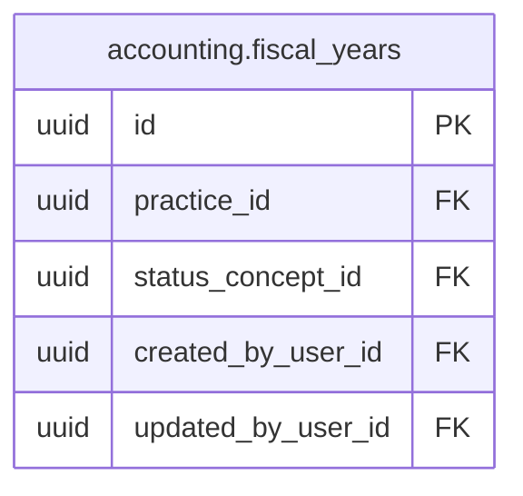
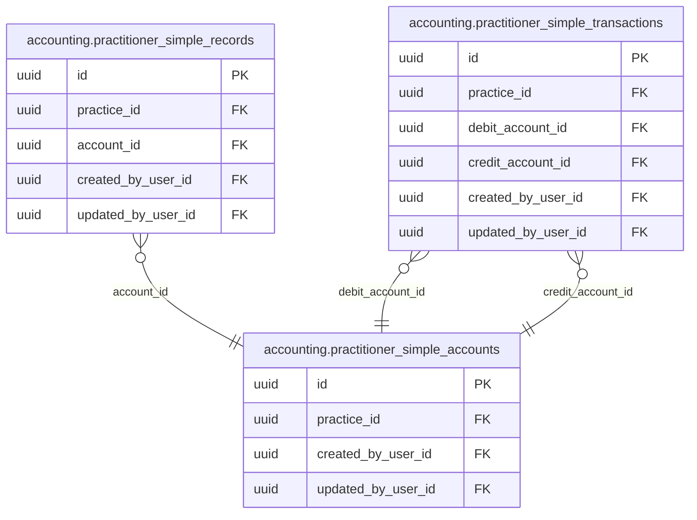

<!-- AUTOGENERADO por tools/inventario/catalogo.mjs. No editar manualmente. -->

# Catálogo del schema `accounting`

- **Tablas:** 45 · **Columnas:** 648 (182 con descripción: 28.1 %) · **Índices:** 369
- **Dominio:** Financiero y ERP
- Método y límites del catálogo: [README del inventario](../README.md)

## Tablas

| Tabla | Propósito | Columnas | Índices | Operaciones | ORM |
|---|---|---|---|---|---|
| [account_determination_rules](#account_determination_rules) | Define reglas que seleccionan cuentas contables según tipo de transacción y contexto operativo. | 20 | 14 | 1 | COINCIDE |
| [account_groups](#account_groups) | Agrupa cuentas contables para organizar estados financieros y análisis institucionales. | 13 | 5 | 0 | COINCIDE |
| [accounting_document_links](#accounting_document_links) | Relaciona documentos de origen con asientos para preservar trazabilidad entre operación y contabilidad. | 10 | 8 | 3 | COINCIDE |
| [accounts](#accounts) | Cataloga cuentas del libro mayor donde se clasifican transacciones de la organización sanitaria. | 18 | 9 | 26 | COINCIDE |
| [accrual_objects](#accrual_objects) | Representa devengamientos financieros que deben distribuirse entre períodos contables. | 20 | 15 | 4 | COINCIDE |
| [accrual_postings](#accrual_postings) | Conserva asientos producidos por reconocimiento de devengamientos en el libro contable. | 8 | 6 | 1 | COINCIDE |
| [accrual_schedule_lines](#accrual_schedule_lines) | Detalla períodos e importes de calendarios de devengamiento para reconocer ingresos o gastos progresivamente. | 12 | 7 | 4 | COINCIDE |
| [asset_assignments](#asset_assignments) | Vincula activos con unidades, ubicaciones o responsables para controlar su asignación institucional. | 17 | 12 | 2 | COINCIDE |
| [asset_classes](#asset_classes) | Agrupa activos por tratamiento contable para aplicar reglas consistentes de valoración y depreciación. | 17 | 12 | 0 | COINCIDE |
| [asset_components](#asset_components) | Desglosa activos compuestos en componentes con vida útil o valoración diferenciada. | 15 | 7 | 0 | COINCIDE |
| [asset_depreciations](#asset_depreciations) | Registra depreciaciones calculadas para distribuir el valor de activos a lo largo de su vida contable. | 11 | 5 | 5 | COINCIDE |
| [asset_postings](#asset_postings) | Conserva asientos generados por altas, bajas y depreciaciones de activos. | 11 | 9 | 4 | COINCIDE |
| [asset_valuations](#asset_valuations) | Registra valores contables de activos en fechas y áreas de valoración determinadas. | 17 | 7 | 2 | COINCIDE |
| [assets](#assets) | Cataloga activos institucionales para administrar su valor, ubicación y ciclo contable. | 20 | 8 | 21 | COINCIDE |
| [clearing_documents](#clearing_documents) | Representa documentos que compensan partidas abiertas dentro de procesos contables. | 10 | 8 | 2 | COINCIDE |
| [clearing_items](#clearing_items) | Detalla partidas incluidas en una compensación para verificar qué saldos quedaron conciliados. | 10 | 6 | 1 | COINCIDE |
| [company_bank_accounts](#company_bank_accounts) | Registra cuentas bancarias institucionales usadas para cobros y pagos de la organización sanitaria. | 18 | 10 | 1 | COINCIDE |
| [controlling_areas](#controlling_areas) | Define ámbitos de control de gestión para consolidar información financiera de una o más unidades. | 13 | 7 | 0 | COINCIDE |
| [cost_center_maps](#cost_center_maps) | Relaciona centros de costo con estructuras contables o institucionales para integrar reportes financieros. | 11 | 5 | 0 | COINCIDE |
| [cost_centers](#cost_centers) | Representa centros responsables de costos para atribuir gastos de operación y prestación de salud. | 12 | 6 | 14 | COINCIDE |
| [depreciation_areas](#depreciation_areas) | Define áreas de valoración donde se calculan depreciaciones con criterios contables o fiscales distintos. | 13 | 8 | 2 | COINCIDE |
| [employee_payments](#employee_payments) | Registra pagos al personal para sostener contabilidad de remuneraciones institucionales. | 14 | 6 | 0 | COINCIDE |
| [exchange_rates](#exchange_rates) | Conserva tasas de cambio utilizadas para registrar y comparar operaciones financieras en distintas monedas. | 11 | 4 | 3 | COINCIDE |
| [fiscal_periods](#fiscal_periods) | Desglosa ejercicios en períodos contables para registrar y reportar movimientos financieros por fecha. | 11 | 4 | 21 | COINCIDE |
| [fiscal_years](#fiscal_years) | Define ejercicios fiscales de la organización para ordenar períodos contables y cierres financieros. | 11 | 4 | 19 | COINCIDE |
| [functional_areas](#functional_areas) | Define áreas funcionales para clasificar gastos y resultados según actividad institucional. | 11 | 7 | 0 | COINCIDE |
| [infrastructure_items](#infrastructure_items) | Cataloga infraestructura física o tecnológica que representa recursos y activos del prestador. | 14 | 7 | 0 | COINCIDE |
| [internal_orders](#internal_orders) | Agrupa costos y compromisos de iniciativas internas para facilitar seguimiento presupuestario. | 20 | 14 | 0 | COINCIDE |
| [journal_entry_assignments](#journal_entry_assignments) | Asocia asientos con dimensiones contables para clasificar movimientos por unidad y propósito. | 30 | 32 | 16 | COINCIDE |
| [journal_transactions](#journal_transactions) | Agrupa asientos contables de una operación para conservar su registro financiero balanceado. | 22 | 9 | 38 | COINCIDE |
| [ledger_entries](#ledger_entries) | Registra líneas de débito y crédito en cuentas para reflejar operaciones del libro mayor. | 16 | 7 | 22 | COINCIDE |
| [liabilities](#liabilities) | Representa obligaciones financieras de la organización para controlar vencimientos, pagos y saldos. | 19 | 7 | 10 | COINCIDE |
| [liability_payments](#liability_payments) | Conserva pagos aplicados a obligaciones para mantener su saldo y estado financiero. | 12 | 4 | 2 | COINCIDE |
| [liability_postings](#liability_postings) | Registra movimientos contables asociados a obligaciones y sus pagos. | 10 | 9 | 2 | COINCIDE |
| [liability_schedules](#liability_schedules) | Define calendarios de vencimientos de obligaciones para planificar pagos y previsiones financieras. | 15 | 7 | 4 | COINCIDE |
| [open_items](#open_items) | Conserva partidas pendientes de compensación para seguir cobros y pagos aún no aplicados. | 20 | 13 | 3 | COINCIDE |
| [practitioner_simple_accounts](#practitioner_simple_accounts) | sin propósito | 11 | 4 | 12 | COINCIDE |
| [practitioner_simple_records](#practitioner_simple_records) | sin propósito | 12 | 4 | 8 | COINCIDE |
| [practitioner_simple_transactions](#practitioner_simple_transactions) | sin propósito | 12 | 5 | 8 | COINCIDE |
| [profit_centers](#profit_centers) | Representa unidades responsables de resultados para analizar ingresos y costos por operación. | 16 | 10 | 14 | COINCIDE |
| [purchases](#purchases) | Registra adquisiciones institucionales para relacionar compras con pagos, activos y gastos. | 15 | 7 | 0 | COINCIDE |
| [sales](#sales) | Conserva operaciones de venta de servicios o productos de salud para reflejar ingresos institucionales. | 16 | 7 | 0 | COINCIDE |
| [segments](#segments) | Cataloga segmentos de reporte financiero para analizar resultados por línea organizacional o actividad. | 11 | 7 | 1 | COINCIDE |
| [subledger_accounts](#subledger_accounts) | Mantiene cuentas auxiliares que desglosan saldos del libro mayor por entidad o proceso financiero. | 14 | 12 | 3 | COINCIDE |
| [transaction_files](#transaction_files) | Vincula comprobantes y archivos con transacciones contables para respaldar su documentación. | 9 | 5 | 3 | COINCIDE |

## Diagrama entidad-relación

Las tablas se agrupan en familias por sus claves foráneas dentro del schema (máximo 40 por diagrama). Las FK hacia otros schemas se listan en la ficha de cada tabla.

### Familia 1 de 3 — 40 tablas

```mermaid
erDiagram
  accounting_account_determination_rules["accounting.account_determination_rules"] {
    uuid id PK
    uuid tenant_id FK
    uuid posting_scenario_concept_id FK
    uuid account_role_concept_id FK
    uuid source_type_concept_id FK
    uuid asset_class_id FK
    uuid liability_type_concept_id FK
    uuid contract_type_concept_id FK
  }
  accounting_accounts["accounting.accounts"] {
    uuid id PK
    uuid practice_id FK
    uuid account_group_id FK
    uuid account_type_concept_id FK
    uuid normal_balance_concept_id FK
    uuid parent_account_id FK
    uuid currency_concept_id FK
    uuid status_concept_id FK
  }
  accounting_asset_classes["accounting.asset_classes"] {
    uuid id PK
    uuid tenant_id FK
    uuid asset_type_concept_id FK
    uuid acquisition_account_id FK
    uuid accumulated_depreciation_account_id FK
    uuid depreciation_expense_account_id FK
    uuid gain_account_id FK
    uuid loss_account_id FK
  }
  accounting_journal_entry_assignments["accounting.journal_entry_assignments"] {
    uuid id PK
    uuid ledger_entry_id FK
    uuid branch_id FK
    uuid department_id FK
    uuid cost_center_id FK
    uuid profit_center_id FK
    uuid functional_area_id FK
    uuid segment_id FK
  }
  accounting_account_groups["accounting.account_groups"] {
    uuid id PK
    uuid practice_id FK
    uuid parent_group_id FK
    uuid account_type_concept_id FK
    uuid created_by_user_id FK
    uuid updated_by_user_id FK
  }
  accounting_accrual_objects["accounting.accrual_objects"] {
    uuid id PK
    uuid tenant_id FK
    uuid accrual_type_concept_id FK
    uuid contract_id FK
    uuid business_partner_id FK
    uuid expense_account_id FK
    uuid accrual_account_id FK
    uuid cost_center_id FK
  }
  accounting_assets["accounting.assets"] {
    uuid id PK
    uuid practice_id FK
    uuid asset_type_concept_id FK
    uuid account_id FK
    uuid depreciation_method_concept_id FK
    uuid status_concept_id FK
    uuid created_by_user_id FK
    uuid updated_by_user_id FK
  }
  accounting_company_bank_accounts["accounting.company_bank_accounts"] {
    uuid id PK
    uuid tenant_id FK
    uuid account_id FK
    uuid currency_concept_id FK
    uuid branch_id FK
    uuid clearing_account_id FK
    uuid status_concept_id FK
    uuid created_by_user_id FK
  }
  accounting_ledger_entries["accounting.ledger_entries"] {
    uuid id PK
    uuid transaction_id FK
    uuid account_id FK
    uuid cost_center_id FK
    uuid direction_concept_id FK
    uuid currency_concept_id FK
    uuid created_by_user_id FK
    uuid updated_by_user_id FK
  }
  accounting_liabilities["accounting.liabilities"] {
    uuid id PK
    uuid practice_id FK
    uuid liability_type_concept_id FK
    uuid account_id FK
    uuid status_concept_id FK
    uuid created_by_user_id FK
    uuid updated_by_user_id FK
  }
  accounting_subledger_accounts["accounting.subledger_accounts"] {
    uuid id PK
    uuid tenant_id FK
    uuid business_partner_id FK
    uuid subledger_role_concept_id FK
    uuid reconciliation_account_id FK
    uuid currency_concept_id FK
    uuid payment_terms_concept_id FK
    uuid dunning_procedure_concept_id FK
  }
  accounting_asset_components["accounting.asset_components"] {
    uuid id PK
    uuid asset_id FK
    uuid asset_class_id FK
    uuid status_concept_id FK
    uuid created_by_user_id FK
    uuid updated_by_user_id FK
  }
  accounting_cost_centers["accounting.cost_centers"] {
    uuid id PK
    uuid practice_id FK
    uuid parent_cost_center_id FK
    uuid practitioner_profile_id FK
    uuid status_concept_id FK
    uuid created_by_user_id FK
    uuid updated_by_user_id FK
  }
  accounting_functional_areas["accounting.functional_areas"] {
    uuid id PK
    uuid tenant_id FK
    uuid parent_functional_area_id FK
    uuid status_concept_id FK
    uuid created_by_user_id FK
    uuid updated_by_user_id FK
  }
  accounting_internal_orders["accounting.internal_orders"] {
    uuid id PK
    uuid controlling_area_id FK
    uuid tenant_id FK
    uuid order_type_concept_id FK
    uuid responsible_cost_center_id FK
    uuid responsible_profit_center_id FK
    uuid project_id FK
    uuid wbs_element_id FK
  }
  accounting_profit_centers["accounting.profit_centers"] {
    uuid id PK
    uuid controlling_area_id FK
    uuid tenant_id FK
    uuid parent_profit_center_id FK
    uuid segment_id FK
    uuid responsible_employee_id FK
    uuid status_concept_id FK
    uuid created_by_user_id FK
  }
  accounting_segments["accounting.segments"] {
    uuid id PK
    uuid tenant_id FK
    uuid parent_segment_id FK
    uuid status_concept_id FK
    uuid created_by_user_id FK
    uuid updated_by_user_id FK
  }
  accounting_accrual_schedule_lines["accounting.accrual_schedule_lines"] {
    uuid id PK
    uuid accrual_object_id FK
    uuid fiscal_period_id FK
    uuid currency_concept_id FK
    uuid status_concept_id FK
    uuid created_by_user_id FK
    uuid updated_by_user_id FK
  }
  accounting_asset_assignments["accounting.asset_assignments"] {
    uuid id PK
    uuid asset_id FK
    uuid asset_component_id FK
    uuid branch_id FK
    uuid department_id FK
    uuid cost_center_id FK
    uuid profit_center_id FK
    uuid project_id FK
  }
  accounting_asset_depreciations["accounting.asset_depreciations"] {
    uuid id PK
    uuid asset_id FK
    uuid fiscal_period_id FK
    uuid transaction_id FK
    uuid created_by_user_id FK
    uuid updated_by_user_id FK
  }
  accounting_asset_postings["accounting.asset_postings"] {
    uuid id PK
    uuid asset_id FK
    uuid asset_component_id FK
    uuid ledger_entry_id FK
    uuid transaction_type_concept_id FK
    uuid currency_concept_id FK
    uuid created_by_user_id FK
  }
  accounting_asset_valuations["accounting.asset_valuations"] {
    uuid id PK
    uuid asset_id FK
    uuid asset_component_id FK
    uuid depreciation_area_id FK
    uuid depreciation_method_concept_id FK
    uuid created_by_user_id FK
    uuid updated_by_user_id FK
  }
  accounting_infrastructure_items["accounting.infrastructure_items"] {
    uuid id PK
    uuid practice_id FK
    uuid category_concept_id FK
    uuid asset_id FK
    uuid branch_id FK
    uuid status_concept_id FK
    uuid created_by_user_id FK
    uuid updated_by_user_id FK
  }
  accounting_clearing_documents["accounting.clearing_documents"] {
    uuid id PK
    uuid tenant_id FK
    uuid transaction_id FK
    uuid company_bank_account_id FK
    uuid payment_transaction_id FK
    uuid status_concept_id FK
    uuid created_by_user_id FK
  }
  accounting_accrual_postings["accounting.accrual_postings"] {
    uuid id PK
    uuid accrual_schedule_line_id FK
    uuid ledger_entry_id FK
    uuid currency_concept_id FK
    uuid created_by_user_id FK
  }
  accounting_journal_transactions["accounting.journal_transactions"] {
    uuid id PK
    uuid practice_id FK
    uuid transaction_type_concept_id FK
    uuid fiscal_period_id FK
    uuid currency_concept_id FK
    uuid status_concept_id FK
    uuid posted_by_user_id FK
    uuid created_by_user_id FK
  }
  accounting_liability_postings["accounting.liability_postings"] {
    uuid id PK
    uuid liability_id FK
    uuid liability_schedule_id FK
    uuid ledger_entry_id FK
    uuid component_concept_id FK
    uuid currency_concept_id FK
    uuid created_by_user_id FK
  }
  accounting_open_items["accounting.open_items"] {
    uuid id PK
    uuid tenant_id FK
    uuid subledger_account_id FK
    uuid ledger_entry_id FK
    uuid document_type_concept_id FK
    uuid invoice_id FK
    uuid bill_id FK
    uuid contract_id FK
  }
  accounting_liability_payments["accounting.liability_payments"] {
    uuid id PK
    uuid liability_id FK
    uuid transaction_id FK
    uuid created_by_user_id FK
    uuid updated_by_user_id FK
  }
  accounting_liability_schedules["accounting.liability_schedules"] {
    uuid id PK
    uuid liability_id FK
    uuid currency_concept_id FK
    uuid status_concept_id FK
    uuid created_by_user_id FK
    uuid updated_by_user_id FK
  }
  accounting_cost_center_maps["accounting.cost_center_maps"] {
    uuid id PK
    uuid practice_id FK
    uuid source_type_concept_id FK
    uuid cost_center_id FK
    uuid created_by_user_id FK
    uuid updated_by_user_id FK
  }
  accounting_controlling_areas["accounting.controlling_areas"] {
    uuid id PK
    uuid tenant_id FK
    uuid operating_currency_concept_id FK
    uuid status_concept_id FK
    uuid created_by_user_id FK
    uuid updated_by_user_id FK
  }
  accounting_accounting_document_links["accounting.accounting_document_links"] {
    uuid id PK
    uuid source_transaction_id FK
    uuid target_transaction_id FK
    uuid relation_type_concept_id FK
    uuid source_line_id FK
    uuid target_line_id FK
    uuid created_by_user_id FK
  }
  accounting_fiscal_periods["accounting.fiscal_periods"] {
    uuid id PK
    uuid fiscal_year_id FK
    uuid status_concept_id FK
    uuid created_by_user_id FK
    uuid updated_by_user_id FK
  }
  accounting_depreciation_areas["accounting.depreciation_areas"] {
    uuid id PK
    uuid tenant_id FK
    uuid accounting_principle_concept_id FK
    uuid currency_concept_id FK
    uuid status_concept_id FK
    uuid created_by_user_id FK
    uuid updated_by_user_id FK
  }
  accounting_clearing_items["accounting.clearing_items"] {
    uuid id PK
    uuid clearing_document_id FK
    uuid open_item_id FK
    uuid currency_concept_id FK
    uuid residual_open_item_id FK
    uuid created_by_user_id FK
  }
  accounting_employee_payments["accounting.employee_payments"] {
    uuid id PK
    uuid employee_id FK
    uuid fiscal_period_id FK
    uuid transaction_id FK
    uuid status_concept_id FK
    uuid created_by_user_id FK
    uuid updated_by_user_id FK
  }
  accounting_purchases["accounting.purchases"] {
    uuid id PK
    uuid practice_id FK
    uuid transaction_id FK
    uuid vendor_id FK
    uuid bill_id FK
    uuid status_concept_id FK
    uuid created_by_user_id FK
    uuid updated_by_user_id FK
  }
  accounting_sales["accounting.sales"] {
    uuid id PK
    uuid practice_id FK
    uuid transaction_id FK
    uuid customer_type_concept_id FK
    uuid invoice_id FK
    uuid status_concept_id FK
    uuid created_by_user_id FK
    uuid updated_by_user_id FK
  }
  accounting_transaction_files["accounting.transaction_files"] {
    uuid id PK
    uuid transaction_id FK
    uuid file_id FK
    uuid category_concept_id FK
    uuid created_by_user_id FK
    uuid updated_by_user_id FK
  }
  accounting_fiscal_years["accounting.fiscal_years"]
  accounting_account_determination_rules }o--o| accounting_asset_classes : "asset_class_id"
  accounting_account_determination_rules }o--|| accounting_accounts : "target_account_id"
  accounting_accounts }o--o| accounting_account_groups : "account_group_id"
  accounting_asset_classes }o--o| accounting_accounts : "acquisition_account_id"
  accounting_asset_classes }o--o| accounting_accounts : "accumulated_depreciation_acco…"
  accounting_asset_classes }o--o| accounting_accounts : "depreciation_expense_account_…"
  accounting_asset_classes }o--o| accounting_accounts : "gain_account_id"
  accounting_asset_classes }o--o| accounting_accounts : "loss_account_id"
  accounting_journal_entry_assignments }o--|| accounting_ledger_entries : "ledger_entry_id"
  accounting_journal_entry_assignments }o--o| accounting_cost_centers : "cost_center_id"
  accounting_journal_entry_assignments }o--o| accounting_profit_centers : "profit_center_id"
  accounting_journal_entry_assignments }o--o| accounting_functional_areas : "functional_area_id"
  accounting_journal_entry_assignments }o--o| accounting_segments : "segment_id"
  accounting_journal_entry_assignments }o--o| accounting_internal_orders : "internal_order_id"
  accounting_journal_entry_assignments }o--o| accounting_subledger_accounts : "subledger_account_id"
  accounting_journal_entry_assignments }o--o| accounting_assets : "asset_id"
  accounting_journal_entry_assignments }o--o| accounting_asset_components : "asset_component_id"
  accounting_journal_entry_assignments }o--o| accounting_liabilities : "liability_id"
  accounting_journal_entry_assignments }o--o| accounting_company_bank_accounts : "company_bank_account_id"
  accounting_journal_entry_assignments }o--o| accounting_account_determination_rules : "derived_by_rule_id"
  accounting_accrual_objects }o--o| accounting_accounts : "expense_account_id"
  accounting_accrual_objects }o--o| accounting_accounts : "accrual_account_id"
  accounting_accrual_objects }o--o| accounting_cost_centers : "cost_center_id"
  accounting_accrual_objects }o--o| accounting_profit_centers : "profit_center_id"
  accounting_assets }o--o| accounting_accounts : "account_id"
  accounting_company_bank_accounts }o--|| accounting_accounts : "account_id"
  accounting_company_bank_accounts }o--o| accounting_accounts : "clearing_account_id"
  accounting_ledger_entries }o--|| accounting_journal_transactions : "transaction_id"
  accounting_ledger_entries }o--|| accounting_accounts : "account_id"
  accounting_ledger_entries }o--o| accounting_cost_centers : "cost_center_id"
  accounting_liabilities }o--o| accounting_accounts : "account_id"
  accounting_subledger_accounts }o--|| accounting_accounts : "reconciliation_account_id"
  accounting_asset_components }o--|| accounting_assets : "asset_id"
  accounting_asset_components }o--o| accounting_asset_classes : "asset_class_id"
  accounting_internal_orders }o--|| accounting_controlling_areas : "controlling_area_id"
  accounting_internal_orders }o--o| accounting_cost_centers : "responsible_cost_center_id"
  accounting_internal_orders }o--o| accounting_profit_centers : "responsible_profit_center_id"
  accounting_profit_centers }o--|| accounting_controlling_areas : "controlling_area_id"
  accounting_profit_centers }o--o| accounting_segments : "segment_id"
  accounting_accrual_schedule_lines }o--|| accounting_accrual_objects : "accrual_object_id"
  accounting_accrual_schedule_lines }o--|| accounting_fiscal_periods : "fiscal_period_id"
  accounting_asset_assignments }o--|| accounting_assets : "asset_id"
  accounting_asset_assignments }o--o| accounting_asset_components : "asset_component_id"
  accounting_asset_assignments }o--o| accounting_cost_centers : "cost_center_id"
  accounting_asset_assignments }o--o| accounting_profit_centers : "profit_center_id"
  accounting_asset_depreciations }o--|| accounting_assets : "asset_id"
  accounting_asset_depreciations }o--|| accounting_fiscal_periods : "fiscal_period_id"
  accounting_asset_depreciations }o--o| accounting_journal_transactions : "transaction_id"
  accounting_asset_postings }o--|| accounting_assets : "asset_id"
  accounting_asset_postings }o--o| accounting_asset_components : "asset_component_id"
  accounting_asset_postings }o--|| accounting_ledger_entries : "ledger_entry_id"
  accounting_asset_valuations }o--|| accounting_assets : "asset_id"
  accounting_asset_valuations }o--o| accounting_asset_components : "asset_component_id"
  accounting_asset_valuations }o--|| accounting_depreciation_areas : "depreciation_area_id"
  accounting_infrastructure_items }o--o| accounting_assets : "asset_id"
  accounting_clearing_documents }o--|| accounting_journal_transactions : "transaction_id"
  accounting_clearing_documents }o--o| accounting_company_bank_accounts : "company_bank_account_id"
  accounting_accrual_postings }o--|| accounting_accrual_schedule_lines : "accrual_schedule_line_id"
  accounting_accrual_postings }o--|| accounting_ledger_entries : "ledger_entry_id"
  accounting_journal_transactions }o--o| accounting_fiscal_periods : "fiscal_period_id"
  accounting_liability_postings }o--|| accounting_liabilities : "liability_id"
  accounting_liability_postings }o--o| accounting_liability_schedules : "liability_schedule_id"
  accounting_liability_postings }o--|| accounting_ledger_entries : "ledger_entry_id"
  accounting_open_items }o--|| accounting_subledger_accounts : "subledger_account_id"
  accounting_open_items }o--|| accounting_ledger_entries : "ledger_entry_id"
  accounting_liability_payments }o--|| accounting_liabilities : "liability_id"
  accounting_liability_payments }o--o| accounting_journal_transactions : "transaction_id"
  accounting_liability_schedules }o--|| accounting_liabilities : "liability_id"
  accounting_cost_center_maps }o--|| accounting_cost_centers : "cost_center_id"
  accounting_accounting_document_links }o--|| accounting_journal_transactions : "source_transaction_id"
  accounting_accounting_document_links }o--|| accounting_journal_transactions : "target_transaction_id"
  accounting_accounting_document_links }o--o| accounting_accrual_schedule_lines : "source_line_id"
  accounting_accounting_document_links }o--o| accounting_accrual_schedule_lines : "target_line_id"
  accounting_fiscal_periods }o--|| accounting_fiscal_years : "fiscal_year_id"
  accounting_clearing_items }o--|| accounting_clearing_documents : "clearing_document_id"
  accounting_clearing_items }o--|| accounting_open_items : "open_item_id"
  accounting_clearing_items }o--o| accounting_open_items : "residual_open_item_id"
  accounting_employee_payments }o--o| accounting_fiscal_periods : "fiscal_period_id"
  accounting_employee_payments }o--o| accounting_journal_transactions : "transaction_id"
  accounting_purchases }o--o| accounting_journal_transactions : "transaction_id"
  accounting_sales }o--o| accounting_journal_transactions : "transaction_id"
  accounting_transaction_files }o--|| accounting_journal_transactions : "transaction_id"
```

### Familia 2 de 3 — 1 tablas



### Familia 3 de 3 — 3 tablas



### Tablas sin relaciones dentro del schema

`accounting.exchange_rates`

## Fichas

### account_determination_rules

#### Vista general

Define reglas que seleccionan cuentas contables según tipo de transacción y contexto operativo.

- **Estado del propósito:** DOMAIN_CURATED_DRAFT · fuente: `Mantra Core Health Context/modules/diagram_16_accounting.puml: account_determination_rules`
- **Dominio:** Financiero y ERP · **Diagrama:** `Mantra Core Health Context/modules/diagram_16_accounting.puml` · **DDL:** `SQL/16_accounting/02_tables.sql`
- **Entidad del ORM:** `AccountDeterminationRules` — `src/modules/accounting/entities/account_determination_rules.entity.ts`
- **Resumen:** 20 columnas · 14 índices · 13 FK salientes · 1 entrantes · 1 operaciones

#### Columnas

| # | Columna | Tipo | Rol estructural | Descripción | ORM |
|---|---|---|---|---|---|
| 1 | `id` | `uuid` | Clave primaria; Obligatoria | Identificador único de la instancia. _(JSDOC_ESTANDAR, `src/modules/accounting/entities/account_determination_rules.entity.ts:12`)_ | coincide |
| 2 | `tenant_id` | `uuid` | Clave foránea → directory.tenants.id; Obligatoria | _sin dato_ | coincide |
| 3 | `posting_scenario_concept_id` | `uuid` | Clave foránea → terminology.catalog_concepts.id; Obligatoria | _sin dato_ | coincide |
| 4 | `account_role_concept_id` | `uuid` | Clave foránea → terminology.catalog_concepts.id; Obligatoria | _sin dato_ | coincide |
| 5 | `source_type_concept_id` | `uuid` | Clave foránea → terminology.catalog_concepts.id; Opcional | _sin dato_ | coincide |
| 6 | `asset_class_id` | `uuid` | Clave foránea → accounting.asset_classes.id; Opcional | _sin dato_ | coincide |
| 7 | `liability_type_concept_id` | `uuid` | Clave foránea → terminology.catalog_concepts.id; Opcional | _sin dato_ | coincide |
| 8 | `contract_type_concept_id` | `uuid` | Clave foránea → terminology.catalog_concepts.id; Opcional | _sin dato_ | coincide |
| 9 | `tax_code_id` | `uuid` | Clave foránea → billing.tax_codes.id; Opcional | _sin dato_ | coincide |
| 10 | `service_concept_id` | `uuid` | Clave foránea → terminology.catalog_concepts.id; Opcional | _sin dato_ | coincide |
| 11 | `target_account_id` | `uuid` | Clave foránea → accounting.accounts.id; Obligatoria | _sin dato_ | coincide |
| 12 | `priority` | `integer` | Opcional | _sin dato_ | coincide |
| 13 | `valid_from` | `date` | Opcional | _sin dato_ | coincide |
| 14 | `valid_to` | `date` | Opcional | _sin dato_ | coincide |
| 15 | `status_concept_id` | `uuid` | Clave foránea → terminology.catalog_concepts.id; Obligatoria | _sin dato_ | coincide |
| 16 | `created_at` | `timestamptz` | Obligatoria | Fecha y hora en que se creó el registro. _(JSDOC_ESTANDAR, `src/modules/accounting/entities/account_determination_rules.entity.ts:114`)_ | coincide |
| 17 | `updated_at` | `timestamptz` | Obligatoria | Fecha y hora de la última actualización. _(JSDOC_ESTANDAR, `src/modules/accounting/entities/account_determination_rules.entity.ts:120`)_ | coincide |
| 18 | `created_by_user_id` | `uuid` | Clave foránea → iam.users.id; Opcional | _sin dato_ | coincide |
| 19 | `updated_by_user_id` | `uuid` | Clave foránea → iam.users.id; Opcional | _sin dato_ | coincide |
| 20 | `row_version` | `integer = 1` | Obligatoria | Versión usada para controlar actualizaciones concurrentes. _(JSDOC_ENTIDAD, `src/modules/accounting/entities/account_determination_rules.entity.ts:138`)_ | coincide |

#### Relaciones

| Sentido | Columnas | Tabla | Restricción |
|---|---|---|---|
| hacia | asset_class_id | accounting.asset_classes (id) | fk_account_determination_rules_asset_class_id |
| hacia | target_account_id | accounting.accounts (id) | fk_account_determination_rules_target_account_id |
| hacia | tenant_id | directory.tenants (id) | fk_account_determination_rules_tenant_id |
| hacia | posting_scenario_concept_id | terminology.catalog_concepts (id) | fk_account_determination_rules_posting_scenario_concept_id |
| hacia | account_role_concept_id | terminology.catalog_concepts (id) | fk_account_determination_rules_account_role_concept_id |
| hacia | source_type_concept_id | terminology.catalog_concepts (id) | fk_account_determination_rules_source_type_concept_id |
| hacia | liability_type_concept_id | terminology.catalog_concepts (id) | fk_account_determination_rules_liability_type_concept_id |
| hacia | contract_type_concept_id | terminology.catalog_concepts (id) | fk_account_determination_rules_contract_type_concept_id |
| hacia | tax_code_id | billing.tax_codes (id) | fk_account_determination_rules_tax_code_id |
| hacia | service_concept_id | terminology.catalog_concepts (id) | fk_account_determination_rules_service_concept_id |
| hacia | status_concept_id | terminology.catalog_concepts (id) | fk_account_determination_rules_status_concept_id |
| hacia | created_by_user_id | iam.users (id) | fk_account_determination_rules_created_by_user_id |
| hacia | updated_by_user_id | iam.users (id) | fk_account_determination_rules_updated_by_user_id |
| desde | id | accounting.journal_entry_assignments (derived_by_rule_id) | fk_journal_entry_assignments_derived_by_rule_id |

#### Índices

| Índice | Único | Columnas | Para qué |
|---|---|---|---|
| `ix_account_determination_rules_tenant_id` | no | tenant_id | Soporta la clave foránea fk_account_determination_rules_tenant_id: PostgreSQL no indexa las FK por sí mismo _(DOCUMENTO)_; 1 consulta(s) de repositorio filtran u ordenan por «tenant_id», la primera columna del índice _(CONSULTA)_ |
| `ix_account_determination_rules_posting_scenario_concept_id` | no | posting_scenario_concept_id | Soporta la clave foránea fk_account_determination_rules_posting_scenario_concept_id: PostgreSQL no indexa las FK por sí mismo _(DOCUMENTO)_; 1 consulta(s) de repositorio filtran u ordenan por «posting_scenario_concept_id», la primera columna del índice _(CONSULTA)_ |
| `ix_account_determination_rules_account_role_concept_id` | no | account_role_concept_id | Soporta la clave foránea fk_account_determination_rules_account_role_concept_id: PostgreSQL no indexa las FK por sí mismo _(DOCUMENTO)_ |
| `ix_account_determination_rules_source_type_concept_id` | no | source_type_concept_id | Soporta la clave foránea fk_account_determination_rules_source_type_concept_id: PostgreSQL no indexa las FK por sí mismo _(DOCUMENTO)_ |
| `ix_account_determination_rules_asset_class_id` | no | asset_class_id | Soporta la clave foránea fk_account_determination_rules_asset_class_id: PostgreSQL no indexa las FK por sí mismo _(DOCUMENTO)_ |
| `ix_account_determination_rules_liability_type_concept_id` | no | liability_type_concept_id | Soporta la clave foránea fk_account_determination_rules_liability_type_concept_id: PostgreSQL no indexa las FK por sí mismo _(DOCUMENTO)_ |
| `ix_account_determination_rules_contract_type_concept_id` | no | contract_type_concept_id | Soporta la clave foránea fk_account_determination_rules_contract_type_concept_id: PostgreSQL no indexa las FK por sí mismo _(DOCUMENTO)_ |
| `ix_account_determination_rules_tax_code_id` | no | tax_code_id | Soporta la clave foránea fk_account_determination_rules_tax_code_id: PostgreSQL no indexa las FK por sí mismo _(DOCUMENTO)_ |
| `ix_account_determination_rules_service_concept_id` | no | service_concept_id | Soporta la clave foránea fk_account_determination_rules_service_concept_id: PostgreSQL no indexa las FK por sí mismo _(DOCUMENTO)_ |
| `ix_account_determination_rules_target_account_id` | no | target_account_id | Soporta la clave foránea fk_account_determination_rules_target_account_id: PostgreSQL no indexa las FK por sí mismo _(DOCUMENTO)_ |
| `ix_account_determination_rules_status_concept_id` | no | status_concept_id | Soporta la clave foránea fk_account_determination_rules_status_concept_id: PostgreSQL no indexa las FK por sí mismo _(DOCUMENTO)_; 1 consulta(s) de repositorio filtran u ordenan por «status_concept_id», la primera columna del índice _(CONSULTA)_ |
| `ix_account_determination_rules_created_by_user_id` | no | created_by_user_id | Soporta la clave foránea fk_account_determination_rules_created_by_user_id: PostgreSQL no indexa las FK por sí mismo _(DOCUMENTO)_ |
| `ix_account_determination_rules_updated_by_user_id` | no | updated_by_user_id | Soporta la clave foránea fk_account_determination_rules_updated_by_user_id: PostgreSQL no indexa las FK por sí mismo _(DOCUMENTO)_ |
| `ix_account_determination_rules_tenant_scenario_priority` | no | tenant_id, posting_scenario_concept_id, priority | Soporta la clave foránea fk_account_determination_rules_tenant_id: PostgreSQL no indexa las FK por sí mismo _(DOCUMENTO)_; 1 consulta(s) de repositorio filtran u ordenan por «tenant_id», la primera columna del índice _(CONSULTA)_ |

#### Operaciones que la tocan

| Operación | Efecto | Confianza |
|---|---|---|
| POST /accounting/postings/determine-accounts | LEE | DIRECTA |

#### Gobierno

| Atributo | Valor | Fuente |
|---|---|---|
| Append-only | no declarado | — |
| Datos personales | sin fuente | — |
| Financiera | sin fuente | — |
| Crítica para auditoría | sin fuente | — |
| Retención | sin fuente | — |
| Responsable | sin fuente | — |
| Revisión | AUTO_DETECTADA | — |

---

### account_groups

#### Vista general

Agrupa cuentas contables para organizar estados financieros y análisis institucionales.

- **Estado del propósito:** DOMAIN_CURATED_DRAFT · fuente: `Mantra Core Health Context/modules/diagram_16_accounting.puml: account_groups`
- **Dominio:** Financiero y ERP · **Diagrama:** `Mantra Core Health Context/modules/diagram_16_accounting.puml` · **DDL:** `SQL/16_accounting/02_tables.sql`
- **Entidad del ORM:** `AccountGroups` — `src/modules/accounting/entities/account_groups.entity.ts`
- **Resumen:** 13 columnas · 5 índices · 5 FK salientes · 1 entrantes · 0 operaciones

#### Columnas

| # | Columna | Tipo | Rol estructural | Descripción | ORM |
|---|---|---|---|---|---|
| 1 | `id` | `uuid` | Clave primaria; Obligatoria | Identificador único de la instancia. _(JSDOC_ESTANDAR, `src/modules/accounting/entities/account_groups.entity.ts:12`)_ | coincide |
| 2 | `practice_id` | `uuid` | Clave foránea → practice.practices.id; Obligatoria | _sin dato_ | coincide |
| 3 | `code` | `varchar` | Obligatoria | _sin dato_ | coincide |
| 4 | `name` | `varchar` | Obligatoria | _sin dato_ | coincide |
| 5 | `parent_group_id` | `uuid` | Clave foránea → community.groups.id; Opcional | _sin dato_ | coincide |
| 6 | `account_type_concept_id` | `uuid` | Clave foránea → terminology.catalog_concepts.id; Obligatoria | _sin dato_ | coincide |
| 7 | `ordinal` | `integer` | Opcional | _sin dato_ | coincide |
| 8 | `is_system` | `boolean` | Opcional | _sin dato_ | coincide |
| 9 | `created_at` | `timestamptz` | Obligatoria | Fecha y hora en que se creó el registro. _(JSDOC_ESTANDAR, `src/modules/accounting/entities/account_groups.entity.ts:60`)_ | coincide |
| 10 | `updated_at` | `timestamptz` | Obligatoria | Fecha y hora de la última actualización. _(JSDOC_ESTANDAR, `src/modules/accounting/entities/account_groups.entity.ts:66`)_ | coincide |
| 11 | `created_by_user_id` | `uuid` | Clave foránea → iam.users.id; Opcional | _sin dato_ | coincide |
| 12 | `updated_by_user_id` | `uuid` | Clave foránea → iam.users.id; Opcional | _sin dato_ | coincide |
| 13 | `row_version` | `integer = 1` | Obligatoria | Versión usada para controlar actualizaciones concurrentes. _(JSDOC_ENTIDAD, `src/modules/accounting/entities/account_groups.entity.ts:84`)_ | coincide |

#### Relaciones

| Sentido | Columnas | Tabla | Restricción |
|---|---|---|---|
| hacia | practice_id | practice.practices (id) | fk_account_groups_practice_id |
| hacia | parent_group_id | community.groups (id) | fk_account_groups_parent_group_id |
| hacia | account_type_concept_id | terminology.catalog_concepts (id) | fk_account_groups_account_type_concept_id |
| hacia | created_by_user_id | iam.users (id) | fk_account_groups_created_by_user_id |
| hacia | updated_by_user_id | iam.users (id) | fk_account_groups_updated_by_user_id |
| desde | id | accounting.accounts (account_group_id) | fk_accounts_account_group_id |

#### Índices

| Índice | Único | Columnas | Para qué |
|---|---|---|---|
| `ix_account_groups_practice_id` | no | practice_id | Soporta la clave foránea fk_account_groups_practice_id: PostgreSQL no indexa las FK por sí mismo _(DOCUMENTO)_ |
| `ix_account_groups_parent_group_id` | no | parent_group_id | Soporta la clave foránea fk_account_groups_parent_group_id: PostgreSQL no indexa las FK por sí mismo _(DOCUMENTO)_ |
| `ix_account_groups_account_type_concept_id` | no | account_type_concept_id | Soporta la clave foránea fk_account_groups_account_type_concept_id: PostgreSQL no indexa las FK por sí mismo _(DOCUMENTO)_ |
| `ix_account_groups_created_by_user_id` | no | created_by_user_id | Soporta la clave foránea fk_account_groups_created_by_user_id: PostgreSQL no indexa las FK por sí mismo _(DOCUMENTO)_ |
| `ix_account_groups_updated_by_user_id` | no | updated_by_user_id | Soporta la clave foránea fk_account_groups_updated_by_user_id: PostgreSQL no indexa las FK por sí mismo _(DOCUMENTO)_ |

#### Operaciones que la tocan

_Ninguna operación HTTP la toca según el análisis estático (puede usarla un worker, un trigger o una migración)._

#### Gobierno

| Atributo | Valor | Fuente |
|---|---|---|
| Append-only | no declarado | — |
| Datos personales | sin fuente | — |
| Financiera | sin fuente | — |
| Crítica para auditoría | sin fuente | — |
| Retención | sin fuente | — |
| Responsable | sin fuente | — |
| Revisión | AUTO_DETECTADA | — |

---

### accounting_document_links

#### Vista general

Relaciona documentos de origen con asientos para preservar trazabilidad entre operación y contabilidad.

- **Estado del propósito:** DOMAIN_CURATED_DRAFT · fuente: `Mantra Core Health Context/modules/diagram_16_accounting.puml: accounting_document_links`
- **Dominio:** Financiero y ERP · **Diagrama:** `Mantra Core Health Context/modules/diagram_16_accounting.puml` · **DDL:** `SQL/16_accounting/02_tables.sql`
- **Entidad del ORM:** `AccountingDocumentLinks` — `src/modules/accounting/entities/accounting_document_links.entity.ts`
- **Resumen:** 10 columnas · 8 índices · 6 FK salientes · 0 entrantes · 3 operaciones

#### Columnas

| # | Columna | Tipo | Rol estructural | Descripción | ORM |
|---|---|---|---|---|---|
| 1 | `id` | `uuid` | Clave primaria; Obligatoria | Identificador único de la instancia. _(JSDOC_ESTANDAR, `src/modules/accounting/entities/accounting_document_links.entity.ts:12`)_ | coincide |
| 2 | `source_transaction_id` | `uuid` | Clave foránea → accounting.journal_transactions.id; Obligatoria | _sin dato_ | coincide |
| 3 | `target_transaction_id` | `uuid` | Clave foránea → accounting.journal_transactions.id; Obligatoria | _sin dato_ | coincide |
| 4 | `relation_type_concept_id` | `uuid` | Clave foránea → terminology.catalog_concepts.id; Obligatoria | _sin dato_ | coincide |
| 5 | `source_line_id` | `uuid` | Clave foránea → accounting.accrual_schedule_lines.id; Opcional | _sin dato_ | coincide |
| 6 | `target_line_id` | `uuid` | Clave foránea → accounting.accrual_schedule_lines.id; Opcional | _sin dato_ | coincide |
| 7 | `effective_at` | `timestamptz` | Opcional | _sin dato_ | coincide |
| 8 | `reason_text` | `varchar` | Opcional | _sin dato_ | coincide |
| 9 | `created_at` | `timestamptz` | Obligatoria | Fecha y hora en que se creó el registro. _(JSDOC_ESTANDAR, `src/modules/accounting/entities/accounting_document_links.entity.ts:64`)_ | coincide |
| 10 | `created_by_user_id` | `uuid` | Clave foránea → iam.users.id; Opcional | _sin dato_ | coincide |

#### Relaciones

| Sentido | Columnas | Tabla | Restricción |
|---|---|---|---|
| hacia | source_transaction_id | accounting.journal_transactions (id) | fk_accounting_document_links_source_transaction_id |
| hacia | target_transaction_id | accounting.journal_transactions (id) | fk_accounting_document_links_target_transaction_id |
| hacia | source_line_id | accounting.accrual_schedule_lines (id) | fk_accounting_document_links_source_line_id |
| hacia | target_line_id | accounting.accrual_schedule_lines (id) | fk_accounting_document_links_target_line_id |
| hacia | relation_type_concept_id | terminology.catalog_concepts (id) | fk_accounting_document_links_relation_type_concept_id |
| hacia | created_by_user_id | iam.users (id) | fk_accounting_document_links_created_by_user_id |

#### Índices

| Índice | Único | Columnas | Para qué |
|---|---|---|---|
| `uq_accounting_document_links_source_transaction_id_tar_c5560530` | sí | source_transaction_id, target_transaction_id, relation_type_concept_id | Garantiza que no se repita la combinación (source_transaction_id, target_transaction_id, relation_type_concept_id) _(DOCUMENTO)_; Soporta la clave foránea fk_accounting_document_links_source_transaction_id: PostgreSQL no indexa las FK por sí mismo _(DOCUMENTO)_; 1 consulta(s) de repositorio filtran u ordenan por «source_transaction_id», la primera columna del índice _(CONSULTA)_ |
| `ix_accounting_document_links_source_transaction_id` | no | source_transaction_id | Soporta la clave foránea fk_accounting_document_links_source_transaction_id: PostgreSQL no indexa las FK por sí mismo _(DOCUMENTO)_; 1 consulta(s) de repositorio filtran u ordenan por «source_transaction_id», la primera columna del índice _(CONSULTA)_ |
| `ix_accounting_document_links_target_transaction_id` | no | target_transaction_id | Soporta la clave foránea fk_accounting_document_links_target_transaction_id: PostgreSQL no indexa las FK por sí mismo _(DOCUMENTO)_ |
| `ix_accounting_document_links_relation_type_concept_id` | no | relation_type_concept_id | Soporta la clave foránea fk_accounting_document_links_relation_type_concept_id: PostgreSQL no indexa las FK por sí mismo _(DOCUMENTO)_; 2 consulta(s) de repositorio filtran u ordenan por «relation_type_concept_id», la primera columna del índice _(CONSULTA)_ |
| `ix_accounting_document_links_source_line_id` | no | source_line_id | Soporta la clave foránea fk_accounting_document_links_source_line_id: PostgreSQL no indexa las FK por sí mismo _(DOCUMENTO)_ |
| `ix_accounting_document_links_target_line_id` | no | target_line_id | Soporta la clave foránea fk_accounting_document_links_target_line_id: PostgreSQL no indexa las FK por sí mismo _(DOCUMENTO)_ |
| `ix_accounting_document_links_created_by_user_id` | no | created_by_user_id | Soporta la clave foránea fk_accounting_document_links_created_by_user_id: PostgreSQL no indexa las FK por sí mismo _(DOCUMENTO)_ |
| `ix_accounting_document_links_target_relation` | no | target_transaction_id, relation_type_concept_id | Soporta la clave foránea fk_accounting_document_links_target_transaction_id: PostgreSQL no indexa las FK por sí mismo _(DOCUMENTO)_ |

#### Restricciones

| Restricción | Tipo | Definición |
|---|---|---|
| `uq_accounting_document_links_source_transaction_id_tar_c5560530` | UNIQUE INDEX | UNIQUE INDEX ("source_transaction_id", "target_transaction_id", "relation_type_concept_id") |

#### Operaciones que la tocan

| Operación | Efecto | Confianza |
|---|---|---|
| GET /accounting/journal-transactions/{id}/document-flow | LEE | DIRECTA |
| POST /accounting/journal-transactions/{id}/reverse | CREA | DIRECTA |
| POST /accounting/journal-transactions/{id}/reverse | LEE | DIRECTA |

#### Gobierno

| Atributo | Valor | Fuente |
|---|---|---|
| Append-only | no declarado | — |
| Datos personales | sin fuente | — |
| Financiera | sin fuente | — |
| Crítica para auditoría | sin fuente | — |
| Retención | sin fuente | — |
| Responsable | sin fuente | — |
| Revisión | AUTO_DETECTADA | — |

---

### accounts

#### Vista general

Cataloga cuentas del libro mayor donde se clasifican transacciones de la organización sanitaria.

- **Estado del propósito:** DOMAIN_CURATED_DRAFT · fuente: `Mantra Core Health Context/modules/diagram_16_accounting.puml: accounts`
- **Dominio:** Financiero y ERP · **Diagrama:** `Mantra Core Health Context/modules/diagram_16_accounting.puml` · **DDL:** `SQL/16_accounting/02_tables.sql`
- **Entidad del ORM:** `Accounts` — `src/modules/accounting/entities/accounts.entity.ts`
- **Resumen:** 18 columnas · 9 índices · 9 FK salientes · 37 entrantes · 26 operaciones

#### Columnas

| # | Columna | Tipo | Rol estructural | Descripción | ORM |
|---|---|---|---|---|---|
| 1 | `id` | `uuid` | Clave primaria; Obligatoria | Identificador único de la instancia. _(JSDOC_ESTANDAR, `src/modules/accounting/entities/accounts.entity.ts:12`)_ | coincide |
| 2 | `practice_id` | `uuid` | Clave foránea → practice.practices.id; Obligatoria | _sin dato_ | coincide |
| 3 | `code` | `varchar` | Obligatoria | _sin dato_ | coincide |
| 4 | `name` | `varchar` | Obligatoria | _sin dato_ | coincide |
| 5 | `account_group_id` | `uuid` | Clave foránea → accounting.account_groups.id; Opcional | _sin dato_ | coincide |
| 6 | `account_type_concept_id` | `uuid` | Clave foránea → terminology.catalog_concepts.id; Obligatoria | _sin dato_ | coincide |
| 7 | `normal_balance_concept_id` | `uuid` | Clave foránea → terminology.catalog_concepts.id; Obligatoria | _sin dato_ | coincide |
| 8 | `parent_account_id` | `uuid` | Clave foránea → accounting.accounts.id; Opcional | _sin dato_ | coincide |
| 9 | `currency_concept_id` | `uuid` | Clave foránea → terminology.catalog_concepts.id; Opcional | _sin dato_ | coincide |
| 10 | `is_configurable` | `boolean` | Obligatoria | _sin dato_ | coincide |
| 11 | `is_system` | `boolean` | Opcional | _sin dato_ | coincide |
| 12 | `is_postable` | `boolean` | Obligatoria | _sin dato_ | coincide |
| 13 | `status_concept_id` | `uuid` | Clave foránea → terminology.catalog_concepts.id; Obligatoria | _sin dato_ | coincide |
| 14 | `created_at` | `timestamptz` | Obligatoria | Fecha y hora en que se creó el registro. _(JSDOC_ESTANDAR, `src/modules/accounting/entities/accounts.entity.ts:90`)_ | coincide |
| 15 | `updated_at` | `timestamptz` | Obligatoria | Fecha y hora de la última actualización. _(JSDOC_ESTANDAR, `src/modules/accounting/entities/accounts.entity.ts:96`)_ | coincide |
| 16 | `created_by_user_id` | `uuid` | Clave foránea → iam.users.id; Opcional | _sin dato_ | coincide |
| 17 | `updated_by_user_id` | `uuid` | Clave foránea → iam.users.id; Opcional | _sin dato_ | coincide |
| 18 | `row_version` | `integer = 1` | Obligatoria | Versión usada para controlar actualizaciones concurrentes. _(JSDOC_ENTIDAD, `src/modules/accounting/entities/accounts.entity.ts:114`)_ | coincide |

#### Relaciones

| Sentido | Columnas | Tabla | Restricción |
|---|---|---|---|
| hacia | account_group_id | accounting.account_groups (id) | fk_accounts_account_group_id |
| hacia | parent_account_id | accounting.accounts (id) | fk_accounts_parent_account_id |
| hacia | practice_id | practice.practices (id) | fk_accounts_practice_id |
| hacia | account_type_concept_id | terminology.catalog_concepts (id) | fk_accounts_account_type_concept_id |
| hacia | normal_balance_concept_id | terminology.catalog_concepts (id) | fk_accounts_normal_balance_concept_id |
| hacia | currency_concept_id | terminology.catalog_concepts (id) | fk_accounts_currency_concept_id |
| hacia | status_concept_id | terminology.catalog_concepts (id) | fk_accounts_status_concept_id |
| hacia | created_by_user_id | iam.users (id) | fk_accounts_created_by_user_id |
| hacia | updated_by_user_id | iam.users (id) | fk_accounts_updated_by_user_id |
| desde | id | accounting.accounts (parent_account_id) | fk_accounts_parent_account_id |
| desde | id | accounting.ledger_entries (account_id) | fk_ledger_entries_account_id |
| desde | id | accounting.assets (account_id) | fk_assets_account_id |
| desde | id | accounting.liabilities (account_id) | fk_liabilities_account_id |
| desde | id | accounting.company_bank_accounts (account_id) | fk_company_bank_accounts_account_id |
| desde | id | accounting.company_bank_accounts (clearing_account_id) | fk_company_bank_accounts_clearing_account_id |
| desde | id | accounting.subledger_accounts (reconciliation_account_id) | fk_subledger_accounts_reconciliation_account_id |
| desde | id | accounting.account_determination_rules (target_account_id) | fk_account_determination_rules_target_account_id |
| desde | id | accounting.asset_classes (acquisition_account_id) | fk_asset_classes_acquisition_account_id |
| desde | id | accounting.asset_classes (accumulated_depreciation_account_id) | fk_asset_classes_accumulated_depreciation_account_id |
| desde | id | accounting.asset_classes (depreciation_expense_account_id) | fk_asset_classes_depreciation_expense_account_id |
| desde | id | accounting.asset_classes (gain_account_id) | fk_asset_classes_gain_account_id |
| desde | id | accounting.asset_classes (loss_account_id) | fk_asset_classes_loss_account_id |
| desde | id | accounting.accrual_objects (expense_account_id) | fk_accrual_objects_expense_account_id |
| desde | id | accounting.accrual_objects (accrual_account_id) | fk_accrual_objects_accrual_account_id |
| desde | id | audit.accounts_history (account_id) | fk_accounts_history_account_id |
| desde | id | billing.service_catalog (income_account_id) | fk_service_catalog_income_account_id |
| desde | id | billing.invoice_lines (income_account_id) | fk_invoice_lines_income_account_id |
| desde | id | billing.bill_lines (expense_account_id) | fk_bill_lines_expense_account_id |
| desde | id | billing.tax_codes (account_id) | fk_tax_codes_account_id |
| desde | id | billing.budget_lines (account_id) | fk_budget_lines_account_id |
| desde | id | erp.contract_line_items (account_id) | fk_contract_line_items_account_id |
| desde | id | erp.purchase_order_items (expense_account_id) | fk_purchase_order_items_expense_account_id |
| desde | id | erp.purchase_order_items (inventory_account_id) | fk_purchase_order_items_inventory_account_id |
| desde | id | erp.sales_order_items (income_account_id) | fk_sales_order_items_income_account_id |
| desde | id | erp.contract_accounting_terms (expense_account_id) | fk_contract_accounting_terms_expense_account_id |
| desde | id | erp.contract_accounting_terms (revenue_account_id) | fk_contract_accounting_terms_revenue_account_id |
| desde | id | erp.contract_accounting_terms (accrual_account_id) | fk_contract_accounting_terms_accrual_account_id |
| desde | id | erp.contract_accounting_terms (asset_account_id) | fk_contract_accounting_terms_asset_account_id |
| desde | id | erp.contract_accounting_terms (liability_account_id) | fk_contract_accounting_terms_liability_account_id |
| desde | id | erp.lease_accounting_links (right_of_use_asset_account_id) | fk_lease_accounting_links_right_of_use_asset_account_id |
| desde | id | erp.lease_accounting_links (lease_liability_account_id) | fk_lease_accounting_links_lease_liability_account_id |
| desde | id | erp.lease_accounting_links (interest_expense_account_id) | fk_lease_accounting_links_interest_expense_account_id |
| desde | id | erp.lease_accounting_links (depreciation_expense_account_id) | fk_lease_accounting_links_depreciation_expense_account_id |
| desde | id | payments.wallets (ledger_account_id) | fk_wallets_ledger_account_id |
| desde | id | payments.payment_debt_lines (accounting_account_id) | fk_payment_debt_lines_accounting_account_id |
| desde | id | crm.crm_accounts (parent_account_id) | fk_crm_accounts_parent_account_id |

#### Índices

| Índice | Único | Columnas | Para qué |
|---|---|---|---|
| `ix_accounts_practice_id` | no | practice_id | Soporta la clave foránea fk_accounts_practice_id: PostgreSQL no indexa las FK por sí mismo _(DOCUMENTO)_; 2 consulta(s) de repositorio filtran u ordenan por «practice_id», la primera columna del índice _(CONSULTA)_ |
| `ix_accounts_account_group_id` | no | account_group_id | Soporta la clave foránea fk_accounts_account_group_id: PostgreSQL no indexa las FK por sí mismo _(DOCUMENTO)_ |
| `ix_accounts_account_type_concept_id` | no | account_type_concept_id | Soporta la clave foránea fk_accounts_account_type_concept_id: PostgreSQL no indexa las FK por sí mismo _(DOCUMENTO)_ |
| `ix_accounts_normal_balance_concept_id` | no | normal_balance_concept_id | Soporta la clave foránea fk_accounts_normal_balance_concept_id: PostgreSQL no indexa las FK por sí mismo _(DOCUMENTO)_ |
| `ix_accounts_parent_account_id` | no | parent_account_id | Soporta la clave foránea fk_accounts_parent_account_id: PostgreSQL no indexa las FK por sí mismo _(DOCUMENTO)_ |
| `ix_accounts_currency_concept_id` | no | currency_concept_id | Soporta la clave foránea fk_accounts_currency_concept_id: PostgreSQL no indexa las FK por sí mismo _(DOCUMENTO)_ |
| `ix_accounts_status_concept_id` | no | status_concept_id | Soporta la clave foránea fk_accounts_status_concept_id: PostgreSQL no indexa las FK por sí mismo _(DOCUMENTO)_ |
| `ix_accounts_created_by_user_id` | no | created_by_user_id | Soporta la clave foránea fk_accounts_created_by_user_id: PostgreSQL no indexa las FK por sí mismo _(DOCUMENTO)_ |
| `ix_accounts_updated_by_user_id` | no | updated_by_user_id | Soporta la clave foránea fk_accounts_updated_by_user_id: PostgreSQL no indexa las FK por sí mismo _(DOCUMENTO)_ |

#### Operaciones que la tocan

| Operación | Efecto | Confianza |
|---|---|---|
| GET /accounting/accounts | LEE | DIRECTA |
| POST /accounting/accounts | CREA | DIRECTA |
| POST /accounting/accounts | LEE | DIRECTA |
| GET /accounting/accrual-objects | LEE | DIRECTA |
| POST /accounting/accrual-objects | LEE | DIRECTA |
| POST /accounting/accruals/run | LEE | DIRECTA |
| POST /accounting/assets/capitalize | LEE | DIRECTA |
| GET /accounting/balance-sheet | LEE | DIRECTA |
| POST /accounting/clearing-documents | LEE | DIRECTA |
| POST /accounting/depreciation/run | LEE | DIRECTA |
| GET /accounting/general-ledger | LEE | DIRECTA |
| GET /accounting/income-statement | LEE | DIRECTA |
| POST /accounting/journal-transactions | LEE | DIRECTA |
| POST /accounting/journal-transactions/drafts | LEE | DIRECTA |
| POST /accounting/liabilities/{id}/payments | LEE | DIRECTA |
| GET /accounting/open-items | LEE | DIRECTA |
| GET /accounting/practitioner/assets | LEE | DIRECTA |
| POST /accounting/practitioner/assets | LEE | DIRECTA |
| POST /accounting/practitioner/assets/{id}/progress | LEE | DIRECTA |
| POST /accounting/practitioner/consultation-income | LEE | DIRECTA |
| POST /accounting/practitioner/entries | LEE | DIRECTA |
| GET /accounting/practitioner/liabilities | LEE | DIRECTA |
| POST /accounting/practitioner/liabilities | LEE | DIRECTA |
| POST /accounting/practitioner/liabilities/{id}/progress | LEE | DIRECTA |
| GET /accounting/practitioner/liabilities/{id}/schedule | LEE | DIRECTA |
| GET /accounting/trial-balance | LEE | DIRECTA |

#### Gobierno

| Atributo | Valor | Fuente |
|---|---|---|
| Append-only | no declarado | — |
| Datos personales | sin fuente | — |
| Financiera | sin fuente | — |
| Crítica para auditoría | sin fuente | — |
| Retención | sin fuente | — |
| Responsable | sin fuente | — |
| Revisión | AUTO_DETECTADA | — |

---

### accrual_objects

#### Vista general

Representa devengamientos financieros que deben distribuirse entre períodos contables.

- **Estado del propósito:** DOMAIN_CURATED_DRAFT · fuente: `Mantra Core Health Context/modules/diagram_16_accounting.puml: accrual_objects`
- **Dominio:** Financiero y ERP · **Diagrama:** `Mantra Core Health Context/modules/diagram_16_accounting.puml` · **DDL:** `SQL/16_accounting/02_tables.sql`
- **Entidad del ORM:** `AccrualObjects` — `src/modules/accounting/entities/accrual_objects.entity.ts`
- **Resumen:** 20 columnas · 15 índices · 12 FK salientes · 1 entrantes · 4 operaciones

#### Columnas

| # | Columna | Tipo | Rol estructural | Descripción | ORM |
|---|---|---|---|---|---|
| 1 | `id` | `uuid` | Clave primaria; Obligatoria | Identificador único de la instancia. _(JSDOC_ESTANDAR, `src/modules/accounting/entities/accrual_objects.entity.ts:12`)_ | coincide |
| 2 | `tenant_id` | `uuid` | Clave foránea → directory.tenants.id; Obligatoria | _sin dato_ | coincide |
| 3 | `object_number` | `varchar` | Obligatoria | _sin dato_ | coincide |
| 4 | `accrual_type_concept_id` | `uuid` | Clave foránea → terminology.catalog_concepts.id; Obligatoria | _sin dato_ | coincide |
| 5 | `contract_id` | `uuid` | Clave foránea → erp.contracts.id; Opcional | _sin dato_ | coincide |
| 6 | `business_partner_id` | `uuid` | Clave foránea → erp.business_partners.id; Opcional | _sin dato_ | coincide |
| 7 | `expense_account_id` | `uuid` | Clave foránea → accounting.accounts.id; Opcional | _sin dato_ | coincide |
| 8 | `accrual_account_id` | `uuid` | Clave foránea → accounting.accounts.id; Opcional | _sin dato_ | coincide |
| 9 | `cost_center_id` | `uuid` | Clave foránea → accounting.cost_centers.id; Opcional | _sin dato_ | coincide |
| 10 | `profit_center_id` | `uuid` | Clave foránea → accounting.profit_centers.id; Opcional | _sin dato_ | coincide |
| 11 | `start_date` | `date` | Opcional | _sin dato_ | coincide |
| 12 | `end_date` | `date` | Opcional | _sin dato_ | coincide |
| 13 | `total_amount` | `numeric` | Opcional | _sin dato_ | coincide |
| 14 | `currency_concept_id` | `uuid` | Clave foránea → terminology.catalog_concepts.id; Opcional | _sin dato_ | coincide |
| 15 | `status_concept_id` | `uuid` | Clave foránea → terminology.catalog_concepts.id; Obligatoria | _sin dato_ | coincide |
| 16 | `created_at` | `timestamptz` | Obligatoria | Fecha y hora en que se creó el registro. _(JSDOC_ESTANDAR, `src/modules/accounting/entities/accrual_objects.entity.ts:106`)_ | coincide |
| 17 | `updated_at` | `timestamptz` | Obligatoria | Fecha y hora de la última actualización. _(JSDOC_ESTANDAR, `src/modules/accounting/entities/accrual_objects.entity.ts:112`)_ | coincide |
| 18 | `created_by_user_id` | `uuid` | Clave foránea → iam.users.id; Opcional | _sin dato_ | coincide |
| 19 | `updated_by_user_id` | `uuid` | Clave foránea → iam.users.id; Opcional | _sin dato_ | coincide |
| 20 | `row_version` | `integer = 1` | Obligatoria | Versión usada para controlar actualizaciones concurrentes. _(JSDOC_ENTIDAD, `src/modules/accounting/entities/accrual_objects.entity.ts:130`)_ | coincide |

#### Relaciones

| Sentido | Columnas | Tabla | Restricción |
|---|---|---|---|
| hacia | expense_account_id | accounting.accounts (id) | fk_accrual_objects_expense_account_id |
| hacia | accrual_account_id | accounting.accounts (id) | fk_accrual_objects_accrual_account_id |
| hacia | cost_center_id | accounting.cost_centers (id) | fk_accrual_objects_cost_center_id |
| hacia | profit_center_id | accounting.profit_centers (id) | fk_accrual_objects_profit_center_id |
| hacia | tenant_id | directory.tenants (id) | fk_accrual_objects_tenant_id |
| hacia | accrual_type_concept_id | terminology.catalog_concepts (id) | fk_accrual_objects_accrual_type_concept_id |
| hacia | contract_id | erp.contracts (id) | fk_accrual_objects_contract_id |
| hacia | business_partner_id | erp.business_partners (id) | fk_accrual_objects_business_partner_id |
| hacia | currency_concept_id | terminology.catalog_concepts (id) | fk_accrual_objects_currency_concept_id |
| hacia | status_concept_id | terminology.catalog_concepts (id) | fk_accrual_objects_status_concept_id |
| hacia | created_by_user_id | iam.users (id) | fk_accrual_objects_created_by_user_id |
| hacia | updated_by_user_id | iam.users (id) | fk_accrual_objects_updated_by_user_id |
| desde | id | accounting.accrual_schedule_lines (accrual_object_id) | fk_accrual_schedule_lines_accrual_object_id |

#### Índices

| Índice | Único | Columnas | Para qué |
|---|---|---|---|
| `uq_accrual_objects_tenant_id_object_number` | sí | tenant_id, object_number | Garantiza que no se repita la combinación (tenant_id, object_number) _(DOCUMENTO)_; Soporta la clave foránea fk_accrual_objects_tenant_id: PostgreSQL no indexa las FK por sí mismo _(DOCUMENTO)_; 2 consulta(s) de repositorio filtran u ordenan por «tenant_id», la primera columna del índice _(CONSULTA)_ |
| `ix_accrual_objects_tenant_id` | no | tenant_id | Soporta la clave foránea fk_accrual_objects_tenant_id: PostgreSQL no indexa las FK por sí mismo _(DOCUMENTO)_; 2 consulta(s) de repositorio filtran u ordenan por «tenant_id», la primera columna del índice _(CONSULTA)_ |
| `ix_accrual_objects_accrual_type_concept_id` | no | accrual_type_concept_id | Soporta la clave foránea fk_accrual_objects_accrual_type_concept_id: PostgreSQL no indexa las FK por sí mismo _(DOCUMENTO)_ |
| `ix_accrual_objects_contract_id` | no | contract_id | Soporta la clave foránea fk_accrual_objects_contract_id: PostgreSQL no indexa las FK por sí mismo _(DOCUMENTO)_ |
| `ix_accrual_objects_business_partner_id` | no | business_partner_id | Soporta la clave foránea fk_accrual_objects_business_partner_id: PostgreSQL no indexa las FK por sí mismo _(DOCUMENTO)_ |
| `ix_accrual_objects_expense_account_id` | no | expense_account_id | Soporta la clave foránea fk_accrual_objects_expense_account_id: PostgreSQL no indexa las FK por sí mismo _(DOCUMENTO)_ |
| `ix_accrual_objects_accrual_account_id` | no | accrual_account_id | Soporta la clave foránea fk_accrual_objects_accrual_account_id: PostgreSQL no indexa las FK por sí mismo _(DOCUMENTO)_ |
| `ix_accrual_objects_cost_center_id` | no | cost_center_id | Soporta la clave foránea fk_accrual_objects_cost_center_id: PostgreSQL no indexa las FK por sí mismo _(DOCUMENTO)_ |
| `ix_accrual_objects_profit_center_id` | no | profit_center_id | Soporta la clave foránea fk_accrual_objects_profit_center_id: PostgreSQL no indexa las FK por sí mismo _(DOCUMENTO)_ |
| `ix_accrual_objects_currency_concept_id` | no | currency_concept_id | Soporta la clave foránea fk_accrual_objects_currency_concept_id: PostgreSQL no indexa las FK por sí mismo _(DOCUMENTO)_ |
| `ix_accrual_objects_status_concept_id` | no | status_concept_id | Soporta la clave foránea fk_accrual_objects_status_concept_id: PostgreSQL no indexa las FK por sí mismo _(DOCUMENTO)_ |
| `ix_accrual_objects_created_by_user_id` | no | created_by_user_id | Soporta la clave foránea fk_accrual_objects_created_by_user_id: PostgreSQL no indexa las FK por sí mismo _(DOCUMENTO)_ |
| `ix_accrual_objects_updated_by_user_id` | no | updated_by_user_id | Soporta la clave foránea fk_accrual_objects_updated_by_user_id: PostgreSQL no indexa las FK por sí mismo _(DOCUMENTO)_ |
| `ix_accrual_objects_tenant_status` | no | tenant_id, status_concept_id | Soporta la clave foránea fk_accrual_objects_tenant_id: PostgreSQL no indexa las FK por sí mismo _(DOCUMENTO)_; 2 consulta(s) de repositorio filtran u ordenan por «tenant_id», la primera columna del índice _(CONSULTA)_ |
| `gin_accrual_objects_search` | no | (to_tsvector('simple', (coalesce(object_number, '')))) | GIN para búsqueda textual gobernada _(DOCUMENTO)_ |

#### Restricciones

| Restricción | Tipo | Definición |
|---|---|---|
| `uq_accrual_objects_tenant_id_object_number` | UNIQUE INDEX | UNIQUE INDEX ("tenant_id", "object_number") |

#### Operaciones que la tocan

| Operación | Efecto | Confianza |
|---|---|---|
| GET /accounting/accrual-objects | LEE | DIRECTA |
| POST /accounting/accrual-objects | CREA | DIRECTA |
| POST /accounting/accrual-objects | LEE | DIRECTA |
| POST /accounting/accruals/run | LEE | DIRECTA |

#### Gobierno

| Atributo | Valor | Fuente |
|---|---|---|
| Append-only | no declarado | — |
| Datos personales | sin fuente | — |
| Financiera | sin fuente | — |
| Crítica para auditoría | sin fuente | — |
| Retención | sin fuente | — |
| Responsable | sin fuente | — |
| Revisión | AUTO_DETECTADA | — |

---

### accrual_postings

#### Vista general

Conserva asientos producidos por reconocimiento de devengamientos en el libro contable.

- **Estado del propósito:** DOMAIN_CURATED_DRAFT · fuente: `Mantra Core Health Context/modules/diagram_16_accounting.puml: accrual_postings`
- **Dominio:** Financiero y ERP · **Diagrama:** `Mantra Core Health Context/modules/diagram_16_accounting.puml` · **DDL:** `SQL/16_accounting/02_tables.sql`
- **Entidad del ORM:** `AccrualPostings` — `src/modules/accounting/entities/accrual_postings.entity.ts`
- **Resumen:** 8 columnas · 6 índices · 4 FK salientes · 0 entrantes · 1 operaciones

#### Columnas

| # | Columna | Tipo | Rol estructural | Descripción | ORM |
|---|---|---|---|---|---|
| 1 | `id` | `uuid` | Clave primaria; Obligatoria | Identificador único de la instancia. _(JSDOC_ESTANDAR, `src/modules/accounting/entities/accrual_postings.entity.ts:12`)_ | coincide |
| 2 | `accrual_schedule_line_id` | `uuid` | Clave foránea → accounting.accrual_schedule_lines.id; Obligatoria | _sin dato_ | coincide |
| 3 | `ledger_entry_id` | `uuid` | Clave foránea → accounting.ledger_entries.id; Obligatoria | _sin dato_ | coincide |
| 4 | `amount` | `numeric` | Obligatoria | _sin dato_ | coincide |
| 5 | `currency_concept_id` | `uuid` | Clave foránea → terminology.catalog_concepts.id; Opcional | _sin dato_ | coincide |
| 6 | `posting_date` | `date` | Opcional | _sin dato_ | coincide |
| 7 | `created_at` | `timestamptz` | Obligatoria | Fecha y hora en que se creó el registro. _(JSDOC_ESTANDAR, `src/modules/accounting/entities/accrual_postings.entity.ts:48`)_ | coincide |
| 8 | `created_by_user_id` | `uuid` | Clave foránea → iam.users.id; Opcional | _sin dato_ | coincide |

#### Relaciones

| Sentido | Columnas | Tabla | Restricción |
|---|---|---|---|
| hacia | accrual_schedule_line_id | accounting.accrual_schedule_lines (id) | fk_accrual_postings_accrual_schedule_line_id |
| hacia | ledger_entry_id | accounting.ledger_entries (id) | fk_accrual_postings_ledger_entry_id |
| hacia | currency_concept_id | terminology.catalog_concepts (id) | fk_accrual_postings_currency_concept_id |
| hacia | created_by_user_id | iam.users (id) | fk_accrual_postings_created_by_user_id |

#### Índices

| Índice | Único | Columnas | Para qué |
|---|---|---|---|
| `uq_accrual_postings_accrual_schedule_line_id_ledger_entry_id` | sí | accrual_schedule_line_id, ledger_entry_id | Garantiza que no se repita la combinación (accrual_schedule_line_id, ledger_entry_id) _(DOCUMENTO)_; Soporta la clave foránea fk_accrual_postings_accrual_schedule_line_id: PostgreSQL no indexa las FK por sí mismo _(DOCUMENTO)_ |
| `ix_accrual_postings_accrual_schedule_line_id` | no | accrual_schedule_line_id | Soporta la clave foránea fk_accrual_postings_accrual_schedule_line_id: PostgreSQL no indexa las FK por sí mismo _(DOCUMENTO)_ |
| `ix_accrual_postings_ledger_entry_id` | no | ledger_entry_id | Soporta la clave foránea fk_accrual_postings_ledger_entry_id: PostgreSQL no indexa las FK por sí mismo _(DOCUMENTO)_ |
| `ix_accrual_postings_currency_concept_id` | no | currency_concept_id | Soporta la clave foránea fk_accrual_postings_currency_concept_id: PostgreSQL no indexa las FK por sí mismo _(DOCUMENTO)_ |
| `ix_accrual_postings_created_by_user_id` | no | created_by_user_id | Soporta la clave foránea fk_accrual_postings_created_by_user_id: PostgreSQL no indexa las FK por sí mismo _(DOCUMENTO)_ |
| `brin_accrual_postings_created_at` | no | created_at | BRIN para logs e historiales append-only de gran volumen _(DOCUMENTO)_ |

#### Restricciones

| Restricción | Tipo | Definición |
|---|---|---|
| `uq_accrual_postings_accrual_schedule_line_id_ledger_entry_id` | UNIQUE INDEX | UNIQUE INDEX ("accrual_schedule_line_id", "ledger_entry_id") |

#### Operaciones que la tocan

| Operación | Efecto | Confianza |
|---|---|---|
| POST /accounting/accruals/run | CREA | DIRECTA |

#### Gobierno

| Atributo | Valor | Fuente |
|---|---|---|
| Append-only | no declarado | — |
| Datos personales | sin fuente | — |
| Financiera | sin fuente | — |
| Crítica para auditoría | sin fuente | — |
| Retención | sin fuente | — |
| Responsable | sin fuente | — |
| Revisión | AUTO_DETECTADA | — |

---

### accrual_schedule_lines

#### Vista general

Detalla períodos e importes de calendarios de devengamiento para reconocer ingresos o gastos progresivamente.

- **Estado del propósito:** DOMAIN_CURATED_DRAFT · fuente: `Mantra Core Health Context/modules/diagram_16_accounting.puml: accrual_schedule_lines`
- **Dominio:** Financiero y ERP · **Diagrama:** `Mantra Core Health Context/modules/diagram_16_accounting.puml` · **DDL:** `SQL/16_accounting/02_tables.sql`
- **Entidad del ORM:** `AccrualScheduleLines` — `src/modules/accounting/entities/accrual_schedule_lines.entity.ts`
- **Resumen:** 12 columnas · 7 índices · 6 FK salientes · 3 entrantes · 4 operaciones

#### Columnas

| # | Columna | Tipo | Rol estructural | Descripción | ORM |
|---|---|---|---|---|---|
| 1 | `id` | `uuid` | Clave primaria; Obligatoria | Identificador único de la instancia. _(JSDOC_ESTANDAR, `src/modules/accounting/entities/accrual_schedule_lines.entity.ts:12`)_ | coincide |
| 2 | `accrual_object_id` | `uuid` | Clave foránea → accounting.accrual_objects.id; Obligatoria | _sin dato_ | coincide |
| 3 | `fiscal_period_id` | `uuid` | Clave foránea → accounting.fiscal_periods.id; Obligatoria | _sin dato_ | coincide |
| 4 | `planned_amount` | `numeric` | Opcional | _sin dato_ | coincide |
| 5 | `posted_amount` | `numeric` | Opcional | _sin dato_ | coincide |
| 6 | `currency_concept_id` | `uuid` | Clave foránea → terminology.catalog_concepts.id; Opcional | _sin dato_ | coincide |
| 7 | `status_concept_id` | `uuid` | Clave foránea → terminology.catalog_concepts.id; Obligatoria | _sin dato_ | coincide |
| 8 | `created_at` | `timestamptz` | Obligatoria | Fecha y hora en que se creó el registro. _(JSDOC_ESTANDAR, `src/modules/accounting/entities/accrual_schedule_lines.entity.ts:62`)_ | coincide |
| 9 | `updated_at` | `timestamptz` | Obligatoria | Fecha y hora de la última actualización. _(JSDOC_ESTANDAR, `src/modules/accounting/entities/accrual_schedule_lines.entity.ts:68`)_ | coincide |
| 10 | `created_by_user_id` | `uuid` | Clave foránea → iam.users.id; Opcional | _sin dato_ | coincide |
| 11 | `updated_by_user_id` | `uuid` | Clave foránea → iam.users.id; Opcional | _sin dato_ | coincide |
| 12 | `row_version` | `integer = 1` | Obligatoria | Versión usada para controlar actualizaciones concurrentes. _(JSDOC_ENTIDAD, `src/modules/accounting/entities/accrual_schedule_lines.entity.ts:86`)_ | coincide |

#### Relaciones

| Sentido | Columnas | Tabla | Restricción |
|---|---|---|---|
| hacia | accrual_object_id | accounting.accrual_objects (id) | fk_accrual_schedule_lines_accrual_object_id |
| hacia | fiscal_period_id | accounting.fiscal_periods (id) | fk_accrual_schedule_lines_fiscal_period_id |
| hacia | currency_concept_id | terminology.catalog_concepts (id) | fk_accrual_schedule_lines_currency_concept_id |
| hacia | status_concept_id | terminology.catalog_concepts (id) | fk_accrual_schedule_lines_status_concept_id |
| hacia | created_by_user_id | iam.users (id) | fk_accrual_schedule_lines_created_by_user_id |
| hacia | updated_by_user_id | iam.users (id) | fk_accrual_schedule_lines_updated_by_user_id |
| desde | id | accounting.accounting_document_links (source_line_id) | fk_accounting_document_links_source_line_id |
| desde | id | accounting.accounting_document_links (target_line_id) | fk_accounting_document_links_target_line_id |
| desde | id | accounting.accrual_postings (accrual_schedule_line_id) | fk_accrual_postings_accrual_schedule_line_id |

#### Índices

| Índice | Único | Columnas | Para qué |
|---|---|---|---|
| `uq_accrual_schedule_lines_accrual_object_id_fiscal_period_id` | sí | accrual_object_id, fiscal_period_id | Garantiza que no se repita la combinación (accrual_object_id, fiscal_period_id) _(DOCUMENTO)_; Soporta la clave foránea fk_accrual_schedule_lines_accrual_object_id: PostgreSQL no indexa las FK por sí mismo _(DOCUMENTO)_; 2 consulta(s) de repositorio filtran u ordenan por «accrual_object_id», la primera columna del índice _(CONSULTA)_ |
| `ix_accrual_schedule_lines_accrual_object_id` | no | accrual_object_id | Soporta la clave foránea fk_accrual_schedule_lines_accrual_object_id: PostgreSQL no indexa las FK por sí mismo _(DOCUMENTO)_; 2 consulta(s) de repositorio filtran u ordenan por «accrual_object_id», la primera columna del índice _(CONSULTA)_ |
| `ix_accrual_schedule_lines_fiscal_period_id` | no | fiscal_period_id | Soporta la clave foránea fk_accrual_schedule_lines_fiscal_period_id: PostgreSQL no indexa las FK por sí mismo _(DOCUMENTO)_; 1 consulta(s) de repositorio filtran u ordenan por «fiscal_period_id», la primera columna del índice _(CONSULTA)_ |
| `ix_accrual_schedule_lines_currency_concept_id` | no | currency_concept_id | Soporta la clave foránea fk_accrual_schedule_lines_currency_concept_id: PostgreSQL no indexa las FK por sí mismo _(DOCUMENTO)_ |
| `ix_accrual_schedule_lines_status_concept_id` | no | status_concept_id | Soporta la clave foránea fk_accrual_schedule_lines_status_concept_id: PostgreSQL no indexa las FK por sí mismo _(DOCUMENTO)_; 1 consulta(s) de repositorio filtran u ordenan por «status_concept_id», la primera columna del índice _(CONSULTA)_ |
| `ix_accrual_schedule_lines_created_by_user_id` | no | created_by_user_id | Soporta la clave foránea fk_accrual_schedule_lines_created_by_user_id: PostgreSQL no indexa las FK por sí mismo _(DOCUMENTO)_ |
| `ix_accrual_schedule_lines_updated_by_user_id` | no | updated_by_user_id | Soporta la clave foránea fk_accrual_schedule_lines_updated_by_user_id: PostgreSQL no indexa las FK por sí mismo _(DOCUMENTO)_ |

#### Restricciones

| Restricción | Tipo | Definición |
|---|---|---|
| `uq_accrual_schedule_lines_accrual_object_id_fiscal_period_id` | UNIQUE INDEX | UNIQUE INDEX ("accrual_object_id", "fiscal_period_id") |

#### Operaciones que la tocan

| Operación | Efecto | Confianza |
|---|---|---|
| GET /accounting/accrual-objects | LEE | DIRECTA |
| POST /accounting/accrual-objects | CREA | DIRECTA |
| POST /accounting/accruals/run | ACTUALIZA | POR_TIPO |
| POST /accounting/accruals/run | LEE | DIRECTA |

#### Gobierno

| Atributo | Valor | Fuente |
|---|---|---|
| Append-only | no declarado | — |
| Datos personales | sin fuente | — |
| Financiera | sin fuente | — |
| Crítica para auditoría | sin fuente | — |
| Retención | sin fuente | — |
| Responsable | sin fuente | — |
| Revisión | AUTO_DETECTADA | — |

---

### asset_assignments

#### Vista general

Vincula activos con unidades, ubicaciones o responsables para controlar su asignación institucional.

- **Estado del propósito:** DOMAIN_CURATED_DRAFT · fuente: `Mantra Core Health Context/modules/diagram_16_accounting.puml: asset_assignments`
- **Dominio:** Financiero y ERP · **Diagrama:** `Mantra Core Health Context/modules/diagram_16_accounting.puml` · **DDL:** `SQL/16_accounting/02_tables.sql`
- **Entidad del ORM:** `AssetAssignments` — `src/modules/accounting/entities/asset_assignments.entity.ts`
- **Resumen:** 17 columnas · 12 índices · 11 FK salientes · 0 entrantes · 2 operaciones

#### Columnas

| # | Columna | Tipo | Rol estructural | Descripción | ORM |
|---|---|---|---|---|---|
| 1 | `id` | `uuid` | Clave primaria; Obligatoria | Identificador único de la instancia. _(JSDOC_ESTANDAR, `src/modules/accounting/entities/asset_assignments.entity.ts:12`)_ | coincide |
| 2 | `asset_id` | `uuid` | Clave foránea → accounting.assets.id; Obligatoria | _sin dato_ | coincide |
| 3 | `asset_component_id` | `uuid` | Clave foránea → accounting.asset_components.id; Opcional | _sin dato_ | coincide |
| 4 | `branch_id` | `uuid` | Clave foránea → directory.branches.id; Opcional | _sin dato_ | coincide |
| 5 | `department_id` | `uuid` | Clave foránea → erp.departments.id; Opcional | _sin dato_ | coincide |
| 6 | `cost_center_id` | `uuid` | Clave foránea → accounting.cost_centers.id; Opcional | _sin dato_ | coincide |
| 7 | `profit_center_id` | `uuid` | Clave foránea → accounting.profit_centers.id; Opcional | _sin dato_ | coincide |
| 8 | `project_id` | `uuid` | Clave foránea → erp.projects.id; Opcional | _sin dato_ | coincide |
| 9 | `wbs_element_id` | `uuid` | Clave foránea → erp.wbs_elements.id; Opcional | _sin dato_ | coincide |
| 10 | `responsible_employee_id` | `uuid` | Clave foránea → erp.employees.id; Opcional | _sin dato_ | coincide |
| 11 | `valid_from` | `date` | Opcional | _sin dato_ | coincide |
| 12 | `valid_to` | `date` | Opcional | _sin dato_ | coincide |
| 13 | `created_at` | `timestamptz` | Obligatoria | Fecha y hora en que se creó el registro. _(JSDOC_ESTANDAR, `src/modules/accounting/entities/asset_assignments.entity.ts:88`)_ | coincide |
| 14 | `updated_at` | `timestamptz` | Obligatoria | Fecha y hora de la última actualización. _(JSDOC_ESTANDAR, `src/modules/accounting/entities/asset_assignments.entity.ts:94`)_ | coincide |
| 15 | `created_by_user_id` | `uuid` | Clave foránea → iam.users.id; Opcional | _sin dato_ | coincide |
| 16 | `updated_by_user_id` | `uuid` | Clave foránea → iam.users.id; Opcional | _sin dato_ | coincide |
| 17 | `row_version` | `integer = 1` | Obligatoria | Versión usada para controlar actualizaciones concurrentes. _(JSDOC_ENTIDAD, `src/modules/accounting/entities/asset_assignments.entity.ts:112`)_ | coincide |

#### Relaciones

| Sentido | Columnas | Tabla | Restricción |
|---|---|---|---|
| hacia | asset_id | accounting.assets (id) | fk_asset_assignments_asset_id |
| hacia | asset_component_id | accounting.asset_components (id) | fk_asset_assignments_asset_component_id |
| hacia | cost_center_id | accounting.cost_centers (id) | fk_asset_assignments_cost_center_id |
| hacia | profit_center_id | accounting.profit_centers (id) | fk_asset_assignments_profit_center_id |
| hacia | branch_id | directory.branches (id) | fk_asset_assignments_branch_id |
| hacia | department_id | erp.departments (id) | fk_asset_assignments_department_id |
| hacia | project_id | erp.projects (id) | fk_asset_assignments_project_id |
| hacia | wbs_element_id | erp.wbs_elements (id) | fk_asset_assignments_wbs_element_id |
| hacia | responsible_employee_id | erp.employees (id) | fk_asset_assignments_responsible_employee_id |
| hacia | created_by_user_id | iam.users (id) | fk_asset_assignments_created_by_user_id |
| hacia | updated_by_user_id | iam.users (id) | fk_asset_assignments_updated_by_user_id |

#### Índices

| Índice | Único | Columnas | Para qué |
|---|---|---|---|
| `ix_asset_assignments_asset_id` | no | asset_id | Soporta la clave foránea fk_asset_assignments_asset_id: PostgreSQL no indexa las FK por sí mismo _(DOCUMENTO)_ |
| `ix_asset_assignments_asset_component_id` | no | asset_component_id | Soporta la clave foránea fk_asset_assignments_asset_component_id: PostgreSQL no indexa las FK por sí mismo _(DOCUMENTO)_ |
| `ix_asset_assignments_branch_id` | no | branch_id | Soporta la clave foránea fk_asset_assignments_branch_id: PostgreSQL no indexa las FK por sí mismo _(DOCUMENTO)_ |
| `ix_asset_assignments_department_id` | no | department_id | Soporta la clave foránea fk_asset_assignments_department_id: PostgreSQL no indexa las FK por sí mismo _(DOCUMENTO)_ |
| `ix_asset_assignments_cost_center_id` | no | cost_center_id | Soporta la clave foránea fk_asset_assignments_cost_center_id: PostgreSQL no indexa las FK por sí mismo _(DOCUMENTO)_ |
| `ix_asset_assignments_profit_center_id` | no | profit_center_id | Soporta la clave foránea fk_asset_assignments_profit_center_id: PostgreSQL no indexa las FK por sí mismo _(DOCUMENTO)_ |
| `ix_asset_assignments_project_id` | no | project_id | Soporta la clave foránea fk_asset_assignments_project_id: PostgreSQL no indexa las FK por sí mismo _(DOCUMENTO)_ |
| `ix_asset_assignments_wbs_element_id` | no | wbs_element_id | Soporta la clave foránea fk_asset_assignments_wbs_element_id: PostgreSQL no indexa las FK por sí mismo _(DOCUMENTO)_ |
| `ix_asset_assignments_responsible_employee_id` | no | responsible_employee_id | Soporta la clave foránea fk_asset_assignments_responsible_employee_id: PostgreSQL no indexa las FK por sí mismo _(DOCUMENTO)_ |
| `ix_asset_assignments_created_by_user_id` | no | created_by_user_id | Soporta la clave foránea fk_asset_assignments_created_by_user_id: PostgreSQL no indexa las FK por sí mismo _(DOCUMENTO)_ |
| `ix_asset_assignments_updated_by_user_id` | no | updated_by_user_id | Soporta la clave foránea fk_asset_assignments_updated_by_user_id: PostgreSQL no indexa las FK por sí mismo _(DOCUMENTO)_ |
| `ix_asset_assignments_asset_valid_from` | no | asset_id, ("valid_from" DESC) | _sin uso detectado estáticamente_ |

#### Operaciones que la tocan

| Operación | Efecto | Confianza |
|---|---|---|
| POST /accounting/assets/capitalize | CREA | DIRECTA |
| POST /accounting/practitioner/assets | CREA | DIRECTA |

#### Gobierno

| Atributo | Valor | Fuente |
|---|---|---|
| Append-only | no declarado | — |
| Datos personales | sin fuente | — |
| Financiera | sin fuente | — |
| Crítica para auditoría | sin fuente | — |
| Retención | sin fuente | — |
| Responsable | sin fuente | — |
| Revisión | AUTO_DETECTADA | — |

---

### asset_classes

#### Vista general

Agrupa activos por tratamiento contable para aplicar reglas consistentes de valoración y depreciación.

- **Estado del propósito:** DOMAIN_CURATED_DRAFT · fuente: `Mantra Core Health Context/modules/diagram_16_accounting.puml: asset_classes`
- **Dominio:** Financiero y ERP · **Diagrama:** `Mantra Core Health Context/modules/diagram_16_accounting.puml` · **DDL:** `SQL/16_accounting/02_tables.sql`
- **Entidad del ORM:** `AssetClasses` — `src/modules/accounting/entities/asset_classes.entity.ts`
- **Resumen:** 17 columnas · 12 índices · 10 FK salientes · 2 entrantes · 0 operaciones

#### Columnas

| # | Columna | Tipo | Rol estructural | Descripción | ORM |
|---|---|---|---|---|---|
| 1 | `id` | `uuid` | Clave primaria; Obligatoria | Identificador único de la instancia. _(JSDOC_ESTANDAR, `src/modules/accounting/entities/asset_classes.entity.ts:12`)_ | coincide |
| 2 | `tenant_id` | `uuid` | Clave foránea → directory.tenants.id; Obligatoria | _sin dato_ | coincide |
| 3 | `code` | `varchar` | Obligatoria | _sin dato_ | coincide |
| 4 | `name` | `varchar` | Obligatoria | _sin dato_ | coincide |
| 5 | `asset_type_concept_id` | `uuid` | Clave foránea → terminology.catalog_concepts.id; Opcional | _sin dato_ | coincide |
| 6 | `acquisition_account_id` | `uuid` | Clave foránea → accounting.accounts.id; Opcional | _sin dato_ | coincide |
| 7 | `accumulated_depreciation_account_id` | `uuid` | Clave foránea → accounting.accounts.id; Opcional | _sin dato_ | coincide |
| 8 | `depreciation_expense_account_id` | `uuid` | Clave foránea → accounting.accounts.id; Opcional | _sin dato_ | coincide |
| 9 | `gain_account_id` | `uuid` | Clave foránea → accounting.accounts.id; Opcional | _sin dato_ | coincide |
| 10 | `loss_account_id` | `uuid` | Clave foránea → accounting.accounts.id; Opcional | _sin dato_ | coincide |
| 11 | `default_useful_life_months` | `integer` | Opcional | _sin dato_ | coincide |
| 12 | `status_concept_id` | `uuid` | Clave foránea → terminology.catalog_concepts.id; Obligatoria | _sin dato_ | coincide |
| 13 | `created_at` | `timestamptz` | Obligatoria | Fecha y hora en que se creó el registro. _(JSDOC_ESTANDAR, `src/modules/accounting/entities/asset_classes.entity.ts:104`)_ | coincide |
| 14 | `updated_at` | `timestamptz` | Obligatoria | Fecha y hora de la última actualización. _(JSDOC_ESTANDAR, `src/modules/accounting/entities/asset_classes.entity.ts:110`)_ | coincide |
| 15 | `created_by_user_id` | `uuid` | Clave foránea → iam.users.id; Opcional | _sin dato_ | coincide |
| 16 | `updated_by_user_id` | `uuid` | Clave foránea → iam.users.id; Opcional | _sin dato_ | coincide |
| 17 | `row_version` | `integer = 1` | Obligatoria | Versión usada para controlar actualizaciones concurrentes. _(JSDOC_ENTIDAD, `src/modules/accounting/entities/asset_classes.entity.ts:128`)_ | coincide |

#### Relaciones

| Sentido | Columnas | Tabla | Restricción |
|---|---|---|---|
| hacia | acquisition_account_id | accounting.accounts (id) | fk_asset_classes_acquisition_account_id |
| hacia | accumulated_depreciation_account_id | accounting.accounts (id) | fk_asset_classes_accumulated_depreciation_account_id |
| hacia | depreciation_expense_account_id | accounting.accounts (id) | fk_asset_classes_depreciation_expense_account_id |
| hacia | gain_account_id | accounting.accounts (id) | fk_asset_classes_gain_account_id |
| hacia | loss_account_id | accounting.accounts (id) | fk_asset_classes_loss_account_id |
| hacia | tenant_id | directory.tenants (id) | fk_asset_classes_tenant_id |
| hacia | asset_type_concept_id | terminology.catalog_concepts (id) | fk_asset_classes_asset_type_concept_id |
| hacia | status_concept_id | terminology.catalog_concepts (id) | fk_asset_classes_status_concept_id |
| hacia | created_by_user_id | iam.users (id) | fk_asset_classes_created_by_user_id |
| hacia | updated_by_user_id | iam.users (id) | fk_asset_classes_updated_by_user_id |
| desde | id | accounting.account_determination_rules (asset_class_id) | fk_account_determination_rules_asset_class_id |
| desde | id | accounting.asset_components (asset_class_id) | fk_asset_components_asset_class_id |

#### Índices

| Índice | Único | Columnas | Para qué |
|---|---|---|---|
| `uq_asset_classes_tenant_id_code` | sí | tenant_id, code | Garantiza que no se repita la combinación (tenant_id, code) _(DOCUMENTO)_; Soporta la clave foránea fk_asset_classes_tenant_id: PostgreSQL no indexa las FK por sí mismo _(DOCUMENTO)_ |
| `ix_asset_classes_tenant_id` | no | tenant_id | Soporta la clave foránea fk_asset_classes_tenant_id: PostgreSQL no indexa las FK por sí mismo _(DOCUMENTO)_ |
| `ix_asset_classes_asset_type_concept_id` | no | asset_type_concept_id | Soporta la clave foránea fk_asset_classes_asset_type_concept_id: PostgreSQL no indexa las FK por sí mismo _(DOCUMENTO)_ |
| `ix_asset_classes_acquisition_account_id` | no | acquisition_account_id | Soporta la clave foránea fk_asset_classes_acquisition_account_id: PostgreSQL no indexa las FK por sí mismo _(DOCUMENTO)_ |
| `ix_asset_classes_accumulated_depreciation_account_id` | no | accumulated_depreciation_account_id | Soporta la clave foránea fk_asset_classes_accumulated_depreciation_account_id: PostgreSQL no indexa las FK por sí mismo _(DOCUMENTO)_ |
| `ix_asset_classes_depreciation_expense_account_id` | no | depreciation_expense_account_id | Soporta la clave foránea fk_asset_classes_depreciation_expense_account_id: PostgreSQL no indexa las FK por sí mismo _(DOCUMENTO)_ |
| `ix_asset_classes_gain_account_id` | no | gain_account_id | Soporta la clave foránea fk_asset_classes_gain_account_id: PostgreSQL no indexa las FK por sí mismo _(DOCUMENTO)_ |
| `ix_asset_classes_loss_account_id` | no | loss_account_id | Soporta la clave foránea fk_asset_classes_loss_account_id: PostgreSQL no indexa las FK por sí mismo _(DOCUMENTO)_ |
| `ix_asset_classes_status_concept_id` | no | status_concept_id | Soporta la clave foránea fk_asset_classes_status_concept_id: PostgreSQL no indexa las FK por sí mismo _(DOCUMENTO)_ |
| `ix_asset_classes_created_by_user_id` | no | created_by_user_id | Soporta la clave foránea fk_asset_classes_created_by_user_id: PostgreSQL no indexa las FK por sí mismo _(DOCUMENTO)_ |
| `ix_asset_classes_updated_by_user_id` | no | updated_by_user_id | Soporta la clave foránea fk_asset_classes_updated_by_user_id: PostgreSQL no indexa las FK por sí mismo _(DOCUMENTO)_ |
| `gin_asset_classes_search` | no | (to_tsvector('simple', (coalesce(code, '') ¦¦ ' ' ¦¦ coalesce(name, '')))) | GIN para búsqueda textual gobernada _(DOCUMENTO)_ |

#### Restricciones

| Restricción | Tipo | Definición |
|---|---|---|
| `uq_asset_classes_tenant_id_code` | UNIQUE INDEX | UNIQUE INDEX ("tenant_id", "code") |

#### Operaciones que la tocan

_Ninguna operación HTTP la toca según el análisis estático (puede usarla un worker, un trigger o una migración)._

#### Gobierno

| Atributo | Valor | Fuente |
|---|---|---|
| Append-only | no declarado | — |
| Datos personales | sin fuente | — |
| Financiera | sin fuente | — |
| Crítica para auditoría | sin fuente | — |
| Retención | sin fuente | — |
| Responsable | sin fuente | — |
| Revisión | AUTO_DETECTADA | — |

---

### asset_components

#### Vista general

Desglosa activos compuestos en componentes con vida útil o valoración diferenciada.

- **Estado del propósito:** DOMAIN_CURATED_DRAFT · fuente: `Mantra Core Health Context/modules/diagram_16_accounting.puml: asset_components`
- **Dominio:** Financiero y ERP · **Diagrama:** `Mantra Core Health Context/modules/diagram_16_accounting.puml` · **DDL:** `SQL/16_accounting/02_tables.sql`
- **Entidad del ORM:** `AssetComponents` — `src/modules/accounting/entities/asset_components.entity.ts`
- **Resumen:** 15 columnas · 7 índices · 5 FK salientes · 4 entrantes · 0 operaciones

#### Columnas

| # | Columna | Tipo | Rol estructural | Descripción | ORM |
|---|---|---|---|---|---|
| 1 | `id` | `uuid` | Clave primaria; Obligatoria | Identificador único de la instancia. _(JSDOC_ESTANDAR, `src/modules/accounting/entities/asset_components.entity.ts:12`)_ | coincide |
| 2 | `asset_id` | `uuid` | Clave foránea → accounting.assets.id; Obligatoria | _sin dato_ | coincide |
| 3 | `component_number` | `varchar` | Obligatoria | _sin dato_ | coincide |
| 4 | `name` | `varchar` | Obligatoria | _sin dato_ | coincide |
| 5 | `asset_class_id` | `uuid` | Clave foránea → accounting.asset_classes.id; Opcional | _sin dato_ | coincide |
| 6 | `acquisition_date` | `date` | Opcional | _sin dato_ | coincide |
| 7 | `acquisition_cost` | `numeric` | Opcional | _sin dato_ | coincide |
| 8 | `useful_life_months` | `integer` | Opcional | _sin dato_ | coincide |
| 9 | `salvage_value` | `numeric` | Opcional | _sin dato_ | coincide |
| 10 | `status_concept_id` | `uuid` | Clave foránea → terminology.catalog_concepts.id; Obligatoria | _sin dato_ | coincide |
| 11 | `created_at` | `timestamptz` | Obligatoria | Fecha y hora en que se creó el registro. _(JSDOC_ESTANDAR, `src/modules/accounting/entities/asset_components.entity.ts:88`)_ | coincide |
| 12 | `updated_at` | `timestamptz` | Obligatoria | Fecha y hora de la última actualización. _(JSDOC_ESTANDAR, `src/modules/accounting/entities/asset_components.entity.ts:94`)_ | coincide |
| 13 | `created_by_user_id` | `uuid` | Clave foránea → iam.users.id; Opcional | _sin dato_ | coincide |
| 14 | `updated_by_user_id` | `uuid` | Clave foránea → iam.users.id; Opcional | _sin dato_ | coincide |
| 15 | `row_version` | `integer = 1` | Obligatoria | Versión usada para controlar actualizaciones concurrentes. _(JSDOC_ENTIDAD, `src/modules/accounting/entities/asset_components.entity.ts:112`)_ | coincide |

#### Relaciones

| Sentido | Columnas | Tabla | Restricción |
|---|---|---|---|
| hacia | asset_id | accounting.assets (id) | fk_asset_components_asset_id |
| hacia | asset_class_id | accounting.asset_classes (id) | fk_asset_components_asset_class_id |
| hacia | status_concept_id | terminology.catalog_concepts (id) | fk_asset_components_status_concept_id |
| hacia | created_by_user_id | iam.users (id) | fk_asset_components_created_by_user_id |
| hacia | updated_by_user_id | iam.users (id) | fk_asset_components_updated_by_user_id |
| desde | id | accounting.journal_entry_assignments (asset_component_id) | fk_journal_entry_assignments_asset_component_id |
| desde | id | accounting.asset_valuations (asset_component_id) | fk_asset_valuations_asset_component_id |
| desde | id | accounting.asset_postings (asset_component_id) | fk_asset_postings_asset_component_id |
| desde | id | accounting.asset_assignments (asset_component_id) | fk_asset_assignments_asset_component_id |

#### Índices

| Índice | Único | Columnas | Para qué |
|---|---|---|---|
| `uq_asset_components_asset_id_component_number` | sí | asset_id, component_number | Garantiza que no se repita la combinación (asset_id, component_number) _(DOCUMENTO)_; Soporta la clave foránea fk_asset_components_asset_id: PostgreSQL no indexa las FK por sí mismo _(DOCUMENTO)_ |
| `ix_asset_components_asset_id` | no | asset_id | Soporta la clave foránea fk_asset_components_asset_id: PostgreSQL no indexa las FK por sí mismo _(DOCUMENTO)_ |
| `ix_asset_components_asset_class_id` | no | asset_class_id | Soporta la clave foránea fk_asset_components_asset_class_id: PostgreSQL no indexa las FK por sí mismo _(DOCUMENTO)_ |
| `ix_asset_components_status_concept_id` | no | status_concept_id | Soporta la clave foránea fk_asset_components_status_concept_id: PostgreSQL no indexa las FK por sí mismo _(DOCUMENTO)_ |
| `ix_asset_components_created_by_user_id` | no | created_by_user_id | Soporta la clave foránea fk_asset_components_created_by_user_id: PostgreSQL no indexa las FK por sí mismo _(DOCUMENTO)_ |
| `ix_asset_components_updated_by_user_id` | no | updated_by_user_id | Soporta la clave foránea fk_asset_components_updated_by_user_id: PostgreSQL no indexa las FK por sí mismo _(DOCUMENTO)_ |
| `gin_asset_components_search` | no | (to_tsvector('simple', (coalesce(component_number, '') ¦¦ ' ' ¦¦ coalesce(name, '')))) | GIN para búsqueda textual gobernada _(DOCUMENTO)_ |

#### Restricciones

| Restricción | Tipo | Definición |
|---|---|---|
| `uq_asset_components_asset_id_component_number` | UNIQUE INDEX | UNIQUE INDEX ("asset_id", "component_number") |

#### Operaciones que la tocan

_Ninguna operación HTTP la toca según el análisis estático (puede usarla un worker, un trigger o una migración)._

#### Gobierno

| Atributo | Valor | Fuente |
|---|---|---|
| Append-only | no declarado | — |
| Datos personales | sin fuente | — |
| Financiera | sin fuente | — |
| Crítica para auditoría | sin fuente | — |
| Retención | sin fuente | — |
| Responsable | sin fuente | — |
| Revisión | AUTO_DETECTADA | — |

---

### asset_depreciations

#### Vista general

Registra depreciaciones calculadas para distribuir el valor de activos a lo largo de su vida contable.

- **Estado del propósito:** DOMAIN_CURATED_DRAFT · fuente: `Mantra Core Health Context/modules/diagram_16_accounting.puml: asset_depreciations`
- **Dominio:** Financiero y ERP · **Diagrama:** `Mantra Core Health Context/modules/diagram_16_accounting.puml` · **DDL:** `SQL/16_accounting/02_tables.sql`
- **Entidad del ORM:** `AssetDepreciations` — `src/modules/accounting/entities/asset_depreciations.entity.ts`
- **Resumen:** 11 columnas · 5 índices · 5 FK salientes · 0 entrantes · 5 operaciones

#### Columnas

| # | Columna | Tipo | Rol estructural | Descripción | ORM |
|---|---|---|---|---|---|
| 1 | `id` | `uuid` | Clave primaria; Obligatoria | Identificador único de la instancia. _(JSDOC_ESTANDAR, `src/modules/accounting/entities/asset_depreciations.entity.ts:12`)_ | coincide |
| 2 | `asset_id` | `uuid` | Clave foránea → accounting.assets.id; Obligatoria | _sin dato_ | coincide |
| 3 | `fiscal_period_id` | `uuid` | Clave foránea → accounting.fiscal_periods.id; Obligatoria | _sin dato_ | coincide |
| 4 | `amount` | `numeric` | Obligatoria | _sin dato_ | coincide |
| 5 | `book_value_after` | `numeric` | Opcional | _sin dato_ | coincide |
| 6 | `transaction_id` | `uuid` | Clave foránea → accounting.journal_transactions.id; Opcional | _sin dato_ | coincide |
| 7 | `created_at` | `timestamptz` | Obligatoria | Fecha y hora en que se creó el registro. _(JSDOC_ESTANDAR, `src/modules/accounting/entities/asset_depreciations.entity.ts:52`)_ | coincide |
| 8 | `updated_at` | `timestamptz` | Obligatoria | Fecha y hora de la última actualización. _(JSDOC_ESTANDAR, `src/modules/accounting/entities/asset_depreciations.entity.ts:58`)_ | coincide |
| 9 | `created_by_user_id` | `uuid` | Clave foránea → iam.users.id; Opcional | _sin dato_ | coincide |
| 10 | `updated_by_user_id` | `uuid` | Clave foránea → iam.users.id; Opcional | _sin dato_ | coincide |
| 11 | `row_version` | `integer = 1` | Obligatoria | Versión usada para controlar actualizaciones concurrentes. _(JSDOC_ENTIDAD, `src/modules/accounting/entities/asset_depreciations.entity.ts:76`)_ | coincide |

#### Relaciones

| Sentido | Columnas | Tabla | Restricción |
|---|---|---|---|
| hacia | asset_id | accounting.assets (id) | fk_asset_depreciations_asset_id |
| hacia | fiscal_period_id | accounting.fiscal_periods (id) | fk_asset_depreciations_fiscal_period_id |
| hacia | transaction_id | accounting.journal_transactions (id) | fk_asset_depreciations_transaction_id |
| hacia | created_by_user_id | iam.users (id) | fk_asset_depreciations_created_by_user_id |
| hacia | updated_by_user_id | iam.users (id) | fk_asset_depreciations_updated_by_user_id |

#### Índices

| Índice | Único | Columnas | Para qué |
|---|---|---|---|
| `ix_asset_depreciations_asset_id` | no | asset_id | Soporta la clave foránea fk_asset_depreciations_asset_id: PostgreSQL no indexa las FK por sí mismo _(DOCUMENTO)_; 2 consulta(s) de repositorio filtran u ordenan por «asset_id», la primera columna del índice _(CONSULTA)_ |
| `ix_asset_depreciations_fiscal_period_id` | no | fiscal_period_id | Soporta la clave foránea fk_asset_depreciations_fiscal_period_id: PostgreSQL no indexa las FK por sí mismo _(DOCUMENTO)_; 1 consulta(s) de repositorio filtran u ordenan por «fiscal_period_id», la primera columna del índice _(CONSULTA)_ |
| `ix_asset_depreciations_transaction_id` | no | transaction_id | Soporta la clave foránea fk_asset_depreciations_transaction_id: PostgreSQL no indexa las FK por sí mismo _(DOCUMENTO)_ |
| `ix_asset_depreciations_created_by_user_id` | no | created_by_user_id | Soporta la clave foránea fk_asset_depreciations_created_by_user_id: PostgreSQL no indexa las FK por sí mismo _(DOCUMENTO)_ |
| `ix_asset_depreciations_updated_by_user_id` | no | updated_by_user_id | Soporta la clave foránea fk_asset_depreciations_updated_by_user_id: PostgreSQL no indexa las FK por sí mismo _(DOCUMENTO)_ |

#### Operaciones que la tocan

| Operación | Efecto | Confianza |
|---|---|---|
| POST /accounting/depreciation/run | CREA | DIRECTA |
| POST /accounting/depreciation/run | LEE | DIRECTA |
| GET /accounting/practitioner/assets/{id}/depreciations | LEE | DIRECTA |
| POST /accounting/practitioner/assets/{id}/progress | CREA | DIRECTA |
| POST /accounting/practitioner/assets/{id}/progress | LEE | DIRECTA |

#### Gobierno

| Atributo | Valor | Fuente |
|---|---|---|
| Append-only | no declarado | — |
| Datos personales | sin fuente | — |
| Financiera | sin fuente | — |
| Crítica para auditoría | sin fuente | — |
| Retención | sin fuente | — |
| Responsable | sin fuente | — |
| Revisión | AUTO_DETECTADA | — |

---

### asset_postings

#### Vista general

Conserva asientos generados por altas, bajas y depreciaciones de activos.

- **Estado del propósito:** DOMAIN_CURATED_DRAFT · fuente: `Mantra Core Health Context/modules/diagram_16_accounting.puml: asset_postings`
- **Dominio:** Financiero y ERP · **Diagrama:** `Mantra Core Health Context/modules/diagram_16_accounting.puml` · **DDL:** `SQL/16_accounting/02_tables.sql`
- **Entidad del ORM:** `AssetPostings` — `src/modules/accounting/entities/asset_postings.entity.ts`
- **Resumen:** 11 columnas · 9 índices · 6 FK salientes · 0 entrantes · 4 operaciones

#### Columnas

| # | Columna | Tipo | Rol estructural | Descripción | ORM |
|---|---|---|---|---|---|
| 1 | `id` | `uuid` | Clave primaria; Obligatoria | Identificador único de la instancia. _(JSDOC_ESTANDAR, `src/modules/accounting/entities/asset_postings.entity.ts:12`)_ | coincide |
| 2 | `asset_id` | `uuid` | Clave foránea → accounting.assets.id; Obligatoria | _sin dato_ | coincide |
| 3 | `asset_component_id` | `uuid` | Clave foránea → accounting.asset_components.id; Opcional | _sin dato_ | coincide |
| 4 | `ledger_entry_id` | `uuid` | Clave foránea → accounting.ledger_entries.id; Obligatoria | _sin dato_ | coincide |
| 5 | `transaction_type_concept_id` | `uuid` | Clave foránea → terminology.catalog_concepts.id; Obligatoria | _sin dato_ | coincide |
| 6 | `asset_value_date` | `date` | Opcional | _sin dato_ | coincide |
| 7 | `amount` | `numeric` | Opcional | _sin dato_ | coincide |
| 8 | `currency_concept_id` | `uuid` | Clave foránea → terminology.catalog_concepts.id; Opcional | _sin dato_ | coincide |
| 9 | `quantity` | `numeric` | Opcional | _sin dato_ | coincide |
| 10 | `created_at` | `timestamptz` | Obligatoria | Fecha y hora en que se creó el registro. _(JSDOC_ESTANDAR, `src/modules/accounting/entities/asset_postings.entity.ts:70`)_ | coincide |
| 11 | `created_by_user_id` | `uuid` | Clave foránea → iam.users.id; Opcional | _sin dato_ | coincide |

#### Relaciones

| Sentido | Columnas | Tabla | Restricción |
|---|---|---|---|
| hacia | asset_id | accounting.assets (id) | fk_asset_postings_asset_id |
| hacia | asset_component_id | accounting.asset_components (id) | fk_asset_postings_asset_component_id |
| hacia | ledger_entry_id | accounting.ledger_entries (id) | fk_asset_postings_ledger_entry_id |
| hacia | transaction_type_concept_id | terminology.catalog_concepts (id) | fk_asset_postings_transaction_type_concept_id |
| hacia | currency_concept_id | terminology.catalog_concepts (id) | fk_asset_postings_currency_concept_id |
| hacia | created_by_user_id | iam.users (id) | fk_asset_postings_created_by_user_id |

#### Índices

| Índice | Único | Columnas | Para qué |
|---|---|---|---|
| `ix_asset_postings_asset_id` | no | asset_id | Soporta la clave foránea fk_asset_postings_asset_id: PostgreSQL no indexa las FK por sí mismo _(DOCUMENTO)_ |
| `ix_asset_postings_asset_component_id` | no | asset_component_id | Soporta la clave foránea fk_asset_postings_asset_component_id: PostgreSQL no indexa las FK por sí mismo _(DOCUMENTO)_ |
| `ix_asset_postings_ledger_entry_id` | no | ledger_entry_id | Soporta la clave foránea fk_asset_postings_ledger_entry_id: PostgreSQL no indexa las FK por sí mismo _(DOCUMENTO)_ |
| `ix_asset_postings_transaction_type_concept_id` | no | transaction_type_concept_id | Soporta la clave foránea fk_asset_postings_transaction_type_concept_id: PostgreSQL no indexa las FK por sí mismo _(DOCUMENTO)_ |
| `ix_asset_postings_currency_concept_id` | no | currency_concept_id | Soporta la clave foránea fk_asset_postings_currency_concept_id: PostgreSQL no indexa las FK por sí mismo _(DOCUMENTO)_ |
| `ix_asset_postings_created_by_user_id` | no | created_by_user_id | Soporta la clave foránea fk_asset_postings_created_by_user_id: PostgreSQL no indexa las FK por sí mismo _(DOCUMENTO)_ |
| `ix_asset_postings_asset_value_date` | no | asset_id, asset_value_date | Soporta la clave foránea fk_asset_postings_asset_id: PostgreSQL no indexa las FK por sí mismo _(DOCUMENTO)_ |
| `ix_asset_postings_ledger_asset` | no | ledger_entry_id, asset_id | Soporta la clave foránea fk_asset_postings_ledger_entry_id: PostgreSQL no indexa las FK por sí mismo _(DOCUMENTO)_ |
| `brin_asset_postings_created_at` | no | created_at | BRIN para logs e historiales append-only de gran volumen _(DOCUMENTO)_ |

#### Operaciones que la tocan

| Operación | Efecto | Confianza |
|---|---|---|
| POST /accounting/assets/capitalize | CREA | DIRECTA |
| POST /accounting/depreciation/run | CREA | DIRECTA |
| POST /accounting/practitioner/assets | CREA | DIRECTA |
| POST /accounting/practitioner/assets/{id}/progress | CREA | DIRECTA |

#### Gobierno

| Atributo | Valor | Fuente |
|---|---|---|
| Append-only | no declarado | — |
| Datos personales | sin fuente | — |
| Financiera | sin fuente | — |
| Crítica para auditoría | sin fuente | — |
| Retención | sin fuente | — |
| Responsable | sin fuente | — |
| Revisión | AUTO_DETECTADA | — |

---

### asset_valuations

#### Vista general

Registra valores contables de activos en fechas y áreas de valoración determinadas.

- **Estado del propósito:** DOMAIN_CURATED_DRAFT · fuente: `Mantra Core Health Context/modules/diagram_16_accounting.puml: asset_valuations`
- **Dominio:** Financiero y ERP · **Diagrama:** `Mantra Core Health Context/modules/diagram_16_accounting.puml` · **DDL:** `SQL/16_accounting/02_tables.sql`
- **Entidad del ORM:** `AssetValuations` — `src/modules/accounting/entities/asset_valuations.entity.ts`
- **Resumen:** 17 columnas · 7 índices · 6 FK salientes · 0 entrantes · 2 operaciones

#### Columnas

| # | Columna | Tipo | Rol estructural | Descripción | ORM |
|---|---|---|---|---|---|
| 1 | `id` | `uuid` | Clave primaria; Obligatoria | Identificador único de la instancia. _(JSDOC_ESTANDAR, `src/modules/accounting/entities/asset_valuations.entity.ts:12`)_ | coincide |
| 2 | `asset_id` | `uuid` | Clave foránea → accounting.assets.id; Obligatoria | _sin dato_ | coincide |
| 3 | `asset_component_id` | `uuid` | Clave foránea → accounting.asset_components.id; Opcional | _sin dato_ | coincide |
| 4 | `depreciation_area_id` | `uuid` | Clave foránea → accounting.depreciation_areas.id; Obligatoria | _sin dato_ | coincide |
| 5 | `depreciation_method_concept_id` | `uuid` | Clave foránea → terminology.catalog_concepts.id; Opcional | _sin dato_ | coincide |
| 6 | `useful_life_months` | `integer` | Opcional | _sin dato_ | coincide |
| 7 | `salvage_value` | `numeric` | Opcional | _sin dato_ | coincide |
| 8 | `acquisition_value` | `numeric` | Opcional | _sin dato_ | coincide |
| 9 | `accumulated_depreciation` | `numeric` | Opcional | _sin dato_ | coincide |
| 10 | `book_value` | `numeric` | Opcional | _sin dato_ | coincide |
| 11 | `valid_from` | `date` | Opcional | _sin dato_ | coincide |
| 12 | `valid_to` | `date` | Opcional | _sin dato_ | coincide |
| 13 | `created_at` | `timestamptz` | Obligatoria | Fecha y hora en que se creó el registro. _(JSDOC_ESTANDAR, `src/modules/accounting/entities/asset_valuations.entity.ts:104`)_ | coincide |
| 14 | `updated_at` | `timestamptz` | Obligatoria | Fecha y hora de la última actualización. _(JSDOC_ESTANDAR, `src/modules/accounting/entities/asset_valuations.entity.ts:110`)_ | coincide |
| 15 | `created_by_user_id` | `uuid` | Clave foránea → iam.users.id; Opcional | _sin dato_ | coincide |
| 16 | `updated_by_user_id` | `uuid` | Clave foránea → iam.users.id; Opcional | _sin dato_ | coincide |
| 17 | `row_version` | `integer = 1` | Obligatoria | Versión usada para controlar actualizaciones concurrentes. _(JSDOC_ENTIDAD, `src/modules/accounting/entities/asset_valuations.entity.ts:128`)_ | coincide |

#### Relaciones

| Sentido | Columnas | Tabla | Restricción |
|---|---|---|---|
| hacia | asset_id | accounting.assets (id) | fk_asset_valuations_asset_id |
| hacia | asset_component_id | accounting.asset_components (id) | fk_asset_valuations_asset_component_id |
| hacia | depreciation_area_id | accounting.depreciation_areas (id) | fk_asset_valuations_depreciation_area_id |
| hacia | depreciation_method_concept_id | terminology.catalog_concepts (id) | fk_asset_valuations_depreciation_method_concept_id |
| hacia | created_by_user_id | iam.users (id) | fk_asset_valuations_created_by_user_id |
| hacia | updated_by_user_id | iam.users (id) | fk_asset_valuations_updated_by_user_id |

#### Índices

| Índice | Único | Columnas | Para qué |
|---|---|---|---|
| `uq_asset_valuations_asset_id_asset_component_id_depreciation_a` | sí | asset_id, asset_component_id, depreciation_area_id, valid_from | Garantiza que no se repita la combinación (asset_id, asset_component_id, depreciation_area_id, valid_from) _(DOCUMENTO)_; Soporta la clave foránea fk_asset_valuations_asset_id: PostgreSQL no indexa las FK por sí mismo _(DOCUMENTO)_ |
| `ix_asset_valuations_asset_id` | no | asset_id | Soporta la clave foránea fk_asset_valuations_asset_id: PostgreSQL no indexa las FK por sí mismo _(DOCUMENTO)_ |
| `ix_asset_valuations_asset_component_id` | no | asset_component_id | Soporta la clave foránea fk_asset_valuations_asset_component_id: PostgreSQL no indexa las FK por sí mismo _(DOCUMENTO)_ |
| `ix_asset_valuations_depreciation_area_id` | no | depreciation_area_id | Soporta la clave foránea fk_asset_valuations_depreciation_area_id: PostgreSQL no indexa las FK por sí mismo _(DOCUMENTO)_ |
| `ix_asset_valuations_depreciation_method_concept_id` | no | depreciation_method_concept_id | Soporta la clave foránea fk_asset_valuations_depreciation_method_concept_id: PostgreSQL no indexa las FK por sí mismo _(DOCUMENTO)_ |
| `ix_asset_valuations_created_by_user_id` | no | created_by_user_id | Soporta la clave foránea fk_asset_valuations_created_by_user_id: PostgreSQL no indexa las FK por sí mismo _(DOCUMENTO)_ |
| `ix_asset_valuations_updated_by_user_id` | no | updated_by_user_id | Soporta la clave foránea fk_asset_valuations_updated_by_user_id: PostgreSQL no indexa las FK por sí mismo _(DOCUMENTO)_ |

#### Restricciones

| Restricción | Tipo | Definición |
|---|---|---|
| `uq_asset_valuations_asset_id_asset_component_id_depreciation_a` | UNIQUE INDEX | UNIQUE INDEX ("asset_id", "asset_component_id", "depreciation_area_id", "valid_from") |

#### Operaciones que la tocan

| Operación | Efecto | Confianza |
|---|---|---|
| POST /accounting/assets/capitalize | CREA | DIRECTA |
| POST /accounting/practitioner/assets | CREA | DIRECTA |

#### Gobierno

| Atributo | Valor | Fuente |
|---|---|---|
| Append-only | no declarado | — |
| Datos personales | sin fuente | — |
| Financiera | sin fuente | — |
| Crítica para auditoría | sin fuente | — |
| Retención | sin fuente | — |
| Responsable | sin fuente | — |
| Revisión | AUTO_DETECTADA | — |

---

### assets

#### Vista general

Cataloga activos institucionales para administrar su valor, ubicación y ciclo contable.

- **Estado del propósito:** DOMAIN_CURATED_DRAFT · fuente: `Mantra Core Health Context/modules/diagram_16_accounting.puml: assets`
- **Dominio:** Financiero y ERP · **Diagrama:** `Mantra Core Health Context/modules/diagram_16_accounting.puml` · **DDL:** `SQL/16_accounting/02_tables.sql`
- **Entidad del ORM:** `Assets` — `src/modules/accounting/entities/assets.entity.ts`
- **Resumen:** 20 columnas · 8 índices · 7 FK salientes · 14 entrantes · 21 operaciones

#### Columnas

| # | Columna | Tipo | Rol estructural | Descripción | ORM |
|---|---|---|---|---|---|
| 1 | `id` | `uuid` | Clave primaria; Obligatoria | Identificador único de la instancia. _(JSDOC_ESTANDAR, `src/modules/accounting/entities/assets.entity.ts:12`)_ | coincide |
| 2 | `practice_id` | `uuid` | Clave foránea → practice.practices.id; Obligatoria | _sin dato_ | coincide |
| 3 | `code` | `varchar` | Obligatoria | _sin dato_ | coincide |
| 4 | `name` | `varchar` | Obligatoria | _sin dato_ | coincide |
| 5 | `asset_type_concept_id` | `uuid` | Clave foránea → terminology.catalog_concepts.id; Opcional | _sin dato_ | coincide |
| 6 | `account_id` | `uuid` | Clave foránea → accounting.accounts.id; Opcional | _sin dato_ | coincide |
| 7 | `acquisition_date` | `date` | Opcional | _sin dato_ | coincide |
| 8 | `acquisition_cost` | `numeric` | Opcional | _sin dato_ | coincide |
| 9 | `depreciation_method_concept_id` | `uuid` | Clave foránea → terminology.catalog_concepts.id; Opcional | _sin dato_ | coincide |
| 10 | `useful_life_months` | `integer` | Opcional | _sin dato_ | coincide |
| 11 | `salvage_value` | `numeric` | Opcional | _sin dato_ | coincide |
| 12 | `accumulated_depreciation` | `numeric` | Opcional | _sin dato_ | coincide |
| 13 | `book_value` | `numeric` | Opcional | _sin dato_ | coincide |
| 14 | `status_concept_id` | `uuid` | Clave foránea → terminology.catalog_concepts.id; Obligatoria | _sin dato_ | coincide |
| 15 | `automated` | `boolean = true` | Obligatoria | Si un worker programado puede depreciarlo solo (FT-26), o si sólo avanza cuando alguien llama al auto-servicio a mano. _(JSDOC_ENTIDAD, `src/modules/accounting/entities/assets.entity.ts:125`)_ | coincide |
| 16 | `created_at` | `timestamptz` | Obligatoria | Fecha y hora en que se creó el registro. _(JSDOC_ESTANDAR, `src/modules/accounting/entities/assets.entity.ts:131`)_ | coincide |
| 17 | `updated_at` | `timestamptz` | Obligatoria | Fecha y hora de la última actualización. _(JSDOC_ESTANDAR, `src/modules/accounting/entities/assets.entity.ts:137`)_ | coincide |
| 18 | `created_by_user_id` | `uuid` | Clave foránea → iam.users.id; Opcional | _sin dato_ | coincide |
| 19 | `updated_by_user_id` | `uuid` | Clave foránea → iam.users.id; Opcional | _sin dato_ | coincide |
| 20 | `row_version` | `integer = 1` | Obligatoria | Versión usada para controlar actualizaciones concurrentes. _(JSDOC_ENTIDAD, `src/modules/accounting/entities/assets.entity.ts:155`)_ | coincide |

#### Relaciones

| Sentido | Columnas | Tabla | Restricción |
|---|---|---|---|
| hacia | account_id | accounting.accounts (id) | fk_assets_account_id |
| hacia | practice_id | practice.practices (id) | fk_assets_practice_id |
| hacia | asset_type_concept_id | terminology.catalog_concepts (id) | fk_assets_asset_type_concept_id |
| hacia | depreciation_method_concept_id | terminology.catalog_concepts (id) | fk_assets_depreciation_method_concept_id |
| hacia | status_concept_id | terminology.catalog_concepts (id) | fk_assets_status_concept_id |
| hacia | created_by_user_id | iam.users (id) | fk_assets_created_by_user_id |
| hacia | updated_by_user_id | iam.users (id) | fk_assets_updated_by_user_id |
| desde | id | accounting.asset_depreciations (asset_id) | fk_asset_depreciations_asset_id |
| desde | id | accounting.infrastructure_items (asset_id) | fk_infrastructure_items_asset_id |
| desde | id | accounting.journal_entry_assignments (asset_id) | fk_journal_entry_assignments_asset_id |
| desde | id | accounting.asset_components (asset_id) | fk_asset_components_asset_id |
| desde | id | accounting.asset_valuations (asset_id) | fk_asset_valuations_asset_id |
| desde | id | accounting.asset_postings (asset_id) | fk_asset_postings_asset_id |
| desde | id | accounting.asset_assignments (asset_id) | fk_asset_assignments_asset_id |
| desde | id | audit.assets_history (asset_id) | fk_assets_history_asset_id |
| desde | id | erp.purchase_requisition_items (asset_id) | fk_purchase_requisition_items_asset_id |
| desde | id | erp.purchase_order_items (asset_id) | fk_purchase_order_items_asset_id |
| desde | id | erp.goods_receipt_items (asset_id) | fk_goods_receipt_items_asset_id |
| desde | id | erp.contract_object_assignments (asset_id) | fk_contract_object_assignments_asset_id |
| desde | id | erp.lease_objects (source_asset_id) | fk_lease_objects_source_asset_id |
| desde | id | erp.lease_accounting_links (right_of_use_asset_id) | fk_lease_accounting_links_right_of_use_asset_id |

#### Índices

| Índice | Único | Columnas | Para qué |
|---|---|---|---|
| `ix_assets_practice_id` | no | practice_id | Soporta la clave foránea fk_assets_practice_id: PostgreSQL no indexa las FK por sí mismo _(DOCUMENTO)_; 3 consulta(s) de repositorio filtran u ordenan por «practice_id», la primera columna del índice _(CONSULTA)_ |
| `ix_assets_asset_type_concept_id` | no | asset_type_concept_id | Soporta la clave foránea fk_assets_asset_type_concept_id: PostgreSQL no indexa las FK por sí mismo _(DOCUMENTO)_ |
| `ix_assets_account_id` | no | account_id | Soporta la clave foránea fk_assets_account_id: PostgreSQL no indexa las FK por sí mismo _(DOCUMENTO)_ |
| `ix_assets_practice_id_account_id` | no | practice_id, account_id, status_concept_id | Soporta la clave foránea fk_assets_practice_id: PostgreSQL no indexa las FK por sí mismo _(DOCUMENTO)_; 3 consulta(s) de repositorio filtran u ordenan por «practice_id», la primera columna del índice _(CONSULTA)_ |
| `ix_assets_depreciation_method_concept_id` | no | depreciation_method_concept_id | Soporta la clave foránea fk_assets_depreciation_method_concept_id: PostgreSQL no indexa las FK por sí mismo _(DOCUMENTO)_ |
| `ix_assets_status_concept_id` | no | status_concept_id | Soporta la clave foránea fk_assets_status_concept_id: PostgreSQL no indexa las FK por sí mismo _(DOCUMENTO)_; 1 consulta(s) de repositorio filtran u ordenan por «status_concept_id», la primera columna del índice _(CONSULTA)_ |
| `ix_assets_created_by_user_id` | no | created_by_user_id | Soporta la clave foránea fk_assets_created_by_user_id: PostgreSQL no indexa las FK por sí mismo _(DOCUMENTO)_ |
| `ix_assets_updated_by_user_id` | no | updated_by_user_id | Soporta la clave foránea fk_assets_updated_by_user_id: PostgreSQL no indexa las FK por sí mismo _(DOCUMENTO)_ |

#### Operaciones que la tocan

| Operación | Efecto | Confianza |
|---|---|---|
| POST /accounting/accruals/run | LEE | DIRECTA |
| GET /accounting/assets | LEE | DIRECTA |
| POST /accounting/assets/capitalize | CREA | DIRECTA |
| POST /accounting/assets/capitalize | LEE | DIRECTA |
| POST /accounting/clearing-documents | LEE | DIRECTA |
| POST /accounting/depreciation/run | ACTUALIZA | POR_TIPO |
| POST /accounting/depreciation/run | LEE | DIRECTA |
| POST /accounting/journal-transactions | LEE | DIRECTA |
| POST /accounting/journal-transactions/drafts | LEE | DIRECTA |
| POST /accounting/liabilities/{id}/payments | LEE | DIRECTA |
| GET /accounting/practitioner/assets | LEE | DIRECTA |
| POST /accounting/practitioner/assets | CREA | DIRECTA |
| POST /accounting/practitioner/assets | LEE | DIRECTA |
| PATCH /accounting/practitioner/assets/{id}/automation | ACTUALIZA | POR_TIPO |
| PATCH /accounting/practitioner/assets/{id}/automation | LEE | DIRECTA |
| GET /accounting/practitioner/assets/{id}/depreciations | LEE | DIRECTA |
| POST /accounting/practitioner/assets/{id}/progress | ACTUALIZA | POR_TIPO |
| POST /accounting/practitioner/assets/{id}/progress | LEE | DIRECTA |
| POST /accounting/practitioner/consultation-income | LEE | DIRECTA |
| POST /accounting/practitioner/entries | LEE | DIRECTA |
| POST /accounting/practitioner/liabilities/{id}/progress | LEE | DIRECTA |

#### Gobierno

| Atributo | Valor | Fuente |
|---|---|---|
| Append-only | no declarado | — |
| Datos personales | sin fuente | — |
| Financiera | sin fuente | — |
| Crítica para auditoría | sin fuente | — |
| Retención | sin fuente | — |
| Responsable | sin fuente | — |
| Revisión | AUTO_DETECTADA | — |

---

### clearing_documents

#### Vista general

Representa documentos que compensan partidas abiertas dentro de procesos contables.

- **Estado del propósito:** DOMAIN_CURATED_DRAFT · fuente: `Mantra Core Health Context/modules/diagram_16_accounting.puml: clearing_documents`
- **Dominio:** Financiero y ERP · **Diagrama:** `Mantra Core Health Context/modules/diagram_16_accounting.puml` · **DDL:** `SQL/16_accounting/02_tables.sql`
- **Entidad del ORM:** `ClearingDocuments` — `src/modules/accounting/entities/clearing_documents.entity.ts`
- **Resumen:** 10 columnas · 8 índices · 6 FK salientes · 4 entrantes · 2 operaciones

#### Columnas

| # | Columna | Tipo | Rol estructural | Descripción | ORM |
|---|---|---|---|---|---|
| 1 | `id` | `uuid` | Clave primaria; Obligatoria | Identificador único de la instancia. _(JSDOC_ESTANDAR, `src/modules/accounting/entities/clearing_documents.entity.ts:12`)_ | coincide |
| 2 | `tenant_id` | `uuid` | Clave foránea → directory.tenants.id; Obligatoria | _sin dato_ | coincide |
| 3 | `clearing_number` | `varchar` | Obligatoria | _sin dato_ | coincide |
| 4 | `transaction_id` | `uuid` | Clave foránea → accounting.journal_transactions.id; Obligatoria | _sin dato_ | coincide |
| 5 | `clearing_date` | `date` | Opcional | _sin dato_ | coincide |
| 6 | `company_bank_account_id` | `uuid` | Clave foránea → accounting.company_bank_accounts.id; Opcional | _sin dato_ | coincide |
| 7 | `payment_transaction_id` | `uuid` | Clave foránea → payments.payment_transactions.id; Opcional | _sin dato_ | coincide |
| 8 | `status_concept_id` | `uuid` | Clave foránea → terminology.catalog_concepts.id; Obligatoria | _sin dato_ | coincide |
| 9 | `created_at` | `timestamptz` | Obligatoria | Fecha y hora en que se creó el registro. _(JSDOC_ESTANDAR, `src/modules/accounting/entities/clearing_documents.entity.ts:68`)_ | coincide |
| 10 | `created_by_user_id` | `uuid` | Clave foránea → iam.users.id; Opcional | _sin dato_ | coincide |

#### Relaciones

| Sentido | Columnas | Tabla | Restricción |
|---|---|---|---|
| hacia | transaction_id | accounting.journal_transactions (id) | fk_clearing_documents_transaction_id |
| hacia | company_bank_account_id | accounting.company_bank_accounts (id) | fk_clearing_documents_company_bank_account_id |
| hacia | tenant_id | directory.tenants (id) | fk_clearing_documents_tenant_id |
| hacia | payment_transaction_id | payments.payment_transactions (id) | fk_clearing_documents_payment_transaction_id |
| hacia | status_concept_id | terminology.catalog_concepts (id) | fk_clearing_documents_status_concept_id |
| hacia | created_by_user_id | iam.users (id) | fk_clearing_documents_created_by_user_id |
| desde | id | accounting.clearing_items (clearing_document_id) | fk_clearing_items_clearing_document_id |
| desde | id | billing.payments_received (clearing_document_id) | fk_payments_received_clearing_document_id |
| desde | id | billing.payments_made (clearing_document_id) | fk_payments_made_clearing_document_id |
| desde | id | payments.payment_transactions (clearing_document_id) | fk_payment_transactions_clearing_document_id |

#### Índices

| Índice | Único | Columnas | Para qué |
|---|---|---|---|
| `uq_clearing_documents_tenant_id_clearing_number` | sí | tenant_id, clearing_number | Garantiza que no se repita la combinación (tenant_id, clearing_number) _(DOCUMENTO)_; Soporta la clave foránea fk_clearing_documents_tenant_id: PostgreSQL no indexa las FK por sí mismo _(DOCUMENTO)_; 1 consulta(s) de repositorio filtran u ordenan por «tenant_id», la primera columna del índice _(CONSULTA)_ |
| `ix_clearing_documents_tenant_id` | no | tenant_id | Soporta la clave foránea fk_clearing_documents_tenant_id: PostgreSQL no indexa las FK por sí mismo _(DOCUMENTO)_; 1 consulta(s) de repositorio filtran u ordenan por «tenant_id», la primera columna del índice _(CONSULTA)_ |
| `ix_clearing_documents_transaction_id` | no | transaction_id | Soporta la clave foránea fk_clearing_documents_transaction_id: PostgreSQL no indexa las FK por sí mismo _(DOCUMENTO)_ |
| `ix_clearing_documents_company_bank_account_id` | no | company_bank_account_id | Soporta la clave foránea fk_clearing_documents_company_bank_account_id: PostgreSQL no indexa las FK por sí mismo _(DOCUMENTO)_ |
| `ix_clearing_documents_payment_transaction_id` | no | payment_transaction_id | Soporta la clave foránea fk_clearing_documents_payment_transaction_id: PostgreSQL no indexa las FK por sí mismo _(DOCUMENTO)_ |
| `ix_clearing_documents_status_concept_id` | no | status_concept_id | Soporta la clave foránea fk_clearing_documents_status_concept_id: PostgreSQL no indexa las FK por sí mismo _(DOCUMENTO)_ |
| `ix_clearing_documents_created_by_user_id` | no | created_by_user_id | Soporta la clave foránea fk_clearing_documents_created_by_user_id: PostgreSQL no indexa las FK por sí mismo _(DOCUMENTO)_ |
| `ix_clearing_documents_tenant_date` | no | tenant_id, clearing_date | Soporta la clave foránea fk_clearing_documents_tenant_id: PostgreSQL no indexa las FK por sí mismo _(DOCUMENTO)_; 1 consulta(s) de repositorio filtran u ordenan por «tenant_id», la primera columna del índice _(CONSULTA)_ |

#### Restricciones

| Restricción | Tipo | Definición |
|---|---|---|
| `uq_clearing_documents_tenant_id_clearing_number` | UNIQUE INDEX | UNIQUE INDEX ("tenant_id", "clearing_number") |

#### Operaciones que la tocan

| Operación | Efecto | Confianza |
|---|---|---|
| POST /accounting/clearing-documents | CREA | DIRECTA |
| POST /accounting/clearing-documents | LEE | DIRECTA |

#### Gobierno

| Atributo | Valor | Fuente |
|---|---|---|
| Append-only | no declarado | — |
| Datos personales | sin fuente | — |
| Financiera | sin fuente | — |
| Crítica para auditoría | sin fuente | — |
| Retención | sin fuente | — |
| Responsable | sin fuente | — |
| Revisión | AUTO_DETECTADA | — |

---

### clearing_items

#### Vista general

Detalla partidas incluidas en una compensación para verificar qué saldos quedaron conciliados.

- **Estado del propósito:** DOMAIN_CURATED_DRAFT · fuente: `Mantra Core Health Context/modules/diagram_16_accounting.puml: clearing_items`
- **Dominio:** Financiero y ERP · **Diagrama:** `Mantra Core Health Context/modules/diagram_16_accounting.puml` · **DDL:** `SQL/16_accounting/02_tables.sql`
- **Entidad del ORM:** `ClearingItems` — `src/modules/accounting/entities/clearing_items.entity.ts`
- **Resumen:** 10 columnas · 6 índices · 5 FK salientes · 2 entrantes · 1 operaciones

#### Columnas

| # | Columna | Tipo | Rol estructural | Descripción | ORM |
|---|---|---|---|---|---|
| 1 | `id` | `uuid` | Clave primaria; Obligatoria | Identificador único de la instancia. _(JSDOC_ESTANDAR, `src/modules/accounting/entities/clearing_items.entity.ts:12`)_ | coincide |
| 2 | `clearing_document_id` | `uuid` | Clave foránea → accounting.clearing_documents.id; Obligatoria | _sin dato_ | coincide |
| 3 | `open_item_id` | `uuid` | Clave foránea → accounting.open_items.id; Obligatoria | _sin dato_ | coincide |
| 4 | `cleared_amount` | `numeric` | Obligatoria | _sin dato_ | coincide |
| 5 | `currency_concept_id` | `uuid` | Clave foránea → terminology.catalog_concepts.id; Opcional | _sin dato_ | coincide |
| 6 | `residual_open_item_id` | `uuid` | Clave foránea → accounting.open_items.id; Opcional | _sin dato_ | coincide |
| 7 | `discount_amount` | `numeric` | Opcional | _sin dato_ | coincide |
| 8 | `exchange_difference_amount` | `numeric` | Opcional | _sin dato_ | coincide |
| 9 | `created_at` | `timestamptz` | Obligatoria | Fecha y hora en que se creó el registro. _(JSDOC_ESTANDAR, `src/modules/accounting/entities/clearing_items.entity.ts:72`)_ | coincide |
| 10 | `created_by_user_id` | `uuid` | Clave foránea → iam.users.id; Opcional | _sin dato_ | coincide |

#### Relaciones

| Sentido | Columnas | Tabla | Restricción |
|---|---|---|---|
| hacia | clearing_document_id | accounting.clearing_documents (id) | fk_clearing_items_clearing_document_id |
| hacia | open_item_id | accounting.open_items (id) | fk_clearing_items_open_item_id |
| hacia | residual_open_item_id | accounting.open_items (id) | fk_clearing_items_residual_open_item_id |
| hacia | currency_concept_id | terminology.catalog_concepts (id) | fk_clearing_items_currency_concept_id |
| hacia | created_by_user_id | iam.users (id) | fk_clearing_items_created_by_user_id |
| desde | id | billing.receivable_payment_allocations (clearing_item_id) | fk_receivable_payment_allocations_clearing_item_id |
| desde | id | billing.payable_payment_allocations (clearing_item_id) | fk_payable_payment_allocations_clearing_item_id |

#### Índices

| Índice | Único | Columnas | Para qué |
|---|---|---|---|
| `uq_clearing_items_clearing_document_id_open_item_id` | sí | clearing_document_id, open_item_id | Garantiza que no se repita la combinación (clearing_document_id, open_item_id) _(DOCUMENTO)_; Soporta la clave foránea fk_clearing_items_clearing_document_id: PostgreSQL no indexa las FK por sí mismo _(DOCUMENTO)_ |
| `ix_clearing_items_clearing_document_id` | no | clearing_document_id | Soporta la clave foránea fk_clearing_items_clearing_document_id: PostgreSQL no indexa las FK por sí mismo _(DOCUMENTO)_ |
| `ix_clearing_items_open_item_id` | no | open_item_id | Soporta la clave foránea fk_clearing_items_open_item_id: PostgreSQL no indexa las FK por sí mismo _(DOCUMENTO)_ |
| `ix_clearing_items_currency_concept_id` | no | currency_concept_id | Soporta la clave foránea fk_clearing_items_currency_concept_id: PostgreSQL no indexa las FK por sí mismo _(DOCUMENTO)_ |
| `ix_clearing_items_residual_open_item_id` | no | residual_open_item_id | Soporta la clave foránea fk_clearing_items_residual_open_item_id: PostgreSQL no indexa las FK por sí mismo _(DOCUMENTO)_ |
| `ix_clearing_items_created_by_user_id` | no | created_by_user_id | Soporta la clave foránea fk_clearing_items_created_by_user_id: PostgreSQL no indexa las FK por sí mismo _(DOCUMENTO)_ |

#### Restricciones

| Restricción | Tipo | Definición |
|---|---|---|
| `uq_clearing_items_clearing_document_id_open_item_id` | UNIQUE INDEX | UNIQUE INDEX ("clearing_document_id", "open_item_id") |

#### Operaciones que la tocan

| Operación | Efecto | Confianza |
|---|---|---|
| POST /accounting/clearing-documents | CREA | DIRECTA |

#### Gobierno

| Atributo | Valor | Fuente |
|---|---|---|
| Append-only | no declarado | — |
| Datos personales | sin fuente | — |
| Financiera | sin fuente | — |
| Crítica para auditoría | sin fuente | — |
| Retención | sin fuente | — |
| Responsable | sin fuente | — |
| Revisión | AUTO_DETECTADA | — |

---

### company_bank_accounts

#### Vista general

Registra cuentas bancarias institucionales usadas para cobros y pagos de la organización sanitaria.

- **Estado del propósito:** DOMAIN_CURATED_DRAFT · fuente: `Mantra Core Health Context/modules/diagram_16_accounting.puml: company_bank_accounts`
- **Dominio:** Financiero y ERP · **Diagrama:** `Mantra Core Health Context/modules/diagram_16_accounting.puml` · **DDL:** `SQL/16_accounting/02_tables.sql`
- **Entidad del ORM:** `CompanyBankAccounts` — `src/modules/accounting/entities/company_bank_accounts.entity.ts`
- **Resumen:** 18 columnas · 10 índices · 8 FK salientes · 7 entrantes · 1 operaciones

#### Columnas

| # | Columna | Tipo | Rol estructural | Descripción | ORM |
|---|---|---|---|---|---|
| 1 | `id` | `uuid` | Clave primaria; Obligatoria | Identificador único de la instancia. _(JSDOC_ESTANDAR, `src/modules/accounting/entities/company_bank_accounts.entity.ts:12`)_ | coincide |
| 2 | `tenant_id` | `uuid` | Clave foránea → directory.tenants.id; Obligatoria | _sin dato_ | coincide |
| 3 | `account_id` | `uuid` | Clave foránea → accounting.accounts.id; Obligatoria | _sin dato_ | coincide |
| 4 | `bank_name` | `varchar` | Obligatoria | _sin dato_ | coincide |
| 5 | `account_holder_name` | `varchar` | Opcional | _sin dato_ | coincide |
| 6 | `account_holder_tax_id` | `varchar` | Opcional | _sin dato_ | coincide |
| 7 | `bank_identifier_code` | `varchar` | Opcional | _sin dato_ | coincide |
| 8 | `iban_masked` | `varchar` | Opcional | _sin dato_ | coincide |
| 9 | `account_number_hash` | `varchar` | Opcional | _sin dato_ | coincide |
| 10 | `currency_concept_id` | `uuid` | Clave foránea → terminology.catalog_concepts.id; Obligatoria | _sin dato_ | coincide |
| 11 | `branch_id` | `uuid` | Clave foránea → directory.branches.id; Opcional | _sin dato_ | coincide |
| 12 | `clearing_account_id` | `uuid` | Clave foránea → accounting.accounts.id; Opcional | _sin dato_ | coincide |
| 13 | `status_concept_id` | `uuid` | Clave foránea → terminology.catalog_concepts.id; Obligatoria | _sin dato_ | coincide |
| 14 | `created_at` | `timestamptz` | Obligatoria | Fecha y hora en que se creó el registro. _(JSDOC_ESTANDAR, `src/modules/accounting/entities/company_bank_accounts.entity.ts:106`)_ | coincide |
| 15 | `updated_at` | `timestamptz` | Obligatoria | Fecha y hora de la última actualización. _(JSDOC_ESTANDAR, `src/modules/accounting/entities/company_bank_accounts.entity.ts:112`)_ | coincide |
| 16 | `created_by_user_id` | `uuid` | Clave foránea → iam.users.id; Opcional | _sin dato_ | coincide |
| 17 | `updated_by_user_id` | `uuid` | Clave foránea → iam.users.id; Opcional | _sin dato_ | coincide |
| 18 | `row_version` | `integer = 1` | Obligatoria | Versión usada para controlar actualizaciones concurrentes. _(JSDOC_ENTIDAD, `src/modules/accounting/entities/company_bank_accounts.entity.ts:130`)_ | coincide |

#### Relaciones

| Sentido | Columnas | Tabla | Restricción |
|---|---|---|---|
| hacia | account_id | accounting.accounts (id) | fk_company_bank_accounts_account_id |
| hacia | clearing_account_id | accounting.accounts (id) | fk_company_bank_accounts_clearing_account_id |
| hacia | tenant_id | directory.tenants (id) | fk_company_bank_accounts_tenant_id |
| hacia | currency_concept_id | terminology.catalog_concepts (id) | fk_company_bank_accounts_currency_concept_id |
| hacia | branch_id | directory.branches (id) | fk_company_bank_accounts_branch_id |
| hacia | status_concept_id | terminology.catalog_concepts (id) | fk_company_bank_accounts_status_concept_id |
| hacia | created_by_user_id | iam.users (id) | fk_company_bank_accounts_created_by_user_id |
| hacia | updated_by_user_id | iam.users (id) | fk_company_bank_accounts_updated_by_user_id |
| desde | id | accounting.journal_entry_assignments (company_bank_account_id) | fk_journal_entry_assignments_company_bank_account_id |
| desde | id | accounting.clearing_documents (company_bank_account_id) | fk_clearing_documents_company_bank_account_id |
| desde | id | billing.payments_received (company_bank_account_id) | fk_payments_received_company_bank_account_id |
| desde | id | billing.payments_made (company_bank_account_id) | fk_payments_made_company_bank_account_id |
| desde | id | billing.dunning_runs (company_bank_account_id) | fk_dunning_runs_company_bank_account_id |
| desde | id | payments.payment_transactions (company_bank_account_id) | fk_payment_transactions_company_bank_account_id |
| desde | id | payments.connected_accounts (company_bank_account_id) | fk_connected_accounts_company_bank_account_id |

#### Índices

| Índice | Único | Columnas | Para qué |
|---|---|---|---|
| `uq_company_bank_accounts_tenant_id_account_number_hash` | sí | tenant_id, account_number_hash | Garantiza que no se repita la combinación (tenant_id, account_number_hash) _(DOCUMENTO)_; Soporta la clave foránea fk_company_bank_accounts_tenant_id: PostgreSQL no indexa las FK por sí mismo _(DOCUMENTO)_ |
| `ix_company_bank_accounts_tenant_id` | no | tenant_id | Soporta la clave foránea fk_company_bank_accounts_tenant_id: PostgreSQL no indexa las FK por sí mismo _(DOCUMENTO)_ |
| `ix_company_bank_accounts_account_id` | no | account_id | Soporta la clave foránea fk_company_bank_accounts_account_id: PostgreSQL no indexa las FK por sí mismo _(DOCUMENTO)_ |
| `ix_company_bank_accounts_currency_concept_id` | no | currency_concept_id | Soporta la clave foránea fk_company_bank_accounts_currency_concept_id: PostgreSQL no indexa las FK por sí mismo _(DOCUMENTO)_ |
| `ix_company_bank_accounts_branch_id` | no | branch_id | Soporta la clave foránea fk_company_bank_accounts_branch_id: PostgreSQL no indexa las FK por sí mismo _(DOCUMENTO)_ |
| `ix_company_bank_accounts_clearing_account_id` | no | clearing_account_id | Soporta la clave foránea fk_company_bank_accounts_clearing_account_id: PostgreSQL no indexa las FK por sí mismo _(DOCUMENTO)_ |
| `ix_company_bank_accounts_status_concept_id` | no | status_concept_id | Soporta la clave foránea fk_company_bank_accounts_status_concept_id: PostgreSQL no indexa las FK por sí mismo _(DOCUMENTO)_ |
| `ix_company_bank_accounts_created_by_user_id` | no | created_by_user_id | Soporta la clave foránea fk_company_bank_accounts_created_by_user_id: PostgreSQL no indexa las FK por sí mismo _(DOCUMENTO)_ |
| `ix_company_bank_accounts_updated_by_user_id` | no | updated_by_user_id | Soporta la clave foránea fk_company_bank_accounts_updated_by_user_id: PostgreSQL no indexa las FK por sí mismo _(DOCUMENTO)_ |
| `ix_company_bank_accounts_tenant_status` | no | tenant_id, status_concept_id | Soporta la clave foránea fk_company_bank_accounts_tenant_id: PostgreSQL no indexa las FK por sí mismo _(DOCUMENTO)_ |

#### Restricciones

| Restricción | Tipo | Definición |
|---|---|---|
| `uq_company_bank_accounts_tenant_id_account_number_hash` | UNIQUE INDEX | UNIQUE INDEX ("tenant_id", "account_number_hash") |

#### Operaciones que la tocan

| Operación | Efecto | Confianza |
|---|---|---|
| POST /accounting/clearing-documents | LEE | DIRECTA |

#### Gobierno

| Atributo | Valor | Fuente |
|---|---|---|
| Append-only | no declarado | — |
| Datos personales | sin fuente | — |
| Financiera | sin fuente | — |
| Crítica para auditoría | sin fuente | — |
| Retención | sin fuente | — |
| Responsable | sin fuente | — |
| Revisión | AUTO_DETECTADA | — |

---

### controlling_areas

#### Vista general

Define ámbitos de control de gestión para consolidar información financiera de una o más unidades.

- **Estado del propósito:** DOMAIN_CURATED_DRAFT · fuente: `Mantra Core Health Context/modules/diagram_16_accounting.puml: controlling_areas`
- **Dominio:** Financiero y ERP · **Diagrama:** `Mantra Core Health Context/modules/diagram_16_accounting.puml` · **DDL:** `SQL/16_accounting/02_tables.sql`
- **Entidad del ORM:** `ControllingAreas` — `src/modules/accounting/entities/controlling_areas.entity.ts`
- **Resumen:** 13 columnas · 7 índices · 5 FK salientes · 2 entrantes · 0 operaciones

#### Columnas

| # | Columna | Tipo | Rol estructural | Descripción | ORM |
|---|---|---|---|---|---|
| 1 | `id` | `uuid` | Clave primaria; Obligatoria | Identificador único de la instancia. _(JSDOC_ESTANDAR, `src/modules/accounting/entities/controlling_areas.entity.ts:12`)_ | coincide |
| 2 | `tenant_id` | `uuid` | Clave foránea → directory.tenants.id; Obligatoria | _sin dato_ | coincide |
| 3 | `code` | `varchar` | Obligatoria | _sin dato_ | coincide |
| 4 | `name` | `varchar` | Obligatoria | _sin dato_ | coincide |
| 5 | `operating_currency_concept_id` | `uuid` | Clave foránea → terminology.catalog_concepts.id; Obligatoria | _sin dato_ | coincide |
| 6 | `fiscal_year_variant_code` | `varchar` | Obligatoria | _sin dato_ | coincide |
| 7 | `chart_of_accounts_code` | `varchar` | Obligatoria | _sin dato_ | coincide |
| 8 | `status_concept_id` | `uuid` | Clave foránea → terminology.catalog_concepts.id; Obligatoria | _sin dato_ | coincide |
| 9 | `created_at` | `timestamptz` | Obligatoria | Fecha y hora en que se creó el registro. _(JSDOC_ESTANDAR, `src/modules/accounting/entities/controlling_areas.entity.ts:60`)_ | coincide |
| 10 | `updated_at` | `timestamptz` | Obligatoria | Fecha y hora de la última actualización. _(JSDOC_ESTANDAR, `src/modules/accounting/entities/controlling_areas.entity.ts:66`)_ | coincide |
| 11 | `created_by_user_id` | `uuid` | Clave foránea → iam.users.id; Opcional | _sin dato_ | coincide |
| 12 | `updated_by_user_id` | `uuid` | Clave foránea → iam.users.id; Opcional | _sin dato_ | coincide |
| 13 | `row_version` | `integer = 1` | Obligatoria | Versión usada para controlar actualizaciones concurrentes. _(JSDOC_ENTIDAD, `src/modules/accounting/entities/controlling_areas.entity.ts:84`)_ | coincide |

#### Relaciones

| Sentido | Columnas | Tabla | Restricción |
|---|---|---|---|
| hacia | tenant_id | directory.tenants (id) | fk_controlling_areas_tenant_id |
| hacia | operating_currency_concept_id | terminology.catalog_concepts (id) | fk_controlling_areas_operating_currency_concept_id |
| hacia | status_concept_id | terminology.catalog_concepts (id) | fk_controlling_areas_status_concept_id |
| hacia | created_by_user_id | iam.users (id) | fk_controlling_areas_created_by_user_id |
| hacia | updated_by_user_id | iam.users (id) | fk_controlling_areas_updated_by_user_id |
| desde | id | accounting.profit_centers (controlling_area_id) | fk_profit_centers_controlling_area_id |
| desde | id | accounting.internal_orders (controlling_area_id) | fk_internal_orders_controlling_area_id |

#### Índices

| Índice | Único | Columnas | Para qué |
|---|---|---|---|
| `uq_controlling_areas_tenant_id_code` | sí | tenant_id, code | Garantiza que no se repita la combinación (tenant_id, code) _(DOCUMENTO)_; Soporta la clave foránea fk_controlling_areas_tenant_id: PostgreSQL no indexa las FK por sí mismo _(DOCUMENTO)_; 3 consulta(s) de repositorio filtran u ordenan por «tenant_id», la primera columna del índice _(CONSULTA)_ |
| `ix_controlling_areas_tenant_id` | no | tenant_id | Soporta la clave foránea fk_controlling_areas_tenant_id: PostgreSQL no indexa las FK por sí mismo _(DOCUMENTO)_; 3 consulta(s) de repositorio filtran u ordenan por «tenant_id», la primera columna del índice _(CONSULTA)_ |
| `ix_controlling_areas_operating_currency_concept_id` | no | operating_currency_concept_id | Soporta la clave foránea fk_controlling_areas_operating_currency_concept_id: PostgreSQL no indexa las FK por sí mismo _(DOCUMENTO)_ |
| `ix_controlling_areas_status_concept_id` | no | status_concept_id | Soporta la clave foránea fk_controlling_areas_status_concept_id: PostgreSQL no indexa las FK por sí mismo _(DOCUMENTO)_ |
| `ix_controlling_areas_created_by_user_id` | no | created_by_user_id | Soporta la clave foránea fk_controlling_areas_created_by_user_id: PostgreSQL no indexa las FK por sí mismo _(DOCUMENTO)_ |
| `ix_controlling_areas_updated_by_user_id` | no | updated_by_user_id | Soporta la clave foránea fk_controlling_areas_updated_by_user_id: PostgreSQL no indexa las FK por sí mismo _(DOCUMENTO)_ |
| `gin_controlling_areas_search` | no | (to_tsvector('simple', (coalesce(code, '') ¦¦ ' ' ¦¦ coalesce(name, '')))) | GIN para búsqueda textual gobernada _(DOCUMENTO)_ |

#### Restricciones

| Restricción | Tipo | Definición |
|---|---|---|
| `uq_controlling_areas_tenant_id_code` | UNIQUE INDEX | UNIQUE INDEX ("tenant_id", "code") |

#### Operaciones que la tocan

_Ninguna operación HTTP la toca según el análisis estático (puede usarla un worker, un trigger o una migración)._

#### Gobierno

| Atributo | Valor | Fuente |
|---|---|---|
| Append-only | no declarado | — |
| Datos personales | sin fuente | — |
| Financiera | sin fuente | — |
| Crítica para auditoría | sin fuente | — |
| Retención | sin fuente | — |
| Responsable | sin fuente | — |
| Revisión | AUTO_DETECTADA | — |

---

### cost_center_maps

#### Vista general

Relaciona centros de costo con estructuras contables o institucionales para integrar reportes financieros.

- **Estado del propósito:** DOMAIN_CURATED_DRAFT · fuente: `Mantra Core Health Context/modules/diagram_16_accounting.puml: cost_center_maps`
- **Dominio:** Financiero y ERP · **Diagrama:** `Mantra Core Health Context/modules/diagram_16_accounting.puml` · **DDL:** `SQL/16_accounting/02_tables.sql`
- **Entidad del ORM:** `CostCenterMaps` — `src/modules/accounting/entities/cost_center_maps.entity.ts`
- **Resumen:** 11 columnas · 5 índices · 5 FK salientes · 0 entrantes · 0 operaciones

#### Columnas

| # | Columna | Tipo | Rol estructural | Descripción | ORM |
|---|---|---|---|---|---|
| 1 | `id` | `uuid` | Clave primaria; Obligatoria | Identificador único de la instancia. _(JSDOC_ESTANDAR, `src/modules/accounting/entities/cost_center_maps.entity.ts:12`)_ | coincide |
| 2 | `practice_id` | `uuid` | Clave foránea → practice.practices.id; Obligatoria | _sin dato_ | coincide |
| 3 | `source_type_concept_id` | `uuid` | Clave foránea → terminology.catalog_concepts.id; Obligatoria | _sin dato_ | coincide |
| 4 | `source_id` | `uuid` | Obligatoria | _sin dato_ | coincide |
| 5 | `cost_center_id` | `uuid` | Clave foránea → accounting.cost_centers.id; Obligatoria | _sin dato_ | coincide |
| 6 | `allocation_percent` | `numeric` | Obligatoria | _sin dato_ | coincide |
| 7 | `created_at` | `timestamptz` | Obligatoria | Fecha y hora en que se creó el registro. _(JSDOC_ESTANDAR, `src/modules/accounting/entities/cost_center_maps.entity.ts:48`)_ | coincide |
| 8 | `updated_at` | `timestamptz` | Obligatoria | Fecha y hora de la última actualización. _(JSDOC_ESTANDAR, `src/modules/accounting/entities/cost_center_maps.entity.ts:54`)_ | coincide |
| 9 | `created_by_user_id` | `uuid` | Clave foránea → iam.users.id; Opcional | _sin dato_ | coincide |
| 10 | `updated_by_user_id` | `uuid` | Clave foránea → iam.users.id; Opcional | _sin dato_ | coincide |
| 11 | `row_version` | `integer = 1` | Obligatoria | Versión usada para controlar actualizaciones concurrentes. _(JSDOC_ENTIDAD, `src/modules/accounting/entities/cost_center_maps.entity.ts:72`)_ | coincide |

#### Relaciones

| Sentido | Columnas | Tabla | Restricción |
|---|---|---|---|
| hacia | cost_center_id | accounting.cost_centers (id) | fk_cost_center_maps_cost_center_id |
| hacia | practice_id | practice.practices (id) | fk_cost_center_maps_practice_id |
| hacia | source_type_concept_id | terminology.catalog_concepts (id) | fk_cost_center_maps_source_type_concept_id |
| hacia | created_by_user_id | iam.users (id) | fk_cost_center_maps_created_by_user_id |
| hacia | updated_by_user_id | iam.users (id) | fk_cost_center_maps_updated_by_user_id |

#### Índices

| Índice | Único | Columnas | Para qué |
|---|---|---|---|
| `ix_cost_center_maps_practice_id` | no | practice_id | Soporta la clave foránea fk_cost_center_maps_practice_id: PostgreSQL no indexa las FK por sí mismo _(DOCUMENTO)_ |
| `ix_cost_center_maps_source_type_concept_id` | no | source_type_concept_id | Soporta la clave foránea fk_cost_center_maps_source_type_concept_id: PostgreSQL no indexa las FK por sí mismo _(DOCUMENTO)_ |
| `ix_cost_center_maps_cost_center_id` | no | cost_center_id | Soporta la clave foránea fk_cost_center_maps_cost_center_id: PostgreSQL no indexa las FK por sí mismo _(DOCUMENTO)_ |
| `ix_cost_center_maps_created_by_user_id` | no | created_by_user_id | Soporta la clave foránea fk_cost_center_maps_created_by_user_id: PostgreSQL no indexa las FK por sí mismo _(DOCUMENTO)_ |
| `ix_cost_center_maps_updated_by_user_id` | no | updated_by_user_id | Soporta la clave foránea fk_cost_center_maps_updated_by_user_id: PostgreSQL no indexa las FK por sí mismo _(DOCUMENTO)_ |

#### Operaciones que la tocan

_Ninguna operación HTTP la toca según el análisis estático (puede usarla un worker, un trigger o una migración)._

#### Gobierno

| Atributo | Valor | Fuente |
|---|---|---|
| Append-only | no declarado | — |
| Datos personales | sin fuente | — |
| Financiera | sin fuente | — |
| Crítica para auditoría | sin fuente | — |
| Retención | sin fuente | — |
| Responsable | sin fuente | — |
| Revisión | AUTO_DETECTADA | — |

---

### cost_centers

#### Vista general

Representa centros responsables de costos para atribuir gastos de operación y prestación de salud.

- **Estado del propósito:** DOMAIN_CURATED_DRAFT · fuente: `Mantra Core Health Context/modules/diagram_16_accounting.puml: cost_centers`
- **Dominio:** Financiero y ERP · **Diagrama:** `Mantra Core Health Context/modules/diagram_16_accounting.puml` · **DDL:** `SQL/16_accounting/02_tables.sql`
- **Entidad del ORM:** `CostCenters` — `src/modules/accounting/entities/cost_centers.entity.ts`
- **Resumen:** 12 columnas · 6 índices · 6 FK salientes · 20 entrantes · 14 operaciones

#### Columnas

| # | Columna | Tipo | Rol estructural | Descripción | ORM |
|---|---|---|---|---|---|
| 1 | `id` | `uuid` | Clave primaria; Obligatoria | Identificador único de la instancia. _(JSDOC_ESTANDAR, `src/modules/accounting/entities/cost_centers.entity.ts:12`)_ | coincide |
| 2 | `practice_id` | `uuid` | Clave foránea → practice.practices.id; Obligatoria | _sin dato_ | coincide |
| 3 | `code` | `varchar` | Obligatoria | _sin dato_ | coincide |
| 4 | `name` | `varchar` | Obligatoria | _sin dato_ | coincide |
| 5 | `parent_cost_center_id` | `uuid` | Clave foránea → accounting.cost_centers.id; Opcional | _sin dato_ | coincide |
| 6 | `practitioner_profile_id` | `uuid` | Clave foránea → profiles.health_practitioner_profiles.profile_id; Opcional | _sin dato_ | coincide |
| 7 | `status_concept_id` | `uuid` | Clave foránea → terminology.catalog_concepts.id; Obligatoria | _sin dato_ | coincide |
| 8 | `created_at` | `timestamptz` | Obligatoria | Fecha y hora en que se creó el registro. _(JSDOC_ESTANDAR, `src/modules/accounting/entities/cost_centers.entity.ts:62`)_ | coincide |
| 9 | `updated_at` | `timestamptz` | Obligatoria | Fecha y hora de la última actualización. _(JSDOC_ESTANDAR, `src/modules/accounting/entities/cost_centers.entity.ts:68`)_ | coincide |
| 10 | `created_by_user_id` | `uuid` | Clave foránea → iam.users.id; Opcional | _sin dato_ | coincide |
| 11 | `updated_by_user_id` | `uuid` | Clave foránea → iam.users.id; Opcional | _sin dato_ | coincide |
| 12 | `row_version` | `integer = 1` | Obligatoria | Versión usada para controlar actualizaciones concurrentes. _(JSDOC_ENTIDAD, `src/modules/accounting/entities/cost_centers.entity.ts:86`)_ | coincide |

#### Relaciones

| Sentido | Columnas | Tabla | Restricción |
|---|---|---|---|
| hacia | parent_cost_center_id | accounting.cost_centers (id) | fk_cost_centers_parent_cost_center_id |
| hacia | practice_id | practice.practices (id) | fk_cost_centers_practice_id |
| hacia | practitioner_profile_id | profiles.health_practitioner_profiles (profile_id) | fk_cost_centers_practitioner_profile_id |
| hacia | status_concept_id | terminology.catalog_concepts (id) | fk_cost_centers_status_concept_id |
| hacia | created_by_user_id | iam.users (id) | fk_cost_centers_created_by_user_id |
| hacia | updated_by_user_id | iam.users (id) | fk_cost_centers_updated_by_user_id |
| desde | id | accounting.cost_centers (parent_cost_center_id) | fk_cost_centers_parent_cost_center_id |
| desde | id | accounting.cost_center_maps (cost_center_id) | fk_cost_center_maps_cost_center_id |
| desde | id | accounting.ledger_entries (cost_center_id) | fk_ledger_entries_cost_center_id |
| desde | id | accounting.internal_orders (responsible_cost_center_id) | fk_internal_orders_responsible_cost_center_id |
| desde | id | accounting.journal_entry_assignments (cost_center_id) | fk_journal_entry_assignments_cost_center_id |
| desde | id | accounting.asset_assignments (cost_center_id) | fk_asset_assignments_cost_center_id |
| desde | id | accounting.accrual_objects (cost_center_id) | fk_accrual_objects_cost_center_id |
| desde | id | billing.invoice_lines (cost_center_id) | fk_invoice_lines_cost_center_id |
| desde | id | billing.bill_lines (cost_center_id) | fk_bill_lines_cost_center_id |
| desde | id | billing.budget_lines (cost_center_id) | fk_budget_lines_cost_center_id |
| desde | id | erp.departments (cost_center_id) | fk_departments_cost_center_id |
| desde | id | erp.contracts (owning_cost_center_id) | fk_contracts_owning_cost_center_id |
| desde | id | erp.projects (cost_center_id) | fk_projects_cost_center_id |
| desde | id | erp.wbs_elements (cost_center_id) | fk_wbs_elements_cost_center_id |
| desde | id | erp.purchase_requisition_items (cost_center_id) | fk_purchase_requisition_items_cost_center_id |
| desde | id | erp.purchase_order_items (cost_center_id) | fk_purchase_order_items_cost_center_id |
| desde | id | erp.service_entry_items (cost_center_id) | fk_service_entry_items_cost_center_id |
| desde | id | erp.sales_order_items (cost_center_id) | fk_sales_order_items_cost_center_id |
| desde | id | erp.contract_object_assignments (cost_center_id) | fk_contract_object_assignments_cost_center_id |
| desde | id | erp.contract_accounting_terms (cost_center_id) | fk_contract_accounting_terms_cost_center_id |

#### Índices

| Índice | Único | Columnas | Para qué |
|---|---|---|---|
| `ix_cost_centers_practice_id` | no | practice_id | Soporta la clave foránea fk_cost_centers_practice_id: PostgreSQL no indexa las FK por sí mismo _(DOCUMENTO)_; 1 consulta(s) de repositorio filtran u ordenan por «practice_id», la primera columna del índice _(CONSULTA)_ |
| `ix_cost_centers_parent_cost_center_id` | no | parent_cost_center_id | Soporta la clave foránea fk_cost_centers_parent_cost_center_id: PostgreSQL no indexa las FK por sí mismo _(DOCUMENTO)_ |
| `ix_cost_centers_practitioner_profile_id` | no | practitioner_profile_id | Soporta la clave foránea fk_cost_centers_practitioner_profile_id: PostgreSQL no indexa las FK por sí mismo _(DOCUMENTO)_ |
| `ix_cost_centers_status_concept_id` | no | status_concept_id | Soporta la clave foránea fk_cost_centers_status_concept_id: PostgreSQL no indexa las FK por sí mismo _(DOCUMENTO)_ |
| `ix_cost_centers_created_by_user_id` | no | created_by_user_id | Soporta la clave foránea fk_cost_centers_created_by_user_id: PostgreSQL no indexa las FK por sí mismo _(DOCUMENTO)_ |
| `ix_cost_centers_updated_by_user_id` | no | updated_by_user_id | Soporta la clave foránea fk_cost_centers_updated_by_user_id: PostgreSQL no indexa las FK por sí mismo _(DOCUMENTO)_ |

#### Operaciones que la tocan

| Operación | Efecto | Confianza |
|---|---|---|
| POST /accounting/accrual-objects | LEE | DIRECTA |
| POST /accounting/accruals/run | LEE | DIRECTA |
| POST /accounting/assets/capitalize | LEE | DIRECTA |
| POST /accounting/clearing-documents | LEE | DIRECTA |
| POST /accounting/depreciation/run | LEE | DIRECTA |
| GET /accounting/dimensions | LEE | DIRECTA |
| POST /accounting/journal-transactions | LEE | DIRECTA |
| POST /accounting/journal-transactions/drafts | LEE | DIRECTA |
| POST /accounting/liabilities/{id}/payments | LEE | DIRECTA |
| POST /accounting/practitioner/assets | LEE | DIRECTA |
| POST /accounting/practitioner/assets/{id}/progress | LEE | DIRECTA |
| POST /accounting/practitioner/consultation-income | LEE | DIRECTA |
| POST /accounting/practitioner/entries | LEE | DIRECTA |
| POST /accounting/practitioner/liabilities/{id}/progress | LEE | DIRECTA |

#### Gobierno

| Atributo | Valor | Fuente |
|---|---|---|
| Append-only | no declarado | — |
| Datos personales | sin fuente | — |
| Financiera | sin fuente | — |
| Crítica para auditoría | sin fuente | — |
| Retención | sin fuente | — |
| Responsable | sin fuente | — |
| Revisión | AUTO_DETECTADA | — |

---

### depreciation_areas

#### Vista general

Define áreas de valoración donde se calculan depreciaciones con criterios contables o fiscales distintos.

- **Estado del propósito:** DOMAIN_CURATED_DRAFT · fuente: `Mantra Core Health Context/modules/diagram_16_accounting.puml: depreciation_areas`
- **Dominio:** Financiero y ERP · **Diagrama:** `Mantra Core Health Context/modules/diagram_16_accounting.puml` · **DDL:** `SQL/16_accounting/02_tables.sql`
- **Entidad del ORM:** `DepreciationAreas` — `src/modules/accounting/entities/depreciation_areas.entity.ts`
- **Resumen:** 13 columnas · 8 índices · 6 FK salientes · 1 entrantes · 2 operaciones

#### Columnas

| # | Columna | Tipo | Rol estructural | Descripción | ORM |
|---|---|---|---|---|---|
| 1 | `id` | `uuid` | Clave primaria; Obligatoria | Identificador único de la instancia. _(JSDOC_ESTANDAR, `src/modules/accounting/entities/depreciation_areas.entity.ts:12`)_ | coincide |
| 2 | `tenant_id` | `uuid` | Clave foránea → directory.tenants.id; Obligatoria | _sin dato_ | coincide |
| 3 | `code` | `varchar` | Obligatoria | _sin dato_ | coincide |
| 4 | `name` | `varchar` | Obligatoria | _sin dato_ | coincide |
| 5 | `accounting_principle_concept_id` | `uuid` | Clave foránea → terminology.catalog_concepts.id; Obligatoria | _sin dato_ | coincide |
| 6 | `currency_concept_id` | `uuid` | Clave foránea → terminology.catalog_concepts.id; Obligatoria | _sin dato_ | coincide |
| 7 | `posts_to_general_ledger` | `boolean` | Opcional | _sin dato_ | coincide |
| 8 | `status_concept_id` | `uuid` | Clave foránea → terminology.catalog_concepts.id; Obligatoria | _sin dato_ | coincide |
| 9 | `created_at` | `timestamptz` | Obligatoria | Fecha y hora en que se creó el registro. _(JSDOC_ESTANDAR, `src/modules/accounting/entities/depreciation_areas.entity.ts:64`)_ | coincide |
| 10 | `updated_at` | `timestamptz` | Obligatoria | Fecha y hora de la última actualización. _(JSDOC_ESTANDAR, `src/modules/accounting/entities/depreciation_areas.entity.ts:70`)_ | coincide |
| 11 | `created_by_user_id` | `uuid` | Clave foránea → iam.users.id; Opcional | _sin dato_ | coincide |
| 12 | `updated_by_user_id` | `uuid` | Clave foránea → iam.users.id; Opcional | _sin dato_ | coincide |
| 13 | `row_version` | `integer = 1` | Obligatoria | Versión usada para controlar actualizaciones concurrentes. _(JSDOC_ENTIDAD, `src/modules/accounting/entities/depreciation_areas.entity.ts:88`)_ | coincide |

#### Relaciones

| Sentido | Columnas | Tabla | Restricción |
|---|---|---|---|
| hacia | tenant_id | directory.tenants (id) | fk_depreciation_areas_tenant_id |
| hacia | accounting_principle_concept_id | terminology.catalog_concepts (id) | fk_depreciation_areas_accounting_principle_concept_id |
| hacia | currency_concept_id | terminology.catalog_concepts (id) | fk_depreciation_areas_currency_concept_id |
| hacia | status_concept_id | terminology.catalog_concepts (id) | fk_depreciation_areas_status_concept_id |
| hacia | created_by_user_id | iam.users (id) | fk_depreciation_areas_created_by_user_id |
| hacia | updated_by_user_id | iam.users (id) | fk_depreciation_areas_updated_by_user_id |
| desde | id | accounting.asset_valuations (depreciation_area_id) | fk_asset_valuations_depreciation_area_id |

#### Índices

| Índice | Único | Columnas | Para qué |
|---|---|---|---|
| `uq_depreciation_areas_tenant_id_code` | sí | tenant_id, code | Garantiza que no se repita la combinación (tenant_id, code) _(DOCUMENTO)_; Soporta la clave foránea fk_depreciation_areas_tenant_id: PostgreSQL no indexa las FK por sí mismo _(DOCUMENTO)_ |
| `ix_depreciation_areas_tenant_id` | no | tenant_id | Soporta la clave foránea fk_depreciation_areas_tenant_id: PostgreSQL no indexa las FK por sí mismo _(DOCUMENTO)_ |
| `ix_depreciation_areas_accounting_principle_concept_id` | no | accounting_principle_concept_id | Soporta la clave foránea fk_depreciation_areas_accounting_principle_concept_id: PostgreSQL no indexa las FK por sí mismo _(DOCUMENTO)_ |
| `ix_depreciation_areas_currency_concept_id` | no | currency_concept_id | Soporta la clave foránea fk_depreciation_areas_currency_concept_id: PostgreSQL no indexa las FK por sí mismo _(DOCUMENTO)_ |
| `ix_depreciation_areas_status_concept_id` | no | status_concept_id | Soporta la clave foránea fk_depreciation_areas_status_concept_id: PostgreSQL no indexa las FK por sí mismo _(DOCUMENTO)_ |
| `ix_depreciation_areas_created_by_user_id` | no | created_by_user_id | Soporta la clave foránea fk_depreciation_areas_created_by_user_id: PostgreSQL no indexa las FK por sí mismo _(DOCUMENTO)_ |
| `ix_depreciation_areas_updated_by_user_id` | no | updated_by_user_id | Soporta la clave foránea fk_depreciation_areas_updated_by_user_id: PostgreSQL no indexa las FK por sí mismo _(DOCUMENTO)_ |
| `gin_depreciation_areas_search` | no | (to_tsvector('simple', (coalesce(code, '') ¦¦ ' ' ¦¦ coalesce(name, '')))) | GIN para búsqueda textual gobernada _(DOCUMENTO)_ |

#### Restricciones

| Restricción | Tipo | Definición |
|---|---|---|
| `uq_depreciation_areas_tenant_id_code` | UNIQUE INDEX | UNIQUE INDEX ("tenant_id", "code") |

#### Operaciones que la tocan

| Operación | Efecto | Confianza |
|---|---|---|
| POST /accounting/assets/capitalize | LEE | DIRECTA |
| POST /accounting/practitioner/assets | LEE | DIRECTA |

#### Gobierno

| Atributo | Valor | Fuente |
|---|---|---|
| Append-only | no declarado | — |
| Datos personales | sin fuente | — |
| Financiera | sin fuente | — |
| Crítica para auditoría | sin fuente | — |
| Retención | sin fuente | — |
| Responsable | sin fuente | — |
| Revisión | AUTO_DETECTADA | — |

---

### employee_payments

#### Vista general

Registra pagos al personal para sostener contabilidad de remuneraciones institucionales.

- **Estado del propósito:** DOMAIN_CURATED_DRAFT · fuente: `Mantra Core Health Context/modules/diagram_16_accounting.puml: employee_payments`
- **Dominio:** Financiero y ERP · **Diagrama:** `Mantra Core Health Context/modules/diagram_16_accounting.puml` · **DDL:** `SQL/16_accounting/02_tables.sql`
- **Entidad del ORM:** `EmployeePayments` — `src/modules/accounting/entities/employee_payments.entity.ts`
- **Resumen:** 14 columnas · 6 índices · 6 FK salientes · 0 entrantes · 0 operaciones

#### Columnas

| # | Columna | Tipo | Rol estructural | Descripción | ORM |
|---|---|---|---|---|---|
| 1 | `id` | `uuid` | Clave primaria; Obligatoria | Identificador único de la instancia. _(JSDOC_ESTANDAR, `src/modules/accounting/entities/employee_payments.entity.ts:12`)_ | coincide |
| 2 | `employee_id` | `uuid` | Clave foránea → erp.employees.id; Obligatoria | _sin dato_ | coincide |
| 3 | `fiscal_period_id` | `uuid` | Clave foránea → accounting.fiscal_periods.id; Opcional | _sin dato_ | coincide |
| 4 | `transaction_id` | `uuid` | Clave foránea → accounting.journal_transactions.id; Opcional | _sin dato_ | coincide |
| 5 | `gross_amount` | `numeric` | Obligatoria | _sin dato_ | coincide |
| 6 | `deductions` | `numeric` | Opcional | _sin dato_ | coincide |
| 7 | `net_amount` | `numeric` | Opcional | _sin dato_ | coincide |
| 8 | `paid_at` | `timestamptz` | Opcional | _sin dato_ | coincide |
| 9 | `status_concept_id` | `uuid` | Clave foránea → terminology.catalog_concepts.id; Obligatoria | _sin dato_ | coincide |
| 10 | `created_at` | `timestamptz` | Obligatoria | Fecha y hora en que se creó el registro. _(JSDOC_ESTANDAR, `src/modules/accounting/entities/employee_payments.entity.ts:66`)_ | coincide |
| 11 | `updated_at` | `timestamptz` | Obligatoria | Fecha y hora de la última actualización. _(JSDOC_ESTANDAR, `src/modules/accounting/entities/employee_payments.entity.ts:72`)_ | coincide |
| 12 | `created_by_user_id` | `uuid` | Clave foránea → iam.users.id; Opcional | _sin dato_ | coincide |
| 13 | `updated_by_user_id` | `uuid` | Clave foránea → iam.users.id; Opcional | _sin dato_ | coincide |
| 14 | `row_version` | `integer = 1` | Obligatoria | Versión usada para controlar actualizaciones concurrentes. _(JSDOC_ENTIDAD, `src/modules/accounting/entities/employee_payments.entity.ts:90`)_ | coincide |

#### Relaciones

| Sentido | Columnas | Tabla | Restricción |
|---|---|---|---|
| hacia | fiscal_period_id | accounting.fiscal_periods (id) | fk_employee_payments_fiscal_period_id |
| hacia | transaction_id | accounting.journal_transactions (id) | fk_employee_payments_transaction_id |
| hacia | employee_id | erp.employees (id) | fk_employee_payments_employee_id |
| hacia | status_concept_id | terminology.catalog_concepts (id) | fk_employee_payments_status_concept_id |
| hacia | created_by_user_id | iam.users (id) | fk_employee_payments_created_by_user_id |
| hacia | updated_by_user_id | iam.users (id) | fk_employee_payments_updated_by_user_id |

#### Índices

| Índice | Único | Columnas | Para qué |
|---|---|---|---|
| `ix_employee_payments_employee_id` | no | employee_id | Soporta la clave foránea fk_employee_payments_employee_id: PostgreSQL no indexa las FK por sí mismo _(DOCUMENTO)_ |
| `ix_employee_payments_fiscal_period_id` | no | fiscal_period_id | Soporta la clave foránea fk_employee_payments_fiscal_period_id: PostgreSQL no indexa las FK por sí mismo _(DOCUMENTO)_ |
| `ix_employee_payments_transaction_id` | no | transaction_id | Soporta la clave foránea fk_employee_payments_transaction_id: PostgreSQL no indexa las FK por sí mismo _(DOCUMENTO)_ |
| `ix_employee_payments_status_concept_id` | no | status_concept_id | Soporta la clave foránea fk_employee_payments_status_concept_id: PostgreSQL no indexa las FK por sí mismo _(DOCUMENTO)_ |
| `ix_employee_payments_created_by_user_id` | no | created_by_user_id | Soporta la clave foránea fk_employee_payments_created_by_user_id: PostgreSQL no indexa las FK por sí mismo _(DOCUMENTO)_ |
| `ix_employee_payments_updated_by_user_id` | no | updated_by_user_id | Soporta la clave foránea fk_employee_payments_updated_by_user_id: PostgreSQL no indexa las FK por sí mismo _(DOCUMENTO)_ |

#### Operaciones que la tocan

_Ninguna operación HTTP la toca según el análisis estático (puede usarla un worker, un trigger o una migración)._

#### Gobierno

| Atributo | Valor | Fuente |
|---|---|---|
| Append-only | no declarado | — |
| Datos personales | sin fuente | — |
| Financiera | sin fuente | — |
| Crítica para auditoría | sin fuente | — |
| Retención | sin fuente | — |
| Responsable | sin fuente | — |
| Revisión | AUTO_DETECTADA | — |

---

### exchange_rates

#### Vista general

Conserva tasas de cambio utilizadas para registrar y comparar operaciones financieras en distintas monedas.

- **Estado del propósito:** DOMAIN_CURATED_DRAFT · fuente: `Mantra Core Health Context/modules/diagram_16_accounting.puml: exchange_rates`
- **Dominio:** Financiero y ERP · **Diagrama:** `Mantra Core Health Context/modules/diagram_16_accounting.puml` · **DDL:** `SQL/16_accounting/02_tables.sql`
- **Entidad del ORM:** `ExchangeRates` — `src/modules/accounting/entities/exchange_rates.entity.ts`
- **Resumen:** 11 columnas · 4 índices · 4 FK salientes · 0 entrantes · 3 operaciones

#### Columnas

| # | Columna | Tipo | Rol estructural | Descripción | ORM |
|---|---|---|---|---|---|
| 1 | `id` | `uuid` | Clave primaria; Obligatoria | Identificador único de la instancia. _(JSDOC_ESTANDAR, `src/modules/accounting/entities/exchange_rates.entity.ts:12`)_ | coincide |
| 2 | `from_currency_concept_id` | `uuid` | Clave foránea → terminology.catalog_concepts.id; Obligatoria | _sin dato_ | coincide |
| 3 | `to_currency_concept_id` | `uuid` | Clave foránea → terminology.catalog_concepts.id; Obligatoria | _sin dato_ | coincide |
| 4 | `rate` | `numeric` | Obligatoria | _sin dato_ | coincide |
| 5 | `valid_on` | `date` | Obligatoria | _sin dato_ | coincide |
| 6 | `source` | `varchar` | Opcional | _sin dato_ | coincide |
| 7 | `created_at` | `timestamptz` | Obligatoria | Fecha y hora en que se creó el registro. _(JSDOC_ESTANDAR, `src/modules/accounting/entities/exchange_rates.entity.ts:48`)_ | coincide |
| 8 | `updated_at` | `timestamptz` | Obligatoria | Fecha y hora de la última actualización. _(JSDOC_ESTANDAR, `src/modules/accounting/entities/exchange_rates.entity.ts:54`)_ | coincide |
| 9 | `created_by_user_id` | `uuid` | Clave foránea → iam.users.id; Opcional | _sin dato_ | coincide |
| 10 | `updated_by_user_id` | `uuid` | Clave foránea → iam.users.id; Opcional | _sin dato_ | coincide |
| 11 | `row_version` | `integer = 1` | Obligatoria | Versión usada para controlar actualizaciones concurrentes. _(JSDOC_ENTIDAD, `src/modules/accounting/entities/exchange_rates.entity.ts:72`)_ | coincide |

#### Relaciones

| Sentido | Columnas | Tabla | Restricción |
|---|---|---|---|
| hacia | from_currency_concept_id | terminology.catalog_concepts (id) | fk_exchange_rates_from_currency_concept_id |
| hacia | to_currency_concept_id | terminology.catalog_concepts (id) | fk_exchange_rates_to_currency_concept_id |
| hacia | created_by_user_id | iam.users (id) | fk_exchange_rates_created_by_user_id |
| hacia | updated_by_user_id | iam.users (id) | fk_exchange_rates_updated_by_user_id |

#### Índices

| Índice | Único | Columnas | Para qué |
|---|---|---|---|
| `ix_exchange_rates_from_currency_concept_id` | no | from_currency_concept_id | Soporta la clave foránea fk_exchange_rates_from_currency_concept_id: PostgreSQL no indexa las FK por sí mismo _(DOCUMENTO)_; 1 consulta(s) de repositorio filtran u ordenan por «from_currency_concept_id», la primera columna del índice _(CONSULTA)_ |
| `ix_exchange_rates_to_currency_concept_id` | no | to_currency_concept_id | Soporta la clave foránea fk_exchange_rates_to_currency_concept_id: PostgreSQL no indexa las FK por sí mismo _(DOCUMENTO)_; 1 consulta(s) de repositorio filtran u ordenan por «to_currency_concept_id», la primera columna del índice _(CONSULTA)_ |
| `ix_exchange_rates_created_by_user_id` | no | created_by_user_id | Soporta la clave foránea fk_exchange_rates_created_by_user_id: PostgreSQL no indexa las FK por sí mismo _(DOCUMENTO)_ |
| `ix_exchange_rates_updated_by_user_id` | no | updated_by_user_id | Soporta la clave foránea fk_exchange_rates_updated_by_user_id: PostgreSQL no indexa las FK por sí mismo _(DOCUMENTO)_ |

#### Operaciones que la tocan

| Operación | Efecto | Confianza |
|---|---|---|
| POST /accounting/exchange-rates | ACTUALIZA | POR_TIPO |
| POST /accounting/exchange-rates | CREA | DIRECTA |
| POST /accounting/exchange-rates | LEE | DIRECTA |

#### Gobierno

| Atributo | Valor | Fuente |
|---|---|---|
| Append-only | no declarado | — |
| Datos personales | sin fuente | — |
| Financiera | sin fuente | — |
| Crítica para auditoría | sin fuente | — |
| Retención | sin fuente | — |
| Responsable | sin fuente | — |
| Revisión | AUTO_DETECTADA | — |

---

### fiscal_periods

#### Vista general

Desglosa ejercicios en períodos contables para registrar y reportar movimientos financieros por fecha.

- **Estado del propósito:** DOMAIN_CURATED_DRAFT · fuente: `Mantra Core Health Context/modules/diagram_16_accounting.puml: fiscal_periods`
- **Dominio:** Financiero y ERP · **Diagrama:** `Mantra Core Health Context/modules/diagram_16_accounting.puml` · **DDL:** `SQL/16_accounting/02_tables.sql`
- **Entidad del ORM:** `FiscalPeriods` — `src/modules/accounting/entities/fiscal_periods.entity.ts`
- **Resumen:** 11 columnas · 4 índices · 4 FK salientes · 6 entrantes · 21 operaciones

#### Columnas

| # | Columna | Tipo | Rol estructural | Descripción | ORM |
|---|---|---|---|---|---|
| 1 | `id` | `uuid` | Clave primaria; Obligatoria | Identificador único de la instancia. _(JSDOC_ESTANDAR, `src/modules/accounting/entities/fiscal_periods.entity.ts:12`)_ | coincide |
| 2 | `fiscal_year_id` | `uuid` | Clave foránea → accounting.fiscal_years.id; Obligatoria | _sin dato_ | coincide |
| 3 | `code` | `varchar` | Obligatoria | _sin dato_ | coincide |
| 4 | `start_date` | `date` | Obligatoria | _sin dato_ | coincide |
| 5 | `end_date` | `date` | Obligatoria | _sin dato_ | coincide |
| 6 | `status_concept_id` | `uuid` | Clave foránea → terminology.catalog_concepts.id; Obligatoria | _sin dato_ | coincide |
| 7 | `created_at` | `timestamptz` | Obligatoria | Fecha y hora en que se creó el registro. _(JSDOC_ESTANDAR, `src/modules/accounting/entities/fiscal_periods.entity.ts:48`)_ | coincide |
| 8 | `updated_at` | `timestamptz` | Obligatoria | Fecha y hora de la última actualización. _(JSDOC_ESTANDAR, `src/modules/accounting/entities/fiscal_periods.entity.ts:54`)_ | coincide |
| 9 | `created_by_user_id` | `uuid` | Clave foránea → iam.users.id; Opcional | _sin dato_ | coincide |
| 10 | `updated_by_user_id` | `uuid` | Clave foránea → iam.users.id; Opcional | _sin dato_ | coincide |
| 11 | `row_version` | `integer = 1` | Obligatoria | Versión usada para controlar actualizaciones concurrentes. _(JSDOC_ENTIDAD, `src/modules/accounting/entities/fiscal_periods.entity.ts:72`)_ | coincide |

#### Relaciones

| Sentido | Columnas | Tabla | Restricción |
|---|---|---|---|
| hacia | fiscal_year_id | accounting.fiscal_years (id) | fk_fiscal_periods_fiscal_year_id |
| hacia | status_concept_id | terminology.catalog_concepts (id) | fk_fiscal_periods_status_concept_id |
| hacia | created_by_user_id | iam.users (id) | fk_fiscal_periods_created_by_user_id |
| hacia | updated_by_user_id | iam.users (id) | fk_fiscal_periods_updated_by_user_id |
| desde | id | accounting.journal_transactions (fiscal_period_id) | fk_journal_transactions_fiscal_period_id |
| desde | id | accounting.asset_depreciations (fiscal_period_id) | fk_asset_depreciations_fiscal_period_id |
| desde | id | accounting.employee_payments (fiscal_period_id) | fk_employee_payments_fiscal_period_id |
| desde | id | accounting.accrual_schedule_lines (fiscal_period_id) | fk_accrual_schedule_lines_fiscal_period_id |
| desde | id | billing.budget_lines (fiscal_period_id) | fk_budget_lines_fiscal_period_id |
| desde | id | billing.financial_kpi_snapshots (fiscal_period_id) | fk_financial_kpi_snapshots_fiscal_period_id |

#### Índices

| Índice | Único | Columnas | Para qué |
|---|---|---|---|
| `ix_fiscal_periods_fiscal_year_id` | no | fiscal_year_id | Soporta la clave foránea fk_fiscal_periods_fiscal_year_id: PostgreSQL no indexa las FK por sí mismo _(DOCUMENTO)_; 2 consulta(s) de repositorio filtran u ordenan por «fiscal_year_id», la primera columna del índice _(CONSULTA)_ |
| `ix_fiscal_periods_status_concept_id` | no | status_concept_id | Soporta la clave foránea fk_fiscal_periods_status_concept_id: PostgreSQL no indexa las FK por sí mismo _(DOCUMENTO)_; 1 consulta(s) de repositorio filtran u ordenan por «status_concept_id», la primera columna del índice _(CONSULTA)_ |
| `ix_fiscal_periods_created_by_user_id` | no | created_by_user_id | Soporta la clave foránea fk_fiscal_periods_created_by_user_id: PostgreSQL no indexa las FK por sí mismo _(DOCUMENTO)_ |
| `ix_fiscal_periods_updated_by_user_id` | no | updated_by_user_id | Soporta la clave foránea fk_fiscal_periods_updated_by_user_id: PostgreSQL no indexa las FK por sí mismo _(DOCUMENTO)_ |

#### Operaciones que la tocan

| Operación | Efecto | Confianza |
|---|---|---|
| GET /accounting/accrual-objects | LEE | DIRECTA |
| POST /accounting/accrual-objects | LEE | DIRECTA |
| POST /accounting/accruals/run | LEE | DIRECTA |
| POST /accounting/assets/capitalize | LEE | DIRECTA |
| POST /accounting/clearing-documents | LEE | DIRECTA |
| POST /accounting/depreciation/run | LEE | DIRECTA |
| POST /accounting/fiscal-periods/{id}/lock | ACTUALIZA | POR_TIPO |
| POST /accounting/fiscal-periods/{id}/lock | LEE | DIRECTA |
| GET /accounting/fiscal-years | LEE | DIRECTA |
| POST /accounting/fiscal-years | CREA | DIRECTA |
| POST /accounting/journal-transactions | LEE | DIRECTA |
| POST /accounting/journal-transactions/{id}/post | LEE | DIRECTA |
| POST /accounting/journal-transactions/{id}/reverse | LEE | DIRECTA |
| POST /accounting/journal-transactions/drafts | LEE | DIRECTA |
| POST /accounting/liabilities/{id}/payments | LEE | DIRECTA |
| POST /accounting/practitioner/assets | LEE | DIRECTA |
| GET /accounting/practitioner/assets/{id}/depreciations | LEE | DIRECTA |
| POST /accounting/practitioner/assets/{id}/progress | LEE | DIRECTA |
| POST /accounting/practitioner/consultation-income | LEE | DIRECTA |
| POST /accounting/practitioner/entries | LEE | DIRECTA |
| POST /accounting/practitioner/liabilities/{id}/progress | LEE | DIRECTA |

#### Gobierno

| Atributo | Valor | Fuente |
|---|---|---|
| Append-only | no declarado | — |
| Datos personales | sin fuente | — |
| Financiera | sin fuente | — |
| Crítica para auditoría | sin fuente | — |
| Retención | sin fuente | — |
| Responsable | sin fuente | — |
| Revisión | AUTO_DETECTADA | — |

---

### fiscal_years

#### Vista general

Define ejercicios fiscales de la organización para ordenar períodos contables y cierres financieros.

- **Estado del propósito:** DOMAIN_CURATED_DRAFT · fuente: `Mantra Core Health Context/modules/diagram_16_accounting.puml: fiscal_years`
- **Dominio:** Financiero y ERP · **Diagrama:** `Mantra Core Health Context/modules/diagram_16_accounting.puml` · **DDL:** `SQL/16_accounting/02_tables.sql`
- **Entidad del ORM:** `FiscalYears` — `src/modules/accounting/entities/fiscal_years.entity.ts`
- **Resumen:** 11 columnas · 4 índices · 4 FK salientes · 2 entrantes · 19 operaciones

#### Columnas

| # | Columna | Tipo | Rol estructural | Descripción | ORM |
|---|---|---|---|---|---|
| 1 | `id` | `uuid` | Clave primaria; Obligatoria | Identificador único de la instancia. _(JSDOC_ESTANDAR, `src/modules/accounting/entities/fiscal_years.entity.ts:12`)_ | coincide |
| 2 | `practice_id` | `uuid` | Clave foránea → practice.practices.id; Obligatoria | _sin dato_ | coincide |
| 3 | `code` | `varchar` | Obligatoria | _sin dato_ | coincide |
| 4 | `start_date` | `date` | Obligatoria | _sin dato_ | coincide |
| 5 | `end_date` | `date` | Obligatoria | _sin dato_ | coincide |
| 6 | `status_concept_id` | `uuid` | Clave foránea → terminology.catalog_concepts.id; Obligatoria | _sin dato_ | coincide |
| 7 | `created_at` | `timestamptz` | Obligatoria | Fecha y hora en que se creó el registro. _(JSDOC_ESTANDAR, `src/modules/accounting/entities/fiscal_years.entity.ts:48`)_ | coincide |
| 8 | `updated_at` | `timestamptz` | Obligatoria | Fecha y hora de la última actualización. _(JSDOC_ESTANDAR, `src/modules/accounting/entities/fiscal_years.entity.ts:54`)_ | coincide |
| 9 | `created_by_user_id` | `uuid` | Clave foránea → iam.users.id; Opcional | _sin dato_ | coincide |
| 10 | `updated_by_user_id` | `uuid` | Clave foránea → iam.users.id; Opcional | _sin dato_ | coincide |
| 11 | `row_version` | `integer = 1` | Obligatoria | Versión usada para controlar actualizaciones concurrentes. _(JSDOC_ENTIDAD, `src/modules/accounting/entities/fiscal_years.entity.ts:72`)_ | coincide |

#### Relaciones

| Sentido | Columnas | Tabla | Restricción |
|---|---|---|---|
| hacia | practice_id | practice.practices (id) | fk_fiscal_years_practice_id |
| hacia | status_concept_id | terminology.catalog_concepts (id) | fk_fiscal_years_status_concept_id |
| hacia | created_by_user_id | iam.users (id) | fk_fiscal_years_created_by_user_id |
| hacia | updated_by_user_id | iam.users (id) | fk_fiscal_years_updated_by_user_id |
| desde | id | accounting.fiscal_periods (fiscal_year_id) | fk_fiscal_periods_fiscal_year_id |
| desde | id | billing.budgets (fiscal_year_id) | fk_budgets_fiscal_year_id |

#### Índices

| Índice | Único | Columnas | Para qué |
|---|---|---|---|
| `ix_fiscal_years_practice_id` | no | practice_id | Soporta la clave foránea fk_fiscal_years_practice_id: PostgreSQL no indexa las FK por sí mismo _(DOCUMENTO)_; 3 consulta(s) de repositorio filtran u ordenan por «practice_id», la primera columna del índice _(CONSULTA)_ |
| `ix_fiscal_years_status_concept_id` | no | status_concept_id | Soporta la clave foránea fk_fiscal_years_status_concept_id: PostgreSQL no indexa las FK por sí mismo _(DOCUMENTO)_ |
| `ix_fiscal_years_created_by_user_id` | no | created_by_user_id | Soporta la clave foránea fk_fiscal_years_created_by_user_id: PostgreSQL no indexa las FK por sí mismo _(DOCUMENTO)_ |
| `ix_fiscal_years_updated_by_user_id` | no | updated_by_user_id | Soporta la clave foránea fk_fiscal_years_updated_by_user_id: PostgreSQL no indexa las FK por sí mismo _(DOCUMENTO)_ |

#### Operaciones que la tocan

| Operación | Efecto | Confianza |
|---|---|---|
| POST /accounting/accrual-objects | LEE | DIRECTA |
| POST /accounting/accruals/run | LEE | DIRECTA |
| POST /accounting/assets/capitalize | LEE | DIRECTA |
| POST /accounting/clearing-documents | LEE | DIRECTA |
| POST /accounting/depreciation/run | LEE | DIRECTA |
| POST /accounting/fiscal-periods/{id}/lock | LEE | DIRECTA |
| GET /accounting/fiscal-years | LEE | DIRECTA |
| POST /accounting/fiscal-years | CREA | DIRECTA |
| POST /accounting/fiscal-years | LEE | DIRECTA |
| POST /accounting/journal-transactions | LEE | DIRECTA |
| POST /accounting/journal-transactions/{id}/post | LEE | DIRECTA |
| POST /accounting/journal-transactions/{id}/reverse | LEE | DIRECTA |
| POST /accounting/journal-transactions/drafts | LEE | DIRECTA |
| POST /accounting/liabilities/{id}/payments | LEE | DIRECTA |
| POST /accounting/practitioner/assets | LEE | DIRECTA |
| POST /accounting/practitioner/assets/{id}/progress | LEE | DIRECTA |
| POST /accounting/practitioner/consultation-income | LEE | DIRECTA |
| POST /accounting/practitioner/entries | LEE | DIRECTA |
| POST /accounting/practitioner/liabilities/{id}/progress | LEE | DIRECTA |

#### Gobierno

| Atributo | Valor | Fuente |
|---|---|---|
| Append-only | no declarado | — |
| Datos personales | sin fuente | — |
| Financiera | sin fuente | — |
| Crítica para auditoría | sin fuente | — |
| Retención | sin fuente | — |
| Responsable | sin fuente | — |
| Revisión | AUTO_DETECTADA | — |

---

### functional_areas

#### Vista general

Define áreas funcionales para clasificar gastos y resultados según actividad institucional.

- **Estado del propósito:** DOMAIN_CURATED_DRAFT · fuente: `Mantra Core Health Context/modules/diagram_16_accounting.puml: functional_areas`
- **Dominio:** Financiero y ERP · **Diagrama:** `Mantra Core Health Context/modules/diagram_16_accounting.puml` · **DDL:** `SQL/16_accounting/02_tables.sql`
- **Entidad del ORM:** `FunctionalAreas` — `src/modules/accounting/entities/functional_areas.entity.ts`
- **Resumen:** 11 columnas · 7 índices · 5 FK salientes · 2 entrantes · 0 operaciones

#### Columnas

| # | Columna | Tipo | Rol estructural | Descripción | ORM |
|---|---|---|---|---|---|
| 1 | `id` | `uuid` | Clave primaria; Obligatoria | Identificador único de la instancia. _(JSDOC_ESTANDAR, `src/modules/accounting/entities/functional_areas.entity.ts:12`)_ | coincide |
| 2 | `tenant_id` | `uuid` | Clave foránea → directory.tenants.id; Obligatoria | _sin dato_ | coincide |
| 3 | `code` | `varchar` | Obligatoria | _sin dato_ | coincide |
| 4 | `name` | `varchar` | Obligatoria | _sin dato_ | coincide |
| 5 | `parent_functional_area_id` | `uuid` | Clave foránea → accounting.functional_areas.id; Opcional | _sin dato_ | coincide |
| 6 | `status_concept_id` | `uuid` | Clave foránea → terminology.catalog_concepts.id; Obligatoria | _sin dato_ | coincide |
| 7 | `created_at` | `timestamptz` | Obligatoria | Fecha y hora en que se creó el registro. _(JSDOC_ESTANDAR, `src/modules/accounting/entities/functional_areas.entity.ts:52`)_ | coincide |
| 8 | `updated_at` | `timestamptz` | Obligatoria | Fecha y hora de la última actualización. _(JSDOC_ESTANDAR, `src/modules/accounting/entities/functional_areas.entity.ts:58`)_ | coincide |
| 9 | `created_by_user_id` | `uuid` | Clave foránea → iam.users.id; Opcional | _sin dato_ | coincide |
| 10 | `updated_by_user_id` | `uuid` | Clave foránea → iam.users.id; Opcional | _sin dato_ | coincide |
| 11 | `row_version` | `integer = 1` | Obligatoria | Versión usada para controlar actualizaciones concurrentes. _(JSDOC_ENTIDAD, `src/modules/accounting/entities/functional_areas.entity.ts:76`)_ | coincide |

#### Relaciones

| Sentido | Columnas | Tabla | Restricción |
|---|---|---|---|
| hacia | parent_functional_area_id | accounting.functional_areas (id) | fk_functional_areas_parent_functional_area_id |
| hacia | tenant_id | directory.tenants (id) | fk_functional_areas_tenant_id |
| hacia | status_concept_id | terminology.catalog_concepts (id) | fk_functional_areas_status_concept_id |
| hacia | created_by_user_id | iam.users (id) | fk_functional_areas_created_by_user_id |
| hacia | updated_by_user_id | iam.users (id) | fk_functional_areas_updated_by_user_id |
| desde | id | accounting.functional_areas (parent_functional_area_id) | fk_functional_areas_parent_functional_area_id |
| desde | id | accounting.journal_entry_assignments (functional_area_id) | fk_journal_entry_assignments_functional_area_id |

#### Índices

| Índice | Único | Columnas | Para qué |
|---|---|---|---|
| `uq_functional_areas_tenant_id_code` | sí | tenant_id, code | Garantiza que no se repita la combinación (tenant_id, code) _(DOCUMENTO)_; Soporta la clave foránea fk_functional_areas_tenant_id: PostgreSQL no indexa las FK por sí mismo _(DOCUMENTO)_ |
| `ix_functional_areas_tenant_id` | no | tenant_id | Soporta la clave foránea fk_functional_areas_tenant_id: PostgreSQL no indexa las FK por sí mismo _(DOCUMENTO)_ |
| `ix_functional_areas_parent_functional_area_id` | no | parent_functional_area_id | Soporta la clave foránea fk_functional_areas_parent_functional_area_id: PostgreSQL no indexa las FK por sí mismo _(DOCUMENTO)_ |
| `ix_functional_areas_status_concept_id` | no | status_concept_id | Soporta la clave foránea fk_functional_areas_status_concept_id: PostgreSQL no indexa las FK por sí mismo _(DOCUMENTO)_ |
| `ix_functional_areas_created_by_user_id` | no | created_by_user_id | Soporta la clave foránea fk_functional_areas_created_by_user_id: PostgreSQL no indexa las FK por sí mismo _(DOCUMENTO)_ |
| `ix_functional_areas_updated_by_user_id` | no | updated_by_user_id | Soporta la clave foránea fk_functional_areas_updated_by_user_id: PostgreSQL no indexa las FK por sí mismo _(DOCUMENTO)_ |
| `gin_functional_areas_search` | no | (to_tsvector('simple', (coalesce(code, '') ¦¦ ' ' ¦¦ coalesce(name, '')))) | GIN para búsqueda textual gobernada _(DOCUMENTO)_ |

#### Restricciones

| Restricción | Tipo | Definición |
|---|---|---|
| `uq_functional_areas_tenant_id_code` | UNIQUE INDEX | UNIQUE INDEX ("tenant_id", "code") |

#### Operaciones que la tocan

_Ninguna operación HTTP la toca según el análisis estático (puede usarla un worker, un trigger o una migración)._

#### Gobierno

| Atributo | Valor | Fuente |
|---|---|---|
| Append-only | no declarado | — |
| Datos personales | sin fuente | — |
| Financiera | sin fuente | — |
| Crítica para auditoría | sin fuente | — |
| Retención | sin fuente | — |
| Responsable | sin fuente | — |
| Revisión | AUTO_DETECTADA | — |

---

### infrastructure_items

#### Vista general

Cataloga infraestructura física o tecnológica que representa recursos y activos del prestador.

- **Estado del propósito:** DOMAIN_CURATED_DRAFT · fuente: `Mantra Core Health Context/modules/diagram_16_accounting.puml: infrastructure_items`
- **Dominio:** Financiero y ERP · **Diagrama:** `Mantra Core Health Context/modules/diagram_16_accounting.puml` · **DDL:** `SQL/16_accounting/02_tables.sql`
- **Entidad del ORM:** `InfrastructureItems` — `src/modules/accounting/entities/infrastructure_items.entity.ts`
- **Resumen:** 14 columnas · 7 índices · 7 FK salientes · 0 entrantes · 0 operaciones

#### Columnas

| # | Columna | Tipo | Rol estructural | Descripción | ORM |
|---|---|---|---|---|---|
| 1 | `id` | `uuid` | Clave primaria; Obligatoria | Identificador único de la instancia. _(JSDOC_ESTANDAR, `src/modules/accounting/entities/infrastructure_items.entity.ts:12`)_ | coincide |
| 2 | `practice_id` | `uuid` | Clave foránea → practice.practices.id; Obligatoria | _sin dato_ | coincide |
| 3 | `name` | `varchar` | Obligatoria | _sin dato_ | coincide |
| 4 | `category_concept_id` | `uuid` | Clave foránea → terminology.catalog_concepts.id; Obligatoria | _sin dato_ | coincide |
| 5 | `asset_id` | `uuid` | Clave foránea → accounting.assets.id; Opcional | _sin dato_ | coincide |
| 6 | `branch_id` | `uuid` | Clave foránea → directory.branches.id; Opcional | _sin dato_ | coincide |
| 7 | `location_text` | `varchar` | Opcional | _sin dato_ | coincide |
| 8 | `acquisition_cost` | `numeric` | Opcional | _sin dato_ | coincide |
| 9 | `status_concept_id` | `uuid` | Clave foránea → terminology.catalog_concepts.id; Obligatoria | _sin dato_ | coincide |
| 10 | `created_at` | `timestamptz` | Obligatoria | Fecha y hora en que se creó el registro. _(JSDOC_ESTANDAR, `src/modules/accounting/entities/infrastructure_items.entity.ts:74`)_ | coincide |
| 11 | `updated_at` | `timestamptz` | Obligatoria | Fecha y hora de la última actualización. _(JSDOC_ESTANDAR, `src/modules/accounting/entities/infrastructure_items.entity.ts:80`)_ | coincide |
| 12 | `created_by_user_id` | `uuid` | Clave foránea → iam.users.id; Opcional | _sin dato_ | coincide |
| 13 | `updated_by_user_id` | `uuid` | Clave foránea → iam.users.id; Opcional | _sin dato_ | coincide |
| 14 | `row_version` | `integer = 1` | Obligatoria | Versión usada para controlar actualizaciones concurrentes. _(JSDOC_ENTIDAD, `src/modules/accounting/entities/infrastructure_items.entity.ts:98`)_ | coincide |

#### Relaciones

| Sentido | Columnas | Tabla | Restricción |
|---|---|---|---|
| hacia | asset_id | accounting.assets (id) | fk_infrastructure_items_asset_id |
| hacia | practice_id | practice.practices (id) | fk_infrastructure_items_practice_id |
| hacia | category_concept_id | terminology.catalog_concepts (id) | fk_infrastructure_items_category_concept_id |
| hacia | branch_id | directory.branches (id) | fk_infrastructure_items_branch_id |
| hacia | status_concept_id | terminology.catalog_concepts (id) | fk_infrastructure_items_status_concept_id |
| hacia | created_by_user_id | iam.users (id) | fk_infrastructure_items_created_by_user_id |
| hacia | updated_by_user_id | iam.users (id) | fk_infrastructure_items_updated_by_user_id |

#### Índices

| Índice | Único | Columnas | Para qué |
|---|---|---|---|
| `ix_infrastructure_items_practice_id` | no | practice_id | Soporta la clave foránea fk_infrastructure_items_practice_id: PostgreSQL no indexa las FK por sí mismo _(DOCUMENTO)_ |
| `ix_infrastructure_items_category_concept_id` | no | category_concept_id | Soporta la clave foránea fk_infrastructure_items_category_concept_id: PostgreSQL no indexa las FK por sí mismo _(DOCUMENTO)_ |
| `ix_infrastructure_items_asset_id` | no | asset_id | Soporta la clave foránea fk_infrastructure_items_asset_id: PostgreSQL no indexa las FK por sí mismo _(DOCUMENTO)_ |
| `ix_infrastructure_items_branch_id` | no | branch_id | Soporta la clave foránea fk_infrastructure_items_branch_id: PostgreSQL no indexa las FK por sí mismo _(DOCUMENTO)_ |
| `ix_infrastructure_items_status_concept_id` | no | status_concept_id | Soporta la clave foránea fk_infrastructure_items_status_concept_id: PostgreSQL no indexa las FK por sí mismo _(DOCUMENTO)_ |
| `ix_infrastructure_items_created_by_user_id` | no | created_by_user_id | Soporta la clave foránea fk_infrastructure_items_created_by_user_id: PostgreSQL no indexa las FK por sí mismo _(DOCUMENTO)_ |
| `ix_infrastructure_items_updated_by_user_id` | no | updated_by_user_id | Soporta la clave foránea fk_infrastructure_items_updated_by_user_id: PostgreSQL no indexa las FK por sí mismo _(DOCUMENTO)_ |

#### Operaciones que la tocan

_Ninguna operación HTTP la toca según el análisis estático (puede usarla un worker, un trigger o una migración)._

#### Gobierno

| Atributo | Valor | Fuente |
|---|---|---|
| Append-only | no declarado | — |
| Datos personales | sin fuente | — |
| Financiera | sin fuente | — |
| Crítica para auditoría | sin fuente | — |
| Retención | sin fuente | — |
| Responsable | sin fuente | — |
| Revisión | AUTO_DETECTADA | — |

---

### internal_orders

#### Vista general

Agrupa costos y compromisos de iniciativas internas para facilitar seguimiento presupuestario.

- **Estado del propósito:** DOMAIN_CURATED_DRAFT · fuente: `Mantra Core Health Context/modules/diagram_16_accounting.puml: internal_orders`
- **Dominio:** Financiero y ERP · **Diagrama:** `Mantra Core Health Context/modules/diagram_16_accounting.puml` · **DDL:** `SQL/16_accounting/02_tables.sql`
- **Entidad del ORM:** `InternalOrders` — `src/modules/accounting/entities/internal_orders.entity.ts`
- **Resumen:** 20 columnas · 14 índices · 11 FK salientes · 1 entrantes · 0 operaciones

#### Columnas

| # | Columna | Tipo | Rol estructural | Descripción | ORM |
|---|---|---|---|---|---|
| 1 | `id` | `uuid` | Clave primaria; Obligatoria | Identificador único de la instancia. _(JSDOC_ESTANDAR, `src/modules/accounting/entities/internal_orders.entity.ts:12`)_ | coincide |
| 2 | `controlling_area_id` | `uuid` | Clave foránea → accounting.controlling_areas.id; Obligatoria | _sin dato_ | coincide |
| 3 | `tenant_id` | `uuid` | Clave foránea → directory.tenants.id; Obligatoria | _sin dato_ | coincide |
| 4 | `order_number` | `varchar` | Obligatoria | _sin dato_ | coincide |
| 5 | `name` | `varchar` | Obligatoria | _sin dato_ | coincide |
| 6 | `order_type_concept_id` | `uuid` | Clave foránea → terminology.catalog_concepts.id; Obligatoria | _sin dato_ | coincide |
| 7 | `responsible_cost_center_id` | `uuid` | Clave foránea → accounting.cost_centers.id; Opcional | _sin dato_ | coincide |
| 8 | `responsible_profit_center_id` | `uuid` | Clave foránea → accounting.profit_centers.id; Opcional | _sin dato_ | coincide |
| 9 | `project_id` | `uuid` | Clave foránea → erp.projects.id; Opcional | _sin dato_ | coincide |
| 10 | `wbs_element_id` | `uuid` | Clave foránea → erp.wbs_elements.id; Opcional | _sin dato_ | coincide |
| 11 | `start_date` | `date` | Opcional | _sin dato_ | coincide |
| 12 | `end_date` | `date` | Opcional | _sin dato_ | coincide |
| 13 | `budget_amount` | `numeric` | Opcional | _sin dato_ | coincide |
| 14 | `currency_concept_id` | `uuid` | Clave foránea → terminology.catalog_concepts.id; Opcional | _sin dato_ | coincide |
| 15 | `status_concept_id` | `uuid` | Clave foránea → terminology.catalog_concepts.id; Obligatoria | _sin dato_ | coincide |
| 16 | `created_at` | `timestamptz` | Obligatoria | Fecha y hora en que se creó el registro. _(JSDOC_ESTANDAR, `src/modules/accounting/entities/internal_orders.entity.ts:114`)_ | coincide |
| 17 | `updated_at` | `timestamptz` | Obligatoria | Fecha y hora de la última actualización. _(JSDOC_ESTANDAR, `src/modules/accounting/entities/internal_orders.entity.ts:120`)_ | coincide |
| 18 | `created_by_user_id` | `uuid` | Clave foránea → iam.users.id; Opcional | _sin dato_ | coincide |
| 19 | `updated_by_user_id` | `uuid` | Clave foránea → iam.users.id; Opcional | _sin dato_ | coincide |
| 20 | `row_version` | `integer = 1` | Obligatoria | Versión usada para controlar actualizaciones concurrentes. _(JSDOC_ENTIDAD, `src/modules/accounting/entities/internal_orders.entity.ts:138`)_ | coincide |

#### Relaciones

| Sentido | Columnas | Tabla | Restricción |
|---|---|---|---|
| hacia | controlling_area_id | accounting.controlling_areas (id) | fk_internal_orders_controlling_area_id |
| hacia | responsible_cost_center_id | accounting.cost_centers (id) | fk_internal_orders_responsible_cost_center_id |
| hacia | responsible_profit_center_id | accounting.profit_centers (id) | fk_internal_orders_responsible_profit_center_id |
| hacia | tenant_id | directory.tenants (id) | fk_internal_orders_tenant_id |
| hacia | order_type_concept_id | terminology.catalog_concepts (id) | fk_internal_orders_order_type_concept_id |
| hacia | project_id | erp.projects (id) | fk_internal_orders_project_id |
| hacia | wbs_element_id | erp.wbs_elements (id) | fk_internal_orders_wbs_element_id |
| hacia | currency_concept_id | terminology.catalog_concepts (id) | fk_internal_orders_currency_concept_id |
| hacia | status_concept_id | terminology.catalog_concepts (id) | fk_internal_orders_status_concept_id |
| hacia | created_by_user_id | iam.users (id) | fk_internal_orders_created_by_user_id |
| hacia | updated_by_user_id | iam.users (id) | fk_internal_orders_updated_by_user_id |
| desde | id | accounting.journal_entry_assignments (internal_order_id) | fk_journal_entry_assignments_internal_order_id |

#### Índices

| Índice | Único | Columnas | Para qué |
|---|---|---|---|
| `uq_internal_orders_tenant_id_order_number` | sí | tenant_id, order_number | Garantiza que no se repita la combinación (tenant_id, order_number) _(DOCUMENTO)_; Soporta la clave foránea fk_internal_orders_tenant_id: PostgreSQL no indexa las FK por sí mismo _(DOCUMENTO)_ |
| `ix_internal_orders_controlling_area_id` | no | controlling_area_id | Soporta la clave foránea fk_internal_orders_controlling_area_id: PostgreSQL no indexa las FK por sí mismo _(DOCUMENTO)_ |
| `ix_internal_orders_tenant_id` | no | tenant_id | Soporta la clave foránea fk_internal_orders_tenant_id: PostgreSQL no indexa las FK por sí mismo _(DOCUMENTO)_ |
| `ix_internal_orders_order_type_concept_id` | no | order_type_concept_id | Soporta la clave foránea fk_internal_orders_order_type_concept_id: PostgreSQL no indexa las FK por sí mismo _(DOCUMENTO)_ |
| `ix_internal_orders_responsible_cost_center_id` | no | responsible_cost_center_id | Soporta la clave foránea fk_internal_orders_responsible_cost_center_id: PostgreSQL no indexa las FK por sí mismo _(DOCUMENTO)_ |
| `ix_internal_orders_responsible_profit_center_id` | no | responsible_profit_center_id | Soporta la clave foránea fk_internal_orders_responsible_profit_center_id: PostgreSQL no indexa las FK por sí mismo _(DOCUMENTO)_ |
| `ix_internal_orders_project_id` | no | project_id | Soporta la clave foránea fk_internal_orders_project_id: PostgreSQL no indexa las FK por sí mismo _(DOCUMENTO)_ |
| `ix_internal_orders_wbs_element_id` | no | wbs_element_id | Soporta la clave foránea fk_internal_orders_wbs_element_id: PostgreSQL no indexa las FK por sí mismo _(DOCUMENTO)_ |
| `ix_internal_orders_currency_concept_id` | no | currency_concept_id | Soporta la clave foránea fk_internal_orders_currency_concept_id: PostgreSQL no indexa las FK por sí mismo _(DOCUMENTO)_ |
| `ix_internal_orders_status_concept_id` | no | status_concept_id | Soporta la clave foránea fk_internal_orders_status_concept_id: PostgreSQL no indexa las FK por sí mismo _(DOCUMENTO)_ |
| `ix_internal_orders_created_by_user_id` | no | created_by_user_id | Soporta la clave foránea fk_internal_orders_created_by_user_id: PostgreSQL no indexa las FK por sí mismo _(DOCUMENTO)_ |
| `ix_internal_orders_updated_by_user_id` | no | updated_by_user_id | Soporta la clave foránea fk_internal_orders_updated_by_user_id: PostgreSQL no indexa las FK por sí mismo _(DOCUMENTO)_ |
| `ix_internal_orders_tenant_status_updated` | no | tenant_id, status_concept_id, ("updated_at" DESC) | _sin uso detectado estáticamente_ |
| `gin_internal_orders_search` | no | (to_tsvector('simple', (coalesce(order_number, '') ¦¦ ' ' ¦¦ coalesce(name, '')))) | GIN para búsqueda textual gobernada _(DOCUMENTO)_ |

#### Restricciones

| Restricción | Tipo | Definición |
|---|---|---|
| `uq_internal_orders_tenant_id_order_number` | UNIQUE INDEX | UNIQUE INDEX ("tenant_id", "order_number") |

#### Operaciones que la tocan

_Ninguna operación HTTP la toca según el análisis estático (puede usarla un worker, un trigger o una migración)._

#### Gobierno

| Atributo | Valor | Fuente |
|---|---|---|
| Append-only | no declarado | — |
| Datos personales | sin fuente | — |
| Financiera | sin fuente | — |
| Crítica para auditoría | sin fuente | — |
| Retención | sin fuente | — |
| Responsable | sin fuente | — |
| Revisión | AUTO_DETECTADA | — |

---

### journal_entry_assignments

#### Vista general

Asocia asientos con dimensiones contables para clasificar movimientos por unidad y propósito.

- **Estado del propósito:** DOMAIN_CURATED_DRAFT · fuente: `Mantra Core Health Context/modules/diagram_16_accounting.puml: journal_entry_assignments`
- **Dominio:** Financiero y ERP · **Diagrama:** `Mantra Core Health Context/modules/diagram_16_accounting.puml` · **DDL:** `SQL/16_accounting/02_tables.sql`
- **Entidad del ORM:** `JournalEntryAssignments` — `src/modules/accounting/entities/journal_entry_assignments.entity.ts`
- **Resumen:** 30 columnas · 32 índices · 27 FK salientes · 0 entrantes · 16 operaciones

#### Columnas

| # | Columna | Tipo | Rol estructural | Descripción | ORM |
|---|---|---|---|---|---|
| 1 | `id` | `uuid` | Clave primaria; Obligatoria | Identificador único de la instancia. _(JSDOC_ESTANDAR, `src/modules/accounting/entities/journal_entry_assignments.entity.ts:12`)_ | coincide |
| 2 | `ledger_entry_id` | `uuid` | Clave foránea → accounting.ledger_entries.id; Obligatoria | _sin dato_ | coincide |
| 3 | `branch_id` | `uuid` | Clave foránea → directory.branches.id; Opcional | _sin dato_ | coincide |
| 4 | `department_id` | `uuid` | Clave foránea → erp.departments.id; Opcional | _sin dato_ | coincide |
| 5 | `cost_center_id` | `uuid` | Clave foránea → accounting.cost_centers.id; Opcional | _sin dato_ | coincide |
| 6 | `profit_center_id` | `uuid` | Clave foránea → accounting.profit_centers.id; Opcional | _sin dato_ | coincide |
| 7 | `functional_area_id` | `uuid` | Clave foránea → accounting.functional_areas.id; Opcional | _sin dato_ | coincide |
| 8 | `segment_id` | `uuid` | Clave foránea → accounting.segments.id; Opcional | _sin dato_ | coincide |
| 9 | `internal_order_id` | `uuid` | Clave foránea → accounting.internal_orders.id; Opcional | _sin dato_ | coincide |
| 10 | `project_id` | `uuid` | Clave foránea → erp.projects.id; Opcional | _sin dato_ | coincide |
| 11 | `wbs_element_id` | `uuid` | Clave foránea → erp.wbs_elements.id; Opcional | _sin dato_ | coincide |
| 12 | `business_partner_id` | `uuid` | Clave foránea → erp.business_partners.id; Opcional | _sin dato_ | coincide |
| 13 | `subledger_account_id` | `uuid` | Clave foránea → accounting.subledger_accounts.id; Opcional | _sin dato_ | coincide |
| 14 | `asset_id` | `uuid` | Clave foránea → accounting.assets.id; Opcional | _sin dato_ | coincide |
| 15 | `asset_component_id` | `uuid` | Clave foránea → accounting.asset_components.id; Opcional | _sin dato_ | coincide |
| 16 | `liability_id` | `uuid` | Clave foránea → accounting.liabilities.id; Opcional | _sin dato_ | coincide |
| 17 | `contract_id` | `uuid` | Clave foránea → erp.contracts.id; Opcional | _sin dato_ | coincide |
| 18 | `invoice_id` | `uuid` | Clave foránea → billing.invoices.id; Opcional | _sin dato_ | coincide |
| 19 | `bill_id` | `uuid` | Clave foránea → billing.bills.id; Opcional | _sin dato_ | coincide |
| 20 | `purchase_order_item_id` | `uuid` | Clave foránea → erp.purchase_order_items.id; Opcional | _sin dato_ | coincide |
| 21 | `goods_receipt_item_id` | `uuid` | Clave foránea → erp.goods_receipt_items.id; Opcional | _sin dato_ | coincide |
| 22 | `sales_order_item_id` | `uuid` | Clave foránea → erp.sales_order_items.id; Opcional | _sin dato_ | coincide |
| 23 | `payment_transaction_id` | `uuid` | Clave foránea → payments.payment_transactions.id; Opcional | _sin dato_ | coincide |
| 24 | `company_bank_account_id` | `uuid` | Clave foránea → accounting.company_bank_accounts.id; Opcional | _sin dato_ | coincide |
| 25 | `employee_id` | `uuid` | Clave foránea → erp.employees.id; Opcional | _sin dato_ | coincide |
| 26 | `assignment_source_concept_id` | `uuid` | Clave foránea → terminology.catalog_concepts.id; Opcional | _sin dato_ | coincide |
| 27 | `derived_by_rule_id` | `uuid` | Clave foránea → accounting.account_determination_rules.id; Opcional | _sin dato_ | coincide |
| 28 | `is_statistical` | `boolean` | Opcional | _sin dato_ | coincide |
| 29 | `created_at` | `timestamptz` | Obligatoria | Fecha y hora en que se creó el registro. _(JSDOC_ESTANDAR, `src/modules/accounting/entities/journal_entry_assignments.entity.ts:200`)_ | coincide |
| 30 | `created_by_user_id` | `uuid` | Clave foránea → iam.users.id; Opcional | _sin dato_ | coincide |

#### Relaciones

| Sentido | Columnas | Tabla | Restricción |
|---|---|---|---|
| hacia | ledger_entry_id | accounting.ledger_entries (id) | fk_journal_entry_assignments_ledger_entry_id |
| hacia | cost_center_id | accounting.cost_centers (id) | fk_journal_entry_assignments_cost_center_id |
| hacia | profit_center_id | accounting.profit_centers (id) | fk_journal_entry_assignments_profit_center_id |
| hacia | functional_area_id | accounting.functional_areas (id) | fk_journal_entry_assignments_functional_area_id |
| hacia | segment_id | accounting.segments (id) | fk_journal_entry_assignments_segment_id |
| hacia | internal_order_id | accounting.internal_orders (id) | fk_journal_entry_assignments_internal_order_id |
| hacia | subledger_account_id | accounting.subledger_accounts (id) | fk_journal_entry_assignments_subledger_account_id |
| hacia | asset_id | accounting.assets (id) | fk_journal_entry_assignments_asset_id |
| hacia | asset_component_id | accounting.asset_components (id) | fk_journal_entry_assignments_asset_component_id |
| hacia | liability_id | accounting.liabilities (id) | fk_journal_entry_assignments_liability_id |
| hacia | company_bank_account_id | accounting.company_bank_accounts (id) | fk_journal_entry_assignments_company_bank_account_id |
| hacia | derived_by_rule_id | accounting.account_determination_rules (id) | fk_journal_entry_assignments_derived_by_rule_id |
| hacia | branch_id | directory.branches (id) | fk_journal_entry_assignments_branch_id |
| hacia | department_id | erp.departments (id) | fk_journal_entry_assignments_department_id |
| hacia | project_id | erp.projects (id) | fk_journal_entry_assignments_project_id |
| hacia | wbs_element_id | erp.wbs_elements (id) | fk_journal_entry_assignments_wbs_element_id |
| hacia | business_partner_id | erp.business_partners (id) | fk_journal_entry_assignments_business_partner_id |
| hacia | contract_id | erp.contracts (id) | fk_journal_entry_assignments_contract_id |
| hacia | invoice_id | billing.invoices (id) | fk_journal_entry_assignments_invoice_id |
| hacia | bill_id | billing.bills (id) | fk_journal_entry_assignments_bill_id |
| hacia | purchase_order_item_id | erp.purchase_order_items (id) | fk_journal_entry_assignments_purchase_order_item_id |
| hacia | goods_receipt_item_id | erp.goods_receipt_items (id) | fk_journal_entry_assignments_goods_receipt_item_id |
| hacia | sales_order_item_id | erp.sales_order_items (id) | fk_journal_entry_assignments_sales_order_item_id |
| hacia | payment_transaction_id | payments.payment_transactions (id) | fk_journal_entry_assignments_payment_transaction_id |
| hacia | employee_id | erp.employees (id) | fk_journal_entry_assignments_employee_id |
| hacia | assignment_source_concept_id | terminology.catalog_concepts (id) | fk_journal_entry_assignments_assignment_source_concept_id |
| hacia | created_by_user_id | iam.users (id) | fk_journal_entry_assignments_created_by_user_id |

#### Índices

| Índice | Único | Columnas | Para qué |
|---|---|---|---|
| `uq_journal_entry_assignments_ledger_entry_id` | sí | ledger_entry_id | Garantiza que no se repita la combinación (ledger_entry_id) _(DOCUMENTO)_; Soporta la clave foránea fk_journal_entry_assignments_ledger_entry_id: PostgreSQL no indexa las FK por sí mismo _(DOCUMENTO)_; 3 consulta(s) de repositorio filtran u ordenan por «ledger_entry_id», la primera columna del índice _(CONSULTA)_ |
| `ix_journal_entry_assignments_ledger_entry_id` | no | ledger_entry_id | Soporta la clave foránea fk_journal_entry_assignments_ledger_entry_id: PostgreSQL no indexa las FK por sí mismo _(DOCUMENTO)_; 3 consulta(s) de repositorio filtran u ordenan por «ledger_entry_id», la primera columna del índice _(CONSULTA)_ |
| `ix_journal_entry_assignments_branch_id` | no | branch_id | Soporta la clave foránea fk_journal_entry_assignments_branch_id: PostgreSQL no indexa las FK por sí mismo _(DOCUMENTO)_ |
| `ix_journal_entry_assignments_department_id` | no | department_id | Soporta la clave foránea fk_journal_entry_assignments_department_id: PostgreSQL no indexa las FK por sí mismo _(DOCUMENTO)_ |
| `ix_journal_entry_assignments_cost_center_id` | no | cost_center_id | Soporta la clave foránea fk_journal_entry_assignments_cost_center_id: PostgreSQL no indexa las FK por sí mismo _(DOCUMENTO)_ |
| `ix_journal_entry_assignments_profit_center_id` | no | profit_center_id | Soporta la clave foránea fk_journal_entry_assignments_profit_center_id: PostgreSQL no indexa las FK por sí mismo _(DOCUMENTO)_ |
| `ix_journal_entry_assignments_functional_area_id` | no | functional_area_id | Soporta la clave foránea fk_journal_entry_assignments_functional_area_id: PostgreSQL no indexa las FK por sí mismo _(DOCUMENTO)_ |
| `ix_journal_entry_assignments_segment_id` | no | segment_id | Soporta la clave foránea fk_journal_entry_assignments_segment_id: PostgreSQL no indexa las FK por sí mismo _(DOCUMENTO)_ |
| `ix_journal_entry_assignments_internal_order_id` | no | internal_order_id | Soporta la clave foránea fk_journal_entry_assignments_internal_order_id: PostgreSQL no indexa las FK por sí mismo _(DOCUMENTO)_ |
| `ix_journal_entry_assignments_project_id` | no | project_id | Soporta la clave foránea fk_journal_entry_assignments_project_id: PostgreSQL no indexa las FK por sí mismo _(DOCUMENTO)_ |
| `ix_journal_entry_assignments_wbs_element_id` | no | wbs_element_id | Soporta la clave foránea fk_journal_entry_assignments_wbs_element_id: PostgreSQL no indexa las FK por sí mismo _(DOCUMENTO)_ |
| `ix_journal_entry_assignments_business_partner_id` | no | business_partner_id | Soporta la clave foránea fk_journal_entry_assignments_business_partner_id: PostgreSQL no indexa las FK por sí mismo _(DOCUMENTO)_ |
| `ix_journal_entry_assignments_subledger_account_id` | no | subledger_account_id | Soporta la clave foránea fk_journal_entry_assignments_subledger_account_id: PostgreSQL no indexa las FK por sí mismo _(DOCUMENTO)_ |
| `ix_journal_entry_assignments_asset_id` | no | asset_id | Soporta la clave foránea fk_journal_entry_assignments_asset_id: PostgreSQL no indexa las FK por sí mismo _(DOCUMENTO)_ |
| `ix_journal_entry_assignments_asset_component_id` | no | asset_component_id | Soporta la clave foránea fk_journal_entry_assignments_asset_component_id: PostgreSQL no indexa las FK por sí mismo _(DOCUMENTO)_ |
| `ix_journal_entry_assignments_liability_id` | no | liability_id | Soporta la clave foránea fk_journal_entry_assignments_liability_id: PostgreSQL no indexa las FK por sí mismo _(DOCUMENTO)_ |
| `ix_journal_entry_assignments_contract_id` | no | contract_id | Soporta la clave foránea fk_journal_entry_assignments_contract_id: PostgreSQL no indexa las FK por sí mismo _(DOCUMENTO)_ |
| `ix_journal_entry_assignments_invoice_id` | no | invoice_id | Soporta la clave foránea fk_journal_entry_assignments_invoice_id: PostgreSQL no indexa las FK por sí mismo _(DOCUMENTO)_ |
| `ix_journal_entry_assignments_bill_id` | no | bill_id | Soporta la clave foránea fk_journal_entry_assignments_bill_id: PostgreSQL no indexa las FK por sí mismo _(DOCUMENTO)_ |
| `ix_journal_entry_assignments_purchase_order_item_id` | no | purchase_order_item_id | Soporta la clave foránea fk_journal_entry_assignments_purchase_order_item_id: PostgreSQL no indexa las FK por sí mismo _(DOCUMENTO)_ |
| `ix_journal_entry_assignments_goods_receipt_item_id` | no | goods_receipt_item_id | Soporta la clave foránea fk_journal_entry_assignments_goods_receipt_item_id: PostgreSQL no indexa las FK por sí mismo _(DOCUMENTO)_ |
| `ix_journal_entry_assignments_sales_order_item_id` | no | sales_order_item_id | Soporta la clave foránea fk_journal_entry_assignments_sales_order_item_id: PostgreSQL no indexa las FK por sí mismo _(DOCUMENTO)_ |
| `ix_journal_entry_assignments_payment_transaction_id` | no | payment_transaction_id | Soporta la clave foránea fk_journal_entry_assignments_payment_transaction_id: PostgreSQL no indexa las FK por sí mismo _(DOCUMENTO)_ |
| `ix_journal_entry_assignments_company_bank_account_id` | no | company_bank_account_id | Soporta la clave foránea fk_journal_entry_assignments_company_bank_account_id: PostgreSQL no indexa las FK por sí mismo _(DOCUMENTO)_ |
| `ix_journal_entry_assignments_employee_id` | no | employee_id | Soporta la clave foránea fk_journal_entry_assignments_employee_id: PostgreSQL no indexa las FK por sí mismo _(DOCUMENTO)_ |
| `ix_journal_entry_assignments_assignment_source_concept_id` | no | assignment_source_concept_id | Soporta la clave foránea fk_journal_entry_assignments_assignment_source_concept_id: PostgreSQL no indexa las FK por sí mismo _(DOCUMENTO)_ |
| `ix_journal_entry_assignments_derived_by_rule_id` | no | derived_by_rule_id | Soporta la clave foránea fk_journal_entry_assignments_derived_by_rule_id: PostgreSQL no indexa las FK por sí mismo _(DOCUMENTO)_ |
| `ix_journal_entry_assignments_created_by_user_id` | no | created_by_user_id | Soporta la clave foránea fk_journal_entry_assignments_created_by_user_id: PostgreSQL no indexa las FK por sí mismo _(DOCUMENTO)_ |
| `ix_journal_entry_assignments_business_partner_line` | no | business_partner_id, ledger_entry_id | Soporta la clave foránea fk_journal_entry_assignments_business_partner_id: PostgreSQL no indexa las FK por sí mismo _(DOCUMENTO)_ |
| `ix_journal_entry_assignments_asset_line` | no | asset_id, ledger_entry_id | Soporta la clave foránea fk_journal_entry_assignments_asset_id: PostgreSQL no indexa las FK por sí mismo _(DOCUMENTO)_ |
| `ix_journal_entry_assignments_liability_line` | no | liability_id, ledger_entry_id | Soporta la clave foránea fk_journal_entry_assignments_liability_id: PostgreSQL no indexa las FK por sí mismo _(DOCUMENTO)_ |
| `ix_journal_entry_assignments_contract_line` | no | contract_id, ledger_entry_id | Soporta la clave foránea fk_journal_entry_assignments_contract_id: PostgreSQL no indexa las FK por sí mismo _(DOCUMENTO)_ |

#### Restricciones

| Restricción | Tipo | Definición |
|---|---|---|
| `uq_journal_entry_assignments_ledger_entry_id` | UNIQUE INDEX | UNIQUE INDEX ("ledger_entry_id") |

#### Operaciones que la tocan

| Operación | Efecto | Confianza |
|---|---|---|
| POST /accounting/accruals/run | CREA | DIRECTA |
| POST /accounting/assets/capitalize | CREA | DIRECTA |
| POST /accounting/clearing-documents | CREA | DIRECTA |
| POST /accounting/depreciation/run | CREA | DIRECTA |
| GET /accounting/dimensions | LEE | DIRECTA |
| POST /accounting/journal-transactions | CREA | DIRECTA |
| GET /accounting/journal-transactions/{id} | LEE | DIRECTA |
| POST /accounting/journal-transactions/{id}/reverse | CREA | DIRECTA |
| POST /accounting/journal-transactions/{id}/reverse | LEE | DIRECTA |
| POST /accounting/journal-transactions/drafts | CREA | DIRECTA |
| POST /accounting/liabilities/{id}/payments | CREA | DIRECTA |
| POST /accounting/practitioner/assets | CREA | DIRECTA |
| POST /accounting/practitioner/assets/{id}/progress | CREA | DIRECTA |
| POST /accounting/practitioner/consultation-income | CREA | DIRECTA |
| POST /accounting/practitioner/entries | CREA | DIRECTA |
| POST /accounting/practitioner/liabilities/{id}/progress | CREA | DIRECTA |

#### Gobierno

| Atributo | Valor | Fuente |
|---|---|---|
| Append-only | no declarado | — |
| Datos personales | sin fuente | — |
| Financiera | sin fuente | — |
| Crítica para auditoría | sin fuente | — |
| Retención | sin fuente | — |
| Responsable | sin fuente | — |
| Revisión | AUTO_DETECTADA | — |

---

### journal_transactions

#### Vista general

Agrupa asientos contables de una operación para conservar su registro financiero balanceado.

- **Estado del propósito:** DOMAIN_CURATED_DRAFT · fuente: `Mantra Core Health Context/modules/diagram_16_accounting.puml: journal_transactions`
- **Dominio:** Financiero y ERP · **Diagrama:** `Mantra Core Health Context/modules/diagram_16_accounting.puml` · **DDL:** `SQL/16_accounting/02_tables.sql`
- **Entidad del ORM:** `JournalTransactions` — `src/modules/accounting/entities/journal_transactions.entity.ts`
- **Resumen:** 22 columnas · 9 índices · 9 FK salientes · 21 entrantes · 38 operaciones

#### Columnas

| # | Columna | Tipo | Rol estructural | Descripción | ORM |
|---|---|---|---|---|---|
| 1 | `id` | `uuid` | Clave primaria; Obligatoria | Identificador único de la instancia. _(JSDOC_ESTANDAR, `src/modules/accounting/entities/journal_transactions.entity.ts:12`)_ | coincide |
| 2 | `practice_id` | `uuid` | Clave foránea → practice.practices.id; Obligatoria | _sin dato_ | coincide |
| 3 | `transaction_number` | `varchar` | Obligatoria | _sin dato_ | coincide |
| 4 | `transaction_type_concept_id` | `uuid` | Clave foránea → terminology.catalog_concepts.id; Obligatoria | _sin dato_ | coincide |
| 5 | `transaction_date` | `date` | Obligatoria | _sin dato_ | coincide |
| 6 | `fiscal_period_id` | `uuid` | Clave foránea → accounting.fiscal_periods.id; Opcional | _sin dato_ | coincide |
| 7 | `description` | `varchar` | Opcional | _sin dato_ | coincide |
| 8 | `reference` | `varchar` | Opcional | _sin dato_ | coincide |
| 9 | `source_document_type` | `varchar` | Opcional | _sin dato_ | coincide |
| 10 | `source_document_id` | `uuid` | Opcional | _sin dato_ | coincide |
| 11 | `currency_concept_id` | `uuid` | Clave foránea → terminology.catalog_concepts.id; Opcional | _sin dato_ | coincide |
| 12 | `total_amount` | `numeric` | Opcional | _sin dato_ | coincide |
| 13 | `status_concept_id` | `uuid` | Clave foránea → terminology.catalog_concepts.id; Obligatoria | _sin dato_ | coincide |
| 14 | `posted_at` | `timestamptz` | Opcional | _sin dato_ | coincide |
| 15 | `posted_by_user_id` | `uuid` | Clave foránea → iam.users.id; Opcional | _sin dato_ | coincide |
| 16 | `created_at` | `timestamptz` | Obligatoria | Fecha y hora en que se creó el registro. _(JSDOC_ESTANDAR, `src/modules/accounting/entities/journal_transactions.entity.ts:114`)_ | coincide |
| 17 | `updated_at` | `timestamptz` | Obligatoria | Fecha y hora de la última actualización. _(JSDOC_ESTANDAR, `src/modules/accounting/entities/journal_transactions.entity.ts:120`)_ | coincide |
| 18 | `created_by_user_id` | `uuid` | Clave foránea → iam.users.id; Opcional | _sin dato_ | coincide |
| 19 | `updated_by_user_id` | `uuid` | Clave foránea → iam.users.id; Opcional | _sin dato_ | coincide |
| 20 | `row_version` | `integer = 1` | Obligatoria | Versión usada para controlar actualizaciones concurrentes. _(JSDOC_ENTIDAD, `src/modules/accounting/entities/journal_transactions.entity.ts:138`)_ | coincide |
| 21 | `approved_at` | `timestamptz` | Opcional | + v4.0.8 (ALOVIDA C-17): traza de aprobación del asiento. Los estados en sí viven en status_concept_id (DRAFT → AUTO_CLASSIFIED → PENDING_REVIEW → APPROVED → POSTED → REVERSED); estas dos columnas solo sellan quién aprobó y cuándo, en paralelo a posted_at/posted_by_user_id. _(MODELO_PUML, `Mantra Core Health Context/modules/diagram_16_accounting.puml:173`)_ | coincide |
| 22 | `approved_by_user_id` | `uuid` | Clave foránea → iam.users.id; Opcional | _sin dato_ | coincide |

#### Relaciones

| Sentido | Columnas | Tabla | Restricción |
|---|---|---|---|
| hacia | fiscal_period_id | accounting.fiscal_periods (id) | fk_journal_transactions_fiscal_period_id |
| hacia | practice_id | practice.practices (id) | fk_journal_transactions_practice_id |
| hacia | transaction_type_concept_id | terminology.catalog_concepts (id) | fk_journal_transactions_transaction_type_concept_id |
| hacia | currency_concept_id | terminology.catalog_concepts (id) | fk_journal_transactions_currency_concept_id |
| hacia | status_concept_id | terminology.catalog_concepts (id) | fk_journal_transactions_status_concept_id |
| hacia | posted_by_user_id | iam.users (id) | fk_journal_transactions_posted_by_user_id |
| hacia | created_by_user_id | iam.users (id) | fk_journal_transactions_created_by_user_id |
| hacia | updated_by_user_id | iam.users (id) | fk_journal_transactions_updated_by_user_id |
| hacia | approved_by_user_id | iam.users (id) | fk_journal_transactions_approved_by_user_id |
| desde | id | accounting.ledger_entries (transaction_id) | fk_ledger_entries_transaction_id |
| desde | id | accounting.transaction_files (transaction_id) | fk_transaction_files_transaction_id |
| desde | id | accounting.sales (transaction_id) | fk_sales_transaction_id |
| desde | id | accounting.purchases (transaction_id) | fk_purchases_transaction_id |
| desde | id | accounting.asset_depreciations (transaction_id) | fk_asset_depreciations_transaction_id |
| desde | id | accounting.liability_payments (transaction_id) | fk_liability_payments_transaction_id |
| desde | id | accounting.employee_payments (transaction_id) | fk_employee_payments_transaction_id |
| desde | id | accounting.accounting_document_links (source_transaction_id) | fk_accounting_document_links_source_transaction_id |
| desde | id | accounting.accounting_document_links (target_transaction_id) | fk_accounting_document_links_target_transaction_id |
| desde | id | accounting.clearing_documents (transaction_id) | fk_clearing_documents_transaction_id |
| desde | id | audit.journal_transactions_history (journal_transaction_id) | fk_journal_transactions_history_journal_transaction_id |
| desde | id | billing.invoices (transaction_id) | fk_invoices_transaction_id |
| desde | id | billing.bills (transaction_id) | fk_bills_transaction_id |
| desde | id | billing.reimbursements (transaction_id) | fk_reimbursements_transaction_id |
| desde | id | erp.lease_valuations (journal_transaction_id) | fk_lease_valuations_journal_transaction_id |
| desde | id | payments.payment_transactions (journal_transaction_id) | fk_payment_transactions_journal_transaction_id |
| desde | id | payments.refunds (journal_transaction_id) | fk_refunds_journal_transaction_id |
| desde | id | payments.payouts (journal_transaction_id) | fk_payouts_journal_transaction_id |
| desde | id | payments.gateway_settlements (journal_transaction_id) | fk_gateway_settlements_journal_transaction_id |
| desde | id | payments.wallet_ledger_entries (journal_transaction_id) | fk_wallet_ledger_entries_journal_transaction_id |
| desde | id | pharma_lab.pharma_cost_allocations (journal_transaction_id) | fk_pharma_cost_allocations_journal_transaction_id |

#### Índices

| Índice | Único | Columnas | Para qué |
|---|---|---|---|
| `uq_journal_transactions_practice_id_transaction_number` | sí | practice_id, transaction_number | Garantiza que no se repita la combinación (practice_id, transaction_number) _(DOCUMENTO)_; Soporta la clave foránea fk_journal_transactions_practice_id: PostgreSQL no indexa las FK por sí mismo _(DOCUMENTO)_; 2 consulta(s) de repositorio filtran u ordenan por «practice_id», la primera columna del índice _(CONSULTA)_ |
| `ix_journal_transactions_practice_id` | no | practice_id | Soporta la clave foránea fk_journal_transactions_practice_id: PostgreSQL no indexa las FK por sí mismo _(DOCUMENTO)_; 2 consulta(s) de repositorio filtran u ordenan por «practice_id», la primera columna del índice _(CONSULTA)_ |
| `ix_journal_transactions_transaction_type_concept_id` | no | transaction_type_concept_id | Soporta la clave foránea fk_journal_transactions_transaction_type_concept_id: PostgreSQL no indexa las FK por sí mismo _(DOCUMENTO)_ |
| `ix_journal_transactions_fiscal_period_id` | no | fiscal_period_id | Soporta la clave foránea fk_journal_transactions_fiscal_period_id: PostgreSQL no indexa las FK por sí mismo _(DOCUMENTO)_ |
| `ix_journal_transactions_currency_concept_id` | no | currency_concept_id | Soporta la clave foránea fk_journal_transactions_currency_concept_id: PostgreSQL no indexa las FK por sí mismo _(DOCUMENTO)_ |
| `ix_journal_transactions_status_concept_id` | no | status_concept_id | Soporta la clave foránea fk_journal_transactions_status_concept_id: PostgreSQL no indexa las FK por sí mismo _(DOCUMENTO)_; 1 consulta(s) de repositorio filtran u ordenan por «status_concept_id», la primera columna del índice _(CONSULTA)_ |
| `ix_journal_transactions_posted_by_user_id` | no | posted_by_user_id | Soporta la clave foránea fk_journal_transactions_posted_by_user_id: PostgreSQL no indexa las FK por sí mismo _(DOCUMENTO)_ |
| `ix_journal_transactions_created_by_user_id` | no | created_by_user_id | Soporta la clave foránea fk_journal_transactions_created_by_user_id: PostgreSQL no indexa las FK por sí mismo _(DOCUMENTO)_ |
| `ix_journal_transactions_updated_by_user_id` | no | updated_by_user_id | Soporta la clave foránea fk_journal_transactions_updated_by_user_id: PostgreSQL no indexa las FK por sí mismo _(DOCUMENTO)_ |

#### Restricciones

| Restricción | Tipo | Definición |
|---|---|---|
| `uq_journal_transactions_practice_id_transaction_number` | UNIQUE INDEX | UNIQUE INDEX ("practice_id", "transaction_number") |

#### Operaciones que la tocan

| Operación | Efecto | Confianza |
|---|---|---|
| POST /accounting/accruals/run | CREA | DIRECTA |
| POST /accounting/assets/capitalize | CREA | DIRECTA |
| GET /accounting/balance-sheet | LEE | DIRECTA |
| POST /accounting/clearing-documents | CREA | DIRECTA |
| POST /accounting/depreciation/run | CREA | DIRECTA |
| GET /accounting/dimensions | LEE | DIRECTA |
| GET /accounting/general-ledger | LEE | DIRECTA |
| GET /accounting/income-statement | LEE | DIRECTA |
| GET /accounting/journal-transactions | LEE | DIRECTA |
| POST /accounting/journal-transactions | CREA | DIRECTA |
| POST /accounting/journal-transactions | LEE | DIRECTA |
| GET /accounting/journal-transactions/{id} | LEE | DIRECTA |
| POST /accounting/journal-transactions/{id}/approve | ACTUALIZA | POR_TIPO |
| POST /accounting/journal-transactions/{id}/approve | LEE | DIRECTA |
| POST /accounting/journal-transactions/{id}/classify | ACTUALIZA | POR_TIPO |
| POST /accounting/journal-transactions/{id}/classify | LEE | DIRECTA |
| GET /accounting/journal-transactions/{id}/document-flow | LEE | DIRECTA |
| POST /accounting/journal-transactions/{id}/files | LEE | DIRECTA |
| POST /accounting/journal-transactions/{id}/post | ACTUALIZA | POR_TIPO |
| POST /accounting/journal-transactions/{id}/post | LEE | DIRECTA |
| POST /accounting/journal-transactions/{id}/reverse | ACTUALIZA | POR_TIPO |
| POST /accounting/journal-transactions/{id}/reverse | CREA | DIRECTA |
| POST /accounting/journal-transactions/{id}/reverse | LEE | DIRECTA |
| POST /accounting/journal-transactions/{id}/submit-review | ACTUALIZA | POR_TIPO |
| POST /accounting/journal-transactions/{id}/submit-review | LEE | DIRECTA |
| POST /accounting/journal-transactions/drafts | CREA | DIRECTA |
| POST /accounting/journal-transactions/drafts | LEE | DIRECTA |
| POST /accounting/liabilities/{id}/payments | CREA | DIRECTA |
| POST /accounting/open-items | LEE | DIRECTA |
| POST /accounting/practitioner/assets | CREA | DIRECTA |
| POST /accounting/practitioner/assets/{id}/progress | CREA | DIRECTA |
| POST /accounting/practitioner/consultation-income | CREA | DIRECTA |
| POST /accounting/practitioner/consultation-income | LEE | DIRECTA |
| POST /accounting/practitioner/entries | CREA | DIRECTA |
| POST /accounting/practitioner/entries | LEE | DIRECTA |
| POST /accounting/practitioner/liabilities/{id}/progress | CREA | DIRECTA |
| GET /accounting/trial-balance | LEE | DIRECTA |
| POST /pharma-labs/{pharmaLabId}/cost-allocations | LEE | DIRECTA |

#### Gobierno

| Atributo | Valor | Fuente |
|---|---|---|
| Append-only | no declarado | — |
| Datos personales | sin fuente | — |
| Financiera | sin fuente | — |
| Crítica para auditoría | sin fuente | — |
| Retención | sin fuente | — |
| Responsable | sin fuente | — |
| Revisión | AUTO_DETECTADA | — |

---

### ledger_entries

#### Vista general

Registra líneas de débito y crédito en cuentas para reflejar operaciones del libro mayor.

- **Estado del propósito:** DOMAIN_CURATED_DRAFT · fuente: `Mantra Core Health Context/modules/diagram_16_accounting.puml: ledger_entries`
- **Dominio:** Financiero y ERP · **Diagrama:** `Mantra Core Health Context/modules/diagram_16_accounting.puml` · **DDL:** `SQL/16_accounting/02_tables.sql`
- **Entidad del ORM:** `LedgerEntries` — `src/modules/accounting/entities/ledger_entries.entity.ts`
- **Resumen:** 16 columnas · 7 índices · 7 FK salientes · 9 entrantes · 22 operaciones

#### Columnas

| # | Columna | Tipo | Rol estructural | Descripción | ORM |
|---|---|---|---|---|---|
| 1 | `id` | `uuid` | Clave primaria; Obligatoria | Identificador único de la instancia. _(JSDOC_ESTANDAR, `src/modules/accounting/entities/ledger_entries.entity.ts:12`)_ | coincide |
| 2 | `transaction_id` | `uuid` | Clave foránea → accounting.journal_transactions.id; Obligatoria | _sin dato_ | coincide |
| 3 | `account_id` | `uuid` | Clave foránea → accounting.accounts.id; Obligatoria | _sin dato_ | coincide |
| 4 | `cost_center_id` | `uuid` | Clave foránea → accounting.cost_centers.id; Opcional | _sin dato_ | coincide |
| 5 | `direction_concept_id` | `uuid` | Clave foránea → terminology.catalog_concepts.id; Obligatoria | _sin dato_ | coincide |
| 6 | `amount` | `numeric` | Obligatoria | _sin dato_ | coincide |
| 7 | `currency_concept_id` | `uuid` | Clave foránea → terminology.catalog_concepts.id; Opcional | _sin dato_ | coincide |
| 8 | `fx_rate` | `numeric` | Opcional | _sin dato_ | coincide |
| 9 | `amount_base` | `numeric` | Opcional | _sin dato_ | coincide |
| 10 | `line_no` | `integer` | Obligatoria | _sin dato_ | coincide |
| 11 | `memo` | `varchar` | Opcional | _sin dato_ | coincide |
| 12 | `created_at` | `timestamptz` | Obligatoria | Fecha y hora en que se creó el registro. _(JSDOC_ESTANDAR, `src/modules/accounting/entities/ledger_entries.entity.ts:78`)_ | coincide |
| 13 | `updated_at` | `timestamptz` | Obligatoria | Fecha y hora de la última actualización. _(JSDOC_ESTANDAR, `src/modules/accounting/entities/ledger_entries.entity.ts:84`)_ | coincide |
| 14 | `created_by_user_id` | `uuid` | Clave foránea → iam.users.id; Opcional | _sin dato_ | coincide |
| 15 | `updated_by_user_id` | `uuid` | Clave foránea → iam.users.id; Opcional | _sin dato_ | coincide |
| 16 | `row_version` | `integer = 1` | Obligatoria | Versión usada para controlar actualizaciones concurrentes. _(JSDOC_ENTIDAD, `src/modules/accounting/entities/ledger_entries.entity.ts:102`)_ | coincide |

#### Relaciones

| Sentido | Columnas | Tabla | Restricción |
|---|---|---|---|
| hacia | transaction_id | accounting.journal_transactions (id) | fk_ledger_entries_transaction_id |
| hacia | account_id | accounting.accounts (id) | fk_ledger_entries_account_id |
| hacia | cost_center_id | accounting.cost_centers (id) | fk_ledger_entries_cost_center_id |
| hacia | direction_concept_id | terminology.catalog_concepts (id) | fk_ledger_entries_direction_concept_id |
| hacia | currency_concept_id | terminology.catalog_concepts (id) | fk_ledger_entries_currency_concept_id |
| hacia | created_by_user_id | iam.users (id) | fk_ledger_entries_created_by_user_id |
| hacia | updated_by_user_id | iam.users (id) | fk_ledger_entries_updated_by_user_id |
| desde | id | accounting.journal_entry_assignments (ledger_entry_id) | fk_journal_entry_assignments_ledger_entry_id |
| desde | id | accounting.open_items (ledger_entry_id) | fk_open_items_ledger_entry_id |
| desde | id | accounting.asset_postings (ledger_entry_id) | fk_asset_postings_ledger_entry_id |
| desde | id | accounting.liability_postings (ledger_entry_id) | fk_liability_postings_ledger_entry_id |
| desde | id | accounting.accrual_postings (ledger_entry_id) | fk_accrual_postings_ledger_entry_id |
| desde | id | pharmacy_inventory.inventory_ledger_entries (accounting_ledger_entry_id) | fk_inventory_ledger_entries_accounting_ledger_entry_id |
| desde | id | pharmacy_inventory.inventory_count_lines (adjustment_ledger_entry_id) | fk_inventory_count_lines_adjustment_ledger_entry_id |
| desde | id | pharmacy_inventory.pharmacy_goods_receipt_lines (ledger_entry_id) | fk_pharmacy_goods_receipt_lines_ledger_entry_id |
| desde | id | pharmacy_inventory.medication_dispensation_lines (ledger_entry_id) | fk_medication_dispensation_lines_ledger_entry_id |

#### Índices

| Índice | Único | Columnas | Para qué |
|---|---|---|---|
| `ix_ledger_entries_transaction_id` | no | transaction_id | Soporta la clave foránea fk_ledger_entries_transaction_id: PostgreSQL no indexa las FK por sí mismo _(DOCUMENTO)_; 4 consulta(s) de repositorio filtran u ordenan por «transaction_id», la primera columna del índice _(CONSULTA)_ |
| `ix_ledger_entries_account_id` | no | account_id | Soporta la clave foránea fk_ledger_entries_account_id: PostgreSQL no indexa las FK por sí mismo _(DOCUMENTO)_ |
| `ix_ledger_entries_cost_center_id` | no | cost_center_id | Soporta la clave foránea fk_ledger_entries_cost_center_id: PostgreSQL no indexa las FK por sí mismo _(DOCUMENTO)_ |
| `ix_ledger_entries_direction_concept_id` | no | direction_concept_id | Soporta la clave foránea fk_ledger_entries_direction_concept_id: PostgreSQL no indexa las FK por sí mismo _(DOCUMENTO)_ |
| `ix_ledger_entries_currency_concept_id` | no | currency_concept_id | Soporta la clave foránea fk_ledger_entries_currency_concept_id: PostgreSQL no indexa las FK por sí mismo _(DOCUMENTO)_ |
| `ix_ledger_entries_created_by_user_id` | no | created_by_user_id | Soporta la clave foránea fk_ledger_entries_created_by_user_id: PostgreSQL no indexa las FK por sí mismo _(DOCUMENTO)_ |
| `ix_ledger_entries_updated_by_user_id` | no | updated_by_user_id | Soporta la clave foránea fk_ledger_entries_updated_by_user_id: PostgreSQL no indexa las FK por sí mismo _(DOCUMENTO)_ |

#### Operaciones que la tocan

| Operación | Efecto | Confianza |
|---|---|---|
| POST /accounting/accruals/run | CREA | DIRECTA |
| POST /accounting/assets/capitalize | CREA | DIRECTA |
| GET /accounting/balance-sheet | LEE | DIRECTA |
| POST /accounting/clearing-documents | CREA | DIRECTA |
| POST /accounting/depreciation/run | CREA | DIRECTA |
| GET /accounting/dimensions | LEE | DIRECTA |
| GET /accounting/general-ledger | LEE | DIRECTA |
| GET /accounting/income-statement | LEE | DIRECTA |
| POST /accounting/journal-transactions | CREA | DIRECTA |
| GET /accounting/journal-transactions/{id} | LEE | DIRECTA |
| POST /accounting/journal-transactions/{id}/post | LEE | DIRECTA |
| POST /accounting/journal-transactions/{id}/reverse | CREA | DIRECTA |
| POST /accounting/journal-transactions/{id}/reverse | LEE | DIRECTA |
| POST /accounting/journal-transactions/drafts | CREA | DIRECTA |
| POST /accounting/liabilities/{id}/payments | CREA | DIRECTA |
| POST /accounting/open-items | LEE | DIRECTA |
| POST /accounting/practitioner/assets | CREA | DIRECTA |
| POST /accounting/practitioner/assets/{id}/progress | CREA | DIRECTA |
| POST /accounting/practitioner/consultation-income | CREA | DIRECTA |
| POST /accounting/practitioner/entries | CREA | DIRECTA |
| POST /accounting/practitioner/liabilities/{id}/progress | CREA | DIRECTA |
| GET /accounting/trial-balance | LEE | DIRECTA |

#### Gobierno

| Atributo | Valor | Fuente |
|---|---|---|
| Append-only | no declarado | — |
| Datos personales | sin fuente | — |
| Financiera | sin fuente | — |
| Crítica para auditoría | sin fuente | — |
| Retención | sin fuente | — |
| Responsable | sin fuente | — |
| Revisión | AUTO_DETECTADA | — |

---

### liabilities

#### Vista general

Representa obligaciones financieras de la organización para controlar vencimientos, pagos y saldos.

- **Estado del propósito:** DOMAIN_CURATED_DRAFT · fuente: `Mantra Core Health Context/modules/diagram_16_accounting.puml: liabilities`
- **Dominio:** Financiero y ERP · **Diagrama:** `Mantra Core Health Context/modules/diagram_16_accounting.puml` · **DDL:** `SQL/16_accounting/02_tables.sql`
- **Entidad del ORM:** `Liabilities` — `src/modules/accounting/entities/liabilities.entity.ts`
- **Resumen:** 19 columnas · 7 índices · 6 FK salientes · 7 entrantes · 10 operaciones

#### Columnas

| # | Columna | Tipo | Rol estructural | Descripción | ORM |
|---|---|---|---|---|---|
| 1 | `id` | `uuid` | Clave primaria; Obligatoria | Identificador único de la instancia. _(JSDOC_ESTANDAR, `src/modules/accounting/entities/liabilities.entity.ts:12`)_ | coincide |
| 2 | `practice_id` | `uuid` | Clave foránea → practice.practices.id; Obligatoria | _sin dato_ | coincide |
| 3 | `code` | `varchar` | Obligatoria | _sin dato_ | coincide |
| 4 | `name` | `varchar` | Obligatoria | _sin dato_ | coincide |
| 5 | `liability_type_concept_id` | `uuid` | Clave foránea → terminology.catalog_concepts.id; Opcional | _sin dato_ | coincide |
| 6 | `account_id` | `uuid` | Clave foránea → accounting.accounts.id; Opcional | _sin dato_ | coincide |
| 7 | `principal_amount` | `numeric` | Opcional | _sin dato_ | coincide |
| 8 | `outstanding_amount` | `numeric` | Opcional | _sin dato_ | coincide |
| 9 | `interest_rate` | `numeric` | Opcional | _sin dato_ | coincide |
| 10 | `start_date` | `date` | Opcional | _sin dato_ | coincide |
| 11 | `due_date` | `date` | Opcional | _sin dato_ | coincide |
| 12 | `creditor_name` | `varchar` | Opcional | _sin dato_ | coincide |
| 13 | `status_concept_id` | `uuid` | Clave foránea → terminology.catalog_concepts.id; Obligatoria | _sin dato_ | coincide |
| 14 | `automated` | `boolean = true` | Obligatoria | Si un worker programado puede pagar sus cuotas solo (FT-26), o si sólo avanza cuando alguien llama al auto-servicio a mano. _(JSDOC_ENTIDAD, `src/modules/accounting/entities/liabilities.entity.ts:111`)_ | coincide |
| 15 | `created_at` | `timestamptz` | Obligatoria | Fecha y hora en que se creó el registro. _(JSDOC_ESTANDAR, `src/modules/accounting/entities/liabilities.entity.ts:117`)_ | coincide |
| 16 | `updated_at` | `timestamptz` | Obligatoria | Fecha y hora de la última actualización. _(JSDOC_ESTANDAR, `src/modules/accounting/entities/liabilities.entity.ts:123`)_ | coincide |
| 17 | `created_by_user_id` | `uuid` | Clave foránea → iam.users.id; Opcional | _sin dato_ | coincide |
| 18 | `updated_by_user_id` | `uuid` | Clave foránea → iam.users.id; Opcional | _sin dato_ | coincide |
| 19 | `row_version` | `integer = 1` | Obligatoria | Versión usada para controlar actualizaciones concurrentes. _(JSDOC_ENTIDAD, `src/modules/accounting/entities/liabilities.entity.ts:141`)_ | coincide |

#### Relaciones

| Sentido | Columnas | Tabla | Restricción |
|---|---|---|---|
| hacia | account_id | accounting.accounts (id) | fk_liabilities_account_id |
| hacia | practice_id | practice.practices (id) | fk_liabilities_practice_id |
| hacia | liability_type_concept_id | terminology.catalog_concepts (id) | fk_liabilities_liability_type_concept_id |
| hacia | status_concept_id | terminology.catalog_concepts (id) | fk_liabilities_status_concept_id |
| hacia | created_by_user_id | iam.users (id) | fk_liabilities_created_by_user_id |
| hacia | updated_by_user_id | iam.users (id) | fk_liabilities_updated_by_user_id |
| desde | id | accounting.liability_payments (liability_id) | fk_liability_payments_liability_id |
| desde | id | accounting.journal_entry_assignments (liability_id) | fk_journal_entry_assignments_liability_id |
| desde | id | accounting.liability_schedules (liability_id) | fk_liability_schedules_liability_id |
| desde | id | accounting.liability_postings (liability_id) | fk_liability_postings_liability_id |
| desde | id | audit.liabilities_history (liability_id) | fk_liabilities_history_liability_id |
| desde | id | erp.contract_object_assignments (liability_id) | fk_contract_object_assignments_liability_id |
| desde | id | erp.lease_accounting_links (lease_liability_id) | fk_lease_accounting_links_lease_liability_id |

#### Índices

| Índice | Único | Columnas | Para qué |
|---|---|---|---|
| `ix_liabilities_practice_id` | no | practice_id | Soporta la clave foránea fk_liabilities_practice_id: PostgreSQL no indexa las FK por sí mismo _(DOCUMENTO)_; 2 consulta(s) de repositorio filtran u ordenan por «practice_id», la primera columna del índice _(CONSULTA)_ |
| `ix_liabilities_liability_type_concept_id` | no | liability_type_concept_id | Soporta la clave foránea fk_liabilities_liability_type_concept_id: PostgreSQL no indexa las FK por sí mismo _(DOCUMENTO)_ |
| `ix_liabilities_account_id` | no | account_id | Soporta la clave foránea fk_liabilities_account_id: PostgreSQL no indexa las FK por sí mismo _(DOCUMENTO)_ |
| `ix_liabilities_practice_id_account_id` | no | practice_id, account_id, status_concept_id | Soporta la clave foránea fk_liabilities_practice_id: PostgreSQL no indexa las FK por sí mismo _(DOCUMENTO)_; 2 consulta(s) de repositorio filtran u ordenan por «practice_id», la primera columna del índice _(CONSULTA)_ |
| `ix_liabilities_status_concept_id` | no | status_concept_id | Soporta la clave foránea fk_liabilities_status_concept_id: PostgreSQL no indexa las FK por sí mismo _(DOCUMENTO)_ |
| `ix_liabilities_created_by_user_id` | no | created_by_user_id | Soporta la clave foránea fk_liabilities_created_by_user_id: PostgreSQL no indexa las FK por sí mismo _(DOCUMENTO)_ |
| `ix_liabilities_updated_by_user_id` | no | updated_by_user_id | Soporta la clave foránea fk_liabilities_updated_by_user_id: PostgreSQL no indexa las FK por sí mismo _(DOCUMENTO)_ |

#### Operaciones que la tocan

| Operación | Efecto | Confianza |
|---|---|---|
| POST /accounting/liabilities/{id}/payments | ACTUALIZA | POR_TIPO |
| POST /accounting/liabilities/{id}/payments | LEE | DIRECTA |
| GET /accounting/practitioner/liabilities | LEE | DIRECTA |
| POST /accounting/practitioner/liabilities | CREA | DIRECTA |
| POST /accounting/practitioner/liabilities | LEE | DIRECTA |
| PATCH /accounting/practitioner/liabilities/{id}/automation | ACTUALIZA | POR_TIPO |
| PATCH /accounting/practitioner/liabilities/{id}/automation | LEE | DIRECTA |
| POST /accounting/practitioner/liabilities/{id}/progress | ACTUALIZA | POR_TIPO |
| POST /accounting/practitioner/liabilities/{id}/progress | LEE | DIRECTA |
| GET /accounting/practitioner/liabilities/{id}/schedule | LEE | DIRECTA |

#### Gobierno

| Atributo | Valor | Fuente |
|---|---|---|
| Append-only | no declarado | — |
| Datos personales | sin fuente | — |
| Financiera | sin fuente | — |
| Crítica para auditoría | sin fuente | — |
| Retención | sin fuente | — |
| Responsable | sin fuente | — |
| Revisión | AUTO_DETECTADA | — |

---

### liability_payments

#### Vista general

Conserva pagos aplicados a obligaciones para mantener su saldo y estado financiero.

- **Estado del propósito:** DOMAIN_CURATED_DRAFT · fuente: `Mantra Core Health Context/modules/diagram_16_accounting.puml: liability_payments`
- **Dominio:** Financiero y ERP · **Diagrama:** `Mantra Core Health Context/modules/diagram_16_accounting.puml` · **DDL:** `SQL/16_accounting/02_tables.sql`
- **Entidad del ORM:** `LiabilityPayments` — `src/modules/accounting/entities/liability_payments.entity.ts`
- **Resumen:** 12 columnas · 4 índices · 4 FK salientes · 0 entrantes · 2 operaciones

#### Columnas

| # | Columna | Tipo | Rol estructural | Descripción | ORM |
|---|---|---|---|---|---|
| 1 | `id` | `uuid` | Clave primaria; Obligatoria | Identificador único de la instancia. _(JSDOC_ESTANDAR, `src/modules/accounting/entities/liability_payments.entity.ts:12`)_ | coincide |
| 2 | `liability_id` | `uuid` | Clave foránea → accounting.liabilities.id; Obligatoria | _sin dato_ | coincide |
| 3 | `transaction_id` | `uuid` | Clave foránea → accounting.journal_transactions.id; Opcional | _sin dato_ | coincide |
| 4 | `amount` | `numeric` | Obligatoria | _sin dato_ | coincide |
| 5 | `principal_component` | `numeric` | Opcional | _sin dato_ | coincide |
| 6 | `interest_component` | `numeric` | Opcional | _sin dato_ | coincide |
| 7 | `paid_at` | `timestamptz` | Opcional | _sin dato_ | coincide |
| 8 | `created_at` | `timestamptz` | Obligatoria | Fecha y hora en que se creó el registro. _(JSDOC_ESTANDAR, `src/modules/accounting/entities/liability_payments.entity.ts:62`)_ | coincide |
| 9 | `updated_at` | `timestamptz` | Obligatoria | Fecha y hora de la última actualización. _(JSDOC_ESTANDAR, `src/modules/accounting/entities/liability_payments.entity.ts:68`)_ | coincide |
| 10 | `created_by_user_id` | `uuid` | Clave foránea → iam.users.id; Opcional | _sin dato_ | coincide |
| 11 | `updated_by_user_id` | `uuid` | Clave foránea → iam.users.id; Opcional | _sin dato_ | coincide |
| 12 | `row_version` | `integer = 1` | Obligatoria | Versión usada para controlar actualizaciones concurrentes. _(JSDOC_ENTIDAD, `src/modules/accounting/entities/liability_payments.entity.ts:86`)_ | coincide |

#### Relaciones

| Sentido | Columnas | Tabla | Restricción |
|---|---|---|---|
| hacia | liability_id | accounting.liabilities (id) | fk_liability_payments_liability_id |
| hacia | transaction_id | accounting.journal_transactions (id) | fk_liability_payments_transaction_id |
| hacia | created_by_user_id | iam.users (id) | fk_liability_payments_created_by_user_id |
| hacia | updated_by_user_id | iam.users (id) | fk_liability_payments_updated_by_user_id |

#### Índices

| Índice | Único | Columnas | Para qué |
|---|---|---|---|
| `ix_liability_payments_liability_id` | no | liability_id | Soporta la clave foránea fk_liability_payments_liability_id: PostgreSQL no indexa las FK por sí mismo _(DOCUMENTO)_ |
| `ix_liability_payments_transaction_id` | no | transaction_id | Soporta la clave foránea fk_liability_payments_transaction_id: PostgreSQL no indexa las FK por sí mismo _(DOCUMENTO)_ |
| `ix_liability_payments_created_by_user_id` | no | created_by_user_id | Soporta la clave foránea fk_liability_payments_created_by_user_id: PostgreSQL no indexa las FK por sí mismo _(DOCUMENTO)_ |
| `ix_liability_payments_updated_by_user_id` | no | updated_by_user_id | Soporta la clave foránea fk_liability_payments_updated_by_user_id: PostgreSQL no indexa las FK por sí mismo _(DOCUMENTO)_ |

#### Operaciones que la tocan

| Operación | Efecto | Confianza |
|---|---|---|
| POST /accounting/liabilities/{id}/payments | CREA | DIRECTA |
| POST /accounting/practitioner/liabilities/{id}/progress | CREA | DIRECTA |

#### Gobierno

| Atributo | Valor | Fuente |
|---|---|---|
| Append-only | no declarado | — |
| Datos personales | sin fuente | — |
| Financiera | sin fuente | — |
| Crítica para auditoría | sin fuente | — |
| Retención | sin fuente | — |
| Responsable | sin fuente | — |
| Revisión | AUTO_DETECTADA | — |

---

### liability_postings

#### Vista general

Registra movimientos contables asociados a obligaciones y sus pagos.

- **Estado del propósito:** DOMAIN_CURATED_DRAFT · fuente: `Mantra Core Health Context/modules/diagram_16_accounting.puml: liability_postings`
- **Dominio:** Financiero y ERP · **Diagrama:** `Mantra Core Health Context/modules/diagram_16_accounting.puml` · **DDL:** `SQL/16_accounting/02_tables.sql`
- **Entidad del ORM:** `LiabilityPostings` — `src/modules/accounting/entities/liability_postings.entity.ts`
- **Resumen:** 10 columnas · 9 índices · 6 FK salientes · 0 entrantes · 2 operaciones

#### Columnas

| # | Columna | Tipo | Rol estructural | Descripción | ORM |
|---|---|---|---|---|---|
| 1 | `id` | `uuid` | Clave primaria; Obligatoria | Identificador único de la instancia. _(JSDOC_ESTANDAR, `src/modules/accounting/entities/liability_postings.entity.ts:12`)_ | coincide |
| 2 | `liability_id` | `uuid` | Clave foránea → accounting.liabilities.id; Obligatoria | _sin dato_ | coincide |
| 3 | `liability_schedule_id` | `uuid` | Clave foránea → accounting.liability_schedules.id; Opcional | _sin dato_ | coincide |
| 4 | `ledger_entry_id` | `uuid` | Clave foránea → accounting.ledger_entries.id; Obligatoria | _sin dato_ | coincide |
| 5 | `component_concept_id` | `uuid` | Clave foránea → terminology.catalog_concepts.id; Obligatoria | _sin dato_ | coincide |
| 6 | `amount` | `numeric` | Opcional | _sin dato_ | coincide |
| 7 | `currency_concept_id` | `uuid` | Clave foránea → terminology.catalog_concepts.id; Opcional | _sin dato_ | coincide |
| 8 | `effective_date` | `date` | Opcional | _sin dato_ | coincide |
| 9 | `created_at` | `timestamptz` | Obligatoria | Fecha y hora en que se creó el registro. _(JSDOC_ESTANDAR, `src/modules/accounting/entities/liability_postings.entity.ts:64`)_ | coincide |
| 10 | `created_by_user_id` | `uuid` | Clave foránea → iam.users.id; Opcional | _sin dato_ | coincide |

#### Relaciones

| Sentido | Columnas | Tabla | Restricción |
|---|---|---|---|
| hacia | liability_id | accounting.liabilities (id) | fk_liability_postings_liability_id |
| hacia | liability_schedule_id | accounting.liability_schedules (id) | fk_liability_postings_liability_schedule_id |
| hacia | ledger_entry_id | accounting.ledger_entries (id) | fk_liability_postings_ledger_entry_id |
| hacia | component_concept_id | terminology.catalog_concepts (id) | fk_liability_postings_component_concept_id |
| hacia | currency_concept_id | terminology.catalog_concepts (id) | fk_liability_postings_currency_concept_id |
| hacia | created_by_user_id | iam.users (id) | fk_liability_postings_created_by_user_id |

#### Índices

| Índice | Único | Columnas | Para qué |
|---|---|---|---|
| `ix_liability_postings_liability_id` | no | liability_id | Soporta la clave foránea fk_liability_postings_liability_id: PostgreSQL no indexa las FK por sí mismo _(DOCUMENTO)_ |
| `ix_liability_postings_liability_schedule_id` | no | liability_schedule_id | Soporta la clave foránea fk_liability_postings_liability_schedule_id: PostgreSQL no indexa las FK por sí mismo _(DOCUMENTO)_ |
| `ix_liability_postings_ledger_entry_id` | no | ledger_entry_id | Soporta la clave foránea fk_liability_postings_ledger_entry_id: PostgreSQL no indexa las FK por sí mismo _(DOCUMENTO)_ |
| `ix_liability_postings_component_concept_id` | no | component_concept_id | Soporta la clave foránea fk_liability_postings_component_concept_id: PostgreSQL no indexa las FK por sí mismo _(DOCUMENTO)_ |
| `ix_liability_postings_currency_concept_id` | no | currency_concept_id | Soporta la clave foránea fk_liability_postings_currency_concept_id: PostgreSQL no indexa las FK por sí mismo _(DOCUMENTO)_ |
| `ix_liability_postings_created_by_user_id` | no | created_by_user_id | Soporta la clave foránea fk_liability_postings_created_by_user_id: PostgreSQL no indexa las FK por sí mismo _(DOCUMENTO)_ |
| `ix_liability_postings_liability_effective` | no | liability_id, effective_date | Soporta la clave foránea fk_liability_postings_liability_id: PostgreSQL no indexa las FK por sí mismo _(DOCUMENTO)_ |
| `ix_liability_postings_ledger_liability` | no | ledger_entry_id, liability_id | Soporta la clave foránea fk_liability_postings_ledger_entry_id: PostgreSQL no indexa las FK por sí mismo _(DOCUMENTO)_ |
| `brin_liability_postings_created_at` | no | created_at | BRIN para logs e historiales append-only de gran volumen _(DOCUMENTO)_ |

#### Operaciones que la tocan

| Operación | Efecto | Confianza |
|---|---|---|
| POST /accounting/liabilities/{id}/payments | CREA | DIRECTA |
| POST /accounting/practitioner/liabilities/{id}/progress | CREA | DIRECTA |

#### Gobierno

| Atributo | Valor | Fuente |
|---|---|---|
| Append-only | no declarado | — |
| Datos personales | sin fuente | — |
| Financiera | sin fuente | — |
| Crítica para auditoría | sin fuente | — |
| Retención | sin fuente | — |
| Responsable | sin fuente | — |
| Revisión | AUTO_DETECTADA | — |

---

### liability_schedules

#### Vista general

Define calendarios de vencimientos de obligaciones para planificar pagos y previsiones financieras.

- **Estado del propósito:** DOMAIN_CURATED_DRAFT · fuente: `Mantra Core Health Context/modules/diagram_16_accounting.puml: liability_schedules`
- **Dominio:** Financiero y ERP · **Diagrama:** `Mantra Core Health Context/modules/diagram_16_accounting.puml` · **DDL:** `SQL/16_accounting/02_tables.sql`
- **Entidad del ORM:** `LiabilitySchedules` — `src/modules/accounting/entities/liability_schedules.entity.ts`
- **Resumen:** 15 columnas · 7 índices · 5 FK salientes · 1 entrantes · 4 operaciones

#### Columnas

| # | Columna | Tipo | Rol estructural | Descripción | ORM |
|---|---|---|---|---|---|
| 1 | `id` | `uuid` | Clave primaria; Obligatoria | Identificador único de la instancia. _(JSDOC_ESTANDAR, `src/modules/accounting/entities/liability_schedules.entity.ts:12`)_ | coincide |
| 2 | `liability_id` | `uuid` | Clave foránea → accounting.liabilities.id; Obligatoria | _sin dato_ | coincide |
| 3 | `installment_number` | `integer` | Obligatoria | _sin dato_ | coincide |
| 4 | `due_date` | `date` | Opcional | _sin dato_ | coincide |
| 5 | `principal_due` | `numeric` | Opcional | _sin dato_ | coincide |
| 6 | `interest_due` | `numeric` | Opcional | _sin dato_ | coincide |
| 7 | `fee_due` | `numeric` | Opcional | _sin dato_ | coincide |
| 8 | `currency_concept_id` | `uuid` | Clave foránea → terminology.catalog_concepts.id; Opcional | _sin dato_ | coincide |
| 9 | `paid_amount` | `numeric` | Opcional | _sin dato_ | coincide |
| 10 | `status_concept_id` | `uuid` | Clave foránea → terminology.catalog_concepts.id; Obligatoria | _sin dato_ | coincide |
| 11 | `created_at` | `timestamptz` | Obligatoria | Fecha y hora en que se creó el registro. _(JSDOC_ESTANDAR, `src/modules/accounting/entities/liability_schedules.entity.ts:80`)_ | coincide |
| 12 | `updated_at` | `timestamptz` | Obligatoria | Fecha y hora de la última actualización. _(JSDOC_ESTANDAR, `src/modules/accounting/entities/liability_schedules.entity.ts:86`)_ | coincide |
| 13 | `created_by_user_id` | `uuid` | Clave foránea → iam.users.id; Opcional | _sin dato_ | coincide |
| 14 | `updated_by_user_id` | `uuid` | Clave foránea → iam.users.id; Opcional | _sin dato_ | coincide |
| 15 | `row_version` | `integer = 1` | Obligatoria | Versión usada para controlar actualizaciones concurrentes. _(JSDOC_ENTIDAD, `src/modules/accounting/entities/liability_schedules.entity.ts:104`)_ | coincide |

#### Relaciones

| Sentido | Columnas | Tabla | Restricción |
|---|---|---|---|
| hacia | liability_id | accounting.liabilities (id) | fk_liability_schedules_liability_id |
| hacia | currency_concept_id | terminology.catalog_concepts (id) | fk_liability_schedules_currency_concept_id |
| hacia | status_concept_id | terminology.catalog_concepts (id) | fk_liability_schedules_status_concept_id |
| hacia | created_by_user_id | iam.users (id) | fk_liability_schedules_created_by_user_id |
| hacia | updated_by_user_id | iam.users (id) | fk_liability_schedules_updated_by_user_id |
| desde | id | accounting.liability_postings (liability_schedule_id) | fk_liability_postings_liability_schedule_id |

#### Índices

| Índice | Único | Columnas | Para qué |
|---|---|---|---|
| `uq_liability_schedules_liability_id_installment_number` | sí | liability_id, installment_number | Garantiza que no se repita la combinación (liability_id, installment_number) _(DOCUMENTO)_; Soporta la clave foránea fk_liability_schedules_liability_id: PostgreSQL no indexa las FK por sí mismo _(DOCUMENTO)_; 2 consulta(s) de repositorio filtran u ordenan por «liability_id», la primera columna del índice _(CONSULTA)_ |
| `ix_liability_schedules_liability_id` | no | liability_id | Soporta la clave foránea fk_liability_schedules_liability_id: PostgreSQL no indexa las FK por sí mismo _(DOCUMENTO)_; 2 consulta(s) de repositorio filtran u ordenan por «liability_id», la primera columna del índice _(CONSULTA)_ |
| `ix_liability_schedules_currency_concept_id` | no | currency_concept_id | Soporta la clave foránea fk_liability_schedules_currency_concept_id: PostgreSQL no indexa las FK por sí mismo _(DOCUMENTO)_ |
| `ix_liability_schedules_status_concept_id` | no | status_concept_id | Soporta la clave foránea fk_liability_schedules_status_concept_id: PostgreSQL no indexa las FK por sí mismo _(DOCUMENTO)_; 1 consulta(s) de repositorio filtran u ordenan por «status_concept_id», la primera columna del índice _(CONSULTA)_ |
| `ix_liability_schedules_created_by_user_id` | no | created_by_user_id | Soporta la clave foránea fk_liability_schedules_created_by_user_id: PostgreSQL no indexa las FK por sí mismo _(DOCUMENTO)_ |
| `ix_liability_schedules_updated_by_user_id` | no | updated_by_user_id | Soporta la clave foránea fk_liability_schedules_updated_by_user_id: PostgreSQL no indexa las FK por sí mismo _(DOCUMENTO)_ |
| `ix_liability_schedules_liability_status_due` | no | liability_id, status_concept_id, due_date | Soporta la clave foránea fk_liability_schedules_liability_id: PostgreSQL no indexa las FK por sí mismo _(DOCUMENTO)_; 2 consulta(s) de repositorio filtran u ordenan por «liability_id», la primera columna del índice _(CONSULTA)_ |

#### Restricciones

| Restricción | Tipo | Definición |
|---|---|---|
| `uq_liability_schedules_liability_id_installment_number` | UNIQUE INDEX | UNIQUE INDEX ("liability_id", "installment_number") |

#### Operaciones que la tocan

| Operación | Efecto | Confianza |
|---|---|---|
| POST /accounting/liabilities/{id}/payments | LEE | DIRECTA |
| POST /accounting/practitioner/liabilities | CREA | DIRECTA |
| POST /accounting/practitioner/liabilities/{id}/progress | LEE | DIRECTA |
| GET /accounting/practitioner/liabilities/{id}/schedule | LEE | DIRECTA |

#### Gobierno

| Atributo | Valor | Fuente |
|---|---|---|
| Append-only | no declarado | — |
| Datos personales | sin fuente | — |
| Financiera | sin fuente | — |
| Crítica para auditoría | sin fuente | — |
| Retención | sin fuente | — |
| Responsable | sin fuente | — |
| Revisión | AUTO_DETECTADA | — |

---

### open_items

#### Vista general

Conserva partidas pendientes de compensación para seguir cobros y pagos aún no aplicados.

- **Estado del propósito:** DOMAIN_CURATED_DRAFT · fuente: `Mantra Core Health Context/modules/diagram_16_accounting.puml: open_items`
- **Dominio:** Financiero y ERP · **Diagrama:** `Mantra Core Health Context/modules/diagram_16_accounting.puml` · **DDL:** `SQL/16_accounting/02_tables.sql`
- **Entidad del ORM:** `OpenItems` — `src/modules/accounting/entities/open_items.entity.ts`
- **Resumen:** 20 columnas · 13 índices · 11 FK salientes · 5 entrantes · 3 operaciones

#### Columnas

| # | Columna | Tipo | Rol estructural | Descripción | ORM |
|---|---|---|---|---|---|
| 1 | `id` | `uuid` | Clave primaria; Obligatoria | Identificador único de la instancia. _(JSDOC_ESTANDAR, `src/modules/accounting/entities/open_items.entity.ts:12`)_ | coincide |
| 2 | `tenant_id` | `uuid` | Clave foránea → directory.tenants.id; Obligatoria | _sin dato_ | coincide |
| 3 | `subledger_account_id` | `uuid` | Clave foránea → accounting.subledger_accounts.id; Obligatoria | _sin dato_ | coincide |
| 4 | `ledger_entry_id` | `uuid` | Clave foránea → accounting.ledger_entries.id; Obligatoria | _sin dato_ | coincide |
| 5 | `document_type_concept_id` | `uuid` | Clave foránea → terminology.catalog_concepts.id; Obligatoria | _sin dato_ | coincide |
| 6 | `document_number` | `varchar` | Opcional | _sin dato_ | coincide |
| 7 | `invoice_id` | `uuid` | Clave foránea → billing.invoices.id; Opcional | _sin dato_ | coincide |
| 8 | `bill_id` | `uuid` | Clave foránea → billing.bills.id; Opcional | _sin dato_ | coincide |
| 9 | `contract_id` | `uuid` | Clave foránea → erp.contracts.id; Opcional | _sin dato_ | coincide |
| 10 | `baseline_date` | `date` | Opcional | _sin dato_ | coincide |
| 11 | `due_date` | `date` | Opcional | _sin dato_ | coincide |
| 12 | `original_amount` | `numeric` | Opcional | _sin dato_ | coincide |
| 13 | `outstanding_amount` | `numeric` | Opcional | _sin dato_ | coincide |
| 14 | `currency_concept_id` | `uuid` | Clave foránea → terminology.catalog_concepts.id; Opcional | _sin dato_ | coincide |
| 15 | `status_concept_id` | `uuid` | Clave foránea → terminology.catalog_concepts.id; Obligatoria | _sin dato_ | coincide |
| 16 | `created_at` | `timestamptz` | Obligatoria | Fecha y hora en que se creó el registro. _(JSDOC_ESTANDAR, `src/modules/accounting/entities/open_items.entity.ts:114`)_ | coincide |
| 17 | `updated_at` | `timestamptz` | Obligatoria | Fecha y hora de la última actualización. _(JSDOC_ESTANDAR, `src/modules/accounting/entities/open_items.entity.ts:120`)_ | coincide |
| 18 | `created_by_user_id` | `uuid` | Clave foránea → iam.users.id; Opcional | _sin dato_ | coincide |
| 19 | `updated_by_user_id` | `uuid` | Clave foránea → iam.users.id; Opcional | _sin dato_ | coincide |
| 20 | `row_version` | `integer = 1` | Obligatoria | Versión usada para controlar actualizaciones concurrentes. _(JSDOC_ENTIDAD, `src/modules/accounting/entities/open_items.entity.ts:138`)_ | coincide |

#### Relaciones

| Sentido | Columnas | Tabla | Restricción |
|---|---|---|---|
| hacia | subledger_account_id | accounting.subledger_accounts (id) | fk_open_items_subledger_account_id |
| hacia | ledger_entry_id | accounting.ledger_entries (id) | fk_open_items_ledger_entry_id |
| hacia | tenant_id | directory.tenants (id) | fk_open_items_tenant_id |
| hacia | document_type_concept_id | terminology.catalog_concepts (id) | fk_open_items_document_type_concept_id |
| hacia | invoice_id | billing.invoices (id) | fk_open_items_invoice_id |
| hacia | bill_id | billing.bills (id) | fk_open_items_bill_id |
| hacia | contract_id | erp.contracts (id) | fk_open_items_contract_id |
| hacia | currency_concept_id | terminology.catalog_concepts (id) | fk_open_items_currency_concept_id |
| hacia | status_concept_id | terminology.catalog_concepts (id) | fk_open_items_status_concept_id |
| hacia | created_by_user_id | iam.users (id) | fk_open_items_created_by_user_id |
| hacia | updated_by_user_id | iam.users (id) | fk_open_items_updated_by_user_id |
| desde | id | accounting.clearing_items (open_item_id) | fk_clearing_items_open_item_id |
| desde | id | accounting.clearing_items (residual_open_item_id) | fk_clearing_items_residual_open_item_id |
| desde | id | billing.receivable_payment_allocations (open_item_id) | fk_receivable_payment_allocations_open_item_id |
| desde | id | billing.payable_payment_allocations (open_item_id) | fk_payable_payment_allocations_open_item_id |
| desde | id | billing.dunning_items (open_item_id) | fk_dunning_items_open_item_id |

#### Índices

| Índice | Único | Columnas | Para qué |
|---|---|---|---|
| `ix_open_items_tenant_id` | no | tenant_id | Soporta la clave foránea fk_open_items_tenant_id: PostgreSQL no indexa las FK por sí mismo _(DOCUMENTO)_ |
| `ix_open_items_subledger_account_id` | no | subledger_account_id | Soporta la clave foránea fk_open_items_subledger_account_id: PostgreSQL no indexa las FK por sí mismo _(DOCUMENTO)_; 1 consulta(s) de repositorio filtran u ordenan por «subledger_account_id», la primera columna del índice _(CONSULTA)_ |
| `ix_open_items_ledger_entry_id` | no | ledger_entry_id | Soporta la clave foránea fk_open_items_ledger_entry_id: PostgreSQL no indexa las FK por sí mismo _(DOCUMENTO)_ |
| `ix_open_items_document_type_concept_id` | no | document_type_concept_id | Soporta la clave foránea fk_open_items_document_type_concept_id: PostgreSQL no indexa las FK por sí mismo _(DOCUMENTO)_ |
| `ix_open_items_invoice_id` | no | invoice_id | Soporta la clave foránea fk_open_items_invoice_id: PostgreSQL no indexa las FK por sí mismo _(DOCUMENTO)_ |
| `ix_open_items_bill_id` | no | bill_id | Soporta la clave foránea fk_open_items_bill_id: PostgreSQL no indexa las FK por sí mismo _(DOCUMENTO)_ |
| `ix_open_items_contract_id` | no | contract_id | Soporta la clave foránea fk_open_items_contract_id: PostgreSQL no indexa las FK por sí mismo _(DOCUMENTO)_ |
| `ix_open_items_currency_concept_id` | no | currency_concept_id | Soporta la clave foránea fk_open_items_currency_concept_id: PostgreSQL no indexa las FK por sí mismo _(DOCUMENTO)_ |
| `ix_open_items_status_concept_id` | no | status_concept_id | Soporta la clave foránea fk_open_items_status_concept_id: PostgreSQL no indexa las FK por sí mismo _(DOCUMENTO)_; 1 consulta(s) de repositorio filtran u ordenan por «status_concept_id», la primera columna del índice _(CONSULTA)_ |
| `ix_open_items_created_by_user_id` | no | created_by_user_id | Soporta la clave foránea fk_open_items_created_by_user_id: PostgreSQL no indexa las FK por sí mismo _(DOCUMENTO)_ |
| `ix_open_items_updated_by_user_id` | no | updated_by_user_id | Soporta la clave foránea fk_open_items_updated_by_user_id: PostgreSQL no indexa las FK por sí mismo _(DOCUMENTO)_ |
| `ix_open_items_tenant_status_due` | no | tenant_id, status_concept_id, due_date | Soporta la clave foránea fk_open_items_tenant_id: PostgreSQL no indexa las FK por sí mismo _(DOCUMENTO)_ |
| `ix_open_items_subledger_status_due` | no | subledger_account_id, status_concept_id, due_date | Soporta la clave foránea fk_open_items_subledger_account_id: PostgreSQL no indexa las FK por sí mismo _(DOCUMENTO)_; 1 consulta(s) de repositorio filtran u ordenan por «subledger_account_id», la primera columna del índice _(CONSULTA)_ |

#### Operaciones que la tocan

| Operación | Efecto | Confianza |
|---|---|---|
| POST /accounting/clearing-documents | LEE | DIRECTA |
| GET /accounting/open-items | LEE | DIRECTA |
| POST /accounting/open-items | CREA | DIRECTA |

#### Gobierno

| Atributo | Valor | Fuente |
|---|---|---|
| Append-only | no declarado | — |
| Datos personales | sin fuente | — |
| Financiera | sin fuente | — |
| Crítica para auditoría | sin fuente | — |
| Retención | sin fuente | — |
| Responsable | sin fuente | — |
| Revisión | AUTO_DETECTADA | — |

---

### practitioner_simple_accounts

#### Vista general

_Sin propósito registrado._

- **Estado del propósito:** PENDING_REVIEW
- **Dominio:** Financiero y ERP · **Diagrama:** `Mantra Core Health Context/modules/diagram_16_accounting.puml` · **DDL:** `SQL/16_accounting/02_tables.sql`
- **Entidad del ORM:** `PractitionerSimpleAccounts` — `src/modules/accounting/entities/practitioner_simple_accounts.entity.ts`
- **Resumen:** 11 columnas · 4 índices · 3 FK salientes · 3 entrantes · 12 operaciones

#### Columnas

| # | Columna | Tipo | Rol estructural | Descripción | ORM |
|---|---|---|---|---|---|
| 1 | `id` | `uuid` | Clave primaria; Obligatoria | Identificador único de la instancia. _(JSDOC_ESTANDAR, `src/modules/accounting/entities/practitioner_simple_accounts.entity.ts:16`)_ | coincide |
| 2 | `practice_id` | `uuid` | Clave foránea → practice.practices.id; Obligatoria | _sin dato_ | coincide |
| 3 | `code` | `varchar` | Obligatoria | Código corto de la cuenta (`5.3`); lo asigna el servidor. _(JSDOC_ENTIDAD, `src/modules/accounting/entities/practitioner_simple_accounts.entity.ts:28`)_ | coincide |
| 4 | `name` | `varchar` | Obligatoria | Nombre de la cuenta. _(JSDOC_ENTIDAD, `src/modules/accounting/entities/practitioner_simple_accounts.entity.ts:34`)_ | coincide |
| 5 | `account_class` | `varchar` | Obligatoria | Clase de la cuenta: ASSET, LIABILITY, EQUITY, INCOME o EXPENSE. _(JSDOC_ENTIDAD, `src/modules/accounting/entities/practitioner_simple_accounts.entity.ts:40`)_ | coincide |
| 6 | `seeded` | `boolean = false` | Obligatoria | Viene sembrada con la práctica: se renombra, no se borra. _(JSDOC_ENTIDAD, `src/modules/accounting/entities/practitioner_simple_accounts.entity.ts:46`)_ | coincide |
| 7 | `created_at` | `timestamptz` | Obligatoria | Fecha y hora en que se creó el registro. _(JSDOC_ESTANDAR, `src/modules/accounting/entities/practitioner_simple_accounts.entity.ts:52`)_ | coincide |
| 8 | `updated_at` | `timestamptz` | Obligatoria | Fecha y hora de la última actualización. _(JSDOC_ESTANDAR, `src/modules/accounting/entities/practitioner_simple_accounts.entity.ts:58`)_ | coincide |
| 9 | `created_by_user_id` | `uuid` | Clave foránea → iam.users.id; Opcional | _sin dato_ | coincide |
| 10 | `updated_by_user_id` | `uuid` | Clave foránea → iam.users.id; Opcional | _sin dato_ | coincide |
| 11 | `row_version` | `integer = 1` | Obligatoria | Versión usada para controlar actualizaciones concurrentes. _(JSDOC_ENTIDAD, `src/modules/accounting/entities/practitioner_simple_accounts.entity.ts:76`)_ | coincide |

#### Relaciones

| Sentido | Columnas | Tabla | Restricción |
|---|---|---|---|
| hacia | practice_id | practice.practices (id) | fk_practitioner_simple_accounts_practice_id |
| hacia | created_by_user_id | iam.users (id) | fk_practitioner_simple_accounts_created_by_user_id |
| hacia | updated_by_user_id | iam.users (id) | fk_practitioner_simple_accounts_updated_by_user_id |
| desde | id | accounting.practitioner_simple_records (account_id) | fk_practitioner_simple_records_account_id |
| desde | id | accounting.practitioner_simple_transactions (debit_account_id) | fk_practitioner_simple_transactions_debit_account_id |
| desde | id | accounting.practitioner_simple_transactions (credit_account_id) | fk_practitioner_simple_transactions_credit_account_id |

#### Índices

| Índice | Único | Columnas | Para qué |
|---|---|---|---|
| `uq_practitioner_simple_accounts_practice_code` | sí | practice_id, code | Garantiza que no se repita la combinación (practice_id, code) _(DOCUMENTO)_; Soporta la clave foránea fk_practitioner_simple_accounts_practice_id: PostgreSQL no indexa las FK por sí mismo _(DOCUMENTO)_; 2 consulta(s) de repositorio filtran u ordenan por «practice_id», la primera columna del índice _(CONSULTA)_ |
| `ix_practitioner_simple_accounts_practice_id` | no | practice_id | Soporta la clave foránea fk_practitioner_simple_accounts_practice_id: PostgreSQL no indexa las FK por sí mismo _(DOCUMENTO)_; 2 consulta(s) de repositorio filtran u ordenan por «practice_id», la primera columna del índice _(CONSULTA)_ |
| `ix_practitioner_simple_accounts_created_by_user_id` | no | created_by_user_id | Soporta la clave foránea fk_practitioner_simple_accounts_created_by_user_id: PostgreSQL no indexa las FK por sí mismo _(DOCUMENTO)_ |
| `ix_practitioner_simple_accounts_updated_by_user_id` | no | updated_by_user_id | Soporta la clave foránea fk_practitioner_simple_accounts_updated_by_user_id: PostgreSQL no indexa las FK por sí mismo _(DOCUMENTO)_ |

#### Restricciones

| Restricción | Tipo | Definición |
|---|---|---|
| `uq_practitioner_simple_accounts_practice_code` | UNIQUE INDEX | UNIQUE INDEX ("practice_id", "code") |
| `ck_practitioner_simple_accounts_class` | CHECK | CHECK ("account_class" IN ('ASSET', 'LIABILITY', 'EQUITY', 'INCOME', 'EXPENSE')) |

#### Operaciones que la tocan

| Operación | Efecto | Confianza |
|---|---|---|
| GET /accounting/practitioner/simple/accounts | CREA | POR_SQL |
| GET /accounting/practitioner/simple/accounts | LEE | DIRECTA |
| POST /accounting/practitioner/simple/accounts | CREA | DIRECTA |
| POST /accounting/practitioner/simple/accounts | LEE | DIRECTA |
| DELETE /accounting/practitioner/simple/accounts/{id} | BORRA | POR_TIPO |
| DELETE /accounting/practitioner/simple/accounts/{id} | LEE | DIRECTA |
| PUT /accounting/practitioner/simple/accounts/{id} | ACTUALIZA | POR_TIPO |
| PUT /accounting/practitioner/simple/accounts/{id} | LEE | DIRECTA |
| POST /accounting/practitioner/simple/records | LEE | DIRECTA |
| PUT /accounting/practitioner/simple/records/{id} | LEE | DIRECTA |
| POST /accounting/practitioner/simple/transactions | LEE | DIRECTA |
| PUT /accounting/practitioner/simple/transactions/{id} | LEE | DIRECTA |

#### Gobierno

| Atributo | Valor | Fuente |
|---|---|---|
| Append-only | no declarado | — |
| Datos personales | sin fuente | — |
| Financiera | sin fuente | — |
| Crítica para auditoría | sin fuente | — |
| Retención | sin fuente | — |
| Responsable | sin fuente | — |
| Revisión | AUTO_DETECTADA | — |

---

### practitioner_simple_records

#### Vista general

_Sin propósito registrado._

- **Estado del propósito:** PENDING_REVIEW
- **Dominio:** Financiero y ERP · **Diagrama:** `Mantra Core Health Context/modules/diagram_16_accounting.puml` · **DDL:** `SQL/16_accounting/02_tables.sql`
- **Entidad del ORM:** `PractitionerSimpleRecords` — `src/modules/accounting/entities/practitioner_simple_records.entity.ts`
- **Resumen:** 12 columnas · 4 índices · 4 FK salientes · 0 entrantes · 8 operaciones

#### Columnas

| # | Columna | Tipo | Rol estructural | Descripción | ORM |
|---|---|---|---|---|---|
| 1 | `id` | `uuid` | Clave primaria; Obligatoria | Identificador único de la instancia. _(JSDOC_ESTANDAR, `src/modules/accounting/entities/practitioner_simple_records.entity.ts:15`)_ | coincide |
| 2 | `practice_id` | `uuid` | Clave foránea → practice.practices.id; Obligatoria | _sin dato_ | coincide |
| 3 | `kind` | `varchar` | Obligatoria | Qué es: EXPENSE (gasto), ASSET (activo) o DEBT (deuda). _(JSDOC_ENTIDAD, `src/modules/accounting/entities/practitioner_simple_records.entity.ts:27`)_ | coincide |
| 4 | `record_date` | `date` | Obligatoria | Fecha del registro. _(JSDOC_ENTIDAD, `src/modules/accounting/entities/practitioner_simple_records.entity.ts:33`)_ | coincide |
| 5 | `account_id` | `uuid` | Clave foránea → accounting.practitioner_simple_accounts.id; Obligatoria | _sin dato_ | coincide |
| 6 | `description` | `varchar` | Obligatoria | Descripción libre del registro. _(JSDOC_ENTIDAD, `src/modules/accounting/entities/practitioner_simple_records.entity.ts:45`)_ | coincide |
| 7 | `amount` | `numeric` | Obligatoria | Importe, siempre positivo. _(JSDOC_ENTIDAD, `src/modules/accounting/entities/practitioner_simple_records.entity.ts:51`)_ | coincide |
| 8 | `created_at` | `timestamptz` | Obligatoria | Fecha y hora en que se creó el registro. _(JSDOC_ESTANDAR, `src/modules/accounting/entities/practitioner_simple_records.entity.ts:57`)_ | coincide |
| 9 | `updated_at` | `timestamptz` | Obligatoria | Fecha y hora de la última actualización. _(JSDOC_ESTANDAR, `src/modules/accounting/entities/practitioner_simple_records.entity.ts:63`)_ | coincide |
| 10 | `created_by_user_id` | `uuid` | Clave foránea → iam.users.id; Opcional | _sin dato_ | coincide |
| 11 | `updated_by_user_id` | `uuid` | Clave foránea → iam.users.id; Opcional | _sin dato_ | coincide |
| 12 | `row_version` | `integer = 1` | Obligatoria | Versión usada para controlar actualizaciones concurrentes. _(JSDOC_ENTIDAD, `src/modules/accounting/entities/practitioner_simple_records.entity.ts:81`)_ | coincide |

#### Relaciones

| Sentido | Columnas | Tabla | Restricción |
|---|---|---|---|
| hacia | account_id | accounting.practitioner_simple_accounts (id) | fk_practitioner_simple_records_account_id |
| hacia | practice_id | practice.practices (id) | fk_practitioner_simple_records_practice_id |
| hacia | created_by_user_id | iam.users (id) | fk_practitioner_simple_records_created_by_user_id |
| hacia | updated_by_user_id | iam.users (id) | fk_practitioner_simple_records_updated_by_user_id |

#### Índices

| Índice | Único | Columnas | Para qué |
|---|---|---|---|
| `ix_practitioner_simple_records_practice_id` | no | practice_id | Soporta la clave foránea fk_practitioner_simple_records_practice_id: PostgreSQL no indexa las FK por sí mismo _(DOCUMENTO)_ |
| `ix_practitioner_simple_records_account_id` | no | account_id | Soporta la clave foránea fk_practitioner_simple_records_account_id: PostgreSQL no indexa las FK por sí mismo _(DOCUMENTO)_; 1 consulta(s) de repositorio filtran u ordenan por «account_id», la primera columna del índice _(CONSULTA)_ |
| `ix_practitioner_simple_records_created_by_user_id` | no | created_by_user_id | Soporta la clave foránea fk_practitioner_simple_records_created_by_user_id: PostgreSQL no indexa las FK por sí mismo _(DOCUMENTO)_ |
| `ix_practitioner_simple_records_updated_by_user_id` | no | updated_by_user_id | Soporta la clave foránea fk_practitioner_simple_records_updated_by_user_id: PostgreSQL no indexa las FK por sí mismo _(DOCUMENTO)_ |

#### Restricciones

| Restricción | Tipo | Definición |
|---|---|---|
| `ck_practitioner_simple_records_kind` | CHECK | CHECK ("kind" IN ('EXPENSE', 'ASSET', 'DEBT')) |
| `ck_practitioner_simple_records_amount` | CHECK | CHECK ("amount" > 0) |

#### Operaciones que la tocan

| Operación | Efecto | Confianza |
|---|---|---|
| DELETE /accounting/practitioner/simple/accounts/{id} | LEE | DIRECTA |
| PUT /accounting/practitioner/simple/accounts/{id} | LEE | DIRECTA |
| GET /accounting/practitioner/simple/records | LEE | DIRECTA |
| POST /accounting/practitioner/simple/records | CREA | DIRECTA |
| DELETE /accounting/practitioner/simple/records/{id} | BORRA | POR_TIPO |
| DELETE /accounting/practitioner/simple/records/{id} | LEE | DIRECTA |
| PUT /accounting/practitioner/simple/records/{id} | ACTUALIZA | POR_TIPO |
| PUT /accounting/practitioner/simple/records/{id} | LEE | DIRECTA |

#### Gobierno

| Atributo | Valor | Fuente |
|---|---|---|
| Append-only | no declarado | — |
| Datos personales | sin fuente | — |
| Financiera | sin fuente | — |
| Crítica para auditoría | sin fuente | — |
| Retención | sin fuente | — |
| Responsable | sin fuente | — |
| Revisión | AUTO_DETECTADA | — |

---

### practitioner_simple_transactions

#### Vista general

_Sin propósito registrado._

- **Estado del propósito:** PENDING_REVIEW
- **Dominio:** Financiero y ERP · **Diagrama:** `Mantra Core Health Context/modules/diagram_16_accounting.puml` · **DDL:** `SQL/16_accounting/02_tables.sql`
- **Entidad del ORM:** `PractitionerSimpleTransactions` — `src/modules/accounting/entities/practitioner_simple_transactions.entity.ts`
- **Resumen:** 12 columnas · 5 índices · 5 FK salientes · 0 entrantes · 8 operaciones

#### Columnas

| # | Columna | Tipo | Rol estructural | Descripción | ORM |
|---|---|---|---|---|---|
| 1 | `id` | `uuid` | Clave primaria; Obligatoria | Identificador único de la instancia. _(JSDOC_ESTANDAR, `src/modules/accounting/entities/practitioner_simple_transactions.entity.ts:18`)_ | coincide |
| 2 | `practice_id` | `uuid` | Clave foránea → practice.practices.id; Obligatoria | _sin dato_ | coincide |
| 3 | `transaction_date` | `date` | Obligatoria | Fecha de la transacción. _(JSDOC_ENTIDAD, `src/modules/accounting/entities/practitioner_simple_transactions.entity.ts:30`)_ | coincide |
| 4 | `description` | `varchar` | Obligatoria | Descripción libre de la transacción. _(JSDOC_ENTIDAD, `src/modules/accounting/entities/practitioner_simple_transactions.entity.ts:36`)_ | coincide |
| 5 | `debit_account_id` | `uuid` | Clave foránea → accounting.practitioner_simple_accounts.id; Obligatoria | Cuenta del debe. _(JSDOC_ENTIDAD, `src/modules/accounting/entities/practitioner_simple_transactions.entity.ts:42`)_ | coincide |
| 6 | `credit_account_id` | `uuid` | Clave foránea → accounting.practitioner_simple_accounts.id; Obligatoria | Cuenta del haber; distinta de la del debe. _(JSDOC_ENTIDAD, `src/modules/accounting/entities/practitioner_simple_transactions.entity.ts:48`)_ | coincide |
| 7 | `amount` | `numeric` | Obligatoria | Importe, siempre positivo. _(JSDOC_ENTIDAD, `src/modules/accounting/entities/practitioner_simple_transactions.entity.ts:54`)_ | coincide |
| 8 | `created_at` | `timestamptz` | Obligatoria | Fecha y hora en que se creó el registro. _(JSDOC_ESTANDAR, `src/modules/accounting/entities/practitioner_simple_transactions.entity.ts:60`)_ | coincide |
| 9 | `updated_at` | `timestamptz` | Obligatoria | Fecha y hora de la última actualización. _(JSDOC_ESTANDAR, `src/modules/accounting/entities/practitioner_simple_transactions.entity.ts:66`)_ | coincide |
| 10 | `created_by_user_id` | `uuid` | Clave foránea → iam.users.id; Opcional | _sin dato_ | coincide |
| 11 | `updated_by_user_id` | `uuid` | Clave foránea → iam.users.id; Opcional | _sin dato_ | coincide |
| 12 | `row_version` | `integer = 1` | Obligatoria | Versión usada para controlar actualizaciones concurrentes. _(JSDOC_ENTIDAD, `src/modules/accounting/entities/practitioner_simple_transactions.entity.ts:84`)_ | coincide |

#### Relaciones

| Sentido | Columnas | Tabla | Restricción |
|---|---|---|---|
| hacia | debit_account_id | accounting.practitioner_simple_accounts (id) | fk_practitioner_simple_transactions_debit_account_id |
| hacia | credit_account_id | accounting.practitioner_simple_accounts (id) | fk_practitioner_simple_transactions_credit_account_id |
| hacia | practice_id | practice.practices (id) | fk_practitioner_simple_transactions_practice_id |
| hacia | created_by_user_id | iam.users (id) | fk_practitioner_simple_transactions_created_by_user_id |
| hacia | updated_by_user_id | iam.users (id) | fk_practitioner_simple_transactions_updated_by_user_id |

#### Índices

| Índice | Único | Columnas | Para qué |
|---|---|---|---|
| `ix_practitioner_simple_transactions_practice_id` | no | practice_id | Soporta la clave foránea fk_practitioner_simple_transactions_practice_id: PostgreSQL no indexa las FK por sí mismo _(DOCUMENTO)_; 1 consulta(s) de repositorio filtran u ordenan por «practice_id», la primera columna del índice _(CONSULTA)_ |
| `ix_practitioner_simple_transactions_debit_account_id` | no | debit_account_id | Soporta la clave foránea fk_practitioner_simple_transactions_debit_account_id: PostgreSQL no indexa las FK por sí mismo _(DOCUMENTO)_ |
| `ix_practitioner_simple_transactions_credit_account_id` | no | credit_account_id | Soporta la clave foránea fk_practitioner_simple_transactions_credit_account_id: PostgreSQL no indexa las FK por sí mismo _(DOCUMENTO)_ |
| `ix_practitioner_simple_transactions_created_by_user_id` | no | created_by_user_id | Soporta la clave foránea fk_practitioner_simple_transactions_created_by_user_id: PostgreSQL no indexa las FK por sí mismo _(DOCUMENTO)_ |
| `ix_practitioner_simple_transactions_updated_by_user_id` | no | updated_by_user_id | Soporta la clave foránea fk_practitioner_simple_transactions_updated_by_user_id: PostgreSQL no indexa las FK por sí mismo _(DOCUMENTO)_ |

#### Restricciones

| Restricción | Tipo | Definición |
|---|---|---|
| `ck_practitioner_simple_transactions_distinct` | CHECK | CHECK ("debit_account_id" <> "credit_account_id") |
| `ck_practitioner_simple_transactions_amount` | CHECK | CHECK ("amount" > 0) |

#### Operaciones que la tocan

| Operación | Efecto | Confianza |
|---|---|---|
| DELETE /accounting/practitioner/simple/accounts/{id} | LEE | DIRECTA |
| PUT /accounting/practitioner/simple/accounts/{id} | LEE | DIRECTA |
| GET /accounting/practitioner/simple/transactions | LEE | DIRECTA |
| POST /accounting/practitioner/simple/transactions | CREA | DIRECTA |
| DELETE /accounting/practitioner/simple/transactions/{id} | BORRA | POR_TIPO |
| DELETE /accounting/practitioner/simple/transactions/{id} | LEE | DIRECTA |
| PUT /accounting/practitioner/simple/transactions/{id} | ACTUALIZA | POR_TIPO |
| PUT /accounting/practitioner/simple/transactions/{id} | LEE | DIRECTA |

#### Gobierno

| Atributo | Valor | Fuente |
|---|---|---|
| Append-only | no declarado | — |
| Datos personales | sin fuente | — |
| Financiera | sin fuente | — |
| Crítica para auditoría | sin fuente | — |
| Retención | sin fuente | — |
| Responsable | sin fuente | — |
| Revisión | AUTO_DETECTADA | — |

---

### profit_centers

#### Vista general

Representa unidades responsables de resultados para analizar ingresos y costos por operación.

- **Estado del propósito:** DOMAIN_CURATED_DRAFT · fuente: `Mantra Core Health Context/modules/diagram_16_accounting.puml: profit_centers`
- **Dominio:** Financiero y ERP · **Diagrama:** `Mantra Core Health Context/modules/diagram_16_accounting.puml` · **DDL:** `SQL/16_accounting/02_tables.sql`
- **Entidad del ORM:** `ProfitCenters` — `src/modules/accounting/entities/profit_centers.entity.ts`
- **Resumen:** 16 columnas · 10 índices · 8 FK salientes · 14 entrantes · 14 operaciones

#### Columnas

| # | Columna | Tipo | Rol estructural | Descripción | ORM |
|---|---|---|---|---|---|
| 1 | `id` | `uuid` | Clave primaria; Obligatoria | Identificador único de la instancia. _(JSDOC_ESTANDAR, `src/modules/accounting/entities/profit_centers.entity.ts:12`)_ | coincide |
| 2 | `controlling_area_id` | `uuid` | Clave foránea → accounting.controlling_areas.id; Obligatoria | _sin dato_ | coincide |
| 3 | `tenant_id` | `uuid` | Clave foránea → directory.tenants.id; Obligatoria | _sin dato_ | coincide |
| 4 | `code` | `varchar` | Obligatoria | _sin dato_ | coincide |
| 5 | `name` | `varchar` | Obligatoria | _sin dato_ | coincide |
| 6 | `parent_profit_center_id` | `uuid` | Clave foránea → accounting.profit_centers.id; Opcional | _sin dato_ | coincide |
| 7 | `segment_id` | `uuid` | Clave foránea → accounting.segments.id; Opcional | _sin dato_ | coincide |
| 8 | `responsible_employee_id` | `uuid` | Clave foránea → erp.employees.id; Opcional | _sin dato_ | coincide |
| 9 | `valid_from` | `date` | Opcional | _sin dato_ | coincide |
| 10 | `valid_to` | `date` | Opcional | _sin dato_ | coincide |
| 11 | `status_concept_id` | `uuid` | Clave foránea → terminology.catalog_concepts.id; Obligatoria | _sin dato_ | coincide |
| 12 | `created_at` | `timestamptz` | Obligatoria | Fecha y hora en que se creó el registro. _(JSDOC_ESTANDAR, `src/modules/accounting/entities/profit_centers.entity.ts:86`)_ | coincide |
| 13 | `updated_at` | `timestamptz` | Obligatoria | Fecha y hora de la última actualización. _(JSDOC_ESTANDAR, `src/modules/accounting/entities/profit_centers.entity.ts:92`)_ | coincide |
| 14 | `created_by_user_id` | `uuid` | Clave foránea → iam.users.id; Opcional | _sin dato_ | coincide |
| 15 | `updated_by_user_id` | `uuid` | Clave foránea → iam.users.id; Opcional | _sin dato_ | coincide |
| 16 | `row_version` | `integer = 1` | Obligatoria | Versión usada para controlar actualizaciones concurrentes. _(JSDOC_ENTIDAD, `src/modules/accounting/entities/profit_centers.entity.ts:110`)_ | coincide |

#### Relaciones

| Sentido | Columnas | Tabla | Restricción |
|---|---|---|---|
| hacia | controlling_area_id | accounting.controlling_areas (id) | fk_profit_centers_controlling_area_id |
| hacia | parent_profit_center_id | accounting.profit_centers (id) | fk_profit_centers_parent_profit_center_id |
| hacia | segment_id | accounting.segments (id) | fk_profit_centers_segment_id |
| hacia | tenant_id | directory.tenants (id) | fk_profit_centers_tenant_id |
| hacia | responsible_employee_id | erp.employees (id) | fk_profit_centers_responsible_employee_id |
| hacia | status_concept_id | terminology.catalog_concepts (id) | fk_profit_centers_status_concept_id |
| hacia | created_by_user_id | iam.users (id) | fk_profit_centers_created_by_user_id |
| hacia | updated_by_user_id | iam.users (id) | fk_profit_centers_updated_by_user_id |
| desde | id | accounting.profit_centers (parent_profit_center_id) | fk_profit_centers_parent_profit_center_id |
| desde | id | accounting.internal_orders (responsible_profit_center_id) | fk_internal_orders_responsible_profit_center_id |
| desde | id | accounting.journal_entry_assignments (profit_center_id) | fk_journal_entry_assignments_profit_center_id |
| desde | id | accounting.asset_assignments (profit_center_id) | fk_asset_assignments_profit_center_id |
| desde | id | accounting.accrual_objects (profit_center_id) | fk_accrual_objects_profit_center_id |
| desde | id | erp.contracts (owning_profit_center_id) | fk_contracts_owning_profit_center_id |
| desde | id | erp.projects (profit_center_id) | fk_projects_profit_center_id |
| desde | id | erp.wbs_elements (profit_center_id) | fk_wbs_elements_profit_center_id |
| desde | id | erp.purchase_requisition_items (profit_center_id) | fk_purchase_requisition_items_profit_center_id |
| desde | id | erp.purchase_order_items (profit_center_id) | fk_purchase_order_items_profit_center_id |
| desde | id | erp.service_entry_items (profit_center_id) | fk_service_entry_items_profit_center_id |
| desde | id | erp.sales_order_items (profit_center_id) | fk_sales_order_items_profit_center_id |
| desde | id | erp.contract_object_assignments (profit_center_id) | fk_contract_object_assignments_profit_center_id |
| desde | id | erp.contract_accounting_terms (profit_center_id) | fk_contract_accounting_terms_profit_center_id |

#### Índices

| Índice | Único | Columnas | Para qué |
|---|---|---|---|
| `uq_profit_centers_tenant_id_code` | sí | tenant_id, code | Garantiza que no se repita la combinación (tenant_id, code) _(DOCUMENTO)_; Soporta la clave foránea fk_profit_centers_tenant_id: PostgreSQL no indexa las FK por sí mismo _(DOCUMENTO)_; 1 consulta(s) de repositorio filtran u ordenan por «tenant_id», la primera columna del índice _(CONSULTA)_ |
| `ix_profit_centers_controlling_area_id` | no | controlling_area_id | Soporta la clave foránea fk_profit_centers_controlling_area_id: PostgreSQL no indexa las FK por sí mismo _(DOCUMENTO)_ |
| `ix_profit_centers_tenant_id` | no | tenant_id | Soporta la clave foránea fk_profit_centers_tenant_id: PostgreSQL no indexa las FK por sí mismo _(DOCUMENTO)_; 1 consulta(s) de repositorio filtran u ordenan por «tenant_id», la primera columna del índice _(CONSULTA)_ |
| `ix_profit_centers_parent_profit_center_id` | no | parent_profit_center_id | Soporta la clave foránea fk_profit_centers_parent_profit_center_id: PostgreSQL no indexa las FK por sí mismo _(DOCUMENTO)_ |
| `ix_profit_centers_segment_id` | no | segment_id | Soporta la clave foránea fk_profit_centers_segment_id: PostgreSQL no indexa las FK por sí mismo _(DOCUMENTO)_ |
| `ix_profit_centers_responsible_employee_id` | no | responsible_employee_id | Soporta la clave foránea fk_profit_centers_responsible_employee_id: PostgreSQL no indexa las FK por sí mismo _(DOCUMENTO)_ |
| `ix_profit_centers_status_concept_id` | no | status_concept_id | Soporta la clave foránea fk_profit_centers_status_concept_id: PostgreSQL no indexa las FK por sí mismo _(DOCUMENTO)_ |
| `ix_profit_centers_created_by_user_id` | no | created_by_user_id | Soporta la clave foránea fk_profit_centers_created_by_user_id: PostgreSQL no indexa las FK por sí mismo _(DOCUMENTO)_ |
| `ix_profit_centers_updated_by_user_id` | no | updated_by_user_id | Soporta la clave foránea fk_profit_centers_updated_by_user_id: PostgreSQL no indexa las FK por sí mismo _(DOCUMENTO)_ |
| `gin_profit_centers_search` | no | (to_tsvector('simple', (coalesce(code, '') ¦¦ ' ' ¦¦ coalesce(name, '')))) | GIN para búsqueda textual gobernada _(DOCUMENTO)_ |

#### Restricciones

| Restricción | Tipo | Definición |
|---|---|---|
| `uq_profit_centers_tenant_id_code` | UNIQUE INDEX | UNIQUE INDEX ("tenant_id", "code") |

#### Operaciones que la tocan

| Operación | Efecto | Confianza |
|---|---|---|
| POST /accounting/accrual-objects | LEE | DIRECTA |
| POST /accounting/accruals/run | LEE | DIRECTA |
| POST /accounting/assets/capitalize | LEE | DIRECTA |
| POST /accounting/clearing-documents | LEE | DIRECTA |
| POST /accounting/depreciation/run | LEE | DIRECTA |
| GET /accounting/dimensions | LEE | DIRECTA |
| POST /accounting/journal-transactions | LEE | DIRECTA |
| POST /accounting/journal-transactions/drafts | LEE | DIRECTA |
| POST /accounting/liabilities/{id}/payments | LEE | DIRECTA |
| POST /accounting/practitioner/assets | LEE | DIRECTA |
| POST /accounting/practitioner/assets/{id}/progress | LEE | DIRECTA |
| POST /accounting/practitioner/consultation-income | LEE | DIRECTA |
| POST /accounting/practitioner/entries | LEE | DIRECTA |
| POST /accounting/practitioner/liabilities/{id}/progress | LEE | DIRECTA |

#### Gobierno

| Atributo | Valor | Fuente |
|---|---|---|
| Append-only | no declarado | — |
| Datos personales | sin fuente | — |
| Financiera | sin fuente | — |
| Crítica para auditoría | sin fuente | — |
| Retención | sin fuente | — |
| Responsable | sin fuente | — |
| Revisión | AUTO_DETECTADA | — |

---

### purchases

#### Vista general

Registra adquisiciones institucionales para relacionar compras con pagos, activos y gastos.

- **Estado del propósito:** DOMAIN_CURATED_DRAFT · fuente: `Mantra Core Health Context/modules/diagram_16_accounting.puml: purchases`
- **Dominio:** Financiero y ERP · **Diagrama:** `Mantra Core Health Context/modules/diagram_16_accounting.puml` · **DDL:** `SQL/16_accounting/02_tables.sql`
- **Entidad del ORM:** `Purchases` — `src/modules/accounting/entities/purchases.entity.ts`
- **Resumen:** 15 columnas · 7 índices · 7 FK salientes · 0 entrantes · 0 operaciones

#### Columnas

| # | Columna | Tipo | Rol estructural | Descripción | ORM |
|---|---|---|---|---|---|
| 1 | `id` | `uuid` | Clave primaria; Obligatoria | Identificador único de la instancia. _(JSDOC_ESTANDAR, `src/modules/accounting/entities/purchases.entity.ts:12`)_ | coincide |
| 2 | `practice_id` | `uuid` | Clave foránea → practice.practices.id; Obligatoria | _sin dato_ | coincide |
| 3 | `transaction_id` | `uuid` | Clave foránea → accounting.journal_transactions.id; Opcional | _sin dato_ | coincide |
| 4 | `vendor_id` | `uuid` | Clave foránea → billing.vendors.id; Opcional | _sin dato_ | coincide |
| 5 | `bill_id` | `uuid` | Clave foránea → billing.bills.id; Opcional | _sin dato_ | coincide |
| 6 | `purchase_date` | `date` | Obligatoria | _sin dato_ | coincide |
| 7 | `subtotal` | `numeric` | Opcional | _sin dato_ | coincide |
| 8 | `tax_total` | `numeric` | Opcional | _sin dato_ | coincide |
| 9 | `total` | `numeric` | Opcional | _sin dato_ | coincide |
| 10 | `status_concept_id` | `uuid` | Clave foránea → terminology.catalog_concepts.id; Obligatoria | _sin dato_ | coincide |
| 11 | `created_at` | `timestamptz` | Obligatoria | Fecha y hora en que se creó el registro. _(JSDOC_ESTANDAR, `src/modules/accounting/entities/purchases.entity.ts:72`)_ | coincide |
| 12 | `updated_at` | `timestamptz` | Obligatoria | Fecha y hora de la última actualización. _(JSDOC_ESTANDAR, `src/modules/accounting/entities/purchases.entity.ts:78`)_ | coincide |
| 13 | `created_by_user_id` | `uuid` | Clave foránea → iam.users.id; Opcional | _sin dato_ | coincide |
| 14 | `updated_by_user_id` | `uuid` | Clave foránea → iam.users.id; Opcional | _sin dato_ | coincide |
| 15 | `row_version` | `integer = 1` | Obligatoria | Versión usada para controlar actualizaciones concurrentes. _(JSDOC_ENTIDAD, `src/modules/accounting/entities/purchases.entity.ts:96`)_ | coincide |

#### Relaciones

| Sentido | Columnas | Tabla | Restricción |
|---|---|---|---|
| hacia | transaction_id | accounting.journal_transactions (id) | fk_purchases_transaction_id |
| hacia | practice_id | practice.practices (id) | fk_purchases_practice_id |
| hacia | vendor_id | billing.vendors (id) | fk_purchases_vendor_id |
| hacia | bill_id | billing.bills (id) | fk_purchases_bill_id |
| hacia | status_concept_id | terminology.catalog_concepts (id) | fk_purchases_status_concept_id |
| hacia | created_by_user_id | iam.users (id) | fk_purchases_created_by_user_id |
| hacia | updated_by_user_id | iam.users (id) | fk_purchases_updated_by_user_id |

#### Índices

| Índice | Único | Columnas | Para qué |
|---|---|---|---|
| `ix_purchases_practice_id` | no | practice_id | Soporta la clave foránea fk_purchases_practice_id: PostgreSQL no indexa las FK por sí mismo _(DOCUMENTO)_ |
| `ix_purchases_transaction_id` | no | transaction_id | Soporta la clave foránea fk_purchases_transaction_id: PostgreSQL no indexa las FK por sí mismo _(DOCUMENTO)_ |
| `ix_purchases_vendor_id` | no | vendor_id | Soporta la clave foránea fk_purchases_vendor_id: PostgreSQL no indexa las FK por sí mismo _(DOCUMENTO)_ |
| `ix_purchases_bill_id` | no | bill_id | Soporta la clave foránea fk_purchases_bill_id: PostgreSQL no indexa las FK por sí mismo _(DOCUMENTO)_ |
| `ix_purchases_status_concept_id` | no | status_concept_id | Soporta la clave foránea fk_purchases_status_concept_id: PostgreSQL no indexa las FK por sí mismo _(DOCUMENTO)_ |
| `ix_purchases_created_by_user_id` | no | created_by_user_id | Soporta la clave foránea fk_purchases_created_by_user_id: PostgreSQL no indexa las FK por sí mismo _(DOCUMENTO)_ |
| `ix_purchases_updated_by_user_id` | no | updated_by_user_id | Soporta la clave foránea fk_purchases_updated_by_user_id: PostgreSQL no indexa las FK por sí mismo _(DOCUMENTO)_ |

#### Operaciones que la tocan

_Ninguna operación HTTP la toca según el análisis estático (puede usarla un worker, un trigger o una migración)._

#### Gobierno

| Atributo | Valor | Fuente |
|---|---|---|
| Append-only | no declarado | — |
| Datos personales | sin fuente | — |
| Financiera | sin fuente | — |
| Crítica para auditoría | sin fuente | — |
| Retención | sin fuente | — |
| Responsable | sin fuente | — |
| Revisión | AUTO_DETECTADA | — |

---

### sales

#### Vista general

Conserva operaciones de venta de servicios o productos de salud para reflejar ingresos institucionales.

- **Estado del propósito:** DOMAIN_CURATED_DRAFT · fuente: `Mantra Core Health Context/modules/diagram_16_accounting.puml: sales`
- **Dominio:** Financiero y ERP · **Diagrama:** `Mantra Core Health Context/modules/diagram_16_accounting.puml` · **DDL:** `SQL/16_accounting/02_tables.sql`
- **Entidad del ORM:** `Sales` — `src/modules/accounting/entities/sales.entity.ts`
- **Resumen:** 16 columnas · 7 índices · 7 FK salientes · 0 entrantes · 0 operaciones

#### Columnas

| # | Columna | Tipo | Rol estructural | Descripción | ORM |
|---|---|---|---|---|---|
| 1 | `id` | `uuid` | Clave primaria; Obligatoria | Identificador único de la instancia. _(JSDOC_ESTANDAR, `src/modules/accounting/entities/sales.entity.ts:12`)_ | coincide |
| 2 | `practice_id` | `uuid` | Clave foránea → practice.practices.id; Obligatoria | _sin dato_ | coincide |
| 3 | `transaction_id` | `uuid` | Clave foránea → accounting.journal_transactions.id; Opcional | _sin dato_ | coincide |
| 4 | `customer_type_concept_id` | `uuid` | Clave foránea → terminology.catalog_concepts.id; Opcional | _sin dato_ | coincide |
| 5 | `customer_id` | `uuid` | Opcional | _sin dato_ | coincide |
| 6 | `invoice_id` | `uuid` | Clave foránea → billing.invoices.id; Opcional | _sin dato_ | coincide |
| 7 | `sale_date` | `date` | Obligatoria | _sin dato_ | coincide |
| 8 | `subtotal` | `numeric` | Opcional | _sin dato_ | coincide |
| 9 | `tax_total` | `numeric` | Opcional | _sin dato_ | coincide |
| 10 | `total` | `numeric` | Opcional | _sin dato_ | coincide |
| 11 | `status_concept_id` | `uuid` | Clave foránea → terminology.catalog_concepts.id; Obligatoria | _sin dato_ | coincide |
| 12 | `created_at` | `timestamptz` | Obligatoria | Fecha y hora en que se creó el registro. _(JSDOC_ESTANDAR, `src/modules/accounting/entities/sales.entity.ts:82`)_ | coincide |
| 13 | `updated_at` | `timestamptz` | Obligatoria | Fecha y hora de la última actualización. _(JSDOC_ESTANDAR, `src/modules/accounting/entities/sales.entity.ts:88`)_ | coincide |
| 14 | `created_by_user_id` | `uuid` | Clave foránea → iam.users.id; Opcional | _sin dato_ | coincide |
| 15 | `updated_by_user_id` | `uuid` | Clave foránea → iam.users.id; Opcional | _sin dato_ | coincide |
| 16 | `row_version` | `integer = 1` | Obligatoria | Versión usada para controlar actualizaciones concurrentes. _(JSDOC_ENTIDAD, `src/modules/accounting/entities/sales.entity.ts:106`)_ | coincide |

#### Relaciones

| Sentido | Columnas | Tabla | Restricción |
|---|---|---|---|
| hacia | transaction_id | accounting.journal_transactions (id) | fk_sales_transaction_id |
| hacia | practice_id | practice.practices (id) | fk_sales_practice_id |
| hacia | customer_type_concept_id | terminology.catalog_concepts (id) | fk_sales_customer_type_concept_id |
| hacia | invoice_id | billing.invoices (id) | fk_sales_invoice_id |
| hacia | status_concept_id | terminology.catalog_concepts (id) | fk_sales_status_concept_id |
| hacia | created_by_user_id | iam.users (id) | fk_sales_created_by_user_id |
| hacia | updated_by_user_id | iam.users (id) | fk_sales_updated_by_user_id |

#### Índices

| Índice | Único | Columnas | Para qué |
|---|---|---|---|
| `ix_sales_practice_id` | no | practice_id | Soporta la clave foránea fk_sales_practice_id: PostgreSQL no indexa las FK por sí mismo _(DOCUMENTO)_ |
| `ix_sales_transaction_id` | no | transaction_id | Soporta la clave foránea fk_sales_transaction_id: PostgreSQL no indexa las FK por sí mismo _(DOCUMENTO)_ |
| `ix_sales_customer_type_concept_id` | no | customer_type_concept_id | Soporta la clave foránea fk_sales_customer_type_concept_id: PostgreSQL no indexa las FK por sí mismo _(DOCUMENTO)_ |
| `ix_sales_invoice_id` | no | invoice_id | Soporta la clave foránea fk_sales_invoice_id: PostgreSQL no indexa las FK por sí mismo _(DOCUMENTO)_ |
| `ix_sales_status_concept_id` | no | status_concept_id | Soporta la clave foránea fk_sales_status_concept_id: PostgreSQL no indexa las FK por sí mismo _(DOCUMENTO)_ |
| `ix_sales_created_by_user_id` | no | created_by_user_id | Soporta la clave foránea fk_sales_created_by_user_id: PostgreSQL no indexa las FK por sí mismo _(DOCUMENTO)_ |
| `ix_sales_updated_by_user_id` | no | updated_by_user_id | Soporta la clave foránea fk_sales_updated_by_user_id: PostgreSQL no indexa las FK por sí mismo _(DOCUMENTO)_ |

#### Operaciones que la tocan

_Ninguna operación HTTP la toca según el análisis estático (puede usarla un worker, un trigger o una migración)._

#### Gobierno

| Atributo | Valor | Fuente |
|---|---|---|
| Append-only | no declarado | — |
| Datos personales | sin fuente | — |
| Financiera | sin fuente | — |
| Crítica para auditoría | sin fuente | — |
| Retención | sin fuente | — |
| Responsable | sin fuente | — |
| Revisión | AUTO_DETECTADA | — |

---

### segments

#### Vista general

Cataloga segmentos de reporte financiero para analizar resultados por línea organizacional o actividad.

- **Estado del propósito:** DOMAIN_CURATED_DRAFT · fuente: `Mantra Core Health Context/modules/diagram_16_accounting.puml: segments`
- **Dominio:** Financiero y ERP · **Diagrama:** `Mantra Core Health Context/modules/diagram_16_accounting.puml` · **DDL:** `SQL/16_accounting/02_tables.sql`
- **Entidad del ORM:** `AccountingSegments` — `src/modules/accounting/entities/segments.entity.ts`
- **Resumen:** 11 columnas · 7 índices · 5 FK salientes · 4 entrantes · 1 operaciones

#### Columnas

| # | Columna | Tipo | Rol estructural | Descripción | ORM |
|---|---|---|---|---|---|
| 1 | `id` | `uuid` | Clave primaria; Obligatoria | Identificador único de la instancia. _(JSDOC_ESTANDAR, `src/modules/accounting/entities/segments.entity.ts:12`)_ | coincide |
| 2 | `tenant_id` | `uuid` | Clave foránea → directory.tenants.id; Obligatoria | _sin dato_ | coincide |
| 3 | `code` | `varchar` | Obligatoria | _sin dato_ | coincide |
| 4 | `name` | `varchar` | Obligatoria | _sin dato_ | coincide |
| 5 | `parent_segment_id` | `uuid` | Clave foránea → accounting.segments.id; Opcional | _sin dato_ | coincide |
| 6 | `status_concept_id` | `uuid` | Clave foránea → terminology.catalog_concepts.id; Obligatoria | _sin dato_ | coincide |
| 7 | `created_at` | `timestamptz` | Obligatoria | Fecha y hora en que se creó el registro. _(JSDOC_ESTANDAR, `src/modules/accounting/entities/segments.entity.ts:48`)_ | coincide |
| 8 | `updated_at` | `timestamptz` | Obligatoria | Fecha y hora de la última actualización. _(JSDOC_ESTANDAR, `src/modules/accounting/entities/segments.entity.ts:54`)_ | coincide |
| 9 | `created_by_user_id` | `uuid` | Clave foránea → iam.users.id; Opcional | _sin dato_ | coincide |
| 10 | `updated_by_user_id` | `uuid` | Clave foránea → iam.users.id; Opcional | _sin dato_ | coincide |
| 11 | `row_version` | `integer = 1` | Obligatoria | Versión usada para controlar actualizaciones concurrentes. _(JSDOC_ENTIDAD, `src/modules/accounting/entities/segments.entity.ts:72`)_ | coincide |

#### Relaciones

| Sentido | Columnas | Tabla | Restricción |
|---|---|---|---|
| hacia | parent_segment_id | accounting.segments (id) | fk_segments_parent_segment_id |
| hacia | tenant_id | directory.tenants (id) | fk_segments_tenant_id |
| hacia | status_concept_id | terminology.catalog_concepts (id) | fk_segments_status_concept_id |
| hacia | created_by_user_id | iam.users (id) | fk_segments_created_by_user_id |
| hacia | updated_by_user_id | iam.users (id) | fk_segments_updated_by_user_id |
| desde | id | accounting.segments (parent_segment_id) | fk_segments_parent_segment_id |
| desde | id | accounting.profit_centers (segment_id) | fk_profit_centers_segment_id |
| desde | id | accounting.journal_entry_assignments (segment_id) | fk_journal_entry_assignments_segment_id |
| desde | id | audit.segments_history (segments_id) | fk_segments_history_segments_id |

#### Índices

| Índice | Único | Columnas | Para qué |
|---|---|---|---|
| `uq_segments_tenant_id_code` | sí | tenant_id, code | Garantiza que no se repita la combinación (tenant_id, code) _(DOCUMENTO)_; Soporta la clave foránea fk_segments_tenant_id: PostgreSQL no indexa las FK por sí mismo _(DOCUMENTO)_; 1 consulta(s) de repositorio filtran u ordenan por «tenant_id», la primera columna del índice _(CONSULTA)_ |
| `ix_segments_tenant_id` | no | tenant_id | Soporta la clave foránea fk_segments_tenant_id: PostgreSQL no indexa las FK por sí mismo _(DOCUMENTO)_; 1 consulta(s) de repositorio filtran u ordenan por «tenant_id», la primera columna del índice _(CONSULTA)_ |
| `ix_segments_parent_segment_id` | no | parent_segment_id | Soporta la clave foránea fk_segments_parent_segment_id: PostgreSQL no indexa las FK por sí mismo _(DOCUMENTO)_ |
| `ix_segments_status_concept_id` | no | status_concept_id | Soporta la clave foránea fk_segments_status_concept_id: PostgreSQL no indexa las FK por sí mismo _(DOCUMENTO)_ |
| `ix_segments_created_by_user_id` | no | created_by_user_id | Soporta la clave foránea fk_segments_created_by_user_id: PostgreSQL no indexa las FK por sí mismo _(DOCUMENTO)_ |
| `ix_segments_updated_by_user_id` | no | updated_by_user_id | Soporta la clave foránea fk_segments_updated_by_user_id: PostgreSQL no indexa las FK por sí mismo _(DOCUMENTO)_ |
| `gin_segments_search` | no | (to_tsvector('simple', (coalesce(code, '') ¦¦ ' ' ¦¦ coalesce(name, '')))) | GIN para búsqueda textual gobernada _(DOCUMENTO)_ |

#### Restricciones

| Restricción | Tipo | Definición |
|---|---|---|
| `uq_segments_tenant_id_code` | UNIQUE INDEX | UNIQUE INDEX ("tenant_id", "code") |

#### Operaciones que la tocan

| Operación | Efecto | Confianza |
|---|---|---|
| GET /accounting/dimensions | LEE | DIRECTA |

#### Gobierno

| Atributo | Valor | Fuente |
|---|---|---|
| Append-only | no declarado | — |
| Datos personales | sin fuente | — |
| Financiera | sin fuente | — |
| Crítica para auditoría | sin fuente | — |
| Retención | sin fuente | — |
| Responsable | sin fuente | — |
| Revisión | AUTO_DETECTADA | — |

---

### subledger_accounts

#### Vista general

Mantiene cuentas auxiliares que desglosan saldos del libro mayor por entidad o proceso financiero.

- **Estado del propósito:** DOMAIN_CURATED_DRAFT · fuente: `Mantra Core Health Context/modules/diagram_16_accounting.puml: subledger_accounts`
- **Dominio:** Financiero y ERP · **Diagrama:** `Mantra Core Health Context/modules/diagram_16_accounting.puml` · **DDL:** `SQL/16_accounting/02_tables.sql`
- **Entidad del ORM:** `SubledgerAccounts` — `src/modules/accounting/entities/subledger_accounts.entity.ts`
- **Resumen:** 14 columnas · 12 índices · 10 FK salientes · 5 entrantes · 3 operaciones

#### Columnas

| # | Columna | Tipo | Rol estructural | Descripción | ORM |
|---|---|---|---|---|---|
| 1 | `id` | `uuid` | Clave primaria; Obligatoria | Identificador único de la instancia. _(JSDOC_ESTANDAR, `src/modules/accounting/entities/subledger_accounts.entity.ts:12`)_ | coincide |
| 2 | `tenant_id` | `uuid` | Clave foránea → directory.tenants.id; Obligatoria | _sin dato_ | coincide |
| 3 | `business_partner_id` | `uuid` | Clave foránea → erp.business_partners.id; Obligatoria | _sin dato_ | coincide |
| 4 | `subledger_role_concept_id` | `uuid` | Clave foránea → terminology.catalog_concepts.id; Obligatoria | _sin dato_ | coincide |
| 5 | `reconciliation_account_id` | `uuid` | Clave foránea → accounting.accounts.id; Obligatoria | _sin dato_ | coincide |
| 6 | `currency_concept_id` | `uuid` | Clave foránea → terminology.catalog_concepts.id; Opcional | _sin dato_ | coincide |
| 7 | `payment_terms_concept_id` | `uuid` | Clave foránea → terminology.catalog_concepts.id; Opcional | _sin dato_ | coincide |
| 8 | `dunning_procedure_concept_id` | `uuid` | Clave foránea → terminology.catalog_concepts.id; Opcional | _sin dato_ | coincide |
| 9 | `status_concept_id` | `uuid` | Clave foránea → terminology.catalog_concepts.id; Obligatoria | _sin dato_ | coincide |
| 10 | `created_at` | `timestamptz` | Obligatoria | Fecha y hora en que se creó el registro. _(JSDOC_ESTANDAR, `src/modules/accounting/entities/subledger_accounts.entity.ts:74`)_ | coincide |
| 11 | `updated_at` | `timestamptz` | Obligatoria | Fecha y hora de la última actualización. _(JSDOC_ESTANDAR, `src/modules/accounting/entities/subledger_accounts.entity.ts:80`)_ | coincide |
| 12 | `created_by_user_id` | `uuid` | Clave foránea → iam.users.id; Opcional | _sin dato_ | coincide |
| 13 | `updated_by_user_id` | `uuid` | Clave foránea → iam.users.id; Opcional | _sin dato_ | coincide |
| 14 | `row_version` | `integer = 1` | Obligatoria | Versión usada para controlar actualizaciones concurrentes. _(JSDOC_ENTIDAD, `src/modules/accounting/entities/subledger_accounts.entity.ts:98`)_ | coincide |

#### Relaciones

| Sentido | Columnas | Tabla | Restricción |
|---|---|---|---|
| hacia | reconciliation_account_id | accounting.accounts (id) | fk_subledger_accounts_reconciliation_account_id |
| hacia | tenant_id | directory.tenants (id) | fk_subledger_accounts_tenant_id |
| hacia | business_partner_id | erp.business_partners (id) | fk_subledger_accounts_business_partner_id |
| hacia | subledger_role_concept_id | terminology.catalog_concepts (id) | fk_subledger_accounts_subledger_role_concept_id |
| hacia | currency_concept_id | terminology.catalog_concepts (id) | fk_subledger_accounts_currency_concept_id |
| hacia | payment_terms_concept_id | terminology.catalog_concepts (id) | fk_subledger_accounts_payment_terms_concept_id |
| hacia | dunning_procedure_concept_id | terminology.catalog_concepts (id) | fk_subledger_accounts_dunning_procedure_concept_id |
| hacia | status_concept_id | terminology.catalog_concepts (id) | fk_subledger_accounts_status_concept_id |
| hacia | created_by_user_id | iam.users (id) | fk_subledger_accounts_created_by_user_id |
| hacia | updated_by_user_id | iam.users (id) | fk_subledger_accounts_updated_by_user_id |
| desde | id | accounting.journal_entry_assignments (subledger_account_id) | fk_journal_entry_assignments_subledger_account_id |
| desde | id | accounting.open_items (subledger_account_id) | fk_open_items_subledger_account_id |
| desde | id | billing.invoices (customer_subledger_account_id) | fk_invoices_customer_subledger_account_id |
| desde | id | billing.vendors (supplier_subledger_account_id) | fk_vendors_supplier_subledger_account_id |
| desde | id | billing.bills (supplier_subledger_account_id) | fk_bills_supplier_subledger_account_id |

#### Índices

| Índice | Único | Columnas | Para qué |
|---|---|---|---|
| `uq_subledger_accounts_tenant_id_business_partner_id_su_8a871de6` | sí | tenant_id, business_partner_id, subledger_role_concept_id | Garantiza que no se repita la combinación (tenant_id, business_partner_id, subledger_role_concept_id) _(DOCUMENTO)_; Soporta la clave foránea fk_subledger_accounts_tenant_id: PostgreSQL no indexa las FK por sí mismo _(DOCUMENTO)_; 1 consulta(s) de repositorio filtran u ordenan por «tenant_id», la primera columna del índice _(CONSULTA)_ |
| `ix_subledger_accounts_tenant_id` | no | tenant_id | Soporta la clave foránea fk_subledger_accounts_tenant_id: PostgreSQL no indexa las FK por sí mismo _(DOCUMENTO)_; 1 consulta(s) de repositorio filtran u ordenan por «tenant_id», la primera columna del índice _(CONSULTA)_ |
| `ix_subledger_accounts_business_partner_id` | no | business_partner_id | Soporta la clave foránea fk_subledger_accounts_business_partner_id: PostgreSQL no indexa las FK por sí mismo _(DOCUMENTO)_ |
| `ix_subledger_accounts_subledger_role_concept_id` | no | subledger_role_concept_id | Soporta la clave foránea fk_subledger_accounts_subledger_role_concept_id: PostgreSQL no indexa las FK por sí mismo _(DOCUMENTO)_ |
| `ix_subledger_accounts_reconciliation_account_id` | no | reconciliation_account_id | Soporta la clave foránea fk_subledger_accounts_reconciliation_account_id: PostgreSQL no indexa las FK por sí mismo _(DOCUMENTO)_; 1 consulta(s) de repositorio filtran u ordenan por «reconciliation_account_id», la primera columna del índice _(CONSULTA)_ |
| `ix_subledger_accounts_currency_concept_id` | no | currency_concept_id | Soporta la clave foránea fk_subledger_accounts_currency_concept_id: PostgreSQL no indexa las FK por sí mismo _(DOCUMENTO)_ |
| `ix_subledger_accounts_payment_terms_concept_id` | no | payment_terms_concept_id | Soporta la clave foránea fk_subledger_accounts_payment_terms_concept_id: PostgreSQL no indexa las FK por sí mismo _(DOCUMENTO)_ |
| `ix_subledger_accounts_dunning_procedure_concept_id` | no | dunning_procedure_concept_id | Soporta la clave foránea fk_subledger_accounts_dunning_procedure_concept_id: PostgreSQL no indexa las FK por sí mismo _(DOCUMENTO)_ |
| `ix_subledger_accounts_status_concept_id` | no | status_concept_id | Soporta la clave foránea fk_subledger_accounts_status_concept_id: PostgreSQL no indexa las FK por sí mismo _(DOCUMENTO)_ |
| `ix_subledger_accounts_created_by_user_id` | no | created_by_user_id | Soporta la clave foránea fk_subledger_accounts_created_by_user_id: PostgreSQL no indexa las FK por sí mismo _(DOCUMENTO)_ |
| `ix_subledger_accounts_updated_by_user_id` | no | updated_by_user_id | Soporta la clave foránea fk_subledger_accounts_updated_by_user_id: PostgreSQL no indexa las FK por sí mismo _(DOCUMENTO)_ |
| `ix_subledger_accounts_tenant_status` | no | tenant_id, status_concept_id | Soporta la clave foránea fk_subledger_accounts_tenant_id: PostgreSQL no indexa las FK por sí mismo _(DOCUMENTO)_; 1 consulta(s) de repositorio filtran u ordenan por «tenant_id», la primera columna del índice _(CONSULTA)_ |

#### Restricciones

| Restricción | Tipo | Definición |
|---|---|---|
| `uq_subledger_accounts_tenant_id_business_partner_id_su_8a871de6` | UNIQUE INDEX | UNIQUE INDEX ("tenant_id", "business_partner_id", "subledger_role_concept_id") |

#### Operaciones que la tocan

| Operación | Efecto | Confianza |
|---|---|---|
| POST /accounting/clearing-documents | LEE | DIRECTA |
| GET /accounting/open-items | LEE | DIRECTA |
| POST /accounting/open-items | LEE | DIRECTA |

#### Gobierno

| Atributo | Valor | Fuente |
|---|---|---|
| Append-only | no declarado | — |
| Datos personales | sin fuente | — |
| Financiera | sin fuente | — |
| Crítica para auditoría | sin fuente | — |
| Retención | sin fuente | — |
| Responsable | sin fuente | — |
| Revisión | AUTO_DETECTADA | — |

---

### transaction_files

#### Vista general

Vincula comprobantes y archivos con transacciones contables para respaldar su documentación.

- **Estado del propósito:** DOMAIN_CURATED_DRAFT · fuente: `Mantra Core Health Context/modules/diagram_16_accounting.puml: transaction_files`
- **Dominio:** Financiero y ERP · **Diagrama:** `Mantra Core Health Context/modules/diagram_16_accounting.puml` · **DDL:** `SQL/16_accounting/02_tables.sql`
- **Entidad del ORM:** `TransactionFiles` — `src/modules/accounting/entities/transaction_files.entity.ts`
- **Resumen:** 9 columnas · 5 índices · 5 FK salientes · 0 entrantes · 3 operaciones

#### Columnas

| # | Columna | Tipo | Rol estructural | Descripción | ORM |
|---|---|---|---|---|---|
| 1 | `id` | `uuid` | Clave primaria; Obligatoria | Identificador único de la instancia. _(JSDOC_ESTANDAR, `src/modules/accounting/entities/transaction_files.entity.ts:12`)_ | coincide |
| 2 | `transaction_id` | `uuid` | Clave foránea → accounting.journal_transactions.id; Obligatoria | _sin dato_ | coincide |
| 3 | `file_id` | `uuid` | Clave foránea → common.files.id; Obligatoria | _sin dato_ | coincide |
| 4 | `category_concept_id` | `uuid` | Clave foránea → terminology.catalog_concepts.id; Opcional | _sin dato_ | coincide |
| 5 | `created_at` | `timestamptz` | Obligatoria | Fecha y hora en que se creó el registro. _(JSDOC_ESTANDAR, `src/modules/accounting/entities/transaction_files.entity.ts:36`)_ | coincide |
| 6 | `updated_at` | `timestamptz` | Obligatoria | Fecha y hora de la última actualización. _(JSDOC_ESTANDAR, `src/modules/accounting/entities/transaction_files.entity.ts:42`)_ | coincide |
| 7 | `created_by_user_id` | `uuid` | Clave foránea → iam.users.id; Opcional | _sin dato_ | coincide |
| 8 | `updated_by_user_id` | `uuid` | Clave foránea → iam.users.id; Opcional | _sin dato_ | coincide |
| 9 | `row_version` | `integer = 1` | Obligatoria | Versión usada para controlar actualizaciones concurrentes. _(JSDOC_ENTIDAD, `src/modules/accounting/entities/transaction_files.entity.ts:60`)_ | coincide |

#### Relaciones

| Sentido | Columnas | Tabla | Restricción |
|---|---|---|---|
| hacia | transaction_id | accounting.journal_transactions (id) | fk_transaction_files_transaction_id |
| hacia | file_id | common.files (id) | fk_transaction_files_file_id |
| hacia | category_concept_id | terminology.catalog_concepts (id) | fk_transaction_files_category_concept_id |
| hacia | created_by_user_id | iam.users (id) | fk_transaction_files_created_by_user_id |
| hacia | updated_by_user_id | iam.users (id) | fk_transaction_files_updated_by_user_id |

#### Índices

| Índice | Único | Columnas | Para qué |
|---|---|---|---|
| `ix_transaction_files_transaction_id` | no | transaction_id | Soporta la clave foránea fk_transaction_files_transaction_id: PostgreSQL no indexa las FK por sí mismo _(DOCUMENTO)_ |
| `ix_transaction_files_file_id` | no | file_id | Soporta la clave foránea fk_transaction_files_file_id: PostgreSQL no indexa las FK por sí mismo _(DOCUMENTO)_ |
| `ix_transaction_files_category_concept_id` | no | category_concept_id | Soporta la clave foránea fk_transaction_files_category_concept_id: PostgreSQL no indexa las FK por sí mismo _(DOCUMENTO)_ |
| `ix_transaction_files_created_by_user_id` | no | created_by_user_id | Soporta la clave foránea fk_transaction_files_created_by_user_id: PostgreSQL no indexa las FK por sí mismo _(DOCUMENTO)_ |
| `ix_transaction_files_updated_by_user_id` | no | updated_by_user_id | Soporta la clave foránea fk_transaction_files_updated_by_user_id: PostgreSQL no indexa las FK por sí mismo _(DOCUMENTO)_ |

#### Operaciones que la tocan

| Operación | Efecto | Confianza |
|---|---|---|
| POST /accounting/journal-transactions/{id}/files | CREA | DIRECTA |
| POST /accounting/practitioner/consultation-income | CREA | DIRECTA |
| POST /accounting/practitioner/entries | CREA | DIRECTA |

#### Gobierno

| Atributo | Valor | Fuente |
|---|---|---|
| Append-only | no declarado | — |
| Datos personales | sin fuente | — |
| Financiera | sin fuente | — |
| Crítica para auditoría | sin fuente | — |
| Retención | sin fuente | — |
| Responsable | sin fuente | — |
| Revisión | AUTO_DETECTADA | — |

---

