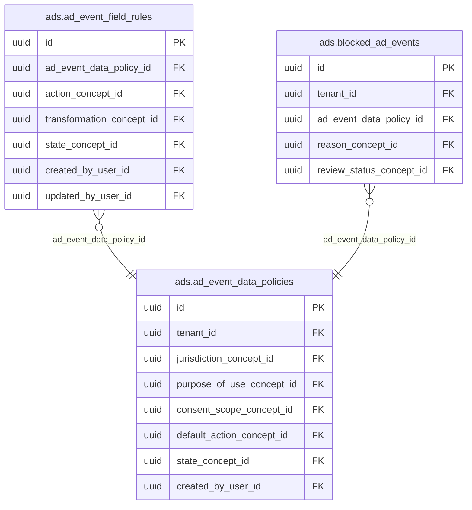

<!-- AUTOGENERADO por tools/inventario/catalogo.mjs. No editar manualmente. -->

# Catálogo del schema `ads`

- **Tablas:** 73 · **Columnas:** 1000 (235 con descripción: 23.5 %) · **Índices:** 497
- **Dominio:** Marketing y Crecimiento
- Método y límites del catálogo: [README del inventario](../README.md)

## Tablas

| Tabla | Propósito | Columnas | Índices | Operaciones | ORM |
|---|---|---|---|---|---|
| [ad_account_users](#ad_account_users) | Asocia usuarios con cuentas publicitarias para administrar acceso y responsabilidades. | 12 | 7 | 2 | COINCIDE |
| [ad_accounts](#ad_accounts) | Registra cuentas publicitarias conectadas y su titular para integrar campañas del operador. | 16 | 9 | 11 | COINCIDE |
| [ad_billing_events](#ad_billing_events) | Registra cargos y eventos financieros reportados por plataformas publicitarias. | 11 | 5 | 2 | COINCIDE |
| [ad_creatives](#ad_creatives) | Cataloga piezas creativas usadas por anuncios, separando contenido promocional de registros clínicos. | 16 | 8 | 1 | COINCIDE |
| [ad_event_data_policies](#ad_event_data_policies) | Define políticas de uso y retención de eventos publicitarios para gobernar información intercambiada. | 16 | 10 | 3 | COINCIDE |
| [ad_event_field_rules](#ad_event_field_rules) | Regula qué campos pueden incluirse en eventos publicitarios para limitar exposición de datos. | 13 | 7 | 2 | COINCIDE |
| [ad_experiments](#ad_experiments) | Representa experimentos controlados de publicidad para comparar configuraciones y resultados. | 17 | 8 | 2 | COINCIDE |
| [ad_identity_asset_assignments](#ad_identity_asset_assignments) | Asocia activos de identidad de marca con cuentas o campañas para controlar su uso. | 12 | 7 | 3 | COINCIDE |
| [ad_identity_assets](#ad_identity_assets) | Cataloga identidades o activos de marca disponibles para campañas de una organización. | 15 | 9 | 4 | COINCIDE |
| [ad_invoice_lines](#ad_invoice_lines) | Detalla conceptos facturados por plataformas para analizar cargos publicitarios. | 12 | 4 | 1 | COINCIDE |
| [ad_invoices](#ad_invoices) | Conserva facturas de plataformas publicitarias para conciliar gasto y documentación financiera. | 17 | 7 | 2 | COINCIDE |
| [ad_partners](#ad_partners) | Cataloga socios publicitarios que pueden operar campañas o cuentas en nombre de tenants. | 12 | 7 | 2 | COINCIDE |
| [ad_placements](#ad_placements) | Cataloga ubicaciones donde pueden mostrarse anuncios para controlar canal y formato de entrega. | 11 | 6 | 1 | COINCIDE |
| [ad_platform_connections](#ad_platform_connections) | Configura conexiones con plataformas publicitarias para sincronizar cuentas, campañas y métricas. | 19 | 13 | 4 | COINCIDE |
| [ad_policy_appeals](#ad_policy_appeals) | Gestiona apelaciones a infracciones o rechazos de anuncios para documentar revisión de plataformas. | 15 | 7 | 2 | COINCIDE |
| [ad_policy_violations](#ad_policy_violations) | Registra infracciones de políticas publicitarias identificadas sobre campañas o anuncios. | 15 | 7 | 4 | COINCIDE |
| [ad_review_events](#ad_review_events) | Conserva revisiones y estados de aprobación de anuncios reportados por plataformas. | 9 | 5 | 2 | COINCIDE |
| [ad_sets](#ad_sets) | Organiza grupos de anuncios dentro de campañas con configuración compartida de entrega y presupuesto. | 22 | 11 | 9 | COINCIDE |
| [ad_sync_checkpoints](#ad_sync_checkpoints) | Guarda puntos de avance de sincronizaciones para reanudar procesamiento incremental sin duplicar trabajo. | 8 | 3 | 3 | COINCIDE |
| [ad_sync_runs](#ad_sync_runs) | Registra sincronizaciones de objetos de publicidad para controlar importación, actualización y fallos. | 12 | 5 | 1 | COINCIDE |
| [ads](#ads) | Representa anuncios publicables y los relaciona con su conjunto, campaña y creatividad. | 15 | 7 | 3 | COINCIDE |
| [adset_learning_snapshots](#adset_learning_snapshots) | Preserva estados de aprendizaje de conjuntos de anuncios para interpretar su optimización automatizada. | 9 | 4 | 1 | COINCIDE |
| [attribution_settings](#attribution_settings) | Configura ventanas y modelos de atribución usados para medir conversiones de campañas. | 11 | 4 | 3 | COINCIDE |
| [automated_rules](#automated_rules) | Define reglas automáticas para ajustar campañas según métricas y límites operativos. | 17 | 8 | 2 | COINCIDE |
| [blocked_ad_events](#blocked_ad_events) | Conserva eventos bloqueados por políticas para auditar por qué no se enviaron a plataformas. | 11 | 6 | 1 | COINCIDE |
| [brand_lift_studies](#brand_lift_studies) | Agrupa estudios de recordación o percepción para evaluar efectos agregados de campañas. | 16 | 7 | 0 | COINCIDE |
| [budget_schedules](#budget_schedules) | Programa presupuestos publicitarios por período para controlar ritmo y límites de inversión. | 14 | 7 | 2 | COINCIDE |
| [business_managers](#business_managers) | Representa organizaciones que administran cuentas y campañas publicitarias vinculadas al ecosistema médico. | 13 | 10 | 4 | COINCIDE |
| [campaigns](#campaigns) | Representa campañas publicitarias que agrupan objetivos, presupuesto y períodos de difusión. | 20 | 9 | 7 | COINCIDE |
| [catalog_feeds](#catalog_feeds) | Registra feeds de productos sincronizados con plataformas publicitarias para publicar inventario comercial. | 17 | 8 | 2 | COINCIDE |
| [catalog_products](#catalog_products) | Cataloga productos incluidos en feeds para asociarlos con creatividades y campañas. | 25 | 9 | 3 | COINCIDE |
| [collection_ads](#collection_ads) | Representa anuncios que muestran colecciones de productos dentro de formatos compatibles. | 13 | 8 | 0 | COINCIDE |
| [conversion_attributions](#conversion_attributions) | Vincula conversiones con campañas o canales para analizar qué interacciones contribuyeron al resultado. | 10 | 5 | 0 | COINCIDE |
| [conversion_datasets](#conversion_datasets) | Define conjuntos de datos aprobados para procesar conversiones publicitarias con linaje y política. | 15 | 12 | 1 | COINCIDE |
| [conversion_event_custom_data](#conversion_event_custom_data) | Conserva atributos no identificatorios de conversión para describir valor o contexto de eventos publicitarios. | 11 | 3 | 1 | COINCIDE |
| [conversion_event_deduplication](#conversion_event_deduplication) | Evita contabilizar varias veces eventos de conversión repetidos entre canales de envío. | 11 | 5 | 3 | COINCIDE |
| [conversion_event_delivery_attempts](#conversion_event_delivery_attempts) | Registra intentos de entrega de eventos de conversión para observar aceptación y reintentos de plataforma. | 12 | 6 | 1 | COINCIDE |
| [conversion_event_user_data](#conversion_event_user_data) | Almacena atributos de usuario permitidos para emparejar eventos con plataformas según controles de consentimiento. | 14 | 4 | 1 | COINCIDE |
| [creative_assets](#creative_assets) | Vincula imágenes, videos u otros recursos con creatividades publicitarias. | 15 | 5 | 1 | COINCIDE |
| [custom_audiences](#custom_audiences) | Define audiencias publicitarias permitidas bajo políticas de consentimiento y uso de datos. | 18 | 10 | 1 | COINCIDE |
| [custom_conversions](#custom_conversions) | Cataloga definiciones de conversión personalizadas usadas para medir resultados de campañas. | 14 | 8 | 0 | COINCIDE |
| [dataset_connections](#dataset_connections) | Vincula datasets con plataformas o destinos de conversión autorizados. | 13 | 10 | 0 | COINCIDE |
| [dataset_quality_snapshots](#dataset_quality_snapshots) | Preserva métricas de calidad de datasets publicitarios antes de su uso o intercambio. | 10 | 3 | 0 | COINCIDE |
| [delivery_status_snapshots](#delivery_status_snapshots) | Preserva estados de entrega reportados por plataformas para comparar distribución y disponibilidad de anuncios. | 10 | 6 | 2 | COINCIDE |
| [dynamic_ad_templates](#dynamic_ad_templates) | Define plantillas que generan anuncios dinámicos a partir de productos y atributos permitidos. | 16 | 9 | 0 | COINCIDE |
| [experiment_variants](#experiment_variants) | Define variantes de campañas o creatividades incluidas en un experimento publicitario. | 13 | 4 | 1 | COINCIDE |
| [external_ad_object_snapshots](#external_ad_object_snapshots) | Preserva snapshots de objetos externos sincronizados para comparar cambios en plataformas publicitarias. | 9 | 5 | 0 | COINCIDE |
| [feed_run_logs](#feed_run_logs) | Traza ejecuciones de importación o publicación de feeds para detectar fallos y discrepancias. | 11 | 4 | 1 | COINCIDE |
| [frequency_caps](#frequency_caps) | Configura límites de frecuencia para evitar exposición excesiva de usuarios a anuncios. | 11 | 4 | 0 | COINCIDE |
| [insight_breakdown_definitions](#insight_breakdown_definitions) | Cataloga dimensiones por las que pueden desglosarse métricas de campañas. | 12 | 5 | 0 | COINCIDE |
| [insight_fact_rows](#insight_fact_rows) | Almacena filas de hechos recuperados para analizar rendimiento de anuncios por período y dimensión. | 11 | 8 | 1 | COINCIDE |
| [insight_metric_definitions](#insight_metric_definitions) | Define métricas disponibles para consultas de rendimiento publicitario. | 14 | 7 | 0 | COINCIDE |
| [insight_query_runs](#insight_query_runs) | Registra consultas ejecutadas contra plataformas para recuperar métricas publicitarias. | 16 | 8 | 2 | COINCIDE |
| [insights_daily](#insights_daily) | Conserva métricas publicitarias agregadas por día para analizar inversión, alcance y resultados. | 22 | 6 | 4 | COINCIDE |
| [lead_answers](#lead_answers) | Conserva respuestas individuales de prospectos a formularios de campaña. | 7 | 3 | 1 | COINCIDE |
| [lead_delivery_events](#lead_delivery_events) | Traza entregas de leads a sistemas internos o socios para confirmar recepción y procesamiento. | 10 | 5 | 2 | COINCIDE |
| [lead_form_questions](#lead_form_questions) | Cataloga preguntas que componen formularios publicitarios de captación. | 14 | 6 | 1 | COINCIDE |
| [lead_forms](#lead_forms) | Define formularios de generación de prospectos para campañas y sus requisitos de captura. | 17 | 12 | 1 | COINCIDE |
| [lead_submissions](#lead_submissions) | Registra envíos de formularios para crear prospectos y gestionar solicitudes recibidas. | 14 | 13 | 2 | COINCIDE |
| [lookalike_specs](#lookalike_specs) | Configura especificaciones de audiencias similares sobre fuentes expresamente permitidas. | 13 | 8 | 1 | COINCIDE |
| [offline_conversion_events](#offline_conversion_events) | Registra eventos de conversión externos que pueden vincularse a campañas bajo políticas de datos. | 12 | 4 | 1 | COINCIDE |
| [offline_conversion_sets](#offline_conversion_sets) | Agrupa conversiones fuera de línea autorizadas para conciliarlas con campañas publicitarias. | 16 | 7 | 2 | COINCIDE |
| [partner_relationships](#partner_relationships) | Relaciona socios publicitarios con negocios para controlar delegación y alcance de operación. | 14 | 6 | 3 | COINCIDE |
| [pixel_events](#pixel_events) | Registra eventos recibidos por píxeles para medir actividad publicitaria autorizada. | 15 | 6 | 0 | COINCIDE |
| [product_catalogs](#product_catalogs) | Representa catálogos de productos promovidos mediante formatos de comercio publicitario. | 13 | 7 | 2 | COINCIDE |
| [product_localizations](#product_localizations) | Conserva nombres y descripciones localizadas de productos para anuncios dirigidos por mercado o idioma. | 13 | 7 | 0 | COINCIDE |
| [product_set_members](#product_set_members) | Relaciona productos con conjuntos para definir el contenido de colecciones de catálogo. | 9 | 4 | 2 | COINCIDE |
| [product_sets](#product_sets) | Agrupa productos para crear colecciones promocionales reutilizables. | 13 | 5 | 2 | COINCIDE |
| [rule_executions](#rule_executions) | Registra ejecuciones de reglas publicitarias para auditar acciones automáticas y resultados. | 10 | 4 | 1 | COINCIDE |
| [saved_audiences](#saved_audiences) | Guarda definiciones reutilizables de audiencias para campañas que cumplen políticas de segmentación. | 11 | 5 | 0 | COINCIDE |
| [server_conversion_events](#server_conversion_events) | Conserva eventos de conversión enviados desde servicios internos para medir campañas sin depender solo de navegador. | 18 | 15 | 1 | COINCIDE |
| [targeting_specs](#targeting_specs) | Conserva criterios de segmentación de anuncios sin autorizar el uso de datos clínicos protegidos. | 20 | 4 | 2 | COINCIDE |
| [tracking_pixels](#tracking_pixels) | Registra píxeles de seguimiento asociados a campañas para medir eventos permitidos de navegación o conversión. | 12 | 7 | 0 | COINCIDE |

## Diagrama entidad-relación

Las tablas se agrupan en familias por sus claves foráneas dentro del schema (máximo 40 por diagrama). Las FK hacia otros schemas se listan en la ficha de cada tabla.

### Familia 1 de 3 — 40 tablas

```mermaid
erDiagram
  ads_ad_account_users["ads.ad_account_users"] {
    uuid id PK
    uuid ad_account_id FK
    uuid user_id FK
    uuid partner_id FK
    uuid role_concept_id FK
    uuid status_concept_id FK
    uuid created_by_user_id FK
    uuid updated_by_user_id FK
  }
  ads_ad_accounts["ads.ad_accounts"] {
    uuid id PK
    uuid business_manager_id FK
    uuid currency_concept_id FK
    uuid account_status_concept_id FK
    uuid funding_payment_method_id FK
    uuid disable_reason_concept_id FK
    uuid created_by_user_id FK
    uuid updated_by_user_id FK
  }
  ads_ad_partners["ads.ad_partners"] {
    uuid id PK
    uuid partner_type_concept_id FK
    uuid tenant_id FK
    uuid state_concept_id FK
    uuid created_by_user_id FK
    uuid updated_by_user_id FK
  }
  ads_ad_billing_events["ads.ad_billing_events"] {
    uuid id PK
    uuid ad_account_id FK
    uuid billing_event_type_concept_id FK
    uuid currency_concept_id FK
    uuid recorded_by_user_id FK
  }
  ads_ad_creatives["ads.ad_creatives"] {
    uuid id PK
    uuid ad_account_id FK
    uuid format_concept_id FK
    uuid call_to_action_concept_id FK
    uuid primary_media_file_id FK
    uuid status_concept_id FK
    uuid created_by_user_id FK
    uuid updated_by_user_id FK
  }
  ads_ad_experiments["ads.ad_experiments"] {
    uuid id PK
    uuid ad_account_id FK
    uuid experiment_type_concept_id FK
    uuid objective_metric_concept_id FK
    uuid status_concept_id FK
    uuid winner_variant_id FK
    uuid created_by_user_id FK
    uuid updated_by_user_id FK
  }
  ads_ad_invoices["ads.ad_invoices"] {
    uuid id PK
    uuid ad_account_id FK
    uuid currency_concept_id FK
    uuid status_concept_id FK
    uuid payment_intent_id FK
    uuid created_by_user_id FK
    uuid updated_by_user_id FK
  }
  ads_ad_platform_connections["ads.ad_platform_connections"] {
    uuid id PK
    uuid tenant_id FK
    uuid business_manager_id FK
    uuid ad_account_id FK
    uuid platform_concept_id FK
    uuid credential_id FK
    uuid webhook_verification_secret_id FK
    uuid status_concept_id FK
  }
  ads_attribution_settings["ads.attribution_settings"] {
    uuid id PK
    uuid ad_account_id FK
    uuid attribution_model_concept_id FK
    uuid created_by_user_id FK
    uuid updated_by_user_id FK
  }
  ads_automated_rules["ads.automated_rules"] {
    uuid id PK
    uuid ad_account_id FK
    uuid scope_concept_id FK
    uuid action_concept_id FK
    uuid evaluation_schedule_concept_id FK
    uuid state_concept_id FK
    uuid created_by_user_id FK
    uuid updated_by_user_id FK
  }
  ads_brand_lift_studies["ads.brand_lift_studies"] {
    uuid id PK
    uuid ad_account_id FK
    uuid campaign_id FK
    uuid metric_concept_id FK
    uuid status_concept_id FK
    uuid created_by_user_id FK
    uuid updated_by_user_id FK
  }
  ads_business_managers["ads.business_managers"] {
    uuid id PK
    uuid tenant_id FK
    uuid owner_user_id FK
    uuid vertical_concept_id FK
    uuid primary_country_concept_id FK
    uuid state_concept_id FK
    uuid created_by_user_id FK
    uuid updated_by_user_id FK
  }
  ads_campaigns["ads.campaigns"] {
    uuid id PK
    uuid ad_account_id FK
    uuid objective_concept_id FK
    uuid buying_type_concept_id FK
    uuid bid_strategy_concept_id FK
    uuid status_concept_id FK
    uuid effective_status_concept_id FK
    uuid created_by_user_id FK
  }
  ads_collection_ads["ads.collection_ads"] {
    uuid id PK
    uuid ad_account_id FK
    uuid layout_concept_id FK
    uuid hero_creative_id FK
    uuid product_set_id FK
    uuid status_concept_id FK
    uuid created_by_user_id FK
    uuid updated_by_user_id FK
  }
  ads_conversion_datasets["ads.conversion_datasets"] {
    uuid id PK
    uuid tenant_id FK
    uuid ad_account_id FK
    uuid dataset_type_concept_id FK
    uuid data_use_case_concept_id FK
    uuid default_attribution_setting_id FK
    uuid status_concept_id FK
    uuid created_by_user_id FK
  }
  ads_custom_audiences["ads.custom_audiences"] {
    uuid id PK
    uuid ad_account_id FK
    uuid audience_type_concept_id FK
    uuid subtype_concept_id FK
    uuid source_concept_id FK
    uuid lookalike_source_audience_id FK
    uuid data_source_pixel_id FK
    uuid status_concept_id FK
  }
  ads_custom_conversions["ads.custom_conversions"] {
    uuid id PK
    uuid ad_account_id FK
    uuid pixel_id FK
    uuid conversion_category_concept_id FK
    uuid currency_concept_id FK
    uuid status_concept_id FK
    uuid created_by_user_id FK
    uuid updated_by_user_id FK
  }
  ads_delivery_status_snapshots["ads.delivery_status_snapshots"] {
    uuid id PK
    uuid ad_account_id FK
    uuid entity_type_concept_id FK
    uuid effective_status_concept_id FK
    uuid review_status_concept_id FK
    uuid recorded_by_user_id FK
  }
  ads_dynamic_ad_templates["ads.dynamic_ad_templates"] {
    uuid id PK
    uuid ad_account_id FK
    uuid product_set_id FK
    uuid format_concept_id FK
    uuid call_to_action_concept_id FK
    uuid creative_id FK
    uuid status_concept_id FK
    uuid created_by_user_id FK
  }
  ads_insight_query_runs["ads.insight_query_runs"] {
    uuid id PK
    uuid tenant_id FK
    uuid ad_account_id FK
    uuid platform_connection_id FK
    uuid object_level_concept_id FK
    uuid status_concept_id FK
  }
  ads_insights_daily["ads.insights_daily"] {
    uuid id PK
    uuid ad_account_id FK
    uuid entity_type_concept_id FK
    uuid currency_concept_id FK
    uuid source_concept_id FK
    uuid recorded_by_user_id FK
  }
  ads_lead_forms["ads.lead_forms"] {
    uuid id PK
    uuid tenant_id FK
    uuid ad_account_id FK
    uuid ad_identity_asset_id FK
    uuid form_type_concept_id FK
    uuid destination_crm_pipeline_id FK
    uuid status_concept_id FK
    uuid created_by_user_id FK
  }
  ads_lookalike_specs["ads.lookalike_specs"] {
    uuid id PK
    uuid ad_account_id FK
    uuid source_audience_id FK
    uuid country_concept_id FK
    uuid similarity_concept_id FK
    uuid generated_audience_id FK
    uuid status_concept_id FK
    uuid created_by_user_id FK
  }
  ads_offline_conversion_sets["ads.offline_conversion_sets"] {
    uuid id PK
    uuid ad_account_id FK
    uuid upload_source_concept_id FK
    uuid file_id FK
    uuid status_concept_id FK
    uuid created_by_user_id FK
    uuid updated_by_user_id FK
  }
  ads_saved_audiences["ads.saved_audiences"] {
    uuid id PK
    uuid ad_account_id FK
    uuid status_concept_id FK
    uuid created_by_user_id FK
    uuid updated_by_user_id FK
  }
  ads_targeting_specs["ads.targeting_specs"] {
    uuid id PK
    uuid ad_account_id FK
    uuid created_by_user_id FK
    uuid updated_by_user_id FK
  }
  ads_tracking_pixels["ads.tracking_pixels"] {
    uuid id PK
    uuid business_manager_id FK
    uuid ad_account_id FK
    uuid state_concept_id FK
    uuid created_by_user_id FK
    uuid updated_by_user_id FK
  }
  ads_partner_relationships["ads.partner_relationships"] {
    uuid id PK
    uuid business_manager_id FK
    uuid partner_id FK
    uuid relationship_type_concept_id FK
    uuid status_concept_id FK
    uuid created_by_user_id FK
    uuid updated_by_user_id FK
  }
  ads_ads["ads.ads"] {
    uuid id PK
    uuid ad_set_id FK
    uuid creative_id FK
    uuid status_concept_id FK
    uuid effective_status_concept_id FK
    uuid created_by_user_id FK
    uuid updated_by_user_id FK
  }
  ads_creative_assets["ads.creative_assets"] {
    uuid id PK
    uuid ad_creative_id FK
    uuid asset_type_concept_id FK
    uuid file_id FK
    uuid created_by_user_id FK
    uuid updated_by_user_id FK
  }
  ads_experiment_variants["ads.experiment_variants"] {
    uuid id PK
    uuid ad_experiment_id FK
    uuid created_by_user_id FK
    uuid updated_by_user_id FK
  }
  ads_ad_invoice_lines["ads.ad_invoice_lines"] {
    uuid id PK
    uuid ad_invoice_id FK
    uuid created_by_user_id FK
    uuid updated_by_user_id FK
  }
  ads_ad_identity_assets["ads.ad_identity_assets"] {
    uuid id PK
    uuid tenant_id FK
    uuid platform_connection_id FK
    uuid identity_type_concept_id FK
    uuid status_concept_id FK
    uuid created_by_user_id FK
    uuid updated_by_user_id FK
  }
  ads_ad_sync_checkpoints["ads.ad_sync_checkpoints"] {
    uuid id PK
    uuid platform_connection_id FK
    uuid object_type_concept_id FK
  }
  ads_ad_sync_runs["ads.ad_sync_runs"] {
    uuid id PK
    uuid platform_connection_id FK
    uuid sync_direction_concept_id FK
    uuid object_type_concept_id FK
    uuid status_concept_id FK
  }
  ads_conversion_event_delivery_attempts["ads.conversion_event_delivery_attempts"] {
    uuid id PK
    uuid server_conversion_event_id FK
    uuid platform_connection_id FK
    uuid result_concept_id FK
  }
  ads_dataset_connections["ads.dataset_connections"] {
    uuid id PK
    uuid conversion_dataset_id FK
    uuid platform_connection_id FK
    uuid tracking_pixel_id FK
    uuid connection_type_concept_id FK
    uuid test_event_code_secret_id FK
    uuid status_concept_id FK
    uuid created_by_user_id FK
  }
  ads_external_ad_object_snapshots["ads.external_ad_object_snapshots"] {
    uuid id PK
    uuid platform_connection_id FK
    uuid object_type_concept_id FK
  }
  ads_rule_executions["ads.rule_executions"] {
    uuid id PK
    uuid automated_rule_id FK
    uuid status_concept_id FK
    uuid recorded_by_user_id FK
  }
  ads_product_catalogs["ads.product_catalogs"] {
    uuid id PK
    uuid business_manager_id FK
    uuid vertical_concept_id FK
    uuid default_currency_concept_id FK
    uuid state_concept_id FK
    uuid created_by_user_id FK
    uuid updated_by_user_id FK
  }
  ads_ad_sets["ads.ad_sets"]
  ads_product_sets["ads.product_sets"]
  ads_server_conversion_events["ads.server_conversion_events"]
  ads_ad_account_users }o--|| ads_ad_accounts : "ad_account_id"
  ads_ad_account_users }o--o| ads_ad_partners : "partner_id"
  ads_ad_accounts }o--|| ads_business_managers : "business_manager_id"
  ads_ad_billing_events }o--|| ads_ad_accounts : "ad_account_id"
  ads_ad_creatives }o--|| ads_ad_accounts : "ad_account_id"
  ads_ad_experiments }o--|| ads_ad_accounts : "ad_account_id"
  ads_ad_experiments }o--o| ads_experiment_variants : "winner_variant_id"
  ads_ad_invoices }o--|| ads_ad_accounts : "ad_account_id"
  ads_ad_platform_connections }o--|| ads_business_managers : "business_manager_id"
  ads_ad_platform_connections }o--o| ads_ad_accounts : "ad_account_id"
  ads_attribution_settings }o--|| ads_ad_accounts : "ad_account_id"
  ads_automated_rules }o--|| ads_ad_accounts : "ad_account_id"
  ads_brand_lift_studies }o--|| ads_ad_accounts : "ad_account_id"
  ads_brand_lift_studies }o--|| ads_campaigns : "campaign_id"
  ads_campaigns }o--|| ads_ad_accounts : "ad_account_id"
  ads_collection_ads }o--|| ads_ad_accounts : "ad_account_id"
  ads_collection_ads }o--o| ads_ad_creatives : "hero_creative_id"
  ads_collection_ads }o--o| ads_product_sets : "product_set_id"
  ads_conversion_datasets }o--|| ads_ad_accounts : "ad_account_id"
  ads_conversion_datasets }o--o| ads_attribution_settings : "default_attribution_setting_id"
  ads_custom_audiences }o--|| ads_ad_accounts : "ad_account_id"
  ads_custom_audiences }o--o| ads_tracking_pixels : "data_source_pixel_id"
  ads_custom_conversions }o--|| ads_ad_accounts : "ad_account_id"
  ads_custom_conversions }o--o| ads_tracking_pixels : "pixel_id"
  ads_delivery_status_snapshots }o--|| ads_ad_accounts : "ad_account_id"
  ads_dynamic_ad_templates }o--|| ads_ad_accounts : "ad_account_id"
  ads_dynamic_ad_templates }o--|| ads_product_sets : "product_set_id"
  ads_dynamic_ad_templates }o--o| ads_ad_creatives : "creative_id"
  ads_insight_query_runs }o--|| ads_ad_accounts : "ad_account_id"
  ads_insight_query_runs }o--|| ads_ad_platform_connections : "platform_connection_id"
  ads_insights_daily }o--|| ads_ad_accounts : "ad_account_id"
  ads_lead_forms }o--|| ads_ad_accounts : "ad_account_id"
  ads_lead_forms }o--o| ads_ad_identity_assets : "ad_identity_asset_id"
  ads_lookalike_specs }o--|| ads_ad_accounts : "ad_account_id"
  ads_lookalike_specs }o--|| ads_custom_audiences : "source_audience_id"
  ads_lookalike_specs }o--o| ads_custom_audiences : "generated_audience_id"
  ads_offline_conversion_sets }o--|| ads_ad_accounts : "ad_account_id"
  ads_saved_audiences }o--|| ads_ad_accounts : "ad_account_id"
  ads_targeting_specs }o--|| ads_ad_accounts : "ad_account_id"
  ads_tracking_pixels }o--|| ads_business_managers : "business_manager_id"
  ads_tracking_pixels }o--o| ads_ad_accounts : "ad_account_id"
  ads_partner_relationships }o--|| ads_business_managers : "business_manager_id"
  ads_partner_relationships }o--|| ads_ad_partners : "partner_id"
  ads_ads }o--|| ads_ad_sets : "ad_set_id"
  ads_ads }o--|| ads_ad_creatives : "creative_id"
  ads_creative_assets }o--|| ads_ad_creatives : "ad_creative_id"
  ads_experiment_variants }o--|| ads_ad_experiments : "ad_experiment_id"
  ads_ad_invoice_lines }o--|| ads_ad_invoices : "ad_invoice_id"
  ads_ad_identity_assets }o--|| ads_ad_platform_connections : "platform_connection_id"
  ads_ad_sync_checkpoints }o--|| ads_ad_platform_connections : "platform_connection_id"
  ads_ad_sync_runs }o--|| ads_ad_platform_connections : "platform_connection_id"
  ads_conversion_event_delivery_attempts }o--|| ads_server_conversion_events : "server_conversion_event_id"
  ads_conversion_event_delivery_attempts }o--|| ads_ad_platform_connections : "platform_connection_id"
  ads_dataset_connections }o--|| ads_conversion_datasets : "conversion_dataset_id"
  ads_dataset_connections }o--|| ads_ad_platform_connections : "platform_connection_id"
  ads_dataset_connections }o--o| ads_tracking_pixels : "tracking_pixel_id"
  ads_external_ad_object_snapshots }o--|| ads_ad_platform_connections : "platform_connection_id"
  ads_rule_executions }o--|| ads_automated_rules : "automated_rule_id"
  ads_product_catalogs }o--|| ads_business_managers : "business_manager_id"
```

### Familia 2 de 3 — 26 tablas

```mermaid
erDiagram
  ads_ad_sets["ads.ad_sets"] {
    uuid id PK
    uuid campaign_id FK
    uuid optimization_goal_concept_id FK
    uuid billing_event_concept_id FK
    uuid bid_strategy_concept_id FK
    uuid targeting_spec_id FK
    uuid pacing_type_concept_id FK
    uuid status_concept_id FK
  }
  ads_insight_fact_rows["ads.insight_fact_rows"] {
    uuid id PK
    uuid insight_query_run_id FK
    uuid object_type_concept_id FK
    uuid campaign_id FK
    uuid ad_set_id FK
    uuid ad_id FK
  }
  ads_lead_submissions["ads.lead_submissions"] {
    uuid id PK
    uuid tenant_id FK
    uuid lead_form_id FK
    uuid ad_id FK
    uuid ad_set_id FK
    uuid campaign_id FK
    uuid crm_lead_id FK
    uuid processing_status_concept_id FK
  }
  ads_product_sets["ads.product_sets"] {
    uuid id PK
    uuid product_catalog_id FK
    uuid state_concept_id FK
    uuid created_by_user_id FK
    uuid updated_by_user_id FK
  }
  ads_conversion_event_deduplication["ads.conversion_event_deduplication"] {
    uuid id PK
    uuid conversion_dataset_id FK
    uuid server_conversion_event_id FK
    uuid resolution_concept_id FK
  }
  ads_dataset_quality_snapshots["ads.dataset_quality_snapshots"] {
    uuid id PK
    uuid conversion_dataset_id FK
    uuid status_concept_id FK
  }
  ads_server_conversion_events["ads.server_conversion_events"] {
    uuid id PK
    uuid tenant_id FK
    uuid conversion_dataset_id FK
    uuid action_source_concept_id FK
    uuid payment_transaction_id FK
    uuid crm_lead_id FK
    uuid crm_opportunity_id FK
    uuid processing_status_concept_id FK
  }
  ads_lead_form_questions["ads.lead_form_questions"] {
    uuid id PK
    uuid lead_form_id FK
    uuid question_type_concept_id FK
    uuid status_concept_id FK
    uuid created_by_user_id FK
    uuid updated_by_user_id FK
  }
  ads_offline_conversion_events["ads.offline_conversion_events"] {
    uuid id PK
    uuid offline_conversion_set_id FK
    uuid currency_concept_id FK
    uuid recorded_by_user_id FK
  }
  ads_pixel_events["ads.pixel_events"] {
    uuid id PK
    uuid pixel_id FK
    uuid event_source_concept_id FK
    uuid action_source_concept_id FK
    uuid currency_concept_id FK
    uuid recorded_by_user_id FK
  }
  ads_ad_policy_violations["ads.ad_policy_violations"] {
    uuid id PK
    uuid ad_id FK
    uuid ad_review_event_id FK
    uuid policy_category_concept_id FK
    uuid severity_concept_id FK
    uuid status_concept_id FK
    uuid created_by_user_id FK
    uuid updated_by_user_id FK
  }
  ads_ad_review_events["ads.ad_review_events"] {
    uuid id PK
    uuid ad_id FK
    uuid review_event_type_concept_id FK
    uuid review_status_concept_id FK
  }
  ads_ad_identity_asset_assignments["ads.ad_identity_asset_assignments"] {
    uuid id PK
    uuid ad_identity_asset_id FK
    uuid assignable_type_concept_id FK
    uuid assignment_role_concept_id FK
    uuid created_by_user_id FK
    uuid updated_by_user_id FK
  }
  ads_catalog_feeds["ads.catalog_feeds"] {
    uuid id PK
    uuid product_catalog_id FK
    uuid feed_source_concept_id FK
    uuid file_id FK
    uuid last_status_concept_id FK
    uuid state_concept_id FK
    uuid created_by_user_id FK
    uuid updated_by_user_id FK
  }
  ads_catalog_products["ads.catalog_products"] {
    uuid id PK
    uuid product_catalog_id FK
    uuid availability_concept_id FK
    uuid condition_concept_id FK
    uuid currency_concept_id FK
    uuid category_concept_id FK
    uuid status_concept_id FK
    uuid created_by_user_id FK
  }
  ads_ad_placements["ads.ad_placements"] {
    uuid id PK
    uuid ad_set_id FK
    uuid platform_concept_id FK
    uuid position_concept_id FK
    uuid device_concept_id FK
    uuid created_by_user_id FK
    uuid updated_by_user_id FK
  }
  ads_adset_learning_snapshots["ads.adset_learning_snapshots"] {
    uuid id PK
    uuid ad_set_id FK
    uuid learning_status_concept_id FK
    uuid limited_reason_concept_id FK
  }
  ads_lead_answers["ads.lead_answers"] {
    uuid id PK
    uuid lead_submission_id FK
    uuid lead_form_question_id FK
  }
  ads_lead_delivery_events["ads.lead_delivery_events"] {
    uuid id PK
    uuid lead_submission_id FK
    uuid destination_type_concept_id FK
    uuid result_concept_id FK
  }
  ads_product_set_members["ads.product_set_members"] {
    uuid id PK
    uuid product_set_id FK
    uuid catalog_product_id FK
    uuid created_by_user_id FK
    uuid updated_by_user_id FK
  }
  ads_conversion_event_custom_data["ads.conversion_event_custom_data"] {
    uuid id PK
    uuid server_conversion_event_id FK
  }
  ads_conversion_event_user_data["ads.conversion_event_user_data"] {
    uuid id PK
    uuid server_conversion_event_id FK
  }
  ads_conversion_attributions["ads.conversion_attributions"] {
    uuid id PK
    uuid pixel_event_id FK
    uuid attribution_type_concept_id FK
    uuid currency_concept_id FK
    uuid recorded_by_user_id FK
  }
  ads_ad_policy_appeals["ads.ad_policy_appeals"] {
    uuid id PK
    uuid ad_policy_violation_id FK
    uuid submitted_by_user_id FK
    uuid evidence_file_id FK
    uuid status_concept_id FK
    uuid created_by_user_id FK
    uuid updated_by_user_id FK
  }
  ads_feed_run_logs["ads.feed_run_logs"] {
    uuid id PK
    uuid catalog_feed_id FK
    uuid status_concept_id FK
    uuid recorded_by_user_id FK
  }
  ads_product_localizations["ads.product_localizations"] {
    uuid id PK
    uuid catalog_product_id FK
    uuid language_concept_id FK
    uuid country_concept_id FK
    uuid currency_concept_id FK
    uuid created_by_user_id FK
    uuid updated_by_user_id FK
  }
  ads_ad_identity_assets["ads.ad_identity_assets"]
  ads_ads["ads.ads"]
  ads_campaigns["ads.campaigns"]
  ads_conversion_datasets["ads.conversion_datasets"]
  ads_insight_query_runs["ads.insight_query_runs"]
  ads_lead_forms["ads.lead_forms"]
  ads_offline_conversion_sets["ads.offline_conversion_sets"]
  ads_product_catalogs["ads.product_catalogs"]
  ads_targeting_specs["ads.targeting_specs"]
  ads_tracking_pixels["ads.tracking_pixels"]
  ads_ad_sets }o--|| ads_campaigns : "campaign_id"
  ads_ad_sets }o--o| ads_targeting_specs : "targeting_spec_id"
  ads_insight_fact_rows }o--|| ads_insight_query_runs : "insight_query_run_id"
  ads_insight_fact_rows }o--o| ads_campaigns : "campaign_id"
  ads_insight_fact_rows }o--o| ads_ad_sets : "ad_set_id"
  ads_insight_fact_rows }o--o| ads_ads : "ad_id"
  ads_lead_submissions }o--|| ads_lead_forms : "lead_form_id"
  ads_lead_submissions }o--o| ads_ads : "ad_id"
  ads_lead_submissions }o--o| ads_ad_sets : "ad_set_id"
  ads_lead_submissions }o--o| ads_campaigns : "campaign_id"
  ads_product_sets }o--|| ads_product_catalogs : "product_catalog_id"
  ads_conversion_event_deduplication }o--|| ads_conversion_datasets : "conversion_dataset_id"
  ads_conversion_event_deduplication }o--o| ads_server_conversion_events : "server_conversion_event_id"
  ads_dataset_quality_snapshots }o--|| ads_conversion_datasets : "conversion_dataset_id"
  ads_server_conversion_events }o--|| ads_conversion_datasets : "conversion_dataset_id"
  ads_lead_form_questions }o--|| ads_lead_forms : "lead_form_id"
  ads_offline_conversion_events }o--|| ads_offline_conversion_sets : "offline_conversion_set_id"
  ads_pixel_events }o--|| ads_tracking_pixels : "pixel_id"
  ads_ad_policy_violations }o--|| ads_ads : "ad_id"
  ads_ad_policy_violations }o--o| ads_ad_review_events : "ad_review_event_id"
  ads_ad_review_events }o--|| ads_ads : "ad_id"
  ads_ad_identity_asset_assignments }o--|| ads_ad_identity_assets : "ad_identity_asset_id"
  ads_catalog_feeds }o--|| ads_product_catalogs : "product_catalog_id"
  ads_catalog_products }o--|| ads_product_catalogs : "product_catalog_id"
  ads_ad_placements }o--|| ads_ad_sets : "ad_set_id"
  ads_adset_learning_snapshots }o--|| ads_ad_sets : "ad_set_id"
  ads_lead_answers }o--|| ads_lead_submissions : "lead_submission_id"
  ads_lead_answers }o--|| ads_lead_form_questions : "lead_form_question_id"
  ads_lead_delivery_events }o--|| ads_lead_submissions : "lead_submission_id"
  ads_product_set_members }o--|| ads_product_sets : "product_set_id"
  ads_product_set_members }o--|| ads_catalog_products : "catalog_product_id"
  ads_conversion_event_custom_data }o--|| ads_server_conversion_events : "server_conversion_event_id"
  ads_conversion_event_user_data }o--|| ads_server_conversion_events : "server_conversion_event_id"
  ads_conversion_attributions }o--|| ads_pixel_events : "pixel_event_id"
  ads_ad_policy_appeals }o--|| ads_ad_policy_violations : "ad_policy_violation_id"
  ads_feed_run_logs }o--|| ads_catalog_feeds : "catalog_feed_id"
  ads_product_localizations }o--|| ads_catalog_products : "catalog_product_id"
```

### Familia 3 de 3 — 3 tablas

### Tablas sin relaciones dentro del schema

`ads.budget_schedules` · `ads.frequency_caps` · `ads.insight_breakdown_definitions` · `ads.insight_metric_definitions`

## Fichas

### ad_account_users

#### Vista general

Asocia usuarios con cuentas publicitarias para administrar acceso y responsabilidades.

- **Estado del propósito:** DOMAIN_CURATED_DRAFT · fuente: `Mantra Core Health Context/modules/diagram_43_ads.puml: ad_account_users`
- **Dominio:** Marketing y Crecimiento · **Diagrama:** `Mantra Core Health Context/modules/diagram_43_ads.puml` · **DDL:** `SQL/43_ads/02_tables.sql`
- **Entidad del ORM:** `AdAccountUsers` — `src/modules/ads/entities/ad_account_users.entity.ts`
- **Resumen:** 12 columnas · 7 índices · 7 FK salientes · 0 entrantes · 2 operaciones

#### Columnas

| # | Columna | Tipo | Rol estructural | Descripción | ORM |
|---|---|---|---|---|---|
| 1 | `id` | `uuid` | Clave primaria; Obligatoria | Identificador único de la instancia. _(JSDOC_ESTANDAR, `src/modules/ads/entities/ad_account_users.entity.ts:12`)_ | coincide |
| 2 | `ad_account_id` | `uuid` | Clave foránea → ads.ad_accounts.id; Obligatoria | _sin dato_ | coincide |
| 3 | `user_id` | `uuid` | Clave foránea → iam.users.id; Opcional | _sin dato_ | coincide |
| 4 | `partner_id` | `uuid` | Clave foránea → ads.ad_partners.id; Opcional | _sin dato_ | coincide |
| 5 | `role_concept_id` | `uuid` | Clave foránea → terminology.catalog_concepts.id; Obligatoria | _sin dato_ | coincide |
| 6 | `tasks_json` | `jsonb` | Opcional | _sin dato_ | coincide |
| 7 | `status_concept_id` | `uuid` | Clave foránea → terminology.catalog_concepts.id; Obligatoria | _sin dato_ | coincide |
| 8 | `created_at` | `timestamptz` | Obligatoria | Fecha y hora en que se creó el registro. _(JSDOC_ESTANDAR, `src/modules/ads/entities/ad_account_users.entity.ts:59`)_ | coincide |
| 9 | `updated_at` | `timestamptz` | Obligatoria | Fecha y hora de la última actualización. _(JSDOC_ESTANDAR, `src/modules/ads/entities/ad_account_users.entity.ts:65`)_ | coincide |
| 10 | `created_by_user_id` | `uuid` | Clave foránea → iam.users.id; Opcional | _sin dato_ | coincide |
| 11 | `updated_by_user_id` | `uuid` | Clave foránea → iam.users.id; Opcional | _sin dato_ | coincide |
| 12 | `row_version` | `integer = 1` | Obligatoria | Versión usada para controlar actualizaciones concurrentes. _(JSDOC_ENTIDAD, `src/modules/ads/entities/ad_account_users.entity.ts:83`)_ | coincide |

#### Relaciones

| Sentido | Columnas | Tabla | Restricción |
|---|---|---|---|
| hacia | ad_account_id | ads.ad_accounts (id) | fk_ad_account_users_ad_account_id |
| hacia | partner_id | ads.ad_partners (id) | fk_ad_account_users_partner_id |
| hacia | user_id | iam.users (id) | fk_ad_account_users_user_id |
| hacia | role_concept_id | terminology.catalog_concepts (id) | fk_ad_account_users_role_concept_id |
| hacia | status_concept_id | terminology.catalog_concepts (id) | fk_ad_account_users_status_concept_id |
| hacia | created_by_user_id | iam.users (id) | fk_ad_account_users_created_by_user_id |
| hacia | updated_by_user_id | iam.users (id) | fk_ad_account_users_updated_by_user_id |

#### Índices

| Índice | Único | Columnas | Para qué |
|---|---|---|---|
| `ix_ad_account_users_ad_account_id` | no | ad_account_id | Soporta la clave foránea fk_ad_account_users_ad_account_id: PostgreSQL no indexa las FK por sí mismo _(DOCUMENTO)_ |
| `ix_ad_account_users_user_id` | no | user_id | Soporta la clave foránea fk_ad_account_users_user_id: PostgreSQL no indexa las FK por sí mismo _(DOCUMENTO)_ |
| `ix_ad_account_users_partner_id` | no | partner_id | Soporta la clave foránea fk_ad_account_users_partner_id: PostgreSQL no indexa las FK por sí mismo _(DOCUMENTO)_ |
| `ix_ad_account_users_role_concept_id` | no | role_concept_id | Soporta la clave foránea fk_ad_account_users_role_concept_id: PostgreSQL no indexa las FK por sí mismo _(DOCUMENTO)_ |
| `ix_ad_account_users_status_concept_id` | no | status_concept_id | Soporta la clave foránea fk_ad_account_users_status_concept_id: PostgreSQL no indexa las FK por sí mismo _(DOCUMENTO)_ |
| `ix_ad_account_users_created_by_user_id` | no | created_by_user_id | Soporta la clave foránea fk_ad_account_users_created_by_user_id: PostgreSQL no indexa las FK por sí mismo _(DOCUMENTO)_ |
| `ix_ad_account_users_updated_by_user_id` | no | updated_by_user_id | Soporta la clave foránea fk_ad_account_users_updated_by_user_id: PostgreSQL no indexa las FK por sí mismo _(DOCUMENTO)_ |

#### Operaciones que la tocan

| Operación | Efecto | Confianza |
|---|---|---|
| POST /ads/business-managers/{bmId}/ad-accounts | CREA | DIRECTA |
| POST /ads/business-managers/{bmId}/partners | CREA | DIRECTA |

#### Gobierno

| Atributo | Valor | Fuente |
|---|---|---|
| Append-only | no declarado | — |
| Datos personales | sin fuente | — |
| Financiera | sin fuente | — |
| Crítica para auditoría | sin fuente | — |
| Retención | sin fuente | — |
| Responsable | sin fuente | — |
| Revisión | AUTO_DETECTADA | — |

---

### ad_accounts

#### Vista general

Registra cuentas publicitarias conectadas y su titular para integrar campañas del operador.

- **Estado del propósito:** DOMAIN_CURATED_DRAFT · fuente: `Mantra Core Health Context/modules/diagram_43_ads.puml: ad_accounts`
- **Dominio:** Marketing y Crecimiento · **Diagrama:** `Mantra Core Health Context/modules/diagram_43_ads.puml` · **DDL:** `SQL/43_ads/02_tables.sql`
- **Entidad del ORM:** `AdAccounts` — `src/modules/ads/entities/ad_accounts.entity.ts`
- **Resumen:** 16 columnas · 9 índices · 7 FK salientes · 25 entrantes · 11 operaciones

#### Columnas

| # | Columna | Tipo | Rol estructural | Descripción | ORM |
|---|---|---|---|---|---|
| 1 | `id` | `uuid` | Clave primaria; Obligatoria | Identificador único de la instancia. _(JSDOC_ESTANDAR, `src/modules/ads/entities/ad_accounts.entity.ts:12`)_ | coincide |
| 2 | `business_manager_id` | `uuid` | Clave foránea → ads.business_managers.id; Obligatoria | _sin dato_ | coincide |
| 3 | `name` | `varchar` | Obligatoria | _sin dato_ | coincide |
| 4 | `external_account_ref` | `varchar` | Obligatoria | _sin dato_ | coincide |
| 5 | `currency_concept_id` | `uuid` | Clave foránea → terminology.catalog_concepts.id; Obligatoria | _sin dato_ | coincide |
| 6 | `time_zone` | `varchar` | Opcional | _sin dato_ | coincide |
| 7 | `account_status_concept_id` | `uuid` | Clave foránea → terminology.catalog_concepts.id; Obligatoria | _sin dato_ | coincide |
| 8 | `spend_cap_amount` | `numeric` | Opcional | _sin dato_ | coincide |
| 9 | `amount_spent` | `numeric` | Opcional | _sin dato_ | coincide |
| 10 | `funding_payment_method_id` | `uuid` | Clave foránea → payments.payment_methods.id; Opcional | _sin dato_ | coincide |
| 11 | `disable_reason_concept_id` | `uuid` | Clave foránea → terminology.catalog_concepts.id; Opcional | _sin dato_ | coincide |
| 12 | `created_at` | `timestamptz` | Obligatoria | Fecha y hora en que se creó el registro. _(JSDOC_ESTANDAR, `src/modules/ads/entities/ad_accounts.entity.ts:94`)_ | coincide |
| 13 | `updated_at` | `timestamptz` | Obligatoria | Fecha y hora de la última actualización. _(JSDOC_ESTANDAR, `src/modules/ads/entities/ad_accounts.entity.ts:100`)_ | coincide |
| 14 | `created_by_user_id` | `uuid` | Clave foránea → iam.users.id; Opcional | _sin dato_ | coincide |
| 15 | `updated_by_user_id` | `uuid` | Clave foránea → iam.users.id; Opcional | _sin dato_ | coincide |
| 16 | `row_version` | `integer = 1` | Obligatoria | Versión usada para controlar actualizaciones concurrentes. _(JSDOC_ENTIDAD, `src/modules/ads/entities/ad_accounts.entity.ts:118`)_ | coincide |

#### Relaciones

| Sentido | Columnas | Tabla | Restricción |
|---|---|---|---|
| hacia | business_manager_id | ads.business_managers (id) | fk_ad_accounts_business_manager_id |
| hacia | currency_concept_id | terminology.catalog_concepts (id) | fk_ad_accounts_currency_concept_id |
| hacia | account_status_concept_id | terminology.catalog_concepts (id) | fk_ad_accounts_account_status_concept_id |
| hacia | funding_payment_method_id | payments.payment_methods (id) | fk_ad_accounts_funding_payment_method_id |
| hacia | disable_reason_concept_id | terminology.catalog_concepts (id) | fk_ad_accounts_disable_reason_concept_id |
| hacia | created_by_user_id | iam.users (id) | fk_ad_accounts_created_by_user_id |
| hacia | updated_by_user_id | iam.users (id) | fk_ad_accounts_updated_by_user_id |
| desde | id | ads.ad_account_users (ad_account_id) | fk_ad_account_users_ad_account_id |
| desde | id | ads.campaigns (ad_account_id) | fk_campaigns_ad_account_id |
| desde | id | ads.ad_creatives (ad_account_id) | fk_ad_creatives_ad_account_id |
| desde | id | ads.custom_audiences (ad_account_id) | fk_custom_audiences_ad_account_id |
| desde | id | ads.targeting_specs (ad_account_id) | fk_targeting_specs_ad_account_id |
| desde | id | ads.tracking_pixels (ad_account_id) | fk_tracking_pixels_ad_account_id |
| desde | id | ads.delivery_status_snapshots (ad_account_id) | fk_delivery_status_snapshots_ad_account_id |
| desde | id | ads.insights_daily (ad_account_id) | fk_insights_daily_ad_account_id |
| desde | id | ads.attribution_settings (ad_account_id) | fk_attribution_settings_ad_account_id |
| desde | id | ads.ad_billing_events (ad_account_id) | fk_ad_billing_events_ad_account_id |
| desde | id | ads.ad_invoices (ad_account_id) | fk_ad_invoices_ad_account_id |
| desde | id | ads.dynamic_ad_templates (ad_account_id) | fk_dynamic_ad_templates_ad_account_id |
| desde | id | ads.collection_ads (ad_account_id) | fk_collection_ads_ad_account_id |
| desde | id | ads.saved_audiences (ad_account_id) | fk_saved_audiences_ad_account_id |
| desde | id | ads.lookalike_specs (ad_account_id) | fk_lookalike_specs_ad_account_id |
| desde | id | ads.automated_rules (ad_account_id) | fk_automated_rules_ad_account_id |
| desde | id | ads.ad_experiments (ad_account_id) | fk_ad_experiments_ad_account_id |
| desde | id | ads.custom_conversions (ad_account_id) | fk_custom_conversions_ad_account_id |
| desde | id | ads.offline_conversion_sets (ad_account_id) | fk_offline_conversion_sets_ad_account_id |
| desde | id | ads.brand_lift_studies (ad_account_id) | fk_brand_lift_studies_ad_account_id |
| desde | id | ads.ad_platform_connections (ad_account_id) | fk_ad_platform_connections_ad_account_id |
| desde | id | ads.conversion_datasets (ad_account_id) | fk_conversion_datasets_ad_account_id |
| desde | id | ads.lead_forms (ad_account_id) | fk_lead_forms_ad_account_id |
| desde | id | ads.insight_query_runs (ad_account_id) | fk_insight_query_runs_ad_account_id |
| desde | id | audit.ad_accounts_history (ad_account_id) | fk_ad_accounts_history_ad_account_id |

#### Índices

| Índice | Único | Columnas | Para qué |
|---|---|---|---|
| `uq_ad_accounts_external_account_ref` | sí | external_account_ref | Garantiza que no se repita la combinación (external_account_ref) _(DOCUMENTO)_; 1 consulta(s) de repositorio filtran u ordenan por «external_account_ref», la primera columna del índice _(CONSULTA)_ |
| `ix_ad_accounts_business_manager_id` | no | business_manager_id | Soporta la clave foránea fk_ad_accounts_business_manager_id: PostgreSQL no indexa las FK por sí mismo _(DOCUMENTO)_ |
| `ix_ad_accounts_currency_concept_id` | no | currency_concept_id | Soporta la clave foránea fk_ad_accounts_currency_concept_id: PostgreSQL no indexa las FK por sí mismo _(DOCUMENTO)_ |
| `ix_ad_accounts_account_status_concept_id` | no | account_status_concept_id | Soporta la clave foránea fk_ad_accounts_account_status_concept_id: PostgreSQL no indexa las FK por sí mismo _(DOCUMENTO)_ |
| `ix_ad_accounts_funding_payment_method_id` | no | funding_payment_method_id | Soporta la clave foránea fk_ad_accounts_funding_payment_method_id: PostgreSQL no indexa las FK por sí mismo _(DOCUMENTO)_ |
| `ix_ad_accounts_disable_reason_concept_id` | no | disable_reason_concept_id | Soporta la clave foránea fk_ad_accounts_disable_reason_concept_id: PostgreSQL no indexa las FK por sí mismo _(DOCUMENTO)_ |
| `ix_ad_accounts_created_by_user_id` | no | created_by_user_id | Soporta la clave foránea fk_ad_accounts_created_by_user_id: PostgreSQL no indexa las FK por sí mismo _(DOCUMENTO)_ |
| `ix_ad_accounts_updated_by_user_id` | no | updated_by_user_id | Soporta la clave foránea fk_ad_accounts_updated_by_user_id: PostgreSQL no indexa las FK por sí mismo _(DOCUMENTO)_ |
| `gin_ad_accounts_search` | no | (to_tsvector('simple', (coalesce(name, '')))) | GIN para búsqueda textual gobernada _(DOCUMENTO)_ |

#### Restricciones

| Restricción | Tipo | Definición |
|---|---|---|
| `uq_ad_accounts_external_account_ref` | UNIQUE INDEX | UNIQUE INDEX ("external_account_ref") |

#### Operaciones que la tocan

| Operación | Efecto | Confianza |
|---|---|---|
| POST /ads/ad-accounts/{id}/campaigns/launch | LEE | DIRECTA |
| POST /ads/ad-accounts/{id}/experiments | LEE | DIRECTA |
| POST /ads/ad-accounts/{id}/invoices/issue | LEE | DIRECTA |
| POST /ads/ad-accounts/{id}/targeting | LEE | DIRECTA |
| POST /ads/ad-sets/{id}/budget-schedules | LEE | DIRECTA |
| POST /ads/business-managers/{bmId}/ad-accounts | CREA | DIRECTA |
| POST /ads/business-managers/{bmId}/ad-accounts | LEE | DIRECTA |
| POST /ads/business-managers/{bmId}/partners | LEE | DIRECTA |
| POST /ads/ingest/insights | ACTUALIZA | POR_TIPO |
| POST /ads/ingest/insights | LEE | DIRECTA |
| POST /ads/offline-conversion-sets/upload | LEE | DIRECTA |

#### Gobierno

| Atributo | Valor | Fuente |
|---|---|---|
| Append-only | no declarado | — |
| Datos personales | sin fuente | — |
| Financiera | sin fuente | — |
| Crítica para auditoría | sin fuente | — |
| Retención | sin fuente | — |
| Responsable | sin fuente | — |
| Revisión | AUTO_DETECTADA | — |

---

### ad_billing_events

#### Vista general

Registra cargos y eventos financieros reportados por plataformas publicitarias.

- **Estado del propósito:** DOMAIN_CURATED_DRAFT · fuente: `Mantra Core Health Context/modules/diagram_43_ads.puml: ad_billing_events`
- **Dominio:** Marketing y Crecimiento · **Diagrama:** `Mantra Core Health Context/modules/diagram_43_ads.puml` · **DDL:** `SQL/43_ads/02_tables.sql`
- **Entidad del ORM:** `AdBillingEvents` — `src/modules/ads/entities/ad_billing_events.entity.ts`
- **Resumen:** 11 columnas · 5 índices · 4 FK salientes · 0 entrantes · 2 operaciones

#### Columnas

| # | Columna | Tipo | Rol estructural | Descripción | ORM |
|---|---|---|---|---|---|
| 1 | `id` | `uuid` | Clave primaria; Obligatoria | Identificador único de la instancia. _(JSDOC_ESTANDAR, `src/modules/ads/entities/ad_billing_events.entity.ts:12`)_ | coincide |
| 2 | `ad_account_id` | `uuid` | Clave foránea → ads.ad_accounts.id; Obligatoria | _sin dato_ | coincide |
| 3 | `billing_event_type_concept_id` | `uuid` | Clave foránea → terminology.catalog_concepts.id; Obligatoria | _sin dato_ | coincide |
| 4 | `amount` | `numeric` | Obligatoria | _sin dato_ | coincide |
| 5 | `currency_concept_id` | `uuid` | Clave foránea → terminology.catalog_concepts.id; Obligatoria | _sin dato_ | coincide |
| 6 | `period_start` | `date` | Opcional | _sin dato_ | coincide |
| 7 | `period_end` | `date` | Opcional | _sin dato_ | coincide |
| 8 | `external_billing_ref` | `varchar` | Opcional | _sin dato_ | coincide |
| 9 | `occurred_at` | `timestamptz` | Opcional | _sin dato_ | coincide |
| 10 | `recorded_at` | `timestamptz` | Obligatoria | _sin dato_ | coincide |
| 11 | `recorded_by_user_id` | `uuid` | Clave foránea → iam.users.id; Opcional | _sin dato_ | coincide |

#### Relaciones

| Sentido | Columnas | Tabla | Restricción |
|---|---|---|---|
| hacia | ad_account_id | ads.ad_accounts (id) | fk_ad_billing_events_ad_account_id |
| hacia | billing_event_type_concept_id | terminology.catalog_concepts (id) | fk_ad_billing_events_billing_event_type_concept_id |
| hacia | currency_concept_id | terminology.catalog_concepts (id) | fk_ad_billing_events_currency_concept_id |
| hacia | recorded_by_user_id | iam.users (id) | fk_ad_billing_events_recorded_by_user_id |

#### Índices

| Índice | Único | Columnas | Para qué |
|---|---|---|---|
| `ix_ad_billing_events_ad_account_id` | no | ad_account_id | Soporta la clave foránea fk_ad_billing_events_ad_account_id: PostgreSQL no indexa las FK por sí mismo _(DOCUMENTO)_; 1 consulta(s) de repositorio filtran u ordenan por «ad_account_id», la primera columna del índice _(CONSULTA)_ |
| `ix_ad_billing_events_billing_event_type_concept_id` | no | billing_event_type_concept_id | Soporta la clave foránea fk_ad_billing_events_billing_event_type_concept_id: PostgreSQL no indexa las FK por sí mismo _(DOCUMENTO)_ |
| `ix_ad_billing_events_currency_concept_id` | no | currency_concept_id | Soporta la clave foránea fk_ad_billing_events_currency_concept_id: PostgreSQL no indexa las FK por sí mismo _(DOCUMENTO)_ |
| `ix_ad_billing_events_recorded_by_user_id` | no | recorded_by_user_id | Soporta la clave foránea fk_ad_billing_events_recorded_by_user_id: PostgreSQL no indexa las FK por sí mismo _(DOCUMENTO)_ |
| `brin_ad_billing_events_recorded_at` | no | recorded_at | BRIN para logs e historiales append-only de gran volumen _(DOCUMENTO)_ |

#### Operaciones que la tocan

| Operación | Efecto | Confianza |
|---|---|---|
| POST /ads/ad-accounts/{id}/invoices/issue | CREA | DIRECTA |
| POST /ads/ingest/insights | CREA | DIRECTA |

#### Gobierno

| Atributo | Valor | Fuente |
|---|---|---|
| Append-only | no declarado | — |
| Datos personales | sin fuente | — |
| Financiera | sin fuente | — |
| Crítica para auditoría | sin fuente | — |
| Retención | sin fuente | — |
| Responsable | sin fuente | — |
| Revisión | AUTO_DETECTADA | — |

---

### ad_creatives

#### Vista general

Cataloga piezas creativas usadas por anuncios, separando contenido promocional de registros clínicos.

- **Estado del propósito:** DOMAIN_CURATED_DRAFT · fuente: `Mantra Core Health Context/modules/diagram_43_ads.puml: ad_creatives`
- **Dominio:** Marketing y Crecimiento · **Diagrama:** `Mantra Core Health Context/modules/diagram_43_ads.puml` · **DDL:** `SQL/43_ads/02_tables.sql`
- **Entidad del ORM:** `AdCreatives` — `src/modules/ads/entities/ad_creatives.entity.ts`
- **Resumen:** 16 columnas · 8 índices · 7 FK salientes · 5 entrantes · 1 operaciones

#### Columnas

| # | Columna | Tipo | Rol estructural | Descripción | ORM |
|---|---|---|---|---|---|
| 1 | `id` | `uuid` | Clave primaria; Obligatoria | Identificador único de la instancia. _(JSDOC_ESTANDAR, `src/modules/ads/entities/ad_creatives.entity.ts:12`)_ | coincide |
| 2 | `ad_account_id` | `uuid` | Clave foránea → ads.ad_accounts.id; Obligatoria | _sin dato_ | coincide |
| 3 | `name` | `varchar` | Obligatoria | _sin dato_ | coincide |
| 4 | `format_concept_id` | `uuid` | Clave foránea → terminology.catalog_concepts.id; Obligatoria | _sin dato_ | coincide |
| 5 | `body` | `text` | Opcional | _sin dato_ | coincide |
| 6 | `call_to_action_concept_id` | `uuid` | Clave foránea → terminology.catalog_concepts.id; Opcional | _sin dato_ | coincide |
| 7 | `link_url` | `text` | Opcional | _sin dato_ | coincide |
| 8 | `display_url` | `varchar` | Opcional | _sin dato_ | coincide |
| 9 | `object_story_json` | `jsonb` | Opcional | _sin dato_ | coincide |
| 10 | `primary_media_file_id` | `uuid` | Clave foránea → common.files.id; Opcional | _sin dato_ | coincide |
| 11 | `status_concept_id` | `uuid` | Clave foránea → terminology.catalog_concepts.id; Obligatoria | _sin dato_ | coincide |
| 12 | `created_at` | `timestamptz` | Obligatoria | Fecha y hora en que se creó el registro. _(JSDOC_ESTANDAR, `src/modules/ads/entities/ad_creatives.entity.ts:91`)_ | coincide |
| 13 | `updated_at` | `timestamptz` | Obligatoria | Fecha y hora de la última actualización. _(JSDOC_ESTANDAR, `src/modules/ads/entities/ad_creatives.entity.ts:97`)_ | coincide |
| 14 | `created_by_user_id` | `uuid` | Clave foránea → iam.users.id; Opcional | _sin dato_ | coincide |
| 15 | `updated_by_user_id` | `uuid` | Clave foránea → iam.users.id; Opcional | _sin dato_ | coincide |
| 16 | `row_version` | `integer = 1` | Obligatoria | Versión usada para controlar actualizaciones concurrentes. _(JSDOC_ENTIDAD, `src/modules/ads/entities/ad_creatives.entity.ts:115`)_ | coincide |

#### Relaciones

| Sentido | Columnas | Tabla | Restricción |
|---|---|---|---|
| hacia | ad_account_id | ads.ad_accounts (id) | fk_ad_creatives_ad_account_id |
| hacia | format_concept_id | terminology.catalog_concepts (id) | fk_ad_creatives_format_concept_id |
| hacia | call_to_action_concept_id | terminology.catalog_concepts (id) | fk_ad_creatives_call_to_action_concept_id |
| hacia | primary_media_file_id | common.files (id) | fk_ad_creatives_primary_media_file_id |
| hacia | status_concept_id | terminology.catalog_concepts (id) | fk_ad_creatives_status_concept_id |
| hacia | created_by_user_id | iam.users (id) | fk_ad_creatives_created_by_user_id |
| hacia | updated_by_user_id | iam.users (id) | fk_ad_creatives_updated_by_user_id |
| desde | id | ads.ads (creative_id) | fk_ads_creative_id |
| desde | id | ads.creative_assets (ad_creative_id) | fk_creative_assets_ad_creative_id |
| desde | id | ads.dynamic_ad_templates (creative_id) | fk_dynamic_ad_templates_creative_id |
| desde | id | ads.collection_ads (hero_creative_id) | fk_collection_ads_hero_creative_id |
| desde | id | audit.ad_creatives_history (ad_creative_id) | fk_ad_creatives_history_ad_creative_id |

#### Índices

| Índice | Único | Columnas | Para qué |
|---|---|---|---|
| `ix_ad_creatives_ad_account_id` | no | ad_account_id | Soporta la clave foránea fk_ad_creatives_ad_account_id: PostgreSQL no indexa las FK por sí mismo _(DOCUMENTO)_ |
| `ix_ad_creatives_format_concept_id` | no | format_concept_id | Soporta la clave foránea fk_ad_creatives_format_concept_id: PostgreSQL no indexa las FK por sí mismo _(DOCUMENTO)_ |
| `ix_ad_creatives_call_to_action_concept_id` | no | call_to_action_concept_id | Soporta la clave foránea fk_ad_creatives_call_to_action_concept_id: PostgreSQL no indexa las FK por sí mismo _(DOCUMENTO)_ |
| `ix_ad_creatives_primary_media_file_id` | no | primary_media_file_id | Soporta la clave foránea fk_ad_creatives_primary_media_file_id: PostgreSQL no indexa las FK por sí mismo _(DOCUMENTO)_ |
| `ix_ad_creatives_status_concept_id` | no | status_concept_id | Soporta la clave foránea fk_ad_creatives_status_concept_id: PostgreSQL no indexa las FK por sí mismo _(DOCUMENTO)_ |
| `ix_ad_creatives_created_by_user_id` | no | created_by_user_id | Soporta la clave foránea fk_ad_creatives_created_by_user_id: PostgreSQL no indexa las FK por sí mismo _(DOCUMENTO)_ |
| `ix_ad_creatives_updated_by_user_id` | no | updated_by_user_id | Soporta la clave foránea fk_ad_creatives_updated_by_user_id: PostgreSQL no indexa las FK por sí mismo _(DOCUMENTO)_ |
| `gin_ad_creatives_search` | no | (to_tsvector('simple', (coalesce(name, '')))) | GIN para búsqueda textual gobernada _(DOCUMENTO)_ |

#### Operaciones que la tocan

| Operación | Efecto | Confianza |
|---|---|---|
| POST /ads/ad-accounts/{id}/campaigns/launch | CREA | DIRECTA |

#### Gobierno

| Atributo | Valor | Fuente |
|---|---|---|
| Append-only | no declarado | — |
| Datos personales | sin fuente | — |
| Financiera | sin fuente | — |
| Crítica para auditoría | sin fuente | — |
| Retención | sin fuente | — |
| Responsable | sin fuente | — |
| Revisión | AUTO_DETECTADA | — |

---

### ad_event_data_policies

#### Vista general

Define políticas de uso y retención de eventos publicitarios para gobernar información intercambiada.

- **Estado del propósito:** DOMAIN_CURATED_DRAFT · fuente: `Mantra Core Health Context/modules/diagram_43_ads.puml: ad_event_data_policies`
- **Dominio:** Marketing y Crecimiento · **Diagrama:** `Mantra Core Health Context/modules/diagram_43_ads.puml` · **DDL:** `SQL/43_ads/02_tables.sql`
- **Entidad del ORM:** `AdEventDataPolicies` — `src/modules/ads/entities/ad_event_data_policies.entity.ts`
- **Resumen:** 16 columnas · 10 índices · 8 FK salientes · 2 entrantes · 3 operaciones

#### Columnas

| # | Columna | Tipo | Rol estructural | Descripción | ORM |
|---|---|---|---|---|---|
| 1 | `id` | `uuid` | Clave primaria; Obligatoria | Identificador único de la instancia. _(JSDOC_ESTANDAR, `src/modules/ads/entities/ad_event_data_policies.entity.ts:12`)_ | coincide |
| 2 | `tenant_id` | `uuid` | Clave foránea → directory.tenants.id; Obligatoria | _sin dato_ | coincide |
| 3 | `code` | `varchar` | Obligatoria | _sin dato_ | coincide |
| 4 | `name` | `varchar` | Obligatoria | _sin dato_ | coincide |
| 5 | `jurisdiction_concept_id` | `uuid` | Clave foránea → terminology.catalog_concepts.id; Obligatoria | _sin dato_ | coincide |
| 6 | `purpose_of_use_concept_id` | `uuid` | Clave foránea → terminology.catalog_concepts.id; Obligatoria | _sin dato_ | coincide |
| 7 | `requires_consent` | `boolean` | Opcional | _sin dato_ | coincide |
| 8 | `consent_scope_concept_id` | `uuid` | Clave foránea → terminology.catalog_concepts.id; Opcional | _sin dato_ | coincide |
| 9 | `default_action_concept_id` | `uuid` | Clave foránea → terminology.catalog_concepts.id; Obligatoria | _sin dato_ | coincide |
| 10 | `prohibited_data_classes_json` | `jsonb` | Opcional | _sin dato_ | coincide |
| 11 | `state_concept_id` | `uuid` | Clave foránea → terminology.catalog_concepts.id; Obligatoria | _sin dato_ | coincide |
| 12 | `created_at` | `timestamptz` | Obligatoria | Fecha y hora en que se creó el registro. _(JSDOC_ESTANDAR, `src/modules/ads/entities/ad_event_data_policies.entity.ts:87`)_ | coincide |
| 13 | `updated_at` | `timestamptz` | Obligatoria | Fecha y hora de la última actualización. _(JSDOC_ESTANDAR, `src/modules/ads/entities/ad_event_data_policies.entity.ts:93`)_ | coincide |
| 14 | `created_by_user_id` | `uuid` | Clave foránea → iam.users.id; Opcional | _sin dato_ | coincide |
| 15 | `updated_by_user_id` | `uuid` | Clave foránea → iam.users.id; Opcional | _sin dato_ | coincide |
| 16 | `row_version` | `integer = 1` | Obligatoria | Versión usada para controlar actualizaciones concurrentes. _(JSDOC_ENTIDAD, `src/modules/ads/entities/ad_event_data_policies.entity.ts:111`)_ | coincide |

#### Relaciones

| Sentido | Columnas | Tabla | Restricción |
|---|---|---|---|
| hacia | tenant_id | directory.tenants (id) | fk_ad_event_data_policies_tenant_id |
| hacia | jurisdiction_concept_id | terminology.catalog_concepts (id) | fk_ad_event_data_policies_jurisdiction_concept_id |
| hacia | purpose_of_use_concept_id | terminology.catalog_concepts (id) | fk_ad_event_data_policies_purpose_of_use_concept_id |
| hacia | consent_scope_concept_id | terminology.catalog_concepts (id) | fk_ad_event_data_policies_consent_scope_concept_id |
| hacia | default_action_concept_id | terminology.catalog_concepts (id) | fk_ad_event_data_policies_default_action_concept_id |
| hacia | state_concept_id | terminology.catalog_concepts (id) | fk_ad_event_data_policies_state_concept_id |
| hacia | created_by_user_id | iam.users (id) | fk_ad_event_data_policies_created_by_user_id |
| hacia | updated_by_user_id | iam.users (id) | fk_ad_event_data_policies_updated_by_user_id |
| desde | id | ads.ad_event_field_rules (ad_event_data_policy_id) | fk_ad_event_field_rules_ad_event_data_policy_id |
| desde | id | ads.blocked_ad_events (ad_event_data_policy_id) | fk_blocked_ad_events_ad_event_data_policy_id |

#### Índices

| Índice | Único | Columnas | Para qué |
|---|---|---|---|
| `ix_ad_event_data_policies_tenant_id` | no | tenant_id | Soporta la clave foránea fk_ad_event_data_policies_tenant_id: PostgreSQL no indexa las FK por sí mismo _(DOCUMENTO)_; 2 consulta(s) de repositorio filtran u ordenan por «tenant_id», la primera columna del índice _(CONSULTA)_ |
| `ix_ad_event_data_policies_jurisdiction_concept_id` | no | jurisdiction_concept_id | Soporta la clave foránea fk_ad_event_data_policies_jurisdiction_concept_id: PostgreSQL no indexa las FK por sí mismo _(DOCUMENTO)_ |
| `ix_ad_event_data_policies_purpose_of_use_concept_id` | no | purpose_of_use_concept_id | Soporta la clave foránea fk_ad_event_data_policies_purpose_of_use_concept_id: PostgreSQL no indexa las FK por sí mismo _(DOCUMENTO)_ |
| `ix_ad_event_data_policies_consent_scope_concept_id` | no | consent_scope_concept_id | Soporta la clave foránea fk_ad_event_data_policies_consent_scope_concept_id: PostgreSQL no indexa las FK por sí mismo _(DOCUMENTO)_ |
| `ix_ad_event_data_policies_default_action_concept_id` | no | default_action_concept_id | Soporta la clave foránea fk_ad_event_data_policies_default_action_concept_id: PostgreSQL no indexa las FK por sí mismo _(DOCUMENTO)_ |
| `ix_ad_event_data_policies_state_concept_id` | no | state_concept_id | Soporta la clave foránea fk_ad_event_data_policies_state_concept_id: PostgreSQL no indexa las FK por sí mismo _(DOCUMENTO)_; 1 consulta(s) de repositorio filtran u ordenan por «state_concept_id», la primera columna del índice _(CONSULTA)_ |
| `ix_ad_event_data_policies_created_by_user_id` | no | created_by_user_id | Soporta la clave foránea fk_ad_event_data_policies_created_by_user_id: PostgreSQL no indexa las FK por sí mismo _(DOCUMENTO)_ |
| `ix_ad_event_data_policies_updated_by_user_id` | no | updated_by_user_id | Soporta la clave foránea fk_ad_event_data_policies_updated_by_user_id: PostgreSQL no indexa las FK por sí mismo _(DOCUMENTO)_ |
| `ix_ad_event_data_policies_tenant_created` | no | tenant_id, ("created_at" DESC) | _sin uso detectado estáticamente_ |
| `uk_ad_event_data_policies_tenant_code` | sí | tenant_id, code | Garantiza que no se repita la combinación (tenant_id, code) _(DOCUMENTO)_; Soporta la clave foránea fk_ad_event_data_policies_tenant_id: PostgreSQL no indexa las FK por sí mismo _(DOCUMENTO)_; 2 consulta(s) de repositorio filtran u ordenan por «tenant_id», la primera columna del índice _(CONSULTA)_ |

#### Restricciones

| Restricción | Tipo | Definición |
|---|---|---|
| `uk_ad_event_data_policies_tenant_code` | UNIQUE INDEX | UNIQUE INDEX ("tenant_id", "code") |

#### Operaciones que la tocan

| Operación | Efecto | Confianza |
|---|---|---|
| POST /ads/datasets/{id}/events | LEE | DIRECTA |
| POST /ads/event-data-policies | CREA | DIRECTA |
| POST /ads/event-data-policies | LEE | DIRECTA |

#### Gobierno

| Atributo | Valor | Fuente |
|---|---|---|
| Append-only | no declarado | — |
| Datos personales | sin fuente | — |
| Financiera | sin fuente | — |
| Crítica para auditoría | sin fuente | — |
| Retención | sin fuente | — |
| Responsable | sin fuente | — |
| Revisión | AUTO_DETECTADA | — |

---

### ad_event_field_rules

#### Vista general

Regula qué campos pueden incluirse en eventos publicitarios para limitar exposición de datos.

- **Estado del propósito:** DOMAIN_CURATED_DRAFT · fuente: `Mantra Core Health Context/modules/diagram_43_ads.puml: ad_event_field_rules`
- **Dominio:** Marketing y Crecimiento · **Diagrama:** `Mantra Core Health Context/modules/diagram_43_ads.puml` · **DDL:** `SQL/43_ads/02_tables.sql`
- **Entidad del ORM:** `AdEventFieldRules` — `src/modules/ads/entities/ad_event_field_rules.entity.ts`
- **Resumen:** 13 columnas · 7 índices · 6 FK salientes · 0 entrantes · 2 operaciones

#### Columnas

| # | Columna | Tipo | Rol estructural | Descripción | ORM |
|---|---|---|---|---|---|
| 1 | `id` | `uuid` | Clave primaria; Obligatoria | Identificador único de la instancia. _(JSDOC_ESTANDAR, `src/modules/ads/entities/ad_event_field_rules.entity.ts:12`)_ | coincide |
| 2 | `ad_event_data_policy_id` | `uuid` | Clave foránea → ads.ad_event_data_policies.id; Obligatoria | _sin dato_ | coincide |
| 3 | `event_name_pattern` | `varchar` | Obligatoria | _sin dato_ | coincide |
| 4 | `field_path` | `varchar` | Obligatoria | _sin dato_ | coincide |
| 5 | `action_concept_id` | `uuid` | Clave foránea → terminology.catalog_concepts.id; Obligatoria | _sin dato_ | coincide |
| 6 | `transformation_concept_id` | `uuid` | Clave foránea → terminology.catalog_concepts.id; Opcional | _sin dato_ | coincide |
| 7 | `rationale` | `text` | Opcional | _sin dato_ | coincide |
| 8 | `state_concept_id` | `uuid` | Clave foránea → terminology.catalog_concepts.id; Obligatoria | _sin dato_ | coincide |
| 9 | `created_at` | `timestamptz` | Obligatoria | Fecha y hora en que se creó el registro. _(JSDOC_ESTANDAR, `src/modules/ads/entities/ad_event_field_rules.entity.ts:64`)_ | coincide |
| 10 | `updated_at` | `timestamptz` | Obligatoria | Fecha y hora de la última actualización. _(JSDOC_ESTANDAR, `src/modules/ads/entities/ad_event_field_rules.entity.ts:70`)_ | coincide |
| 11 | `created_by_user_id` | `uuid` | Clave foránea → iam.users.id; Opcional | _sin dato_ | coincide |
| 12 | `updated_by_user_id` | `uuid` | Clave foránea → iam.users.id; Opcional | _sin dato_ | coincide |
| 13 | `row_version` | `integer = 1` | Obligatoria | Versión usada para controlar actualizaciones concurrentes. _(JSDOC_ENTIDAD, `src/modules/ads/entities/ad_event_field_rules.entity.ts:88`)_ | coincide |

#### Relaciones

| Sentido | Columnas | Tabla | Restricción |
|---|---|---|---|
| hacia | ad_event_data_policy_id | ads.ad_event_data_policies (id) | fk_ad_event_field_rules_ad_event_data_policy_id |
| hacia | action_concept_id | terminology.catalog_concepts (id) | fk_ad_event_field_rules_action_concept_id |
| hacia | transformation_concept_id | terminology.catalog_concepts (id) | fk_ad_event_field_rules_transformation_concept_id |
| hacia | state_concept_id | terminology.catalog_concepts (id) | fk_ad_event_field_rules_state_concept_id |
| hacia | created_by_user_id | iam.users (id) | fk_ad_event_field_rules_created_by_user_id |
| hacia | updated_by_user_id | iam.users (id) | fk_ad_event_field_rules_updated_by_user_id |

#### Índices

| Índice | Único | Columnas | Para qué |
|---|---|---|---|
| `ix_ad_event_field_rules_ad_event_data_policy_id` | no | ad_event_data_policy_id | Soporta la clave foránea fk_ad_event_field_rules_ad_event_data_policy_id: PostgreSQL no indexa las FK por sí mismo _(DOCUMENTO)_; 1 consulta(s) de repositorio filtran u ordenan por «ad_event_data_policy_id», la primera columna del índice _(CONSULTA)_ |
| `ix_ad_event_field_rules_action_concept_id` | no | action_concept_id | Soporta la clave foránea fk_ad_event_field_rules_action_concept_id: PostgreSQL no indexa las FK por sí mismo _(DOCUMENTO)_ |
| `ix_ad_event_field_rules_transformation_concept_id` | no | transformation_concept_id | Soporta la clave foránea fk_ad_event_field_rules_transformation_concept_id: PostgreSQL no indexa las FK por sí mismo _(DOCUMENTO)_ |
| `ix_ad_event_field_rules_state_concept_id` | no | state_concept_id | Soporta la clave foránea fk_ad_event_field_rules_state_concept_id: PostgreSQL no indexa las FK por sí mismo _(DOCUMENTO)_; 1 consulta(s) de repositorio filtran u ordenan por «state_concept_id», la primera columna del índice _(CONSULTA)_ |
| `ix_ad_event_field_rules_created_by_user_id` | no | created_by_user_id | Soporta la clave foránea fk_ad_event_field_rules_created_by_user_id: PostgreSQL no indexa las FK por sí mismo _(DOCUMENTO)_ |
| `ix_ad_event_field_rules_updated_by_user_id` | no | updated_by_user_id | Soporta la clave foránea fk_ad_event_field_rules_updated_by_user_id: PostgreSQL no indexa las FK por sí mismo _(DOCUMENTO)_ |
| `uk_ad_event_field_rules_policy_event_field` | sí | ad_event_data_policy_id, event_name_pattern, field_path | Garantiza que no se repita la combinación (ad_event_data_policy_id, event_name_pattern, field_path) _(DOCUMENTO)_; Soporta la clave foránea fk_ad_event_field_rules_ad_event_data_policy_id: PostgreSQL no indexa las FK por sí mismo _(DOCUMENTO)_; 1 consulta(s) de repositorio filtran u ordenan por «ad_event_data_policy_id», la primera columna del índice _(CONSULTA)_ |

#### Restricciones

| Restricción | Tipo | Definición |
|---|---|---|
| `uk_ad_event_field_rules_policy_event_field` | UNIQUE INDEX | UNIQUE INDEX ("ad_event_data_policy_id", "event_name_pattern", "field_path") |

#### Operaciones que la tocan

| Operación | Efecto | Confianza |
|---|---|---|
| POST /ads/datasets/{id}/events | LEE | DIRECTA |
| POST /ads/event-data-policies | CREA | DIRECTA |

#### Gobierno

| Atributo | Valor | Fuente |
|---|---|---|
| Append-only | no declarado | — |
| Datos personales | sin fuente | — |
| Financiera | sin fuente | — |
| Crítica para auditoría | sin fuente | — |
| Retención | sin fuente | — |
| Responsable | sin fuente | — |
| Revisión | AUTO_DETECTADA | — |

---

### ad_experiments

#### Vista general

Representa experimentos controlados de publicidad para comparar configuraciones y resultados.

- **Estado del propósito:** DOMAIN_CURATED_DRAFT · fuente: `Mantra Core Health Context/modules/diagram_43_ads.puml: ad_experiments`
- **Dominio:** Marketing y Crecimiento · **Diagrama:** `Mantra Core Health Context/modules/diagram_43_ads.puml` · **DDL:** `SQL/43_ads/02_tables.sql`
- **Entidad del ORM:** `AdExperiments` — `src/modules/ads/entities/ad_experiments.entity.ts`
- **Resumen:** 17 columnas · 8 índices · 7 FK salientes · 2 entrantes · 2 operaciones

#### Columnas

| # | Columna | Tipo | Rol estructural | Descripción | ORM |
|---|---|---|---|---|---|
| 1 | `id` | `uuid` | Clave primaria; Obligatoria | Identificador único de la instancia. _(JSDOC_ESTANDAR, `src/modules/ads/entities/ad_experiments.entity.ts:12`)_ | coincide |
| 2 | `ad_account_id` | `uuid` | Clave foránea → ads.ad_accounts.id; Obligatoria | _sin dato_ | coincide |
| 3 | `name` | `varchar` | Obligatoria | _sin dato_ | coincide |
| 4 | `experiment_type_concept_id` | `uuid` | Clave foránea → terminology.catalog_concepts.id; Obligatoria | _sin dato_ | coincide |
| 5 | `objective_metric_concept_id` | `uuid` | Clave foránea → terminology.catalog_concepts.id; Obligatoria | _sin dato_ | coincide |
| 6 | `hypothesis` | `text` | Opcional | _sin dato_ | coincide |
| 7 | `holdout_percent` | `numeric` | Opcional | _sin dato_ | coincide |
| 8 | `start_at` | `timestamptz` | Opcional | _sin dato_ | coincide |
| 9 | `end_at` | `timestamptz` | Opcional | _sin dato_ | coincide |
| 10 | `status_concept_id` | `uuid` | Clave foránea → terminology.catalog_concepts.id; Obligatoria | _sin dato_ | coincide |
| 11 | `winner_variant_id` | `uuid` | Clave foránea → ads.experiment_variants.id; Opcional | _sin dato_ | coincide |
| 12 | `confidence_level` | `numeric` | Opcional | _sin dato_ | coincide |
| 13 | `created_at` | `timestamptz` | Obligatoria | Fecha y hora en que se creó el registro. _(JSDOC_ESTANDAR, `src/modules/ads/entities/ad_experiments.entity.ts:96`)_ | coincide |
| 14 | `updated_at` | `timestamptz` | Obligatoria | Fecha y hora de la última actualización. _(JSDOC_ESTANDAR, `src/modules/ads/entities/ad_experiments.entity.ts:102`)_ | coincide |
| 15 | `created_by_user_id` | `uuid` | Clave foránea → iam.users.id; Opcional | _sin dato_ | coincide |
| 16 | `updated_by_user_id` | `uuid` | Clave foránea → iam.users.id; Opcional | _sin dato_ | coincide |
| 17 | `row_version` | `integer = 1` | Obligatoria | Versión usada para controlar actualizaciones concurrentes. _(JSDOC_ENTIDAD, `src/modules/ads/entities/ad_experiments.entity.ts:120`)_ | coincide |

#### Relaciones

| Sentido | Columnas | Tabla | Restricción |
|---|---|---|---|
| hacia | ad_account_id | ads.ad_accounts (id) | fk_ad_experiments_ad_account_id |
| hacia | winner_variant_id | ads.experiment_variants (id) | fk_ad_experiments_winner_variant_id |
| hacia | experiment_type_concept_id | terminology.catalog_concepts (id) | fk_ad_experiments_experiment_type_concept_id |
| hacia | objective_metric_concept_id | terminology.catalog_concepts (id) | fk_ad_experiments_objective_metric_concept_id |
| hacia | status_concept_id | terminology.catalog_concepts (id) | fk_ad_experiments_status_concept_id |
| hacia | created_by_user_id | iam.users (id) | fk_ad_experiments_created_by_user_id |
| hacia | updated_by_user_id | iam.users (id) | fk_ad_experiments_updated_by_user_id |
| desde | id | ads.experiment_variants (ad_experiment_id) | fk_experiment_variants_ad_experiment_id |
| desde | id | audit.ad_experiments_history (ad_experiments_id) | fk_ad_experiments_history_ad_experiments_id |

#### Índices

| Índice | Único | Columnas | Para qué |
|---|---|---|---|
| `ix_ad_experiments_ad_account_id` | no | ad_account_id | Soporta la clave foránea fk_ad_experiments_ad_account_id: PostgreSQL no indexa las FK por sí mismo _(DOCUMENTO)_ |
| `ix_ad_experiments_experiment_type_concept_id` | no | experiment_type_concept_id | Soporta la clave foránea fk_ad_experiments_experiment_type_concept_id: PostgreSQL no indexa las FK por sí mismo _(DOCUMENTO)_ |
| `ix_ad_experiments_objective_metric_concept_id` | no | objective_metric_concept_id | Soporta la clave foránea fk_ad_experiments_objective_metric_concept_id: PostgreSQL no indexa las FK por sí mismo _(DOCUMENTO)_ |
| `ix_ad_experiments_status_concept_id` | no | status_concept_id | Soporta la clave foránea fk_ad_experiments_status_concept_id: PostgreSQL no indexa las FK por sí mismo _(DOCUMENTO)_ |
| `ix_ad_experiments_winner_variant_id` | no | winner_variant_id | Soporta la clave foránea fk_ad_experiments_winner_variant_id: PostgreSQL no indexa las FK por sí mismo _(DOCUMENTO)_ |
| `ix_ad_experiments_created_by_user_id` | no | created_by_user_id | Soporta la clave foránea fk_ad_experiments_created_by_user_id: PostgreSQL no indexa las FK por sí mismo _(DOCUMENTO)_ |
| `ix_ad_experiments_updated_by_user_id` | no | updated_by_user_id | Soporta la clave foránea fk_ad_experiments_updated_by_user_id: PostgreSQL no indexa las FK por sí mismo _(DOCUMENTO)_ |
| `gin_ad_experiments_search` | no | (to_tsvector('simple', (coalesce(name, '')))) | GIN para búsqueda textual gobernada _(DOCUMENTO)_ |

#### Operaciones que la tocan

| Operación | Efecto | Confianza |
|---|---|---|
| POST /ads/ad-accounts/{id}/experiments | ACTUALIZA | POR_TIPO |
| POST /ads/ad-accounts/{id}/experiments | CREA | DIRECTA |

#### Gobierno

| Atributo | Valor | Fuente |
|---|---|---|
| Append-only | no declarado | — |
| Datos personales | sin fuente | — |
| Financiera | sin fuente | — |
| Crítica para auditoría | sin fuente | — |
| Retención | sin fuente | — |
| Responsable | sin fuente | — |
| Revisión | AUTO_DETECTADA | — |

---

### ad_identity_asset_assignments

#### Vista general

Asocia activos de identidad de marca con cuentas o campañas para controlar su uso.

- **Estado del propósito:** DOMAIN_CURATED_DRAFT · fuente: `Mantra Core Health Context/modules/diagram_43_ads.puml: ad_identity_asset_assignments`
- **Dominio:** Marketing y Crecimiento · **Diagrama:** `Mantra Core Health Context/modules/diagram_43_ads.puml` · **DDL:** `SQL/43_ads/02_tables.sql`
- **Entidad del ORM:** `AdIdentityAssetAssignments` — `src/modules/ads/entities/ad_identity_asset_assignments.entity.ts`
- **Resumen:** 12 columnas · 7 índices · 5 FK salientes · 0 entrantes · 3 operaciones

#### Columnas

| # | Columna | Tipo | Rol estructural | Descripción | ORM |
|---|---|---|---|---|---|
| 1 | `id` | `uuid` | Clave primaria; Obligatoria | Identificador único de la instancia. _(JSDOC_ESTANDAR, `src/modules/ads/entities/ad_identity_asset_assignments.entity.ts:12`)_ | coincide |
| 2 | `ad_identity_asset_id` | `uuid` | Clave foránea → ads.ad_identity_assets.id; Obligatoria | _sin dato_ | coincide |
| 3 | `assignable_type_concept_id` | `uuid` | Clave foránea → terminology.catalog_concepts.id; Obligatoria | _sin dato_ | coincide |
| 4 | `assignable_id` | `uuid` | Obligatoria | _sin dato_ | coincide |
| 5 | `assignment_role_concept_id` | `uuid` | Clave foránea → terminology.catalog_concepts.id; Obligatoria | _sin dato_ | coincide |
| 6 | `effective_from` | `timestamptz` | Obligatoria | _sin dato_ | coincide |
| 7 | `effective_to` | `timestamptz` | Opcional | _sin dato_ | coincide |
| 8 | `created_at` | `timestamptz` | Obligatoria | Fecha y hora en que se creó el registro. _(JSDOC_ESTANDAR, `src/modules/ads/entities/ad_identity_asset_assignments.entity.ts:58`)_ | coincide |
| 9 | `updated_at` | `timestamptz` | Obligatoria | Fecha y hora de la última actualización. _(JSDOC_ESTANDAR, `src/modules/ads/entities/ad_identity_asset_assignments.entity.ts:64`)_ | coincide |
| 10 | `created_by_user_id` | `uuid` | Clave foránea → iam.users.id; Opcional | _sin dato_ | coincide |
| 11 | `updated_by_user_id` | `uuid` | Clave foránea → iam.users.id; Opcional | _sin dato_ | coincide |
| 12 | `row_version` | `integer = 1` | Obligatoria | Versión usada para controlar actualizaciones concurrentes. _(JSDOC_ENTIDAD, `src/modules/ads/entities/ad_identity_asset_assignments.entity.ts:82`)_ | coincide |

#### Relaciones

| Sentido | Columnas | Tabla | Restricción |
|---|---|---|---|
| hacia | ad_identity_asset_id | ads.ad_identity_assets (id) | fk_ad_identity_asset_assignments_ad_identity_asset_id |
| hacia | assignable_type_concept_id | terminology.catalog_concepts (id) | fk_ad_identity_asset_assignments_assignable_type_concept_id |
| hacia | assignment_role_concept_id | terminology.catalog_concepts (id) | fk_ad_identity_asset_assignments_assignment_role_concept_id |
| hacia | created_by_user_id | iam.users (id) | fk_ad_identity_asset_assignments_created_by_user_id |
| hacia | updated_by_user_id | iam.users (id) | fk_ad_identity_asset_assignments_updated_by_user_id |

#### Índices

| Índice | Único | Columnas | Para qué |
|---|---|---|---|
| `ix_ad_identity_asset_assignments_ad_identity_asset_id` | no | ad_identity_asset_id | Soporta la clave foránea fk_ad_identity_asset_assignments_ad_identity_asset_id: PostgreSQL no indexa las FK por sí mismo _(DOCUMENTO)_ |
| `ix_ad_identity_asset_assignments_assignable_type_concept_id` | no | assignable_type_concept_id | Soporta la clave foránea fk_ad_identity_asset_assignments_assignable_type_concept_id: PostgreSQL no indexa las FK por sí mismo _(DOCUMENTO)_; 1 consulta(s) de repositorio filtran u ordenan por «assignable_type_concept_id», la primera columna del índice _(CONSULTA)_ |
| `ix_ad_identity_asset_assignments_assignable_id` | no | assignable_id | 1 consulta(s) de repositorio filtran u ordenan por «assignable_id», la primera columna del índice _(CONSULTA)_ |
| `ix_ad_identity_asset_assignments_assignment_role_concept_id` | no | assignment_role_concept_id | Soporta la clave foránea fk_ad_identity_asset_assignments_assignment_role_concept_id: PostgreSQL no indexa las FK por sí mismo _(DOCUMENTO)_; 1 consulta(s) de repositorio filtran u ordenan por «assignment_role_concept_id», la primera columna del índice _(CONSULTA)_ |
| `ix_ad_identity_asset_assignments_created_by_user_id` | no | created_by_user_id | Soporta la clave foránea fk_ad_identity_asset_assignments_created_by_user_id: PostgreSQL no indexa las FK por sí mismo _(DOCUMENTO)_ |
| `ix_ad_identity_asset_assignments_updated_by_user_id` | no | updated_by_user_id | Soporta la clave foránea fk_ad_identity_asset_assignments_updated_by_user_id: PostgreSQL no indexa las FK por sí mismo _(DOCUMENTO)_ |
| `ix_ad_identity_assignments_target` | no | assignable_type_concept_id, assignable_id, effective_to | Soporta la clave foránea fk_ad_identity_asset_assignments_assignable_type_concept_id: PostgreSQL no indexa las FK por sí mismo _(DOCUMENTO)_; 1 consulta(s) de repositorio filtran u ordenan por «assignable_type_concept_id», la primera columna del índice _(CONSULTA)_ |

#### Operaciones que la tocan

| Operación | Efecto | Confianza |
|---|---|---|
| POST /ads/ad-sets/{id}/identity | ACTUALIZA | POR_TIPO |
| POST /ads/ad-sets/{id}/identity | CREA | DIRECTA |
| POST /ads/ad-sets/{id}/identity | LEE | DIRECTA |

#### Gobierno

| Atributo | Valor | Fuente |
|---|---|---|
| Append-only | no declarado | — |
| Datos personales | sin fuente | — |
| Financiera | sin fuente | — |
| Crítica para auditoría | sin fuente | — |
| Retención | sin fuente | — |
| Responsable | sin fuente | — |
| Revisión | AUTO_DETECTADA | — |

---

### ad_identity_assets

#### Vista general

Cataloga identidades o activos de marca disponibles para campañas de una organización.

- **Estado del propósito:** DOMAIN_CURATED_DRAFT · fuente: `Mantra Core Health Context/modules/diagram_43_ads.puml: ad_identity_assets`
- **Dominio:** Marketing y Crecimiento · **Diagrama:** `Mantra Core Health Context/modules/diagram_43_ads.puml` · **DDL:** `SQL/43_ads/02_tables.sql`
- **Entidad del ORM:** `AdIdentityAssets` — `src/modules/ads/entities/ad_identity_assets.entity.ts`
- **Resumen:** 15 columnas · 9 índices · 6 FK salientes · 2 entrantes · 4 operaciones

#### Columnas

| # | Columna | Tipo | Rol estructural | Descripción | ORM |
|---|---|---|---|---|---|
| 1 | `id` | `uuid` | Clave primaria; Obligatoria | Identificador único de la instancia. _(JSDOC_ESTANDAR, `src/modules/ads/entities/ad_identity_assets.entity.ts:12`)_ | coincide |
| 2 | `tenant_id` | `uuid` | Clave foránea → directory.tenants.id; Obligatoria | _sin dato_ | coincide |
| 3 | `platform_connection_id` | `uuid` | Clave foránea → ads.ad_platform_connections.id; Obligatoria | _sin dato_ | coincide |
| 4 | `identity_type_concept_id` | `uuid` | Clave foránea → terminology.catalog_concepts.id; Obligatoria | _sin dato_ | coincide |
| 5 | `external_identity_id` | `varchar` | Obligatoria | _sin dato_ | coincide |
| 6 | `display_name` | `varchar` | Obligatoria | _sin dato_ | coincide |
| 7 | `username` | `varchar` | Opcional | _sin dato_ | coincide |
| 8 | `profile_url` | `varchar` | Opcional | _sin dato_ | coincide |
| 9 | `metadata_json` | `jsonb` | Opcional | _sin dato_ | coincide |
| 10 | `status_concept_id` | `uuid` | Clave foránea → terminology.catalog_concepts.id; Obligatoria | _sin dato_ | coincide |
| 11 | `created_at` | `timestamptz` | Obligatoria | Fecha y hora en que se creó el registro. _(JSDOC_ESTANDAR, `src/modules/ads/entities/ad_identity_assets.entity.ts:77`)_ | coincide |
| 12 | `updated_at` | `timestamptz` | Obligatoria | Fecha y hora de la última actualización. _(JSDOC_ESTANDAR, `src/modules/ads/entities/ad_identity_assets.entity.ts:83`)_ | coincide |
| 13 | `created_by_user_id` | `uuid` | Clave foránea → iam.users.id; Opcional | _sin dato_ | coincide |
| 14 | `updated_by_user_id` | `uuid` | Clave foránea → iam.users.id; Opcional | _sin dato_ | coincide |
| 15 | `row_version` | `integer = 1` | Obligatoria | Versión usada para controlar actualizaciones concurrentes. _(JSDOC_ENTIDAD, `src/modules/ads/entities/ad_identity_assets.entity.ts:101`)_ | coincide |

#### Relaciones

| Sentido | Columnas | Tabla | Restricción |
|---|---|---|---|
| hacia | platform_connection_id | ads.ad_platform_connections (id) | fk_ad_identity_assets_platform_connection_id |
| hacia | tenant_id | directory.tenants (id) | fk_ad_identity_assets_tenant_id |
| hacia | identity_type_concept_id | terminology.catalog_concepts (id) | fk_ad_identity_assets_identity_type_concept_id |
| hacia | status_concept_id | terminology.catalog_concepts (id) | fk_ad_identity_assets_status_concept_id |
| hacia | created_by_user_id | iam.users (id) | fk_ad_identity_assets_created_by_user_id |
| hacia | updated_by_user_id | iam.users (id) | fk_ad_identity_assets_updated_by_user_id |
| desde | id | ads.ad_identity_asset_assignments (ad_identity_asset_id) | fk_ad_identity_asset_assignments_ad_identity_asset_id |
| desde | id | ads.lead_forms (ad_identity_asset_id) | fk_lead_forms_ad_identity_asset_id |

#### Índices

| Índice | Único | Columnas | Para qué |
|---|---|---|---|
| `ix_ad_identity_assets_tenant_id` | no | tenant_id | Soporta la clave foránea fk_ad_identity_assets_tenant_id: PostgreSQL no indexa las FK por sí mismo _(DOCUMENTO)_ |
| `ix_ad_identity_assets_platform_connection_id` | no | platform_connection_id | Soporta la clave foránea fk_ad_identity_assets_platform_connection_id: PostgreSQL no indexa las FK por sí mismo _(DOCUMENTO)_; 1 consulta(s) de repositorio filtran u ordenan por «platform_connection_id», la primera columna del índice _(CONSULTA)_ |
| `ix_ad_identity_assets_identity_type_concept_id` | no | identity_type_concept_id | Soporta la clave foránea fk_ad_identity_assets_identity_type_concept_id: PostgreSQL no indexa las FK por sí mismo _(DOCUMENTO)_; 1 consulta(s) de repositorio filtran u ordenan por «identity_type_concept_id», la primera columna del índice _(CONSULTA)_ |
| `ix_ad_identity_assets_external_identity_id` | no | external_identity_id | 1 consulta(s) de repositorio filtran u ordenan por «external_identity_id», la primera columna del índice _(CONSULTA)_ |
| `ix_ad_identity_assets_status_concept_id` | no | status_concept_id | Soporta la clave foránea fk_ad_identity_assets_status_concept_id: PostgreSQL no indexa las FK por sí mismo _(DOCUMENTO)_ |
| `ix_ad_identity_assets_created_by_user_id` | no | created_by_user_id | Soporta la clave foránea fk_ad_identity_assets_created_by_user_id: PostgreSQL no indexa las FK por sí mismo _(DOCUMENTO)_ |
| `ix_ad_identity_assets_updated_by_user_id` | no | updated_by_user_id | Soporta la clave foránea fk_ad_identity_assets_updated_by_user_id: PostgreSQL no indexa las FK por sí mismo _(DOCUMENTO)_ |
| `ix_ad_identity_assets_tenant_status` | no | tenant_id, status_concept_id, ("updated_at" DESC) | _sin uso detectado estáticamente_ |
| `uk_ad_identity_assets_connection_external` | sí | platform_connection_id, identity_type_concept_id, external_identity_id | Garantiza que no se repita la combinación (platform_connection_id, identity_type_concept_id, external_identity_id) _(DOCUMENTO)_; Soporta la clave foránea fk_ad_identity_assets_platform_connection_id: PostgreSQL no indexa las FK por sí mismo _(DOCUMENTO)_; 1 consulta(s) de repositorio filtran u ordenan por «platform_connection_id», la primera columna del índice _(CONSULTA)_ |

#### Restricciones

| Restricción | Tipo | Definición |
|---|---|---|
| `uk_ad_identity_assets_connection_external` | UNIQUE INDEX | UNIQUE INDEX ("platform_connection_id", "identity_type_concept_id", "external_identity_id") |

#### Operaciones que la tocan

| Operación | Efecto | Confianza |
|---|---|---|
| POST /ads/ad-sets/{id}/identity | LEE | DIRECTA |
| POST /ads/platform-connections | ACTUALIZA | POR_TIPO |
| POST /ads/platform-connections | CREA | DIRECTA |
| POST /ads/platform-connections | LEE | DIRECTA |

#### Gobierno

| Atributo | Valor | Fuente |
|---|---|---|
| Append-only | no declarado | — |
| Datos personales | sin fuente | — |
| Financiera | sin fuente | — |
| Crítica para auditoría | sin fuente | — |
| Retención | sin fuente | — |
| Responsable | sin fuente | — |
| Revisión | AUTO_DETECTADA | — |

---

### ad_invoice_lines

#### Vista general

Detalla conceptos facturados por plataformas para analizar cargos publicitarios.

- **Estado del propósito:** DOMAIN_CURATED_DRAFT · fuente: `Mantra Core Health Context/modules/diagram_43_ads.puml: ad_invoice_lines`
- **Dominio:** Marketing y Crecimiento · **Diagrama:** `Mantra Core Health Context/modules/diagram_43_ads.puml` · **DDL:** `SQL/43_ads/02_tables.sql`
- **Entidad del ORM:** `AdInvoiceLines` — `src/modules/ads/entities/ad_invoice_lines.entity.ts`
- **Resumen:** 12 columnas · 4 índices · 3 FK salientes · 0 entrantes · 1 operaciones

#### Columnas

| # | Columna | Tipo | Rol estructural | Descripción | ORM |
|---|---|---|---|---|---|
| 1 | `id` | `uuid` | Clave primaria; Obligatoria | Identificador único de la instancia. _(JSDOC_ESTANDAR, `src/modules/ads/entities/ad_invoice_lines.entity.ts:12`)_ | coincide |
| 2 | `ad_invoice_id` | `uuid` | Clave foránea → ads.ad_invoices.id; Obligatoria | _sin dato_ | coincide |
| 3 | `campaign_ref_id` | `uuid` | Obligatoria | _sin dato_ | coincide |
| 4 | `description` | `varchar` | Opcional | _sin dato_ | coincide |
| 5 | `impressions` | `bigint` | Opcional | _sin dato_ | coincide |
| 6 | `clicks` | `bigint` | Opcional | _sin dato_ | coincide |
| 7 | `amount` | `numeric` | Obligatoria | _sin dato_ | coincide |
| 8 | `created_at` | `timestamptz` | Obligatoria | Fecha y hora en que se creó el registro. _(JSDOC_ESTANDAR, `src/modules/ads/entities/ad_invoice_lines.entity.ts:54`)_ | coincide |
| 9 | `updated_at` | `timestamptz` | Obligatoria | Fecha y hora de la última actualización. _(JSDOC_ESTANDAR, `src/modules/ads/entities/ad_invoice_lines.entity.ts:60`)_ | coincide |
| 10 | `created_by_user_id` | `uuid` | Clave foránea → iam.users.id; Opcional | _sin dato_ | coincide |
| 11 | `updated_by_user_id` | `uuid` | Clave foránea → iam.users.id; Opcional | _sin dato_ | coincide |
| 12 | `row_version` | `integer = 1` | Obligatoria | Versión usada para controlar actualizaciones concurrentes. _(JSDOC_ENTIDAD, `src/modules/ads/entities/ad_invoice_lines.entity.ts:78`)_ | coincide |

#### Relaciones

| Sentido | Columnas | Tabla | Restricción |
|---|---|---|---|
| hacia | ad_invoice_id | ads.ad_invoices (id) | fk_ad_invoice_lines_ad_invoice_id |
| hacia | created_by_user_id | iam.users (id) | fk_ad_invoice_lines_created_by_user_id |
| hacia | updated_by_user_id | iam.users (id) | fk_ad_invoice_lines_updated_by_user_id |

#### Índices

| Índice | Único | Columnas | Para qué |
|---|---|---|---|
| `ix_ad_invoice_lines_ad_invoice_id` | no | ad_invoice_id | Soporta la clave foránea fk_ad_invoice_lines_ad_invoice_id: PostgreSQL no indexa las FK por sí mismo _(DOCUMENTO)_ |
| `ix_ad_invoice_lines_created_by_user_id` | no | created_by_user_id | Soporta la clave foránea fk_ad_invoice_lines_created_by_user_id: PostgreSQL no indexa las FK por sí mismo _(DOCUMENTO)_ |
| `ix_ad_invoice_lines_updated_by_user_id` | no | updated_by_user_id | Soporta la clave foránea fk_ad_invoice_lines_updated_by_user_id: PostgreSQL no indexa las FK por sí mismo _(DOCUMENTO)_ |
| `gin_ad_invoice_lines_search` | no | (to_tsvector('simple', (coalesce(description, '')))) | GIN para búsqueda textual gobernada _(DOCUMENTO)_ |

#### Operaciones que la tocan

| Operación | Efecto | Confianza |
|---|---|---|
| POST /ads/ad-accounts/{id}/invoices/issue | CREA | DIRECTA |

#### Gobierno

| Atributo | Valor | Fuente |
|---|---|---|
| Append-only | no declarado | — |
| Datos personales | sin fuente | — |
| Financiera | sin fuente | — |
| Crítica para auditoría | sin fuente | — |
| Retención | sin fuente | — |
| Responsable | sin fuente | — |
| Revisión | AUTO_DETECTADA | — |

---

### ad_invoices

#### Vista general

Conserva facturas de plataformas publicitarias para conciliar gasto y documentación financiera.

- **Estado del propósito:** DOMAIN_CURATED_DRAFT · fuente: `Mantra Core Health Context/modules/diagram_43_ads.puml: ad_invoices`
- **Dominio:** Marketing y Crecimiento · **Diagrama:** `Mantra Core Health Context/modules/diagram_43_ads.puml` · **DDL:** `SQL/43_ads/02_tables.sql`
- **Entidad del ORM:** `AdInvoices` — `src/modules/ads/entities/ad_invoices.entity.ts`
- **Resumen:** 17 columnas · 7 índices · 6 FK salientes · 1 entrantes · 2 operaciones

#### Columnas

| # | Columna | Tipo | Rol estructural | Descripción | ORM |
|---|---|---|---|---|---|
| 1 | `id` | `uuid` | Clave primaria; Obligatoria | Identificador único de la instancia. _(JSDOC_ESTANDAR, `src/modules/ads/entities/ad_invoices.entity.ts:12`)_ | coincide |
| 2 | `ad_account_id` | `uuid` | Clave foránea → ads.ad_accounts.id; Obligatoria | _sin dato_ | coincide |
| 3 | `invoice_number` | `varchar` | Obligatoria | _sin dato_ | coincide |
| 4 | `period_start` | `date` | Obligatoria | _sin dato_ | coincide |
| 5 | `period_end` | `date` | Obligatoria | _sin dato_ | coincide |
| 6 | `subtotal` | `numeric` | Opcional | _sin dato_ | coincide |
| 7 | `tax_total` | `numeric` | Opcional | _sin dato_ | coincide |
| 8 | `total` | `numeric` | Opcional | _sin dato_ | coincide |
| 9 | `currency_concept_id` | `uuid` | Clave foránea → terminology.catalog_concepts.id; Opcional | _sin dato_ | coincide |
| 10 | `status_concept_id` | `uuid` | Clave foránea → terminology.catalog_concepts.id; Obligatoria | _sin dato_ | coincide |
| 11 | `payment_intent_id` | `uuid` | Clave foránea → payments.payment_intents.id; Opcional | _sin dato_ | coincide |
| 12 | `issued_at` | `timestamptz` | Opcional | _sin dato_ | coincide |
| 13 | `created_at` | `timestamptz` | Obligatoria | Fecha y hora en que se creó el registro. _(JSDOC_ESTANDAR, `src/modules/ads/entities/ad_invoices.entity.ts:88`)_ | coincide |
| 14 | `updated_at` | `timestamptz` | Obligatoria | Fecha y hora de la última actualización. _(JSDOC_ESTANDAR, `src/modules/ads/entities/ad_invoices.entity.ts:94`)_ | coincide |
| 15 | `created_by_user_id` | `uuid` | Clave foránea → iam.users.id; Opcional | _sin dato_ | coincide |
| 16 | `updated_by_user_id` | `uuid` | Clave foránea → iam.users.id; Opcional | _sin dato_ | coincide |
| 17 | `row_version` | `integer = 1` | Obligatoria | Versión usada para controlar actualizaciones concurrentes. _(JSDOC_ENTIDAD, `src/modules/ads/entities/ad_invoices.entity.ts:112`)_ | coincide |

#### Relaciones

| Sentido | Columnas | Tabla | Restricción |
|---|---|---|---|
| hacia | ad_account_id | ads.ad_accounts (id) | fk_ad_invoices_ad_account_id |
| hacia | currency_concept_id | terminology.catalog_concepts (id) | fk_ad_invoices_currency_concept_id |
| hacia | status_concept_id | terminology.catalog_concepts (id) | fk_ad_invoices_status_concept_id |
| hacia | payment_intent_id | payments.payment_intents (id) | fk_ad_invoices_payment_intent_id |
| hacia | created_by_user_id | iam.users (id) | fk_ad_invoices_created_by_user_id |
| hacia | updated_by_user_id | iam.users (id) | fk_ad_invoices_updated_by_user_id |
| desde | id | ads.ad_invoice_lines (ad_invoice_id) | fk_ad_invoice_lines_ad_invoice_id |

#### Índices

| Índice | Único | Columnas | Para qué |
|---|---|---|---|
| `uq_ad_invoices_invoice_number` | sí | invoice_number | Garantiza que no se repita la combinación (invoice_number) _(DOCUMENTO)_; 1 consulta(s) de repositorio filtran u ordenan por «invoice_number», la primera columna del índice _(CONSULTA)_ |
| `ix_ad_invoices_ad_account_id` | no | ad_account_id | Soporta la clave foránea fk_ad_invoices_ad_account_id: PostgreSQL no indexa las FK por sí mismo _(DOCUMENTO)_; 1 consulta(s) de repositorio filtran u ordenan por «ad_account_id», la primera columna del índice _(CONSULTA)_ |
| `ix_ad_invoices_currency_concept_id` | no | currency_concept_id | Soporta la clave foránea fk_ad_invoices_currency_concept_id: PostgreSQL no indexa las FK por sí mismo _(DOCUMENTO)_ |
| `ix_ad_invoices_status_concept_id` | no | status_concept_id | Soporta la clave foránea fk_ad_invoices_status_concept_id: PostgreSQL no indexa las FK por sí mismo _(DOCUMENTO)_ |
| `ix_ad_invoices_payment_intent_id` | no | payment_intent_id | Soporta la clave foránea fk_ad_invoices_payment_intent_id: PostgreSQL no indexa las FK por sí mismo _(DOCUMENTO)_ |
| `ix_ad_invoices_created_by_user_id` | no | created_by_user_id | Soporta la clave foránea fk_ad_invoices_created_by_user_id: PostgreSQL no indexa las FK por sí mismo _(DOCUMENTO)_ |
| `ix_ad_invoices_updated_by_user_id` | no | updated_by_user_id | Soporta la clave foránea fk_ad_invoices_updated_by_user_id: PostgreSQL no indexa las FK por sí mismo _(DOCUMENTO)_ |

#### Restricciones

| Restricción | Tipo | Definición |
|---|---|---|
| `uq_ad_invoices_invoice_number` | UNIQUE INDEX | UNIQUE INDEX ("invoice_number") |

#### Operaciones que la tocan

| Operación | Efecto | Confianza |
|---|---|---|
| POST /ads/ad-accounts/{id}/invoices/issue | CREA | DIRECTA |
| POST /ads/ad-accounts/{id}/invoices/issue | LEE | DIRECTA |

#### Gobierno

| Atributo | Valor | Fuente |
|---|---|---|
| Append-only | no declarado | — |
| Datos personales | sin fuente | — |
| Financiera | sin fuente | — |
| Crítica para auditoría | sin fuente | — |
| Retención | sin fuente | — |
| Responsable | sin fuente | — |
| Revisión | AUTO_DETECTADA | — |

---

### ad_partners

#### Vista general

Cataloga socios publicitarios que pueden operar campañas o cuentas en nombre de tenants.

- **Estado del propósito:** DOMAIN_CURATED_DRAFT · fuente: `Mantra Core Health Context/modules/diagram_43_ads.puml: ad_partners`
- **Dominio:** Marketing y Crecimiento · **Diagrama:** `Mantra Core Health Context/modules/diagram_43_ads.puml` · **DDL:** `SQL/43_ads/02_tables.sql`
- **Entidad del ORM:** `AdPartners` — `src/modules/ads/entities/ad_partners.entity.ts`
- **Resumen:** 12 columnas · 7 índices · 5 FK salientes · 3 entrantes · 2 operaciones

#### Columnas

| # | Columna | Tipo | Rol estructural | Descripción | ORM |
|---|---|---|---|---|---|
| 1 | `id` | `uuid` | Clave primaria; Obligatoria | Identificador único de la instancia. _(JSDOC_ESTANDAR, `src/modules/ads/entities/ad_partners.entity.ts:12`)_ | coincide |
| 2 | `name` | `varchar` | Obligatoria | _sin dato_ | coincide |
| 3 | `partner_type_concept_id` | `uuid` | Clave foránea → terminology.catalog_concepts.id; Obligatoria | _sin dato_ | coincide |
| 4 | `external_partner_ref` | `varchar` | Opcional | _sin dato_ | coincide |
| 5 | `tenant_id` | `uuid` | Clave foránea → directory.tenants.id; Opcional | _sin dato_ | coincide |
| 6 | `contact_json` | `jsonb` | Opcional | _sin dato_ | coincide |
| 7 | `state_concept_id` | `uuid` | Clave foránea → terminology.catalog_concepts.id; Obligatoria | _sin dato_ | coincide |
| 8 | `created_at` | `timestamptz` | Obligatoria | Fecha y hora en que se creó el registro. _(JSDOC_ESTANDAR, `src/modules/ads/entities/ad_partners.entity.ts:63`)_ | coincide |
| 9 | `updated_at` | `timestamptz` | Obligatoria | Fecha y hora de la última actualización. _(JSDOC_ESTANDAR, `src/modules/ads/entities/ad_partners.entity.ts:69`)_ | coincide |
| 10 | `created_by_user_id` | `uuid` | Clave foránea → iam.users.id; Opcional | _sin dato_ | coincide |
| 11 | `updated_by_user_id` | `uuid` | Clave foránea → iam.users.id; Opcional | _sin dato_ | coincide |
| 12 | `row_version` | `integer = 1` | Obligatoria | Versión usada para controlar actualizaciones concurrentes. _(JSDOC_ENTIDAD, `src/modules/ads/entities/ad_partners.entity.ts:87`)_ | coincide |

#### Relaciones

| Sentido | Columnas | Tabla | Restricción |
|---|---|---|---|
| hacia | partner_type_concept_id | terminology.catalog_concepts (id) | fk_ad_partners_partner_type_concept_id |
| hacia | tenant_id | directory.tenants (id) | fk_ad_partners_tenant_id |
| hacia | state_concept_id | terminology.catalog_concepts (id) | fk_ad_partners_state_concept_id |
| hacia | created_by_user_id | iam.users (id) | fk_ad_partners_created_by_user_id |
| hacia | updated_by_user_id | iam.users (id) | fk_ad_partners_updated_by_user_id |
| desde | id | ads.partner_relationships (partner_id) | fk_partner_relationships_partner_id |
| desde | id | ads.ad_account_users (partner_id) | fk_ad_account_users_partner_id |
| desde | id | crm.partnerships (ad_partner_id) | fk_partnerships_ad_partner_id |

#### Índices

| Índice | Único | Columnas | Para qué |
|---|---|---|---|
| `ix_ad_partners_partner_type_concept_id` | no | partner_type_concept_id | Soporta la clave foránea fk_ad_partners_partner_type_concept_id: PostgreSQL no indexa las FK por sí mismo _(DOCUMENTO)_ |
| `ix_ad_partners_tenant_id` | no | tenant_id | Soporta la clave foránea fk_ad_partners_tenant_id: PostgreSQL no indexa las FK por sí mismo _(DOCUMENTO)_ |
| `ix_ad_partners_state_concept_id` | no | state_concept_id | Soporta la clave foránea fk_ad_partners_state_concept_id: PostgreSQL no indexa las FK por sí mismo _(DOCUMENTO)_ |
| `ix_ad_partners_created_by_user_id` | no | created_by_user_id | Soporta la clave foránea fk_ad_partners_created_by_user_id: PostgreSQL no indexa las FK por sí mismo _(DOCUMENTO)_ |
| `ix_ad_partners_updated_by_user_id` | no | updated_by_user_id | Soporta la clave foránea fk_ad_partners_updated_by_user_id: PostgreSQL no indexa las FK por sí mismo _(DOCUMENTO)_ |
| `ix_ad_partners_tenant_id_state_concept_id` | no | tenant_id, state_concept_id, ("updated_at" DESC) | _sin uso detectado estáticamente_ |
| `gin_ad_partners_search` | no | (to_tsvector('simple', (coalesce(name, '')))) | GIN para búsqueda textual gobernada _(DOCUMENTO)_ |

#### Operaciones que la tocan

| Operación | Efecto | Confianza |
|---|---|---|
| POST /ads/business-managers/{bmId}/partners | CREA | DIRECTA |
| POST /ads/business-managers/{bmId}/partners | LEE | DIRECTA |

#### Gobierno

| Atributo | Valor | Fuente |
|---|---|---|
| Append-only | no declarado | — |
| Datos personales | sin fuente | — |
| Financiera | sin fuente | — |
| Crítica para auditoría | sin fuente | — |
| Retención | sin fuente | — |
| Responsable | sin fuente | — |
| Revisión | AUTO_DETECTADA | — |

---

### ad_placements

#### Vista general

Cataloga ubicaciones donde pueden mostrarse anuncios para controlar canal y formato de entrega.

- **Estado del propósito:** DOMAIN_CURATED_DRAFT · fuente: `Mantra Core Health Context/modules/diagram_43_ads.puml: ad_placements`
- **Dominio:** Marketing y Crecimiento · **Diagrama:** `Mantra Core Health Context/modules/diagram_43_ads.puml` · **DDL:** `SQL/43_ads/02_tables.sql`
- **Entidad del ORM:** `AdPlacements` — `src/modules/ads/entities/ad_placements.entity.ts`
- **Resumen:** 11 columnas · 6 índices · 6 FK salientes · 0 entrantes · 1 operaciones

#### Columnas

| # | Columna | Tipo | Rol estructural | Descripción | ORM |
|---|---|---|---|---|---|
| 1 | `id` | `uuid` | Clave primaria; Obligatoria | Identificador único de la instancia. _(JSDOC_ESTANDAR, `src/modules/ads/entities/ad_placements.entity.ts:12`)_ | coincide |
| 2 | `ad_set_id` | `uuid` | Clave foránea → ads.ad_sets.id; Obligatoria | _sin dato_ | coincide |
| 3 | `platform_concept_id` | `uuid` | Clave foránea → terminology.catalog_concepts.id; Obligatoria | _sin dato_ | coincide |
| 4 | `position_concept_id` | `uuid` | Clave foránea → terminology.catalog_concepts.id; Obligatoria | _sin dato_ | coincide |
| 5 | `device_concept_id` | `uuid` | Clave foránea → terminology.catalog_concepts.id; Opcional | _sin dato_ | coincide |
| 6 | `is_enabled` | `boolean` | Opcional | _sin dato_ | coincide |
| 7 | `created_at` | `timestamptz` | Obligatoria | Fecha y hora en que se creó el registro. _(JSDOC_ESTANDAR, `src/modules/ads/entities/ad_placements.entity.ts:48`)_ | coincide |
| 8 | `updated_at` | `timestamptz` | Obligatoria | Fecha y hora de la última actualización. _(JSDOC_ESTANDAR, `src/modules/ads/entities/ad_placements.entity.ts:54`)_ | coincide |
| 9 | `created_by_user_id` | `uuid` | Clave foránea → iam.users.id; Opcional | _sin dato_ | coincide |
| 10 | `updated_by_user_id` | `uuid` | Clave foránea → iam.users.id; Opcional | _sin dato_ | coincide |
| 11 | `row_version` | `integer = 1` | Obligatoria | Versión usada para controlar actualizaciones concurrentes. _(JSDOC_ENTIDAD, `src/modules/ads/entities/ad_placements.entity.ts:72`)_ | coincide |

#### Relaciones

| Sentido | Columnas | Tabla | Restricción |
|---|---|---|---|
| hacia | ad_set_id | ads.ad_sets (id) | fk_ad_placements_ad_set_id |
| hacia | platform_concept_id | terminology.catalog_concepts (id) | fk_ad_placements_platform_concept_id |
| hacia | position_concept_id | terminology.catalog_concepts (id) | fk_ad_placements_position_concept_id |
| hacia | device_concept_id | terminology.catalog_concepts (id) | fk_ad_placements_device_concept_id |
| hacia | created_by_user_id | iam.users (id) | fk_ad_placements_created_by_user_id |
| hacia | updated_by_user_id | iam.users (id) | fk_ad_placements_updated_by_user_id |

#### Índices

| Índice | Único | Columnas | Para qué |
|---|---|---|---|
| `ix_ad_placements_ad_set_id` | no | ad_set_id | Soporta la clave foránea fk_ad_placements_ad_set_id: PostgreSQL no indexa las FK por sí mismo _(DOCUMENTO)_ |
| `ix_ad_placements_platform_concept_id` | no | platform_concept_id | Soporta la clave foránea fk_ad_placements_platform_concept_id: PostgreSQL no indexa las FK por sí mismo _(DOCUMENTO)_ |
| `ix_ad_placements_position_concept_id` | no | position_concept_id | Soporta la clave foránea fk_ad_placements_position_concept_id: PostgreSQL no indexa las FK por sí mismo _(DOCUMENTO)_ |
| `ix_ad_placements_device_concept_id` | no | device_concept_id | Soporta la clave foránea fk_ad_placements_device_concept_id: PostgreSQL no indexa las FK por sí mismo _(DOCUMENTO)_ |
| `ix_ad_placements_created_by_user_id` | no | created_by_user_id | Soporta la clave foránea fk_ad_placements_created_by_user_id: PostgreSQL no indexa las FK por sí mismo _(DOCUMENTO)_ |
| `ix_ad_placements_updated_by_user_id` | no | updated_by_user_id | Soporta la clave foránea fk_ad_placements_updated_by_user_id: PostgreSQL no indexa las FK por sí mismo _(DOCUMENTO)_ |

#### Operaciones que la tocan

| Operación | Efecto | Confianza |
|---|---|---|
| POST /ads/ad-accounts/{id}/campaigns/launch | CREA | DIRECTA |

#### Gobierno

| Atributo | Valor | Fuente |
|---|---|---|
| Append-only | no declarado | — |
| Datos personales | sin fuente | — |
| Financiera | sin fuente | — |
| Crítica para auditoría | sin fuente | — |
| Retención | sin fuente | — |
| Responsable | sin fuente | — |
| Revisión | AUTO_DETECTADA | — |

---

### ad_platform_connections

#### Vista general

Configura conexiones con plataformas publicitarias para sincronizar cuentas, campañas y métricas.

- **Estado del propósito:** DOMAIN_CURATED_DRAFT · fuente: `Mantra Core Health Context/modules/diagram_43_ads.puml: ad_platform_connections`
- **Dominio:** Marketing y Crecimiento · **Diagrama:** `Mantra Core Health Context/modules/diagram_43_ads.puml` · **DDL:** `SQL/43_ads/02_tables.sql`
- **Entidad del ORM:** `AdPlatformConnections` — `src/modules/ads/entities/ad_platform_connections.entity.ts`
- **Resumen:** 19 columnas · 13 índices · 9 FK salientes · 7 entrantes · 4 operaciones

#### Columnas

| # | Columna | Tipo | Rol estructural | Descripción | ORM |
|---|---|---|---|---|---|
| 1 | `id` | `uuid` | Clave primaria; Obligatoria | Identificador único de la instancia. _(JSDOC_ESTANDAR, `src/modules/ads/entities/ad_platform_connections.entity.ts:12`)_ | coincide |
| 2 | `tenant_id` | `uuid` | Clave foránea → directory.tenants.id; Obligatoria | _sin dato_ | coincide |
| 3 | `business_manager_id` | `uuid` | Clave foránea → ads.business_managers.id; Obligatoria | _sin dato_ | coincide |
| 4 | `ad_account_id` | `uuid` | Clave foránea → ads.ad_accounts.id; Opcional | _sin dato_ | coincide |
| 5 | `platform_concept_id` | `uuid` | Clave foránea → terminology.catalog_concepts.id; Obligatoria | _sin dato_ | coincide |
| 6 | `connection_name` | `varchar` | Obligatoria | _sin dato_ | coincide |
| 7 | `credential_id` | `uuid` | Clave foránea → integrations.provider_credentials.id; Obligatoria | _sin dato_ | coincide |
| 8 | `api_version` | `varchar` | Opcional | _sin dato_ | coincide |
| 9 | `external_business_id` | `varchar` | Opcional | _sin dato_ | coincide |
| 10 | `external_ad_account_id` | `varchar` | Opcional | _sin dato_ | coincide |
| 11 | `webhook_verification_secret_id` | `uuid` | Clave foránea → system_ops.encryption_keys.id; Opcional | _sin dato_ | coincide |
| 12 | `token_expires_at` | `timestamptz` | Opcional | _sin dato_ | coincide |
| 13 | `last_successful_sync_at` | `timestamptz` | Opcional | _sin dato_ | coincide |
| 14 | `status_concept_id` | `uuid` | Clave foránea → terminology.catalog_concepts.id; Obligatoria | _sin dato_ | coincide |
| 15 | `created_at` | `timestamptz` | Obligatoria | Fecha y hora en que se creó el registro. _(JSDOC_ESTANDAR, `src/modules/ads/entities/ad_platform_connections.entity.ts:116`)_ | coincide |
| 16 | `updated_at` | `timestamptz` | Obligatoria | Fecha y hora de la última actualización. _(JSDOC_ESTANDAR, `src/modules/ads/entities/ad_platform_connections.entity.ts:122`)_ | coincide |
| 17 | `created_by_user_id` | `uuid` | Clave foránea → iam.users.id; Opcional | _sin dato_ | coincide |
| 18 | `updated_by_user_id` | `uuid` | Clave foránea → iam.users.id; Opcional | _sin dato_ | coincide |
| 19 | `row_version` | `integer = 1` | Obligatoria | Versión usada para controlar actualizaciones concurrentes. _(JSDOC_ENTIDAD, `src/modules/ads/entities/ad_platform_connections.entity.ts:140`)_ | coincide |

#### Relaciones

| Sentido | Columnas | Tabla | Restricción |
|---|---|---|---|
| hacia | business_manager_id | ads.business_managers (id) | fk_ad_platform_connections_business_manager_id |
| hacia | ad_account_id | ads.ad_accounts (id) | fk_ad_platform_connections_ad_account_id |
| hacia | tenant_id | directory.tenants (id) | fk_ad_platform_connections_tenant_id |
| hacia | platform_concept_id | terminology.catalog_concepts (id) | fk_ad_platform_connections_platform_concept_id |
| hacia | credential_id | integrations.provider_credentials (id) | fk_ad_platform_connections_credential_id |
| hacia | webhook_verification_secret_id | system_ops.encryption_keys (id) | fk_ad_platform_connections_webhook_verification_secret_id |
| hacia | status_concept_id | terminology.catalog_concepts (id) | fk_ad_platform_connections_status_concept_id |
| hacia | created_by_user_id | iam.users (id) | fk_ad_platform_connections_created_by_user_id |
| hacia | updated_by_user_id | iam.users (id) | fk_ad_platform_connections_updated_by_user_id |
| desde | id | ads.ad_identity_assets (platform_connection_id) | fk_ad_identity_assets_platform_connection_id |
| desde | id | ads.dataset_connections (platform_connection_id) | fk_dataset_connections_platform_connection_id |
| desde | id | ads.conversion_event_delivery_attempts (platform_connection_id) | fk_conversion_event_delivery_attempts_platform_connection_id |
| desde | id | ads.insight_query_runs (platform_connection_id) | fk_insight_query_runs_platform_connection_id |
| desde | id | ads.external_ad_object_snapshots (platform_connection_id) | fk_external_ad_object_snapshots_platform_connection_id |
| desde | id | ads.ad_sync_runs (platform_connection_id) | fk_ad_sync_runs_platform_connection_id |
| desde | id | ads.ad_sync_checkpoints (platform_connection_id) | fk_ad_sync_checkpoints_platform_connection_id |

#### Índices

| Índice | Único | Columnas | Para qué |
|---|---|---|---|
| `ix_ad_platform_connections_tenant_id` | no | tenant_id | Soporta la clave foránea fk_ad_platform_connections_tenant_id: PostgreSQL no indexa las FK por sí mismo _(DOCUMENTO)_; 1 consulta(s) de repositorio filtran u ordenan por «tenant_id», la primera columna del índice _(CONSULTA)_ |
| `ix_ad_platform_connections_business_manager_id` | no | business_manager_id | Soporta la clave foránea fk_ad_platform_connections_business_manager_id: PostgreSQL no indexa las FK por sí mismo _(DOCUMENTO)_ |
| `ix_ad_platform_connections_ad_account_id` | no | ad_account_id | Soporta la clave foránea fk_ad_platform_connections_ad_account_id: PostgreSQL no indexa las FK por sí mismo _(DOCUMENTO)_ |
| `ix_ad_platform_connections_platform_concept_id` | no | platform_concept_id | Soporta la clave foránea fk_ad_platform_connections_platform_concept_id: PostgreSQL no indexa las FK por sí mismo _(DOCUMENTO)_; 1 consulta(s) de repositorio filtran u ordenan por «platform_concept_id», la primera columna del índice _(CONSULTA)_ |
| `ix_ad_platform_connections_credential_id` | no | credential_id | Soporta la clave foránea fk_ad_platform_connections_credential_id: PostgreSQL no indexa las FK por sí mismo _(DOCUMENTO)_ |
| `ix_ad_platform_connections_external_business_id` | no | external_business_id | _sin uso detectado estáticamente_ |
| `ix_ad_platform_connections_external_ad_account_id` | no | external_ad_account_id | 1 consulta(s) de repositorio filtran u ordenan por «external_ad_account_id», la primera columna del índice _(CONSULTA)_ |
| `ix_ad_platform_connections_webhook_verification_secret_id` | no | webhook_verification_secret_id | Soporta la clave foránea fk_ad_platform_connections_webhook_verification_secret_id: PostgreSQL no indexa las FK por sí mismo _(DOCUMENTO)_ |
| `ix_ad_platform_connections_status_concept_id` | no | status_concept_id | Soporta la clave foránea fk_ad_platform_connections_status_concept_id: PostgreSQL no indexa las FK por sí mismo _(DOCUMENTO)_ |
| `ix_ad_platform_connections_created_by_user_id` | no | created_by_user_id | Soporta la clave foránea fk_ad_platform_connections_created_by_user_id: PostgreSQL no indexa las FK por sí mismo _(DOCUMENTO)_ |
| `ix_ad_platform_connections_updated_by_user_id` | no | updated_by_user_id | Soporta la clave foránea fk_ad_platform_connections_updated_by_user_id: PostgreSQL no indexa las FK por sí mismo _(DOCUMENTO)_ |
| `ix_ad_platform_connections_tenant_status` | no | tenant_id, status_concept_id, ("updated_at" DESC) | _sin uso detectado estáticamente_ |
| `uk_ad_platform_connections_tenant_platform_external` | sí | tenant_id, platform_concept_id, external_ad_account_id | Garantiza que no se repita la combinación (tenant_id, platform_concept_id, external_ad_account_id) _(DOCUMENTO)_; Soporta la clave foránea fk_ad_platform_connections_tenant_id: PostgreSQL no indexa las FK por sí mismo _(DOCUMENTO)_; 1 consulta(s) de repositorio filtran u ordenan por «tenant_id», la primera columna del índice _(CONSULTA)_ |

#### Restricciones

| Restricción | Tipo | Definición |
|---|---|---|
| `uk_ad_platform_connections_tenant_platform_external` | UNIQUE INDEX | UNIQUE INDEX ("tenant_id", "platform_concept_id", "external_ad_account_id") |

#### Operaciones que la tocan

| Operación | Efecto | Confianza |
|---|---|---|
| POST /ads/ingest/insights | LEE | DIRECTA |
| POST /ads/platform-connections | ACTUALIZA | POR_TIPO |
| POST /ads/platform-connections | CREA | DIRECTA |
| POST /ads/platform-connections | LEE | DIRECTA |

#### Gobierno

| Atributo | Valor | Fuente |
|---|---|---|
| Append-only | no declarado | — |
| Datos personales | sin fuente | — |
| Financiera | sin fuente | — |
| Crítica para auditoría | sin fuente | — |
| Retención | sin fuente | — |
| Responsable | sin fuente | — |
| Revisión | AUTO_DETECTADA | — |

---

### ad_policy_appeals

#### Vista general

Gestiona apelaciones a infracciones o rechazos de anuncios para documentar revisión de plataformas.

- **Estado del propósito:** DOMAIN_CURATED_DRAFT · fuente: `Mantra Core Health Context/modules/diagram_43_ads.puml: ad_policy_appeals`
- **Dominio:** Marketing y Crecimiento · **Diagrama:** `Mantra Core Health Context/modules/diagram_43_ads.puml` · **DDL:** `SQL/43_ads/02_tables.sql`
- **Entidad del ORM:** `AdPolicyAppeals` — `src/modules/ads/entities/ad_policy_appeals.entity.ts`
- **Resumen:** 15 columnas · 7 índices · 6 FK salientes · 0 entrantes · 2 operaciones

#### Columnas

| # | Columna | Tipo | Rol estructural | Descripción | ORM |
|---|---|---|---|---|---|
| 1 | `id` | `uuid` | Clave primaria; Obligatoria | Identificador único de la instancia. _(JSDOC_ESTANDAR, `src/modules/ads/entities/ad_policy_appeals.entity.ts:12`)_ | coincide |
| 2 | `ad_policy_violation_id` | `uuid` | Clave foránea → ads.ad_policy_violations.id; Obligatoria | _sin dato_ | coincide |
| 3 | `submitted_at` | `timestamptz` | Obligatoria | _sin dato_ | coincide |
| 4 | `submitted_by_user_id` | `uuid` | Clave foránea → iam.users.id; Opcional | _sin dato_ | coincide |
| 5 | `appeal_reason` | `text` | Obligatoria | _sin dato_ | coincide |
| 6 | `evidence_file_id` | `uuid` | Clave foránea → common.files.id; Opcional | _sin dato_ | coincide |
| 7 | `status_concept_id` | `uuid` | Clave foránea → terminology.catalog_concepts.id; Obligatoria | _sin dato_ | coincide |
| 8 | `external_appeal_id` | `varchar` | Opcional | _sin dato_ | coincide |
| 9 | `decided_at` | `timestamptz` | Opcional | _sin dato_ | coincide |
| 10 | `decision_reason` | `text` | Opcional | _sin dato_ | coincide |
| 11 | `created_at` | `timestamptz` | Obligatoria | Fecha y hora en que se creó el registro. _(JSDOC_ESTANDAR, `src/modules/ads/entities/ad_policy_appeals.entity.ts:84`)_ | coincide |
| 12 | `updated_at` | `timestamptz` | Obligatoria | Fecha y hora de la última actualización. _(JSDOC_ESTANDAR, `src/modules/ads/entities/ad_policy_appeals.entity.ts:90`)_ | coincide |
| 13 | `created_by_user_id` | `uuid` | Clave foránea → iam.users.id; Opcional | _sin dato_ | coincide |
| 14 | `updated_by_user_id` | `uuid` | Clave foránea → iam.users.id; Opcional | _sin dato_ | coincide |
| 15 | `row_version` | `integer = 1` | Obligatoria | Versión usada para controlar actualizaciones concurrentes. _(JSDOC_ENTIDAD, `src/modules/ads/entities/ad_policy_appeals.entity.ts:108`)_ | coincide |

#### Relaciones

| Sentido | Columnas | Tabla | Restricción |
|---|---|---|---|
| hacia | ad_policy_violation_id | ads.ad_policy_violations (id) | fk_ad_policy_appeals_ad_policy_violation_id |
| hacia | submitted_by_user_id | iam.users (id) | fk_ad_policy_appeals_submitted_by_user_id |
| hacia | evidence_file_id | common.files (id) | fk_ad_policy_appeals_evidence_file_id |
| hacia | status_concept_id | terminology.catalog_concepts (id) | fk_ad_policy_appeals_status_concept_id |
| hacia | created_by_user_id | iam.users (id) | fk_ad_policy_appeals_created_by_user_id |
| hacia | updated_by_user_id | iam.users (id) | fk_ad_policy_appeals_updated_by_user_id |

#### Índices

| Índice | Único | Columnas | Para qué |
|---|---|---|---|
| `ix_ad_policy_appeals_ad_policy_violation_id` | no | ad_policy_violation_id | Soporta la clave foránea fk_ad_policy_appeals_ad_policy_violation_id: PostgreSQL no indexa las FK por sí mismo _(DOCUMENTO)_; 1 consulta(s) de repositorio filtran u ordenan por «ad_policy_violation_id», la primera columna del índice _(CONSULTA)_ |
| `ix_ad_policy_appeals_submitted_by_user_id` | no | submitted_by_user_id | Soporta la clave foránea fk_ad_policy_appeals_submitted_by_user_id: PostgreSQL no indexa las FK por sí mismo _(DOCUMENTO)_ |
| `ix_ad_policy_appeals_evidence_file_id` | no | evidence_file_id | Soporta la clave foránea fk_ad_policy_appeals_evidence_file_id: PostgreSQL no indexa las FK por sí mismo _(DOCUMENTO)_ |
| `ix_ad_policy_appeals_status_concept_id` | no | status_concept_id | Soporta la clave foránea fk_ad_policy_appeals_status_concept_id: PostgreSQL no indexa las FK por sí mismo _(DOCUMENTO)_ |
| `ix_ad_policy_appeals_external_appeal_id` | no | external_appeal_id | _sin uso detectado estáticamente_ |
| `ix_ad_policy_appeals_created_by_user_id` | no | created_by_user_id | Soporta la clave foránea fk_ad_policy_appeals_created_by_user_id: PostgreSQL no indexa las FK por sí mismo _(DOCUMENTO)_ |
| `ix_ad_policy_appeals_updated_by_user_id` | no | updated_by_user_id | Soporta la clave foránea fk_ad_policy_appeals_updated_by_user_id: PostgreSQL no indexa las FK por sí mismo _(DOCUMENTO)_ |

#### Operaciones que la tocan

| Operación | Efecto | Confianza |
|---|---|---|
| POST /ads/policy-violations/{id}/appeals | CREA | DIRECTA |
| POST /ads/policy-violations/{id}/appeals | LEE | DIRECTA |

#### Gobierno

| Atributo | Valor | Fuente |
|---|---|---|
| Append-only | no declarado | — |
| Datos personales | sin fuente | — |
| Financiera | sin fuente | — |
| Crítica para auditoría | sin fuente | — |
| Retención | sin fuente | — |
| Responsable | sin fuente | — |
| Revisión | AUTO_DETECTADA | — |

---

### ad_policy_violations

#### Vista general

Registra infracciones de políticas publicitarias identificadas sobre campañas o anuncios.

- **Estado del propósito:** DOMAIN_CURATED_DRAFT · fuente: `Mantra Core Health Context/modules/diagram_43_ads.puml: ad_policy_violations`
- **Dominio:** Marketing y Crecimiento · **Diagrama:** `Mantra Core Health Context/modules/diagram_43_ads.puml` · **DDL:** `SQL/43_ads/02_tables.sql`
- **Entidad del ORM:** `AdPolicyViolations` — `src/modules/ads/entities/ad_policy_violations.entity.ts`
- **Resumen:** 15 columnas · 7 índices · 7 FK salientes · 1 entrantes · 4 operaciones

#### Columnas

| # | Columna | Tipo | Rol estructural | Descripción | ORM |
|---|---|---|---|---|---|
| 1 | `id` | `uuid` | Clave primaria; Obligatoria | Identificador único de la instancia. _(JSDOC_ESTANDAR, `src/modules/ads/entities/ad_policy_violations.entity.ts:12`)_ | coincide |
| 2 | `ad_id` | `uuid` | Clave foránea → ads.ads.id; Obligatoria | _sin dato_ | coincide |
| 3 | `ad_review_event_id` | `uuid` | Clave foránea → ads.ad_review_events.id; Opcional | _sin dato_ | coincide |
| 4 | `policy_code` | `varchar` | Obligatoria | _sin dato_ | coincide |
| 5 | `policy_category_concept_id` | `uuid` | Clave foránea → terminology.catalog_concepts.id; Obligatoria | _sin dato_ | coincide |
| 6 | `severity_concept_id` | `uuid` | Clave foránea → terminology.catalog_concepts.id; Obligatoria | _sin dato_ | coincide |
| 7 | `explanation` | `text` | Opcional | _sin dato_ | coincide |
| 8 | `status_concept_id` | `uuid` | Clave foránea → terminology.catalog_concepts.id; Obligatoria | _sin dato_ | coincide |
| 9 | `detected_at` | `timestamptz` | Opcional | _sin dato_ | coincide |
| 10 | `resolved_at` | `timestamptz` | Opcional | _sin dato_ | coincide |
| 11 | `created_at` | `timestamptz` | Obligatoria | Fecha y hora en que se creó el registro. _(JSDOC_ESTANDAR, `src/modules/ads/entities/ad_policy_violations.entity.ts:80`)_ | coincide |
| 12 | `updated_at` | `timestamptz` | Obligatoria | Fecha y hora de la última actualización. _(JSDOC_ESTANDAR, `src/modules/ads/entities/ad_policy_violations.entity.ts:86`)_ | coincide |
| 13 | `created_by_user_id` | `uuid` | Clave foránea → iam.users.id; Opcional | _sin dato_ | coincide |
| 14 | `updated_by_user_id` | `uuid` | Clave foránea → iam.users.id; Opcional | _sin dato_ | coincide |
| 15 | `row_version` | `integer = 1` | Obligatoria | Versión usada para controlar actualizaciones concurrentes. _(JSDOC_ENTIDAD, `src/modules/ads/entities/ad_policy_violations.entity.ts:104`)_ | coincide |

#### Relaciones

| Sentido | Columnas | Tabla | Restricción |
|---|---|---|---|
| hacia | ad_id | ads.ads (id) | fk_ad_policy_violations_ad_id |
| hacia | ad_review_event_id | ads.ad_review_events (id) | fk_ad_policy_violations_ad_review_event_id |
| hacia | policy_category_concept_id | terminology.catalog_concepts (id) | fk_ad_policy_violations_policy_category_concept_id |
| hacia | severity_concept_id | terminology.catalog_concepts (id) | fk_ad_policy_violations_severity_concept_id |
| hacia | status_concept_id | terminology.catalog_concepts (id) | fk_ad_policy_violations_status_concept_id |
| hacia | created_by_user_id | iam.users (id) | fk_ad_policy_violations_created_by_user_id |
| hacia | updated_by_user_id | iam.users (id) | fk_ad_policy_violations_updated_by_user_id |
| desde | id | ads.ad_policy_appeals (ad_policy_violation_id) | fk_ad_policy_appeals_ad_policy_violation_id |

#### Índices

| Índice | Único | Columnas | Para qué |
|---|---|---|---|
| `ix_ad_policy_violations_ad_id` | no | ad_id | Soporta la clave foránea fk_ad_policy_violations_ad_id: PostgreSQL no indexa las FK por sí mismo _(DOCUMENTO)_; 1 consulta(s) de repositorio filtran u ordenan por «ad_id», la primera columna del índice _(CONSULTA)_ |
| `ix_ad_policy_violations_ad_review_event_id` | no | ad_review_event_id | Soporta la clave foránea fk_ad_policy_violations_ad_review_event_id: PostgreSQL no indexa las FK por sí mismo _(DOCUMENTO)_ |
| `ix_ad_policy_violations_policy_category_concept_id` | no | policy_category_concept_id | Soporta la clave foránea fk_ad_policy_violations_policy_category_concept_id: PostgreSQL no indexa las FK por sí mismo _(DOCUMENTO)_ |
| `ix_ad_policy_violations_severity_concept_id` | no | severity_concept_id | Soporta la clave foránea fk_ad_policy_violations_severity_concept_id: PostgreSQL no indexa las FK por sí mismo _(DOCUMENTO)_ |
| `ix_ad_policy_violations_status_concept_id` | no | status_concept_id | Soporta la clave foránea fk_ad_policy_violations_status_concept_id: PostgreSQL no indexa las FK por sí mismo _(DOCUMENTO)_; 1 consulta(s) de repositorio filtran u ordenan por «status_concept_id», la primera columna del índice _(CONSULTA)_ |
| `ix_ad_policy_violations_created_by_user_id` | no | created_by_user_id | Soporta la clave foránea fk_ad_policy_violations_created_by_user_id: PostgreSQL no indexa las FK por sí mismo _(DOCUMENTO)_ |
| `ix_ad_policy_violations_updated_by_user_id` | no | updated_by_user_id | Soporta la clave foránea fk_ad_policy_violations_updated_by_user_id: PostgreSQL no indexa las FK por sí mismo _(DOCUMENTO)_ |

#### Operaciones que la tocan

| Operación | Efecto | Confianza |
|---|---|---|
| POST /ads/ads/{id}/review-events | ACTUALIZA | POR_TIPO |
| POST /ads/ads/{id}/review-events | CREA | DIRECTA |
| POST /ads/ads/{id}/review-events | LEE | DIRECTA |
| POST /ads/policy-violations/{id}/appeals | LEE | DIRECTA |

#### Gobierno

| Atributo | Valor | Fuente |
|---|---|---|
| Append-only | no declarado | — |
| Datos personales | sin fuente | — |
| Financiera | sin fuente | — |
| Crítica para auditoría | sin fuente | — |
| Retención | sin fuente | — |
| Responsable | sin fuente | — |
| Revisión | AUTO_DETECTADA | — |

---

### ad_review_events

#### Vista general

Conserva revisiones y estados de aprobación de anuncios reportados por plataformas.

- **Estado del propósito:** DOMAIN_CURATED_DRAFT · fuente: `Mantra Core Health Context/modules/diagram_43_ads.puml: ad_review_events`
- **Dominio:** Marketing y Crecimiento · **Diagrama:** `Mantra Core Health Context/modules/diagram_43_ads.puml` · **DDL:** `SQL/43_ads/02_tables.sql`
- **Entidad del ORM:** `AdReviewEvents` — `src/modules/ads/entities/ad_review_events.entity.ts`
- **Resumen:** 9 columnas · 5 índices · 3 FK salientes · 1 entrantes · 2 operaciones

#### Columnas

| # | Columna | Tipo | Rol estructural | Descripción | ORM |
|---|---|---|---|---|---|
| 1 | `id` | `uuid` | Clave primaria; Obligatoria | Identificador único de la instancia. _(JSDOC_ESTANDAR, `src/modules/ads/entities/ad_review_events.entity.ts:12`)_ | coincide |
| 2 | `ad_id` | `uuid` | Clave foránea → ads.ads.id; Obligatoria | _sin dato_ | coincide |
| 3 | `occurred_at` | `timestamptz` | Obligatoria | _sin dato_ | coincide |
| 4 | `review_event_type_concept_id` | `uuid` | Clave foránea → terminology.catalog_concepts.id; Obligatoria | _sin dato_ | coincide |
| 5 | `review_status_concept_id` | `uuid` | Clave foránea → terminology.catalog_concepts.id; Obligatoria | _sin dato_ | coincide |
| 6 | `external_review_id` | `varchar` | Opcional | _sin dato_ | coincide |
| 7 | `reasons_json` | `jsonb` | Opcional | _sin dato_ | coincide |
| 8 | `source_payload_hash` | `varchar` | Opcional | _sin dato_ | coincide |
| 9 | `created_at` | `timestamptz` | Obligatoria | Fecha y hora en que se creó el registro. _(JSDOC_ESTANDAR, `src/modules/ads/entities/ad_review_events.entity.ts:73`)_ | coincide |

#### Relaciones

| Sentido | Columnas | Tabla | Restricción |
|---|---|---|---|
| hacia | ad_id | ads.ads (id) | fk_ad_review_events_ad_id |
| hacia | review_event_type_concept_id | terminology.catalog_concepts (id) | fk_ad_review_events_review_event_type_concept_id |
| hacia | review_status_concept_id | terminology.catalog_concepts (id) | fk_ad_review_events_review_status_concept_id |
| desde | id | ads.ad_policy_violations (ad_review_event_id) | fk_ad_policy_violations_ad_review_event_id |

#### Índices

| Índice | Único | Columnas | Para qué |
|---|---|---|---|
| `ix_ad_review_events_ad_id` | no | ad_id | Soporta la clave foránea fk_ad_review_events_ad_id: PostgreSQL no indexa las FK por sí mismo _(DOCUMENTO)_ |
| `ix_ad_review_events_review_event_type_concept_id` | no | review_event_type_concept_id | Soporta la clave foránea fk_ad_review_events_review_event_type_concept_id: PostgreSQL no indexa las FK por sí mismo _(DOCUMENTO)_ |
| `ix_ad_review_events_review_status_concept_id` | no | review_status_concept_id | Soporta la clave foránea fk_ad_review_events_review_status_concept_id: PostgreSQL no indexa las FK por sí mismo _(DOCUMENTO)_ |
| `ix_ad_review_events_external_review_id` | no | external_review_id | 1 consulta(s) de repositorio filtran u ordenan por «external_review_id», la primera columna del índice _(CONSULTA)_ |
| `brin_ad_review_events_occurred_at` | no | occurred_at | BRIN para logs e historiales append-only de gran volumen _(DOCUMENTO)_ |

#### Operaciones que la tocan

| Operación | Efecto | Confianza |
|---|---|---|
| POST /ads/ads/{id}/review-events | CREA | DIRECTA |
| POST /ads/ads/{id}/review-events | LEE | DIRECTA |

#### Gobierno

| Atributo | Valor | Fuente |
|---|---|---|
| Append-only | no declarado | — |
| Datos personales | sin fuente | — |
| Financiera | sin fuente | — |
| Crítica para auditoría | sin fuente | — |
| Retención | sin fuente | — |
| Responsable | sin fuente | — |
| Revisión | AUTO_DETECTADA | — |

---

### ad_sets

#### Vista general

Organiza grupos de anuncios dentro de campañas con configuración compartida de entrega y presupuesto.

- **Estado del propósito:** DOMAIN_CURATED_DRAFT · fuente: `Mantra Core Health Context/modules/diagram_43_ads.puml: ad_sets`
- **Dominio:** Marketing y Crecimiento · **Diagrama:** `Mantra Core Health Context/modules/diagram_43_ads.puml` · **DDL:** `SQL/43_ads/02_tables.sql`
- **Entidad del ORM:** `AdSets` — `src/modules/ads/entities/ad_sets.entity.ts`
- **Resumen:** 22 columnas · 11 índices · 10 FK salientes · 6 entrantes · 9 operaciones

#### Columnas

| # | Columna | Tipo | Rol estructural | Descripción | ORM |
|---|---|---|---|---|---|
| 1 | `id` | `uuid` | Clave primaria; Obligatoria | Identificador único de la instancia. _(JSDOC_ESTANDAR, `src/modules/ads/entities/ad_sets.entity.ts:12`)_ | coincide |
| 2 | `campaign_id` | `uuid` | Clave foránea → ads.campaigns.id; Obligatoria | _sin dato_ | coincide |
| 3 | `name` | `varchar` | Obligatoria | _sin dato_ | coincide |
| 4 | `optimization_goal_concept_id` | `uuid` | Clave foránea → terminology.catalog_concepts.id; Obligatoria | _sin dato_ | coincide |
| 5 | `billing_event_concept_id` | `uuid` | Clave foránea → terminology.catalog_concepts.id; Obligatoria | _sin dato_ | coincide |
| 6 | `bid_amount` | `numeric` | Opcional | _sin dato_ | coincide |
| 7 | `bid_strategy_concept_id` | `uuid` | Clave foránea → terminology.catalog_concepts.id; Opcional | _sin dato_ | coincide |
| 8 | `daily_budget` | `numeric` | Opcional | _sin dato_ | coincide |
| 9 | `lifetime_budget` | `numeric` | Opcional | _sin dato_ | coincide |
| 10 | `targeting_spec_id` | `uuid` | Clave foránea → ads.targeting_specs.id; Opcional | _sin dato_ | coincide |
| 11 | `promoted_object_json` | `jsonb` | Opcional | _sin dato_ | coincide |
| 12 | `pacing_type_concept_id` | `uuid` | Clave foránea → terminology.catalog_concepts.id; Opcional | _sin dato_ | coincide |
| 13 | `status_concept_id` | `uuid` | Clave foránea → terminology.catalog_concepts.id; Obligatoria | _sin dato_ | coincide |
| 14 | `effective_status_concept_id` | `uuid` | Clave foránea → terminology.catalog_concepts.id; Opcional | _sin dato_ | coincide |
| 15 | `start_at` | `timestamptz` | Opcional | _sin dato_ | coincide |
| 16 | `end_at` | `timestamptz` | Opcional | _sin dato_ | coincide |
| 17 | `external_adset_ref` | `varchar` | Opcional | _sin dato_ | coincide |
| 18 | `created_at` | `timestamptz` | Obligatoria | Fecha y hora en que se creó el registro. _(JSDOC_ESTANDAR, `src/modules/ads/entities/ad_sets.entity.ts:147`)_ | coincide |
| 19 | `updated_at` | `timestamptz` | Obligatoria | Fecha y hora de la última actualización. _(JSDOC_ESTANDAR, `src/modules/ads/entities/ad_sets.entity.ts:153`)_ | coincide |
| 20 | `created_by_user_id` | `uuid` | Clave foránea → iam.users.id; Opcional | _sin dato_ | coincide |
| 21 | `updated_by_user_id` | `uuid` | Clave foránea → iam.users.id; Opcional | _sin dato_ | coincide |
| 22 | `row_version` | `integer = 1` | Obligatoria | Versión usada para controlar actualizaciones concurrentes. _(JSDOC_ENTIDAD, `src/modules/ads/entities/ad_sets.entity.ts:171`)_ | coincide |

#### Relaciones

| Sentido | Columnas | Tabla | Restricción |
|---|---|---|---|
| hacia | campaign_id | ads.campaigns (id) | fk_ad_sets_campaign_id |
| hacia | targeting_spec_id | ads.targeting_specs (id) | fk_ad_sets_targeting_spec_id |
| hacia | optimization_goal_concept_id | terminology.catalog_concepts (id) | fk_ad_sets_optimization_goal_concept_id |
| hacia | billing_event_concept_id | terminology.catalog_concepts (id) | fk_ad_sets_billing_event_concept_id |
| hacia | bid_strategy_concept_id | terminology.catalog_concepts (id) | fk_ad_sets_bid_strategy_concept_id |
| hacia | pacing_type_concept_id | terminology.catalog_concepts (id) | fk_ad_sets_pacing_type_concept_id |
| hacia | status_concept_id | terminology.catalog_concepts (id) | fk_ad_sets_status_concept_id |
| hacia | effective_status_concept_id | terminology.catalog_concepts (id) | fk_ad_sets_effective_status_concept_id |
| hacia | created_by_user_id | iam.users (id) | fk_ad_sets_created_by_user_id |
| hacia | updated_by_user_id | iam.users (id) | fk_ad_sets_updated_by_user_id |
| desde | id | ads.ads (ad_set_id) | fk_ads_ad_set_id |
| desde | id | ads.ad_placements (ad_set_id) | fk_ad_placements_ad_set_id |
| desde | id | ads.lead_submissions (ad_set_id) | fk_lead_submissions_ad_set_id |
| desde | id | ads.insight_fact_rows (ad_set_id) | fk_insight_fact_rows_ad_set_id |
| desde | id | ads.adset_learning_snapshots (ad_set_id) | fk_adset_learning_snapshots_ad_set_id |
| desde | id | audit.ad_sets_history (ad_set_id) | fk_ad_sets_history_ad_set_id |

#### Índices

| Índice | Único | Columnas | Para qué |
|---|---|---|---|
| `ix_ad_sets_campaign_id` | no | campaign_id | Soporta la clave foránea fk_ad_sets_campaign_id: PostgreSQL no indexa las FK por sí mismo _(DOCUMENTO)_; 1 consulta(s) de repositorio filtran u ordenan por «campaign_id», la primera columna del índice _(CONSULTA)_ |
| `ix_ad_sets_optimization_goal_concept_id` | no | optimization_goal_concept_id | Soporta la clave foránea fk_ad_sets_optimization_goal_concept_id: PostgreSQL no indexa las FK por sí mismo _(DOCUMENTO)_ |
| `ix_ad_sets_billing_event_concept_id` | no | billing_event_concept_id | Soporta la clave foránea fk_ad_sets_billing_event_concept_id: PostgreSQL no indexa las FK por sí mismo _(DOCUMENTO)_ |
| `ix_ad_sets_bid_strategy_concept_id` | no | bid_strategy_concept_id | Soporta la clave foránea fk_ad_sets_bid_strategy_concept_id: PostgreSQL no indexa las FK por sí mismo _(DOCUMENTO)_ |
| `ix_ad_sets_targeting_spec_id` | no | targeting_spec_id | Soporta la clave foránea fk_ad_sets_targeting_spec_id: PostgreSQL no indexa las FK por sí mismo _(DOCUMENTO)_ |
| `ix_ad_sets_pacing_type_concept_id` | no | pacing_type_concept_id | Soporta la clave foránea fk_ad_sets_pacing_type_concept_id: PostgreSQL no indexa las FK por sí mismo _(DOCUMENTO)_ |
| `ix_ad_sets_status_concept_id` | no | status_concept_id | Soporta la clave foránea fk_ad_sets_status_concept_id: PostgreSQL no indexa las FK por sí mismo _(DOCUMENTO)_ |
| `ix_ad_sets_effective_status_concept_id` | no | effective_status_concept_id | Soporta la clave foránea fk_ad_sets_effective_status_concept_id: PostgreSQL no indexa las FK por sí mismo _(DOCUMENTO)_ |
| `ix_ad_sets_created_by_user_id` | no | created_by_user_id | Soporta la clave foránea fk_ad_sets_created_by_user_id: PostgreSQL no indexa las FK por sí mismo _(DOCUMENTO)_ |
| `ix_ad_sets_updated_by_user_id` | no | updated_by_user_id | Soporta la clave foránea fk_ad_sets_updated_by_user_id: PostgreSQL no indexa las FK por sí mismo _(DOCUMENTO)_ |
| `gin_ad_sets_search` | no | (to_tsvector('simple', (coalesce(name, '')))) | GIN para búsqueda textual gobernada _(DOCUMENTO)_ |

#### Operaciones que la tocan

| Operación | Efecto | Confianza |
|---|---|---|
| POST /ads/ad-accounts/{id}/campaigns/launch | CREA | DIRECTA |
| POST /ads/ad-accounts/{id}/experiments | ACTUALIZA | POR_TIPO |
| POST /ads/ad-accounts/{id}/experiments | LEE | DIRECTA |
| POST /ads/ad-sets/{id}/budget-schedules | ACTUALIZA | POR_TIPO |
| POST /ads/ad-sets/{id}/budget-schedules | LEE | DIRECTA |
| POST /ads/ad-sets/{id}/identity | LEE | DIRECTA |
| POST /ads/ads/{id}/review-events | LEE | DIRECTA |
| POST /ads/automated-rules/{id}/evaluate | ACTUALIZA | POR_TIPO |
| POST /ads/automated-rules/{id}/evaluate | LEE | DIRECTA |

#### Gobierno

| Atributo | Valor | Fuente |
|---|---|---|
| Append-only | no declarado | — |
| Datos personales | sin fuente | — |
| Financiera | sin fuente | — |
| Crítica para auditoría | sin fuente | — |
| Retención | sin fuente | — |
| Responsable | sin fuente | — |
| Revisión | AUTO_DETECTADA | — |

---

### ad_sync_checkpoints

#### Vista general

Guarda puntos de avance de sincronizaciones para reanudar procesamiento incremental sin duplicar trabajo.

- **Estado del propósito:** DOMAIN_CURATED_DRAFT · fuente: `Mantra Core Health Context/modules/diagram_43_ads.puml: ad_sync_checkpoints`
- **Dominio:** Marketing y Crecimiento · **Diagrama:** `Mantra Core Health Context/modules/diagram_43_ads.puml` · **DDL:** `SQL/43_ads/02_tables.sql`
- **Entidad del ORM:** `AdSyncCheckpoints` — `src/modules/ads/entities/ad_sync_checkpoints.entity.ts`
- **Resumen:** 8 columnas · 3 índices · 2 FK salientes · 0 entrantes · 3 operaciones

#### Columnas

| # | Columna | Tipo | Rol estructural | Descripción | ORM |
|---|---|---|---|---|---|
| 1 | `id` | `uuid` | Clave primaria; Obligatoria | Identificador único de la instancia. _(JSDOC_ESTANDAR, `src/modules/ads/entities/ad_sync_checkpoints.entity.ts:12`)_ | coincide |
| 2 | `platform_connection_id` | `uuid` | Clave foránea → ads.ad_platform_connections.id; Obligatoria | _sin dato_ | coincide |
| 3 | `object_type_concept_id` | `uuid` | Clave foránea → terminology.catalog_concepts.id; Obligatoria | _sin dato_ | coincide |
| 4 | `checkpoint_key` | `varchar` | Obligatoria | _sin dato_ | coincide |
| 5 | `checkpoint_value_encrypted` | `text` | Opcional | _sin dato_ | coincide |
| 6 | `checkpoint_at` | `timestamptz` | Obligatoria | _sin dato_ | coincide |
| 7 | `row_version` | `integer = 1` | Obligatoria | Versión usada para controlar actualizaciones concurrentes. _(JSDOC_ENTIDAD, `src/modules/ads/entities/ad_sync_checkpoints.entity.ts:52`)_ | coincide |
| 8 | `updated_at` | `timestamptz` | Obligatoria | Fecha y hora de la última actualización. _(JSDOC_ESTANDAR, `src/modules/ads/entities/ad_sync_checkpoints.entity.ts:58`)_ | coincide |

#### Relaciones

| Sentido | Columnas | Tabla | Restricción |
|---|---|---|---|
| hacia | platform_connection_id | ads.ad_platform_connections (id) | fk_ad_sync_checkpoints_platform_connection_id |
| hacia | object_type_concept_id | terminology.catalog_concepts (id) | fk_ad_sync_checkpoints_object_type_concept_id |

#### Índices

| Índice | Único | Columnas | Para qué |
|---|---|---|---|
| `ix_ad_sync_checkpoints_platform_connection_id` | no | platform_connection_id | Soporta la clave foránea fk_ad_sync_checkpoints_platform_connection_id: PostgreSQL no indexa las FK por sí mismo _(DOCUMENTO)_; 1 consulta(s) de repositorio filtran u ordenan por «platform_connection_id», la primera columna del índice _(CONSULTA)_ |
| `ix_ad_sync_checkpoints_object_type_concept_id` | no | object_type_concept_id | Soporta la clave foránea fk_ad_sync_checkpoints_object_type_concept_id: PostgreSQL no indexa las FK por sí mismo _(DOCUMENTO)_ |
| `uk_ad_sync_checkpoints_connection_object_key` | sí | platform_connection_id, object_type_concept_id, checkpoint_key | Garantiza que no se repita la combinación (platform_connection_id, object_type_concept_id, checkpoint_key) _(DOCUMENTO)_; Soporta la clave foránea fk_ad_sync_checkpoints_platform_connection_id: PostgreSQL no indexa las FK por sí mismo _(DOCUMENTO)_; 1 consulta(s) de repositorio filtran u ordenan por «platform_connection_id», la primera columna del índice _(CONSULTA)_ |

#### Restricciones

| Restricción | Tipo | Definición |
|---|---|---|
| `uk_ad_sync_checkpoints_connection_object_key` | UNIQUE INDEX | UNIQUE INDEX ("platform_connection_id", "object_type_concept_id", "checkpoint_key") |

#### Operaciones que la tocan

| Operación | Efecto | Confianza |
|---|---|---|
| POST /ads/platform-connections | ACTUALIZA | POR_TIPO |
| POST /ads/platform-connections | CREA | DIRECTA |
| POST /ads/platform-connections | LEE | DIRECTA |

#### Gobierno

| Atributo | Valor | Fuente |
|---|---|---|
| Append-only | no declarado | — |
| Datos personales | sin fuente | — |
| Financiera | sin fuente | — |
| Crítica para auditoría | sin fuente | — |
| Retención | sin fuente | — |
| Responsable | sin fuente | — |
| Revisión | AUTO_DETECTADA | — |

---

### ad_sync_runs

#### Vista general

Registra sincronizaciones de objetos de publicidad para controlar importación, actualización y fallos.

- **Estado del propósito:** DOMAIN_CURATED_DRAFT · fuente: `Mantra Core Health Context/modules/diagram_43_ads.puml: ad_sync_runs`
- **Dominio:** Marketing y Crecimiento · **Diagrama:** `Mantra Core Health Context/modules/diagram_43_ads.puml` · **DDL:** `SQL/43_ads/02_tables.sql`
- **Entidad del ORM:** `AdSyncRuns` — `src/modules/ads/entities/ad_sync_runs.entity.ts`
- **Resumen:** 12 columnas · 5 índices · 4 FK salientes · 0 entrantes · 1 operaciones

#### Columnas

| # | Columna | Tipo | Rol estructural | Descripción | ORM |
|---|---|---|---|---|---|
| 1 | `id` | `uuid` | Clave primaria; Obligatoria | Identificador único de la instancia. _(JSDOC_ESTANDAR, `src/modules/ads/entities/ad_sync_runs.entity.ts:12`)_ | coincide |
| 2 | `platform_connection_id` | `uuid` | Clave foránea → ads.ad_platform_connections.id; Obligatoria | _sin dato_ | coincide |
| 3 | `sync_direction_concept_id` | `uuid` | Clave foránea → terminology.catalog_concepts.id; Obligatoria | _sin dato_ | coincide |
| 4 | `object_type_concept_id` | `uuid` | Clave foránea → terminology.catalog_concepts.id; Obligatoria | _sin dato_ | coincide |
| 5 | `started_at` | `timestamptz` | Obligatoria | _sin dato_ | coincide |
| 6 | `ended_at` | `timestamptz` | Opcional | _sin dato_ | coincide |
| 7 | `status_concept_id` | `uuid` | Clave foránea → terminology.catalog_concepts.id; Obligatoria | _sin dato_ | coincide |
| 8 | `objects_read` | `bigint` | Opcional | _sin dato_ | coincide |
| 9 | `objects_written` | `bigint` | Opcional | _sin dato_ | coincide |
| 10 | `objects_failed` | `bigint` | Opcional | _sin dato_ | coincide |
| 11 | `error_summary_json` | `jsonb` | Opcional | _sin dato_ | coincide |
| 12 | `created_at` | `timestamptz` | Obligatoria | Fecha y hora en que se creó el registro. _(JSDOC_ESTANDAR, `src/modules/ads/entities/ad_sync_runs.entity.ts:87`)_ | coincide |

#### Relaciones

| Sentido | Columnas | Tabla | Restricción |
|---|---|---|---|
| hacia | platform_connection_id | ads.ad_platform_connections (id) | fk_ad_sync_runs_platform_connection_id |
| hacia | sync_direction_concept_id | terminology.catalog_concepts (id) | fk_ad_sync_runs_sync_direction_concept_id |
| hacia | object_type_concept_id | terminology.catalog_concepts (id) | fk_ad_sync_runs_object_type_concept_id |
| hacia | status_concept_id | terminology.catalog_concepts (id) | fk_ad_sync_runs_status_concept_id |

#### Índices

| Índice | Único | Columnas | Para qué |
|---|---|---|---|
| `ix_ad_sync_runs_platform_connection_id` | no | platform_connection_id | Soporta la clave foránea fk_ad_sync_runs_platform_connection_id: PostgreSQL no indexa las FK por sí mismo _(DOCUMENTO)_ |
| `ix_ad_sync_runs_sync_direction_concept_id` | no | sync_direction_concept_id | Soporta la clave foránea fk_ad_sync_runs_sync_direction_concept_id: PostgreSQL no indexa las FK por sí mismo _(DOCUMENTO)_ |
| `ix_ad_sync_runs_object_type_concept_id` | no | object_type_concept_id | Soporta la clave foránea fk_ad_sync_runs_object_type_concept_id: PostgreSQL no indexa las FK por sí mismo _(DOCUMENTO)_ |
| `ix_ad_sync_runs_status_concept_id` | no | status_concept_id | Soporta la clave foránea fk_ad_sync_runs_status_concept_id: PostgreSQL no indexa las FK por sí mismo _(DOCUMENTO)_ |
| `brin_ad_sync_runs_created_at` | no | created_at | BRIN para logs e historiales append-only de gran volumen _(DOCUMENTO)_ |

#### Operaciones que la tocan

| Operación | Efecto | Confianza |
|---|---|---|
| POST /ads/platform-connections | CREA | DIRECTA |

#### Gobierno

| Atributo | Valor | Fuente |
|---|---|---|
| Append-only | no declarado | — |
| Datos personales | sin fuente | — |
| Financiera | sin fuente | — |
| Crítica para auditoría | sin fuente | — |
| Retención | sin fuente | — |
| Responsable | sin fuente | — |
| Revisión | AUTO_DETECTADA | — |

---

### ads

#### Vista general

Representa anuncios publicables y los relaciona con su conjunto, campaña y creatividad.

- **Estado del propósito:** DOMAIN_CURATED_DRAFT · fuente: `Mantra Core Health Context/modules/diagram_43_ads.puml: ads`
- **Dominio:** Marketing y Crecimiento · **Diagrama:** `Mantra Core Health Context/modules/diagram_43_ads.puml` · **DDL:** `SQL/43_ads/02_tables.sql`
- **Entidad del ORM:** `Ads` — `src/modules/ads/entities/ads.entity.ts`
- **Resumen:** 15 columnas · 7 índices · 6 FK salientes · 5 entrantes · 3 operaciones

#### Columnas

| # | Columna | Tipo | Rol estructural | Descripción | ORM |
|---|---|---|---|---|---|
| 1 | `id` | `uuid` | Clave primaria; Obligatoria | Identificador único de la instancia. _(JSDOC_ESTANDAR, `src/modules/ads/entities/ads.entity.ts:12`)_ | coincide |
| 2 | `ad_set_id` | `uuid` | Clave foránea → ads.ad_sets.id; Obligatoria | _sin dato_ | coincide |
| 3 | `name` | `varchar` | Obligatoria | _sin dato_ | coincide |
| 4 | `creative_id` | `uuid` | Clave foránea → ads.ad_creatives.id; Obligatoria | _sin dato_ | coincide |
| 5 | `tracking_specs_json` | `jsonb` | Opcional | _sin dato_ | coincide |
| 6 | `conversion_domain` | `varchar` | Opcional | _sin dato_ | coincide |
| 7 | `status_concept_id` | `uuid` | Clave foránea → terminology.catalog_concepts.id; Obligatoria | _sin dato_ | coincide |
| 8 | `effective_status_concept_id` | `uuid` | Clave foránea → terminology.catalog_concepts.id; Opcional | _sin dato_ | coincide |
| 9 | `review_feedback_json` | `jsonb` | Opcional | _sin dato_ | coincide |
| 10 | `external_ad_ref` | `varchar` | Opcional | _sin dato_ | coincide |
| 11 | `created_at` | `timestamptz` | Obligatoria | Fecha y hora en que se creó el registro. _(JSDOC_ESTANDAR, `src/modules/ads/entities/ads.entity.ts:94`)_ | coincide |
| 12 | `updated_at` | `timestamptz` | Obligatoria | Fecha y hora de la última actualización. _(JSDOC_ESTANDAR, `src/modules/ads/entities/ads.entity.ts:100`)_ | coincide |
| 13 | `created_by_user_id` | `uuid` | Clave foránea → iam.users.id; Opcional | _sin dato_ | coincide |
| 14 | `updated_by_user_id` | `uuid` | Clave foránea → iam.users.id; Opcional | _sin dato_ | coincide |
| 15 | `row_version` | `integer = 1` | Obligatoria | Versión usada para controlar actualizaciones concurrentes. _(JSDOC_ENTIDAD, `src/modules/ads/entities/ads.entity.ts:118`)_ | coincide |

#### Relaciones

| Sentido | Columnas | Tabla | Restricción |
|---|---|---|---|
| hacia | ad_set_id | ads.ad_sets (id) | fk_ads_ad_set_id |
| hacia | creative_id | ads.ad_creatives (id) | fk_ads_creative_id |
| hacia | status_concept_id | terminology.catalog_concepts (id) | fk_ads_status_concept_id |
| hacia | effective_status_concept_id | terminology.catalog_concepts (id) | fk_ads_effective_status_concept_id |
| hacia | created_by_user_id | iam.users (id) | fk_ads_created_by_user_id |
| hacia | updated_by_user_id | iam.users (id) | fk_ads_updated_by_user_id |
| desde | id | ads.lead_submissions (ad_id) | fk_lead_submissions_ad_id |
| desde | id | ads.insight_fact_rows (ad_id) | fk_insight_fact_rows_ad_id |
| desde | id | ads.ad_review_events (ad_id) | fk_ad_review_events_ad_id |
| desde | id | ads.ad_policy_violations (ad_id) | fk_ad_policy_violations_ad_id |
| desde | id | audit.ads_history (ad_id) | fk_ads_history_ad_id |

#### Índices

| Índice | Único | Columnas | Para qué |
|---|---|---|---|
| `ix_ads_ad_set_id` | no | ad_set_id | Soporta la clave foránea fk_ads_ad_set_id: PostgreSQL no indexa las FK por sí mismo _(DOCUMENTO)_ |
| `ix_ads_creative_id` | no | creative_id | Soporta la clave foránea fk_ads_creative_id: PostgreSQL no indexa las FK por sí mismo _(DOCUMENTO)_ |
| `ix_ads_status_concept_id` | no | status_concept_id | Soporta la clave foránea fk_ads_status_concept_id: PostgreSQL no indexa las FK por sí mismo _(DOCUMENTO)_ |
| `ix_ads_effective_status_concept_id` | no | effective_status_concept_id | Soporta la clave foránea fk_ads_effective_status_concept_id: PostgreSQL no indexa las FK por sí mismo _(DOCUMENTO)_ |
| `ix_ads_created_by_user_id` | no | created_by_user_id | Soporta la clave foránea fk_ads_created_by_user_id: PostgreSQL no indexa las FK por sí mismo _(DOCUMENTO)_ |
| `ix_ads_updated_by_user_id` | no | updated_by_user_id | Soporta la clave foránea fk_ads_updated_by_user_id: PostgreSQL no indexa las FK por sí mismo _(DOCUMENTO)_ |
| `gin_ads_search` | no | (to_tsvector('simple', (coalesce(name, '')))) | GIN para búsqueda textual gobernada _(DOCUMENTO)_ |

#### Operaciones que la tocan

| Operación | Efecto | Confianza |
|---|---|---|
| POST /ads/ad-accounts/{id}/campaigns/launch | CREA | DIRECTA |
| POST /ads/ads/{id}/review-events | ACTUALIZA | POR_TIPO |
| POST /ads/ads/{id}/review-events | LEE | DIRECTA |

#### Gobierno

| Atributo | Valor | Fuente |
|---|---|---|
| Append-only | no declarado | — |
| Datos personales | sin fuente | — |
| Financiera | sin fuente | — |
| Crítica para auditoría | sin fuente | — |
| Retención | sin fuente | — |
| Responsable | sin fuente | — |
| Revisión | AUTO_DETECTADA | — |

---

### adset_learning_snapshots

#### Vista general

Preserva estados de aprendizaje de conjuntos de anuncios para interpretar su optimización automatizada.

- **Estado del propósito:** DOMAIN_CURATED_DRAFT · fuente: `Mantra Core Health Context/modules/diagram_43_ads.puml: adset_learning_snapshots`
- **Dominio:** Marketing y Crecimiento · **Diagrama:** `Mantra Core Health Context/modules/diagram_43_ads.puml` · **DDL:** `SQL/43_ads/02_tables.sql`
- **Entidad del ORM:** `AdsetLearningSnapshots` — `src/modules/ads/entities/adset_learning_snapshots.entity.ts`
- **Resumen:** 9 columnas · 4 índices · 3 FK salientes · 0 entrantes · 1 operaciones

#### Columnas

| # | Columna | Tipo | Rol estructural | Descripción | ORM |
|---|---|---|---|---|---|
| 1 | `id` | `uuid` | Clave primaria; Obligatoria | Identificador único de la instancia. _(JSDOC_ESTANDAR, `src/modules/ads/entities/adset_learning_snapshots.entity.ts:12`)_ | coincide |
| 2 | `ad_set_id` | `uuid` | Clave foránea → ads.ad_sets.id; Obligatoria | _sin dato_ | coincide |
| 3 | `measured_at` | `timestamptz` | Obligatoria | _sin dato_ | coincide |
| 4 | `learning_status_concept_id` | `uuid` | Clave foránea → terminology.catalog_concepts.id; Obligatoria | _sin dato_ | coincide |
| 5 | `optimization_events_count` | `bigint` | Opcional | _sin dato_ | coincide |
| 6 | `estimated_learning_exit_at` | `timestamptz` | Opcional | _sin dato_ | coincide |
| 7 | `limited_reason_concept_id` | `uuid` | Clave foránea → terminology.catalog_concepts.id; Opcional | _sin dato_ | coincide |
| 8 | `recommendations_json` | `jsonb` | Opcional | _sin dato_ | coincide |
| 9 | `created_at` | `timestamptz` | Obligatoria | Fecha y hora en que se creó el registro. _(JSDOC_ESTANDAR, `src/modules/ads/entities/adset_learning_snapshots.entity.ts:77`)_ | coincide |

#### Relaciones

| Sentido | Columnas | Tabla | Restricción |
|---|---|---|---|
| hacia | ad_set_id | ads.ad_sets (id) | fk_adset_learning_snapshots_ad_set_id |
| hacia | learning_status_concept_id | terminology.catalog_concepts (id) | fk_adset_learning_snapshots_learning_status_concept_id |
| hacia | limited_reason_concept_id | terminology.catalog_concepts (id) | fk_adset_learning_snapshots_limited_reason_concept_id |

#### Índices

| Índice | Único | Columnas | Para qué |
|---|---|---|---|
| `ix_adset_learning_snapshots_ad_set_id` | no | ad_set_id | Soporta la clave foránea fk_adset_learning_snapshots_ad_set_id: PostgreSQL no indexa las FK por sí mismo _(DOCUMENTO)_ |
| `ix_adset_learning_snapshots_learning_status_concept_id` | no | learning_status_concept_id | Soporta la clave foránea fk_adset_learning_snapshots_learning_status_concept_id: PostgreSQL no indexa las FK por sí mismo _(DOCUMENTO)_ |
| `ix_adset_learning_snapshots_limited_reason_concept_id` | no | limited_reason_concept_id | Soporta la clave foránea fk_adset_learning_snapshots_limited_reason_concept_id: PostgreSQL no indexa las FK por sí mismo _(DOCUMENTO)_ |
| `brin_adset_learning_snapshots_created_at` | no | created_at | BRIN para logs e historiales append-only de gran volumen _(DOCUMENTO)_ |

#### Operaciones que la tocan

| Operación | Efecto | Confianza |
|---|---|---|
| POST /ads/ad-sets/{id}/budget-schedules | CREA | DIRECTA |

#### Gobierno

| Atributo | Valor | Fuente |
|---|---|---|
| Append-only | no declarado | — |
| Datos personales | sin fuente | — |
| Financiera | sin fuente | — |
| Crítica para auditoría | sin fuente | — |
| Retención | sin fuente | — |
| Responsable | sin fuente | — |
| Revisión | AUTO_DETECTADA | — |

---

### attribution_settings

#### Vista general

Configura ventanas y modelos de atribución usados para medir conversiones de campañas.

- **Estado del propósito:** DOMAIN_CURATED_DRAFT · fuente: `Mantra Core Health Context/modules/diagram_43_ads.puml: attribution_settings`
- **Dominio:** Marketing y Crecimiento · **Diagrama:** `Mantra Core Health Context/modules/diagram_43_ads.puml` · **DDL:** `SQL/43_ads/02_tables.sql`
- **Entidad del ORM:** `AttributionSettings` — `src/modules/ads/entities/attribution_settings.entity.ts`
- **Resumen:** 11 columnas · 4 índices · 4 FK salientes · 1 entrantes · 3 operaciones

#### Columnas

| # | Columna | Tipo | Rol estructural | Descripción | ORM |
|---|---|---|---|---|---|
| 1 | `id` | `uuid` | Clave primaria; Obligatoria | Identificador único de la instancia. _(JSDOC_ESTANDAR, `src/modules/ads/entities/attribution_settings.entity.ts:12`)_ | coincide |
| 2 | `ad_account_id` | `uuid` | Clave foránea → ads.ad_accounts.id; Obligatoria | _sin dato_ | coincide |
| 3 | `click_window_days` | `integer` | Obligatoria | _sin dato_ | coincide |
| 4 | `view_window_days` | `integer` | Obligatoria | _sin dato_ | coincide |
| 5 | `attribution_model_concept_id` | `uuid` | Clave foránea → terminology.catalog_concepts.id; Opcional | _sin dato_ | coincide |
| 6 | `is_default` | `boolean` | Opcional | _sin dato_ | coincide |
| 7 | `created_at` | `timestamptz` | Obligatoria | Fecha y hora en que se creó el registro. _(JSDOC_ESTANDAR, `src/modules/ads/entities/attribution_settings.entity.ts:52`)_ | coincide |
| 8 | `updated_at` | `timestamptz` | Obligatoria | Fecha y hora de la última actualización. _(JSDOC_ESTANDAR, `src/modules/ads/entities/attribution_settings.entity.ts:58`)_ | coincide |
| 9 | `created_by_user_id` | `uuid` | Clave foránea → iam.users.id; Opcional | _sin dato_ | coincide |
| 10 | `updated_by_user_id` | `uuid` | Clave foránea → iam.users.id; Opcional | _sin dato_ | coincide |
| 11 | `row_version` | `integer = 1` | Obligatoria | Versión usada para controlar actualizaciones concurrentes. _(JSDOC_ENTIDAD, `src/modules/ads/entities/attribution_settings.entity.ts:76`)_ | coincide |

#### Relaciones

| Sentido | Columnas | Tabla | Restricción |
|---|---|---|---|
| hacia | ad_account_id | ads.ad_accounts (id) | fk_attribution_settings_ad_account_id |
| hacia | attribution_model_concept_id | terminology.catalog_concepts (id) | fk_attribution_settings_attribution_model_concept_id |
| hacia | created_by_user_id | iam.users (id) | fk_attribution_settings_created_by_user_id |
| hacia | updated_by_user_id | iam.users (id) | fk_attribution_settings_updated_by_user_id |
| desde | id | ads.conversion_datasets (default_attribution_setting_id) | fk_conversion_datasets_default_attribution_setting_id |

#### Índices

| Índice | Único | Columnas | Para qué |
|---|---|---|---|
| `ix_attribution_settings_ad_account_id` | no | ad_account_id | Soporta la clave foránea fk_attribution_settings_ad_account_id: PostgreSQL no indexa las FK por sí mismo _(DOCUMENTO)_; 1 consulta(s) de repositorio filtran u ordenan por «ad_account_id», la primera columna del índice _(CONSULTA)_ |
| `ix_attribution_settings_attribution_model_concept_id` | no | attribution_model_concept_id | Soporta la clave foránea fk_attribution_settings_attribution_model_concept_id: PostgreSQL no indexa las FK por sí mismo _(DOCUMENTO)_ |
| `ix_attribution_settings_created_by_user_id` | no | created_by_user_id | Soporta la clave foránea fk_attribution_settings_created_by_user_id: PostgreSQL no indexa las FK por sí mismo _(DOCUMENTO)_ |
| `ix_attribution_settings_updated_by_user_id` | no | updated_by_user_id | Soporta la clave foránea fk_attribution_settings_updated_by_user_id: PostgreSQL no indexa las FK por sí mismo _(DOCUMENTO)_ |

#### Operaciones que la tocan

| Operación | Efecto | Confianza |
|---|---|---|
| POST /ads/ad-sets/{id}/budget-schedules | ACTUALIZA | POR_TIPO |
| POST /ads/ad-sets/{id}/budget-schedules | CREA | DIRECTA |
| POST /ads/ad-sets/{id}/budget-schedules | LEE | DIRECTA |

#### Gobierno

| Atributo | Valor | Fuente |
|---|---|---|
| Append-only | no declarado | — |
| Datos personales | sin fuente | — |
| Financiera | sin fuente | — |
| Crítica para auditoría | sin fuente | — |
| Retención | sin fuente | — |
| Responsable | sin fuente | — |
| Revisión | AUTO_DETECTADA | — |

---

### automated_rules

#### Vista general

Define reglas automáticas para ajustar campañas según métricas y límites operativos.

- **Estado del propósito:** DOMAIN_CURATED_DRAFT · fuente: `Mantra Core Health Context/modules/diagram_43_ads.puml: automated_rules`
- **Dominio:** Marketing y Crecimiento · **Diagrama:** `Mantra Core Health Context/modules/diagram_43_ads.puml` · **DDL:** `SQL/43_ads/02_tables.sql`
- **Entidad del ORM:** `AutomatedRules` — `src/modules/ads/entities/automated_rules.entity.ts`
- **Resumen:** 17 columnas · 8 índices · 7 FK salientes · 2 entrantes · 2 operaciones

#### Columnas

| # | Columna | Tipo | Rol estructural | Descripción | ORM |
|---|---|---|---|---|---|
| 1 | `id` | `uuid` | Clave primaria; Obligatoria | Identificador único de la instancia. _(JSDOC_ESTANDAR, `src/modules/ads/entities/automated_rules.entity.ts:12`)_ | coincide |
| 2 | `ad_account_id` | `uuid` | Clave foránea → ads.ad_accounts.id; Obligatoria | _sin dato_ | coincide |
| 3 | `name` | `varchar` | Obligatoria | _sin dato_ | coincide |
| 4 | `scope_concept_id` | `uuid` | Clave foránea → terminology.catalog_concepts.id; Obligatoria | _sin dato_ | coincide |
| 5 | `entity_filter_json` | `jsonb` | Opcional | _sin dato_ | coincide |
| 6 | `condition_json` | `jsonb` | Obligatoria | _sin dato_ | coincide |
| 7 | `action_concept_id` | `uuid` | Clave foránea → terminology.catalog_concepts.id; Obligatoria | _sin dato_ | coincide |
| 8 | `action_params_json` | `jsonb` | Opcional | _sin dato_ | coincide |
| 9 | `evaluation_schedule_concept_id` | `uuid` | Clave foránea → terminology.catalog_concepts.id; Obligatoria | _sin dato_ | coincide |
| 10 | `is_enabled` | `boolean` | Opcional | _sin dato_ | coincide |
| 11 | `last_evaluated_at` | `timestamptz` | Opcional | _sin dato_ | coincide |
| 12 | `state_concept_id` | `uuid` | Clave foránea → terminology.catalog_concepts.id; Obligatoria | _sin dato_ | coincide |
| 13 | `created_at` | `timestamptz` | Obligatoria | Fecha y hora en que se creó el registro. _(JSDOC_ESTANDAR, `src/modules/ads/entities/automated_rules.entity.ts:98`)_ | coincide |
| 14 | `updated_at` | `timestamptz` | Obligatoria | Fecha y hora de la última actualización. _(JSDOC_ESTANDAR, `src/modules/ads/entities/automated_rules.entity.ts:104`)_ | coincide |
| 15 | `created_by_user_id` | `uuid` | Clave foránea → iam.users.id; Opcional | _sin dato_ | coincide |
| 16 | `updated_by_user_id` | `uuid` | Clave foránea → iam.users.id; Opcional | _sin dato_ | coincide |
| 17 | `row_version` | `integer = 1` | Obligatoria | Versión usada para controlar actualizaciones concurrentes. _(JSDOC_ENTIDAD, `src/modules/ads/entities/automated_rules.entity.ts:122`)_ | coincide |

#### Relaciones

| Sentido | Columnas | Tabla | Restricción |
|---|---|---|---|
| hacia | ad_account_id | ads.ad_accounts (id) | fk_automated_rules_ad_account_id |
| hacia | scope_concept_id | terminology.catalog_concepts (id) | fk_automated_rules_scope_concept_id |
| hacia | action_concept_id | terminology.catalog_concepts (id) | fk_automated_rules_action_concept_id |
| hacia | evaluation_schedule_concept_id | terminology.catalog_concepts (id) | fk_automated_rules_evaluation_schedule_concept_id |
| hacia | state_concept_id | terminology.catalog_concepts (id) | fk_automated_rules_state_concept_id |
| hacia | created_by_user_id | iam.users (id) | fk_automated_rules_created_by_user_id |
| hacia | updated_by_user_id | iam.users (id) | fk_automated_rules_updated_by_user_id |
| desde | id | ads.rule_executions (automated_rule_id) | fk_rule_executions_automated_rule_id |
| desde | id | audit.automated_rules_history (automated_rules_id) | fk_automated_rules_history_automated_rules_id |

#### Índices

| Índice | Único | Columnas | Para qué |
|---|---|---|---|
| `ix_automated_rules_ad_account_id` | no | ad_account_id | Soporta la clave foránea fk_automated_rules_ad_account_id: PostgreSQL no indexa las FK por sí mismo _(DOCUMENTO)_ |
| `ix_automated_rules_scope_concept_id` | no | scope_concept_id | Soporta la clave foránea fk_automated_rules_scope_concept_id: PostgreSQL no indexa las FK por sí mismo _(DOCUMENTO)_ |
| `ix_automated_rules_action_concept_id` | no | action_concept_id | Soporta la clave foránea fk_automated_rules_action_concept_id: PostgreSQL no indexa las FK por sí mismo _(DOCUMENTO)_ |
| `ix_automated_rules_evaluation_schedule_concept_id` | no | evaluation_schedule_concept_id | Soporta la clave foránea fk_automated_rules_evaluation_schedule_concept_id: PostgreSQL no indexa las FK por sí mismo _(DOCUMENTO)_ |
| `ix_automated_rules_state_concept_id` | no | state_concept_id | Soporta la clave foránea fk_automated_rules_state_concept_id: PostgreSQL no indexa las FK por sí mismo _(DOCUMENTO)_ |
| `ix_automated_rules_created_by_user_id` | no | created_by_user_id | Soporta la clave foránea fk_automated_rules_created_by_user_id: PostgreSQL no indexa las FK por sí mismo _(DOCUMENTO)_ |
| `ix_automated_rules_updated_by_user_id` | no | updated_by_user_id | Soporta la clave foránea fk_automated_rules_updated_by_user_id: PostgreSQL no indexa las FK por sí mismo _(DOCUMENTO)_ |
| `gin_automated_rules_search` | no | (to_tsvector('simple', (coalesce(name, '')))) | GIN para búsqueda textual gobernada _(DOCUMENTO)_ |

#### Operaciones que la tocan

| Operación | Efecto | Confianza |
|---|---|---|
| POST /ads/automated-rules/{id}/evaluate | ACTUALIZA | POR_TIPO |
| POST /ads/automated-rules/{id}/evaluate | LEE | DIRECTA |

#### Gobierno

| Atributo | Valor | Fuente |
|---|---|---|
| Append-only | no declarado | — |
| Datos personales | sin fuente | — |
| Financiera | sin fuente | — |
| Crítica para auditoría | sin fuente | — |
| Retención | sin fuente | — |
| Responsable | sin fuente | — |
| Revisión | AUTO_DETECTADA | — |

---

### blocked_ad_events

#### Vista general

Conserva eventos bloqueados por políticas para auditar por qué no se enviaron a plataformas.

- **Estado del propósito:** DOMAIN_CURATED_DRAFT · fuente: `Mantra Core Health Context/modules/diagram_43_ads.puml: blocked_ad_events`
- **Dominio:** Marketing y Crecimiento · **Diagrama:** `Mantra Core Health Context/modules/diagram_43_ads.puml` · **DDL:** `SQL/43_ads/02_tables.sql`
- **Entidad del ORM:** `BlockedAdEvents` — `src/modules/ads/entities/blocked_ad_events.entity.ts`
- **Resumen:** 11 columnas · 6 índices · 4 FK salientes · 0 entrantes · 1 operaciones

#### Columnas

| # | Columna | Tipo | Rol estructural | Descripción | ORM |
|---|---|---|---|---|---|
| 1 | `id` | `uuid` | Clave primaria; Obligatoria | Identificador único de la instancia. _(JSDOC_ESTANDAR, `src/modules/ads/entities/blocked_ad_events.entity.ts:12`)_ | coincide |
| 2 | `tenant_id` | `uuid` | Clave foránea → directory.tenants.id; Obligatoria | _sin dato_ | coincide |
| 3 | `ad_event_data_policy_id` | `uuid` | Clave foránea → ads.ad_event_data_policies.id; Obligatoria | _sin dato_ | coincide |
| 4 | `source_event_reference` | `varchar` | Opcional | _sin dato_ | coincide |
| 5 | `event_name` | `varchar` | Obligatoria | _sin dato_ | coincide |
| 6 | `blocked_at` | `timestamptz` | Obligatoria | _sin dato_ | coincide |
| 7 | `reason_concept_id` | `uuid` | Clave foránea → terminology.catalog_concepts.id; Obligatoria | _sin dato_ | coincide |
| 8 | `blocked_field_paths_json` | `jsonb` | Opcional | _sin dato_ | coincide |
| 9 | `payload_hash` | `varchar` | Opcional | _sin dato_ | coincide |
| 10 | `review_status_concept_id` | `uuid` | Clave foránea → terminology.catalog_concepts.id; Opcional | _sin dato_ | coincide |
| 11 | `created_at` | `timestamptz` | Obligatoria | Fecha y hora en que se creó el registro. _(JSDOC_ESTANDAR, `src/modules/ads/entities/blocked_ad_events.entity.ts:89`)_ | coincide |

#### Relaciones

| Sentido | Columnas | Tabla | Restricción |
|---|---|---|---|
| hacia | ad_event_data_policy_id | ads.ad_event_data_policies (id) | fk_blocked_ad_events_ad_event_data_policy_id |
| hacia | tenant_id | directory.tenants (id) | fk_blocked_ad_events_tenant_id |
| hacia | reason_concept_id | terminology.catalog_concepts (id) | fk_blocked_ad_events_reason_concept_id |
| hacia | review_status_concept_id | terminology.catalog_concepts (id) | fk_blocked_ad_events_review_status_concept_id |

#### Índices

| Índice | Único | Columnas | Para qué |
|---|---|---|---|
| `ix_blocked_ad_events_tenant_id` | no | tenant_id | Soporta la clave foránea fk_blocked_ad_events_tenant_id: PostgreSQL no indexa las FK por sí mismo _(DOCUMENTO)_ |
| `ix_blocked_ad_events_ad_event_data_policy_id` | no | ad_event_data_policy_id | Soporta la clave foránea fk_blocked_ad_events_ad_event_data_policy_id: PostgreSQL no indexa las FK por sí mismo _(DOCUMENTO)_ |
| `ix_blocked_ad_events_reason_concept_id` | no | reason_concept_id | Soporta la clave foránea fk_blocked_ad_events_reason_concept_id: PostgreSQL no indexa las FK por sí mismo _(DOCUMENTO)_ |
| `ix_blocked_ad_events_review_status_concept_id` | no | review_status_concept_id | Soporta la clave foránea fk_blocked_ad_events_review_status_concept_id: PostgreSQL no indexa las FK por sí mismo _(DOCUMENTO)_ |
| `ix_blocked_ad_events_tenant_created` | no | tenant_id, ("created_at" DESC) | _sin uso detectado estáticamente_ |
| `brin_blocked_ad_events_created_at` | no | created_at | BRIN para logs e historiales append-only de gran volumen _(DOCUMENTO)_ |

#### Operaciones que la tocan

| Operación | Efecto | Confianza |
|---|---|---|
| POST /ads/datasets/{id}/events | CREA | DIRECTA |

#### Gobierno

| Atributo | Valor | Fuente |
|---|---|---|
| Append-only | no declarado | — |
| Datos personales | sin fuente | — |
| Financiera | sin fuente | — |
| Crítica para auditoría | sin fuente | — |
| Retención | sin fuente | — |
| Responsable | sin fuente | — |
| Revisión | AUTO_DETECTADA | — |

---

### brand_lift_studies

#### Vista general

Agrupa estudios de recordación o percepción para evaluar efectos agregados de campañas.

- **Estado del propósito:** DOMAIN_CURATED_DRAFT · fuente: `Mantra Core Health Context/modules/diagram_43_ads.puml: brand_lift_studies`
- **Dominio:** Marketing y Crecimiento · **Diagrama:** `Mantra Core Health Context/modules/diagram_43_ads.puml` · **DDL:** `SQL/43_ads/02_tables.sql`
- **Entidad del ORM:** `BrandLiftStudies` — `src/modules/ads/entities/brand_lift_studies.entity.ts`
- **Resumen:** 16 columnas · 7 índices · 6 FK salientes · 0 entrantes · 0 operaciones

#### Columnas

| # | Columna | Tipo | Rol estructural | Descripción | ORM |
|---|---|---|---|---|---|
| 1 | `id` | `uuid` | Clave primaria; Obligatoria | Identificador único de la instancia. _(JSDOC_ESTANDAR, `src/modules/ads/entities/brand_lift_studies.entity.ts:12`)_ | coincide |
| 2 | `ad_account_id` | `uuid` | Clave foránea → ads.ad_accounts.id; Obligatoria | _sin dato_ | coincide |
| 3 | `campaign_id` | `uuid` | Clave foránea → ads.campaigns.id; Obligatoria | _sin dato_ | coincide |
| 4 | `name` | `varchar` | Obligatoria | _sin dato_ | coincide |
| 5 | `metric_concept_id` | `uuid` | Clave foránea → terminology.catalog_concepts.id; Obligatoria | _sin dato_ | coincide |
| 6 | `poll_question` | `text` | Opcional | _sin dato_ | coincide |
| 7 | `lift_percent` | `numeric` | Opcional | _sin dato_ | coincide |
| 8 | `confidence` | `numeric` | Opcional | _sin dato_ | coincide |
| 9 | `start_at` | `timestamptz` | Opcional | _sin dato_ | coincide |
| 10 | `end_at` | `timestamptz` | Opcional | _sin dato_ | coincide |
| 11 | `status_concept_id` | `uuid` | Clave foránea → terminology.catalog_concepts.id; Obligatoria | _sin dato_ | coincide |
| 12 | `created_at` | `timestamptz` | Obligatoria | Fecha y hora en que se creó el registro. _(JSDOC_ESTANDAR, `src/modules/ads/entities/brand_lift_studies.entity.ts:86`)_ | coincide |
| 13 | `updated_at` | `timestamptz` | Obligatoria | Fecha y hora de la última actualización. _(JSDOC_ESTANDAR, `src/modules/ads/entities/brand_lift_studies.entity.ts:92`)_ | coincide |
| 14 | `created_by_user_id` | `uuid` | Clave foránea → iam.users.id; Opcional | _sin dato_ | coincide |
| 15 | `updated_by_user_id` | `uuid` | Clave foránea → iam.users.id; Opcional | _sin dato_ | coincide |
| 16 | `row_version` | `integer = 1` | Obligatoria | Versión usada para controlar actualizaciones concurrentes. _(JSDOC_ENTIDAD, `src/modules/ads/entities/brand_lift_studies.entity.ts:110`)_ | coincide |

#### Relaciones

| Sentido | Columnas | Tabla | Restricción |
|---|---|---|---|
| hacia | ad_account_id | ads.ad_accounts (id) | fk_brand_lift_studies_ad_account_id |
| hacia | campaign_id | ads.campaigns (id) | fk_brand_lift_studies_campaign_id |
| hacia | metric_concept_id | terminology.catalog_concepts (id) | fk_brand_lift_studies_metric_concept_id |
| hacia | status_concept_id | terminology.catalog_concepts (id) | fk_brand_lift_studies_status_concept_id |
| hacia | created_by_user_id | iam.users (id) | fk_brand_lift_studies_created_by_user_id |
| hacia | updated_by_user_id | iam.users (id) | fk_brand_lift_studies_updated_by_user_id |

#### Índices

| Índice | Único | Columnas | Para qué |
|---|---|---|---|
| `ix_brand_lift_studies_ad_account_id` | no | ad_account_id | Soporta la clave foránea fk_brand_lift_studies_ad_account_id: PostgreSQL no indexa las FK por sí mismo _(DOCUMENTO)_ |
| `ix_brand_lift_studies_campaign_id` | no | campaign_id | Soporta la clave foránea fk_brand_lift_studies_campaign_id: PostgreSQL no indexa las FK por sí mismo _(DOCUMENTO)_ |
| `ix_brand_lift_studies_metric_concept_id` | no | metric_concept_id | Soporta la clave foránea fk_brand_lift_studies_metric_concept_id: PostgreSQL no indexa las FK por sí mismo _(DOCUMENTO)_ |
| `ix_brand_lift_studies_status_concept_id` | no | status_concept_id | Soporta la clave foránea fk_brand_lift_studies_status_concept_id: PostgreSQL no indexa las FK por sí mismo _(DOCUMENTO)_ |
| `ix_brand_lift_studies_created_by_user_id` | no | created_by_user_id | Soporta la clave foránea fk_brand_lift_studies_created_by_user_id: PostgreSQL no indexa las FK por sí mismo _(DOCUMENTO)_ |
| `ix_brand_lift_studies_updated_by_user_id` | no | updated_by_user_id | Soporta la clave foránea fk_brand_lift_studies_updated_by_user_id: PostgreSQL no indexa las FK por sí mismo _(DOCUMENTO)_ |
| `gin_brand_lift_studies_search` | no | (to_tsvector('simple', (coalesce(name, '')))) | GIN para búsqueda textual gobernada _(DOCUMENTO)_ |

#### Operaciones que la tocan

_Ninguna operación HTTP la toca según el análisis estático (puede usarla un worker, un trigger o una migración)._

#### Gobierno

| Atributo | Valor | Fuente |
|---|---|---|
| Append-only | no declarado | — |
| Datos personales | sin fuente | — |
| Financiera | sin fuente | — |
| Crítica para auditoría | sin fuente | — |
| Retención | sin fuente | — |
| Responsable | sin fuente | — |
| Revisión | AUTO_DETECTADA | — |

---

### budget_schedules

#### Vista general

Programa presupuestos publicitarios por período para controlar ritmo y límites de inversión.

- **Estado del propósito:** DOMAIN_CURATED_DRAFT · fuente: `Mantra Core Health Context/modules/diagram_43_ads.puml: budget_schedules`
- **Dominio:** Marketing y Crecimiento · **Diagrama:** `Mantra Core Health Context/modules/diagram_43_ads.puml` · **DDL:** `SQL/43_ads/02_tables.sql`
- **Entidad del ORM:** `BudgetSchedules` — `src/modules/ads/entities/budget_schedules.entity.ts`
- **Resumen:** 14 columnas · 7 índices · 6 FK salientes · 0 entrantes · 2 operaciones

#### Columnas

| # | Columna | Tipo | Rol estructural | Descripción | ORM |
|---|---|---|---|---|---|
| 1 | `id` | `uuid` | Clave primaria; Obligatoria | Identificador único de la instancia. _(JSDOC_ESTANDAR, `src/modules/ads/entities/budget_schedules.entity.ts:12`)_ | coincide |
| 2 | `entity_type_concept_id` | `uuid` | Clave foránea → terminology.catalog_concepts.id; Obligatoria | _sin dato_ | coincide |
| 3 | `entity_ref_id` | `uuid` | Obligatoria | _sin dato_ | coincide |
| 4 | `budget_type_concept_id` | `uuid` | Clave foránea → terminology.catalog_concepts.id; Obligatoria | _sin dato_ | coincide |
| 5 | `amount` | `numeric` | Obligatoria | _sin dato_ | coincide |
| 6 | `currency_concept_id` | `uuid` | Clave foránea → terminology.catalog_concepts.id; Obligatoria | _sin dato_ | coincide |
| 7 | `valid_from` | `timestamptz` | Opcional | _sin dato_ | coincide |
| 8 | `valid_to` | `timestamptz` | Opcional | _sin dato_ | coincide |
| 9 | `status_concept_id` | `uuid` | Clave foránea → terminology.catalog_concepts.id; Obligatoria | _sin dato_ | coincide |
| 10 | `created_at` | `timestamptz` | Obligatoria | Fecha y hora en que se creó el registro. _(JSDOC_ESTANDAR, `src/modules/ads/entities/budget_schedules.entity.ts:74`)_ | coincide |
| 11 | `updated_at` | `timestamptz` | Obligatoria | Fecha y hora de la última actualización. _(JSDOC_ESTANDAR, `src/modules/ads/entities/budget_schedules.entity.ts:80`)_ | coincide |
| 12 | `created_by_user_id` | `uuid` | Clave foránea → iam.users.id; Opcional | _sin dato_ | coincide |
| 13 | `updated_by_user_id` | `uuid` | Clave foránea → iam.users.id; Opcional | _sin dato_ | coincide |
| 14 | `row_version` | `integer = 1` | Obligatoria | Versión usada para controlar actualizaciones concurrentes. _(JSDOC_ENTIDAD, `src/modules/ads/entities/budget_schedules.entity.ts:98`)_ | coincide |

#### Relaciones

| Sentido | Columnas | Tabla | Restricción |
|---|---|---|---|
| hacia | entity_type_concept_id | terminology.catalog_concepts (id) | fk_budget_schedules_entity_type_concept_id |
| hacia | budget_type_concept_id | terminology.catalog_concepts (id) | fk_budget_schedules_budget_type_concept_id |
| hacia | currency_concept_id | terminology.catalog_concepts (id) | fk_budget_schedules_currency_concept_id |
| hacia | status_concept_id | terminology.catalog_concepts (id) | fk_budget_schedules_status_concept_id |
| hacia | created_by_user_id | iam.users (id) | fk_budget_schedules_created_by_user_id |
| hacia | updated_by_user_id | iam.users (id) | fk_budget_schedules_updated_by_user_id |

#### Índices

| Índice | Único | Columnas | Para qué |
|---|---|---|---|
| `ix_budget_schedules_entity_type_concept_id` | no | entity_type_concept_id | Soporta la clave foránea fk_budget_schedules_entity_type_concept_id: PostgreSQL no indexa las FK por sí mismo _(DOCUMENTO)_; 1 consulta(s) de repositorio filtran u ordenan por «entity_type_concept_id», la primera columna del índice _(CONSULTA)_ |
| `ix_budget_schedules_budget_type_concept_id` | no | budget_type_concept_id | Soporta la clave foránea fk_budget_schedules_budget_type_concept_id: PostgreSQL no indexa las FK por sí mismo _(DOCUMENTO)_ |
| `ix_budget_schedules_currency_concept_id` | no | currency_concept_id | Soporta la clave foránea fk_budget_schedules_currency_concept_id: PostgreSQL no indexa las FK por sí mismo _(DOCUMENTO)_ |
| `ix_budget_schedules_status_concept_id` | no | status_concept_id | Soporta la clave foránea fk_budget_schedules_status_concept_id: PostgreSQL no indexa las FK por sí mismo _(DOCUMENTO)_; 1 consulta(s) de repositorio filtran u ordenan por «status_concept_id», la primera columna del índice _(CONSULTA)_ |
| `ix_budget_schedules_created_by_user_id` | no | created_by_user_id | Soporta la clave foránea fk_budget_schedules_created_by_user_id: PostgreSQL no indexa las FK por sí mismo _(DOCUMENTO)_ |
| `ix_budget_schedules_updated_by_user_id` | no | updated_by_user_id | Soporta la clave foránea fk_budget_schedules_updated_by_user_id: PostgreSQL no indexa las FK por sí mismo _(DOCUMENTO)_ |
| `gist_budget_schedules_effective_period` | no | (tstzrange(valid_from, valid_to, '[)')) | GiST para periodos, no solapamiento y geografía _(DOCUMENTO)_ |

#### Operaciones que la tocan

| Operación | Efecto | Confianza |
|---|---|---|
| POST /ads/ad-sets/{id}/budget-schedules | CREA | DIRECTA |
| POST /ads/ad-sets/{id}/budget-schedules | LEE | DIRECTA |

#### Gobierno

| Atributo | Valor | Fuente |
|---|---|---|
| Append-only | no declarado | — |
| Datos personales | sin fuente | — |
| Financiera | sin fuente | — |
| Crítica para auditoría | sin fuente | — |
| Retención | sin fuente | — |
| Responsable | sin fuente | — |
| Revisión | AUTO_DETECTADA | — |

---

### business_managers

#### Vista general

Representa organizaciones que administran cuentas y campañas publicitarias vinculadas al ecosistema médico.

- **Estado del propósito:** DOMAIN_CURATED_DRAFT · fuente: `Mantra Core Health Context/modules/diagram_43_ads.puml: business_managers`
- **Dominio:** Marketing y Crecimiento · **Diagrama:** `Mantra Core Health Context/modules/diagram_43_ads.puml` · **DDL:** `SQL/43_ads/02_tables.sql`
- **Entidad del ORM:** `BusinessManagers` — `src/modules/ads/entities/business_managers.entity.ts`
- **Resumen:** 13 columnas · 10 índices · 7 FK salientes · 5 entrantes · 4 operaciones

#### Columnas

| # | Columna | Tipo | Rol estructural | Descripción | ORM |
|---|---|---|---|---|---|
| 1 | `id` | `uuid` | Clave primaria; Obligatoria | Identificador único de la instancia. _(JSDOC_ESTANDAR, `src/modules/ads/entities/business_managers.entity.ts:12`)_ | coincide |
| 2 | `tenant_id` | `uuid` | Clave foránea → directory.tenants.id; Opcional | _sin dato_ | coincide |
| 3 | `name` | `varchar` | Obligatoria | _sin dato_ | coincide |
| 4 | `external_business_ref` | `varchar` | Obligatoria | _sin dato_ | coincide |
| 5 | `owner_user_id` | `uuid` | Clave foránea → iam.users.id; Obligatoria | _sin dato_ | coincide |
| 6 | `vertical_concept_id` | `uuid` | Clave foránea → terminology.catalog_concepts.id; Opcional | _sin dato_ | coincide |
| 7 | `primary_country_concept_id` | `uuid` | Clave foránea → terminology.catalog_concepts.id; Opcional | _sin dato_ | coincide |
| 8 | `state_concept_id` | `uuid` | Clave foránea → terminology.catalog_concepts.id; Obligatoria | _sin dato_ | coincide |
| 9 | `created_at` | `timestamptz` | Obligatoria | Fecha y hora en que se creó el registro. _(JSDOC_ESTANDAR, `src/modules/ads/entities/business_managers.entity.ts:64`)_ | coincide |
| 10 | `updated_at` | `timestamptz` | Obligatoria | Fecha y hora de la última actualización. _(JSDOC_ESTANDAR, `src/modules/ads/entities/business_managers.entity.ts:70`)_ | coincide |
| 11 | `created_by_user_id` | `uuid` | Clave foránea → iam.users.id; Opcional | _sin dato_ | coincide |
| 12 | `updated_by_user_id` | `uuid` | Clave foránea → iam.users.id; Opcional | _sin dato_ | coincide |
| 13 | `row_version` | `integer = 1` | Obligatoria | Versión usada para controlar actualizaciones concurrentes. _(JSDOC_ENTIDAD, `src/modules/ads/entities/business_managers.entity.ts:88`)_ | coincide |

#### Relaciones

| Sentido | Columnas | Tabla | Restricción |
|---|---|---|---|
| hacia | tenant_id | directory.tenants (id) | fk_business_managers_tenant_id |
| hacia | owner_user_id | iam.users (id) | fk_business_managers_owner_user_id |
| hacia | vertical_concept_id | terminology.catalog_concepts (id) | fk_business_managers_vertical_concept_id |
| hacia | primary_country_concept_id | terminology.catalog_concepts (id) | fk_business_managers_primary_country_concept_id |
| hacia | state_concept_id | terminology.catalog_concepts (id) | fk_business_managers_state_concept_id |
| hacia | created_by_user_id | iam.users (id) | fk_business_managers_created_by_user_id |
| hacia | updated_by_user_id | iam.users (id) | fk_business_managers_updated_by_user_id |
| desde | id | ads.partner_relationships (business_manager_id) | fk_partner_relationships_business_manager_id |
| desde | id | ads.ad_accounts (business_manager_id) | fk_ad_accounts_business_manager_id |
| desde | id | ads.tracking_pixels (business_manager_id) | fk_tracking_pixels_business_manager_id |
| desde | id | ads.product_catalogs (business_manager_id) | fk_product_catalogs_business_manager_id |
| desde | id | ads.ad_platform_connections (business_manager_id) | fk_ad_platform_connections_business_manager_id |

#### Índices

| Índice | Único | Columnas | Para qué |
|---|---|---|---|
| `uq_business_managers_external_business_ref` | sí | external_business_ref | Garantiza que no se repita la combinación (external_business_ref) _(DOCUMENTO)_; 1 consulta(s) de repositorio filtran u ordenan por «external_business_ref», la primera columna del índice _(CONSULTA)_ |
| `ix_business_managers_tenant_id` | no | tenant_id | Soporta la clave foránea fk_business_managers_tenant_id: PostgreSQL no indexa las FK por sí mismo _(DOCUMENTO)_ |
| `ix_business_managers_owner_user_id` | no | owner_user_id | Soporta la clave foránea fk_business_managers_owner_user_id: PostgreSQL no indexa las FK por sí mismo _(DOCUMENTO)_ |
| `ix_business_managers_vertical_concept_id` | no | vertical_concept_id | Soporta la clave foránea fk_business_managers_vertical_concept_id: PostgreSQL no indexa las FK por sí mismo _(DOCUMENTO)_ |
| `ix_business_managers_primary_country_concept_id` | no | primary_country_concept_id | Soporta la clave foránea fk_business_managers_primary_country_concept_id: PostgreSQL no indexa las FK por sí mismo _(DOCUMENTO)_ |
| `ix_business_managers_state_concept_id` | no | state_concept_id | Soporta la clave foránea fk_business_managers_state_concept_id: PostgreSQL no indexa las FK por sí mismo _(DOCUMENTO)_ |
| `ix_business_managers_created_by_user_id` | no | created_by_user_id | Soporta la clave foránea fk_business_managers_created_by_user_id: PostgreSQL no indexa las FK por sí mismo _(DOCUMENTO)_ |
| `ix_business_managers_updated_by_user_id` | no | updated_by_user_id | Soporta la clave foránea fk_business_managers_updated_by_user_id: PostgreSQL no indexa las FK por sí mismo _(DOCUMENTO)_ |
| `ix_business_managers_tenant_id_state_concept_id` | no | tenant_id, state_concept_id, ("updated_at" DESC) | _sin uso detectado estáticamente_ |
| `gin_business_managers_search` | no | (to_tsvector('simple', (coalesce(name, '')))) | GIN para búsqueda textual gobernada _(DOCUMENTO)_ |

#### Restricciones

| Restricción | Tipo | Definición |
|---|---|---|
| `uq_business_managers_external_business_ref` | UNIQUE INDEX | UNIQUE INDEX ("external_business_ref") |

#### Operaciones que la tocan

| Operación | Efecto | Confianza |
|---|---|---|
| POST /ads/business-managers/{bmId}/ad-accounts | CREA | DIRECTA |
| POST /ads/business-managers/{bmId}/ad-accounts | LEE | DIRECTA |
| POST /ads/business-managers/{bmId}/partners | LEE | DIRECTA |
| POST /ads/platform-connections | LEE | DIRECTA |

#### Gobierno

| Atributo | Valor | Fuente |
|---|---|---|
| Append-only | no declarado | — |
| Datos personales | sin fuente | — |
| Financiera | sin fuente | — |
| Crítica para auditoría | sin fuente | — |
| Retención | sin fuente | — |
| Responsable | sin fuente | — |
| Revisión | AUTO_DETECTADA | — |

---

### campaigns

#### Vista general

Representa campañas publicitarias que agrupan objetivos, presupuesto y períodos de difusión.

- **Estado del propósito:** DOMAIN_CURATED_DRAFT · fuente: `Mantra Core Health Context/modules/diagram_43_ads.puml: campaigns`
- **Dominio:** Marketing y Crecimiento · **Diagrama:** `Mantra Core Health Context/modules/diagram_43_ads.puml` · **DDL:** `SQL/43_ads/02_tables.sql`
- **Entidad del ORM:** `Campaigns` — `src/modules/ads/entities/campaigns.entity.ts`
- **Resumen:** 20 columnas · 9 índices · 8 FK salientes · 10 entrantes · 7 operaciones

#### Columnas

| # | Columna | Tipo | Rol estructural | Descripción | ORM |
|---|---|---|---|---|---|
| 1 | `id` | `uuid` | Clave primaria; Obligatoria | Identificador único de la instancia. _(JSDOC_ESTANDAR, `src/modules/ads/entities/campaigns.entity.ts:12`)_ | coincide |
| 2 | `ad_account_id` | `uuid` | Clave foránea → ads.ad_accounts.id; Obligatoria | _sin dato_ | coincide |
| 3 | `name` | `varchar` | Obligatoria | _sin dato_ | coincide |
| 4 | `objective_concept_id` | `uuid` | Clave foránea → terminology.catalog_concepts.id; Obligatoria | _sin dato_ | coincide |
| 5 | `buying_type_concept_id` | `uuid` | Clave foránea → terminology.catalog_concepts.id; Obligatoria | _sin dato_ | coincide |
| 6 | `special_ad_categories_json` | `jsonb` | Opcional | _sin dato_ | coincide |
| 7 | `daily_budget` | `numeric` | Opcional | _sin dato_ | coincide |
| 8 | `lifetime_budget` | `numeric` | Opcional | _sin dato_ | coincide |
| 9 | `spend_cap` | `numeric` | Opcional | _sin dato_ | coincide |
| 10 | `bid_strategy_concept_id` | `uuid` | Clave foránea → terminology.catalog_concepts.id; Opcional | _sin dato_ | coincide |
| 11 | `status_concept_id` | `uuid` | Clave foránea → terminology.catalog_concepts.id; Obligatoria | _sin dato_ | coincide |
| 12 | `effective_status_concept_id` | `uuid` | Clave foránea → terminology.catalog_concepts.id; Opcional | _sin dato_ | coincide |
| 13 | `start_at` | `timestamptz` | Opcional | _sin dato_ | coincide |
| 14 | `stop_at` | `timestamptz` | Opcional | _sin dato_ | coincide |
| 15 | `external_campaign_ref` | `varchar` | Opcional | _sin dato_ | coincide |
| 16 | `created_at` | `timestamptz` | Obligatoria | Fecha y hora en que se creó el registro. _(JSDOC_ESTANDAR, `src/modules/ads/entities/campaigns.entity.ts:131`)_ | coincide |
| 17 | `updated_at` | `timestamptz` | Obligatoria | Fecha y hora de la última actualización. _(JSDOC_ESTANDAR, `src/modules/ads/entities/campaigns.entity.ts:137`)_ | coincide |
| 18 | `created_by_user_id` | `uuid` | Clave foránea → iam.users.id; Opcional | _sin dato_ | coincide |
| 19 | `updated_by_user_id` | `uuid` | Clave foránea → iam.users.id; Opcional | _sin dato_ | coincide |
| 20 | `row_version` | `integer = 1` | Obligatoria | Versión usada para controlar actualizaciones concurrentes. _(JSDOC_ENTIDAD, `src/modules/ads/entities/campaigns.entity.ts:155`)_ | coincide |

#### Relaciones

| Sentido | Columnas | Tabla | Restricción |
|---|---|---|---|
| hacia | ad_account_id | ads.ad_accounts (id) | fk_campaigns_ad_account_id |
| hacia | objective_concept_id | terminology.catalog_concepts (id) | fk_campaigns_objective_concept_id |
| hacia | buying_type_concept_id | terminology.catalog_concepts (id) | fk_campaigns_buying_type_concept_id |
| hacia | bid_strategy_concept_id | terminology.catalog_concepts (id) | fk_campaigns_bid_strategy_concept_id |
| hacia | status_concept_id | terminology.catalog_concepts (id) | fk_campaigns_status_concept_id |
| hacia | effective_status_concept_id | terminology.catalog_concepts (id) | fk_campaigns_effective_status_concept_id |
| hacia | created_by_user_id | iam.users (id) | fk_campaigns_created_by_user_id |
| hacia | updated_by_user_id | iam.users (id) | fk_campaigns_updated_by_user_id |
| desde | id | ads.ad_sets (campaign_id) | fk_ad_sets_campaign_id |
| desde | id | ads.brand_lift_studies (campaign_id) | fk_brand_lift_studies_campaign_id |
| desde | id | ads.lead_submissions (campaign_id) | fk_lead_submissions_campaign_id |
| desde | id | ads.insight_fact_rows (campaign_id) | fk_insight_fact_rows_campaign_id |
| desde | id | audit.campaigns_history (campaign_id) | fk_campaigns_history_campaign_id |
| desde | id | marketing.campaign_members (campaign_id) | fk_campaign_members_campaign_id |
| desde | id | marketing.tracked_links (campaign_id) | fk_tracked_links_campaign_id |
| desde | id | marketing.marketing_touchpoints (campaign_id) | fk_marketing_touchpoints_campaign_id |
| desde | id | marketing.campaign_dispatches (campaign_id) | fk_campaign_dispatches_campaign_id |
| desde | id | marketing.campaign_schedules (campaign_id) | fk_campaign_schedules_campaign_id |

#### Índices

| Índice | Único | Columnas | Para qué |
|---|---|---|---|
| `ix_campaigns_ad_account_id` | no | ad_account_id | Soporta la clave foránea fk_campaigns_ad_account_id: PostgreSQL no indexa las FK por sí mismo _(DOCUMENTO)_ |
| `ix_campaigns_objective_concept_id` | no | objective_concept_id | Soporta la clave foránea fk_campaigns_objective_concept_id: PostgreSQL no indexa las FK por sí mismo _(DOCUMENTO)_ |
| `ix_campaigns_buying_type_concept_id` | no | buying_type_concept_id | Soporta la clave foránea fk_campaigns_buying_type_concept_id: PostgreSQL no indexa las FK por sí mismo _(DOCUMENTO)_ |
| `ix_campaigns_bid_strategy_concept_id` | no | bid_strategy_concept_id | Soporta la clave foránea fk_campaigns_bid_strategy_concept_id: PostgreSQL no indexa las FK por sí mismo _(DOCUMENTO)_ |
| `ix_campaigns_status_concept_id` | no | status_concept_id | Soporta la clave foránea fk_campaigns_status_concept_id: PostgreSQL no indexa las FK por sí mismo _(DOCUMENTO)_ |
| `ix_campaigns_effective_status_concept_id` | no | effective_status_concept_id | Soporta la clave foránea fk_campaigns_effective_status_concept_id: PostgreSQL no indexa las FK por sí mismo _(DOCUMENTO)_ |
| `ix_campaigns_created_by_user_id` | no | created_by_user_id | Soporta la clave foránea fk_campaigns_created_by_user_id: PostgreSQL no indexa las FK por sí mismo _(DOCUMENTO)_ |
| `ix_campaigns_updated_by_user_id` | no | updated_by_user_id | Soporta la clave foránea fk_campaigns_updated_by_user_id: PostgreSQL no indexa las FK por sí mismo _(DOCUMENTO)_ |
| `gin_campaigns_search` | no | (to_tsvector('simple', (coalesce(name, '')))) | GIN para búsqueda textual gobernada _(DOCUMENTO)_ |

#### Operaciones que la tocan

| Operación | Efecto | Confianza |
|---|---|---|
| POST /ads/ad-accounts/{id}/campaigns/launch | CREA | DIRECTA |
| POST /ads/ad-accounts/{id}/experiments | ACTUALIZA | POR_TIPO |
| POST /ads/ad-accounts/{id}/experiments | LEE | DIRECTA |
| POST /ads/ad-sets/{id}/budget-schedules | LEE | DIRECTA |
| POST /ads/ads/{id}/review-events | LEE | DIRECTA |
| POST /ads/automated-rules/{id}/evaluate | ACTUALIZA | POR_TIPO |
| POST /ads/automated-rules/{id}/evaluate | LEE | DIRECTA |

#### Gobierno

| Atributo | Valor | Fuente |
|---|---|---|
| Append-only | no declarado | — |
| Datos personales | sin fuente | — |
| Financiera | sin fuente | — |
| Crítica para auditoría | sin fuente | — |
| Retención | sin fuente | — |
| Responsable | sin fuente | — |
| Revisión | AUTO_DETECTADA | — |

---

### catalog_feeds

#### Vista general

Registra feeds de productos sincronizados con plataformas publicitarias para publicar inventario comercial.

- **Estado del propósito:** DOMAIN_CURATED_DRAFT · fuente: `Mantra Core Health Context/modules/diagram_43_ads.puml: catalog_feeds`
- **Dominio:** Marketing y Crecimiento · **Diagrama:** `Mantra Core Health Context/modules/diagram_43_ads.puml` · **DDL:** `SQL/43_ads/02_tables.sql`
- **Entidad del ORM:** `CatalogFeeds` — `src/modules/ads/entities/catalog_feeds.entity.ts`
- **Resumen:** 17 columnas · 8 índices · 7 FK salientes · 1 entrantes · 2 operaciones

#### Columnas

| # | Columna | Tipo | Rol estructural | Descripción | ORM |
|---|---|---|---|---|---|
| 1 | `id` | `uuid` | Clave primaria; Obligatoria | Identificador único de la instancia. _(JSDOC_ESTANDAR, `src/modules/ads/entities/catalog_feeds.entity.ts:12`)_ | coincide |
| 2 | `product_catalog_id` | `uuid` | Clave foránea → ads.product_catalogs.id; Obligatoria | _sin dato_ | coincide |
| 3 | `name` | `varchar` | Obligatoria | _sin dato_ | coincide |
| 4 | `feed_source_concept_id` | `uuid` | Clave foránea → terminology.catalog_concepts.id; Obligatoria | _sin dato_ | coincide |
| 5 | `feed_url` | `text` | Opcional | _sin dato_ | coincide |
| 6 | `schedule_cron` | `varchar` | Opcional | _sin dato_ | coincide |
| 7 | `file_id` | `uuid` | Clave foránea → common.files.id; Opcional | _sin dato_ | coincide |
| 8 | `last_run_at` | `timestamptz` | Opcional | _sin dato_ | coincide |
| 9 | `last_status_concept_id` | `uuid` | Clave foránea → terminology.catalog_concepts.id; Opcional | _sin dato_ | coincide |
| 10 | `total_items` | `integer` | Opcional | _sin dato_ | coincide |
| 11 | `error_count` | `integer` | Opcional | _sin dato_ | coincide |
| 12 | `state_concept_id` | `uuid` | Clave foránea → terminology.catalog_concepts.id; Obligatoria | _sin dato_ | coincide |
| 13 | `created_at` | `timestamptz` | Obligatoria | Fecha y hora en que se creó el registro. _(JSDOC_ESTANDAR, `src/modules/ads/entities/catalog_feeds.entity.ts:96`)_ | coincide |
| 14 | `updated_at` | `timestamptz` | Obligatoria | Fecha y hora de la última actualización. _(JSDOC_ESTANDAR, `src/modules/ads/entities/catalog_feeds.entity.ts:102`)_ | coincide |
| 15 | `created_by_user_id` | `uuid` | Clave foránea → iam.users.id; Opcional | _sin dato_ | coincide |
| 16 | `updated_by_user_id` | `uuid` | Clave foránea → iam.users.id; Opcional | _sin dato_ | coincide |
| 17 | `row_version` | `integer = 1` | Obligatoria | Versión usada para controlar actualizaciones concurrentes. _(JSDOC_ENTIDAD, `src/modules/ads/entities/catalog_feeds.entity.ts:120`)_ | coincide |

#### Relaciones

| Sentido | Columnas | Tabla | Restricción |
|---|---|---|---|
| hacia | product_catalog_id | ads.product_catalogs (id) | fk_catalog_feeds_product_catalog_id |
| hacia | feed_source_concept_id | terminology.catalog_concepts (id) | fk_catalog_feeds_feed_source_concept_id |
| hacia | file_id | common.files (id) | fk_catalog_feeds_file_id |
| hacia | last_status_concept_id | terminology.catalog_concepts (id) | fk_catalog_feeds_last_status_concept_id |
| hacia | state_concept_id | terminology.catalog_concepts (id) | fk_catalog_feeds_state_concept_id |
| hacia | created_by_user_id | iam.users (id) | fk_catalog_feeds_created_by_user_id |
| hacia | updated_by_user_id | iam.users (id) | fk_catalog_feeds_updated_by_user_id |
| desde | id | ads.feed_run_logs (catalog_feed_id) | fk_feed_run_logs_catalog_feed_id |

#### Índices

| Índice | Único | Columnas | Para qué |
|---|---|---|---|
| `ix_catalog_feeds_product_catalog_id` | no | product_catalog_id | Soporta la clave foránea fk_catalog_feeds_product_catalog_id: PostgreSQL no indexa las FK por sí mismo _(DOCUMENTO)_ |
| `ix_catalog_feeds_feed_source_concept_id` | no | feed_source_concept_id | Soporta la clave foránea fk_catalog_feeds_feed_source_concept_id: PostgreSQL no indexa las FK por sí mismo _(DOCUMENTO)_ |
| `ix_catalog_feeds_file_id` | no | file_id | Soporta la clave foránea fk_catalog_feeds_file_id: PostgreSQL no indexa las FK por sí mismo _(DOCUMENTO)_ |
| `ix_catalog_feeds_last_status_concept_id` | no | last_status_concept_id | Soporta la clave foránea fk_catalog_feeds_last_status_concept_id: PostgreSQL no indexa las FK por sí mismo _(DOCUMENTO)_ |
| `ix_catalog_feeds_state_concept_id` | no | state_concept_id | Soporta la clave foránea fk_catalog_feeds_state_concept_id: PostgreSQL no indexa las FK por sí mismo _(DOCUMENTO)_ |
| `ix_catalog_feeds_created_by_user_id` | no | created_by_user_id | Soporta la clave foránea fk_catalog_feeds_created_by_user_id: PostgreSQL no indexa las FK por sí mismo _(DOCUMENTO)_ |
| `ix_catalog_feeds_updated_by_user_id` | no | updated_by_user_id | Soporta la clave foránea fk_catalog_feeds_updated_by_user_id: PostgreSQL no indexa las FK por sí mismo _(DOCUMENTO)_ |
| `gin_catalog_feeds_search` | no | (to_tsvector('simple', (coalesce(name, '')))) | GIN para búsqueda textual gobernada _(DOCUMENTO)_ |

#### Operaciones que la tocan

| Operación | Efecto | Confianza |
|---|---|---|
| POST /ads/catalogs/{id}/feeds/{feedId}/run | ACTUALIZA | POR_TIPO |
| POST /ads/catalogs/{id}/feeds/{feedId}/run | LEE | DIRECTA |

#### Gobierno

| Atributo | Valor | Fuente |
|---|---|---|
| Append-only | no declarado | — |
| Datos personales | sin fuente | — |
| Financiera | sin fuente | — |
| Crítica para auditoría | sin fuente | — |
| Retención | sin fuente | — |
| Responsable | sin fuente | — |
| Revisión | AUTO_DETECTADA | — |

---

### catalog_products

#### Vista general

Cataloga productos incluidos en feeds para asociarlos con creatividades y campañas.

- **Estado del propósito:** DOMAIN_CURATED_DRAFT · fuente: `Mantra Core Health Context/modules/diagram_43_ads.puml: catalog_products`
- **Dominio:** Marketing y Crecimiento · **Diagrama:** `Mantra Core Health Context/modules/diagram_43_ads.puml` · **DDL:** `SQL/43_ads/02_tables.sql`
- **Entidad del ORM:** `CatalogProducts` — `src/modules/ads/entities/catalog_products.entity.ts`
- **Resumen:** 25 columnas · 9 índices · 8 FK salientes · 3 entrantes · 3 operaciones

#### Columnas

| # | Columna | Tipo | Rol estructural | Descripción | ORM |
|---|---|---|---|---|---|
| 1 | `id` | `uuid` | Clave primaria; Obligatoria | Identificador único de la instancia. _(JSDOC_ESTANDAR, `src/modules/ads/entities/catalog_products.entity.ts:12`)_ | coincide |
| 2 | `product_catalog_id` | `uuid` | Clave foránea → ads.product_catalogs.id; Obligatoria | _sin dato_ | coincide |
| 3 | `retailer_product_id` | `varchar` | Obligatoria | _sin dato_ | coincide |
| 4 | `title` | `varchar` | Obligatoria | _sin dato_ | coincide |
| 5 | `description` | `text` | Opcional | _sin dato_ | coincide |
| 6 | `availability_concept_id` | `uuid` | Clave foránea → terminology.catalog_concepts.id; Obligatoria | _sin dato_ | coincide |
| 7 | `condition_concept_id` | `uuid` | Clave foránea → terminology.catalog_concepts.id; Obligatoria | _sin dato_ | coincide |
| 8 | `price` | `numeric` | Opcional | _sin dato_ | coincide |
| 9 | `sale_price` | `numeric` | Opcional | _sin dato_ | coincide |
| 10 | `currency_concept_id` | `uuid` | Clave foránea → terminology.catalog_concepts.id; Opcional | _sin dato_ | coincide |
| 11 | `brand` | `varchar` | Opcional | _sin dato_ | coincide |
| 12 | `category_concept_id` | `uuid` | Clave foránea → terminology.catalog_concepts.id; Opcional | _sin dato_ | coincide |
| 13 | `image_url` | `text` | Opcional | _sin dato_ | coincide |
| 14 | `link_url` | `text` | Opcional | _sin dato_ | coincide |
| 15 | `source_product_type` | `varchar` | Opcional | _sin dato_ | coincide |
| 16 | `source_product_ref_id` | `uuid` | Opcional | _sin dato_ | coincide |
| 17 | `gtin` | `varchar` | Opcional | _sin dato_ | coincide |
| 18 | `custom_labels_json` | `jsonb` | Opcional | _sin dato_ | coincide |
| 19 | `inventory_count` | `integer` | Opcional | _sin dato_ | coincide |
| 20 | `status_concept_id` | `uuid` | Clave foránea → terminology.catalog_concepts.id; Obligatoria | _sin dato_ | coincide |
| 21 | `created_at` | `timestamptz` | Obligatoria | Fecha y hora en que se creó el registro. _(JSDOC_ESTANDAR, `src/modules/ads/entities/catalog_products.entity.ts:145`)_ | coincide |
| 22 | `updated_at` | `timestamptz` | Obligatoria | Fecha y hora de la última actualización. _(JSDOC_ESTANDAR, `src/modules/ads/entities/catalog_products.entity.ts:151`)_ | coincide |
| 23 | `created_by_user_id` | `uuid` | Clave foránea → iam.users.id; Opcional | _sin dato_ | coincide |
| 24 | `updated_by_user_id` | `uuid` | Clave foránea → iam.users.id; Opcional | _sin dato_ | coincide |
| 25 | `row_version` | `integer = 1` | Obligatoria | Versión usada para controlar actualizaciones concurrentes. _(JSDOC_ENTIDAD, `src/modules/ads/entities/catalog_products.entity.ts:169`)_ | coincide |

#### Relaciones

| Sentido | Columnas | Tabla | Restricción |
|---|---|---|---|
| hacia | product_catalog_id | ads.product_catalogs (id) | fk_catalog_products_product_catalog_id |
| hacia | availability_concept_id | terminology.catalog_concepts (id) | fk_catalog_products_availability_concept_id |
| hacia | condition_concept_id | terminology.catalog_concepts (id) | fk_catalog_products_condition_concept_id |
| hacia | currency_concept_id | terminology.catalog_concepts (id) | fk_catalog_products_currency_concept_id |
| hacia | category_concept_id | terminology.catalog_concepts (id) | fk_catalog_products_category_concept_id |
| hacia | status_concept_id | terminology.catalog_concepts (id) | fk_catalog_products_status_concept_id |
| hacia | created_by_user_id | iam.users (id) | fk_catalog_products_created_by_user_id |
| hacia | updated_by_user_id | iam.users (id) | fk_catalog_products_updated_by_user_id |
| desde | id | ads.product_localizations (catalog_product_id) | fk_product_localizations_catalog_product_id |
| desde | id | ads.product_set_members (catalog_product_id) | fk_product_set_members_catalog_product_id |
| desde | id | audit.catalog_products_history (catalog_products_id) | fk_catalog_products_history_catalog_products_id |

#### Índices

| Índice | Único | Columnas | Para qué |
|---|---|---|---|
| `ix_catalog_products_product_catalog_id` | no | product_catalog_id | Soporta la clave foránea fk_catalog_products_product_catalog_id: PostgreSQL no indexa las FK por sí mismo _(DOCUMENTO)_; 2 consulta(s) de repositorio filtran u ordenan por «product_catalog_id», la primera columna del índice _(CONSULTA)_ |
| `ix_catalog_products_availability_concept_id` | no | availability_concept_id | Soporta la clave foránea fk_catalog_products_availability_concept_id: PostgreSQL no indexa las FK por sí mismo _(DOCUMENTO)_ |
| `ix_catalog_products_condition_concept_id` | no | condition_concept_id | Soporta la clave foránea fk_catalog_products_condition_concept_id: PostgreSQL no indexa las FK por sí mismo _(DOCUMENTO)_ |
| `ix_catalog_products_currency_concept_id` | no | currency_concept_id | Soporta la clave foránea fk_catalog_products_currency_concept_id: PostgreSQL no indexa las FK por sí mismo _(DOCUMENTO)_ |
| `ix_catalog_products_category_concept_id` | no | category_concept_id | Soporta la clave foránea fk_catalog_products_category_concept_id: PostgreSQL no indexa las FK por sí mismo _(DOCUMENTO)_ |
| `ix_catalog_products_status_concept_id` | no | status_concept_id | Soporta la clave foránea fk_catalog_products_status_concept_id: PostgreSQL no indexa las FK por sí mismo _(DOCUMENTO)_ |
| `ix_catalog_products_created_by_user_id` | no | created_by_user_id | Soporta la clave foránea fk_catalog_products_created_by_user_id: PostgreSQL no indexa las FK por sí mismo _(DOCUMENTO)_ |
| `ix_catalog_products_updated_by_user_id` | no | updated_by_user_id | Soporta la clave foránea fk_catalog_products_updated_by_user_id: PostgreSQL no indexa las FK por sí mismo _(DOCUMENTO)_ |
| `gin_catalog_products_search` | no | (to_tsvector('simple', (coalesce(title, '') ¦¦ ' ' ¦¦ coalesce(description, '')))) | GIN para búsqueda textual gobernada _(DOCUMENTO)_ |

#### Operaciones que la tocan

| Operación | Efecto | Confianza |
|---|---|---|
| POST /ads/catalogs/{id}/feeds/{feedId}/run | ACTUALIZA | POR_TIPO |
| POST /ads/catalogs/{id}/feeds/{feedId}/run | CREA | DIRECTA |
| POST /ads/catalogs/{id}/feeds/{feedId}/run | LEE | DIRECTA |

#### Gobierno

| Atributo | Valor | Fuente |
|---|---|---|
| Append-only | no declarado | — |
| Datos personales | sin fuente | — |
| Financiera | sin fuente | — |
| Crítica para auditoría | sin fuente | — |
| Retención | sin fuente | — |
| Responsable | sin fuente | — |
| Revisión | AUTO_DETECTADA | — |

---

### collection_ads

#### Vista general

Representa anuncios que muestran colecciones de productos dentro de formatos compatibles.

- **Estado del propósito:** DOMAIN_CURATED_DRAFT · fuente: `Mantra Core Health Context/modules/diagram_43_ads.puml: collection_ads`
- **Dominio:** Marketing y Crecimiento · **Diagrama:** `Mantra Core Health Context/modules/diagram_43_ads.puml` · **DDL:** `SQL/43_ads/02_tables.sql`
- **Entidad del ORM:** `CollectionAds` — `src/modules/ads/entities/collection_ads.entity.ts`
- **Resumen:** 13 columnas · 8 índices · 7 FK salientes · 0 entrantes · 0 operaciones

#### Columnas

| # | Columna | Tipo | Rol estructural | Descripción | ORM |
|---|---|---|---|---|---|
| 1 | `id` | `uuid` | Clave primaria; Obligatoria | Identificador único de la instancia. _(JSDOC_ESTANDAR, `src/modules/ads/entities/collection_ads.entity.ts:12`)_ | coincide |
| 2 | `ad_account_id` | `uuid` | Clave foránea → ads.ad_accounts.id; Obligatoria | _sin dato_ | coincide |
| 3 | `name` | `varchar` | Obligatoria | _sin dato_ | coincide |
| 4 | `layout_concept_id` | `uuid` | Clave foránea → terminology.catalog_concepts.id; Obligatoria | _sin dato_ | coincide |
| 5 | `hero_creative_id` | `uuid` | Clave foránea → ads.ad_creatives.id; Opcional | _sin dato_ | coincide |
| 6 | `product_set_id` | `uuid` | Clave foránea → ads.product_sets.id; Opcional | _sin dato_ | coincide |
| 7 | `instant_experience_json` | `jsonb` | Opcional | _sin dato_ | coincide |
| 8 | `status_concept_id` | `uuid` | Clave foránea → terminology.catalog_concepts.id; Obligatoria | _sin dato_ | coincide |
| 9 | `created_at` | `timestamptz` | Obligatoria | Fecha y hora en que se creó el registro. _(JSDOC_ESTANDAR, `src/modules/ads/entities/collection_ads.entity.ts:65`)_ | coincide |
| 10 | `updated_at` | `timestamptz` | Obligatoria | Fecha y hora de la última actualización. _(JSDOC_ESTANDAR, `src/modules/ads/entities/collection_ads.entity.ts:71`)_ | coincide |
| 11 | `created_by_user_id` | `uuid` | Clave foránea → iam.users.id; Opcional | _sin dato_ | coincide |
| 12 | `updated_by_user_id` | `uuid` | Clave foránea → iam.users.id; Opcional | _sin dato_ | coincide |
| 13 | `row_version` | `integer = 1` | Obligatoria | Versión usada para controlar actualizaciones concurrentes. _(JSDOC_ENTIDAD, `src/modules/ads/entities/collection_ads.entity.ts:89`)_ | coincide |

#### Relaciones

| Sentido | Columnas | Tabla | Restricción |
|---|---|---|---|
| hacia | ad_account_id | ads.ad_accounts (id) | fk_collection_ads_ad_account_id |
| hacia | hero_creative_id | ads.ad_creatives (id) | fk_collection_ads_hero_creative_id |
| hacia | product_set_id | ads.product_sets (id) | fk_collection_ads_product_set_id |
| hacia | layout_concept_id | terminology.catalog_concepts (id) | fk_collection_ads_layout_concept_id |
| hacia | status_concept_id | terminology.catalog_concepts (id) | fk_collection_ads_status_concept_id |
| hacia | created_by_user_id | iam.users (id) | fk_collection_ads_created_by_user_id |
| hacia | updated_by_user_id | iam.users (id) | fk_collection_ads_updated_by_user_id |

#### Índices

| Índice | Único | Columnas | Para qué |
|---|---|---|---|
| `ix_collection_ads_ad_account_id` | no | ad_account_id | Soporta la clave foránea fk_collection_ads_ad_account_id: PostgreSQL no indexa las FK por sí mismo _(DOCUMENTO)_ |
| `ix_collection_ads_layout_concept_id` | no | layout_concept_id | Soporta la clave foránea fk_collection_ads_layout_concept_id: PostgreSQL no indexa las FK por sí mismo _(DOCUMENTO)_ |
| `ix_collection_ads_hero_creative_id` | no | hero_creative_id | Soporta la clave foránea fk_collection_ads_hero_creative_id: PostgreSQL no indexa las FK por sí mismo _(DOCUMENTO)_ |
| `ix_collection_ads_product_set_id` | no | product_set_id | Soporta la clave foránea fk_collection_ads_product_set_id: PostgreSQL no indexa las FK por sí mismo _(DOCUMENTO)_ |
| `ix_collection_ads_status_concept_id` | no | status_concept_id | Soporta la clave foránea fk_collection_ads_status_concept_id: PostgreSQL no indexa las FK por sí mismo _(DOCUMENTO)_ |
| `ix_collection_ads_created_by_user_id` | no | created_by_user_id | Soporta la clave foránea fk_collection_ads_created_by_user_id: PostgreSQL no indexa las FK por sí mismo _(DOCUMENTO)_ |
| `ix_collection_ads_updated_by_user_id` | no | updated_by_user_id | Soporta la clave foránea fk_collection_ads_updated_by_user_id: PostgreSQL no indexa las FK por sí mismo _(DOCUMENTO)_ |
| `gin_collection_ads_search` | no | (to_tsvector('simple', (coalesce(name, '')))) | GIN para búsqueda textual gobernada _(DOCUMENTO)_ |

#### Operaciones que la tocan

_Ninguna operación HTTP la toca según el análisis estático (puede usarla un worker, un trigger o una migración)._

#### Gobierno

| Atributo | Valor | Fuente |
|---|---|---|
| Append-only | no declarado | — |
| Datos personales | sin fuente | — |
| Financiera | sin fuente | — |
| Crítica para auditoría | sin fuente | — |
| Retención | sin fuente | — |
| Responsable | sin fuente | — |
| Revisión | AUTO_DETECTADA | — |

---

### conversion_attributions

#### Vista general

Vincula conversiones con campañas o canales para analizar qué interacciones contribuyeron al resultado.

- **Estado del propósito:** DOMAIN_CURATED_DRAFT · fuente: `Mantra Core Health Context/modules/diagram_43_ads.puml: conversion_attributions`
- **Dominio:** Marketing y Crecimiento · **Diagrama:** `Mantra Core Health Context/modules/diagram_43_ads.puml` · **DDL:** `SQL/43_ads/02_tables.sql`
- **Entidad del ORM:** `ConversionAttributions` — `src/modules/ads/entities/conversion_attributions.entity.ts`
- **Resumen:** 10 columnas · 5 índices · 4 FK salientes · 0 entrantes · 0 operaciones

#### Columnas

| # | Columna | Tipo | Rol estructural | Descripción | ORM |
|---|---|---|---|---|---|
| 1 | `id` | `uuid` | Clave primaria; Obligatoria | Identificador único de la instancia. _(JSDOC_ESTANDAR, `src/modules/ads/entities/conversion_attributions.entity.ts:12`)_ | coincide |
| 2 | `pixel_event_id` | `uuid` | Clave foránea → ads.pixel_events.id; Obligatoria | _sin dato_ | coincide |
| 3 | `ad_ref_id` | `uuid` | Opcional | _sin dato_ | coincide |
| 4 | `campaign_ref_id` | `uuid` | Opcional | _sin dato_ | coincide |
| 5 | `attribution_type_concept_id` | `uuid` | Clave foránea → terminology.catalog_concepts.id; Obligatoria | _sin dato_ | coincide |
| 6 | `attributed_value` | `numeric` | Opcional | _sin dato_ | coincide |
| 7 | `currency_concept_id` | `uuid` | Clave foránea → terminology.catalog_concepts.id; Opcional | _sin dato_ | coincide |
| 8 | `attributed_at` | `timestamptz` | Opcional | _sin dato_ | coincide |
| 9 | `recorded_at` | `timestamptz` | Obligatoria | _sin dato_ | coincide |
| 10 | `recorded_by_user_id` | `uuid` | Clave foránea → iam.users.id; Opcional | _sin dato_ | coincide |

#### Relaciones

| Sentido | Columnas | Tabla | Restricción |
|---|---|---|---|
| hacia | pixel_event_id | ads.pixel_events (id) | fk_conversion_attributions_pixel_event_id |
| hacia | attribution_type_concept_id | terminology.catalog_concepts (id) | fk_conversion_attributions_attribution_type_concept_id |
| hacia | currency_concept_id | terminology.catalog_concepts (id) | fk_conversion_attributions_currency_concept_id |
| hacia | recorded_by_user_id | iam.users (id) | fk_conversion_attributions_recorded_by_user_id |

#### Índices

| Índice | Único | Columnas | Para qué |
|---|---|---|---|
| `ix_conversion_attributions_pixel_event_id` | no | pixel_event_id | Soporta la clave foránea fk_conversion_attributions_pixel_event_id: PostgreSQL no indexa las FK por sí mismo _(DOCUMENTO)_ |
| `ix_conversion_attributions_attribution_type_concept_id` | no | attribution_type_concept_id | Soporta la clave foránea fk_conversion_attributions_attribution_type_concept_id: PostgreSQL no indexa las FK por sí mismo _(DOCUMENTO)_ |
| `ix_conversion_attributions_currency_concept_id` | no | currency_concept_id | Soporta la clave foránea fk_conversion_attributions_currency_concept_id: PostgreSQL no indexa las FK por sí mismo _(DOCUMENTO)_ |
| `ix_conversion_attributions_recorded_by_user_id` | no | recorded_by_user_id | Soporta la clave foránea fk_conversion_attributions_recorded_by_user_id: PostgreSQL no indexa las FK por sí mismo _(DOCUMENTO)_ |
| `brin_conversion_attributions_recorded_at` | no | recorded_at | BRIN para logs e historiales append-only de gran volumen _(DOCUMENTO)_ |

#### Operaciones que la tocan

_Ninguna operación HTTP la toca según el análisis estático (puede usarla un worker, un trigger o una migración)._

#### Gobierno

| Atributo | Valor | Fuente |
|---|---|---|
| Append-only | no declarado | — |
| Datos personales | sin fuente | — |
| Financiera | sin fuente | — |
| Crítica para auditoría | sin fuente | — |
| Retención | sin fuente | — |
| Responsable | sin fuente | — |
| Revisión | AUTO_DETECTADA | — |

---

### conversion_datasets

#### Vista general

Define conjuntos de datos aprobados para procesar conversiones publicitarias con linaje y política.

- **Estado del propósito:** DOMAIN_CURATED_DRAFT · fuente: `Mantra Core Health Context/modules/diagram_43_ads.puml: conversion_datasets`
- **Dominio:** Marketing y Crecimiento · **Diagrama:** `Mantra Core Health Context/modules/diagram_43_ads.puml` · **DDL:** `SQL/43_ads/02_tables.sql`
- **Entidad del ORM:** `ConversionDatasets` — `src/modules/ads/entities/conversion_datasets.entity.ts`
- **Resumen:** 15 columnas · 12 índices · 8 FK salientes · 4 entrantes · 1 operaciones

#### Columnas

| # | Columna | Tipo | Rol estructural | Descripción | ORM |
|---|---|---|---|---|---|
| 1 | `id` | `uuid` | Clave primaria; Obligatoria | Identificador único de la instancia. _(JSDOC_ESTANDAR, `src/modules/ads/entities/conversion_datasets.entity.ts:12`)_ | coincide |
| 2 | `tenant_id` | `uuid` | Clave foránea → directory.tenants.id; Obligatoria | _sin dato_ | coincide |
| 3 | `ad_account_id` | `uuid` | Clave foránea → ads.ad_accounts.id; Obligatoria | _sin dato_ | coincide |
| 4 | `code` | `varchar` | Obligatoria | _sin dato_ | coincide |
| 5 | `name` | `varchar` | Obligatoria | _sin dato_ | coincide |
| 6 | `dataset_type_concept_id` | `uuid` | Clave foránea → terminology.catalog_concepts.id; Obligatoria | _sin dato_ | coincide |
| 7 | `external_dataset_id` | `varchar` | Opcional | _sin dato_ | coincide |
| 8 | `data_use_case_concept_id` | `uuid` | Clave foránea → terminology.catalog_concepts.id; Opcional | _sin dato_ | coincide |
| 9 | `default_attribution_setting_id` | `uuid` | Clave foránea → ads.attribution_settings.id; Opcional | _sin dato_ | coincide |
| 10 | `status_concept_id` | `uuid` | Clave foránea → terminology.catalog_concepts.id; Obligatoria | _sin dato_ | coincide |
| 11 | `created_at` | `timestamptz` | Obligatoria | Fecha y hora en que se creó el registro. _(JSDOC_ESTANDAR, `src/modules/ads/entities/conversion_datasets.entity.ts:84`)_ | coincide |
| 12 | `updated_at` | `timestamptz` | Obligatoria | Fecha y hora de la última actualización. _(JSDOC_ESTANDAR, `src/modules/ads/entities/conversion_datasets.entity.ts:90`)_ | coincide |
| 13 | `created_by_user_id` | `uuid` | Clave foránea → iam.users.id; Opcional | _sin dato_ | coincide |
| 14 | `updated_by_user_id` | `uuid` | Clave foránea → iam.users.id; Opcional | _sin dato_ | coincide |
| 15 | `row_version` | `integer = 1` | Obligatoria | Versión usada para controlar actualizaciones concurrentes. _(JSDOC_ENTIDAD, `src/modules/ads/entities/conversion_datasets.entity.ts:108`)_ | coincide |

#### Relaciones

| Sentido | Columnas | Tabla | Restricción |
|---|---|---|---|
| hacia | ad_account_id | ads.ad_accounts (id) | fk_conversion_datasets_ad_account_id |
| hacia | default_attribution_setting_id | ads.attribution_settings (id) | fk_conversion_datasets_default_attribution_setting_id |
| hacia | tenant_id | directory.tenants (id) | fk_conversion_datasets_tenant_id |
| hacia | dataset_type_concept_id | terminology.catalog_concepts (id) | fk_conversion_datasets_dataset_type_concept_id |
| hacia | data_use_case_concept_id | terminology.catalog_concepts (id) | fk_conversion_datasets_data_use_case_concept_id |
| hacia | status_concept_id | terminology.catalog_concepts (id) | fk_conversion_datasets_status_concept_id |
| hacia | created_by_user_id | iam.users (id) | fk_conversion_datasets_created_by_user_id |
| hacia | updated_by_user_id | iam.users (id) | fk_conversion_datasets_updated_by_user_id |
| desde | id | ads.dataset_connections (conversion_dataset_id) | fk_dataset_connections_conversion_dataset_id |
| desde | id | ads.server_conversion_events (conversion_dataset_id) | fk_server_conversion_events_conversion_dataset_id |
| desde | id | ads.conversion_event_deduplication (conversion_dataset_id) | fk_conversion_event_deduplication_conversion_dataset_id |
| desde | id | ads.dataset_quality_snapshots (conversion_dataset_id) | fk_dataset_quality_snapshots_conversion_dataset_id |

#### Índices

| Índice | Único | Columnas | Para qué |
|---|---|---|---|
| `ix_conversion_datasets_tenant_id` | no | tenant_id | Soporta la clave foránea fk_conversion_datasets_tenant_id: PostgreSQL no indexa las FK por sí mismo _(DOCUMENTO)_ |
| `ix_conversion_datasets_ad_account_id` | no | ad_account_id | Soporta la clave foránea fk_conversion_datasets_ad_account_id: PostgreSQL no indexa las FK por sí mismo _(DOCUMENTO)_ |
| `ix_conversion_datasets_dataset_type_concept_id` | no | dataset_type_concept_id | Soporta la clave foránea fk_conversion_datasets_dataset_type_concept_id: PostgreSQL no indexa las FK por sí mismo _(DOCUMENTO)_ |
| `ix_conversion_datasets_external_dataset_id` | no | external_dataset_id | _sin uso detectado estáticamente_ |
| `ix_conversion_datasets_data_use_case_concept_id` | no | data_use_case_concept_id | Soporta la clave foránea fk_conversion_datasets_data_use_case_concept_id: PostgreSQL no indexa las FK por sí mismo _(DOCUMENTO)_ |
| `ix_conversion_datasets_default_attribution_setting_id` | no | default_attribution_setting_id | Soporta la clave foránea fk_conversion_datasets_default_attribution_setting_id: PostgreSQL no indexa las FK por sí mismo _(DOCUMENTO)_ |
| `ix_conversion_datasets_status_concept_id` | no | status_concept_id | Soporta la clave foránea fk_conversion_datasets_status_concept_id: PostgreSQL no indexa las FK por sí mismo _(DOCUMENTO)_ |
| `ix_conversion_datasets_created_by_user_id` | no | created_by_user_id | Soporta la clave foránea fk_conversion_datasets_created_by_user_id: PostgreSQL no indexa las FK por sí mismo _(DOCUMENTO)_ |
| `ix_conversion_datasets_updated_by_user_id` | no | updated_by_user_id | Soporta la clave foránea fk_conversion_datasets_updated_by_user_id: PostgreSQL no indexa las FK por sí mismo _(DOCUMENTO)_ |
| `ix_conversion_datasets_tenant_status` | no | tenant_id, status_concept_id, ("updated_at" DESC) | _sin uso detectado estáticamente_ |
| `uk_conversion_datasets_account_code` | sí | ad_account_id, code | Garantiza que no se repita la combinación (ad_account_id, code) _(DOCUMENTO)_; Soporta la clave foránea fk_conversion_datasets_ad_account_id: PostgreSQL no indexa las FK por sí mismo _(DOCUMENTO)_ |
| `uk_conversion_datasets_external` | sí | ad_account_id, external_dataset_id | Garantiza que no se repita la combinación (ad_account_id, external_dataset_id) _(DOCUMENTO)_; Soporta la clave foránea fk_conversion_datasets_ad_account_id: PostgreSQL no indexa las FK por sí mismo _(DOCUMENTO)_ |

#### Restricciones

| Restricción | Tipo | Definición |
|---|---|---|
| `uk_conversion_datasets_account_code` | UNIQUE INDEX | UNIQUE INDEX ("ad_account_id", "code") |
| `uk_conversion_datasets_external` | UNIQUE INDEX | UNIQUE INDEX ("ad_account_id", "external_dataset_id") |

#### Operaciones que la tocan

| Operación | Efecto | Confianza |
|---|---|---|
| POST /ads/datasets/{id}/events | LEE | DIRECTA |

#### Gobierno

| Atributo | Valor | Fuente |
|---|---|---|
| Append-only | no declarado | — |
| Datos personales | sin fuente | — |
| Financiera | sin fuente | — |
| Crítica para auditoría | sin fuente | — |
| Retención | sin fuente | — |
| Responsable | sin fuente | — |
| Revisión | AUTO_DETECTADA | — |

---

### conversion_event_custom_data

#### Vista general

Conserva atributos no identificatorios de conversión para describir valor o contexto de eventos publicitarios.

- **Estado del propósito:** DOMAIN_CURATED_DRAFT · fuente: `Mantra Core Health Context/modules/diagram_43_ads.puml: conversion_event_custom_data`
- **Dominio:** Marketing y Crecimiento · **Diagrama:** `Mantra Core Health Context/modules/diagram_43_ads.puml` · **DDL:** `SQL/43_ads/02_tables.sql`
- **Entidad del ORM:** `ConversionEventCustomData` — `src/modules/ads/entities/conversion_event_custom_data.entity.ts`
- **Resumen:** 11 columnas · 3 índices · 1 FK salientes · 0 entrantes · 1 operaciones

#### Columnas

| # | Columna | Tipo | Rol estructural | Descripción | ORM |
|---|---|---|---|---|---|
| 1 | `id` | `uuid` | Clave primaria; Obligatoria | Identificador único de la instancia. _(JSDOC_ESTANDAR, `src/modules/ads/entities/conversion_event_custom_data.entity.ts:12`)_ | coincide |
| 2 | `server_conversion_event_id` | `uuid` | Clave foránea → ads.server_conversion_events.id; Obligatoria | _sin dato_ | coincide |
| 3 | `currency_code` | `char(3)` | Opcional | _sin dato_ | coincide |
| 4 | `value_amount` | `numeric(20,6)` | Opcional | _sin dato_ | coincide |
| 5 | `content_ids_json` | `jsonb` | Opcional | _sin dato_ | coincide |
| 6 | `content_type` | `varchar` | Opcional | _sin dato_ | coincide |
| 7 | `contents_json` | `jsonb` | Opcional | _sin dato_ | coincide |
| 8 | `num_items` | `integer` | Opcional | _sin dato_ | coincide |
| 9 | `order_id` | `varchar` | Opcional | _sin dato_ | coincide |
| 10 | `custom_properties_json` | `jsonb` | Opcional | _sin dato_ | coincide |
| 11 | `created_at` | `timestamptz` | Obligatoria | Fecha y hora en que se creó el registro. _(JSDOC_ESTANDAR, `src/modules/ads/entities/conversion_event_custom_data.entity.ts:99`)_ | coincide |

#### Relaciones

| Sentido | Columnas | Tabla | Restricción |
|---|---|---|---|
| hacia | server_conversion_event_id | ads.server_conversion_events (id) | fk_conversion_event_custom_data_server_conversion_event_id |

#### Índices

| Índice | Único | Columnas | Para qué |
|---|---|---|---|
| `ix_conversion_event_custom_data_server_conversion_event_id` | no | server_conversion_event_id | Soporta la clave foránea fk_conversion_event_custom_data_server_conversion_event_id: PostgreSQL no indexa las FK por sí mismo _(DOCUMENTO)_ |
| `ix_conversion_event_custom_data_order_id` | no | order_id | _sin uso detectado estáticamente_ |
| `uk_conversion_event_custom_data_event` | sí | server_conversion_event_id | Garantiza que no se repita la combinación (server_conversion_event_id) _(DOCUMENTO)_; Soporta la clave foránea fk_conversion_event_custom_data_server_conversion_event_id: PostgreSQL no indexa las FK por sí mismo _(DOCUMENTO)_ |

#### Restricciones

| Restricción | Tipo | Definición |
|---|---|---|
| `uk_conversion_event_custom_data_event` | UNIQUE INDEX | UNIQUE INDEX ("server_conversion_event_id") |

#### Operaciones que la tocan

| Operación | Efecto | Confianza |
|---|---|---|
| POST /ads/datasets/{id}/events | CREA | DIRECTA |

#### Gobierno

| Atributo | Valor | Fuente |
|---|---|---|
| Append-only | no declarado | — |
| Datos personales | sin fuente | — |
| Financiera | sin fuente | — |
| Crítica para auditoría | sin fuente | — |
| Retención | sin fuente | — |
| Responsable | sin fuente | — |
| Revisión | AUTO_DETECTADA | — |

---

### conversion_event_deduplication

#### Vista general

Evita contabilizar varias veces eventos de conversión repetidos entre canales de envío.

- **Estado del propósito:** DOMAIN_CURATED_DRAFT · fuente: `Mantra Core Health Context/modules/diagram_43_ads.puml: conversion_event_deduplication`
- **Dominio:** Marketing y Crecimiento · **Diagrama:** `Mantra Core Health Context/modules/diagram_43_ads.puml` · **DDL:** `SQL/43_ads/02_tables.sql`
- **Entidad del ORM:** `ConversionEventDeduplication` — `src/modules/ads/entities/conversion_event_deduplication.entity.ts`
- **Resumen:** 11 columnas · 5 índices · 3 FK salientes · 0 entrantes · 3 operaciones

#### Columnas

| # | Columna | Tipo | Rol estructural | Descripción | ORM |
|---|---|---|---|---|---|
| 1 | `id` | `uuid` | Clave primaria; Obligatoria | Identificador único de la instancia. _(JSDOC_ESTANDAR, `src/modules/ads/entities/conversion_event_deduplication.entity.ts:12`)_ | coincide |
| 2 | `conversion_dataset_id` | `uuid` | Clave foránea → ads.conversion_datasets.id; Obligatoria | _sin dato_ | coincide |
| 3 | `event_name` | `varchar` | Obligatoria | _sin dato_ | coincide |
| 4 | `event_id` | `varchar` | Obligatoria | _sin dato_ | coincide |
| 5 | `browser_event_reference` | `varchar` | Opcional | _sin dato_ | coincide |
| 6 | `server_conversion_event_id` | `uuid` | Clave foránea → ads.server_conversion_events.id; Opcional | _sin dato_ | coincide |
| 7 | `first_seen_at` | `timestamptz` | Obligatoria | _sin dato_ | coincide |
| 8 | `last_seen_at` | `timestamptz` | Opcional | _sin dato_ | coincide |
| 9 | `duplicate_count` | `integer` | Obligatoria | _sin dato_ | coincide |
| 10 | `resolution_concept_id` | `uuid` | Clave foránea → terminology.catalog_concepts.id; Obligatoria | _sin dato_ | coincide |
| 11 | `created_at` | `timestamptz` | Obligatoria | Fecha y hora en que se creó el registro. _(JSDOC_ESTANDAR, `src/modules/ads/entities/conversion_event_deduplication.entity.ts:84`)_ | coincide |

#### Relaciones

| Sentido | Columnas | Tabla | Restricción |
|---|---|---|---|
| hacia | conversion_dataset_id | ads.conversion_datasets (id) | fk_conversion_event_deduplication_conversion_dataset_id |
| hacia | server_conversion_event_id | ads.server_conversion_events (id) | fk_conversion_event_deduplication_server_conversion_event_id |
| hacia | resolution_concept_id | terminology.catalog_concepts (id) | fk_conversion_event_deduplication_resolution_concept_id |

#### Índices

| Índice | Único | Columnas | Para qué |
|---|---|---|---|
| `ix_conversion_event_deduplication_conversion_dataset_id` | no | conversion_dataset_id | Soporta la clave foránea fk_conversion_event_deduplication_conversion_dataset_id: PostgreSQL no indexa las FK por sí mismo _(DOCUMENTO)_; 1 consulta(s) de repositorio filtran u ordenan por «conversion_dataset_id», la primera columna del índice _(CONSULTA)_ |
| `ix_conversion_event_deduplication_event_id` | no | event_id | 1 consulta(s) de repositorio filtran u ordenan por «event_id», la primera columna del índice _(CONSULTA)_ |
| `ix_conversion_event_deduplication_server_conversion_event_id` | no | server_conversion_event_id | Soporta la clave foránea fk_conversion_event_deduplication_server_conversion_event_id: PostgreSQL no indexa las FK por sí mismo _(DOCUMENTO)_ |
| `ix_conversion_event_deduplication_resolution_concept_id` | no | resolution_concept_id | Soporta la clave foránea fk_conversion_event_deduplication_resolution_concept_id: PostgreSQL no indexa las FK por sí mismo _(DOCUMENTO)_ |
| `uk_conversion_event_dedup_key` | sí | conversion_dataset_id, event_name, event_id | Garantiza que no se repita la combinación (conversion_dataset_id, event_name, event_id) _(DOCUMENTO)_; Soporta la clave foránea fk_conversion_event_deduplication_conversion_dataset_id: PostgreSQL no indexa las FK por sí mismo _(DOCUMENTO)_; 1 consulta(s) de repositorio filtran u ordenan por «conversion_dataset_id», la primera columna del índice _(CONSULTA)_ |

#### Restricciones

| Restricción | Tipo | Definición |
|---|---|---|
| `uk_conversion_event_dedup_key` | UNIQUE INDEX | UNIQUE INDEX ("conversion_dataset_id", "event_name", "event_id") |

#### Operaciones que la tocan

| Operación | Efecto | Confianza |
|---|---|---|
| POST /ads/datasets/{id}/events | ACTUALIZA | POR_TIPO |
| POST /ads/datasets/{id}/events | CREA | DIRECTA |
| POST /ads/datasets/{id}/events | LEE | DIRECTA |

#### Gobierno

| Atributo | Valor | Fuente |
|---|---|---|
| Append-only | no declarado | — |
| Datos personales | sin fuente | — |
| Financiera | sin fuente | — |
| Crítica para auditoría | sin fuente | — |
| Retención | sin fuente | — |
| Responsable | sin fuente | — |
| Revisión | AUTO_DETECTADA | — |

---

### conversion_event_delivery_attempts

#### Vista general

Registra intentos de entrega de eventos de conversión para observar aceptación y reintentos de plataforma.

- **Estado del propósito:** DOMAIN_CURATED_DRAFT · fuente: `Mantra Core Health Context/modules/diagram_43_ads.puml: conversion_event_delivery_attempts`
- **Dominio:** Marketing y Crecimiento · **Diagrama:** `Mantra Core Health Context/modules/diagram_43_ads.puml` · **DDL:** `SQL/43_ads/02_tables.sql`
- **Entidad del ORM:** `ConversionEventDeliveryAttempts` — `src/modules/ads/entities/conversion_event_delivery_attempts.entity.ts`
- **Resumen:** 12 columnas · 6 índices · 3 FK salientes · 0 entrantes · 1 operaciones

#### Columnas

| # | Columna | Tipo | Rol estructural | Descripción | ORM |
|---|---|---|---|---|---|
| 1 | `id` | `uuid` | Clave primaria; Obligatoria | Identificador único de la instancia. _(JSDOC_ESTANDAR, `src/modules/ads/entities/conversion_event_delivery_attempts.entity.ts:12`)_ | coincide |
| 2 | `server_conversion_event_id` | `uuid` | Clave foránea → ads.server_conversion_events.id; Obligatoria | _sin dato_ | coincide |
| 3 | `platform_connection_id` | `uuid` | Clave foránea → ads.ad_platform_connections.id; Obligatoria | _sin dato_ | coincide |
| 4 | `attempt_number` | `integer` | Obligatoria | _sin dato_ | coincide |
| 5 | `attempted_at` | `timestamptz` | Obligatoria | _sin dato_ | coincide |
| 6 | `result_concept_id` | `uuid` | Clave foránea → terminology.catalog_concepts.id; Obligatoria | _sin dato_ | coincide |
| 7 | `http_status` | `integer` | Opcional | _sin dato_ | coincide |
| 8 | `external_trace_id` | `varchar` | Opcional | _sin dato_ | coincide |
| 9 | `response_json_redacted` | `jsonb` | Opcional | _sin dato_ | coincide |
| 10 | `retry_at` | `timestamptz` | Opcional | _sin dato_ | coincide |
| 11 | `error_code` | `varchar` | Opcional | _sin dato_ | coincide |
| 12 | `created_at` | `timestamptz` | Obligatoria | Fecha y hora en que se creó el registro. _(JSDOC_ESTANDAR, `src/modules/ads/entities/conversion_event_delivery_attempts.entity.ts:91`)_ | coincide |

#### Relaciones

| Sentido | Columnas | Tabla | Restricción |
|---|---|---|---|
| hacia | server_conversion_event_id | ads.server_conversion_events (id) | fk_conversion_event_delivery_attempts_server_conversio_0b5ca799 |
| hacia | platform_connection_id | ads.ad_platform_connections (id) | fk_conversion_event_delivery_attempts_platform_connection_id |
| hacia | result_concept_id | terminology.catalog_concepts (id) | fk_conversion_event_delivery_attempts_result_concept_id |

#### Índices

| Índice | Único | Columnas | Para qué |
|---|---|---|---|
| `ix_conversion_event_delivery_attempts_server_conversio_755102a2` | no | server_conversion_event_id | Soporta la clave foránea fk_conversion_event_delivery_attempts_server_conversio_0b5ca799: PostgreSQL no indexa las FK por sí mismo _(DOCUMENTO)_ |
| `ix_conversion_event_delivery_attempts_platform_connection_id` | no | platform_connection_id | Soporta la clave foránea fk_conversion_event_delivery_attempts_platform_connection_id: PostgreSQL no indexa las FK por sí mismo _(DOCUMENTO)_ |
| `ix_conversion_event_delivery_attempts_result_concept_id` | no | result_concept_id | Soporta la clave foránea fk_conversion_event_delivery_attempts_result_concept_id: PostgreSQL no indexa las FK por sí mismo _(DOCUMENTO)_ |
| `ix_conversion_event_delivery_attempts_external_trace_id` | no | external_trace_id | _sin uso detectado estáticamente_ |
| `uk_conversion_delivery_attempt_event_attempt` | sí | server_conversion_event_id, platform_connection_id, attempt_number | Garantiza que no se repita la combinación (server_conversion_event_id, platform_connection_id, attempt_number) _(DOCUMENTO)_; Soporta la clave foránea fk_conversion_event_delivery_attempts_server_conversio_0b5ca799: PostgreSQL no indexa las FK por sí mismo _(DOCUMENTO)_ |
| `brin_conversion_event_delivery_attempts_created_at` | no | created_at | BRIN para logs e historiales append-only de gran volumen _(DOCUMENTO)_ |

#### Restricciones

| Restricción | Tipo | Definición |
|---|---|---|
| `uk_conversion_delivery_attempt_event_attempt` | UNIQUE INDEX | UNIQUE INDEX ("server_conversion_event_id", "platform_connection_id", "attempt_number") |

#### Operaciones que la tocan

| Operación | Efecto | Confianza |
|---|---|---|
| POST /ads/datasets/{id}/events | CREA | DIRECTA |

#### Gobierno

| Atributo | Valor | Fuente |
|---|---|---|
| Append-only | no declarado | — |
| Datos personales | sin fuente | — |
| Financiera | sin fuente | — |
| Crítica para auditoría | sin fuente | — |
| Retención | sin fuente | — |
| Responsable | sin fuente | — |
| Revisión | AUTO_DETECTADA | — |

---

### conversion_event_user_data

#### Vista general

Almacena atributos de usuario permitidos para emparejar eventos con plataformas según controles de consentimiento.

- **Estado del propósito:** DOMAIN_CURATED_DRAFT · fuente: `Mantra Core Health Context/modules/diagram_43_ads.puml: conversion_event_user_data`
- **Dominio:** Marketing y Crecimiento · **Diagrama:** `Mantra Core Health Context/modules/diagram_43_ads.puml` · **DDL:** `SQL/43_ads/02_tables.sql`
- **Entidad del ORM:** `ConversionEventUserData` — `src/modules/ads/entities/conversion_event_user_data.entity.ts`
- **Resumen:** 14 columnas · 4 índices · 1 FK salientes · 0 entrantes · 1 operaciones

#### Columnas

| # | Columna | Tipo | Rol estructural | Descripción | ORM |
|---|---|---|---|---|---|
| 1 | `id` | `uuid` | Clave primaria; Obligatoria | Identificador único de la instancia. _(JSDOC_ESTANDAR, `src/modules/ads/entities/conversion_event_user_data.entity.ts:12`)_ | coincide |
| 2 | `server_conversion_event_id` | `uuid` | Clave foránea → ads.server_conversion_events.id; Obligatoria | _sin dato_ | coincide |
| 3 | `external_user_id_hash` | `varchar` | Opcional | _sin dato_ | coincide |
| 4 | `email_hash_sha256` | `varchar` | Opcional | _sin dato_ | coincide |
| 5 | `phone_hash_sha256` | `varchar` | Opcional | _sin dato_ | coincide |
| 6 | `first_name_hash_sha256` | `varchar` | Opcional | _sin dato_ | coincide |
| 7 | `last_name_hash_sha256` | `varchar` | Opcional | _sin dato_ | coincide |
| 8 | `city_hash_sha256` | `varchar` | Opcional | _sin dato_ | coincide |
| 9 | `country_code_hash_sha256` | `varchar` | Opcional | _sin dato_ | coincide |
| 10 | `client_ip_address_encrypted` | `text` | Opcional | _sin dato_ | coincide |
| 11 | `client_user_agent_encrypted` | `text` | Opcional | _sin dato_ | coincide |
| 12 | `click_id` | `varchar` | Opcional | _sin dato_ | coincide |
| 13 | `browser_id` | `varchar` | Opcional | _sin dato_ | coincide |
| 14 | `created_at` | `timestamptz` | Obligatoria | Fecha y hora en que se creó el registro. _(JSDOC_ESTANDAR, `src/modules/ads/entities/conversion_event_user_data.entity.ts:126`)_ | coincide |

#### Relaciones

| Sentido | Columnas | Tabla | Restricción |
|---|---|---|---|
| hacia | server_conversion_event_id | ads.server_conversion_events (id) | fk_conversion_event_user_data_server_conversion_event_id |

#### Índices

| Índice | Único | Columnas | Para qué |
|---|---|---|---|
| `ix_conversion_event_user_data_server_conversion_event_id` | no | server_conversion_event_id | Soporta la clave foránea fk_conversion_event_user_data_server_conversion_event_id: PostgreSQL no indexa las FK por sí mismo _(DOCUMENTO)_ |
| `ix_conversion_event_user_data_click_id` | no | click_id | _sin uso detectado estáticamente_ |
| `ix_conversion_event_user_data_browser_id` | no | browser_id | _sin uso detectado estáticamente_ |
| `uk_conversion_event_user_data_event` | sí | server_conversion_event_id | Garantiza que no se repita la combinación (server_conversion_event_id) _(DOCUMENTO)_; Soporta la clave foránea fk_conversion_event_user_data_server_conversion_event_id: PostgreSQL no indexa las FK por sí mismo _(DOCUMENTO)_ |

#### Restricciones

| Restricción | Tipo | Definición |
|---|---|---|
| `uk_conversion_event_user_data_event` | UNIQUE INDEX | UNIQUE INDEX ("server_conversion_event_id") |

#### Operaciones que la tocan

| Operación | Efecto | Confianza |
|---|---|---|
| POST /ads/datasets/{id}/events | CREA | DIRECTA |

#### Gobierno

| Atributo | Valor | Fuente |
|---|---|---|
| Append-only | no declarado | — |
| Datos personales | sin fuente | — |
| Financiera | sin fuente | — |
| Crítica para auditoría | sin fuente | — |
| Retención | sin fuente | — |
| Responsable | sin fuente | — |
| Revisión | AUTO_DETECTADA | — |

---

### creative_assets

#### Vista general

Vincula imágenes, videos u otros recursos con creatividades publicitarias.

- **Estado del propósito:** DOMAIN_CURATED_DRAFT · fuente: `Mantra Core Health Context/modules/diagram_43_ads.puml: creative_assets`
- **Dominio:** Marketing y Crecimiento · **Diagrama:** `Mantra Core Health Context/modules/diagram_43_ads.puml` · **DDL:** `SQL/43_ads/02_tables.sql`
- **Entidad del ORM:** `CreativeAssets` — `src/modules/ads/entities/creative_assets.entity.ts`
- **Resumen:** 15 columnas · 5 índices · 5 FK salientes · 0 entrantes · 1 operaciones

#### Columnas

| # | Columna | Tipo | Rol estructural | Descripción | ORM |
|---|---|---|---|---|---|
| 1 | `id` | `uuid` | Clave primaria; Obligatoria | Identificador único de la instancia. _(JSDOC_ESTANDAR, `src/modules/ads/entities/creative_assets.entity.ts:12`)_ | coincide |
| 2 | `ad_creative_id` | `uuid` | Clave foránea → ads.ad_creatives.id; Obligatoria | _sin dato_ | coincide |
| 3 | `asset_type_concept_id` | `uuid` | Clave foránea → terminology.catalog_concepts.id; Obligatoria | _sin dato_ | coincide |
| 4 | `file_id` | `uuid` | Clave foránea → common.files.id; Opcional | _sin dato_ | coincide |
| 5 | `external_asset_ref` | `varchar` | Opcional | _sin dato_ | coincide |
| 6 | `hash` | `varchar` | Opcional | _sin dato_ | coincide |
| 7 | `width` | `integer` | Opcional | _sin dato_ | coincide |
| 8 | `height` | `integer` | Opcional | _sin dato_ | coincide |
| 9 | `duration_s` | `integer` | Opcional | _sin dato_ | coincide |
| 10 | `ordinal` | `integer` | Opcional | _sin dato_ | coincide |
| 11 | `created_at` | `timestamptz` | Obligatoria | Fecha y hora en que se creó el registro. _(JSDOC_ESTANDAR, `src/modules/ads/entities/creative_assets.entity.ts:76`)_ | coincide |
| 12 | `updated_at` | `timestamptz` | Obligatoria | Fecha y hora de la última actualización. _(JSDOC_ESTANDAR, `src/modules/ads/entities/creative_assets.entity.ts:82`)_ | coincide |
| 13 | `created_by_user_id` | `uuid` | Clave foránea → iam.users.id; Opcional | _sin dato_ | coincide |
| 14 | `updated_by_user_id` | `uuid` | Clave foránea → iam.users.id; Opcional | _sin dato_ | coincide |
| 15 | `row_version` | `integer = 1` | Obligatoria | Versión usada para controlar actualizaciones concurrentes. _(JSDOC_ENTIDAD, `src/modules/ads/entities/creative_assets.entity.ts:100`)_ | coincide |

#### Relaciones

| Sentido | Columnas | Tabla | Restricción |
|---|---|---|---|
| hacia | ad_creative_id | ads.ad_creatives (id) | fk_creative_assets_ad_creative_id |
| hacia | asset_type_concept_id | terminology.catalog_concepts (id) | fk_creative_assets_asset_type_concept_id |
| hacia | file_id | common.files (id) | fk_creative_assets_file_id |
| hacia | created_by_user_id | iam.users (id) | fk_creative_assets_created_by_user_id |
| hacia | updated_by_user_id | iam.users (id) | fk_creative_assets_updated_by_user_id |

#### Índices

| Índice | Único | Columnas | Para qué |
|---|---|---|---|
| `ix_creative_assets_ad_creative_id` | no | ad_creative_id | Soporta la clave foránea fk_creative_assets_ad_creative_id: PostgreSQL no indexa las FK por sí mismo _(DOCUMENTO)_ |
| `ix_creative_assets_asset_type_concept_id` | no | asset_type_concept_id | Soporta la clave foránea fk_creative_assets_asset_type_concept_id: PostgreSQL no indexa las FK por sí mismo _(DOCUMENTO)_ |
| `ix_creative_assets_file_id` | no | file_id | Soporta la clave foránea fk_creative_assets_file_id: PostgreSQL no indexa las FK por sí mismo _(DOCUMENTO)_ |
| `ix_creative_assets_created_by_user_id` | no | created_by_user_id | Soporta la clave foránea fk_creative_assets_created_by_user_id: PostgreSQL no indexa las FK por sí mismo _(DOCUMENTO)_ |
| `ix_creative_assets_updated_by_user_id` | no | updated_by_user_id | Soporta la clave foránea fk_creative_assets_updated_by_user_id: PostgreSQL no indexa las FK por sí mismo _(DOCUMENTO)_ |

#### Operaciones que la tocan

| Operación | Efecto | Confianza |
|---|---|---|
| POST /ads/ad-accounts/{id}/campaigns/launch | CREA | DIRECTA |

#### Gobierno

| Atributo | Valor | Fuente |
|---|---|---|
| Append-only | no declarado | — |
| Datos personales | sin fuente | — |
| Financiera | sin fuente | — |
| Crítica para auditoría | sin fuente | — |
| Retención | sin fuente | — |
| Responsable | sin fuente | — |
| Revisión | AUTO_DETECTADA | — |

---

### custom_audiences

#### Vista general

Define audiencias publicitarias permitidas bajo políticas de consentimiento y uso de datos.

- **Estado del propósito:** DOMAIN_CURATED_DRAFT · fuente: `Mantra Core Health Context/modules/diagram_43_ads.puml: custom_audiences`
- **Dominio:** Marketing y Crecimiento · **Diagrama:** `Mantra Core Health Context/modules/diagram_43_ads.puml` · **DDL:** `SQL/43_ads/02_tables.sql`
- **Entidad del ORM:** `CustomAudiences` — `src/modules/ads/entities/custom_audiences.entity.ts`
- **Resumen:** 18 columnas · 10 índices · 9 FK salientes · 4 entrantes · 1 operaciones

#### Columnas

| # | Columna | Tipo | Rol estructural | Descripción | ORM |
|---|---|---|---|---|---|
| 1 | `id` | `uuid` | Clave primaria; Obligatoria | Identificador único de la instancia. _(JSDOC_ESTANDAR, `src/modules/ads/entities/custom_audiences.entity.ts:12`)_ | coincide |
| 2 | `ad_account_id` | `uuid` | Clave foránea → ads.ad_accounts.id; Obligatoria | _sin dato_ | coincide |
| 3 | `name` | `varchar` | Obligatoria | _sin dato_ | coincide |
| 4 | `audience_type_concept_id` | `uuid` | Clave foránea → terminology.catalog_concepts.id; Obligatoria | _sin dato_ | coincide |
| 5 | `subtype_concept_id` | `uuid` | Clave foránea → terminology.catalog_concepts.id; Opcional | _sin dato_ | coincide |
| 6 | `source_concept_id` | `uuid` | Clave foránea → terminology.catalog_concepts.id; Opcional | _sin dato_ | coincide |
| 7 | `rule_json` | `jsonb` | Opcional | _sin dato_ | coincide |
| 8 | `lookalike_source_audience_id` | `uuid` | Clave foránea → ads.custom_audiences.id; Opcional | _sin dato_ | coincide |
| 9 | `lookalike_spec_json` | `jsonb` | Opcional | _sin dato_ | coincide |
| 10 | `approximate_count` | `bigint` | Opcional | _sin dato_ | coincide |
| 11 | `data_source_pixel_id` | `uuid` | Clave foránea → ads.tracking_pixels.id; Opcional | _sin dato_ | coincide |
| 12 | `status_concept_id` | `uuid` | Clave foránea → terminology.catalog_concepts.id; Obligatoria | _sin dato_ | coincide |
| 13 | `external_audience_ref` | `varchar` | Opcional | _sin dato_ | coincide |
| 14 | `created_at` | `timestamptz` | Obligatoria | Fecha y hora en que se creó el registro. _(JSDOC_ESTANDAR, `src/modules/ads/entities/custom_audiences.entity.ts:108`)_ | coincide |
| 15 | `updated_at` | `timestamptz` | Obligatoria | Fecha y hora de la última actualización. _(JSDOC_ESTANDAR, `src/modules/ads/entities/custom_audiences.entity.ts:114`)_ | coincide |
| 16 | `created_by_user_id` | `uuid` | Clave foránea → iam.users.id; Opcional | _sin dato_ | coincide |
| 17 | `updated_by_user_id` | `uuid` | Clave foránea → iam.users.id; Opcional | _sin dato_ | coincide |
| 18 | `row_version` | `integer = 1` | Obligatoria | Versión usada para controlar actualizaciones concurrentes. _(JSDOC_ENTIDAD, `src/modules/ads/entities/custom_audiences.entity.ts:132`)_ | coincide |

#### Relaciones

| Sentido | Columnas | Tabla | Restricción |
|---|---|---|---|
| hacia | ad_account_id | ads.ad_accounts (id) | fk_custom_audiences_ad_account_id |
| hacia | lookalike_source_audience_id | ads.custom_audiences (id) | fk_custom_audiences_lookalike_source_audience_id |
| hacia | data_source_pixel_id | ads.tracking_pixels (id) | fk_custom_audiences_data_source_pixel_id |
| hacia | audience_type_concept_id | terminology.catalog_concepts (id) | fk_custom_audiences_audience_type_concept_id |
| hacia | subtype_concept_id | terminology.catalog_concepts (id) | fk_custom_audiences_subtype_concept_id |
| hacia | source_concept_id | terminology.catalog_concepts (id) | fk_custom_audiences_source_concept_id |
| hacia | status_concept_id | terminology.catalog_concepts (id) | fk_custom_audiences_status_concept_id |
| hacia | created_by_user_id | iam.users (id) | fk_custom_audiences_created_by_user_id |
| hacia | updated_by_user_id | iam.users (id) | fk_custom_audiences_updated_by_user_id |
| desde | id | ads.custom_audiences (lookalike_source_audience_id) | fk_custom_audiences_lookalike_source_audience_id |
| desde | id | ads.lookalike_specs (source_audience_id) | fk_lookalike_specs_source_audience_id |
| desde | id | ads.lookalike_specs (generated_audience_id) | fk_lookalike_specs_generated_audience_id |
| desde | id | audit.custom_audiences_history (custom_audience_id) | fk_custom_audiences_history_custom_audience_id |

#### Índices

| Índice | Único | Columnas | Para qué |
|---|---|---|---|
| `ix_custom_audiences_ad_account_id` | no | ad_account_id | Soporta la clave foránea fk_custom_audiences_ad_account_id: PostgreSQL no indexa las FK por sí mismo _(DOCUMENTO)_ |
| `ix_custom_audiences_audience_type_concept_id` | no | audience_type_concept_id | Soporta la clave foránea fk_custom_audiences_audience_type_concept_id: PostgreSQL no indexa las FK por sí mismo _(DOCUMENTO)_ |
| `ix_custom_audiences_subtype_concept_id` | no | subtype_concept_id | Soporta la clave foránea fk_custom_audiences_subtype_concept_id: PostgreSQL no indexa las FK por sí mismo _(DOCUMENTO)_ |
| `ix_custom_audiences_source_concept_id` | no | source_concept_id | Soporta la clave foránea fk_custom_audiences_source_concept_id: PostgreSQL no indexa las FK por sí mismo _(DOCUMENTO)_ |
| `ix_custom_audiences_lookalike_source_audience_id` | no | lookalike_source_audience_id | Soporta la clave foránea fk_custom_audiences_lookalike_source_audience_id: PostgreSQL no indexa las FK por sí mismo _(DOCUMENTO)_ |
| `ix_custom_audiences_data_source_pixel_id` | no | data_source_pixel_id | Soporta la clave foránea fk_custom_audiences_data_source_pixel_id: PostgreSQL no indexa las FK por sí mismo _(DOCUMENTO)_ |
| `ix_custom_audiences_status_concept_id` | no | status_concept_id | Soporta la clave foránea fk_custom_audiences_status_concept_id: PostgreSQL no indexa las FK por sí mismo _(DOCUMENTO)_ |
| `ix_custom_audiences_created_by_user_id` | no | created_by_user_id | Soporta la clave foránea fk_custom_audiences_created_by_user_id: PostgreSQL no indexa las FK por sí mismo _(DOCUMENTO)_ |
| `ix_custom_audiences_updated_by_user_id` | no | updated_by_user_id | Soporta la clave foránea fk_custom_audiences_updated_by_user_id: PostgreSQL no indexa las FK por sí mismo _(DOCUMENTO)_ |
| `gin_custom_audiences_search` | no | (to_tsvector('simple', (coalesce(name, '')))) | GIN para búsqueda textual gobernada _(DOCUMENTO)_ |

#### Operaciones que la tocan

| Operación | Efecto | Confianza |
|---|---|---|
| POST /ads/ad-accounts/{id}/targeting | CREA | DIRECTA |

#### Gobierno

| Atributo | Valor | Fuente |
|---|---|---|
| Append-only | no declarado | — |
| Datos personales | sin fuente | — |
| Financiera | sin fuente | — |
| Crítica para auditoría | sin fuente | — |
| Retención | sin fuente | — |
| Responsable | sin fuente | — |
| Revisión | AUTO_DETECTADA | — |

---

### custom_conversions

#### Vista general

Cataloga definiciones de conversión personalizadas usadas para medir resultados de campañas.

- **Estado del propósito:** DOMAIN_CURATED_DRAFT · fuente: `Mantra Core Health Context/modules/diagram_43_ads.puml: custom_conversions`
- **Dominio:** Marketing y Crecimiento · **Diagrama:** `Mantra Core Health Context/modules/diagram_43_ads.puml` · **DDL:** `SQL/43_ads/02_tables.sql`
- **Entidad del ORM:** `CustomConversions` — `src/modules/ads/entities/custom_conversions.entity.ts`
- **Resumen:** 14 columnas · 8 índices · 7 FK salientes · 1 entrantes · 0 operaciones

#### Columnas

| # | Columna | Tipo | Rol estructural | Descripción | ORM |
|---|---|---|---|---|---|
| 1 | `id` | `uuid` | Clave primaria; Obligatoria | Identificador único de la instancia. _(JSDOC_ESTANDAR, `src/modules/ads/entities/custom_conversions.entity.ts:12`)_ | coincide |
| 2 | `ad_account_id` | `uuid` | Clave foránea → ads.ad_accounts.id; Obligatoria | _sin dato_ | coincide |
| 3 | `pixel_id` | `uuid` | Clave foránea → ads.tracking_pixels.id; Opcional | _sin dato_ | coincide |
| 4 | `name` | `varchar` | Obligatoria | _sin dato_ | coincide |
| 5 | `conversion_category_concept_id` | `uuid` | Clave foránea → terminology.catalog_concepts.id; Obligatoria | _sin dato_ | coincide |
| 6 | `rule_json` | `jsonb` | Opcional | _sin dato_ | coincide |
| 7 | `default_value` | `numeric` | Opcional | _sin dato_ | coincide |
| 8 | `currency_concept_id` | `uuid` | Clave foránea → terminology.catalog_concepts.id; Opcional | _sin dato_ | coincide |
| 9 | `status_concept_id` | `uuid` | Clave foránea → terminology.catalog_concepts.id; Obligatoria | _sin dato_ | coincide |
| 10 | `created_at` | `timestamptz` | Obligatoria | Fecha y hora en que se creó el registro. _(JSDOC_ESTANDAR, `src/modules/ads/entities/custom_conversions.entity.ts:75`)_ | coincide |
| 11 | `updated_at` | `timestamptz` | Obligatoria | Fecha y hora de la última actualización. _(JSDOC_ESTANDAR, `src/modules/ads/entities/custom_conversions.entity.ts:81`)_ | coincide |
| 12 | `created_by_user_id` | `uuid` | Clave foránea → iam.users.id; Opcional | _sin dato_ | coincide |
| 13 | `updated_by_user_id` | `uuid` | Clave foránea → iam.users.id; Opcional | _sin dato_ | coincide |
| 14 | `row_version` | `integer = 1` | Obligatoria | Versión usada para controlar actualizaciones concurrentes. _(JSDOC_ENTIDAD, `src/modules/ads/entities/custom_conversions.entity.ts:99`)_ | coincide |

#### Relaciones

| Sentido | Columnas | Tabla | Restricción |
|---|---|---|---|
| hacia | ad_account_id | ads.ad_accounts (id) | fk_custom_conversions_ad_account_id |
| hacia | pixel_id | ads.tracking_pixels (id) | fk_custom_conversions_pixel_id |
| hacia | conversion_category_concept_id | terminology.catalog_concepts (id) | fk_custom_conversions_conversion_category_concept_id |
| hacia | currency_concept_id | terminology.catalog_concepts (id) | fk_custom_conversions_currency_concept_id |
| hacia | status_concept_id | terminology.catalog_concepts (id) | fk_custom_conversions_status_concept_id |
| hacia | created_by_user_id | iam.users (id) | fk_custom_conversions_created_by_user_id |
| hacia | updated_by_user_id | iam.users (id) | fk_custom_conversions_updated_by_user_id |
| desde | id | audit.custom_conversions_history (custom_conversions_id) | fk_custom_conversions_history_custom_conversions_id |

#### Índices

| Índice | Único | Columnas | Para qué |
|---|---|---|---|
| `ix_custom_conversions_ad_account_id` | no | ad_account_id | Soporta la clave foránea fk_custom_conversions_ad_account_id: PostgreSQL no indexa las FK por sí mismo _(DOCUMENTO)_ |
| `ix_custom_conversions_pixel_id` | no | pixel_id | Soporta la clave foránea fk_custom_conversions_pixel_id: PostgreSQL no indexa las FK por sí mismo _(DOCUMENTO)_ |
| `ix_custom_conversions_conversion_category_concept_id` | no | conversion_category_concept_id | Soporta la clave foránea fk_custom_conversions_conversion_category_concept_id: PostgreSQL no indexa las FK por sí mismo _(DOCUMENTO)_ |
| `ix_custom_conversions_currency_concept_id` | no | currency_concept_id | Soporta la clave foránea fk_custom_conversions_currency_concept_id: PostgreSQL no indexa las FK por sí mismo _(DOCUMENTO)_ |
| `ix_custom_conversions_status_concept_id` | no | status_concept_id | Soporta la clave foránea fk_custom_conversions_status_concept_id: PostgreSQL no indexa las FK por sí mismo _(DOCUMENTO)_ |
| `ix_custom_conversions_created_by_user_id` | no | created_by_user_id | Soporta la clave foránea fk_custom_conversions_created_by_user_id: PostgreSQL no indexa las FK por sí mismo _(DOCUMENTO)_ |
| `ix_custom_conversions_updated_by_user_id` | no | updated_by_user_id | Soporta la clave foránea fk_custom_conversions_updated_by_user_id: PostgreSQL no indexa las FK por sí mismo _(DOCUMENTO)_ |
| `gin_custom_conversions_search` | no | (to_tsvector('simple', (coalesce(name, '')))) | GIN para búsqueda textual gobernada _(DOCUMENTO)_ |

#### Operaciones que la tocan

_Ninguna operación HTTP la toca según el análisis estático (puede usarla un worker, un trigger o una migración)._

#### Gobierno

| Atributo | Valor | Fuente |
|---|---|---|
| Append-only | no declarado | — |
| Datos personales | sin fuente | — |
| Financiera | sin fuente | — |
| Crítica para auditoría | sin fuente | — |
| Retención | sin fuente | — |
| Responsable | sin fuente | — |
| Revisión | AUTO_DETECTADA | — |

---

### dataset_connections

#### Vista general

Vincula datasets con plataformas o destinos de conversión autorizados.

- **Estado del propósito:** DOMAIN_CURATED_DRAFT · fuente: `Mantra Core Health Context/modules/diagram_43_ads.puml: dataset_connections`
- **Dominio:** Marketing y Crecimiento · **Diagrama:** `Mantra Core Health Context/modules/diagram_43_ads.puml` · **DDL:** `SQL/43_ads/02_tables.sql`
- **Entidad del ORM:** `DatasetConnections` — `src/modules/ads/entities/dataset_connections.entity.ts`
- **Resumen:** 13 columnas · 10 índices · 8 FK salientes · 0 entrantes · 0 operaciones

#### Columnas

| # | Columna | Tipo | Rol estructural | Descripción | ORM |
|---|---|---|---|---|---|
| 1 | `id` | `uuid` | Clave primaria; Obligatoria | Identificador único de la instancia. _(JSDOC_ESTANDAR, `src/modules/ads/entities/dataset_connections.entity.ts:12`)_ | coincide |
| 2 | `conversion_dataset_id` | `uuid` | Clave foránea → ads.conversion_datasets.id; Obligatoria | _sin dato_ | coincide |
| 3 | `platform_connection_id` | `uuid` | Clave foránea → ads.ad_platform_connections.id; Obligatoria | _sin dato_ | coincide |
| 4 | `tracking_pixel_id` | `uuid` | Clave foránea → ads.tracking_pixels.id; Opcional | _sin dato_ | coincide |
| 5 | `connection_type_concept_id` | `uuid` | Clave foránea → terminology.catalog_concepts.id; Obligatoria | _sin dato_ | coincide |
| 6 | `external_connection_id` | `varchar` | Opcional | _sin dato_ | coincide |
| 7 | `test_event_code_secret_id` | `uuid` | Clave foránea → system_ops.encryption_keys.id; Opcional | _sin dato_ | coincide |
| 8 | `status_concept_id` | `uuid` | Clave foránea → terminology.catalog_concepts.id; Obligatoria | _sin dato_ | coincide |
| 9 | `created_at` | `timestamptz` | Obligatoria | Fecha y hora en que se creó el registro. _(JSDOC_ESTANDAR, `src/modules/ads/entities/dataset_connections.entity.ts:68`)_ | coincide |
| 10 | `updated_at` | `timestamptz` | Obligatoria | Fecha y hora de la última actualización. _(JSDOC_ESTANDAR, `src/modules/ads/entities/dataset_connections.entity.ts:74`)_ | coincide |
| 11 | `created_by_user_id` | `uuid` | Clave foránea → iam.users.id; Opcional | _sin dato_ | coincide |
| 12 | `updated_by_user_id` | `uuid` | Clave foránea → iam.users.id; Opcional | _sin dato_ | coincide |
| 13 | `row_version` | `integer = 1` | Obligatoria | Versión usada para controlar actualizaciones concurrentes. _(JSDOC_ENTIDAD, `src/modules/ads/entities/dataset_connections.entity.ts:92`)_ | coincide |

#### Relaciones

| Sentido | Columnas | Tabla | Restricción |
|---|---|---|---|
| hacia | conversion_dataset_id | ads.conversion_datasets (id) | fk_dataset_connections_conversion_dataset_id |
| hacia | platform_connection_id | ads.ad_platform_connections (id) | fk_dataset_connections_platform_connection_id |
| hacia | tracking_pixel_id | ads.tracking_pixels (id) | fk_dataset_connections_tracking_pixel_id |
| hacia | connection_type_concept_id | terminology.catalog_concepts (id) | fk_dataset_connections_connection_type_concept_id |
| hacia | test_event_code_secret_id | system_ops.encryption_keys (id) | fk_dataset_connections_test_event_code_secret_id |
| hacia | status_concept_id | terminology.catalog_concepts (id) | fk_dataset_connections_status_concept_id |
| hacia | created_by_user_id | iam.users (id) | fk_dataset_connections_created_by_user_id |
| hacia | updated_by_user_id | iam.users (id) | fk_dataset_connections_updated_by_user_id |

#### Índices

| Índice | Único | Columnas | Para qué |
|---|---|---|---|
| `ix_dataset_connections_conversion_dataset_id` | no | conversion_dataset_id | Soporta la clave foránea fk_dataset_connections_conversion_dataset_id: PostgreSQL no indexa las FK por sí mismo _(DOCUMENTO)_ |
| `ix_dataset_connections_platform_connection_id` | no | platform_connection_id | Soporta la clave foránea fk_dataset_connections_platform_connection_id: PostgreSQL no indexa las FK por sí mismo _(DOCUMENTO)_ |
| `ix_dataset_connections_tracking_pixel_id` | no | tracking_pixel_id | Soporta la clave foránea fk_dataset_connections_tracking_pixel_id: PostgreSQL no indexa las FK por sí mismo _(DOCUMENTO)_ |
| `ix_dataset_connections_connection_type_concept_id` | no | connection_type_concept_id | Soporta la clave foránea fk_dataset_connections_connection_type_concept_id: PostgreSQL no indexa las FK por sí mismo _(DOCUMENTO)_ |
| `ix_dataset_connections_external_connection_id` | no | external_connection_id | _sin uso detectado estáticamente_ |
| `ix_dataset_connections_test_event_code_secret_id` | no | test_event_code_secret_id | Soporta la clave foránea fk_dataset_connections_test_event_code_secret_id: PostgreSQL no indexa las FK por sí mismo _(DOCUMENTO)_ |
| `ix_dataset_connections_status_concept_id` | no | status_concept_id | Soporta la clave foránea fk_dataset_connections_status_concept_id: PostgreSQL no indexa las FK por sí mismo _(DOCUMENTO)_ |
| `ix_dataset_connections_created_by_user_id` | no | created_by_user_id | Soporta la clave foránea fk_dataset_connections_created_by_user_id: PostgreSQL no indexa las FK por sí mismo _(DOCUMENTO)_ |
| `ix_dataset_connections_updated_by_user_id` | no | updated_by_user_id | Soporta la clave foránea fk_dataset_connections_updated_by_user_id: PostgreSQL no indexa las FK por sí mismo _(DOCUMENTO)_ |
| `uk_dataset_connections_dataset_type` | sí | conversion_dataset_id, connection_type_concept_id, platform_connection_id | Garantiza que no se repita la combinación (conversion_dataset_id, connection_type_concept_id, platform_connection_id) _(DOCUMENTO)_; Soporta la clave foránea fk_dataset_connections_conversion_dataset_id: PostgreSQL no indexa las FK por sí mismo _(DOCUMENTO)_ |

#### Restricciones

| Restricción | Tipo | Definición |
|---|---|---|
| `uk_dataset_connections_dataset_type` | UNIQUE INDEX | UNIQUE INDEX ("conversion_dataset_id", "connection_type_concept_id", "platform_connection_id") |

#### Operaciones que la tocan

_Ninguna operación HTTP la toca según el análisis estático (puede usarla un worker, un trigger o una migración)._

#### Gobierno

| Atributo | Valor | Fuente |
|---|---|---|
| Append-only | no declarado | — |
| Datos personales | sin fuente | — |
| Financiera | sin fuente | — |
| Crítica para auditoría | sin fuente | — |
| Retención | sin fuente | — |
| Responsable | sin fuente | — |
| Revisión | AUTO_DETECTADA | — |

---

### dataset_quality_snapshots

#### Vista general

Preserva métricas de calidad de datasets publicitarios antes de su uso o intercambio.

- **Estado del propósito:** DOMAIN_CURATED_DRAFT · fuente: `Mantra Core Health Context/modules/diagram_43_ads.puml: dataset_quality_snapshots`
- **Dominio:** Marketing y Crecimiento · **Diagrama:** `Mantra Core Health Context/modules/diagram_43_ads.puml` · **DDL:** `SQL/43_ads/02_tables.sql`
- **Entidad del ORM:** `DatasetQualitySnapshots` — `src/modules/ads/entities/dataset_quality_snapshots.entity.ts`
- **Resumen:** 10 columnas · 3 índices · 2 FK salientes · 0 entrantes · 0 operaciones

#### Columnas

| # | Columna | Tipo | Rol estructural | Descripción | ORM |
|---|---|---|---|---|---|
| 1 | `id` | `uuid` | Clave primaria; Obligatoria | Identificador único de la instancia. _(JSDOC_ESTANDAR, `src/modules/ads/entities/dataset_quality_snapshots.entity.ts:12`)_ | coincide |
| 2 | `conversion_dataset_id` | `uuid` | Clave foránea → ads.conversion_datasets.id; Obligatoria | _sin dato_ | coincide |
| 3 | `measured_at` | `timestamptz` | Obligatoria | _sin dato_ | coincide |
| 4 | `event_match_quality_score` | `numeric(8,4)` | Opcional | _sin dato_ | coincide |
| 5 | `deduplicated_event_percent` | `numeric(8,4)` | Opcional | _sin dato_ | coincide |
| 6 | `rejected_event_percent` | `numeric(8,4)` | Opcional | _sin dato_ | coincide |
| 7 | `freshness_seconds` | `bigint` | Opcional | _sin dato_ | coincide |
| 8 | `diagnostics_json` | `jsonb` | Opcional | _sin dato_ | coincide |
| 9 | `status_concept_id` | `uuid` | Clave foránea → terminology.catalog_concepts.id; Obligatoria | _sin dato_ | coincide |
| 10 | `created_at` | `timestamptz` | Obligatoria | Fecha y hora en que se creó el registro. _(JSDOC_ESTANDAR, `src/modules/ads/entities/dataset_quality_snapshots.entity.ts:83`)_ | coincide |

#### Relaciones

| Sentido | Columnas | Tabla | Restricción |
|---|---|---|---|
| hacia | conversion_dataset_id | ads.conversion_datasets (id) | fk_dataset_quality_snapshots_conversion_dataset_id |
| hacia | status_concept_id | terminology.catalog_concepts (id) | fk_dataset_quality_snapshots_status_concept_id |

#### Índices

| Índice | Único | Columnas | Para qué |
|---|---|---|---|
| `ix_dataset_quality_snapshots_conversion_dataset_id` | no | conversion_dataset_id | Soporta la clave foránea fk_dataset_quality_snapshots_conversion_dataset_id: PostgreSQL no indexa las FK por sí mismo _(DOCUMENTO)_ |
| `ix_dataset_quality_snapshots_status_concept_id` | no | status_concept_id | Soporta la clave foránea fk_dataset_quality_snapshots_status_concept_id: PostgreSQL no indexa las FK por sí mismo _(DOCUMENTO)_ |
| `brin_dataset_quality_snapshots_created_at` | no | created_at | BRIN para logs e historiales append-only de gran volumen _(DOCUMENTO)_ |

#### Operaciones que la tocan

_Ninguna operación HTTP la toca según el análisis estático (puede usarla un worker, un trigger o una migración)._

#### Gobierno

| Atributo | Valor | Fuente |
|---|---|---|
| Append-only | no declarado | — |
| Datos personales | sin fuente | — |
| Financiera | sin fuente | — |
| Crítica para auditoría | sin fuente | — |
| Retención | sin fuente | — |
| Responsable | sin fuente | — |
| Revisión | AUTO_DETECTADA | — |

---

### delivery_status_snapshots

#### Vista general

Preserva estados de entrega reportados por plataformas para comparar distribución y disponibilidad de anuncios.

- **Estado del propósito:** DOMAIN_CURATED_DRAFT · fuente: `Mantra Core Health Context/modules/diagram_43_ads.puml: delivery_status_snapshots`
- **Dominio:** Marketing y Crecimiento · **Diagrama:** `Mantra Core Health Context/modules/diagram_43_ads.puml` · **DDL:** `SQL/43_ads/02_tables.sql`
- **Entidad del ORM:** `DeliveryStatusSnapshots` — `src/modules/ads/entities/delivery_status_snapshots.entity.ts`
- **Resumen:** 10 columnas · 6 índices · 5 FK salientes · 0 entrantes · 2 operaciones

#### Columnas

| # | Columna | Tipo | Rol estructural | Descripción | ORM |
|---|---|---|---|---|---|
| 1 | `id` | `uuid` | Clave primaria; Obligatoria | Identificador único de la instancia. _(JSDOC_ESTANDAR, `src/modules/ads/entities/delivery_status_snapshots.entity.ts:12`)_ | coincide |
| 2 | `ad_account_id` | `uuid` | Clave foránea → ads.ad_accounts.id; Obligatoria | _sin dato_ | coincide |
| 3 | `entity_type_concept_id` | `uuid` | Clave foránea → terminology.catalog_concepts.id; Obligatoria | _sin dato_ | coincide |
| 4 | `entity_ref_id` | `uuid` | Obligatoria | _sin dato_ | coincide |
| 5 | `effective_status_concept_id` | `uuid` | Clave foránea → terminology.catalog_concepts.id; Obligatoria | _sin dato_ | coincide |
| 6 | `review_status_concept_id` | `uuid` | Clave foránea → terminology.catalog_concepts.id; Opcional | _sin dato_ | coincide |
| 7 | `issues_json` | `jsonb` | Opcional | _sin dato_ | coincide |
| 8 | `captured_at` | `timestamptz` | Opcional | _sin dato_ | coincide |
| 9 | `recorded_at` | `timestamptz` | Obligatoria | _sin dato_ | coincide |
| 10 | `recorded_by_user_id` | `uuid` | Clave foránea → iam.users.id; Opcional | _sin dato_ | coincide |

#### Relaciones

| Sentido | Columnas | Tabla | Restricción |
|---|---|---|---|
| hacia | ad_account_id | ads.ad_accounts (id) | fk_delivery_status_snapshots_ad_account_id |
| hacia | entity_type_concept_id | terminology.catalog_concepts (id) | fk_delivery_status_snapshots_entity_type_concept_id |
| hacia | effective_status_concept_id | terminology.catalog_concepts (id) | fk_delivery_status_snapshots_effective_status_concept_id |
| hacia | review_status_concept_id | terminology.catalog_concepts (id) | fk_delivery_status_snapshots_review_status_concept_id |
| hacia | recorded_by_user_id | iam.users (id) | fk_delivery_status_snapshots_recorded_by_user_id |

#### Índices

| Índice | Único | Columnas | Para qué |
|---|---|---|---|
| `ix_delivery_status_snapshots_ad_account_id` | no | ad_account_id | Soporta la clave foránea fk_delivery_status_snapshots_ad_account_id: PostgreSQL no indexa las FK por sí mismo _(DOCUMENTO)_ |
| `ix_delivery_status_snapshots_entity_type_concept_id` | no | entity_type_concept_id | Soporta la clave foránea fk_delivery_status_snapshots_entity_type_concept_id: PostgreSQL no indexa las FK por sí mismo _(DOCUMENTO)_ |
| `ix_delivery_status_snapshots_effective_status_concept_id` | no | effective_status_concept_id | Soporta la clave foránea fk_delivery_status_snapshots_effective_status_concept_id: PostgreSQL no indexa las FK por sí mismo _(DOCUMENTO)_ |
| `ix_delivery_status_snapshots_review_status_concept_id` | no | review_status_concept_id | Soporta la clave foránea fk_delivery_status_snapshots_review_status_concept_id: PostgreSQL no indexa las FK por sí mismo _(DOCUMENTO)_ |
| `ix_delivery_status_snapshots_recorded_by_user_id` | no | recorded_by_user_id | Soporta la clave foránea fk_delivery_status_snapshots_recorded_by_user_id: PostgreSQL no indexa las FK por sí mismo _(DOCUMENTO)_ |
| `brin_delivery_status_snapshots_recorded_at` | no | recorded_at | BRIN para logs e historiales append-only de gran volumen _(DOCUMENTO)_ |

#### Operaciones que la tocan

| Operación | Efecto | Confianza |
|---|---|---|
| POST /ads/ads/{id}/review-events | CREA | DIRECTA |
| POST /ads/ingest/insights | CREA | DIRECTA |

#### Gobierno

| Atributo | Valor | Fuente |
|---|---|---|
| Append-only | no declarado | — |
| Datos personales | sin fuente | — |
| Financiera | sin fuente | — |
| Crítica para auditoría | sin fuente | — |
| Retención | sin fuente | — |
| Responsable | sin fuente | — |
| Revisión | AUTO_DETECTADA | — |

---

### dynamic_ad_templates

#### Vista general

Define plantillas que generan anuncios dinámicos a partir de productos y atributos permitidos.

- **Estado del propósito:** DOMAIN_CURATED_DRAFT · fuente: `Mantra Core Health Context/modules/diagram_43_ads.puml: dynamic_ad_templates`
- **Dominio:** Marketing y Crecimiento · **Diagrama:** `Mantra Core Health Context/modules/diagram_43_ads.puml` · **DDL:** `SQL/43_ads/02_tables.sql`
- **Entidad del ORM:** `DynamicAdTemplates` — `src/modules/ads/entities/dynamic_ad_templates.entity.ts`
- **Resumen:** 16 columnas · 9 índices · 8 FK salientes · 0 entrantes · 0 operaciones

#### Columnas

| # | Columna | Tipo | Rol estructural | Descripción | ORM |
|---|---|---|---|---|---|
| 1 | `id` | `uuid` | Clave primaria; Obligatoria | Identificador único de la instancia. _(JSDOC_ESTANDAR, `src/modules/ads/entities/dynamic_ad_templates.entity.ts:12`)_ | coincide |
| 2 | `ad_account_id` | `uuid` | Clave foránea → ads.ad_accounts.id; Obligatoria | _sin dato_ | coincide |
| 3 | `product_set_id` | `uuid` | Clave foránea → ads.product_sets.id; Obligatoria | _sin dato_ | coincide |
| 4 | `name` | `varchar` | Obligatoria | _sin dato_ | coincide |
| 5 | `format_concept_id` | `uuid` | Clave foránea → terminology.catalog_concepts.id; Obligatoria | _sin dato_ | coincide |
| 6 | `title_template` | `varchar` | Opcional | _sin dato_ | coincide |
| 7 | `description_template` | `text` | Opcional | _sin dato_ | coincide |
| 8 | `call_to_action_concept_id` | `uuid` | Clave foránea → terminology.catalog_concepts.id; Opcional | _sin dato_ | coincide |
| 9 | `creative_id` | `uuid` | Clave foránea → ads.ad_creatives.id; Opcional | _sin dato_ | coincide |
| 10 | `template_json` | `jsonb` | Opcional | _sin dato_ | coincide |
| 11 | `status_concept_id` | `uuid` | Clave foránea → terminology.catalog_concepts.id; Obligatoria | _sin dato_ | coincide |
| 12 | `created_at` | `timestamptz` | Obligatoria | Fecha y hora en que se creó el registro. _(JSDOC_ESTANDAR, `src/modules/ads/entities/dynamic_ad_templates.entity.ts:95`)_ | coincide |
| 13 | `updated_at` | `timestamptz` | Obligatoria | Fecha y hora de la última actualización. _(JSDOC_ESTANDAR, `src/modules/ads/entities/dynamic_ad_templates.entity.ts:101`)_ | coincide |
| 14 | `created_by_user_id` | `uuid` | Clave foránea → iam.users.id; Opcional | _sin dato_ | coincide |
| 15 | `updated_by_user_id` | `uuid` | Clave foránea → iam.users.id; Opcional | _sin dato_ | coincide |
| 16 | `row_version` | `integer = 1` | Obligatoria | Versión usada para controlar actualizaciones concurrentes. _(JSDOC_ENTIDAD, `src/modules/ads/entities/dynamic_ad_templates.entity.ts:119`)_ | coincide |

#### Relaciones

| Sentido | Columnas | Tabla | Restricción |
|---|---|---|---|
| hacia | ad_account_id | ads.ad_accounts (id) | fk_dynamic_ad_templates_ad_account_id |
| hacia | product_set_id | ads.product_sets (id) | fk_dynamic_ad_templates_product_set_id |
| hacia | creative_id | ads.ad_creatives (id) | fk_dynamic_ad_templates_creative_id |
| hacia | format_concept_id | terminology.catalog_concepts (id) | fk_dynamic_ad_templates_format_concept_id |
| hacia | call_to_action_concept_id | terminology.catalog_concepts (id) | fk_dynamic_ad_templates_call_to_action_concept_id |
| hacia | status_concept_id | terminology.catalog_concepts (id) | fk_dynamic_ad_templates_status_concept_id |
| hacia | created_by_user_id | iam.users (id) | fk_dynamic_ad_templates_created_by_user_id |
| hacia | updated_by_user_id | iam.users (id) | fk_dynamic_ad_templates_updated_by_user_id |

#### Índices

| Índice | Único | Columnas | Para qué |
|---|---|---|---|
| `ix_dynamic_ad_templates_ad_account_id` | no | ad_account_id | Soporta la clave foránea fk_dynamic_ad_templates_ad_account_id: PostgreSQL no indexa las FK por sí mismo _(DOCUMENTO)_ |
| `ix_dynamic_ad_templates_product_set_id` | no | product_set_id | Soporta la clave foránea fk_dynamic_ad_templates_product_set_id: PostgreSQL no indexa las FK por sí mismo _(DOCUMENTO)_ |
| `ix_dynamic_ad_templates_format_concept_id` | no | format_concept_id | Soporta la clave foránea fk_dynamic_ad_templates_format_concept_id: PostgreSQL no indexa las FK por sí mismo _(DOCUMENTO)_ |
| `ix_dynamic_ad_templates_call_to_action_concept_id` | no | call_to_action_concept_id | Soporta la clave foránea fk_dynamic_ad_templates_call_to_action_concept_id: PostgreSQL no indexa las FK por sí mismo _(DOCUMENTO)_ |
| `ix_dynamic_ad_templates_creative_id` | no | creative_id | Soporta la clave foránea fk_dynamic_ad_templates_creative_id: PostgreSQL no indexa las FK por sí mismo _(DOCUMENTO)_ |
| `ix_dynamic_ad_templates_status_concept_id` | no | status_concept_id | Soporta la clave foránea fk_dynamic_ad_templates_status_concept_id: PostgreSQL no indexa las FK por sí mismo _(DOCUMENTO)_ |
| `ix_dynamic_ad_templates_created_by_user_id` | no | created_by_user_id | Soporta la clave foránea fk_dynamic_ad_templates_created_by_user_id: PostgreSQL no indexa las FK por sí mismo _(DOCUMENTO)_ |
| `ix_dynamic_ad_templates_updated_by_user_id` | no | updated_by_user_id | Soporta la clave foránea fk_dynamic_ad_templates_updated_by_user_id: PostgreSQL no indexa las FK por sí mismo _(DOCUMENTO)_ |
| `gin_dynamic_ad_templates_search` | no | (to_tsvector('simple', (coalesce(name, '')))) | GIN para búsqueda textual gobernada _(DOCUMENTO)_ |

#### Operaciones que la tocan

_Ninguna operación HTTP la toca según el análisis estático (puede usarla un worker, un trigger o una migración)._

#### Gobierno

| Atributo | Valor | Fuente |
|---|---|---|
| Append-only | no declarado | — |
| Datos personales | sin fuente | — |
| Financiera | sin fuente | — |
| Crítica para auditoría | sin fuente | — |
| Retención | sin fuente | — |
| Responsable | sin fuente | — |
| Revisión | AUTO_DETECTADA | — |

---

### experiment_variants

#### Vista general

Define variantes de campañas o creatividades incluidas en un experimento publicitario.

- **Estado del propósito:** DOMAIN_CURATED_DRAFT · fuente: `Mantra Core Health Context/modules/diagram_43_ads.puml: experiment_variants`
- **Dominio:** Marketing y Crecimiento · **Diagrama:** `Mantra Core Health Context/modules/diagram_43_ads.puml` · **DDL:** `SQL/43_ads/02_tables.sql`
- **Entidad del ORM:** `ExperimentVariants` — `src/modules/ads/entities/experiment_variants.entity.ts`
- **Resumen:** 13 columnas · 4 índices · 3 FK salientes · 1 entrantes · 1 operaciones

#### Columnas

| # | Columna | Tipo | Rol estructural | Descripción | ORM |
|---|---|---|---|---|---|
| 1 | `id` | `uuid` | Clave primaria; Obligatoria | Identificador único de la instancia. _(JSDOC_ESTANDAR, `src/modules/ads/entities/experiment_variants.entity.ts:12`)_ | coincide |
| 2 | `ad_experiment_id` | `uuid` | Clave foránea → ads.ad_experiments.id; Obligatoria | _sin dato_ | coincide |
| 3 | `name` | `varchar` | Obligatoria | _sin dato_ | coincide |
| 4 | `variant_ref_type` | `varchar` | Obligatoria | _sin dato_ | coincide |
| 5 | `variant_ref_id` | `uuid` | Obligatoria | _sin dato_ | coincide |
| 6 | `traffic_split_percent` | `numeric` | Opcional | _sin dato_ | coincide |
| 7 | `is_control` | `boolean` | Opcional | _sin dato_ | coincide |
| 8 | `result_metric_value` | `numeric` | Opcional | _sin dato_ | coincide |
| 9 | `created_at` | `timestamptz` | Obligatoria | Fecha y hora en que se creó el registro. _(JSDOC_ESTANDAR, `src/modules/ads/entities/experiment_variants.entity.ts:68`)_ | coincide |
| 10 | `updated_at` | `timestamptz` | Obligatoria | Fecha y hora de la última actualización. _(JSDOC_ESTANDAR, `src/modules/ads/entities/experiment_variants.entity.ts:74`)_ | coincide |
| 11 | `created_by_user_id` | `uuid` | Clave foránea → iam.users.id; Opcional | _sin dato_ | coincide |
| 12 | `updated_by_user_id` | `uuid` | Clave foránea → iam.users.id; Opcional | _sin dato_ | coincide |
| 13 | `row_version` | `integer = 1` | Obligatoria | Versión usada para controlar actualizaciones concurrentes. _(JSDOC_ENTIDAD, `src/modules/ads/entities/experiment_variants.entity.ts:92`)_ | coincide |

#### Relaciones

| Sentido | Columnas | Tabla | Restricción |
|---|---|---|---|
| hacia | ad_experiment_id | ads.ad_experiments (id) | fk_experiment_variants_ad_experiment_id |
| hacia | created_by_user_id | iam.users (id) | fk_experiment_variants_created_by_user_id |
| hacia | updated_by_user_id | iam.users (id) | fk_experiment_variants_updated_by_user_id |
| desde | id | ads.ad_experiments (winner_variant_id) | fk_ad_experiments_winner_variant_id |

#### Índices

| Índice | Único | Columnas | Para qué |
|---|---|---|---|
| `ix_experiment_variants_ad_experiment_id` | no | ad_experiment_id | Soporta la clave foránea fk_experiment_variants_ad_experiment_id: PostgreSQL no indexa las FK por sí mismo _(DOCUMENTO)_; 1 consulta(s) de repositorio filtran u ordenan por «ad_experiment_id», la primera columna del índice _(CONSULTA)_ |
| `ix_experiment_variants_created_by_user_id` | no | created_by_user_id | Soporta la clave foránea fk_experiment_variants_created_by_user_id: PostgreSQL no indexa las FK por sí mismo _(DOCUMENTO)_ |
| `ix_experiment_variants_updated_by_user_id` | no | updated_by_user_id | Soporta la clave foránea fk_experiment_variants_updated_by_user_id: PostgreSQL no indexa las FK por sí mismo _(DOCUMENTO)_ |
| `gin_experiment_variants_search` | no | (to_tsvector('simple', (coalesce(name, '')))) | GIN para búsqueda textual gobernada _(DOCUMENTO)_ |

#### Operaciones que la tocan

| Operación | Efecto | Confianza |
|---|---|---|
| POST /ads/ad-accounts/{id}/experiments | CREA | DIRECTA |

#### Gobierno

| Atributo | Valor | Fuente |
|---|---|---|
| Append-only | no declarado | — |
| Datos personales | sin fuente | — |
| Financiera | sin fuente | — |
| Crítica para auditoría | sin fuente | — |
| Retención | sin fuente | — |
| Responsable | sin fuente | — |
| Revisión | AUTO_DETECTADA | — |

---

### external_ad_object_snapshots

#### Vista general

Preserva snapshots de objetos externos sincronizados para comparar cambios en plataformas publicitarias.

- **Estado del propósito:** DOMAIN_CURATED_DRAFT · fuente: `Mantra Core Health Context/modules/diagram_43_ads.puml: external_ad_object_snapshots`
- **Dominio:** Marketing y Crecimiento · **Diagrama:** `Mantra Core Health Context/modules/diagram_43_ads.puml` · **DDL:** `SQL/43_ads/02_tables.sql`
- **Entidad del ORM:** `ExternalAdObjectSnapshots` — `src/modules/ads/entities/external_ad_object_snapshots.entity.ts`
- **Resumen:** 9 columnas · 5 índices · 2 FK salientes · 0 entrantes · 0 operaciones

#### Columnas

| # | Columna | Tipo | Rol estructural | Descripción | ORM |
|---|---|---|---|---|---|
| 1 | `id` | `uuid` | Clave primaria; Obligatoria | Identificador único de la instancia. _(JSDOC_ESTANDAR, `src/modules/ads/entities/external_ad_object_snapshots.entity.ts:12`)_ | coincide |
| 2 | `platform_connection_id` | `uuid` | Clave foránea → ads.ad_platform_connections.id; Obligatoria | _sin dato_ | coincide |
| 3 | `object_type_concept_id` | `uuid` | Clave foránea → terminology.catalog_concepts.id; Obligatoria | _sin dato_ | coincide |
| 4 | `external_object_id` | `varchar` | Obligatoria | _sin dato_ | coincide |
| 5 | `external_updated_at` | `timestamptz` | Obligatoria | _sin dato_ | coincide |
| 6 | `snapshot_at` | `timestamptz` | Obligatoria | _sin dato_ | coincide |
| 7 | `payload_json` | `jsonb` | Obligatoria | _sin dato_ | coincide |
| 8 | `payload_hash` | `varchar` | Obligatoria | _sin dato_ | coincide |
| 9 | `created_at` | `timestamptz` | Obligatoria | Fecha y hora en que se creó el registro. _(JSDOC_ESTANDAR, `src/modules/ads/entities/external_ad_object_snapshots.entity.ts:60`)_ | coincide |

#### Relaciones

| Sentido | Columnas | Tabla | Restricción |
|---|---|---|---|
| hacia | platform_connection_id | ads.ad_platform_connections (id) | fk_external_ad_object_snapshots_platform_connection_id |
| hacia | object_type_concept_id | terminology.catalog_concepts (id) | fk_external_ad_object_snapshots_object_type_concept_id |

#### Índices

| Índice | Único | Columnas | Para qué |
|---|---|---|---|
| `ix_external_ad_object_snapshots_platform_connection_id` | no | platform_connection_id | Soporta la clave foránea fk_external_ad_object_snapshots_platform_connection_id: PostgreSQL no indexa las FK por sí mismo _(DOCUMENTO)_ |
| `ix_external_ad_object_snapshots_object_type_concept_id` | no | object_type_concept_id | Soporta la clave foránea fk_external_ad_object_snapshots_object_type_concept_id: PostgreSQL no indexa las FK por sí mismo _(DOCUMENTO)_ |
| `ix_external_ad_object_snapshots_external_object_id` | no | external_object_id | _sin uso detectado estáticamente_ |
| `uk_external_ad_snapshots_version` | sí | platform_connection_id, object_type_concept_id, external_object_id, external_updated_at | Garantiza que no se repita la combinación (platform_connection_id, object_type_concept_id, external_object_id, external_updated_at) _(DOCUMENTO)_; Soporta la clave foránea fk_external_ad_object_snapshots_platform_connection_id: PostgreSQL no indexa las FK por sí mismo _(DOCUMENTO)_ |
| `brin_external_ad_object_snapshots_created_at` | no | created_at | BRIN para logs e historiales append-only de gran volumen _(DOCUMENTO)_ |

#### Restricciones

| Restricción | Tipo | Definición |
|---|---|---|
| `uk_external_ad_snapshots_version` | UNIQUE INDEX | UNIQUE INDEX ("platform_connection_id", "object_type_concept_id", "external_object_id", "external_updated_at") |

#### Operaciones que la tocan

_Ninguna operación HTTP la toca según el análisis estático (puede usarla un worker, un trigger o una migración)._

#### Gobierno

| Atributo | Valor | Fuente |
|---|---|---|
| Append-only | no declarado | — |
| Datos personales | sin fuente | — |
| Financiera | sin fuente | — |
| Crítica para auditoría | sin fuente | — |
| Retención | sin fuente | — |
| Responsable | sin fuente | — |
| Revisión | AUTO_DETECTADA | — |

---

### feed_run_logs

#### Vista general

Traza ejecuciones de importación o publicación de feeds para detectar fallos y discrepancias.

- **Estado del propósito:** DOMAIN_CURATED_DRAFT · fuente: `Mantra Core Health Context/modules/diagram_43_ads.puml: feed_run_logs`
- **Dominio:** Marketing y Crecimiento · **Diagrama:** `Mantra Core Health Context/modules/diagram_43_ads.puml` · **DDL:** `SQL/43_ads/02_tables.sql`
- **Entidad del ORM:** `FeedRunLogs` — `src/modules/ads/entities/feed_run_logs.entity.ts`
- **Resumen:** 11 columnas · 4 índices · 3 FK salientes · 0 entrantes · 1 operaciones

#### Columnas

| # | Columna | Tipo | Rol estructural | Descripción | ORM |
|---|---|---|---|---|---|
| 1 | `id` | `uuid` | Clave primaria; Obligatoria | Identificador único de la instancia. _(JSDOC_ESTANDAR, `src/modules/ads/entities/feed_run_logs.entity.ts:12`)_ | coincide |
| 2 | `catalog_feed_id` | `uuid` | Clave foránea → ads.catalog_feeds.id; Obligatoria | _sin dato_ | coincide |
| 3 | `status_concept_id` | `uuid` | Clave foránea → terminology.catalog_concepts.id; Obligatoria | _sin dato_ | coincide |
| 4 | `items_read` | `integer` | Opcional | _sin dato_ | coincide |
| 5 | `items_upserted` | `integer` | Opcional | _sin dato_ | coincide |
| 6 | `items_errored` | `integer` | Opcional | _sin dato_ | coincide |
| 7 | `error_sample_json` | `jsonb` | Opcional | _sin dato_ | coincide |
| 8 | `started_at` | `timestamptz` | Opcional | _sin dato_ | coincide |
| 9 | `finished_at` | `timestamptz` | Opcional | _sin dato_ | coincide |
| 10 | `recorded_at` | `timestamptz` | Obligatoria | _sin dato_ | coincide |
| 11 | `recorded_by_user_id` | `uuid` | Clave foránea → iam.users.id; Opcional | _sin dato_ | coincide |

#### Relaciones

| Sentido | Columnas | Tabla | Restricción |
|---|---|---|---|
| hacia | catalog_feed_id | ads.catalog_feeds (id) | fk_feed_run_logs_catalog_feed_id |
| hacia | status_concept_id | terminology.catalog_concepts (id) | fk_feed_run_logs_status_concept_id |
| hacia | recorded_by_user_id | iam.users (id) | fk_feed_run_logs_recorded_by_user_id |

#### Índices

| Índice | Único | Columnas | Para qué |
|---|---|---|---|
| `ix_feed_run_logs_catalog_feed_id` | no | catalog_feed_id | Soporta la clave foránea fk_feed_run_logs_catalog_feed_id: PostgreSQL no indexa las FK por sí mismo _(DOCUMENTO)_ |
| `ix_feed_run_logs_status_concept_id` | no | status_concept_id | Soporta la clave foránea fk_feed_run_logs_status_concept_id: PostgreSQL no indexa las FK por sí mismo _(DOCUMENTO)_ |
| `ix_feed_run_logs_recorded_by_user_id` | no | recorded_by_user_id | Soporta la clave foránea fk_feed_run_logs_recorded_by_user_id: PostgreSQL no indexa las FK por sí mismo _(DOCUMENTO)_ |
| `brin_feed_run_logs_recorded_at` | no | recorded_at | BRIN para logs e historiales append-only de gran volumen _(DOCUMENTO)_ |

#### Operaciones que la tocan

| Operación | Efecto | Confianza |
|---|---|---|
| POST /ads/catalogs/{id}/feeds/{feedId}/run | CREA | DIRECTA |

#### Gobierno

| Atributo | Valor | Fuente |
|---|---|---|
| Append-only | no declarado | — |
| Datos personales | sin fuente | — |
| Financiera | sin fuente | — |
| Crítica para auditoría | sin fuente | — |
| Retención | sin fuente | — |
| Responsable | sin fuente | — |
| Revisión | AUTO_DETECTADA | — |

---

### frequency_caps

#### Vista general

Configura límites de frecuencia para evitar exposición excesiva de usuarios a anuncios.

- **Estado del propósito:** DOMAIN_CURATED_DRAFT · fuente: `Mantra Core Health Context/modules/diagram_43_ads.puml: frequency_caps`
- **Dominio:** Marketing y Crecimiento · **Diagrama:** `Mantra Core Health Context/modules/diagram_43_ads.puml` · **DDL:** `SQL/43_ads/02_tables.sql`
- **Entidad del ORM:** `FrequencyCaps` — `src/modules/ads/entities/frequency_caps.entity.ts`
- **Resumen:** 11 columnas · 4 índices · 4 FK salientes · 0 entrantes · 0 operaciones

#### Columnas

| # | Columna | Tipo | Rol estructural | Descripción | ORM |
|---|---|---|---|---|---|
| 1 | `id` | `uuid` | Clave primaria; Obligatoria | Identificador único de la instancia. _(JSDOC_ESTANDAR, `src/modules/ads/entities/frequency_caps.entity.ts:12`)_ | coincide |
| 2 | `scope_concept_id` | `uuid` | Clave foránea → terminology.catalog_concepts.id; Obligatoria | _sin dato_ | coincide |
| 3 | `scope_ref_id` | `uuid` | Obligatoria | _sin dato_ | coincide |
| 4 | `max_impressions` | `integer` | Obligatoria | _sin dato_ | coincide |
| 5 | `time_window_concept_id` | `uuid` | Clave foránea → terminology.catalog_concepts.id; Obligatoria | _sin dato_ | coincide |
| 6 | `window_count` | `integer` | Opcional | _sin dato_ | coincide |
| 7 | `created_at` | `timestamptz` | Obligatoria | Fecha y hora en que se creó el registro. _(JSDOC_ESTANDAR, `src/modules/ads/entities/frequency_caps.entity.ts:48`)_ | coincide |
| 8 | `updated_at` | `timestamptz` | Obligatoria | Fecha y hora de la última actualización. _(JSDOC_ESTANDAR, `src/modules/ads/entities/frequency_caps.entity.ts:54`)_ | coincide |
| 9 | `created_by_user_id` | `uuid` | Clave foránea → iam.users.id; Opcional | _sin dato_ | coincide |
| 10 | `updated_by_user_id` | `uuid` | Clave foránea → iam.users.id; Opcional | _sin dato_ | coincide |
| 11 | `row_version` | `integer = 1` | Obligatoria | Versión usada para controlar actualizaciones concurrentes. _(JSDOC_ENTIDAD, `src/modules/ads/entities/frequency_caps.entity.ts:72`)_ | coincide |

#### Relaciones

| Sentido | Columnas | Tabla | Restricción |
|---|---|---|---|
| hacia | scope_concept_id | terminology.catalog_concepts (id) | fk_frequency_caps_scope_concept_id |
| hacia | time_window_concept_id | terminology.catalog_concepts (id) | fk_frequency_caps_time_window_concept_id |
| hacia | created_by_user_id | iam.users (id) | fk_frequency_caps_created_by_user_id |
| hacia | updated_by_user_id | iam.users (id) | fk_frequency_caps_updated_by_user_id |

#### Índices

| Índice | Único | Columnas | Para qué |
|---|---|---|---|
| `ix_frequency_caps_scope_concept_id` | no | scope_concept_id | Soporta la clave foránea fk_frequency_caps_scope_concept_id: PostgreSQL no indexa las FK por sí mismo _(DOCUMENTO)_; 1 consulta(s) de repositorio filtran u ordenan por «scope_concept_id», la primera columna del índice _(CONSULTA)_ |
| `ix_frequency_caps_time_window_concept_id` | no | time_window_concept_id | Soporta la clave foránea fk_frequency_caps_time_window_concept_id: PostgreSQL no indexa las FK por sí mismo _(DOCUMENTO)_ |
| `ix_frequency_caps_created_by_user_id` | no | created_by_user_id | Soporta la clave foránea fk_frequency_caps_created_by_user_id: PostgreSQL no indexa las FK por sí mismo _(DOCUMENTO)_ |
| `ix_frequency_caps_updated_by_user_id` | no | updated_by_user_id | Soporta la clave foránea fk_frequency_caps_updated_by_user_id: PostgreSQL no indexa las FK por sí mismo _(DOCUMENTO)_ |

#### Operaciones que la tocan

_Ninguna operación HTTP la toca según el análisis estático (puede usarla un worker, un trigger o una migración)._

#### Gobierno

| Atributo | Valor | Fuente |
|---|---|---|
| Append-only | no declarado | — |
| Datos personales | sin fuente | — |
| Financiera | sin fuente | — |
| Crítica para auditoría | sin fuente | — |
| Retención | sin fuente | — |
| Responsable | sin fuente | — |
| Revisión | AUTO_DETECTADA | — |

---

### insight_breakdown_definitions

#### Vista general

Cataloga dimensiones por las que pueden desglosarse métricas de campañas.

- **Estado del propósito:** DOMAIN_CURATED_DRAFT · fuente: `Mantra Core Health Context/modules/diagram_43_ads.puml: insight_breakdown_definitions`
- **Dominio:** Marketing y Crecimiento · **Diagrama:** `Mantra Core Health Context/modules/diagram_43_ads.puml` · **DDL:** `SQL/43_ads/02_tables.sql`
- **Entidad del ORM:** `InsightBreakdownDefinitions` — `src/modules/ads/entities/insight_breakdown_definitions.entity.ts`
- **Resumen:** 12 columnas · 5 índices · 4 FK salientes · 0 entrantes · 0 operaciones

#### Columnas

| # | Columna | Tipo | Rol estructural | Descripción | ORM |
|---|---|---|---|---|---|
| 1 | `id` | `uuid` | Clave primaria; Obligatoria | Identificador único de la instancia. _(JSDOC_ESTANDAR, `src/modules/ads/entities/insight_breakdown_definitions.entity.ts:12`)_ | coincide |
| 2 | `platform_concept_id` | `uuid` | Clave foránea → terminology.catalog_concepts.id; Obligatoria | _sin dato_ | coincide |
| 3 | `breakdown_code` | `varchar` | Obligatoria | _sin dato_ | coincide |
| 4 | `name` | `varchar` | Obligatoria | _sin dato_ | coincide |
| 5 | `compatible_metrics_json` | `jsonb` | Opcional | _sin dato_ | coincide |
| 6 | `privacy_threshold_json` | `jsonb` | Opcional | _sin dato_ | coincide |
| 7 | `state_concept_id` | `uuid` | Clave foránea → terminology.catalog_concepts.id; Obligatoria | _sin dato_ | coincide |
| 8 | `created_at` | `timestamptz` | Obligatoria | Fecha y hora en que se creó el registro. _(JSDOC_ESTANDAR, `src/modules/ads/entities/insight_breakdown_definitions.entity.ts:64`)_ | coincide |
| 9 | `updated_at` | `timestamptz` | Obligatoria | Fecha y hora de la última actualización. _(JSDOC_ESTANDAR, `src/modules/ads/entities/insight_breakdown_definitions.entity.ts:70`)_ | coincide |
| 10 | `created_by_user_id` | `uuid` | Clave foránea → iam.users.id; Opcional | _sin dato_ | coincide |
| 11 | `updated_by_user_id` | `uuid` | Clave foránea → iam.users.id; Opcional | _sin dato_ | coincide |
| 12 | `row_version` | `integer = 1` | Obligatoria | Versión usada para controlar actualizaciones concurrentes. _(JSDOC_ENTIDAD, `src/modules/ads/entities/insight_breakdown_definitions.entity.ts:88`)_ | coincide |

#### Relaciones

| Sentido | Columnas | Tabla | Restricción |
|---|---|---|---|
| hacia | platform_concept_id | terminology.catalog_concepts (id) | fk_insight_breakdown_definitions_platform_concept_id |
| hacia | state_concept_id | terminology.catalog_concepts (id) | fk_insight_breakdown_definitions_state_concept_id |
| hacia | created_by_user_id | iam.users (id) | fk_insight_breakdown_definitions_created_by_user_id |
| hacia | updated_by_user_id | iam.users (id) | fk_insight_breakdown_definitions_updated_by_user_id |

#### Índices

| Índice | Único | Columnas | Para qué |
|---|---|---|---|
| `ix_insight_breakdown_definitions_platform_concept_id` | no | platform_concept_id | Soporta la clave foránea fk_insight_breakdown_definitions_platform_concept_id: PostgreSQL no indexa las FK por sí mismo _(DOCUMENTO)_; 1 consulta(s) de repositorio filtran u ordenan por «platform_concept_id», la primera columna del índice _(CONSULTA)_ |
| `ix_insight_breakdown_definitions_state_concept_id` | no | state_concept_id | Soporta la clave foránea fk_insight_breakdown_definitions_state_concept_id: PostgreSQL no indexa las FK por sí mismo _(DOCUMENTO)_ |
| `ix_insight_breakdown_definitions_created_by_user_id` | no | created_by_user_id | Soporta la clave foránea fk_insight_breakdown_definitions_created_by_user_id: PostgreSQL no indexa las FK por sí mismo _(DOCUMENTO)_ |
| `ix_insight_breakdown_definitions_updated_by_user_id` | no | updated_by_user_id | Soporta la clave foránea fk_insight_breakdown_definitions_updated_by_user_id: PostgreSQL no indexa las FK por sí mismo _(DOCUMENTO)_ |
| `uk_insight_breakdown_platform_code` | sí | platform_concept_id, breakdown_code | Garantiza que no se repita la combinación (platform_concept_id, breakdown_code) _(DOCUMENTO)_; Soporta la clave foránea fk_insight_breakdown_definitions_platform_concept_id: PostgreSQL no indexa las FK por sí mismo _(DOCUMENTO)_; 1 consulta(s) de repositorio filtran u ordenan por «platform_concept_id», la primera columna del índice _(CONSULTA)_ |

#### Restricciones

| Restricción | Tipo | Definición |
|---|---|---|
| `uk_insight_breakdown_platform_code` | UNIQUE INDEX | UNIQUE INDEX ("platform_concept_id", "breakdown_code") |

#### Operaciones que la tocan

_Ninguna operación HTTP la toca según el análisis estático (puede usarla un worker, un trigger o una migración)._

#### Gobierno

| Atributo | Valor | Fuente |
|---|---|---|
| Append-only | no declarado | — |
| Datos personales | sin fuente | — |
| Financiera | sin fuente | — |
| Crítica para auditoría | sin fuente | — |
| Retención | sin fuente | — |
| Responsable | sin fuente | — |
| Revisión | AUTO_DETECTADA | — |

---

### insight_fact_rows

#### Vista general

Almacena filas de hechos recuperados para analizar rendimiento de anuncios por período y dimensión.

- **Estado del propósito:** DOMAIN_CURATED_DRAFT · fuente: `Mantra Core Health Context/modules/diagram_43_ads.puml: insight_fact_rows`
- **Dominio:** Marketing y Crecimiento · **Diagrama:** `Mantra Core Health Context/modules/diagram_43_ads.puml` · **DDL:** `SQL/43_ads/02_tables.sql`
- **Entidad del ORM:** `InsightFactRows` — `src/modules/ads/entities/insight_fact_rows.entity.ts`
- **Resumen:** 11 columnas · 8 índices · 5 FK salientes · 0 entrantes · 1 operaciones

#### Columnas

| # | Columna | Tipo | Rol estructural | Descripción | ORM |
|---|---|---|---|---|---|
| 1 | `id` | `uuid` | Clave primaria; Obligatoria | Identificador único de la instancia. _(JSDOC_ESTANDAR, `src/modules/ads/entities/insight_fact_rows.entity.ts:12`)_ | coincide |
| 2 | `insight_query_run_id` | `uuid` | Clave foránea → ads.insight_query_runs.id; Obligatoria | _sin dato_ | coincide |
| 3 | `fact_date` | `date` | Obligatoria | _sin dato_ | coincide |
| 4 | `object_type_concept_id` | `uuid` | Clave foránea → terminology.catalog_concepts.id; Obligatoria | _sin dato_ | coincide |
| 5 | `external_object_id` | `varchar` | Obligatoria | _sin dato_ | coincide |
| 6 | `campaign_id` | `uuid` | Clave foránea → ads.campaigns.id; Opcional | _sin dato_ | coincide |
| 7 | `ad_set_id` | `uuid` | Clave foránea → ads.ad_sets.id; Opcional | _sin dato_ | coincide |
| 8 | `ad_id` | `uuid` | Clave foránea → ads.ads.id; Opcional | _sin dato_ | coincide |
| 9 | `dimensions_json` | `jsonb` | Opcional | _sin dato_ | coincide |
| 10 | `metrics_json` | `jsonb` | Obligatoria | _sin dato_ | coincide |
| 11 | `created_at` | `timestamptz` | Obligatoria | Fecha y hora en que se creó el registro. _(JSDOC_ESTANDAR, `src/modules/ads/entities/insight_fact_rows.entity.ts:77`)_ | coincide |

#### Relaciones

| Sentido | Columnas | Tabla | Restricción |
|---|---|---|---|
| hacia | insight_query_run_id | ads.insight_query_runs (id) | fk_insight_fact_rows_insight_query_run_id |
| hacia | campaign_id | ads.campaigns (id) | fk_insight_fact_rows_campaign_id |
| hacia | ad_set_id | ads.ad_sets (id) | fk_insight_fact_rows_ad_set_id |
| hacia | ad_id | ads.ads (id) | fk_insight_fact_rows_ad_id |
| hacia | object_type_concept_id | terminology.catalog_concepts (id) | fk_insight_fact_rows_object_type_concept_id |

#### Índices

| Índice | Único | Columnas | Para qué |
|---|---|---|---|
| `ix_insight_fact_rows_insight_query_run_id` | no | insight_query_run_id | Soporta la clave foránea fk_insight_fact_rows_insight_query_run_id: PostgreSQL no indexa las FK por sí mismo _(DOCUMENTO)_ |
| `ix_insight_fact_rows_object_type_concept_id` | no | object_type_concept_id | Soporta la clave foránea fk_insight_fact_rows_object_type_concept_id: PostgreSQL no indexa las FK por sí mismo _(DOCUMENTO)_ |
| `ix_insight_fact_rows_external_object_id` | no | external_object_id | _sin uso detectado estáticamente_ |
| `ix_insight_fact_rows_campaign_id` | no | campaign_id | Soporta la clave foránea fk_insight_fact_rows_campaign_id: PostgreSQL no indexa las FK por sí mismo _(DOCUMENTO)_ |
| `ix_insight_fact_rows_ad_set_id` | no | ad_set_id | Soporta la clave foránea fk_insight_fact_rows_ad_set_id: PostgreSQL no indexa las FK por sí mismo _(DOCUMENTO)_ |
| `ix_insight_fact_rows_ad_id` | no | ad_id | Soporta la clave foránea fk_insight_fact_rows_ad_id: PostgreSQL no indexa las FK por sí mismo _(DOCUMENTO)_ |
| `ix_insight_fact_rows_query_date` | no | insight_query_run_id, fact_date, external_object_id | Soporta la clave foránea fk_insight_fact_rows_insight_query_run_id: PostgreSQL no indexa las FK por sí mismo _(DOCUMENTO)_ |
| `brin_insight_fact_rows_created_at` | no | created_at | BRIN para logs e historiales append-only de gran volumen _(DOCUMENTO)_ |

#### Operaciones que la tocan

| Operación | Efecto | Confianza |
|---|---|---|
| POST /ads/ingest/insights | CREA | DIRECTA |

#### Gobierno

| Atributo | Valor | Fuente |
|---|---|---|
| Append-only | no declarado | — |
| Datos personales | sin fuente | — |
| Financiera | sin fuente | — |
| Crítica para auditoría | sin fuente | — |
| Retención | sin fuente | — |
| Responsable | sin fuente | — |
| Revisión | AUTO_DETECTADA | — |

---

### insight_metric_definitions

#### Vista general

Define métricas disponibles para consultas de rendimiento publicitario.

- **Estado del propósito:** DOMAIN_CURATED_DRAFT · fuente: `Mantra Core Health Context/modules/diagram_43_ads.puml: insight_metric_definitions`
- **Dominio:** Marketing y Crecimiento · **Diagrama:** `Mantra Core Health Context/modules/diagram_43_ads.puml` · **DDL:** `SQL/43_ads/02_tables.sql`
- **Entidad del ORM:** `InsightMetricDefinitions` — `src/modules/ads/entities/insight_metric_definitions.entity.ts`
- **Resumen:** 14 columnas · 7 índices · 6 FK salientes · 0 entrantes · 0 operaciones

#### Columnas

| # | Columna | Tipo | Rol estructural | Descripción | ORM |
|---|---|---|---|---|---|
| 1 | `id` | `uuid` | Clave primaria; Obligatoria | Identificador único de la instancia. _(JSDOC_ESTANDAR, `src/modules/ads/entities/insight_metric_definitions.entity.ts:12`)_ | coincide |
| 2 | `platform_concept_id` | `uuid` | Clave foránea → terminology.catalog_concepts.id; Obligatoria | _sin dato_ | coincide |
| 3 | `metric_code` | `varchar` | Obligatoria | _sin dato_ | coincide |
| 4 | `name` | `varchar` | Obligatoria | _sin dato_ | coincide |
| 5 | `data_type_concept_id` | `uuid` | Clave foránea → terminology.catalog_concepts.id; Obligatoria | _sin dato_ | coincide |
| 6 | `aggregation_concept_id` | `uuid` | Clave foránea → terminology.catalog_concepts.id; Opcional | _sin dato_ | coincide |
| 7 | `description` | `text` | Opcional | _sin dato_ | coincide |
| 8 | `is_estimated` | `boolean` | Opcional | _sin dato_ | coincide |
| 9 | `state_concept_id` | `uuid` | Clave foránea → terminology.catalog_concepts.id; Obligatoria | _sin dato_ | coincide |
| 10 | `created_at` | `timestamptz` | Obligatoria | Fecha y hora en que se creó el registro. _(JSDOC_ESTANDAR, `src/modules/ads/entities/insight_metric_definitions.entity.ts:70`)_ | coincide |
| 11 | `updated_at` | `timestamptz` | Obligatoria | Fecha y hora de la última actualización. _(JSDOC_ESTANDAR, `src/modules/ads/entities/insight_metric_definitions.entity.ts:76`)_ | coincide |
| 12 | `created_by_user_id` | `uuid` | Clave foránea → iam.users.id; Opcional | _sin dato_ | coincide |
| 13 | `updated_by_user_id` | `uuid` | Clave foránea → iam.users.id; Opcional | _sin dato_ | coincide |
| 14 | `row_version` | `integer = 1` | Obligatoria | Versión usada para controlar actualizaciones concurrentes. _(JSDOC_ENTIDAD, `src/modules/ads/entities/insight_metric_definitions.entity.ts:94`)_ | coincide |

#### Relaciones

| Sentido | Columnas | Tabla | Restricción |
|---|---|---|---|
| hacia | platform_concept_id | terminology.catalog_concepts (id) | fk_insight_metric_definitions_platform_concept_id |
| hacia | data_type_concept_id | terminology.catalog_concepts (id) | fk_insight_metric_definitions_data_type_concept_id |
| hacia | aggregation_concept_id | terminology.catalog_concepts (id) | fk_insight_metric_definitions_aggregation_concept_id |
| hacia | state_concept_id | terminology.catalog_concepts (id) | fk_insight_metric_definitions_state_concept_id |
| hacia | created_by_user_id | iam.users (id) | fk_insight_metric_definitions_created_by_user_id |
| hacia | updated_by_user_id | iam.users (id) | fk_insight_metric_definitions_updated_by_user_id |

#### Índices

| Índice | Único | Columnas | Para qué |
|---|---|---|---|
| `ix_insight_metric_definitions_platform_concept_id` | no | platform_concept_id | Soporta la clave foránea fk_insight_metric_definitions_platform_concept_id: PostgreSQL no indexa las FK por sí mismo _(DOCUMENTO)_; 1 consulta(s) de repositorio filtran u ordenan por «platform_concept_id», la primera columna del índice _(CONSULTA)_ |
| `ix_insight_metric_definitions_data_type_concept_id` | no | data_type_concept_id | Soporta la clave foránea fk_insight_metric_definitions_data_type_concept_id: PostgreSQL no indexa las FK por sí mismo _(DOCUMENTO)_ |
| `ix_insight_metric_definitions_aggregation_concept_id` | no | aggregation_concept_id | Soporta la clave foránea fk_insight_metric_definitions_aggregation_concept_id: PostgreSQL no indexa las FK por sí mismo _(DOCUMENTO)_ |
| `ix_insight_metric_definitions_state_concept_id` | no | state_concept_id | Soporta la clave foránea fk_insight_metric_definitions_state_concept_id: PostgreSQL no indexa las FK por sí mismo _(DOCUMENTO)_ |
| `ix_insight_metric_definitions_created_by_user_id` | no | created_by_user_id | Soporta la clave foránea fk_insight_metric_definitions_created_by_user_id: PostgreSQL no indexa las FK por sí mismo _(DOCUMENTO)_ |
| `ix_insight_metric_definitions_updated_by_user_id` | no | updated_by_user_id | Soporta la clave foránea fk_insight_metric_definitions_updated_by_user_id: PostgreSQL no indexa las FK por sí mismo _(DOCUMENTO)_ |
| `uk_insight_metric_definitions_platform_code` | sí | platform_concept_id, metric_code | Garantiza que no se repita la combinación (platform_concept_id, metric_code) _(DOCUMENTO)_; Soporta la clave foránea fk_insight_metric_definitions_platform_concept_id: PostgreSQL no indexa las FK por sí mismo _(DOCUMENTO)_; 1 consulta(s) de repositorio filtran u ordenan por «platform_concept_id», la primera columna del índice _(CONSULTA)_ |

#### Restricciones

| Restricción | Tipo | Definición |
|---|---|---|
| `uk_insight_metric_definitions_platform_code` | UNIQUE INDEX | UNIQUE INDEX ("platform_concept_id", "metric_code") |

#### Operaciones que la tocan

_Ninguna operación HTTP la toca según el análisis estático (puede usarla un worker, un trigger o una migración)._

#### Gobierno

| Atributo | Valor | Fuente |
|---|---|---|
| Append-only | no declarado | — |
| Datos personales | sin fuente | — |
| Financiera | sin fuente | — |
| Crítica para auditoría | sin fuente | — |
| Retención | sin fuente | — |
| Responsable | sin fuente | — |
| Revisión | AUTO_DETECTADA | — |

---

### insight_query_runs

#### Vista general

Registra consultas ejecutadas contra plataformas para recuperar métricas publicitarias.

- **Estado del propósito:** DOMAIN_CURATED_DRAFT · fuente: `Mantra Core Health Context/modules/diagram_43_ads.puml: insight_query_runs`
- **Dominio:** Marketing y Crecimiento · **Diagrama:** `Mantra Core Health Context/modules/diagram_43_ads.puml` · **DDL:** `SQL/43_ads/02_tables.sql`
- **Entidad del ORM:** `InsightQueryRuns` — `src/modules/ads/entities/insight_query_runs.entity.ts`
- **Resumen:** 16 columnas · 8 índices · 5 FK salientes · 1 entrantes · 2 operaciones

#### Columnas

| # | Columna | Tipo | Rol estructural | Descripción | ORM |
|---|---|---|---|---|---|
| 1 | `id` | `uuid` | Clave primaria; Obligatoria | Identificador único de la instancia. _(JSDOC_ESTANDAR, `src/modules/ads/entities/insight_query_runs.entity.ts:12`)_ | coincide |
| 2 | `tenant_id` | `uuid` | Clave foránea → directory.tenants.id; Obligatoria | _sin dato_ | coincide |
| 3 | `ad_account_id` | `uuid` | Clave foránea → ads.ad_accounts.id; Obligatoria | _sin dato_ | coincide |
| 4 | `platform_connection_id` | `uuid` | Clave foránea → ads.ad_platform_connections.id; Obligatoria | _sin dato_ | coincide |
| 5 | `requested_at` | `timestamptz` | Obligatoria | _sin dato_ | coincide |
| 6 | `date_start` | `date` | Opcional | _sin dato_ | coincide |
| 7 | `date_end` | `date` | Opcional | _sin dato_ | coincide |
| 8 | `object_level_concept_id` | `uuid` | Clave foránea → terminology.catalog_concepts.id; Opcional | _sin dato_ | coincide |
| 9 | `metric_codes_json` | `jsonb` | Opcional | _sin dato_ | coincide |
| 10 | `breakdown_codes_json` | `jsonb` | Opcional | _sin dato_ | coincide |
| 11 | `filtering_json` | `jsonb` | Opcional | _sin dato_ | coincide |
| 12 | `status_concept_id` | `uuid` | Clave foránea → terminology.catalog_concepts.id; Obligatoria | _sin dato_ | coincide |
| 13 | `external_report_id` | `varchar` | Opcional | _sin dato_ | coincide |
| 14 | `completed_at` | `timestamptz` | Opcional | _sin dato_ | coincide |
| 15 | `row_count` | `bigint` | Opcional | _sin dato_ | coincide |
| 16 | `created_at` | `timestamptz` | Obligatoria | Fecha y hora en que se creó el registro. _(JSDOC_ESTANDAR, `src/modules/ads/entities/insight_query_runs.entity.ts:129`)_ | coincide |

#### Relaciones

| Sentido | Columnas | Tabla | Restricción |
|---|---|---|---|
| hacia | ad_account_id | ads.ad_accounts (id) | fk_insight_query_runs_ad_account_id |
| hacia | platform_connection_id | ads.ad_platform_connections (id) | fk_insight_query_runs_platform_connection_id |
| hacia | tenant_id | directory.tenants (id) | fk_insight_query_runs_tenant_id |
| hacia | object_level_concept_id | terminology.catalog_concepts (id) | fk_insight_query_runs_object_level_concept_id |
| hacia | status_concept_id | terminology.catalog_concepts (id) | fk_insight_query_runs_status_concept_id |
| desde | id | ads.insight_fact_rows (insight_query_run_id) | fk_insight_fact_rows_insight_query_run_id |

#### Índices

| Índice | Único | Columnas | Para qué |
|---|---|---|---|
| `ix_insight_query_runs_tenant_id` | no | tenant_id | Soporta la clave foránea fk_insight_query_runs_tenant_id: PostgreSQL no indexa las FK por sí mismo _(DOCUMENTO)_ |
| `ix_insight_query_runs_ad_account_id` | no | ad_account_id | Soporta la clave foránea fk_insight_query_runs_ad_account_id: PostgreSQL no indexa las FK por sí mismo _(DOCUMENTO)_ |
| `ix_insight_query_runs_platform_connection_id` | no | platform_connection_id | Soporta la clave foránea fk_insight_query_runs_platform_connection_id: PostgreSQL no indexa las FK por sí mismo _(DOCUMENTO)_ |
| `ix_insight_query_runs_object_level_concept_id` | no | object_level_concept_id | Soporta la clave foránea fk_insight_query_runs_object_level_concept_id: PostgreSQL no indexa las FK por sí mismo _(DOCUMENTO)_ |
| `ix_insight_query_runs_status_concept_id` | no | status_concept_id | Soporta la clave foránea fk_insight_query_runs_status_concept_id: PostgreSQL no indexa las FK por sí mismo _(DOCUMENTO)_ |
| `ix_insight_query_runs_external_report_id` | no | external_report_id | _sin uso detectado estáticamente_ |
| `ix_insight_query_runs_tenant_status` | no | tenant_id, status_concept_id, ("created_at" DESC) | _sin uso detectado estáticamente_ |
| `brin_insight_query_runs_created_at` | no | created_at | BRIN para logs e historiales append-only de gran volumen _(DOCUMENTO)_ |

#### Operaciones que la tocan

| Operación | Efecto | Confianza |
|---|---|---|
| POST /ads/ingest/insights | ACTUALIZA | POR_TIPO |
| POST /ads/ingest/insights | CREA | DIRECTA |

#### Gobierno

| Atributo | Valor | Fuente |
|---|---|---|
| Append-only | no declarado | — |
| Datos personales | sin fuente | — |
| Financiera | sin fuente | — |
| Crítica para auditoría | sin fuente | — |
| Retención | sin fuente | — |
| Responsable | sin fuente | — |
| Revisión | AUTO_DETECTADA | — |

---

### insights_daily

#### Vista general

Conserva métricas publicitarias agregadas por día para analizar inversión, alcance y resultados.

- **Estado del propósito:** DOMAIN_CURATED_DRAFT · fuente: `Mantra Core Health Context/modules/diagram_43_ads.puml: insights_daily`
- **Dominio:** Marketing y Crecimiento · **Diagrama:** `Mantra Core Health Context/modules/diagram_43_ads.puml` · **DDL:** `SQL/43_ads/02_tables.sql`
- **Entidad del ORM:** `InsightsDaily` — `src/modules/ads/entities/insights_daily.entity.ts`
- **Resumen:** 22 columnas · 6 índices · 5 FK salientes · 0 entrantes · 4 operaciones

#### Columnas

| # | Columna | Tipo | Rol estructural | Descripción | ORM |
|---|---|---|---|---|---|
| 1 | `id` | `uuid` | Clave primaria; Obligatoria | Identificador único de la instancia. _(JSDOC_ESTANDAR, `src/modules/ads/entities/insights_daily.entity.ts:12`)_ | coincide |
| 2 | `ad_account_id` | `uuid` | Clave foránea → ads.ad_accounts.id; Obligatoria | _sin dato_ | coincide |
| 3 | `entity_type_concept_id` | `uuid` | Clave foránea → terminology.catalog_concepts.id; Obligatoria | _sin dato_ | coincide |
| 4 | `entity_ref_id` | `uuid` | Obligatoria | _sin dato_ | coincide |
| 5 | `stat_date` | `date` | Obligatoria | _sin dato_ | coincide |
| 6 | `impressions` | `bigint` | Opcional | _sin dato_ | coincide |
| 7 | `reach` | `bigint` | Opcional | _sin dato_ | coincide |
| 8 | `clicks` | `bigint` | Opcional | _sin dato_ | coincide |
| 9 | `unique_clicks` | `bigint` | Opcional | _sin dato_ | coincide |
| 10 | `spend` | `numeric` | Opcional | _sin dato_ | coincide |
| 11 | `currency_concept_id` | `uuid` | Clave foránea → terminology.catalog_concepts.id; Opcional | _sin dato_ | coincide |
| 12 | `conversions` | `bigint` | Opcional | _sin dato_ | coincide |
| 13 | `conversion_value` | `numeric` | Opcional | _sin dato_ | coincide |
| 14 | `ctr` | `numeric` | Opcional | _sin dato_ | coincide |
| 15 | `cpc` | `numeric` | Opcional | _sin dato_ | coincide |
| 16 | `cpm` | `numeric` | Opcional | _sin dato_ | coincide |
| 17 | `frequency` | `numeric` | Opcional | _sin dato_ | coincide |
| 18 | `video_views` | `bigint` | Opcional | _sin dato_ | coincide |
| 19 | `breakdown_json` | `jsonb` | Opcional | _sin dato_ | coincide |
| 20 | `source_concept_id` | `uuid` | Clave foránea → terminology.catalog_concepts.id; Opcional | _sin dato_ | coincide |
| 21 | `recorded_at` | `timestamptz` | Obligatoria | _sin dato_ | coincide |
| 22 | `recorded_by_user_id` | `uuid` | Clave foránea → iam.users.id; Opcional | _sin dato_ | coincide |

#### Relaciones

| Sentido | Columnas | Tabla | Restricción |
|---|---|---|---|
| hacia | ad_account_id | ads.ad_accounts (id) | fk_insights_daily_ad_account_id |
| hacia | entity_type_concept_id | terminology.catalog_concepts (id) | fk_insights_daily_entity_type_concept_id |
| hacia | currency_concept_id | terminology.catalog_concepts (id) | fk_insights_daily_currency_concept_id |
| hacia | source_concept_id | terminology.catalog_concepts (id) | fk_insights_daily_source_concept_id |
| hacia | recorded_by_user_id | iam.users (id) | fk_insights_daily_recorded_by_user_id |

#### Índices

| Índice | Único | Columnas | Para qué |
|---|---|---|---|
| `ix_insights_daily_ad_account_id` | no | ad_account_id | Soporta la clave foránea fk_insights_daily_ad_account_id: PostgreSQL no indexa las FK por sí mismo _(DOCUMENTO)_; 2 consulta(s) de repositorio filtran u ordenan por «ad_account_id», la primera columna del índice _(CONSULTA)_ |
| `ix_insights_daily_entity_type_concept_id` | no | entity_type_concept_id | Soporta la clave foránea fk_insights_daily_entity_type_concept_id: PostgreSQL no indexa las FK por sí mismo _(DOCUMENTO)_; 2 consulta(s) de repositorio filtran u ordenan por «entity_type_concept_id», la primera columna del índice _(CONSULTA)_ |
| `ix_insights_daily_currency_concept_id` | no | currency_concept_id | Soporta la clave foránea fk_insights_daily_currency_concept_id: PostgreSQL no indexa las FK por sí mismo _(DOCUMENTO)_ |
| `ix_insights_daily_source_concept_id` | no | source_concept_id | Soporta la clave foránea fk_insights_daily_source_concept_id: PostgreSQL no indexa las FK por sí mismo _(DOCUMENTO)_ |
| `ix_insights_daily_recorded_by_user_id` | no | recorded_by_user_id | Soporta la clave foránea fk_insights_daily_recorded_by_user_id: PostgreSQL no indexa las FK por sí mismo _(DOCUMENTO)_ |
| `brin_insights_daily_recorded_at` | no | recorded_at | BRIN para logs e historiales append-only de gran volumen _(DOCUMENTO)_ |

#### Operaciones que la tocan

| Operación | Efecto | Confianza |
|---|---|---|
| POST /ads/ad-accounts/{id}/invoices/issue | LEE | DIRECTA |
| POST /ads/ingest/insights | ACTUALIZA | POR_TIPO |
| POST /ads/ingest/insights | CREA | DIRECTA |
| POST /ads/ingest/insights | LEE | DIRECTA |

#### Gobierno

| Atributo | Valor | Fuente |
|---|---|---|
| Append-only | no declarado | — |
| Datos personales | sin fuente | — |
| Financiera | sin fuente | — |
| Crítica para auditoría | sin fuente | — |
| Retención | sin fuente | — |
| Responsable | sin fuente | — |
| Revisión | AUTO_DETECTADA | — |

---

### lead_answers

#### Vista general

Conserva respuestas individuales de prospectos a formularios de campaña.

- **Estado del propósito:** DOMAIN_CURATED_DRAFT · fuente: `Mantra Core Health Context/modules/diagram_43_ads.puml: lead_answers`
- **Dominio:** Marketing y Crecimiento · **Diagrama:** `Mantra Core Health Context/modules/diagram_43_ads.puml` · **DDL:** `SQL/43_ads/02_tables.sql`
- **Entidad del ORM:** `LeadAnswers` — `src/modules/ads/entities/lead_answers.entity.ts`
- **Resumen:** 7 columnas · 3 índices · 2 FK salientes · 0 entrantes · 1 operaciones

#### Columnas

| # | Columna | Tipo | Rol estructural | Descripción | ORM |
|---|---|---|---|---|---|
| 1 | `id` | `uuid` | Clave primaria; Obligatoria | Identificador único de la instancia. _(JSDOC_ESTANDAR, `src/modules/ads/entities/lead_answers.entity.ts:12`)_ | coincide |
| 2 | `lead_submission_id` | `uuid` | Clave foránea → ads.lead_submissions.id; Obligatoria | _sin dato_ | coincide |
| 3 | `lead_form_question_id` | `uuid` | Clave foránea → ads.lead_form_questions.id; Obligatoria | _sin dato_ | coincide |
| 4 | `answer_text_encrypted` | `text` | Opcional | _sin dato_ | coincide |
| 5 | `answer_json_encrypted` | `text` | Opcional | _sin dato_ | coincide |
| 6 | `normalized_value_hash` | `varchar` | Opcional | _sin dato_ | coincide |
| 7 | `created_at` | `timestamptz` | Obligatoria | Fecha y hora en que se creó el registro. _(JSDOC_ESTANDAR, `src/modules/ads/entities/lead_answers.entity.ts:60`)_ | coincide |

#### Relaciones

| Sentido | Columnas | Tabla | Restricción |
|---|---|---|---|
| hacia | lead_submission_id | ads.lead_submissions (id) | fk_lead_answers_lead_submission_id |
| hacia | lead_form_question_id | ads.lead_form_questions (id) | fk_lead_answers_lead_form_question_id |

#### Índices

| Índice | Único | Columnas | Para qué |
|---|---|---|---|
| `ix_lead_answers_lead_submission_id` | no | lead_submission_id | Soporta la clave foránea fk_lead_answers_lead_submission_id: PostgreSQL no indexa las FK por sí mismo _(DOCUMENTO)_ |
| `ix_lead_answers_lead_form_question_id` | no | lead_form_question_id | Soporta la clave foránea fk_lead_answers_lead_form_question_id: PostgreSQL no indexa las FK por sí mismo _(DOCUMENTO)_ |
| `uk_lead_answers_submission_question` | sí | lead_submission_id, lead_form_question_id | Garantiza que no se repita la combinación (lead_submission_id, lead_form_question_id) _(DOCUMENTO)_; Soporta la clave foránea fk_lead_answers_lead_submission_id: PostgreSQL no indexa las FK por sí mismo _(DOCUMENTO)_ |

#### Restricciones

| Restricción | Tipo | Definición |
|---|---|---|
| `uk_lead_answers_submission_question` | UNIQUE INDEX | UNIQUE INDEX ("lead_submission_id", "lead_form_question_id") |

#### Operaciones que la tocan

| Operación | Efecto | Confianza |
|---|---|---|
| POST /ads/lead-forms/{id}/submissions | CREA | DIRECTA |

#### Gobierno

| Atributo | Valor | Fuente |
|---|---|---|
| Append-only | no declarado | — |
| Datos personales | sin fuente | — |
| Financiera | sin fuente | — |
| Crítica para auditoría | sin fuente | — |
| Retención | sin fuente | — |
| Responsable | sin fuente | — |
| Revisión | AUTO_DETECTADA | — |

---

### lead_delivery_events

#### Vista general

Traza entregas de leads a sistemas internos o socios para confirmar recepción y procesamiento.

- **Estado del propósito:** DOMAIN_CURATED_DRAFT · fuente: `Mantra Core Health Context/modules/diagram_43_ads.puml: lead_delivery_events`
- **Dominio:** Marketing y Crecimiento · **Diagrama:** `Mantra Core Health Context/modules/diagram_43_ads.puml` · **DDL:** `SQL/43_ads/02_tables.sql`
- **Entidad del ORM:** `LeadDeliveryEvents` — `src/modules/ads/entities/lead_delivery_events.entity.ts`
- **Resumen:** 10 columnas · 5 índices · 3 FK salientes · 0 entrantes · 2 operaciones

#### Columnas

| # | Columna | Tipo | Rol estructural | Descripción | ORM |
|---|---|---|---|---|---|
| 1 | `id` | `uuid` | Clave primaria; Obligatoria | Identificador único de la instancia. _(JSDOC_ESTANDAR, `src/modules/ads/entities/lead_delivery_events.entity.ts:12`)_ | coincide |
| 2 | `lead_submission_id` | `uuid` | Clave foránea → ads.lead_submissions.id; Obligatoria | _sin dato_ | coincide |
| 3 | `destination_type_concept_id` | `uuid` | Clave foránea → terminology.catalog_concepts.id; Obligatoria | _sin dato_ | coincide |
| 4 | `destination_reference` | `varchar` | Opcional | _sin dato_ | coincide |
| 5 | `attempted_at` | `timestamptz` | Obligatoria | _sin dato_ | coincide |
| 6 | `attempt_number` | `integer` | Obligatoria | _sin dato_ | coincide |
| 7 | `result_concept_id` | `uuid` | Clave foránea → terminology.catalog_concepts.id; Obligatoria | _sin dato_ | coincide |
| 8 | `response_reference` | `varchar` | Opcional | _sin dato_ | coincide |
| 9 | `retry_at` | `timestamptz` | Opcional | _sin dato_ | coincide |
| 10 | `created_at` | `timestamptz` | Obligatoria | Fecha y hora en que se creó el registro. _(JSDOC_ESTANDAR, `src/modules/ads/entities/lead_delivery_events.entity.ts:78`)_ | coincide |

#### Relaciones

| Sentido | Columnas | Tabla | Restricción |
|---|---|---|---|
| hacia | lead_submission_id | ads.lead_submissions (id) | fk_lead_delivery_events_lead_submission_id |
| hacia | destination_type_concept_id | terminology.catalog_concepts (id) | fk_lead_delivery_events_destination_type_concept_id |
| hacia | result_concept_id | terminology.catalog_concepts (id) | fk_lead_delivery_events_result_concept_id |

#### Índices

| Índice | Único | Columnas | Para qué |
|---|---|---|---|
| `ix_lead_delivery_events_lead_submission_id` | no | lead_submission_id | Soporta la clave foránea fk_lead_delivery_events_lead_submission_id: PostgreSQL no indexa las FK por sí mismo _(DOCUMENTO)_; 1 consulta(s) de repositorio filtran u ordenan por «lead_submission_id», la primera columna del índice _(CONSULTA)_ |
| `ix_lead_delivery_events_destination_type_concept_id` | no | destination_type_concept_id | Soporta la clave foránea fk_lead_delivery_events_destination_type_concept_id: PostgreSQL no indexa las FK por sí mismo _(DOCUMENTO)_ |
| `ix_lead_delivery_events_result_concept_id` | no | result_concept_id | Soporta la clave foránea fk_lead_delivery_events_result_concept_id: PostgreSQL no indexa las FK por sí mismo _(DOCUMENTO)_ |
| `uk_lead_delivery_submission_attempt` | sí | lead_submission_id, destination_type_concept_id, attempt_number | Garantiza que no se repita la combinación (lead_submission_id, destination_type_concept_id, attempt_number) _(DOCUMENTO)_; Soporta la clave foránea fk_lead_delivery_events_lead_submission_id: PostgreSQL no indexa las FK por sí mismo _(DOCUMENTO)_; 1 consulta(s) de repositorio filtran u ordenan por «lead_submission_id», la primera columna del índice _(CONSULTA)_ |
| `brin_lead_delivery_events_created_at` | no | created_at | BRIN para logs e historiales append-only de gran volumen _(DOCUMENTO)_ |

#### Restricciones

| Restricción | Tipo | Definición |
|---|---|---|
| `uk_lead_delivery_submission_attempt` | UNIQUE INDEX | UNIQUE INDEX ("lead_submission_id", "destination_type_concept_id", "attempt_number") |

#### Operaciones que la tocan

| Operación | Efecto | Confianza |
|---|---|---|
| POST /ads/lead-forms/{id}/submissions | CREA | DIRECTA |
| POST /ads/lead-forms/{id}/submissions | LEE | DIRECTA |

#### Gobierno

| Atributo | Valor | Fuente |
|---|---|---|
| Append-only | no declarado | — |
| Datos personales | sin fuente | — |
| Financiera | sin fuente | — |
| Crítica para auditoría | sin fuente | — |
| Retención | sin fuente | — |
| Responsable | sin fuente | — |
| Revisión | AUTO_DETECTADA | — |

---

### lead_form_questions

#### Vista general

Cataloga preguntas que componen formularios publicitarios de captación.

- **Estado del propósito:** DOMAIN_CURATED_DRAFT · fuente: `Mantra Core Health Context/modules/diagram_43_ads.puml: lead_form_questions`
- **Dominio:** Marketing y Crecimiento · **Diagrama:** `Mantra Core Health Context/modules/diagram_43_ads.puml` · **DDL:** `SQL/43_ads/02_tables.sql`
- **Entidad del ORM:** `LeadFormQuestions` — `src/modules/ads/entities/lead_form_questions.entity.ts`
- **Resumen:** 14 columnas · 6 índices · 5 FK salientes · 1 entrantes · 1 operaciones

#### Columnas

| # | Columna | Tipo | Rol estructural | Descripción | ORM |
|---|---|---|---|---|---|
| 1 | `id` | `uuid` | Clave primaria; Obligatoria | Identificador único de la instancia. _(JSDOC_ESTANDAR, `src/modules/ads/entities/lead_form_questions.entity.ts:12`)_ | coincide |
| 2 | `lead_form_id` | `uuid` | Clave foránea → ads.lead_forms.id; Obligatoria | _sin dato_ | coincide |
| 3 | `question_key` | `varchar` | Obligatoria | _sin dato_ | coincide |
| 4 | `question_type_concept_id` | `uuid` | Clave foránea → terminology.catalog_concepts.id; Obligatoria | _sin dato_ | coincide |
| 5 | `label` | `varchar` | Obligatoria | _sin dato_ | coincide |
| 6 | `options_json` | `jsonb` | Opcional | _sin dato_ | coincide |
| 7 | `display_order` | `integer` | Obligatoria | _sin dato_ | coincide |
| 8 | `is_required` | `boolean` | Obligatoria | _sin dato_ | coincide |
| 9 | `status_concept_id` | `uuid` | Clave foránea → terminology.catalog_concepts.id; Obligatoria | _sin dato_ | coincide |
| 10 | `created_at` | `timestamptz` | Obligatoria | Fecha y hora en que se creó el registro. _(JSDOC_ESTANDAR, `src/modules/ads/entities/lead_form_questions.entity.ts:71`)_ | coincide |
| 11 | `updated_at` | `timestamptz` | Obligatoria | Fecha y hora de la última actualización. _(JSDOC_ESTANDAR, `src/modules/ads/entities/lead_form_questions.entity.ts:77`)_ | coincide |
| 12 | `created_by_user_id` | `uuid` | Clave foránea → iam.users.id; Opcional | _sin dato_ | coincide |
| 13 | `updated_by_user_id` | `uuid` | Clave foránea → iam.users.id; Opcional | _sin dato_ | coincide |
| 14 | `row_version` | `integer = 1` | Obligatoria | Versión usada para controlar actualizaciones concurrentes. _(JSDOC_ENTIDAD, `src/modules/ads/entities/lead_form_questions.entity.ts:95`)_ | coincide |

#### Relaciones

| Sentido | Columnas | Tabla | Restricción |
|---|---|---|---|
| hacia | lead_form_id | ads.lead_forms (id) | fk_lead_form_questions_lead_form_id |
| hacia | question_type_concept_id | terminology.catalog_concepts (id) | fk_lead_form_questions_question_type_concept_id |
| hacia | status_concept_id | terminology.catalog_concepts (id) | fk_lead_form_questions_status_concept_id |
| hacia | created_by_user_id | iam.users (id) | fk_lead_form_questions_created_by_user_id |
| hacia | updated_by_user_id | iam.users (id) | fk_lead_form_questions_updated_by_user_id |
| desde | id | ads.lead_answers (lead_form_question_id) | fk_lead_answers_lead_form_question_id |

#### Índices

| Índice | Único | Columnas | Para qué |
|---|---|---|---|
| `ix_lead_form_questions_lead_form_id` | no | lead_form_id | Soporta la clave foránea fk_lead_form_questions_lead_form_id: PostgreSQL no indexa las FK por sí mismo _(DOCUMENTO)_; 1 consulta(s) de repositorio filtran u ordenan por «lead_form_id», la primera columna del índice _(CONSULTA)_ |
| `ix_lead_form_questions_question_type_concept_id` | no | question_type_concept_id | Soporta la clave foránea fk_lead_form_questions_question_type_concept_id: PostgreSQL no indexa las FK por sí mismo _(DOCUMENTO)_ |
| `ix_lead_form_questions_status_concept_id` | no | status_concept_id | Soporta la clave foránea fk_lead_form_questions_status_concept_id: PostgreSQL no indexa las FK por sí mismo _(DOCUMENTO)_ |
| `ix_lead_form_questions_created_by_user_id` | no | created_by_user_id | Soporta la clave foránea fk_lead_form_questions_created_by_user_id: PostgreSQL no indexa las FK por sí mismo _(DOCUMENTO)_ |
| `ix_lead_form_questions_updated_by_user_id` | no | updated_by_user_id | Soporta la clave foránea fk_lead_form_questions_updated_by_user_id: PostgreSQL no indexa las FK por sí mismo _(DOCUMENTO)_ |
| `uk_lead_form_questions_form_key` | sí | lead_form_id, question_key | Garantiza que no se repita la combinación (lead_form_id, question_key) _(DOCUMENTO)_; Soporta la clave foránea fk_lead_form_questions_lead_form_id: PostgreSQL no indexa las FK por sí mismo _(DOCUMENTO)_; 1 consulta(s) de repositorio filtran u ordenan por «lead_form_id», la primera columna del índice _(CONSULTA)_ |

#### Restricciones

| Restricción | Tipo | Definición |
|---|---|---|
| `uk_lead_form_questions_form_key` | UNIQUE INDEX | UNIQUE INDEX ("lead_form_id", "question_key") |

#### Operaciones que la tocan

| Operación | Efecto | Confianza |
|---|---|---|
| POST /ads/lead-forms/{id}/submissions | LEE | DIRECTA |

#### Gobierno

| Atributo | Valor | Fuente |
|---|---|---|
| Append-only | no declarado | — |
| Datos personales | sin fuente | — |
| Financiera | sin fuente | — |
| Crítica para auditoría | sin fuente | — |
| Retención | sin fuente | — |
| Responsable | sin fuente | — |
| Revisión | AUTO_DETECTADA | — |

---

### lead_forms

#### Vista general

Define formularios de generación de prospectos para campañas y sus requisitos de captura.

- **Estado del propósito:** DOMAIN_CURATED_DRAFT · fuente: `Mantra Core Health Context/modules/diagram_43_ads.puml: lead_forms`
- **Dominio:** Marketing y Crecimiento · **Diagrama:** `Mantra Core Health Context/modules/diagram_43_ads.puml` · **DDL:** `SQL/43_ads/02_tables.sql`
- **Entidad del ORM:** `LeadForms` — `src/modules/ads/entities/lead_forms.entity.ts`
- **Resumen:** 17 columnas · 12 índices · 8 FK salientes · 2 entrantes · 1 operaciones

#### Columnas

| # | Columna | Tipo | Rol estructural | Descripción | ORM |
|---|---|---|---|---|---|
| 1 | `id` | `uuid` | Clave primaria; Obligatoria | Identificador único de la instancia. _(JSDOC_ESTANDAR, `src/modules/ads/entities/lead_forms.entity.ts:12`)_ | coincide |
| 2 | `tenant_id` | `uuid` | Clave foránea → directory.tenants.id; Obligatoria | _sin dato_ | coincide |
| 3 | `ad_account_id` | `uuid` | Clave foránea → ads.ad_accounts.id; Obligatoria | _sin dato_ | coincide |
| 4 | `ad_identity_asset_id` | `uuid` | Clave foránea → ads.ad_identity_assets.id; Opcional | _sin dato_ | coincide |
| 5 | `code` | `varchar` | Obligatoria | _sin dato_ | coincide |
| 6 | `name` | `varchar` | Obligatoria | _sin dato_ | coincide |
| 7 | `external_form_id` | `varchar` | Opcional | _sin dato_ | coincide |
| 8 | `form_type_concept_id` | `uuid` | Clave foránea → terminology.catalog_concepts.id; Obligatoria | _sin dato_ | coincide |
| 9 | `privacy_policy_url` | `varchar` | Opcional | _sin dato_ | coincide |
| 10 | `completion_message` | `text` | Opcional | _sin dato_ | coincide |
| 11 | `destination_crm_pipeline_id` | `uuid` | Clave foránea → crm.pipelines.id; Opcional | _sin dato_ | coincide |
| 12 | `status_concept_id` | `uuid` | Clave foránea → terminology.catalog_concepts.id; Obligatoria | _sin dato_ | coincide |
| 13 | `created_at` | `timestamptz` | Obligatoria | Fecha y hora en que se creó el registro. _(JSDOC_ESTANDAR, `src/modules/ads/entities/lead_forms.entity.ts:100`)_ | coincide |
| 14 | `updated_at` | `timestamptz` | Obligatoria | Fecha y hora de la última actualización. _(JSDOC_ESTANDAR, `src/modules/ads/entities/lead_forms.entity.ts:106`)_ | coincide |
| 15 | `created_by_user_id` | `uuid` | Clave foránea → iam.users.id; Opcional | _sin dato_ | coincide |
| 16 | `updated_by_user_id` | `uuid` | Clave foránea → iam.users.id; Opcional | _sin dato_ | coincide |
| 17 | `row_version` | `integer = 1` | Obligatoria | Versión usada para controlar actualizaciones concurrentes. _(JSDOC_ENTIDAD, `src/modules/ads/entities/lead_forms.entity.ts:124`)_ | coincide |

#### Relaciones

| Sentido | Columnas | Tabla | Restricción |
|---|---|---|---|
| hacia | ad_account_id | ads.ad_accounts (id) | fk_lead_forms_ad_account_id |
| hacia | ad_identity_asset_id | ads.ad_identity_assets (id) | fk_lead_forms_ad_identity_asset_id |
| hacia | tenant_id | directory.tenants (id) | fk_lead_forms_tenant_id |
| hacia | form_type_concept_id | terminology.catalog_concepts (id) | fk_lead_forms_form_type_concept_id |
| hacia | destination_crm_pipeline_id | crm.pipelines (id) | fk_lead_forms_destination_crm_pipeline_id |
| hacia | status_concept_id | terminology.catalog_concepts (id) | fk_lead_forms_status_concept_id |
| hacia | created_by_user_id | iam.users (id) | fk_lead_forms_created_by_user_id |
| hacia | updated_by_user_id | iam.users (id) | fk_lead_forms_updated_by_user_id |
| desde | id | ads.lead_form_questions (lead_form_id) | fk_lead_form_questions_lead_form_id |
| desde | id | ads.lead_submissions (lead_form_id) | fk_lead_submissions_lead_form_id |

#### Índices

| Índice | Único | Columnas | Para qué |
|---|---|---|---|
| `ix_lead_forms_tenant_id` | no | tenant_id | Soporta la clave foránea fk_lead_forms_tenant_id: PostgreSQL no indexa las FK por sí mismo _(DOCUMENTO)_ |
| `ix_lead_forms_ad_account_id` | no | ad_account_id | Soporta la clave foránea fk_lead_forms_ad_account_id: PostgreSQL no indexa las FK por sí mismo _(DOCUMENTO)_ |
| `ix_lead_forms_ad_identity_asset_id` | no | ad_identity_asset_id | Soporta la clave foránea fk_lead_forms_ad_identity_asset_id: PostgreSQL no indexa las FK por sí mismo _(DOCUMENTO)_ |
| `ix_lead_forms_external_form_id` | no | external_form_id | _sin uso detectado estáticamente_ |
| `ix_lead_forms_form_type_concept_id` | no | form_type_concept_id | Soporta la clave foránea fk_lead_forms_form_type_concept_id: PostgreSQL no indexa las FK por sí mismo _(DOCUMENTO)_ |
| `ix_lead_forms_destination_crm_pipeline_id` | no | destination_crm_pipeline_id | Soporta la clave foránea fk_lead_forms_destination_crm_pipeline_id: PostgreSQL no indexa las FK por sí mismo _(DOCUMENTO)_ |
| `ix_lead_forms_status_concept_id` | no | status_concept_id | Soporta la clave foránea fk_lead_forms_status_concept_id: PostgreSQL no indexa las FK por sí mismo _(DOCUMENTO)_ |
| `ix_lead_forms_created_by_user_id` | no | created_by_user_id | Soporta la clave foránea fk_lead_forms_created_by_user_id: PostgreSQL no indexa las FK por sí mismo _(DOCUMENTO)_ |
| `ix_lead_forms_updated_by_user_id` | no | updated_by_user_id | Soporta la clave foránea fk_lead_forms_updated_by_user_id: PostgreSQL no indexa las FK por sí mismo _(DOCUMENTO)_ |
| `ix_lead_forms_tenant_status` | no | tenant_id, status_concept_id, ("updated_at" DESC) | _sin uso detectado estáticamente_ |
| `uk_lead_forms_account_code` | sí | ad_account_id, code | Garantiza que no se repita la combinación (ad_account_id, code) _(DOCUMENTO)_; Soporta la clave foránea fk_lead_forms_ad_account_id: PostgreSQL no indexa las FK por sí mismo _(DOCUMENTO)_ |
| `uk_lead_forms_external` | sí | ad_account_id, external_form_id | Garantiza que no se repita la combinación (ad_account_id, external_form_id) _(DOCUMENTO)_; Soporta la clave foránea fk_lead_forms_ad_account_id: PostgreSQL no indexa las FK por sí mismo _(DOCUMENTO)_ |

#### Restricciones

| Restricción | Tipo | Definición |
|---|---|---|
| `uk_lead_forms_account_code` | UNIQUE INDEX | UNIQUE INDEX ("ad_account_id", "code") |
| `uk_lead_forms_external` | UNIQUE INDEX | UNIQUE INDEX ("ad_account_id", "external_form_id") |

#### Operaciones que la tocan

| Operación | Efecto | Confianza |
|---|---|---|
| POST /ads/lead-forms/{id}/submissions | LEE | DIRECTA |

#### Gobierno

| Atributo | Valor | Fuente |
|---|---|---|
| Append-only | no declarado | — |
| Datos personales | sin fuente | — |
| Financiera | sin fuente | — |
| Crítica para auditoría | sin fuente | — |
| Retención | sin fuente | — |
| Responsable | sin fuente | — |
| Revisión | AUTO_DETECTADA | — |

---

### lead_submissions

#### Vista general

Registra envíos de formularios para crear prospectos y gestionar solicitudes recibidas.

- **Estado del propósito:** DOMAIN_CURATED_DRAFT · fuente: `Mantra Core Health Context/modules/diagram_43_ads.puml: lead_submissions`
- **Dominio:** Marketing y Crecimiento · **Diagrama:** `Mantra Core Health Context/modules/diagram_43_ads.puml` · **DDL:** `SQL/43_ads/02_tables.sql`
- **Entidad del ORM:** `LeadSubmissions` — `src/modules/ads/entities/lead_submissions.entity.ts`
- **Resumen:** 14 columnas · 13 índices · 7 FK salientes · 2 entrantes · 2 operaciones

#### Columnas

| # | Columna | Tipo | Rol estructural | Descripción | ORM |
|---|---|---|---|---|---|
| 1 | `id` | `uuid` | Clave primaria; Obligatoria | Identificador único de la instancia. _(JSDOC_ESTANDAR, `src/modules/ads/entities/lead_submissions.entity.ts:12`)_ | coincide |
| 2 | `tenant_id` | `uuid` | Clave foránea → directory.tenants.id; Obligatoria | _sin dato_ | coincide |
| 3 | `lead_form_id` | `uuid` | Clave foránea → ads.lead_forms.id; Obligatoria | _sin dato_ | coincide |
| 4 | `ad_id` | `uuid` | Clave foránea → ads.ads.id; Opcional | _sin dato_ | coincide |
| 5 | `ad_set_id` | `uuid` | Clave foránea → ads.ad_sets.id; Opcional | _sin dato_ | coincide |
| 6 | `campaign_id` | `uuid` | Clave foránea → ads.campaigns.id; Opcional | _sin dato_ | coincide |
| 7 | `external_lead_id` | `varchar` | Obligatoria | _sin dato_ | coincide |
| 8 | `submitted_at` | `timestamptz` | Obligatoria | _sin dato_ | coincide |
| 9 | `crm_lead_id` | `uuid` | Clave foránea → crm.leads.id; Opcional | _sin dato_ | coincide |
| 10 | `consent_directive_id` | `uuid` | Opcional | _sin dato_ | coincide |
| 11 | `processing_status_concept_id` | `uuid` | Clave foránea → terminology.catalog_concepts.id; Obligatoria | _sin dato_ | coincide |
| 12 | `raw_payload_hash` | `varchar` | Opcional | _sin dato_ | coincide |
| 13 | `source_ip_hash` | `varchar` | Opcional | _sin dato_ | coincide |
| 14 | `created_at` | `timestamptz` | Obligatoria | Fecha y hora en que se creó el registro. _(JSDOC_ESTANDAR, `src/modules/ads/entities/lead_submissions.entity.ts:98`)_ | coincide |

#### Relaciones

| Sentido | Columnas | Tabla | Restricción |
|---|---|---|---|
| hacia | lead_form_id | ads.lead_forms (id) | fk_lead_submissions_lead_form_id |
| hacia | ad_id | ads.ads (id) | fk_lead_submissions_ad_id |
| hacia | ad_set_id | ads.ad_sets (id) | fk_lead_submissions_ad_set_id |
| hacia | campaign_id | ads.campaigns (id) | fk_lead_submissions_campaign_id |
| hacia | tenant_id | directory.tenants (id) | fk_lead_submissions_tenant_id |
| hacia | crm_lead_id | crm.leads (id) | fk_lead_submissions_crm_lead_id |
| hacia | processing_status_concept_id | terminology.catalog_concepts (id) | fk_lead_submissions_processing_status_concept_id |
| desde | id | ads.lead_answers (lead_submission_id) | fk_lead_answers_lead_submission_id |
| desde | id | ads.lead_delivery_events (lead_submission_id) | fk_lead_delivery_events_lead_submission_id |

#### Índices

| Índice | Único | Columnas | Para qué |
|---|---|---|---|
| `ix_lead_submissions_tenant_id` | no | tenant_id | Soporta la clave foránea fk_lead_submissions_tenant_id: PostgreSQL no indexa las FK por sí mismo _(DOCUMENTO)_ |
| `ix_lead_submissions_lead_form_id` | no | lead_form_id | Soporta la clave foránea fk_lead_submissions_lead_form_id: PostgreSQL no indexa las FK por sí mismo _(DOCUMENTO)_; 1 consulta(s) de repositorio filtran u ordenan por «lead_form_id», la primera columna del índice _(CONSULTA)_ |
| `ix_lead_submissions_ad_id` | no | ad_id | Soporta la clave foránea fk_lead_submissions_ad_id: PostgreSQL no indexa las FK por sí mismo _(DOCUMENTO)_ |
| `ix_lead_submissions_ad_set_id` | no | ad_set_id | Soporta la clave foránea fk_lead_submissions_ad_set_id: PostgreSQL no indexa las FK por sí mismo _(DOCUMENTO)_ |
| `ix_lead_submissions_campaign_id` | no | campaign_id | Soporta la clave foránea fk_lead_submissions_campaign_id: PostgreSQL no indexa las FK por sí mismo _(DOCUMENTO)_ |
| `ix_lead_submissions_external_lead_id` | no | external_lead_id | 1 consulta(s) de repositorio filtran u ordenan por «external_lead_id», la primera columna del índice _(CONSULTA)_ |
| `ix_lead_submissions_crm_lead_id` | no | crm_lead_id | Soporta la clave foránea fk_lead_submissions_crm_lead_id: PostgreSQL no indexa las FK por sí mismo _(DOCUMENTO)_ |
| `ix_lead_submissions_consent_directive_id` | no | consent_directive_id | _sin uso detectado estáticamente_ |
| `ix_lead_submissions_processing_status_concept_id` | no | processing_status_concept_id | Soporta la clave foránea fk_lead_submissions_processing_status_concept_id: PostgreSQL no indexa las FK por sí mismo _(DOCUMENTO)_ |
| `ix_lead_submissions_tenant_created` | no | tenant_id, ("created_at" DESC) | _sin uso detectado estáticamente_ |
| `uk_lead_submissions_form_external` | sí | lead_form_id, external_lead_id | Garantiza que no se repita la combinación (lead_form_id, external_lead_id) _(DOCUMENTO)_; Soporta la clave foránea fk_lead_submissions_lead_form_id: PostgreSQL no indexa las FK por sí mismo _(DOCUMENTO)_; 1 consulta(s) de repositorio filtran u ordenan por «lead_form_id», la primera columna del índice _(CONSULTA)_ |
| `ix_lead_submissions_tenant_submitted` | no | tenant_id, ("submitted_at" DESC) | _sin uso detectado estáticamente_ |
| `brin_lead_submissions_created_at` | no | created_at | BRIN para logs e historiales append-only de gran volumen _(DOCUMENTO)_ |

#### Restricciones

| Restricción | Tipo | Definición |
|---|---|---|
| `uk_lead_submissions_form_external` | UNIQUE INDEX | UNIQUE INDEX ("lead_form_id", "external_lead_id") |

#### Operaciones que la tocan

| Operación | Efecto | Confianza |
|---|---|---|
| POST /ads/lead-forms/{id}/submissions | CREA | DIRECTA |
| POST /ads/lead-forms/{id}/submissions | LEE | DIRECTA |

#### Gobierno

| Atributo | Valor | Fuente |
|---|---|---|
| Append-only | no declarado | — |
| Datos personales | sin fuente | — |
| Financiera | sin fuente | — |
| Crítica para auditoría | sin fuente | — |
| Retención | sin fuente | — |
| Responsable | sin fuente | — |
| Revisión | AUTO_DETECTADA | — |

---

### lookalike_specs

#### Vista general

Configura especificaciones de audiencias similares sobre fuentes expresamente permitidas.

- **Estado del propósito:** DOMAIN_CURATED_DRAFT · fuente: `Mantra Core Health Context/modules/diagram_43_ads.puml: lookalike_specs`
- **Dominio:** Marketing y Crecimiento · **Diagrama:** `Mantra Core Health Context/modules/diagram_43_ads.puml` · **DDL:** `SQL/43_ads/02_tables.sql`
- **Entidad del ORM:** `LookalikeSpecs` — `src/modules/ads/entities/lookalike_specs.entity.ts`
- **Resumen:** 13 columnas · 8 índices · 8 FK salientes · 0 entrantes · 1 operaciones

#### Columnas

| # | Columna | Tipo | Rol estructural | Descripción | ORM |
|---|---|---|---|---|---|
| 1 | `id` | `uuid` | Clave primaria; Obligatoria | Identificador único de la instancia. _(JSDOC_ESTANDAR, `src/modules/ads/entities/lookalike_specs.entity.ts:12`)_ | coincide |
| 2 | `ad_account_id` | `uuid` | Clave foránea → ads.ad_accounts.id; Obligatoria | _sin dato_ | coincide |
| 3 | `source_audience_id` | `uuid` | Clave foránea → ads.custom_audiences.id; Obligatoria | _sin dato_ | coincide |
| 4 | `country_concept_id` | `uuid` | Clave foránea → terminology.catalog_concepts.id; Obligatoria | _sin dato_ | coincide |
| 5 | `ratio_percent` | `numeric` | Obligatoria | _sin dato_ | coincide |
| 6 | `similarity_concept_id` | `uuid` | Clave foránea → terminology.catalog_concepts.id; Opcional | _sin dato_ | coincide |
| 7 | `generated_audience_id` | `uuid` | Clave foránea → ads.custom_audiences.id; Opcional | _sin dato_ | coincide |
| 8 | `status_concept_id` | `uuid` | Clave foránea → terminology.catalog_concepts.id; Obligatoria | _sin dato_ | coincide |
| 9 | `created_at` | `timestamptz` | Obligatoria | Fecha y hora en que se creó el registro. _(JSDOC_ESTANDAR, `src/modules/ads/entities/lookalike_specs.entity.ts:68`)_ | coincide |
| 10 | `updated_at` | `timestamptz` | Obligatoria | Fecha y hora de la última actualización. _(JSDOC_ESTANDAR, `src/modules/ads/entities/lookalike_specs.entity.ts:74`)_ | coincide |
| 11 | `created_by_user_id` | `uuid` | Clave foránea → iam.users.id; Opcional | _sin dato_ | coincide |
| 12 | `updated_by_user_id` | `uuid` | Clave foránea → iam.users.id; Opcional | _sin dato_ | coincide |
| 13 | `row_version` | `integer = 1` | Obligatoria | Versión usada para controlar actualizaciones concurrentes. _(JSDOC_ENTIDAD, `src/modules/ads/entities/lookalike_specs.entity.ts:92`)_ | coincide |

#### Relaciones

| Sentido | Columnas | Tabla | Restricción |
|---|---|---|---|
| hacia | ad_account_id | ads.ad_accounts (id) | fk_lookalike_specs_ad_account_id |
| hacia | source_audience_id | ads.custom_audiences (id) | fk_lookalike_specs_source_audience_id |
| hacia | generated_audience_id | ads.custom_audiences (id) | fk_lookalike_specs_generated_audience_id |
| hacia | country_concept_id | terminology.catalog_concepts (id) | fk_lookalike_specs_country_concept_id |
| hacia | similarity_concept_id | terminology.catalog_concepts (id) | fk_lookalike_specs_similarity_concept_id |
| hacia | status_concept_id | terminology.catalog_concepts (id) | fk_lookalike_specs_status_concept_id |
| hacia | created_by_user_id | iam.users (id) | fk_lookalike_specs_created_by_user_id |
| hacia | updated_by_user_id | iam.users (id) | fk_lookalike_specs_updated_by_user_id |

#### Índices

| Índice | Único | Columnas | Para qué |
|---|---|---|---|
| `ix_lookalike_specs_ad_account_id` | no | ad_account_id | Soporta la clave foránea fk_lookalike_specs_ad_account_id: PostgreSQL no indexa las FK por sí mismo _(DOCUMENTO)_ |
| `ix_lookalike_specs_source_audience_id` | no | source_audience_id | Soporta la clave foránea fk_lookalike_specs_source_audience_id: PostgreSQL no indexa las FK por sí mismo _(DOCUMENTO)_ |
| `ix_lookalike_specs_country_concept_id` | no | country_concept_id | Soporta la clave foránea fk_lookalike_specs_country_concept_id: PostgreSQL no indexa las FK por sí mismo _(DOCUMENTO)_ |
| `ix_lookalike_specs_similarity_concept_id` | no | similarity_concept_id | Soporta la clave foránea fk_lookalike_specs_similarity_concept_id: PostgreSQL no indexa las FK por sí mismo _(DOCUMENTO)_ |
| `ix_lookalike_specs_generated_audience_id` | no | generated_audience_id | Soporta la clave foránea fk_lookalike_specs_generated_audience_id: PostgreSQL no indexa las FK por sí mismo _(DOCUMENTO)_ |
| `ix_lookalike_specs_status_concept_id` | no | status_concept_id | Soporta la clave foránea fk_lookalike_specs_status_concept_id: PostgreSQL no indexa las FK por sí mismo _(DOCUMENTO)_ |
| `ix_lookalike_specs_created_by_user_id` | no | created_by_user_id | Soporta la clave foránea fk_lookalike_specs_created_by_user_id: PostgreSQL no indexa las FK por sí mismo _(DOCUMENTO)_ |
| `ix_lookalike_specs_updated_by_user_id` | no | updated_by_user_id | Soporta la clave foránea fk_lookalike_specs_updated_by_user_id: PostgreSQL no indexa las FK por sí mismo _(DOCUMENTO)_ |

#### Operaciones que la tocan

| Operación | Efecto | Confianza |
|---|---|---|
| POST /ads/ad-accounts/{id}/targeting | CREA | DIRECTA |

#### Gobierno

| Atributo | Valor | Fuente |
|---|---|---|
| Append-only | no declarado | — |
| Datos personales | sin fuente | — |
| Financiera | sin fuente | — |
| Crítica para auditoría | sin fuente | — |
| Retención | sin fuente | — |
| Responsable | sin fuente | — |
| Revisión | AUTO_DETECTADA | — |

---

### offline_conversion_events

#### Vista general

Registra eventos de conversión externos que pueden vincularse a campañas bajo políticas de datos.

- **Estado del propósito:** DOMAIN_CURATED_DRAFT · fuente: `Mantra Core Health Context/modules/diagram_43_ads.puml: offline_conversion_events`
- **Dominio:** Marketing y Crecimiento · **Diagrama:** `Mantra Core Health Context/modules/diagram_43_ads.puml` · **DDL:** `SQL/43_ads/02_tables.sql`
- **Entidad del ORM:** `OfflineConversionEvents` — `src/modules/ads/entities/offline_conversion_events.entity.ts`
- **Resumen:** 12 columnas · 4 índices · 3 FK salientes · 0 entrantes · 1 operaciones

#### Columnas

| # | Columna | Tipo | Rol estructural | Descripción | ORM |
|---|---|---|---|---|---|
| 1 | `id` | `uuid` | Clave primaria; Obligatoria | Identificador único de la instancia. _(JSDOC_ESTANDAR, `src/modules/ads/entities/offline_conversion_events.entity.ts:12`)_ | coincide |
| 2 | `offline_conversion_set_id` | `uuid` | Clave foránea → ads.offline_conversion_sets.id; Obligatoria | _sin dato_ | coincide |
| 3 | `event_name` | `varchar` | Obligatoria | _sin dato_ | coincide |
| 4 | `event_time` | `timestamptz` | Opcional | _sin dato_ | coincide |
| 5 | `match_keys_hash_json` | `jsonb` | Opcional | _sin dato_ | coincide |
| 6 | `value_amount` | `numeric` | Opcional | _sin dato_ | coincide |
| 7 | `currency_concept_id` | `uuid` | Clave foránea → terminology.catalog_concepts.id; Opcional | _sin dato_ | coincide |
| 8 | `order_ref` | `varchar` | Opcional | _sin dato_ | coincide |
| 9 | `is_matched` | `boolean` | Opcional | _sin dato_ | coincide |
| 10 | `attributed_campaign_ref_id` | `uuid` | Opcional | _sin dato_ | coincide |
| 11 | `recorded_at` | `timestamptz` | Obligatoria | _sin dato_ | coincide |
| 12 | `recorded_by_user_id` | `uuid` | Clave foránea → iam.users.id; Opcional | _sin dato_ | coincide |

#### Relaciones

| Sentido | Columnas | Tabla | Restricción |
|---|---|---|---|
| hacia | offline_conversion_set_id | ads.offline_conversion_sets (id) | fk_offline_conversion_events_offline_conversion_set_id |
| hacia | currency_concept_id | terminology.catalog_concepts (id) | fk_offline_conversion_events_currency_concept_id |
| hacia | recorded_by_user_id | iam.users (id) | fk_offline_conversion_events_recorded_by_user_id |

#### Índices

| Índice | Único | Columnas | Para qué |
|---|---|---|---|
| `ix_offline_conversion_events_offline_conversion_set_id` | no | offline_conversion_set_id | Soporta la clave foránea fk_offline_conversion_events_offline_conversion_set_id: PostgreSQL no indexa las FK por sí mismo _(DOCUMENTO)_ |
| `ix_offline_conversion_events_currency_concept_id` | no | currency_concept_id | Soporta la clave foránea fk_offline_conversion_events_currency_concept_id: PostgreSQL no indexa las FK por sí mismo _(DOCUMENTO)_ |
| `ix_offline_conversion_events_recorded_by_user_id` | no | recorded_by_user_id | Soporta la clave foránea fk_offline_conversion_events_recorded_by_user_id: PostgreSQL no indexa las FK por sí mismo _(DOCUMENTO)_ |
| `brin_offline_conversion_events_recorded_at` | no | recorded_at | BRIN para logs e historiales append-only de gran volumen _(DOCUMENTO)_ |

#### Operaciones que la tocan

| Operación | Efecto | Confianza |
|---|---|---|
| POST /ads/offline-conversion-sets/upload | CREA | DIRECTA |

#### Gobierno

| Atributo | Valor | Fuente |
|---|---|---|
| Append-only | no declarado | — |
| Datos personales | sin fuente | — |
| Financiera | sin fuente | — |
| Crítica para auditoría | sin fuente | — |
| Retención | sin fuente | — |
| Responsable | sin fuente | — |
| Revisión | AUTO_DETECTADA | — |

---

### offline_conversion_sets

#### Vista general

Agrupa conversiones fuera de línea autorizadas para conciliarlas con campañas publicitarias.

- **Estado del propósito:** DOMAIN_CURATED_DRAFT · fuente: `Mantra Core Health Context/modules/diagram_43_ads.puml: offline_conversion_sets`
- **Dominio:** Marketing y Crecimiento · **Diagrama:** `Mantra Core Health Context/modules/diagram_43_ads.puml` · **DDL:** `SQL/43_ads/02_tables.sql`
- **Entidad del ORM:** `OfflineConversionSets` — `src/modules/ads/entities/offline_conversion_sets.entity.ts`
- **Resumen:** 16 columnas · 7 índices · 6 FK salientes · 1 entrantes · 2 operaciones

#### Columnas

| # | Columna | Tipo | Rol estructural | Descripción | ORM |
|---|---|---|---|---|---|
| 1 | `id` | `uuid` | Clave primaria; Obligatoria | Identificador único de la instancia. _(JSDOC_ESTANDAR, `src/modules/ads/entities/offline_conversion_sets.entity.ts:12`)_ | coincide |
| 2 | `ad_account_id` | `uuid` | Clave foránea → ads.ad_accounts.id; Obligatoria | _sin dato_ | coincide |
| 3 | `name` | `varchar` | Obligatoria | _sin dato_ | coincide |
| 4 | `upload_source_concept_id` | `uuid` | Clave foránea → terminology.catalog_concepts.id; Obligatoria | _sin dato_ | coincide |
| 5 | `total_events` | `integer` | Opcional | _sin dato_ | coincide |
| 6 | `matched_events` | `integer` | Opcional | _sin dato_ | coincide |
| 7 | `match_rate` | `numeric` | Opcional | _sin dato_ | coincide |
| 8 | `attributed_value` | `numeric` | Opcional | _sin dato_ | coincide |
| 9 | `file_id` | `uuid` | Clave foránea → common.files.id; Opcional | _sin dato_ | coincide |
| 10 | `status_concept_id` | `uuid` | Clave foránea → terminology.catalog_concepts.id; Obligatoria | _sin dato_ | coincide |
| 11 | `uploaded_at` | `timestamptz` | Opcional | _sin dato_ | coincide |
| 12 | `created_at` | `timestamptz` | Obligatoria | Fecha y hora en que se creó el registro. _(JSDOC_ESTANDAR, `src/modules/ads/entities/offline_conversion_sets.entity.ts:86`)_ | coincide |
| 13 | `updated_at` | `timestamptz` | Obligatoria | Fecha y hora de la última actualización. _(JSDOC_ESTANDAR, `src/modules/ads/entities/offline_conversion_sets.entity.ts:92`)_ | coincide |
| 14 | `created_by_user_id` | `uuid` | Clave foránea → iam.users.id; Opcional | _sin dato_ | coincide |
| 15 | `updated_by_user_id` | `uuid` | Clave foránea → iam.users.id; Opcional | _sin dato_ | coincide |
| 16 | `row_version` | `integer = 1` | Obligatoria | Versión usada para controlar actualizaciones concurrentes. _(JSDOC_ENTIDAD, `src/modules/ads/entities/offline_conversion_sets.entity.ts:110`)_ | coincide |

#### Relaciones

| Sentido | Columnas | Tabla | Restricción |
|---|---|---|---|
| hacia | ad_account_id | ads.ad_accounts (id) | fk_offline_conversion_sets_ad_account_id |
| hacia | upload_source_concept_id | terminology.catalog_concepts (id) | fk_offline_conversion_sets_upload_source_concept_id |
| hacia | file_id | common.files (id) | fk_offline_conversion_sets_file_id |
| hacia | status_concept_id | terminology.catalog_concepts (id) | fk_offline_conversion_sets_status_concept_id |
| hacia | created_by_user_id | iam.users (id) | fk_offline_conversion_sets_created_by_user_id |
| hacia | updated_by_user_id | iam.users (id) | fk_offline_conversion_sets_updated_by_user_id |
| desde | id | ads.offline_conversion_events (offline_conversion_set_id) | fk_offline_conversion_events_offline_conversion_set_id |

#### Índices

| Índice | Único | Columnas | Para qué |
|---|---|---|---|
| `ix_offline_conversion_sets_ad_account_id` | no | ad_account_id | Soporta la clave foránea fk_offline_conversion_sets_ad_account_id: PostgreSQL no indexa las FK por sí mismo _(DOCUMENTO)_ |
| `ix_offline_conversion_sets_upload_source_concept_id` | no | upload_source_concept_id | Soporta la clave foránea fk_offline_conversion_sets_upload_source_concept_id: PostgreSQL no indexa las FK por sí mismo _(DOCUMENTO)_ |
| `ix_offline_conversion_sets_file_id` | no | file_id | Soporta la clave foránea fk_offline_conversion_sets_file_id: PostgreSQL no indexa las FK por sí mismo _(DOCUMENTO)_ |
| `ix_offline_conversion_sets_status_concept_id` | no | status_concept_id | Soporta la clave foránea fk_offline_conversion_sets_status_concept_id: PostgreSQL no indexa las FK por sí mismo _(DOCUMENTO)_ |
| `ix_offline_conversion_sets_created_by_user_id` | no | created_by_user_id | Soporta la clave foránea fk_offline_conversion_sets_created_by_user_id: PostgreSQL no indexa las FK por sí mismo _(DOCUMENTO)_ |
| `ix_offline_conversion_sets_updated_by_user_id` | no | updated_by_user_id | Soporta la clave foránea fk_offline_conversion_sets_updated_by_user_id: PostgreSQL no indexa las FK por sí mismo _(DOCUMENTO)_ |
| `gin_offline_conversion_sets_search` | no | (to_tsvector('simple', (coalesce(name, '')))) | GIN para búsqueda textual gobernada _(DOCUMENTO)_ |

#### Operaciones que la tocan

| Operación | Efecto | Confianza |
|---|---|---|
| POST /ads/offline-conversion-sets/upload | ACTUALIZA | POR_TIPO |
| POST /ads/offline-conversion-sets/upload | CREA | DIRECTA |

#### Gobierno

| Atributo | Valor | Fuente |
|---|---|---|
| Append-only | no declarado | — |
| Datos personales | sin fuente | — |
| Financiera | sin fuente | — |
| Crítica para auditoría | sin fuente | — |
| Retención | sin fuente | — |
| Responsable | sin fuente | — |
| Revisión | AUTO_DETECTADA | — |

---

### partner_relationships

#### Vista general

Relaciona socios publicitarios con negocios para controlar delegación y alcance de operación.

- **Estado del propósito:** DOMAIN_CURATED_DRAFT · fuente: `Mantra Core Health Context/modules/diagram_43_ads.puml: partner_relationships`
- **Dominio:** Marketing y Crecimiento · **Diagrama:** `Mantra Core Health Context/modules/diagram_43_ads.puml` · **DDL:** `SQL/43_ads/02_tables.sql`
- **Entidad del ORM:** `PartnerRelationships` — `src/modules/ads/entities/partner_relationships.entity.ts`
- **Resumen:** 14 columnas · 6 índices · 6 FK salientes · 0 entrantes · 3 operaciones

#### Columnas

| # | Columna | Tipo | Rol estructural | Descripción | ORM |
|---|---|---|---|---|---|
| 1 | `id` | `uuid` | Clave primaria; Obligatoria | Identificador único de la instancia. _(JSDOC_ESTANDAR, `src/modules/ads/entities/partner_relationships.entity.ts:12`)_ | coincide |
| 2 | `business_manager_id` | `uuid` | Clave foránea → ads.business_managers.id; Obligatoria | _sin dato_ | coincide |
| 3 | `partner_id` | `uuid` | Clave foránea → ads.ad_partners.id; Obligatoria | _sin dato_ | coincide |
| 4 | `relationship_type_concept_id` | `uuid` | Clave foránea → terminology.catalog_concepts.id; Obligatoria | _sin dato_ | coincide |
| 5 | `permissions_json` | `jsonb` | Opcional | _sin dato_ | coincide |
| 6 | `shared_asset_scope_json` | `jsonb` | Opcional | _sin dato_ | coincide |
| 7 | `status_concept_id` | `uuid` | Clave foránea → terminology.catalog_concepts.id; Obligatoria | _sin dato_ | coincide |
| 8 | `valid_from` | `timestamptz` | Opcional | _sin dato_ | coincide |
| 9 | `valid_to` | `timestamptz` | Opcional | _sin dato_ | coincide |
| 10 | `created_at` | `timestamptz` | Obligatoria | Fecha y hora en que se creó el registro. _(JSDOC_ESTANDAR, `src/modules/ads/entities/partner_relationships.entity.ts:84`)_ | coincide |
| 11 | `updated_at` | `timestamptz` | Obligatoria | Fecha y hora de la última actualización. _(JSDOC_ESTANDAR, `src/modules/ads/entities/partner_relationships.entity.ts:90`)_ | coincide |
| 12 | `created_by_user_id` | `uuid` | Clave foránea → iam.users.id; Opcional | _sin dato_ | coincide |
| 13 | `updated_by_user_id` | `uuid` | Clave foránea → iam.users.id; Opcional | _sin dato_ | coincide |
| 14 | `row_version` | `integer = 1` | Obligatoria | Versión usada para controlar actualizaciones concurrentes. _(JSDOC_ENTIDAD, `src/modules/ads/entities/partner_relationships.entity.ts:108`)_ | coincide |

#### Relaciones

| Sentido | Columnas | Tabla | Restricción |
|---|---|---|---|
| hacia | business_manager_id | ads.business_managers (id) | fk_partner_relationships_business_manager_id |
| hacia | partner_id | ads.ad_partners (id) | fk_partner_relationships_partner_id |
| hacia | relationship_type_concept_id | terminology.catalog_concepts (id) | fk_partner_relationships_relationship_type_concept_id |
| hacia | status_concept_id | terminology.catalog_concepts (id) | fk_partner_relationships_status_concept_id |
| hacia | created_by_user_id | iam.users (id) | fk_partner_relationships_created_by_user_id |
| hacia | updated_by_user_id | iam.users (id) | fk_partner_relationships_updated_by_user_id |

#### Índices

| Índice | Único | Columnas | Para qué |
|---|---|---|---|
| `ix_partner_relationships_business_manager_id` | no | business_manager_id | Soporta la clave foránea fk_partner_relationships_business_manager_id: PostgreSQL no indexa las FK por sí mismo _(DOCUMENTO)_; 1 consulta(s) de repositorio filtran u ordenan por «business_manager_id», la primera columna del índice _(CONSULTA)_ |
| `ix_partner_relationships_partner_id` | no | partner_id | Soporta la clave foránea fk_partner_relationships_partner_id: PostgreSQL no indexa las FK por sí mismo _(DOCUMENTO)_; 1 consulta(s) de repositorio filtran u ordenan por «partner_id», la primera columna del índice _(CONSULTA)_ |
| `ix_partner_relationships_relationship_type_concept_id` | no | relationship_type_concept_id | Soporta la clave foránea fk_partner_relationships_relationship_type_concept_id: PostgreSQL no indexa las FK por sí mismo _(DOCUMENTO)_ |
| `ix_partner_relationships_status_concept_id` | no | status_concept_id | Soporta la clave foránea fk_partner_relationships_status_concept_id: PostgreSQL no indexa las FK por sí mismo _(DOCUMENTO)_; 1 consulta(s) de repositorio filtran u ordenan por «status_concept_id», la primera columna del índice _(CONSULTA)_ |
| `ix_partner_relationships_created_by_user_id` | no | created_by_user_id | Soporta la clave foránea fk_partner_relationships_created_by_user_id: PostgreSQL no indexa las FK por sí mismo _(DOCUMENTO)_ |
| `ix_partner_relationships_updated_by_user_id` | no | updated_by_user_id | Soporta la clave foránea fk_partner_relationships_updated_by_user_id: PostgreSQL no indexa las FK por sí mismo _(DOCUMENTO)_ |

#### Operaciones que la tocan

| Operación | Efecto | Confianza |
|---|---|---|
| POST /ads/business-managers/{bmId}/partners | ACTUALIZA | POR_TIPO |
| POST /ads/business-managers/{bmId}/partners | CREA | DIRECTA |
| POST /ads/business-managers/{bmId}/partners | LEE | DIRECTA |

#### Gobierno

| Atributo | Valor | Fuente |
|---|---|---|
| Append-only | no declarado | — |
| Datos personales | sin fuente | — |
| Financiera | sin fuente | — |
| Crítica para auditoría | sin fuente | — |
| Retención | sin fuente | — |
| Responsable | sin fuente | — |
| Revisión | AUTO_DETECTADA | — |

---

### pixel_events

#### Vista general

Registra eventos recibidos por píxeles para medir actividad publicitaria autorizada.

- **Estado del propósito:** DOMAIN_CURATED_DRAFT · fuente: `Mantra Core Health Context/modules/diagram_43_ads.puml: pixel_events`
- **Dominio:** Marketing y Crecimiento · **Diagrama:** `Mantra Core Health Context/modules/diagram_43_ads.puml` · **DDL:** `SQL/43_ads/02_tables.sql`
- **Entidad del ORM:** `PixelEvents` — `src/modules/ads/entities/pixel_events.entity.ts`
- **Resumen:** 15 columnas · 6 índices · 5 FK salientes · 1 entrantes · 0 operaciones

#### Columnas

| # | Columna | Tipo | Rol estructural | Descripción | ORM |
|---|---|---|---|---|---|
| 1 | `id` | `uuid` | Clave primaria; Obligatoria | Identificador único de la instancia. _(JSDOC_ESTANDAR, `src/modules/ads/entities/pixel_events.entity.ts:12`)_ | coincide |
| 2 | `pixel_id` | `uuid` | Clave foránea → ads.tracking_pixels.id; Obligatoria | _sin dato_ | coincide |
| 3 | `event_name` | `varchar` | Obligatoria | _sin dato_ | coincide |
| 4 | `event_source_concept_id` | `uuid` | Clave foránea → terminology.catalog_concepts.id; Obligatoria | _sin dato_ | coincide |
| 5 | `event_source_url` | `text` | Opcional | _sin dato_ | coincide |
| 6 | `action_source_concept_id` | `uuid` | Clave foránea → terminology.catalog_concepts.id; Opcional | _sin dato_ | coincide |
| 7 | `user_data_hash_json` | `jsonb` | Opcional | _sin dato_ | coincide |
| 8 | `custom_data_json` | `jsonb` | Opcional | _sin dato_ | coincide |
| 9 | `value_amount` | `numeric` | Opcional | _sin dato_ | coincide |
| 10 | `currency_concept_id` | `uuid` | Clave foránea → terminology.catalog_concepts.id; Opcional | _sin dato_ | coincide |
| 11 | `event_id` | `varchar` | Opcional | _sin dato_ | coincide |
| 12 | `dedupe_key` | `varchar` | Opcional | _sin dato_ | coincide |
| 13 | `occurred_at` | `timestamptz` | Opcional | _sin dato_ | coincide |
| 14 | `recorded_at` | `timestamptz` | Obligatoria | _sin dato_ | coincide |
| 15 | `recorded_by_user_id` | `uuid` | Clave foránea → iam.users.id; Opcional | _sin dato_ | coincide |

#### Relaciones

| Sentido | Columnas | Tabla | Restricción |
|---|---|---|---|
| hacia | pixel_id | ads.tracking_pixels (id) | fk_pixel_events_pixel_id |
| hacia | event_source_concept_id | terminology.catalog_concepts (id) | fk_pixel_events_event_source_concept_id |
| hacia | action_source_concept_id | terminology.catalog_concepts (id) | fk_pixel_events_action_source_concept_id |
| hacia | currency_concept_id | terminology.catalog_concepts (id) | fk_pixel_events_currency_concept_id |
| hacia | recorded_by_user_id | iam.users (id) | fk_pixel_events_recorded_by_user_id |
| desde | id | ads.conversion_attributions (pixel_event_id) | fk_conversion_attributions_pixel_event_id |

#### Índices

| Índice | Único | Columnas | Para qué |
|---|---|---|---|
| `ix_pixel_events_pixel_id` | no | pixel_id | Soporta la clave foránea fk_pixel_events_pixel_id: PostgreSQL no indexa las FK por sí mismo _(DOCUMENTO)_ |
| `ix_pixel_events_event_source_concept_id` | no | event_source_concept_id | Soporta la clave foránea fk_pixel_events_event_source_concept_id: PostgreSQL no indexa las FK por sí mismo _(DOCUMENTO)_ |
| `ix_pixel_events_action_source_concept_id` | no | action_source_concept_id | Soporta la clave foránea fk_pixel_events_action_source_concept_id: PostgreSQL no indexa las FK por sí mismo _(DOCUMENTO)_ |
| `ix_pixel_events_currency_concept_id` | no | currency_concept_id | Soporta la clave foránea fk_pixel_events_currency_concept_id: PostgreSQL no indexa las FK por sí mismo _(DOCUMENTO)_ |
| `ix_pixel_events_recorded_by_user_id` | no | recorded_by_user_id | Soporta la clave foránea fk_pixel_events_recorded_by_user_id: PostgreSQL no indexa las FK por sí mismo _(DOCUMENTO)_ |
| `brin_pixel_events_recorded_at` | no | recorded_at | BRIN para logs e historiales append-only de gran volumen _(DOCUMENTO)_ |

#### Operaciones que la tocan

_Ninguna operación HTTP la toca según el análisis estático (puede usarla un worker, un trigger o una migración)._

#### Gobierno

| Atributo | Valor | Fuente |
|---|---|---|
| Append-only | no declarado | — |
| Datos personales | sin fuente | — |
| Financiera | sin fuente | — |
| Crítica para auditoría | sin fuente | — |
| Retención | sin fuente | — |
| Responsable | sin fuente | — |
| Revisión | AUTO_DETECTADA | — |

---

### product_catalogs

#### Vista general

Representa catálogos de productos promovidos mediante formatos de comercio publicitario.

- **Estado del propósito:** DOMAIN_CURATED_DRAFT · fuente: `Mantra Core Health Context/modules/diagram_43_ads.puml: product_catalogs`
- **Dominio:** Marketing y Crecimiento · **Diagrama:** `Mantra Core Health Context/modules/diagram_43_ads.puml` · **DDL:** `SQL/43_ads/02_tables.sql`
- **Entidad del ORM:** `ProductCatalogs` — `src/modules/ads/entities/product_catalogs.entity.ts`
- **Resumen:** 13 columnas · 7 índices · 6 FK salientes · 4 entrantes · 2 operaciones

#### Columnas

| # | Columna | Tipo | Rol estructural | Descripción | ORM |
|---|---|---|---|---|---|
| 1 | `id` | `uuid` | Clave primaria; Obligatoria | Identificador único de la instancia. _(JSDOC_ESTANDAR, `src/modules/ads/entities/product_catalogs.entity.ts:12`)_ | coincide |
| 2 | `business_manager_id` | `uuid` | Clave foránea → ads.business_managers.id; Obligatoria | _sin dato_ | coincide |
| 3 | `name` | `varchar` | Obligatoria | _sin dato_ | coincide |
| 4 | `vertical_concept_id` | `uuid` | Clave foránea → terminology.catalog_concepts.id; Obligatoria | _sin dato_ | coincide |
| 5 | `default_currency_concept_id` | `uuid` | Clave foránea → terminology.catalog_concepts.id; Opcional | _sin dato_ | coincide |
| 6 | `item_count` | `integer` | Opcional | _sin dato_ | coincide |
| 7 | `external_catalog_ref` | `varchar` | Opcional | _sin dato_ | coincide |
| 8 | `state_concept_id` | `uuid` | Clave foránea → terminology.catalog_concepts.id; Obligatoria | _sin dato_ | coincide |
| 9 | `created_at` | `timestamptz` | Obligatoria | Fecha y hora en que se creó el registro. _(JSDOC_ESTANDAR, `src/modules/ads/entities/product_catalogs.entity.ts:68`)_ | coincide |
| 10 | `updated_at` | `timestamptz` | Obligatoria | Fecha y hora de la última actualización. _(JSDOC_ESTANDAR, `src/modules/ads/entities/product_catalogs.entity.ts:74`)_ | coincide |
| 11 | `created_by_user_id` | `uuid` | Clave foránea → iam.users.id; Opcional | _sin dato_ | coincide |
| 12 | `updated_by_user_id` | `uuid` | Clave foránea → iam.users.id; Opcional | _sin dato_ | coincide |
| 13 | `row_version` | `integer = 1` | Obligatoria | Versión usada para controlar actualizaciones concurrentes. _(JSDOC_ENTIDAD, `src/modules/ads/entities/product_catalogs.entity.ts:92`)_ | coincide |

#### Relaciones

| Sentido | Columnas | Tabla | Restricción |
|---|---|---|---|
| hacia | business_manager_id | ads.business_managers (id) | fk_product_catalogs_business_manager_id |
| hacia | vertical_concept_id | terminology.catalog_concepts (id) | fk_product_catalogs_vertical_concept_id |
| hacia | default_currency_concept_id | terminology.catalog_concepts (id) | fk_product_catalogs_default_currency_concept_id |
| hacia | state_concept_id | terminology.catalog_concepts (id) | fk_product_catalogs_state_concept_id |
| hacia | created_by_user_id | iam.users (id) | fk_product_catalogs_created_by_user_id |
| hacia | updated_by_user_id | iam.users (id) | fk_product_catalogs_updated_by_user_id |
| desde | id | ads.catalog_feeds (product_catalog_id) | fk_catalog_feeds_product_catalog_id |
| desde | id | ads.catalog_products (product_catalog_id) | fk_catalog_products_product_catalog_id |
| desde | id | ads.product_sets (product_catalog_id) | fk_product_sets_product_catalog_id |
| desde | id | audit.product_catalogs_history (product_catalogs_id) | fk_product_catalogs_history_product_catalogs_id |

#### Índices

| Índice | Único | Columnas | Para qué |
|---|---|---|---|
| `ix_product_catalogs_business_manager_id` | no | business_manager_id | Soporta la clave foránea fk_product_catalogs_business_manager_id: PostgreSQL no indexa las FK por sí mismo _(DOCUMENTO)_ |
| `ix_product_catalogs_vertical_concept_id` | no | vertical_concept_id | Soporta la clave foránea fk_product_catalogs_vertical_concept_id: PostgreSQL no indexa las FK por sí mismo _(DOCUMENTO)_ |
| `ix_product_catalogs_default_currency_concept_id` | no | default_currency_concept_id | Soporta la clave foránea fk_product_catalogs_default_currency_concept_id: PostgreSQL no indexa las FK por sí mismo _(DOCUMENTO)_ |
| `ix_product_catalogs_state_concept_id` | no | state_concept_id | Soporta la clave foránea fk_product_catalogs_state_concept_id: PostgreSQL no indexa las FK por sí mismo _(DOCUMENTO)_ |
| `ix_product_catalogs_created_by_user_id` | no | created_by_user_id | Soporta la clave foránea fk_product_catalogs_created_by_user_id: PostgreSQL no indexa las FK por sí mismo _(DOCUMENTO)_ |
| `ix_product_catalogs_updated_by_user_id` | no | updated_by_user_id | Soporta la clave foránea fk_product_catalogs_updated_by_user_id: PostgreSQL no indexa las FK por sí mismo _(DOCUMENTO)_ |
| `gin_product_catalogs_search` | no | (to_tsvector('simple', (coalesce(name, '')))) | GIN para búsqueda textual gobernada _(DOCUMENTO)_ |

#### Operaciones que la tocan

| Operación | Efecto | Confianza |
|---|---|---|
| POST /ads/catalogs/{id}/feeds/{feedId}/run | ACTUALIZA | POR_TIPO |
| POST /ads/catalogs/{id}/feeds/{feedId}/run | LEE | DIRECTA |

#### Gobierno

| Atributo | Valor | Fuente |
|---|---|---|
| Append-only | no declarado | — |
| Datos personales | sin fuente | — |
| Financiera | sin fuente | — |
| Crítica para auditoría | sin fuente | — |
| Retención | sin fuente | — |
| Responsable | sin fuente | — |
| Revisión | AUTO_DETECTADA | — |

---

### product_localizations

#### Vista general

Conserva nombres y descripciones localizadas de productos para anuncios dirigidos por mercado o idioma.

- **Estado del propósito:** DOMAIN_CURATED_DRAFT · fuente: `Mantra Core Health Context/modules/diagram_43_ads.puml: product_localizations`
- **Dominio:** Marketing y Crecimiento · **Diagrama:** `Mantra Core Health Context/modules/diagram_43_ads.puml` · **DDL:** `SQL/43_ads/02_tables.sql`
- **Entidad del ORM:** `ProductLocalizations` — `src/modules/ads/entities/product_localizations.entity.ts`
- **Resumen:** 13 columnas · 7 índices · 6 FK salientes · 0 entrantes · 0 operaciones

#### Columnas

| # | Columna | Tipo | Rol estructural | Descripción | ORM |
|---|---|---|---|---|---|
| 1 | `id` | `uuid` | Clave primaria; Obligatoria | Identificador único de la instancia. _(JSDOC_ESTANDAR, `src/modules/ads/entities/product_localizations.entity.ts:12`)_ | coincide |
| 2 | `catalog_product_id` | `uuid` | Clave foránea → ads.catalog_products.id; Obligatoria | _sin dato_ | coincide |
| 3 | `language_concept_id` | `uuid` | Clave foránea → terminology.catalog_concepts.id; Obligatoria | _sin dato_ | coincide |
| 4 | `country_concept_id` | `uuid` | Clave foránea → terminology.catalog_concepts.id; Opcional | _sin dato_ | coincide |
| 5 | `description` | `text` | Opcional | _sin dato_ | coincide |
| 6 | `price` | `numeric` | Opcional | _sin dato_ | coincide |
| 7 | `currency_concept_id` | `uuid` | Clave foránea → terminology.catalog_concepts.id; Opcional | _sin dato_ | coincide |
| 8 | `image_url` | `text` | Opcional | _sin dato_ | coincide |
| 9 | `created_at` | `timestamptz` | Obligatoria | Fecha y hora en que se creó el registro. _(JSDOC_ESTANDAR, `src/modules/ads/entities/product_localizations.entity.ts:60`)_ | coincide |
| 10 | `updated_at` | `timestamptz` | Obligatoria | Fecha y hora de la última actualización. _(JSDOC_ESTANDAR, `src/modules/ads/entities/product_localizations.entity.ts:66`)_ | coincide |
| 11 | `created_by_user_id` | `uuid` | Clave foránea → iam.users.id; Opcional | _sin dato_ | coincide |
| 12 | `updated_by_user_id` | `uuid` | Clave foránea → iam.users.id; Opcional | _sin dato_ | coincide |
| 13 | `row_version` | `integer = 1` | Obligatoria | Versión usada para controlar actualizaciones concurrentes. _(JSDOC_ENTIDAD, `src/modules/ads/entities/product_localizations.entity.ts:84`)_ | coincide |

#### Relaciones

| Sentido | Columnas | Tabla | Restricción |
|---|---|---|---|
| hacia | catalog_product_id | ads.catalog_products (id) | fk_product_localizations_catalog_product_id |
| hacia | language_concept_id | terminology.catalog_concepts (id) | fk_product_localizations_language_concept_id |
| hacia | country_concept_id | terminology.catalog_concepts (id) | fk_product_localizations_country_concept_id |
| hacia | currency_concept_id | terminology.catalog_concepts (id) | fk_product_localizations_currency_concept_id |
| hacia | created_by_user_id | iam.users (id) | fk_product_localizations_created_by_user_id |
| hacia | updated_by_user_id | iam.users (id) | fk_product_localizations_updated_by_user_id |

#### Índices

| Índice | Único | Columnas | Para qué |
|---|---|---|---|
| `ix_product_localizations_catalog_product_id` | no | catalog_product_id | Soporta la clave foránea fk_product_localizations_catalog_product_id: PostgreSQL no indexa las FK por sí mismo _(DOCUMENTO)_ |
| `ix_product_localizations_language_concept_id` | no | language_concept_id | Soporta la clave foránea fk_product_localizations_language_concept_id: PostgreSQL no indexa las FK por sí mismo _(DOCUMENTO)_ |
| `ix_product_localizations_country_concept_id` | no | country_concept_id | Soporta la clave foránea fk_product_localizations_country_concept_id: PostgreSQL no indexa las FK por sí mismo _(DOCUMENTO)_ |
| `ix_product_localizations_currency_concept_id` | no | currency_concept_id | Soporta la clave foránea fk_product_localizations_currency_concept_id: PostgreSQL no indexa las FK por sí mismo _(DOCUMENTO)_ |
| `ix_product_localizations_created_by_user_id` | no | created_by_user_id | Soporta la clave foránea fk_product_localizations_created_by_user_id: PostgreSQL no indexa las FK por sí mismo _(DOCUMENTO)_ |
| `ix_product_localizations_updated_by_user_id` | no | updated_by_user_id | Soporta la clave foránea fk_product_localizations_updated_by_user_id: PostgreSQL no indexa las FK por sí mismo _(DOCUMENTO)_ |
| `gin_product_localizations_search` | no | (to_tsvector('simple', (coalesce(description, '')))) | GIN para búsqueda textual gobernada _(DOCUMENTO)_ |

#### Operaciones que la tocan

_Ninguna operación HTTP la toca según el análisis estático (puede usarla un worker, un trigger o una migración)._

#### Gobierno

| Atributo | Valor | Fuente |
|---|---|---|
| Append-only | no declarado | — |
| Datos personales | sin fuente | — |
| Financiera | sin fuente | — |
| Crítica para auditoría | sin fuente | — |
| Retención | sin fuente | — |
| Responsable | sin fuente | — |
| Revisión | AUTO_DETECTADA | — |

---

### product_set_members

#### Vista general

Relaciona productos con conjuntos para definir el contenido de colecciones de catálogo.

- **Estado del propósito:** DOMAIN_CURATED_DRAFT · fuente: `Mantra Core Health Context/modules/diagram_43_ads.puml: product_set_members`
- **Dominio:** Marketing y Crecimiento · **Diagrama:** `Mantra Core Health Context/modules/diagram_43_ads.puml` · **DDL:** `SQL/43_ads/02_tables.sql`
- **Entidad del ORM:** `ProductSetMembers` — `src/modules/ads/entities/product_set_members.entity.ts`
- **Resumen:** 9 columnas · 4 índices · 4 FK salientes · 0 entrantes · 2 operaciones

#### Columnas

| # | Columna | Tipo | Rol estructural | Descripción | ORM |
|---|---|---|---|---|---|
| 1 | `id` | `uuid` | Clave primaria; Obligatoria | Identificador único de la instancia. _(JSDOC_ESTANDAR, `src/modules/ads/entities/product_set_members.entity.ts:12`)_ | coincide |
| 2 | `product_set_id` | `uuid` | Clave foránea → ads.product_sets.id; Obligatoria | _sin dato_ | coincide |
| 3 | `catalog_product_id` | `uuid` | Clave foránea → ads.catalog_products.id; Obligatoria | _sin dato_ | coincide |
| 4 | `added_by_rule` | `boolean` | Opcional | _sin dato_ | coincide |
| 5 | `created_at` | `timestamptz` | Obligatoria | Fecha y hora en que se creó el registro. _(JSDOC_ESTANDAR, `src/modules/ads/entities/product_set_members.entity.ts:36`)_ | coincide |
| 6 | `updated_at` | `timestamptz` | Obligatoria | Fecha y hora de la última actualización. _(JSDOC_ESTANDAR, `src/modules/ads/entities/product_set_members.entity.ts:42`)_ | coincide |
| 7 | `created_by_user_id` | `uuid` | Clave foránea → iam.users.id; Opcional | _sin dato_ | coincide |
| 8 | `updated_by_user_id` | `uuid` | Clave foránea → iam.users.id; Opcional | _sin dato_ | coincide |
| 9 | `row_version` | `integer = 1` | Obligatoria | Versión usada para controlar actualizaciones concurrentes. _(JSDOC_ENTIDAD, `src/modules/ads/entities/product_set_members.entity.ts:60`)_ | coincide |

#### Relaciones

| Sentido | Columnas | Tabla | Restricción |
|---|---|---|---|
| hacia | product_set_id | ads.product_sets (id) | fk_product_set_members_product_set_id |
| hacia | catalog_product_id | ads.catalog_products (id) | fk_product_set_members_catalog_product_id |
| hacia | created_by_user_id | iam.users (id) | fk_product_set_members_created_by_user_id |
| hacia | updated_by_user_id | iam.users (id) | fk_product_set_members_updated_by_user_id |

#### Índices

| Índice | Único | Columnas | Para qué |
|---|---|---|---|
| `ix_product_set_members_product_set_id` | no | product_set_id | Soporta la clave foránea fk_product_set_members_product_set_id: PostgreSQL no indexa las FK por sí mismo _(DOCUMENTO)_; 2 consulta(s) de repositorio filtran u ordenan por «product_set_id», la primera columna del índice _(CONSULTA)_ |
| `ix_product_set_members_catalog_product_id` | no | catalog_product_id | Soporta la clave foránea fk_product_set_members_catalog_product_id: PostgreSQL no indexa las FK por sí mismo _(DOCUMENTO)_; 1 consulta(s) de repositorio filtran u ordenan por «catalog_product_id», la primera columna del índice _(CONSULTA)_ |
| `ix_product_set_members_created_by_user_id` | no | created_by_user_id | Soporta la clave foránea fk_product_set_members_created_by_user_id: PostgreSQL no indexa las FK por sí mismo _(DOCUMENTO)_ |
| `ix_product_set_members_updated_by_user_id` | no | updated_by_user_id | Soporta la clave foránea fk_product_set_members_updated_by_user_id: PostgreSQL no indexa las FK por sí mismo _(DOCUMENTO)_ |

#### Operaciones que la tocan

| Operación | Efecto | Confianza |
|---|---|---|
| POST /ads/catalogs/{id}/feeds/{feedId}/run | CREA | DIRECTA |
| POST /ads/catalogs/{id}/feeds/{feedId}/run | LEE | DIRECTA |

#### Gobierno

| Atributo | Valor | Fuente |
|---|---|---|
| Append-only | no declarado | — |
| Datos personales | sin fuente | — |
| Financiera | sin fuente | — |
| Crítica para auditoría | sin fuente | — |
| Retención | sin fuente | — |
| Responsable | sin fuente | — |
| Revisión | AUTO_DETECTADA | — |

---

### product_sets

#### Vista general

Agrupa productos para crear colecciones promocionales reutilizables.

- **Estado del propósito:** DOMAIN_CURATED_DRAFT · fuente: `Mantra Core Health Context/modules/diagram_43_ads.puml: product_sets`
- **Dominio:** Marketing y Crecimiento · **Diagrama:** `Mantra Core Health Context/modules/diagram_43_ads.puml` · **DDL:** `SQL/43_ads/02_tables.sql`
- **Entidad del ORM:** `ProductSets` — `src/modules/ads/entities/product_sets.entity.ts`
- **Resumen:** 13 columnas · 5 índices · 4 FK salientes · 4 entrantes · 2 operaciones

#### Columnas

| # | Columna | Tipo | Rol estructural | Descripción | ORM |
|---|---|---|---|---|---|
| 1 | `id` | `uuid` | Clave primaria; Obligatoria | Identificador único de la instancia. _(JSDOC_ESTANDAR, `src/modules/ads/entities/product_sets.entity.ts:12`)_ | coincide |
| 2 | `product_catalog_id` | `uuid` | Clave foránea → ads.product_catalogs.id; Obligatoria | _sin dato_ | coincide |
| 3 | `name` | `varchar` | Obligatoria | _sin dato_ | coincide |
| 4 | `filter_json` | `jsonb` | Opcional | _sin dato_ | coincide |
| 5 | `is_dynamic` | `boolean` | Opcional | _sin dato_ | coincide |
| 6 | `product_count` | `integer` | Opcional | _sin dato_ | coincide |
| 7 | `external_set_ref` | `varchar` | Opcional | _sin dato_ | coincide |
| 8 | `state_concept_id` | `uuid` | Clave foránea → terminology.catalog_concepts.id; Obligatoria | _sin dato_ | coincide |
| 9 | `created_at` | `timestamptz` | Obligatoria | Fecha y hora en que se creó el registro. _(JSDOC_ESTANDAR, `src/modules/ads/entities/product_sets.entity.ts:69`)_ | coincide |
| 10 | `updated_at` | `timestamptz` | Obligatoria | Fecha y hora de la última actualización. _(JSDOC_ESTANDAR, `src/modules/ads/entities/product_sets.entity.ts:75`)_ | coincide |
| 11 | `created_by_user_id` | `uuid` | Clave foránea → iam.users.id; Opcional | _sin dato_ | coincide |
| 12 | `updated_by_user_id` | `uuid` | Clave foránea → iam.users.id; Opcional | _sin dato_ | coincide |
| 13 | `row_version` | `integer = 1` | Obligatoria | Versión usada para controlar actualizaciones concurrentes. _(JSDOC_ENTIDAD, `src/modules/ads/entities/product_sets.entity.ts:93`)_ | coincide |

#### Relaciones

| Sentido | Columnas | Tabla | Restricción |
|---|---|---|---|
| hacia | product_catalog_id | ads.product_catalogs (id) | fk_product_sets_product_catalog_id |
| hacia | state_concept_id | terminology.catalog_concepts (id) | fk_product_sets_state_concept_id |
| hacia | created_by_user_id | iam.users (id) | fk_product_sets_created_by_user_id |
| hacia | updated_by_user_id | iam.users (id) | fk_product_sets_updated_by_user_id |
| desde | id | ads.product_set_members (product_set_id) | fk_product_set_members_product_set_id |
| desde | id | ads.dynamic_ad_templates (product_set_id) | fk_dynamic_ad_templates_product_set_id |
| desde | id | ads.collection_ads (product_set_id) | fk_collection_ads_product_set_id |
| desde | id | audit.product_sets_history (product_sets_id) | fk_product_sets_history_product_sets_id |

#### Índices

| Índice | Único | Columnas | Para qué |
|---|---|---|---|
| `ix_product_sets_product_catalog_id` | no | product_catalog_id | Soporta la clave foránea fk_product_sets_product_catalog_id: PostgreSQL no indexa las FK por sí mismo _(DOCUMENTO)_; 1 consulta(s) de repositorio filtran u ordenan por «product_catalog_id», la primera columna del índice _(CONSULTA)_ |
| `ix_product_sets_state_concept_id` | no | state_concept_id | Soporta la clave foránea fk_product_sets_state_concept_id: PostgreSQL no indexa las FK por sí mismo _(DOCUMENTO)_ |
| `ix_product_sets_created_by_user_id` | no | created_by_user_id | Soporta la clave foránea fk_product_sets_created_by_user_id: PostgreSQL no indexa las FK por sí mismo _(DOCUMENTO)_ |
| `ix_product_sets_updated_by_user_id` | no | updated_by_user_id | Soporta la clave foránea fk_product_sets_updated_by_user_id: PostgreSQL no indexa las FK por sí mismo _(DOCUMENTO)_ |
| `gin_product_sets_search` | no | (to_tsvector('simple', (coalesce(name, '')))) | GIN para búsqueda textual gobernada _(DOCUMENTO)_ |

#### Operaciones que la tocan

| Operación | Efecto | Confianza |
|---|---|---|
| POST /ads/catalogs/{id}/feeds/{feedId}/run | ACTUALIZA | POR_TIPO |
| POST /ads/catalogs/{id}/feeds/{feedId}/run | LEE | DIRECTA |

#### Gobierno

| Atributo | Valor | Fuente |
|---|---|---|
| Append-only | no declarado | — |
| Datos personales | sin fuente | — |
| Financiera | sin fuente | — |
| Crítica para auditoría | sin fuente | — |
| Retención | sin fuente | — |
| Responsable | sin fuente | — |
| Revisión | AUTO_DETECTADA | — |

---

### rule_executions

#### Vista general

Registra ejecuciones de reglas publicitarias para auditar acciones automáticas y resultados.

- **Estado del propósito:** DOMAIN_CURATED_DRAFT · fuente: `Mantra Core Health Context/modules/diagram_43_ads.puml: rule_executions`
- **Dominio:** Marketing y Crecimiento · **Diagrama:** `Mantra Core Health Context/modules/diagram_43_ads.puml` · **DDL:** `SQL/43_ads/02_tables.sql`
- **Entidad del ORM:** `RuleExecutions` — `src/modules/ads/entities/rule_executions.entity.ts`
- **Resumen:** 10 columnas · 4 índices · 3 FK salientes · 0 entrantes · 1 operaciones

#### Columnas

| # | Columna | Tipo | Rol estructural | Descripción | ORM |
|---|---|---|---|---|---|
| 1 | `id` | `uuid` | Clave primaria; Obligatoria | Identificador único de la instancia. _(JSDOC_ESTANDAR, `src/modules/ads/entities/rule_executions.entity.ts:12`)_ | coincide |
| 2 | `automated_rule_id` | `uuid` | Clave foránea → ads.automated_rules.id; Obligatoria | _sin dato_ | coincide |
| 3 | `status_concept_id` | `uuid` | Clave foránea → terminology.catalog_concepts.id; Obligatoria | _sin dato_ | coincide |
| 4 | `entities_evaluated` | `integer` | Opcional | _sin dato_ | coincide |
| 5 | `entities_affected` | `integer` | Opcional | _sin dato_ | coincide |
| 6 | `actions_json` | `jsonb` | Opcional | _sin dato_ | coincide |
| 7 | `error_text` | `text` | Opcional | _sin dato_ | coincide |
| 8 | `evaluated_at` | `timestamptz` | Opcional | _sin dato_ | coincide |
| 9 | `recorded_at` | `timestamptz` | Obligatoria | _sin dato_ | coincide |
| 10 | `recorded_by_user_id` | `uuid` | Clave foránea → iam.users.id; Opcional | _sin dato_ | coincide |

#### Relaciones

| Sentido | Columnas | Tabla | Restricción |
|---|---|---|---|
| hacia | automated_rule_id | ads.automated_rules (id) | fk_rule_executions_automated_rule_id |
| hacia | status_concept_id | terminology.catalog_concepts (id) | fk_rule_executions_status_concept_id |
| hacia | recorded_by_user_id | iam.users (id) | fk_rule_executions_recorded_by_user_id |

#### Índices

| Índice | Único | Columnas | Para qué |
|---|---|---|---|
| `ix_rule_executions_automated_rule_id` | no | automated_rule_id | Soporta la clave foránea fk_rule_executions_automated_rule_id: PostgreSQL no indexa las FK por sí mismo _(DOCUMENTO)_ |
| `ix_rule_executions_status_concept_id` | no | status_concept_id | Soporta la clave foránea fk_rule_executions_status_concept_id: PostgreSQL no indexa las FK por sí mismo _(DOCUMENTO)_ |
| `ix_rule_executions_recorded_by_user_id` | no | recorded_by_user_id | Soporta la clave foránea fk_rule_executions_recorded_by_user_id: PostgreSQL no indexa las FK por sí mismo _(DOCUMENTO)_ |
| `brin_rule_executions_recorded_at` | no | recorded_at | BRIN para logs e historiales append-only de gran volumen _(DOCUMENTO)_ |

#### Operaciones que la tocan

| Operación | Efecto | Confianza |
|---|---|---|
| POST /ads/automated-rules/{id}/evaluate | CREA | DIRECTA |

#### Gobierno

| Atributo | Valor | Fuente |
|---|---|---|
| Append-only | no declarado | — |
| Datos personales | sin fuente | — |
| Financiera | sin fuente | — |
| Crítica para auditoría | sin fuente | — |
| Retención | sin fuente | — |
| Responsable | sin fuente | — |
| Revisión | AUTO_DETECTADA | — |

---

### saved_audiences

#### Vista general

Guarda definiciones reutilizables de audiencias para campañas que cumplen políticas de segmentación.

- **Estado del propósito:** DOMAIN_CURATED_DRAFT · fuente: `Mantra Core Health Context/modules/diagram_43_ads.puml: saved_audiences`
- **Dominio:** Marketing y Crecimiento · **Diagrama:** `Mantra Core Health Context/modules/diagram_43_ads.puml` · **DDL:** `SQL/43_ads/02_tables.sql`
- **Entidad del ORM:** `SavedAudiences` — `src/modules/ads/entities/saved_audiences.entity.ts`
- **Resumen:** 11 columnas · 5 índices · 4 FK salientes · 0 entrantes · 0 operaciones

#### Columnas

| # | Columna | Tipo | Rol estructural | Descripción | ORM |
|---|---|---|---|---|---|
| 1 | `id` | `uuid` | Clave primaria; Obligatoria | Identificador único de la instancia. _(JSDOC_ESTANDAR, `src/modules/ads/entities/saved_audiences.entity.ts:12`)_ | coincide |
| 2 | `ad_account_id` | `uuid` | Clave foránea → ads.ad_accounts.id; Obligatoria | _sin dato_ | coincide |
| 3 | `name` | `varchar` | Obligatoria | _sin dato_ | coincide |
| 4 | `targeting_spec_json` | `jsonb` | Opcional | _sin dato_ | coincide |
| 5 | `approximate_reach` | `bigint` | Opcional | _sin dato_ | coincide |
| 6 | `status_concept_id` | `uuid` | Clave foránea → terminology.catalog_concepts.id; Obligatoria | _sin dato_ | coincide |
| 7 | `created_at` | `timestamptz` | Obligatoria | Fecha y hora en que se creó el registro. _(JSDOC_ESTANDAR, `src/modules/ads/entities/saved_audiences.entity.ts:53`)_ | coincide |
| 8 | `updated_at` | `timestamptz` | Obligatoria | Fecha y hora de la última actualización. _(JSDOC_ESTANDAR, `src/modules/ads/entities/saved_audiences.entity.ts:59`)_ | coincide |
| 9 | `created_by_user_id` | `uuid` | Clave foránea → iam.users.id; Opcional | _sin dato_ | coincide |
| 10 | `updated_by_user_id` | `uuid` | Clave foránea → iam.users.id; Opcional | _sin dato_ | coincide |
| 11 | `row_version` | `integer = 1` | Obligatoria | Versión usada para controlar actualizaciones concurrentes. _(JSDOC_ENTIDAD, `src/modules/ads/entities/saved_audiences.entity.ts:77`)_ | coincide |

#### Relaciones

| Sentido | Columnas | Tabla | Restricción |
|---|---|---|---|
| hacia | ad_account_id | ads.ad_accounts (id) | fk_saved_audiences_ad_account_id |
| hacia | status_concept_id | terminology.catalog_concepts (id) | fk_saved_audiences_status_concept_id |
| hacia | created_by_user_id | iam.users (id) | fk_saved_audiences_created_by_user_id |
| hacia | updated_by_user_id | iam.users (id) | fk_saved_audiences_updated_by_user_id |

#### Índices

| Índice | Único | Columnas | Para qué |
|---|---|---|---|
| `ix_saved_audiences_ad_account_id` | no | ad_account_id | Soporta la clave foránea fk_saved_audiences_ad_account_id: PostgreSQL no indexa las FK por sí mismo _(DOCUMENTO)_ |
| `ix_saved_audiences_status_concept_id` | no | status_concept_id | Soporta la clave foránea fk_saved_audiences_status_concept_id: PostgreSQL no indexa las FK por sí mismo _(DOCUMENTO)_ |
| `ix_saved_audiences_created_by_user_id` | no | created_by_user_id | Soporta la clave foránea fk_saved_audiences_created_by_user_id: PostgreSQL no indexa las FK por sí mismo _(DOCUMENTO)_ |
| `ix_saved_audiences_updated_by_user_id` | no | updated_by_user_id | Soporta la clave foránea fk_saved_audiences_updated_by_user_id: PostgreSQL no indexa las FK por sí mismo _(DOCUMENTO)_ |
| `gin_saved_audiences_search` | no | (to_tsvector('simple', (coalesce(name, '')))) | GIN para búsqueda textual gobernada _(DOCUMENTO)_ |

#### Operaciones que la tocan

_Ninguna operación HTTP la toca según el análisis estático (puede usarla un worker, un trigger o una migración)._

#### Gobierno

| Atributo | Valor | Fuente |
|---|---|---|
| Append-only | no declarado | — |
| Datos personales | sin fuente | — |
| Financiera | sin fuente | — |
| Crítica para auditoría | sin fuente | — |
| Retención | sin fuente | — |
| Responsable | sin fuente | — |
| Revisión | AUTO_DETECTADA | — |

---

### server_conversion_events

#### Vista general

Conserva eventos de conversión enviados desde servicios internos para medir campañas sin depender solo de navegador.

- **Estado del propósito:** DOMAIN_CURATED_DRAFT · fuente: `Mantra Core Health Context/modules/diagram_43_ads.puml: server_conversion_events`
- **Dominio:** Marketing y Crecimiento · **Diagrama:** `Mantra Core Health Context/modules/diagram_43_ads.puml` · **DDL:** `SQL/43_ads/02_tables.sql`
- **Entidad del ORM:** `ServerConversionEvents` — `src/modules/ads/entities/server_conversion_events.entity.ts`
- **Resumen:** 18 columnas · 15 índices · 8 FK salientes · 4 entrantes · 1 operaciones

#### Columnas

| # | Columna | Tipo | Rol estructural | Descripción | ORM |
|---|---|---|---|---|---|
| 1 | `id` | `uuid` | Clave primaria; Obligatoria | Identificador único de la instancia. _(JSDOC_ESTANDAR, `src/modules/ads/entities/server_conversion_events.entity.ts:12`)_ | coincide |
| 2 | `tenant_id` | `uuid` | Clave foránea → directory.tenants.id; Obligatoria | _sin dato_ | coincide |
| 3 | `conversion_dataset_id` | `uuid` | Clave foránea → ads.conversion_datasets.id; Obligatoria | _sin dato_ | coincide |
| 4 | `event_name` | `varchar` | Obligatoria | _sin dato_ | coincide |
| 5 | `event_id` | `varchar` | Obligatoria | _sin dato_ | coincide |
| 6 | `event_time` | `timestamptz` | Obligatoria | _sin dato_ | coincide |
| 7 | `action_source_concept_id` | `uuid` | Clave foránea → terminology.catalog_concepts.id; Obligatoria | _sin dato_ | coincide |
| 8 | `event_source_url` | `varchar` | Opcional | _sin dato_ | coincide |
| 9 | `external_order_id` | `varchar` | Opcional | _sin dato_ | coincide |
| 10 | `payment_transaction_id` | `uuid` | Clave foránea → payments.payment_transactions.id; Opcional | _sin dato_ | coincide |
| 11 | `crm_lead_id` | `uuid` | Clave foránea → crm.leads.id; Opcional | _sin dato_ | coincide |
| 12 | `crm_opportunity_id` | `uuid` | Clave foránea → crm.opportunities.id; Opcional | _sin dato_ | coincide |
| 13 | `consent_directive_id` | `uuid` | Opcional | _sin dato_ | coincide |
| 14 | `data_processing_options_json` | `jsonb` | Opcional | _sin dato_ | coincide |
| 15 | `test_event_code_used` | `boolean` | Opcional | _sin dato_ | coincide |
| 16 | `processing_status_concept_id` | `uuid` | Clave foránea → terminology.catalog_concepts.id; Obligatoria | _sin dato_ | coincide |
| 17 | `blocked_reason_concept_id` | `uuid` | Clave foránea → terminology.catalog_concepts.id; Opcional | _sin dato_ | coincide |
| 18 | `created_at` | `timestamptz` | Obligatoria | Fecha y hora en que se creó el registro. _(JSDOC_ESTANDAR, `src/modules/ads/entities/server_conversion_events.entity.ts:139`)_ | coincide |

#### Relaciones

| Sentido | Columnas | Tabla | Restricción |
|---|---|---|---|
| hacia | conversion_dataset_id | ads.conversion_datasets (id) | fk_server_conversion_events_conversion_dataset_id |
| hacia | tenant_id | directory.tenants (id) | fk_server_conversion_events_tenant_id |
| hacia | action_source_concept_id | terminology.catalog_concepts (id) | fk_server_conversion_events_action_source_concept_id |
| hacia | payment_transaction_id | payments.payment_transactions (id) | fk_server_conversion_events_payment_transaction_id |
| hacia | crm_lead_id | crm.leads (id) | fk_server_conversion_events_crm_lead_id |
| hacia | crm_opportunity_id | crm.opportunities (id) | fk_server_conversion_events_crm_opportunity_id |
| hacia | processing_status_concept_id | terminology.catalog_concepts (id) | fk_server_conversion_events_processing_status_concept_id |
| hacia | blocked_reason_concept_id | terminology.catalog_concepts (id) | fk_server_conversion_events_blocked_reason_concept_id |
| desde | id | ads.conversion_event_user_data (server_conversion_event_id) | fk_conversion_event_user_data_server_conversion_event_id |
| desde | id | ads.conversion_event_custom_data (server_conversion_event_id) | fk_conversion_event_custom_data_server_conversion_event_id |
| desde | id | ads.conversion_event_delivery_attempts (server_conversion_event_id) | fk_conversion_event_delivery_attempts_server_conversio_0b5ca799 |
| desde | id | ads.conversion_event_deduplication (server_conversion_event_id) | fk_conversion_event_deduplication_server_conversion_event_id |

#### Índices

| Índice | Único | Columnas | Para qué |
|---|---|---|---|
| `ix_server_conversion_events_tenant_id` | no | tenant_id | Soporta la clave foránea fk_server_conversion_events_tenant_id: PostgreSQL no indexa las FK por sí mismo _(DOCUMENTO)_ |
| `ix_server_conversion_events_conversion_dataset_id` | no | conversion_dataset_id | Soporta la clave foránea fk_server_conversion_events_conversion_dataset_id: PostgreSQL no indexa las FK por sí mismo _(DOCUMENTO)_ |
| `ix_server_conversion_events_event_id` | no | event_id | _sin uso detectado estáticamente_ |
| `ix_server_conversion_events_action_source_concept_id` | no | action_source_concept_id | Soporta la clave foránea fk_server_conversion_events_action_source_concept_id: PostgreSQL no indexa las FK por sí mismo _(DOCUMENTO)_ |
| `ix_server_conversion_events_external_order_id` | no | external_order_id | _sin uso detectado estáticamente_ |
| `ix_server_conversion_events_payment_transaction_id` | no | payment_transaction_id | Soporta la clave foránea fk_server_conversion_events_payment_transaction_id: PostgreSQL no indexa las FK por sí mismo _(DOCUMENTO)_ |
| `ix_server_conversion_events_crm_lead_id` | no | crm_lead_id | Soporta la clave foránea fk_server_conversion_events_crm_lead_id: PostgreSQL no indexa las FK por sí mismo _(DOCUMENTO)_ |
| `ix_server_conversion_events_crm_opportunity_id` | no | crm_opportunity_id | Soporta la clave foránea fk_server_conversion_events_crm_opportunity_id: PostgreSQL no indexa las FK por sí mismo _(DOCUMENTO)_ |
| `ix_server_conversion_events_consent_directive_id` | no | consent_directive_id | _sin uso detectado estáticamente_ |
| `ix_server_conversion_events_processing_status_concept_id` | no | processing_status_concept_id | Soporta la clave foránea fk_server_conversion_events_processing_status_concept_id: PostgreSQL no indexa las FK por sí mismo _(DOCUMENTO)_ |
| `ix_server_conversion_events_blocked_reason_concept_id` | no | blocked_reason_concept_id | Soporta la clave foránea fk_server_conversion_events_blocked_reason_concept_id: PostgreSQL no indexa las FK por sí mismo _(DOCUMENTO)_ |
| `ix_server_conversion_events_tenant_created` | no | tenant_id, ("created_at" DESC) | _sin uso detectado estáticamente_ |
| `uk_server_conversion_events_dataset_event` | sí | conversion_dataset_id, event_name, event_id | Garantiza que no se repita la combinación (conversion_dataset_id, event_name, event_id) _(DOCUMENTO)_; Soporta la clave foránea fk_server_conversion_events_conversion_dataset_id: PostgreSQL no indexa las FK por sí mismo _(DOCUMENTO)_ |
| `ix_server_conversion_events_order` | no | tenant_id, external_order_id | Soporta la clave foránea fk_server_conversion_events_tenant_id: PostgreSQL no indexa las FK por sí mismo _(DOCUMENTO)_ |
| `brin_server_conversion_events_created_at` | no | created_at | BRIN para logs e historiales append-only de gran volumen _(DOCUMENTO)_ |

#### Restricciones

| Restricción | Tipo | Definición |
|---|---|---|
| `uk_server_conversion_events_dataset_event` | UNIQUE INDEX | UNIQUE INDEX ("conversion_dataset_id", "event_name", "event_id") |

#### Operaciones que la tocan

| Operación | Efecto | Confianza |
|---|---|---|
| POST /ads/datasets/{id}/events | CREA | DIRECTA |

#### Gobierno

| Atributo | Valor | Fuente |
|---|---|---|
| Append-only | no declarado | — |
| Datos personales | sin fuente | — |
| Financiera | sin fuente | — |
| Crítica para auditoría | sin fuente | — |
| Retención | sin fuente | — |
| Responsable | sin fuente | — |
| Revisión | AUTO_DETECTADA | — |

---

### targeting_specs

#### Vista general

Conserva criterios de segmentación de anuncios sin autorizar el uso de datos clínicos protegidos.

- **Estado del propósito:** DOMAIN_CURATED_DRAFT · fuente: `Mantra Core Health Context/modules/diagram_43_ads.puml: targeting_specs`
- **Dominio:** Marketing y Crecimiento · **Diagrama:** `Mantra Core Health Context/modules/diagram_43_ads.puml` · **DDL:** `SQL/43_ads/02_tables.sql`
- **Entidad del ORM:** `TargetingSpecs` — `src/modules/ads/entities/targeting_specs.entity.ts`
- **Resumen:** 20 columnas · 4 índices · 3 FK salientes · 1 entrantes · 2 operaciones

#### Columnas

| # | Columna | Tipo | Rol estructural | Descripción | ORM |
|---|---|---|---|---|---|
| 1 | `id` | `uuid` | Clave primaria; Obligatoria | Identificador único de la instancia. _(JSDOC_ESTANDAR, `src/modules/ads/entities/targeting_specs.entity.ts:12`)_ | coincide |
| 2 | `ad_account_id` | `uuid` | Clave foránea → ads.ad_accounts.id; Obligatoria | _sin dato_ | coincide |
| 3 | `name` | `varchar` | Opcional | _sin dato_ | coincide |
| 4 | `geo_locations_json` | `jsonb` | Opcional | _sin dato_ | coincide |
| 5 | `excluded_geo_locations_json` | `jsonb` | Opcional | _sin dato_ | coincide |
| 6 | `age_min` | `integer` | Opcional | _sin dato_ | coincide |
| 7 | `age_max` | `integer` | Opcional | _sin dato_ | coincide |
| 8 | `genders_json` | `jsonb` | Opcional | _sin dato_ | coincide |
| 9 | `interests_json` | `jsonb` | Opcional | _sin dato_ | coincide |
| 10 | `behaviors_json` | `jsonb` | Opcional | _sin dato_ | coincide |
| 11 | `demographics_json` | `jsonb` | Opcional | _sin dato_ | coincide |
| 12 | `custom_audience_ids_json` | `jsonb` | Opcional | _sin dato_ | coincide |
| 13 | `excluded_custom_audience_ids_json` | `jsonb` | Opcional | _sin dato_ | coincide |
| 14 | `locales_json` | `jsonb` | Opcional | _sin dato_ | coincide |
| 15 | `device_platforms_json` | `jsonb` | Opcional | _sin dato_ | coincide |
| 16 | `created_at` | `timestamptz` | Obligatoria | Fecha y hora en que se creó el registro. _(JSDOC_ESTANDAR, `src/modules/ads/entities/targeting_specs.entity.ts:152`)_ | coincide |
| 17 | `updated_at` | `timestamptz` | Obligatoria | Fecha y hora de la última actualización. _(JSDOC_ESTANDAR, `src/modules/ads/entities/targeting_specs.entity.ts:158`)_ | coincide |
| 18 | `created_by_user_id` | `uuid` | Clave foránea → iam.users.id; Opcional | _sin dato_ | coincide |
| 19 | `updated_by_user_id` | `uuid` | Clave foránea → iam.users.id; Opcional | _sin dato_ | coincide |
| 20 | `row_version` | `integer = 1` | Obligatoria | Versión usada para controlar actualizaciones concurrentes. _(JSDOC_ENTIDAD, `src/modules/ads/entities/targeting_specs.entity.ts:176`)_ | coincide |

#### Relaciones

| Sentido | Columnas | Tabla | Restricción |
|---|---|---|---|
| hacia | ad_account_id | ads.ad_accounts (id) | fk_targeting_specs_ad_account_id |
| hacia | created_by_user_id | iam.users (id) | fk_targeting_specs_created_by_user_id |
| hacia | updated_by_user_id | iam.users (id) | fk_targeting_specs_updated_by_user_id |
| desde | id | ads.ad_sets (targeting_spec_id) | fk_ad_sets_targeting_spec_id |

#### Índices

| Índice | Único | Columnas | Para qué |
|---|---|---|---|
| `ix_targeting_specs_ad_account_id` | no | ad_account_id | Soporta la clave foránea fk_targeting_specs_ad_account_id: PostgreSQL no indexa las FK por sí mismo _(DOCUMENTO)_ |
| `ix_targeting_specs_created_by_user_id` | no | created_by_user_id | Soporta la clave foránea fk_targeting_specs_created_by_user_id: PostgreSQL no indexa las FK por sí mismo _(DOCUMENTO)_ |
| `ix_targeting_specs_updated_by_user_id` | no | updated_by_user_id | Soporta la clave foránea fk_targeting_specs_updated_by_user_id: PostgreSQL no indexa las FK por sí mismo _(DOCUMENTO)_ |
| `gin_targeting_specs_search` | no | (to_tsvector('simple', (coalesce(name, '')))) | GIN para búsqueda textual gobernada _(DOCUMENTO)_ |

#### Operaciones que la tocan

| Operación | Efecto | Confianza |
|---|---|---|
| POST /ads/ad-accounts/{id}/campaigns/launch | LEE | DIRECTA |
| POST /ads/ad-accounts/{id}/targeting | CREA | DIRECTA |

#### Gobierno

| Atributo | Valor | Fuente |
|---|---|---|
| Append-only | no declarado | — |
| Datos personales | sin fuente | — |
| Financiera | sin fuente | — |
| Crítica para auditoría | sin fuente | — |
| Retención | sin fuente | — |
| Responsable | sin fuente | — |
| Revisión | AUTO_DETECTADA | — |

---

### tracking_pixels

#### Vista general

Registra píxeles de seguimiento asociados a campañas para medir eventos permitidos de navegación o conversión.

- **Estado del propósito:** DOMAIN_CURATED_DRAFT · fuente: `Mantra Core Health Context/modules/diagram_43_ads.puml: tracking_pixels`
- **Dominio:** Marketing y Crecimiento · **Diagrama:** `Mantra Core Health Context/modules/diagram_43_ads.puml` · **DDL:** `SQL/43_ads/02_tables.sql`
- **Entidad del ORM:** `TrackingPixels` — `src/modules/ads/entities/tracking_pixels.entity.ts`
- **Resumen:** 12 columnas · 7 índices · 5 FK salientes · 4 entrantes · 0 operaciones

#### Columnas

| # | Columna | Tipo | Rol estructural | Descripción | ORM |
|---|---|---|---|---|---|
| 1 | `id` | `uuid` | Clave primaria; Obligatoria | Identificador único de la instancia. _(JSDOC_ESTANDAR, `src/modules/ads/entities/tracking_pixels.entity.ts:12`)_ | coincide |
| 2 | `business_manager_id` | `uuid` | Clave foránea → ads.business_managers.id; Obligatoria | _sin dato_ | coincide |
| 3 | `ad_account_id` | `uuid` | Clave foránea → ads.ad_accounts.id; Opcional | _sin dato_ | coincide |
| 4 | `name` | `varchar` | Obligatoria | _sin dato_ | coincide |
| 5 | `pixel_code` | `varchar` | Obligatoria | _sin dato_ | coincide |
| 6 | `external_pixel_ref` | `varchar` | Opcional | _sin dato_ | coincide |
| 7 | `state_concept_id` | `uuid` | Clave foránea → terminology.catalog_concepts.id; Obligatoria | _sin dato_ | coincide |
| 8 | `created_at` | `timestamptz` | Obligatoria | Fecha y hora en que se creó el registro. _(JSDOC_ESTANDAR, `src/modules/ads/entities/tracking_pixels.entity.ts:58`)_ | coincide |
| 9 | `updated_at` | `timestamptz` | Obligatoria | Fecha y hora de la última actualización. _(JSDOC_ESTANDAR, `src/modules/ads/entities/tracking_pixels.entity.ts:64`)_ | coincide |
| 10 | `created_by_user_id` | `uuid` | Clave foránea → iam.users.id; Opcional | _sin dato_ | coincide |
| 11 | `updated_by_user_id` | `uuid` | Clave foránea → iam.users.id; Opcional | _sin dato_ | coincide |
| 12 | `row_version` | `integer = 1` | Obligatoria | Versión usada para controlar actualizaciones concurrentes. _(JSDOC_ENTIDAD, `src/modules/ads/entities/tracking_pixels.entity.ts:82`)_ | coincide |

#### Relaciones

| Sentido | Columnas | Tabla | Restricción |
|---|---|---|---|
| hacia | business_manager_id | ads.business_managers (id) | fk_tracking_pixels_business_manager_id |
| hacia | ad_account_id | ads.ad_accounts (id) | fk_tracking_pixels_ad_account_id |
| hacia | state_concept_id | terminology.catalog_concepts (id) | fk_tracking_pixels_state_concept_id |
| hacia | created_by_user_id | iam.users (id) | fk_tracking_pixels_created_by_user_id |
| hacia | updated_by_user_id | iam.users (id) | fk_tracking_pixels_updated_by_user_id |
| desde | id | ads.custom_audiences (data_source_pixel_id) | fk_custom_audiences_data_source_pixel_id |
| desde | id | ads.pixel_events (pixel_id) | fk_pixel_events_pixel_id |
| desde | id | ads.custom_conversions (pixel_id) | fk_custom_conversions_pixel_id |
| desde | id | ads.dataset_connections (tracking_pixel_id) | fk_dataset_connections_tracking_pixel_id |

#### Índices

| Índice | Único | Columnas | Para qué |
|---|---|---|---|
| `uq_tracking_pixels_pixel_code` | sí | pixel_code | Garantiza que no se repita la combinación (pixel_code) _(DOCUMENTO)_ |
| `ix_tracking_pixels_business_manager_id` | no | business_manager_id | Soporta la clave foránea fk_tracking_pixels_business_manager_id: PostgreSQL no indexa las FK por sí mismo _(DOCUMENTO)_ |
| `ix_tracking_pixels_ad_account_id` | no | ad_account_id | Soporta la clave foránea fk_tracking_pixels_ad_account_id: PostgreSQL no indexa las FK por sí mismo _(DOCUMENTO)_ |
| `ix_tracking_pixels_state_concept_id` | no | state_concept_id | Soporta la clave foránea fk_tracking_pixels_state_concept_id: PostgreSQL no indexa las FK por sí mismo _(DOCUMENTO)_ |
| `ix_tracking_pixels_created_by_user_id` | no | created_by_user_id | Soporta la clave foránea fk_tracking_pixels_created_by_user_id: PostgreSQL no indexa las FK por sí mismo _(DOCUMENTO)_ |
| `ix_tracking_pixels_updated_by_user_id` | no | updated_by_user_id | Soporta la clave foránea fk_tracking_pixels_updated_by_user_id: PostgreSQL no indexa las FK por sí mismo _(DOCUMENTO)_ |
| `gin_tracking_pixels_search` | no | (to_tsvector('simple', (coalesce(name, '')))) | GIN para búsqueda textual gobernada _(DOCUMENTO)_ |

#### Restricciones

| Restricción | Tipo | Definición |
|---|---|---|
| `uq_tracking_pixels_pixel_code` | UNIQUE INDEX | UNIQUE INDEX ("pixel_code") |

#### Operaciones que la tocan

_Ninguna operación HTTP la toca según el análisis estático (puede usarla un worker, un trigger o una migración)._

#### Gobierno

| Atributo | Valor | Fuente |
|---|---|---|
| Append-only | no declarado | — |
| Datos personales | sin fuente | — |
| Financiera | sin fuente | — |
| Crítica para auditoría | sin fuente | — |
| Retención | sin fuente | — |
| Responsable | sin fuente | — |
| Revisión | AUTO_DETECTADA | — |

---

