<!-- AUTOGENERADO por tools/inventario/catalogo.mjs. No editar manualmente. -->

# Catálogo del schema `auth_providers`

- **Tablas:** 9 · **Columnas:** 135 (33 con descripción: 24.4 %) · **Índices:** 58
- **Dominio:** Identidad y Seguridad
- Método y límites del catálogo: [README del inventario](../README.md)

## Tablas

| Tabla | Propósito | Columnas | Índices | Operaciones | ORM |
|---|---|---|---|---|---|
| [account_link_requests](#account_link_requests) | Gestiona solicitudes para vincular una cuenta local con una identidad externa de forma verificable. | 13 | 6 | 5 | COINCIDE |
| [federated_identities](#federated_identities) | Relaciona cuentas locales con identidades externas para reconocer al mismo usuario en autenticación federada. | 15 | 6 | 9 | COINCIDE |
| [federated_login_attempts](#federated_login_attempts) | Registra intentos de acceso federado para auditar autenticaciones y diagnosticar fallos de identidad externa. | 13 | 8 | 5 | COINCIDE |
| [identity_providers](#identity_providers) | Cataloga proveedores de identidad federada que permiten autenticar usuarios desde organizaciones o servicios externos. | 15 | 9 | 12 | COINCIDE |
| [provider_attribute_mappings](#provider_attribute_mappings) | Mapea atributos emitidos por proveedores externos a campos de identidad utilizados por la plataforma. | 12 | 3 | 4 | COINCIDE |
| [provider_protocol_configs](#provider_protocol_configs) | Define parámetros de protocolo requeridos para conectar el sistema con cada proveedor de identidad. | 23 | 6 | 4 | COINCIDE |
| [provider_signing_keys](#provider_signing_keys) | Conserva claves públicas o referencias de firma de proveedores para validar aserciones federadas. | 15 | 5 | 7 | COINCIDE |
| [provider_tenant_bindings](#provider_tenant_bindings) | Vincula proveedores de identidad con tenants para limitar la federación al contexto organizacional correspondiente. | 15 | 7 | 5 | COINCIDE |
| [provisioning_rules](#provisioning_rules) | Define reglas de alta o actualización automática de identidades federadas según atributos y permisos recibidos. | 14 | 8 | 3 | COINCIDE |

## Diagrama entidad-relación

Las tablas se agrupan en familias por sus claves foráneas dentro del schema (máximo 40 por diagrama). Las FK hacia otros schemas se listan en la ficha de cada tabla.

### Familia 1 de 1 — 9 tablas

```mermaid
erDiagram
  auth_providers_account_link_requests["auth_providers.account_link_requests"] {
    uuid id PK
    uuid provider_id FK
    uuid user_id FK
    uuid status_concept_id FK
    uuid created_by_user_id FK
    uuid updated_by_user_id FK
  }
  auth_providers_identity_providers["auth_providers.identity_providers"] {
    uuid id PK
    uuid tenant_id FK
    uuid protocol_concept_id FK
    uuid provider_category_concept_id FK
    uuid logo_file_id FK
    uuid state_concept_id FK
    uuid created_by_user_id FK
    uuid updated_by_user_id FK
  }
  auth_providers_federated_identities["auth_providers.federated_identities"] {
    uuid id PK
    uuid provider_id FK
    uuid user_id FK
    uuid state_concept_id FK
    uuid created_by_user_id FK
    uuid updated_by_user_id FK
  }
  auth_providers_federated_login_attempts["auth_providers.federated_login_attempts"] {
    uuid id PK
    uuid provider_id FK
    uuid tenant_id FK
    uuid user_id FK
    uuid outcome_concept_id FK
    uuid failure_reason_concept_id FK
    uuid recorded_by_user_id FK
  }
  auth_providers_provider_attribute_mappings["auth_providers.provider_attribute_mappings"] {
    uuid id PK
    uuid provider_id FK
    uuid created_by_user_id FK
    uuid updated_by_user_id FK
  }
  auth_providers_provider_protocol_configs["auth_providers.provider_protocol_configs"] {
    uuid id PK
    uuid provider_id FK
    uuid environment_concept_id FK
    uuid token_endpoint_auth_concept_id FK
    uuid state_concept_id FK
    uuid created_by_user_id FK
    uuid updated_by_user_id FK
  }
  auth_providers_provider_signing_keys["auth_providers.provider_signing_keys"] {
    uuid id PK
    uuid provider_id FK
    uuid key_use_concept_id FK
    uuid state_concept_id FK
    uuid created_by_user_id FK
    uuid updated_by_user_id FK
  }
  auth_providers_provider_tenant_bindings["auth_providers.provider_tenant_bindings"] {
    uuid id PK
    uuid provider_id FK
    uuid tenant_id FK
    uuid default_role_concept_id FK
    uuid state_concept_id FK
    uuid created_by_user_id FK
    uuid updated_by_user_id FK
  }
  auth_providers_provisioning_rules["auth_providers.provisioning_rules"] {
    uuid id PK
    uuid provider_id FK
    uuid tenant_id FK
    uuid assign_role_concept_id FK
    uuid assign_tenant_id FK
    uuid effect_concept_id FK
    uuid created_by_user_id FK
    uuid updated_by_user_id FK
  }
  auth_providers_account_link_requests }o--|| auth_providers_identity_providers : "provider_id"
  auth_providers_federated_identities }o--|| auth_providers_identity_providers : "provider_id"
  auth_providers_federated_login_attempts }o--|| auth_providers_identity_providers : "provider_id"
  auth_providers_provider_attribute_mappings }o--|| auth_providers_identity_providers : "provider_id"
  auth_providers_provider_protocol_configs }o--|| auth_providers_identity_providers : "provider_id"
  auth_providers_provider_signing_keys }o--|| auth_providers_identity_providers : "provider_id"
  auth_providers_provider_tenant_bindings }o--|| auth_providers_identity_providers : "provider_id"
  auth_providers_provisioning_rules }o--|| auth_providers_identity_providers : "provider_id"
```

## Fichas

### account_link_requests

#### Vista general

Gestiona solicitudes para vincular una cuenta local con una identidad externa de forma verificable.

- **Estado del propósito:** DOMAIN_CURATED_DRAFT · fuente: `Mantra Core Health Context/modules/diagram_40_auth_providers.puml: account_link_requests`
- **Dominio:** Identidad y Seguridad · **Diagrama:** `Mantra Core Health Context/modules/diagram_40_auth_providers.puml` · **DDL:** `SQL/40_auth_providers/02_tables.sql`
- **Entidad del ORM:** `AccountLinkRequests` — `src/modules/auth_providers/entities/account_link_requests.entity.ts`
- **Resumen:** 13 columnas · 6 índices · 5 FK salientes · 0 entrantes · 5 operaciones

#### Columnas

| # | Columna | Tipo | Rol estructural | Descripción | ORM |
|---|---|---|---|---|---|
| 1 | `id` | `uuid` | Clave primaria; Obligatoria | Identificador único de la instancia. _(JSDOC_ESTANDAR, `src/modules/auth_providers/entities/account_link_requests.entity.ts:12`)_ | coincide |
| 2 | `provider_id` | `uuid` | Clave foránea → auth_providers.identity_providers.id; Obligatoria | _sin dato_ | coincide |
| 3 | `user_id` | `uuid` | Clave foránea → iam.users.id; Opcional | _sin dato_ | coincide |
| 4 | `external_subject` | `varchar` | Obligatoria | _sin dato_ | coincide |
| 5 | `link_token_hash` | `varchar` | Obligatoria | _sin dato_ | coincide |
| 6 | `status_concept_id` | `uuid` | Clave foránea → terminology.catalog_concepts.id; Obligatoria | _sin dato_ | coincide |
| 7 | `expires_at` | `timestamptz` | Opcional | _sin dato_ | coincide |
| 8 | `completed_at` | `timestamptz` | Opcional | _sin dato_ | coincide |
| 9 | `created_at` | `timestamptz` | Obligatoria | Fecha y hora en que se creó el registro. _(JSDOC_ESTANDAR, `src/modules/auth_providers/entities/account_link_requests.entity.ts:68`)_ | coincide |
| 10 | `updated_at` | `timestamptz` | Obligatoria | Fecha y hora de la última actualización. _(JSDOC_ESTANDAR, `src/modules/auth_providers/entities/account_link_requests.entity.ts:74`)_ | coincide |
| 11 | `created_by_user_id` | `uuid` | Clave foránea → iam.users.id; Opcional | _sin dato_ | coincide |
| 12 | `updated_by_user_id` | `uuid` | Clave foránea → iam.users.id; Opcional | _sin dato_ | coincide |
| 13 | `row_version` | `integer = 1` | Obligatoria | Versión usada para controlar actualizaciones concurrentes. _(JSDOC_ENTIDAD, `src/modules/auth_providers/entities/account_link_requests.entity.ts:92`)_ | coincide |

#### Relaciones

| Sentido | Columnas | Tabla | Restricción |
|---|---|---|---|
| hacia | provider_id | auth_providers.identity_providers (id) | fk_account_link_requests_provider_id |
| hacia | user_id | iam.users (id) | fk_account_link_requests_user_id |
| hacia | status_concept_id | terminology.catalog_concepts (id) | fk_account_link_requests_status_concept_id |
| hacia | created_by_user_id | iam.users (id) | fk_account_link_requests_created_by_user_id |
| hacia | updated_by_user_id | iam.users (id) | fk_account_link_requests_updated_by_user_id |

#### Índices

| Índice | Único | Columnas | Para qué |
|---|---|---|---|
| `uq_account_link_requests_link_token_hash` | sí | link_token_hash | Garantiza que no se repita la combinación (link_token_hash) _(DOCUMENTO)_; 1 consulta(s) de repositorio filtran u ordenan por «link_token_hash», la primera columna del índice _(CONSULTA)_ |
| `ix_account_link_requests_provider_id` | no | provider_id | Soporta la clave foránea fk_account_link_requests_provider_id: PostgreSQL no indexa las FK por sí mismo _(DOCUMENTO)_; 1 consulta(s) de repositorio filtran u ordenan por «provider_id», la primera columna del índice _(CONSULTA)_ |
| `ix_account_link_requests_user_id` | no | user_id | Soporta la clave foránea fk_account_link_requests_user_id: PostgreSQL no indexa las FK por sí mismo _(DOCUMENTO)_; 1 consulta(s) de repositorio filtran u ordenan por «user_id», la primera columna del índice _(CONSULTA)_ |
| `ix_account_link_requests_status_concept_id` | no | status_concept_id | Soporta la clave foránea fk_account_link_requests_status_concept_id: PostgreSQL no indexa las FK por sí mismo _(DOCUMENTO)_; 1 consulta(s) de repositorio filtran u ordenan por «status_concept_id», la primera columna del índice _(CONSULTA)_ |
| `ix_account_link_requests_created_by_user_id` | no | created_by_user_id | Soporta la clave foránea fk_account_link_requests_created_by_user_id: PostgreSQL no indexa las FK por sí mismo _(DOCUMENTO)_ |
| `ix_account_link_requests_updated_by_user_id` | no | updated_by_user_id | Soporta la clave foránea fk_account_link_requests_updated_by_user_id: PostgreSQL no indexa las FK por sí mismo _(DOCUMENTO)_ |

#### Restricciones

| Restricción | Tipo | Definición |
|---|---|---|
| `uq_account_link_requests_link_token_hash` | UNIQUE INDEX | UNIQUE INDEX ("link_token_hash") |

#### Operaciones que la tocan

| Operación | Efecto | Confianza |
|---|---|---|
| POST /auth-providers/account-link-requests | CREA | DIRECTA |
| POST /auth-providers/account-link-requests | LEE | DIRECTA |
| POST /auth-providers/account-link-requests/complete | ACTUALIZA | POR_TIPO |
| POST /auth-providers/account-link-requests/complete | LEE | DIRECTA |
| POST /auth-providers/identity-providers/by-code/{code}/callback | CREA | DIRECTA |

#### Gobierno

| Atributo | Valor | Fuente |
|---|---|---|
| Append-only | no declarado | — |
| Datos personales | sin fuente | — |
| Financiera | sin fuente | — |
| Crítica para auditoría | sin fuente | — |
| Retención | sin fuente | — |
| Responsable | sin fuente | — |
| Revisión | AUTO_DETECTADA | — |

---

### federated_identities

#### Vista general

Relaciona cuentas locales con identidades externas para reconocer al mismo usuario en autenticación federada.

- **Estado del propósito:** DOMAIN_CURATED_DRAFT · fuente: `Mantra Core Health Context/modules/diagram_40_auth_providers.puml: federated_identities`
- **Dominio:** Identidad y Seguridad · **Diagrama:** `Mantra Core Health Context/modules/diagram_40_auth_providers.puml` · **DDL:** `SQL/40_auth_providers/02_tables.sql`
- **Entidad del ORM:** `FederatedIdentities` — `src/modules/auth_providers/entities/federated_identities.entity.ts`
- **Resumen:** 15 columnas · 6 índices · 5 FK salientes · 1 entrantes · 9 operaciones

#### Columnas

| # | Columna | Tipo | Rol estructural | Descripción | ORM |
|---|---|---|---|---|---|
| 1 | `id` | `uuid` | Clave primaria; Obligatoria | Identificador único de la instancia. _(JSDOC_ESTANDAR, `src/modules/auth_providers/entities/federated_identities.entity.ts:12`)_ | coincide |
| 2 | `provider_id` | `uuid` | Clave foránea → auth_providers.identity_providers.id; Obligatoria | _sin dato_ | coincide |
| 3 | `user_id` | `uuid` | Clave foránea → iam.users.id; Obligatoria | _sin dato_ | coincide |
| 4 | `external_subject` | `varchar` | Obligatoria | _sin dato_ | coincide |
| 5 | `external_email` | `varchar` | Opcional | _sin dato_ | coincide |
| 6 | `display_name` | `varchar` | Opcional | _sin dato_ | coincide |
| 7 | `linked_at` | `timestamptz` | Opcional | _sin dato_ | coincide |
| 8 | `last_login_at` | `timestamptz` | Opcional | _sin dato_ | coincide |
| 9 | `raw_claims_json` | `jsonb` | Opcional | _sin dato_ | coincide |
| 10 | `state_concept_id` | `uuid` | Clave foránea → terminology.catalog_concepts.id; Obligatoria | _sin dato_ | coincide |
| 11 | `created_at` | `timestamptz` | Obligatoria | Fecha y hora en que se creó el registro. _(JSDOC_ESTANDAR, `src/modules/auth_providers/entities/federated_identities.entity.ts:93`)_ | coincide |
| 12 | `updated_at` | `timestamptz` | Obligatoria | Fecha y hora de la última actualización. _(JSDOC_ESTANDAR, `src/modules/auth_providers/entities/federated_identities.entity.ts:99`)_ | coincide |
| 13 | `created_by_user_id` | `uuid` | Clave foránea → iam.users.id; Opcional | _sin dato_ | coincide |
| 14 | `updated_by_user_id` | `uuid` | Clave foránea → iam.users.id; Opcional | _sin dato_ | coincide |
| 15 | `row_version` | `integer = 1` | Obligatoria | Versión usada para controlar actualizaciones concurrentes. _(JSDOC_ENTIDAD, `src/modules/auth_providers/entities/federated_identities.entity.ts:117`)_ | coincide |

#### Relaciones

| Sentido | Columnas | Tabla | Restricción |
|---|---|---|---|
| hacia | provider_id | auth_providers.identity_providers (id) | fk_federated_identities_provider_id |
| hacia | user_id | iam.users (id) | fk_federated_identities_user_id |
| hacia | state_concept_id | terminology.catalog_concepts (id) | fk_federated_identities_state_concept_id |
| hacia | created_by_user_id | iam.users (id) | fk_federated_identities_created_by_user_id |
| hacia | updated_by_user_id | iam.users (id) | fk_federated_identities_updated_by_user_id |
| desde | id | audit.federated_identities_history (federated_identity_id) | fk_federated_identities_history_federated_identity_id |

#### Índices

| Índice | Único | Columnas | Para qué |
|---|---|---|---|
| `uq_federated_identities_external_subject` | sí | external_subject | Garantiza que no se repita la combinación (external_subject) _(DOCUMENTO)_; 2 consulta(s) de repositorio filtran u ordenan por «external_subject», la primera columna del índice _(CONSULTA)_ |
| `ix_federated_identities_provider_id` | no | provider_id | Soporta la clave foránea fk_federated_identities_provider_id: PostgreSQL no indexa las FK por sí mismo _(DOCUMENTO)_; 2 consulta(s) de repositorio filtran u ordenan por «provider_id», la primera columna del índice _(CONSULTA)_ |
| `ix_federated_identities_user_id` | no | user_id | Soporta la clave foránea fk_federated_identities_user_id: PostgreSQL no indexa las FK por sí mismo _(DOCUMENTO)_ |
| `ix_federated_identities_state_concept_id` | no | state_concept_id | Soporta la clave foránea fk_federated_identities_state_concept_id: PostgreSQL no indexa las FK por sí mismo _(DOCUMENTO)_ |
| `ix_federated_identities_created_by_user_id` | no | created_by_user_id | Soporta la clave foránea fk_federated_identities_created_by_user_id: PostgreSQL no indexa las FK por sí mismo _(DOCUMENTO)_ |
| `ix_federated_identities_updated_by_user_id` | no | updated_by_user_id | Soporta la clave foránea fk_federated_identities_updated_by_user_id: PostgreSQL no indexa las FK por sí mismo _(DOCUMENTO)_ |

#### Restricciones

| Restricción | Tipo | Definición |
|---|---|---|
| `uq_federated_identities_external_subject` | UNIQUE INDEX | UNIQUE INDEX ("external_subject") |

#### Operaciones que la tocan

| Operación | Efecto | Confianza |
|---|---|---|
| POST /auth-providers/account-link-requests | LEE | DIRECTA |
| POST /auth-providers/account-link-requests/complete | ACTUALIZA | POR_TIPO |
| POST /auth-providers/account-link-requests/complete | CREA | DIRECTA |
| POST /auth-providers/account-link-requests/complete | LEE | DIRECTA |
| POST /auth-providers/federated-identities/{id}/unlink | ACTUALIZA | POR_TIPO |
| POST /auth-providers/federated-identities/{id}/unlink | LEE | DIRECTA |
| POST /auth-providers/identity-providers/by-code/{code}/callback | ACTUALIZA | POR_TIPO |
| POST /auth-providers/identity-providers/by-code/{code}/callback | CREA | DIRECTA |
| POST /auth-providers/identity-providers/by-code/{code}/callback | LEE | DIRECTA |

#### Gobierno

| Atributo | Valor | Fuente |
|---|---|---|
| Append-only | no declarado | — |
| Datos personales | sin fuente | — |
| Financiera | sin fuente | — |
| Crítica para auditoría | sin fuente | — |
| Retención | sin fuente | — |
| Responsable | sin fuente | — |
| Revisión | AUTO_DETECTADA | — |

---

### federated_login_attempts

#### Vista general

Registra intentos de acceso federado para auditar autenticaciones y diagnosticar fallos de identidad externa.

- **Estado del propósito:** DOMAIN_CURATED_DRAFT · fuente: `Mantra Core Health Context/modules/diagram_40_auth_providers.puml: federated_login_attempts`
- **Dominio:** Identidad y Seguridad · **Diagrama:** `Mantra Core Health Context/modules/diagram_40_auth_providers.puml` · **DDL:** `SQL/40_auth_providers/02_tables.sql`
- **Entidad del ORM:** `FederatedLoginAttempts` — `src/modules/auth_providers/entities/federated_login_attempts.entity.ts`
- **Resumen:** 13 columnas · 8 índices · 6 FK salientes · 0 entrantes · 5 operaciones

#### Columnas

| # | Columna | Tipo | Rol estructural | Descripción | ORM |
|---|---|---|---|---|---|
| 1 | `id` | `uuid` | Clave primaria; Obligatoria | Identificador único de la instancia. _(JSDOC_ESTANDAR, `src/modules/auth_providers/entities/federated_login_attempts.entity.ts:12`)_ | coincide |
| 2 | `provider_id` | `uuid` | Clave foránea → auth_providers.identity_providers.id; Obligatoria | _sin dato_ | coincide |
| 3 | `tenant_id` | `uuid` | Clave foránea → directory.tenants.id; Opcional | _sin dato_ | coincide |
| 4 | `user_id` | `uuid` | Clave foránea → iam.users.id; Opcional | _sin dato_ | coincide |
| 5 | `external_subject` | `varchar` | Opcional | _sin dato_ | coincide |
| 6 | `outcome_concept_id` | `uuid` | Clave foránea → terminology.catalog_concepts.id; Obligatoria | _sin dato_ | coincide |
| 7 | `failure_reason_concept_id` | `uuid` | Clave foránea → terminology.catalog_concepts.id; Opcional | _sin dato_ | coincide |
| 8 | `ip` | `inet` | Opcional | _sin dato_ | coincide |
| 9 | `user_agent` | `varchar` | Opcional | _sin dato_ | coincide |
| 10 | `request_id` | `varchar` | Opcional | _sin dato_ | coincide |
| 11 | `occurred_at` | `timestamptz` | Opcional | _sin dato_ | coincide |
| 12 | `recorded_at` | `timestamptz` | Obligatoria | _sin dato_ | coincide |
| 13 | `recorded_by_user_id` | `uuid` | Clave foránea → iam.users.id; Opcional | _sin dato_ | coincide |

#### Relaciones

| Sentido | Columnas | Tabla | Restricción |
|---|---|---|---|
| hacia | provider_id | auth_providers.identity_providers (id) | fk_federated_login_attempts_provider_id |
| hacia | tenant_id | directory.tenants (id) | fk_federated_login_attempts_tenant_id |
| hacia | user_id | iam.users (id) | fk_federated_login_attempts_user_id |
| hacia | outcome_concept_id | terminology.catalog_concepts (id) | fk_federated_login_attempts_outcome_concept_id |
| hacia | failure_reason_concept_id | terminology.catalog_concepts (id) | fk_federated_login_attempts_failure_reason_concept_id |
| hacia | recorded_by_user_id | iam.users (id) | fk_federated_login_attempts_recorded_by_user_id |

#### Índices

| Índice | Único | Columnas | Para qué |
|---|---|---|---|
| `ix_federated_login_attempts_provider_id` | no | provider_id | Soporta la clave foránea fk_federated_login_attempts_provider_id: PostgreSQL no indexa las FK por sí mismo _(DOCUMENTO)_; 1 consulta(s) de repositorio filtran u ordenan por «provider_id», la primera columna del índice _(CONSULTA)_ |
| `ix_federated_login_attempts_tenant_id` | no | tenant_id | Soporta la clave foránea fk_federated_login_attempts_tenant_id: PostgreSQL no indexa las FK por sí mismo _(DOCUMENTO)_ |
| `ix_federated_login_attempts_user_id` | no | user_id | Soporta la clave foránea fk_federated_login_attempts_user_id: PostgreSQL no indexa las FK por sí mismo _(DOCUMENTO)_ |
| `ix_federated_login_attempts_outcome_concept_id` | no | outcome_concept_id | Soporta la clave foránea fk_federated_login_attempts_outcome_concept_id: PostgreSQL no indexa las FK por sí mismo _(DOCUMENTO)_ |
| `ix_federated_login_attempts_failure_reason_concept_id` | no | failure_reason_concept_id | Soporta la clave foránea fk_federated_login_attempts_failure_reason_concept_id: PostgreSQL no indexa las FK por sí mismo _(DOCUMENTO)_ |
| `ix_federated_login_attempts_recorded_by_user_id` | no | recorded_by_user_id | Soporta la clave foránea fk_federated_login_attempts_recorded_by_user_id: PostgreSQL no indexa las FK por sí mismo _(DOCUMENTO)_ |
| `ix_federated_login_attempts_tenant_id_recorded_at` | no | tenant_id, ("recorded_at" DESC) | _sin uso detectado estáticamente_ |
| `brin_federated_login_attempts_recorded_at` | no | recorded_at | BRIN para logs e historiales append-only de gran volumen _(DOCUMENTO)_ |

#### Operaciones que la tocan

| Operación | Efecto | Confianza |
|---|---|---|
| POST /auth-providers/account-link-requests/complete | CREA | DIRECTA |
| POST /auth-providers/federated-identities/{id}/unlink | CREA | DIRECTA |
| POST /auth-providers/identity-providers/by-code/{code}/authorize | CREA | DIRECTA |
| POST /auth-providers/identity-providers/by-code/{code}/callback | CREA | DIRECTA |
| POST /auth-providers/identity-providers/by-code/{code}/callback | LEE | DIRECTA |

#### Gobierno

| Atributo | Valor | Fuente |
|---|---|---|
| Append-only | sí (declarado) | `src/modules/auth_providers/README.md:32` |
| Datos personales | sin fuente | — |
| Financiera | sin fuente | — |
| Crítica para auditoría | sin fuente | — |
| Retención | sin fuente | — |
| Responsable | sin fuente | — |
| Revisión | AUTO_DETECTADA | — |

---

### identity_providers

#### Vista general

Cataloga proveedores de identidad federada que permiten autenticar usuarios desde organizaciones o servicios externos.

- **Estado del propósito:** DOMAIN_CURATED_DRAFT · fuente: `Mantra Core Health Context/modules/diagram_40_auth_providers.puml: identity_providers`
- **Dominio:** Identidad y Seguridad · **Diagrama:** `Mantra Core Health Context/modules/diagram_40_auth_providers.puml` · **DDL:** `SQL/40_auth_providers/02_tables.sql`
- **Entidad del ORM:** `IdentityProviders` — `src/modules/auth_providers/entities/identity_providers.entity.ts`
- **Resumen:** 15 columnas · 9 índices · 7 FK salientes · 9 entrantes · 12 operaciones

#### Columnas

| # | Columna | Tipo | Rol estructural | Descripción | ORM |
|---|---|---|---|---|---|
| 1 | `id` | `uuid` | Clave primaria; Obligatoria | Identificador único de la instancia. _(JSDOC_ESTANDAR, `src/modules/auth_providers/entities/identity_providers.entity.ts:12`)_ | coincide |
| 2 | `tenant_id` | `uuid` | Clave foránea → directory.tenants.id; Opcional | _sin dato_ | coincide |
| 3 | `code` | `varchar` | Obligatoria | _sin dato_ | coincide |
| 4 | `name` | `varchar` | Obligatoria | _sin dato_ | coincide |
| 5 | `protocol_concept_id` | `uuid` | Clave foránea → terminology.catalog_concepts.id; Obligatoria | _sin dato_ | coincide |
| 6 | `provider_category_concept_id` | `uuid` | Clave foránea → terminology.catalog_concepts.id; Obligatoria | _sin dato_ | coincide |
| 7 | `issuer` | `varchar` | Opcional | _sin dato_ | coincide |
| 8 | `logo_file_id` | `uuid` | Clave foránea → common.files.id; Opcional | _sin dato_ | coincide |
| 9 | `is_global` | `boolean` | Opcional | _sin dato_ | coincide |
| 10 | `state_concept_id` | `uuid` | Clave foránea → terminology.catalog_concepts.id; Obligatoria | _sin dato_ | coincide |
| 11 | `created_at` | `timestamptz` | Obligatoria | Fecha y hora en que se creó el registro. _(JSDOC_ESTANDAR, `src/modules/auth_providers/entities/identity_providers.entity.ts:72`)_ | coincide |
| 12 | `updated_at` | `timestamptz` | Obligatoria | Fecha y hora de la última actualización. _(JSDOC_ESTANDAR, `src/modules/auth_providers/entities/identity_providers.entity.ts:78`)_ | coincide |
| 13 | `created_by_user_id` | `uuid` | Clave foránea → iam.users.id; Opcional | _sin dato_ | coincide |
| 14 | `updated_by_user_id` | `uuid` | Clave foránea → iam.users.id; Opcional | _sin dato_ | coincide |
| 15 | `row_version` | `integer = 1` | Obligatoria | Versión usada para controlar actualizaciones concurrentes. _(JSDOC_ENTIDAD, `src/modules/auth_providers/entities/identity_providers.entity.ts:96`)_ | coincide |

#### Relaciones

| Sentido | Columnas | Tabla | Restricción |
|---|---|---|---|
| hacia | tenant_id | directory.tenants (id) | fk_identity_providers_tenant_id |
| hacia | protocol_concept_id | terminology.catalog_concepts (id) | fk_identity_providers_protocol_concept_id |
| hacia | provider_category_concept_id | terminology.catalog_concepts (id) | fk_identity_providers_provider_category_concept_id |
| hacia | logo_file_id | common.files (id) | fk_identity_providers_logo_file_id |
| hacia | state_concept_id | terminology.catalog_concepts (id) | fk_identity_providers_state_concept_id |
| hacia | created_by_user_id | iam.users (id) | fk_identity_providers_created_by_user_id |
| hacia | updated_by_user_id | iam.users (id) | fk_identity_providers_updated_by_user_id |
| desde | id | auth_providers.provider_protocol_configs (provider_id) | fk_provider_protocol_configs_provider_id |
| desde | id | auth_providers.provider_signing_keys (provider_id) | fk_provider_signing_keys_provider_id |
| desde | id | auth_providers.provider_tenant_bindings (provider_id) | fk_provider_tenant_bindings_provider_id |
| desde | id | auth_providers.provider_attribute_mappings (provider_id) | fk_provider_attribute_mappings_provider_id |
| desde | id | auth_providers.provisioning_rules (provider_id) | fk_provisioning_rules_provider_id |
| desde | id | auth_providers.federated_identities (provider_id) | fk_federated_identities_provider_id |
| desde | id | auth_providers.account_link_requests (provider_id) | fk_account_link_requests_provider_id |
| desde | id | auth_providers.federated_login_attempts (provider_id) | fk_federated_login_attempts_provider_id |
| desde | id | audit.identity_providers_history (identity_provider_id) | fk_identity_providers_history_identity_provider_id |

#### Índices

| Índice | Único | Columnas | Para qué |
|---|---|---|---|
| `uq_identity_providers_code` | sí | code | Garantiza que no se repita la combinación (code) _(DOCUMENTO)_; 1 consulta(s) de repositorio filtran u ordenan por «code», la primera columna del índice _(CONSULTA)_ |
| `ix_identity_providers_tenant_id` | no | tenant_id | Soporta la clave foránea fk_identity_providers_tenant_id: PostgreSQL no indexa las FK por sí mismo _(DOCUMENTO)_ |
| `ix_identity_providers_protocol_concept_id` | no | protocol_concept_id | Soporta la clave foránea fk_identity_providers_protocol_concept_id: PostgreSQL no indexa las FK por sí mismo _(DOCUMENTO)_ |
| `ix_identity_providers_provider_category_concept_id` | no | provider_category_concept_id | Soporta la clave foránea fk_identity_providers_provider_category_concept_id: PostgreSQL no indexa las FK por sí mismo _(DOCUMENTO)_ |
| `ix_identity_providers_logo_file_id` | no | logo_file_id | Soporta la clave foránea fk_identity_providers_logo_file_id: PostgreSQL no indexa las FK por sí mismo _(DOCUMENTO)_ |
| `ix_identity_providers_state_concept_id` | no | state_concept_id | Soporta la clave foránea fk_identity_providers_state_concept_id: PostgreSQL no indexa las FK por sí mismo _(DOCUMENTO)_ |
| `ix_identity_providers_created_by_user_id` | no | created_by_user_id | Soporta la clave foránea fk_identity_providers_created_by_user_id: PostgreSQL no indexa las FK por sí mismo _(DOCUMENTO)_ |
| `ix_identity_providers_updated_by_user_id` | no | updated_by_user_id | Soporta la clave foránea fk_identity_providers_updated_by_user_id: PostgreSQL no indexa las FK por sí mismo _(DOCUMENTO)_ |
| `ix_identity_providers_tenant_id_state_concept_id` | no | tenant_id, state_concept_id, ("updated_at" DESC) | _sin uso detectado estáticamente_ |

#### Restricciones

| Restricción | Tipo | Definición |
|---|---|---|
| `uq_identity_providers_code` | UNIQUE INDEX | UNIQUE INDEX ("code") |

#### Operaciones que la tocan

| Operación | Efecto | Confianza |
|---|---|---|
| POST /auth-providers/account-link-requests | LEE | DIRECTA |
| POST /auth-providers/identity-providers | CREA | DIRECTA |
| POST /auth-providers/identity-providers | LEE | DIRECTA |
| PUT /auth-providers/identity-providers/{id}/attribute-mappings | LEE | DIRECTA |
| POST /auth-providers/identity-providers/{id}/protocol-configs | ACTUALIZA | POR_TIPO |
| POST /auth-providers/identity-providers/{id}/protocol-configs | LEE | DIRECTA |
| POST /auth-providers/identity-providers/{id}/provisioning-rules | LEE | DIRECTA |
| POST /auth-providers/identity-providers/{id}/signing-keys | LEE | DIRECTA |
| POST /auth-providers/identity-providers/{id}/signing-keys/rotate | LEE | DIRECTA |
| POST /auth-providers/identity-providers/by-code/{code}/authorize | LEE | DIRECTA |
| POST /auth-providers/identity-providers/by-code/{code}/callback | LEE | DIRECTA |
| POST /auth-providers/tenant-bindings | LEE | DIRECTA |

#### Gobierno

| Atributo | Valor | Fuente |
|---|---|---|
| Append-only | no declarado | — |
| Datos personales | sin fuente | — |
| Financiera | sin fuente | — |
| Crítica para auditoría | sin fuente | — |
| Retención | sin fuente | — |
| Responsable | sin fuente | — |
| Revisión | AUTO_DETECTADA | — |

---

### provider_attribute_mappings

#### Vista general

Mapea atributos emitidos por proveedores externos a campos de identidad utilizados por la plataforma.

- **Estado del propósito:** DOMAIN_CURATED_DRAFT · fuente: `Mantra Core Health Context/modules/diagram_40_auth_providers.puml: provider_attribute_mappings`
- **Dominio:** Identidad y Seguridad · **Diagrama:** `Mantra Core Health Context/modules/diagram_40_auth_providers.puml` · **DDL:** `SQL/40_auth_providers/02_tables.sql`
- **Entidad del ORM:** `ProviderAttributeMappings` — `src/modules/auth_providers/entities/provider_attribute_mappings.entity.ts`
- **Resumen:** 12 columnas · 3 índices · 3 FK salientes · 0 entrantes · 4 operaciones

#### Columnas

| # | Columna | Tipo | Rol estructural | Descripción | ORM |
|---|---|---|---|---|---|
| 1 | `id` | `uuid` | Clave primaria; Obligatoria | Identificador único de la instancia. _(JSDOC_ESTANDAR, `src/modules/auth_providers/entities/provider_attribute_mappings.entity.ts:12`)_ | coincide |
| 2 | `provider_id` | `uuid` | Clave foránea → auth_providers.identity_providers.id; Obligatoria | _sin dato_ | coincide |
| 3 | `source_claim` | `varchar` | Obligatoria | _sin dato_ | coincide |
| 4 | `target_attribute` | `varchar` | Obligatoria | _sin dato_ | coincide |
| 5 | `is_identifier` | `boolean` | Opcional | _sin dato_ | coincide |
| 6 | `transform_json` | `jsonb` | Opcional | _sin dato_ | coincide |
| 7 | `required` | `boolean` | Opcional | _sin dato_ | coincide |
| 8 | `created_at` | `timestamptz` | Obligatoria | Fecha y hora en que se creó el registro. _(JSDOC_ESTANDAR, `src/modules/auth_providers/entities/provider_attribute_mappings.entity.ts:59`)_ | coincide |
| 9 | `updated_at` | `timestamptz` | Obligatoria | Fecha y hora de la última actualización. _(JSDOC_ESTANDAR, `src/modules/auth_providers/entities/provider_attribute_mappings.entity.ts:65`)_ | coincide |
| 10 | `created_by_user_id` | `uuid` | Clave foránea → iam.users.id; Opcional | _sin dato_ | coincide |
| 11 | `updated_by_user_id` | `uuid` | Clave foránea → iam.users.id; Opcional | _sin dato_ | coincide |
| 12 | `row_version` | `integer = 1` | Obligatoria | Versión usada para controlar actualizaciones concurrentes. _(JSDOC_ENTIDAD, `src/modules/auth_providers/entities/provider_attribute_mappings.entity.ts:83`)_ | coincide |

#### Relaciones

| Sentido | Columnas | Tabla | Restricción |
|---|---|---|---|
| hacia | provider_id | auth_providers.identity_providers (id) | fk_provider_attribute_mappings_provider_id |
| hacia | created_by_user_id | iam.users (id) | fk_provider_attribute_mappings_created_by_user_id |
| hacia | updated_by_user_id | iam.users (id) | fk_provider_attribute_mappings_updated_by_user_id |

#### Índices

| Índice | Único | Columnas | Para qué |
|---|---|---|---|
| `ix_provider_attribute_mappings_provider_id` | no | provider_id | Soporta la clave foránea fk_provider_attribute_mappings_provider_id: PostgreSQL no indexa las FK por sí mismo _(DOCUMENTO)_; 2 consulta(s) de repositorio filtran u ordenan por «provider_id», la primera columna del índice _(CONSULTA)_ |
| `ix_provider_attribute_mappings_created_by_user_id` | no | created_by_user_id | Soporta la clave foránea fk_provider_attribute_mappings_created_by_user_id: PostgreSQL no indexa las FK por sí mismo _(DOCUMENTO)_ |
| `ix_provider_attribute_mappings_updated_by_user_id` | no | updated_by_user_id | Soporta la clave foránea fk_provider_attribute_mappings_updated_by_user_id: PostgreSQL no indexa las FK por sí mismo _(DOCUMENTO)_ |

#### Operaciones que la tocan

| Operación | Efecto | Confianza |
|---|---|---|
| PUT /auth-providers/identity-providers/{id}/attribute-mappings | BORRA | POR_TIPO |
| PUT /auth-providers/identity-providers/{id}/attribute-mappings | CREA | DIRECTA |
| PUT /auth-providers/identity-providers/{id}/attribute-mappings | LEE | DIRECTA |
| POST /auth-providers/identity-providers/by-code/{code}/callback | LEE | DIRECTA |

#### Gobierno

| Atributo | Valor | Fuente |
|---|---|---|
| Append-only | no declarado | — |
| Datos personales | sin fuente | — |
| Financiera | sin fuente | — |
| Crítica para auditoría | sin fuente | — |
| Retención | sin fuente | — |
| Responsable | sin fuente | — |
| Revisión | AUTO_DETECTADA | — |

---

### provider_protocol_configs

#### Vista general

Define parámetros de protocolo requeridos para conectar el sistema con cada proveedor de identidad.

- **Estado del propósito:** DOMAIN_CURATED_DRAFT · fuente: `Mantra Core Health Context/modules/diagram_40_auth_providers.puml: provider_protocol_configs`
- **Dominio:** Identidad y Seguridad · **Diagrama:** `Mantra Core Health Context/modules/diagram_40_auth_providers.puml` · **DDL:** `SQL/40_auth_providers/02_tables.sql`
- **Entidad del ORM:** `ProviderProtocolConfigs` — `src/modules/auth_providers/entities/provider_protocol_configs.entity.ts`
- **Resumen:** 23 columnas · 6 índices · 6 FK salientes · 1 entrantes · 4 operaciones

#### Columnas

| # | Columna | Tipo | Rol estructural | Descripción | ORM |
|---|---|---|---|---|---|
| 1 | `id` | `uuid` | Clave primaria; Obligatoria | Identificador único de la instancia. _(JSDOC_ESTANDAR, `src/modules/auth_providers/entities/provider_protocol_configs.entity.ts:12`)_ | coincide |
| 2 | `provider_id` | `uuid` | Clave foránea → auth_providers.identity_providers.id; Obligatoria | _sin dato_ | coincide |
| 3 | `environment_concept_id` | `uuid` | Clave foránea → terminology.catalog_concepts.id; Obligatoria | _sin dato_ | coincide |
| 4 | `client_id` | `varchar` | Opcional | _sin dato_ | coincide |
| 5 | `client_secret_ref` | `varchar` | Opcional | _sin dato_ | coincide |
| 6 | `authorize_url` | `text` | Opcional | _sin dato_ | coincide |
| 7 | `token_url` | `text` | Opcional | _sin dato_ | coincide |
| 8 | `userinfo_url` | `text` | Opcional | _sin dato_ | coincide |
| 9 | `jwks_uri` | `text` | Opcional | _sin dato_ | coincide |
| 10 | `metadata_url` | `text` | Opcional | _sin dato_ | coincide |
| 11 | `saml_entity_id` | `varchar` | Opcional | _sin dato_ | coincide |
| 12 | `saml_acs_url` | `text` | Opcional | _sin dato_ | coincide |
| 13 | `scopes` | `varchar` | Opcional | _sin dato_ | coincide |
| 14 | `response_type` | `varchar` | Opcional | _sin dato_ | coincide |
| 15 | `token_endpoint_auth_concept_id` | `uuid` | Clave foránea → terminology.catalog_concepts.id; Opcional | _sin dato_ | coincide |
| 16 | `pkce_required` | `boolean` | Opcional | _sin dato_ | coincide |
| 17 | `extra_config_json` | `jsonb` | Opcional | _sin dato_ | coincide |
| 18 | `state_concept_id` | `uuid` | Clave foránea → terminology.catalog_concepts.id; Obligatoria | _sin dato_ | coincide |
| 19 | `created_at` | `timestamptz` | Obligatoria | Fecha y hora en que se creó el registro. _(JSDOC_ESTANDAR, `src/modules/auth_providers/entities/provider_protocol_configs.entity.ts:141`)_ | coincide |
| 20 | `updated_at` | `timestamptz` | Obligatoria | Fecha y hora de la última actualización. _(JSDOC_ESTANDAR, `src/modules/auth_providers/entities/provider_protocol_configs.entity.ts:147`)_ | coincide |
| 21 | `created_by_user_id` | `uuid` | Clave foránea → iam.users.id; Opcional | _sin dato_ | coincide |
| 22 | `updated_by_user_id` | `uuid` | Clave foránea → iam.users.id; Opcional | _sin dato_ | coincide |
| 23 | `row_version` | `integer = 1` | Obligatoria | Versión usada para controlar actualizaciones concurrentes. _(JSDOC_ENTIDAD, `src/modules/auth_providers/entities/provider_protocol_configs.entity.ts:165`)_ | coincide |

#### Relaciones

| Sentido | Columnas | Tabla | Restricción |
|---|---|---|---|
| hacia | provider_id | auth_providers.identity_providers (id) | fk_provider_protocol_configs_provider_id |
| hacia | environment_concept_id | terminology.catalog_concepts (id) | fk_provider_protocol_configs_environment_concept_id |
| hacia | token_endpoint_auth_concept_id | terminology.catalog_concepts (id) | fk_provider_protocol_configs_token_endpoint_auth_concept_id |
| hacia | state_concept_id | terminology.catalog_concepts (id) | fk_provider_protocol_configs_state_concept_id |
| hacia | created_by_user_id | iam.users (id) | fk_provider_protocol_configs_created_by_user_id |
| hacia | updated_by_user_id | iam.users (id) | fk_provider_protocol_configs_updated_by_user_id |
| desde | id | audit.provider_protocol_configs_history (provider_protocol_config_id) | fk_provider_protocol_configs_history_provider_protocol_e11b566a |

#### Índices

| Índice | Único | Columnas | Para qué |
|---|---|---|---|
| `ix_provider_protocol_configs_provider_id` | no | provider_id | Soporta la clave foránea fk_provider_protocol_configs_provider_id: PostgreSQL no indexa las FK por sí mismo _(DOCUMENTO)_; 2 consulta(s) de repositorio filtran u ordenan por «provider_id», la primera columna del índice _(CONSULTA)_ |
| `ix_provider_protocol_configs_environment_concept_id` | no | environment_concept_id | Soporta la clave foránea fk_provider_protocol_configs_environment_concept_id: PostgreSQL no indexa las FK por sí mismo _(DOCUMENTO)_; 2 consulta(s) de repositorio filtran u ordenan por «environment_concept_id», la primera columna del índice _(CONSULTA)_ |
| `ix_provider_protocol_configs_token_endpoint_auth_concept_id` | no | token_endpoint_auth_concept_id | Soporta la clave foránea fk_provider_protocol_configs_token_endpoint_auth_concept_id: PostgreSQL no indexa las FK por sí mismo _(DOCUMENTO)_ |
| `ix_provider_protocol_configs_state_concept_id` | no | state_concept_id | Soporta la clave foránea fk_provider_protocol_configs_state_concept_id: PostgreSQL no indexa las FK por sí mismo _(DOCUMENTO)_ |
| `ix_provider_protocol_configs_created_by_user_id` | no | created_by_user_id | Soporta la clave foránea fk_provider_protocol_configs_created_by_user_id: PostgreSQL no indexa las FK por sí mismo _(DOCUMENTO)_ |
| `ix_provider_protocol_configs_updated_by_user_id` | no | updated_by_user_id | Soporta la clave foránea fk_provider_protocol_configs_updated_by_user_id: PostgreSQL no indexa las FK por sí mismo _(DOCUMENTO)_ |

#### Operaciones que la tocan

| Operación | Efecto | Confianza |
|---|---|---|
| POST /auth-providers/identity-providers/{id}/protocol-configs | ACTUALIZA | POR_TIPO |
| POST /auth-providers/identity-providers/{id}/protocol-configs | CREA | DIRECTA |
| POST /auth-providers/identity-providers/{id}/protocol-configs | LEE | DIRECTA |
| POST /auth-providers/identity-providers/by-code/{code}/authorize | LEE | DIRECTA |

#### Gobierno

| Atributo | Valor | Fuente |
|---|---|---|
| Append-only | no declarado | — |
| Datos personales | sin fuente | — |
| Financiera | sin fuente | — |
| Crítica para auditoría | sin fuente | — |
| Retención | sin fuente | — |
| Responsable | sin fuente | — |
| Revisión | AUTO_DETECTADA | — |

---

### provider_signing_keys

#### Vista general

Conserva claves públicas o referencias de firma de proveedores para validar aserciones federadas.

- **Estado del propósito:** DOMAIN_CURATED_DRAFT · fuente: `Mantra Core Health Context/modules/diagram_40_auth_providers.puml: provider_signing_keys`
- **Dominio:** Identidad y Seguridad · **Diagrama:** `Mantra Core Health Context/modules/diagram_40_auth_providers.puml` · **DDL:** `SQL/40_auth_providers/02_tables.sql`
- **Entidad del ORM:** `ProviderSigningKeys` — `src/modules/auth_providers/entities/provider_signing_keys.entity.ts`
- **Resumen:** 15 columnas · 5 índices · 5 FK salientes · 0 entrantes · 7 operaciones

#### Columnas

| # | Columna | Tipo | Rol estructural | Descripción | ORM |
|---|---|---|---|---|---|
| 1 | `id` | `uuid` | Clave primaria; Obligatoria | Identificador único de la instancia. _(JSDOC_ESTANDAR, `src/modules/auth_providers/entities/provider_signing_keys.entity.ts:12`)_ | coincide |
| 2 | `provider_id` | `uuid` | Clave foránea → auth_providers.identity_providers.id; Obligatoria | _sin dato_ | coincide |
| 3 | `key_id` | `varchar` | Obligatoria | _sin dato_ | coincide |
| 4 | `key_use_concept_id` | `uuid` | Clave foránea → terminology.catalog_concepts.id; Obligatoria | _sin dato_ | coincide |
| 5 | `algorithm` | `varchar` | Obligatoria | _sin dato_ | coincide |
| 6 | `public_key` | `text` | Obligatoria | _sin dato_ | coincide |
| 7 | `certificate` | `text` | Opcional | _sin dato_ | coincide |
| 8 | `valid_from` | `timestamptz` | Opcional | _sin dato_ | coincide |
| 9 | `valid_to` | `timestamptz` | Opcional | _sin dato_ | coincide |
| 10 | `state_concept_id` | `uuid` | Clave foránea → terminology.catalog_concepts.id; Obligatoria | _sin dato_ | coincide |
| 11 | `created_at` | `timestamptz` | Obligatoria | Fecha y hora en que se creó el registro. _(JSDOC_ESTANDAR, `src/modules/auth_providers/entities/provider_signing_keys.entity.ts:80`)_ | coincide |
| 12 | `updated_at` | `timestamptz` | Obligatoria | Fecha y hora de la última actualización. _(JSDOC_ESTANDAR, `src/modules/auth_providers/entities/provider_signing_keys.entity.ts:86`)_ | coincide |
| 13 | `created_by_user_id` | `uuid` | Clave foránea → iam.users.id; Opcional | _sin dato_ | coincide |
| 14 | `updated_by_user_id` | `uuid` | Clave foránea → iam.users.id; Opcional | _sin dato_ | coincide |
| 15 | `row_version` | `integer = 1` | Obligatoria | Versión usada para controlar actualizaciones concurrentes. _(JSDOC_ENTIDAD, `src/modules/auth_providers/entities/provider_signing_keys.entity.ts:104`)_ | coincide |

#### Relaciones

| Sentido | Columnas | Tabla | Restricción |
|---|---|---|---|
| hacia | provider_id | auth_providers.identity_providers (id) | fk_provider_signing_keys_provider_id |
| hacia | key_use_concept_id | terminology.catalog_concepts (id) | fk_provider_signing_keys_key_use_concept_id |
| hacia | state_concept_id | terminology.catalog_concepts (id) | fk_provider_signing_keys_state_concept_id |
| hacia | created_by_user_id | iam.users (id) | fk_provider_signing_keys_created_by_user_id |
| hacia | updated_by_user_id | iam.users (id) | fk_provider_signing_keys_updated_by_user_id |

#### Índices

| Índice | Único | Columnas | Para qué |
|---|---|---|---|
| `ix_provider_signing_keys_provider_id` | no | provider_id | Soporta la clave foránea fk_provider_signing_keys_provider_id: PostgreSQL no indexa las FK por sí mismo _(DOCUMENTO)_; 2 consulta(s) de repositorio filtran u ordenan por «provider_id», la primera columna del índice _(CONSULTA)_ |
| `ix_provider_signing_keys_key_use_concept_id` | no | key_use_concept_id | Soporta la clave foránea fk_provider_signing_keys_key_use_concept_id: PostgreSQL no indexa las FK por sí mismo _(DOCUMENTO)_ |
| `ix_provider_signing_keys_state_concept_id` | no | state_concept_id | Soporta la clave foránea fk_provider_signing_keys_state_concept_id: PostgreSQL no indexa las FK por sí mismo _(DOCUMENTO)_; 1 consulta(s) de repositorio filtran u ordenan por «state_concept_id», la primera columna del índice _(CONSULTA)_ |
| `ix_provider_signing_keys_created_by_user_id` | no | created_by_user_id | Soporta la clave foránea fk_provider_signing_keys_created_by_user_id: PostgreSQL no indexa las FK por sí mismo _(DOCUMENTO)_ |
| `ix_provider_signing_keys_updated_by_user_id` | no | updated_by_user_id | Soporta la clave foránea fk_provider_signing_keys_updated_by_user_id: PostgreSQL no indexa las FK por sí mismo _(DOCUMENTO)_ |

#### Operaciones que la tocan

| Operación | Efecto | Confianza |
|---|---|---|
| POST /auth-providers/identity-providers/{id}/protocol-configs | CREA | DIRECTA |
| POST /auth-providers/identity-providers/{id}/protocol-configs | LEE | DIRECTA |
| POST /auth-providers/identity-providers/{id}/signing-keys | CREA | DIRECTA |
| POST /auth-providers/identity-providers/{id}/signing-keys | LEE | DIRECTA |
| POST /auth-providers/identity-providers/{id}/signing-keys/rotate | ACTUALIZA | POR_TIPO |
| POST /auth-providers/identity-providers/{id}/signing-keys/rotate | CREA | DIRECTA |
| POST /auth-providers/identity-providers/{id}/signing-keys/rotate | LEE | DIRECTA |

#### Gobierno

| Atributo | Valor | Fuente |
|---|---|---|
| Append-only | no declarado | — |
| Datos personales | sin fuente | — |
| Financiera | sin fuente | — |
| Crítica para auditoría | sin fuente | — |
| Retención | sin fuente | — |
| Responsable | sin fuente | — |
| Revisión | AUTO_DETECTADA | — |

---

### provider_tenant_bindings

#### Vista general

Vincula proveedores de identidad con tenants para limitar la federación al contexto organizacional correspondiente.

- **Estado del propósito:** DOMAIN_CURATED_DRAFT · fuente: `Mantra Core Health Context/modules/diagram_40_auth_providers.puml: provider_tenant_bindings`
- **Dominio:** Identidad y Seguridad · **Diagrama:** `Mantra Core Health Context/modules/diagram_40_auth_providers.puml` · **DDL:** `SQL/40_auth_providers/02_tables.sql`
- **Entidad del ORM:** `ProviderTenantBindings` — `src/modules/auth_providers/entities/provider_tenant_bindings.entity.ts`
- **Resumen:** 15 columnas · 7 índices · 6 FK salientes · 1 entrantes · 5 operaciones

#### Columnas

| # | Columna | Tipo | Rol estructural | Descripción | ORM |
|---|---|---|---|---|---|
| 1 | `id` | `uuid` | Clave primaria; Obligatoria | Identificador único de la instancia. _(JSDOC_ESTANDAR, `src/modules/auth_providers/entities/provider_tenant_bindings.entity.ts:12`)_ | coincide |
| 2 | `provider_id` | `uuid` | Clave foránea → auth_providers.identity_providers.id; Obligatoria | _sin dato_ | coincide |
| 3 | `tenant_id` | `uuid` | Clave foránea → directory.tenants.id; Obligatoria | _sin dato_ | coincide |
| 4 | `is_enabled` | `boolean` | Obligatoria | _sin dato_ | coincide |
| 5 | `auto_provision` | `boolean` | Opcional | _sin dato_ | coincide |
| 6 | `default_role_concept_id` | `uuid` | Clave foránea → terminology.catalog_concepts.id; Opcional | _sin dato_ | coincide |
| 7 | `allowed_email_domains` | `varchar` | Opcional | _sin dato_ | coincide |
| 8 | `just_in_time_provisioning` | `boolean` | Opcional | _sin dato_ | coincide |
| 9 | `ordinal` | `integer` | Opcional | _sin dato_ | coincide |
| 10 | `state_concept_id` | `uuid` | Clave foránea → terminology.catalog_concepts.id; Obligatoria | _sin dato_ | coincide |
| 11 | `created_at` | `timestamptz` | Obligatoria | Fecha y hora en que se creó el registro. _(JSDOC_ESTANDAR, `src/modules/auth_providers/entities/provider_tenant_bindings.entity.ts:84`)_ | coincide |
| 12 | `updated_at` | `timestamptz` | Obligatoria | Fecha y hora de la última actualización. _(JSDOC_ESTANDAR, `src/modules/auth_providers/entities/provider_tenant_bindings.entity.ts:90`)_ | coincide |
| 13 | `created_by_user_id` | `uuid` | Clave foránea → iam.users.id; Opcional | _sin dato_ | coincide |
| 14 | `updated_by_user_id` | `uuid` | Clave foránea → iam.users.id; Opcional | _sin dato_ | coincide |
| 15 | `row_version` | `integer = 1` | Obligatoria | Versión usada para controlar actualizaciones concurrentes. _(JSDOC_ENTIDAD, `src/modules/auth_providers/entities/provider_tenant_bindings.entity.ts:108`)_ | coincide |

#### Relaciones

| Sentido | Columnas | Tabla | Restricción |
|---|---|---|---|
| hacia | provider_id | auth_providers.identity_providers (id) | fk_provider_tenant_bindings_provider_id |
| hacia | tenant_id | directory.tenants (id) | fk_provider_tenant_bindings_tenant_id |
| hacia | default_role_concept_id | terminology.catalog_concepts (id) | fk_provider_tenant_bindings_default_role_concept_id |
| hacia | state_concept_id | terminology.catalog_concepts (id) | fk_provider_tenant_bindings_state_concept_id |
| hacia | created_by_user_id | iam.users (id) | fk_provider_tenant_bindings_created_by_user_id |
| hacia | updated_by_user_id | iam.users (id) | fk_provider_tenant_bindings_updated_by_user_id |
| desde | id | audit.provider_tenant_bindings_history (provider_tenant_binding_id) | fk_provider_tenant_bindings_history_provider_tenant_binding_id |

#### Índices

| Índice | Único | Columnas | Para qué |
|---|---|---|---|
| `ix_provider_tenant_bindings_provider_id` | no | provider_id | Soporta la clave foránea fk_provider_tenant_bindings_provider_id: PostgreSQL no indexa las FK por sí mismo _(DOCUMENTO)_; 3 consulta(s) de repositorio filtran u ordenan por «provider_id», la primera columna del índice _(CONSULTA)_ |
| `ix_provider_tenant_bindings_tenant_id` | no | tenant_id | Soporta la clave foránea fk_provider_tenant_bindings_tenant_id: PostgreSQL no indexa las FK por sí mismo _(DOCUMENTO)_; 2 consulta(s) de repositorio filtran u ordenan por «tenant_id», la primera columna del índice _(CONSULTA)_ |
| `ix_provider_tenant_bindings_default_role_concept_id` | no | default_role_concept_id | Soporta la clave foránea fk_provider_tenant_bindings_default_role_concept_id: PostgreSQL no indexa las FK por sí mismo _(DOCUMENTO)_ |
| `ix_provider_tenant_bindings_state_concept_id` | no | state_concept_id | Soporta la clave foránea fk_provider_tenant_bindings_state_concept_id: PostgreSQL no indexa las FK por sí mismo _(DOCUMENTO)_ |
| `ix_provider_tenant_bindings_created_by_user_id` | no | created_by_user_id | Soporta la clave foránea fk_provider_tenant_bindings_created_by_user_id: PostgreSQL no indexa las FK por sí mismo _(DOCUMENTO)_ |
| `ix_provider_tenant_bindings_updated_by_user_id` | no | updated_by_user_id | Soporta la clave foránea fk_provider_tenant_bindings_updated_by_user_id: PostgreSQL no indexa las FK por sí mismo _(DOCUMENTO)_ |
| `ix_provider_tenant_bindings_tenant_id_state_concept_id` | no | tenant_id, state_concept_id, ("updated_at" DESC) | _sin uso detectado estáticamente_ |

#### Operaciones que la tocan

| Operación | Efecto | Confianza |
|---|---|---|
| POST /auth-providers/identity-providers/by-code/{code}/authorize | LEE | DIRECTA |
| POST /auth-providers/identity-providers/by-code/{code}/callback | LEE | DIRECTA |
| POST /auth-providers/tenant-bindings | ACTUALIZA | POR_TIPO |
| POST /auth-providers/tenant-bindings | CREA | DIRECTA |
| POST /auth-providers/tenant-bindings | LEE | DIRECTA |

#### Gobierno

| Atributo | Valor | Fuente |
|---|---|---|
| Append-only | no declarado | — |
| Datos personales | sin fuente | — |
| Financiera | sin fuente | — |
| Crítica para auditoría | sin fuente | — |
| Retención | sin fuente | — |
| Responsable | sin fuente | — |
| Revisión | AUTO_DETECTADA | — |

---

### provisioning_rules

#### Vista general

Define reglas de alta o actualización automática de identidades federadas según atributos y permisos recibidos.

- **Estado del propósito:** DOMAIN_CURATED_DRAFT · fuente: `Mantra Core Health Context/modules/diagram_40_auth_providers.puml: provisioning_rules`
- **Dominio:** Identidad y Seguridad · **Diagrama:** `Mantra Core Health Context/modules/diagram_40_auth_providers.puml` · **DDL:** `SQL/40_auth_providers/02_tables.sql`
- **Entidad del ORM:** `ProvisioningRules` — `src/modules/auth_providers/entities/provisioning_rules.entity.ts`
- **Resumen:** 14 columnas · 8 índices · 7 FK salientes · 0 entrantes · 3 operaciones

#### Columnas

| # | Columna | Tipo | Rol estructural | Descripción | ORM |
|---|---|---|---|---|---|
| 1 | `id` | `uuid` | Clave primaria; Obligatoria | Identificador único de la instancia. _(JSDOC_ESTANDAR, `src/modules/auth_providers/entities/provisioning_rules.entity.ts:12`)_ | coincide |
| 2 | `provider_id` | `uuid` | Clave foránea → auth_providers.identity_providers.id; Obligatoria | _sin dato_ | coincide |
| 3 | `tenant_id` | `uuid` | Clave foránea → directory.tenants.id; Opcional | _sin dato_ | coincide |
| 4 | `priority` | `integer` | Obligatoria | _sin dato_ | coincide |
| 5 | `condition_json` | `jsonb` | Opcional | _sin dato_ | coincide |
| 6 | `assign_role_concept_id` | `uuid` | Clave foránea → terminology.catalog_concepts.id; Opcional | _sin dato_ | coincide |
| 7 | `assign_tenant_id` | `uuid` | Clave foránea → directory.tenants.id; Opcional | _sin dato_ | coincide |
| 8 | `effect_concept_id` | `uuid` | Clave foránea → terminology.catalog_concepts.id; Opcional | _sin dato_ | coincide |
| 9 | `is_active` | `boolean` | Obligatoria | _sin dato_ | coincide |
| 10 | `created_at` | `timestamptz` | Obligatoria | Fecha y hora en que se creó el registro. _(JSDOC_ESTANDAR, `src/modules/auth_providers/entities/provisioning_rules.entity.ts:75`)_ | coincide |
| 11 | `updated_at` | `timestamptz` | Obligatoria | Fecha y hora de la última actualización. _(JSDOC_ESTANDAR, `src/modules/auth_providers/entities/provisioning_rules.entity.ts:81`)_ | coincide |
| 12 | `created_by_user_id` | `uuid` | Clave foránea → iam.users.id; Opcional | _sin dato_ | coincide |
| 13 | `updated_by_user_id` | `uuid` | Clave foránea → iam.users.id; Opcional | _sin dato_ | coincide |
| 14 | `row_version` | `integer = 1` | Obligatoria | Versión usada para controlar actualizaciones concurrentes. _(JSDOC_ENTIDAD, `src/modules/auth_providers/entities/provisioning_rules.entity.ts:99`)_ | coincide |

#### Relaciones

| Sentido | Columnas | Tabla | Restricción |
|---|---|---|---|
| hacia | provider_id | auth_providers.identity_providers (id) | fk_provisioning_rules_provider_id |
| hacia | tenant_id | directory.tenants (id) | fk_provisioning_rules_tenant_id |
| hacia | assign_role_concept_id | terminology.catalog_concepts (id) | fk_provisioning_rules_assign_role_concept_id |
| hacia | assign_tenant_id | directory.tenants (id) | fk_provisioning_rules_assign_tenant_id |
| hacia | effect_concept_id | terminology.catalog_concepts (id) | fk_provisioning_rules_effect_concept_id |
| hacia | created_by_user_id | iam.users (id) | fk_provisioning_rules_created_by_user_id |
| hacia | updated_by_user_id | iam.users (id) | fk_provisioning_rules_updated_by_user_id |

#### Índices

| Índice | Único | Columnas | Para qué |
|---|---|---|---|
| `ix_provisioning_rules_provider_id` | no | provider_id | Soporta la clave foránea fk_provisioning_rules_provider_id: PostgreSQL no indexa las FK por sí mismo _(DOCUMENTO)_; 2 consulta(s) de repositorio filtran u ordenan por «provider_id», la primera columna del índice _(CONSULTA)_ |
| `ix_provisioning_rules_tenant_id` | no | tenant_id | Soporta la clave foránea fk_provisioning_rules_tenant_id: PostgreSQL no indexa las FK por sí mismo _(DOCUMENTO)_ |
| `ix_provisioning_rules_assign_role_concept_id` | no | assign_role_concept_id | Soporta la clave foránea fk_provisioning_rules_assign_role_concept_id: PostgreSQL no indexa las FK por sí mismo _(DOCUMENTO)_ |
| `ix_provisioning_rules_assign_tenant_id` | no | assign_tenant_id | Soporta la clave foránea fk_provisioning_rules_assign_tenant_id: PostgreSQL no indexa las FK por sí mismo _(DOCUMENTO)_ |
| `ix_provisioning_rules_effect_concept_id` | no | effect_concept_id | Soporta la clave foránea fk_provisioning_rules_effect_concept_id: PostgreSQL no indexa las FK por sí mismo _(DOCUMENTO)_ |
| `ix_provisioning_rules_created_by_user_id` | no | created_by_user_id | Soporta la clave foránea fk_provisioning_rules_created_by_user_id: PostgreSQL no indexa las FK por sí mismo _(DOCUMENTO)_ |
| `ix_provisioning_rules_updated_by_user_id` | no | updated_by_user_id | Soporta la clave foránea fk_provisioning_rules_updated_by_user_id: PostgreSQL no indexa las FK por sí mismo _(DOCUMENTO)_ |
| `ix_provisioning_rules_tenant_id_updated_at` | no | tenant_id, ("updated_at" DESC) | _sin uso detectado estáticamente_ |

#### Operaciones que la tocan

| Operación | Efecto | Confianza |
|---|---|---|
| POST /auth-providers/identity-providers/{id}/provisioning-rules | CREA | DIRECTA |
| POST /auth-providers/identity-providers/{id}/provisioning-rules | LEE | DIRECTA |
| POST /auth-providers/identity-providers/by-code/{code}/callback | LEE | DIRECTA |

#### Gobierno

| Atributo | Valor | Fuente |
|---|---|---|
| Append-only | no declarado | — |
| Datos personales | sin fuente | — |
| Financiera | sin fuente | — |
| Crítica para auditoría | sin fuente | — |
| Retención | sin fuente | — |
| Responsable | sin fuente | — |
| Revisión | AUTO_DETECTADA | — |

---

