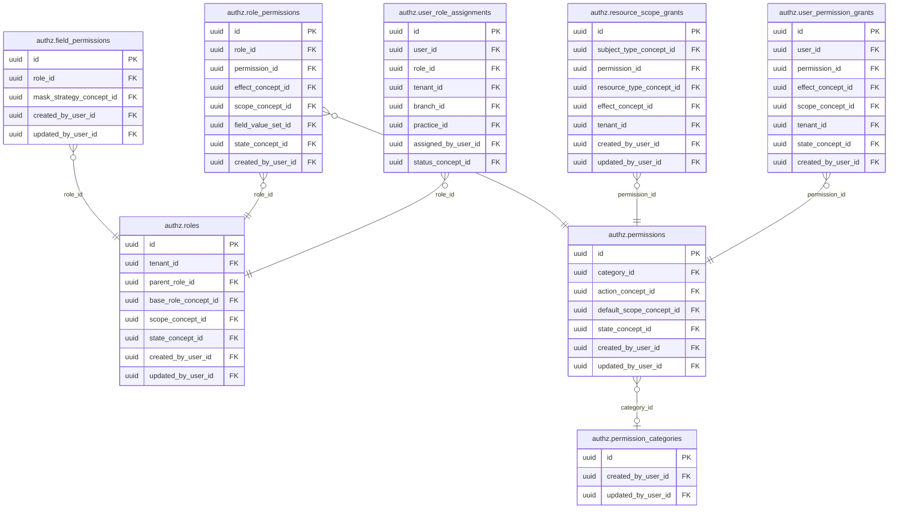
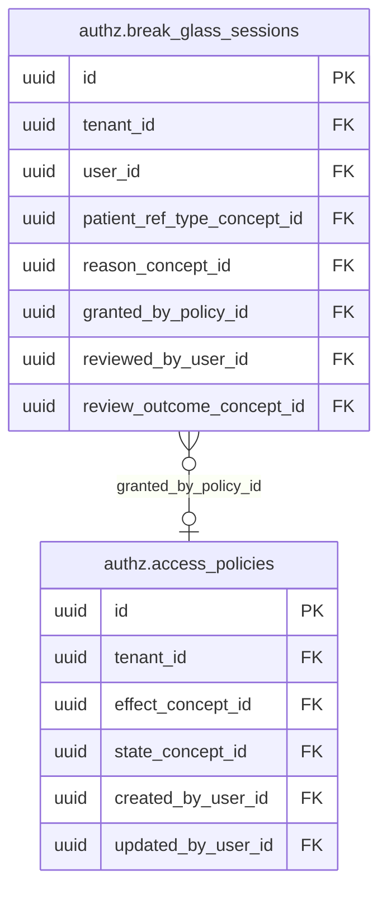

<!-- AUTOGENERADO por tools/inventario/catalogo.mjs. No editar manualmente. -->

# Catálogo del schema `authz`

- **Tablas:** 15 · **Columnas:** 214 (57 con descripción: 26.6 %) · **Índices:** 90
- **Dominio:** Identidad y Seguridad
- Método y límites del catálogo: [README del inventario](../README.md)

## Tablas

| Tabla | Propósito | Columnas | Índices | Operaciones | ORM |
|---|---|---|---|---|---|
| [access_policies](#access_policies) | Define políticas de acceso que combinan identidad, recurso y contexto para autorizar operaciones. | 13 | 6 | 63 | COINCIDE |
| [break_glass_sessions](#break_glass_sessions) | Documenta sesiones de acceso de emergencia que pueden superar restricciones ordinarias bajo controles reforzados. | 20 | 5 | 1 | COINCIDE |
| [care_relationships](#care_relationships) | Vincula profesionales con pacientes bajo una relación de cuidado que sirve como contexto de autorización clínica. | 15 | 3 | 79 | COINCIDE |
| [clinical_access_grants](#clinical_access_grants) | Registra concesiones de acceso clínico a pacientes o expedientes bajo un propósito y alcance determinados. | 17 | 13 | 75 | COINCIDE |
| [field_permissions](#field_permissions) | Controla permisos a nivel de campo para proteger atributos sensibles de registros de salud. | 13 | 4 | 64 | COINCIDE |
| [ip_access_rules](#ip_access_rules) | Aplica reglas de acceso por dirección de red para limitar orígenes de conexión permitidos. | 17 | 3 | 0 | COINCIDE |
| [patient_legal_representations](#patient_legal_representations) | Registra representación legal de pacientes para determinar quién puede actuar en su nombre dentro de ámbitos permitidos. | 14 | 2 | 65 | COINCIDE |
| [permission_categories](#permission_categories) | Agrupa permisos por área funcional para organizar la autorización en módulos del sistema médico. | 10 | 3 | 3 | COINCIDE |
| [permissions](#permissions) | Define acciones que pueden autorizarse sobre recursos clínicos y administrativos. | 18 | 7 | 68 | COINCIDE |
| [resource_scope_grants](#resource_scope_grants) | Limita accesos a recursos según alcance de tenant, paciente u organización. | 16 | 8 | 69 | DIVERGE |
| [role_permissions](#role_permissions) | Relaciona roles con permisos para establecer qué acciones habilita cada función. | 13 | 8 | 64 | COINCIDE |
| [roles](#roles) | Define conjuntos reutilizables de privilegios para asignar funciones de acceso a usuarios y servicios. | 16 | 8 | 80 | COINCIDE |
| [service_principals](#service_principals) | Representa identidades no humanas que ejecutan integraciones y procesos autorizados. | 1 | 0 | 0 | COINCIDE |
| [user_permission_grants](#user_permission_grants) | Registra permisos otorgados directamente a usuarios cuando una asignación por rol no expresa el acceso requerido. | 16 | 9 | 63 | COINCIDE |
| [user_role_assignments](#user_role_assignments) | Asigna roles a usuarios dentro del ámbito correspondiente para controlar acceso operativo. | 15 | 11 | 83 | COINCIDE |

## Diagrama entidad-relación

Las tablas se agrupan en familias por sus claves foráneas dentro del schema (máximo 40 por diagrama). Las FK hacia otros schemas se listan en la ficha de cada tabla.

### Familia 1 de 2 — 8 tablas

### Familia 2 de 2 — 2 tablas

### Tablas sin relaciones dentro del schema

`authz.care_relationships` · `authz.clinical_access_grants` · `authz.ip_access_rules` · `authz.patient_legal_representations` · `authz.service_principals`

## Fichas

### access_policies

#### Vista general

Define políticas de acceso que combinan identidad, recurso y contexto para autorizar operaciones.

- **Estado del propósito:** DOMAIN_CURATED_DRAFT · fuente: `Mantra Core Health Context/modules/diagram_06_authz.puml: access_policies`
- **Dominio:** Identidad y Seguridad · **Diagrama:** `Mantra Core Health Context/modules/diagram_06_authz.puml` · **DDL:** `SQL/06_authz/02_tables.sql`
- **Entidad del ORM:** `AccessPolicies` — `src/modules/authz/entities/access_policies.entity.ts`
- **Resumen:** 13 columnas · 6 índices · 5 FK salientes · 1 entrantes · 63 operaciones

#### Columnas

| # | Columna | Tipo | Rol estructural | Descripción | ORM |
|---|---|---|---|---|---|
| 1 | `id` | `uuid` | Clave primaria; Obligatoria | Identificador único de la instancia. _(JSDOC_ESTANDAR, `src/modules/authz/entities/access_policies.entity.ts:12`)_ | coincide |
| 2 | `tenant_id` | `uuid` | Clave foránea → directory.tenants.id; Obligatoria | _sin dato_ | coincide |
| 3 | `name` | `varchar` | Obligatoria | _sin dato_ | coincide |
| 4 | `effect_concept_id` | `uuid` | Clave foránea → terminology.catalog_concepts.id; Obligatoria | _sin dato_ | coincide |
| 5 | `target_resource` | `varchar` | Opcional | _sin dato_ | coincide |
| 6 | `condition_json` | `jsonb` | Opcional | _sin dato_ | coincide |
| 7 | `priority` | `integer` | Opcional | _sin dato_ | coincide |
| 8 | `state_concept_id` | `uuid` | Clave foránea → terminology.catalog_concepts.id; Obligatoria | _sin dato_ | coincide |
| 9 | `created_at` | `timestamptz` | Obligatoria | Fecha y hora en que se creó el registro. _(JSDOC_ESTANDAR, `src/modules/authz/entities/access_policies.entity.ts:69`)_ | coincide |
| 10 | `updated_at` | `timestamptz` | Obligatoria | Fecha y hora de la última actualización. _(JSDOC_ESTANDAR, `src/modules/authz/entities/access_policies.entity.ts:75`)_ | coincide |
| 11 | `created_by_user_id` | `uuid` | Clave foránea → iam.users.id; Opcional | _sin dato_ | coincide |
| 12 | `updated_by_user_id` | `uuid` | Clave foránea → iam.users.id; Opcional | _sin dato_ | coincide |
| 13 | `row_version` | `integer = 1` | Obligatoria | Versión usada para controlar actualizaciones concurrentes. _(JSDOC_ENTIDAD, `src/modules/authz/entities/access_policies.entity.ts:93`)_ | coincide |

#### Relaciones

| Sentido | Columnas | Tabla | Restricción |
|---|---|---|---|
| hacia | tenant_id | directory.tenants (id) | fk_access_policies_tenant_id |
| hacia | effect_concept_id | terminology.catalog_concepts (id) | fk_access_policies_effect_concept_id |
| hacia | state_concept_id | terminology.catalog_concepts (id) | fk_access_policies_state_concept_id |
| hacia | created_by_user_id | iam.users (id) | fk_access_policies_created_by_user_id |
| hacia | updated_by_user_id | iam.users (id) | fk_access_policies_updated_by_user_id |
| desde | id | authz.break_glass_sessions (granted_by_policy_id) | fk_break_glass_sessions_granted_by_policy_id |

#### Índices

| Índice | Único | Columnas | Para qué |
|---|---|---|---|
| `ix_access_policies_tenant_id` | no | tenant_id | Soporta la clave foránea fk_access_policies_tenant_id: PostgreSQL no indexa las FK por sí mismo _(DOCUMENTO)_; 2 consulta(s) de repositorio filtran u ordenan por «tenant_id», la primera columna del índice _(CONSULTA)_ |
| `ix_access_policies_effect_concept_id` | no | effect_concept_id | Soporta la clave foránea fk_access_policies_effect_concept_id: PostgreSQL no indexa las FK por sí mismo _(DOCUMENTO)_ |
| `ix_access_policies_state_concept_id` | no | state_concept_id | Soporta la clave foránea fk_access_policies_state_concept_id: PostgreSQL no indexa las FK por sí mismo _(DOCUMENTO)_; 2 consulta(s) de repositorio filtran u ordenan por «state_concept_id», la primera columna del índice _(CONSULTA)_ |
| `ix_access_policies_created_by_user_id` | no | created_by_user_id | Soporta la clave foránea fk_access_policies_created_by_user_id: PostgreSQL no indexa las FK por sí mismo _(DOCUMENTO)_ |
| `ix_access_policies_updated_by_user_id` | no | updated_by_user_id | Soporta la clave foránea fk_access_policies_updated_by_user_id: PostgreSQL no indexa las FK por sí mismo _(DOCUMENTO)_ |
| `ix_access_policies_tenant_id_state_concept_id` | no | tenant_id, state_concept_id, ("updated_at" DESC) | _sin uso detectado estáticamente_ |

#### Operaciones que la tocan

| Operación | Efecto | Confianza |
|---|---|---|
| POST /authz/decisions/evaluate | LEE | DIRECTA |
| POST /authz/tenants/{tenantId}/access-policies | CREA | DIRECTA |
| POST /authz/tenants/{tenantId}/access-policies | LEE | DIRECTA |
| PATCH /charts/care-plans/{planId}/activities/{activityId} | LEE | DIRECTA |
| GET /charts/documents/{documentId}/files/{fileId}/content | LEE | DIRECTA |
| GET /charts/encounters/{id}/pdf | LEE | DIRECTA |
| POST /charts/notes/{noteId}/amendments | LEE | DIRECTA |
| PUT /charts/notes/{noteId}/versions | LEE | DIRECTA |
| POST /charts/notes/{noteId}/versions/{versionId}/cosign | LEE | DIRECTA |
| POST /charts/notes/{noteId}/versions/{versionId}/sign | LEE | DIRECTA |
| POST /charts/notes/versions/{versionId}/exam-findings | LEE | DIRECTA |
| POST /charts/notes/versions/{versionId}/release | LEE | DIRECTA |
| POST /charts/notes/versions/{versionId}/withhold | LEE | DIRECTA |
| GET /clinical/allergy-intolerances/{id}/attachments | LEE | DIRECTA |
| POST /clinical/allergy-intolerances/{id}/attachments | LEE | DIRECTA |
| POST /clinical/conditions/{id}/attachments | LEE | DIRECTA |
| POST /clinical/conditions/{id}/change-status | LEE | DIRECTA |
| POST /clinical/conditions/{id}/verification | LEE | DIRECTA |
| POST /clinical/diagnostic-reports/{id}/release | LEE | DIRECTA |
| GET /clinical/encounters/{id}/attachments | LEE | DIRECTA |
| POST /clinical/encounters/{id}/attachments | LEE | DIRECTA |
| POST /clinical/encounters/{id}/close | LEE | DIRECTA |
| GET /clinical/medication-requests/{id}/attachments | LEE | DIRECTA |
| POST /clinical/medication-requests/{id}/attachments | LEE | DIRECTA |
| POST /clinical/medication-requests/{id}/edit | LEE | DIRECTA |
| POST /clinical/medication-requests/{id}/invalidate | LEE | DIRECTA |
| POST /clinical/medication-requests/{id}/issue | LEE | DIRECTA |
| POST /clinical/medication-requests/{id}/renew | LEE | DIRECTA |
| POST /clinical/medication-requests/{id}/replace | LEE | DIRECTA |
| POST /clinical/medication-requests/{id}/sign | LEE | DIRECTA |
| PATCH /clinical/observations/{id}/amend | LEE | DIRECTA |
| GET /clinical/prescriptions/{id}/pdf | LEE | DIRECTA |
| POST /clinical/procedures/{id}/attachments | LEE | DIRECTA |
| POST /clinical/service-requests/duplicate-check | LEE | DIRECTA |
| POST /care-gaps/recompute | LEE | DIRECTA |
| GET /care-teams | LEE | DIRECTA |
| POST /care-teams | LEE | DIRECTA |
| POST /order-sets/{id}/apply | LEE | DIRECTA |
| POST /patients/{id}/immunization-plan/project | LEE | DIRECTA |
| GET /referrals | LEE | DIRECTA |
| POST /referrals | LEE | DIRECTA |
| GET /referrals/{id} | LEE | DIRECTA |
| PATCH /referrals/{id}/cancel | LEE | DIRECTA |
| PATCH /referrals/{id}/counter-referral | LEE | DIRECTA |
| GET /consent/encounters/{encounterId}/informed-consent | LEE | DIRECTA |
| POST /consent/encounters/{encounterId}/informed-consent | LEE | DIRECTA |
| GET /consent/treatment-informed-consents | LEE | DIRECTA |
| POST /consent/treatment-informed-consents | LEE | DIRECTA |
| GET /consent/treatment-informed-consents/{id} | LEE | DIRECTA |
| POST /consent/treatment-informed-consents/{id}/evidence | LEE | DIRECTA |
| PATCH /consent/treatment-informed-consents/{id}/post-emergency-information | LEE | DIRECTA |
| PATCH /consent/treatment-informed-consents/{id}/withdraw | LEE | DIRECTA |
| GET /forms/instances | LEE | DIRECTA |
| GET /forms/instances/{id} | LEE | DIRECTA |
| POST /medical-groups | LEE | DIRECTA |
| GET /medical-groups/patients/{patientProfileId}/conditions | LEE | DIRECTA |
| GET /dental-procedures | LEE | DIRECTA |
| POST /dental-procedures | LEE | DIRECTA |
| GET /procedure-cases/{id} | LEE | DIRECTA |
| GET /quotations | LEE | DIRECTA |
| POST /quotations | LEE | DIRECTA |
| GET /portals/{portalCode}/routes/{routeCode}/views/{viewCode}/actions | LEE | DIRECTA |
| GET /portals/{portalCode}/routes/{routeCode}/views/{viewCode}/data | LEE | DIRECTA |

#### Gobierno

| Atributo | Valor | Fuente |
|---|---|---|
| Append-only | no declarado | — |
| Datos personales | sin fuente | — |
| Financiera | sin fuente | — |
| Crítica para auditoría | sin fuente | — |
| Retención | sin fuente | — |
| Responsable | sin fuente | — |
| Revisión | AUTO_DETECTADA | — |

---

### break_glass_sessions

#### Vista general

Documenta sesiones de acceso de emergencia que pueden superar restricciones ordinarias bajo controles reforzados.

- **Estado del propósito:** DOMAIN_CURATED_DRAFT · fuente: `Mantra Core Health Context/modules/diagram_06_authz.puml: break_glass_sessions`
- **Dominio:** Identidad y Seguridad · **Diagrama:** `Mantra Core Health Context/modules/diagram_06_authz.puml` · **DDL:** `SQL/06_authz/02_tables.sql`
- **Entidad del ORM:** `BreakGlassSessions` — `src/modules/authz/entities/break_glass_sessions.entity.ts`
- **Resumen:** 20 columnas · 5 índices · 10 FK salientes · 0 entrantes · 1 operaciones

#### Columnas

| # | Columna | Tipo | Rol estructural | Descripción | ORM |
|---|---|---|---|---|---|
| 1 | `id` | `uuid` | Clave primaria; Obligatoria | Identificador único de la instancia. _(JSDOC_ESTANDAR, `src/modules/authz/entities/break_glass_sessions.entity.ts:12`)_ | coincide |
| 2 | `tenant_id` | `uuid` | Clave foránea → directory.tenants.id; Obligatoria | _sin dato_ | coincide |
| 3 | `user_id` | `uuid` | Clave foránea → iam.users.id; Obligatoria | _sin dato_ | coincide |
| 4 | `patient_ref_id` | `uuid` | Obligatoria | _sin dato_ | coincide |
| 5 | `patient_ref_type_concept_id` | `uuid` | Clave foránea → terminology.catalog_concepts.id; Obligatoria | _sin dato_ | coincide |
| 6 | `justification` | `varchar` | Obligatoria | _sin dato_ | coincide |
| 7 | `reason_concept_id` | `uuid` | Clave foránea → terminology.catalog_concepts.id; Obligatoria | _sin dato_ | coincide |
| 8 | `granted_by_policy_id` | `uuid` | Clave foránea → authz.access_policies.id; Opcional | _sin dato_ | coincide |
| 9 | `activated_at` | `timestamptz` | Opcional | _sin dato_ | coincide |
| 10 | `expires_at` | `timestamptz` | Opcional | _sin dato_ | coincide |
| 11 | `deactivated_at` | `timestamptz` | Opcional | _sin dato_ | coincide |
| 12 | `reviewed_by_user_id` | `uuid` | Clave foránea → iam.users.id; Opcional | _sin dato_ | coincide |
| 13 | `reviewed_at` | `timestamptz` | Opcional | _sin dato_ | coincide |
| 14 | `review_outcome_concept_id` | `uuid` | Clave foránea → terminology.catalog_concepts.id; Opcional | _sin dato_ | coincide |
| 15 | `status_concept_id` | `uuid` | Clave foránea → terminology.catalog_concepts.id; Obligatoria | _sin dato_ | coincide |
| 16 | `created_at` | `timestamptz` | Obligatoria | Fecha y hora en que se creó el registro. _(JSDOC_ESTANDAR, `src/modules/authz/entities/break_glass_sessions.entity.ts:122`)_ | coincide |
| 17 | `updated_at` | `timestamptz` | Obligatoria | Fecha y hora de la última actualización. _(JSDOC_ESTANDAR, `src/modules/authz/entities/break_glass_sessions.entity.ts:128`)_ | coincide |
| 18 | `created_by_user_id` | `uuid` | Clave foránea → iam.users.id; Opcional | _sin dato_ | coincide |
| 19 | `updated_by_user_id` | `uuid` | Clave foránea → iam.users.id; Opcional | _sin dato_ | coincide |
| 20 | `row_version` | `integer = 1` | Obligatoria | Versión usada para controlar actualizaciones concurrentes. _(JSDOC_ENTIDAD, `src/modules/authz/entities/break_glass_sessions.entity.ts:146`)_ | coincide |

#### Relaciones

| Sentido | Columnas | Tabla | Restricción |
|---|---|---|---|
| hacia | granted_by_policy_id | authz.access_policies (id) | fk_break_glass_sessions_granted_by_policy_id |
| hacia | tenant_id | directory.tenants (id) | fk_break_glass_sessions_tenant_id |
| hacia | user_id | iam.users (id) | fk_break_glass_sessions_user_id |
| hacia | patient_ref_type_concept_id | terminology.catalog_concepts (id) | fk_break_glass_sessions_patient_ref_type_concept_id |
| hacia | reason_concept_id | terminology.catalog_concepts (id) | fk_break_glass_sessions_reason_concept_id |
| hacia | reviewed_by_user_id | iam.users (id) | fk_break_glass_sessions_reviewed_by_user_id |
| hacia | review_outcome_concept_id | terminology.catalog_concepts (id) | fk_break_glass_sessions_review_outcome_concept_id |
| hacia | status_concept_id | terminology.catalog_concepts (id) | fk_break_glass_sessions_status_concept_id |
| hacia | created_by_user_id | iam.users (id) | fk_break_glass_sessions_created_by_user_id |
| hacia | updated_by_user_id | iam.users (id) | fk_break_glass_sessions_updated_by_user_id |

#### Índices

| Índice | Único | Columnas | Para qué |
|---|---|---|---|
| `ix_break_glass_sessions_user_id` | no | user_id | Soporta la clave foránea fk_break_glass_sessions_user_id: PostgreSQL no indexa las FK por sí mismo _(DOCUMENTO)_ |
| `ix_break_glass_sessions_tenant_id` | no | tenant_id | Soporta la clave foránea fk_break_glass_sessions_tenant_id: PostgreSQL no indexa las FK por sí mismo _(DOCUMENTO)_ |
| `ix_break_glass_sessions_patient_ref_id` | no | patient_ref_id | _sin uso detectado estáticamente_ |
| `ix_break_glass_sessions_status_concept_id` | no | status_concept_id | Soporta la clave foránea fk_break_glass_sessions_status_concept_id: PostgreSQL no indexa las FK por sí mismo _(DOCUMENTO)_ |
| `ix_break_glass_sessions_review_outcome_concept_id` | no | review_outcome_concept_id | Soporta la clave foránea fk_break_glass_sessions_review_outcome_concept_id: PostgreSQL no indexa las FK por sí mismo _(DOCUMENTO)_ |

#### Operaciones que la tocan

| Operación | Efecto | Confianza |
|---|---|---|
| POST /authz/patients/{patientProfileId}/break-the-glass | CREA | DIRECTA |

#### Gobierno

| Atributo | Valor | Fuente |
|---|---|---|
| Append-only | no declarado | — |
| Datos personales | sin fuente | — |
| Financiera | sin fuente | — |
| Crítica para auditoría | sin fuente | — |
| Retención | sin fuente | — |
| Responsable | sin fuente | — |
| Revisión | AUTO_DETECTADA | — |

---

### care_relationships

#### Vista general

Vincula profesionales con pacientes bajo una relación de cuidado que sirve como contexto de autorización clínica.

- **Estado del propósito:** DOMAIN_CURATED_DRAFT · fuente: `Mantra Core Health Context/modules/diagram_06_authz.puml: care_relationships`
- **Dominio:** Identidad y Seguridad · **Diagrama:** `Mantra Core Health Context/modules/diagram_06_authz.puml` · **DDL:** `SQL/06_authz/02_tables.sql`
- **Entidad del ORM:** `CareRelationships` — `src/modules/authz/entities/care_relationships.entity.ts`
- **Resumen:** 15 columnas · 3 índices · 9 FK salientes · 0 entrantes · 79 operaciones

#### Columnas

| # | Columna | Tipo | Rol estructural | Descripción | ORM |
|---|---|---|---|---|---|
| 1 | `id` | `uuid` | Clave primaria; Obligatoria | Identificador único de la instancia. _(JSDOC_ESTANDAR, `src/modules/authz/entities/care_relationships.entity.ts:14`)_ | coincide |
| 2 | `tenant_id` | `uuid` | Clave foránea → directory.tenants.id; Obligatoria | _sin dato_ | coincide |
| 3 | `patient_profile_id` | `uuid` | Clave foránea → profiles.patient_profiles.profile_id; Obligatoria | _sin dato_ | coincide |
| 4 | `practitioner_profile_id` | `uuid` | Clave foránea → profiles.health_practitioner_profiles.profile_id; Obligatoria | _sin dato_ | coincide |
| 5 | `relationship_type_concept_id` | `uuid` | Clave foránea → terminology.catalog_concepts.id; Obligatoria | _sin dato_ | coincide |
| 6 | `status_concept_id` | `uuid` | Clave foránea → terminology.catalog_concepts.id; Obligatoria | _sin dato_ | coincide |
| 7 | `purpose_concept_id` | `uuid` | Clave foránea → terminology.catalog_concepts.id; Opcional | _sin dato_ | coincide |
| 8 | `valid_from` | `timestamptz` | Obligatoria | _sin dato_ | coincide |
| 9 | `valid_to` | `timestamptz` | Opcional | _sin dato_ | coincide |
| 10 | `established_by_user_id` | `uuid` | Clave foránea → iam.users.id; Opcional | _sin dato_ | coincide |
| 11 | `created_at` | `timestamptz` | Obligatoria | Fecha y hora en que se creó el registro. _(JSDOC_ESTANDAR, `src/modules/authz/entities/care_relationships.entity.ts:82`)_ | coincide |
| 12 | `updated_at` | `timestamptz` | Obligatoria | Fecha y hora de la última actualización. _(JSDOC_ESTANDAR, `src/modules/authz/entities/care_relationships.entity.ts:88`)_ | coincide |
| 13 | `created_by_user_id` | `uuid` | Clave foránea → iam.users.id; Opcional | _sin dato_ | coincide |
| 14 | `updated_by_user_id` | `uuid` | Clave foránea → iam.users.id; Opcional | _sin dato_ | coincide |
| 15 | `row_version` | `integer = 1` | Obligatoria | Versión usada para controlar actualizaciones concurrentes. _(JSDOC_ENTIDAD, `src/modules/authz/entities/care_relationships.entity.ts:106`)_ | coincide |

#### Relaciones

| Sentido | Columnas | Tabla | Restricción |
|---|---|---|---|
| hacia | tenant_id | directory.tenants (id) | fk_care_relationships_tenant_id |
| hacia | patient_profile_id | profiles.patient_profiles (profile_id) | fk_care_relationships_patient_profile_id |
| hacia | practitioner_profile_id | profiles.health_practitioner_profiles (profile_id) | fk_care_relationships_practitioner_profile_id |
| hacia | relationship_type_concept_id | terminology.catalog_concepts (id) | fk_care_relationships_relationship_type_concept_id |
| hacia | status_concept_id | terminology.catalog_concepts (id) | fk_care_relationships_status_concept_id |
| hacia | purpose_concept_id | terminology.catalog_concepts (id) | fk_care_relationships_purpose_concept_id |
| hacia | established_by_user_id | iam.users (id) | fk_care_relationships_established_by_user_id |
| hacia | created_by_user_id | iam.users (id) | fk_care_relationships_created_by_user_id |
| hacia | updated_by_user_id | iam.users (id) | fk_care_relationships_updated_by_user_id |

#### Índices

| Índice | Único | Columnas | Para qué |
|---|---|---|---|
| `ix_care_relationships_tenant_id` | no | tenant_id | Soporta la clave foránea fk_care_relationships_tenant_id: PostgreSQL no indexa las FK por sí mismo _(DOCUMENTO)_; 4 consulta(s) de repositorio filtran u ordenan por «tenant_id», la primera columna del índice _(CONSULTA)_ |
| `ix_care_relationships_patient_profile_id` | no | patient_profile_id | Soporta la clave foránea fk_care_relationships_patient_profile_id: PostgreSQL no indexa las FK por sí mismo _(DOCUMENTO)_; 9 consulta(s) de repositorio filtran u ordenan por «patient_profile_id», la primera columna del índice _(CONSULTA)_ |
| `ix_care_relationships_practitioner_profile_id` | no | practitioner_profile_id | Soporta la clave foránea fk_care_relationships_practitioner_profile_id: PostgreSQL no indexa las FK por sí mismo _(DOCUMENTO)_; 5 consulta(s) de repositorio filtran u ordenan por «practitioner_profile_id», la primera columna del índice _(CONSULTA)_ |

#### Operaciones que la tocan

| Operación | Efecto | Confianza |
|---|---|---|
| GET /authz/care-relationships | LEE | DIRECTA |
| POST /authz/care-relationships | CREA | DIRECTA |
| POST /authz/care-relationships | LEE | DIRECTA |
| POST /authz/care-relationships/{id}/respond | ACTUALIZA | POR_TIPO |
| POST /authz/care-relationships/{id}/respond | LEE | DIRECTA |
| POST /authz/care-relationships/{id}/revoke | LEE | DIRECTA |
| POST /authz/care-relationships/request | CREA | DIRECTA |
| POST /authz/care-relationships/request | LEE | DIRECTA |
| GET /authz/care-relationships/requests/mine | LEE | DIRECTA |
| POST /authz/decisions/evaluate | LEE | DIRECTA |
| GET /authz/me/access | LEE | DIRECTA |
| POST /authz/me/care-relationships/{id}/revoke | LEE | DIRECTA |
| PATCH /charts/care-plans/{planId}/activities/{activityId} | LEE | DIRECTA |
| GET /charts/documents/{documentId}/files/{fileId}/content | LEE | DIRECTA |
| GET /charts/encounters/{id}/pdf | LEE | DIRECTA |
| POST /charts/notes/{noteId}/amendments | LEE | DIRECTA |
| PUT /charts/notes/{noteId}/versions | LEE | DIRECTA |
| POST /charts/notes/{noteId}/versions/{versionId}/cosign | LEE | DIRECTA |
| POST /charts/notes/{noteId}/versions/{versionId}/sign | LEE | DIRECTA |
| POST /charts/notes/versions/{versionId}/exam-findings | LEE | DIRECTA |
| POST /charts/notes/versions/{versionId}/release | LEE | DIRECTA |
| POST /charts/notes/versions/{versionId}/withhold | LEE | DIRECTA |
| GET /clinical/allergy-intolerances/{id}/attachments | LEE | DIRECTA |
| POST /clinical/allergy-intolerances/{id}/attachments | LEE | DIRECTA |
| POST /clinical/conditions/{id}/attachments | LEE | DIRECTA |
| POST /clinical/conditions/{id}/change-status | LEE | DIRECTA |
| POST /clinical/conditions/{id}/verification | LEE | DIRECTA |
| POST /clinical/diagnostic-reports/{id}/release | LEE | DIRECTA |
| GET /clinical/encounters/{id}/attachments | LEE | DIRECTA |
| POST /clinical/encounters/{id}/attachments | LEE | DIRECTA |
| POST /clinical/encounters/{id}/close | LEE | DIRECTA |
| POST /clinical/encounters/check-in | CREA | DIRECTA |
| POST /clinical/encounters/check-in | LEE | DIRECTA |
| GET /clinical/medication-requests/{id}/attachments | LEE | DIRECTA |
| POST /clinical/medication-requests/{id}/attachments | LEE | DIRECTA |
| POST /clinical/medication-requests/{id}/edit | LEE | DIRECTA |
| POST /clinical/medication-requests/{id}/invalidate | LEE | DIRECTA |
| POST /clinical/medication-requests/{id}/issue | LEE | DIRECTA |
| POST /clinical/medication-requests/{id}/renew | LEE | DIRECTA |
| POST /clinical/medication-requests/{id}/replace | LEE | DIRECTA |
| POST /clinical/medication-requests/{id}/sign | LEE | DIRECTA |
| PATCH /clinical/observations/{id}/amend | LEE | DIRECTA |
| GET /clinical/prescriptions/{id}/pdf | LEE | DIRECTA |
| POST /clinical/procedures/{id}/attachments | LEE | DIRECTA |
| POST /clinical/service-requests/duplicate-check | LEE | DIRECTA |
| POST /care-gaps/recompute | LEE | DIRECTA |
| GET /care-teams | LEE | DIRECTA |
| POST /care-teams | LEE | DIRECTA |
| POST /order-sets/{id}/apply | LEE | DIRECTA |
| POST /patients/{id}/immunization-plan/project | LEE | DIRECTA |
| GET /referrals | LEE | DIRECTA |
| POST /referrals | LEE | DIRECTA |
| GET /referrals/{id} | LEE | DIRECTA |
| PATCH /referrals/{id}/cancel | LEE | DIRECTA |
| PATCH /referrals/{id}/counter-referral | LEE | DIRECTA |
| GET /consent/encounters/{encounterId}/informed-consent | LEE | DIRECTA |
| POST /consent/encounters/{encounterId}/informed-consent | LEE | DIRECTA |
| GET /consent/treatment-informed-consents | LEE | DIRECTA |
| POST /consent/treatment-informed-consents | LEE | DIRECTA |
| GET /consent/treatment-informed-consents/{id} | LEE | DIRECTA |
| POST /consent/treatment-informed-consents/{id}/evidence | LEE | DIRECTA |
| PATCH /consent/treatment-informed-consents/{id}/post-emergency-information | LEE | DIRECTA |
| PATCH /consent/treatment-informed-consents/{id}/withdraw | LEE | DIRECTA |
| POST /diagnostic-results/me/{reportId}/shares | LEE | DIRECTA |
| GET /diagnostics/patients/{patientProfileId}/imaging-studies | LEE | DIRECTA |
| GET /forms/instances | LEE | DIRECTA |
| GET /forms/instances/{id} | LEE | DIRECTA |
| POST /insurance-claims | LEE | DIRECTA |
| POST /insurance-claims/quote | LEE | DIRECTA |
| GET /patient-coverages/by-patient/{patientProfileId} | LEE | DIRECTA |
| POST /medical-groups | LEE | DIRECTA |
| GET /medical-groups/patients/{patientProfileId}/conditions | LEE | DIRECTA |
| GET /dental-procedures | LEE | DIRECTA |
| POST /dental-procedures | LEE | DIRECTA |
| GET /procedure-cases/{id} | LEE | DIRECTA |
| GET /quotations | LEE | DIRECTA |
| POST /quotations | LEE | DIRECTA |
| GET /portals/{portalCode}/routes/{routeCode}/views/{viewCode}/actions | LEE | DIRECTA |
| GET /portals/{portalCode}/routes/{routeCode}/views/{viewCode}/data | LEE | DIRECTA |

#### Gobierno

| Atributo | Valor | Fuente |
|---|---|---|
| Append-only | no declarado | — |
| Datos personales | sin fuente | — |
| Financiera | sin fuente | — |
| Crítica para auditoría | sin fuente | — |
| Retención | sin fuente | — |
| Responsable | sin fuente | — |
| Revisión | AUTO_DETECTADA | — |

---

### clinical_access_grants

#### Vista general

Registra concesiones de acceso clínico a pacientes o expedientes bajo un propósito y alcance determinados.

- **Estado del propósito:** DOMAIN_CURATED_DRAFT · fuente: `Mantra Core Health Context/modules/diagram_06_authz.puml: clinical_access_grants`
- **Dominio:** Identidad y Seguridad · **Diagrama:** `Mantra Core Health Context/modules/diagram_06_authz.puml` · **DDL:** `SQL/06_authz/02_tables.sql`
- **Entidad del ORM:** `ClinicalAccessGrants` — `src/modules/authz/entities/clinical_access_grants.entity.ts`
- **Resumen:** 17 columnas · 13 índices · 11 FK salientes · 0 entrantes · 75 operaciones

#### Columnas

| # | Columna | Tipo | Rol estructural | Descripción | ORM |
|---|---|---|---|---|---|
| 1 | `id` | `uuid` | Clave primaria; Obligatoria | Identificador único de la instancia. _(JSDOC_ESTANDAR, `src/modules/authz/entities/clinical_access_grants.entity.ts:12`)_ | coincide |
| 2 | `patient_profile_id` | `uuid` | Clave foránea → profiles.patient_profiles.profile_id; Obligatoria | _sin dato_ | coincide |
| 3 | `granted_user_id` | `uuid` | Clave foránea → iam.users.id; Obligatoria | _sin dato_ | coincide |
| 4 | `tenant_id` | `uuid` | Clave foránea → directory.tenants.id; Obligatoria | _sin dato_ | coincide |
| 5 | `branch_id` | `uuid` | Clave foránea → directory.branches.id; Opcional | _sin dato_ | coincide |
| 6 | `encounter_id` | `uuid` | Clave foránea → clinical.encounters.id; Opcional | _sin dato_ | coincide |
| 7 | `consent_id` | `uuid` | Clave foránea → consent.consents.id; Opcional | _sin dato_ | coincide |
| 8 | `reason_concept_id` | `uuid` | Clave foránea → terminology.catalog_concepts.id; Obligatoria | _sin dato_ | coincide |
| 9 | `access_level_concept_id` | `uuid` | Clave foránea → terminology.catalog_concepts.id; Obligatoria | _sin dato_ | coincide |
| 10 | `state_concept_id` | `uuid` | Clave foránea → terminology.catalog_concepts.id; Obligatoria | _sin dato_ | coincide |
| 11 | `valid_from` | `timestamptz` | Obligatoria | _sin dato_ | coincide |
| 12 | `valid_to` | `timestamptz` | Obligatoria | _sin dato_ | coincide |
| 13 | `created_at` | `timestamptz` | Obligatoria | Fecha y hora en que se creó el registro. _(JSDOC_ESTANDAR, `src/modules/authz/entities/clinical_access_grants.entity.ts:84`)_ | coincide |
| 14 | `updated_at` | `timestamptz` | Obligatoria | Fecha y hora de la última actualización. _(JSDOC_ESTANDAR, `src/modules/authz/entities/clinical_access_grants.entity.ts:90`)_ | coincide |
| 15 | `created_by_user_id` | `uuid` | Clave foránea → iam.users.id; Opcional | _sin dato_ | coincide |
| 16 | `updated_by_user_id` | `uuid` | Clave foránea → iam.users.id; Opcional | _sin dato_ | coincide |
| 17 | `row_version` | `integer = 1` | Obligatoria | Versión usada para controlar actualizaciones concurrentes. _(JSDOC_ENTIDAD, `src/modules/authz/entities/clinical_access_grants.entity.ts:108`)_ | coincide |

#### Relaciones

| Sentido | Columnas | Tabla | Restricción |
|---|---|---|---|
| hacia | patient_profile_id | profiles.patient_profiles (profile_id) | fk_clinical_access_grants_patient_profile_id |
| hacia | granted_user_id | iam.users (id) | fk_clinical_access_grants_granted_user_id |
| hacia | tenant_id | directory.tenants (id) | fk_clinical_access_grants_tenant_id |
| hacia | branch_id | directory.branches (id) | fk_clinical_access_grants_branch_id |
| hacia | encounter_id | clinical.encounters (id) | fk_clinical_access_grants_encounter_id |
| hacia | consent_id | consent.consents (id) | fk_clinical_access_grants_consent_id |
| hacia | reason_concept_id | terminology.catalog_concepts (id) | fk_clinical_access_grants_reason_concept_id |
| hacia | access_level_concept_id | terminology.catalog_concepts (id) | fk_clinical_access_grants_access_level_concept_id |
| hacia | state_concept_id | terminology.catalog_concepts (id) | fk_clinical_access_grants_state_concept_id |
| hacia | created_by_user_id | iam.users (id) | fk_clinical_access_grants_created_by_user_id |
| hacia | updated_by_user_id | iam.users (id) | fk_clinical_access_grants_updated_by_user_id |

#### Índices

| Índice | Único | Columnas | Para qué |
|---|---|---|---|
| `ix_clinical_access_grants_patient_profile_id` | no | patient_profile_id | Soporta la clave foránea fk_clinical_access_grants_patient_profile_id: PostgreSQL no indexa las FK por sí mismo _(DOCUMENTO)_; 5 consulta(s) de repositorio filtran u ordenan por «patient_profile_id», la primera columna del índice _(CONSULTA)_ |
| `ix_clinical_access_grants_granted_user_id` | no | granted_user_id | Soporta la clave foránea fk_clinical_access_grants_granted_user_id: PostgreSQL no indexa las FK por sí mismo _(DOCUMENTO)_; 4 consulta(s) de repositorio filtran u ordenan por «granted_user_id», la primera columna del índice _(CONSULTA)_ |
| `ix_clinical_access_grants_tenant_id` | no | tenant_id | Soporta la clave foránea fk_clinical_access_grants_tenant_id: PostgreSQL no indexa las FK por sí mismo _(DOCUMENTO)_; 2 consulta(s) de repositorio filtran u ordenan por «tenant_id», la primera columna del índice _(CONSULTA)_ |
| `ix_clinical_access_grants_branch_id` | no | branch_id | Soporta la clave foránea fk_clinical_access_grants_branch_id: PostgreSQL no indexa las FK por sí mismo _(DOCUMENTO)_ |
| `ix_clinical_access_grants_encounter_id` | no | encounter_id | Soporta la clave foránea fk_clinical_access_grants_encounter_id: PostgreSQL no indexa las FK por sí mismo _(DOCUMENTO)_ |
| `ix_clinical_access_grants_consent_id` | no | consent_id | Soporta la clave foránea fk_clinical_access_grants_consent_id: PostgreSQL no indexa las FK por sí mismo _(DOCUMENTO)_; 1 consulta(s) de repositorio filtran u ordenan por «consent_id», la primera columna del índice _(CONSULTA)_ |
| `ix_clinical_access_grants_reason_concept_id` | no | reason_concept_id | Soporta la clave foránea fk_clinical_access_grants_reason_concept_id: PostgreSQL no indexa las FK por sí mismo _(DOCUMENTO)_ |
| `ix_clinical_access_grants_access_level_concept_id` | no | access_level_concept_id | Soporta la clave foránea fk_clinical_access_grants_access_level_concept_id: PostgreSQL no indexa las FK por sí mismo _(DOCUMENTO)_ |
| `ix_clinical_access_grants_state_concept_id` | no | state_concept_id | Soporta la clave foránea fk_clinical_access_grants_state_concept_id: PostgreSQL no indexa las FK por sí mismo _(DOCUMENTO)_; 5 consulta(s) de repositorio filtran u ordenan por «state_concept_id», la primera columna del índice _(CONSULTA)_ |
| `ix_clinical_access_grants_created_by_user_id` | no | created_by_user_id | Soporta la clave foránea fk_clinical_access_grants_created_by_user_id: PostgreSQL no indexa las FK por sí mismo _(DOCUMENTO)_ |
| `ix_clinical_access_grants_updated_by_user_id` | no | updated_by_user_id | Soporta la clave foránea fk_clinical_access_grants_updated_by_user_id: PostgreSQL no indexa las FK por sí mismo _(DOCUMENTO)_ |
| `ix_clinical_access_grants_tenant_id_state_concept_id` | no | tenant_id, state_concept_id, ("updated_at" DESC) | _sin uso detectado estáticamente_ |
| `ix_clinical_access_grants_patient_profile_id_updated_at` | no | tenant_id, patient_profile_id, ("updated_at" DESC) | _sin uso detectado estáticamente_ |

#### Operaciones que la tocan

| Operación | Efecto | Confianza |
|---|---|---|
| DELETE /authz/clinical-access-grants/{grantId} | LEE | DIRECTA |
| POST /authz/decisions/evaluate | LEE | DIRECTA |
| GET /authz/me/access | LEE | DIRECTA |
| POST /authz/me/clinical-access-grants/{grantId}/revoke | LEE | DIRECTA |
| POST /authz/patients/{patientProfileId}/break-the-glass | CREA | DIRECTA |
| POST /authz/patients/{patientProfileId}/clinical-access-grants | CREA | DIRECTA |
| POST /authz/patients/{patientProfileId}/clinical-access-grants | LEE | DIRECTA |
| PATCH /charts/care-plans/{planId}/activities/{activityId} | LEE | DIRECTA |
| GET /charts/documents/{documentId}/files/{fileId}/content | LEE | DIRECTA |
| GET /charts/encounters/{id}/pdf | LEE | DIRECTA |
| POST /charts/notes/{noteId}/amendments | LEE | DIRECTA |
| PUT /charts/notes/{noteId}/versions | LEE | DIRECTA |
| POST /charts/notes/{noteId}/versions/{versionId}/cosign | LEE | DIRECTA |
| POST /charts/notes/{noteId}/versions/{versionId}/sign | LEE | DIRECTA |
| POST /charts/notes/versions/{versionId}/exam-findings | LEE | DIRECTA |
| POST /charts/notes/versions/{versionId}/release | LEE | DIRECTA |
| POST /charts/notes/versions/{versionId}/withhold | LEE | DIRECTA |
| GET /clinical/allergy-intolerances/{id}/attachments | LEE | DIRECTA |
| POST /clinical/allergy-intolerances/{id}/attachments | LEE | DIRECTA |
| POST /clinical/conditions/{id}/attachments | LEE | DIRECTA |
| POST /clinical/conditions/{id}/change-status | LEE | DIRECTA |
| POST /clinical/conditions/{id}/verification | LEE | DIRECTA |
| POST /clinical/diagnostic-reports/{id}/release | LEE | DIRECTA |
| GET /clinical/encounters/{id}/attachments | LEE | DIRECTA |
| POST /clinical/encounters/{id}/attachments | LEE | DIRECTA |
| POST /clinical/encounters/{id}/close | LEE | DIRECTA |
| GET /clinical/medication-requests/{id}/attachments | LEE | DIRECTA |
| POST /clinical/medication-requests/{id}/attachments | LEE | DIRECTA |
| POST /clinical/medication-requests/{id}/edit | LEE | DIRECTA |
| POST /clinical/medication-requests/{id}/invalidate | LEE | DIRECTA |
| POST /clinical/medication-requests/{id}/issue | LEE | DIRECTA |
| POST /clinical/medication-requests/{id}/renew | LEE | DIRECTA |
| POST /clinical/medication-requests/{id}/replace | LEE | DIRECTA |
| POST /clinical/medication-requests/{id}/sign | LEE | DIRECTA |
| PATCH /clinical/observations/{id}/amend | LEE | DIRECTA |
| GET /clinical/prescriptions/{id}/pdf | LEE | DIRECTA |
| POST /clinical/procedures/{id}/attachments | LEE | DIRECTA |
| POST /clinical/service-requests/duplicate-check | LEE | DIRECTA |
| POST /care-gaps/recompute | LEE | DIRECTA |
| GET /care-teams | LEE | DIRECTA |
| POST /care-teams | LEE | DIRECTA |
| POST /order-sets/{id}/apply | LEE | DIRECTA |
| POST /patients/{id}/immunization-plan/project | LEE | DIRECTA |
| GET /referrals | LEE | DIRECTA |
| POST /referrals | LEE | DIRECTA |
| GET /referrals/{id} | LEE | DIRECTA |
| PATCH /referrals/{id}/cancel | LEE | DIRECTA |
| PATCH /referrals/{id}/counter-referral | LEE | DIRECTA |
| POST /consent/consents/{id}/withdraw | ACTUALIZA | POR_TIPO |
| POST /consent/consents/{id}/withdraw | LEE | DIRECTA |
| GET /consent/encounters/{encounterId}/informed-consent | LEE | DIRECTA |
| POST /consent/encounters/{encounterId}/informed-consent | LEE | DIRECTA |
| POST /consent/me/consents/{id}/withdraw | ACTUALIZA | POR_TIPO |
| POST /consent/me/consents/{id}/withdraw | LEE | DIRECTA |
| POST /consent/practitioner-access-requests/{id}/decision | CREA | DIRECTA |
| POST /consent/practitioner-access-requests/{id}/decision | LEE | DIRECTA |
| GET /consent/treatment-informed-consents | LEE | DIRECTA |
| POST /consent/treatment-informed-consents | LEE | DIRECTA |
| GET /consent/treatment-informed-consents/{id} | LEE | DIRECTA |
| POST /consent/treatment-informed-consents/{id}/evidence | LEE | DIRECTA |
| PATCH /consent/treatment-informed-consents/{id}/post-emergency-information | LEE | DIRECTA |
| PATCH /consent/treatment-informed-consents/{id}/withdraw | LEE | DIRECTA |
| GET /forms/instances | LEE | DIRECTA |
| GET /forms/instances/{id} | LEE | DIRECTA |
| POST /fhir/r5/$export | LEE | DIRECTA |
| GET /fhir/r5/Patient/{id}/$everything | LEE | DIRECTA |
| POST /medical-groups | LEE | DIRECTA |
| GET /medical-groups/patients/{patientProfileId}/conditions | LEE | DIRECTA |
| GET /dental-procedures | LEE | DIRECTA |
| POST /dental-procedures | LEE | DIRECTA |
| GET /procedure-cases/{id} | LEE | DIRECTA |
| GET /quotations | LEE | DIRECTA |
| POST /quotations | LEE | DIRECTA |
| GET /portals/{portalCode}/routes/{routeCode}/views/{viewCode}/actions | LEE | DIRECTA |
| GET /portals/{portalCode}/routes/{routeCode}/views/{viewCode}/data | LEE | DIRECTA |

#### Gobierno

| Atributo | Valor | Fuente |
|---|---|---|
| Append-only | no declarado | — |
| Datos personales | sin fuente | — |
| Financiera | sin fuente | — |
| Crítica para auditoría | sin fuente | — |
| Retención | sin fuente | — |
| Responsable | sin fuente | — |
| Revisión | AUTO_DETECTADA | — |

---

### field_permissions

#### Vista general

Controla permisos a nivel de campo para proteger atributos sensibles de registros de salud.

- **Estado del propósito:** DOMAIN_CURATED_DRAFT · fuente: `Mantra Core Health Context/modules/diagram_06_authz.puml: field_permissions`
- **Dominio:** Identidad y Seguridad · **Diagrama:** `Mantra Core Health Context/modules/diagram_06_authz.puml` · **DDL:** `SQL/06_authz/02_tables.sql`
- **Entidad del ORM:** `FieldPermissions` — `src/modules/authz/entities/field_permissions.entity.ts`
- **Resumen:** 13 columnas · 4 índices · 4 FK salientes · 0 entrantes · 64 operaciones

#### Columnas

| # | Columna | Tipo | Rol estructural | Descripción | ORM |
|---|---|---|---|---|---|
| 1 | `id` | `uuid` | Clave primaria; Obligatoria | Identificador único de la instancia. _(JSDOC_ESTANDAR, `src/modules/authz/entities/field_permissions.entity.ts:12`)_ | coincide |
| 2 | `role_id` | `uuid` | Clave foránea → authz.roles.id; Obligatoria | _sin dato_ | coincide |
| 3 | `entity` | `varchar` | Obligatoria | _sin dato_ | coincide |
| 4 | `column_name` | `varchar` | Obligatoria | _sin dato_ | coincide |
| 5 | `can_read` | `boolean` | Obligatoria | _sin dato_ | coincide |
| 6 | `can_write` | `boolean` | Obligatoria | _sin dato_ | coincide |
| 7 | `mask_strategy_concept_id` | `uuid` | Clave foránea → terminology.catalog_concepts.id; Opcional | _sin dato_ | coincide |
| 8 | `condition_json` | `jsonb` | Opcional | _sin dato_ | coincide |
| 9 | `created_at` | `timestamptz` | Obligatoria | Fecha y hora en que se creó el registro. _(JSDOC_ESTANDAR, `src/modules/authz/entities/field_permissions.entity.ts:69`)_ | coincide |
| 10 | `updated_at` | `timestamptz` | Obligatoria | Fecha y hora de la última actualización. _(JSDOC_ESTANDAR, `src/modules/authz/entities/field_permissions.entity.ts:75`)_ | coincide |
| 11 | `created_by_user_id` | `uuid` | Clave foránea → iam.users.id; Opcional | _sin dato_ | coincide |
| 12 | `updated_by_user_id` | `uuid` | Clave foránea → iam.users.id; Opcional | _sin dato_ | coincide |
| 13 | `row_version` | `integer = 1` | Obligatoria | Versión usada para controlar actualizaciones concurrentes. _(JSDOC_ENTIDAD, `src/modules/authz/entities/field_permissions.entity.ts:93`)_ | coincide |

#### Relaciones

| Sentido | Columnas | Tabla | Restricción |
|---|---|---|---|
| hacia | role_id | authz.roles (id) | fk_field_permissions_role_id |
| hacia | mask_strategy_concept_id | terminology.catalog_concepts (id) | fk_field_permissions_mask_strategy_concept_id |
| hacia | created_by_user_id | iam.users (id) | fk_field_permissions_created_by_user_id |
| hacia | updated_by_user_id | iam.users (id) | fk_field_permissions_updated_by_user_id |

#### Índices

| Índice | Único | Columnas | Para qué |
|---|---|---|---|
| `ix_field_permissions_role_id` | no | role_id | Soporta la clave foránea fk_field_permissions_role_id: PostgreSQL no indexa las FK por sí mismo _(DOCUMENTO)_; 2 consulta(s) de repositorio filtran u ordenan por «role_id», la primera columna del índice _(CONSULTA)_ |
| `ix_field_permissions_mask_strategy_concept_id` | no | mask_strategy_concept_id | Soporta la clave foránea fk_field_permissions_mask_strategy_concept_id: PostgreSQL no indexa las FK por sí mismo _(DOCUMENTO)_ |
| `ix_field_permissions_created_by_user_id` | no | created_by_user_id | Soporta la clave foránea fk_field_permissions_created_by_user_id: PostgreSQL no indexa las FK por sí mismo _(DOCUMENTO)_ |
| `ix_field_permissions_updated_by_user_id` | no | updated_by_user_id | Soporta la clave foránea fk_field_permissions_updated_by_user_id: PostgreSQL no indexa las FK por sí mismo _(DOCUMENTO)_ |

#### Operaciones que la tocan

| Operación | Efecto | Confianza |
|---|---|---|
| POST /authz/decisions/evaluate | LEE | DIRECTA |
| PUT /authz/roles/{roleId}/field-permissions | ACTUALIZA | POR_TIPO |
| PUT /authz/roles/{roleId}/field-permissions | CREA | DIRECTA |
| PUT /authz/roles/{roleId}/field-permissions | LEE | DIRECTA |
| PATCH /charts/care-plans/{planId}/activities/{activityId} | LEE | DIRECTA |
| GET /charts/documents/{documentId}/files/{fileId}/content | LEE | DIRECTA |
| GET /charts/encounters/{id}/pdf | LEE | DIRECTA |
| POST /charts/notes/{noteId}/amendments | LEE | DIRECTA |
| PUT /charts/notes/{noteId}/versions | LEE | DIRECTA |
| POST /charts/notes/{noteId}/versions/{versionId}/cosign | LEE | DIRECTA |
| POST /charts/notes/{noteId}/versions/{versionId}/sign | LEE | DIRECTA |
| POST /charts/notes/versions/{versionId}/exam-findings | LEE | DIRECTA |
| POST /charts/notes/versions/{versionId}/release | LEE | DIRECTA |
| POST /charts/notes/versions/{versionId}/withhold | LEE | DIRECTA |
| GET /clinical/allergy-intolerances/{id}/attachments | LEE | DIRECTA |
| POST /clinical/allergy-intolerances/{id}/attachments | LEE | DIRECTA |
| POST /clinical/conditions/{id}/attachments | LEE | DIRECTA |
| POST /clinical/conditions/{id}/change-status | LEE | DIRECTA |
| POST /clinical/conditions/{id}/verification | LEE | DIRECTA |
| POST /clinical/diagnostic-reports/{id}/release | LEE | DIRECTA |
| GET /clinical/encounters/{id}/attachments | LEE | DIRECTA |
| POST /clinical/encounters/{id}/attachments | LEE | DIRECTA |
| POST /clinical/encounters/{id}/close | LEE | DIRECTA |
| GET /clinical/medication-requests/{id}/attachments | LEE | DIRECTA |
| POST /clinical/medication-requests/{id}/attachments | LEE | DIRECTA |
| POST /clinical/medication-requests/{id}/edit | LEE | DIRECTA |
| POST /clinical/medication-requests/{id}/invalidate | LEE | DIRECTA |
| POST /clinical/medication-requests/{id}/issue | LEE | DIRECTA |
| POST /clinical/medication-requests/{id}/renew | LEE | DIRECTA |
| POST /clinical/medication-requests/{id}/replace | LEE | DIRECTA |
| POST /clinical/medication-requests/{id}/sign | LEE | DIRECTA |
| PATCH /clinical/observations/{id}/amend | LEE | DIRECTA |
| GET /clinical/prescriptions/{id}/pdf | LEE | DIRECTA |
| POST /clinical/procedures/{id}/attachments | LEE | DIRECTA |
| POST /clinical/service-requests/duplicate-check | LEE | DIRECTA |
| POST /care-gaps/recompute | LEE | DIRECTA |
| GET /care-teams | LEE | DIRECTA |
| POST /care-teams | LEE | DIRECTA |
| POST /order-sets/{id}/apply | LEE | DIRECTA |
| POST /patients/{id}/immunization-plan/project | LEE | DIRECTA |
| GET /referrals | LEE | DIRECTA |
| POST /referrals | LEE | DIRECTA |
| GET /referrals/{id} | LEE | DIRECTA |
| PATCH /referrals/{id}/cancel | LEE | DIRECTA |
| PATCH /referrals/{id}/counter-referral | LEE | DIRECTA |
| GET /consent/encounters/{encounterId}/informed-consent | LEE | DIRECTA |
| POST /consent/encounters/{encounterId}/informed-consent | LEE | DIRECTA |
| GET /consent/treatment-informed-consents | LEE | DIRECTA |
| POST /consent/treatment-informed-consents | LEE | DIRECTA |
| GET /consent/treatment-informed-consents/{id} | LEE | DIRECTA |
| POST /consent/treatment-informed-consents/{id}/evidence | LEE | DIRECTA |
| PATCH /consent/treatment-informed-consents/{id}/post-emergency-information | LEE | DIRECTA |
| PATCH /consent/treatment-informed-consents/{id}/withdraw | LEE | DIRECTA |
| GET /forms/instances | LEE | DIRECTA |
| GET /forms/instances/{id} | LEE | DIRECTA |
| POST /medical-groups | LEE | DIRECTA |
| GET /medical-groups/patients/{patientProfileId}/conditions | LEE | DIRECTA |
| GET /dental-procedures | LEE | DIRECTA |
| POST /dental-procedures | LEE | DIRECTA |
| GET /procedure-cases/{id} | LEE | DIRECTA |
| GET /quotations | LEE | DIRECTA |
| POST /quotations | LEE | DIRECTA |
| GET /portals/{portalCode}/routes/{routeCode}/views/{viewCode}/actions | LEE | DIRECTA |
| GET /portals/{portalCode}/routes/{routeCode}/views/{viewCode}/data | LEE | DIRECTA |

#### Gobierno

| Atributo | Valor | Fuente |
|---|---|---|
| Append-only | no declarado | — |
| Datos personales | sin fuente | — |
| Financiera | sin fuente | — |
| Crítica para auditoría | sin fuente | — |
| Retención | sin fuente | — |
| Responsable | sin fuente | — |
| Revisión | AUTO_DETECTADA | — |

---

### ip_access_rules

#### Vista general

Aplica reglas de acceso por dirección de red para limitar orígenes de conexión permitidos.

- **Estado del propósito:** DOMAIN_CURATED_DRAFT · fuente: `Mantra Core Health Context/modules/diagram_06_authz.puml: ip_access_rules`
- **Dominio:** Identidad y Seguridad · **Diagrama:** `Mantra Core Health Context/modules/diagram_06_authz.puml` · **DDL:** `SQL/06_authz/02_tables.sql`
- **Entidad del ORM:** `IpAccessRules` — `src/modules/authz/entities/ip_access_rules.entity.ts`
- **Resumen:** 17 columnas · 3 índices · 7 FK salientes · 1 entrantes · 0 operaciones

#### Columnas

| # | Columna | Tipo | Rol estructural | Descripción | ORM |
|---|---|---|---|---|---|
| 1 | `id` | `uuid` | Clave primaria; Obligatoria | Identificador único de la instancia. _(JSDOC_ESTANDAR, `src/modules/authz/entities/ip_access_rules.entity.ts:12`)_ | coincide |
| 2 | `tenant_id` | `uuid` | Clave foránea → directory.tenants.id; Obligatoria | _sin dato_ | coincide |
| 3 | `scope_concept_id` | `uuid` | Clave foránea → terminology.catalog_concepts.id; Obligatoria | _sin dato_ | coincide |
| 4 | `subject_ref_id` | `uuid` | Opcional | _sin dato_ | coincide |
| 5 | `subject_ref_type_concept_id` | `uuid` | Clave foránea → terminology.catalog_concepts.id; Opcional | _sin dato_ | coincide |
| 6 | `rule_type_concept_id` | `uuid` | Clave foránea → terminology.catalog_concepts.id; Obligatoria | _sin dato_ | coincide |
| 7 | `cidr` | `varchar` | Obligatoria | _sin dato_ | coincide |
| 8 | `description` | `varchar` | Opcional | _sin dato_ | coincide |
| 9 | `priority` | `integer` | Opcional | _sin dato_ | coincide |
| 10 | `valid_from` | `timestamptz` | Opcional | _sin dato_ | coincide |
| 11 | `valid_to` | `timestamptz` | Opcional | _sin dato_ | coincide |
| 12 | `status_concept_id` | `uuid` | Clave foránea → terminology.catalog_concepts.id; Obligatoria | _sin dato_ | coincide |
| 13 | `created_at` | `timestamptz` | Obligatoria | Fecha y hora en que se creó el registro. _(JSDOC_ESTANDAR, `src/modules/authz/entities/ip_access_rules.entity.ts:96`)_ | coincide |
| 14 | `updated_at` | `timestamptz` | Obligatoria | Fecha y hora de la última actualización. _(JSDOC_ESTANDAR, `src/modules/authz/entities/ip_access_rules.entity.ts:102`)_ | coincide |
| 15 | `created_by_user_id` | `uuid` | Clave foránea → iam.users.id; Opcional | _sin dato_ | coincide |
| 16 | `updated_by_user_id` | `uuid` | Clave foránea → iam.users.id; Opcional | _sin dato_ | coincide |
| 17 | `row_version` | `integer = 1` | Obligatoria | Versión usada para controlar actualizaciones concurrentes. _(JSDOC_ENTIDAD, `src/modules/authz/entities/ip_access_rules.entity.ts:120`)_ | coincide |

#### Relaciones

| Sentido | Columnas | Tabla | Restricción |
|---|---|---|---|
| hacia | tenant_id | directory.tenants (id) | fk_ip_access_rules_tenant_id |
| hacia | scope_concept_id | terminology.catalog_concepts (id) | fk_ip_access_rules_scope_concept_id |
| hacia | subject_ref_type_concept_id | terminology.catalog_concepts (id) | fk_ip_access_rules_subject_ref_type_concept_id |
| hacia | rule_type_concept_id | terminology.catalog_concepts (id) | fk_ip_access_rules_rule_type_concept_id |
| hacia | status_concept_id | terminology.catalog_concepts (id) | fk_ip_access_rules_status_concept_id |
| hacia | created_by_user_id | iam.users (id) | fk_ip_access_rules_created_by_user_id |
| hacia | updated_by_user_id | iam.users (id) | fk_ip_access_rules_updated_by_user_id |
| desde | id | iam.api_keys (ip_access_rule_id) | fk_api_keys_ip_access_rule_id |

#### Índices

| Índice | Único | Columnas | Para qué |
|---|---|---|---|
| `ix_ip_access_rules_tenant_id` | no | tenant_id | Soporta la clave foránea fk_ip_access_rules_tenant_id: PostgreSQL no indexa las FK por sí mismo _(DOCUMENTO)_; 2 consulta(s) de repositorio filtran u ordenan por «tenant_id», la primera columna del índice _(CONSULTA)_ |
| `ix_ip_access_rules_scope_concept_id` | no | scope_concept_id | Soporta la clave foránea fk_ip_access_rules_scope_concept_id: PostgreSQL no indexa las FK por sí mismo _(DOCUMENTO)_ |
| `ix_ip_access_rules_rule_type_concept_id` | no | rule_type_concept_id | Soporta la clave foránea fk_ip_access_rules_rule_type_concept_id: PostgreSQL no indexa las FK por sí mismo _(DOCUMENTO)_ |

#### Operaciones que la tocan

_Ninguna operación HTTP la toca según el análisis estático (puede usarla un worker, un trigger o una migración)._

#### Gobierno

| Atributo | Valor | Fuente |
|---|---|---|
| Append-only | no declarado | — |
| Datos personales | sin fuente | — |
| Financiera | sin fuente | — |
| Crítica para auditoría | sin fuente | — |
| Retención | sin fuente | — |
| Responsable | sin fuente | — |
| Revisión | AUTO_DETECTADA | — |

---

### patient_legal_representations

#### Vista general

Registra representación legal de pacientes para determinar quién puede actuar en su nombre dentro de ámbitos permitidos.

- **Estado del propósito:** DOMAIN_CURATED_DRAFT · fuente: `Mantra Core Health Context/modules/diagram_06_authz.puml: patient_legal_representations`
- **Dominio:** Identidad y Seguridad · **Diagrama:** `Mantra Core Health Context/modules/diagram_06_authz.puml` · **DDL:** `SQL/06_authz/02_tables.sql`
- **Entidad del ORM:** `PatientLegalRepresentations` — `src/modules/authz/entities/patient_legal_representations.entity.ts`
- **Resumen:** 14 columnas · 2 índices · 7 FK salientes · 1 entrantes · 65 operaciones

#### Columnas

| # | Columna | Tipo | Rol estructural | Descripción | ORM |
|---|---|---|---|---|---|
| 1 | `id` | `uuid` | Clave primaria; Obligatoria | Identificador único de la instancia. _(JSDOC_ESTANDAR, `src/modules/authz/entities/patient_legal_representations.entity.ts:15`)_ | coincide |
| 2 | `tenant_id` | `uuid` | Clave foránea → directory.tenants.id; Obligatoria | _sin dato_ | coincide |
| 3 | `patient_profile_id` | `uuid` | Clave foránea → profiles.patient_profiles.profile_id; Obligatoria | _sin dato_ | coincide |
| 4 | `representative_user_id` | `uuid` | Clave foránea → iam.users.id; Obligatoria | _sin dato_ | coincide |
| 5 | `representation_type_concept_id` | `uuid` | Clave foránea → terminology.catalog_concepts.id; Obligatoria | _sin dato_ | coincide |
| 6 | `status_concept_id` | `uuid` | Clave foránea → terminology.catalog_concepts.id; Obligatoria | _sin dato_ | coincide |
| 7 | `valid_from` | `timestamptz` | Obligatoria | _sin dato_ | coincide |
| 8 | `valid_to` | `timestamptz` | Opcional | _sin dato_ | coincide |
| 9 | `document_ref` | `varchar(200)` | Opcional | _sin dato_ | coincide |
| 10 | `created_at` | `timestamptz` | Obligatoria | Fecha y hora en que se creó el registro. _(JSDOC_ESTANDAR, `src/modules/authz/entities/patient_legal_representations.entity.ts:77`)_ | coincide |
| 11 | `updated_at` | `timestamptz` | Obligatoria | Fecha y hora de la última actualización. _(JSDOC_ESTANDAR, `src/modules/authz/entities/patient_legal_representations.entity.ts:83`)_ | coincide |
| 12 | `created_by_user_id` | `uuid` | Clave foránea → iam.users.id; Opcional | _sin dato_ | coincide |
| 13 | `updated_by_user_id` | `uuid` | Clave foránea → iam.users.id; Opcional | _sin dato_ | coincide |
| 14 | `row_version` | `integer = 1` | Obligatoria | Versión usada para controlar actualizaciones concurrentes. _(JSDOC_ENTIDAD, `src/modules/authz/entities/patient_legal_representations.entity.ts:101`)_ | coincide |

#### Relaciones

| Sentido | Columnas | Tabla | Restricción |
|---|---|---|---|
| hacia | tenant_id | directory.tenants (id) | fk_patient_legal_representations_tenant_id |
| hacia | patient_profile_id | profiles.patient_profiles (profile_id) | fk_patient_legal_representations_patient_profile_id |
| hacia | representative_user_id | iam.users (id) | fk_patient_legal_representations_representative_user_id |
| hacia | representation_type_concept_id | terminology.catalog_concepts (id) | fk_patient_legal_representations_representation_type_concept_id |
| hacia | status_concept_id | terminology.catalog_concepts (id) | fk_patient_legal_representations_status_concept_id |
| hacia | created_by_user_id | iam.users (id) | fk_patient_legal_representations_created_by_user_id |
| hacia | updated_by_user_id | iam.users (id) | fk_patient_legal_representations_updated_by_user_id |
| desde | id | iam.account_activations (legal_representation_id) | fk_account_activations_legal_representation_id |

#### Índices

| Índice | Único | Columnas | Para qué |
|---|---|---|---|
| `ix_patient_legal_representations_tenant_id` | no | tenant_id | Soporta la clave foránea fk_patient_legal_representations_tenant_id: PostgreSQL no indexa las FK por sí mismo _(DOCUMENTO)_; 2 consulta(s) de repositorio filtran u ordenan por «tenant_id», la primera columna del índice _(CONSULTA)_ |
| `ix_patient_legal_representations_patient_profile_id` | no | patient_profile_id | Soporta la clave foránea fk_patient_legal_representations_patient_profile_id: PostgreSQL no indexa las FK por sí mismo _(DOCUMENTO)_; 4 consulta(s) de repositorio filtran u ordenan por «patient_profile_id», la primera columna del índice _(CONSULTA)_ |

#### Operaciones que la tocan

| Operación | Efecto | Confianza |
|---|---|---|
| POST /authz/decisions/evaluate | LEE | DIRECTA |
| GET /authz/legal-representations | LEE | DIRECTA |
| POST /authz/legal-representations | CREA | DIRECTA |
| POST /authz/legal-representations | LEE | DIRECTA |
| POST /authz/legal-representations/{id}/revoke | LEE | DIRECTA |
| PATCH /charts/care-plans/{planId}/activities/{activityId} | LEE | DIRECTA |
| GET /charts/documents/{documentId}/files/{fileId}/content | LEE | DIRECTA |
| GET /charts/encounters/{id}/pdf | LEE | DIRECTA |
| POST /charts/notes/{noteId}/amendments | LEE | DIRECTA |
| PUT /charts/notes/{noteId}/versions | LEE | DIRECTA |
| POST /charts/notes/{noteId}/versions/{versionId}/cosign | LEE | DIRECTA |
| POST /charts/notes/{noteId}/versions/{versionId}/sign | LEE | DIRECTA |
| POST /charts/notes/versions/{versionId}/exam-findings | LEE | DIRECTA |
| POST /charts/notes/versions/{versionId}/release | LEE | DIRECTA |
| POST /charts/notes/versions/{versionId}/withhold | LEE | DIRECTA |
| GET /clinical/allergy-intolerances/{id}/attachments | LEE | DIRECTA |
| POST /clinical/allergy-intolerances/{id}/attachments | LEE | DIRECTA |
| POST /clinical/conditions/{id}/attachments | LEE | DIRECTA |
| POST /clinical/conditions/{id}/change-status | LEE | DIRECTA |
| POST /clinical/conditions/{id}/verification | LEE | DIRECTA |
| POST /clinical/diagnostic-reports/{id}/release | LEE | DIRECTA |
| GET /clinical/encounters/{id}/attachments | LEE | DIRECTA |
| POST /clinical/encounters/{id}/attachments | LEE | DIRECTA |
| POST /clinical/encounters/{id}/close | LEE | DIRECTA |
| GET /clinical/medication-requests/{id}/attachments | LEE | DIRECTA |
| POST /clinical/medication-requests/{id}/attachments | LEE | DIRECTA |
| POST /clinical/medication-requests/{id}/edit | LEE | DIRECTA |
| POST /clinical/medication-requests/{id}/invalidate | LEE | DIRECTA |
| POST /clinical/medication-requests/{id}/issue | LEE | DIRECTA |
| POST /clinical/medication-requests/{id}/renew | LEE | DIRECTA |
| POST /clinical/medication-requests/{id}/replace | LEE | DIRECTA |
| POST /clinical/medication-requests/{id}/sign | LEE | DIRECTA |
| PATCH /clinical/observations/{id}/amend | LEE | DIRECTA |
| GET /clinical/prescriptions/{id}/pdf | LEE | DIRECTA |
| POST /clinical/procedures/{id}/attachments | LEE | DIRECTA |
| POST /clinical/service-requests/duplicate-check | LEE | DIRECTA |
| POST /care-gaps/recompute | LEE | DIRECTA |
| GET /care-teams | LEE | DIRECTA |
| POST /care-teams | LEE | DIRECTA |
| POST /order-sets/{id}/apply | LEE | DIRECTA |
| POST /patients/{id}/immunization-plan/project | LEE | DIRECTA |
| GET /referrals | LEE | DIRECTA |
| POST /referrals | LEE | DIRECTA |
| GET /referrals/{id} | LEE | DIRECTA |
| PATCH /referrals/{id}/cancel | LEE | DIRECTA |
| PATCH /referrals/{id}/counter-referral | LEE | DIRECTA |
| GET /consent/encounters/{encounterId}/informed-consent | LEE | DIRECTA |
| POST /consent/encounters/{encounterId}/informed-consent | LEE | DIRECTA |
| GET /consent/treatment-informed-consents | LEE | DIRECTA |
| POST /consent/treatment-informed-consents | LEE | DIRECTA |
| GET /consent/treatment-informed-consents/{id} | LEE | DIRECTA |
| POST /consent/treatment-informed-consents/{id}/evidence | LEE | DIRECTA |
| PATCH /consent/treatment-informed-consents/{id}/post-emergency-information | LEE | DIRECTA |
| PATCH /consent/treatment-informed-consents/{id}/withdraw | LEE | DIRECTA |
| GET /forms/instances | LEE | DIRECTA |
| GET /forms/instances/{id} | LEE | DIRECTA |
| POST /medical-groups | LEE | DIRECTA |
| GET /medical-groups/patients/{patientProfileId}/conditions | LEE | DIRECTA |
| GET /dental-procedures | LEE | DIRECTA |
| POST /dental-procedures | LEE | DIRECTA |
| GET /procedure-cases/{id} | LEE | DIRECTA |
| GET /quotations | LEE | DIRECTA |
| POST /quotations | LEE | DIRECTA |
| GET /portals/{portalCode}/routes/{routeCode}/views/{viewCode}/actions | LEE | DIRECTA |
| GET /portals/{portalCode}/routes/{routeCode}/views/{viewCode}/data | LEE | DIRECTA |

#### Gobierno

| Atributo | Valor | Fuente |
|---|---|---|
| Append-only | no declarado | — |
| Datos personales | sin fuente | — |
| Financiera | sin fuente | — |
| Crítica para auditoría | sin fuente | — |
| Retención | sin fuente | — |
| Responsable | sin fuente | — |
| Revisión | AUTO_DETECTADA | — |

---

### permission_categories

#### Vista general

Agrupa permisos por área funcional para organizar la autorización en módulos del sistema médico.

- **Estado del propósito:** DOMAIN_CURATED_DRAFT · fuente: `Mantra Core Health Context/modules/diagram_06_authz.puml: permission_categories`
- **Dominio:** Identidad y Seguridad · **Diagrama:** `Mantra Core Health Context/modules/diagram_06_authz.puml` · **DDL:** `SQL/06_authz/02_tables.sql`
- **Entidad del ORM:** `PermissionCategories` — `src/modules/authz/entities/permission_categories.entity.ts`
- **Resumen:** 10 columnas · 3 índices · 2 FK salientes · 1 entrantes · 3 operaciones

#### Columnas

| # | Columna | Tipo | Rol estructural | Descripción | ORM |
|---|---|---|---|---|---|
| 1 | `id` | `uuid` | Clave primaria; Obligatoria | Identificador único de la instancia. _(JSDOC_ESTANDAR, `src/modules/authz/entities/permission_categories.entity.ts:12`)_ | coincide |
| 2 | `code` | `varchar` | Obligatoria | _sin dato_ | coincide |
| 3 | `name` | `varchar` | Obligatoria | _sin dato_ | coincide |
| 4 | `description` | `text` | Opcional | _sin dato_ | coincide |
| 5 | `ordinal` | `integer` | Opcional | _sin dato_ | coincide |
| 6 | `created_at` | `timestamptz` | Obligatoria | Fecha y hora en que se creó el registro. _(JSDOC_ESTANDAR, `src/modules/authz/entities/permission_categories.entity.ts:42`)_ | coincide |
| 7 | `updated_at` | `timestamptz` | Obligatoria | Fecha y hora de la última actualización. _(JSDOC_ESTANDAR, `src/modules/authz/entities/permission_categories.entity.ts:48`)_ | coincide |
| 8 | `created_by_user_id` | `uuid` | Clave foránea → iam.users.id; Opcional | _sin dato_ | coincide |
| 9 | `updated_by_user_id` | `uuid` | Clave foránea → iam.users.id; Opcional | _sin dato_ | coincide |
| 10 | `row_version` | `integer = 1` | Obligatoria | Versión usada para controlar actualizaciones concurrentes. _(JSDOC_ENTIDAD, `src/modules/authz/entities/permission_categories.entity.ts:66`)_ | coincide |

#### Relaciones

| Sentido | Columnas | Tabla | Restricción |
|---|---|---|---|
| hacia | created_by_user_id | iam.users (id) | fk_permission_categories_created_by_user_id |
| hacia | updated_by_user_id | iam.users (id) | fk_permission_categories_updated_by_user_id |
| desde | id | authz.permissions (category_id) | fk_permissions_category_id |

#### Índices

| Índice | Único | Columnas | Para qué |
|---|---|---|---|
| `uq_permission_categories_code` | sí | code | Garantiza que no se repita la combinación (code) _(DOCUMENTO)_; 1 consulta(s) de repositorio filtran u ordenan por «code», la primera columna del índice _(CONSULTA)_ |
| `ix_permission_categories_created_by_user_id` | no | created_by_user_id | Soporta la clave foránea fk_permission_categories_created_by_user_id: PostgreSQL no indexa las FK por sí mismo _(DOCUMENTO)_ |
| `ix_permission_categories_updated_by_user_id` | no | updated_by_user_id | Soporta la clave foránea fk_permission_categories_updated_by_user_id: PostgreSQL no indexa las FK por sí mismo _(DOCUMENTO)_ |

#### Restricciones

| Restricción | Tipo | Definición |
|---|---|---|
| `uq_permission_categories_code` | UNIQUE INDEX | UNIQUE INDEX ("code") |

#### Operaciones que la tocan

| Operación | Efecto | Confianza |
|---|---|---|
| POST /authz/permission-categories | CREA | DIRECTA |
| POST /authz/permission-categories | LEE | DIRECTA |
| POST /authz/permissions | LEE | DIRECTA |

#### Gobierno

| Atributo | Valor | Fuente |
|---|---|---|
| Append-only | no declarado | — |
| Datos personales | sin fuente | — |
| Financiera | sin fuente | — |
| Crítica para auditoría | sin fuente | — |
| Retención | sin fuente | — |
| Responsable | sin fuente | — |
| Revisión | AUTO_DETECTADA | — |

---

### permissions

#### Vista general

Define acciones que pueden autorizarse sobre recursos clínicos y administrativos.

- **Estado del propósito:** DOMAIN_CURATED_DRAFT · fuente: `Mantra Core Health Context/modules/diagram_06_authz.puml: permissions`
- **Dominio:** Identidad y Seguridad · **Diagrama:** `Mantra Core Health Context/modules/diagram_06_authz.puml` · **DDL:** `SQL/06_authz/02_tables.sql`
- **Entidad del ORM:** `Permissions` — `src/modules/authz/entities/permissions.entity.ts`
- **Resumen:** 18 columnas · 7 índices · 6 FK salientes · 12 entrantes · 68 operaciones

#### Columnas

| # | Columna | Tipo | Rol estructural | Descripción | ORM |
|---|---|---|---|---|---|
| 1 | `id` | `uuid` | Clave primaria; Obligatoria | Identificador único de la instancia. _(JSDOC_ESTANDAR, `src/modules/authz/entities/permissions.entity.ts:12`)_ | coincide |
| 2 | `code` | `varchar` | Obligatoria | _sin dato_ | coincide |
| 3 | `category_id` | `uuid` | Clave foránea → authz.permission_categories.id; Opcional | _sin dato_ | coincide |
| 4 | `name` | `varchar` | Obligatoria | _sin dato_ | coincide |
| 5 | `resource` | `varchar` | Obligatoria | _sin dato_ | coincide |
| 6 | `action_concept_id` | `uuid` | Clave foránea → terminology.catalog_concepts.id; Obligatoria | _sin dato_ | coincide |
| 7 | `default_scope_concept_id` | `uuid` | Clave foránea → terminology.catalog_concepts.id; Opcional | _sin dato_ | coincide |
| 8 | `is_field_level` | `boolean` | Opcional | _sin dato_ | coincide |
| 9 | `is_dangerous` | `boolean` | Opcional | _sin dato_ | coincide |
| 10 | `state_concept_id` | `uuid` | Clave foránea → terminology.catalog_concepts.id; Obligatoria | _sin dato_ | coincide |
| 11 | `created_at` | `timestamptz` | Obligatoria | Fecha y hora en que se creó el registro. _(JSDOC_ESTANDAR, `src/modules/authz/entities/permissions.entity.ts:76`)_ | coincide |
| 12 | `updated_at` | `timestamptz` | Obligatoria | Fecha y hora de la última actualización. _(JSDOC_ESTANDAR, `src/modules/authz/entities/permissions.entity.ts:82`)_ | coincide |
| 13 | `created_by_user_id` | `uuid` | Clave foránea → iam.users.id; Opcional | _sin dato_ | coincide |
| 14 | `updated_by_user_id` | `uuid` | Clave foránea → iam.users.id; Opcional | _sin dato_ | coincide |
| 15 | `row_version` | `integer = 1` | Obligatoria | Versión usada para controlar actualizaciones concurrentes. _(JSDOC_ENTIDAD, `src/modules/authz/entities/permissions.entity.ts:100`)_ | coincide |
| 16 | `is_role_restricted` | `boolean` | Obligatoria | _sin dato_ | coincide |
| 17 | `required_role_code` | `varchar` | Opcional | _sin dato_ | coincide |
| 18 | `allow_direct_user_grant` | `boolean` | Obligatoria | _sin dato_ | coincide |

#### Relaciones

| Sentido | Columnas | Tabla | Restricción |
|---|---|---|---|
| hacia | category_id | authz.permission_categories (id) | fk_permissions_category_id |
| hacia | action_concept_id | terminology.catalog_concepts (id) | fk_permissions_action_concept_id |
| hacia | default_scope_concept_id | terminology.catalog_concepts (id) | fk_permissions_default_scope_concept_id |
| hacia | state_concept_id | terminology.catalog_concepts (id) | fk_permissions_state_concept_id |
| hacia | created_by_user_id | iam.users (id) | fk_permissions_created_by_user_id |
| hacia | updated_by_user_id | iam.users (id) | fk_permissions_updated_by_user_id |
| desde | id | authz.role_permissions (permission_id) | fk_role_permissions_permission_id |
| desde | id | authz.user_permission_grants (permission_id) | fk_user_permission_grants_permission_id |
| desde | id | authz.resource_scope_grants (permission_id) | fk_resource_scope_grants_permission_id |
| desde | id | delegated_access.delegated_permission_set_items (permission_id) | fk_delegated_permission_set_items_permission_id |
| desde | id | delegated_access.delegated_access_approval_requests (requested_permission_id) | fk_delegated_access_approval_requests_requested_permission_id |
| desde | id | read_models.frontend_routes (required_permission_id) | fk_frontend_routes_required_permission_id |
| desde | id | read_models.frontend_view_fields (permission_id) | fk_frontend_view_fields_permission_id |
| desde | id | read_models.frontend_view_actions (required_permission_id) | fk_frontend_view_actions_required_permission_id |
| desde | id | workflow.state_transition_definitions (required_permission_id) | fk_state_transition_definitions_required_permission_id |
| desde | id | workflow.workflow_tasks (required_permission_id) | fk_workflow_tasks_required_permission_id |
| desde | id | reporting.report_definitions (required_permission_id) | fk_report_definitions_required_permission_id |
| desde | id | reporting.dashboards (required_permission_id) | fk_dashboards_required_permission_id |

#### Índices

| Índice | Único | Columnas | Para qué |
|---|---|---|---|
| `uq_permissions_code` | sí | code | Garantiza que no se repita la combinación (code) _(DOCUMENTO)_; 2 consulta(s) de repositorio filtran u ordenan por «code», la primera columna del índice _(CONSULTA)_ |
| `ix_permissions_category_id` | no | category_id | Soporta la clave foránea fk_permissions_category_id: PostgreSQL no indexa las FK por sí mismo _(DOCUMENTO)_ |
| `ix_permissions_action_concept_id` | no | action_concept_id | Soporta la clave foránea fk_permissions_action_concept_id: PostgreSQL no indexa las FK por sí mismo _(DOCUMENTO)_; 1 consulta(s) de repositorio filtran u ordenan por «action_concept_id», la primera columna del índice _(CONSULTA)_ |
| `ix_permissions_default_scope_concept_id` | no | default_scope_concept_id | Soporta la clave foránea fk_permissions_default_scope_concept_id: PostgreSQL no indexa las FK por sí mismo _(DOCUMENTO)_ |
| `ix_permissions_state_concept_id` | no | state_concept_id | Soporta la clave foránea fk_permissions_state_concept_id: PostgreSQL no indexa las FK por sí mismo _(DOCUMENTO)_ |
| `ix_permissions_created_by_user_id` | no | created_by_user_id | Soporta la clave foránea fk_permissions_created_by_user_id: PostgreSQL no indexa las FK por sí mismo _(DOCUMENTO)_ |
| `ix_permissions_updated_by_user_id` | no | updated_by_user_id | Soporta la clave foránea fk_permissions_updated_by_user_id: PostgreSQL no indexa las FK por sí mismo _(DOCUMENTO)_ |

#### Restricciones

| Restricción | Tipo | Definición |
|---|---|---|
| `uq_permissions_code` | UNIQUE INDEX | UNIQUE INDEX ("code") |

#### Operaciones que la tocan

| Operación | Efecto | Confianza |
|---|---|---|
| POST /authz/decisions/evaluate | LEE | DIRECTA |
| GET /authz/permissions | LEE | POR_SQL |
| POST /authz/permissions | CREA | DIRECTA |
| POST /authz/permissions | LEE | DIRECTA |
| POST /authz/resource-scope-grants | LEE | DIRECTA |
| GET /authz/roles/{roleId}/permissions | LEE | POR_SQL |
| PUT /authz/roles/{roleId}/permissions | LEE | DIRECTA |
| POST /authz/users/{userId}/permission-grants | LEE | DIRECTA |
| PATCH /charts/care-plans/{planId}/activities/{activityId} | LEE | DIRECTA |
| GET /charts/documents/{documentId}/files/{fileId}/content | LEE | DIRECTA |
| GET /charts/encounters/{id}/pdf | LEE | DIRECTA |
| POST /charts/notes/{noteId}/amendments | LEE | DIRECTA |
| PUT /charts/notes/{noteId}/versions | LEE | DIRECTA |
| POST /charts/notes/{noteId}/versions/{versionId}/cosign | LEE | DIRECTA |
| POST /charts/notes/{noteId}/versions/{versionId}/sign | LEE | DIRECTA |
| POST /charts/notes/versions/{versionId}/exam-findings | LEE | DIRECTA |
| POST /charts/notes/versions/{versionId}/release | LEE | DIRECTA |
| POST /charts/notes/versions/{versionId}/withhold | LEE | DIRECTA |
| GET /clinical/allergy-intolerances/{id}/attachments | LEE | DIRECTA |
| POST /clinical/allergy-intolerances/{id}/attachments | LEE | DIRECTA |
| POST /clinical/conditions/{id}/attachments | LEE | DIRECTA |
| POST /clinical/conditions/{id}/change-status | LEE | DIRECTA |
| POST /clinical/conditions/{id}/verification | LEE | DIRECTA |
| POST /clinical/diagnostic-reports/{id}/release | LEE | DIRECTA |
| GET /clinical/encounters/{id}/attachments | LEE | DIRECTA |
| POST /clinical/encounters/{id}/attachments | LEE | DIRECTA |
| POST /clinical/encounters/{id}/close | LEE | DIRECTA |
| GET /clinical/medication-requests/{id}/attachments | LEE | DIRECTA |
| POST /clinical/medication-requests/{id}/attachments | LEE | DIRECTA |
| POST /clinical/medication-requests/{id}/edit | LEE | DIRECTA |
| POST /clinical/medication-requests/{id}/invalidate | LEE | DIRECTA |
| POST /clinical/medication-requests/{id}/issue | LEE | DIRECTA |
| POST /clinical/medication-requests/{id}/renew | LEE | DIRECTA |
| POST /clinical/medication-requests/{id}/replace | LEE | DIRECTA |
| POST /clinical/medication-requests/{id}/sign | LEE | DIRECTA |
| PATCH /clinical/observations/{id}/amend | LEE | DIRECTA |
| GET /clinical/prescriptions/{id}/pdf | LEE | DIRECTA |
| POST /clinical/procedures/{id}/attachments | LEE | DIRECTA |
| POST /clinical/service-requests/duplicate-check | LEE | DIRECTA |
| POST /care-gaps/recompute | LEE | DIRECTA |
| GET /care-teams | LEE | DIRECTA |
| POST /care-teams | LEE | DIRECTA |
| POST /order-sets/{id}/apply | LEE | DIRECTA |
| POST /patients/{id}/immunization-plan/project | LEE | DIRECTA |
| GET /referrals | LEE | DIRECTA |
| POST /referrals | LEE | DIRECTA |
| GET /referrals/{id} | LEE | DIRECTA |
| PATCH /referrals/{id}/cancel | LEE | DIRECTA |
| PATCH /referrals/{id}/counter-referral | LEE | DIRECTA |
| GET /consent/encounters/{encounterId}/informed-consent | LEE | DIRECTA |
| POST /consent/encounters/{encounterId}/informed-consent | LEE | DIRECTA |
| GET /consent/treatment-informed-consents | LEE | DIRECTA |
| POST /consent/treatment-informed-consents | LEE | DIRECTA |
| GET /consent/treatment-informed-consents/{id} | LEE | DIRECTA |
| POST /consent/treatment-informed-consents/{id}/evidence | LEE | DIRECTA |
| PATCH /consent/treatment-informed-consents/{id}/post-emergency-information | LEE | DIRECTA |
| PATCH /consent/treatment-informed-consents/{id}/withdraw | LEE | DIRECTA |
| GET /forms/instances | LEE | DIRECTA |
| GET /forms/instances/{id} | LEE | DIRECTA |
| POST /medical-groups | LEE | DIRECTA |
| GET /medical-groups/patients/{patientProfileId}/conditions | LEE | DIRECTA |
| GET /dental-procedures | LEE | DIRECTA |
| POST /dental-procedures | LEE | DIRECTA |
| GET /procedure-cases/{id} | LEE | DIRECTA |
| GET /quotations | LEE | DIRECTA |
| POST /quotations | LEE | DIRECTA |
| GET /portals/{portalCode}/routes/{routeCode}/views/{viewCode}/actions | LEE | DIRECTA |
| GET /portals/{portalCode}/routes/{routeCode}/views/{viewCode}/data | LEE | DIRECTA |

#### Gobierno

| Atributo | Valor | Fuente |
|---|---|---|
| Append-only | no declarado | — |
| Datos personales | sin fuente | — |
| Financiera | sin fuente | — |
| Crítica para auditoría | sin fuente | — |
| Retención | sin fuente | — |
| Responsable | sin fuente | — |
| Revisión | AUTO_DETECTADA | — |

---

### resource_scope_grants

#### Vista general

Limita accesos a recursos según alcance de tenant, paciente u organización.

- **Estado del propósito:** DOMAIN_CURATED_DRAFT · fuente: `Mantra Core Health Context/modules/diagram_06_authz.puml: resource_scope_grants`
- **Dominio:** Identidad y Seguridad · **Diagrama:** `Mantra Core Health Context/modules/diagram_06_authz.puml` · **DDL:** `SQL/06_authz/02_tables.sql`
- **Entidad del ORM:** `ResourceScopeGrants` — `src/modules/authz/entities/resource_scope_grants.entity.ts`
- **Resumen:** 16 columnas · 8 índices · 7 FK salientes · 0 entrantes · 69 operaciones

#### Columnas

| # | Columna | Tipo | Rol estructural | Descripción | ORM |
|---|---|---|---|---|---|
| 1 | `id` | `uuid` | Clave primaria; Obligatoria | Identificador único de la instancia. _(JSDOC_ESTANDAR, `src/modules/authz/entities/resource_scope_grants.entity.ts:12`)_ | coincide |
| 2 | `subject_type_concept_id` | `uuid` | Clave foránea → terminology.catalog_concepts.id; Obligatoria | _sin dato_ | coincide |
| 3 | `subject_id` | `uuid` | Obligatoria | _sin dato_ | coincide |
| 4 | `permission_id` | `uuid` | Clave foránea → authz.permissions.id; Obligatoria | _sin dato_ | coincide |
| 5 | `resource_type_concept_id` | `uuid` | Clave foránea → terminology.catalog_concepts.id; Obligatoria | _sin dato_ | coincide |
| 6 | `resource_id` | `uuid` | Obligatoria | _sin dato_ | coincide |
| 7 | `effect_concept_id` | `uuid` | Clave foránea → terminology.catalog_concepts.id; Obligatoria | _sin dato_ | coincide |
| 8 | `tenant_id` | `uuid` | Clave foránea → directory.tenants.id; Opcional | _sin dato_ | coincide |
| 9 | `valid_from` | `timestamptz` | Opcional | _sin dato_ | coincide |
| 10 | `valid_to` | `timestamptz` | Opcional | _sin dato_ | coincide |
| 11 | `reason_text` | `text` | Opcional | _sin dato_ | **AUSENTE_EN_ORM** |
| 12 | `created_at` | `timestamptz` | Obligatoria | Fecha y hora en que se creó el registro. _(JSDOC_ESTANDAR, `src/modules/authz/entities/resource_scope_grants.entity.ts:80`)_ | coincide |
| 13 | `updated_at` | `timestamptz` | Obligatoria | Fecha y hora de la última actualización. _(JSDOC_ESTANDAR, `src/modules/authz/entities/resource_scope_grants.entity.ts:86`)_ | coincide |
| 14 | `created_by_user_id` | `uuid` | Clave foránea → iam.users.id; Opcional | _sin dato_ | coincide |
| 15 | `updated_by_user_id` | `uuid` | Clave foránea → iam.users.id; Opcional | _sin dato_ | coincide |
| 16 | `row_version` | `integer = 1` | Obligatoria | Versión usada para controlar actualizaciones concurrentes. _(JSDOC_ENTIDAD, `src/modules/authz/entities/resource_scope_grants.entity.ts:104`)_ | coincide |

#### Relaciones

| Sentido | Columnas | Tabla | Restricción |
|---|---|---|---|
| hacia | permission_id | authz.permissions (id) | fk_resource_scope_grants_permission_id |
| hacia | subject_type_concept_id | terminology.catalog_concepts (id) | fk_resource_scope_grants_subject_type_concept_id |
| hacia | resource_type_concept_id | terminology.catalog_concepts (id) | fk_resource_scope_grants_resource_type_concept_id |
| hacia | effect_concept_id | terminology.catalog_concepts (id) | fk_resource_scope_grants_effect_concept_id |
| hacia | tenant_id | directory.tenants (id) | fk_resource_scope_grants_tenant_id |
| hacia | created_by_user_id | iam.users (id) | fk_resource_scope_grants_created_by_user_id |
| hacia | updated_by_user_id | iam.users (id) | fk_resource_scope_grants_updated_by_user_id |

#### Índices

| Índice | Único | Columnas | Para qué |
|---|---|---|---|
| `ix_resource_scope_grants_subject_type_concept_id` | no | subject_type_concept_id | Soporta la clave foránea fk_resource_scope_grants_subject_type_concept_id: PostgreSQL no indexa las FK por sí mismo _(DOCUMENTO)_ |
| `ix_resource_scope_grants_permission_id` | no | permission_id | Soporta la clave foránea fk_resource_scope_grants_permission_id: PostgreSQL no indexa las FK por sí mismo _(DOCUMENTO)_; 2 consulta(s) de repositorio filtran u ordenan por «permission_id», la primera columna del índice _(CONSULTA)_ |
| `ix_resource_scope_grants_resource_type_concept_id` | no | resource_type_concept_id | Soporta la clave foránea fk_resource_scope_grants_resource_type_concept_id: PostgreSQL no indexa las FK por sí mismo _(DOCUMENTO)_ |
| `ix_resource_scope_grants_effect_concept_id` | no | effect_concept_id | Soporta la clave foránea fk_resource_scope_grants_effect_concept_id: PostgreSQL no indexa las FK por sí mismo _(DOCUMENTO)_ |
| `ix_resource_scope_grants_tenant_id` | no | tenant_id | Soporta la clave foránea fk_resource_scope_grants_tenant_id: PostgreSQL no indexa las FK por sí mismo _(DOCUMENTO)_ |
| `ix_resource_scope_grants_created_by_user_id` | no | created_by_user_id | Soporta la clave foránea fk_resource_scope_grants_created_by_user_id: PostgreSQL no indexa las FK por sí mismo _(DOCUMENTO)_ |
| `ix_resource_scope_grants_updated_by_user_id` | no | updated_by_user_id | Soporta la clave foránea fk_resource_scope_grants_updated_by_user_id: PostgreSQL no indexa las FK por sí mismo _(DOCUMENTO)_ |
| `ix_resource_scope_grants_tenant_id_updated_at` | no | tenant_id, ("updated_at" DESC) | _sin uso detectado estáticamente_ |

#### Operaciones que la tocan

| Operación | Efecto | Confianza |
|---|---|---|
| POST /authz/decisions/evaluate | LEE | DIRECTA |
| POST /authz/resource-scope-grants | CREA | DIRECTA |
| POST /authz/resource-scope-grants | LEE | DIRECTA |
| PATCH /charts/care-plans/{planId}/activities/{activityId} | LEE | DIRECTA |
| GET /charts/documents/{documentId}/files/{fileId}/content | LEE | DIRECTA |
| GET /charts/encounters/{id}/pdf | LEE | DIRECTA |
| POST /charts/notes/{noteId}/amendments | LEE | DIRECTA |
| PUT /charts/notes/{noteId}/versions | LEE | DIRECTA |
| POST /charts/notes/{noteId}/versions/{versionId}/cosign | LEE | DIRECTA |
| POST /charts/notes/{noteId}/versions/{versionId}/sign | LEE | DIRECTA |
| POST /charts/notes/versions/{versionId}/exam-findings | LEE | DIRECTA |
| POST /charts/notes/versions/{versionId}/release | LEE | DIRECTA |
| POST /charts/notes/versions/{versionId}/withhold | LEE | DIRECTA |
| GET /clinical/allergy-intolerances/{id}/attachments | LEE | DIRECTA |
| POST /clinical/allergy-intolerances/{id}/attachments | LEE | DIRECTA |
| POST /clinical/conditions/{id}/attachments | LEE | DIRECTA |
| POST /clinical/conditions/{id}/change-status | LEE | DIRECTA |
| POST /clinical/conditions/{id}/verification | LEE | DIRECTA |
| POST /clinical/diagnostic-reports/{id}/release | LEE | DIRECTA |
| GET /clinical/encounters/{id}/attachments | LEE | DIRECTA |
| POST /clinical/encounters/{id}/attachments | LEE | DIRECTA |
| POST /clinical/encounters/{id}/close | LEE | DIRECTA |
| GET /clinical/medication-requests/{id}/attachments | LEE | DIRECTA |
| POST /clinical/medication-requests/{id}/attachments | LEE | DIRECTA |
| POST /clinical/medication-requests/{id}/edit | LEE | DIRECTA |
| POST /clinical/medication-requests/{id}/invalidate | LEE | DIRECTA |
| POST /clinical/medication-requests/{id}/issue | LEE | DIRECTA |
| POST /clinical/medication-requests/{id}/renew | LEE | DIRECTA |
| POST /clinical/medication-requests/{id}/replace | LEE | DIRECTA |
| POST /clinical/medication-requests/{id}/sign | LEE | DIRECTA |
| PATCH /clinical/observations/{id}/amend | LEE | DIRECTA |
| GET /clinical/prescriptions/{id}/pdf | LEE | DIRECTA |
| POST /clinical/procedures/{id}/attachments | LEE | DIRECTA |
| POST /clinical/service-requests/duplicate-check | LEE | DIRECTA |
| POST /care-gaps/recompute | LEE | DIRECTA |
| GET /care-teams | LEE | DIRECTA |
| POST /care-teams | LEE | DIRECTA |
| POST /order-sets/{id}/apply | LEE | DIRECTA |
| POST /patients/{id}/immunization-plan/project | LEE | DIRECTA |
| GET /referrals | LEE | DIRECTA |
| POST /referrals | LEE | DIRECTA |
| GET /referrals/{id} | LEE | DIRECTA |
| PATCH /referrals/{id}/cancel | LEE | DIRECTA |
| PATCH /referrals/{id}/counter-referral | LEE | DIRECTA |
| GET /consent/encounters/{encounterId}/informed-consent | LEE | DIRECTA |
| POST /consent/encounters/{encounterId}/informed-consent | LEE | DIRECTA |
| GET /consent/treatment-informed-consents | LEE | DIRECTA |
| POST /consent/treatment-informed-consents | LEE | DIRECTA |
| GET /consent/treatment-informed-consents/{id} | LEE | DIRECTA |
| POST /consent/treatment-informed-consents/{id}/evidence | LEE | DIRECTA |
| PATCH /consent/treatment-informed-consents/{id}/post-emergency-information | LEE | DIRECTA |
| PATCH /consent/treatment-informed-consents/{id}/withdraw | LEE | DIRECTA |
| GET /diagnostic-results/me/{reportId}/shares | LEE | DIRECTA |
| POST /diagnostic-results/me/{reportId}/shares | ACTUALIZA | POR_TIPO |
| POST /diagnostic-results/me/{reportId}/shares | CREA | DIRECTA |
| POST /diagnostic-results/me/{reportId}/shares | LEE | DIRECTA |
| POST /diagnostic-results/me/{reportId}/shares/{shareId}/revoke | ACTUALIZA | POR_TIPO |
| POST /diagnostic-results/me/{reportId}/shares/{shareId}/revoke | LEE | DIRECTA |
| GET /forms/instances | LEE | DIRECTA |
| GET /forms/instances/{id} | LEE | DIRECTA |
| POST /medical-groups | LEE | DIRECTA |
| GET /medical-groups/patients/{patientProfileId}/conditions | LEE | DIRECTA |
| GET /dental-procedures | LEE | DIRECTA |
| POST /dental-procedures | LEE | DIRECTA |
| GET /procedure-cases/{id} | LEE | DIRECTA |
| GET /quotations | LEE | DIRECTA |
| POST /quotations | LEE | DIRECTA |
| GET /portals/{portalCode}/routes/{routeCode}/views/{viewCode}/actions | LEE | DIRECTA |
| GET /portals/{portalCode}/routes/{routeCode}/views/{viewCode}/data | LEE | DIRECTA |

#### Gobierno

| Atributo | Valor | Fuente |
|---|---|---|
| Append-only | no declarado | — |
| Datos personales | sin fuente | — |
| Financiera | sin fuente | — |
| Crítica para auditoría | sin fuente | — |
| Retención | sin fuente | — |
| Responsable | sin fuente | — |
| Revisión | AUTO_DETECTADA | — |

---

### role_permissions

#### Vista general

Relaciona roles con permisos para establecer qué acciones habilita cada función.

- **Estado del propósito:** DOMAIN_CURATED_DRAFT · fuente: `Mantra Core Health Context/modules/diagram_06_authz.puml: role_permissions`
- **Dominio:** Identidad y Seguridad · **Diagrama:** `Mantra Core Health Context/modules/diagram_06_authz.puml` · **DDL:** `SQL/06_authz/02_tables.sql`
- **Entidad del ORM:** `RolePermissions` — `src/modules/authz/entities/role_permissions.entity.ts`
- **Resumen:** 13 columnas · 8 índices · 8 FK salientes · 0 entrantes · 64 operaciones

#### Columnas

| # | Columna | Tipo | Rol estructural | Descripción | ORM |
|---|---|---|---|---|---|
| 1 | `id` | `uuid` | Clave primaria; Obligatoria | Identificador único de la instancia. _(JSDOC_ESTANDAR, `src/modules/authz/entities/role_permissions.entity.ts:12`)_ | coincide |
| 2 | `role_id` | `uuid` | Clave foránea → authz.roles.id; Obligatoria | _sin dato_ | coincide |
| 3 | `permission_id` | `uuid` | Clave foránea → authz.permissions.id; Obligatoria | _sin dato_ | coincide |
| 4 | `effect_concept_id` | `uuid` | Clave foránea → terminology.catalog_concepts.id; Obligatoria | _sin dato_ | coincide |
| 5 | `scope_concept_id` | `uuid` | Clave foránea → terminology.catalog_concepts.id; Opcional | _sin dato_ | coincide |
| 6 | `constraint_json` | `jsonb` | Opcional | _sin dato_ | coincide |
| 7 | `field_value_set_id` | `uuid` | Clave foránea → terminology.value_sets.id; Opcional | _sin dato_ | coincide |
| 8 | `state_concept_id` | `uuid` | Clave foránea → terminology.catalog_concepts.id; Obligatoria | _sin dato_ | coincide |
| 9 | `created_at` | `timestamptz` | Obligatoria | Fecha y hora en que se creó el registro. _(JSDOC_ESTANDAR, `src/modules/authz/entities/role_permissions.entity.ts:65`)_ | coincide |
| 10 | `updated_at` | `timestamptz` | Obligatoria | Fecha y hora de la última actualización. _(JSDOC_ESTANDAR, `src/modules/authz/entities/role_permissions.entity.ts:71`)_ | coincide |
| 11 | `created_by_user_id` | `uuid` | Clave foránea → iam.users.id; Opcional | _sin dato_ | coincide |
| 12 | `updated_by_user_id` | `uuid` | Clave foránea → iam.users.id; Opcional | _sin dato_ | coincide |
| 13 | `row_version` | `integer = 1` | Obligatoria | Versión usada para controlar actualizaciones concurrentes. _(JSDOC_ENTIDAD, `src/modules/authz/entities/role_permissions.entity.ts:89`)_ | coincide |

#### Relaciones

| Sentido | Columnas | Tabla | Restricción |
|---|---|---|---|
| hacia | role_id | authz.roles (id) | fk_role_permissions_role_id |
| hacia | permission_id | authz.permissions (id) | fk_role_permissions_permission_id |
| hacia | effect_concept_id | terminology.catalog_concepts (id) | fk_role_permissions_effect_concept_id |
| hacia | scope_concept_id | terminology.catalog_concepts (id) | fk_role_permissions_scope_concept_id |
| hacia | field_value_set_id | terminology.value_sets (id) | fk_role_permissions_field_value_set_id |
| hacia | state_concept_id | terminology.catalog_concepts (id) | fk_role_permissions_state_concept_id |
| hacia | created_by_user_id | iam.users (id) | fk_role_permissions_created_by_user_id |
| hacia | updated_by_user_id | iam.users (id) | fk_role_permissions_updated_by_user_id |

#### Índices

| Índice | Único | Columnas | Para qué |
|---|---|---|---|
| `ix_role_permissions_role_id` | no | role_id | Soporta la clave foránea fk_role_permissions_role_id: PostgreSQL no indexa las FK por sí mismo _(DOCUMENTO)_; 4 consulta(s) de repositorio filtran u ordenan por «role_id», la primera columna del índice _(CONSULTA)_ |
| `ix_role_permissions_permission_id` | no | permission_id | Soporta la clave foránea fk_role_permissions_permission_id: PostgreSQL no indexa las FK por sí mismo _(DOCUMENTO)_; 2 consulta(s) de repositorio filtran u ordenan por «permission_id», la primera columna del índice _(CONSULTA)_ |
| `ix_role_permissions_effect_concept_id` | no | effect_concept_id | Soporta la clave foránea fk_role_permissions_effect_concept_id: PostgreSQL no indexa las FK por sí mismo _(DOCUMENTO)_ |
| `ix_role_permissions_scope_concept_id` | no | scope_concept_id | Soporta la clave foránea fk_role_permissions_scope_concept_id: PostgreSQL no indexa las FK por sí mismo _(DOCUMENTO)_ |
| `ix_role_permissions_field_value_set_id` | no | field_value_set_id | Soporta la clave foránea fk_role_permissions_field_value_set_id: PostgreSQL no indexa las FK por sí mismo _(DOCUMENTO)_ |
| `ix_role_permissions_state_concept_id` | no | state_concept_id | Soporta la clave foránea fk_role_permissions_state_concept_id: PostgreSQL no indexa las FK por sí mismo _(DOCUMENTO)_; 4 consulta(s) de repositorio filtran u ordenan por «state_concept_id», la primera columna del índice _(CONSULTA)_ |
| `ix_role_permissions_created_by_user_id` | no | created_by_user_id | Soporta la clave foránea fk_role_permissions_created_by_user_id: PostgreSQL no indexa las FK por sí mismo _(DOCUMENTO)_ |
| `ix_role_permissions_updated_by_user_id` | no | updated_by_user_id | Soporta la clave foránea fk_role_permissions_updated_by_user_id: PostgreSQL no indexa las FK por sí mismo _(DOCUMENTO)_ |

#### Operaciones que la tocan

| Operación | Efecto | Confianza |
|---|---|---|
| POST /authz/decisions/evaluate | LEE | DIRECTA |
| GET /authz/roles/{roleId}/permissions | LEE | POR_SQL |
| PUT /authz/roles/{roleId}/permissions | ACTUALIZA | DIRECTA |
| PUT /authz/roles/{roleId}/permissions | CREA | DIRECTA |
| PATCH /charts/care-plans/{planId}/activities/{activityId} | LEE | DIRECTA |
| GET /charts/documents/{documentId}/files/{fileId}/content | LEE | DIRECTA |
| GET /charts/encounters/{id}/pdf | LEE | DIRECTA |
| POST /charts/notes/{noteId}/amendments | LEE | DIRECTA |
| PUT /charts/notes/{noteId}/versions | LEE | DIRECTA |
| POST /charts/notes/{noteId}/versions/{versionId}/cosign | LEE | DIRECTA |
| POST /charts/notes/{noteId}/versions/{versionId}/sign | LEE | DIRECTA |
| POST /charts/notes/versions/{versionId}/exam-findings | LEE | DIRECTA |
| POST /charts/notes/versions/{versionId}/release | LEE | DIRECTA |
| POST /charts/notes/versions/{versionId}/withhold | LEE | DIRECTA |
| GET /clinical/allergy-intolerances/{id}/attachments | LEE | DIRECTA |
| POST /clinical/allergy-intolerances/{id}/attachments | LEE | DIRECTA |
| POST /clinical/conditions/{id}/attachments | LEE | DIRECTA |
| POST /clinical/conditions/{id}/change-status | LEE | DIRECTA |
| POST /clinical/conditions/{id}/verification | LEE | DIRECTA |
| POST /clinical/diagnostic-reports/{id}/release | LEE | DIRECTA |
| GET /clinical/encounters/{id}/attachments | LEE | DIRECTA |
| POST /clinical/encounters/{id}/attachments | LEE | DIRECTA |
| POST /clinical/encounters/{id}/close | LEE | DIRECTA |
| GET /clinical/medication-requests/{id}/attachments | LEE | DIRECTA |
| POST /clinical/medication-requests/{id}/attachments | LEE | DIRECTA |
| POST /clinical/medication-requests/{id}/edit | LEE | DIRECTA |
| POST /clinical/medication-requests/{id}/invalidate | LEE | DIRECTA |
| POST /clinical/medication-requests/{id}/issue | LEE | DIRECTA |
| POST /clinical/medication-requests/{id}/renew | LEE | DIRECTA |
| POST /clinical/medication-requests/{id}/replace | LEE | DIRECTA |
| POST /clinical/medication-requests/{id}/sign | LEE | DIRECTA |
| PATCH /clinical/observations/{id}/amend | LEE | DIRECTA |
| GET /clinical/prescriptions/{id}/pdf | LEE | DIRECTA |
| POST /clinical/procedures/{id}/attachments | LEE | DIRECTA |
| POST /clinical/service-requests/duplicate-check | LEE | DIRECTA |
| POST /care-gaps/recompute | LEE | DIRECTA |
| GET /care-teams | LEE | DIRECTA |
| POST /care-teams | LEE | DIRECTA |
| POST /order-sets/{id}/apply | LEE | DIRECTA |
| POST /patients/{id}/immunization-plan/project | LEE | DIRECTA |
| GET /referrals | LEE | DIRECTA |
| POST /referrals | LEE | DIRECTA |
| GET /referrals/{id} | LEE | DIRECTA |
| PATCH /referrals/{id}/cancel | LEE | DIRECTA |
| PATCH /referrals/{id}/counter-referral | LEE | DIRECTA |
| GET /consent/encounters/{encounterId}/informed-consent | LEE | DIRECTA |
| POST /consent/encounters/{encounterId}/informed-consent | LEE | DIRECTA |
| GET /consent/treatment-informed-consents | LEE | DIRECTA |
| POST /consent/treatment-informed-consents | LEE | DIRECTA |
| GET /consent/treatment-informed-consents/{id} | LEE | DIRECTA |
| POST /consent/treatment-informed-consents/{id}/evidence | LEE | DIRECTA |
| PATCH /consent/treatment-informed-consents/{id}/post-emergency-information | LEE | DIRECTA |
| PATCH /consent/treatment-informed-consents/{id}/withdraw | LEE | DIRECTA |
| GET /forms/instances | LEE | DIRECTA |
| GET /forms/instances/{id} | LEE | DIRECTA |
| POST /medical-groups | LEE | DIRECTA |
| GET /medical-groups/patients/{patientProfileId}/conditions | LEE | DIRECTA |
| GET /dental-procedures | LEE | DIRECTA |
| POST /dental-procedures | LEE | DIRECTA |
| GET /procedure-cases/{id} | LEE | DIRECTA |
| GET /quotations | LEE | DIRECTA |
| POST /quotations | LEE | DIRECTA |
| GET /portals/{portalCode}/routes/{routeCode}/views/{viewCode}/actions | LEE | DIRECTA |
| GET /portals/{portalCode}/routes/{routeCode}/views/{viewCode}/data | LEE | DIRECTA |

#### Gobierno

| Atributo | Valor | Fuente |
|---|---|---|
| Append-only | no declarado | — |
| Datos personales | sin fuente | — |
| Financiera | sin fuente | — |
| Crítica para auditoría | sin fuente | — |
| Retención | sin fuente | — |
| Responsable | sin fuente | — |
| Revisión | AUTO_DETECTADA | — |

---

### roles

#### Vista general

Define conjuntos reutilizables de privilegios para asignar funciones de acceso a usuarios y servicios.

- **Estado del propósito:** DOMAIN_CURATED_DRAFT · fuente: `Mantra Core Health Context/modules/diagram_06_authz.puml: roles`
- **Dominio:** Identidad y Seguridad · **Diagrama:** `Mantra Core Health Context/modules/diagram_06_authz.puml` · **DDL:** `SQL/06_authz/02_tables.sql`
- **Entidad del ORM:** `Roles` — `src/modules/authz/entities/roles.entity.ts`
- **Resumen:** 16 columnas · 8 índices · 7 FK salientes · 4 entrantes · 80 operaciones

#### Columnas

| # | Columna | Tipo | Rol estructural | Descripción | ORM |
|---|---|---|---|---|---|
| 1 | `id` | `uuid` | Clave primaria; Obligatoria | Identificador único de la instancia. _(JSDOC_ESTANDAR, `src/modules/authz/entities/roles.entity.ts:12`)_ | coincide |
| 2 | `tenant_id` | `uuid` | Clave foránea → directory.tenants.id; Opcional | _sin dato_ | coincide |
| 3 | `code` | `varchar` | Obligatoria | _sin dato_ | coincide |
| 4 | `name` | `varchar` | Obligatoria | _sin dato_ | coincide |
| 5 | `parent_role_id` | `uuid` | Clave foránea → authz.roles.id; Opcional | _sin dato_ | coincide |
| 6 | `base_role_concept_id` | `uuid` | Clave foránea → terminology.catalog_concepts.id; Opcional | _sin dato_ | coincide |
| 7 | `scope_concept_id` | `uuid` | Clave foránea → terminology.catalog_concepts.id; Opcional | _sin dato_ | coincide |
| 8 | `is_system` | `boolean` | Obligatoria | _sin dato_ | coincide |
| 9 | `is_assignable` | `boolean` | Obligatoria | _sin dato_ | coincide |
| 10 | `priority` | `integer` | Opcional | _sin dato_ | coincide |
| 11 | `state_concept_id` | `uuid` | Clave foránea → terminology.catalog_concepts.id; Obligatoria | _sin dato_ | coincide |
| 12 | `created_at` | `timestamptz` | Obligatoria | Fecha y hora en que se creó el registro. _(JSDOC_ESTANDAR, `src/modules/authz/entities/roles.entity.ts:78`)_ | coincide |
| 13 | `updated_at` | `timestamptz` | Obligatoria | Fecha y hora de la última actualización. _(JSDOC_ESTANDAR, `src/modules/authz/entities/roles.entity.ts:84`)_ | coincide |
| 14 | `created_by_user_id` | `uuid` | Clave foránea → iam.users.id; Opcional | _sin dato_ | coincide |
| 15 | `updated_by_user_id` | `uuid` | Clave foránea → iam.users.id; Opcional | _sin dato_ | coincide |
| 16 | `row_version` | `integer = 1` | Obligatoria | Versión usada para controlar actualizaciones concurrentes. _(JSDOC_ENTIDAD, `src/modules/authz/entities/roles.entity.ts:102`)_ | coincide |

#### Relaciones

| Sentido | Columnas | Tabla | Restricción |
|---|---|---|---|
| hacia | parent_role_id | authz.roles (id) | fk_roles_parent_role_id |
| hacia | tenant_id | directory.tenants (id) | fk_roles_tenant_id |
| hacia | base_role_concept_id | terminology.catalog_concepts (id) | fk_roles_base_role_concept_id |
| hacia | scope_concept_id | terminology.catalog_concepts (id) | fk_roles_scope_concept_id |
| hacia | state_concept_id | terminology.catalog_concepts (id) | fk_roles_state_concept_id |
| hacia | created_by_user_id | iam.users (id) | fk_roles_created_by_user_id |
| hacia | updated_by_user_id | iam.users (id) | fk_roles_updated_by_user_id |
| desde | id | authz.roles (parent_role_id) | fk_roles_parent_role_id |
| desde | id | authz.role_permissions (role_id) | fk_role_permissions_role_id |
| desde | id | authz.user_role_assignments (role_id) | fk_user_role_assignments_role_id |
| desde | id | authz.field_permissions (role_id) | fk_field_permissions_role_id |

#### Índices

| Índice | Único | Columnas | Para qué |
|---|---|---|---|
| `ix_roles_tenant_id` | no | tenant_id | Soporta la clave foránea fk_roles_tenant_id: PostgreSQL no indexa las FK por sí mismo _(DOCUMENTO)_ |
| `ix_roles_parent_role_id` | no | parent_role_id | Soporta la clave foránea fk_roles_parent_role_id: PostgreSQL no indexa las FK por sí mismo _(DOCUMENTO)_ |
| `ix_roles_base_role_concept_id` | no | base_role_concept_id | Soporta la clave foránea fk_roles_base_role_concept_id: PostgreSQL no indexa las FK por sí mismo _(DOCUMENTO)_ |
| `ix_roles_scope_concept_id` | no | scope_concept_id | Soporta la clave foránea fk_roles_scope_concept_id: PostgreSQL no indexa las FK por sí mismo _(DOCUMENTO)_ |
| `ix_roles_state_concept_id` | no | state_concept_id | Soporta la clave foránea fk_roles_state_concept_id: PostgreSQL no indexa las FK por sí mismo _(DOCUMENTO)_; 6 consulta(s) de repositorio filtran u ordenan por «state_concept_id», la primera columna del índice _(CONSULTA)_ |
| `ix_roles_created_by_user_id` | no | created_by_user_id | Soporta la clave foránea fk_roles_created_by_user_id: PostgreSQL no indexa las FK por sí mismo _(DOCUMENTO)_ |
| `ix_roles_updated_by_user_id` | no | updated_by_user_id | Soporta la clave foránea fk_roles_updated_by_user_id: PostgreSQL no indexa las FK por sí mismo _(DOCUMENTO)_ |
| `ix_roles_tenant_id_state_concept_id` | no | tenant_id, state_concept_id, ("updated_at" DESC) | _sin uso detectado estáticamente_ |

#### Operaciones que la tocan

| Operación | Efecto | Confianza |
|---|---|---|
| POST /authz/decisions/evaluate | LEE | DIRECTA |
| GET /authz/internal-users | LEE | POR_SQL |
| GET /authz/roles | LEE | DIRECTA |
| POST /authz/roles | CREA | DIRECTA |
| POST /authz/roles | LEE | DIRECTA |
| PUT /authz/roles/{roleId}/field-permissions | LEE | DIRECTA |
| GET /authz/roles/{roleId}/permissions | LEE | POR_SQL |
| PUT /authz/roles/{roleId}/permissions | LEE | DIRECTA |
| GET /authz/users/{userId}/role-assignments | LEE | POR_SQL |
| POST /authz/users/{userId}/role-assignments | LEE | DIRECTA |
| PATCH /charts/care-plans/{planId}/activities/{activityId} | LEE | DIRECTA |
| GET /charts/documents/{documentId}/files/{fileId}/content | LEE | DIRECTA |
| GET /charts/encounters/{id}/pdf | LEE | DIRECTA |
| POST /charts/notes/{noteId}/amendments | LEE | DIRECTA |
| PUT /charts/notes/{noteId}/versions | LEE | DIRECTA |
| POST /charts/notes/{noteId}/versions/{versionId}/cosign | LEE | DIRECTA |
| POST /charts/notes/{noteId}/versions/{versionId}/sign | LEE | DIRECTA |
| POST /charts/notes/versions/{versionId}/exam-findings | LEE | DIRECTA |
| POST /charts/notes/versions/{versionId}/release | LEE | DIRECTA |
| POST /charts/notes/versions/{versionId}/withhold | LEE | DIRECTA |
| GET /clinical/allergy-intolerances/{id}/attachments | LEE | DIRECTA |
| POST /clinical/allergy-intolerances/{id}/attachments | LEE | DIRECTA |
| POST /clinical/conditions/{id}/attachments | LEE | DIRECTA |
| POST /clinical/conditions/{id}/change-status | LEE | DIRECTA |
| POST /clinical/conditions/{id}/verification | LEE | DIRECTA |
| POST /clinical/diagnostic-reports/{id}/release | LEE | DIRECTA |
| GET /clinical/encounters/{id}/attachments | LEE | DIRECTA |
| POST /clinical/encounters/{id}/attachments | LEE | DIRECTA |
| POST /clinical/encounters/{id}/close | LEE | DIRECTA |
| GET /clinical/medication-requests/{id}/attachments | LEE | DIRECTA |
| POST /clinical/medication-requests/{id}/attachments | LEE | DIRECTA |
| POST /clinical/medication-requests/{id}/edit | LEE | DIRECTA |
| POST /clinical/medication-requests/{id}/invalidate | LEE | DIRECTA |
| POST /clinical/medication-requests/{id}/issue | LEE | DIRECTA |
| POST /clinical/medication-requests/{id}/renew | LEE | DIRECTA |
| POST /clinical/medication-requests/{id}/replace | LEE | DIRECTA |
| POST /clinical/medication-requests/{id}/sign | LEE | DIRECTA |
| PATCH /clinical/observations/{id}/amend | LEE | DIRECTA |
| GET /clinical/prescriptions/{id}/pdf | LEE | DIRECTA |
| POST /clinical/procedures/{id}/attachments | LEE | DIRECTA |
| POST /clinical/service-requests/duplicate-check | LEE | DIRECTA |
| POST /care-gaps/recompute | LEE | DIRECTA |
| GET /care-teams | LEE | DIRECTA |
| POST /care-teams | LEE | DIRECTA |
| POST /order-sets/{id}/apply | LEE | DIRECTA |
| POST /patients/{id}/immunization-plan/project | LEE | DIRECTA |
| GET /referrals | LEE | DIRECTA |
| POST /referrals | LEE | DIRECTA |
| GET /referrals/{id} | LEE | DIRECTA |
| PATCH /referrals/{id}/cancel | LEE | DIRECTA |
| PATCH /referrals/{id}/counter-referral | LEE | DIRECTA |
| GET /consent/encounters/{encounterId}/informed-consent | LEE | DIRECTA |
| POST /consent/encounters/{encounterId}/informed-consent | LEE | DIRECTA |
| GET /consent/treatment-informed-consents | LEE | DIRECTA |
| POST /consent/treatment-informed-consents | LEE | DIRECTA |
| GET /consent/treatment-informed-consents/{id} | LEE | DIRECTA |
| POST /consent/treatment-informed-consents/{id}/evidence | LEE | DIRECTA |
| PATCH /consent/treatment-informed-consents/{id}/post-emergency-information | LEE | DIRECTA |
| PATCH /consent/treatment-informed-consents/{id}/withdraw | LEE | DIRECTA |
| POST /admin/content-packs/{code}/apply | LEE | DIRECTA |
| GET /admin/catalog/permission-drift | LEE | POR_SQL |
| GET /forms/instances | LEE | DIRECTA |
| GET /forms/instances/{id} | LEE | DIRECTA |
| POST /iam/auth/login | LEE | DIRECTA |
| POST /iam/auth/register-practitioner | LEE | DIRECTA |
| POST /iam/auth/token/refresh | LEE | DIRECTA |
| POST /iam/users/assisted-practitioner-registration | LEE | DIRECTA |
| POST /medical-groups | LEE | DIRECTA |
| GET /medical-groups/patients/{patientProfileId}/conditions | LEE | DIRECTA |
| POST /pharma-labs/{pharmaLabId}/medical-visitors | LEE | DIRECTA |
| POST /pharma-labs/{pharmaLabId}/medical-visitors/{medicalVisitorId}/relink | LEE | DIRECTA |
| POST /pharma-labs/{pharmaLabId}/medical-visitors/{medicalVisitorId}/unlink | LEE | DIRECTA |
| GET /dental-procedures | LEE | DIRECTA |
| POST /dental-procedures | LEE | DIRECTA |
| GET /procedure-cases/{id} | LEE | DIRECTA |
| POST /profiles/credentials/{credentialId}/verify | LEE | DIRECTA |
| GET /quotations | LEE | DIRECTA |
| POST /quotations | LEE | DIRECTA |
| GET /portals/{portalCode}/routes/{routeCode}/views/{viewCode}/actions | LEE | DIRECTA |
| GET /portals/{portalCode}/routes/{routeCode}/views/{viewCode}/data | LEE | DIRECTA |

#### Gobierno

| Atributo | Valor | Fuente |
|---|---|---|
| Append-only | no declarado | — |
| Datos personales | sin fuente | — |
| Financiera | sin fuente | — |
| Crítica para auditoría | sin fuente | — |
| Retención | sin fuente | — |
| Responsable | sin fuente | — |
| Revisión | AUTO_DETECTADA | — |

---

### service_principals

#### Vista general

Representa identidades no humanas que ejecutan integraciones y procesos autorizados.

- **Estado del propósito:** DOMAIN_CURATED_DRAFT · fuente: `Mantra Core Health Context/modules/diagram_06_authz.puml: service_principals`
- **Dominio:** Identidad y Seguridad · **Diagrama:** `Mantra Core Health Context/modules/diagram_06_authz.puml` · **DDL:** `SQL/06_authz/02_tables.sql`
- **Entidad del ORM:** `ServicePrincipals` — `src/modules/authz/entities/service_principals.entity.ts`
- **Resumen:** 1 columnas · 0 índices · 0 FK salientes · 1 entrantes · 0 operaciones

#### Columnas

| # | Columna | Tipo | Rol estructural | Descripción | ORM |
|---|---|---|---|---|---|
| 1 | `id` | `uuid` | Clave primaria; Obligatoria | Identificador único de la instancia. _(JSDOC_ESTANDAR, `src/modules/authz/entities/service_principals.entity.ts:12`)_ | coincide |

#### Relaciones

| Sentido | Columnas | Tabla | Restricción |
|---|---|---|---|
| desde | id | iam.api_keys (service_principal_id) | fk_api_keys_service_principal_id |

#### Operaciones que la tocan

_Ninguna operación HTTP la toca según el análisis estático (puede usarla un worker, un trigger o una migración)._

#### Gobierno

| Atributo | Valor | Fuente |
|---|---|---|
| Append-only | no declarado | — |
| Datos personales | sin fuente | — |
| Financiera | sin fuente | — |
| Crítica para auditoría | sin fuente | — |
| Retención | sin fuente | — |
| Responsable | sin fuente | — |
| Revisión | AUTO_DETECTADA | — |

---

### user_permission_grants

#### Vista general

Registra permisos otorgados directamente a usuarios cuando una asignación por rol no expresa el acceso requerido.

- **Estado del propósito:** DOMAIN_CURATED_DRAFT · fuente: `Mantra Core Health Context/modules/diagram_06_authz.puml: user_permission_grants`
- **Dominio:** Identidad y Seguridad · **Diagrama:** `Mantra Core Health Context/modules/diagram_06_authz.puml` · **DDL:** `SQL/06_authz/02_tables.sql`
- **Entidad del ORM:** `UserPermissionGrants` — `src/modules/authz/entities/user_permission_grants.entity.ts`
- **Resumen:** 16 columnas · 9 índices · 8 FK salientes · 0 entrantes · 63 operaciones

#### Columnas

| # | Columna | Tipo | Rol estructural | Descripción | ORM |
|---|---|---|---|---|---|
| 1 | `id` | `uuid` | Clave primaria; Obligatoria | Identificador único de la instancia. _(JSDOC_ESTANDAR, `src/modules/authz/entities/user_permission_grants.entity.ts:12`)_ | coincide |
| 2 | `user_id` | `uuid` | Clave foránea → iam.users.id; Obligatoria | _sin dato_ | coincide |
| 3 | `permission_id` | `uuid` | Clave foránea → authz.permissions.id; Obligatoria | _sin dato_ | coincide |
| 4 | `effect_concept_id` | `uuid` | Clave foránea → terminology.catalog_concepts.id; Obligatoria | _sin dato_ | coincide |
| 5 | `scope_concept_id` | `uuid` | Clave foránea → terminology.catalog_concepts.id; Opcional | _sin dato_ | coincide |
| 6 | `resource_selector_json` | `jsonb` | Opcional | _sin dato_ | coincide |
| 7 | `tenant_id` | `uuid` | Clave foránea → directory.tenants.id; Opcional | _sin dato_ | coincide |
| 8 | `reason` | `varchar` | Opcional | _sin dato_ | coincide |
| 9 | `valid_from` | `timestamptz` | Opcional | _sin dato_ | coincide |
| 10 | `valid_to` | `timestamptz` | Opcional | _sin dato_ | coincide |
| 11 | `state_concept_id` | `uuid` | Clave foránea → terminology.catalog_concepts.id; Obligatoria | _sin dato_ | coincide |
| 12 | `created_at` | `timestamptz` | Obligatoria | Fecha y hora en que se creó el registro. _(JSDOC_ESTANDAR, `src/modules/authz/entities/user_permission_grants.entity.ts:91`)_ | coincide |
| 13 | `updated_at` | `timestamptz` | Obligatoria | Fecha y hora de la última actualización. _(JSDOC_ESTANDAR, `src/modules/authz/entities/user_permission_grants.entity.ts:97`)_ | coincide |
| 14 | `created_by_user_id` | `uuid` | Clave foránea → iam.users.id; Opcional | _sin dato_ | coincide |
| 15 | `updated_by_user_id` | `uuid` | Clave foránea → iam.users.id; Opcional | _sin dato_ | coincide |
| 16 | `row_version` | `integer = 1` | Obligatoria | Versión usada para controlar actualizaciones concurrentes. _(JSDOC_ENTIDAD, `src/modules/authz/entities/user_permission_grants.entity.ts:115`)_ | coincide |

#### Relaciones

| Sentido | Columnas | Tabla | Restricción |
|---|---|---|---|
| hacia | permission_id | authz.permissions (id) | fk_user_permission_grants_permission_id |
| hacia | user_id | iam.users (id) | fk_user_permission_grants_user_id |
| hacia | effect_concept_id | terminology.catalog_concepts (id) | fk_user_permission_grants_effect_concept_id |
| hacia | scope_concept_id | terminology.catalog_concepts (id) | fk_user_permission_grants_scope_concept_id |
| hacia | tenant_id | directory.tenants (id) | fk_user_permission_grants_tenant_id |
| hacia | state_concept_id | terminology.catalog_concepts (id) | fk_user_permission_grants_state_concept_id |
| hacia | created_by_user_id | iam.users (id) | fk_user_permission_grants_created_by_user_id |
| hacia | updated_by_user_id | iam.users (id) | fk_user_permission_grants_updated_by_user_id |

#### Índices

| Índice | Único | Columnas | Para qué |
|---|---|---|---|
| `ix_user_permission_grants_user_id` | no | user_id | Soporta la clave foránea fk_user_permission_grants_user_id: PostgreSQL no indexa las FK por sí mismo _(DOCUMENTO)_; 3 consulta(s) de repositorio filtran u ordenan por «user_id», la primera columna del índice _(CONSULTA)_ |
| `ix_user_permission_grants_permission_id` | no | permission_id | Soporta la clave foránea fk_user_permission_grants_permission_id: PostgreSQL no indexa las FK por sí mismo _(DOCUMENTO)_; 2 consulta(s) de repositorio filtran u ordenan por «permission_id», la primera columna del índice _(CONSULTA)_ |
| `ix_user_permission_grants_effect_concept_id` | no | effect_concept_id | Soporta la clave foránea fk_user_permission_grants_effect_concept_id: PostgreSQL no indexa las FK por sí mismo _(DOCUMENTO)_ |
| `ix_user_permission_grants_scope_concept_id` | no | scope_concept_id | Soporta la clave foránea fk_user_permission_grants_scope_concept_id: PostgreSQL no indexa las FK por sí mismo _(DOCUMENTO)_ |
| `ix_user_permission_grants_tenant_id` | no | tenant_id | Soporta la clave foránea fk_user_permission_grants_tenant_id: PostgreSQL no indexa las FK por sí mismo _(DOCUMENTO)_ |
| `ix_user_permission_grants_state_concept_id` | no | state_concept_id | Soporta la clave foránea fk_user_permission_grants_state_concept_id: PostgreSQL no indexa las FK por sí mismo _(DOCUMENTO)_; 3 consulta(s) de repositorio filtran u ordenan por «state_concept_id», la primera columna del índice _(CONSULTA)_ |
| `ix_user_permission_grants_created_by_user_id` | no | created_by_user_id | Soporta la clave foránea fk_user_permission_grants_created_by_user_id: PostgreSQL no indexa las FK por sí mismo _(DOCUMENTO)_ |
| `ix_user_permission_grants_updated_by_user_id` | no | updated_by_user_id | Soporta la clave foránea fk_user_permission_grants_updated_by_user_id: PostgreSQL no indexa las FK por sí mismo _(DOCUMENTO)_ |
| `ix_user_permission_grants_tenant_id_state_concept_id` | no | tenant_id, state_concept_id, ("updated_at" DESC) | _sin uso detectado estáticamente_ |

#### Operaciones que la tocan

| Operación | Efecto | Confianza |
|---|---|---|
| POST /authz/decisions/evaluate | LEE | DIRECTA |
| POST /authz/users/{userId}/permission-grants | CREA | DIRECTA |
| POST /authz/users/{userId}/permission-grants | LEE | DIRECTA |
| PATCH /charts/care-plans/{planId}/activities/{activityId} | LEE | DIRECTA |
| GET /charts/documents/{documentId}/files/{fileId}/content | LEE | DIRECTA |
| GET /charts/encounters/{id}/pdf | LEE | DIRECTA |
| POST /charts/notes/{noteId}/amendments | LEE | DIRECTA |
| PUT /charts/notes/{noteId}/versions | LEE | DIRECTA |
| POST /charts/notes/{noteId}/versions/{versionId}/cosign | LEE | DIRECTA |
| POST /charts/notes/{noteId}/versions/{versionId}/sign | LEE | DIRECTA |
| POST /charts/notes/versions/{versionId}/exam-findings | LEE | DIRECTA |
| POST /charts/notes/versions/{versionId}/release | LEE | DIRECTA |
| POST /charts/notes/versions/{versionId}/withhold | LEE | DIRECTA |
| GET /clinical/allergy-intolerances/{id}/attachments | LEE | DIRECTA |
| POST /clinical/allergy-intolerances/{id}/attachments | LEE | DIRECTA |
| POST /clinical/conditions/{id}/attachments | LEE | DIRECTA |
| POST /clinical/conditions/{id}/change-status | LEE | DIRECTA |
| POST /clinical/conditions/{id}/verification | LEE | DIRECTA |
| POST /clinical/diagnostic-reports/{id}/release | LEE | DIRECTA |
| GET /clinical/encounters/{id}/attachments | LEE | DIRECTA |
| POST /clinical/encounters/{id}/attachments | LEE | DIRECTA |
| POST /clinical/encounters/{id}/close | LEE | DIRECTA |
| GET /clinical/medication-requests/{id}/attachments | LEE | DIRECTA |
| POST /clinical/medication-requests/{id}/attachments | LEE | DIRECTA |
| POST /clinical/medication-requests/{id}/edit | LEE | DIRECTA |
| POST /clinical/medication-requests/{id}/invalidate | LEE | DIRECTA |
| POST /clinical/medication-requests/{id}/issue | LEE | DIRECTA |
| POST /clinical/medication-requests/{id}/renew | LEE | DIRECTA |
| POST /clinical/medication-requests/{id}/replace | LEE | DIRECTA |
| POST /clinical/medication-requests/{id}/sign | LEE | DIRECTA |
| PATCH /clinical/observations/{id}/amend | LEE | DIRECTA |
| GET /clinical/prescriptions/{id}/pdf | LEE | DIRECTA |
| POST /clinical/procedures/{id}/attachments | LEE | DIRECTA |
| POST /clinical/service-requests/duplicate-check | LEE | DIRECTA |
| POST /care-gaps/recompute | LEE | DIRECTA |
| GET /care-teams | LEE | DIRECTA |
| POST /care-teams | LEE | DIRECTA |
| POST /order-sets/{id}/apply | LEE | DIRECTA |
| POST /patients/{id}/immunization-plan/project | LEE | DIRECTA |
| GET /referrals | LEE | DIRECTA |
| POST /referrals | LEE | DIRECTA |
| GET /referrals/{id} | LEE | DIRECTA |
| PATCH /referrals/{id}/cancel | LEE | DIRECTA |
| PATCH /referrals/{id}/counter-referral | LEE | DIRECTA |
| GET /consent/encounters/{encounterId}/informed-consent | LEE | DIRECTA |
| POST /consent/encounters/{encounterId}/informed-consent | LEE | DIRECTA |
| GET /consent/treatment-informed-consents | LEE | DIRECTA |
| POST /consent/treatment-informed-consents | LEE | DIRECTA |
| GET /consent/treatment-informed-consents/{id} | LEE | DIRECTA |
| POST /consent/treatment-informed-consents/{id}/evidence | LEE | DIRECTA |
| PATCH /consent/treatment-informed-consents/{id}/post-emergency-information | LEE | DIRECTA |
| PATCH /consent/treatment-informed-consents/{id}/withdraw | LEE | DIRECTA |
| GET /forms/instances | LEE | DIRECTA |
| GET /forms/instances/{id} | LEE | DIRECTA |
| POST /medical-groups | LEE | DIRECTA |
| GET /medical-groups/patients/{patientProfileId}/conditions | LEE | DIRECTA |
| GET /dental-procedures | LEE | DIRECTA |
| POST /dental-procedures | LEE | DIRECTA |
| GET /procedure-cases/{id} | LEE | DIRECTA |
| GET /quotations | LEE | DIRECTA |
| POST /quotations | LEE | DIRECTA |
| GET /portals/{portalCode}/routes/{routeCode}/views/{viewCode}/actions | LEE | DIRECTA |
| GET /portals/{portalCode}/routes/{routeCode}/views/{viewCode}/data | LEE | DIRECTA |

#### Gobierno

| Atributo | Valor | Fuente |
|---|---|---|
| Append-only | no declarado | — |
| Datos personales | sin fuente | — |
| Financiera | sin fuente | — |
| Crítica para auditoría | sin fuente | — |
| Retención | sin fuente | — |
| Responsable | sin fuente | — |
| Revisión | AUTO_DETECTADA | — |

---

### user_role_assignments

#### Vista general

Asigna roles a usuarios dentro del ámbito correspondiente para controlar acceso operativo.

- **Estado del propósito:** DOMAIN_CURATED_DRAFT · fuente: `Mantra Core Health Context/modules/diagram_06_authz.puml: user_role_assignments`
- **Dominio:** Identidad y Seguridad · **Diagrama:** `Mantra Core Health Context/modules/diagram_06_authz.puml` · **DDL:** `SQL/06_authz/02_tables.sql`
- **Entidad del ORM:** `UserRoleAssignments` — `src/modules/authz/entities/user_role_assignments.entity.ts`
- **Resumen:** 15 columnas · 11 índices · 9 FK salientes · 0 entrantes · 83 operaciones

#### Columnas

| # | Columna | Tipo | Rol estructural | Descripción | ORM |
|---|---|---|---|---|---|
| 1 | `id` | `uuid` | Clave primaria; Obligatoria | Identificador único de la instancia. _(JSDOC_ESTANDAR, `src/modules/authz/entities/user_role_assignments.entity.ts:12`)_ | coincide |
| 2 | `user_id` | `uuid` | Clave foránea → iam.users.id; Obligatoria | _sin dato_ | coincide |
| 3 | `role_id` | `uuid` | Clave foránea → authz.roles.id; Obligatoria | _sin dato_ | coincide |
| 4 | `tenant_id` | `uuid` | Clave foránea → directory.tenants.id; Opcional | _sin dato_ | coincide |
| 5 | `branch_id` | `uuid` | Clave foránea → directory.branches.id; Opcional | _sin dato_ | coincide |
| 6 | `practice_id` | `uuid` | Clave foránea → practice.practices.id; Opcional | _sin dato_ | coincide |
| 7 | `assigned_by_user_id` | `uuid` | Clave foránea → iam.users.id; Opcional | _sin dato_ | coincide |
| 8 | `status_concept_id` | `uuid` | Clave foránea → terminology.catalog_concepts.id; Obligatoria | _sin dato_ | coincide |
| 9 | `valid_from` | `timestamptz` | Opcional | _sin dato_ | coincide |
| 10 | `valid_to` | `timestamptz` | Opcional | _sin dato_ | coincide |
| 11 | `created_at` | `timestamptz` | Obligatoria | Fecha y hora en que se creó el registro. _(JSDOC_ESTANDAR, `src/modules/authz/entities/user_role_assignments.entity.ts:80`)_ | coincide |
| 12 | `updated_at` | `timestamptz` | Obligatoria | Fecha y hora de la última actualización. _(JSDOC_ESTANDAR, `src/modules/authz/entities/user_role_assignments.entity.ts:86`)_ | coincide |
| 13 | `created_by_user_id` | `uuid` | Clave foránea → iam.users.id; Opcional | _sin dato_ | coincide |
| 14 | `updated_by_user_id` | `uuid` | Clave foránea → iam.users.id; Opcional | _sin dato_ | coincide |
| 15 | `row_version` | `integer = 1` | Obligatoria | Versión usada para controlar actualizaciones concurrentes. _(JSDOC_ENTIDAD, `src/modules/authz/entities/user_role_assignments.entity.ts:104`)_ | coincide |

#### Relaciones

| Sentido | Columnas | Tabla | Restricción |
|---|---|---|---|
| hacia | role_id | authz.roles (id) | fk_user_role_assignments_role_id |
| hacia | user_id | iam.users (id) | fk_user_role_assignments_user_id |
| hacia | tenant_id | directory.tenants (id) | fk_user_role_assignments_tenant_id |
| hacia | branch_id | directory.branches (id) | fk_user_role_assignments_branch_id |
| hacia | practice_id | practice.practices (id) | fk_user_role_assignments_practice_id |
| hacia | assigned_by_user_id | iam.users (id) | fk_user_role_assignments_assigned_by_user_id |
| hacia | status_concept_id | terminology.catalog_concepts (id) | fk_user_role_assignments_status_concept_id |
| hacia | created_by_user_id | iam.users (id) | fk_user_role_assignments_created_by_user_id |
| hacia | updated_by_user_id | iam.users (id) | fk_user_role_assignments_updated_by_user_id |

#### Índices

| Índice | Único | Columnas | Para qué |
|---|---|---|---|
| `ix_user_role_assignments_user_id` | no | user_id | Soporta la clave foránea fk_user_role_assignments_user_id: PostgreSQL no indexa las FK por sí mismo _(DOCUMENTO)_; 4 consulta(s) de repositorio filtran u ordenan por «user_id», la primera columna del índice _(CONSULTA)_ |
| `ix_user_role_assignments_role_id` | no | role_id | Soporta la clave foránea fk_user_role_assignments_role_id: PostgreSQL no indexa las FK por sí mismo _(DOCUMENTO)_; 2 consulta(s) de repositorio filtran u ordenan por «role_id», la primera columna del índice _(CONSULTA)_ |
| `ix_user_role_assignments_tenant_id` | no | tenant_id | Soporta la clave foránea fk_user_role_assignments_tenant_id: PostgreSQL no indexa las FK por sí mismo _(DOCUMENTO)_; 2 consulta(s) de repositorio filtran u ordenan por «tenant_id», la primera columna del índice _(CONSULTA)_ |
| `ix_user_role_assignments_branch_id` | no | branch_id | Soporta la clave foránea fk_user_role_assignments_branch_id: PostgreSQL no indexa las FK por sí mismo _(DOCUMENTO)_; 1 consulta(s) de repositorio filtran u ordenan por «branch_id», la primera columna del índice _(CONSULTA)_ |
| `ix_user_role_assignments_practice_id` | no | practice_id | Soporta la clave foránea fk_user_role_assignments_practice_id: PostgreSQL no indexa las FK por sí mismo _(DOCUMENTO)_; 1 consulta(s) de repositorio filtran u ordenan por «practice_id», la primera columna del índice _(CONSULTA)_ |
| `ix_user_role_assignments_assigned_by_user_id` | no | assigned_by_user_id | Soporta la clave foránea fk_user_role_assignments_assigned_by_user_id: PostgreSQL no indexa las FK por sí mismo _(DOCUMENTO)_ |
| `ix_user_role_assignments_status_concept_id` | no | status_concept_id | Soporta la clave foránea fk_user_role_assignments_status_concept_id: PostgreSQL no indexa las FK por sí mismo _(DOCUMENTO)_; 2 consulta(s) de repositorio filtran u ordenan por «status_concept_id», la primera columna del índice _(CONSULTA)_ |
| `ix_user_role_assignments_created_by_user_id` | no | created_by_user_id | Soporta la clave foránea fk_user_role_assignments_created_by_user_id: PostgreSQL no indexa las FK por sí mismo _(DOCUMENTO)_ |
| `ix_user_role_assignments_updated_by_user_id` | no | updated_by_user_id | Soporta la clave foránea fk_user_role_assignments_updated_by_user_id: PostgreSQL no indexa las FK por sí mismo _(DOCUMENTO)_ |
| `ix_user_role_assignments_tenant_id_status_concept_id` | no | tenant_id, status_concept_id, ("updated_at" DESC) | _sin uso detectado estáticamente_ |
| `gist_user_role_assignments_effective_period` | no | (tstzrange(valid_from, valid_to, '[)')) | GiST para periodos, no solapamiento y geografía _(DOCUMENTO)_ |

#### Operaciones que la tocan

| Operación | Efecto | Confianza |
|---|---|---|
| POST /authz/decisions/evaluate | LEE | DIRECTA |
| GET /authz/internal-users | LEE | POR_SQL |
| GET /authz/users/{userId}/role-assignments | LEE | POR_SQL |
| POST /authz/users/{userId}/role-assignments | CREA | DIRECTA |
| POST /authz/users/{userId}/role-assignments | LEE | DIRECTA |
| DELETE /authz/users/{userId}/role-assignments/{assignmentId} | ACTUALIZA | POR_TIPO |
| DELETE /authz/users/{userId}/role-assignments/{assignmentId} | LEE | DIRECTA |
| PATCH /charts/care-plans/{planId}/activities/{activityId} | LEE | DIRECTA |
| GET /charts/documents/{documentId}/files/{fileId}/content | LEE | DIRECTA |
| GET /charts/encounters/{id}/pdf | LEE | DIRECTA |
| POST /charts/notes/{noteId}/amendments | LEE | DIRECTA |
| PUT /charts/notes/{noteId}/versions | LEE | DIRECTA |
| POST /charts/notes/{noteId}/versions/{versionId}/cosign | LEE | DIRECTA |
| POST /charts/notes/{noteId}/versions/{versionId}/sign | LEE | DIRECTA |
| POST /charts/notes/versions/{versionId}/exam-findings | LEE | DIRECTA |
| POST /charts/notes/versions/{versionId}/release | LEE | DIRECTA |
| POST /charts/notes/versions/{versionId}/withhold | LEE | DIRECTA |
| GET /clinical/allergy-intolerances/{id}/attachments | LEE | DIRECTA |
| POST /clinical/allergy-intolerances/{id}/attachments | LEE | DIRECTA |
| POST /clinical/conditions/{id}/attachments | LEE | DIRECTA |
| POST /clinical/conditions/{id}/change-status | LEE | DIRECTA |
| POST /clinical/conditions/{id}/verification | LEE | DIRECTA |
| POST /clinical/diagnostic-reports/{id}/release | LEE | DIRECTA |
| GET /clinical/encounters/{id}/attachments | LEE | DIRECTA |
| POST /clinical/encounters/{id}/attachments | LEE | DIRECTA |
| POST /clinical/encounters/{id}/close | LEE | DIRECTA |
| GET /clinical/medication-requests/{id}/attachments | LEE | DIRECTA |
| POST /clinical/medication-requests/{id}/attachments | LEE | DIRECTA |
| POST /clinical/medication-requests/{id}/edit | LEE | DIRECTA |
| POST /clinical/medication-requests/{id}/invalidate | LEE | DIRECTA |
| POST /clinical/medication-requests/{id}/issue | LEE | DIRECTA |
| POST /clinical/medication-requests/{id}/renew | LEE | DIRECTA |
| POST /clinical/medication-requests/{id}/replace | LEE | DIRECTA |
| POST /clinical/medication-requests/{id}/sign | LEE | DIRECTA |
| PATCH /clinical/observations/{id}/amend | LEE | DIRECTA |
| GET /clinical/prescriptions/{id}/pdf | LEE | DIRECTA |
| POST /clinical/procedures/{id}/attachments | LEE | DIRECTA |
| POST /clinical/service-requests/duplicate-check | LEE | DIRECTA |
| POST /care-gaps/recompute | LEE | DIRECTA |
| GET /care-teams | LEE | DIRECTA |
| POST /care-teams | LEE | DIRECTA |
| POST /order-sets/{id}/apply | LEE | DIRECTA |
| POST /patients/{id}/immunization-plan/project | LEE | DIRECTA |
| GET /referrals | LEE | DIRECTA |
| POST /referrals | LEE | DIRECTA |
| GET /referrals/{id} | LEE | DIRECTA |
| PATCH /referrals/{id}/cancel | LEE | DIRECTA |
| PATCH /referrals/{id}/counter-referral | LEE | DIRECTA |
| GET /consent/encounters/{encounterId}/informed-consent | LEE | DIRECTA |
| POST /consent/encounters/{encounterId}/informed-consent | LEE | DIRECTA |
| GET /consent/treatment-informed-consents | LEE | DIRECTA |
| POST /consent/treatment-informed-consents | LEE | DIRECTA |
| GET /consent/treatment-informed-consents/{id} | LEE | DIRECTA |
| POST /consent/treatment-informed-consents/{id}/evidence | LEE | DIRECTA |
| PATCH /consent/treatment-informed-consents/{id}/post-emergency-information | LEE | DIRECTA |
| PATCH /consent/treatment-informed-consents/{id}/withdraw | LEE | DIRECTA |
| POST /admin/content-packs/{code}/apply | CREA | DIRECTA |
| POST /admin/content-packs/{code}/apply | LEE | DIRECTA |
| GET /forms/instances | LEE | DIRECTA |
| GET /forms/instances/{id} | LEE | DIRECTA |
| POST /iam/auth/login | LEE | DIRECTA |
| POST /iam/auth/register-practitioner | CREA | DIRECTA |
| POST /iam/auth/register-practitioner | LEE | DIRECTA |
| POST /iam/auth/token/refresh | LEE | DIRECTA |
| POST /iam/users/assisted-practitioner-registration | CREA | DIRECTA |
| POST /iam/users/assisted-practitioner-registration | LEE | DIRECTA |
| POST /medical-groups | LEE | DIRECTA |
| GET /medical-groups/patients/{patientProfileId}/conditions | LEE | DIRECTA |
| POST /pharma-labs/{pharmaLabId}/medical-visitors | CREA | DIRECTA |
| POST /pharma-labs/{pharmaLabId}/medical-visitors | LEE | DIRECTA |
| POST /pharma-labs/{pharmaLabId}/medical-visitors/{medicalVisitorId}/relink | CREA | DIRECTA |
| POST /pharma-labs/{pharmaLabId}/medical-visitors/{medicalVisitorId}/relink | LEE | DIRECTA |
| POST /pharma-labs/{pharmaLabId}/medical-visitors/{medicalVisitorId}/unlink | ACTUALIZA | POR_TIPO |
| POST /pharma-labs/{pharmaLabId}/medical-visitors/{medicalVisitorId}/unlink | LEE | DIRECTA |
| GET /dental-procedures | LEE | DIRECTA |
| POST /dental-procedures | LEE | DIRECTA |
| GET /procedure-cases/{id} | LEE | DIRECTA |
| POST /profiles/credentials/{credentialId}/verify | CREA | DIRECTA |
| POST /profiles/credentials/{credentialId}/verify | LEE | DIRECTA |
| GET /quotations | LEE | DIRECTA |
| POST /quotations | LEE | DIRECTA |
| GET /portals/{portalCode}/routes/{routeCode}/views/{viewCode}/actions | LEE | DIRECTA |
| GET /portals/{portalCode}/routes/{routeCode}/views/{viewCode}/data | LEE | DIRECTA |

#### Gobierno

| Atributo | Valor | Fuente |
|---|---|---|
| Append-only | no declarado | — |
| Datos personales | sin fuente | — |
| Financiera | sin fuente | — |
| Crítica para auditoría | sin fuente | — |
| Retención | sin fuente | — |
| Responsable | sin fuente | — |
| Revisión | AUTO_DETECTADA | — |

---

