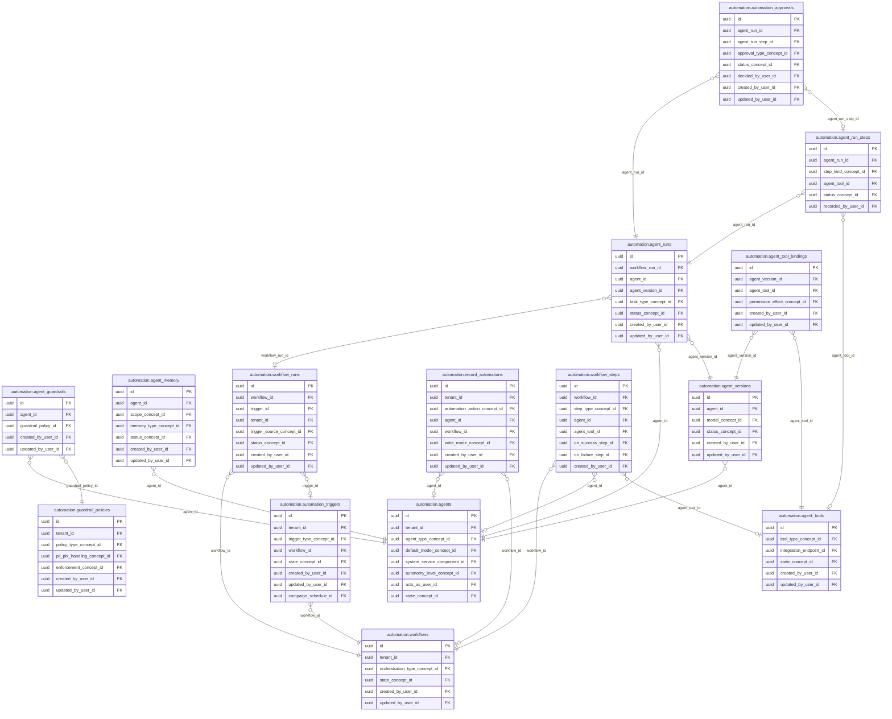

<!-- AUTOGENERADO por tools/inventario/catalogo.mjs. No editar manualmente. -->

# Catálogo del schema `automation`

- **Tablas:** 16 · **Columnas:** 245 (61 con descripción: 24.9 %) · **Índices:** 113
- **Dominio:** Operaciones de Plataforma
- Método y límites del catálogo: [README del inventario](../README.md)

## Tablas

| Tabla | Propósito | Columnas | Índices | Operaciones | ORM |
|---|---|---|---|---|---|
| [agent_guardrails](#agent_guardrails) | Asocia reglas de control a agentes para evitar acciones fuera de su alcance permitido. | 9 | 4 | 3 | COINCIDE |
| [agent_memory](#agent_memory) | Conserva memoria operativa autorizada de agentes para dar continuidad controlada entre interacciones. | 15 | 6 | 3 | COINCIDE |
| [agent_run_steps](#agent_run_steps) | Detalla pasos de cada ejecución de agente para reconstruir herramientas invocadas y resultados. | 13 | 6 | 6 | COINCIDE |
| [agent_runs](#agent_runs) | Conserva ejecuciones de agentes para auditar solicitudes, resultados y comportamiento. | 19 | 7 | 10 | COINCIDE |
| [agent_tool_bindings](#agent_tool_bindings) | Vincula herramientas con agentes para determinar qué acciones puede invocar cada uno. | 11 | 5 | 3 | COINCIDE |
| [agent_tools](#agent_tools) | Registra herramientas disponibles para agentes y sus contratos de operación. | 16 | 6 | 5 | COINCIDE |
| [agent_versions](#agent_versions) | Preserva versiones de agentes para mantener trazabilidad de configuración y comportamiento. | 16 | 6 | 5 | COINCIDE |
| [agents](#agents) | Cataloga agentes automatizados utilizados para asistir tareas operativas o de información del sistema médico. | 17 | 11 | 11 | COINCIDE |
| [automation_approvals](#automation_approvals) | Gestiona aprobaciones humanas requeridas antes de que una automatización realice acciones sensibles. | 16 | 7 | 6 | COINCIDE |
| [automation_triggers](#automation_triggers) | Configura eventos o condiciones que inician workflows y automatizaciones. | 19 | 8 | 4 | COINCIDE |
| [guardrail_policies](#guardrail_policies) | Define políticas de seguridad y límites que gobiernan la ejecución de agentes y automatizaciones. | 15 | 8 | 4 | COINCIDE |
| [knowledge_sources](#knowledge_sources) | Cataloga fuentes de conocimiento disponibles para agentes, incluyendo procedencia y condiciones de uso. | 14 | 7 | 0 | COINCIDE |
| [record_automations](#record_automations) | Define acciones automáticas asociadas a tipos o cambios de registros de negocio. | 17 | 8 | 1 | COINCIDE |
| [workflow_runs](#workflow_runs) | Registra ejecuciones de workflows para mantener estado, resultado y evidencia operativa. | 19 | 9 | 13 | COINCIDE |
| [workflow_steps](#workflow_steps) | Detalla pasos ejecutables de un workflow y sus dependencias. | 15 | 8 | 2 | COINCIDE |
| [workflows](#workflows) | Define automatizaciones compuestas por pasos que coordinan procesos y servicios. | 14 | 7 | 5 | COINCIDE |

## Diagrama entidad-relación

Las tablas se agrupan en familias por sus claves foráneas dentro del schema (máximo 40 por diagrama). Las FK hacia otros schemas se listan en la ficha de cada tabla.

### Familia 1 de 1 — 15 tablas

### Tablas sin relaciones dentro del schema

`automation.knowledge_sources`

## Fichas

### agent_guardrails

#### Vista general

Asocia reglas de control a agentes para evitar acciones fuera de su alcance permitido.

- **Estado del propósito:** DOMAIN_CURATED_DRAFT · fuente: `Mantra Core Health Context/modules/diagram_48_automation.puml: agent_guardrails`
- **Dominio:** Operaciones de Plataforma · **Diagrama:** `Mantra Core Health Context/modules/diagram_48_automation.puml` · **DDL:** `SQL/48_automation/02_tables.sql`
- **Entidad del ORM:** `AgentGuardrails` — `src/modules/automation/entities/agent_guardrails.entity.ts`
- **Resumen:** 9 columnas · 4 índices · 4 FK salientes · 0 entrantes · 3 operaciones

#### Columnas

| # | Columna | Tipo | Rol estructural | Descripción | ORM |
|---|---|---|---|---|---|
| 1 | `id` | `uuid` | Clave primaria; Obligatoria | Identificador único de la instancia. _(JSDOC_ESTANDAR, `src/modules/automation/entities/agent_guardrails.entity.ts:12`)_ | coincide |
| 2 | `agent_id` | `uuid` | Clave foránea → automation.agents.id; Obligatoria | _sin dato_ | coincide |
| 3 | `guardrail_policy_id` | `uuid` | Clave foránea → automation.guardrail_policies.id; Obligatoria | _sin dato_ | coincide |
| 4 | `is_enabled` | `boolean` | Obligatoria | _sin dato_ | coincide |
| 5 | `created_at` | `timestamptz` | Obligatoria | Fecha y hora en que se creó el registro. _(JSDOC_ESTANDAR, `src/modules/automation/entities/agent_guardrails.entity.ts:36`)_ | coincide |
| 6 | `updated_at` | `timestamptz` | Obligatoria | Fecha y hora de la última actualización. _(JSDOC_ESTANDAR, `src/modules/automation/entities/agent_guardrails.entity.ts:42`)_ | coincide |
| 7 | `created_by_user_id` | `uuid` | Clave foránea → iam.users.id; Opcional | _sin dato_ | coincide |
| 8 | `updated_by_user_id` | `uuid` | Clave foránea → iam.users.id; Opcional | _sin dato_ | coincide |
| 9 | `row_version` | `integer = 1` | Obligatoria | Versión usada para controlar actualizaciones concurrentes. _(JSDOC_ENTIDAD, `src/modules/automation/entities/agent_guardrails.entity.ts:60`)_ | coincide |

#### Relaciones

| Sentido | Columnas | Tabla | Restricción |
|---|---|---|---|
| hacia | agent_id | automation.agents (id) | fk_agent_guardrails_agent_id |
| hacia | guardrail_policy_id | automation.guardrail_policies (id) | fk_agent_guardrails_guardrail_policy_id |
| hacia | created_by_user_id | iam.users (id) | fk_agent_guardrails_created_by_user_id |
| hacia | updated_by_user_id | iam.users (id) | fk_agent_guardrails_updated_by_user_id |

#### Índices

| Índice | Único | Columnas | Para qué |
|---|---|---|---|
| `ix_agent_guardrails_agent_id` | no | agent_id | Soporta la clave foránea fk_agent_guardrails_agent_id: PostgreSQL no indexa las FK por sí mismo _(DOCUMENTO)_; 2 consulta(s) de repositorio filtran u ordenan por «agent_id», la primera columna del índice _(CONSULTA)_ |
| `ix_agent_guardrails_guardrail_policy_id` | no | guardrail_policy_id | Soporta la clave foránea fk_agent_guardrails_guardrail_policy_id: PostgreSQL no indexa las FK por sí mismo _(DOCUMENTO)_; 1 consulta(s) de repositorio filtran u ordenan por «guardrail_policy_id», la primera columna del índice _(CONSULTA)_ |
| `ix_agent_guardrails_created_by_user_id` | no | created_by_user_id | Soporta la clave foránea fk_agent_guardrails_created_by_user_id: PostgreSQL no indexa las FK por sí mismo _(DOCUMENTO)_ |
| `ix_agent_guardrails_updated_by_user_id` | no | updated_by_user_id | Soporta la clave foránea fk_agent_guardrails_updated_by_user_id: PostgreSQL no indexa las FK por sí mismo _(DOCUMENTO)_ |

#### Operaciones que la tocan

| Operación | Efecto | Confianza |
|---|---|---|
| POST /automation/agent-runs/{id}/steps | LEE | DIRECTA |
| POST /automation/agents/{id}/guardrails | CREA | DIRECTA |
| POST /automation/agents/{id}/guardrails | LEE | DIRECTA |

#### Gobierno

| Atributo | Valor | Fuente |
|---|---|---|
| Append-only | no declarado | — |
| Datos personales | sin fuente | — |
| Financiera | sin fuente | — |
| Crítica para auditoría | sin fuente | — |
| Retención | sin fuente | — |
| Responsable | sin fuente | — |
| Revisión | AUTO_DETECTADA | — |

---

### agent_memory

#### Vista general

Conserva memoria operativa autorizada de agentes para dar continuidad controlada entre interacciones.

- **Estado del propósito:** DOMAIN_CURATED_DRAFT · fuente: `Mantra Core Health Context/modules/diagram_48_automation.puml: agent_memory`
- **Dominio:** Operaciones de Plataforma · **Diagrama:** `Mantra Core Health Context/modules/diagram_48_automation.puml` · **DDL:** `SQL/48_automation/02_tables.sql`
- **Entidad del ORM:** `AgentMemory` — `src/modules/automation/entities/agent_memory.entity.ts`
- **Resumen:** 15 columnas · 6 índices · 6 FK salientes · 0 entrantes · 3 operaciones

#### Columnas

| # | Columna | Tipo | Rol estructural | Descripción | ORM |
|---|---|---|---|---|---|
| 1 | `id` | `uuid` | Clave primaria; Obligatoria | Identificador único de la instancia. _(JSDOC_ESTANDAR, `src/modules/automation/entities/agent_memory.entity.ts:12`)_ | coincide |
| 2 | `agent_id` | `uuid` | Clave foránea → automation.agents.id; Obligatoria | _sin dato_ | coincide |
| 3 | `scope_concept_id` | `uuid` | Clave foránea → terminology.catalog_concepts.id; Obligatoria | _sin dato_ | coincide |
| 4 | `scope_ref_id` | `uuid` | Opcional | _sin dato_ | coincide |
| 5 | `memory_type_concept_id` | `uuid` | Clave foránea → terminology.catalog_concepts.id; Obligatoria | _sin dato_ | coincide |
| 6 | `content_text` | `text` | Obligatoria | _sin dato_ | coincide |
| 7 | `embedding_ref` | `varchar` | Opcional | _sin dato_ | coincide |
| 8 | `importance` | `numeric` | Opcional | _sin dato_ | coincide |
| 9 | `expires_at` | `timestamptz` | Opcional | _sin dato_ | coincide |
| 10 | `status_concept_id` | `uuid` | Clave foránea → terminology.catalog_concepts.id; Obligatoria | _sin dato_ | coincide |
| 11 | `created_at` | `timestamptz` | Obligatoria | Fecha y hora en que se creó el registro. _(JSDOC_ESTANDAR, `src/modules/automation/entities/agent_memory.entity.ts:80`)_ | coincide |
| 12 | `updated_at` | `timestamptz` | Obligatoria | Fecha y hora de la última actualización. _(JSDOC_ESTANDAR, `src/modules/automation/entities/agent_memory.entity.ts:86`)_ | coincide |
| 13 | `created_by_user_id` | `uuid` | Clave foránea → iam.users.id; Opcional | _sin dato_ | coincide |
| 14 | `updated_by_user_id` | `uuid` | Clave foránea → iam.users.id; Opcional | _sin dato_ | coincide |
| 15 | `row_version` | `integer = 1` | Obligatoria | Versión usada para controlar actualizaciones concurrentes. _(JSDOC_ENTIDAD, `src/modules/automation/entities/agent_memory.entity.ts:104`)_ | coincide |

#### Relaciones

| Sentido | Columnas | Tabla | Restricción |
|---|---|---|---|
| hacia | agent_id | automation.agents (id) | fk_agent_memory_agent_id |
| hacia | scope_concept_id | terminology.catalog_concepts (id) | fk_agent_memory_scope_concept_id |
| hacia | memory_type_concept_id | terminology.catalog_concepts (id) | fk_agent_memory_memory_type_concept_id |
| hacia | status_concept_id | terminology.catalog_concepts (id) | fk_agent_memory_status_concept_id |
| hacia | created_by_user_id | iam.users (id) | fk_agent_memory_created_by_user_id |
| hacia | updated_by_user_id | iam.users (id) | fk_agent_memory_updated_by_user_id |

#### Índices

| Índice | Único | Columnas | Para qué |
|---|---|---|---|
| `ix_agent_memory_agent_id` | no | agent_id | Soporta la clave foránea fk_agent_memory_agent_id: PostgreSQL no indexa las FK por sí mismo _(DOCUMENTO)_; 1 consulta(s) de repositorio filtran u ordenan por «agent_id», la primera columna del índice _(CONSULTA)_ |
| `ix_agent_memory_scope_concept_id` | no | scope_concept_id | Soporta la clave foránea fk_agent_memory_scope_concept_id: PostgreSQL no indexa las FK por sí mismo _(DOCUMENTO)_; 1 consulta(s) de repositorio filtran u ordenan por «scope_concept_id», la primera columna del índice _(CONSULTA)_ |
| `ix_agent_memory_memory_type_concept_id` | no | memory_type_concept_id | Soporta la clave foránea fk_agent_memory_memory_type_concept_id: PostgreSQL no indexa las FK por sí mismo _(DOCUMENTO)_; 1 consulta(s) de repositorio filtran u ordenan por «memory_type_concept_id», la primera columna del índice _(CONSULTA)_ |
| `ix_agent_memory_status_concept_id` | no | status_concept_id | Soporta la clave foránea fk_agent_memory_status_concept_id: PostgreSQL no indexa las FK por sí mismo _(DOCUMENTO)_ |
| `ix_agent_memory_created_by_user_id` | no | created_by_user_id | Soporta la clave foránea fk_agent_memory_created_by_user_id: PostgreSQL no indexa las FK por sí mismo _(DOCUMENTO)_ |
| `ix_agent_memory_updated_by_user_id` | no | updated_by_user_id | Soporta la clave foránea fk_agent_memory_updated_by_user_id: PostgreSQL no indexa las FK por sí mismo _(DOCUMENTO)_ |

#### Operaciones que la tocan

| Operación | Efecto | Confianza |
|---|---|---|
| POST /automation/agents/{id}/memory | ACTUALIZA | POR_TIPO |
| POST /automation/agents/{id}/memory | CREA | DIRECTA |
| POST /automation/agents/{id}/memory | LEE | DIRECTA |

#### Gobierno

| Atributo | Valor | Fuente |
|---|---|---|
| Append-only | no declarado | — |
| Datos personales | sin fuente | — |
| Financiera | sin fuente | — |
| Crítica para auditoría | sin fuente | — |
| Retención | sin fuente | — |
| Responsable | sin fuente | — |
| Revisión | AUTO_DETECTADA | — |

---

### agent_run_steps

#### Vista general

Detalla pasos de cada ejecución de agente para reconstruir herramientas invocadas y resultados.

- **Estado del propósito:** DOMAIN_CURATED_DRAFT · fuente: `Mantra Core Health Context/modules/diagram_48_automation.puml: agent_run_steps`
- **Dominio:** Operaciones de Plataforma · **Diagrama:** `Mantra Core Health Context/modules/diagram_48_automation.puml` · **DDL:** `SQL/48_automation/02_tables.sql`
- **Entidad del ORM:** `AgentRunSteps` — `src/modules/automation/entities/agent_run_steps.entity.ts`
- **Resumen:** 13 columnas · 6 índices · 5 FK salientes · 1 entrantes · 6 operaciones

#### Columnas

| # | Columna | Tipo | Rol estructural | Descripción | ORM |
|---|---|---|---|---|---|
| 1 | `id` | `uuid` | Clave primaria; Obligatoria | Identificador único de la instancia. _(JSDOC_ESTANDAR, `src/modules/automation/entities/agent_run_steps.entity.ts:12`)_ | coincide |
| 2 | `agent_run_id` | `uuid` | Clave foránea → automation.agent_runs.id; Obligatoria | _sin dato_ | coincide |
| 3 | `sequence_no` | `integer` | Obligatoria | _sin dato_ | coincide |
| 4 | `step_kind_concept_id` | `uuid` | Clave foránea → terminology.catalog_concepts.id; Obligatoria | _sin dato_ | coincide |
| 5 | `agent_tool_id` | `uuid` | Clave foránea → automation.agent_tools.id; Opcional | _sin dato_ | coincide |
| 6 | `thought_text` | `text` | Opcional | _sin dato_ | coincide |
| 7 | `tool_input_json` | `jsonb` | Opcional | _sin dato_ | coincide |
| 8 | `tool_output_json` | `jsonb` | Opcional | _sin dato_ | coincide |
| 9 | `status_concept_id` | `uuid` | Clave foránea → terminology.catalog_concepts.id; Obligatoria | _sin dato_ | coincide |
| 10 | `error_text` | `text` | Opcional | _sin dato_ | coincide |
| 11 | `occurred_at` | `timestamptz` | Opcional | _sin dato_ | coincide |
| 12 | `recorded_at` | `timestamptz` | Obligatoria | _sin dato_ | coincide |
| 13 | `recorded_by_user_id` | `uuid` | Clave foránea → iam.users.id; Opcional | _sin dato_ | coincide |

#### Relaciones

| Sentido | Columnas | Tabla | Restricción |
|---|---|---|---|
| hacia | agent_run_id | automation.agent_runs (id) | fk_agent_run_steps_agent_run_id |
| hacia | agent_tool_id | automation.agent_tools (id) | fk_agent_run_steps_agent_tool_id |
| hacia | step_kind_concept_id | terminology.catalog_concepts (id) | fk_agent_run_steps_step_kind_concept_id |
| hacia | status_concept_id | terminology.catalog_concepts (id) | fk_agent_run_steps_status_concept_id |
| hacia | recorded_by_user_id | iam.users (id) | fk_agent_run_steps_recorded_by_user_id |
| desde | id | automation.automation_approvals (agent_run_step_id) | fk_automation_approvals_agent_run_step_id |

#### Índices

| Índice | Único | Columnas | Para qué |
|---|---|---|---|
| `ix_agent_run_steps_agent_run_id` | no | agent_run_id | Soporta la clave foránea fk_agent_run_steps_agent_run_id: PostgreSQL no indexa las FK por sí mismo _(DOCUMENTO)_; 2 consulta(s) de repositorio filtran u ordenan por «agent_run_id», la primera columna del índice _(CONSULTA)_ |
| `ix_agent_run_steps_step_kind_concept_id` | no | step_kind_concept_id | Soporta la clave foránea fk_agent_run_steps_step_kind_concept_id: PostgreSQL no indexa las FK por sí mismo _(DOCUMENTO)_ |
| `ix_agent_run_steps_agent_tool_id` | no | agent_tool_id | Soporta la clave foránea fk_agent_run_steps_agent_tool_id: PostgreSQL no indexa las FK por sí mismo _(DOCUMENTO)_; 1 consulta(s) de repositorio filtran u ordenan por «agent_tool_id», la primera columna del índice _(CONSULTA)_ |
| `ix_agent_run_steps_status_concept_id` | no | status_concept_id | Soporta la clave foránea fk_agent_run_steps_status_concept_id: PostgreSQL no indexa las FK por sí mismo _(DOCUMENTO)_ |
| `ix_agent_run_steps_recorded_by_user_id` | no | recorded_by_user_id | Soporta la clave foránea fk_agent_run_steps_recorded_by_user_id: PostgreSQL no indexa las FK por sí mismo _(DOCUMENTO)_ |
| `brin_agent_run_steps_recorded_at` | no | recorded_at | BRIN para logs e historiales append-only de gran volumen _(DOCUMENTO)_ |

#### Operaciones que la tocan

| Operación | Efecto | Confianza |
|---|---|---|
| POST /automation/agent-runs/{id}/record-automations/{recordAutomationId}/execute | CREA | DIRECTA |
| POST /automation/agent-runs/{id}/record-automations/{recordAutomationId}/execute | LEE | DIRECTA |
| POST /automation/agent-runs/{id}/steps | CREA | DIRECTA |
| POST /automation/agent-runs/{id}/steps | LEE | DIRECTA |
| POST /automation/approvals/{id}/decide | CREA | DIRECTA |
| POST /automation/approvals/{id}/decide | LEE | DIRECTA |

#### Gobierno

| Atributo | Valor | Fuente |
|---|---|---|
| Append-only | no declarado | — |
| Datos personales | sin fuente | — |
| Financiera | sin fuente | — |
| Crítica para auditoría | sin fuente | — |
| Retención | sin fuente | — |
| Responsable | sin fuente | — |
| Revisión | AUTO_DETECTADA | — |

---

### agent_runs

#### Vista general

Conserva ejecuciones de agentes para auditar solicitudes, resultados y comportamiento.

- **Estado del propósito:** DOMAIN_CURATED_DRAFT · fuente: `Mantra Core Health Context/modules/diagram_48_automation.puml: agent_runs`
- **Dominio:** Operaciones de Plataforma · **Diagrama:** `Mantra Core Health Context/modules/diagram_48_automation.puml` · **DDL:** `SQL/48_automation/02_tables.sql`
- **Entidad del ORM:** `AgentRuns` — `src/modules/automation/entities/agent_runs.entity.ts`
- **Resumen:** 19 columnas · 7 índices · 7 FK salientes · 2 entrantes · 10 operaciones

#### Columnas

| # | Columna | Tipo | Rol estructural | Descripción | ORM |
|---|---|---|---|---|---|
| 1 | `id` | `uuid` | Clave primaria; Obligatoria | Identificador único de la instancia. _(JSDOC_ESTANDAR, `src/modules/automation/entities/agent_runs.entity.ts:12`)_ | coincide |
| 2 | `workflow_run_id` | `uuid` | Clave foránea → automation.workflow_runs.id; Opcional | _sin dato_ | coincide |
| 3 | `agent_id` | `uuid` | Clave foránea → automation.agents.id; Obligatoria | _sin dato_ | coincide |
| 4 | `agent_version_id` | `uuid` | Clave foránea → automation.agent_versions.id; Obligatoria | _sin dato_ | coincide |
| 5 | `task_type_concept_id` | `uuid` | Clave foránea → terminology.catalog_concepts.id; Obligatoria | _sin dato_ | coincide |
| 6 | `input_json` | `jsonb` | Opcional | _sin dato_ | coincide |
| 7 | `output_json` | `jsonb` | Opcional | _sin dato_ | coincide |
| 8 | `status_concept_id` | `uuid` | Clave foránea → terminology.catalog_concepts.id; Obligatoria | _sin dato_ | coincide |
| 9 | `input_tokens` | `integer` | Opcional | _sin dato_ | coincide |
| 10 | `output_tokens` | `integer` | Opcional | _sin dato_ | coincide |
| 11 | `cost_amount` | `numeric` | Opcional | _sin dato_ | coincide |
| 12 | `latency_ms` | `integer` | Opcional | _sin dato_ | coincide |
| 13 | `started_at` | `timestamptz` | Opcional | _sin dato_ | coincide |
| 14 | `finished_at` | `timestamptz` | Opcional | _sin dato_ | coincide |
| 15 | `created_at` | `timestamptz` | Obligatoria | Fecha y hora en que se creó el registro. _(JSDOC_ESTANDAR, `src/modules/automation/entities/agent_runs.entity.ts:114`)_ | coincide |
| 16 | `updated_at` | `timestamptz` | Obligatoria | Fecha y hora de la última actualización. _(JSDOC_ESTANDAR, `src/modules/automation/entities/agent_runs.entity.ts:120`)_ | coincide |
| 17 | `created_by_user_id` | `uuid` | Clave foránea → iam.users.id; Opcional | _sin dato_ | coincide |
| 18 | `updated_by_user_id` | `uuid` | Clave foránea → iam.users.id; Opcional | _sin dato_ | coincide |
| 19 | `row_version` | `integer = 1` | Obligatoria | Versión usada para controlar actualizaciones concurrentes. _(JSDOC_ENTIDAD, `src/modules/automation/entities/agent_runs.entity.ts:138`)_ | coincide |

#### Relaciones

| Sentido | Columnas | Tabla | Restricción |
|---|---|---|---|
| hacia | workflow_run_id | automation.workflow_runs (id) | fk_agent_runs_workflow_run_id |
| hacia | agent_id | automation.agents (id) | fk_agent_runs_agent_id |
| hacia | agent_version_id | automation.agent_versions (id) | fk_agent_runs_agent_version_id |
| hacia | task_type_concept_id | terminology.catalog_concepts (id) | fk_agent_runs_task_type_concept_id |
| hacia | status_concept_id | terminology.catalog_concepts (id) | fk_agent_runs_status_concept_id |
| hacia | created_by_user_id | iam.users (id) | fk_agent_runs_created_by_user_id |
| hacia | updated_by_user_id | iam.users (id) | fk_agent_runs_updated_by_user_id |
| desde | id | automation.agent_run_steps (agent_run_id) | fk_agent_run_steps_agent_run_id |
| desde | id | automation.automation_approvals (agent_run_id) | fk_automation_approvals_agent_run_id |

#### Índices

| Índice | Único | Columnas | Para qué |
|---|---|---|---|
| `ix_agent_runs_workflow_run_id` | no | workflow_run_id | Soporta la clave foránea fk_agent_runs_workflow_run_id: PostgreSQL no indexa las FK por sí mismo _(DOCUMENTO)_; 1 consulta(s) de repositorio filtran u ordenan por «workflow_run_id», la primera columna del índice _(CONSULTA)_ |
| `ix_agent_runs_agent_id` | no | agent_id | Soporta la clave foránea fk_agent_runs_agent_id: PostgreSQL no indexa las FK por sí mismo _(DOCUMENTO)_ |
| `ix_agent_runs_agent_version_id` | no | agent_version_id | Soporta la clave foránea fk_agent_runs_agent_version_id: PostgreSQL no indexa las FK por sí mismo _(DOCUMENTO)_ |
| `ix_agent_runs_task_type_concept_id` | no | task_type_concept_id | Soporta la clave foránea fk_agent_runs_task_type_concept_id: PostgreSQL no indexa las FK por sí mismo _(DOCUMENTO)_ |
| `ix_agent_runs_status_concept_id` | no | status_concept_id | Soporta la clave foránea fk_agent_runs_status_concept_id: PostgreSQL no indexa las FK por sí mismo _(DOCUMENTO)_ |
| `ix_agent_runs_created_by_user_id` | no | created_by_user_id | Soporta la clave foránea fk_agent_runs_created_by_user_id: PostgreSQL no indexa las FK por sí mismo _(DOCUMENTO)_ |
| `ix_agent_runs_updated_by_user_id` | no | updated_by_user_id | Soporta la clave foránea fk_agent_runs_updated_by_user_id: PostgreSQL no indexa las FK por sí mismo _(DOCUMENTO)_ |

#### Operaciones que la tocan

| Operación | Efecto | Confianza |
|---|---|---|
| POST /automation/agent-runs/{id}/approvals | ACTUALIZA | POR_TIPO |
| POST /automation/agent-runs/{id}/approvals | LEE | DIRECTA |
| POST /automation/agent-runs/{id}/record-automations/{recordAutomationId}/execute | LEE | DIRECTA |
| POST /automation/agent-runs/{id}/steps | ACTUALIZA | POR_TIPO |
| POST /automation/agent-runs/{id}/steps | LEE | DIRECTA |
| POST /automation/approvals/{id}/decide | ACTUALIZA | POR_TIPO |
| POST /automation/approvals/{id}/decide | LEE | DIRECTA |
| POST /automation/runs/{workflowRunId}/agent-runs | CREA | DIRECTA |
| POST /automation/runs/{workflowRunId}/finalize | ACTUALIZA | POR_TIPO |
| POST /automation/runs/{workflowRunId}/finalize | LEE | DIRECTA |

#### Gobierno

| Atributo | Valor | Fuente |
|---|---|---|
| Append-only | no declarado | — |
| Datos personales | sin fuente | — |
| Financiera | sin fuente | — |
| Crítica para auditoría | sin fuente | — |
| Retención | sin fuente | — |
| Responsable | sin fuente | — |
| Revisión | AUTO_DETECTADA | — |

---

### agent_tool_bindings

#### Vista general

Vincula herramientas con agentes para determinar qué acciones puede invocar cada uno.

- **Estado del propósito:** DOMAIN_CURATED_DRAFT · fuente: `Mantra Core Health Context/modules/diagram_48_automation.puml: agent_tool_bindings`
- **Dominio:** Operaciones de Plataforma · **Diagrama:** `Mantra Core Health Context/modules/diagram_48_automation.puml` · **DDL:** `SQL/48_automation/02_tables.sql`
- **Entidad del ORM:** `AgentToolBindings` — `src/modules/automation/entities/agent_tool_bindings.entity.ts`
- **Resumen:** 11 columnas · 5 índices · 5 FK salientes · 0 entrantes · 3 operaciones

#### Columnas

| # | Columna | Tipo | Rol estructural | Descripción | ORM |
|---|---|---|---|---|---|
| 1 | `id` | `uuid` | Clave primaria; Obligatoria | Identificador único de la instancia. _(JSDOC_ESTANDAR, `src/modules/automation/entities/agent_tool_bindings.entity.ts:12`)_ | coincide |
| 2 | `agent_version_id` | `uuid` | Clave foránea → automation.agent_versions.id; Obligatoria | _sin dato_ | coincide |
| 3 | `agent_tool_id` | `uuid` | Clave foránea → automation.agent_tools.id; Obligatoria | _sin dato_ | coincide |
| 4 | `scope_json` | `jsonb` | Opcional | _sin dato_ | coincide |
| 5 | `max_calls_per_run` | `integer` | Opcional | _sin dato_ | coincide |
| 6 | `permission_effect_concept_id` | `uuid` | Clave foránea → terminology.catalog_concepts.id; Obligatoria | _sin dato_ | coincide |
| 7 | `created_at` | `timestamptz` | Obligatoria | Fecha y hora en que se creó el registro. _(JSDOC_ESTANDAR, `src/modules/automation/entities/agent_tool_bindings.entity.ts:57`)_ | coincide |
| 8 | `updated_at` | `timestamptz` | Obligatoria | Fecha y hora de la última actualización. _(JSDOC_ESTANDAR, `src/modules/automation/entities/agent_tool_bindings.entity.ts:63`)_ | coincide |
| 9 | `created_by_user_id` | `uuid` | Clave foránea → iam.users.id; Opcional | _sin dato_ | coincide |
| 10 | `updated_by_user_id` | `uuid` | Clave foránea → iam.users.id; Opcional | _sin dato_ | coincide |
| 11 | `row_version` | `integer = 1` | Obligatoria | Versión usada para controlar actualizaciones concurrentes. _(JSDOC_ENTIDAD, `src/modules/automation/entities/agent_tool_bindings.entity.ts:81`)_ | coincide |

#### Relaciones

| Sentido | Columnas | Tabla | Restricción |
|---|---|---|---|
| hacia | agent_version_id | automation.agent_versions (id) | fk_agent_tool_bindings_agent_version_id |
| hacia | agent_tool_id | automation.agent_tools (id) | fk_agent_tool_bindings_agent_tool_id |
| hacia | permission_effect_concept_id | terminology.catalog_concepts (id) | fk_agent_tool_bindings_permission_effect_concept_id |
| hacia | created_by_user_id | iam.users (id) | fk_agent_tool_bindings_created_by_user_id |
| hacia | updated_by_user_id | iam.users (id) | fk_agent_tool_bindings_updated_by_user_id |

#### Índices

| Índice | Único | Columnas | Para qué |
|---|---|---|---|
| `ix_agent_tool_bindings_agent_version_id` | no | agent_version_id | Soporta la clave foránea fk_agent_tool_bindings_agent_version_id: PostgreSQL no indexa las FK por sí mismo _(DOCUMENTO)_; 2 consulta(s) de repositorio filtran u ordenan por «agent_version_id», la primera columna del índice _(CONSULTA)_ |
| `ix_agent_tool_bindings_agent_tool_id` | no | agent_tool_id | Soporta la clave foránea fk_agent_tool_bindings_agent_tool_id: PostgreSQL no indexa las FK por sí mismo _(DOCUMENTO)_; 1 consulta(s) de repositorio filtran u ordenan por «agent_tool_id», la primera columna del índice _(CONSULTA)_ |
| `ix_agent_tool_bindings_permission_effect_concept_id` | no | permission_effect_concept_id | Soporta la clave foránea fk_agent_tool_bindings_permission_effect_concept_id: PostgreSQL no indexa las FK por sí mismo _(DOCUMENTO)_ |
| `ix_agent_tool_bindings_created_by_user_id` | no | created_by_user_id | Soporta la clave foránea fk_agent_tool_bindings_created_by_user_id: PostgreSQL no indexa las FK por sí mismo _(DOCUMENTO)_ |
| `ix_agent_tool_bindings_updated_by_user_id` | no | updated_by_user_id | Soporta la clave foránea fk_agent_tool_bindings_updated_by_user_id: PostgreSQL no indexa las FK por sí mismo _(DOCUMENTO)_ |

#### Operaciones que la tocan

| Operación | Efecto | Confianza |
|---|---|---|
| POST /automation/agent-runs/{id}/steps | LEE | DIRECTA |
| POST /automation/agents/{id}/versions/{versionId}/tool-bindings | CREA | DIRECTA |
| POST /automation/agents/{id}/versions/{versionId}/tool-bindings | LEE | DIRECTA |

#### Gobierno

| Atributo | Valor | Fuente |
|---|---|---|
| Append-only | no declarado | — |
| Datos personales | sin fuente | — |
| Financiera | sin fuente | — |
| Crítica para auditoría | sin fuente | — |
| Retención | sin fuente | — |
| Responsable | sin fuente | — |
| Revisión | AUTO_DETECTADA | — |

---

### agent_tools

#### Vista general

Registra herramientas disponibles para agentes y sus contratos de operación.

- **Estado del propósito:** DOMAIN_CURATED_DRAFT · fuente: `Mantra Core Health Context/modules/diagram_48_automation.puml: agent_tools`
- **Dominio:** Operaciones de Plataforma · **Diagrama:** `Mantra Core Health Context/modules/diagram_48_automation.puml` · **DDL:** `SQL/48_automation/02_tables.sql`
- **Entidad del ORM:** `AgentTools` — `src/modules/automation/entities/agent_tools.entity.ts`
- **Resumen:** 16 columnas · 6 índices · 5 FK salientes · 3 entrantes · 5 operaciones

#### Columnas

| # | Columna | Tipo | Rol estructural | Descripción | ORM |
|---|---|---|---|---|---|
| 1 | `id` | `uuid` | Clave primaria; Obligatoria | Identificador único de la instancia. _(JSDOC_ESTANDAR, `src/modules/automation/entities/agent_tools.entity.ts:12`)_ | coincide |
| 2 | `code` | `varchar` | Obligatoria | _sin dato_ | coincide |
| 3 | `name` | `varchar` | Obligatoria | _sin dato_ | coincide |
| 4 | `tool_type_concept_id` | `uuid` | Clave foránea → terminology.catalog_concepts.id; Obligatoria | _sin dato_ | coincide |
| 5 | `target_resource` | `varchar` | Opcional | _sin dato_ | coincide |
| 6 | `input_schema_json` | `jsonb` | Opcional | _sin dato_ | coincide |
| 7 | `output_schema_json` | `jsonb` | Opcional | _sin dato_ | coincide |
| 8 | `integration_endpoint_id` | `uuid` | Clave foránea → integrations.integration_endpoints.id; Opcional | _sin dato_ | coincide |
| 9 | `is_write` | `boolean` | Opcional | _sin dato_ | coincide |
| 10 | `requires_approval` | `boolean` | Opcional | _sin dato_ | coincide |
| 11 | `state_concept_id` | `uuid` | Clave foránea → terminology.catalog_concepts.id; Obligatoria | _sin dato_ | coincide |
| 12 | `created_at` | `timestamptz` | Obligatoria | Fecha y hora en que se creó el registro. _(JSDOC_ESTANDAR, `src/modules/automation/entities/agent_tools.entity.ts:96`)_ | coincide |
| 13 | `updated_at` | `timestamptz` | Obligatoria | Fecha y hora de la última actualización. _(JSDOC_ESTANDAR, `src/modules/automation/entities/agent_tools.entity.ts:102`)_ | coincide |
| 14 | `created_by_user_id` | `uuid` | Clave foránea → iam.users.id; Opcional | _sin dato_ | coincide |
| 15 | `updated_by_user_id` | `uuid` | Clave foránea → iam.users.id; Opcional | _sin dato_ | coincide |
| 16 | `row_version` | `integer = 1` | Obligatoria | Versión usada para controlar actualizaciones concurrentes. _(JSDOC_ENTIDAD, `src/modules/automation/entities/agent_tools.entity.ts:120`)_ | coincide |

#### Relaciones

| Sentido | Columnas | Tabla | Restricción |
|---|---|---|---|
| hacia | tool_type_concept_id | terminology.catalog_concepts (id) | fk_agent_tools_tool_type_concept_id |
| hacia | integration_endpoint_id | integrations.integration_endpoints (id) | fk_agent_tools_integration_endpoint_id |
| hacia | state_concept_id | terminology.catalog_concepts (id) | fk_agent_tools_state_concept_id |
| hacia | created_by_user_id | iam.users (id) | fk_agent_tools_created_by_user_id |
| hacia | updated_by_user_id | iam.users (id) | fk_agent_tools_updated_by_user_id |
| desde | id | automation.agent_tool_bindings (agent_tool_id) | fk_agent_tool_bindings_agent_tool_id |
| desde | id | automation.workflow_steps (agent_tool_id) | fk_workflow_steps_agent_tool_id |
| desde | id | automation.agent_run_steps (agent_tool_id) | fk_agent_run_steps_agent_tool_id |

#### Índices

| Índice | Único | Columnas | Para qué |
|---|---|---|---|
| `uq_agent_tools_code` | sí | code | Garantiza que no se repita la combinación (code) _(DOCUMENTO)_; 1 consulta(s) de repositorio filtran u ordenan por «code», la primera columna del índice _(CONSULTA)_ |
| `ix_agent_tools_tool_type_concept_id` | no | tool_type_concept_id | Soporta la clave foránea fk_agent_tools_tool_type_concept_id: PostgreSQL no indexa las FK por sí mismo _(DOCUMENTO)_ |
| `ix_agent_tools_integration_endpoint_id` | no | integration_endpoint_id | Soporta la clave foránea fk_agent_tools_integration_endpoint_id: PostgreSQL no indexa las FK por sí mismo _(DOCUMENTO)_ |
| `ix_agent_tools_state_concept_id` | no | state_concept_id | Soporta la clave foránea fk_agent_tools_state_concept_id: PostgreSQL no indexa las FK por sí mismo _(DOCUMENTO)_ |
| `ix_agent_tools_created_by_user_id` | no | created_by_user_id | Soporta la clave foránea fk_agent_tools_created_by_user_id: PostgreSQL no indexa las FK por sí mismo _(DOCUMENTO)_ |
| `ix_agent_tools_updated_by_user_id` | no | updated_by_user_id | Soporta la clave foránea fk_agent_tools_updated_by_user_id: PostgreSQL no indexa las FK por sí mismo _(DOCUMENTO)_ |

#### Restricciones

| Restricción | Tipo | Definición |
|---|---|---|
| `uq_agent_tools_code` | UNIQUE INDEX | UNIQUE INDEX ("code") |

#### Operaciones que la tocan

| Operación | Efecto | Confianza |
|---|---|---|
| POST /automation/agent-runs/{id}/steps | LEE | DIRECTA |
| POST /automation/agents/{id}/versions/{versionId}/tool-bindings | LEE | DIRECTA |
| POST /automation/tools | CREA | DIRECTA |
| POST /automation/tools | LEE | DIRECTA |
| POST /automation/workflows | LEE | DIRECTA |

#### Gobierno

| Atributo | Valor | Fuente |
|---|---|---|
| Append-only | no declarado | — |
| Datos personales | sin fuente | — |
| Financiera | sin fuente | — |
| Crítica para auditoría | sin fuente | — |
| Retención | sin fuente | — |
| Responsable | sin fuente | — |
| Revisión | AUTO_DETECTADA | — |

---

### agent_versions

#### Vista general

Preserva versiones de agentes para mantener trazabilidad de configuración y comportamiento.

- **Estado del propósito:** DOMAIN_CURATED_DRAFT · fuente: `Mantra Core Health Context/modules/diagram_48_automation.puml: agent_versions`
- **Dominio:** Operaciones de Plataforma · **Diagrama:** `Mantra Core Health Context/modules/diagram_48_automation.puml` · **DDL:** `SQL/48_automation/02_tables.sql`
- **Entidad del ORM:** `AgentVersions` — `src/modules/automation/entities/agent_versions.entity.ts`
- **Resumen:** 16 columnas · 6 índices · 5 FK salientes · 3 entrantes · 5 operaciones

#### Columnas

| # | Columna | Tipo | Rol estructural | Descripción | ORM |
|---|---|---|---|---|---|
| 1 | `id` | `uuid` | Clave primaria; Obligatoria | Identificador único de la instancia. _(JSDOC_ESTANDAR, `src/modules/automation/entities/agent_versions.entity.ts:12`)_ | coincide |
| 2 | `agent_id` | `uuid` | Clave foránea → automation.agents.id; Obligatoria | _sin dato_ | coincide |
| 3 | `version` | `integer` | Obligatoria | _sin dato_ | coincide |
| 4 | `prompt_template` | `text` | Obligatoria | _sin dato_ | coincide |
| 5 | `model_concept_id` | `uuid` | Clave foránea → terminology.catalog_concepts.id; Opcional | _sin dato_ | coincide |
| 6 | `model_params_json` | `jsonb` | Opcional | _sin dato_ | coincide |
| 7 | `input_schema_json` | `jsonb` | Opcional | _sin dato_ | coincide |
| 8 | `output_schema_json` | `jsonb` | Opcional | _sin dato_ | coincide |
| 9 | `changelog` | `text` | Opcional | _sin dato_ | coincide |
| 10 | `status_concept_id` | `uuid` | Clave foránea → terminology.catalog_concepts.id; Obligatoria | _sin dato_ | coincide |
| 11 | `published_at` | `timestamptz` | Opcional | _sin dato_ | coincide |
| 12 | `created_at` | `timestamptz` | Obligatoria | Fecha y hora en que se creó el registro. _(JSDOC_ESTANDAR, `src/modules/automation/entities/agent_versions.entity.ts:97`)_ | coincide |
| 13 | `updated_at` | `timestamptz` | Obligatoria | Fecha y hora de la última actualización. _(JSDOC_ESTANDAR, `src/modules/automation/entities/agent_versions.entity.ts:103`)_ | coincide |
| 14 | `created_by_user_id` | `uuid` | Clave foránea → iam.users.id; Opcional | _sin dato_ | coincide |
| 15 | `updated_by_user_id` | `uuid` | Clave foránea → iam.users.id; Opcional | _sin dato_ | coincide |
| 16 | `row_version` | `integer = 1` | Obligatoria | Versión usada para controlar actualizaciones concurrentes. _(JSDOC_ENTIDAD, `src/modules/automation/entities/agent_versions.entity.ts:121`)_ | coincide |

#### Relaciones

| Sentido | Columnas | Tabla | Restricción |
|---|---|---|---|
| hacia | agent_id | automation.agents (id) | fk_agent_versions_agent_id |
| hacia | model_concept_id | terminology.catalog_concepts (id) | fk_agent_versions_model_concept_id |
| hacia | status_concept_id | terminology.catalog_concepts (id) | fk_agent_versions_status_concept_id |
| hacia | created_by_user_id | iam.users (id) | fk_agent_versions_created_by_user_id |
| hacia | updated_by_user_id | iam.users (id) | fk_agent_versions_updated_by_user_id |
| desde | id | automation.agent_tool_bindings (agent_version_id) | fk_agent_tool_bindings_agent_version_id |
| desde | id | automation.agent_runs (agent_version_id) | fk_agent_runs_agent_version_id |
| desde | id | audit.agent_versions_history (agent_versions_id) | fk_agent_versions_history_agent_versions_id |

#### Índices

| Índice | Único | Columnas | Para qué |
|---|---|---|---|
| `ix_agent_versions_agent_id` | no | agent_id | Soporta la clave foránea fk_agent_versions_agent_id: PostgreSQL no indexa las FK por sí mismo _(DOCUMENTO)_; 2 consulta(s) de repositorio filtran u ordenan por «agent_id», la primera columna del índice _(CONSULTA)_ |
| `ix_agent_versions_model_concept_id` | no | model_concept_id | Soporta la clave foránea fk_agent_versions_model_concept_id: PostgreSQL no indexa las FK por sí mismo _(DOCUMENTO)_ |
| `ix_agent_versions_status_concept_id` | no | status_concept_id | Soporta la clave foránea fk_agent_versions_status_concept_id: PostgreSQL no indexa las FK por sí mismo _(DOCUMENTO)_ |
| `ix_agent_versions_created_by_user_id` | no | created_by_user_id | Soporta la clave foránea fk_agent_versions_created_by_user_id: PostgreSQL no indexa las FK por sí mismo _(DOCUMENTO)_ |
| `ix_agent_versions_updated_by_user_id` | no | updated_by_user_id | Soporta la clave foránea fk_agent_versions_updated_by_user_id: PostgreSQL no indexa las FK por sí mismo _(DOCUMENTO)_ |
| `uq_agent_versions_agent_id_version` | sí | agent_id, version | Garantiza que no se repita la combinación (agent_id, version) _(DOCUMENTO)_; Soporta la clave foránea fk_agent_versions_agent_id: PostgreSQL no indexa las FK por sí mismo _(DOCUMENTO)_; 2 consulta(s) de repositorio filtran u ordenan por «agent_id», la primera columna del índice _(CONSULTA)_ |

#### Restricciones

| Restricción | Tipo | Definición |
|---|---|---|
| `uq_agent_versions_agent_id_version` | UNIQUE INDEX | UNIQUE INDEX ("agent_id", "version") |

#### Operaciones que la tocan

| Operación | Efecto | Confianza |
|---|---|---|
| POST /automation/agents | CREA | DIRECTA |
| POST /automation/agents/{id}/versions/{versionId}/tool-bindings | LEE | DIRECTA |
| POST /automation/agents/{id}/versions/publish | CREA | DIRECTA |
| POST /automation/agents/{id}/versions/publish | LEE | DIRECTA |
| POST /automation/runs/{workflowRunId}/agent-runs | LEE | DIRECTA |

#### Gobierno

| Atributo | Valor | Fuente |
|---|---|---|
| Append-only | no declarado | — |
| Datos personales | sin fuente | — |
| Financiera | sin fuente | — |
| Crítica para auditoría | sin fuente | — |
| Retención | sin fuente | — |
| Responsable | sin fuente | — |
| Revisión | AUTO_DETECTADA | — |

---

### agents

#### Vista general

Cataloga agentes automatizados utilizados para asistir tareas operativas o de información del sistema médico.

- **Estado del propósito:** DOMAIN_CURATED_DRAFT · fuente: `Mantra Core Health Context/modules/diagram_48_automation.puml: agents`
- **Dominio:** Operaciones de Plataforma · **Diagrama:** `Mantra Core Health Context/modules/diagram_48_automation.puml` · **DDL:** `SQL/48_automation/02_tables.sql`
- **Entidad del ORM:** `Agents` — `src/modules/automation/entities/agents.entity.ts`
- **Resumen:** 17 columnas · 11 índices · 9 FK salientes · 11 entrantes · 11 operaciones

#### Columnas

| # | Columna | Tipo | Rol estructural | Descripción | ORM |
|---|---|---|---|---|---|
| 1 | `id` | `uuid` | Clave primaria; Obligatoria | Identificador único de la instancia. _(JSDOC_ESTANDAR, `src/modules/automation/entities/agents.entity.ts:12`)_ | coincide |
| 2 | `tenant_id` | `uuid` | Clave foránea → directory.tenants.id; Opcional | _sin dato_ | coincide |
| 3 | `code` | `varchar` | Obligatoria | _sin dato_ | coincide |
| 4 | `name` | `varchar` | Obligatoria | _sin dato_ | coincide |
| 5 | `agent_type_concept_id` | `uuid` | Clave foránea → terminology.catalog_concepts.id; Obligatoria | _sin dato_ | coincide |
| 6 | `description` | `text` | Opcional | _sin dato_ | coincide |
| 7 | `default_model_concept_id` | `uuid` | Clave foránea → terminology.catalog_concepts.id; Opcional | _sin dato_ | coincide |
| 8 | `system_service_component_id` | `uuid` | Clave foránea → platform_ops.service_components.id; Opcional | _sin dato_ | coincide |
| 9 | `autonomy_level_concept_id` | `uuid` | Clave foránea → terminology.catalog_concepts.id; Obligatoria | _sin dato_ | coincide |
| 10 | `acts_as_user_id` | `uuid` | Clave foránea → iam.users.id; Opcional | _sin dato_ | coincide |
| 11 | `current_version` | `integer` | Obligatoria | _sin dato_ | coincide |
| 12 | `state_concept_id` | `uuid` | Clave foránea → terminology.catalog_concepts.id; Obligatoria | _sin dato_ | coincide |
| 13 | `created_at` | `timestamptz` | Obligatoria | Fecha y hora en que se creó el registro. _(JSDOC_ESTANDAR, `src/modules/automation/entities/agents.entity.ts:92`)_ | coincide |
| 14 | `updated_at` | `timestamptz` | Obligatoria | Fecha y hora de la última actualización. _(JSDOC_ESTANDAR, `src/modules/automation/entities/agents.entity.ts:98`)_ | coincide |
| 15 | `created_by_user_id` | `uuid` | Clave foránea → iam.users.id; Opcional | _sin dato_ | coincide |
| 16 | `updated_by_user_id` | `uuid` | Clave foránea → iam.users.id; Opcional | _sin dato_ | coincide |
| 17 | `row_version` | `integer = 1` | Obligatoria | Versión usada para controlar actualizaciones concurrentes. _(JSDOC_ENTIDAD, `src/modules/automation/entities/agents.entity.ts:116`)_ | coincide |

#### Relaciones

| Sentido | Columnas | Tabla | Restricción |
|---|---|---|---|
| hacia | tenant_id | directory.tenants (id) | fk_agents_tenant_id |
| hacia | agent_type_concept_id | terminology.catalog_concepts (id) | fk_agents_agent_type_concept_id |
| hacia | default_model_concept_id | terminology.catalog_concepts (id) | fk_agents_default_model_concept_id |
| hacia | system_service_component_id | platform_ops.service_components (id) | fk_agents_system_service_component_id |
| hacia | autonomy_level_concept_id | terminology.catalog_concepts (id) | fk_agents_autonomy_level_concept_id |
| hacia | acts_as_user_id | iam.users (id) | fk_agents_acts_as_user_id |
| hacia | state_concept_id | terminology.catalog_concepts (id) | fk_agents_state_concept_id |
| hacia | created_by_user_id | iam.users (id) | fk_agents_created_by_user_id |
| hacia | updated_by_user_id | iam.users (id) | fk_agents_updated_by_user_id |
| desde | id | automation.agent_versions (agent_id) | fk_agent_versions_agent_id |
| desde | id | automation.agent_guardrails (agent_id) | fk_agent_guardrails_agent_id |
| desde | id | automation.workflow_steps (agent_id) | fk_workflow_steps_agent_id |
| desde | id | automation.record_automations (agent_id) | fk_record_automations_agent_id |
| desde | id | automation.agent_runs (agent_id) | fk_agent_runs_agent_id |
| desde | id | automation.agent_memory (agent_id) | fk_agent_memory_agent_id |
| desde | id | audit.agents_history (agents_id) | fk_agents_history_agents_id |
| desde | id | health_context.country_context_schedules (agent_id) | fk_country_context_schedules_agent_id |
| desde | id | health_context.context_collection_runs (agent_id) | fk_context_collection_runs_agent_id |
| desde | id | health_context.context_quality_reviews (reviewer_agent_id) | fk_context_quality_reviews_reviewer_agent_id |
| desde | id | system_context.system_context_versions (generated_by_agent_id) | fk_system_context_versions_generated_by_agent_id |

#### Índices

| Índice | Único | Columnas | Para qué |
|---|---|---|---|
| `uq_agents_code` | sí | code | Garantiza que no se repita la combinación (code) _(DOCUMENTO)_; 1 consulta(s) de repositorio filtran u ordenan por «code», la primera columna del índice _(CONSULTA)_ |
| `ix_agents_tenant_id` | no | tenant_id | Soporta la clave foránea fk_agents_tenant_id: PostgreSQL no indexa las FK por sí mismo _(DOCUMENTO)_ |
| `ix_agents_agent_type_concept_id` | no | agent_type_concept_id | Soporta la clave foránea fk_agents_agent_type_concept_id: PostgreSQL no indexa las FK por sí mismo _(DOCUMENTO)_ |
| `ix_agents_default_model_concept_id` | no | default_model_concept_id | Soporta la clave foránea fk_agents_default_model_concept_id: PostgreSQL no indexa las FK por sí mismo _(DOCUMENTO)_ |
| `ix_agents_system_service_component_id` | no | system_service_component_id | Soporta la clave foránea fk_agents_system_service_component_id: PostgreSQL no indexa las FK por sí mismo _(DOCUMENTO)_ |
| `ix_agents_autonomy_level_concept_id` | no | autonomy_level_concept_id | Soporta la clave foránea fk_agents_autonomy_level_concept_id: PostgreSQL no indexa las FK por sí mismo _(DOCUMENTO)_ |
| `ix_agents_acts_as_user_id` | no | acts_as_user_id | Soporta la clave foránea fk_agents_acts_as_user_id: PostgreSQL no indexa las FK por sí mismo _(DOCUMENTO)_ |
| `ix_agents_state_concept_id` | no | state_concept_id | Soporta la clave foránea fk_agents_state_concept_id: PostgreSQL no indexa las FK por sí mismo _(DOCUMENTO)_ |
| `ix_agents_created_by_user_id` | no | created_by_user_id | Soporta la clave foránea fk_agents_created_by_user_id: PostgreSQL no indexa las FK por sí mismo _(DOCUMENTO)_ |
| `ix_agents_updated_by_user_id` | no | updated_by_user_id | Soporta la clave foránea fk_agents_updated_by_user_id: PostgreSQL no indexa las FK por sí mismo _(DOCUMENTO)_ |
| `ix_agents_tenant_id_state_concept_id` | no | tenant_id, state_concept_id, ("updated_at" DESC) | _sin uso detectado estáticamente_ |

#### Restricciones

| Restricción | Tipo | Definición |
|---|---|---|
| `uq_agents_code` | UNIQUE INDEX | UNIQUE INDEX ("code") |

#### Operaciones que la tocan

| Operación | Efecto | Confianza |
|---|---|---|
| POST /automation/agent-runs/{id}/approvals | LEE | DIRECTA |
| POST /automation/agent-runs/{id}/record-automations/{recordAutomationId}/execute | LEE | DIRECTA |
| POST /automation/agent-runs/{id}/steps | LEE | DIRECTA |
| POST /automation/agents | CREA | DIRECTA |
| POST /automation/agents | LEE | DIRECTA |
| POST /automation/agents/{id}/guardrails | LEE | DIRECTA |
| POST /automation/agents/{id}/memory | LEE | DIRECTA |
| POST /automation/agents/{id}/versions/publish | ACTUALIZA | POR_TIPO |
| POST /automation/agents/{id}/versions/publish | LEE | DIRECTA |
| POST /automation/runs/{workflowRunId}/agent-runs | LEE | DIRECTA |
| POST /automation/workflows | LEE | DIRECTA |

#### Gobierno

| Atributo | Valor | Fuente |
|---|---|---|
| Append-only | no declarado | — |
| Datos personales | sin fuente | — |
| Financiera | sin fuente | — |
| Crítica para auditoría | sin fuente | — |
| Retención | sin fuente | — |
| Responsable | sin fuente | — |
| Revisión | AUTO_DETECTADA | — |

---

### automation_approvals

#### Vista general

Gestiona aprobaciones humanas requeridas antes de que una automatización realice acciones sensibles.

- **Estado del propósito:** DOMAIN_CURATED_DRAFT · fuente: `Mantra Core Health Context/modules/diagram_48_automation.puml: automation_approvals`
- **Dominio:** Operaciones de Plataforma · **Diagrama:** `Mantra Core Health Context/modules/diagram_48_automation.puml` · **DDL:** `SQL/48_automation/02_tables.sql`
- **Entidad del ORM:** `AutomationApprovals` — `src/modules/automation/entities/automation_approvals.entity.ts`
- **Resumen:** 16 columnas · 7 índices · 7 FK salientes · 0 entrantes · 6 operaciones

#### Columnas

| # | Columna | Tipo | Rol estructural | Descripción | ORM |
|---|---|---|---|---|---|
| 1 | `id` | `uuid` | Clave primaria; Obligatoria | Identificador único de la instancia. _(JSDOC_ESTANDAR, `src/modules/automation/entities/automation_approvals.entity.ts:12`)_ | coincide |
| 2 | `agent_run_id` | `uuid` | Clave foránea → automation.agent_runs.id; Obligatoria | _sin dato_ | coincide |
| 3 | `agent_run_step_id` | `uuid` | Clave foránea → automation.agent_run_steps.id; Opcional | _sin dato_ | coincide |
| 4 | `approval_type_concept_id` | `uuid` | Clave foránea → terminology.catalog_concepts.id; Obligatoria | _sin dato_ | coincide |
| 5 | `requested_action_json` | `jsonb` | Opcional | _sin dato_ | coincide |
| 6 | `target_resource_type` | `varchar` | Opcional | _sin dato_ | coincide |
| 7 | `target_ref_id` | `uuid` | Opcional | _sin dato_ | coincide |
| 8 | `status_concept_id` | `uuid` | Clave foránea → terminology.catalog_concepts.id; Obligatoria | _sin dato_ | coincide |
| 9 | `decided_by_user_id` | `uuid` | Clave foránea → iam.users.id; Opcional | _sin dato_ | coincide |
| 10 | `decided_at` | `timestamptz` | Opcional | _sin dato_ | coincide |
| 11 | `decision_note` | `text` | Opcional | _sin dato_ | coincide |
| 12 | `created_at` | `timestamptz` | Obligatoria | Fecha y hora en que se creó el registro. _(JSDOC_ESTANDAR, `src/modules/automation/entities/automation_approvals.entity.ts:91`)_ | coincide |
| 13 | `updated_at` | `timestamptz` | Obligatoria | Fecha y hora de la última actualización. _(JSDOC_ESTANDAR, `src/modules/automation/entities/automation_approvals.entity.ts:97`)_ | coincide |
| 14 | `created_by_user_id` | `uuid` | Clave foránea → iam.users.id; Opcional | _sin dato_ | coincide |
| 15 | `updated_by_user_id` | `uuid` | Clave foránea → iam.users.id; Opcional | _sin dato_ | coincide |
| 16 | `row_version` | `integer = 1` | Obligatoria | Versión usada para controlar actualizaciones concurrentes. _(JSDOC_ENTIDAD, `src/modules/automation/entities/automation_approvals.entity.ts:115`)_ | coincide |

#### Relaciones

| Sentido | Columnas | Tabla | Restricción |
|---|---|---|---|
| hacia | agent_run_id | automation.agent_runs (id) | fk_automation_approvals_agent_run_id |
| hacia | agent_run_step_id | automation.agent_run_steps (id) | fk_automation_approvals_agent_run_step_id |
| hacia | approval_type_concept_id | terminology.catalog_concepts (id) | fk_automation_approvals_approval_type_concept_id |
| hacia | status_concept_id | terminology.catalog_concepts (id) | fk_automation_approvals_status_concept_id |
| hacia | decided_by_user_id | iam.users (id) | fk_automation_approvals_decided_by_user_id |
| hacia | created_by_user_id | iam.users (id) | fk_automation_approvals_created_by_user_id |
| hacia | updated_by_user_id | iam.users (id) | fk_automation_approvals_updated_by_user_id |

#### Índices

| Índice | Único | Columnas | Para qué |
|---|---|---|---|
| `ix_automation_approvals_agent_run_id` | no | agent_run_id | Soporta la clave foránea fk_automation_approvals_agent_run_id: PostgreSQL no indexa las FK por sí mismo _(DOCUMENTO)_; 1 consulta(s) de repositorio filtran u ordenan por «agent_run_id», la primera columna del índice _(CONSULTA)_ |
| `ix_automation_approvals_agent_run_step_id` | no | agent_run_step_id | Soporta la clave foránea fk_automation_approvals_agent_run_step_id: PostgreSQL no indexa las FK por sí mismo _(DOCUMENTO)_ |
| `ix_automation_approvals_approval_type_concept_id` | no | approval_type_concept_id | Soporta la clave foránea fk_automation_approvals_approval_type_concept_id: PostgreSQL no indexa las FK por sí mismo _(DOCUMENTO)_ |
| `ix_automation_approvals_status_concept_id` | no | status_concept_id | Soporta la clave foránea fk_automation_approvals_status_concept_id: PostgreSQL no indexa las FK por sí mismo _(DOCUMENTO)_; 1 consulta(s) de repositorio filtran u ordenan por «status_concept_id», la primera columna del índice _(CONSULTA)_ |
| `ix_automation_approvals_decided_by_user_id` | no | decided_by_user_id | Soporta la clave foránea fk_automation_approvals_decided_by_user_id: PostgreSQL no indexa las FK por sí mismo _(DOCUMENTO)_ |
| `ix_automation_approvals_created_by_user_id` | no | created_by_user_id | Soporta la clave foránea fk_automation_approvals_created_by_user_id: PostgreSQL no indexa las FK por sí mismo _(DOCUMENTO)_ |
| `ix_automation_approvals_updated_by_user_id` | no | updated_by_user_id | Soporta la clave foránea fk_automation_approvals_updated_by_user_id: PostgreSQL no indexa las FK por sí mismo _(DOCUMENTO)_ |

#### Operaciones que la tocan

| Operación | Efecto | Confianza |
|---|---|---|
| POST /automation/agent-runs/{id}/approvals | CREA | DIRECTA |
| POST /automation/agent-runs/{id}/approvals | LEE | DIRECTA |
| POST /automation/agent-runs/{id}/steps | CREA | DIRECTA |
| POST /automation/approvals/{id}/decide | ACTUALIZA | POR_TIPO |
| POST /automation/approvals/{id}/decide | LEE | DIRECTA |
| POST /automation/runs/{workflowRunId}/finalize | LEE | DIRECTA |

#### Gobierno

| Atributo | Valor | Fuente |
|---|---|---|
| Append-only | no declarado | — |
| Datos personales | sin fuente | — |
| Financiera | sin fuente | — |
| Crítica para auditoría | sin fuente | — |
| Retención | sin fuente | — |
| Responsable | sin fuente | — |
| Revisión | AUTO_DETECTADA | — |

---

### automation_triggers

#### Vista general

Configura eventos o condiciones que inician workflows y automatizaciones.

- **Estado del propósito:** DOMAIN_CURATED_DRAFT · fuente: `Mantra Core Health Context/modules/diagram_48_automation.puml: automation_triggers`
- **Dominio:** Operaciones de Plataforma · **Diagrama:** `Mantra Core Health Context/modules/diagram_48_automation.puml` · **DDL:** `SQL/48_automation/02_tables.sql`
- **Entidad del ORM:** `AutomationTriggers` — `src/modules/automation/entities/automation_triggers.entity.ts`
- **Resumen:** 19 columnas · 8 índices · 8 FK salientes · 1 entrantes · 4 operaciones

#### Columnas

| # | Columna | Tipo | Rol estructural | Descripción | ORM |
|---|---|---|---|---|---|
| 1 | `id` | `uuid` | Clave primaria; Obligatoria | Identificador único de la instancia. _(JSDOC_ESTANDAR, `src/modules/automation/entities/automation_triggers.entity.ts:12`)_ | coincide |
| 2 | `tenant_id` | `uuid` | Clave foránea → directory.tenants.id; Opcional | _sin dato_ | coincide |
| 3 | `code` | `varchar` | Obligatoria | _sin dato_ | coincide |
| 4 | `name` | `varchar` | Obligatoria | _sin dato_ | coincide |
| 5 | `trigger_type_concept_id` | `uuid` | Clave foránea → terminology.catalog_concepts.id; Obligatoria | _sin dato_ | coincide |
| 6 | `event_type` | `varchar` | Opcional | _sin dato_ | coincide |
| 7 | `target_resource_type` | `varchar` | Opcional | _sin dato_ | coincide |
| 8 | `condition_json` | `jsonb` | Opcional | _sin dato_ | coincide |
| 9 | `schedule_cron` | `varchar` | Opcional | _sin dato_ | coincide |
| 10 | `workflow_id` | `uuid` | Clave foránea → automation.workflows.id; Obligatoria | _sin dato_ | coincide |
| 11 | `is_enabled` | `boolean` | Opcional | _sin dato_ | coincide |
| 12 | `state_concept_id` | `uuid` | Clave foránea → terminology.catalog_concepts.id; Obligatoria | _sin dato_ | coincide |
| 13 | `created_at` | `timestamptz` | Obligatoria | Fecha y hora en que se creó el registro. _(JSDOC_ESTANDAR, `src/modules/automation/entities/automation_triggers.entity.ts:97`)_ | coincide |
| 14 | `updated_at` | `timestamptz` | Obligatoria | Fecha y hora de la última actualización. _(JSDOC_ESTANDAR, `src/modules/automation/entities/automation_triggers.entity.ts:103`)_ | coincide |
| 15 | `created_by_user_id` | `uuid` | Clave foránea → iam.users.id; Opcional | _sin dato_ | coincide |
| 16 | `updated_by_user_id` | `uuid` | Clave foránea → iam.users.id; Opcional | _sin dato_ | coincide |
| 17 | `row_version` | `integer = 1` | Obligatoria | Versión usada para controlar actualizaciones concurrentes. _(JSDOC_ENTIDAD, `src/modules/automation/entities/automation_triggers.entity.ts:121`)_ | coincide |
| 18 | `campaign_schedule_id` | `uuid` | Clave foránea → marketing.campaign_schedules.id; Opcional | _sin dato_ | coincide |
| 19 | `schedule_source_concept_id` | `uuid` | Clave foránea → terminology.catalog_concepts.id; Obligatoria | _sin dato_ | coincide |

#### Relaciones

| Sentido | Columnas | Tabla | Restricción |
|---|---|---|---|
| hacia | workflow_id | automation.workflows (id) | fk_automation_triggers_workflow_id |
| hacia | tenant_id | directory.tenants (id) | fk_automation_triggers_tenant_id |
| hacia | trigger_type_concept_id | terminology.catalog_concepts (id) | fk_automation_triggers_trigger_type_concept_id |
| hacia | state_concept_id | terminology.catalog_concepts (id) | fk_automation_triggers_state_concept_id |
| hacia | created_by_user_id | iam.users (id) | fk_automation_triggers_created_by_user_id |
| hacia | updated_by_user_id | iam.users (id) | fk_automation_triggers_updated_by_user_id |
| hacia | campaign_schedule_id | marketing.campaign_schedules (id) | fk_automation_triggers_campaign_schedule_id |
| hacia | schedule_source_concept_id | terminology.catalog_concepts (id) | fk_automation_triggers_schedule_source_concept_id |
| desde | id | automation.workflow_runs (trigger_id) | fk_workflow_runs_trigger_id |

#### Índices

| Índice | Único | Columnas | Para qué |
|---|---|---|---|
| `uq_automation_triggers_code` | sí | code | Garantiza que no se repita la combinación (code) _(DOCUMENTO)_; 1 consulta(s) de repositorio filtran u ordenan por «code», la primera columna del índice _(CONSULTA)_ |
| `ix_automation_triggers_tenant_id` | no | tenant_id | Soporta la clave foránea fk_automation_triggers_tenant_id: PostgreSQL no indexa las FK por sí mismo _(DOCUMENTO)_ |
| `ix_automation_triggers_trigger_type_concept_id` | no | trigger_type_concept_id | Soporta la clave foránea fk_automation_triggers_trigger_type_concept_id: PostgreSQL no indexa las FK por sí mismo _(DOCUMENTO)_; 1 consulta(s) de repositorio filtran u ordenan por «trigger_type_concept_id», la primera columna del índice _(CONSULTA)_ |
| `ix_automation_triggers_workflow_id` | no | workflow_id | Soporta la clave foránea fk_automation_triggers_workflow_id: PostgreSQL no indexa las FK por sí mismo _(DOCUMENTO)_ |
| `ix_automation_triggers_state_concept_id` | no | state_concept_id | Soporta la clave foránea fk_automation_triggers_state_concept_id: PostgreSQL no indexa las FK por sí mismo _(DOCUMENTO)_; 1 consulta(s) de repositorio filtran u ordenan por «state_concept_id», la primera columna del índice _(CONSULTA)_ |
| `ix_automation_triggers_created_by_user_id` | no | created_by_user_id | Soporta la clave foránea fk_automation_triggers_created_by_user_id: PostgreSQL no indexa las FK por sí mismo _(DOCUMENTO)_ |
| `ix_automation_triggers_updated_by_user_id` | no | updated_by_user_id | Soporta la clave foránea fk_automation_triggers_updated_by_user_id: PostgreSQL no indexa las FK por sí mismo _(DOCUMENTO)_ |
| `ix_automation_triggers_tenant_id_state_concept_id` | no | tenant_id, state_concept_id, ("updated_at" DESC) | _sin uso detectado estáticamente_ |

#### Restricciones

| Restricción | Tipo | Definición |
|---|---|---|
| `uq_automation_triggers_code` | UNIQUE INDEX | UNIQUE INDEX ("code") |

#### Operaciones que la tocan

| Operación | Efecto | Confianza |
|---|---|---|
| POST /automation/triggers | CREA | DIRECTA |
| POST /automation/triggers | LEE | DIRECTA |
| POST /automation/triggers/calendar/tick | LEE | DIRECTA |
| POST /automation/workflows/{id}/runs | LEE | DIRECTA |

#### Gobierno

| Atributo | Valor | Fuente |
|---|---|---|
| Append-only | no declarado | — |
| Datos personales | sin fuente | — |
| Financiera | sin fuente | — |
| Crítica para auditoría | sin fuente | — |
| Retención | sin fuente | — |
| Responsable | sin fuente | — |
| Revisión | AUTO_DETECTADA | — |

---

### guardrail_policies

#### Vista general

Define políticas de seguridad y límites que gobiernan la ejecución de agentes y automatizaciones.

- **Estado del propósito:** DOMAIN_CURATED_DRAFT · fuente: `Mantra Core Health Context/modules/diagram_48_automation.puml: guardrail_policies`
- **Dominio:** Operaciones de Plataforma · **Diagrama:** `Mantra Core Health Context/modules/diagram_48_automation.puml` · **DDL:** `SQL/48_automation/02_tables.sql`
- **Entidad del ORM:** `GuardrailPolicies` — `src/modules/automation/entities/guardrail_policies.entity.ts`
- **Resumen:** 15 columnas · 8 índices · 6 FK salientes · 2 entrantes · 4 operaciones

#### Columnas

| # | Columna | Tipo | Rol estructural | Descripción | ORM |
|---|---|---|---|---|---|
| 1 | `id` | `uuid` | Clave primaria; Obligatoria | Identificador único de la instancia. _(JSDOC_ESTANDAR, `src/modules/automation/entities/guardrail_policies.entity.ts:12`)_ | coincide |
| 2 | `tenant_id` | `uuid` | Clave foránea → directory.tenants.id; Opcional | _sin dato_ | coincide |
| 3 | `code` | `varchar` | Obligatoria | _sin dato_ | coincide |
| 4 | `name` | `varchar` | Obligatoria | _sin dato_ | coincide |
| 5 | `policy_type_concept_id` | `uuid` | Clave foránea → terminology.catalog_concepts.id; Obligatoria | _sin dato_ | coincide |
| 6 | `rule_json` | `jsonb` | Opcional | _sin dato_ | coincide |
| 7 | `pii_phi_handling_concept_id` | `uuid` | Clave foránea → terminology.catalog_concepts.id; Opcional | _sin dato_ | coincide |
| 8 | `max_cost_amount` | `numeric` | Opcional | _sin dato_ | coincide |
| 9 | `enforcement_concept_id` | `uuid` | Clave foránea → terminology.catalog_concepts.id; Obligatoria | _sin dato_ | coincide |
| 10 | `is_active` | `boolean` | Obligatoria | _sin dato_ | coincide |
| 11 | `created_at` | `timestamptz` | Obligatoria | Fecha y hora en que se creó el registro. _(JSDOC_ESTANDAR, `src/modules/automation/entities/guardrail_policies.entity.ts:85`)_ | coincide |
| 12 | `updated_at` | `timestamptz` | Obligatoria | Fecha y hora de la última actualización. _(JSDOC_ESTANDAR, `src/modules/automation/entities/guardrail_policies.entity.ts:91`)_ | coincide |
| 13 | `created_by_user_id` | `uuid` | Clave foránea → iam.users.id; Opcional | _sin dato_ | coincide |
| 14 | `updated_by_user_id` | `uuid` | Clave foránea → iam.users.id; Opcional | _sin dato_ | coincide |
| 15 | `row_version` | `integer = 1` | Obligatoria | Versión usada para controlar actualizaciones concurrentes. _(JSDOC_ENTIDAD, `src/modules/automation/entities/guardrail_policies.entity.ts:109`)_ | coincide |

#### Relaciones

| Sentido | Columnas | Tabla | Restricción |
|---|---|---|---|
| hacia | tenant_id | directory.tenants (id) | fk_guardrail_policies_tenant_id |
| hacia | policy_type_concept_id | terminology.catalog_concepts (id) | fk_guardrail_policies_policy_type_concept_id |
| hacia | pii_phi_handling_concept_id | terminology.catalog_concepts (id) | fk_guardrail_policies_pii_phi_handling_concept_id |
| hacia | enforcement_concept_id | terminology.catalog_concepts (id) | fk_guardrail_policies_enforcement_concept_id |
| hacia | created_by_user_id | iam.users (id) | fk_guardrail_policies_created_by_user_id |
| hacia | updated_by_user_id | iam.users (id) | fk_guardrail_policies_updated_by_user_id |
| desde | id | automation.agent_guardrails (guardrail_policy_id) | fk_agent_guardrails_guardrail_policy_id |
| desde | id | audit.guardrail_policies_history (guardrail_policies_id) | fk_guardrail_policies_history_guardrail_policies_id |

#### Índices

| Índice | Único | Columnas | Para qué |
|---|---|---|---|
| `uq_guardrail_policies_code` | sí | code | Garantiza que no se repita la combinación (code) _(DOCUMENTO)_; 1 consulta(s) de repositorio filtran u ordenan por «code», la primera columna del índice _(CONSULTA)_ |
| `ix_guardrail_policies_tenant_id` | no | tenant_id | Soporta la clave foránea fk_guardrail_policies_tenant_id: PostgreSQL no indexa las FK por sí mismo _(DOCUMENTO)_ |
| `ix_guardrail_policies_policy_type_concept_id` | no | policy_type_concept_id | Soporta la clave foránea fk_guardrail_policies_policy_type_concept_id: PostgreSQL no indexa las FK por sí mismo _(DOCUMENTO)_ |
| `ix_guardrail_policies_pii_phi_handling_concept_id` | no | pii_phi_handling_concept_id | Soporta la clave foránea fk_guardrail_policies_pii_phi_handling_concept_id: PostgreSQL no indexa las FK por sí mismo _(DOCUMENTO)_ |
| `ix_guardrail_policies_enforcement_concept_id` | no | enforcement_concept_id | Soporta la clave foránea fk_guardrail_policies_enforcement_concept_id: PostgreSQL no indexa las FK por sí mismo _(DOCUMENTO)_ |
| `ix_guardrail_policies_created_by_user_id` | no | created_by_user_id | Soporta la clave foránea fk_guardrail_policies_created_by_user_id: PostgreSQL no indexa las FK por sí mismo _(DOCUMENTO)_ |
| `ix_guardrail_policies_updated_by_user_id` | no | updated_by_user_id | Soporta la clave foránea fk_guardrail_policies_updated_by_user_id: PostgreSQL no indexa las FK por sí mismo _(DOCUMENTO)_ |
| `ix_guardrail_policies_tenant_id_updated_at` | no | tenant_id, ("updated_at" DESC) | _sin uso detectado estáticamente_ |

#### Restricciones

| Restricción | Tipo | Definición |
|---|---|---|
| `uq_guardrail_policies_code` | UNIQUE INDEX | UNIQUE INDEX ("code") |

#### Operaciones que la tocan

| Operación | Efecto | Confianza |
|---|---|---|
| POST /automation/agent-runs/{id}/steps | LEE | DIRECTA |
| POST /automation/agents/{id}/guardrails | LEE | DIRECTA |
| POST /automation/guardrails | CREA | DIRECTA |
| POST /automation/guardrails | LEE | DIRECTA |

#### Gobierno

| Atributo | Valor | Fuente |
|---|---|---|
| Append-only | no declarado | — |
| Datos personales | sin fuente | — |
| Financiera | sin fuente | — |
| Crítica para auditoría | sin fuente | — |
| Retención | sin fuente | — |
| Responsable | sin fuente | — |
| Revisión | AUTO_DETECTADA | — |

---

### knowledge_sources

#### Vista general

Cataloga fuentes de conocimiento disponibles para agentes, incluyendo procedencia y condiciones de uso.

- **Estado del propósito:** DOMAIN_CURATED_DRAFT · fuente: `Mantra Core Health Context/modules/diagram_48_automation.puml: knowledge_sources`
- **Dominio:** Operaciones de Plataforma · **Diagrama:** `Mantra Core Health Context/modules/diagram_48_automation.puml` · **DDL:** `SQL/48_automation/02_tables.sql`
- **Entidad del ORM:** `KnowledgeSources` — `src/modules/automation/entities/knowledge_sources.entity.ts`
- **Resumen:** 14 columnas · 7 índices · 6 FK salientes · 0 entrantes · 0 operaciones

#### Columnas

| # | Columna | Tipo | Rol estructural | Descripción | ORM |
|---|---|---|---|---|---|
| 1 | `id` | `uuid` | Clave primaria; Obligatoria | Identificador único de la instancia. _(JSDOC_ESTANDAR, `src/modules/automation/entities/knowledge_sources.entity.ts:12`)_ | coincide |
| 2 | `tenant_id` | `uuid` | Clave foránea → directory.tenants.id; Opcional | _sin dato_ | coincide |
| 3 | `name` | `varchar` | Obligatoria | _sin dato_ | coincide |
| 4 | `source_type_concept_id` | `uuid` | Clave foránea → terminology.catalog_concepts.id; Obligatoria | _sin dato_ | coincide |
| 5 | `uri` | `text` | Opcional | _sin dato_ | coincide |
| 6 | `file_id` | `uuid` | Clave foránea → common.files.id; Opcional | _sin dato_ | coincide |
| 7 | `index_ref` | `varchar` | Opcional | _sin dato_ | coincide |
| 8 | `last_indexed_at` | `timestamptz` | Opcional | _sin dato_ | coincide |
| 9 | `state_concept_id` | `uuid` | Clave foránea → terminology.catalog_concepts.id; Obligatoria | _sin dato_ | coincide |
| 10 | `created_at` | `timestamptz` | Obligatoria | Fecha y hora en que se creó el registro. _(JSDOC_ESTANDAR, `src/modules/automation/entities/knowledge_sources.entity.ts:70`)_ | coincide |
| 11 | `updated_at` | `timestamptz` | Obligatoria | Fecha y hora de la última actualización. _(JSDOC_ESTANDAR, `src/modules/automation/entities/knowledge_sources.entity.ts:76`)_ | coincide |
| 12 | `created_by_user_id` | `uuid` | Clave foránea → iam.users.id; Opcional | _sin dato_ | coincide |
| 13 | `updated_by_user_id` | `uuid` | Clave foránea → iam.users.id; Opcional | _sin dato_ | coincide |
| 14 | `row_version` | `integer = 1` | Obligatoria | Versión usada para controlar actualizaciones concurrentes. _(JSDOC_ENTIDAD, `src/modules/automation/entities/knowledge_sources.entity.ts:94`)_ | coincide |

#### Relaciones

| Sentido | Columnas | Tabla | Restricción |
|---|---|---|---|
| hacia | tenant_id | directory.tenants (id) | fk_knowledge_sources_tenant_id |
| hacia | source_type_concept_id | terminology.catalog_concepts (id) | fk_knowledge_sources_source_type_concept_id |
| hacia | file_id | common.files (id) | fk_knowledge_sources_file_id |
| hacia | state_concept_id | terminology.catalog_concepts (id) | fk_knowledge_sources_state_concept_id |
| hacia | created_by_user_id | iam.users (id) | fk_knowledge_sources_created_by_user_id |
| hacia | updated_by_user_id | iam.users (id) | fk_knowledge_sources_updated_by_user_id |

#### Índices

| Índice | Único | Columnas | Para qué |
|---|---|---|---|
| `ix_knowledge_sources_tenant_id` | no | tenant_id | Soporta la clave foránea fk_knowledge_sources_tenant_id: PostgreSQL no indexa las FK por sí mismo _(DOCUMENTO)_ |
| `ix_knowledge_sources_source_type_concept_id` | no | source_type_concept_id | Soporta la clave foránea fk_knowledge_sources_source_type_concept_id: PostgreSQL no indexa las FK por sí mismo _(DOCUMENTO)_ |
| `ix_knowledge_sources_file_id` | no | file_id | Soporta la clave foránea fk_knowledge_sources_file_id: PostgreSQL no indexa las FK por sí mismo _(DOCUMENTO)_ |
| `ix_knowledge_sources_state_concept_id` | no | state_concept_id | Soporta la clave foránea fk_knowledge_sources_state_concept_id: PostgreSQL no indexa las FK por sí mismo _(DOCUMENTO)_ |
| `ix_knowledge_sources_created_by_user_id` | no | created_by_user_id | Soporta la clave foránea fk_knowledge_sources_created_by_user_id: PostgreSQL no indexa las FK por sí mismo _(DOCUMENTO)_ |
| `ix_knowledge_sources_updated_by_user_id` | no | updated_by_user_id | Soporta la clave foránea fk_knowledge_sources_updated_by_user_id: PostgreSQL no indexa las FK por sí mismo _(DOCUMENTO)_ |
| `ix_knowledge_sources_tenant_id_state_concept_id` | no | tenant_id, state_concept_id, ("updated_at" DESC) | _sin uso detectado estáticamente_ |

#### Operaciones que la tocan

_Ninguna operación HTTP la toca según el análisis estático (puede usarla un worker, un trigger o una migración)._

#### Gobierno

| Atributo | Valor | Fuente |
|---|---|---|
| Append-only | no declarado | — |
| Datos personales | sin fuente | — |
| Financiera | sin fuente | — |
| Crítica para auditoría | sin fuente | — |
| Retención | sin fuente | — |
| Responsable | sin fuente | — |
| Revisión | AUTO_DETECTADA | — |

---

### record_automations

#### Vista general

Define acciones automáticas asociadas a tipos o cambios de registros de negocio.

- **Estado del propósito:** DOMAIN_CURATED_DRAFT · fuente: `Mantra Core Health Context/modules/diagram_48_automation.puml: record_automations`
- **Dominio:** Operaciones de Plataforma · **Diagrama:** `Mantra Core Health Context/modules/diagram_48_automation.puml` · **DDL:** `SQL/48_automation/02_tables.sql`
- **Entidad del ORM:** `RecordAutomations` — `src/modules/automation/entities/record_automations.entity.ts`
- **Resumen:** 17 columnas · 8 índices · 7 FK salientes · 1 entrantes · 1 operaciones

#### Columnas

| # | Columna | Tipo | Rol estructural | Descripción | ORM |
|---|---|---|---|---|---|
| 1 | `id` | `uuid` | Clave primaria; Obligatoria | Identificador único de la instancia. _(JSDOC_ESTANDAR, `src/modules/automation/entities/record_automations.entity.ts:12`)_ | coincide |
| 2 | `tenant_id` | `uuid` | Clave foránea → directory.tenants.id; Opcional | _sin dato_ | coincide |
| 3 | `name` | `varchar` | Obligatoria | _sin dato_ | coincide |
| 4 | `target_resource_type` | `varchar` | Obligatoria | _sin dato_ | coincide |
| 5 | `automation_action_concept_id` | `uuid` | Clave foránea → terminology.catalog_concepts.id; Obligatoria | _sin dato_ | coincide |
| 6 | `field_mapping_json` | `jsonb` | Opcional | _sin dato_ | coincide |
| 7 | `validation_json` | `jsonb` | Opcional | _sin dato_ | coincide |
| 8 | `agent_id` | `uuid` | Clave foránea → automation.agents.id; Opcional | _sin dato_ | coincide |
| 9 | `workflow_id` | `uuid` | Clave foránea → automation.workflows.id; Opcional | _sin dato_ | coincide |
| 10 | `write_mode_concept_id` | `uuid` | Clave foránea → terminology.catalog_concepts.id; Obligatoria | _sin dato_ | coincide |
| 11 | `dedupe_key_expr` | `varchar` | Opcional | _sin dato_ | coincide |
| 12 | `is_active` | `boolean` | Obligatoria | _sin dato_ | coincide |
| 13 | `created_at` | `timestamptz` | Obligatoria | Fecha y hora en que se creó el registro. _(JSDOC_ESTANDAR, `src/modules/automation/entities/record_automations.entity.ts:98`)_ | coincide |
| 14 | `updated_at` | `timestamptz` | Obligatoria | Fecha y hora de la última actualización. _(JSDOC_ESTANDAR, `src/modules/automation/entities/record_automations.entity.ts:104`)_ | coincide |
| 15 | `created_by_user_id` | `uuid` | Clave foránea → iam.users.id; Opcional | _sin dato_ | coincide |
| 16 | `updated_by_user_id` | `uuid` | Clave foránea → iam.users.id; Opcional | _sin dato_ | coincide |
| 17 | `row_version` | `integer = 1` | Obligatoria | Versión usada para controlar actualizaciones concurrentes. _(JSDOC_ENTIDAD, `src/modules/automation/entities/record_automations.entity.ts:122`)_ | coincide |

#### Relaciones

| Sentido | Columnas | Tabla | Restricción |
|---|---|---|---|
| hacia | agent_id | automation.agents (id) | fk_record_automations_agent_id |
| hacia | workflow_id | automation.workflows (id) | fk_record_automations_workflow_id |
| hacia | tenant_id | directory.tenants (id) | fk_record_automations_tenant_id |
| hacia | automation_action_concept_id | terminology.catalog_concepts (id) | fk_record_automations_automation_action_concept_id |
| hacia | write_mode_concept_id | terminology.catalog_concepts (id) | fk_record_automations_write_mode_concept_id |
| hacia | created_by_user_id | iam.users (id) | fk_record_automations_created_by_user_id |
| hacia | updated_by_user_id | iam.users (id) | fk_record_automations_updated_by_user_id |
| desde | id | audit.record_automations_history (record_automations_id) | fk_record_automations_history_record_automations_id |

#### Índices

| Índice | Único | Columnas | Para qué |
|---|---|---|---|
| `ix_record_automations_tenant_id` | no | tenant_id | Soporta la clave foránea fk_record_automations_tenant_id: PostgreSQL no indexa las FK por sí mismo _(DOCUMENTO)_ |
| `ix_record_automations_automation_action_concept_id` | no | automation_action_concept_id | Soporta la clave foránea fk_record_automations_automation_action_concept_id: PostgreSQL no indexa las FK por sí mismo _(DOCUMENTO)_ |
| `ix_record_automations_agent_id` | no | agent_id | Soporta la clave foránea fk_record_automations_agent_id: PostgreSQL no indexa las FK por sí mismo _(DOCUMENTO)_ |
| `ix_record_automations_workflow_id` | no | workflow_id | Soporta la clave foránea fk_record_automations_workflow_id: PostgreSQL no indexa las FK por sí mismo _(DOCUMENTO)_ |
| `ix_record_automations_write_mode_concept_id` | no | write_mode_concept_id | Soporta la clave foránea fk_record_automations_write_mode_concept_id: PostgreSQL no indexa las FK por sí mismo _(DOCUMENTO)_ |
| `ix_record_automations_created_by_user_id` | no | created_by_user_id | Soporta la clave foránea fk_record_automations_created_by_user_id: PostgreSQL no indexa las FK por sí mismo _(DOCUMENTO)_ |
| `ix_record_automations_updated_by_user_id` | no | updated_by_user_id | Soporta la clave foránea fk_record_automations_updated_by_user_id: PostgreSQL no indexa las FK por sí mismo _(DOCUMENTO)_ |
| `ix_record_automations_tenant_id_updated_at` | no | tenant_id, ("updated_at" DESC) | _sin uso detectado estáticamente_ |

#### Operaciones que la tocan

| Operación | Efecto | Confianza |
|---|---|---|
| POST /automation/agent-runs/{id}/record-automations/{recordAutomationId}/execute | LEE | DIRECTA |

#### Gobierno

| Atributo | Valor | Fuente |
|---|---|---|
| Append-only | no declarado | — |
| Datos personales | sin fuente | — |
| Financiera | sin fuente | — |
| Crítica para auditoría | sin fuente | — |
| Retención | sin fuente | — |
| Responsable | sin fuente | — |
| Revisión | AUTO_DETECTADA | — |

---

### workflow_runs

#### Vista general

Registra ejecuciones de workflows para mantener estado, resultado y evidencia operativa.

- **Estado del propósito:** DOMAIN_CURATED_DRAFT · fuente: `Mantra Core Health Context/modules/diagram_48_automation.puml: workflow_runs`
- **Dominio:** Operaciones de Plataforma · **Diagrama:** `Mantra Core Health Context/modules/diagram_48_automation.puml` · **DDL:** `SQL/48_automation/02_tables.sql`
- **Entidad del ORM:** `WorkflowRuns` — `src/modules/automation/entities/workflow_runs.entity.ts`
- **Resumen:** 19 columnas · 9 índices · 7 FK salientes · 1 entrantes · 13 operaciones

#### Columnas

| # | Columna | Tipo | Rol estructural | Descripción | ORM |
|---|---|---|---|---|---|
| 1 | `id` | `uuid` | Clave primaria; Obligatoria | Identificador único de la instancia. _(JSDOC_ESTANDAR, `src/modules/automation/entities/workflow_runs.entity.ts:12`)_ | coincide |
| 2 | `workflow_id` | `uuid` | Clave foránea → automation.workflows.id; Obligatoria | _sin dato_ | coincide |
| 3 | `trigger_id` | `uuid` | Clave foránea → automation.automation_triggers.id; Opcional | _sin dato_ | coincide |
| 4 | `tenant_id` | `uuid` | Clave foránea → directory.tenants.id; Opcional | _sin dato_ | coincide |
| 5 | `run_number` | `varchar` | Obligatoria | _sin dato_ | coincide |
| 6 | `trigger_source_concept_id` | `uuid` | Clave foránea → terminology.catalog_concepts.id; Obligatoria | _sin dato_ | coincide |
| 7 | `input_json` | `jsonb` | Opcional | _sin dato_ | coincide |
| 8 | `context_ref_type` | `varchar` | Opcional | _sin dato_ | coincide |
| 9 | `context_ref_id` | `uuid` | Opcional | _sin dato_ | coincide |
| 10 | `status_concept_id` | `uuid` | Clave foránea → terminology.catalog_concepts.id; Obligatoria | _sin dato_ | coincide |
| 11 | `started_at` | `timestamptz` | Opcional | _sin dato_ | coincide |
| 12 | `finished_at` | `timestamptz` | Opcional | _sin dato_ | coincide |
| 13 | `total_cost_amount` | `numeric` | Opcional | _sin dato_ | coincide |
| 14 | `error_text` | `text` | Opcional | _sin dato_ | coincide |
| 15 | `created_at` | `timestamptz` | Obligatoria | Fecha y hora en que se creó el registro. _(JSDOC_ESTANDAR, `src/modules/automation/entities/workflow_runs.entity.ts:117`)_ | coincide |
| 16 | `updated_at` | `timestamptz` | Obligatoria | Fecha y hora de la última actualización. _(JSDOC_ESTANDAR, `src/modules/automation/entities/workflow_runs.entity.ts:123`)_ | coincide |
| 17 | `created_by_user_id` | `uuid` | Clave foránea → iam.users.id; Opcional | _sin dato_ | coincide |
| 18 | `updated_by_user_id` | `uuid` | Clave foránea → iam.users.id; Opcional | _sin dato_ | coincide |
| 19 | `row_version` | `integer = 1` | Obligatoria | Versión usada para controlar actualizaciones concurrentes. _(JSDOC_ENTIDAD, `src/modules/automation/entities/workflow_runs.entity.ts:141`)_ | coincide |

#### Relaciones

| Sentido | Columnas | Tabla | Restricción |
|---|---|---|---|
| hacia | workflow_id | automation.workflows (id) | fk_workflow_runs_workflow_id |
| hacia | trigger_id | automation.automation_triggers (id) | fk_workflow_runs_trigger_id |
| hacia | tenant_id | directory.tenants (id) | fk_workflow_runs_tenant_id |
| hacia | trigger_source_concept_id | terminology.catalog_concepts (id) | fk_workflow_runs_trigger_source_concept_id |
| hacia | status_concept_id | terminology.catalog_concepts (id) | fk_workflow_runs_status_concept_id |
| hacia | created_by_user_id | iam.users (id) | fk_workflow_runs_created_by_user_id |
| hacia | updated_by_user_id | iam.users (id) | fk_workflow_runs_updated_by_user_id |
| desde | id | automation.agent_runs (workflow_run_id) | fk_agent_runs_workflow_run_id |

#### Índices

| Índice | Único | Columnas | Para qué |
|---|---|---|---|
| `uq_workflow_runs_run_number` | sí | run_number | Garantiza que no se repita la combinación (run_number) _(DOCUMENTO)_; 1 consulta(s) de repositorio filtran u ordenan por «run_number», la primera columna del índice _(CONSULTA)_ |
| `ix_workflow_runs_workflow_id` | no | workflow_id | Soporta la clave foránea fk_workflow_runs_workflow_id: PostgreSQL no indexa las FK por sí mismo _(DOCUMENTO)_; 2 consulta(s) de repositorio filtran u ordenan por «workflow_id», la primera columna del índice _(CONSULTA)_ |
| `ix_workflow_runs_trigger_id` | no | trigger_id | Soporta la clave foránea fk_workflow_runs_trigger_id: PostgreSQL no indexa las FK por sí mismo _(DOCUMENTO)_ |
| `ix_workflow_runs_tenant_id` | no | tenant_id | Soporta la clave foránea fk_workflow_runs_tenant_id: PostgreSQL no indexa las FK por sí mismo _(DOCUMENTO)_ |
| `ix_workflow_runs_trigger_source_concept_id` | no | trigger_source_concept_id | Soporta la clave foránea fk_workflow_runs_trigger_source_concept_id: PostgreSQL no indexa las FK por sí mismo _(DOCUMENTO)_ |
| `ix_workflow_runs_status_concept_id` | no | status_concept_id | Soporta la clave foránea fk_workflow_runs_status_concept_id: PostgreSQL no indexa las FK por sí mismo _(DOCUMENTO)_; 1 consulta(s) de repositorio filtran u ordenan por «status_concept_id», la primera columna del índice _(CONSULTA)_ |
| `ix_workflow_runs_created_by_user_id` | no | created_by_user_id | Soporta la clave foránea fk_workflow_runs_created_by_user_id: PostgreSQL no indexa las FK por sí mismo _(DOCUMENTO)_ |
| `ix_workflow_runs_updated_by_user_id` | no | updated_by_user_id | Soporta la clave foránea fk_workflow_runs_updated_by_user_id: PostgreSQL no indexa las FK por sí mismo _(DOCUMENTO)_ |
| `ix_workflow_runs_tenant_id_status_concept_id` | no | tenant_id, status_concept_id, ("updated_at" DESC) | _sin uso detectado estáticamente_ |

#### Restricciones

| Restricción | Tipo | Definición |
|---|---|---|
| `uq_workflow_runs_run_number` | UNIQUE INDEX | UNIQUE INDEX ("run_number") |

#### Operaciones que la tocan

| Operación | Efecto | Confianza |
|---|---|---|
| POST /automation/agent-runs/{id}/approvals | ACTUALIZA | POR_TIPO |
| POST /automation/agent-runs/{id}/approvals | LEE | DIRECTA |
| POST /automation/agent-runs/{id}/steps | ACTUALIZA | POR_TIPO |
| POST /automation/agent-runs/{id}/steps | LEE | DIRECTA |
| POST /automation/approvals/{id}/decide | ACTUALIZA | POR_TIPO |
| POST /automation/approvals/{id}/decide | LEE | DIRECTA |
| POST /automation/runs/{workflowRunId}/agent-runs | LEE | DIRECTA |
| POST /automation/runs/{workflowRunId}/finalize | ACTUALIZA | POR_TIPO |
| POST /automation/runs/{workflowRunId}/finalize | LEE | DIRECTA |
| POST /automation/triggers/calendar/tick | CREA | DIRECTA |
| POST /automation/triggers/calendar/tick | LEE | DIRECTA |
| POST /automation/workflows/{id}/runs | CREA | DIRECTA |
| POST /automation/workflows/{id}/runs | LEE | DIRECTA |

#### Gobierno

| Atributo | Valor | Fuente |
|---|---|---|
| Append-only | no declarado | — |
| Datos personales | sin fuente | — |
| Financiera | sin fuente | — |
| Crítica para auditoría | sin fuente | — |
| Retención | sin fuente | — |
| Responsable | sin fuente | — |
| Revisión | AUTO_DETECTADA | — |

---

### workflow_steps

#### Vista general

Detalla pasos ejecutables de un workflow y sus dependencias.

- **Estado del propósito:** DOMAIN_CURATED_DRAFT · fuente: `Mantra Core Health Context/modules/diagram_48_automation.puml: workflow_steps`
- **Dominio:** Operaciones de Plataforma · **Diagrama:** `Mantra Core Health Context/modules/diagram_48_automation.puml` · **DDL:** `SQL/48_automation/02_tables.sql`
- **Entidad del ORM:** `WorkflowSteps` — `src/modules/automation/entities/workflow_steps.entity.ts`
- **Resumen:** 15 columnas · 8 índices · 8 FK salientes · 2 entrantes · 2 operaciones

#### Columnas

| # | Columna | Tipo | Rol estructural | Descripción | ORM |
|---|---|---|---|---|---|
| 1 | `id` | `uuid` | Clave primaria; Obligatoria | Identificador único de la instancia. _(JSDOC_ESTANDAR, `src/modules/automation/entities/workflow_steps.entity.ts:12`)_ | coincide |
| 2 | `workflow_id` | `uuid` | Clave foránea → automation.workflows.id; Obligatoria | _sin dato_ | coincide |
| 3 | `step_code` | `varchar` | Obligatoria | _sin dato_ | coincide |
| 4 | `step_type_concept_id` | `uuid` | Clave foránea → terminology.catalog_concepts.id; Obligatoria | _sin dato_ | coincide |
| 5 | `agent_id` | `uuid` | Clave foránea → automation.agents.id; Opcional | _sin dato_ | coincide |
| 6 | `agent_tool_id` | `uuid` | Clave foránea → automation.agent_tools.id; Opcional | _sin dato_ | coincide |
| 7 | `on_success_step_id` | `uuid` | Clave foránea → automation.workflow_steps.id; Opcional | _sin dato_ | coincide |
| 8 | `on_failure_step_id` | `uuid` | Clave foránea → automation.workflow_steps.id; Opcional | _sin dato_ | coincide |
| 9 | `config_json` | `jsonb` | Opcional | _sin dato_ | coincide |
| 10 | `ordinal` | `integer` | Opcional | _sin dato_ | coincide |
| 11 | `created_at` | `timestamptz` | Obligatoria | Fecha y hora en que se creó el registro. _(JSDOC_ESTANDAR, `src/modules/automation/entities/workflow_steps.entity.ts:77`)_ | coincide |
| 12 | `updated_at` | `timestamptz` | Obligatoria | Fecha y hora de la última actualización. _(JSDOC_ESTANDAR, `src/modules/automation/entities/workflow_steps.entity.ts:83`)_ | coincide |
| 13 | `created_by_user_id` | `uuid` | Clave foránea → iam.users.id; Opcional | _sin dato_ | coincide |
| 14 | `updated_by_user_id` | `uuid` | Clave foránea → iam.users.id; Opcional | _sin dato_ | coincide |
| 15 | `row_version` | `integer = 1` | Obligatoria | Versión usada para controlar actualizaciones concurrentes. _(JSDOC_ENTIDAD, `src/modules/automation/entities/workflow_steps.entity.ts:101`)_ | coincide |

#### Relaciones

| Sentido | Columnas | Tabla | Restricción |
|---|---|---|---|
| hacia | workflow_id | automation.workflows (id) | fk_workflow_steps_workflow_id |
| hacia | agent_id | automation.agents (id) | fk_workflow_steps_agent_id |
| hacia | agent_tool_id | automation.agent_tools (id) | fk_workflow_steps_agent_tool_id |
| hacia | on_success_step_id | automation.workflow_steps (id) | fk_workflow_steps_on_success_step_id |
| hacia | on_failure_step_id | automation.workflow_steps (id) | fk_workflow_steps_on_failure_step_id |
| hacia | step_type_concept_id | terminology.catalog_concepts (id) | fk_workflow_steps_step_type_concept_id |
| hacia | created_by_user_id | iam.users (id) | fk_workflow_steps_created_by_user_id |
| hacia | updated_by_user_id | iam.users (id) | fk_workflow_steps_updated_by_user_id |
| desde | id | automation.workflow_steps (on_success_step_id) | fk_workflow_steps_on_success_step_id |
| desde | id | automation.workflow_steps (on_failure_step_id) | fk_workflow_steps_on_failure_step_id |

#### Índices

| Índice | Único | Columnas | Para qué |
|---|---|---|---|
| `ix_workflow_steps_workflow_id` | no | workflow_id | Soporta la clave foránea fk_workflow_steps_workflow_id: PostgreSQL no indexa las FK por sí mismo _(DOCUMENTO)_; 1 consulta(s) de repositorio filtran u ordenan por «workflow_id», la primera columna del índice _(CONSULTA)_ |
| `ix_workflow_steps_step_type_concept_id` | no | step_type_concept_id | Soporta la clave foránea fk_workflow_steps_step_type_concept_id: PostgreSQL no indexa las FK por sí mismo _(DOCUMENTO)_ |
| `ix_workflow_steps_agent_id` | no | agent_id | Soporta la clave foránea fk_workflow_steps_agent_id: PostgreSQL no indexa las FK por sí mismo _(DOCUMENTO)_ |
| `ix_workflow_steps_agent_tool_id` | no | agent_tool_id | Soporta la clave foránea fk_workflow_steps_agent_tool_id: PostgreSQL no indexa las FK por sí mismo _(DOCUMENTO)_ |
| `ix_workflow_steps_on_success_step_id` | no | on_success_step_id | Soporta la clave foránea fk_workflow_steps_on_success_step_id: PostgreSQL no indexa las FK por sí mismo _(DOCUMENTO)_ |
| `ix_workflow_steps_on_failure_step_id` | no | on_failure_step_id | Soporta la clave foránea fk_workflow_steps_on_failure_step_id: PostgreSQL no indexa las FK por sí mismo _(DOCUMENTO)_ |
| `ix_workflow_steps_created_by_user_id` | no | created_by_user_id | Soporta la clave foránea fk_workflow_steps_created_by_user_id: PostgreSQL no indexa las FK por sí mismo _(DOCUMENTO)_ |
| `ix_workflow_steps_updated_by_user_id` | no | updated_by_user_id | Soporta la clave foránea fk_workflow_steps_updated_by_user_id: PostgreSQL no indexa las FK por sí mismo _(DOCUMENTO)_ |

#### Operaciones que la tocan

| Operación | Efecto | Confianza |
|---|---|---|
| POST /automation/workflows | ACTUALIZA | POR_TIPO |
| POST /automation/workflows | CREA | DIRECTA |

#### Gobierno

| Atributo | Valor | Fuente |
|---|---|---|
| Append-only | no declarado | — |
| Datos personales | sin fuente | — |
| Financiera | sin fuente | — |
| Crítica para auditoría | sin fuente | — |
| Retención | sin fuente | — |
| Responsable | sin fuente | — |
| Revisión | AUTO_DETECTADA | — |

---

### workflows

#### Vista general

Define automatizaciones compuestas por pasos que coordinan procesos y servicios.

- **Estado del propósito:** DOMAIN_CURATED_DRAFT · fuente: `Mantra Core Health Context/modules/diagram_48_automation.puml: workflows`
- **Dominio:** Operaciones de Plataforma · **Diagrama:** `Mantra Core Health Context/modules/diagram_48_automation.puml` · **DDL:** `SQL/48_automation/02_tables.sql`
- **Entidad del ORM:** `Workflows` — `src/modules/automation/entities/workflows.entity.ts`
- **Resumen:** 14 columnas · 7 índices · 5 FK salientes · 5 entrantes · 5 operaciones

#### Columnas

| # | Columna | Tipo | Rol estructural | Descripción | ORM |
|---|---|---|---|---|---|
| 1 | `id` | `uuid` | Clave primaria; Obligatoria | Identificador único de la instancia. _(JSDOC_ESTANDAR, `src/modules/automation/entities/workflows.entity.ts:12`)_ | coincide |
| 2 | `tenant_id` | `uuid` | Clave foránea → directory.tenants.id; Opcional | _sin dato_ | coincide |
| 3 | `code` | `varchar` | Obligatoria | _sin dato_ | coincide |
| 4 | `name` | `varchar` | Obligatoria | _sin dato_ | coincide |
| 5 | `description` | `text` | Opcional | _sin dato_ | coincide |
| 6 | `orchestration_type_concept_id` | `uuid` | Clave foránea → terminology.catalog_concepts.id; Obligatoria | _sin dato_ | coincide |
| 7 | `definition_json` | `jsonb` | Opcional | _sin dato_ | coincide |
| 8 | `current_version` | `integer` | Obligatoria | _sin dato_ | coincide |
| 9 | `state_concept_id` | `uuid` | Clave foránea → terminology.catalog_concepts.id; Obligatoria | _sin dato_ | coincide |
| 10 | `created_at` | `timestamptz` | Obligatoria | Fecha y hora en que se creó el registro. _(JSDOC_ESTANDAR, `src/modules/automation/entities/workflows.entity.ts:71`)_ | coincide |
| 11 | `updated_at` | `timestamptz` | Obligatoria | Fecha y hora de la última actualización. _(JSDOC_ESTANDAR, `src/modules/automation/entities/workflows.entity.ts:77`)_ | coincide |
| 12 | `created_by_user_id` | `uuid` | Clave foránea → iam.users.id; Opcional | _sin dato_ | coincide |
| 13 | `updated_by_user_id` | `uuid` | Clave foránea → iam.users.id; Opcional | _sin dato_ | coincide |
| 14 | `row_version` | `integer = 1` | Obligatoria | Versión usada para controlar actualizaciones concurrentes. _(JSDOC_ENTIDAD, `src/modules/automation/entities/workflows.entity.ts:95`)_ | coincide |

#### Relaciones

| Sentido | Columnas | Tabla | Restricción |
|---|---|---|---|
| hacia | tenant_id | directory.tenants (id) | fk_workflows_tenant_id |
| hacia | orchestration_type_concept_id | terminology.catalog_concepts (id) | fk_workflows_orchestration_type_concept_id |
| hacia | state_concept_id | terminology.catalog_concepts (id) | fk_workflows_state_concept_id |
| hacia | created_by_user_id | iam.users (id) | fk_workflows_created_by_user_id |
| hacia | updated_by_user_id | iam.users (id) | fk_workflows_updated_by_user_id |
| desde | id | automation.workflow_steps (workflow_id) | fk_workflow_steps_workflow_id |
| desde | id | automation.automation_triggers (workflow_id) | fk_automation_triggers_workflow_id |
| desde | id | automation.record_automations (workflow_id) | fk_record_automations_workflow_id |
| desde | id | automation.workflow_runs (workflow_id) | fk_workflow_runs_workflow_id |
| desde | id | audit.workflows_history (workflows_id) | fk_workflows_history_workflows_id |

#### Índices

| Índice | Único | Columnas | Para qué |
|---|---|---|---|
| `uq_workflows_code` | sí | code | Garantiza que no se repita la combinación (code) _(DOCUMENTO)_; 1 consulta(s) de repositorio filtran u ordenan por «code», la primera columna del índice _(CONSULTA)_ |
| `ix_workflows_tenant_id` | no | tenant_id | Soporta la clave foránea fk_workflows_tenant_id: PostgreSQL no indexa las FK por sí mismo _(DOCUMENTO)_ |
| `ix_workflows_orchestration_type_concept_id` | no | orchestration_type_concept_id | Soporta la clave foránea fk_workflows_orchestration_type_concept_id: PostgreSQL no indexa las FK por sí mismo _(DOCUMENTO)_ |
| `ix_workflows_state_concept_id` | no | state_concept_id | Soporta la clave foránea fk_workflows_state_concept_id: PostgreSQL no indexa las FK por sí mismo _(DOCUMENTO)_ |
| `ix_workflows_created_by_user_id` | no | created_by_user_id | Soporta la clave foránea fk_workflows_created_by_user_id: PostgreSQL no indexa las FK por sí mismo _(DOCUMENTO)_ |
| `ix_workflows_updated_by_user_id` | no | updated_by_user_id | Soporta la clave foránea fk_workflows_updated_by_user_id: PostgreSQL no indexa las FK por sí mismo _(DOCUMENTO)_ |
| `ix_workflows_tenant_id_state_concept_id` | no | tenant_id, state_concept_id, ("updated_at" DESC) | _sin uso detectado estáticamente_ |

#### Restricciones

| Restricción | Tipo | Definición |
|---|---|---|
| `uq_workflows_code` | UNIQUE INDEX | UNIQUE INDEX ("code") |

#### Operaciones que la tocan

| Operación | Efecto | Confianza |
|---|---|---|
| POST /automation/triggers | LEE | DIRECTA |
| POST /automation/triggers/calendar/tick | LEE | DIRECTA |
| POST /automation/workflows | CREA | DIRECTA |
| POST /automation/workflows | LEE | DIRECTA |
| POST /automation/workflows/{id}/runs | LEE | DIRECTA |

#### Gobierno

| Atributo | Valor | Fuente |
|---|---|---|
| Append-only | no declarado | — |
| Datos personales | sin fuente | — |
| Financiera | sin fuente | — |
| Crítica para auditoría | sin fuente | — |
| Retención | sin fuente | — |
| Responsable | sin fuente | — |
| Revisión | AUTO_DETECTADA | — |

---

