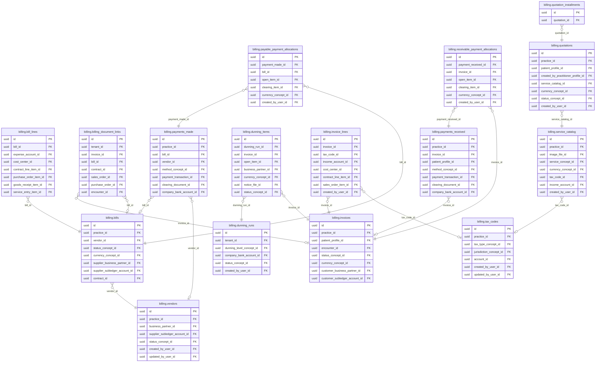
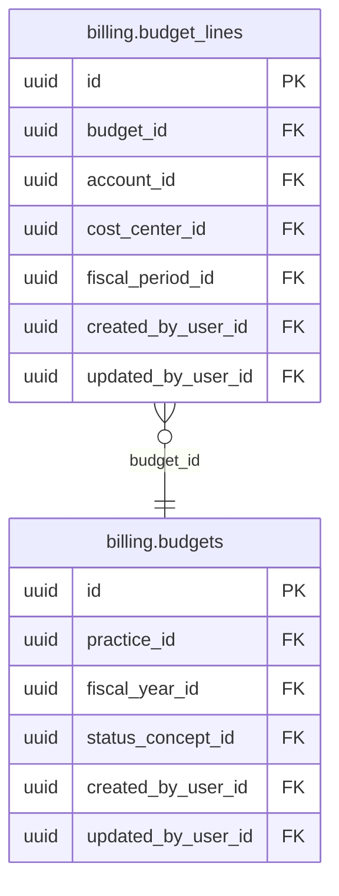

<!-- AUTOGENERADO por tools/inventario/catalogo.mjs. No editar manualmente. -->

# Catálogo del schema `billing`

- **Tablas:** 22 · **Columnas:** 317 (90 con descripción: 28.4 %) · **Índices:** 167
- **Dominio:** Financiero y ERP
- Método y límites del catálogo: [README del inventario](../README.md)

## Tablas

| Tabla | Propósito | Columnas | Índices | Operaciones | ORM |
|---|---|---|---|---|---|
| [bill_lines](#bill_lines) | Detalla conceptos y montos de documentos de proveedores para revisar cargos y pagos. | 18 | 9 | 1 | COINCIDE |
| [billing_document_links](#billing_document_links) | Relaciona documentos de facturación con fuentes clínicas, pagos u otros documentos financieros vinculados. | 12 | 12 | 7 | COINCIDE |
| [bills](#bills) | Representa facturas recibidas de proveedores para administrar cuentas por pagar institucionales. | 23 | 11 | 6 | COINCIDE |
| [budget_lines](#budget_lines) | Desglosa presupuestos por conceptos o unidades para comparar asignaciones con ejecución financiera. | 11 | 6 | 0 | COINCIDE |
| [budgets](#budgets) | Registra presupuestos institucionales para planificar gastos y recursos del prestador. | 10 | 5 | 0 | COINCIDE |
| [dunning_items](#dunning_items) | Detalla cuentas o documentos tratados en una ejecución de cobranza para seguir acciones por saldo. | 12 | 9 | 2 | COINCIDE |
| [dunning_runs](#dunning_runs) | Registra ejecuciones de gestión de cobranza para seguir procesos de notificación de saldos vencidos. | 9 | 7 | 6 | COINCIDE |
| [financial_kpi_snapshots](#financial_kpi_snapshots) | Preserva snapshots de indicadores financieros para analizar evolución económica de servicios y organizaciones de salud. | 9 | 4 | 2 | COINCIDE |
| [invoice_lines](#invoice_lines) | Detalla servicios, cantidades y montos que componen una factura para explicar su total y vínculo con la prestación. | 19 | 9 | 17 | DIVERGE |
| [invoices](#invoices) | Representa facturas emitidas por servicios de salud para administrar cuentas por cobrar y comprobantes del paciente o pagador. | 25 | 14 | 30 | COINCIDE |
| [patient_statements](#patient_statements) | Consolida movimientos y saldos comunicables al paciente para informarle cargos, pagos y obligaciones pendientes. | 15 | 5 | 3 | COINCIDE |
| [payable_payment_allocations](#payable_payment_allocations) | Distribuye pagos efectuados entre facturas de proveedores para mantener conciliación de cuentas por pagar. | 11 | 7 | 1 | COINCIDE |
| [payments_made](#payments_made) | Registra pagos realizados a proveedores para mantener trazabilidad de egresos institucionales. | 17 | 11 | 4 | COINCIDE |
| [payments_received](#payments_received) | Registra pagos recibidos contra facturas o cuentas de pacientes y organizaciones. | 18 | 12 | 13 | COINCIDE |
| [quotation_installments](#quotation_installments) | Desglosa una cotización en cuotas numeradas, vinculadas a su cotización de atención, para planificar los vencimientos y montos que afronta el paciente o la práctica. | 8 | 1 | 3 | COINCIDE |
| [quotations](#quotations) | Representa cotizaciones de prestaciones ligadas a una práctica y a una persona paciente, para informar y acordar costos antes de la atención. | 20 | 9 | 3 | COINCIDE |
| [receivable_payment_allocations](#receivable_payment_allocations) | Asocia pagos recibidos con saldos y facturas por cobrar para explicar cómo se cancelaron obligaciones. | 11 | 7 | 10 | COINCIDE |
| [reimbursements](#reimbursements) | Conserva reembolsos vinculados a pacientes, prestadores o transacciones de servicios de salud. | 11 | 5 | 2 | COINCIDE |
| [service_catalog](#service_catalog) | Define prestaciones médicas y servicios facturables para mantener un catálogo común entre atención y cobro. | 17 | 8 | 44 | DIVERGE |
| [tax_codes](#tax_codes) | Cataloga códigos tributarios usados para calcular impuestos en documentos financieros del sistema médico. | 14 | 6 | 0 | COINCIDE |
| [tax_periods](#tax_periods) | Define períodos tributarios para agrupar obligaciones y reportes fiscales de la organización sanitaria. | 13 | 4 | 0 | COINCIDE |
| [vendors](#vendors) | Cataloga proveedores a quienes la organización sanitaria compra bienes o servicios. | 14 | 6 | 2 | COINCIDE |

## Diagrama entidad-relación

Las tablas se agrupan en familias por sus claves foráneas dentro del schema (máximo 40 por diagrama). Las FK hacia otros schemas se listan en la ficha de cada tabla.

### Familia 1 de 2 — 16 tablas

### Familia 2 de 2 — 2 tablas

### Tablas sin relaciones dentro del schema

`billing.financial_kpi_snapshots` · `billing.patient_statements` · `billing.reimbursements` · `billing.tax_periods`

## Fichas

### bill_lines

#### Vista general

Detalla conceptos y montos de documentos de proveedores para revisar cargos y pagos.

- **Estado del propósito:** DOMAIN_CURATED_DRAFT · fuente: `Mantra Core Health Context/modules/diagram_17_billing.puml: bill_lines`
- **Dominio:** Financiero y ERP · **Diagrama:** `Mantra Core Health Context/modules/diagram_17_billing.puml` · **DDL:** `SQL/17_billing/02_tables.sql`
- **Entidad del ORM:** `BillLines` — `src/modules/billing/entities/bill_lines.entity.ts`
- **Resumen:** 18 columnas · 9 índices · 9 FK salientes · 1 entrantes · 1 operaciones

#### Columnas

| # | Columna | Tipo | Rol estructural | Descripción | ORM |
|---|---|---|---|---|---|
| 1 | `id` | `uuid` | Clave primaria; Obligatoria | Identificador único de la instancia. _(JSDOC_ESTANDAR, `src/modules/billing/entities/bill_lines.entity.ts:12`)_ | coincide |
| 2 | `bill_id` | `uuid` | Clave foránea → billing.bills.id; Obligatoria | _sin dato_ | coincide |
| 3 | `description` | `varchar` | Opcional | _sin dato_ | coincide |
| 4 | `quantity` | `numeric` | Obligatoria | _sin dato_ | coincide |
| 5 | `unit_price` | `numeric` | Obligatoria | _sin dato_ | coincide |
| 6 | `tax_amount` | `numeric` | Opcional | _sin dato_ | coincide |
| 7 | `line_total` | `numeric` | Opcional | _sin dato_ | coincide |
| 8 | `expense_account_id` | `uuid` | Clave foránea → accounting.accounts.id; Opcional | _sin dato_ | coincide |
| 9 | `cost_center_id` | `uuid` | Clave foránea → accounting.cost_centers.id; Opcional | _sin dato_ | coincide |
| 10 | `contract_line_item_id` | `uuid` | Clave foránea → erp.contract_line_items.id; Opcional | _sin dato_ | coincide |
| 11 | `purchase_order_item_id` | `uuid` | Clave foránea → erp.purchase_order_items.id; Opcional | _sin dato_ | coincide |
| 12 | `goods_receipt_item_id` | `uuid` | Clave foránea → erp.goods_receipt_items.id; Opcional | _sin dato_ | coincide |
| 13 | `service_entry_item_id` | `uuid` | Clave foránea → erp.service_entry_items.id; Opcional | _sin dato_ | coincide |
| 14 | `created_at` | `timestamptz` | Obligatoria | Fecha y hora en que se creó el registro. _(JSDOC_ESTANDAR, `src/modules/billing/entities/bill_lines.entity.ts:106`)_ | coincide |
| 15 | `updated_at` | `timestamptz` | Obligatoria | Fecha y hora de la última actualización. _(JSDOC_ESTANDAR, `src/modules/billing/entities/bill_lines.entity.ts:112`)_ | coincide |
| 16 | `created_by_user_id` | `uuid` | Clave foránea → iam.users.id; Opcional | _sin dato_ | coincide |
| 17 | `updated_by_user_id` | `uuid` | Clave foránea → iam.users.id; Opcional | _sin dato_ | coincide |
| 18 | `row_version` | `integer = 1` | Obligatoria | Versión usada para controlar actualizaciones concurrentes. _(JSDOC_ENTIDAD, `src/modules/billing/entities/bill_lines.entity.ts:130`)_ | coincide |

#### Relaciones

| Sentido | Columnas | Tabla | Restricción |
|---|---|---|---|
| hacia | bill_id | billing.bills (id) | fk_bill_lines_bill_id |
| hacia | expense_account_id | accounting.accounts (id) | fk_bill_lines_expense_account_id |
| hacia | cost_center_id | accounting.cost_centers (id) | fk_bill_lines_cost_center_id |
| hacia | contract_line_item_id | erp.contract_line_items (id) | fk_bill_lines_contract_line_item_id |
| hacia | purchase_order_item_id | erp.purchase_order_items (id) | fk_bill_lines_purchase_order_item_id |
| hacia | goods_receipt_item_id | erp.goods_receipt_items (id) | fk_bill_lines_goods_receipt_item_id |
| hacia | service_entry_item_id | erp.service_entry_items (id) | fk_bill_lines_service_entry_item_id |
| hacia | created_by_user_id | iam.users (id) | fk_bill_lines_created_by_user_id |
| hacia | updated_by_user_id | iam.users (id) | fk_bill_lines_updated_by_user_id |
| desde | id | erp.invoice_match_items (bill_line_id) | fk_invoice_match_items_bill_line_id |

#### Índices

| Índice | Único | Columnas | Para qué |
|---|---|---|---|
| `ix_bill_lines_bill_id` | no | bill_id | Soporta la clave foránea fk_bill_lines_bill_id: PostgreSQL no indexa las FK por sí mismo _(DOCUMENTO)_ |
| `ix_bill_lines_expense_account_id` | no | expense_account_id | Soporta la clave foránea fk_bill_lines_expense_account_id: PostgreSQL no indexa las FK por sí mismo _(DOCUMENTO)_ |
| `ix_bill_lines_cost_center_id` | no | cost_center_id | Soporta la clave foránea fk_bill_lines_cost_center_id: PostgreSQL no indexa las FK por sí mismo _(DOCUMENTO)_ |
| `ix_bill_lines_contract_line_item_id` | no | contract_line_item_id | Soporta la clave foránea fk_bill_lines_contract_line_item_id: PostgreSQL no indexa las FK por sí mismo _(DOCUMENTO)_ |
| `ix_bill_lines_purchase_order_item_id` | no | purchase_order_item_id | Soporta la clave foránea fk_bill_lines_purchase_order_item_id: PostgreSQL no indexa las FK por sí mismo _(DOCUMENTO)_ |
| `ix_bill_lines_goods_receipt_item_id` | no | goods_receipt_item_id | Soporta la clave foránea fk_bill_lines_goods_receipt_item_id: PostgreSQL no indexa las FK por sí mismo _(DOCUMENTO)_ |
| `ix_bill_lines_service_entry_item_id` | no | service_entry_item_id | Soporta la clave foránea fk_bill_lines_service_entry_item_id: PostgreSQL no indexa las FK por sí mismo _(DOCUMENTO)_ |
| `ix_bill_lines_created_by_user_id` | no | created_by_user_id | Soporta la clave foránea fk_bill_lines_created_by_user_id: PostgreSQL no indexa las FK por sí mismo _(DOCUMENTO)_ |
| `ix_bill_lines_updated_by_user_id` | no | updated_by_user_id | Soporta la clave foránea fk_bill_lines_updated_by_user_id: PostgreSQL no indexa las FK por sí mismo _(DOCUMENTO)_ |

#### Operaciones que la tocan

| Operación | Efecto | Confianza |
|---|---|---|
| POST /billing/bills | CREA | DIRECTA |

#### Gobierno

| Atributo | Valor | Fuente |
|---|---|---|
| Append-only | no declarado | — |
| Datos personales | sin fuente | — |
| Financiera | sin fuente | — |
| Crítica para auditoría | sin fuente | — |
| Retención | sin fuente | — |
| Responsable | sin fuente | — |
| Revisión | AUTO_DETECTADA | — |

---

### billing_document_links

#### Vista general

Relaciona documentos de facturación con fuentes clínicas, pagos u otros documentos financieros vinculados.

- **Estado del propósito:** DOMAIN_CURATED_DRAFT · fuente: `Mantra Core Health Context/modules/diagram_17_billing.puml: billing_document_links`
- **Dominio:** Financiero y ERP · **Diagrama:** `Mantra Core Health Context/modules/diagram_17_billing.puml` · **DDL:** `SQL/17_billing/02_tables.sql`
- **Entidad del ORM:** `BillingDocumentLinks` — `src/modules/billing/entities/billing_document_links.entity.ts`
- **Resumen:** 12 columnas · 12 índices · 9 FK salientes · 0 entrantes · 7 operaciones

#### Columnas

| # | Columna | Tipo | Rol estructural | Descripción | ORM |
|---|---|---|---|---|---|
| 1 | `id` | `uuid` | Clave primaria; Obligatoria | Identificador único de la instancia. _(JSDOC_ESTANDAR, `src/modules/billing/entities/billing_document_links.entity.ts:12`)_ | coincide |
| 2 | `tenant_id` | `uuid` | Clave foránea → directory.tenants.id; Obligatoria | _sin dato_ | coincide |
| 3 | `invoice_id` | `uuid` | Clave foránea → billing.invoices.id; Opcional | _sin dato_ | coincide |
| 4 | `bill_id` | `uuid` | Clave foránea → billing.bills.id; Opcional | _sin dato_ | coincide |
| 5 | `contract_id` | `uuid` | Clave foránea → erp.contracts.id; Opcional | _sin dato_ | coincide |
| 6 | `sales_order_id` | `uuid` | Clave foránea → erp.sales_orders.id; Opcional | _sin dato_ | coincide |
| 7 | `purchase_order_id` | `uuid` | Clave foránea → erp.purchase_orders.id; Opcional | _sin dato_ | coincide |
| 8 | `claim_id` | `uuid` | Opcional | _sin dato_ | coincide |
| 9 | `encounter_id` | `uuid` | Clave foránea → clinical.encounters.id; Opcional | _sin dato_ | coincide |
| 10 | `relation_type_concept_id` | `uuid` | Clave foránea → terminology.catalog_concepts.id; Obligatoria | _sin dato_ | coincide |
| 11 | `created_at` | `timestamptz` | Obligatoria | Fecha y hora en que se creó el registro. _(JSDOC_ESTANDAR, `src/modules/billing/entities/billing_document_links.entity.ts:72`)_ | coincide |
| 12 | `created_by_user_id` | `uuid` | Clave foránea → iam.users.id; Opcional | _sin dato_ | coincide |

#### Relaciones

| Sentido | Columnas | Tabla | Restricción |
|---|---|---|---|
| hacia | invoice_id | billing.invoices (id) | fk_billing_document_links_invoice_id |
| hacia | bill_id | billing.bills (id) | fk_billing_document_links_bill_id |
| hacia | tenant_id | directory.tenants (id) | fk_billing_document_links_tenant_id |
| hacia | contract_id | erp.contracts (id) | fk_billing_document_links_contract_id |
| hacia | sales_order_id | erp.sales_orders (id) | fk_billing_document_links_sales_order_id |
| hacia | purchase_order_id | erp.purchase_orders (id) | fk_billing_document_links_purchase_order_id |
| hacia | encounter_id | clinical.encounters (id) | fk_billing_document_links_encounter_id |
| hacia | relation_type_concept_id | terminology.catalog_concepts (id) | fk_billing_document_links_relation_type_concept_id |
| hacia | created_by_user_id | iam.users (id) | fk_billing_document_links_created_by_user_id |

#### Índices

| Índice | Único | Columnas | Para qué |
|---|---|---|---|
| `ix_billing_document_links_tenant_id` | no | tenant_id | Soporta la clave foránea fk_billing_document_links_tenant_id: PostgreSQL no indexa las FK por sí mismo _(DOCUMENTO)_ |
| `ix_billing_document_links_invoice_id` | no | invoice_id | Soporta la clave foránea fk_billing_document_links_invoice_id: PostgreSQL no indexa las FK por sí mismo _(DOCUMENTO)_ |
| `ix_billing_document_links_bill_id` | no | bill_id | Soporta la clave foránea fk_billing_document_links_bill_id: PostgreSQL no indexa las FK por sí mismo _(DOCUMENTO)_ |
| `ix_billing_document_links_contract_id` | no | contract_id | Soporta la clave foránea fk_billing_document_links_contract_id: PostgreSQL no indexa las FK por sí mismo _(DOCUMENTO)_ |
| `ix_billing_document_links_sales_order_id` | no | sales_order_id | Soporta la clave foránea fk_billing_document_links_sales_order_id: PostgreSQL no indexa las FK por sí mismo _(DOCUMENTO)_ |
| `ix_billing_document_links_purchase_order_id` | no | purchase_order_id | Soporta la clave foránea fk_billing_document_links_purchase_order_id: PostgreSQL no indexa las FK por sí mismo _(DOCUMENTO)_ |
| `ix_billing_document_links_claim_id` | no | claim_id | _sin uso detectado estáticamente_ |
| `ix_billing_document_links_encounter_id` | no | encounter_id | Soporta la clave foránea fk_billing_document_links_encounter_id: PostgreSQL no indexa las FK por sí mismo _(DOCUMENTO)_ |
| `ix_billing_document_links_relation_type_concept_id` | no | relation_type_concept_id | Soporta la clave foránea fk_billing_document_links_relation_type_concept_id: PostgreSQL no indexa las FK por sí mismo _(DOCUMENTO)_ |
| `ix_billing_document_links_created_by_user_id` | no | created_by_user_id | Soporta la clave foránea fk_billing_document_links_created_by_user_id: PostgreSQL no indexa las FK por sí mismo _(DOCUMENTO)_ |
| `ix_billing_document_links_tenant_relation_created` | no | tenant_id, relation_type_concept_id, ("created_at" DESC) | _sin uso detectado estáticamente_ |
| `brin_billing_document_links_created_at` | no | created_at | BRIN para logs e historiales append-only de gran volumen _(DOCUMENTO)_ |

#### Operaciones que la tocan

| Operación | Efecto | Confianza |
|---|---|---|
| POST /billing/bills | CREA | DIRECTA |
| POST /billing/invoices:issue-from-encounter | CREA | DIRECTA |
| POST /billing/invoices/{id}:credit-note | CREA | DIRECTA |
| POST /billing/patient-statements:generate | CREA | DIRECTA |
| POST /billing/payment-plans | CREA | DIRECTA |
| POST /billing/reimbursements:link | CREA | DIRECTA |
| POST /billing/simulated/charges/{chargeId}/payment | CREA | DIRECTA |

#### Gobierno

| Atributo | Valor | Fuente |
|---|---|---|
| Append-only | no declarado | — |
| Datos personales | sin fuente | — |
| Financiera | sin fuente | — |
| Crítica para auditoría | sin fuente | — |
| Retención | sin fuente | — |
| Responsable | sin fuente | — |
| Revisión | AUTO_DETECTADA | — |

---

### bills

#### Vista general

Representa facturas recibidas de proveedores para administrar cuentas por pagar institucionales.

- **Estado del propósito:** DOMAIN_CURATED_DRAFT · fuente: `Mantra Core Health Context/modules/diagram_17_billing.puml: bills`
- **Dominio:** Financiero y ERP · **Diagrama:** `Mantra Core Health Context/modules/diagram_17_billing.puml` · **DDL:** `SQL/17_billing/02_tables.sql`
- **Entidad del ORM:** `Bills` — `src/modules/billing/entities/bills.entity.ts`
- **Resumen:** 23 columnas · 11 índices · 11 FK salientes · 10 entrantes · 6 operaciones

#### Columnas

| # | Columna | Tipo | Rol estructural | Descripción | ORM |
|---|---|---|---|---|---|
| 1 | `id` | `uuid` | Clave primaria; Obligatoria | Identificador único de la instancia. _(JSDOC_ESTANDAR, `src/modules/billing/entities/bills.entity.ts:12`)_ | coincide |
| 2 | `practice_id` | `uuid` | Clave foránea → practice.practices.id; Obligatoria | _sin dato_ | coincide |
| 3 | `vendor_id` | `uuid` | Clave foránea → billing.vendors.id; Obligatoria | _sin dato_ | coincide |
| 4 | `bill_number` | `varchar` | Obligatoria | _sin dato_ | coincide |
| 5 | `issue_date` | `date` | Obligatoria | _sin dato_ | coincide |
| 6 | `due_date` | `date` | Opcional | _sin dato_ | coincide |
| 7 | `status_concept_id` | `uuid` | Clave foránea → terminology.catalog_concepts.id; Obligatoria | _sin dato_ | coincide |
| 8 | `subtotal` | `numeric` | Opcional | _sin dato_ | coincide |
| 9 | `tax_total` | `numeric` | Opcional | _sin dato_ | coincide |
| 10 | `total` | `numeric` | Opcional | _sin dato_ | coincide |
| 11 | `paid_total` | `numeric` | Opcional | _sin dato_ | coincide |
| 12 | `balance` | `numeric` | Opcional | _sin dato_ | coincide |
| 13 | `currency_concept_id` | `uuid` | Clave foránea → terminology.catalog_concepts.id; Opcional | _sin dato_ | coincide |
| 14 | `supplier_business_partner_id` | `uuid` | Clave foránea → erp.business_partners.id; Opcional | _sin dato_ | coincide |
| 15 | `supplier_subledger_account_id` | `uuid` | Clave foránea → accounting.subledger_accounts.id; Opcional | _sin dato_ | coincide |
| 16 | `contract_id` | `uuid` | Clave foránea → erp.contracts.id; Opcional | _sin dato_ | coincide |
| 17 | `purchase_order_id` | `uuid` | Clave foránea → erp.purchase_orders.id; Opcional | _sin dato_ | coincide |
| 18 | `transaction_id` | `uuid` | Clave foránea → accounting.journal_transactions.id; Opcional | _sin dato_ | coincide |
| 19 | `created_at` | `timestamptz` | Obligatoria | Fecha y hora en que se creó el registro. _(JSDOC_ESTANDAR, `src/modules/billing/entities/bills.entity.ts:128`)_ | coincide |
| 20 | `updated_at` | `timestamptz` | Obligatoria | Fecha y hora de la última actualización. _(JSDOC_ESTANDAR, `src/modules/billing/entities/bills.entity.ts:134`)_ | coincide |
| 21 | `created_by_user_id` | `uuid` | Clave foránea → iam.users.id; Opcional | _sin dato_ | coincide |
| 22 | `updated_by_user_id` | `uuid` | Clave foránea → iam.users.id; Opcional | _sin dato_ | coincide |
| 23 | `row_version` | `integer = 1` | Obligatoria | Versión usada para controlar actualizaciones concurrentes. _(JSDOC_ENTIDAD, `src/modules/billing/entities/bills.entity.ts:152`)_ | coincide |

#### Relaciones

| Sentido | Columnas | Tabla | Restricción |
|---|---|---|---|
| hacia | vendor_id | billing.vendors (id) | fk_bills_vendor_id |
| hacia | practice_id | practice.practices (id) | fk_bills_practice_id |
| hacia | status_concept_id | terminology.catalog_concepts (id) | fk_bills_status_concept_id |
| hacia | currency_concept_id | terminology.catalog_concepts (id) | fk_bills_currency_concept_id |
| hacia | supplier_business_partner_id | erp.business_partners (id) | fk_bills_supplier_business_partner_id |
| hacia | supplier_subledger_account_id | accounting.subledger_accounts (id) | fk_bills_supplier_subledger_account_id |
| hacia | contract_id | erp.contracts (id) | fk_bills_contract_id |
| hacia | purchase_order_id | erp.purchase_orders (id) | fk_bills_purchase_order_id |
| hacia | transaction_id | accounting.journal_transactions (id) | fk_bills_transaction_id |
| hacia | created_by_user_id | iam.users (id) | fk_bills_created_by_user_id |
| hacia | updated_by_user_id | iam.users (id) | fk_bills_updated_by_user_id |
| desde | id | billing.bill_lines (bill_id) | fk_bill_lines_bill_id |
| desde | id | billing.payments_made (bill_id) | fk_payments_made_bill_id |
| desde | id | billing.payable_payment_allocations (bill_id) | fk_payable_payment_allocations_bill_id |
| desde | id | billing.billing_document_links (bill_id) | fk_billing_document_links_bill_id |
| desde | id | audit.bills_history (bill_id) | fk_bills_history_bill_id |
| desde | id | accounting.purchases (bill_id) | fk_purchases_bill_id |
| desde | id | accounting.journal_entry_assignments (bill_id) | fk_journal_entry_assignments_bill_id |
| desde | id | accounting.open_items (bill_id) | fk_open_items_bill_id |
| desde | id | erp.invoice_match_runs (bill_id) | fk_invoice_match_runs_bill_id |
| desde | id | erp.contract_payment_schedules (bill_id) | fk_contract_payment_schedules_bill_id |

#### Índices

| Índice | Único | Columnas | Para qué |
|---|---|---|---|
| `ix_bills_practice_id` | no | practice_id | Soporta la clave foránea fk_bills_practice_id: PostgreSQL no indexa las FK por sí mismo _(DOCUMENTO)_; 1 consulta(s) de repositorio filtran u ordenan por «practice_id», la primera columna del índice _(CONSULTA)_ |
| `ix_bills_vendor_id` | no | vendor_id | Soporta la clave foránea fk_bills_vendor_id: PostgreSQL no indexa las FK por sí mismo _(DOCUMENTO)_; 1 consulta(s) de repositorio filtran u ordenan por «vendor_id», la primera columna del índice _(CONSULTA)_ |
| `ix_bills_status_concept_id` | no | status_concept_id | Soporta la clave foránea fk_bills_status_concept_id: PostgreSQL no indexa las FK por sí mismo _(DOCUMENTO)_ |
| `ix_bills_transaction_id` | no | transaction_id | Soporta la clave foránea fk_bills_transaction_id: PostgreSQL no indexa las FK por sí mismo _(DOCUMENTO)_ |
| `ix_bills_currency_concept_id` | no | currency_concept_id | Soporta la clave foránea fk_bills_currency_concept_id: PostgreSQL no indexa las FK por sí mismo _(DOCUMENTO)_ |
| `ix_bills_supplier_business_partner_id` | no | supplier_business_partner_id | Soporta la clave foránea fk_bills_supplier_business_partner_id: PostgreSQL no indexa las FK por sí mismo _(DOCUMENTO)_ |
| `ix_bills_supplier_subledger_account_id` | no | supplier_subledger_account_id | Soporta la clave foránea fk_bills_supplier_subledger_account_id: PostgreSQL no indexa las FK por sí mismo _(DOCUMENTO)_ |
| `ix_bills_contract_id` | no | contract_id | Soporta la clave foránea fk_bills_contract_id: PostgreSQL no indexa las FK por sí mismo _(DOCUMENTO)_ |
| `ix_bills_purchase_order_id` | no | purchase_order_id | Soporta la clave foránea fk_bills_purchase_order_id: PostgreSQL no indexa las FK por sí mismo _(DOCUMENTO)_ |
| `ix_bills_created_by_user_id` | no | created_by_user_id | Soporta la clave foránea fk_bills_created_by_user_id: PostgreSQL no indexa las FK por sí mismo _(DOCUMENTO)_ |
| `ix_bills_updated_by_user_id` | no | updated_by_user_id | Soporta la clave foránea fk_bills_updated_by_user_id: PostgreSQL no indexa las FK por sí mismo _(DOCUMENTO)_ |

#### Operaciones que la tocan

| Operación | Efecto | Confianza |
|---|---|---|
| POST /accounting/practitioner/consultation-income | LEE | DIRECTA |
| POST /billing/bills | CREA | DIRECTA |
| POST /billing/bills | LEE | DIRECTA |
| POST /billing/documents/{id}:post-to-ledger | LEE | DIRECTA |
| POST /billing/payments-made:execute | LEE | DIRECTA |
| POST /erp/bills/{billId}/invoice-match-runs | LEE | DIRECTA |

#### Gobierno

| Atributo | Valor | Fuente |
|---|---|---|
| Append-only | no declarado | — |
| Datos personales | sin fuente | — |
| Financiera | sin fuente | — |
| Crítica para auditoría | sin fuente | — |
| Retención | sin fuente | — |
| Responsable | sin fuente | — |
| Revisión | AUTO_DETECTADA | — |

---

### budget_lines

#### Vista general

Desglosa presupuestos por conceptos o unidades para comparar asignaciones con ejecución financiera.

- **Estado del propósito:** DOMAIN_CURATED_DRAFT · fuente: `Mantra Core Health Context/modules/diagram_17_billing.puml: budget_lines`
- **Dominio:** Financiero y ERP · **Diagrama:** `Mantra Core Health Context/modules/diagram_17_billing.puml` · **DDL:** `SQL/17_billing/02_tables.sql`
- **Entidad del ORM:** `BudgetLines` — `src/modules/billing/entities/budget_lines.entity.ts`
- **Resumen:** 11 columnas · 6 índices · 6 FK salientes · 0 entrantes · 0 operaciones

#### Columnas

| # | Columna | Tipo | Rol estructural | Descripción | ORM |
|---|---|---|---|---|---|
| 1 | `id` | `uuid` | Clave primaria; Obligatoria | Identificador único de la instancia. _(JSDOC_ESTANDAR, `src/modules/billing/entities/budget_lines.entity.ts:12`)_ | coincide |
| 2 | `budget_id` | `uuid` | Clave foránea → billing.budgets.id; Obligatoria | _sin dato_ | coincide |
| 3 | `account_id` | `uuid` | Clave foránea → accounting.accounts.id; Obligatoria | _sin dato_ | coincide |
| 4 | `cost_center_id` | `uuid` | Clave foránea → accounting.cost_centers.id; Opcional | _sin dato_ | coincide |
| 5 | `fiscal_period_id` | `uuid` | Clave foránea → accounting.fiscal_periods.id; Opcional | _sin dato_ | coincide |
| 6 | `amount` | `numeric` | Obligatoria | _sin dato_ | coincide |
| 7 | `created_at` | `timestamptz` | Obligatoria | Fecha y hora en que se creó el registro. _(JSDOC_ESTANDAR, `src/modules/billing/entities/budget_lines.entity.ts:48`)_ | coincide |
| 8 | `updated_at` | `timestamptz` | Obligatoria | Fecha y hora de la última actualización. _(JSDOC_ESTANDAR, `src/modules/billing/entities/budget_lines.entity.ts:54`)_ | coincide |
| 9 | `created_by_user_id` | `uuid` | Clave foránea → iam.users.id; Opcional | _sin dato_ | coincide |
| 10 | `updated_by_user_id` | `uuid` | Clave foránea → iam.users.id; Opcional | _sin dato_ | coincide |
| 11 | `row_version` | `integer = 1` | Obligatoria | Versión usada para controlar actualizaciones concurrentes. _(JSDOC_ENTIDAD, `src/modules/billing/entities/budget_lines.entity.ts:72`)_ | coincide |

#### Relaciones

| Sentido | Columnas | Tabla | Restricción |
|---|---|---|---|
| hacia | budget_id | billing.budgets (id) | fk_budget_lines_budget_id |
| hacia | account_id | accounting.accounts (id) | fk_budget_lines_account_id |
| hacia | cost_center_id | accounting.cost_centers (id) | fk_budget_lines_cost_center_id |
| hacia | fiscal_period_id | accounting.fiscal_periods (id) | fk_budget_lines_fiscal_period_id |
| hacia | created_by_user_id | iam.users (id) | fk_budget_lines_created_by_user_id |
| hacia | updated_by_user_id | iam.users (id) | fk_budget_lines_updated_by_user_id |

#### Índices

| Índice | Único | Columnas | Para qué |
|---|---|---|---|
| `ix_budget_lines_budget_id` | no | budget_id | Soporta la clave foránea fk_budget_lines_budget_id: PostgreSQL no indexa las FK por sí mismo _(DOCUMENTO)_ |
| `ix_budget_lines_account_id` | no | account_id | Soporta la clave foránea fk_budget_lines_account_id: PostgreSQL no indexa las FK por sí mismo _(DOCUMENTO)_ |
| `ix_budget_lines_cost_center_id` | no | cost_center_id | Soporta la clave foránea fk_budget_lines_cost_center_id: PostgreSQL no indexa las FK por sí mismo _(DOCUMENTO)_ |
| `ix_budget_lines_fiscal_period_id` | no | fiscal_period_id | Soporta la clave foránea fk_budget_lines_fiscal_period_id: PostgreSQL no indexa las FK por sí mismo _(DOCUMENTO)_ |
| `ix_budget_lines_created_by_user_id` | no | created_by_user_id | Soporta la clave foránea fk_budget_lines_created_by_user_id: PostgreSQL no indexa las FK por sí mismo _(DOCUMENTO)_ |
| `ix_budget_lines_updated_by_user_id` | no | updated_by_user_id | Soporta la clave foránea fk_budget_lines_updated_by_user_id: PostgreSQL no indexa las FK por sí mismo _(DOCUMENTO)_ |

#### Operaciones que la tocan

_Ninguna operación HTTP la toca según el análisis estático (puede usarla un worker, un trigger o una migración)._

#### Gobierno

| Atributo | Valor | Fuente |
|---|---|---|
| Append-only | no declarado | — |
| Datos personales | sin fuente | — |
| Financiera | sin fuente | — |
| Crítica para auditoría | sin fuente | — |
| Retención | sin fuente | — |
| Responsable | sin fuente | — |
| Revisión | AUTO_DETECTADA | — |

---

### budgets

#### Vista general

Registra presupuestos institucionales para planificar gastos y recursos del prestador.

- **Estado del propósito:** DOMAIN_CURATED_DRAFT · fuente: `Mantra Core Health Context/modules/diagram_17_billing.puml: budgets`
- **Dominio:** Financiero y ERP · **Diagrama:** `Mantra Core Health Context/modules/diagram_17_billing.puml` · **DDL:** `SQL/17_billing/02_tables.sql`
- **Entidad del ORM:** `Budgets` — `src/modules/billing/entities/budgets.entity.ts`
- **Resumen:** 10 columnas · 5 índices · 5 FK salientes · 1 entrantes · 0 operaciones

#### Columnas

| # | Columna | Tipo | Rol estructural | Descripción | ORM |
|---|---|---|---|---|---|
| 1 | `id` | `uuid` | Clave primaria; Obligatoria | Identificador único de la instancia. _(JSDOC_ESTANDAR, `src/modules/billing/entities/budgets.entity.ts:12`)_ | coincide |
| 2 | `practice_id` | `uuid` | Clave foránea → practice.practices.id; Obligatoria | _sin dato_ | coincide |
| 3 | `fiscal_year_id` | `uuid` | Clave foránea → accounting.fiscal_years.id; Opcional | _sin dato_ | coincide |
| 4 | `name` | `varchar` | Obligatoria | _sin dato_ | coincide |
| 5 | `status_concept_id` | `uuid` | Clave foránea → terminology.catalog_concepts.id; Obligatoria | _sin dato_ | coincide |
| 6 | `created_at` | `timestamptz` | Obligatoria | Fecha y hora en que se creó el registro. _(JSDOC_ESTANDAR, `src/modules/billing/entities/budgets.entity.ts:42`)_ | coincide |
| 7 | `updated_at` | `timestamptz` | Obligatoria | Fecha y hora de la última actualización. _(JSDOC_ESTANDAR, `src/modules/billing/entities/budgets.entity.ts:48`)_ | coincide |
| 8 | `created_by_user_id` | `uuid` | Clave foránea → iam.users.id; Opcional | _sin dato_ | coincide |
| 9 | `updated_by_user_id` | `uuid` | Clave foránea → iam.users.id; Opcional | _sin dato_ | coincide |
| 10 | `row_version` | `integer = 1` | Obligatoria | Versión usada para controlar actualizaciones concurrentes. _(JSDOC_ENTIDAD, `src/modules/billing/entities/budgets.entity.ts:66`)_ | coincide |

#### Relaciones

| Sentido | Columnas | Tabla | Restricción |
|---|---|---|---|
| hacia | practice_id | practice.practices (id) | fk_budgets_practice_id |
| hacia | fiscal_year_id | accounting.fiscal_years (id) | fk_budgets_fiscal_year_id |
| hacia | status_concept_id | terminology.catalog_concepts (id) | fk_budgets_status_concept_id |
| hacia | created_by_user_id | iam.users (id) | fk_budgets_created_by_user_id |
| hacia | updated_by_user_id | iam.users (id) | fk_budgets_updated_by_user_id |
| desde | id | billing.budget_lines (budget_id) | fk_budget_lines_budget_id |

#### Índices

| Índice | Único | Columnas | Para qué |
|---|---|---|---|
| `ix_budgets_practice_id` | no | practice_id | Soporta la clave foránea fk_budgets_practice_id: PostgreSQL no indexa las FK por sí mismo _(DOCUMENTO)_ |
| `ix_budgets_fiscal_year_id` | no | fiscal_year_id | Soporta la clave foránea fk_budgets_fiscal_year_id: PostgreSQL no indexa las FK por sí mismo _(DOCUMENTO)_ |
| `ix_budgets_status_concept_id` | no | status_concept_id | Soporta la clave foránea fk_budgets_status_concept_id: PostgreSQL no indexa las FK por sí mismo _(DOCUMENTO)_ |
| `ix_budgets_created_by_user_id` | no | created_by_user_id | Soporta la clave foránea fk_budgets_created_by_user_id: PostgreSQL no indexa las FK por sí mismo _(DOCUMENTO)_ |
| `ix_budgets_updated_by_user_id` | no | updated_by_user_id | Soporta la clave foránea fk_budgets_updated_by_user_id: PostgreSQL no indexa las FK por sí mismo _(DOCUMENTO)_ |

#### Operaciones que la tocan

_Ninguna operación HTTP la toca según el análisis estático (puede usarla un worker, un trigger o una migración)._

#### Gobierno

| Atributo | Valor | Fuente |
|---|---|---|
| Append-only | no declarado | — |
| Datos personales | sin fuente | — |
| Financiera | sin fuente | — |
| Crítica para auditoría | sin fuente | — |
| Retención | sin fuente | — |
| Responsable | sin fuente | — |
| Revisión | AUTO_DETECTADA | — |

---

### dunning_items

#### Vista general

Detalla cuentas o documentos tratados en una ejecución de cobranza para seguir acciones por saldo.

- **Estado del propósito:** DOMAIN_CURATED_DRAFT · fuente: `Mantra Core Health Context/modules/diagram_17_billing.puml: dunning_items`
- **Dominio:** Financiero y ERP · **Diagrama:** `Mantra Core Health Context/modules/diagram_17_billing.puml` · **DDL:** `SQL/17_billing/02_tables.sql`
- **Entidad del ORM:** `DunningItems` — `src/modules/billing/entities/dunning_items.entity.ts`
- **Resumen:** 12 columnas · 9 índices · 7 FK salientes · 0 entrantes · 2 operaciones

#### Columnas

| # | Columna | Tipo | Rol estructural | Descripción | ORM |
|---|---|---|---|---|---|
| 1 | `id` | `uuid` | Clave primaria; Obligatoria | Identificador único de la instancia. _(JSDOC_ESTANDAR, `src/modules/billing/entities/dunning_items.entity.ts:12`)_ | coincide |
| 2 | `dunning_run_id` | `uuid` | Clave foránea → billing.dunning_runs.id; Obligatoria | _sin dato_ | coincide |
| 3 | `invoice_id` | `uuid` | Clave foránea → billing.invoices.id; Obligatoria | _sin dato_ | coincide |
| 4 | `open_item_id` | `uuid` | Clave foránea → accounting.open_items.id; Opcional | _sin dato_ | coincide |
| 5 | `business_partner_id` | `uuid` | Clave foránea → erp.business_partners.id; Opcional | _sin dato_ | coincide |
| 6 | `outstanding_amount` | `numeric` | Opcional | _sin dato_ | coincide |
| 7 | `currency_concept_id` | `uuid` | Clave foránea → terminology.catalog_concepts.id; Opcional | _sin dato_ | coincide |
| 8 | `days_overdue` | `integer` | Opcional | _sin dato_ | coincide |
| 9 | `dunning_fee` | `numeric` | Opcional | _sin dato_ | coincide |
| 10 | `notice_file_id` | `uuid` | Clave foránea → common.files.id; Opcional | _sin dato_ | coincide |
| 11 | `status_concept_id` | `uuid` | Clave foránea → terminology.catalog_concepts.id; Obligatoria | _sin dato_ | coincide |
| 12 | `created_at` | `timestamptz` | Obligatoria | Fecha y hora en que se creó el registro. _(JSDOC_ESTANDAR, `src/modules/billing/entities/dunning_items.entity.ts:82`)_ | coincide |

#### Relaciones

| Sentido | Columnas | Tabla | Restricción |
|---|---|---|---|
| hacia | dunning_run_id | billing.dunning_runs (id) | fk_dunning_items_dunning_run_id |
| hacia | invoice_id | billing.invoices (id) | fk_dunning_items_invoice_id |
| hacia | open_item_id | accounting.open_items (id) | fk_dunning_items_open_item_id |
| hacia | business_partner_id | erp.business_partners (id) | fk_dunning_items_business_partner_id |
| hacia | currency_concept_id | terminology.catalog_concepts (id) | fk_dunning_items_currency_concept_id |
| hacia | notice_file_id | common.files (id) | fk_dunning_items_notice_file_id |
| hacia | status_concept_id | terminology.catalog_concepts (id) | fk_dunning_items_status_concept_id |

#### Índices

| Índice | Único | Columnas | Para qué |
|---|---|---|---|
| `uq_dunning_items_dunning_run_id_invoice_id` | sí | dunning_run_id, invoice_id | Garantiza que no se repita la combinación (dunning_run_id, invoice_id) _(DOCUMENTO)_; Soporta la clave foránea fk_dunning_items_dunning_run_id: PostgreSQL no indexa las FK por sí mismo _(DOCUMENTO)_ |
| `ix_dunning_items_dunning_run_id` | no | dunning_run_id | Soporta la clave foránea fk_dunning_items_dunning_run_id: PostgreSQL no indexa las FK por sí mismo _(DOCUMENTO)_ |
| `ix_dunning_items_invoice_id` | no | invoice_id | Soporta la clave foránea fk_dunning_items_invoice_id: PostgreSQL no indexa las FK por sí mismo _(DOCUMENTO)_ |
| `ix_dunning_items_open_item_id` | no | open_item_id | Soporta la clave foránea fk_dunning_items_open_item_id: PostgreSQL no indexa las FK por sí mismo _(DOCUMENTO)_ |
| `ix_dunning_items_business_partner_id` | no | business_partner_id | Soporta la clave foránea fk_dunning_items_business_partner_id: PostgreSQL no indexa las FK por sí mismo _(DOCUMENTO)_ |
| `ix_dunning_items_currency_concept_id` | no | currency_concept_id | Soporta la clave foránea fk_dunning_items_currency_concept_id: PostgreSQL no indexa las FK por sí mismo _(DOCUMENTO)_ |
| `ix_dunning_items_notice_file_id` | no | notice_file_id | Soporta la clave foránea fk_dunning_items_notice_file_id: PostgreSQL no indexa las FK por sí mismo _(DOCUMENTO)_ |
| `ix_dunning_items_status_concept_id` | no | status_concept_id | Soporta la clave foránea fk_dunning_items_status_concept_id: PostgreSQL no indexa las FK por sí mismo _(DOCUMENTO)_ |
| `ix_dunning_items_status_overdue` | no | status_concept_id, ("days_overdue" DESC) | _sin uso detectado estáticamente_ |

#### Restricciones

| Restricción | Tipo | Definición |
|---|---|---|
| `uq_dunning_items_dunning_run_id_invoice_id` | UNIQUE INDEX | UNIQUE INDEX ("dunning_run_id", "invoice_id") |

#### Operaciones que la tocan

| Operación | Efecto | Confianza |
|---|---|---|
| POST /billing/dunning-runs:execute | CREA | DIRECTA |
| POST /billing/internal/dunning-runs/run-due | CREA | DIRECTA |

#### Gobierno

| Atributo | Valor | Fuente |
|---|---|---|
| Append-only | no declarado | — |
| Datos personales | sin fuente | — |
| Financiera | sin fuente | — |
| Crítica para auditoría | sin fuente | — |
| Retención | sin fuente | — |
| Responsable | sin fuente | — |
| Revisión | AUTO_DETECTADA | — |

---

### dunning_runs

#### Vista general

Registra ejecuciones de gestión de cobranza para seguir procesos de notificación de saldos vencidos.

- **Estado del propósito:** DOMAIN_CURATED_DRAFT · fuente: `Mantra Core Health Context/modules/diagram_17_billing.puml: dunning_runs`
- **Dominio:** Financiero y ERP · **Diagrama:** `Mantra Core Health Context/modules/diagram_17_billing.puml` · **DDL:** `SQL/17_billing/02_tables.sql`
- **Entidad del ORM:** `DunningRuns` — `src/modules/billing/entities/dunning_runs.entity.ts`
- **Resumen:** 9 columnas · 7 índices · 5 FK salientes · 1 entrantes · 6 operaciones

#### Columnas

| # | Columna | Tipo | Rol estructural | Descripción | ORM |
|---|---|---|---|---|---|
| 1 | `id` | `uuid` | Clave primaria; Obligatoria | Identificador único de la instancia. _(JSDOC_ESTANDAR, `src/modules/billing/entities/dunning_runs.entity.ts:12`)_ | coincide |
| 2 | `tenant_id` | `uuid` | Clave foránea → directory.tenants.id; Obligatoria | _sin dato_ | coincide |
| 3 | `run_number` | `varchar` | Obligatoria | _sin dato_ | coincide |
| 4 | `run_date` | `date` | Opcional | _sin dato_ | coincide |
| 5 | `dunning_level_concept_id` | `uuid` | Clave foránea → terminology.catalog_concepts.id; Opcional | _sin dato_ | coincide |
| 6 | `company_bank_account_id` | `uuid` | Clave foránea → accounting.company_bank_accounts.id; Opcional | _sin dato_ | coincide |
| 7 | `status_concept_id` | `uuid` | Clave foránea → terminology.catalog_concepts.id; Obligatoria | _sin dato_ | coincide |
| 8 | `created_at` | `timestamptz` | Obligatoria | Fecha y hora en que se creó el registro. _(JSDOC_ESTANDAR, `src/modules/billing/entities/dunning_runs.entity.ts:62`)_ | coincide |
| 9 | `created_by_user_id` | `uuid` | Clave foránea → iam.users.id; Opcional | _sin dato_ | coincide |

#### Relaciones

| Sentido | Columnas | Tabla | Restricción |
|---|---|---|---|
| hacia | tenant_id | directory.tenants (id) | fk_dunning_runs_tenant_id |
| hacia | dunning_level_concept_id | terminology.catalog_concepts (id) | fk_dunning_runs_dunning_level_concept_id |
| hacia | company_bank_account_id | accounting.company_bank_accounts (id) | fk_dunning_runs_company_bank_account_id |
| hacia | status_concept_id | terminology.catalog_concepts (id) | fk_dunning_runs_status_concept_id |
| hacia | created_by_user_id | iam.users (id) | fk_dunning_runs_created_by_user_id |
| desde | id | billing.dunning_items (dunning_run_id) | fk_dunning_items_dunning_run_id |

#### Índices

| Índice | Único | Columnas | Para qué |
|---|---|---|---|
| `uq_dunning_runs_tenant_id_run_number` | sí | tenant_id, run_number | Garantiza que no se repita la combinación (tenant_id, run_number) _(DOCUMENTO)_; Soporta la clave foránea fk_dunning_runs_tenant_id: PostgreSQL no indexa las FK por sí mismo _(DOCUMENTO)_; 1 consulta(s) de repositorio filtran u ordenan por «tenant_id», la primera columna del índice _(CONSULTA)_ |
| `ix_dunning_runs_tenant_id` | no | tenant_id | Soporta la clave foránea fk_dunning_runs_tenant_id: PostgreSQL no indexa las FK por sí mismo _(DOCUMENTO)_; 1 consulta(s) de repositorio filtran u ordenan por «tenant_id», la primera columna del índice _(CONSULTA)_ |
| `ix_dunning_runs_dunning_level_concept_id` | no | dunning_level_concept_id | Soporta la clave foránea fk_dunning_runs_dunning_level_concept_id: PostgreSQL no indexa las FK por sí mismo _(DOCUMENTO)_ |
| `ix_dunning_runs_company_bank_account_id` | no | company_bank_account_id | Soporta la clave foránea fk_dunning_runs_company_bank_account_id: PostgreSQL no indexa las FK por sí mismo _(DOCUMENTO)_ |
| `ix_dunning_runs_status_concept_id` | no | status_concept_id | Soporta la clave foránea fk_dunning_runs_status_concept_id: PostgreSQL no indexa las FK por sí mismo _(DOCUMENTO)_ |
| `ix_dunning_runs_created_by_user_id` | no | created_by_user_id | Soporta la clave foránea fk_dunning_runs_created_by_user_id: PostgreSQL no indexa las FK por sí mismo _(DOCUMENTO)_ |
| `ix_dunning_runs_tenant_status_date` | no | tenant_id, status_concept_id, ("run_date" DESC) | _sin uso detectado estáticamente_ |

#### Restricciones

| Restricción | Tipo | Definición |
|---|---|---|
| `uq_dunning_runs_tenant_id_run_number` | UNIQUE INDEX | UNIQUE INDEX ("tenant_id", "run_number") |

#### Operaciones que la tocan

| Operación | Efecto | Confianza |
|---|---|---|
| POST /billing/dunning-runs:execute | ACTUALIZA | POR_TIPO |
| POST /billing/dunning-runs:execute | CREA | DIRECTA |
| POST /billing/dunning-runs:execute | LEE | DIRECTA |
| POST /billing/internal/dunning-runs/run-due | ACTUALIZA | POR_TIPO |
| POST /billing/internal/dunning-runs/run-due | CREA | DIRECTA |
| POST /billing/internal/dunning-runs/run-due | LEE | DIRECTA |

#### Gobierno

| Atributo | Valor | Fuente |
|---|---|---|
| Append-only | no declarado | — |
| Datos personales | sin fuente | — |
| Financiera | sin fuente | — |
| Crítica para auditoría | sin fuente | — |
| Retención | sin fuente | — |
| Responsable | sin fuente | — |
| Revisión | AUTO_DETECTADA | — |

---

### financial_kpi_snapshots

#### Vista general

Preserva snapshots de indicadores financieros para analizar evolución económica de servicios y organizaciones de salud.

- **Estado del propósito:** DOMAIN_CURATED_DRAFT · fuente: `Mantra Core Health Context/modules/diagram_17_billing.puml: financial_kpi_snapshots`
- **Dominio:** Financiero y ERP · **Diagrama:** `Mantra Core Health Context/modules/diagram_17_billing.puml` · **DDL:** `SQL/17_billing/02_tables.sql`
- **Entidad del ORM:** `FinancialKpiSnapshots` — `src/modules/billing/entities/financial_kpi_snapshots.entity.ts`
- **Resumen:** 9 columnas · 4 índices · 3 FK salientes · 0 entrantes · 2 operaciones

#### Columnas

| # | Columna | Tipo | Rol estructural | Descripción | ORM |
|---|---|---|---|---|---|
| 1 | `id` | `uuid` | Clave primaria; Obligatoria | Identificador único de la instancia. _(JSDOC_ESTANDAR, `src/modules/billing/entities/financial_kpi_snapshots.entity.ts:12`)_ | coincide |
| 2 | `practice_id` | `uuid` | Clave foránea → practice.practices.id; Obligatoria | _sin dato_ | coincide |
| 3 | `fiscal_period_id` | `uuid` | Clave foránea → accounting.fiscal_periods.id; Opcional | _sin dato_ | coincide |
| 4 | `kpi_code` | `varchar` | Obligatoria | _sin dato_ | coincide |
| 5 | `value_numeric` | `numeric` | Obligatoria | _sin dato_ | coincide |
| 6 | `dimension_json` | `jsonb` | Opcional | _sin dato_ | coincide |
| 7 | `computed_at` | `timestamptz` | Opcional | _sin dato_ | coincide |
| 8 | `recorded_at` | `timestamptz` | Obligatoria | _sin dato_ | coincide |
| 9 | `recorded_by_user_id` | `uuid` | Clave foránea → iam.users.id; Opcional | _sin dato_ | coincide |

#### Relaciones

| Sentido | Columnas | Tabla | Restricción |
|---|---|---|---|
| hacia | practice_id | practice.practices (id) | fk_financial_kpi_snapshots_practice_id |
| hacia | fiscal_period_id | accounting.fiscal_periods (id) | fk_financial_kpi_snapshots_fiscal_period_id |
| hacia | recorded_by_user_id | iam.users (id) | fk_financial_kpi_snapshots_recorded_by_user_id |

#### Índices

| Índice | Único | Columnas | Para qué |
|---|---|---|---|
| `ix_financial_kpi_snapshots_practice_id` | no | practice_id | Soporta la clave foránea fk_financial_kpi_snapshots_practice_id: PostgreSQL no indexa las FK por sí mismo _(DOCUMENTO)_; 1 consulta(s) de repositorio filtran u ordenan por «practice_id», la primera columna del índice _(CONSULTA)_ |
| `ix_financial_kpi_snapshots_fiscal_period_id` | no | fiscal_period_id | Soporta la clave foránea fk_financial_kpi_snapshots_fiscal_period_id: PostgreSQL no indexa las FK por sí mismo _(DOCUMENTO)_; 1 consulta(s) de repositorio filtran u ordenan por «fiscal_period_id», la primera columna del índice _(CONSULTA)_ |
| `ix_financial_kpi_snapshots_recorded_by_user_id` | no | recorded_by_user_id | Soporta la clave foránea fk_financial_kpi_snapshots_recorded_by_user_id: PostgreSQL no indexa las FK por sí mismo _(DOCUMENTO)_ |
| `brin_financial_kpi_snapshots_recorded_at` | no | recorded_at | BRIN para logs e historiales append-only de gran volumen _(DOCUMENTO)_ |

#### Operaciones que la tocan

| Operación | Efecto | Confianza |
|---|---|---|
| POST /billing/kpi-snapshots:compute | CREA | DIRECTA |
| POST /billing/kpi-snapshots:compute | LEE | DIRECTA |

#### Gobierno

| Atributo | Valor | Fuente |
|---|---|---|
| Append-only | no declarado | — |
| Datos personales | sin fuente | — |
| Financiera | sin fuente | — |
| Crítica para auditoría | sin fuente | — |
| Retención | sin fuente | — |
| Responsable | sin fuente | — |
| Revisión | AUTO_DETECTADA | — |

---

### invoice_lines

#### Vista general

Detalla servicios, cantidades y montos que componen una factura para explicar su total y vínculo con la prestación.

- **Estado del propósito:** DOMAIN_CURATED_DRAFT · fuente: `Mantra Core Health Context/modules/diagram_17_billing.puml: invoice_lines`
- **Dominio:** Financiero y ERP · **Diagrama:** `Mantra Core Health Context/modules/diagram_17_billing.puml` · **DDL:** `SQL/17_billing/02_tables.sql`
- **Entidad del ORM:** `InvoiceLines` — `src/modules/billing/entities/invoice_lines.entity.ts`
- **Resumen:** 19 columnas · 9 índices · 8 FK salientes · 1 entrantes · 17 operaciones

#### Columnas

| # | Columna | Tipo | Rol estructural | Descripción | ORM |
|---|---|---|---|---|---|
| 1 | `id` | `uuid` | Clave primaria; Obligatoria | Identificador único de la instancia. _(JSDOC_ESTANDAR, `src/modules/billing/entities/invoice_lines.entity.ts:12`)_ | coincide |
| 2 | `invoice_id` | `uuid` | Clave foránea → billing.invoices.id; Obligatoria | _sin dato_ | coincide |
| 3 | `service_id` | `uuid` | Opcional | _sin dato_ | coincide |
| 4 | `description` | `varchar` | Opcional | _sin dato_ | coincide |
| 5 | `quantity` | `numeric` | Obligatoria | _sin dato_ | coincide |
| 6 | `unit_price` | `numeric` | Obligatoria | _sin dato_ | coincide |
| 7 | `discount` | `numeric` | Opcional | _sin dato_ | coincide |
| 8 | `tax_code_id` | `uuid` | Clave foránea → billing.tax_codes.id; Opcional | _sin dato_ | coincide |
| 9 | `tax_amount` | `numeric` | Opcional | _sin dato_ | coincide |
| 10 | `line_total` | `numeric` | Opcional | _sin dato_ | coincide |
| 11 | `income_account_id` | `uuid` | Clave foránea → accounting.accounts.id; Opcional | _sin dato_ | coincide |
| 12 | `cost_center_id` | `uuid` | Clave foránea → accounting.cost_centers.id; Opcional | _sin dato_ | coincide |
| 13 | `contract_line_item_id` | `uuid` | Clave foránea → erp.contract_line_items.id; Opcional | _sin dato_ | coincide |
| 14 | `sales_order_item_id` | `uuid` | Clave foránea → erp.sales_order_items.id; Opcional | _sin dato_ | coincide |
| 15 | `created_at` | `timestamptz` | Obligatoria | Fecha y hora en que se creó el registro. _(JSDOC_ESTANDAR, `src/modules/billing/entities/invoice_lines.entity.ts:110`)_ | coincide |
| 16 | `updated_at` | `timestamptz` | Obligatoria | Fecha y hora de la última actualización. _(JSDOC_ESTANDAR, `src/modules/billing/entities/invoice_lines.entity.ts:116`)_ | coincide |
| 17 | `created_by_user_id` | `uuid` | Clave foránea → iam.users.id; Opcional | _sin dato_ | coincide |
| 18 | `updated_by_user_id` | `uuid` | Clave foránea → iam.users.id; Opcional | _sin dato_ | coincide |
| 19 | `row_version` | `integer = 1` | Obligatoria | Versión usada para controlar actualizaciones concurrentes. _(JSDOC_ENTIDAD, `src/modules/billing/entities/invoice_lines.entity.ts:134`)_ | coincide |

#### Relaciones

| Sentido | Columnas | Tabla | Restricción |
|---|---|---|---|
| hacia | invoice_id | billing.invoices (id) | fk_invoice_lines_invoice_id |
| hacia | tax_code_id | billing.tax_codes (id) | fk_invoice_lines_tax_code_id |
| hacia | income_account_id | accounting.accounts (id) | fk_invoice_lines_income_account_id |
| hacia | cost_center_id | accounting.cost_centers (id) | fk_invoice_lines_cost_center_id |
| hacia | contract_line_item_id | erp.contract_line_items (id) | fk_invoice_lines_contract_line_item_id |
| hacia | sales_order_item_id | erp.sales_order_items (id) | fk_invoice_lines_sales_order_item_id |
| hacia | created_by_user_id | iam.users (id) | fk_invoice_lines_created_by_user_id |
| hacia | updated_by_user_id | iam.users (id) | fk_invoice_lines_updated_by_user_id |
| desde | id | procedures_perioperative.procedure_charge_items (invoice_line_id) | fk_procedure_charge_items_invoice_line_id |

#### Índices

| Índice | Único | Columnas | Para qué |
|---|---|---|---|
| `ix_invoice_lines_invoice_id` | no | invoice_id | Soporta la clave foránea fk_invoice_lines_invoice_id: PostgreSQL no indexa las FK por sí mismo _(DOCUMENTO)_; 2 consulta(s) de repositorio filtran u ordenan por «invoice_id», la primera columna del índice _(CONSULTA)_ |
| `ix_invoice_lines_service_id` | no | service_id | _sin uso detectado estáticamente_ |
| `ix_invoice_lines_tax_code_id` | no | tax_code_id | Soporta la clave foránea fk_invoice_lines_tax_code_id: PostgreSQL no indexa las FK por sí mismo _(DOCUMENTO)_ |
| `ix_invoice_lines_income_account_id` | no | income_account_id | Soporta la clave foránea fk_invoice_lines_income_account_id: PostgreSQL no indexa las FK por sí mismo _(DOCUMENTO)_ |
| `ix_invoice_lines_cost_center_id` | no | cost_center_id | Soporta la clave foránea fk_invoice_lines_cost_center_id: PostgreSQL no indexa las FK por sí mismo _(DOCUMENTO)_ |
| `ix_invoice_lines_contract_line_item_id` | no | contract_line_item_id | Soporta la clave foránea fk_invoice_lines_contract_line_item_id: PostgreSQL no indexa las FK por sí mismo _(DOCUMENTO)_ |
| `ix_invoice_lines_sales_order_item_id` | no | sales_order_item_id | Soporta la clave foránea fk_invoice_lines_sales_order_item_id: PostgreSQL no indexa las FK por sí mismo _(DOCUMENTO)_ |
| `ix_invoice_lines_created_by_user_id` | no | created_by_user_id | Soporta la clave foránea fk_invoice_lines_created_by_user_id: PostgreSQL no indexa las FK por sí mismo _(DOCUMENTO)_ |
| `ix_invoice_lines_updated_by_user_id` | no | updated_by_user_id | Soporta la clave foránea fk_invoice_lines_updated_by_user_id: PostgreSQL no indexa las FK por sí mismo _(DOCUMENTO)_ |

#### Operaciones que la tocan

| Operación | Efecto | Confianza |
|---|---|---|
| POST /billing/invoices:issue-from-encounter | CREA | DIRECTA |
| GET /billing/invoices/{id} | LEE | DIRECTA |
| POST /billing/invoices/{id}:credit-note | CREA | DIRECTA |
| POST /billing/payments-received:apply | LEE | DIRECTA |
| GET /billing/simulated/charges | LEE | POR_SQL |
| POST /billing/simulated/charges/{chargeId}/instances/{instanceId}/payments | LEE | POR_SQL |
| POST /billing/simulated/charges/{chargeId}/invoices | LEE | POR_SQL |
| POST /billing/simulated/charges/{chargeId}/payment | CREA | DIRECTA |
| POST /billing/simulated/charges/{chargeId}/payment | LEE | DIRECTA |
| GET /billing/simulated/invoices/{invoiceId} | LEE | POR_SQL |
| POST /billing/simulated/invoices/{invoiceId}/annulment | LEE | POR_SQL |
| POST /billing/simulated/invoices/{invoiceId}/annulment-reversal | LEE | POR_SQL |
| POST /billing/simulated/invoices/{invoiceId}/email | LEE | POR_SQL |
| GET /patient-spending/me | LEE | POR_SQL |
| GET /clinical/patients/{patientProfileId}/received-services | LEE | DIRECTA |
| POST /insurance-claims/{id}/patient-invoice | CREA | DIRECTA |
| POST /insurance-claims/{id}/patient-invoice | LEE | DIRECTA |

#### Gobierno

| Atributo | Valor | Fuente |
|---|---|---|
| Append-only | no declarado | — |
| Datos personales | sin fuente | — |
| Financiera | sin fuente | — |
| Crítica para auditoría | sin fuente | — |
| Retención | sin fuente | — |
| Responsable | sin fuente | — |
| Revisión | AUTO_DETECTADA | — |

---

### invoices

#### Vista general

Representa facturas emitidas por servicios de salud para administrar cuentas por cobrar y comprobantes del paciente o pagador.

- **Estado del propósito:** DOMAIN_CURATED_DRAFT · fuente: `Mantra Core Health Context/modules/diagram_17_billing.puml: invoices`
- **Dominio:** Financiero y ERP · **Diagrama:** `Mantra Core Health Context/modules/diagram_17_billing.puml` · **DDL:** `SQL/17_billing/02_tables.sql`
- **Entidad del ORM:** `Invoices` — `src/modules/billing/entities/invoices.entity.ts`
- **Resumen:** 25 columnas · 14 índices · 12 FK salientes · 13 entrantes · 30 operaciones

#### Columnas

| # | Columna | Tipo | Rol estructural | Descripción | ORM |
|---|---|---|---|---|---|
| 1 | `id` | `uuid` | Clave primaria; Obligatoria | Identificador único de la instancia. _(JSDOC_ESTANDAR, `src/modules/billing/entities/invoices.entity.ts:12`)_ | coincide |
| 2 | `practice_id` | `uuid` | Clave foránea → practice.practices.id; Obligatoria | _sin dato_ | coincide |
| 3 | `invoice_number` | `varchar` | Obligatoria | _sin dato_ | coincide |
| 4 | `patient_profile_id` | `uuid` | Clave foránea → profiles.patient_profiles.profile_id; Obligatoria | _sin dato_ | coincide |
| 5 | `encounter_id` | `uuid` | Clave foránea → clinical.encounters.id; Opcional | _sin dato_ | coincide |
| 6 | `issue_date` | `date` | Obligatoria | _sin dato_ | coincide |
| 7 | `due_date` | `date` | Opcional | _sin dato_ | coincide |
| 8 | `status_concept_id` | `uuid` | Clave foránea → terminology.catalog_concepts.id; Obligatoria | _sin dato_ | coincide |
| 9 | `subtotal` | `numeric` | Opcional | _sin dato_ | coincide |
| 10 | `tax_total` | `numeric` | Opcional | _sin dato_ | coincide |
| 11 | `discount_total` | `numeric` | Opcional | _sin dato_ | coincide |
| 12 | `total` | `numeric` | Opcional | _sin dato_ | coincide |
| 13 | `paid_total` | `numeric` | Opcional | _sin dato_ | coincide |
| 14 | `balance` | `numeric` | Opcional | _sin dato_ | coincide |
| 15 | `currency_concept_id` | `uuid` | Clave foránea → terminology.catalog_concepts.id; Opcional | _sin dato_ | coincide |
| 16 | `customer_business_partner_id` | `uuid` | Clave foránea → erp.business_partners.id; Opcional | _sin dato_ | coincide |
| 17 | `customer_subledger_account_id` | `uuid` | Clave foránea → accounting.subledger_accounts.id; Opcional | _sin dato_ | coincide |
| 18 | `contract_id` | `uuid` | Clave foránea → erp.contracts.id; Opcional | _sin dato_ | coincide |
| 19 | `sales_order_id` | `uuid` | Clave foránea → erp.sales_orders.id; Opcional | _sin dato_ | coincide |
| 20 | `transaction_id` | `uuid` | Clave foránea → accounting.journal_transactions.id; Opcional | _sin dato_ | coincide |
| 21 | `created_at` | `timestamptz` | Obligatoria | Fecha y hora en que se creó el registro. _(JSDOC_ESTANDAR, `src/modules/billing/entities/invoices.entity.ts:144`)_ | coincide |
| 22 | `updated_at` | `timestamptz` | Obligatoria | Fecha y hora de la última actualización. _(JSDOC_ESTANDAR, `src/modules/billing/entities/invoices.entity.ts:150`)_ | coincide |
| 23 | `created_by_user_id` | `uuid` | Clave foránea → iam.users.id; Opcional | _sin dato_ | coincide |
| 24 | `updated_by_user_id` | `uuid` | Clave foránea → iam.users.id; Opcional | _sin dato_ | coincide |
| 25 | `row_version` | `integer = 1` | Obligatoria | Versión usada para controlar actualizaciones concurrentes. _(JSDOC_ENTIDAD, `src/modules/billing/entities/invoices.entity.ts:168`)_ | coincide |

#### Relaciones

| Sentido | Columnas | Tabla | Restricción |
|---|---|---|---|
| hacia | practice_id | practice.practices (id) | fk_invoices_practice_id |
| hacia | patient_profile_id | profiles.patient_profiles (profile_id) | fk_invoices_patient_profile_id |
| hacia | encounter_id | clinical.encounters (id) | fk_invoices_encounter_id |
| hacia | status_concept_id | terminology.catalog_concepts (id) | fk_invoices_status_concept_id |
| hacia | currency_concept_id | terminology.catalog_concepts (id) | fk_invoices_currency_concept_id |
| hacia | customer_business_partner_id | erp.business_partners (id) | fk_invoices_customer_business_partner_id |
| hacia | customer_subledger_account_id | accounting.subledger_accounts (id) | fk_invoices_customer_subledger_account_id |
| hacia | contract_id | erp.contracts (id) | fk_invoices_contract_id |
| hacia | sales_order_id | erp.sales_orders (id) | fk_invoices_sales_order_id |
| hacia | transaction_id | accounting.journal_transactions (id) | fk_invoices_transaction_id |
| hacia | created_by_user_id | iam.users (id) | fk_invoices_created_by_user_id |
| hacia | updated_by_user_id | iam.users (id) | fk_invoices_updated_by_user_id |
| desde | id | billing.invoice_lines (invoice_id) | fk_invoice_lines_invoice_id |
| desde | id | billing.payments_received (invoice_id) | fk_payments_received_invoice_id |
| desde | id | billing.receivable_payment_allocations (invoice_id) | fk_receivable_payment_allocations_invoice_id |
| desde | id | billing.billing_document_links (invoice_id) | fk_billing_document_links_invoice_id |
| desde | id | billing.dunning_items (invoice_id) | fk_dunning_items_invoice_id |
| desde | id | audit.invoices_history (invoice_id) | fk_invoices_history_invoice_id |
| desde | id | accounting.sales (invoice_id) | fk_sales_invoice_id |
| desde | id | accounting.journal_entry_assignments (invoice_id) | fk_journal_entry_assignments_invoice_id |
| desde | id | accounting.open_items (invoice_id) | fk_open_items_invoice_id |
| desde | id | erp.contract_payment_schedules (invoice_id) | fk_contract_payment_schedules_invoice_id |
| desde | id | payments.payment_intents (invoice_id) | fk_payment_intents_invoice_id |
| desde | id | payments.payment_debts (invoice_id) | fk_payment_debts_invoice_id |
| desde | id | crm.crm_cases (invoice_id) | fk_crm_cases_invoice_id |

#### Índices

| Índice | Único | Columnas | Para qué |
|---|---|---|---|
| `uq_invoices_invoice_number` | sí | invoice_number | Garantiza que no se repita la combinación (invoice_number) _(DOCUMENTO)_; 1 consulta(s) de repositorio filtran u ordenan por «invoice_number», la primera columna del índice _(CONSULTA)_ |
| `ix_invoices_practice_id` | no | practice_id | Soporta la clave foránea fk_invoices_practice_id: PostgreSQL no indexa las FK por sí mismo _(DOCUMENTO)_; 5 consulta(s) de repositorio filtran u ordenan por «practice_id», la primera columna del índice _(CONSULTA)_ |
| `ix_invoices_patient_profile_id` | no | patient_profile_id | Soporta la clave foránea fk_invoices_patient_profile_id: PostgreSQL no indexa las FK por sí mismo _(DOCUMENTO)_; 1 consulta(s) de repositorio filtran u ordenan por «patient_profile_id», la primera columna del índice _(CONSULTA)_ |
| `ix_invoices_encounter_id` | no | encounter_id | Soporta la clave foránea fk_invoices_encounter_id: PostgreSQL no indexa las FK por sí mismo _(DOCUMENTO)_; 2 consulta(s) de repositorio filtran u ordenan por «encounter_id», la primera columna del índice _(CONSULTA)_ |
| `ix_invoices_status_concept_id` | no | status_concept_id | Soporta la clave foránea fk_invoices_status_concept_id: PostgreSQL no indexa las FK por sí mismo _(DOCUMENTO)_; 3 consulta(s) de repositorio filtran u ordenan por «status_concept_id», la primera columna del índice _(CONSULTA)_ |
| `ix_invoices_currency_concept_id` | no | currency_concept_id | Soporta la clave foránea fk_invoices_currency_concept_id: PostgreSQL no indexa las FK por sí mismo _(DOCUMENTO)_ |
| `ix_invoices_customer_business_partner_id` | no | customer_business_partner_id | Soporta la clave foránea fk_invoices_customer_business_partner_id: PostgreSQL no indexa las FK por sí mismo _(DOCUMENTO)_ |
| `ix_invoices_customer_subledger_account_id` | no | customer_subledger_account_id | Soporta la clave foránea fk_invoices_customer_subledger_account_id: PostgreSQL no indexa las FK por sí mismo _(DOCUMENTO)_ |
| `ix_invoices_contract_id` | no | contract_id | Soporta la clave foránea fk_invoices_contract_id: PostgreSQL no indexa las FK por sí mismo _(DOCUMENTO)_ |
| `ix_invoices_sales_order_id` | no | sales_order_id | Soporta la clave foránea fk_invoices_sales_order_id: PostgreSQL no indexa las FK por sí mismo _(DOCUMENTO)_ |
| `ix_invoices_transaction_id` | no | transaction_id | Soporta la clave foránea fk_invoices_transaction_id: PostgreSQL no indexa las FK por sí mismo _(DOCUMENTO)_; 1 consulta(s) de repositorio filtran u ordenan por «transaction_id», la primera columna del índice _(CONSULTA)_ |
| `ix_invoices_created_by_user_id` | no | created_by_user_id | Soporta la clave foránea fk_invoices_created_by_user_id: PostgreSQL no indexa las FK por sí mismo _(DOCUMENTO)_ |
| `ix_invoices_updated_by_user_id` | no | updated_by_user_id | Soporta la clave foránea fk_invoices_updated_by_user_id: PostgreSQL no indexa las FK por sí mismo _(DOCUMENTO)_ |
| `ix_invoices_patient_profile_id_updated_at` | no | patient_profile_id, ("updated_at" DESC) | _sin uso detectado estáticamente_ |

#### Restricciones

| Restricción | Tipo | Definición |
|---|---|---|
| `uq_invoices_invoice_number` | UNIQUE INDEX | UNIQUE INDEX ("invoice_number") |

#### Operaciones que la tocan

| Operación | Efecto | Confianza |
|---|---|---|
| POST /accounting/practitioner/consultation-income | LEE | DIRECTA |
| GET /accounting/practitioner/paid-consultations | LEE | DIRECTA |
| GET /accounting/practitioner/simple/summary | LEE | DIRECTA |
| POST /billing/documents/{id}:post-to-ledger | LEE | DIRECTA |
| POST /billing/dunning-runs:execute | LEE | DIRECTA |
| POST /billing/internal/dunning-runs/run-due | ACTUALIZA | POR_TIPO |
| POST /billing/internal/dunning-runs/run-due | LEE | DIRECTA |
| GET /billing/invoices | LEE | DIRECTA |
| POST /billing/invoices:issue-from-encounter | CREA | DIRECTA |
| POST /billing/invoices:issue-from-encounter | LEE | DIRECTA |
| GET /billing/invoices/{id} | LEE | DIRECTA |
| POST /billing/invoices/{id}:credit-note | CREA | DIRECTA |
| POST /billing/invoices/{id}:credit-note | LEE | DIRECTA |
| POST /billing/patient-statements:generate | LEE | DIRECTA |
| POST /billing/payment-plans | CREA | DIRECTA |
| POST /billing/payment-plans | LEE | DIRECTA |
| POST /billing/payments-received:apply | LEE | DIRECTA |
| POST /billing/reimbursements:link | LEE | DIRECTA |
| GET /billing/simulated/charges | LEE | POR_SQL |
| POST /billing/simulated/charges/{chargeId}/instances/{instanceId}/payments | LEE | POR_SQL |
| POST /billing/simulated/charges/{chargeId}/invoices | LEE | POR_SQL |
| POST /billing/simulated/charges/{chargeId}/payment | CREA | DIRECTA |
| POST /billing/simulated/charges/{chargeId}/payment | LEE | DIRECTA |
| GET /billing/simulated/invoices/{invoiceId} | LEE | POR_SQL |
| POST /billing/simulated/invoices/{invoiceId}/annulment | LEE | POR_SQL |
| POST /billing/simulated/invoices/{invoiceId}/annulment-reversal | LEE | POR_SQL |
| POST /billing/simulated/invoices/{invoiceId}/email | LEE | POR_SQL |
| GET /patient-spending/me | LEE | POR_SQL |
| GET /clinical/patients/{patientProfileId}/received-services | LEE | DIRECTA |
| POST /insurance-claims/{id}/patient-invoice | CREA | DIRECTA |

#### Gobierno

| Atributo | Valor | Fuente |
|---|---|---|
| Append-only | no declarado | — |
| Datos personales | sin fuente | — |
| Financiera | sin fuente | — |
| Crítica para auditoría | sin fuente | — |
| Retención | sin fuente | — |
| Responsable | sin fuente | — |
| Revisión | AUTO_DETECTADA | — |

---

### patient_statements

#### Vista general

Consolida movimientos y saldos comunicables al paciente para informarle cargos, pagos y obligaciones pendientes.

- **Estado del propósito:** DOMAIN_CURATED_DRAFT · fuente: `Mantra Core Health Context/modules/diagram_17_billing.puml: patient_statements`
- **Dominio:** Financiero y ERP · **Diagrama:** `Mantra Core Health Context/modules/diagram_17_billing.puml` · **DDL:** `SQL/17_billing/02_tables.sql`
- **Entidad del ORM:** `PatientStatements` — `src/modules/billing/entities/patient_statements.entity.ts`
- **Resumen:** 15 columnas · 5 índices · 4 FK salientes · 0 entrantes · 3 operaciones

#### Columnas

| # | Columna | Tipo | Rol estructural | Descripción | ORM |
|---|---|---|---|---|---|
| 1 | `id` | `uuid` | Clave primaria; Obligatoria | Identificador único de la instancia. _(JSDOC_ESTANDAR, `src/modules/billing/entities/patient_statements.entity.ts:12`)_ | coincide |
| 2 | `practice_id` | `uuid` | Clave foránea → practice.practices.id; Obligatoria | _sin dato_ | coincide |
| 3 | `patient_profile_id` | `uuid` | Clave foránea → profiles.patient_profiles.profile_id; Obligatoria | _sin dato_ | coincide |
| 4 | `period_start` | `date` | Obligatoria | _sin dato_ | coincide |
| 5 | `period_end` | `date` | Obligatoria | _sin dato_ | coincide |
| 6 | `opening_balance` | `numeric` | Opcional | _sin dato_ | coincide |
| 7 | `charges` | `numeric` | Opcional | _sin dato_ | coincide |
| 8 | `payments` | `numeric` | Opcional | _sin dato_ | coincide |
| 9 | `closing_balance` | `numeric` | Opcional | _sin dato_ | coincide |
| 10 | `generated_at` | `timestamptz` | Opcional | _sin dato_ | coincide |
| 11 | `created_at` | `timestamptz` | Obligatoria | Fecha y hora en que se creó el registro. _(JSDOC_ESTANDAR, `src/modules/billing/entities/patient_statements.entity.ts:84`)_ | coincide |
| 12 | `updated_at` | `timestamptz` | Obligatoria | Fecha y hora de la última actualización. _(JSDOC_ESTANDAR, `src/modules/billing/entities/patient_statements.entity.ts:90`)_ | coincide |
| 13 | `created_by_user_id` | `uuid` | Clave foránea → iam.users.id; Opcional | _sin dato_ | coincide |
| 14 | `updated_by_user_id` | `uuid` | Clave foránea → iam.users.id; Opcional | _sin dato_ | coincide |
| 15 | `row_version` | `integer = 1` | Obligatoria | Versión usada para controlar actualizaciones concurrentes. _(JSDOC_ENTIDAD, `src/modules/billing/entities/patient_statements.entity.ts:108`)_ | coincide |

#### Relaciones

| Sentido | Columnas | Tabla | Restricción |
|---|---|---|---|
| hacia | practice_id | practice.practices (id) | fk_patient_statements_practice_id |
| hacia | patient_profile_id | profiles.patient_profiles (profile_id) | fk_patient_statements_patient_profile_id |
| hacia | created_by_user_id | iam.users (id) | fk_patient_statements_created_by_user_id |
| hacia | updated_by_user_id | iam.users (id) | fk_patient_statements_updated_by_user_id |

#### Índices

| Índice | Único | Columnas | Para qué |
|---|---|---|---|
| `ix_patient_statements_practice_id` | no | practice_id | Soporta la clave foránea fk_patient_statements_practice_id: PostgreSQL no indexa las FK por sí mismo _(DOCUMENTO)_; 1 consulta(s) de repositorio filtran u ordenan por «practice_id», la primera columna del índice _(CONSULTA)_ |
| `ix_patient_statements_patient_profile_id` | no | patient_profile_id | Soporta la clave foránea fk_patient_statements_patient_profile_id: PostgreSQL no indexa las FK por sí mismo _(DOCUMENTO)_; 1 consulta(s) de repositorio filtran u ordenan por «patient_profile_id», la primera columna del índice _(CONSULTA)_ |
| `ix_patient_statements_created_by_user_id` | no | created_by_user_id | Soporta la clave foránea fk_patient_statements_created_by_user_id: PostgreSQL no indexa las FK por sí mismo _(DOCUMENTO)_ |
| `ix_patient_statements_updated_by_user_id` | no | updated_by_user_id | Soporta la clave foránea fk_patient_statements_updated_by_user_id: PostgreSQL no indexa las FK por sí mismo _(DOCUMENTO)_ |
| `ix_patient_statements_patient_profile_id_updated_at` | no | patient_profile_id, ("updated_at" DESC) | _sin uso detectado estáticamente_ |

#### Operaciones que la tocan

| Operación | Efecto | Confianza |
|---|---|---|
| GET /billing/patient-statements | LEE | DIRECTA |
| POST /billing/patient-statements:generate | CREA | DIRECTA |
| POST /billing/patient-statements:generate | LEE | DIRECTA |

#### Gobierno

| Atributo | Valor | Fuente |
|---|---|---|
| Append-only | no declarado | — |
| Datos personales | sin fuente | — |
| Financiera | sin fuente | — |
| Crítica para auditoría | sin fuente | — |
| Retención | sin fuente | — |
| Responsable | sin fuente | — |
| Revisión | AUTO_DETECTADA | — |

---

### payable_payment_allocations

#### Vista general

Distribuye pagos efectuados entre facturas de proveedores para mantener conciliación de cuentas por pagar.

- **Estado del propósito:** DOMAIN_CURATED_DRAFT · fuente: `Mantra Core Health Context/modules/diagram_17_billing.puml: payable_payment_allocations`
- **Dominio:** Financiero y ERP · **Diagrama:** `Mantra Core Health Context/modules/diagram_17_billing.puml` · **DDL:** `SQL/17_billing/02_tables.sql`
- **Entidad del ORM:** `PayablePaymentAllocations` — `src/modules/billing/entities/payable_payment_allocations.entity.ts`
- **Resumen:** 11 columnas · 7 índices · 6 FK salientes · 0 entrantes · 1 operaciones

#### Columnas

| # | Columna | Tipo | Rol estructural | Descripción | ORM |
|---|---|---|---|---|---|
| 1 | `id` | `uuid` | Clave primaria; Obligatoria | Identificador único de la instancia. _(JSDOC_ESTANDAR, `src/modules/billing/entities/payable_payment_allocations.entity.ts:12`)_ | coincide |
| 2 | `payment_made_id` | `uuid` | Clave foránea → billing.payments_made.id; Obligatoria | _sin dato_ | coincide |
| 3 | `bill_id` | `uuid` | Clave foránea → billing.bills.id; Obligatoria | _sin dato_ | coincide |
| 4 | `open_item_id` | `uuid` | Clave foránea → accounting.open_items.id; Opcional | _sin dato_ | coincide |
| 5 | `clearing_item_id` | `uuid` | Clave foránea → accounting.clearing_items.id; Opcional | _sin dato_ | coincide |
| 6 | `allocated_amount` | `numeric` | Obligatoria | _sin dato_ | coincide |
| 7 | `discount_amount` | `numeric` | Opcional | _sin dato_ | coincide |
| 8 | `withholding_amount` | `numeric` | Opcional | _sin dato_ | coincide |
| 9 | `currency_concept_id` | `uuid` | Clave foránea → terminology.catalog_concepts.id; Opcional | _sin dato_ | coincide |
| 10 | `created_at` | `timestamptz` | Obligatoria | Fecha y hora en que se creó el registro. _(JSDOC_ESTANDAR, `src/modules/billing/entities/payable_payment_allocations.entity.ts:74`)_ | coincide |
| 11 | `created_by_user_id` | `uuid` | Clave foránea → iam.users.id; Opcional | _sin dato_ | coincide |

#### Relaciones

| Sentido | Columnas | Tabla | Restricción |
|---|---|---|---|
| hacia | payment_made_id | billing.payments_made (id) | fk_payable_payment_allocations_payment_made_id |
| hacia | bill_id | billing.bills (id) | fk_payable_payment_allocations_bill_id |
| hacia | open_item_id | accounting.open_items (id) | fk_payable_payment_allocations_open_item_id |
| hacia | clearing_item_id | accounting.clearing_items (id) | fk_payable_payment_allocations_clearing_item_id |
| hacia | currency_concept_id | terminology.catalog_concepts (id) | fk_payable_payment_allocations_currency_concept_id |
| hacia | created_by_user_id | iam.users (id) | fk_payable_payment_allocations_created_by_user_id |

#### Índices

| Índice | Único | Columnas | Para qué |
|---|---|---|---|
| `uq_payable_payment_allocations_payment_made_id_bill_id_3897742e` | sí | payment_made_id, bill_id, open_item_id | Garantiza que no se repita la combinación (payment_made_id, bill_id, open_item_id) _(DOCUMENTO)_; Soporta la clave foránea fk_payable_payment_allocations_payment_made_id: PostgreSQL no indexa las FK por sí mismo _(DOCUMENTO)_ |
| `ix_payable_payment_allocations_payment_made_id` | no | payment_made_id | Soporta la clave foránea fk_payable_payment_allocations_payment_made_id: PostgreSQL no indexa las FK por sí mismo _(DOCUMENTO)_ |
| `ix_payable_payment_allocations_bill_id` | no | bill_id | Soporta la clave foránea fk_payable_payment_allocations_bill_id: PostgreSQL no indexa las FK por sí mismo _(DOCUMENTO)_ |
| `ix_payable_payment_allocations_open_item_id` | no | open_item_id | Soporta la clave foránea fk_payable_payment_allocations_open_item_id: PostgreSQL no indexa las FK por sí mismo _(DOCUMENTO)_ |
| `ix_payable_payment_allocations_clearing_item_id` | no | clearing_item_id | Soporta la clave foránea fk_payable_payment_allocations_clearing_item_id: PostgreSQL no indexa las FK por sí mismo _(DOCUMENTO)_ |
| `ix_payable_payment_allocations_currency_concept_id` | no | currency_concept_id | Soporta la clave foránea fk_payable_payment_allocations_currency_concept_id: PostgreSQL no indexa las FK por sí mismo _(DOCUMENTO)_ |
| `ix_payable_payment_allocations_created_by_user_id` | no | created_by_user_id | Soporta la clave foránea fk_payable_payment_allocations_created_by_user_id: PostgreSQL no indexa las FK por sí mismo _(DOCUMENTO)_ |

#### Restricciones

| Restricción | Tipo | Definición |
|---|---|---|
| `uq_payable_payment_allocations_payment_made_id_bill_id_3897742e` | UNIQUE INDEX | UNIQUE INDEX ("payment_made_id", "bill_id", "open_item_id") |

#### Operaciones que la tocan

| Operación | Efecto | Confianza |
|---|---|---|
| POST /billing/payments-made:execute | CREA | DIRECTA |

#### Gobierno

| Atributo | Valor | Fuente |
|---|---|---|
| Append-only | no declarado | — |
| Datos personales | sin fuente | — |
| Financiera | sin fuente | — |
| Crítica para auditoría | sin fuente | — |
| Retención | sin fuente | — |
| Responsable | sin fuente | — |
| Revisión | AUTO_DETECTADA | — |

---

### payments_made

#### Vista general

Registra pagos realizados a proveedores para mantener trazabilidad de egresos institucionales.

- **Estado del propósito:** DOMAIN_CURATED_DRAFT · fuente: `Mantra Core Health Context/modules/diagram_17_billing.puml: payments_made`
- **Dominio:** Financiero y ERP · **Diagrama:** `Mantra Core Health Context/modules/diagram_17_billing.puml` · **DDL:** `SQL/17_billing/02_tables.sql`
- **Entidad del ORM:** `PaymentsMade` — `src/modules/billing/entities/payments_made.entity.ts`
- **Resumen:** 17 columnas · 11 índices · 11 FK salientes · 1 entrantes · 4 operaciones

#### Columnas

| # | Columna | Tipo | Rol estructural | Descripción | ORM |
|---|---|---|---|---|---|
| 1 | `id` | `uuid` | Clave primaria; Obligatoria | Identificador único de la instancia. _(JSDOC_ESTANDAR, `src/modules/billing/entities/payments_made.entity.ts:12`)_ | coincide |
| 2 | `practice_id` | `uuid` | Clave foránea → practice.practices.id; Obligatoria | _sin dato_ | coincide |
| 3 | `bill_id` | `uuid` | Clave foránea → billing.bills.id; Opcional | _sin dato_ | coincide |
| 4 | `vendor_id` | `uuid` | Clave foránea → billing.vendors.id; Opcional | _sin dato_ | coincide |
| 5 | `amount` | `numeric` | Obligatoria | _sin dato_ | coincide |
| 6 | `method_concept_id` | `uuid` | Clave foránea → terminology.catalog_concepts.id; Obligatoria | _sin dato_ | coincide |
| 7 | `paid_at` | `timestamptz` | Opcional | _sin dato_ | coincide |
| 8 | `payment_transaction_id` | `uuid` | Clave foránea → payments.payment_transactions.id; Opcional | _sin dato_ | coincide |
| 9 | `clearing_document_id` | `uuid` | Clave foránea → accounting.clearing_documents.id; Opcional | _sin dato_ | coincide |
| 10 | `company_bank_account_id` | `uuid` | Clave foránea → accounting.company_bank_accounts.id; Opcional | _sin dato_ | coincide |
| 11 | `transaction_id` | `uuid` | Clave foránea → payments.payment_transactions.id; Opcional | _sin dato_ | coincide |
| 12 | `status_concept_id` | `uuid` | Clave foránea → terminology.catalog_concepts.id; Obligatoria | _sin dato_ | coincide |
| 13 | `created_at` | `timestamptz` | Obligatoria | Fecha y hora en que se creó el registro. _(JSDOC_ESTANDAR, `src/modules/billing/entities/payments_made.entity.ts:92`)_ | coincide |
| 14 | `updated_at` | `timestamptz` | Obligatoria | Fecha y hora de la última actualización. _(JSDOC_ESTANDAR, `src/modules/billing/entities/payments_made.entity.ts:98`)_ | coincide |
| 15 | `created_by_user_id` | `uuid` | Clave foránea → iam.users.id; Opcional | _sin dato_ | coincide |
| 16 | `updated_by_user_id` | `uuid` | Clave foránea → iam.users.id; Opcional | _sin dato_ | coincide |
| 17 | `row_version` | `integer = 1` | Obligatoria | Versión usada para controlar actualizaciones concurrentes. _(JSDOC_ENTIDAD, `src/modules/billing/entities/payments_made.entity.ts:116`)_ | coincide |

#### Relaciones

| Sentido | Columnas | Tabla | Restricción |
|---|---|---|---|
| hacia | bill_id | billing.bills (id) | fk_payments_made_bill_id |
| hacia | vendor_id | billing.vendors (id) | fk_payments_made_vendor_id |
| hacia | practice_id | practice.practices (id) | fk_payments_made_practice_id |
| hacia | method_concept_id | terminology.catalog_concepts (id) | fk_payments_made_method_concept_id |
| hacia | payment_transaction_id | payments.payment_transactions (id) | fk_payments_made_payment_transaction_id |
| hacia | clearing_document_id | accounting.clearing_documents (id) | fk_payments_made_clearing_document_id |
| hacia | company_bank_account_id | accounting.company_bank_accounts (id) | fk_payments_made_company_bank_account_id |
| hacia | transaction_id | payments.payment_transactions (id) | fk_payments_made_transaction_id |
| hacia | status_concept_id | terminology.catalog_concepts (id) | fk_payments_made_status_concept_id |
| hacia | created_by_user_id | iam.users (id) | fk_payments_made_created_by_user_id |
| hacia | updated_by_user_id | iam.users (id) | fk_payments_made_updated_by_user_id |
| desde | id | billing.payable_payment_allocations (payment_made_id) | fk_payable_payment_allocations_payment_made_id |

#### Índices

| Índice | Único | Columnas | Para qué |
|---|---|---|---|
| `ix_payments_made_practice_id` | no | practice_id | Soporta la clave foránea fk_payments_made_practice_id: PostgreSQL no indexa las FK por sí mismo _(DOCUMENTO)_ |
| `ix_payments_made_bill_id` | no | bill_id | Soporta la clave foránea fk_payments_made_bill_id: PostgreSQL no indexa las FK por sí mismo _(DOCUMENTO)_ |
| `ix_payments_made_vendor_id` | no | vendor_id | Soporta la clave foránea fk_payments_made_vendor_id: PostgreSQL no indexa las FK por sí mismo _(DOCUMENTO)_ |
| `ix_payments_made_method_concept_id` | no | method_concept_id | Soporta la clave foránea fk_payments_made_method_concept_id: PostgreSQL no indexa las FK por sí mismo _(DOCUMENTO)_ |
| `ix_payments_made_transaction_id` | no | transaction_id | Soporta la clave foránea fk_payments_made_transaction_id: PostgreSQL no indexa las FK por sí mismo _(DOCUMENTO)_ |
| `ix_payments_made_payment_transaction_id` | no | payment_transaction_id | Soporta la clave foránea fk_payments_made_payment_transaction_id: PostgreSQL no indexa las FK por sí mismo _(DOCUMENTO)_ |
| `ix_payments_made_clearing_document_id` | no | clearing_document_id | Soporta la clave foránea fk_payments_made_clearing_document_id: PostgreSQL no indexa las FK por sí mismo _(DOCUMENTO)_ |
| `ix_payments_made_company_bank_account_id` | no | company_bank_account_id | Soporta la clave foránea fk_payments_made_company_bank_account_id: PostgreSQL no indexa las FK por sí mismo _(DOCUMENTO)_ |
| `ix_payments_made_status_concept_id` | no | status_concept_id | Soporta la clave foránea fk_payments_made_status_concept_id: PostgreSQL no indexa las FK por sí mismo _(DOCUMENTO)_ |
| `ix_payments_made_created_by_user_id` | no | created_by_user_id | Soporta la clave foránea fk_payments_made_created_by_user_id: PostgreSQL no indexa las FK por sí mismo _(DOCUMENTO)_ |
| `ix_payments_made_updated_by_user_id` | no | updated_by_user_id | Soporta la clave foránea fk_payments_made_updated_by_user_id: PostgreSQL no indexa las FK por sí mismo _(DOCUMENTO)_ |

#### Operaciones que la tocan

| Operación | Efecto | Confianza |
|---|---|---|
| POST /accounting/practitioner/consultation-income | LEE | DIRECTA |
| POST /billing/documents/{id}:post-to-ledger | LEE | DIRECTA |
| POST /billing/payments-made:execute | CREA | DIRECTA |
| POST /billing/reconciliation:clear | LEE | DIRECTA |

#### Gobierno

| Atributo | Valor | Fuente |
|---|---|---|
| Append-only | no declarado | — |
| Datos personales | sin fuente | — |
| Financiera | sin fuente | — |
| Crítica para auditoría | sin fuente | — |
| Retención | sin fuente | — |
| Responsable | sin fuente | — |
| Revisión | AUTO_DETECTADA | — |

---

### payments_received

#### Vista general

Registra pagos recibidos contra facturas o cuentas de pacientes y organizaciones.

- **Estado del propósito:** DOMAIN_CURATED_DRAFT · fuente: `Mantra Core Health Context/modules/diagram_17_billing.puml: payments_received`
- **Dominio:** Financiero y ERP · **Diagrama:** `Mantra Core Health Context/modules/diagram_17_billing.puml` · **DDL:** `SQL/17_billing/02_tables.sql`
- **Entidad del ORM:** `PaymentsReceived` — `src/modules/billing/entities/payments_received.entity.ts`
- **Resumen:** 18 columnas · 12 índices · 11 FK salientes · 1 entrantes · 13 operaciones

#### Columnas

| # | Columna | Tipo | Rol estructural | Descripción | ORM |
|---|---|---|---|---|---|
| 1 | `id` | `uuid` | Clave primaria; Obligatoria | Identificador único de la instancia. _(JSDOC_ESTANDAR, `src/modules/billing/entities/payments_received.entity.ts:12`)_ | coincide |
| 2 | `practice_id` | `uuid` | Clave foránea → practice.practices.id; Obligatoria | _sin dato_ | coincide |
| 3 | `invoice_id` | `uuid` | Clave foránea → billing.invoices.id; Opcional | _sin dato_ | coincide |
| 4 | `patient_profile_id` | `uuid` | Clave foránea → profiles.patient_profiles.profile_id; Opcional | _sin dato_ | coincide |
| 5 | `amount` | `numeric` | Obligatoria | _sin dato_ | coincide |
| 6 | `method_concept_id` | `uuid` | Clave foránea → terminology.catalog_concepts.id; Obligatoria | _sin dato_ | coincide |
| 7 | `received_at` | `timestamptz` | Opcional | _sin dato_ | coincide |
| 8 | `reference` | `varchar` | Opcional | _sin dato_ | coincide |
| 9 | `payment_transaction_id` | `uuid` | Clave foránea → payments.payment_transactions.id; Opcional | _sin dato_ | coincide |
| 10 | `clearing_document_id` | `uuid` | Clave foránea → accounting.clearing_documents.id; Opcional | _sin dato_ | coincide |
| 11 | `company_bank_account_id` | `uuid` | Clave foránea → accounting.company_bank_accounts.id; Opcional | _sin dato_ | coincide |
| 12 | `transaction_id` | `uuid` | Clave foránea → payments.payment_transactions.id; Opcional | _sin dato_ | coincide |
| 13 | `status_concept_id` | `uuid` | Clave foránea → terminology.catalog_concepts.id; Obligatoria | _sin dato_ | coincide |
| 14 | `created_at` | `timestamptz` | Obligatoria | Fecha y hora en que se creó el registro. _(JSDOC_ESTANDAR, `src/modules/billing/entities/payments_received.entity.ts:102`)_ | coincide |
| 15 | `updated_at` | `timestamptz` | Obligatoria | Fecha y hora de la última actualización. _(JSDOC_ESTANDAR, `src/modules/billing/entities/payments_received.entity.ts:108`)_ | coincide |
| 16 | `created_by_user_id` | `uuid` | Clave foránea → iam.users.id; Opcional | _sin dato_ | coincide |
| 17 | `updated_by_user_id` | `uuid` | Clave foránea → iam.users.id; Opcional | _sin dato_ | coincide |
| 18 | `row_version` | `integer = 1` | Obligatoria | Versión usada para controlar actualizaciones concurrentes. _(JSDOC_ENTIDAD, `src/modules/billing/entities/payments_received.entity.ts:126`)_ | coincide |

#### Relaciones

| Sentido | Columnas | Tabla | Restricción |
|---|---|---|---|
| hacia | invoice_id | billing.invoices (id) | fk_payments_received_invoice_id |
| hacia | practice_id | practice.practices (id) | fk_payments_received_practice_id |
| hacia | patient_profile_id | profiles.patient_profiles (profile_id) | fk_payments_received_patient_profile_id |
| hacia | method_concept_id | terminology.catalog_concepts (id) | fk_payments_received_method_concept_id |
| hacia | payment_transaction_id | payments.payment_transactions (id) | fk_payments_received_payment_transaction_id |
| hacia | clearing_document_id | accounting.clearing_documents (id) | fk_payments_received_clearing_document_id |
| hacia | company_bank_account_id | accounting.company_bank_accounts (id) | fk_payments_received_company_bank_account_id |
| hacia | transaction_id | payments.payment_transactions (id) | fk_payments_received_transaction_id |
| hacia | status_concept_id | terminology.catalog_concepts (id) | fk_payments_received_status_concept_id |
| hacia | created_by_user_id | iam.users (id) | fk_payments_received_created_by_user_id |
| hacia | updated_by_user_id | iam.users (id) | fk_payments_received_updated_by_user_id |
| desde | id | billing.receivable_payment_allocations (payment_received_id) | fk_receivable_payment_allocations_payment_received_id |

#### Índices

| Índice | Único | Columnas | Para qué |
|---|---|---|---|
| `ix_payments_received_practice_id` | no | practice_id | Soporta la clave foránea fk_payments_received_practice_id: PostgreSQL no indexa las FK por sí mismo _(DOCUMENTO)_ |
| `ix_payments_received_invoice_id` | no | invoice_id | Soporta la clave foránea fk_payments_received_invoice_id: PostgreSQL no indexa las FK por sí mismo _(DOCUMENTO)_ |
| `ix_payments_received_patient_profile_id` | no | patient_profile_id | Soporta la clave foránea fk_payments_received_patient_profile_id: PostgreSQL no indexa las FK por sí mismo _(DOCUMENTO)_ |
| `ix_payments_received_method_concept_id` | no | method_concept_id | Soporta la clave foránea fk_payments_received_method_concept_id: PostgreSQL no indexa las FK por sí mismo _(DOCUMENTO)_ |
| `ix_payments_received_transaction_id` | no | transaction_id | Soporta la clave foránea fk_payments_received_transaction_id: PostgreSQL no indexa las FK por sí mismo _(DOCUMENTO)_ |
| `ix_payments_received_payment_transaction_id` | no | payment_transaction_id | Soporta la clave foránea fk_payments_received_payment_transaction_id: PostgreSQL no indexa las FK por sí mismo _(DOCUMENTO)_ |
| `ix_payments_received_clearing_document_id` | no | clearing_document_id | Soporta la clave foránea fk_payments_received_clearing_document_id: PostgreSQL no indexa las FK por sí mismo _(DOCUMENTO)_ |
| `ix_payments_received_company_bank_account_id` | no | company_bank_account_id | Soporta la clave foránea fk_payments_received_company_bank_account_id: PostgreSQL no indexa las FK por sí mismo _(DOCUMENTO)_ |
| `ix_payments_received_status_concept_id` | no | status_concept_id | Soporta la clave foránea fk_payments_received_status_concept_id: PostgreSQL no indexa las FK por sí mismo _(DOCUMENTO)_ |
| `ix_payments_received_created_by_user_id` | no | created_by_user_id | Soporta la clave foránea fk_payments_received_created_by_user_id: PostgreSQL no indexa las FK por sí mismo _(DOCUMENTO)_ |
| `ix_payments_received_updated_by_user_id` | no | updated_by_user_id | Soporta la clave foránea fk_payments_received_updated_by_user_id: PostgreSQL no indexa las FK por sí mismo _(DOCUMENTO)_ |
| `ix_payments_received_patient_profile_id_updated_at` | no | patient_profile_id, ("updated_at" DESC) | _sin uso detectado estáticamente_ |

#### Operaciones que la tocan

| Operación | Efecto | Confianza |
|---|---|---|
| POST /accounting/practitioner/consultation-income | LEE | DIRECTA |
| POST /billing/documents/{id}:post-to-ledger | LEE | DIRECTA |
| POST /billing/payments-received:apply | CREA | DIRECTA |
| POST /billing/reconciliation:clear | LEE | DIRECTA |
| GET /billing/simulated/charges | LEE | POR_SQL |
| POST /billing/simulated/charges/{chargeId}/instances/{instanceId}/payments | LEE | POR_SQL |
| POST /billing/simulated/charges/{chargeId}/invoices | LEE | POR_SQL |
| POST /billing/simulated/charges/{chargeId}/payment | CREA | DIRECTA |
| POST /billing/simulated/charges/{chargeId}/payment | LEE | POR_SQL |
| GET /billing/simulated/invoices/{invoiceId} | LEE | POR_SQL |
| POST /billing/simulated/invoices/{invoiceId}/annulment | LEE | POR_SQL |
| POST /billing/simulated/invoices/{invoiceId}/annulment-reversal | LEE | POR_SQL |
| POST /billing/simulated/invoices/{invoiceId}/email | LEE | POR_SQL |

#### Gobierno

| Atributo | Valor | Fuente |
|---|---|---|
| Append-only | no declarado | — |
| Datos personales | sin fuente | — |
| Financiera | sin fuente | — |
| Crítica para auditoría | sin fuente | — |
| Retención | sin fuente | — |
| Responsable | sin fuente | — |
| Revisión | AUTO_DETECTADA | — |

---

### quotation_installments

#### Vista general

Desglosa una cotización en cuotas numeradas, vinculadas a su cotización de atención, para planificar los vencimientos y montos que afronta el paciente o la práctica.

- **Estado del propósito:** DOMAIN_CURATED_DRAFT · fuente: `Mantra Core Health Context/modules/diagram_17_billing.puml:500: entity quotation_installments {`
- **Dominio:** Financiero y ERP · **Diagrama:** `Mantra Core Health Context/modules/diagram_17_billing.puml` · **DDL:** `SQL/17_billing/02_tables.sql`
- **Entidad del ORM:** `QuotationInstallments` — `src/modules/billing/entities/quotation_installments.entity.ts`
- **Resumen:** 8 columnas · 1 índices · 1 FK salientes · 0 entrantes · 3 operaciones

#### Columnas

| # | Columna | Tipo | Rol estructural | Descripción | ORM |
|---|---|---|---|---|---|
| 1 | `id` | `uuid` | Clave primaria; Obligatoria | Identificador único de la instancia. _(JSDOC_ESTANDAR, `src/modules/billing/entities/quotation_installments.entity.ts:14`)_ | coincide |
| 2 | `quotation_id` | `uuid` | Clave foránea → billing.quotations.id; Obligatoria | Cotización dueña de la cuota. _(JSDOC_ENTIDAD, `src/modules/billing/entities/quotation_installments.entity.ts:20`)_ | coincide |
| 3 | `installment_number` | `integer` | Obligatoria | Número de orden de la cuota dentro del plan (1-based). _(JSDOC_ENTIDAD, `src/modules/billing/entities/quotation_installments.entity.ts:26`)_ | coincide |
| 4 | `due_date` | `date` | Obligatoria | Fecha de vencimiento de la cuota. _(JSDOC_ENTIDAD, `src/modules/billing/entities/quotation_installments.entity.ts:32`)_ | coincide |
| 5 | `amount` | `numeric` | Obligatoria | Monto de la cuota, sin interés. Las cuotas no tienen por qué ser iguales (v4.2.18). _(JSDOC_ENTIDAD, `src/modules/billing/entities/quotation_installments.entity.ts:38`)_ | coincide |
| 6 | `created_at` | `timestamptz` | Obligatoria | Fecha y hora en que se creó el registro. _(JSDOC_ESTANDAR, `src/modules/billing/entities/quotation_installments.entity.ts:44`)_ | coincide |
| 7 | `updated_at` | `timestamptz` | Obligatoria | Fecha y hora de la última actualización. _(JSDOC_ESTANDAR, `src/modules/billing/entities/quotation_installments.entity.ts:50`)_ | coincide |
| 8 | `row_version` | `integer = 1` | Obligatoria | Versión usada para controlar actualizaciones concurrentes. _(JSDOC_ENTIDAD, `src/modules/billing/entities/quotation_installments.entity.ts:56`)_ | coincide |

#### Relaciones

| Sentido | Columnas | Tabla | Restricción |
|---|---|---|---|
| hacia | quotation_id | billing.quotations (id) | fk_quotation_installments_quotation_id |

#### Índices

| Índice | Único | Columnas | Para qué |
|---|---|---|---|
| `ix_quotation_installments_quotation_id` | no | quotation_id | Soporta la clave foránea fk_quotation_installments_quotation_id: PostgreSQL no indexa las FK por sí mismo _(DOCUMENTO)_; 2 consulta(s) de repositorio filtran u ordenan por «quotation_id», la primera columna del índice _(CONSULTA)_ |

#### Restricciones

| Restricción | Tipo | Definición |
|---|---|---|
| `chk_quotation_installments_amount_positive` | CHECK | CHECK ("amount" > 0) |

#### Operaciones que la tocan

| Operación | Efecto | Confianza |
|---|---|---|
| GET /quotations | LEE | DIRECTA |
| POST /quotations | CREA | DIRECTA |
| GET /quotations/{id} | LEE | DIRECTA |

#### Gobierno

| Atributo | Valor | Fuente |
|---|---|---|
| Append-only | no declarado | — |
| Datos personales | sin fuente | — |
| Financiera | sin fuente | — |
| Crítica para auditoría | sin fuente | — |
| Retención | sin fuente | — |
| Responsable | sin fuente | — |
| Revisión | AUTO_DETECTADA | — |

---

### quotations

#### Vista general

Representa cotizaciones de prestaciones ligadas a una práctica y a una persona paciente, para informar y acordar costos antes de la atención.

- **Estado del propósito:** DOMAIN_CURATED_DRAFT · fuente: `Mantra Core Health Context/modules/diagram_17_billing.puml:466: entity quotations {`
- **Dominio:** Financiero y ERP · **Diagrama:** `Mantra Core Health Context/modules/diagram_17_billing.puml` · **DDL:** `SQL/17_billing/02_tables.sql`
- **Entidad del ORM:** `Quotations` — `src/modules/billing/entities/quotations.entity.ts`
- **Resumen:** 20 columnas · 9 índices · 8 FK salientes · 2 entrantes · 3 operaciones

#### Columnas

| # | Columna | Tipo | Rol estructural | Descripción | ORM |
|---|---|---|---|---|---|
| 1 | `id` | `uuid` | Clave primaria; Obligatoria | Identificador único de la instancia. _(JSDOC_ESTANDAR, `src/modules/billing/entities/quotations.entity.ts:15`)_ | coincide |
| 2 | `practice_id` | `uuid` | Clave foránea → practice.practices.id; Obligatoria | _sin dato_ | coincide |
| 3 | `patient_profile_id` | `uuid` | Clave foránea → profiles.patient_profiles.profile_id; Obligatoria | _sin dato_ | coincide |
| 4 | `created_by_practitioner_profile_id` | `uuid` | Clave foránea → profiles.health_practitioner_profiles.profile_id; Obligatoria | Identificador del profesional que arma la cotización. _(JSDOC_ENTIDAD, `src/modules/billing/entities/quotations.entity.ts:33`)_ | coincide |
| 5 | `attention_date` | `date` | Obligatoria | Fecha de atención sobre la que se cotiza. _(JSDOC_ENTIDAD, `src/modules/billing/entities/quotations.entity.ts:39`)_ | coincide |
| 6 | `appointment_id` | `uuid` | Opcional | Sin <<FK>> a propósito: no tiene destino canónico en lo mergeado (evita un anillo scheduling↔billing). Ver la nota FK homónima en gen_ddl.py — queda sin forzar, temperatura-0. _(MODELO_PUML, `Mantra Core Health Context/modules/diagram_17_billing.puml:474`)_ | coincide |
| 7 | `service_catalog_id` | `uuid` | Clave foránea → billing.service_catalog.id; Obligatoria | Servicio del catálogo cotizado. _(JSDOC_ENTIDAD, `src/modules/billing/entities/quotations.entity.ts:53`)_ | coincide |
| 8 | `service_name_snapshot` | `varchar` | Obligatoria | Nombre del servicio, copiado del catálogo al momento de crear la cotización (snapshot para trazabilidad). _(JSDOC_ENTIDAD, `src/modules/billing/entities/quotations.entity.ts:60`)_ | coincide |
| 9 | `offered_price` | `numeric` | Obligatoria | Precio ofrecido al paciente; editable respecto del precio de catálogo. _(JSDOC_ENTIDAD, `src/modules/billing/entities/quotations.entity.ts:66`)_ | coincide |
| 10 | `currency_concept_id` | `uuid` | Clave foránea → terminology.catalog_concepts.id; Opcional | _sin dato_ | coincide |
| 11 | `payment_plan_installment_count` | `integer` | Obligatoria | Cantidad de cuotas del plan de pagos ofrecido. _(JSDOC_ENTIDAD, `src/modules/billing/entities/quotations.entity.ts:78`)_ | coincide |
| 12 | `down_payment_amount` | `numeric` | Obligatoria | v4.2.18 — plan de pagos flexible, SIN interés: la tasa y el método de amortización (FLAT/FRENCH) salen del modelo; entra lo que se paga el día de la atención y la frecuencia con que se armó el cronograma (sólo punto de partida: cada cuota guarda su propia fecha y monto). _(MODELO_PUML, `Mantra Core Health Context/modules/diagram_17_billing.puml:483`)_ | coincide |
| 13 | `payment_frequency` | `varchar` | Obligatoria | Frecuencia con que se armó el cronograma: `WEEKLY`, `BIWEEKLY` o `MONTHLY`. Sólo el punto de partida: cada cuota guarda su propia fecha. _(JSDOC_ENTIDAD, `src/modules/billing/entities/quotations.entity.ts:90`)_ | coincide |
| 14 | `valid_until` | `date` | Obligatoria | Fecha hasta la que la oferta es válida. _(JSDOC_ENTIDAD, `src/modules/billing/entities/quotations.entity.ts:96`)_ | coincide |
| 15 | `status_concept_id` | `uuid` | Clave foránea → terminology.catalog_concepts.id; Obligatoria | Estado de la cotización (reusa los conceptos `STATE_*` de terminology). _(JSDOC_ENTIDAD, `src/modules/billing/entities/quotations.entity.ts:102`)_ | coincide |
| 16 | `created_at` | `timestamptz` | Obligatoria | Fecha y hora en que se creó el registro. _(JSDOC_ESTANDAR, `src/modules/billing/entities/quotations.entity.ts:108`)_ | coincide |
| 17 | `updated_at` | `timestamptz` | Obligatoria | Fecha y hora de la última actualización. _(JSDOC_ESTANDAR, `src/modules/billing/entities/quotations.entity.ts:114`)_ | coincide |
| 18 | `created_by_user_id` | `uuid` | Clave foránea → iam.users.id; Opcional | _sin dato_ | coincide |
| 19 | `updated_by_user_id` | `uuid` | Clave foránea → iam.users.id; Opcional | _sin dato_ | coincide |
| 20 | `row_version` | `integer = 1` | Obligatoria | Versión usada para controlar actualizaciones concurrentes. _(JSDOC_ENTIDAD, `src/modules/billing/entities/quotations.entity.ts:132`)_ | coincide |

#### Relaciones

| Sentido | Columnas | Tabla | Restricción |
|---|---|---|---|
| hacia | service_catalog_id | billing.service_catalog (id) | fk_quotations_service_catalog_id |
| hacia | practice_id | practice.practices (id) | fk_quotations_practice_id |
| hacia | patient_profile_id | profiles.patient_profiles (profile_id) | fk_quotations_patient_profile_id |
| hacia | created_by_practitioner_profile_id | profiles.health_practitioner_profiles (profile_id) | fk_quotations_created_by_practitioner_profile_id |
| hacia | currency_concept_id | terminology.catalog_concepts (id) | fk_quotations_currency_concept_id |
| hacia | status_concept_id | terminology.catalog_concepts (id) | fk_quotations_status_concept_id |
| hacia | created_by_user_id | iam.users (id) | fk_quotations_created_by_user_id |
| hacia | updated_by_user_id | iam.users (id) | fk_quotations_updated_by_user_id |
| desde | id | billing.quotation_installments (quotation_id) | fk_quotation_installments_quotation_id |
| desde | id | pharmacy_inventory.inventory_reservations (quotation_id) | fk_inventory_reservations_quotation_id |

#### Índices

| Índice | Único | Columnas | Para qué |
|---|---|---|---|
| `ix_quotations_practice_id` | no | practice_id | Soporta la clave foránea fk_quotations_practice_id: PostgreSQL no indexa las FK por sí mismo _(DOCUMENTO)_; 1 consulta(s) de repositorio filtran u ordenan por «practice_id», la primera columna del índice _(CONSULTA)_ |
| `ix_quotations_patient_profile_id` | no | patient_profile_id | Soporta la clave foránea fk_quotations_patient_profile_id: PostgreSQL no indexa las FK por sí mismo _(DOCUMENTO)_; 1 consulta(s) de repositorio filtran u ordenan por «patient_profile_id», la primera columna del índice _(CONSULTA)_ |
| `ix_quotations_created_by_practitioner_profile_id` | no | created_by_practitioner_profile_id | Soporta la clave foránea fk_quotations_created_by_practitioner_profile_id: PostgreSQL no indexa las FK por sí mismo _(DOCUMENTO)_ |
| `ix_quotations_appointment_id` | no | appointment_id | _sin uso detectado estáticamente_ |
| `ix_quotations_service_catalog_id` | no | service_catalog_id | Soporta la clave foránea fk_quotations_service_catalog_id: PostgreSQL no indexa las FK por sí mismo _(DOCUMENTO)_ |
| `ix_quotations_currency_concept_id` | no | currency_concept_id | Soporta la clave foránea fk_quotations_currency_concept_id: PostgreSQL no indexa las FK por sí mismo _(DOCUMENTO)_ |
| `ix_quotations_status_concept_id` | no | status_concept_id | Soporta la clave foránea fk_quotations_status_concept_id: PostgreSQL no indexa las FK por sí mismo _(DOCUMENTO)_ |
| `ix_quotations_created_by_user_id` | no | created_by_user_id | Soporta la clave foránea fk_quotations_created_by_user_id: PostgreSQL no indexa las FK por sí mismo _(DOCUMENTO)_ |
| `ix_quotations_updated_by_user_id` | no | updated_by_user_id | Soporta la clave foránea fk_quotations_updated_by_user_id: PostgreSQL no indexa las FK por sí mismo _(DOCUMENTO)_ |

#### Restricciones

| Restricción | Tipo | Definición |
|---|---|---|
| `chk_quotations_payment_frequency` | CHECK | CHECK ("payment_frequency" IN ('WEEKLY', 'BIWEEKLY', 'MONTHLY')) |
| `chk_quotations_down_payment_range` | CHECK | CHECK (("down_payment_amount" >= 0 AND "down_payment_amount" <= "offered_price")) |

#### Operaciones que la tocan

| Operación | Efecto | Confianza |
|---|---|---|
| GET /quotations | LEE | DIRECTA |
| POST /quotations | CREA | DIRECTA |
| GET /quotations/{id} | LEE | DIRECTA |

#### Gobierno

| Atributo | Valor | Fuente |
|---|---|---|
| Append-only | no declarado | — |
| Datos personales | sin fuente | — |
| Financiera | sin fuente | — |
| Crítica para auditoría | sin fuente | — |
| Retención | sin fuente | — |
| Responsable | sin fuente | — |
| Revisión | AUTO_DETECTADA | — |

---

### receivable_payment_allocations

#### Vista general

Asocia pagos recibidos con saldos y facturas por cobrar para explicar cómo se cancelaron obligaciones.

- **Estado del propósito:** DOMAIN_CURATED_DRAFT · fuente: `Mantra Core Health Context/modules/diagram_17_billing.puml: receivable_payment_allocations`
- **Dominio:** Financiero y ERP · **Diagrama:** `Mantra Core Health Context/modules/diagram_17_billing.puml` · **DDL:** `SQL/17_billing/02_tables.sql`
- **Entidad del ORM:** `ReceivablePaymentAllocations` — `src/modules/billing/entities/receivable_payment_allocations.entity.ts`
- **Resumen:** 11 columnas · 7 índices · 6 FK salientes · 0 entrantes · 10 operaciones

#### Columnas

| # | Columna | Tipo | Rol estructural | Descripción | ORM |
|---|---|---|---|---|---|
| 1 | `id` | `uuid` | Clave primaria; Obligatoria | Identificador único de la instancia. _(JSDOC_ESTANDAR, `src/modules/billing/entities/receivable_payment_allocations.entity.ts:12`)_ | coincide |
| 2 | `payment_received_id` | `uuid` | Clave foránea → billing.payments_received.id; Obligatoria | _sin dato_ | coincide |
| 3 | `invoice_id` | `uuid` | Clave foránea → billing.invoices.id; Obligatoria | _sin dato_ | coincide |
| 4 | `open_item_id` | `uuid` | Clave foránea → accounting.open_items.id; Opcional | _sin dato_ | coincide |
| 5 | `clearing_item_id` | `uuid` | Clave foránea → accounting.clearing_items.id; Opcional | _sin dato_ | coincide |
| 6 | `allocated_amount` | `numeric` | Obligatoria | _sin dato_ | coincide |
| 7 | `discount_amount` | `numeric` | Opcional | _sin dato_ | coincide |
| 8 | `write_off_amount` | `numeric` | Opcional | _sin dato_ | coincide |
| 9 | `currency_concept_id` | `uuid` | Clave foránea → terminology.catalog_concepts.id; Opcional | _sin dato_ | coincide |
| 10 | `created_at` | `timestamptz` | Obligatoria | Fecha y hora en que se creó el registro. _(JSDOC_ESTANDAR, `src/modules/billing/entities/receivable_payment_allocations.entity.ts:74`)_ | coincide |
| 11 | `created_by_user_id` | `uuid` | Clave foránea → iam.users.id; Opcional | _sin dato_ | coincide |

#### Relaciones

| Sentido | Columnas | Tabla | Restricción |
|---|---|---|---|
| hacia | payment_received_id | billing.payments_received (id) | fk_receivable_payment_allocations_payment_received_id |
| hacia | invoice_id | billing.invoices (id) | fk_receivable_payment_allocations_invoice_id |
| hacia | open_item_id | accounting.open_items (id) | fk_receivable_payment_allocations_open_item_id |
| hacia | clearing_item_id | accounting.clearing_items (id) | fk_receivable_payment_allocations_clearing_item_id |
| hacia | currency_concept_id | terminology.catalog_concepts (id) | fk_receivable_payment_allocations_currency_concept_id |
| hacia | created_by_user_id | iam.users (id) | fk_receivable_payment_allocations_created_by_user_id |

#### Índices

| Índice | Único | Columnas | Para qué |
|---|---|---|---|
| `uq_receivable_payment_allocations_payment_received_id__c1caeee3` | sí | payment_received_id, invoice_id, open_item_id | Garantiza que no se repita la combinación (payment_received_id, invoice_id, open_item_id) _(DOCUMENTO)_; Soporta la clave foránea fk_receivable_payment_allocations_payment_received_id: PostgreSQL no indexa las FK por sí mismo _(DOCUMENTO)_ |
| `ix_receivable_payment_allocations_payment_received_id` | no | payment_received_id | Soporta la clave foránea fk_receivable_payment_allocations_payment_received_id: PostgreSQL no indexa las FK por sí mismo _(DOCUMENTO)_ |
| `ix_receivable_payment_allocations_invoice_id` | no | invoice_id | Soporta la clave foránea fk_receivable_payment_allocations_invoice_id: PostgreSQL no indexa las FK por sí mismo _(DOCUMENTO)_ |
| `ix_receivable_payment_allocations_open_item_id` | no | open_item_id | Soporta la clave foránea fk_receivable_payment_allocations_open_item_id: PostgreSQL no indexa las FK por sí mismo _(DOCUMENTO)_ |
| `ix_receivable_payment_allocations_clearing_item_id` | no | clearing_item_id | Soporta la clave foránea fk_receivable_payment_allocations_clearing_item_id: PostgreSQL no indexa las FK por sí mismo _(DOCUMENTO)_ |
| `ix_receivable_payment_allocations_currency_concept_id` | no | currency_concept_id | Soporta la clave foránea fk_receivable_payment_allocations_currency_concept_id: PostgreSQL no indexa las FK por sí mismo _(DOCUMENTO)_ |
| `ix_receivable_payment_allocations_created_by_user_id` | no | created_by_user_id | Soporta la clave foránea fk_receivable_payment_allocations_created_by_user_id: PostgreSQL no indexa las FK por sí mismo _(DOCUMENTO)_ |

#### Restricciones

| Restricción | Tipo | Definición |
|---|---|---|
| `uq_receivable_payment_allocations_payment_received_id__c1caeee3` | UNIQUE INDEX | UNIQUE INDEX ("payment_received_id", "invoice_id", "open_item_id") |

#### Operaciones que la tocan

| Operación | Efecto | Confianza |
|---|---|---|
| POST /billing/payments-received:apply | CREA | DIRECTA |
| GET /billing/simulated/charges | LEE | POR_SQL |
| POST /billing/simulated/charges/{chargeId}/instances/{instanceId}/payments | LEE | POR_SQL |
| POST /billing/simulated/charges/{chargeId}/invoices | LEE | POR_SQL |
| POST /billing/simulated/charges/{chargeId}/payment | CREA | DIRECTA |
| POST /billing/simulated/charges/{chargeId}/payment | LEE | POR_SQL |
| GET /billing/simulated/invoices/{invoiceId} | LEE | POR_SQL |
| POST /billing/simulated/invoices/{invoiceId}/annulment | LEE | POR_SQL |
| POST /billing/simulated/invoices/{invoiceId}/annulment-reversal | LEE | POR_SQL |
| POST /billing/simulated/invoices/{invoiceId}/email | LEE | POR_SQL |

#### Gobierno

| Atributo | Valor | Fuente |
|---|---|---|
| Append-only | no declarado | — |
| Datos personales | sin fuente | — |
| Financiera | sin fuente | — |
| Crítica para auditoría | sin fuente | — |
| Retención | sin fuente | — |
| Responsable | sin fuente | — |
| Revisión | AUTO_DETECTADA | — |

---

### reimbursements

#### Vista general

Conserva reembolsos vinculados a pacientes, prestadores o transacciones de servicios de salud.

- **Estado del propósito:** DOMAIN_CURATED_DRAFT · fuente: `Mantra Core Health Context/modules/diagram_17_billing.puml: reimbursements`
- **Dominio:** Financiero y ERP · **Diagrama:** `Mantra Core Health Context/modules/diagram_17_billing.puml` · **DDL:** `SQL/17_billing/02_tables.sql`
- **Entidad del ORM:** `Reimbursements` — `src/modules/billing/entities/reimbursements.entity.ts`
- **Resumen:** 11 columnas · 5 índices · 4 FK salientes · 0 entrantes · 2 operaciones

#### Columnas

| # | Columna | Tipo | Rol estructural | Descripción | ORM |
|---|---|---|---|---|---|
| 1 | `id` | `uuid` | Clave primaria; Obligatoria | Identificador único de la instancia. _(JSDOC_ESTANDAR, `src/modules/billing/entities/reimbursements.entity.ts:12`)_ | coincide |
| 2 | `claim_id` | `uuid` | Obligatoria | _sin dato_ | coincide |
| 3 | `amount` | `numeric` | Obligatoria | _sin dato_ | coincide |
| 4 | `received_at` | `timestamptz` | Opcional | _sin dato_ | coincide |
| 5 | `transaction_id` | `uuid` | Clave foránea → accounting.journal_transactions.id; Opcional | _sin dato_ | coincide |
| 6 | `status_concept_id` | `uuid` | Clave foránea → terminology.catalog_concepts.id; Obligatoria | _sin dato_ | coincide |
| 7 | `created_at` | `timestamptz` | Obligatoria | Fecha y hora en que se creó el registro. _(JSDOC_ESTANDAR, `src/modules/billing/entities/reimbursements.entity.ts:52`)_ | coincide |
| 8 | `updated_at` | `timestamptz` | Obligatoria | Fecha y hora de la última actualización. _(JSDOC_ESTANDAR, `src/modules/billing/entities/reimbursements.entity.ts:58`)_ | coincide |
| 9 | `created_by_user_id` | `uuid` | Clave foránea → iam.users.id; Opcional | _sin dato_ | coincide |
| 10 | `updated_by_user_id` | `uuid` | Clave foránea → iam.users.id; Opcional | _sin dato_ | coincide |
| 11 | `row_version` | `integer = 1` | Obligatoria | Versión usada para controlar actualizaciones concurrentes. _(JSDOC_ENTIDAD, `src/modules/billing/entities/reimbursements.entity.ts:76`)_ | coincide |

#### Relaciones

| Sentido | Columnas | Tabla | Restricción |
|---|---|---|---|
| hacia | transaction_id | accounting.journal_transactions (id) | fk_reimbursements_transaction_id |
| hacia | status_concept_id | terminology.catalog_concepts (id) | fk_reimbursements_status_concept_id |
| hacia | created_by_user_id | iam.users (id) | fk_reimbursements_created_by_user_id |
| hacia | updated_by_user_id | iam.users (id) | fk_reimbursements_updated_by_user_id |

#### Índices

| Índice | Único | Columnas | Para qué |
|---|---|---|---|
| `ix_reimbursements_claim_id` | no | claim_id | 1 consulta(s) de repositorio filtran u ordenan por «claim_id», la primera columna del índice _(CONSULTA)_ |
| `ix_reimbursements_transaction_id` | no | transaction_id | Soporta la clave foránea fk_reimbursements_transaction_id: PostgreSQL no indexa las FK por sí mismo _(DOCUMENTO)_ |
| `ix_reimbursements_status_concept_id` | no | status_concept_id | Soporta la clave foránea fk_reimbursements_status_concept_id: PostgreSQL no indexa las FK por sí mismo _(DOCUMENTO)_ |
| `ix_reimbursements_created_by_user_id` | no | created_by_user_id | Soporta la clave foránea fk_reimbursements_created_by_user_id: PostgreSQL no indexa las FK por sí mismo _(DOCUMENTO)_ |
| `ix_reimbursements_updated_by_user_id` | no | updated_by_user_id | Soporta la clave foránea fk_reimbursements_updated_by_user_id: PostgreSQL no indexa las FK por sí mismo _(DOCUMENTO)_ |

#### Operaciones que la tocan

| Operación | Efecto | Confianza |
|---|---|---|
| POST /billing/reimbursements:link | CREA | DIRECTA |
| POST /billing/reimbursements:link | LEE | DIRECTA |

#### Gobierno

| Atributo | Valor | Fuente |
|---|---|---|
| Append-only | no declarado | — |
| Datos personales | sin fuente | — |
| Financiera | sin fuente | — |
| Crítica para auditoría | sin fuente | — |
| Retención | sin fuente | — |
| Responsable | sin fuente | — |
| Revisión | AUTO_DETECTADA | — |

---

### service_catalog

#### Vista general

Define prestaciones médicas y servicios facturables para mantener un catálogo común entre atención y cobro.

- **Estado del propósito:** DOMAIN_CURATED_DRAFT · fuente: `Mantra Core Health Context/modules/diagram_17_billing.puml: service_catalog`
- **Dominio:** Financiero y ERP · **Diagrama:** `Mantra Core Health Context/modules/diagram_17_billing.puml` · **DDL:** `SQL/17_billing/02_tables.sql`
- **Entidad del ORM:** `ServiceCatalog` — `src/modules/billing/entities/service_catalog.entity.ts`
- **Resumen:** 17 columnas · 8 índices · 8 FK salientes · 4 entrantes · 44 operaciones

#### Columnas

| # | Columna | Tipo | Rol estructural | Descripción | ORM |
|---|---|---|---|---|---|
| 1 | `id` | `uuid` | Clave primaria; Obligatoria | Identificador único de la instancia. _(JSDOC_ESTANDAR, `src/modules/billing/entities/service_catalog.entity.ts:12`)_ | coincide |
| 2 | `practice_id` | `uuid` | Clave foránea → practice.practices.id; Obligatoria | _sin dato_ | coincide |
| 3 | `code` | `varchar` | Obligatoria | _sin dato_ | coincide |
| 4 | `name` | `varchar` | Obligatoria | _sin dato_ | coincide |
| 5 | `description_text` | `text` | Opcional | _sin dato_ | coincide |
| 6 | `image_file_id` | `uuid` | Clave foránea → common.files.id; Opcional | _sin dato_ | coincide |
| 7 | `service_concept_id` | `uuid` | Clave foránea → terminology.catalog_concepts.id; Opcional | _sin dato_ | coincide |
| 8 | `default_price` | `numeric` | Obligatoria | _sin dato_ | coincide |
| 9 | `currency_concept_id` | `uuid` | Clave foránea → terminology.catalog_concepts.id; Opcional | _sin dato_ | coincide |
| 10 | `tax_code_id` | `uuid` | Clave foránea → billing.tax_codes.id; Opcional | _sin dato_ | coincide |
| 11 | `income_account_id` | `uuid` | Clave foránea → accounting.accounts.id; Opcional | _sin dato_ | coincide |
| 12 | `is_active` | `boolean` | Obligatoria | _sin dato_ | coincide |
| 13 | `created_at` | `timestamptz` | Obligatoria | Fecha y hora en que se creó el registro. _(JSDOC_ESTANDAR, `src/modules/billing/entities/service_catalog.entity.ts:91`)_ | coincide |
| 14 | `updated_at` | `timestamptz` | Obligatoria | Fecha y hora de la última actualización. _(JSDOC_ESTANDAR, `src/modules/billing/entities/service_catalog.entity.ts:97`)_ | coincide |
| 15 | `created_by_user_id` | `uuid` | Clave foránea → iam.users.id; Opcional | _sin dato_ | coincide |
| 16 | `updated_by_user_id` | `uuid` | Clave foránea → iam.users.id; Opcional | _sin dato_ | coincide |
| 17 | `row_version` | `integer = 1` | Obligatoria | Versión usada para controlar actualizaciones concurrentes. _(JSDOC_ENTIDAD, `src/modules/billing/entities/service_catalog.entity.ts:115`)_ | coincide |

#### Relaciones

| Sentido | Columnas | Tabla | Restricción |
|---|---|---|---|
| hacia | tax_code_id | billing.tax_codes (id) | fk_service_catalog_tax_code_id |
| hacia | practice_id | practice.practices (id) | fk_service_catalog_practice_id |
| hacia | image_file_id | common.files (id) | fk_service_catalog_image_file_id |
| hacia | service_concept_id | terminology.catalog_concepts (id) | fk_service_catalog_service_concept_id |
| hacia | currency_concept_id | terminology.catalog_concepts (id) | fk_service_catalog_currency_concept_id |
| hacia | income_account_id | accounting.accounts (id) | fk_service_catalog_income_account_id |
| hacia | created_by_user_id | iam.users (id) | fk_service_catalog_created_by_user_id |
| hacia | updated_by_user_id | iam.users (id) | fk_service_catalog_updated_by_user_id |
| desde | id | billing.quotations (service_catalog_id) | fk_quotations_service_catalog_id |
| desde | id | scheduling.practitioner_service_offerings (service_catalog_id) | fk_practitioner_service_offerings_service_catalog_id |
| desde | id | procedures_perioperative.procedure_charge_items (billable_item_id) | fk_procedure_charge_items_billable_item_id |
| desde | id | medical_groups.groups (service_catalog_id) | fk_groups_service_catalog_id |

#### Índices

| Índice | Único | Columnas | Para qué |
|---|---|---|---|
| `ix_service_catalog_practice_id` | no | practice_id | Soporta la clave foránea fk_service_catalog_practice_id: PostgreSQL no indexa las FK por sí mismo _(DOCUMENTO)_; 2 consulta(s) de repositorio filtran u ordenan por «practice_id», la primera columna del índice _(CONSULTA)_ |
| `ix_service_catalog_image_file_id` | no | image_file_id | Soporta la clave foránea fk_service_catalog_image_file_id: PostgreSQL no indexa las FK por sí mismo _(DOCUMENTO)_ |
| `ix_service_catalog_service_concept_id` | no | service_concept_id | Soporta la clave foránea fk_service_catalog_service_concept_id: PostgreSQL no indexa las FK por sí mismo _(DOCUMENTO)_ |
| `ix_service_catalog_currency_concept_id` | no | currency_concept_id | Soporta la clave foránea fk_service_catalog_currency_concept_id: PostgreSQL no indexa las FK por sí mismo _(DOCUMENTO)_ |
| `ix_service_catalog_tax_code_id` | no | tax_code_id | Soporta la clave foránea fk_service_catalog_tax_code_id: PostgreSQL no indexa las FK por sí mismo _(DOCUMENTO)_ |
| `ix_service_catalog_income_account_id` | no | income_account_id | Soporta la clave foránea fk_service_catalog_income_account_id: PostgreSQL no indexa las FK por sí mismo _(DOCUMENTO)_ |
| `ix_service_catalog_created_by_user_id` | no | created_by_user_id | Soporta la clave foránea fk_service_catalog_created_by_user_id: PostgreSQL no indexa las FK por sí mismo _(DOCUMENTO)_ |
| `ix_service_catalog_updated_by_user_id` | no | updated_by_user_id | Soporta la clave foránea fk_service_catalog_updated_by_user_id: PostgreSQL no indexa las FK por sí mismo _(DOCUMENTO)_ |

#### Operaciones que la tocan

| Operación | Efecto | Confianza |
|---|---|---|
| GET /billing/service-catalog | LEE | DIRECTA |
| POST /billing/service-catalog | CREA | DIRECTA |
| POST /billing/service-catalog | LEE | DIRECTA |
| PATCH /billing/service-catalog/{id} | ACTUALIZA | POR_TIPO |
| PATCH /billing/service-catalog/{id} | LEE | DIRECTA |
| GET /billing/service-catalog/{id}/image | LEE | DIRECTA |
| GET /billing/simulated/charges | LEE | POR_SQL |
| POST /billing/simulated/charges/{chargeId}/instances/{instanceId}/payments | LEE | POR_SQL |
| POST /billing/simulated/charges/{chargeId}/invoices | LEE | POR_SQL |
| POST /billing/simulated/charges/{chargeId}/payment | LEE | POR_SQL |
| GET /billing/simulated/invoices/{invoiceId} | LEE | POR_SQL |
| POST /billing/simulated/invoices/{invoiceId}/annulment | LEE | POR_SQL |
| POST /billing/simulated/invoices/{invoiceId}/annulment-reversal | LEE | POR_SQL |
| POST /billing/simulated/invoices/{invoiceId}/email | LEE | POR_SQL |
| POST /clinical/service-requests | LEE | DIRECTA |
| GET /referrals | LEE | DIRECTA |
| POST /referrals | LEE | DIRECTA |
| GET /referrals/me | LEE | DIRECTA |
| GET /referrals/target-services | LEE | DIRECTA |
| GET /medical-centers/search | LEE | DIRECTA |
| GET /medical-centers/search/for-my-orders | LEE | DIRECTA |
| GET /medical-groups | LEE | DIRECTA |
| POST /medical-groups | LEE | DIRECTA |
| GET /medical-groups/{id} | LEE | DIRECTA |
| PATCH /medical-groups/{id}/exercise-notes | LEE | DIRECTA |
| POST /medical-groups/{id}/members/{memberId}/respond | LEE | DIRECTA |
| POST /medical-groups/{id}/reschedule-requests | LEE | DIRECTA |
| POST /medical-groups/{id}/reschedule-requests/respond | LEE | DIRECTA |
| GET /medical-groups/eligible-members | LEE | DIRECTA |
| POST /practices | CREA | DIRECTA |
| GET /practices/{practiceId}/healthcare-services | LEE | DIRECTA |
| PATCH /practices/{practiceId}/healthcare-services/{id} | LEE | DIRECTA |
| POST /procedure-cases/{id}/preoperative-orders | LEE | DIRECTA |
| GET /public/profiles/o/{slug}/services | LEE | POR_SQL |
| POST /quotations | LEE | DIRECTA |
| POST /scheduling/holds/{holdToken}/confirm | LEE | DIRECTA |
| POST /scheduling/holds/{holdToken}/request | LEE | DIRECTA |
| GET /scheduling/service-availability | LEE | DIRECTA |
| GET /scheduling/service-offerings | LEE | DIRECTA |
| POST /scheduling/service-offerings | LEE | DIRECTA |
| PATCH /scheduling/service-offerings/{id} | LEE | DIRECTA |
| POST /scheduling/service-offerings/{id}/holds | LEE | DIRECTA |
| POST /surveys/assignments | LEE | DIRECTA |
| GET /surveys/templates/{id} | LEE | DIRECTA |

#### Gobierno

| Atributo | Valor | Fuente |
|---|---|---|
| Append-only | no declarado | — |
| Datos personales | sin fuente | — |
| Financiera | sin fuente | — |
| Crítica para auditoría | sin fuente | — |
| Retención | sin fuente | — |
| Responsable | sin fuente | — |
| Revisión | AUTO_DETECTADA | — |

---

### tax_codes

#### Vista general

Cataloga códigos tributarios usados para calcular impuestos en documentos financieros del sistema médico.

- **Estado del propósito:** DOMAIN_CURATED_DRAFT · fuente: `Mantra Core Health Context/modules/diagram_17_billing.puml: tax_codes`
- **Dominio:** Financiero y ERP · **Diagrama:** `Mantra Core Health Context/modules/diagram_17_billing.puml` · **DDL:** `SQL/17_billing/02_tables.sql`
- **Entidad del ORM:** `TaxCodes` — `src/modules/billing/entities/tax_codes.entity.ts`
- **Resumen:** 14 columnas · 6 índices · 6 FK salientes · 6 entrantes · 0 operaciones

#### Columnas

| # | Columna | Tipo | Rol estructural | Descripción | ORM |
|---|---|---|---|---|---|
| 1 | `id` | `uuid` | Clave primaria; Obligatoria | Identificador único de la instancia. _(JSDOC_ESTANDAR, `src/modules/billing/entities/tax_codes.entity.ts:12`)_ | coincide |
| 2 | `practice_id` | `uuid` | Clave foránea → practice.practices.id; Obligatoria | _sin dato_ | coincide |
| 3 | `code` | `varchar` | Obligatoria | _sin dato_ | coincide |
| 4 | `name` | `varchar` | Obligatoria | _sin dato_ | coincide |
| 5 | `tax_type_concept_id` | `uuid` | Clave foránea → terminology.catalog_concepts.id; Obligatoria | _sin dato_ | coincide |
| 6 | `rate_percent` | `numeric` | Obligatoria | _sin dato_ | coincide |
| 7 | `jurisdiction_concept_id` | `uuid` | Clave foránea → terminology.catalog_concepts.id; Opcional | _sin dato_ | coincide |
| 8 | `account_id` | `uuid` | Clave foránea → accounting.accounts.id; Opcional | _sin dato_ | coincide |
| 9 | `is_active` | `boolean` | Obligatoria | _sin dato_ | coincide |
| 10 | `created_at` | `timestamptz` | Obligatoria | Fecha y hora en que se creó el registro. _(JSDOC_ESTANDAR, `src/modules/billing/entities/tax_codes.entity.ts:70`)_ | coincide |
| 11 | `updated_at` | `timestamptz` | Obligatoria | Fecha y hora de la última actualización. _(JSDOC_ESTANDAR, `src/modules/billing/entities/tax_codes.entity.ts:76`)_ | coincide |
| 12 | `created_by_user_id` | `uuid` | Clave foránea → iam.users.id; Opcional | _sin dato_ | coincide |
| 13 | `updated_by_user_id` | `uuid` | Clave foránea → iam.users.id; Opcional | _sin dato_ | coincide |
| 14 | `row_version` | `integer = 1` | Obligatoria | Versión usada para controlar actualizaciones concurrentes. _(JSDOC_ENTIDAD, `src/modules/billing/entities/tax_codes.entity.ts:94`)_ | coincide |

#### Relaciones

| Sentido | Columnas | Tabla | Restricción |
|---|---|---|---|
| hacia | practice_id | practice.practices (id) | fk_tax_codes_practice_id |
| hacia | tax_type_concept_id | terminology.catalog_concepts (id) | fk_tax_codes_tax_type_concept_id |
| hacia | jurisdiction_concept_id | terminology.catalog_concepts (id) | fk_tax_codes_jurisdiction_concept_id |
| hacia | account_id | accounting.accounts (id) | fk_tax_codes_account_id |
| hacia | created_by_user_id | iam.users (id) | fk_tax_codes_created_by_user_id |
| hacia | updated_by_user_id | iam.users (id) | fk_tax_codes_updated_by_user_id |
| desde | id | billing.service_catalog (tax_code_id) | fk_service_catalog_tax_code_id |
| desde | id | billing.invoice_lines (tax_code_id) | fk_invoice_lines_tax_code_id |
| desde | id | accounting.account_determination_rules (tax_code_id) | fk_account_determination_rules_tax_code_id |
| desde | id | erp.purchase_order_items (tax_code_id) | fk_purchase_order_items_tax_code_id |
| desde | id | erp.sales_order_items (tax_code_id) | fk_sales_order_items_tax_code_id |
| desde | id | erp.contract_accounting_terms (tax_code_id) | fk_contract_accounting_terms_tax_code_id |

#### Índices

| Índice | Único | Columnas | Para qué |
|---|---|---|---|
| `ix_tax_codes_practice_id` | no | practice_id | Soporta la clave foránea fk_tax_codes_practice_id: PostgreSQL no indexa las FK por sí mismo _(DOCUMENTO)_ |
| `ix_tax_codes_tax_type_concept_id` | no | tax_type_concept_id | Soporta la clave foránea fk_tax_codes_tax_type_concept_id: PostgreSQL no indexa las FK por sí mismo _(DOCUMENTO)_ |
| `ix_tax_codes_jurisdiction_concept_id` | no | jurisdiction_concept_id | Soporta la clave foránea fk_tax_codes_jurisdiction_concept_id: PostgreSQL no indexa las FK por sí mismo _(DOCUMENTO)_ |
| `ix_tax_codes_account_id` | no | account_id | Soporta la clave foránea fk_tax_codes_account_id: PostgreSQL no indexa las FK por sí mismo _(DOCUMENTO)_ |
| `ix_tax_codes_created_by_user_id` | no | created_by_user_id | Soporta la clave foránea fk_tax_codes_created_by_user_id: PostgreSQL no indexa las FK por sí mismo _(DOCUMENTO)_ |
| `ix_tax_codes_updated_by_user_id` | no | updated_by_user_id | Soporta la clave foránea fk_tax_codes_updated_by_user_id: PostgreSQL no indexa las FK por sí mismo _(DOCUMENTO)_ |

#### Operaciones que la tocan

_Ninguna operación HTTP la toca según el análisis estático (puede usarla un worker, un trigger o una migración)._

#### Gobierno

| Atributo | Valor | Fuente |
|---|---|---|
| Append-only | no declarado | — |
| Datos personales | sin fuente | — |
| Financiera | sin fuente | — |
| Crítica para auditoría | sin fuente | — |
| Retención | sin fuente | — |
| Responsable | sin fuente | — |
| Revisión | AUTO_DETECTADA | — |

---

### tax_periods

#### Vista general

Define períodos tributarios para agrupar obligaciones y reportes fiscales de la organización sanitaria.

- **Estado del propósito:** DOMAIN_CURATED_DRAFT · fuente: `Mantra Core Health Context/modules/diagram_17_billing.puml: tax_periods`
- **Dominio:** Financiero y ERP · **Diagrama:** `Mantra Core Health Context/modules/diagram_17_billing.puml` · **DDL:** `SQL/17_billing/02_tables.sql`
- **Entidad del ORM:** `TaxPeriods` — `src/modules/billing/entities/tax_periods.entity.ts`
- **Resumen:** 13 columnas · 4 índices · 4 FK salientes · 0 entrantes · 0 operaciones

#### Columnas

| # | Columna | Tipo | Rol estructural | Descripción | ORM |
|---|---|---|---|---|---|
| 1 | `id` | `uuid` | Clave primaria; Obligatoria | Identificador único de la instancia. _(JSDOC_ESTANDAR, `src/modules/billing/entities/tax_periods.entity.ts:12`)_ | coincide |
| 2 | `practice_id` | `uuid` | Clave foránea → practice.practices.id; Obligatoria | _sin dato_ | coincide |
| 3 | `code` | `varchar` | Obligatoria | _sin dato_ | coincide |
| 4 | `start_date` | `date` | Obligatoria | _sin dato_ | coincide |
| 5 | `end_date` | `date` | Obligatoria | _sin dato_ | coincide |
| 6 | `status_concept_id` | `uuid` | Clave foránea → terminology.catalog_concepts.id; Obligatoria | _sin dato_ | coincide |
| 7 | `filed_at` | `timestamptz` | Opcional | _sin dato_ | coincide |
| 8 | `total_due` | `numeric` | Opcional | _sin dato_ | coincide |
| 9 | `created_at` | `timestamptz` | Obligatoria | Fecha y hora en que se creó el registro. _(JSDOC_ESTANDAR, `src/modules/billing/entities/tax_periods.entity.ts:64`)_ | coincide |
| 10 | `updated_at` | `timestamptz` | Obligatoria | Fecha y hora de la última actualización. _(JSDOC_ESTANDAR, `src/modules/billing/entities/tax_periods.entity.ts:70`)_ | coincide |
| 11 | `created_by_user_id` | `uuid` | Clave foránea → iam.users.id; Opcional | _sin dato_ | coincide |
| 12 | `updated_by_user_id` | `uuid` | Clave foránea → iam.users.id; Opcional | _sin dato_ | coincide |
| 13 | `row_version` | `integer = 1` | Obligatoria | Versión usada para controlar actualizaciones concurrentes. _(JSDOC_ENTIDAD, `src/modules/billing/entities/tax_periods.entity.ts:88`)_ | coincide |

#### Relaciones

| Sentido | Columnas | Tabla | Restricción |
|---|---|---|---|
| hacia | practice_id | practice.practices (id) | fk_tax_periods_practice_id |
| hacia | status_concept_id | terminology.catalog_concepts (id) | fk_tax_periods_status_concept_id |
| hacia | created_by_user_id | iam.users (id) | fk_tax_periods_created_by_user_id |
| hacia | updated_by_user_id | iam.users (id) | fk_tax_periods_updated_by_user_id |

#### Índices

| Índice | Único | Columnas | Para qué |
|---|---|---|---|
| `ix_tax_periods_practice_id` | no | practice_id | Soporta la clave foránea fk_tax_periods_practice_id: PostgreSQL no indexa las FK por sí mismo _(DOCUMENTO)_ |
| `ix_tax_periods_status_concept_id` | no | status_concept_id | Soporta la clave foránea fk_tax_periods_status_concept_id: PostgreSQL no indexa las FK por sí mismo _(DOCUMENTO)_ |
| `ix_tax_periods_created_by_user_id` | no | created_by_user_id | Soporta la clave foránea fk_tax_periods_created_by_user_id: PostgreSQL no indexa las FK por sí mismo _(DOCUMENTO)_ |
| `ix_tax_periods_updated_by_user_id` | no | updated_by_user_id | Soporta la clave foránea fk_tax_periods_updated_by_user_id: PostgreSQL no indexa las FK por sí mismo _(DOCUMENTO)_ |

#### Operaciones que la tocan

_Ninguna operación HTTP la toca según el análisis estático (puede usarla un worker, un trigger o una migración)._

#### Gobierno

| Atributo | Valor | Fuente |
|---|---|---|
| Append-only | no declarado | — |
| Datos personales | sin fuente | — |
| Financiera | sin fuente | — |
| Crítica para auditoría | sin fuente | — |
| Retención | sin fuente | — |
| Responsable | sin fuente | — |
| Revisión | AUTO_DETECTADA | — |

---

### vendors

#### Vista general

Cataloga proveedores a quienes la organización sanitaria compra bienes o servicios.

- **Estado del propósito:** DOMAIN_CURATED_DRAFT · fuente: `Mantra Core Health Context/modules/diagram_17_billing.puml: vendors`
- **Dominio:** Financiero y ERP · **Diagrama:** `Mantra Core Health Context/modules/diagram_17_billing.puml` · **DDL:** `SQL/17_billing/02_tables.sql`
- **Entidad del ORM:** `Vendors` — `src/modules/billing/entities/vendors.entity.ts`
- **Resumen:** 14 columnas · 6 índices · 6 FK salientes · 3 entrantes · 2 operaciones

#### Columnas

| # | Columna | Tipo | Rol estructural | Descripción | ORM |
|---|---|---|---|---|---|
| 1 | `id` | `uuid` | Clave primaria; Obligatoria | Identificador único de la instancia. _(JSDOC_ESTANDAR, `src/modules/billing/entities/vendors.entity.ts:12`)_ | coincide |
| 2 | `practice_id` | `uuid` | Clave foránea → practice.practices.id; Obligatoria | _sin dato_ | coincide |
| 3 | `code` | `varchar` | Obligatoria | _sin dato_ | coincide |
| 4 | `name` | `varchar` | Obligatoria | _sin dato_ | coincide |
| 5 | `tax_id` | `varchar` | Opcional | _sin dato_ | coincide |
| 6 | `business_partner_id` | `uuid` | Clave foránea → erp.business_partners.id; Opcional | _sin dato_ | coincide |
| 7 | `supplier_subledger_account_id` | `uuid` | Clave foránea → accounting.subledger_accounts.id; Opcional | _sin dato_ | coincide |
| 8 | `contact_json` | `jsonb` | Opcional | _sin dato_ | coincide |
| 9 | `status_concept_id` | `uuid` | Clave foránea → terminology.catalog_concepts.id; Obligatoria | _sin dato_ | coincide |
| 10 | `created_at` | `timestamptz` | Obligatoria | Fecha y hora en que se creó el registro. _(JSDOC_ESTANDAR, `src/modules/billing/entities/vendors.entity.ts:75`)_ | coincide |
| 11 | `updated_at` | `timestamptz` | Obligatoria | Fecha y hora de la última actualización. _(JSDOC_ESTANDAR, `src/modules/billing/entities/vendors.entity.ts:81`)_ | coincide |
| 12 | `created_by_user_id` | `uuid` | Clave foránea → iam.users.id; Opcional | _sin dato_ | coincide |
| 13 | `updated_by_user_id` | `uuid` | Clave foránea → iam.users.id; Opcional | _sin dato_ | coincide |
| 14 | `row_version` | `integer = 1` | Obligatoria | Versión usada para controlar actualizaciones concurrentes. _(JSDOC_ENTIDAD, `src/modules/billing/entities/vendors.entity.ts:99`)_ | coincide |

#### Relaciones

| Sentido | Columnas | Tabla | Restricción |
|---|---|---|---|
| hacia | practice_id | practice.practices (id) | fk_vendors_practice_id |
| hacia | business_partner_id | erp.business_partners (id) | fk_vendors_business_partner_id |
| hacia | supplier_subledger_account_id | accounting.subledger_accounts (id) | fk_vendors_supplier_subledger_account_id |
| hacia | status_concept_id | terminology.catalog_concepts (id) | fk_vendors_status_concept_id |
| hacia | created_by_user_id | iam.users (id) | fk_vendors_created_by_user_id |
| hacia | updated_by_user_id | iam.users (id) | fk_vendors_updated_by_user_id |
| desde | id | billing.bills (vendor_id) | fk_bills_vendor_id |
| desde | id | billing.payments_made (vendor_id) | fk_payments_made_vendor_id |
| desde | id | accounting.purchases (vendor_id) | fk_purchases_vendor_id |

#### Índices

| Índice | Único | Columnas | Para qué |
|---|---|---|---|
| `ix_vendors_practice_id` | no | practice_id | Soporta la clave foránea fk_vendors_practice_id: PostgreSQL no indexa las FK por sí mismo _(DOCUMENTO)_ |
| `ix_vendors_status_concept_id` | no | status_concept_id | Soporta la clave foránea fk_vendors_status_concept_id: PostgreSQL no indexa las FK por sí mismo _(DOCUMENTO)_ |
| `ix_vendors_business_partner_id` | no | business_partner_id | Soporta la clave foránea fk_vendors_business_partner_id: PostgreSQL no indexa las FK por sí mismo _(DOCUMENTO)_ |
| `ix_vendors_supplier_subledger_account_id` | no | supplier_subledger_account_id | Soporta la clave foránea fk_vendors_supplier_subledger_account_id: PostgreSQL no indexa las FK por sí mismo _(DOCUMENTO)_ |
| `ix_vendors_created_by_user_id` | no | created_by_user_id | Soporta la clave foránea fk_vendors_created_by_user_id: PostgreSQL no indexa las FK por sí mismo _(DOCUMENTO)_ |
| `ix_vendors_updated_by_user_id` | no | updated_by_user_id | Soporta la clave foránea fk_vendors_updated_by_user_id: PostgreSQL no indexa las FK por sí mismo _(DOCUMENTO)_ |

#### Operaciones que la tocan

| Operación | Efecto | Confianza |
|---|---|---|
| POST /billing/bills | LEE | DIRECTA |
| POST /billing/payments-made:execute | LEE | DIRECTA |

#### Gobierno

| Atributo | Valor | Fuente |
|---|---|---|
| Append-only | no declarado | — |
| Datos personales | sin fuente | — |
| Financiera | sin fuente | — |
| Crítica para auditoría | sin fuente | — |
| Retención | sin fuente | — |
| Responsable | sin fuente | — |
| Revisión | AUTO_DETECTADA | — |

---

