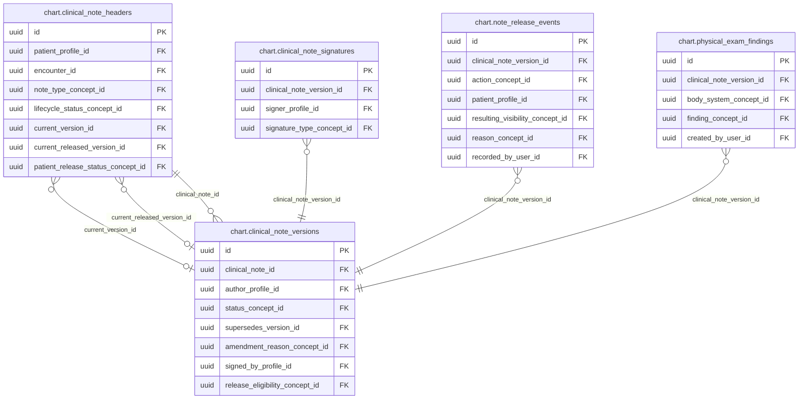
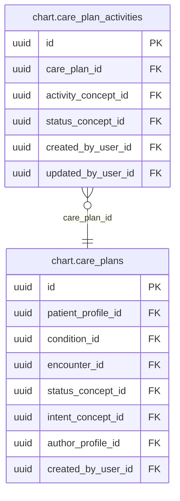
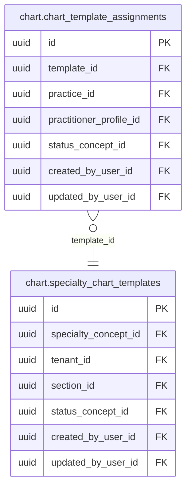
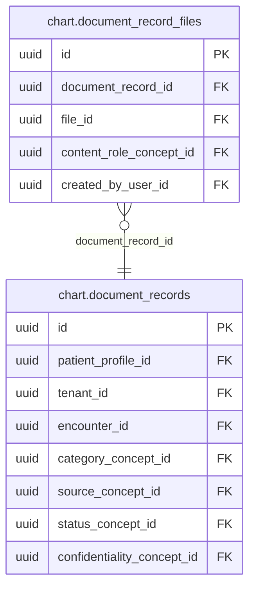

<!-- AUTOGENERADO por tools/inventario/catalogo.mjs. No editar manualmente. -->

# Catálogo del schema `chart`

- **Tablas:** 11 · **Columnas:** 133 (31 con descripción: 23.3 %) · **Índices:** 80
- **Dominio:** Clínico y Diagnóstico
- Método y límites del catálogo: [README del inventario](../README.md)

## Tablas

| Tabla | Propósito | Columnas | Índices | Operaciones | ORM |
|---|---|---|---|---|---|
| [care_plan_activities](#care_plan_activities) | Detalla actividades que componen un plan de cuidado para facilitar su asignación y seguimiento. | 11 | 5 | 7 | COINCIDE |
| [care_plans](#care_plans) | Agrupa objetivos y estrategias de cuidado que orientan el seguimiento clínico de un paciente. | 15 | 9 | 7 | DIVERGE |
| [chart_template_assignments](#chart_template_assignments) | Asigna plantillas clínicas a los ámbitos o sujetos correspondientes para determinar qué estructura documental se usa. | 11 | 6 | 3 | COINCIDE |
| [clinical_note_headers](#clinical_note_headers) | Representa la identidad y el estado actual de una nota clínica dentro del expediente del paciente. | 14 | 11 | 25 | COINCIDE |
| [clinical_note_signatures](#clinical_note_signatures) | Registra firmas asociadas a notas clínicas para documentar su validación y autoría profesional. | 8 | 3 | 3 | COINCIDE |
| [clinical_note_versions](#clinical_note_versions) | Preserva versiones sucesivas de notas clínicas para mantener trazabilidad de su contenido y cambios. | 19 | 10 | 17 | COINCIDE |
| [document_record_files](#document_record_files) | Vincula archivos almacenados con registros documentales para resolver su ubicación y asociación clínica. | 7 | 4 | 8 | COINCIDE |
| [document_records](#document_records) | Registra documentos clínicos y su clasificación dentro del expediente del paciente. | 18 | 12 | 13 | COINCIDE |
| [note_release_events](#note_release_events) | Conserva eventos de liberación de notas para representar cuándo pasan a estar disponibles en el flujo clínico previsto. | 9 | 8 | 2 | COINCIDE |
| [physical_exam_findings](#physical_exam_findings) | Documenta hallazgos del examen físico asociados a la valoración clínica del paciente. | 8 | 4 | 1 | COINCIDE |
| [specialty_chart_templates](#specialty_chart_templates) | Define plantillas de expediente o documentación adaptadas a especialidades clínicas. | 13 | 8 | 7 | COINCIDE |

## Diagrama entidad-relación

Las tablas se agrupan en familias por sus claves foráneas dentro del schema (máximo 40 por diagrama). Las FK hacia otros schemas se listan en la ficha de cada tabla.

### Familia 1 de 4 — 5 tablas

### Familia 2 de 4 — 2 tablas

### Familia 3 de 4 — 2 tablas

### Familia 4 de 4 — 2 tablas

## Fichas

### care_plan_activities

#### Vista general

Detalla actividades que componen un plan de cuidado para facilitar su asignación y seguimiento.

- **Estado del propósito:** DOMAIN_CURATED_DRAFT · fuente: `Mantra Core Health Context/modules/diagram_15_chart.puml: care_plan_activities`
- **Dominio:** Clínico y Diagnóstico · **Diagrama:** `Mantra Core Health Context/modules/diagram_15_chart.puml` · **DDL:** `SQL/15_chart/02_tables.sql`
- **Entidad del ORM:** `CarePlanActivities` — `src/modules/chart/entities/care_plan_activities.entity.ts`
- **Resumen:** 11 columnas · 5 índices · 5 FK salientes · 0 entrantes · 7 operaciones

#### Columnas

| # | Columna | Tipo | Rol estructural | Descripción | ORM |
|---|---|---|---|---|---|
| 1 | `id` | `uuid` | Clave primaria; Obligatoria | Identificador único de la instancia. _(JSDOC_ESTANDAR, `src/modules/chart/entities/care_plan_activities.entity.ts:12`)_ | coincide |
| 2 | `care_plan_id` | `uuid` | Clave foránea → chart.care_plans.id; Obligatoria | _sin dato_ | coincide |
| 3 | `activity_concept_id` | `uuid` | Clave foránea → terminology.catalog_concepts.id; Obligatoria | _sin dato_ | coincide |
| 4 | `status_concept_id` | `uuid` | Clave foránea → terminology.catalog_concepts.id; Obligatoria | _sin dato_ | coincide |
| 5 | `scheduled_at` | `timestamptz` | Opcional | _sin dato_ | coincide |
| 6 | `detail_text` | `text` | Opcional | _sin dato_ | coincide |
| 7 | `created_at` | `timestamptz` | Obligatoria | Fecha y hora en que se creó el registro. _(JSDOC_ESTANDAR, `src/modules/chart/entities/care_plan_activities.entity.ts:52`)_ | coincide |
| 8 | `updated_at` | `timestamptz` | Obligatoria | Fecha y hora de la última actualización. _(JSDOC_ESTANDAR, `src/modules/chart/entities/care_plan_activities.entity.ts:58`)_ | coincide |
| 9 | `created_by_user_id` | `uuid` | Clave foránea → iam.users.id; Opcional | _sin dato_ | coincide |
| 10 | `updated_by_user_id` | `uuid` | Clave foránea → iam.users.id; Opcional | _sin dato_ | coincide |
| 11 | `row_version` | `integer = 1` | Obligatoria | Versión usada para controlar actualizaciones concurrentes. _(JSDOC_ENTIDAD, `src/modules/chart/entities/care_plan_activities.entity.ts:76`)_ | coincide |

#### Relaciones

| Sentido | Columnas | Tabla | Restricción |
|---|---|---|---|
| hacia | care_plan_id | chart.care_plans (id) | fk_care_plan_activities_care_plan_id |
| hacia | activity_concept_id | terminology.catalog_concepts (id) | fk_care_plan_activities_activity_concept_id |
| hacia | status_concept_id | terminology.catalog_concepts (id) | fk_care_plan_activities_status_concept_id |
| hacia | created_by_user_id | iam.users (id) | fk_care_plan_activities_created_by_user_id |
| hacia | updated_by_user_id | iam.users (id) | fk_care_plan_activities_updated_by_user_id |

#### Índices

| Índice | Único | Columnas | Para qué |
|---|---|---|---|
| `ix_care_plan_activities_care_plan_id` | no | care_plan_id | Soporta la clave foránea fk_care_plan_activities_care_plan_id: PostgreSQL no indexa las FK por sí mismo _(DOCUMENTO)_; 2 consulta(s) de repositorio filtran u ordenan por «care_plan_id», la primera columna del índice _(CONSULTA)_ |
| `ix_care_plan_activities_activity_concept_id` | no | activity_concept_id | Soporta la clave foránea fk_care_plan_activities_activity_concept_id: PostgreSQL no indexa las FK por sí mismo _(DOCUMENTO)_ |
| `ix_care_plan_activities_status_concept_id` | no | status_concept_id | Soporta la clave foránea fk_care_plan_activities_status_concept_id: PostgreSQL no indexa las FK por sí mismo _(DOCUMENTO)_ |
| `ix_care_plan_activities_created_by_user_id` | no | created_by_user_id | Soporta la clave foránea fk_care_plan_activities_created_by_user_id: PostgreSQL no indexa las FK por sí mismo _(DOCUMENTO)_ |
| `ix_care_plan_activities_updated_by_user_id` | no | updated_by_user_id | Soporta la clave foránea fk_care_plan_activities_updated_by_user_id: PostgreSQL no indexa las FK por sí mismo _(DOCUMENTO)_ |

#### Operaciones que la tocan

| Operación | Efecto | Confianza |
|---|---|---|
| POST /charts/care-plans | CREA | DIRECTA |
| PATCH /charts/care-plans/{planId}/activities/{activityId} | ACTUALIZA | POR_TIPO |
| PATCH /charts/care-plans/{planId}/activities/{activityId} | LEE | DIRECTA |
| GET /charts/encounters/{id}/pdf | LEE | DIRECTA |
| GET /charts/me/encounters/{id}/pdf | LEE | DIRECTA |
| GET /charts/patients/{patientProfileId}/chart | LEE | DIRECTA |
| POST /clinical/encounters/{id}/close | LEE | DIRECTA |

#### Gobierno

| Atributo | Valor | Fuente |
|---|---|---|
| Append-only | no declarado | — |
| Datos personales | sin fuente | — |
| Financiera | sin fuente | — |
| Crítica para auditoría | sin fuente | — |
| Retención | sin fuente | — |
| Responsable | sin fuente | — |
| Revisión | AUTO_DETECTADA | — |

---

### care_plans

#### Vista general

Agrupa objetivos y estrategias de cuidado que orientan el seguimiento clínico de un paciente.

- **Estado del propósito:** DOMAIN_CURATED_DRAFT · fuente: `Mantra Core Health Context/modules/diagram_15_chart.puml: care_plans`
- **Dominio:** Clínico y Diagnóstico · **Diagrama:** `Mantra Core Health Context/modules/diagram_15_chart.puml` · **DDL:** `SQL/15_chart/02_tables.sql`
- **Entidad del ORM:** `CarePlans` — `src/modules/chart/entities/care_plans.entity.ts`
- **Resumen:** 15 columnas · 9 índices · 8 FK salientes · 2 entrantes · 7 operaciones

#### Columnas

| # | Columna | Tipo | Rol estructural | Descripción | ORM |
|---|---|---|---|---|---|
| 1 | `id` | `uuid` | Clave primaria; Obligatoria | Identificador único de la instancia. _(JSDOC_ESTANDAR, `src/modules/chart/entities/care_plans.entity.ts:12`)_ | coincide |
| 2 | `patient_profile_id` | `uuid` | Clave foránea → profiles.patient_profiles.profile_id; Obligatoria | _sin dato_ | coincide |
| 3 | `condition_id` | `uuid` | Clave foránea → clinical.conditions.id; Opcional | _sin dato_ | coincide |
| 4 | `encounter_id` | `uuid` | Clave foránea → clinical.encounters.id; Opcional | _sin dato_ | coincide |
| 5 | `status_concept_id` | `uuid` | Clave foránea → terminology.catalog_concepts.id; Obligatoria | _sin dato_ | coincide |
| 6 | `intent_concept_id` | `uuid` | Clave foránea → terminology.catalog_concepts.id; Opcional | _sin dato_ | coincide |
| 7 | `goal_text` | `text` | Opcional | _sin dato_ | coincide |
| 8 | `start_date` | `date` | Opcional | _sin dato_ | coincide |
| 9 | `end_date` | `date` | Opcional | _sin dato_ | coincide |
| 10 | `author_profile_id` | `uuid` | Clave foránea → profiles.health_practitioner_profiles.profile_id; Opcional | _sin dato_ | coincide |
| 11 | `created_at` | `timestamptz` | Obligatoria | Fecha y hora en que se creó el registro. _(JSDOC_ESTANDAR, `src/modules/chart/entities/care_plans.entity.ts:79`)_ | coincide |
| 12 | `updated_at` | `timestamptz` | Obligatoria | Fecha y hora de la última actualización. _(JSDOC_ESTANDAR, `src/modules/chart/entities/care_plans.entity.ts:85`)_ | coincide |
| 13 | `created_by_user_id` | `uuid` | Clave foránea → iam.users.id; Opcional | _sin dato_ | coincide |
| 14 | `updated_by_user_id` | `uuid` | Clave foránea → iam.users.id; Opcional | _sin dato_ | coincide |
| 15 | `row_version` | `integer = 1` | Obligatoria | Versión usada para controlar actualizaciones concurrentes. _(JSDOC_ENTIDAD, `src/modules/chart/entities/care_plans.entity.ts:103`)_ | coincide |

#### Relaciones

| Sentido | Columnas | Tabla | Restricción |
|---|---|---|---|
| hacia | patient_profile_id | profiles.patient_profiles (profile_id) | fk_care_plans_patient_profile_id |
| hacia | condition_id | clinical.conditions (id) | fk_care_plans_condition_id |
| hacia | encounter_id | clinical.encounters (id) | fk_care_plans_encounter_id |
| hacia | status_concept_id | terminology.catalog_concepts (id) | fk_care_plans_status_concept_id |
| hacia | intent_concept_id | terminology.catalog_concepts (id) | fk_care_plans_intent_concept_id |
| hacia | author_profile_id | profiles.health_practitioner_profiles (profile_id) | fk_care_plans_author_profile_id |
| hacia | created_by_user_id | iam.users (id) | fk_care_plans_created_by_user_id |
| hacia | updated_by_user_id | iam.users (id) | fk_care_plans_updated_by_user_id |
| desde | id | chart.care_plan_activities (care_plan_id) | fk_care_plan_activities_care_plan_id |
| desde | id | audit.care_plans_history (care_plan_id) | fk_care_plans_history_care_plan_id |

#### Índices

| Índice | Único | Columnas | Para qué |
|---|---|---|---|
| `ix_care_plans_patient_profile_id` | no | patient_profile_id | Soporta la clave foránea fk_care_plans_patient_profile_id: PostgreSQL no indexa las FK por sí mismo _(DOCUMENTO)_; 1 consulta(s) de repositorio filtran u ordenan por «patient_profile_id», la primera columna del índice _(CONSULTA)_ |
| `ix_care_plans_condition_id` | no | condition_id | Soporta la clave foránea fk_care_plans_condition_id: PostgreSQL no indexa las FK por sí mismo _(DOCUMENTO)_ |
| `ix_care_plans_encounter_id` | no | encounter_id | Soporta la clave foránea fk_care_plans_encounter_id: PostgreSQL no indexa las FK por sí mismo _(DOCUMENTO)_; 1 consulta(s) de repositorio filtran u ordenan por «encounter_id», la primera columna del índice _(CONSULTA)_ |
| `ix_care_plans_status_concept_id` | no | status_concept_id | Soporta la clave foránea fk_care_plans_status_concept_id: PostgreSQL no indexa las FK por sí mismo _(DOCUMENTO)_ |
| `ix_care_plans_intent_concept_id` | no | intent_concept_id | Soporta la clave foránea fk_care_plans_intent_concept_id: PostgreSQL no indexa las FK por sí mismo _(DOCUMENTO)_ |
| `ix_care_plans_author_profile_id` | no | author_profile_id | Soporta la clave foránea fk_care_plans_author_profile_id: PostgreSQL no indexa las FK por sí mismo _(DOCUMENTO)_ |
| `ix_care_plans_created_by_user_id` | no | created_by_user_id | Soporta la clave foránea fk_care_plans_created_by_user_id: PostgreSQL no indexa las FK por sí mismo _(DOCUMENTO)_ |
| `ix_care_plans_updated_by_user_id` | no | updated_by_user_id | Soporta la clave foránea fk_care_plans_updated_by_user_id: PostgreSQL no indexa las FK por sí mismo _(DOCUMENTO)_ |
| `ix_care_plans_patient_profile_id_updated_at` | no | patient_profile_id, ("updated_at" DESC) | _sin uso detectado estáticamente_ |

#### Operaciones que la tocan

| Operación | Efecto | Confianza |
|---|---|---|
| POST /charts/care-plans | CREA | DIRECTA |
| PATCH /charts/care-plans/{planId}/activities/{activityId} | ACTUALIZA | POR_TIPO |
| PATCH /charts/care-plans/{planId}/activities/{activityId} | LEE | DIRECTA |
| GET /charts/encounters/{id}/pdf | LEE | DIRECTA |
| GET /charts/me/encounters/{id}/pdf | LEE | DIRECTA |
| GET /charts/patients/{patientProfileId}/chart | LEE | DIRECTA |
| POST /clinical/encounters/{id}/close | LEE | DIRECTA |

#### Gobierno

| Atributo | Valor | Fuente |
|---|---|---|
| Append-only | no declarado | — |
| Datos personales | sin fuente | — |
| Financiera | sin fuente | — |
| Crítica para auditoría | sin fuente | — |
| Retención | sin fuente | — |
| Responsable | sin fuente | — |
| Revisión | AUTO_DETECTADA | — |

---

### chart_template_assignments

#### Vista general

Asigna plantillas clínicas a los ámbitos o sujetos correspondientes para determinar qué estructura documental se usa.

- **Estado del propósito:** DOMAIN_CURATED_DRAFT · fuente: `Mantra Core Health Context/modules/diagram_15_chart.puml: chart_template_assignments`
- **Dominio:** Clínico y Diagnóstico · **Diagrama:** `Mantra Core Health Context/modules/diagram_15_chart.puml` · **DDL:** `SQL/15_chart/02_tables.sql`
- **Entidad del ORM:** `ChartTemplateAssignments` — `src/modules/chart/entities/chart_template_assignments.entity.ts`
- **Resumen:** 11 columnas · 6 índices · 6 FK salientes · 0 entrantes · 3 operaciones

#### Columnas

| # | Columna | Tipo | Rol estructural | Descripción | ORM |
|---|---|---|---|---|---|
| 1 | `id` | `uuid` | Clave primaria; Obligatoria | Identificador único de la instancia. _(JSDOC_ESTANDAR, `src/modules/chart/entities/chart_template_assignments.entity.ts:12`)_ | coincide |
| 2 | `template_id` | `uuid` | Clave foránea → chart.specialty_chart_templates.id; Obligatoria | _sin dato_ | coincide |
| 3 | `practice_id` | `uuid` | Clave foránea → practice.practices.id; Opcional | _sin dato_ | coincide |
| 4 | `practitioner_profile_id` | `uuid` | Clave foránea → profiles.health_practitioner_profiles.profile_id; Opcional | _sin dato_ | coincide |
| 5 | `is_default` | `boolean` | Obligatoria | _sin dato_ | coincide |
| 6 | `status_concept_id` | `uuid` | Clave foránea → terminology.catalog_concepts.id; Obligatoria | _sin dato_ | coincide |
| 7 | `created_at` | `timestamptz` | Obligatoria | Fecha y hora en que se creó el registro. _(JSDOC_ESTANDAR, `src/modules/chart/entities/chart_template_assignments.entity.ts:52`)_ | coincide |
| 8 | `updated_at` | `timestamptz` | Obligatoria | Fecha y hora de la última actualización. _(JSDOC_ESTANDAR, `src/modules/chart/entities/chart_template_assignments.entity.ts:58`)_ | coincide |
| 9 | `created_by_user_id` | `uuid` | Clave foránea → iam.users.id; Opcional | _sin dato_ | coincide |
| 10 | `updated_by_user_id` | `uuid` | Clave foránea → iam.users.id; Opcional | _sin dato_ | coincide |
| 11 | `row_version` | `integer = 1` | Obligatoria | Versión usada para controlar actualizaciones concurrentes. _(JSDOC_ENTIDAD, `src/modules/chart/entities/chart_template_assignments.entity.ts:76`)_ | coincide |

#### Relaciones

| Sentido | Columnas | Tabla | Restricción |
|---|---|---|---|
| hacia | template_id | chart.specialty_chart_templates (id) | fk_chart_template_assignments_template_id |
| hacia | practice_id | practice.practices (id) | fk_chart_template_assignments_practice_id |
| hacia | practitioner_profile_id | profiles.health_practitioner_profiles (profile_id) | fk_chart_template_assignments_practitioner_profile_id |
| hacia | status_concept_id | terminology.catalog_concepts (id) | fk_chart_template_assignments_status_concept_id |
| hacia | created_by_user_id | iam.users (id) | fk_chart_template_assignments_created_by_user_id |
| hacia | updated_by_user_id | iam.users (id) | fk_chart_template_assignments_updated_by_user_id |

#### Índices

| Índice | Único | Columnas | Para qué |
|---|---|---|---|
| `ix_chart_template_assignments_template_id` | no | template_id | Soporta la clave foránea fk_chart_template_assignments_template_id: PostgreSQL no indexa las FK por sí mismo _(DOCUMENTO)_ |
| `ix_chart_template_assignments_practice_id` | no | practice_id | Soporta la clave foránea fk_chart_template_assignments_practice_id: PostgreSQL no indexa las FK por sí mismo _(DOCUMENTO)_; 1 consulta(s) de repositorio filtran u ordenan por «practice_id», la primera columna del índice _(CONSULTA)_ |
| `ix_chart_template_assignments_practitioner_profile_id` | no | practitioner_profile_id | Soporta la clave foránea fk_chart_template_assignments_practitioner_profile_id: PostgreSQL no indexa las FK por sí mismo _(DOCUMENTO)_; 1 consulta(s) de repositorio filtran u ordenan por «practitioner_profile_id», la primera columna del índice _(CONSULTA)_ |
| `ix_chart_template_assignments_status_concept_id` | no | status_concept_id | Soporta la clave foránea fk_chart_template_assignments_status_concept_id: PostgreSQL no indexa las FK por sí mismo _(DOCUMENTO)_; 1 consulta(s) de repositorio filtran u ordenan por «status_concept_id», la primera columna del índice _(CONSULTA)_ |
| `ix_chart_template_assignments_created_by_user_id` | no | created_by_user_id | Soporta la clave foránea fk_chart_template_assignments_created_by_user_id: PostgreSQL no indexa las FK por sí mismo _(DOCUMENTO)_ |
| `ix_chart_template_assignments_updated_by_user_id` | no | updated_by_user_id | Soporta la clave foránea fk_chart_template_assignments_updated_by_user_id: PostgreSQL no indexa las FK por sí mismo _(DOCUMENTO)_ |

#### Operaciones que la tocan

| Operación | Efecto | Confianza |
|---|---|---|
| POST /charts/templates/{templateId}/assignments | ACTUALIZA | POR_TIPO |
| POST /charts/templates/{templateId}/assignments | CREA | DIRECTA |
| POST /charts/templates/{templateId}/assignments | LEE | DIRECTA |

#### Gobierno

| Atributo | Valor | Fuente |
|---|---|---|
| Append-only | no declarado | — |
| Datos personales | sin fuente | — |
| Financiera | sin fuente | — |
| Crítica para auditoría | sin fuente | — |
| Retención | sin fuente | — |
| Responsable | sin fuente | — |
| Revisión | AUTO_DETECTADA | — |

---

### clinical_note_headers

#### Vista general

Representa la identidad y el estado actual de una nota clínica dentro del expediente del paciente.

- **Estado del propósito:** DOMAIN_CURATED_DRAFT · fuente: `Mantra Core Health Context/modules/diagram_15_chart.puml: clinical_note_headers`
- **Dominio:** Clínico y Diagnóstico · **Diagrama:** `Mantra Core Health Context/modules/diagram_15_chart.puml` · **DDL:** `SQL/15_chart/02_tables.sql`
- **Entidad del ORM:** `ClinicalNoteHeaders` — `src/modules/chart/entities/clinical_note_headers.entity.ts`
- **Resumen:** 14 columnas · 11 índices · 10 FK salientes · 2 entrantes · 25 operaciones

#### Columnas

| # | Columna | Tipo | Rol estructural | Descripción | ORM |
|---|---|---|---|---|---|
| 1 | `id` | `uuid` | Clave primaria; Obligatoria | Identificador único de la instancia. _(JSDOC_ESTANDAR, `src/modules/chart/entities/clinical_note_headers.entity.ts:12`)_ | coincide |
| 2 | `patient_profile_id` | `uuid` | Clave foránea → profiles.patient_profiles.profile_id; Obligatoria | _sin dato_ | coincide |
| 3 | `encounter_id` | `uuid` | Clave foránea → clinical.encounters.id; Opcional | _sin dato_ | coincide |
| 4 | `note_type_concept_id` | `uuid` | Clave foránea → terminology.catalog_concepts.id; Obligatoria | _sin dato_ | coincide |
| 5 | `lifecycle_status_concept_id` | `uuid` | Clave foránea → terminology.catalog_concepts.id; Obligatoria | _sin dato_ | coincide |
| 6 | `current_version_id` | `uuid` | Clave foránea → chart.clinical_note_versions.id; Opcional | _sin dato_ | coincide |
| 7 | `current_released_version_id` | `uuid` | Clave foránea → chart.clinical_note_versions.id; Opcional | _sin dato_ | coincide |
| 8 | `patient_release_status_concept_id` | `uuid` | Clave foránea → terminology.catalog_concepts.id; Opcional | _sin dato_ | coincide |
| 9 | `confidentiality_concept_id` | `uuid` | Clave foránea → terminology.catalog_concepts.id; Opcional | _sin dato_ | coincide |
| 10 | `created_at` | `timestamptz` | Obligatoria | Fecha y hora en que se creó el registro. _(JSDOC_ESTANDAR, `src/modules/chart/entities/clinical_note_headers.entity.ts:78`)_ | coincide |
| 11 | `updated_at` | `timestamptz` | Obligatoria | Fecha y hora de la última actualización. _(JSDOC_ESTANDAR, `src/modules/chart/entities/clinical_note_headers.entity.ts:84`)_ | coincide |
| 12 | `created_by_user_id` | `uuid` | Clave foránea → iam.users.id; Opcional | _sin dato_ | coincide |
| 13 | `updated_by_user_id` | `uuid` | Clave foránea → iam.users.id; Opcional | _sin dato_ | coincide |
| 14 | `row_version` | `integer = 1` | Obligatoria | Versión usada para controlar actualizaciones concurrentes. _(JSDOC_ENTIDAD, `src/modules/chart/entities/clinical_note_headers.entity.ts:102`)_ | coincide |

#### Relaciones

| Sentido | Columnas | Tabla | Restricción |
|---|---|---|---|
| hacia | current_version_id | chart.clinical_note_versions (id) | fk_clinical_note_headers_current_version_id |
| hacia | current_released_version_id | chart.clinical_note_versions (id) | fk_clinical_note_headers_current_released_version_id |
| hacia | patient_profile_id | profiles.patient_profiles (profile_id) | fk_clinical_note_headers_patient_profile_id |
| hacia | encounter_id | clinical.encounters (id) | fk_clinical_note_headers_encounter_id |
| hacia | note_type_concept_id | terminology.catalog_concepts (id) | fk_clinical_note_headers_note_type_concept_id |
| hacia | lifecycle_status_concept_id | terminology.catalog_concepts (id) | fk_clinical_note_headers_lifecycle_status_concept_id |
| hacia | patient_release_status_concept_id | terminology.catalog_concepts (id) | fk_clinical_note_headers_patient_release_status_concept_id |
| hacia | confidentiality_concept_id | terminology.catalog_concepts (id) | fk_clinical_note_headers_confidentiality_concept_id |
| hacia | created_by_user_id | iam.users (id) | fk_clinical_note_headers_created_by_user_id |
| hacia | updated_by_user_id | iam.users (id) | fk_clinical_note_headers_updated_by_user_id |
| desde | id | chart.clinical_note_versions (clinical_note_id) | fk_clinical_note_versions_clinical_note_id |
| desde | id | audit.clinical_note_headers_history (clinical_note_header_id) | fk_clinical_note_headers_history_clinical_note_header_id |

#### Índices

| Índice | Único | Columnas | Para qué |
|---|---|---|---|
| `ix_clinical_note_headers_patient_profile_id` | no | patient_profile_id | Soporta la clave foránea fk_clinical_note_headers_patient_profile_id: PostgreSQL no indexa las FK por sí mismo _(DOCUMENTO)_; 2 consulta(s) de repositorio filtran u ordenan por «patient_profile_id», la primera columna del índice _(CONSULTA)_ |
| `ix_clinical_note_headers_encounter_id` | no | encounter_id | Soporta la clave foránea fk_clinical_note_headers_encounter_id: PostgreSQL no indexa las FK por sí mismo _(DOCUMENTO)_; 1 consulta(s) de repositorio filtran u ordenan por «encounter_id», la primera columna del índice _(CONSULTA)_ |
| `ix_clinical_note_headers_note_type_concept_id` | no | note_type_concept_id | Soporta la clave foránea fk_clinical_note_headers_note_type_concept_id: PostgreSQL no indexa las FK por sí mismo _(DOCUMENTO)_ |
| `ix_clinical_note_headers_lifecycle_status_concept_id` | no | lifecycle_status_concept_id | Soporta la clave foránea fk_clinical_note_headers_lifecycle_status_concept_id: PostgreSQL no indexa las FK por sí mismo _(DOCUMENTO)_ |
| `ix_clinical_note_headers_current_version_id` | no | current_version_id | Soporta la clave foránea fk_clinical_note_headers_current_version_id: PostgreSQL no indexa las FK por sí mismo _(DOCUMENTO)_ |
| `ix_clinical_note_headers_current_released_version_id` | no | current_released_version_id | Soporta la clave foránea fk_clinical_note_headers_current_released_version_id: PostgreSQL no indexa las FK por sí mismo _(DOCUMENTO)_ |
| `ix_clinical_note_headers_patient_release_status_concept_id` | no | patient_release_status_concept_id | Soporta la clave foránea fk_clinical_note_headers_patient_release_status_concept_id: PostgreSQL no indexa las FK por sí mismo _(DOCUMENTO)_ |
| `ix_clinical_note_headers_confidentiality_concept_id` | no | confidentiality_concept_id | Soporta la clave foránea fk_clinical_note_headers_confidentiality_concept_id: PostgreSQL no indexa las FK por sí mismo _(DOCUMENTO)_ |
| `ix_clinical_note_headers_created_by_user_id` | no | created_by_user_id | Soporta la clave foránea fk_clinical_note_headers_created_by_user_id: PostgreSQL no indexa las FK por sí mismo _(DOCUMENTO)_; 1 consulta(s) de repositorio filtran u ordenan por «created_by_user_id», la primera columna del índice _(CONSULTA)_ |
| `ix_clinical_note_headers_updated_by_user_id` | no | updated_by_user_id | Soporta la clave foránea fk_clinical_note_headers_updated_by_user_id: PostgreSQL no indexa las FK por sí mismo _(DOCUMENTO)_ |
| `ix_clinical_note_headers_patient_profile_id_updated_at` | no | patient_profile_id, ("updated_at" DESC) | _sin uso detectado estáticamente_ |

#### Operaciones que la tocan

| Operación | Efecto | Confianza |
|---|---|---|
| GET /charts/encounters/{id}/pdf | LEE | DIRECTA |
| GET /charts/me/encounters/{id}/pdf | LEE | DIRECTA |
| GET /charts/me/notes | LEE | DIRECTA |
| GET /charts/notes | LEE | DIRECTA |
| POST /charts/notes | ACTUALIZA | POR_TIPO |
| POST /charts/notes | CREA | DIRECTA |
| POST /charts/notes/{noteId}/amendments | ACTUALIZA | POR_TIPO |
| POST /charts/notes/{noteId}/amendments | LEE | DIRECTA |
| PUT /charts/notes/{noteId}/versions | ACTUALIZA | POR_TIPO |
| PUT /charts/notes/{noteId}/versions | LEE | DIRECTA |
| POST /charts/notes/{noteId}/versions/{versionId}/cosign | LEE | DIRECTA |
| POST /charts/notes/{noteId}/versions/{versionId}/sign | LEE | DIRECTA |
| POST /charts/notes/versions/{versionId}/exam-findings | LEE | DIRECTA |
| POST /charts/notes/versions/{versionId}/release | ACTUALIZA | POR_TIPO |
| POST /charts/notes/versions/{versionId}/release | LEE | DIRECTA |
| POST /charts/notes/versions/{versionId}/withhold | ACTUALIZA | POR_TIPO |
| POST /charts/notes/versions/{versionId}/withhold | LEE | DIRECTA |
| GET /charts/patients/{patientProfileId}/chart | LEE | DIRECTA |
| POST /clinical/conditions/{id}/verification | LEE | DIRECTA |
| POST /clinical/encounters/{id}/close | LEE | DIRECTA |
| DELETE /profiles/practitioners/{profileId}/photo | LEE | DIRECTA |
| PUT /profiles/practitioners/{profileId}/photo | LEE | DIRECTA |
| GET /profiles/practitioners/{profileId}/summary | LEE | DIRECTA |
| PATCH /profiles/practitioners/me | LEE | DIRECTA |
| GET /profiles/practitioners/me/summary | LEE | DIRECTA |

#### Gobierno

| Atributo | Valor | Fuente |
|---|---|---|
| Append-only | no declarado | — |
| Datos personales | sin fuente | — |
| Financiera | sin fuente | — |
| Crítica para auditoría | sin fuente | — |
| Retención | sin fuente | — |
| Responsable | sin fuente | — |
| Revisión | AUTO_DETECTADA | — |

---

### clinical_note_signatures

#### Vista general

Registra firmas asociadas a notas clínicas para documentar su validación y autoría profesional.

- **Estado del propósito:** DOMAIN_CURATED_DRAFT · fuente: `Mantra Core Health Context/modules/diagram_15_chart.puml: clinical_note_signatures`
- **Dominio:** Clínico y Diagnóstico · **Diagrama:** `Mantra Core Health Context/modules/diagram_15_chart.puml` · **DDL:** `SQL/15_chart/02_tables.sql`
- **Entidad del ORM:** `ClinicalNoteSignatures` — `src/modules/chart/entities/clinical_note_signatures.entity.ts`
- **Resumen:** 8 columnas · 3 índices · 3 FK salientes · 4 entrantes · 3 operaciones

#### Columnas

| # | Columna | Tipo | Rol estructural | Descripción | ORM |
|---|---|---|---|---|---|
| 1 | `id` | `uuid` | Clave primaria; Obligatoria | Identificador único de la instancia. _(JSDOC_ESTANDAR, `src/modules/chart/entities/clinical_note_signatures.entity.ts:12`)_ | coincide |
| 2 | `clinical_note_version_id` | `uuid` | Clave foránea → chart.clinical_note_versions.id; Obligatoria | _sin dato_ | coincide |
| 3 | `signer_profile_id` | `uuid` | Clave foránea → profiles.health_practitioner_profiles.profile_id; Obligatoria | _sin dato_ | coincide |
| 4 | `signature_type_concept_id` | `uuid` | Clave foránea → terminology.catalog_concepts.id; Obligatoria | _sin dato_ | coincide |
| 5 | `signature_value_encrypted` | `text` | Opcional | _sin dato_ | coincide |
| 6 | `certificate_thumbprint` | `varchar` | Opcional | _sin dato_ | coincide |
| 7 | `signed_content_hash` | `varchar` | Opcional | _sin dato_ | coincide |
| 8 | `signed_at` | `timestamptz` | Obligatoria | _sin dato_ | coincide |

#### Relaciones

| Sentido | Columnas | Tabla | Restricción |
|---|---|---|---|
| hacia | clinical_note_version_id | chart.clinical_note_versions (id) | fk_clinical_note_signatures_clinical_note_version_id |
| hacia | signer_profile_id | profiles.health_practitioner_profiles (profile_id) | fk_clinical_note_signatures_signer_profile_id |
| hacia | signature_type_concept_id | terminology.catalog_concepts (id) | fk_clinical_note_signatures_signature_type_concept_id |
| desde | id | consent.consent_evidence (signature_id) | fk_consent_evidence_signature_id |
| desde | id | diagnostics.result_verifications (signature_id) | fk_result_verifications_signature_id |
| desde | id | health_data.health_provenance_records (signature_id) | fk_health_provenance_records_signature_id |
| desde | id | procedures_perioperative.operative_reports (signature_id) | fk_operative_reports_signature_id |

#### Índices

| Índice | Único | Columnas | Para qué |
|---|---|---|---|
| `ix_clinical_note_signatures_clinical_note_version_id` | no | clinical_note_version_id | Soporta la clave foránea fk_clinical_note_signatures_clinical_note_version_id: PostgreSQL no indexa las FK por sí mismo _(DOCUMENTO)_; 1 consulta(s) de repositorio filtran u ordenan por «clinical_note_version_id», la primera columna del índice _(CONSULTA)_ |
| `ix_clinical_note_signatures_signer_profile_id` | no | signer_profile_id | Soporta la clave foránea fk_clinical_note_signatures_signer_profile_id: PostgreSQL no indexa las FK por sí mismo _(DOCUMENTO)_ |
| `ix_clinical_note_signatures_signature_type_concept_id` | no | signature_type_concept_id | Soporta la clave foránea fk_clinical_note_signatures_signature_type_concept_id: PostgreSQL no indexa las FK por sí mismo _(DOCUMENTO)_ |

#### Operaciones que la tocan

| Operación | Efecto | Confianza |
|---|---|---|
| POST /charts/notes/{noteId}/versions/{versionId}/cosign | CREA | DIRECTA |
| POST /charts/notes/{noteId}/versions/{versionId}/cosign | LEE | DIRECTA |
| POST /charts/notes/{noteId}/versions/{versionId}/sign | CREA | DIRECTA |

#### Gobierno

| Atributo | Valor | Fuente |
|---|---|---|
| Append-only | no declarado | — |
| Datos personales | sin fuente | — |
| Financiera | sin fuente | — |
| Crítica para auditoría | sin fuente | — |
| Retención | sin fuente | — |
| Responsable | sin fuente | — |
| Revisión | AUTO_DETECTADA | — |

---

### clinical_note_versions

#### Vista general

Preserva versiones sucesivas de notas clínicas para mantener trazabilidad de su contenido y cambios.

- **Estado del propósito:** DOMAIN_CURATED_DRAFT · fuente: `Mantra Core Health Context/modules/diagram_15_chart.puml: clinical_note_versions`
- **Dominio:** Clínico y Diagnóstico · **Diagrama:** `Mantra Core Health Context/modules/diagram_15_chart.puml` · **DDL:** `SQL/15_chart/02_tables.sql`
- **Entidad del ORM:** `ClinicalNoteVersions` — `src/modules/chart/entities/clinical_note_versions.entity.ts`
- **Resumen:** 19 columnas · 10 índices · 8 FK salientes · 6 entrantes · 17 operaciones

#### Columnas

| # | Columna | Tipo | Rol estructural | Descripción | ORM |
|---|---|---|---|---|---|
| 1 | `id` | `uuid` | Clave primaria; Obligatoria | Identificador único de la instancia. _(JSDOC_ESTANDAR, `src/modules/chart/entities/clinical_note_versions.entity.ts:12`)_ | coincide |
| 2 | `clinical_note_id` | `uuid` | Clave foránea → chart.clinical_note_headers.id; Obligatoria | _sin dato_ | coincide |
| 3 | `version_number` | `integer` | Obligatoria | _sin dato_ | coincide |
| 4 | `author_profile_id` | `uuid` | Clave foránea → profiles.health_practitioner_profiles.profile_id; Obligatoria | _sin dato_ | coincide |
| 5 | `status_concept_id` | `uuid` | Clave foránea → terminology.catalog_concepts.id; Obligatoria | _sin dato_ | coincide |
| 6 | `chief_complaint_text` | `text` | Opcional | _sin dato_ | coincide |
| 7 | `subjective_text` | `text` | Opcional | _sin dato_ | coincide |
| 8 | `objective_text` | `text` | Opcional | _sin dato_ | coincide |
| 9 | `assessment_text` | `text` | Opcional | _sin dato_ | coincide |
| 10 | `plan_text` | `text` | Opcional | _sin dato_ | coincide |
| 11 | `supersedes_version_id` | `uuid` | Clave foránea → chart.clinical_note_versions.id; Opcional | _sin dato_ | coincide |
| 12 | `amendment_reason_concept_id` | `uuid` | Clave foránea → terminology.catalog_concepts.id; Opcional | _sin dato_ | coincide |
| 13 | `amendment_reason_text` | `text` | Opcional | _sin dato_ | coincide |
| 14 | `signed_by_profile_id` | `uuid` | Clave foránea → profiles.health_practitioner_profiles.profile_id; Opcional | _sin dato_ | coincide |
| 15 | `signed_at` | `timestamptz` | Opcional | _sin dato_ | coincide |
| 16 | `content_hash` | `varchar` | Opcional | _sin dato_ | coincide |
| 17 | `release_eligibility_concept_id` | `uuid` | Clave foránea → terminology.catalog_concepts.id; Opcional | _sin dato_ | coincide |
| 18 | `recorded_at` | `timestamptz` | Obligatoria | _sin dato_ | coincide |
| 19 | `recorded_by_user_id` | `uuid` | Clave foránea → iam.users.id; Opcional | _sin dato_ | coincide |

#### Relaciones

| Sentido | Columnas | Tabla | Restricción |
|---|---|---|---|
| hacia | clinical_note_id | chart.clinical_note_headers (id) | fk_clinical_note_versions_clinical_note_id |
| hacia | supersedes_version_id | chart.clinical_note_versions (id) | fk_clinical_note_versions_supersedes_version_id |
| hacia | author_profile_id | profiles.health_practitioner_profiles (profile_id) | fk_clinical_note_versions_author_profile_id |
| hacia | status_concept_id | terminology.catalog_concepts (id) | fk_clinical_note_versions_status_concept_id |
| hacia | amendment_reason_concept_id | terminology.catalog_concepts (id) | fk_clinical_note_versions_amendment_reason_concept_id |
| hacia | signed_by_profile_id | profiles.health_practitioner_profiles (profile_id) | fk_clinical_note_versions_signed_by_profile_id |
| hacia | release_eligibility_concept_id | terminology.catalog_concepts (id) | fk_clinical_note_versions_release_eligibility_concept_id |
| hacia | recorded_by_user_id | iam.users (id) | fk_clinical_note_versions_recorded_by_user_id |
| desde | id | chart.clinical_note_headers (current_version_id) | fk_clinical_note_headers_current_version_id |
| desde | id | chart.clinical_note_headers (current_released_version_id) | fk_clinical_note_headers_current_released_version_id |
| desde | id | chart.clinical_note_versions (supersedes_version_id) | fk_clinical_note_versions_supersedes_version_id |
| desde | id | chart.clinical_note_signatures (clinical_note_version_id) | fk_clinical_note_signatures_clinical_note_version_id |
| desde | id | chart.note_release_events (clinical_note_version_id) | fk_note_release_events_clinical_note_version_id |
| desde | id | chart.physical_exam_findings (clinical_note_version_id) | fk_physical_exam_findings_clinical_note_version_id |

#### Índices

| Índice | Único | Columnas | Para qué |
|---|---|---|---|
| `ix_clinical_note_versions_clinical_note_id` | no | clinical_note_id | Soporta la clave foránea fk_clinical_note_versions_clinical_note_id: PostgreSQL no indexa las FK por sí mismo _(DOCUMENTO)_; 1 consulta(s) de repositorio filtran u ordenan por «clinical_note_id», la primera columna del índice _(CONSULTA)_ |
| `ix_clinical_note_versions_author_profile_id` | no | author_profile_id | Soporta la clave foránea fk_clinical_note_versions_author_profile_id: PostgreSQL no indexa las FK por sí mismo _(DOCUMENTO)_ |
| `ix_clinical_note_versions_status_concept_id` | no | status_concept_id | Soporta la clave foránea fk_clinical_note_versions_status_concept_id: PostgreSQL no indexa las FK por sí mismo _(DOCUMENTO)_ |
| `ix_clinical_note_versions_supersedes_version_id` | no | supersedes_version_id | Soporta la clave foránea fk_clinical_note_versions_supersedes_version_id: PostgreSQL no indexa las FK por sí mismo _(DOCUMENTO)_ |
| `ix_clinical_note_versions_amendment_reason_concept_id` | no | amendment_reason_concept_id | Soporta la clave foránea fk_clinical_note_versions_amendment_reason_concept_id: PostgreSQL no indexa las FK por sí mismo _(DOCUMENTO)_ |
| `ix_clinical_note_versions_signed_by_profile_id` | no | signed_by_profile_id | Soporta la clave foránea fk_clinical_note_versions_signed_by_profile_id: PostgreSQL no indexa las FK por sí mismo _(DOCUMENTO)_ |
| `ix_clinical_note_versions_release_eligibility_concept_id` | no | release_eligibility_concept_id | Soporta la clave foránea fk_clinical_note_versions_release_eligibility_concept_id: PostgreSQL no indexa las FK por sí mismo _(DOCUMENTO)_ |
| `ix_clinical_note_versions_recorded_by_user_id` | no | recorded_by_user_id | Soporta la clave foránea fk_clinical_note_versions_recorded_by_user_id: PostgreSQL no indexa las FK por sí mismo _(DOCUMENTO)_ |
| `uq_clinical_note_versions_clinical_note_id_version_number` | sí | clinical_note_id, version_number | Garantiza que no se repita la combinación (clinical_note_id, version_number) _(DOCUMENTO)_; Soporta la clave foránea fk_clinical_note_versions_clinical_note_id: PostgreSQL no indexa las FK por sí mismo _(DOCUMENTO)_; 1 consulta(s) de repositorio filtran u ordenan por «clinical_note_id», la primera columna del índice _(CONSULTA)_ |
| `brin_clinical_note_versions_recorded_at` | no | recorded_at | BRIN para logs e historiales append-only de gran volumen _(DOCUMENTO)_ |

#### Restricciones

| Restricción | Tipo | Definición |
|---|---|---|
| `uq_clinical_note_versions_clinical_note_id_version_number` | UNIQUE INDEX | UNIQUE INDEX ("clinical_note_id", "version_number") |

#### Operaciones que la tocan

| Operación | Efecto | Confianza |
|---|---|---|
| GET /charts/encounters/{id}/pdf | LEE | DIRECTA |
| GET /charts/me/encounters/{id}/pdf | LEE | DIRECTA |
| GET /charts/me/notes | LEE | DIRECTA |
| GET /charts/notes | LEE | DIRECTA |
| POST /charts/notes | CREA | DIRECTA |
| POST /charts/notes/{noteId}/amendments | CREA | DIRECTA |
| POST /charts/notes/{noteId}/amendments | LEE | DIRECTA |
| PUT /charts/notes/{noteId}/versions | CREA | DIRECTA |
| PUT /charts/notes/{noteId}/versions | LEE | DIRECTA |
| POST /charts/notes/{noteId}/versions/{versionId}/cosign | LEE | DIRECTA |
| POST /charts/notes/{noteId}/versions/{versionId}/sign | LEE | DIRECTA |
| POST /charts/notes/versions/{versionId}/exam-findings | ACTUALIZA | POR_TIPO |
| POST /charts/notes/versions/{versionId}/exam-findings | LEE | DIRECTA |
| POST /charts/notes/versions/{versionId}/release | LEE | DIRECTA |
| POST /charts/notes/versions/{versionId}/withhold | LEE | DIRECTA |
| GET /charts/patients/{patientProfileId}/chart | LEE | DIRECTA |
| POST /clinical/encounters/{id}/close | LEE | DIRECTA |

#### Gobierno

| Atributo | Valor | Fuente |
|---|---|---|
| Append-only | no declarado | — |
| Datos personales | sin fuente | — |
| Financiera | sin fuente | — |
| Crítica para auditoría | sin fuente | — |
| Retención | sin fuente | — |
| Responsable | sin fuente | — |
| Revisión | AUTO_DETECTADA | — |

---

### document_record_files

#### Vista general

Vincula archivos almacenados con registros documentales para resolver su ubicación y asociación clínica.

- **Estado del propósito:** DOMAIN_CURATED_DRAFT · fuente: `Mantra Core Health Context/modules/diagram_15_chart.puml: document_record_files`
- **Dominio:** Clínico y Diagnóstico · **Diagrama:** `Mantra Core Health Context/modules/diagram_15_chart.puml` · **DDL:** `SQL/15_chart/02_tables.sql`
- **Entidad del ORM:** `DocumentRecordFiles` — `src/modules/chart/entities/document_record_files.entity.ts`
- **Resumen:** 7 columnas · 4 índices · 4 FK salientes · 0 entrantes · 8 operaciones

#### Columnas

| # | Columna | Tipo | Rol estructural | Descripción | ORM |
|---|---|---|---|---|---|
| 1 | `id` | `uuid` | Clave primaria; Obligatoria | Identificador único de la instancia. _(JSDOC_ESTANDAR, `src/modules/chart/entities/document_record_files.entity.ts:12`)_ | coincide |
| 2 | `document_record_id` | `uuid` | Clave foránea → chart.document_records.id; Obligatoria | _sin dato_ | coincide |
| 3 | `file_id` | `uuid` | Clave foránea → common.files.id; Obligatoria | _sin dato_ | coincide |
| 4 | `content_role_concept_id` | `uuid` | Clave foránea → terminology.catalog_concepts.id; Obligatoria | _sin dato_ | coincide |
| 5 | `ordinal` | `integer` | Opcional | _sin dato_ | coincide |
| 6 | `created_at` | `timestamptz` | Obligatoria | Fecha y hora en que se creó el registro. _(JSDOC_ESTANDAR, `src/modules/chart/entities/document_record_files.entity.ts:42`)_ | coincide |
| 7 | `created_by_user_id` | `uuid` | Clave foránea → iam.users.id; Opcional | _sin dato_ | coincide |

#### Relaciones

| Sentido | Columnas | Tabla | Restricción |
|---|---|---|---|
| hacia | document_record_id | chart.document_records (id) | fk_document_record_files_document_record_id |
| hacia | file_id | common.files (id) | fk_document_record_files_file_id |
| hacia | content_role_concept_id | terminology.catalog_concepts (id) | fk_document_record_files_content_role_concept_id |
| hacia | created_by_user_id | iam.users (id) | fk_document_record_files_created_by_user_id |

#### Índices

| Índice | Único | Columnas | Para qué |
|---|---|---|---|
| `ix_document_record_files_document_record_id` | no | document_record_id | Soporta la clave foránea fk_document_record_files_document_record_id: PostgreSQL no indexa las FK por sí mismo _(DOCUMENTO)_; 1 consulta(s) de repositorio filtran u ordenan por «document_record_id», la primera columna del índice _(CONSULTA)_ |
| `ix_document_record_files_file_id` | no | file_id | Soporta la clave foránea fk_document_record_files_file_id: PostgreSQL no indexa las FK por sí mismo _(DOCUMENTO)_ |
| `ix_document_record_files_content_role_concept_id` | no | content_role_concept_id | Soporta la clave foránea fk_document_record_files_content_role_concept_id: PostgreSQL no indexa las FK por sí mismo _(DOCUMENTO)_ |
| `ix_document_record_files_created_by_user_id` | no | created_by_user_id | Soporta la clave foránea fk_document_record_files_created_by_user_id: PostgreSQL no indexa las FK por sí mismo _(DOCUMENTO)_ |

#### Operaciones que la tocan

| Operación | Efecto | Confianza |
|---|---|---|
| POST /charts/documents | CREA | DIRECTA |
| GET /charts/documents/{documentId}/files/{fileId}/content | LEE | DIRECTA |
| GET /charts/encounters/{id}/pdf | LEE | DIRECTA |
| GET /charts/me/documents | LEE | DIRECTA |
| GET /charts/me/documents/{documentId}/files/{fileId}/content | LEE | DIRECTA |
| GET /charts/me/encounters/{id}/pdf | LEE | DIRECTA |
| GET /charts/patients/{patientProfileId}/chart | LEE | DIRECTA |
| POST /clinical/encounters/{id}/close | LEE | DIRECTA |

#### Gobierno

| Atributo | Valor | Fuente |
|---|---|---|
| Append-only | no declarado | — |
| Datos personales | sin fuente | — |
| Financiera | sin fuente | — |
| Crítica para auditoría | sin fuente | — |
| Retención | sin fuente | — |
| Responsable | sin fuente | — |
| Revisión | AUTO_DETECTADA | — |

---

### document_records

#### Vista general

Registra documentos clínicos y su clasificación dentro del expediente del paciente.

- **Estado del propósito:** DOMAIN_CURATED_DRAFT · fuente: `Mantra Core Health Context/modules/diagram_15_chart.puml: document_records`
- **Dominio:** Clínico y Diagnóstico · **Diagrama:** `Mantra Core Health Context/modules/diagram_15_chart.puml` · **DDL:** `SQL/15_chart/02_tables.sql`
- **Entidad del ORM:** `DocumentRecords` — `src/modules/chart/entities/document_records.entity.ts`
- **Resumen:** 18 columnas · 12 índices · 10 FK salientes · 3 entrantes · 13 operaciones

#### Columnas

| # | Columna | Tipo | Rol estructural | Descripción | ORM |
|---|---|---|---|---|---|
| 1 | `id` | `uuid` | Clave primaria; Obligatoria | Identificador único de la instancia. _(JSDOC_ESTANDAR, `src/modules/chart/entities/document_records.entity.ts:12`)_ | coincide |
| 2 | `patient_profile_id` | `uuid` | Clave foránea → profiles.patient_profiles.profile_id; Obligatoria | _sin dato_ | coincide |
| 3 | `tenant_id` | `uuid` | Clave foránea → directory.tenants.id; Obligatoria | _sin dato_ | coincide |
| 4 | `encounter_id` | `uuid` | Clave foránea → clinical.encounters.id; Opcional | _sin dato_ | coincide |
| 5 | `category_concept_id` | `uuid` | Clave foránea → terminology.catalog_concepts.id; Obligatoria | _sin dato_ | coincide |
| 6 | `title` | `varchar` | Obligatoria | _sin dato_ | coincide |
| 7 | `source_concept_id` | `uuid` | Clave foránea → terminology.catalog_concepts.id; Opcional | _sin dato_ | coincide |
| 8 | `document_date` | `date` | Opcional | _sin dato_ | coincide |
| 9 | `author_text` | `varchar` | Opcional | _sin dato_ | coincide |
| 10 | `is_external` | `boolean` | Opcional | _sin dato_ | coincide |
| 11 | `status_concept_id` | `uuid` | Clave foránea → terminology.catalog_concepts.id; Obligatoria | _sin dato_ | coincide |
| 12 | `confidentiality_concept_id` | `uuid` | Clave foránea → terminology.catalog_concepts.id; Opcional | _sin dato_ | coincide |
| 13 | `patient_visibility_concept_id` | `uuid` | Clave foránea → terminology.catalog_concepts.id; Opcional | _sin dato_ | coincide |
| 14 | `created_at` | `timestamptz` | Obligatoria | Fecha y hora en que se creó el registro. _(JSDOC_ESTANDAR, `src/modules/chart/entities/document_records.entity.ts:98`)_ | coincide |
| 15 | `updated_at` | `timestamptz` | Obligatoria | Fecha y hora de la última actualización. _(JSDOC_ESTANDAR, `src/modules/chart/entities/document_records.entity.ts:104`)_ | coincide |
| 16 | `created_by_user_id` | `uuid` | Clave foránea → iam.users.id; Opcional | _sin dato_ | coincide |
| 17 | `updated_by_user_id` | `uuid` | Clave foránea → iam.users.id; Opcional | _sin dato_ | coincide |
| 18 | `row_version` | `integer = 1` | Obligatoria | Versión usada para controlar actualizaciones concurrentes. _(JSDOC_ENTIDAD, `src/modules/chart/entities/document_records.entity.ts:122`)_ | coincide |

#### Relaciones

| Sentido | Columnas | Tabla | Restricción |
|---|---|---|---|
| hacia | patient_profile_id | profiles.patient_profiles (profile_id) | fk_document_records_patient_profile_id |
| hacia | tenant_id | directory.tenants (id) | fk_document_records_tenant_id |
| hacia | encounter_id | clinical.encounters (id) | fk_document_records_encounter_id |
| hacia | category_concept_id | terminology.catalog_concepts (id) | fk_document_records_category_concept_id |
| hacia | source_concept_id | terminology.catalog_concepts (id) | fk_document_records_source_concept_id |
| hacia | status_concept_id | terminology.catalog_concepts (id) | fk_document_records_status_concept_id |
| hacia | confidentiality_concept_id | terminology.catalog_concepts (id) | fk_document_records_confidentiality_concept_id |
| hacia | patient_visibility_concept_id | terminology.catalog_concepts (id) | fk_document_records_patient_visibility_concept_id |
| hacia | created_by_user_id | iam.users (id) | fk_document_records_created_by_user_id |
| hacia | updated_by_user_id | iam.users (id) | fk_document_records_updated_by_user_id |
| desde | id | chart.document_record_files (document_record_id) | fk_document_record_files_document_record_id |
| desde | id | audit.document_records_history (document_record_id) | fk_document_records_history_document_record_id |
| desde | id | insurance.patient_explanations_of_benefit (document_record_id) | fk_patient_explanations_of_benefit_document_record_id |

#### Índices

| Índice | Único | Columnas | Para qué |
|---|---|---|---|
| `ix_document_records_patient_profile_id` | no | patient_profile_id | Soporta la clave foránea fk_document_records_patient_profile_id: PostgreSQL no indexa las FK por sí mismo _(DOCUMENTO)_; 1 consulta(s) de repositorio filtran u ordenan por «patient_profile_id», la primera columna del índice _(CONSULTA)_ |
| `ix_document_records_tenant_id` | no | tenant_id | Soporta la clave foránea fk_document_records_tenant_id: PostgreSQL no indexa las FK por sí mismo _(DOCUMENTO)_ |
| `ix_document_records_encounter_id` | no | encounter_id | Soporta la clave foránea fk_document_records_encounter_id: PostgreSQL no indexa las FK por sí mismo _(DOCUMENTO)_; 1 consulta(s) de repositorio filtran u ordenan por «encounter_id», la primera columna del índice _(CONSULTA)_ |
| `ix_document_records_category_concept_id` | no | category_concept_id | Soporta la clave foránea fk_document_records_category_concept_id: PostgreSQL no indexa las FK por sí mismo _(DOCUMENTO)_ |
| `ix_document_records_source_concept_id` | no | source_concept_id | Soporta la clave foránea fk_document_records_source_concept_id: PostgreSQL no indexa las FK por sí mismo _(DOCUMENTO)_ |
| `ix_document_records_status_concept_id` | no | status_concept_id | Soporta la clave foránea fk_document_records_status_concept_id: PostgreSQL no indexa las FK por sí mismo _(DOCUMENTO)_ |
| `ix_document_records_confidentiality_concept_id` | no | confidentiality_concept_id | Soporta la clave foránea fk_document_records_confidentiality_concept_id: PostgreSQL no indexa las FK por sí mismo _(DOCUMENTO)_ |
| `ix_document_records_patient_visibility_concept_id` | no | patient_visibility_concept_id | Soporta la clave foránea fk_document_records_patient_visibility_concept_id: PostgreSQL no indexa las FK por sí mismo _(DOCUMENTO)_ |
| `ix_document_records_created_by_user_id` | no | created_by_user_id | Soporta la clave foránea fk_document_records_created_by_user_id: PostgreSQL no indexa las FK por sí mismo _(DOCUMENTO)_; 1 consulta(s) de repositorio filtran u ordenan por «created_by_user_id», la primera columna del índice _(CONSULTA)_ |
| `ix_document_records_updated_by_user_id` | no | updated_by_user_id | Soporta la clave foránea fk_document_records_updated_by_user_id: PostgreSQL no indexa las FK por sí mismo _(DOCUMENTO)_ |
| `ix_document_records_tenant_id_status_concept_id` | no | tenant_id, status_concept_id, ("updated_at" DESC) | _sin uso detectado estáticamente_ |
| `ix_document_records_patient_profile_id_updated_at` | no | tenant_id, patient_profile_id, ("updated_at" DESC) | _sin uso detectado estáticamente_ |

#### Operaciones que la tocan

| Operación | Efecto | Confianza |
|---|---|---|
| POST /charts/documents | CREA | DIRECTA |
| GET /charts/documents/{documentId}/files/{fileId}/content | LEE | DIRECTA |
| GET /charts/encounters/{id}/pdf | LEE | DIRECTA |
| GET /charts/me/documents | LEE | DIRECTA |
| GET /charts/me/documents/{documentId}/files/{fileId}/content | LEE | DIRECTA |
| GET /charts/me/encounters/{id}/pdf | LEE | DIRECTA |
| GET /charts/patients/{patientProfileId}/chart | LEE | DIRECTA |
| POST /clinical/encounters/{id}/close | LEE | DIRECTA |
| DELETE /profiles/practitioners/{profileId}/photo | LEE | DIRECTA |
| PUT /profiles/practitioners/{profileId}/photo | LEE | DIRECTA |
| GET /profiles/practitioners/{profileId}/summary | LEE | DIRECTA |
| PATCH /profiles/practitioners/me | LEE | DIRECTA |
| GET /profiles/practitioners/me/summary | LEE | DIRECTA |

#### Gobierno

| Atributo | Valor | Fuente |
|---|---|---|
| Append-only | no declarado | — |
| Datos personales | sin fuente | — |
| Financiera | sin fuente | — |
| Crítica para auditoría | sin fuente | — |
| Retención | sin fuente | — |
| Responsable | sin fuente | — |
| Revisión | AUTO_DETECTADA | — |

---

### note_release_events

#### Vista general

Conserva eventos de liberación de notas para representar cuándo pasan a estar disponibles en el flujo clínico previsto.

- **Estado del propósito:** DOMAIN_CURATED_DRAFT · fuente: `Mantra Core Health Context/modules/diagram_15_chart.puml: note_release_events`
- **Dominio:** Clínico y Diagnóstico · **Diagrama:** `Mantra Core Health Context/modules/diagram_15_chart.puml` · **DDL:** `SQL/15_chart/02_tables.sql`
- **Entidad del ORM:** `NoteReleaseEvents` — `src/modules/chart/entities/note_release_events.entity.ts`
- **Resumen:** 9 columnas · 8 índices · 6 FK salientes · 0 entrantes · 2 operaciones

#### Columnas

| # | Columna | Tipo | Rol estructural | Descripción | ORM |
|---|---|---|---|---|---|
| 1 | `id` | `uuid` | Clave primaria; Obligatoria | Identificador único de la instancia. _(JSDOC_ESTANDAR, `src/modules/chart/entities/note_release_events.entity.ts:12`)_ | coincide |
| 2 | `clinical_note_version_id` | `uuid` | Clave foránea → chart.clinical_note_versions.id; Obligatoria | _sin dato_ | coincide |
| 3 | `action_concept_id` | `uuid` | Clave foránea → terminology.catalog_concepts.id; Obligatoria | _sin dato_ | coincide |
| 4 | `patient_profile_id` | `uuid` | Clave foránea → profiles.patient_profiles.profile_id; Opcional | _sin dato_ | coincide |
| 5 | `resulting_visibility_concept_id` | `uuid` | Clave foránea → terminology.catalog_concepts.id; Obligatoria | _sin dato_ | coincide |
| 6 | `reason_concept_id` | `uuid` | Clave foránea → terminology.catalog_concepts.id; Opcional | _sin dato_ | coincide |
| 7 | `policy_version` | `varchar` | Opcional | _sin dato_ | coincide |
| 8 | `recorded_at` | `timestamptz` | Obligatoria | _sin dato_ | coincide |
| 9 | `recorded_by_user_id` | `uuid` | Clave foránea → iam.users.id; Opcional | _sin dato_ | coincide |

#### Relaciones

| Sentido | Columnas | Tabla | Restricción |
|---|---|---|---|
| hacia | clinical_note_version_id | chart.clinical_note_versions (id) | fk_note_release_events_clinical_note_version_id |
| hacia | action_concept_id | terminology.catalog_concepts (id) | fk_note_release_events_action_concept_id |
| hacia | patient_profile_id | profiles.patient_profiles (profile_id) | fk_note_release_events_patient_profile_id |
| hacia | resulting_visibility_concept_id | terminology.catalog_concepts (id) | fk_note_release_events_resulting_visibility_concept_id |
| hacia | reason_concept_id | terminology.catalog_concepts (id) | fk_note_release_events_reason_concept_id |
| hacia | recorded_by_user_id | iam.users (id) | fk_note_release_events_recorded_by_user_id |

#### Índices

| Índice | Único | Columnas | Para qué |
|---|---|---|---|
| `ix_note_release_events_clinical_note_version_id` | no | clinical_note_version_id | Soporta la clave foránea fk_note_release_events_clinical_note_version_id: PostgreSQL no indexa las FK por sí mismo _(DOCUMENTO)_ |
| `ix_note_release_events_action_concept_id` | no | action_concept_id | Soporta la clave foránea fk_note_release_events_action_concept_id: PostgreSQL no indexa las FK por sí mismo _(DOCUMENTO)_ |
| `ix_note_release_events_patient_profile_id` | no | patient_profile_id | Soporta la clave foránea fk_note_release_events_patient_profile_id: PostgreSQL no indexa las FK por sí mismo _(DOCUMENTO)_ |
| `ix_note_release_events_resulting_visibility_concept_id` | no | resulting_visibility_concept_id | Soporta la clave foránea fk_note_release_events_resulting_visibility_concept_id: PostgreSQL no indexa las FK por sí mismo _(DOCUMENTO)_ |
| `ix_note_release_events_reason_concept_id` | no | reason_concept_id | Soporta la clave foránea fk_note_release_events_reason_concept_id: PostgreSQL no indexa las FK por sí mismo _(DOCUMENTO)_ |
| `ix_note_release_events_recorded_by_user_id` | no | recorded_by_user_id | Soporta la clave foránea fk_note_release_events_recorded_by_user_id: PostgreSQL no indexa las FK por sí mismo _(DOCUMENTO)_ |
| `ix_note_release_events_patient_profile_id_recorded_at` | no | patient_profile_id, ("recorded_at" DESC) | _sin uso detectado estáticamente_ |
| `brin_note_release_events_recorded_at` | no | recorded_at | BRIN para logs e historiales append-only de gran volumen _(DOCUMENTO)_ |

#### Operaciones que la tocan

| Operación | Efecto | Confianza |
|---|---|---|
| POST /charts/notes/versions/{versionId}/release | CREA | DIRECTA |
| POST /charts/notes/versions/{versionId}/withhold | CREA | DIRECTA |

#### Gobierno

| Atributo | Valor | Fuente |
|---|---|---|
| Append-only | no declarado | — |
| Datos personales | sin fuente | — |
| Financiera | sin fuente | — |
| Crítica para auditoría | sin fuente | — |
| Retención | sin fuente | — |
| Responsable | sin fuente | — |
| Revisión | AUTO_DETECTADA | — |

---

### physical_exam_findings

#### Vista general

Documenta hallazgos del examen físico asociados a la valoración clínica del paciente.

- **Estado del propósito:** DOMAIN_CURATED_DRAFT · fuente: `Mantra Core Health Context/modules/diagram_15_chart.puml: physical_exam_findings`
- **Dominio:** Clínico y Diagnóstico · **Diagrama:** `Mantra Core Health Context/modules/diagram_15_chart.puml` · **DDL:** `SQL/15_chart/02_tables.sql`
- **Entidad del ORM:** `PhysicalExamFindings` — `src/modules/chart/entities/physical_exam_findings.entity.ts`
- **Resumen:** 8 columnas · 4 índices · 4 FK salientes · 0 entrantes · 1 operaciones

#### Columnas

| # | Columna | Tipo | Rol estructural | Descripción | ORM |
|---|---|---|---|---|---|
| 1 | `id` | `uuid` | Clave primaria; Obligatoria | Identificador único de la instancia. _(JSDOC_ESTANDAR, `src/modules/chart/entities/physical_exam_findings.entity.ts:12`)_ | coincide |
| 2 | `clinical_note_version_id` | `uuid` | Clave foránea → chart.clinical_note_versions.id; Obligatoria | _sin dato_ | coincide |
| 3 | `body_system_concept_id` | `uuid` | Clave foránea → terminology.catalog_concepts.id; Obligatoria | _sin dato_ | coincide |
| 4 | `finding_concept_id` | `uuid` | Clave foránea → terminology.catalog_concepts.id; Opcional | _sin dato_ | coincide |
| 5 | `is_normal` | `boolean` | Opcional | _sin dato_ | coincide |
| 6 | `finding_text` | `text` | Opcional | _sin dato_ | coincide |
| 7 | `created_at` | `timestamptz` | Obligatoria | Fecha y hora en que se creó el registro. _(JSDOC_ESTANDAR, `src/modules/chart/entities/physical_exam_findings.entity.ts:48`)_ | coincide |
| 8 | `created_by_user_id` | `uuid` | Clave foránea → iam.users.id; Opcional | _sin dato_ | coincide |

#### Relaciones

| Sentido | Columnas | Tabla | Restricción |
|---|---|---|---|
| hacia | clinical_note_version_id | chart.clinical_note_versions (id) | fk_physical_exam_findings_clinical_note_version_id |
| hacia | body_system_concept_id | terminology.catalog_concepts (id) | fk_physical_exam_findings_body_system_concept_id |
| hacia | finding_concept_id | terminology.catalog_concepts (id) | fk_physical_exam_findings_finding_concept_id |
| hacia | created_by_user_id | iam.users (id) | fk_physical_exam_findings_created_by_user_id |

#### Índices

| Índice | Único | Columnas | Para qué |
|---|---|---|---|
| `ix_physical_exam_findings_clinical_note_version_id` | no | clinical_note_version_id | Soporta la clave foránea fk_physical_exam_findings_clinical_note_version_id: PostgreSQL no indexa las FK por sí mismo _(DOCUMENTO)_ |
| `ix_physical_exam_findings_body_system_concept_id` | no | body_system_concept_id | Soporta la clave foránea fk_physical_exam_findings_body_system_concept_id: PostgreSQL no indexa las FK por sí mismo _(DOCUMENTO)_ |
| `ix_physical_exam_findings_finding_concept_id` | no | finding_concept_id | Soporta la clave foránea fk_physical_exam_findings_finding_concept_id: PostgreSQL no indexa las FK por sí mismo _(DOCUMENTO)_ |
| `ix_physical_exam_findings_created_by_user_id` | no | created_by_user_id | Soporta la clave foránea fk_physical_exam_findings_created_by_user_id: PostgreSQL no indexa las FK por sí mismo _(DOCUMENTO)_ |

#### Operaciones que la tocan

| Operación | Efecto | Confianza |
|---|---|---|
| POST /charts/notes/versions/{versionId}/exam-findings | CREA | DIRECTA |

#### Gobierno

| Atributo | Valor | Fuente |
|---|---|---|
| Append-only | no declarado | — |
| Datos personales | sin fuente | — |
| Financiera | sin fuente | — |
| Crítica para auditoría | sin fuente | — |
| Retención | sin fuente | — |
| Responsable | sin fuente | — |
| Revisión | AUTO_DETECTADA | — |

---

### specialty_chart_templates

#### Vista general

Define plantillas de expediente o documentación adaptadas a especialidades clínicas.

- **Estado del propósito:** DOMAIN_CURATED_DRAFT · fuente: `Mantra Core Health Context/modules/diagram_15_chart.puml: specialty_chart_templates`
- **Dominio:** Clínico y Diagnóstico · **Diagrama:** `Mantra Core Health Context/modules/diagram_15_chart.puml` · **DDL:** `SQL/15_chart/02_tables.sql`
- **Entidad del ORM:** `SpecialtyChartTemplates` — `src/modules/chart/entities/specialty_chart_templates.entity.ts`
- **Resumen:** 13 columnas · 8 índices · 6 FK salientes · 1 entrantes · 7 operaciones

#### Columnas

| # | Columna | Tipo | Rol estructural | Descripción | ORM |
|---|---|---|---|---|---|
| 1 | `id` | `uuid` | Clave primaria; Obligatoria | Identificador único de la instancia. _(JSDOC_ESTANDAR, `src/modules/chart/entities/specialty_chart_templates.entity.ts:12`)_ | coincide |
| 2 | `specialty_concept_id` | `uuid` | Clave foránea → terminology.catalog_concepts.id; Obligatoria | _sin dato_ | coincide |
| 3 | `tenant_id` | `uuid` | Clave foránea → directory.tenants.id; Opcional | _sin dato_ | coincide |
| 4 | `code` | `varchar` | Obligatoria | _sin dato_ | coincide |
| 5 | `name` | `varchar` | Obligatoria | _sin dato_ | coincide |
| 6 | `section_id` | `uuid` | Clave foránea → forms.dynamic_field_sections.id; Opcional | _sin dato_ | coincide |
| 7 | `version` | `integer` | Obligatoria | _sin dato_ | coincide |
| 8 | `status_concept_id` | `uuid` | Clave foránea → terminology.catalog_concepts.id; Obligatoria | _sin dato_ | coincide |
| 9 | `created_at` | `timestamptz` | Obligatoria | Fecha y hora en que se creó el registro. _(JSDOC_ESTANDAR, `src/modules/chart/entities/specialty_chart_templates.entity.ts:60`)_ | coincide |
| 10 | `updated_at` | `timestamptz` | Obligatoria | Fecha y hora de la última actualización. _(JSDOC_ESTANDAR, `src/modules/chart/entities/specialty_chart_templates.entity.ts:66`)_ | coincide |
| 11 | `created_by_user_id` | `uuid` | Clave foránea → iam.users.id; Opcional | _sin dato_ | coincide |
| 12 | `updated_by_user_id` | `uuid` | Clave foránea → iam.users.id; Opcional | _sin dato_ | coincide |
| 13 | `row_version` | `integer = 1` | Obligatoria | Versión usada para controlar actualizaciones concurrentes. _(JSDOC_ENTIDAD, `src/modules/chart/entities/specialty_chart_templates.entity.ts:84`)_ | coincide |

#### Relaciones

| Sentido | Columnas | Tabla | Restricción |
|---|---|---|---|
| hacia | specialty_concept_id | terminology.catalog_concepts (id) | fk_specialty_chart_templates_specialty_concept_id |
| hacia | tenant_id | directory.tenants (id) | fk_specialty_chart_templates_tenant_id |
| hacia | section_id | forms.dynamic_field_sections (id) | fk_specialty_chart_templates_section_id |
| hacia | status_concept_id | terminology.catalog_concepts (id) | fk_specialty_chart_templates_status_concept_id |
| hacia | created_by_user_id | iam.users (id) | fk_specialty_chart_templates_created_by_user_id |
| hacia | updated_by_user_id | iam.users (id) | fk_specialty_chart_templates_updated_by_user_id |
| desde | id | chart.chart_template_assignments (template_id) | fk_chart_template_assignments_template_id |

#### Índices

| Índice | Único | Columnas | Para qué |
|---|---|---|---|
| `ix_specialty_chart_templates_specialty_concept_id` | no | specialty_concept_id | Soporta la clave foránea fk_specialty_chart_templates_specialty_concept_id: PostgreSQL no indexa las FK por sí mismo _(DOCUMENTO)_; 1 consulta(s) de repositorio filtran u ordenan por «specialty_concept_id», la primera columna del índice _(CONSULTA)_ |
| `ix_specialty_chart_templates_tenant_id` | no | tenant_id | Soporta la clave foránea fk_specialty_chart_templates_tenant_id: PostgreSQL no indexa las FK por sí mismo _(DOCUMENTO)_ |
| `ix_specialty_chart_templates_section_id` | no | section_id | Soporta la clave foránea fk_specialty_chart_templates_section_id: PostgreSQL no indexa las FK por sí mismo _(DOCUMENTO)_ |
| `ix_specialty_chart_templates_status_concept_id` | no | status_concept_id | Soporta la clave foránea fk_specialty_chart_templates_status_concept_id: PostgreSQL no indexa las FK por sí mismo _(DOCUMENTO)_ |
| `ix_specialty_chart_templates_created_by_user_id` | no | created_by_user_id | Soporta la clave foránea fk_specialty_chart_templates_created_by_user_id: PostgreSQL no indexa las FK por sí mismo _(DOCUMENTO)_ |
| `ix_specialty_chart_templates_updated_by_user_id` | no | updated_by_user_id | Soporta la clave foránea fk_specialty_chart_templates_updated_by_user_id: PostgreSQL no indexa las FK por sí mismo _(DOCUMENTO)_ |
| `ix_specialty_chart_templates_tenant_id_status_concept_id` | no | tenant_id, status_concept_id, ("updated_at" DESC) | _sin uso detectado estáticamente_ |
| `uq_specialty_chart_templates_section_id_version` | sí | section_id, version | Garantiza que no se repita la combinación (section_id, version) _(DOCUMENTO)_; Soporta la clave foránea fk_specialty_chart_templates_section_id: PostgreSQL no indexa las FK por sí mismo _(DOCUMENTO)_ |

#### Restricciones

| Restricción | Tipo | Definición |
|---|---|---|
| `uq_specialty_chart_templates_section_id_version` | UNIQUE INDEX | UNIQUE INDEX ("section_id", "version") |

#### Operaciones que la tocan

| Operación | Efecto | Confianza |
|---|---|---|
| GET /charts/templates | LEE | DIRECTA |
| POST /charts/templates | ACTUALIZA | POR_TIPO |
| POST /charts/templates | CREA | DIRECTA |
| GET /charts/templates/{id} | LEE | DIRECTA |
| POST /admin/content-packs/{code}/apply | ACTUALIZA | DIRECTA |
| POST /admin/content-packs/{code}/apply | CREA | DIRECTA |
| POST /admin/content-packs/{code}/apply | LEE | DIRECTA |

#### Gobierno

| Atributo | Valor | Fuente |
|---|---|---|
| Append-only | no declarado | — |
| Datos personales | sin fuente | — |
| Financiera | sin fuente | — |
| Crítica para auditoría | sin fuente | — |
| Retención | sin fuente | — |
| Responsable | sin fuente | — |
| Revisión | AUTO_DETECTADA | — |

---

