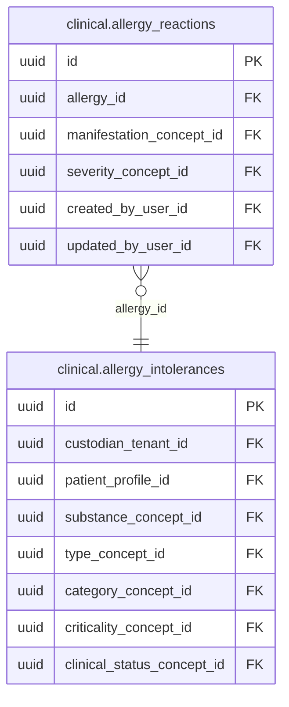

<!-- AUTOGENERADO por tools/inventario/catalogo.mjs. No editar manualmente. -->

# Catálogo del schema `clinical`

- **Tablas:** 22 · **Columnas:** 383 (102 con descripción: 26.6 %) · **Índices:** 237
- **Dominio:** Clínico y Diagnóstico
- Método y límites del catálogo: [README del inventario](../README.md)

## Tablas

| Tabla | Propósito | Columnas | Índices | Operaciones | ORM |
|---|---|---|---|---|---|
| [allergy_intolerances](#allergy_intolerances) | Mantiene las alergias e intolerancias conocidas del paciente para que puedan considerarse al decidir y prestar atención clínica. | 15 | 14 | 5 | DIVERGE |
| [allergy_reactions](#allergy_reactions) | Documenta las manifestaciones asociadas a una alergia o intolerancia para caracterizar el antecedente y orientar su evaluación clínica. | 10 | 5 | 2 | COINCIDE |
| [appointments](#appointments) | Representa citas asistenciales en el contexto clínico y permite relacionarlas con el encuentro realizado o planificado. | 16 | 13 | 20 | COINCIDE |
| [care_episodes](#care_episodes) | Agrupa encuentros relacionados dentro de un proceso asistencial del paciente para seguir su evolución y responsabilidad clínica. | 13 | 9 | 4 | COINCIDE |
| [conditions](#conditions) | Registra problemas, diagnósticos y condiciones de salud del paciente con estado, severidad, curso y fechas clínicas relevantes. | 21 | 16 | 21 | COINCIDE |
| [diagnostic_reports](#diagnostic_reports) | Gestiona el ciclo de vida del informe diagnóstico y lo vincula con su solicitud y encuentro; los resultados estructurados y archivos asociados se mantienen en el dominio de diagnóstico. | 16 | 14 | 20 | COINCIDE |
| [encounter_locations](#encounter_locations) | Vincula un encuentro con los lugares de prestación para mantener el contexto físico de la atención. | 13 | 7 | 4 | COINCIDE |
| [encounter_participants](#encounter_participants) | Identifica a las personas que participan en un encuentro y su rol para conservar quién intervino en la atención. | 14 | 7 | 11 | COINCIDE |
| [encounters](#encounters) | Representa cada contacto asistencial y vincula paciente, equipo, sede, agenda, motivo y estado de atención. | 20 | 13 | 86 | COINCIDE |
| [family_member_history](#family_member_history) | Conserva antecedentes familiares relevantes para la evaluación de riesgo y la historia de salud del paciente. | 15 | 9 | 0 | COINCIDE |
| [immunizations](#immunizations) | Registra inmunizaciones administradas o documentadas en la historia de salud para sostener seguimiento y continuidad preventiva. | 15 | 10 | 3 | COINCIDE |
| [medication_records](#medication_records) | Conserva el historial clínico de uso o administración de medicación del paciente; no representa el inventario ni la dispensación de farmacia. | 16 | 12 | 1 | COINCIDE |
| [medication_requests](#medication_requests) | Registra solicitudes o prescripciones de medicamentos, su indicación y trazabilidad clínica dentro de la atención del paciente. | 31 | 16 | 51 | DIVERGE |
| [observation_components](#observation_components) | Desglosa observaciones compuestas en componentes ordenados para preservar cada resultado y su tipo de valor de manera interpretable. | 23 | 10 | 2 | COINCIDE |
| [observation_notes](#observation_notes) | Guarda notas narrativas complementarias sobre una observación cuando el dato codificado requiere contexto clínico adicional. | 5 | 2 | 2 | COINCIDE |
| [observation_performers](#observation_performers) | Atribuye quién o qué dispositivo realizó una observación para dar procedencia al resultado clínico. | 8 | 4 | 1 | COINCIDE |
| [observation_reference_ranges](#observation_reference_ranges) | Asocia rangos de referencia a observaciones o componentes para contextualizar la interpretación de resultados medibles. | 13 | 6 | 1 | COINCIDE |
| [observations](#observations) | Conserva hallazgos y mediciones clínicas codificados, tipados y vinculables al paciente, encuentro, solicitud y método de obtención. | 44 | 28 | 10 | COINCIDE |
| [prescription_signature_policies](#prescription_signature_policies) | Define las reglas de firma aplicables a prescripciones para controlar quién puede validarlas y bajo qué requisitos operativos. | 13 | 1 | 5 | COINCIDE |
| [procedures](#procedures) | Documenta procedimientos asociados a la atención y enlaza su contexto con el encuentro, las solicitudes y, cuando corresponde, otros procedimientos. | 28 | 15 | 8 | COINCIDE |
| [service_requests](#service_requests) | Representa solicitudes de servicios clínicos —por ejemplo, estudios o procedimientos— y su estado dentro del proceso asistencial. | 18 | 15 | 34 | DIVERGE |
| [social_history](#social_history) | Registra factores y circunstancias sociales o hábitos que aportan contexto a la valoración y continuidad asistencial del paciente. | 16 | 11 | 0 | COINCIDE |

## Diagrama entidad-relación

Las tablas se agrupan en familias por sus claves foráneas dentro del schema (máximo 40 por diagrama). Las FK hacia otros schemas se listan en la ficha de cada tabla.

### Familia 1 de 2 — 16 tablas

```mermaid
erDiagram
  clinical_appointments["clinical.appointments"] {
    uuid id PK
    uuid patient_profile_id FK
    uuid practitioner_profile_id FK
    uuid tenant_id FK
    uuid branch_id FK
    uuid type_concept_id FK
    uuid status_concept_id FK
    uuid channel_concept_id FK
  }
  clinical_encounters["clinical.encounters"] {
    uuid id PK
    uuid patient_profile_id FK
    uuid episode_id FK
    uuid tenant_id FK
    uuid branch_id FK
    uuid primary_practitioner_id FK
    uuid class_concept_id FK
    uuid type_concept_id FK
  }
  clinical_care_episodes["clinical.care_episodes"] {
    uuid id PK
    uuid patient_profile_id FK
    uuid tenant_id FK
    uuid responsible_practitioner_id FK
    uuid type_concept_id FK
    uuid status_concept_id FK
    uuid created_by_user_id FK
    uuid updated_by_user_id FK
  }
  clinical_conditions["clinical.conditions"] {
    uuid id PK
    uuid custodian_tenant_id FK
    uuid patient_profile_id FK
    uuid encounter_id FK
    uuid code_concept_id FK
    uuid category_concept_id FK
    uuid clinical_status_concept_id FK
    uuid verification_status_concept_id FK
  }
  clinical_diagnostic_reports["clinical.diagnostic_reports"] {
    uuid id PK
    uuid custodian_tenant_id FK
    uuid patient_profile_id FK
    uuid service_request_id FK
    uuid encounter_id FK
    uuid code_concept_id FK
    uuid category_concept_id FK
    uuid lifecycle_status_concept_id FK
  }
  clinical_encounter_locations["clinical.encounter_locations"] {
    uuid id PK
    uuid encounter_id FK
    uuid practice_site_id FK
    uuid clinical_unit_id FK
    uuid care_space_id FK
    uuid location_status_concept_id FK
    uuid created_by_user_id FK
    uuid updated_by_user_id FK
  }
  clinical_encounter_participants["clinical.encounter_participants"] {
    uuid id PK
    uuid encounter_id FK
    uuid practitioner_profile_id FK
    uuid participant_role_concept_id FK
    uuid practitioner_role_assignment_id FK
    uuid status_concept_id FK
    uuid created_by_user_id FK
    uuid updated_by_user_id FK
  }
  clinical_medication_requests["clinical.medication_requests"] {
    uuid id PK
    uuid custodian_tenant_id FK
    uuid patient_profile_id FK
    uuid encounter_id FK
    uuid medication_concept_id FK
    uuid substance_atc_concept_id FK
    uuid intent_concept_id FK
    uuid status_concept_id FK
  }
  clinical_observations["clinical.observations"] {
    uuid id PK
    uuid custodian_tenant_id FK
    uuid patient_profile_id FK
    uuid encounter_id FK
    uuid based_on_service_request_id FK
    uuid category_concept_id FK
    uuid code_concept_id FK
    uuid status_concept_id FK
  }
  clinical_procedures["clinical.procedures"] {
    uuid id PK
    uuid custodian_tenant_id FK
    uuid patient_profile_id FK
    uuid encounter_id FK
    uuid code_concept_id FK
    uuid status_concept_id FK
    uuid performer_profile_id FK
    uuid service_request_id FK
  }
  clinical_service_requests["clinical.service_requests"] {
    uuid id PK
    uuid custodian_tenant_id FK
    uuid patient_profile_id FK
    uuid encounter_id FK
    uuid code_concept_id FK
    uuid category_concept_id FK
    uuid intent_concept_id FK
    uuid priority_concept_id FK
  }
  clinical_medication_records["clinical.medication_records"] {
    uuid id PK
    uuid custodian_tenant_id FK
    uuid patient_profile_id FK
    uuid request_id FK
    uuid medication_concept_id FK
    uuid status_concept_id FK
    uuid record_type_concept_id FK
    uuid unit_concept_id FK
  }
  clinical_observation_components["clinical.observation_components"] {
    uuid id PK
    uuid observation_id FK
    uuid code_concept_id FK
    uuid value_type_concept_id FK
    uuid value_concept_id FK
    uuid quantity_unit_concept_id FK
    uuid range_unit_concept_id FK
    uuid data_absent_reason_concept_id FK
  }
  clinical_observation_notes["clinical.observation_notes"] {
    uuid id PK
    uuid observation_id FK
    uuid author_user_id FK
  }
  clinical_observation_performers["clinical.observation_performers"] {
    uuid id PK
    uuid observation_id FK
    uuid performer_type_concept_id FK
    uuid performer_role_concept_id FK
    uuid created_by_user_id FK
  }
  clinical_observation_reference_ranges["clinical.observation_reference_ranges"] {
    uuid id PK
    uuid observation_id FK
    uuid observation_component_id FK
    uuid unit_concept_id FK
    uuid type_concept_id FK
    uuid applies_to_concept_id FK
    uuid created_by_user_id FK
  }
  clinical_encounters }o--o| clinical_care_episodes : "episode_id"
  clinical_encounters }o--o| clinical_appointments : "appointment_id"
  clinical_conditions }o--o| clinical_encounters : "encounter_id"
  clinical_diagnostic_reports }o--o| clinical_service_requests : "service_request_id"
  clinical_diagnostic_reports }o--o| clinical_encounters : "encounter_id"
  clinical_encounter_locations }o--|| clinical_encounters : "encounter_id"
  clinical_encounter_participants }o--|| clinical_encounters : "encounter_id"
  clinical_medication_requests }o--o| clinical_encounters : "encounter_id"
  clinical_medication_requests }o--o| clinical_conditions : "indication_condition_id"
  clinical_observations }o--o| clinical_encounters : "encounter_id"
  clinical_observations }o--o| clinical_service_requests : "based_on_service_request_id"
  clinical_procedures }o--o| clinical_encounters : "encounter_id"
  clinical_procedures }o--o| clinical_service_requests : "service_request_id"
  clinical_service_requests }o--o| clinical_encounters : "encounter_id"
  clinical_service_requests }o--o| clinical_diagnostic_reports : "previous_diagnostic_report_id"
  clinical_medication_records }o--o| clinical_medication_requests : "request_id"
  clinical_observation_components }o--|| clinical_observations : "observation_id"
  clinical_observation_notes }o--|| clinical_observations : "observation_id"
  clinical_observation_performers }o--|| clinical_observations : "observation_id"
  clinical_observation_reference_ranges }o--|| clinical_observations : "observation_id"
  clinical_observation_reference_ranges }o--o| clinical_observation_components : "observation_component_id"
```

### Familia 2 de 2 — 2 tablas

### Tablas sin relaciones dentro del schema

`clinical.family_member_history` · `clinical.immunizations` · `clinical.prescription_signature_policies` · `clinical.social_history`

## Fichas

### allergy_intolerances

#### Vista general

Mantiene las alergias e intolerancias conocidas del paciente para que puedan considerarse al decidir y prestar atención clínica.

- **Estado del propósito:** DOMAIN_CURATED_DRAFT · fuente: `Mantra Core Health Context/modules/diagram_08_clinical.puml: allergy_intolerances`
- **Dominio:** Clínico y Diagnóstico · **Diagrama:** `Mantra Core Health Context/modules/diagram_08_clinical.puml` · **DDL:** `SQL/08_clinical/02_tables.sql`
- **Entidad del ORM:** `AllergyIntolerances` — `src/modules/clinical/entities/allergy_intolerances.entity.ts`
- **Resumen:** 15 columnas · 14 índices · 11 FK salientes · 2 entrantes · 5 operaciones

#### Columnas

| # | Columna | Tipo | Rol estructural | Descripción | ORM |
|---|---|---|---|---|---|
| 1 | `id` | `uuid` | Clave primaria; Obligatoria | Identificador único de la instancia. _(JSDOC_ESTANDAR, `src/modules/clinical/entities/allergy_intolerances.entity.ts:12`)_ | coincide |
| 2 | `custodian_tenant_id` | `uuid` | Clave foránea → directory.tenants.id; Obligatoria | _sin dato_ | coincide |
| 3 | `patient_profile_id` | `uuid` | Clave foránea → profiles.patient_profiles.profile_id; Obligatoria | _sin dato_ | coincide |
| 4 | `substance_concept_id` | `uuid` | Clave foránea → terminology.catalog_concepts.id; Obligatoria | _sin dato_ | coincide |
| 5 | `type_concept_id` | `uuid` | Clave foránea → terminology.catalog_concepts.id; Opcional | _sin dato_ | coincide |
| 6 | `category_concept_id` | `uuid` | Clave foránea → terminology.catalog_concepts.id; Opcional | _sin dato_ | coincide |
| 7 | `criticality_concept_id` | `uuid` | Clave foránea → terminology.catalog_concepts.id; Opcional | _sin dato_ | coincide |
| 8 | `clinical_status_concept_id` | `uuid` | Clave foránea → terminology.catalog_concepts.id; Opcional | _sin dato_ | coincide |
| 9 | `verification_status_concept_id` | `uuid` | Clave foránea → terminology.catalog_concepts.id; Opcional | _sin dato_ | coincide |
| 10 | `recorded_by_user_id` | `uuid` | Clave foránea → iam.users.id; Opcional | _sin dato_ | coincide |
| 11 | `created_at` | `timestamptz` | Obligatoria | Fecha y hora en que se creó el registro. _(JSDOC_ESTANDAR, `src/modules/clinical/entities/allergy_intolerances.entity.ts:95`)_ | coincide |
| 12 | `updated_at` | `timestamptz` | Obligatoria | Fecha y hora de la última actualización. _(JSDOC_ESTANDAR, `src/modules/clinical/entities/allergy_intolerances.entity.ts:101`)_ | coincide |
| 13 | `created_by_user_id` | `uuid` | Clave foránea → iam.users.id; Opcional | _sin dato_ | coincide |
| 14 | `updated_by_user_id` | `uuid` | Clave foránea → iam.users.id; Opcional | _sin dato_ | coincide |
| 15 | `row_version` | `integer = 1` | Obligatoria | Versión usada para controlar actualizaciones concurrentes. _(JSDOC_ENTIDAD, `src/modules/clinical/entities/allergy_intolerances.entity.ts:119`)_ | coincide |

#### Relaciones

| Sentido | Columnas | Tabla | Restricción |
|---|---|---|---|
| hacia | custodian_tenant_id | directory.tenants (id) | fk_allergy_intolerances_custodian_tenant_id |
| hacia | patient_profile_id | profiles.patient_profiles (profile_id) | fk_allergy_intolerances_patient_profile_id |
| hacia | substance_concept_id | terminology.catalog_concepts (id) | fk_allergy_intolerances_substance_concept_id |
| hacia | type_concept_id | terminology.catalog_concepts (id) | fk_allergy_intolerances_type_concept_id |
| hacia | category_concept_id | terminology.catalog_concepts (id) | fk_allergy_intolerances_category_concept_id |
| hacia | criticality_concept_id | terminology.catalog_concepts (id) | fk_allergy_intolerances_criticality_concept_id |
| hacia | clinical_status_concept_id | terminology.catalog_concepts (id) | fk_allergy_intolerances_clinical_status_concept_id |
| hacia | verification_status_concept_id | terminology.catalog_concepts (id) | fk_allergy_intolerances_verification_status_concept_id |
| hacia | recorded_by_user_id | iam.users (id) | fk_allergy_intolerances_recorded_by_user_id |
| hacia | created_by_user_id | iam.users (id) | fk_allergy_intolerances_created_by_user_id |
| hacia | updated_by_user_id | iam.users (id) | fk_allergy_intolerances_updated_by_user_id |
| desde | id | clinical.allergy_reactions (allergy_id) | fk_allergy_reactions_allergy_id |
| desde | id | audit.allergy_intolerances_history (allergy_intolerance_id) | fk_allergy_intolerances_history_allergy_intolerance_id |

#### Índices

| Índice | Único | Columnas | Para qué |
|---|---|---|---|
| `ix_allergy_intolerances_custodian_tenant_id` | no | custodian_tenant_id | Soporta la clave foránea fk_allergy_intolerances_custodian_tenant_id: PostgreSQL no indexa las FK por sí mismo _(DOCUMENTO)_; 1 consulta(s) de repositorio filtran u ordenan por «custodian_tenant_id», la primera columna del índice _(CONSULTA)_ |
| `ix_allergy_intolerances_patient_profile_id` | no | patient_profile_id | Soporta la clave foránea fk_allergy_intolerances_patient_profile_id: PostgreSQL no indexa las FK por sí mismo _(DOCUMENTO)_; 2 consulta(s) de repositorio filtran u ordenan por «patient_profile_id», la primera columna del índice _(CONSULTA)_ |
| `ix_allergy_intolerances_substance_concept_id` | no | substance_concept_id | Soporta la clave foránea fk_allergy_intolerances_substance_concept_id: PostgreSQL no indexa las FK por sí mismo _(DOCUMENTO)_; 1 consulta(s) de repositorio filtran u ordenan por «substance_concept_id», la primera columna del índice _(CONSULTA)_ |
| `ix_allergy_intolerances_type_concept_id` | no | type_concept_id | Soporta la clave foránea fk_allergy_intolerances_type_concept_id: PostgreSQL no indexa las FK por sí mismo _(DOCUMENTO)_ |
| `ix_allergy_intolerances_category_concept_id` | no | category_concept_id | Soporta la clave foránea fk_allergy_intolerances_category_concept_id: PostgreSQL no indexa las FK por sí mismo _(DOCUMENTO)_ |
| `ix_allergy_intolerances_criticality_concept_id` | no | criticality_concept_id | Soporta la clave foránea fk_allergy_intolerances_criticality_concept_id: PostgreSQL no indexa las FK por sí mismo _(DOCUMENTO)_ |
| `ix_allergy_intolerances_clinical_status_concept_id` | no | clinical_status_concept_id | Soporta la clave foránea fk_allergy_intolerances_clinical_status_concept_id: PostgreSQL no indexa las FK por sí mismo _(DOCUMENTO)_; 1 consulta(s) de repositorio filtran u ordenan por «clinical_status_concept_id», la primera columna del índice _(CONSULTA)_ |
| `ix_allergy_intolerances_verification_status_concept_id` | no | verification_status_concept_id | Soporta la clave foránea fk_allergy_intolerances_verification_status_concept_id: PostgreSQL no indexa las FK por sí mismo _(DOCUMENTO)_ |
| `ix_allergy_intolerances_recorded_by_user_id` | no | recorded_by_user_id | Soporta la clave foránea fk_allergy_intolerances_recorded_by_user_id: PostgreSQL no indexa las FK por sí mismo _(DOCUMENTO)_ |
| `ix_allergy_intolerances_created_by_user_id` | no | created_by_user_id | Soporta la clave foránea fk_allergy_intolerances_created_by_user_id: PostgreSQL no indexa las FK por sí mismo _(DOCUMENTO)_ |
| `ix_allergy_intolerances_updated_by_user_id` | no | updated_by_user_id | Soporta la clave foránea fk_allergy_intolerances_updated_by_user_id: PostgreSQL no indexa las FK por sí mismo _(DOCUMENTO)_ |
| `ix_allergy_intolerances_custodian_tenant_id_updated_at` | no | custodian_tenant_id, ("updated_at" DESC) | _sin uso detectado estáticamente_ |
| `ix_allergy_intolerances_patient_profile_id_updated_at` | no | custodian_tenant_id, patient_profile_id, ("updated_at" DESC) | _sin uso detectado estáticamente_ |
| `ix_allergies_patient_status` | no | custodian_tenant_id, patient_profile_id, clinical_status_concept_id | Soporta la clave foránea fk_allergy_intolerances_custodian_tenant_id: PostgreSQL no indexa las FK por sí mismo _(DOCUMENTO)_; 1 consulta(s) de repositorio filtran u ordenan por «custodian_tenant_id», la primera columna del índice _(CONSULTA)_ |

#### Operaciones que la tocan

| Operación | Efecto | Confianza |
|---|---|---|
| POST /clinical/allergy-intolerances | CREA | DIRECTA |
| POST /clinical/allergy-intolerances | LEE | DIRECTA |
| GET /clinical/allergy-intolerances/{id}/attachments | LEE | DIRECTA |
| POST /clinical/allergy-intolerances/{id}/attachments | LEE | DIRECTA |
| GET /clinical/patients/{patientProfileId}/summary | LEE | DIRECTA |

#### Gobierno

| Atributo | Valor | Fuente |
|---|---|---|
| Append-only | no declarado | — |
| Datos personales | sin fuente | — |
| Financiera | sin fuente | — |
| Crítica para auditoría | sin fuente | — |
| Retención | sin fuente | — |
| Responsable | sin fuente | — |
| Revisión | AUTO_DETECTADA | — |

---

### allergy_reactions

#### Vista general

Documenta las manifestaciones asociadas a una alergia o intolerancia para caracterizar el antecedente y orientar su evaluación clínica.

- **Estado del propósito:** DOMAIN_CURATED_DRAFT · fuente: `Mantra Core Health Context/modules/diagram_08_clinical.puml: allergy_reactions`
- **Dominio:** Clínico y Diagnóstico · **Diagrama:** `Mantra Core Health Context/modules/diagram_08_clinical.puml` · **DDL:** `SQL/08_clinical/02_tables.sql`
- **Entidad del ORM:** `AllergyReactions` — `src/modules/clinical/entities/allergy_reactions.entity.ts`
- **Resumen:** 10 columnas · 5 índices · 5 FK salientes · 0 entrantes · 2 operaciones

#### Columnas

| # | Columna | Tipo | Rol estructural | Descripción | ORM |
|---|---|---|---|---|---|
| 1 | `id` | `uuid` | Clave primaria; Obligatoria | Identificador único de la instancia. _(JSDOC_ESTANDAR, `src/modules/clinical/entities/allergy_reactions.entity.ts:12`)_ | coincide |
| 2 | `allergy_id` | `uuid` | Clave foránea → clinical.allergy_intolerances.id; Obligatoria | _sin dato_ | coincide |
| 3 | `manifestation_concept_id` | `uuid` | Clave foránea → terminology.catalog_concepts.id; Obligatoria | _sin dato_ | coincide |
| 4 | `severity_concept_id` | `uuid` | Clave foránea → terminology.catalog_concepts.id; Opcional | _sin dato_ | coincide |
| 5 | `description` | `text` | Opcional | _sin dato_ | coincide |
| 6 | `created_at` | `timestamptz` | Obligatoria | Fecha y hora en que se creó el registro. _(JSDOC_ESTANDAR, `src/modules/clinical/entities/allergy_reactions.entity.ts:42`)_ | coincide |
| 7 | `updated_at` | `timestamptz` | Obligatoria | Fecha y hora de la última actualización. _(JSDOC_ESTANDAR, `src/modules/clinical/entities/allergy_reactions.entity.ts:48`)_ | coincide |
| 8 | `created_by_user_id` | `uuid` | Clave foránea → iam.users.id; Opcional | _sin dato_ | coincide |
| 9 | `updated_by_user_id` | `uuid` | Clave foránea → iam.users.id; Opcional | _sin dato_ | coincide |
| 10 | `row_version` | `integer = 1` | Obligatoria | Versión usada para controlar actualizaciones concurrentes. _(JSDOC_ENTIDAD, `src/modules/clinical/entities/allergy_reactions.entity.ts:66`)_ | coincide |

#### Relaciones

| Sentido | Columnas | Tabla | Restricción |
|---|---|---|---|
| hacia | allergy_id | clinical.allergy_intolerances (id) | fk_allergy_reactions_allergy_id |
| hacia | manifestation_concept_id | terminology.catalog_concepts (id) | fk_allergy_reactions_manifestation_concept_id |
| hacia | severity_concept_id | terminology.catalog_concepts (id) | fk_allergy_reactions_severity_concept_id |
| hacia | created_by_user_id | iam.users (id) | fk_allergy_reactions_created_by_user_id |
| hacia | updated_by_user_id | iam.users (id) | fk_allergy_reactions_updated_by_user_id |

#### Índices

| Índice | Único | Columnas | Para qué |
|---|---|---|---|
| `ix_allergy_reactions_allergy_id` | no | allergy_id | Soporta la clave foránea fk_allergy_reactions_allergy_id: PostgreSQL no indexa las FK por sí mismo _(DOCUMENTO)_; 1 consulta(s) de repositorio filtran u ordenan por «allergy_id», la primera columna del índice _(CONSULTA)_ |
| `ix_allergy_reactions_manifestation_concept_id` | no | manifestation_concept_id | Soporta la clave foránea fk_allergy_reactions_manifestation_concept_id: PostgreSQL no indexa las FK por sí mismo _(DOCUMENTO)_ |
| `ix_allergy_reactions_severity_concept_id` | no | severity_concept_id | Soporta la clave foránea fk_allergy_reactions_severity_concept_id: PostgreSQL no indexa las FK por sí mismo _(DOCUMENTO)_ |
| `ix_allergy_reactions_created_by_user_id` | no | created_by_user_id | Soporta la clave foránea fk_allergy_reactions_created_by_user_id: PostgreSQL no indexa las FK por sí mismo _(DOCUMENTO)_ |
| `ix_allergy_reactions_updated_by_user_id` | no | updated_by_user_id | Soporta la clave foránea fk_allergy_reactions_updated_by_user_id: PostgreSQL no indexa las FK por sí mismo _(DOCUMENTO)_ |

#### Operaciones que la tocan

| Operación | Efecto | Confianza |
|---|---|---|
| POST /clinical/allergy-intolerances | CREA | DIRECTA |
| GET /clinical/patients/{patientProfileId}/summary | LEE | DIRECTA |

#### Gobierno

| Atributo | Valor | Fuente |
|---|---|---|
| Append-only | no declarado | — |
| Datos personales | sin fuente | — |
| Financiera | sin fuente | — |
| Crítica para auditoría | sin fuente | — |
| Retención | sin fuente | — |
| Responsable | sin fuente | — |
| Revisión | AUTO_DETECTADA | — |

---

### appointments

#### Vista general

Representa citas asistenciales en el contexto clínico y permite relacionarlas con el encuentro realizado o planificado.

- **Estado del propósito:** DOMAIN_CURATED_DRAFT · fuente: `Mantra Core Health Context/modules/diagram_08_clinical.puml: appointments`
- **Dominio:** Clínico y Diagnóstico · **Diagrama:** `Mantra Core Health Context/modules/diagram_08_clinical.puml` · **DDL:** `SQL/08_clinical/02_tables.sql`
- **Entidad del ORM:** `Appointments` — `src/modules/clinical/entities/appointments.entity.ts`
- **Resumen:** 16 columnas · 13 índices · 9 FK salientes · 4 entrantes · 20 operaciones

#### Columnas

| # | Columna | Tipo | Rol estructural | Descripción | ORM |
|---|---|---|---|---|---|
| 1 | `id` | `uuid` | Clave primaria; Obligatoria | Identificador único de la instancia. _(JSDOC_ESTANDAR, `src/modules/clinical/entities/appointments.entity.ts:12`)_ | coincide |
| 2 | `patient_profile_id` | `uuid` | Clave foránea → profiles.patient_profiles.profile_id; Obligatoria | _sin dato_ | coincide |
| 3 | `practitioner_profile_id` | `uuid` | Clave foránea → profiles.health_practitioner_profiles.profile_id; Opcional | _sin dato_ | coincide |
| 4 | `tenant_id` | `uuid` | Clave foránea → directory.tenants.id; Obligatoria | _sin dato_ | coincide |
| 5 | `branch_id` | `uuid` | Clave foránea → directory.branches.id; Opcional | _sin dato_ | coincide |
| 6 | `type_concept_id` | `uuid` | Clave foránea → terminology.catalog_concepts.id; Opcional | _sin dato_ | coincide |
| 7 | `status_concept_id` | `uuid` | Clave foránea → terminology.catalog_concepts.id; Obligatoria | _sin dato_ | coincide |
| 8 | `channel_concept_id` | `uuid` | Clave foránea → terminology.catalog_concepts.id; Opcional | _sin dato_ | coincide |
| 9 | `start_at` | `timestamptz` | Obligatoria | _sin dato_ | coincide |
| 10 | `end_at` | `timestamptz` | Opcional | _sin dato_ | coincide |
| 11 | `reason_text` | `text` | Opcional | _sin dato_ | coincide |
| 12 | `created_at` | `timestamptz` | Obligatoria | Fecha y hora en que se creó el registro. _(JSDOC_ESTANDAR, `src/modules/clinical/entities/appointments.entity.ts:82`)_ | coincide |
| 13 | `updated_at` | `timestamptz` | Obligatoria | Fecha y hora de la última actualización. _(JSDOC_ESTANDAR, `src/modules/clinical/entities/appointments.entity.ts:88`)_ | coincide |
| 14 | `created_by_user_id` | `uuid` | Clave foránea → iam.users.id; Opcional | _sin dato_ | coincide |
| 15 | `updated_by_user_id` | `uuid` | Clave foránea → iam.users.id; Opcional | _sin dato_ | coincide |
| 16 | `row_version` | `integer = 1` | Obligatoria | Versión usada para controlar actualizaciones concurrentes. _(JSDOC_ENTIDAD, `src/modules/clinical/entities/appointments.entity.ts:106`)_ | coincide |

#### Relaciones

| Sentido | Columnas | Tabla | Restricción |
|---|---|---|---|
| hacia | patient_profile_id | profiles.patient_profiles (profile_id) | fk_appointments_patient_profile_id |
| hacia | practitioner_profile_id | profiles.health_practitioner_profiles (profile_id) | fk_appointments_practitioner_profile_id |
| hacia | tenant_id | directory.tenants (id) | fk_appointments_tenant_id |
| hacia | branch_id | directory.branches (id) | fk_appointments_branch_id |
| hacia | type_concept_id | terminology.catalog_concepts (id) | fk_appointments_type_concept_id |
| hacia | status_concept_id | terminology.catalog_concepts (id) | fk_appointments_status_concept_id |
| hacia | channel_concept_id | terminology.catalog_concepts (id) | fk_appointments_channel_concept_id |
| hacia | created_by_user_id | iam.users (id) | fk_appointments_created_by_user_id |
| hacia | updated_by_user_id | iam.users (id) | fk_appointments_updated_by_user_id |
| desde | id | clinical.encounters (appointment_id) | fk_encounters_appointment_id |
| desde | id | scheduling.availability_slots (appointment_id) | fk_availability_slots_appointment_id |
| desde | id | scheduling.appointment_bookings (appointment_id) | fk_appointment_bookings_appointment_id |
| desde | id | procedures_perioperative.postoperative_followups (appointment_id) | fk_postoperative_followups_appointment_id |

#### Índices

| Índice | Único | Columnas | Para qué |
|---|---|---|---|
| `ix_appointments_patient_profile_id` | no | patient_profile_id | Soporta la clave foránea fk_appointments_patient_profile_id: PostgreSQL no indexa las FK por sí mismo _(DOCUMENTO)_ |
| `ix_appointments_practitioner_profile_id` | no | practitioner_profile_id | Soporta la clave foránea fk_appointments_practitioner_profile_id: PostgreSQL no indexa las FK por sí mismo _(DOCUMENTO)_; 2 consulta(s) de repositorio filtran u ordenan por «practitioner_profile_id», la primera columna del índice _(CONSULTA)_ |
| `ix_appointments_tenant_id` | no | tenant_id | Soporta la clave foránea fk_appointments_tenant_id: PostgreSQL no indexa las FK por sí mismo _(DOCUMENTO)_; 1 consulta(s) de repositorio filtran u ordenan por «tenant_id», la primera columna del índice _(CONSULTA)_ |
| `ix_appointments_branch_id` | no | branch_id | Soporta la clave foránea fk_appointments_branch_id: PostgreSQL no indexa las FK por sí mismo _(DOCUMENTO)_ |
| `ix_appointments_type_concept_id` | no | type_concept_id | Soporta la clave foránea fk_appointments_type_concept_id: PostgreSQL no indexa las FK por sí mismo _(DOCUMENTO)_ |
| `ix_appointments_status_concept_id` | no | status_concept_id | Soporta la clave foránea fk_appointments_status_concept_id: PostgreSQL no indexa las FK por sí mismo _(DOCUMENTO)_ |
| `ix_appointments_channel_concept_id` | no | channel_concept_id | Soporta la clave foránea fk_appointments_channel_concept_id: PostgreSQL no indexa las FK por sí mismo _(DOCUMENTO)_ |
| `ix_appointments_created_by_user_id` | no | created_by_user_id | Soporta la clave foránea fk_appointments_created_by_user_id: PostgreSQL no indexa las FK por sí mismo _(DOCUMENTO)_ |
| `ix_appointments_updated_by_user_id` | no | updated_by_user_id | Soporta la clave foránea fk_appointments_updated_by_user_id: PostgreSQL no indexa las FK por sí mismo _(DOCUMENTO)_ |
| `ix_appointments_tenant_id_status_concept_id` | no | tenant_id, status_concept_id, ("updated_at" DESC) | _sin uso detectado estáticamente_ |
| `ix_appointments_patient_profile_id_updated_at` | no | tenant_id, patient_profile_id, ("updated_at" DESC) | _sin uso detectado estáticamente_ |
| `ix_appointments_patient_start` | no | patient_profile_id, ("start_at" DESC) | _sin uso detectado estáticamente_ |
| `gist_appointments_effective_period` | no | (tstzrange(start_at, end_at, '[)')) | GiST para periodos, no solapamiento y geografía _(DOCUMENTO)_ |

#### Restricciones

| Restricción | Tipo | Definición |
|---|---|---|
| `ex_appointments_practitioner_time` | EXCLUDE | EXCLUDE USING gist ("practitioner_profile_id" WITH =, tstzrange("start_at", "end_at", '[)') WITH &&) WHERE ("practitioner_profile_id" IS NOT NULL AND "end_at" IS NOT NULL AND "status_concept_id" IN ('51530fd7-05b1-5c29-80c4-da740ede4d27', '37dded87-7a7a-5a24-86f6-0ef48cccb482')) |

#### Operaciones que la tocan

| Operación | Efecto | Confianza |
|---|---|---|
| POST /accounting/practitioner/consultation-income | LEE | DIRECTA |
| GET /accounting/practitioner/paid-consultations | LEE | DIRECTA |
| GET /accounting/practitioner/simple/summary | LEE | DIRECTA |
| POST /clinical/encounters/check-in | LEE | DIRECTA |
| GET /insurance/analytics/loss-ratio | LEE | POR_SQL |
| POST /quotations | LEE | DIRECTA |
| POST /scheduling/appointments/direct | CREA | DIRECTA |
| POST /scheduling/appointments/walk-in | CREA | DIRECTA |
| POST /scheduling/appointments/walk-in | ACTUALIZA | POR_TIPO |
| POST /scheduling/appointments/walk-in | LEE | DIRECTA |
| GET /scheduling/bookings | LEE | DIRECTA |
| GET /scheduling/bookings/{id} | LEE | DIRECTA |
| POST /scheduling/bookings/{id}/accept | ACTUALIZA | POR_TIPO |
| POST /scheduling/bookings/{id}/accept | LEE | DIRECTA |
| POST /scheduling/bookings/{id}/complete | ACTUALIZA | POR_TIPO |
| POST /scheduling/bookings/{id}/complete | LEE | DIRECTA |
| POST /scheduling/bookings/{id}/start | ACTUALIZA | POR_TIPO |
| POST /scheduling/bookings/{id}/start | LEE | DIRECTA |
| POST /scheduling/holds/{holdToken}/confirm | CREA | DIRECTA |
| POST /scheduling/holds/{holdToken}/request | CREA | DIRECTA |

#### Gobierno

| Atributo | Valor | Fuente |
|---|---|---|
| Append-only | no declarado | — |
| Datos personales | sin fuente | — |
| Financiera | sin fuente | — |
| Crítica para auditoría | sin fuente | — |
| Retención | sin fuente | — |
| Responsable | sin fuente | — |
| Revisión | AUTO_DETECTADA | — |

---

### care_episodes

#### Vista general

Agrupa encuentros relacionados dentro de un proceso asistencial del paciente para seguir su evolución y responsabilidad clínica.

- **Estado del propósito:** DOMAIN_CURATED_DRAFT · fuente: `Mantra Core Health Context/modules/diagram_08_clinical.puml: care_episodes`
- **Dominio:** Clínico y Diagnóstico · **Diagrama:** `Mantra Core Health Context/modules/diagram_08_clinical.puml` · **DDL:** `SQL/08_clinical/02_tables.sql`
- **Entidad del ORM:** `CareEpisodes` — `src/modules/clinical/entities/care_episodes.entity.ts`
- **Resumen:** 13 columnas · 9 índices · 7 FK salientes · 2 entrantes · 4 operaciones

#### Columnas

| # | Columna | Tipo | Rol estructural | Descripción | ORM |
|---|---|---|---|---|---|
| 1 | `id` | `uuid` | Clave primaria; Obligatoria | Identificador único de la instancia. _(JSDOC_ESTANDAR, `src/modules/clinical/entities/care_episodes.entity.ts:12`)_ | coincide |
| 2 | `patient_profile_id` | `uuid` | Clave foránea → profiles.patient_profiles.profile_id; Obligatoria | _sin dato_ | coincide |
| 3 | `tenant_id` | `uuid` | Clave foránea → directory.tenants.id; Obligatoria | _sin dato_ | coincide |
| 4 | `responsible_practitioner_id` | `uuid` | Clave foránea → profiles.health_practitioner_profiles.profile_id; Opcional | _sin dato_ | coincide |
| 5 | `type_concept_id` | `uuid` | Clave foránea → terminology.catalog_concepts.id; Opcional | _sin dato_ | coincide |
| 6 | `status_concept_id` | `uuid` | Clave foránea → terminology.catalog_concepts.id; Obligatoria | _sin dato_ | coincide |
| 7 | `start_at` | `timestamptz` | Opcional | _sin dato_ | coincide |
| 8 | `end_at` | `timestamptz` | Opcional | _sin dato_ | coincide |
| 9 | `created_at` | `timestamptz` | Obligatoria | Fecha y hora en que se creó el registro. _(JSDOC_ESTANDAR, `src/modules/clinical/entities/care_episodes.entity.ts:68`)_ | coincide |
| 10 | `updated_at` | `timestamptz` | Obligatoria | Fecha y hora de la última actualización. _(JSDOC_ESTANDAR, `src/modules/clinical/entities/care_episodes.entity.ts:74`)_ | coincide |
| 11 | `created_by_user_id` | `uuid` | Clave foránea → iam.users.id; Opcional | _sin dato_ | coincide |
| 12 | `updated_by_user_id` | `uuid` | Clave foránea → iam.users.id; Opcional | _sin dato_ | coincide |
| 13 | `row_version` | `integer = 1` | Obligatoria | Versión usada para controlar actualizaciones concurrentes. _(JSDOC_ENTIDAD, `src/modules/clinical/entities/care_episodes.entity.ts:92`)_ | coincide |

#### Relaciones

| Sentido | Columnas | Tabla | Restricción |
|---|---|---|---|
| hacia | patient_profile_id | profiles.patient_profiles (profile_id) | fk_care_episodes_patient_profile_id |
| hacia | tenant_id | directory.tenants (id) | fk_care_episodes_tenant_id |
| hacia | responsible_practitioner_id | profiles.health_practitioner_profiles (profile_id) | fk_care_episodes_responsible_practitioner_id |
| hacia | type_concept_id | terminology.catalog_concepts (id) | fk_care_episodes_type_concept_id |
| hacia | status_concept_id | terminology.catalog_concepts (id) | fk_care_episodes_status_concept_id |
| hacia | created_by_user_id | iam.users (id) | fk_care_episodes_created_by_user_id |
| hacia | updated_by_user_id | iam.users (id) | fk_care_episodes_updated_by_user_id |
| desde | id | clinical.encounters (episode_id) | fk_encounters_episode_id |
| desde | id | clinical_ext.care_teams (episode_id) | fk_care_teams_episode_id |

#### Índices

| Índice | Único | Columnas | Para qué |
|---|---|---|---|
| `ix_care_episodes_patient_profile_id` | no | patient_profile_id | Soporta la clave foránea fk_care_episodes_patient_profile_id: PostgreSQL no indexa las FK por sí mismo _(DOCUMENTO)_; 2 consulta(s) de repositorio filtran u ordenan por «patient_profile_id», la primera columna del índice _(CONSULTA)_ |
| `ix_care_episodes_tenant_id` | no | tenant_id | Soporta la clave foránea fk_care_episodes_tenant_id: PostgreSQL no indexa las FK por sí mismo _(DOCUMENTO)_; 1 consulta(s) de repositorio filtran u ordenan por «tenant_id», la primera columna del índice _(CONSULTA)_ |
| `ix_care_episodes_responsible_practitioner_id` | no | responsible_practitioner_id | Soporta la clave foránea fk_care_episodes_responsible_practitioner_id: PostgreSQL no indexa las FK por sí mismo _(DOCUMENTO)_ |
| `ix_care_episodes_type_concept_id` | no | type_concept_id | Soporta la clave foránea fk_care_episodes_type_concept_id: PostgreSQL no indexa las FK por sí mismo _(DOCUMENTO)_ |
| `ix_care_episodes_status_concept_id` | no | status_concept_id | Soporta la clave foránea fk_care_episodes_status_concept_id: PostgreSQL no indexa las FK por sí mismo _(DOCUMENTO)_; 1 consulta(s) de repositorio filtran u ordenan por «status_concept_id», la primera columna del índice _(CONSULTA)_ |
| `ix_care_episodes_created_by_user_id` | no | created_by_user_id | Soporta la clave foránea fk_care_episodes_created_by_user_id: PostgreSQL no indexa las FK por sí mismo _(DOCUMENTO)_ |
| `ix_care_episodes_updated_by_user_id` | no | updated_by_user_id | Soporta la clave foránea fk_care_episodes_updated_by_user_id: PostgreSQL no indexa las FK por sí mismo _(DOCUMENTO)_ |
| `ix_care_episodes_tenant_id_status_concept_id` | no | tenant_id, status_concept_id, ("updated_at" DESC) | _sin uso detectado estáticamente_ |
| `ix_care_episodes_patient_profile_id_updated_at` | no | tenant_id, patient_profile_id, ("updated_at" DESC) | _sin uso detectado estáticamente_ |

#### Operaciones que la tocan

| Operación | Efecto | Confianza |
|---|---|---|
| POST /clinical/care-episodes | CREA | DIRECTA |
| POST /clinical/care-episodes | LEE | DIRECTA |
| POST /clinical/encounters/check-in | LEE | DIRECTA |
| GET /clinical/patients/{patientProfileId}/summary | LEE | DIRECTA |

#### Gobierno

| Atributo | Valor | Fuente |
|---|---|---|
| Append-only | no declarado | — |
| Datos personales | sin fuente | — |
| Financiera | sin fuente | — |
| Crítica para auditoría | sin fuente | — |
| Retención | sin fuente | — |
| Responsable | sin fuente | — |
| Revisión | AUTO_DETECTADA | — |

---

### conditions

#### Vista general

Registra problemas, diagnósticos y condiciones de salud del paciente con estado, severidad, curso y fechas clínicas relevantes.

- **Estado del propósito:** DOMAIN_CURATED_DRAFT · fuente: `Mantra Core Health Context/modules/diagram_08_clinical.puml: conditions`
- **Dominio:** Clínico y Diagnóstico · **Diagrama:** `Mantra Core Health Context/modules/diagram_08_clinical.puml` · **DDL:** `SQL/08_clinical/02_tables.sql`
- **Entidad del ORM:** `Conditions` — `src/modules/clinical/entities/conditions.entity.ts`
- **Resumen:** 21 columnas · 16 índices · 13 FK salientes · 6 entrantes · 21 operaciones

#### Columnas

| # | Columna | Tipo | Rol estructural | Descripción | ORM |
|---|---|---|---|---|---|
| 1 | `id` | `uuid` | Clave primaria; Obligatoria | Identificador único de la instancia. _(JSDOC_ESTANDAR, `src/modules/clinical/entities/conditions.entity.ts:12`)_ | coincide |
| 2 | `custodian_tenant_id` | `uuid` | Clave foránea → directory.tenants.id; Obligatoria | _sin dato_ | coincide |
| 3 | `patient_profile_id` | `uuid` | Clave foránea → profiles.patient_profiles.profile_id; Obligatoria | _sin dato_ | coincide |
| 4 | `encounter_id` | `uuid` | Clave foránea → clinical.encounters.id; Opcional | _sin dato_ | coincide |
| 5 | `code_concept_id` | `uuid` | Clave foránea → terminology.catalog_concepts.id; Obligatoria | _sin dato_ | coincide |
| 6 | `category_concept_id` | `uuid` | Clave foránea → terminology.catalog_concepts.id; Opcional | _sin dato_ | coincide |
| 7 | `clinical_status_concept_id` | `uuid` | Clave foránea → terminology.catalog_concepts.id; Opcional | _sin dato_ | coincide |
| 8 | `verification_status_concept_id` | `uuid` | Clave foránea → terminology.catalog_concepts.id; Opcional | _sin dato_ | coincide |
| 9 | `severity_concept_id` | `uuid` | Clave foránea → terminology.catalog_concepts.id; Opcional | _sin dato_ | coincide |
| 10 | `laterality_concept_id` | `uuid` | Clave foránea → terminology.catalog_concepts.id; Opcional | _sin dato_ | coincide |
| 11 | `clinical_course_concept_id` | `uuid` | Clave foránea → terminology.catalog_concepts.id; Opcional | _sin dato_ | coincide |
| 12 | `onset_at` | `timestamptz` | Opcional | _sin dato_ | coincide |
| 13 | `expected_resolution_at` | `timestamptz` | Opcional | + v4.1.3: segunda columna del PR #171 que vivía solo en el ORM (B-9 la promovió a medias: v4.1.2 cubrió el curso clínico y esta quedó afuera). Nullable: una condición crónica no tiene resolución esperada. _(MODELO_PUML, `Mantra Core Health Context/modules/diagram_08_clinical.puml:211`)_ | coincide |
| 14 | `resolved_at` | `timestamptz` | Opcional | _sin dato_ | coincide |
| 15 | `recorded_by_user_id` | `uuid` | Clave foránea → iam.users.id; Opcional | _sin dato_ | coincide |
| 16 | `note_text` | `text` | Opcional | + v4.1.3: hallazgos y justificación clínica del diagnóstico. Narrativa libre de quien registra; mismo molde que procedures/observation_notes. _(MODELO_PUML, `Mantra Core Health Context/modules/diagram_08_clinical.puml:217`)_ | coincide |
| 17 | `created_at` | `timestamptz` | Obligatoria | Fecha y hora en que se creó el registro. _(JSDOC_ESTANDAR, `src/modules/clinical/entities/conditions.entity.ts:144`)_ | coincide |
| 18 | `updated_at` | `timestamptz` | Obligatoria | Fecha y hora de la última actualización. _(JSDOC_ESTANDAR, `src/modules/clinical/entities/conditions.entity.ts:150`)_ | coincide |
| 19 | `created_by_user_id` | `uuid` | Clave foránea → iam.users.id; Opcional | _sin dato_ | coincide |
| 20 | `updated_by_user_id` | `uuid` | Clave foránea → iam.users.id; Opcional | _sin dato_ | coincide |
| 21 | `row_version` | `integer = 1` | Obligatoria | Versión usada para controlar actualizaciones concurrentes. _(JSDOC_ENTIDAD, `src/modules/clinical/entities/conditions.entity.ts:168`)_ | coincide |

#### Relaciones

| Sentido | Columnas | Tabla | Restricción |
|---|---|---|---|
| hacia | encounter_id | clinical.encounters (id) | fk_conditions_encounter_id |
| hacia | custodian_tenant_id | directory.tenants (id) | fk_conditions_custodian_tenant_id |
| hacia | patient_profile_id | profiles.patient_profiles (profile_id) | fk_conditions_patient_profile_id |
| hacia | code_concept_id | terminology.catalog_concepts (id) | fk_conditions_code_concept_id |
| hacia | category_concept_id | terminology.catalog_concepts (id) | fk_conditions_category_concept_id |
| hacia | clinical_status_concept_id | terminology.catalog_concepts (id) | fk_conditions_clinical_status_concept_id |
| hacia | verification_status_concept_id | terminology.catalog_concepts (id) | fk_conditions_verification_status_concept_id |
| hacia | severity_concept_id | terminology.catalog_concepts (id) | fk_conditions_severity_concept_id |
| hacia | laterality_concept_id | terminology.catalog_concepts (id) | fk_conditions_laterality_concept_id |
| hacia | clinical_course_concept_id | terminology.catalog_concepts (id) | fk_conditions_clinical_course_concept_id |
| hacia | recorded_by_user_id | iam.users (id) | fk_conditions_recorded_by_user_id |
| hacia | created_by_user_id | iam.users (id) | fk_conditions_created_by_user_id |
| hacia | updated_by_user_id | iam.users (id) | fk_conditions_updated_by_user_id |
| desde | id | clinical.medication_requests (indication_condition_id) | fk_medication_requests_indication_condition_id |
| desde | id | audit.conditions_history (condition_id) | fk_conditions_history_condition_id |
| desde | id | chart.care_plans (condition_id) | fk_care_plans_condition_id |
| desde | id | procedures_perioperative.procedure_case_diagnoses (condition_id) | fk_procedure_case_diagnoses_condition_id |
| desde | id | procedures_perioperative.procedure_complications (condition_id) | fk_procedure_complications_condition_id |
| desde | id | medical_groups.groups (condition_id) | fk_groups_condition_id |

#### Índices

| Índice | Único | Columnas | Para qué |
|---|---|---|---|
| `ix_conditions_custodian_tenant_id` | no | custodian_tenant_id | Soporta la clave foránea fk_conditions_custodian_tenant_id: PostgreSQL no indexa las FK por sí mismo _(DOCUMENTO)_; 1 consulta(s) de repositorio filtran u ordenan por «custodian_tenant_id», la primera columna del índice _(CONSULTA)_ |
| `ix_conditions_patient_profile_id` | no | patient_profile_id | Soporta la clave foránea fk_conditions_patient_profile_id: PostgreSQL no indexa las FK por sí mismo _(DOCUMENTO)_; 2 consulta(s) de repositorio filtran u ordenan por «patient_profile_id», la primera columna del índice _(CONSULTA)_ |
| `ix_conditions_encounter_id` | no | encounter_id | Soporta la clave foránea fk_conditions_encounter_id: PostgreSQL no indexa las FK por sí mismo _(DOCUMENTO)_; 1 consulta(s) de repositorio filtran u ordenan por «encounter_id», la primera columna del índice _(CONSULTA)_ |
| `ix_conditions_code_concept_id` | no | code_concept_id | Soporta la clave foránea fk_conditions_code_concept_id: PostgreSQL no indexa las FK por sí mismo _(DOCUMENTO)_; 1 consulta(s) de repositorio filtran u ordenan por «code_concept_id», la primera columna del índice _(CONSULTA)_ |
| `ix_conditions_category_concept_id` | no | category_concept_id | Soporta la clave foránea fk_conditions_category_concept_id: PostgreSQL no indexa las FK por sí mismo _(DOCUMENTO)_ |
| `ix_conditions_clinical_status_concept_id` | no | clinical_status_concept_id | Soporta la clave foránea fk_conditions_clinical_status_concept_id: PostgreSQL no indexa las FK por sí mismo _(DOCUMENTO)_; 1 consulta(s) de repositorio filtran u ordenan por «clinical_status_concept_id», la primera columna del índice _(CONSULTA)_ |
| `ix_conditions_verification_status_concept_id` | no | verification_status_concept_id | Soporta la clave foránea fk_conditions_verification_status_concept_id: PostgreSQL no indexa las FK por sí mismo _(DOCUMENTO)_ |
| `ix_conditions_severity_concept_id` | no | severity_concept_id | Soporta la clave foránea fk_conditions_severity_concept_id: PostgreSQL no indexa las FK por sí mismo _(DOCUMENTO)_ |
| `ix_conditions_laterality_concept_id` | no | laterality_concept_id | Soporta la clave foránea fk_conditions_laterality_concept_id: PostgreSQL no indexa las FK por sí mismo _(DOCUMENTO)_ |
| `ix_conditions_clinical_course_concept_id` | no | clinical_course_concept_id | Soporta la clave foránea fk_conditions_clinical_course_concept_id: PostgreSQL no indexa las FK por sí mismo _(DOCUMENTO)_ |
| `ix_conditions_recorded_by_user_id` | no | recorded_by_user_id | Soporta la clave foránea fk_conditions_recorded_by_user_id: PostgreSQL no indexa las FK por sí mismo _(DOCUMENTO)_ |
| `ix_conditions_created_by_user_id` | no | created_by_user_id | Soporta la clave foránea fk_conditions_created_by_user_id: PostgreSQL no indexa las FK por sí mismo _(DOCUMENTO)_ |
| `ix_conditions_updated_by_user_id` | no | updated_by_user_id | Soporta la clave foránea fk_conditions_updated_by_user_id: PostgreSQL no indexa las FK por sí mismo _(DOCUMENTO)_ |
| `ix_conditions_custodian_tenant_id_updated_at` | no | custodian_tenant_id, ("updated_at" DESC) | _sin uso detectado estáticamente_ |
| `ix_conditions_patient_profile_id_updated_at` | no | custodian_tenant_id, patient_profile_id, ("updated_at" DESC) | _sin uso detectado estáticamente_ |
| `ix_conditions_patient_clinical_status` | no | custodian_tenant_id, patient_profile_id, clinical_status_concept_id, ("onset_at" DESC) | _sin uso detectado estáticamente_ |

#### Operaciones que la tocan

| Operación | Efecto | Confianza |
|---|---|---|
| POST /charts/care-plans | LEE | DIRECTA |
| GET /charts/encounters/{id}/pdf | LEE | DIRECTA |
| GET /charts/me/encounters/{id}/pdf | LEE | DIRECTA |
| POST /clinical/conditions | CREA | DIRECTA |
| POST /clinical/conditions | LEE | DIRECTA |
| POST /clinical/conditions/{id}/attachments | LEE | DIRECTA |
| POST /clinical/conditions/{id}/change-status | ACTUALIZA | POR_TIPO |
| POST /clinical/conditions/{id}/change-status | LEE | DIRECTA |
| POST /clinical/conditions/{id}/verification | ACTUALIZA | POR_TIPO |
| POST /clinical/conditions/{id}/verification | LEE | DIRECTA |
| POST /clinical/encounters/{id}/close | LEE | DIRECTA |
| POST /clinical/medication-requests | LEE | DIRECTA |
| POST /clinical/medication-requests/{id}/edit | LEE | DIRECTA |
| GET /clinical/patients/{patientProfileId}/summary | LEE | DIRECTA |
| GET /clinical/prescriptions/{id}/pdf | LEE | DIRECTA |
| GET /insurance/analytics/loss-ratio | LEE | POR_SQL |
| POST /insurance/portability/export | LEE | POR_SQL |
| POST /medical-groups | LEE | DIRECTA |
| GET /medical-groups/patients/{patientProfileId}/conditions | LEE | DIRECTA |
| POST /procedure-cases/{id}/diagnoses | CREA | DIRECTA |
| POST /procedure-cases/{id}/diagnoses | LEE | DIRECTA |

#### Gobierno

| Atributo | Valor | Fuente |
|---|---|---|
| Append-only | no declarado | — |
| Datos personales | sin fuente | — |
| Financiera | sin fuente | — |
| Crítica para auditoría | sin fuente | — |
| Retención | sin fuente | — |
| Responsable | sin fuente | — |
| Revisión | AUTO_DETECTADA | — |

---

### diagnostic_reports

#### Vista general

Gestiona el ciclo de vida del informe diagnóstico y lo vincula con su solicitud y encuentro; los resultados estructurados y archivos asociados se mantienen en el dominio de diagnóstico.

- **Estado del propósito:** DOMAIN_CURATED_DRAFT · fuente: `Mantra Core Health Context/modules/diagram_08_clinical.puml: diagnostic_reports; REC_DIAGNOSTICS_CLIN`
- **Dominio:** Clínico y Diagnóstico · **Diagrama:** `Mantra Core Health Context/modules/diagram_08_clinical.puml` · **DDL:** `SQL/08_clinical/02_tables.sql`
- **Entidad del ORM:** `DiagnosticReports` — `src/modules/clinical/entities/diagnostic_reports.entity.ts`
- **Resumen:** 16 columnas · 14 índices · 12 FK salientes · 8 entrantes · 20 operaciones

#### Columnas

| # | Columna | Tipo | Rol estructural | Descripción | ORM |
|---|---|---|---|---|---|
| 1 | `id` | `uuid` | Clave primaria; Obligatoria | Identificador único de la instancia. _(JSDOC_ESTANDAR, `src/modules/clinical/entities/diagnostic_reports.entity.ts:12`)_ | coincide |
| 2 | `custodian_tenant_id` | `uuid` | Clave foránea → directory.tenants.id; Obligatoria | _sin dato_ | coincide |
| 3 | `patient_profile_id` | `uuid` | Clave foránea → profiles.patient_profiles.profile_id; Obligatoria | _sin dato_ | coincide |
| 4 | `service_request_id` | `uuid` | Clave foránea → clinical.service_requests.id; Opcional | _sin dato_ | coincide |
| 5 | `encounter_id` | `uuid` | Clave foránea → clinical.encounters.id; Opcional | _sin dato_ | coincide |
| 6 | `code_concept_id` | `uuid` | Clave foránea → terminology.catalog_concepts.id; Obligatoria | _sin dato_ | coincide |
| 7 | `category_concept_id` | `uuid` | Clave foránea → terminology.catalog_concepts.id; Opcional | _sin dato_ | coincide |
| 8 | `lifecycle_status_concept_id` | `uuid` | Clave foránea → terminology.catalog_concepts.id; Obligatoria | _sin dato_ | coincide |
| 9 | `current_version_id` | `uuid` | Clave foránea → diagnostics.diagnostic_report_versions.id; Opcional | _sin dato_ | coincide |
| 10 | `current_released_version_id` | `uuid` | Clave foránea → diagnostics.diagnostic_report_versions.id; Opcional | _sin dato_ | coincide |
| 11 | `result_release_status_concept_id` | `uuid` | Clave foránea → terminology.catalog_concepts.id; Opcional | _sin dato_ | coincide |
| 12 | `created_at` | `timestamptz` | Obligatoria | Fecha y hora en que se creó el registro. _(JSDOC_ESTANDAR, `src/modules/clinical/entities/diagnostic_reports.entity.ts:86`)_ | coincide |
| 13 | `updated_at` | `timestamptz` | Obligatoria | Fecha y hora de la última actualización. _(JSDOC_ESTANDAR, `src/modules/clinical/entities/diagnostic_reports.entity.ts:92`)_ | coincide |
| 14 | `created_by_user_id` | `uuid` | Clave foránea → iam.users.id; Opcional | _sin dato_ | coincide |
| 15 | `updated_by_user_id` | `uuid` | Clave foránea → iam.users.id; Opcional | _sin dato_ | coincide |
| 16 | `row_version` | `integer = 1` | Obligatoria | Versión usada para controlar actualizaciones concurrentes. _(JSDOC_ENTIDAD, `src/modules/clinical/entities/diagnostic_reports.entity.ts:110`)_ | coincide |

#### Relaciones

| Sentido | Columnas | Tabla | Restricción |
|---|---|---|---|
| hacia | service_request_id | clinical.service_requests (id) | fk_diagnostic_reports_service_request_id |
| hacia | encounter_id | clinical.encounters (id) | fk_diagnostic_reports_encounter_id |
| hacia | custodian_tenant_id | directory.tenants (id) | fk_diagnostic_reports_custodian_tenant_id |
| hacia | patient_profile_id | profiles.patient_profiles (profile_id) | fk_diagnostic_reports_patient_profile_id |
| hacia | code_concept_id | terminology.catalog_concepts (id) | fk_diagnostic_reports_code_concept_id |
| hacia | category_concept_id | terminology.catalog_concepts (id) | fk_diagnostic_reports_category_concept_id |
| hacia | lifecycle_status_concept_id | terminology.catalog_concepts (id) | fk_diagnostic_reports_lifecycle_status_concept_id |
| hacia | current_version_id | diagnostics.diagnostic_report_versions (id) | fk_diagnostic_reports_current_version_id |
| hacia | current_released_version_id | diagnostics.diagnostic_report_versions (id) | fk_diagnostic_reports_current_released_version_id |
| hacia | result_release_status_concept_id | terminology.catalog_concepts (id) | fk_diagnostic_reports_result_release_status_concept_id |
| hacia | created_by_user_id | iam.users (id) | fk_diagnostic_reports_created_by_user_id |
| hacia | updated_by_user_id | iam.users (id) | fk_diagnostic_reports_updated_by_user_id |
| desde | id | clinical.service_requests (previous_diagnostic_report_id) | fk_service_requests_previous_diagnostic_report_id |
| desde | id | audit.diagnostic_reports_history (diagnostic_report_id) | fk_diagnostic_reports_history_diagnostic_report_id |
| desde | id | diagnostics.diagnostic_report_versions (diagnostic_report_id) | fk_diagnostic_report_versions_diagnostic_report_id |
| desde | id | diagnostics.imaging_studies (diagnostic_report_id) | fk_imaging_studies_diagnostic_report_id |
| desde | id | diagnostics.clinical_media (diagnostic_report_id) | fk_clinical_media_diagnostic_report_id |
| desde | id | diagnostics.laboratory_work_order_tests (diagnostic_report_id) | fk_laboratory_work_order_tests_diagnostic_report_id |
| desde | id | diagnostics.critical_result_notifications (diagnostic_report_id) | fk_critical_result_notifications_diagnostic_report_id |
| desde | id | diagnostics.dicom_structured_reports (diagnostic_report_id) | fk_dicom_structured_reports_diagnostic_report_id |

#### Índices

| Índice | Único | Columnas | Para qué |
|---|---|---|---|
| `ix_diagnostic_reports_custodian_tenant_id` | no | custodian_tenant_id | Soporta la clave foránea fk_diagnostic_reports_custodian_tenant_id: PostgreSQL no indexa las FK por sí mismo _(DOCUMENTO)_; 1 consulta(s) de repositorio filtran u ordenan por «custodian_tenant_id», la primera columna del índice _(CONSULTA)_ |
| `ix_diagnostic_reports_patient_profile_id` | no | patient_profile_id | Soporta la clave foránea fk_diagnostic_reports_patient_profile_id: PostgreSQL no indexa las FK por sí mismo _(DOCUMENTO)_; 4 consulta(s) de repositorio filtran u ordenan por «patient_profile_id», la primera columna del índice _(CONSULTA)_ |
| `ix_diagnostic_reports_service_request_id` | no | service_request_id | Soporta la clave foránea fk_diagnostic_reports_service_request_id: PostgreSQL no indexa las FK por sí mismo _(DOCUMENTO)_; 1 consulta(s) de repositorio filtran u ordenan por «service_request_id», la primera columna del índice _(CONSULTA)_ |
| `ix_diagnostic_reports_encounter_id` | no | encounter_id | Soporta la clave foránea fk_diagnostic_reports_encounter_id: PostgreSQL no indexa las FK por sí mismo _(DOCUMENTO)_ |
| `ix_diagnostic_reports_code_concept_id` | no | code_concept_id | Soporta la clave foránea fk_diagnostic_reports_code_concept_id: PostgreSQL no indexa las FK por sí mismo _(DOCUMENTO)_; 1 consulta(s) de repositorio filtran u ordenan por «code_concept_id», la primera columna del índice _(CONSULTA)_ |
| `ix_diagnostic_reports_category_concept_id` | no | category_concept_id | Soporta la clave foránea fk_diagnostic_reports_category_concept_id: PostgreSQL no indexa las FK por sí mismo _(DOCUMENTO)_ |
| `ix_diagnostic_reports_lifecycle_status_concept_id` | no | lifecycle_status_concept_id | Soporta la clave foránea fk_diagnostic_reports_lifecycle_status_concept_id: PostgreSQL no indexa las FK por sí mismo _(DOCUMENTO)_ |
| `ix_diagnostic_reports_current_version_id` | no | current_version_id | Soporta la clave foránea fk_diagnostic_reports_current_version_id: PostgreSQL no indexa las FK por sí mismo _(DOCUMENTO)_ |
| `ix_diagnostic_reports_current_released_version_id` | no | current_released_version_id | Soporta la clave foránea fk_diagnostic_reports_current_released_version_id: PostgreSQL no indexa las FK por sí mismo _(DOCUMENTO)_ |
| `ix_diagnostic_reports_result_release_status_concept_id` | no | result_release_status_concept_id | Soporta la clave foránea fk_diagnostic_reports_result_release_status_concept_id: PostgreSQL no indexa las FK por sí mismo _(DOCUMENTO)_ |
| `ix_diagnostic_reports_created_by_user_id` | no | created_by_user_id | Soporta la clave foránea fk_diagnostic_reports_created_by_user_id: PostgreSQL no indexa las FK por sí mismo _(DOCUMENTO)_ |
| `ix_diagnostic_reports_updated_by_user_id` | no | updated_by_user_id | Soporta la clave foránea fk_diagnostic_reports_updated_by_user_id: PostgreSQL no indexa las FK por sí mismo _(DOCUMENTO)_ |
| `ix_diagnostic_reports_custodian_tenant_id_lifecycle_st_43c65044` | no | custodian_tenant_id, lifecycle_status_concept_id, ("updated_at" DESC) | _sin uso detectado estáticamente_ |
| `ix_diagnostic_reports_patient_profile_id_updated_at` | no | custodian_tenant_id, patient_profile_id, ("updated_at" DESC) | _sin uso detectado estáticamente_ |

#### Operaciones que la tocan

| Operación | Efecto | Confianza |
|---|---|---|
| POST /clinical/conditions/{id}/verification | LEE | DIRECTA |
| POST /clinical/diagnostic-reports | CREA | DIRECTA |
| POST /clinical/diagnostic-reports/{id}/release | LEE | DIRECTA |
| POST /clinical/service-requests | LEE | DIRECTA |
| POST /clinical/service-requests/duplicate-check | LEE | DIRECTA |
| GET /diagnostic-results/me | LEE | DIRECTA |
| GET /diagnostic-results/me/{reportId} | LEE | DIRECTA |
| GET /diagnostic-results/me/{reportId}/files/{fileId}/content | LEE | DIRECTA |
| GET /diagnostic-results/me/{reportId}/shares | LEE | DIRECTA |
| POST /diagnostic-results/me/{reportId}/shares | LEE | DIRECTA |
| POST /diagnostic-results/me/{reportId}/shares/{shareId}/revoke | LEE | DIRECTA |
| GET /diagnostic-results/me/orders | LEE | DIRECTA |
| POST /diagnostics/clinical-media | LEE | DIRECTA |
| POST /diagnostics/critical-results | LEE | DIRECTA |
| GET /diagnostics/patients/{patientProfileId}/orders | LEE | DIRECTA |
| POST /diagnostics/reports/{reportId}/versions | LEE | DIRECTA |
| POST /diagnostics/reports/{reportId}/versions/{versionId}/release | ACTUALIZA | POR_TIPO |
| POST /diagnostics/reports/{reportId}/versions/{versionId}/release | LEE | DIRECTA |
| GET /insurance-claims/{id} | LEE | DIRECTA |
| POST /procedure-cases/{id}/preoperative-orders | LEE | DIRECTA |

#### Gobierno

| Atributo | Valor | Fuente |
|---|---|---|
| Append-only | no declarado | — |
| Datos personales | sin fuente | — |
| Financiera | sin fuente | — |
| Crítica para auditoría | sin fuente | — |
| Retención | sin fuente | — |
| Responsable | sin fuente | — |
| Revisión | AUTO_DETECTADA | — |

---

### encounter_locations

#### Vista general

Vincula un encuentro con los lugares de prestación para mantener el contexto físico de la atención.

- **Estado del propósito:** DOMAIN_CURATED_DRAFT · fuente: `Mantra Core Health Context/modules/diagram_08_clinical.puml: encounter_locations`
- **Dominio:** Clínico y Diagnóstico · **Diagrama:** `Mantra Core Health Context/modules/diagram_08_clinical.puml` · **DDL:** `SQL/08_clinical/02_tables.sql`
- **Entidad del ORM:** `EncounterLocations` — `src/modules/clinical/entities/encounter_locations.entity.ts`
- **Resumen:** 13 columnas · 7 índices · 7 FK salientes · 0 entrantes · 4 operaciones

#### Columnas

| # | Columna | Tipo | Rol estructural | Descripción | ORM |
|---|---|---|---|---|---|
| 1 | `id` | `uuid` | Clave primaria; Obligatoria | Identificador único de la instancia. _(JSDOC_ESTANDAR, `src/modules/clinical/entities/encounter_locations.entity.ts:12`)_ | coincide |
| 2 | `encounter_id` | `uuid` | Clave foránea → clinical.encounters.id; Obligatoria | _sin dato_ | coincide |
| 3 | `practice_site_id` | `uuid` | Clave foránea → practice.practice_sites.id; Obligatoria | _sin dato_ | coincide |
| 4 | `clinical_unit_id` | `uuid` | Clave foránea → practice.clinical_units.id; Opcional | _sin dato_ | coincide |
| 5 | `care_space_id` | `uuid` | Clave foránea → practice.care_spaces.id; Opcional | _sin dato_ | coincide |
| 6 | `location_status_concept_id` | `uuid` | Clave foránea → terminology.catalog_concepts.id; Obligatoria | _sin dato_ | coincide |
| 7 | `period_start` | `timestamptz` | Opcional | _sin dato_ | coincide |
| 8 | `period_end` | `timestamptz` | Opcional | _sin dato_ | coincide |
| 9 | `created_at` | `timestamptz` | Obligatoria | Fecha y hora en que se creó el registro. _(JSDOC_ESTANDAR, `src/modules/clinical/entities/encounter_locations.entity.ts:68`)_ | coincide |
| 10 | `updated_at` | `timestamptz` | Obligatoria | Fecha y hora de la última actualización. _(JSDOC_ESTANDAR, `src/modules/clinical/entities/encounter_locations.entity.ts:74`)_ | coincide |
| 11 | `created_by_user_id` | `uuid` | Clave foránea → iam.users.id; Opcional | _sin dato_ | coincide |
| 12 | `updated_by_user_id` | `uuid` | Clave foránea → iam.users.id; Opcional | _sin dato_ | coincide |
| 13 | `row_version` | `integer = 1` | Obligatoria | Versión usada para controlar actualizaciones concurrentes. _(JSDOC_ENTIDAD, `src/modules/clinical/entities/encounter_locations.entity.ts:92`)_ | coincide |

#### Relaciones

| Sentido | Columnas | Tabla | Restricción |
|---|---|---|---|
| hacia | encounter_id | clinical.encounters (id) | fk_encounter_locations_encounter_id |
| hacia | practice_site_id | practice.practice_sites (id) | fk_encounter_locations_practice_site_id |
| hacia | clinical_unit_id | practice.clinical_units (id) | fk_encounter_locations_clinical_unit_id |
| hacia | care_space_id | practice.care_spaces (id) | fk_encounter_locations_care_space_id |
| hacia | location_status_concept_id | terminology.catalog_concepts (id) | fk_encounter_locations_location_status_concept_id |
| hacia | created_by_user_id | iam.users (id) | fk_encounter_locations_created_by_user_id |
| hacia | updated_by_user_id | iam.users (id) | fk_encounter_locations_updated_by_user_id |

#### Índices

| Índice | Único | Columnas | Para qué |
|---|---|---|---|
| `ix_encounter_locations_encounter_id` | no | encounter_id | Soporta la clave foránea fk_encounter_locations_encounter_id: PostgreSQL no indexa las FK por sí mismo _(DOCUMENTO)_; 1 consulta(s) de repositorio filtran u ordenan por «encounter_id», la primera columna del índice _(CONSULTA)_ |
| `ix_encounter_locations_practice_site_id` | no | practice_site_id | Soporta la clave foránea fk_encounter_locations_practice_site_id: PostgreSQL no indexa las FK por sí mismo _(DOCUMENTO)_ |
| `ix_encounter_locations_clinical_unit_id` | no | clinical_unit_id | Soporta la clave foránea fk_encounter_locations_clinical_unit_id: PostgreSQL no indexa las FK por sí mismo _(DOCUMENTO)_ |
| `ix_encounter_locations_care_space_id` | no | care_space_id | Soporta la clave foránea fk_encounter_locations_care_space_id: PostgreSQL no indexa las FK por sí mismo _(DOCUMENTO)_ |
| `ix_encounter_locations_location_status_concept_id` | no | location_status_concept_id | Soporta la clave foránea fk_encounter_locations_location_status_concept_id: PostgreSQL no indexa las FK por sí mismo _(DOCUMENTO)_; 1 consulta(s) de repositorio filtran u ordenan por «location_status_concept_id», la primera columna del índice _(CONSULTA)_ |
| `ix_encounter_locations_created_by_user_id` | no | created_by_user_id | Soporta la clave foránea fk_encounter_locations_created_by_user_id: PostgreSQL no indexa las FK por sí mismo _(DOCUMENTO)_ |
| `ix_encounter_locations_updated_by_user_id` | no | updated_by_user_id | Soporta la clave foránea fk_encounter_locations_updated_by_user_id: PostgreSQL no indexa las FK por sí mismo _(DOCUMENTO)_ |

#### Operaciones que la tocan

| Operación | Efecto | Confianza |
|---|---|---|
| POST /clinical/encounters/{id}/close | ACTUALIZA | POR_TIPO |
| POST /clinical/encounters/{id}/close | LEE | DIRECTA |
| POST /clinical/encounters/check-in | CREA | DIRECTA |
| POST /clinical/encounters/check-in | LEE | DIRECTA |

#### Gobierno

| Atributo | Valor | Fuente |
|---|---|---|
| Append-only | no declarado | — |
| Datos personales | sin fuente | — |
| Financiera | sin fuente | — |
| Crítica para auditoría | sin fuente | — |
| Retención | sin fuente | — |
| Responsable | sin fuente | — |
| Revisión | AUTO_DETECTADA | — |

---

### encounter_participants

#### Vista general

Identifica a las personas que participan en un encuentro y su rol para conservar quién intervino en la atención.

- **Estado del propósito:** DOMAIN_CURATED_DRAFT · fuente: `Mantra Core Health Context/modules/diagram_08_clinical.puml: encounter_participants`
- **Dominio:** Clínico y Diagnóstico · **Diagrama:** `Mantra Core Health Context/modules/diagram_08_clinical.puml` · **DDL:** `SQL/08_clinical/02_tables.sql`
- **Entidad del ORM:** `EncounterParticipants` — `src/modules/clinical/entities/encounter_participants.entity.ts`
- **Resumen:** 14 columnas · 7 índices · 7 FK salientes · 0 entrantes · 11 operaciones

#### Columnas

| # | Columna | Tipo | Rol estructural | Descripción | ORM |
|---|---|---|---|---|---|
| 1 | `id` | `uuid` | Clave primaria; Obligatoria | Identificador único de la instancia. _(JSDOC_ESTANDAR, `src/modules/clinical/entities/encounter_participants.entity.ts:12`)_ | coincide |
| 2 | `encounter_id` | `uuid` | Clave foránea → clinical.encounters.id; Obligatoria | _sin dato_ | coincide |
| 3 | `practitioner_profile_id` | `uuid` | Clave foránea → profiles.health_practitioner_profiles.profile_id; Obligatoria | _sin dato_ | coincide |
| 4 | `participant_role_concept_id` | `uuid` | Clave foránea → terminology.catalog_concepts.id; Obligatoria | _sin dato_ | coincide |
| 5 | `practitioner_role_assignment_id` | `uuid` | Clave foránea → practice.practitioner_role_assignments.id; Opcional | _sin dato_ | coincide |
| 6 | `period_start` | `timestamptz` | Opcional | _sin dato_ | coincide |
| 7 | `period_end` | `timestamptz` | Opcional | _sin dato_ | coincide |
| 8 | `is_responsible` | `boolean` | Opcional | _sin dato_ | coincide |
| 9 | `status_concept_id` | `uuid` | Clave foránea → terminology.catalog_concepts.id; Obligatoria | _sin dato_ | coincide |
| 10 | `created_at` | `timestamptz` | Obligatoria | Fecha y hora en que se creó el registro. _(JSDOC_ESTANDAR, `src/modules/clinical/entities/encounter_participants.entity.ts:78`)_ | coincide |
| 11 | `updated_at` | `timestamptz` | Obligatoria | Fecha y hora de la última actualización. _(JSDOC_ESTANDAR, `src/modules/clinical/entities/encounter_participants.entity.ts:84`)_ | coincide |
| 12 | `created_by_user_id` | `uuid` | Clave foránea → iam.users.id; Opcional | _sin dato_ | coincide |
| 13 | `updated_by_user_id` | `uuid` | Clave foránea → iam.users.id; Opcional | _sin dato_ | coincide |
| 14 | `row_version` | `integer = 1` | Obligatoria | Versión usada para controlar actualizaciones concurrentes. _(JSDOC_ENTIDAD, `src/modules/clinical/entities/encounter_participants.entity.ts:102`)_ | coincide |

#### Relaciones

| Sentido | Columnas | Tabla | Restricción |
|---|---|---|---|
| hacia | encounter_id | clinical.encounters (id) | fk_encounter_participants_encounter_id |
| hacia | practitioner_profile_id | profiles.health_practitioner_profiles (profile_id) | fk_encounter_participants_practitioner_profile_id |
| hacia | participant_role_concept_id | terminology.catalog_concepts (id) | fk_encounter_participants_participant_role_concept_id |
| hacia | practitioner_role_assignment_id | practice.practitioner_role_assignments (id) | fk_encounter_participants_practitioner_role_assignment_id |
| hacia | status_concept_id | terminology.catalog_concepts (id) | fk_encounter_participants_status_concept_id |
| hacia | created_by_user_id | iam.users (id) | fk_encounter_participants_created_by_user_id |
| hacia | updated_by_user_id | iam.users (id) | fk_encounter_participants_updated_by_user_id |

#### Índices

| Índice | Único | Columnas | Para qué |
|---|---|---|---|
| `ix_encounter_participants_encounter_id` | no | encounter_id | Soporta la clave foránea fk_encounter_participants_encounter_id: PostgreSQL no indexa las FK por sí mismo _(DOCUMENTO)_; 3 consulta(s) de repositorio filtran u ordenan por «encounter_id», la primera columna del índice _(CONSULTA)_ |
| `ix_encounter_participants_practitioner_profile_id` | no | practitioner_profile_id | Soporta la clave foránea fk_encounter_participants_practitioner_profile_id: PostgreSQL no indexa las FK por sí mismo _(DOCUMENTO)_; 2 consulta(s) de repositorio filtran u ordenan por «practitioner_profile_id», la primera columna del índice _(CONSULTA)_ |
| `ix_encounter_participants_participant_role_concept_id` | no | participant_role_concept_id | Soporta la clave foránea fk_encounter_participants_participant_role_concept_id: PostgreSQL no indexa las FK por sí mismo _(DOCUMENTO)_ |
| `ix_encounter_participants_practitioner_role_assignment_id` | no | practitioner_role_assignment_id | Soporta la clave foránea fk_encounter_participants_practitioner_role_assignment_id: PostgreSQL no indexa las FK por sí mismo _(DOCUMENTO)_ |
| `ix_encounter_participants_status_concept_id` | no | status_concept_id | Soporta la clave foránea fk_encounter_participants_status_concept_id: PostgreSQL no indexa las FK por sí mismo _(DOCUMENTO)_; 1 consulta(s) de repositorio filtran u ordenan por «status_concept_id», la primera columna del índice _(CONSULTA)_ |
| `ix_encounter_participants_created_by_user_id` | no | created_by_user_id | Soporta la clave foránea fk_encounter_participants_created_by_user_id: PostgreSQL no indexa las FK por sí mismo _(DOCUMENTO)_ |
| `ix_encounter_participants_updated_by_user_id` | no | updated_by_user_id | Soporta la clave foránea fk_encounter_participants_updated_by_user_id: PostgreSQL no indexa las FK por sí mismo _(DOCUMENTO)_ |

#### Operaciones que la tocan

| Operación | Efecto | Confianza |
|---|---|---|
| POST /clinical/encounters/{id}/close | ACTUALIZA | POR_TIPO |
| POST /clinical/encounters/{id}/close | LEE | DIRECTA |
| POST /clinical/encounters/check-in | CREA | DIRECTA |
| POST /clinical/encounters/check-in | LEE | DIRECTA |
| POST /virtual-encounters | LEE | DIRECTA |
| PATCH /virtual-encounters/{id}/end | LEE | DIRECTA |
| PATCH /virtual-encounters/{id}/join | LEE | DIRECTA |
| POST /community/profiles/{profileId}/reviews | LEE | DIRECTA |
| PUT /community/ratings | LEE | DIRECTA |
| POST /patients/me/reviews | LEE | DIRECTA |
| POST /scheduling/appointments/walk-in | CREA | DIRECTA |

#### Gobierno

| Atributo | Valor | Fuente |
|---|---|---|
| Append-only | no declarado | — |
| Datos personales | sin fuente | — |
| Financiera | sin fuente | — |
| Crítica para auditoría | sin fuente | — |
| Retención | sin fuente | — |
| Responsable | sin fuente | — |
| Revisión | AUTO_DETECTADA | — |

---

### encounters

#### Vista general

Representa cada contacto asistencial y vincula paciente, equipo, sede, agenda, motivo y estado de atención.

- **Estado del propósito:** DOMAIN_CURATED_DRAFT · fuente: `Mantra Core Health Context/modules/diagram_08_clinical.puml: encounters`
- **Dominio:** Clínico y Diagnóstico · **Diagrama:** `Mantra Core Health Context/modules/diagram_08_clinical.puml` · **DDL:** `SQL/08_clinical/02_tables.sql`
- **Entidad del ORM:** `Encounters` — `src/modules/clinical/entities/encounters.entity.ts`
- **Resumen:** 20 columnas · 13 índices · 11 FK salientes · 30 entrantes · 86 operaciones

#### Columnas

| # | Columna | Tipo | Rol estructural | Descripción | ORM |
|---|---|---|---|---|---|
| 1 | `id` | `uuid` | Clave primaria; Obligatoria | Identificador único de la instancia. _(JSDOC_ESTANDAR, `src/modules/clinical/entities/encounters.entity.ts:12`)_ | coincide |
| 2 | `patient_profile_id` | `uuid` | Clave foránea → profiles.patient_profiles.profile_id; Obligatoria | _sin dato_ | coincide |
| 3 | `episode_id` | `uuid` | Clave foránea → clinical.care_episodes.id; Opcional | _sin dato_ | coincide |
| 4 | `tenant_id` | `uuid` | Clave foránea → directory.tenants.id; Obligatoria | _sin dato_ | coincide |
| 5 | `branch_id` | `uuid` | Clave foránea → directory.branches.id; Opcional | _sin dato_ | coincide |
| 6 | `primary_practitioner_id` | `uuid` | Clave foránea → profiles.health_practitioner_profiles.profile_id; Opcional | _sin dato_ | coincide |
| 7 | `class_concept_id` | `uuid` | Clave foránea → terminology.catalog_concepts.id; Opcional | _sin dato_ | coincide |
| 8 | `type_concept_id` | `uuid` | Clave foránea → terminology.catalog_concepts.id; Opcional | _sin dato_ | coincide |
| 9 | `status_concept_id` | `uuid` | Clave foránea → terminology.catalog_concepts.id; Obligatoria | _sin dato_ | coincide |
| 10 | `reason_text` | `text` | Opcional | _sin dato_ | coincide |
| 11 | `start_at` | `timestamptz` | Opcional | _sin dato_ | coincide |
| 12 | `end_at` | `timestamptz` | Opcional | _sin dato_ | coincide |
| 13 | `appointment_id` | `uuid` | Clave foránea → clinical.appointments.id; Opcional | _sin dato_ | coincide |
| 14 | `content_hash` | `varchar` | Opcional | Sello SHA-256 del contenido del encuentro, calculado al cerrarlo. _(JSDOC_ENTIDAD, `src/modules/clinical/entities/encounters.entity.ts:98`)_ | coincide |
| 15 | `sealed_at` | `timestamptz` | Opcional | Fecha y hora en que se calculó el sello del encuentro. _(JSDOC_ENTIDAD, `src/modules/clinical/entities/encounters.entity.ts:108`)_ | coincide |
| 16 | `created_at` | `timestamptz` | Obligatoria | Fecha y hora en que se creó el registro. _(JSDOC_ESTANDAR, `src/modules/clinical/entities/encounters.entity.ts:118`)_ | coincide |
| 17 | `updated_at` | `timestamptz` | Obligatoria | Fecha y hora de la última actualización. _(JSDOC_ESTANDAR, `src/modules/clinical/entities/encounters.entity.ts:124`)_ | coincide |
| 18 | `created_by_user_id` | `uuid` | Clave foránea → iam.users.id; Opcional | _sin dato_ | coincide |
| 19 | `updated_by_user_id` | `uuid` | Clave foránea → iam.users.id; Opcional | _sin dato_ | coincide |
| 20 | `row_version` | `integer = 1` | Obligatoria | Versión usada para controlar actualizaciones concurrentes. _(JSDOC_ENTIDAD, `src/modules/clinical/entities/encounters.entity.ts:142`)_ | coincide |

#### Relaciones

| Sentido | Columnas | Tabla | Restricción |
|---|---|---|---|
| hacia | episode_id | clinical.care_episodes (id) | fk_encounters_episode_id |
| hacia | appointment_id | clinical.appointments (id) | fk_encounters_appointment_id |
| hacia | patient_profile_id | profiles.patient_profiles (profile_id) | fk_encounters_patient_profile_id |
| hacia | tenant_id | directory.tenants (id) | fk_encounters_tenant_id |
| hacia | branch_id | directory.branches (id) | fk_encounters_branch_id |
| hacia | primary_practitioner_id | profiles.health_practitioner_profiles (profile_id) | fk_encounters_primary_practitioner_id |
| hacia | class_concept_id | terminology.catalog_concepts (id) | fk_encounters_class_concept_id |
| hacia | type_concept_id | terminology.catalog_concepts (id) | fk_encounters_type_concept_id |
| hacia | status_concept_id | terminology.catalog_concepts (id) | fk_encounters_status_concept_id |
| hacia | created_by_user_id | iam.users (id) | fk_encounters_created_by_user_id |
| hacia | updated_by_user_id | iam.users (id) | fk_encounters_updated_by_user_id |
| desde | id | clinical.observations (encounter_id) | fk_observations_encounter_id |
| desde | id | clinical.conditions (encounter_id) | fk_conditions_encounter_id |
| desde | id | clinical.service_requests (encounter_id) | fk_service_requests_encounter_id |
| desde | id | clinical.diagnostic_reports (encounter_id) | fk_diagnostic_reports_encounter_id |
| desde | id | clinical.medication_requests (encounter_id) | fk_medication_requests_encounter_id |
| desde | id | clinical.procedures (encounter_id) | fk_procedures_encounter_id |
| desde | id | clinical.encounter_participants (encounter_id) | fk_encounter_participants_encounter_id |
| desde | id | clinical.encounter_locations (encounter_id) | fk_encounter_locations_encounter_id |
| desde | id | authz.clinical_access_grants (encounter_id) | fk_clinical_access_grants_encounter_id |
| desde | id | consent.treatment_informed_consents (encounter_id) | fk_treatment_informed_consents_encounter_id |
| desde | id | chart.clinical_note_headers (encounter_id) | fk_clinical_note_headers_encounter_id |
| desde | id | chart.care_plans (encounter_id) | fk_care_plans_encounter_id |
| desde | id | chart.document_records (encounter_id) | fk_document_records_encounter_id |
| desde | id | billing.invoices (encounter_id) | fk_invoices_encounter_id |
| desde | id | billing.billing_document_links (encounter_id) | fk_billing_document_links_encounter_id |
| desde | id | clinical_ext.referrals (source_encounter_id) | fk_referrals_source_encounter_id |
| desde | id | clinical_ext.clinical_alerts (encounter_id) | fk_clinical_alerts_encounter_id |
| desde | id | clinical_ext.virtual_encounters (encounter_id) | fk_virtual_encounters_encounter_id |
| desde | id | community.service_reviews (verified_encounter_id) | fk_service_reviews_verified_encounter_id |
| desde | id | community.party_ratings (verified_encounter_id) | fk_party_ratings_verified_encounter_id |
| desde | id | diagnostics.specimens (encounter_id) | fk_specimens_encounter_id |
| desde | id | diagnostics.imaging_studies (encounter_id) | fk_imaging_studies_encounter_id |
| desde | id | diagnostics.clinical_media (encounter_id) | fk_clinical_media_encounter_id |
| desde | id | diagnostics.laboratory_accessions (encounter_id) | fk_laboratory_accessions_encounter_id |
| desde | id | insurance.insurance_claims (encounter_id) | fk_insurance_claims_encounter_id |
| desde | id | delegated_access.delegated_access_grants (encounter_id) | fk_delegated_access_grants_encounter_id |
| desde | id | delegated_access.delegated_access_approval_requests (encounter_id) | fk_delegated_access_approval_requests_encounter_id |
| desde | id | health_data.canonical_health_resources (encounter_id) | fk_canonical_health_resources_encounter_id |
| desde | id | health_data.patient_timeline_entries (encounter_id) | fk_patient_timeline_entries_encounter_id |
| desde | id | procedures_perioperative.procedure_cases (encounter_id) | fk_procedure_cases_encounter_id |

#### Índices

| Índice | Único | Columnas | Para qué |
|---|---|---|---|
| `ix_encounters_patient_profile_id` | no | patient_profile_id | Soporta la clave foránea fk_encounters_patient_profile_id: PostgreSQL no indexa las FK por sí mismo _(DOCUMENTO)_; 3 consulta(s) de repositorio filtran u ordenan por «patient_profile_id», la primera columna del índice _(CONSULTA)_ |
| `ix_encounters_episode_id` | no | episode_id | Soporta la clave foránea fk_encounters_episode_id: PostgreSQL no indexa las FK por sí mismo _(DOCUMENTO)_ |
| `ix_encounters_tenant_id` | no | tenant_id | Soporta la clave foránea fk_encounters_tenant_id: PostgreSQL no indexa las FK por sí mismo _(DOCUMENTO)_; 2 consulta(s) de repositorio filtran u ordenan por «tenant_id», la primera columna del índice _(CONSULTA)_ |
| `ix_encounters_branch_id` | no | branch_id | Soporta la clave foránea fk_encounters_branch_id: PostgreSQL no indexa las FK por sí mismo _(DOCUMENTO)_ |
| `ix_encounters_primary_practitioner_id` | no | primary_practitioner_id | Soporta la clave foránea fk_encounters_primary_practitioner_id: PostgreSQL no indexa las FK por sí mismo _(DOCUMENTO)_; 1 consulta(s) de repositorio filtran u ordenan por «primary_practitioner_id», la primera columna del índice _(CONSULTA)_ |
| `ix_encounters_class_concept_id` | no | class_concept_id | Soporta la clave foránea fk_encounters_class_concept_id: PostgreSQL no indexa las FK por sí mismo _(DOCUMENTO)_ |
| `ix_encounters_type_concept_id` | no | type_concept_id | Soporta la clave foránea fk_encounters_type_concept_id: PostgreSQL no indexa las FK por sí mismo _(DOCUMENTO)_ |
| `ix_encounters_status_concept_id` | no | status_concept_id | Soporta la clave foránea fk_encounters_status_concept_id: PostgreSQL no indexa las FK por sí mismo _(DOCUMENTO)_; 1 consulta(s) de repositorio filtran u ordenan por «status_concept_id», la primera columna del índice _(CONSULTA)_ |
| `ix_encounters_appointment_id` | no | appointment_id | Soporta la clave foránea fk_encounters_appointment_id: PostgreSQL no indexa las FK por sí mismo _(DOCUMENTO)_; 4 consulta(s) de repositorio filtran u ordenan por «appointment_id», la primera columna del índice _(CONSULTA)_ |
| `ix_encounters_created_by_user_id` | no | created_by_user_id | Soporta la clave foránea fk_encounters_created_by_user_id: PostgreSQL no indexa las FK por sí mismo _(DOCUMENTO)_; 1 consulta(s) de repositorio filtran u ordenan por «created_by_user_id», la primera columna del índice _(CONSULTA)_ |
| `ix_encounters_updated_by_user_id` | no | updated_by_user_id | Soporta la clave foránea fk_encounters_updated_by_user_id: PostgreSQL no indexa las FK por sí mismo _(DOCUMENTO)_ |
| `ix_encounters_tenant_id_status_concept_id` | no | tenant_id, status_concept_id, ("updated_at" DESC) | _sin uso detectado estáticamente_ |
| `ix_encounters_patient_profile_id_updated_at` | no | tenant_id, patient_profile_id, ("updated_at" DESC) | _sin uso detectado estáticamente_ |

#### Operaciones que la tocan

| Operación | Efecto | Confianza |
|---|---|---|
| POST /accounting/practitioner/consultation-income | LEE | DIRECTA |
| GET /accounting/practitioner/paid-consultations | LEE | DIRECTA |
| GET /accounting/practitioner/simple/summary | LEE | DIRECTA |
| POST /authz/patients/{patientProfileId}/break-the-glass | LEE | DIRECTA |
| POST /authz/patients/{patientProfileId}/clinical-access-grants | LEE | DIRECTA |
| POST /billing/invoices:issue-from-encounter | LEE | DIRECTA |
| GET /billing/simulated/charges | LEE | POR_SQL |
| POST /billing/simulated/charges/{chargeId}/instances/{instanceId}/payments | LEE | POR_SQL |
| POST /billing/simulated/charges/{chargeId}/invoices | LEE | POR_SQL |
| POST /billing/simulated/charges/{chargeId}/payment | LEE | DIRECTA |
| GET /billing/simulated/invoices/{invoiceId} | LEE | POR_SQL |
| POST /billing/simulated/invoices/{invoiceId}/annulment | LEE | POR_SQL |
| POST /billing/simulated/invoices/{invoiceId}/annulment-reversal | LEE | POR_SQL |
| POST /billing/simulated/invoices/{invoiceId}/email | LEE | POR_SQL |
| GET /billing/simulated/my-invoices | LEE | POR_SQL |
| GET /billing/simulated/my-invoices/{invoiceId} | LEE | POR_SQL |
| GET /billing/simulated/outbox | LEE | POR_SQL |
| GET /billing/simulated/status | LEE | POR_SQL |
| POST /charts/care-plans | LEE | DIRECTA |
| POST /charts/documents | LEE | DIRECTA |
| GET /charts/encounters/{id}/pdf | LEE | DIRECTA |
| GET /charts/me/encounters/{id}/pdf | LEE | DIRECTA |
| POST /charts/notes | LEE | DIRECTA |
| POST /clinical/allergy-intolerances | LEE | DIRECTA |
| POST /clinical/conditions | LEE | DIRECTA |
| GET /clinical/encounters/{id}/attachments | LEE | DIRECTA |
| POST /clinical/encounters/{id}/attachments | LEE | DIRECTA |
| POST /clinical/encounters/{id}/close | ACTUALIZA | POR_TIPO |
| POST /clinical/encounters/{id}/close | LEE | DIRECTA |
| POST /clinical/encounters/check-in | CREA | DIRECTA |
| POST /clinical/encounters/check-in | LEE | DIRECTA |
| POST /clinical/observations | LEE | DIRECTA |
| GET /clinical/patients/{patientProfileId}/summary | LEE | DIRECTA |
| POST /clinical/service-requests | LEE | DIRECTA |
| POST /clinical/service-requests/duplicate-check | LEE | DIRECTA |
| POST /order-sets/{id}/apply | LEE | DIRECTA |
| POST /referrals | LEE | DIRECTA |
| POST /virtual-encounters | LEE | DIRECTA |
| PATCH /virtual-encounters/{id}/end | LEE | DIRECTA |
| PATCH /virtual-encounters/{id}/join | LEE | DIRECTA |
| GET /community/groups | LEE | DIRECTA |
| POST /community/groups | LEE | DIRECTA |
| GET /community/groups/{groupId} | LEE | DIRECTA |
| GET /community/groups/{groupId}/members | LEE | DIRECTA |
| POST /community/groups/{groupId}/members | LEE | DIRECTA |
| DELETE /community/groups/{groupId}/members/{member} | LEE | DIRECTA |
| PATCH /community/groups/{groupId}/members/{member} | LEE | DIRECTA |
| GET /community/groups/{groupId}/posts | LEE | DIRECTA |
| POST /community/groups/{groupId}/posts | LEE | DIRECTA |
| POST /community/profiles/{profileId}/reviews | LEE | DIRECTA |
| PUT /community/ratings | LEE | DIRECTA |
| GET /patients/me/reviewable-care | LEE | DIRECTA |
| POST /patients/me/reviews | LEE | DIRECTA |
| GET /consent/encounters/{encounterId}/informed-consent | LEE | DIRECTA |
| POST /consent/encounters/{encounterId}/informed-consent | LEE | DIRECTA |
| POST /consent/treatment-informed-consents | LEE | DIRECTA |
| POST /practitioner-delegates/{id}/grants | LEE | DIRECTA |
| POST /diagnostics/clinical-media | LEE | DIRECTA |
| POST /diagnostics/specimens | LEE | DIRECTA |
| POST /dicomweb/studies | LEE | DIRECTA |
| GET /forms/instances | LEE | DIRECTA |
| POST /forms/instances | LEE | DIRECTA |
| GET /forms/instances/{id} | LEE | DIRECTA |
| GET /forms/me/instances | LEE | DIRECTA |
| GET /forms/me/instances/{id} | LEE | DIRECTA |
| GET /insurance/analytics/loss-ratio | LEE | POR_SQL |
| GET /insurance/my-claims | LEE | DIRECTA |
| POST /insurance/portability/export | LEE | POR_SQL |
| GET /insurance/received-claims | LEE | DIRECTA |
| POST /insurance/received-claims/{id}/decision | LEE | DIRECTA |
| POST /procedure-cases/{id}/diagnoses | LEE | DIRECTA |
| POST /procedure-cases/{id}/preoperative-orders | LEE | DIRECTA |
| GET /profiles/practitioners | LEE | POR_SQL |
| PATCH /profiles/practitioners/{profileId} | LEE | DIRECTA |
| DELETE /profiles/practitioners/{profileId}/photo | LEE | DIRECTA |
| PUT /profiles/practitioners/{profileId}/photo | LEE | DIRECTA |
| GET /profiles/practitioners/{profileId}/summary | LEE | DIRECTA |
| PATCH /profiles/practitioners/me | LEE | DIRECTA |
| GET /profiles/practitioners/me/summary | LEE | DIRECTA |
| POST /scheduling/appointments/direct | LEE | DIRECTA |
| POST /scheduling/appointments/walk-in | CREA | DIRECTA |
| POST /scheduling/appointments/walk-in | LEE | DIRECTA |
| GET /scheduling/bookings | LEE | DIRECTA |
| GET /scheduling/bookings/{id} | LEE | DIRECTA |
| POST /scheduling/bookings/{id}/payment-receipts/{receiptId}/confirm | LEE | DIRECTA |
| PUT /scheduling/bookings/{id}/payment-state | LEE | DIRECTA |

#### Gobierno

| Atributo | Valor | Fuente |
|---|---|---|
| Append-only | no declarado | — |
| Datos personales | sin fuente | — |
| Financiera | sin fuente | — |
| Crítica para auditoría | sin fuente | — |
| Retención | sin fuente | — |
| Responsable | sin fuente | — |
| Revisión | AUTO_DETECTADA | — |

---

### family_member_history

#### Vista general

Conserva antecedentes familiares relevantes para la evaluación de riesgo y la historia de salud del paciente.

- **Estado del propósito:** DOMAIN_CURATED_DRAFT · fuente: `Mantra Core Health Context/modules/diagram_08_clinical.puml: family_member_history`
- **Dominio:** Clínico y Diagnóstico · **Diagrama:** `Mantra Core Health Context/modules/diagram_08_clinical.puml` · **DDL:** `SQL/08_clinical/02_tables.sql`
- **Entidad del ORM:** `FamilyMemberHistory` — `src/modules/clinical/entities/family_member_history.entity.ts`
- **Resumen:** 15 columnas · 9 índices · 7 FK salientes · 0 entrantes · 0 operaciones

#### Columnas

| # | Columna | Tipo | Rol estructural | Descripción | ORM |
|---|---|---|---|---|---|
| 1 | `id` | `uuid` | Clave primaria; Obligatoria | Identificador único de la instancia. _(JSDOC_ESTANDAR, `src/modules/clinical/entities/family_member_history.entity.ts:12`)_ | coincide |
| 2 | `custodian_tenant_id` | `uuid` | Clave foránea → directory.tenants.id; Obligatoria | _sin dato_ | coincide |
| 3 | `patient_profile_id` | `uuid` | Clave foránea → profiles.patient_profiles.profile_id; Obligatoria | _sin dato_ | coincide |
| 4 | `relationship_concept_id` | `uuid` | Clave foránea → terminology.catalog_concepts.id; Obligatoria | _sin dato_ | coincide |
| 5 | `condition_concept_id` | `uuid` | Clave foránea → terminology.catalog_concepts.id; Opcional | _sin dato_ | coincide |
| 6 | `onset_age_years` | `integer` | Opcional | _sin dato_ | coincide |
| 7 | `deceased` | `boolean` | Opcional | _sin dato_ | coincide |
| 8 | `deceased_age_years` | `integer` | Opcional | _sin dato_ | coincide |
| 9 | `note_text` | `text` | Opcional | _sin dato_ | coincide |
| 10 | `recorded_by_user_id` | `uuid` | Clave foránea → iam.users.id; Opcional | _sin dato_ | coincide |
| 11 | `created_at` | `timestamptz` | Obligatoria | Fecha y hora en que se creó el registro. _(JSDOC_ESTANDAR, `src/modules/clinical/entities/family_member_history.entity.ts:76`)_ | coincide |
| 12 | `updated_at` | `timestamptz` | Obligatoria | Fecha y hora de la última actualización. _(JSDOC_ESTANDAR, `src/modules/clinical/entities/family_member_history.entity.ts:82`)_ | coincide |
| 13 | `created_by_user_id` | `uuid` | Clave foránea → iam.users.id; Opcional | _sin dato_ | coincide |
| 14 | `updated_by_user_id` | `uuid` | Clave foránea → iam.users.id; Opcional | _sin dato_ | coincide |
| 15 | `row_version` | `integer = 1` | Obligatoria | Versión usada para controlar actualizaciones concurrentes. _(JSDOC_ENTIDAD, `src/modules/clinical/entities/family_member_history.entity.ts:100`)_ | coincide |

#### Relaciones

| Sentido | Columnas | Tabla | Restricción |
|---|---|---|---|
| hacia | custodian_tenant_id | directory.tenants (id) | fk_family_member_history_custodian_tenant_id |
| hacia | patient_profile_id | profiles.patient_profiles (profile_id) | fk_family_member_history_patient_profile_id |
| hacia | relationship_concept_id | terminology.catalog_concepts (id) | fk_family_member_history_relationship_concept_id |
| hacia | condition_concept_id | terminology.catalog_concepts (id) | fk_family_member_history_condition_concept_id |
| hacia | recorded_by_user_id | iam.users (id) | fk_family_member_history_recorded_by_user_id |
| hacia | created_by_user_id | iam.users (id) | fk_family_member_history_created_by_user_id |
| hacia | updated_by_user_id | iam.users (id) | fk_family_member_history_updated_by_user_id |

#### Índices

| Índice | Único | Columnas | Para qué |
|---|---|---|---|
| `ix_family_member_history_custodian_tenant_id` | no | custodian_tenant_id | Soporta la clave foránea fk_family_member_history_custodian_tenant_id: PostgreSQL no indexa las FK por sí mismo _(DOCUMENTO)_ |
| `ix_family_member_history_patient_profile_id` | no | patient_profile_id | Soporta la clave foránea fk_family_member_history_patient_profile_id: PostgreSQL no indexa las FK por sí mismo _(DOCUMENTO)_ |
| `ix_family_member_history_relationship_concept_id` | no | relationship_concept_id | Soporta la clave foránea fk_family_member_history_relationship_concept_id: PostgreSQL no indexa las FK por sí mismo _(DOCUMENTO)_ |
| `ix_family_member_history_condition_concept_id` | no | condition_concept_id | Soporta la clave foránea fk_family_member_history_condition_concept_id: PostgreSQL no indexa las FK por sí mismo _(DOCUMENTO)_ |
| `ix_family_member_history_recorded_by_user_id` | no | recorded_by_user_id | Soporta la clave foránea fk_family_member_history_recorded_by_user_id: PostgreSQL no indexa las FK por sí mismo _(DOCUMENTO)_ |
| `ix_family_member_history_created_by_user_id` | no | created_by_user_id | Soporta la clave foránea fk_family_member_history_created_by_user_id: PostgreSQL no indexa las FK por sí mismo _(DOCUMENTO)_ |
| `ix_family_member_history_updated_by_user_id` | no | updated_by_user_id | Soporta la clave foránea fk_family_member_history_updated_by_user_id: PostgreSQL no indexa las FK por sí mismo _(DOCUMENTO)_ |
| `ix_family_member_history_custodian_tenant_id_updated_at` | no | custodian_tenant_id, ("updated_at" DESC) | _sin uso detectado estáticamente_ |
| `ix_family_member_history_patient_profile_id_updated_at` | no | custodian_tenant_id, patient_profile_id, ("updated_at" DESC) | _sin uso detectado estáticamente_ |

#### Operaciones que la tocan

_Ninguna operación HTTP la toca según el análisis estático (puede usarla un worker, un trigger o una migración)._

#### Gobierno

| Atributo | Valor | Fuente |
|---|---|---|
| Append-only | no declarado | — |
| Datos personales | sin fuente | — |
| Financiera | sin fuente | — |
| Crítica para auditoría | sin fuente | — |
| Retención | sin fuente | — |
| Responsable | sin fuente | — |
| Revisión | AUTO_DETECTADA | — |

---

### immunizations

#### Vista general

Registra inmunizaciones administradas o documentadas en la historia de salud para sostener seguimiento y continuidad preventiva.

- **Estado del propósito:** DOMAIN_CURATED_DRAFT · fuente: `Mantra Core Health Context/modules/diagram_08_clinical.puml: immunizations`
- **Dominio:** Clínico y Diagnóstico · **Diagrama:** `Mantra Core Health Context/modules/diagram_08_clinical.puml` · **DDL:** `SQL/08_clinical/02_tables.sql`
- **Entidad del ORM:** `Immunizations` — `src/modules/clinical/entities/immunizations.entity.ts`
- **Resumen:** 15 columnas · 10 índices · 8 FK salientes · 0 entrantes · 3 operaciones

#### Columnas

| # | Columna | Tipo | Rol estructural | Descripción | ORM |
|---|---|---|---|---|---|
| 1 | `id` | `uuid` | Clave primaria; Obligatoria | Identificador único de la instancia. _(JSDOC_ESTANDAR, `src/modules/clinical/entities/immunizations.entity.ts:12`)_ | coincide |
| 2 | `custodian_tenant_id` | `uuid` | Clave foránea → directory.tenants.id; Obligatoria | _sin dato_ | coincide |
| 3 | `patient_profile_id` | `uuid` | Clave foránea → profiles.patient_profiles.profile_id; Obligatoria | _sin dato_ | coincide |
| 4 | `vaccine_concept_id` | `uuid` | Clave foránea → terminology.catalog_concepts.id; Obligatoria | _sin dato_ | coincide |
| 5 | `status_concept_id` | `uuid` | Clave foránea → terminology.catalog_concepts.id; Obligatoria | _sin dato_ | coincide |
| 6 | `dose_number` | `integer` | Opcional | _sin dato_ | coincide |
| 7 | `lot_number` | `varchar` | Opcional | _sin dato_ | coincide |
| 8 | `route_concept_id` | `uuid` | Clave foránea → terminology.catalog_concepts.id; Opcional | _sin dato_ | coincide |
| 9 | `administered_at` | `timestamptz` | Opcional | _sin dato_ | coincide |
| 10 | `administered_by_profile_id` | `uuid` | Clave foránea → profiles.health_practitioner_profiles.profile_id; Opcional | _sin dato_ | coincide |
| 11 | `created_at` | `timestamptz` | Obligatoria | Fecha y hora en que se creó el registro. _(JSDOC_ESTANDAR, `src/modules/clinical/entities/immunizations.entity.ts:80`)_ | coincide |
| 12 | `updated_at` | `timestamptz` | Obligatoria | Fecha y hora de la última actualización. _(JSDOC_ESTANDAR, `src/modules/clinical/entities/immunizations.entity.ts:86`)_ | coincide |
| 13 | `created_by_user_id` | `uuid` | Clave foránea → iam.users.id; Opcional | _sin dato_ | coincide |
| 14 | `updated_by_user_id` | `uuid` | Clave foránea → iam.users.id; Opcional | _sin dato_ | coincide |
| 15 | `row_version` | `integer = 1` | Obligatoria | Versión usada para controlar actualizaciones concurrentes. _(JSDOC_ENTIDAD, `src/modules/clinical/entities/immunizations.entity.ts:104`)_ | coincide |

#### Relaciones

| Sentido | Columnas | Tabla | Restricción |
|---|---|---|---|
| hacia | custodian_tenant_id | directory.tenants (id) | fk_immunizations_custodian_tenant_id |
| hacia | patient_profile_id | profiles.patient_profiles (profile_id) | fk_immunizations_patient_profile_id |
| hacia | vaccine_concept_id | terminology.catalog_concepts (id) | fk_immunizations_vaccine_concept_id |
| hacia | status_concept_id | terminology.catalog_concepts (id) | fk_immunizations_status_concept_id |
| hacia | route_concept_id | terminology.catalog_concepts (id) | fk_immunizations_route_concept_id |
| hacia | administered_by_profile_id | profiles.health_practitioner_profiles (profile_id) | fk_immunizations_administered_by_profile_id |
| hacia | created_by_user_id | iam.users (id) | fk_immunizations_created_by_user_id |
| hacia | updated_by_user_id | iam.users (id) | fk_immunizations_updated_by_user_id |

#### Índices

| Índice | Único | Columnas | Para qué |
|---|---|---|---|
| `ix_immunizations_custodian_tenant_id` | no | custodian_tenant_id | Soporta la clave foránea fk_immunizations_custodian_tenant_id: PostgreSQL no indexa las FK por sí mismo _(DOCUMENTO)_; 1 consulta(s) de repositorio filtran u ordenan por «custodian_tenant_id», la primera columna del índice _(CONSULTA)_ |
| `ix_immunizations_patient_profile_id` | no | patient_profile_id | Soporta la clave foránea fk_immunizations_patient_profile_id: PostgreSQL no indexa las FK por sí mismo _(DOCUMENTO)_; 1 consulta(s) de repositorio filtran u ordenan por «patient_profile_id», la primera columna del índice _(CONSULTA)_ |
| `ix_immunizations_vaccine_concept_id` | no | vaccine_concept_id | Soporta la clave foránea fk_immunizations_vaccine_concept_id: PostgreSQL no indexa las FK por sí mismo _(DOCUMENTO)_; 1 consulta(s) de repositorio filtran u ordenan por «vaccine_concept_id», la primera columna del índice _(CONSULTA)_ |
| `ix_immunizations_status_concept_id` | no | status_concept_id | Soporta la clave foránea fk_immunizations_status_concept_id: PostgreSQL no indexa las FK por sí mismo _(DOCUMENTO)_ |
| `ix_immunizations_route_concept_id` | no | route_concept_id | Soporta la clave foránea fk_immunizations_route_concept_id: PostgreSQL no indexa las FK por sí mismo _(DOCUMENTO)_ |
| `ix_immunizations_administered_by_profile_id` | no | administered_by_profile_id | Soporta la clave foránea fk_immunizations_administered_by_profile_id: PostgreSQL no indexa las FK por sí mismo _(DOCUMENTO)_ |
| `ix_immunizations_created_by_user_id` | no | created_by_user_id | Soporta la clave foránea fk_immunizations_created_by_user_id: PostgreSQL no indexa las FK por sí mismo _(DOCUMENTO)_ |
| `ix_immunizations_updated_by_user_id` | no | updated_by_user_id | Soporta la clave foránea fk_immunizations_updated_by_user_id: PostgreSQL no indexa las FK por sí mismo _(DOCUMENTO)_ |
| `ix_immunizations_custodian_tenant_id_status_concept_id` | no | custodian_tenant_id, status_concept_id, ("updated_at" DESC) | _sin uso detectado estáticamente_ |
| `ix_immunizations_patient_profile_id_updated_at` | no | custodian_tenant_id, patient_profile_id, ("updated_at" DESC) | _sin uso detectado estáticamente_ |

#### Operaciones que la tocan

| Operación | Efecto | Confianza |
|---|---|---|
| POST /clinical/immunizations | CREA | DIRECTA |
| POST /clinical/immunizations | LEE | DIRECTA |
| GET /insurance/analytics/loss-ratio | LEE | POR_SQL |

#### Gobierno

| Atributo | Valor | Fuente |
|---|---|---|
| Append-only | no declarado | — |
| Datos personales | sin fuente | — |
| Financiera | sin fuente | — |
| Crítica para auditoría | sin fuente | — |
| Retención | sin fuente | — |
| Responsable | sin fuente | — |
| Revisión | AUTO_DETECTADA | — |

---

### medication_records

#### Vista general

Conserva el historial clínico de uso o administración de medicación del paciente; no representa el inventario ni la dispensación de farmacia.

- **Estado del propósito:** DOMAIN_CURATED_DRAFT · fuente: `Mantra Core Health Context/modules/diagram_08_clinical.puml: medication_records; MEDICATION note`
- **Dominio:** Clínico y Diagnóstico · **Diagrama:** `Mantra Core Health Context/modules/diagram_08_clinical.puml` · **DDL:** `SQL/08_clinical/02_tables.sql`
- **Entidad del ORM:** `MedicationRecords` — `src/modules/clinical/entities/medication_records.entity.ts`
- **Resumen:** 16 columnas · 12 índices · 10 FK salientes · 2 entrantes · 1 operaciones

#### Columnas

| # | Columna | Tipo | Rol estructural | Descripción | ORM |
|---|---|---|---|---|---|
| 1 | `id` | `uuid` | Clave primaria; Obligatoria | Identificador único de la instancia. _(JSDOC_ESTANDAR, `src/modules/clinical/entities/medication_records.entity.ts:12`)_ | coincide |
| 2 | `custodian_tenant_id` | `uuid` | Clave foránea → directory.tenants.id; Obligatoria | _sin dato_ | coincide |
| 3 | `patient_profile_id` | `uuid` | Clave foránea → profiles.patient_profiles.profile_id; Obligatoria | _sin dato_ | coincide |
| 4 | `request_id` | `uuid` | Clave foránea → clinical.medication_requests.id; Opcional | _sin dato_ | coincide |
| 5 | `medication_concept_id` | `uuid` | Clave foránea → terminology.catalog_concepts.id; Obligatoria | _sin dato_ | coincide |
| 6 | `status_concept_id` | `uuid` | Clave foránea → terminology.catalog_concepts.id; Obligatoria | _sin dato_ | coincide |
| 7 | `record_type_concept_id` | `uuid` | Clave foránea → terminology.catalog_concepts.id; Opcional | _sin dato_ | coincide |
| 8 | `dose_decimal` | `numeric` | Opcional | _sin dato_ | coincide |
| 9 | `unit_concept_id` | `uuid` | Clave foránea → terminology.catalog_concepts.id; Opcional | _sin dato_ | coincide |
| 10 | `administered_at` | `timestamptz` | Opcional | _sin dato_ | coincide |
| 11 | `recorded_by_user_id` | `uuid` | Clave foránea → iam.users.id; Opcional | _sin dato_ | coincide |
| 12 | `created_at` | `timestamptz` | Obligatoria | Fecha y hora en que se creó el registro. _(JSDOC_ESTANDAR, `src/modules/clinical/entities/medication_records.entity.ts:90`)_ | coincide |
| 13 | `updated_at` | `timestamptz` | Obligatoria | Fecha y hora de la última actualización. _(JSDOC_ESTANDAR, `src/modules/clinical/entities/medication_records.entity.ts:96`)_ | coincide |
| 14 | `created_by_user_id` | `uuid` | Clave foránea → iam.users.id; Opcional | _sin dato_ | coincide |
| 15 | `updated_by_user_id` | `uuid` | Clave foránea → iam.users.id; Opcional | _sin dato_ | coincide |
| 16 | `row_version` | `integer = 1` | Obligatoria | Versión usada para controlar actualizaciones concurrentes. _(JSDOC_ENTIDAD, `src/modules/clinical/entities/medication_records.entity.ts:114`)_ | coincide |

#### Relaciones

| Sentido | Columnas | Tabla | Restricción |
|---|---|---|---|
| hacia | request_id | clinical.medication_requests (id) | fk_medication_records_request_id |
| hacia | custodian_tenant_id | directory.tenants (id) | fk_medication_records_custodian_tenant_id |
| hacia | patient_profile_id | profiles.patient_profiles (profile_id) | fk_medication_records_patient_profile_id |
| hacia | medication_concept_id | terminology.catalog_concepts (id) | fk_medication_records_medication_concept_id |
| hacia | status_concept_id | terminology.catalog_concepts (id) | fk_medication_records_status_concept_id |
| hacia | record_type_concept_id | terminology.catalog_concepts (id) | fk_medication_records_record_type_concept_id |
| hacia | unit_concept_id | terminology.catalog_concepts (id) | fk_medication_records_unit_concept_id |
| hacia | recorded_by_user_id | iam.users (id) | fk_medication_records_recorded_by_user_id |
| hacia | created_by_user_id | iam.users (id) | fk_medication_records_created_by_user_id |
| hacia | updated_by_user_id | iam.users (id) | fk_medication_records_updated_by_user_id |
| desde | id | procedures_perioperative.anesthesia_events (medication_administration_id) | fk_anesthesia_events_medication_administration_id |
| desde | id | procedures_perioperative.procedure_medication_uses (medication_administration_id) | fk_procedure_medication_uses_medication_administration_id |

#### Índices

| Índice | Único | Columnas | Para qué |
|---|---|---|---|
| `ix_medication_records_custodian_tenant_id` | no | custodian_tenant_id | Soporta la clave foránea fk_medication_records_custodian_tenant_id: PostgreSQL no indexa las FK por sí mismo _(DOCUMENTO)_ |
| `ix_medication_records_patient_profile_id` | no | patient_profile_id | Soporta la clave foránea fk_medication_records_patient_profile_id: PostgreSQL no indexa las FK por sí mismo _(DOCUMENTO)_ |
| `ix_medication_records_request_id` | no | request_id | Soporta la clave foránea fk_medication_records_request_id: PostgreSQL no indexa las FK por sí mismo _(DOCUMENTO)_ |
| `ix_medication_records_medication_concept_id` | no | medication_concept_id | Soporta la clave foránea fk_medication_records_medication_concept_id: PostgreSQL no indexa las FK por sí mismo _(DOCUMENTO)_ |
| `ix_medication_records_status_concept_id` | no | status_concept_id | Soporta la clave foránea fk_medication_records_status_concept_id: PostgreSQL no indexa las FK por sí mismo _(DOCUMENTO)_ |
| `ix_medication_records_record_type_concept_id` | no | record_type_concept_id | Soporta la clave foránea fk_medication_records_record_type_concept_id: PostgreSQL no indexa las FK por sí mismo _(DOCUMENTO)_ |
| `ix_medication_records_unit_concept_id` | no | unit_concept_id | Soporta la clave foránea fk_medication_records_unit_concept_id: PostgreSQL no indexa las FK por sí mismo _(DOCUMENTO)_ |
| `ix_medication_records_recorded_by_user_id` | no | recorded_by_user_id | Soporta la clave foránea fk_medication_records_recorded_by_user_id: PostgreSQL no indexa las FK por sí mismo _(DOCUMENTO)_ |
| `ix_medication_records_created_by_user_id` | no | created_by_user_id | Soporta la clave foránea fk_medication_records_created_by_user_id: PostgreSQL no indexa las FK por sí mismo _(DOCUMENTO)_ |
| `ix_medication_records_updated_by_user_id` | no | updated_by_user_id | Soporta la clave foránea fk_medication_records_updated_by_user_id: PostgreSQL no indexa las FK por sí mismo _(DOCUMENTO)_ |
| `ix_medication_records_custodian_tenant_id_status_concept_id` | no | custodian_tenant_id, status_concept_id, ("updated_at" DESC) | _sin uso detectado estáticamente_ |
| `ix_medication_records_patient_profile_id_updated_at` | no | custodian_tenant_id, patient_profile_id, ("updated_at" DESC) | _sin uso detectado estáticamente_ |

#### Operaciones que la tocan

| Operación | Efecto | Confianza |
|---|---|---|
| POST /clinical/medication-records | CREA | DIRECTA |

#### Gobierno

| Atributo | Valor | Fuente |
|---|---|---|
| Append-only | no declarado | — |
| Datos personales | sin fuente | — |
| Financiera | sin fuente | — |
| Crítica para auditoría | sin fuente | — |
| Retención | sin fuente | — |
| Responsable | sin fuente | — |
| Revisión | AUTO_DETECTADA | — |

---

### medication_requests

#### Vista general

Registra solicitudes o prescripciones de medicamentos, su indicación y trazabilidad clínica dentro de la atención del paciente.

- **Estado del propósito:** DOMAIN_CURATED_DRAFT · fuente: `Mantra Core Health Context/modules/diagram_08_clinical.puml: medication_requests`
- **Dominio:** Clínico y Diagnóstico · **Diagrama:** `Mantra Core Health Context/modules/diagram_08_clinical.puml` · **DDL:** `SQL/08_clinical/02_tables.sql`
- **Entidad del ORM:** `MedicationRequests` — `src/modules/clinical/entities/medication_requests.entity.ts`
- **Resumen:** 31 columnas · 16 índices · 17 FK salientes · 8 entrantes · 51 operaciones

#### Columnas

| # | Columna | Tipo | Rol estructural | Descripción | ORM |
|---|---|---|---|---|---|
| 1 | `id` | `uuid` | Clave primaria; Obligatoria | Identificador único de la instancia. _(JSDOC_ESTANDAR, `src/modules/clinical/entities/medication_requests.entity.ts:12`)_ | coincide |
| 2 | `custodian_tenant_id` | `uuid` | Clave foránea → directory.tenants.id; Obligatoria | _sin dato_ | coincide |
| 3 | `patient_profile_id` | `uuid` | Clave foránea → profiles.patient_profiles.profile_id; Obligatoria | _sin dato_ | coincide |
| 4 | `encounter_id` | `uuid` | Clave foránea → clinical.encounters.id; Opcional | _sin dato_ | coincide |
| 5 | `medication_concept_id` | `uuid` | Clave foránea → terminology.catalog_concepts.id; Obligatoria | _sin dato_ | coincide |
| 6 | `substance_atc_concept_id` | `uuid` | Clave foránea → terminology.catalog_concepts.id; Opcional | _sin dato_ | coincide |
| 7 | `intent_concept_id` | `uuid` | Clave foránea → terminology.catalog_concepts.id; Opcional | _sin dato_ | coincide |
| 8 | `status_concept_id` | `uuid` | Clave foránea → terminology.catalog_concepts.id; Obligatoria | _sin dato_ | coincide |
| 9 | `prescriber_profile_id` | `uuid` | Clave foránea → profiles.health_practitioner_profiles.profile_id; Opcional | _sin dato_ | coincide |
| 10 | `dose_text` | `varchar` | Opcional | _sin dato_ | coincide |
| 11 | `route_concept_id` | `uuid` | Clave foránea → terminology.catalog_concepts.id; Opcional | _sin dato_ | coincide |
| 12 | `frequency_text` | `varchar` | Opcional | _sin dato_ | coincide |
| 13 | `quantity_decimal` | `numeric` | Opcional | _sin dato_ | coincide |
| 14 | `unit_concept_id` | `uuid` | Clave foránea → terminology.catalog_concepts.id; Opcional | _sin dato_ | coincide |
| 15 | `valid_from` | `timestamptz` | Opcional | _sin dato_ | coincide |
| 16 | `valid_to` | `timestamptz` | Opcional | _sin dato_ | coincide |
| 17 | `patient_instructions_text` | `text` | Opcional | + v4.1.3: indicaciones al paciente que se imprimen en la receta. Separadas de dose_text a propósito: la posología la lee farmacia para dispensar y no debe llevar narrativa ("tomar con las comidas") concatenada. _(MODELO_PUML, `Mantra Core Health Context/modules/diagram_08_clinical.puml:406`)_ | coincide |
| 18 | `indication_condition_id` | `uuid` | Clave foránea → clinical.conditions.id; Opcional | + v4.1.6: el diagnóstico que motiva la prescripción — «para qué es» esta receta. Compartir el encuentro con una condición no dice cuál de las condiciones del paciente se está tratando, y esa respuesta la necesitan tres lectores: el papel impreso, la validación farmacológica (dosis y contraindicación dependen de la indicación) y la renovación, que arrastra el motivo del original. Nullable a propósito: hay prescripciones legítimas sin condición registrada (sintomática, profilaxis, receta cargada antes de codificar el diagnóstico), y obligar aquí bloquearía el acto clínico para completar el dato administrativo. La convención por nombre no resuelve el destino (no existe tabla `indication_conditions`): se declara en la nota del vault `SALUD/FK/FK clinical.medication_requests.indication_condition_id.md`. _(MODELO_PUML, `Mantra Core Health Context/modules/diagram_08_clinical.puml:410`)_ | coincide |
| 19 | `created_at` | `timestamptz` | Obligatoria | Fecha y hora en que se creó el registro. _(JSDOC_ESTANDAR, `src/modules/clinical/entities/medication_requests.entity.ts:178`)_ | coincide |
| 20 | `updated_at` | `timestamptz` | Obligatoria | Fecha y hora de la última actualización. _(JSDOC_ESTANDAR, `src/modules/clinical/entities/medication_requests.entity.ts:184`)_ | coincide |
| 21 | `created_by_user_id` | `uuid` | Clave foránea → iam.users.id; Opcional | _sin dato_ | coincide |
| 22 | `updated_by_user_id` | `uuid` | Clave foránea → iam.users.id; Opcional | _sin dato_ | coincide |
| 23 | `row_version` | `integer = 1` | Obligatoria | Versión usada para controlar actualizaciones concurrentes. _(JSDOC_ENTIDAD, `src/modules/clinical/entities/medication_requests.entity.ts:202`)_ | coincide |
| 24 | `signed_at` | `timestamptz` | Opcional | + v4.0.8 (ALOVIDA D-05 / CAN-RX): firma de la receta y máquina de estados. Todas NULLABLE: una receta sin firmar tiene signed_at/signed_by en NULL, y la firma solo se exige cuando una prescription_signature_policies vigente lo pide. _(MODELO_PUML, `Mantra Core Health Context/modules/diagram_08_clinical.puml:434`)_ | coincide |
| 25 | `signed_by_user_id` | `uuid` | Clave foránea → iam.users.id; Opcional | Usuario que firmó la receta. FK → iam.users _(JSDOC_ENTIDAD, `src/modules/clinical/entities/medication_requests.entity.ts:214`)_ | coincide |
| 26 | `issued_at` | `timestamptz` | Opcional | Instante en que la receta se selló (DRAFT → ISSUED); a partir de aquí es inmutable. _(JSDOC_ENTIDAD, `src/modules/clinical/entities/medication_requests.entity.ts:218`)_ | coincide |
| 27 | `status_reason_text` | `text` | Opcional | Motivo de INVALIDATED/REPLACED (obligatorio al invalidar/reemplazar). _(JSDOC_ENTIDAD, `src/modules/clinical/entities/medication_requests.entity.ts:226`)_ | coincide |
| 28 | `replaces_request_id` | `uuid` | Clave foránea → clinical.medication_requests.id; Opcional | Autorreferencias (invalidar / reemplazar / renovar). La convención por nombre no resuelve el autoenlace, así que el destino se declara en la nota del vault `SALUD/FK/FK clinical.medication_requests.<col>.md`. _(MODELO_PUML, `Mantra Core Health Context/modules/diagram_08_clinical.puml:441`)_ | coincide |
| 29 | `replaced_by_request_id` | `uuid` | Clave foránea → clinical.medication_requests.id; Opcional | Receta que sustituye a ESTA (esta quedó REPLACED). FK → medication_requests.id _(JSDOC_ENTIDAD, `src/modules/clinical/entities/medication_requests.entity.ts:238`)_ | coincide |
| 30 | `renewed_from_request_id` | `uuid` | Clave foránea → clinical.medication_requests.id; Opcional | Receta de la que ESTA es renovación (copia). FK → medication_requests.id _(JSDOC_ENTIDAD, `src/modules/clinical/entities/medication_requests.entity.ts:246`)_ | coincide |
| 31 | `issue_idempotency_key` | `varchar` | Opcional | + v4.0.9 (ALOVIDA CAN §6, MISSING_IDEMPOTENCY): la emisión de una receta no era idempotente y un reintento del cliente podía re-ejecutar el sellado. Con la clave, el reintento devuelve la receta ya emitida en vez de emitir otra. Nullable: las emisiones históricas no la traen, y por eso su índice único es PARCIAL — no se les exige retroactivamente. _(MODELO_PUML, `Mantra Core Health Context/modules/diagram_08_clinical.puml:447`)_ | coincide |

#### Relaciones

| Sentido | Columnas | Tabla | Restricción |
|---|---|---|---|
| hacia | encounter_id | clinical.encounters (id) | fk_medication_requests_encounter_id |
| hacia | indication_condition_id | clinical.conditions (id) | fk_medication_requests_indication_condition_id |
| hacia | replaces_request_id | clinical.medication_requests (id) | fk_medication_requests_replaces_request_id |
| hacia | replaced_by_request_id | clinical.medication_requests (id) | fk_medication_requests_replaced_by_request_id |
| hacia | renewed_from_request_id | clinical.medication_requests (id) | fk_medication_requests_renewed_from_request_id |
| hacia | custodian_tenant_id | directory.tenants (id) | fk_medication_requests_custodian_tenant_id |
| hacia | patient_profile_id | profiles.patient_profiles (profile_id) | fk_medication_requests_patient_profile_id |
| hacia | medication_concept_id | terminology.catalog_concepts (id) | fk_medication_requests_medication_concept_id |
| hacia | substance_atc_concept_id | terminology.catalog_concepts (id) | fk_medication_requests_substance_atc_concept_id |
| hacia | intent_concept_id | terminology.catalog_concepts (id) | fk_medication_requests_intent_concept_id |
| hacia | status_concept_id | terminology.catalog_concepts (id) | fk_medication_requests_status_concept_id |
| hacia | prescriber_profile_id | profiles.health_practitioner_profiles (profile_id) | fk_medication_requests_prescriber_profile_id |
| hacia | route_concept_id | terminology.catalog_concepts (id) | fk_medication_requests_route_concept_id |
| hacia | unit_concept_id | terminology.catalog_concepts (id) | fk_medication_requests_unit_concept_id |
| hacia | created_by_user_id | iam.users (id) | fk_medication_requests_created_by_user_id |
| hacia | updated_by_user_id | iam.users (id) | fk_medication_requests_updated_by_user_id |
| hacia | signed_by_user_id | iam.users (id) | fk_medication_requests_signed_by_user_id |
| desde | id | clinical.medication_requests (replaces_request_id) | fk_medication_requests_replaces_request_id |
| desde | id | clinical.medication_requests (replaced_by_request_id) | fk_medication_requests_replaced_by_request_id |
| desde | id | clinical.medication_requests (renewed_from_request_id) | fk_medication_requests_renewed_from_request_id |
| desde | id | clinical.medication_records (request_id) | fk_medication_records_request_id |
| desde | id | audit.medication_requests_history (medication_request_id) | fk_medication_requests_history_medication_request_id |
| desde | id | pharmacy_inventory.inventory_reservations (medication_request_id) | fk_inventory_reservations_medication_request_id |
| desde | id | pharmacy_inventory.medication_dispensations (medication_request_id) | fk_medication_dispensations_medication_request_id |
| desde | id | insurance.prior_authorization_requests (medication_request_id) | fk_prior_authorization_requests_medication_request_id |

#### Índices

| Índice | Único | Columnas | Para qué |
|---|---|---|---|
| `ix_medication_requests_custodian_tenant_id` | no | custodian_tenant_id | Soporta la clave foránea fk_medication_requests_custodian_tenant_id: PostgreSQL no indexa las FK por sí mismo _(DOCUMENTO)_; 2 consulta(s) de repositorio filtran u ordenan por «custodian_tenant_id», la primera columna del índice _(CONSULTA)_ |
| `ix_medication_requests_patient_profile_id` | no | patient_profile_id | Soporta la clave foránea fk_medication_requests_patient_profile_id: PostgreSQL no indexa las FK por sí mismo _(DOCUMENTO)_; 5 consulta(s) de repositorio filtran u ordenan por «patient_profile_id», la primera columna del índice _(CONSULTA)_ |
| `ix_medication_requests_encounter_id` | no | encounter_id | Soporta la clave foránea fk_medication_requests_encounter_id: PostgreSQL no indexa las FK por sí mismo _(DOCUMENTO)_; 2 consulta(s) de repositorio filtran u ordenan por «encounter_id», la primera columna del índice _(CONSULTA)_ |
| `ix_medication_requests_medication_concept_id` | no | medication_concept_id | Soporta la clave foránea fk_medication_requests_medication_concept_id: PostgreSQL no indexa las FK por sí mismo _(DOCUMENTO)_ |
| `ix_medication_requests_substance_atc_concept_id` | no | substance_atc_concept_id | Soporta la clave foránea fk_medication_requests_substance_atc_concept_id: PostgreSQL no indexa las FK por sí mismo _(DOCUMENTO)_ |
| `ix_medication_requests_intent_concept_id` | no | intent_concept_id | Soporta la clave foránea fk_medication_requests_intent_concept_id: PostgreSQL no indexa las FK por sí mismo _(DOCUMENTO)_ |
| `ix_medication_requests_status_concept_id` | no | status_concept_id | Soporta la clave foránea fk_medication_requests_status_concept_id: PostgreSQL no indexa las FK por sí mismo _(DOCUMENTO)_ |
| `ix_medication_requests_prescriber_profile_id` | no | prescriber_profile_id | Soporta la clave foránea fk_medication_requests_prescriber_profile_id: PostgreSQL no indexa las FK por sí mismo _(DOCUMENTO)_ |
| `ix_medication_requests_route_concept_id` | no | route_concept_id | Soporta la clave foránea fk_medication_requests_route_concept_id: PostgreSQL no indexa las FK por sí mismo _(DOCUMENTO)_ |
| `ix_medication_requests_unit_concept_id` | no | unit_concept_id | Soporta la clave foránea fk_medication_requests_unit_concept_id: PostgreSQL no indexa las FK por sí mismo _(DOCUMENTO)_ |
| `ix_medication_requests_indication_condition_id` | no | indication_condition_id | Soporta la clave foránea fk_medication_requests_indication_condition_id: PostgreSQL no indexa las FK por sí mismo _(DOCUMENTO)_ |
| `ix_medication_requests_created_by_user_id` | no | created_by_user_id | Soporta la clave foránea fk_medication_requests_created_by_user_id: PostgreSQL no indexa las FK por sí mismo _(DOCUMENTO)_; 1 consulta(s) de repositorio filtran u ordenan por «created_by_user_id», la primera columna del índice _(CONSULTA)_ |
| `ix_medication_requests_updated_by_user_id` | no | updated_by_user_id | Soporta la clave foránea fk_medication_requests_updated_by_user_id: PostgreSQL no indexa las FK por sí mismo _(DOCUMENTO)_ |
| `ix_medication_requests_custodian_tenant_id_status_concept_id` | no | custodian_tenant_id, status_concept_id, ("updated_at" DESC) | _sin uso detectado estáticamente_ |
| `ix_medication_requests_patient_profile_id_updated_at` | no | custodian_tenant_id, patient_profile_id, ("updated_at" DESC) | _sin uso detectado estáticamente_ |
| `uq_medication_requests_issue_idempotency_key` | sí | issue_idempotency_key donde WHERE issue_idempotency_key IS NOT NULL | Garantiza que no se repita la combinación (issue_idempotency_key) _(DOCUMENTO)_; Índice parcial: sólo indexa las filas donde WHERE issue_idempotency_key IS NOT NULL _(ESTRUCTURAL)_; 1 consulta(s) de repositorio filtran u ordenan por «issue_idempotency_key», la primera columna del índice _(CONSULTA)_ |

#### Restricciones

| Restricción | Tipo | Definición |
|---|---|---|
| `uq_medication_requests_issue_idempotency_key` | UNIQUE INDEX | UNIQUE INDEX ("issue_idempotency_key") WHERE issue_idempotency_key IS NOT NULL |

#### Operaciones que la tocan

| Operación | Efecto | Confianza |
|---|---|---|
| GET /charts/encounters/{id}/pdf | LEE | DIRECTA |
| GET /charts/me/encounters/{id}/pdf | LEE | DIRECTA |
| POST /clinical/encounters/{id}/close | LEE | DIRECTA |
| POST /clinical/internal/prescription-expiry-notices | LEE | POR_SQL |
| POST /clinical/medication-records | ACTUALIZA | POR_TIPO |
| POST /clinical/medication-records | LEE | DIRECTA |
| POST /clinical/medication-requests | CREA | DIRECTA |
| GET /clinical/medication-requests/{id}/attachments | LEE | DIRECTA |
| POST /clinical/medication-requests/{id}/attachments | LEE | DIRECTA |
| POST /clinical/medication-requests/{id}/edit | ACTUALIZA | POR_TIPO |
| POST /clinical/medication-requests/{id}/edit | LEE | DIRECTA |
| POST /clinical/medication-requests/{id}/invalidate | ACTUALIZA | POR_TIPO |
| POST /clinical/medication-requests/{id}/invalidate | LEE | DIRECTA |
| POST /clinical/medication-requests/{id}/issue | ACTUALIZA | POR_TIPO |
| POST /clinical/medication-requests/{id}/issue | LEE | DIRECTA |
| POST /clinical/medication-requests/{id}/renew | CREA | DIRECTA |
| POST /clinical/medication-requests/{id}/renew | LEE | DIRECTA |
| POST /clinical/medication-requests/{id}/replace | ACTUALIZA | POR_TIPO |
| POST /clinical/medication-requests/{id}/replace | CREA | DIRECTA |
| POST /clinical/medication-requests/{id}/replace | LEE | DIRECTA |
| POST /clinical/medication-requests/{id}/sign | ACTUALIZA | POR_TIPO |
| POST /clinical/medication-requests/{id}/sign | LEE | DIRECTA |
| GET /clinical/patients/{patientProfileId}/summary | LEE | DIRECTA |
| GET /clinical/prescriptions/{id}/pdf | LEE | DIRECTA |
| GET /public/prescriptions/{id}/verify | LEE | DIRECTA |
| GET /clinical/prescription-shares | LEE | DIRECTA |
| POST /clinical/prescription-shares | LEE | DIRECTA |
| GET /public/prescription-shares/{token} | LEE | DIRECTA |
| POST /internal/reservations/expire | LEE | DIRECTA |
| POST /pharmacy/{pharmacyId}/dispensations | LEE | DIRECTA |
| POST /pharmacy/{pharmacyId}/reservations | LEE | DIRECTA |
| GET /pharmacy/orders | LEE | DIRECTA |
| POST /pharmacy/orders | LEE | DIRECTA |
| GET /pharmacy/orders/{id} | LEE | DIRECTA |
| POST /pharmacy/orders/{id}/accept-substitutions | LEE | DIRECTA |
| POST /pharmacy/orders/{id}/cancel | LEE | DIRECTA |
| POST /pharmacy/orders/{id}/confirm | LEE | DIRECTA |
| POST /pharmacy/orders/{id}/dispense | LEE | DIRECTA |
| POST /pharmacy/orders/{id}/prefer-original | LEE | DIRECTA |
| POST /pharmacy/orders/{id}/ready | LEE | DIRECTA |
| POST /pharmacy/orders/{id}/reject | LEE | DIRECTA |
| POST /pharmacy/orders/{id}/review | LEE | DIRECTA |
| GET /pharmacy/orders/me | LEE | DIRECTA |
| GET /pharmacy/prescription-shares/{token} | LEE | DIRECTA |
| GET /profiles/practitioners | LEE | POR_SQL |
| PATCH /profiles/practitioners/{profileId} | LEE | DIRECTA |
| DELETE /profiles/practitioners/{profileId}/photo | LEE | DIRECTA |
| PUT /profiles/practitioners/{profileId}/photo | LEE | DIRECTA |
| GET /profiles/practitioners/{profileId}/summary | LEE | DIRECTA |
| PATCH /profiles/practitioners/me | LEE | DIRECTA |
| GET /profiles/practitioners/me/summary | LEE | DIRECTA |

#### Gobierno

| Atributo | Valor | Fuente |
|---|---|---|
| Append-only | no declarado | — |
| Datos personales | sin fuente | — |
| Financiera | sin fuente | — |
| Crítica para auditoría | sin fuente | — |
| Retención | sin fuente | — |
| Responsable | sin fuente | — |
| Revisión | AUTO_DETECTADA | — |

---

### observation_components

#### Vista general

Desglosa observaciones compuestas en componentes ordenados para preservar cada resultado y su tipo de valor de manera interpretable.

- **Estado del propósito:** DOMAIN_CURATED_DRAFT · fuente: `Mantra Core Health Context/modules/diagram_08_clinical.puml: observation_components`
- **Dominio:** Clínico y Diagnóstico · **Diagrama:** `Mantra Core Health Context/modules/diagram_08_clinical.puml` · **DDL:** `SQL/08_clinical/02_tables.sql`
- **Entidad del ORM:** `ObservationComponents` — `src/modules/clinical/entities/observation_components.entity.ts`
- **Resumen:** 23 columnas · 10 índices · 10 FK salientes · 1 entrantes · 2 operaciones

#### Columnas

| # | Columna | Tipo | Rol estructural | Descripción | ORM |
|---|---|---|---|---|---|
| 1 | `id` | `uuid` | Clave primaria; Obligatoria | Identificador único de la instancia. _(JSDOC_ESTANDAR, `src/modules/clinical/entities/observation_components.entity.ts:12`)_ | coincide |
| 2 | `observation_id` | `uuid` | Clave foránea → clinical.observations.id; Obligatoria | _sin dato_ | coincide |
| 3 | `code_concept_id` | `uuid` | Clave foránea → terminology.catalog_concepts.id; Obligatoria | _sin dato_ | coincide |
| 4 | `value_type_concept_id` | `uuid` | Clave foránea → terminology.catalog_concepts.id; Obligatoria | _sin dato_ | coincide |
| 5 | `value_decimal` | `numeric` | Opcional | _sin dato_ | coincide |
| 6 | `value_integer` | `bigint` | Opcional | _sin dato_ | coincide |
| 7 | `value_boolean` | `boolean` | Opcional | _sin dato_ | coincide |
| 8 | `value_text` | `text` | Opcional | _sin dato_ | coincide |
| 9 | `value_concept_id` | `uuid` | Clave foránea → terminology.catalog_concepts.id; Opcional | _sin dato_ | coincide |
| 10 | `value_datetime` | `timestamptz` | Opcional | _sin dato_ | coincide |
| 11 | `quantity_value` | `numeric` | Opcional | _sin dato_ | coincide |
| 12 | `quantity_unit_concept_id` | `uuid` | Clave foránea → terminology.catalog_concepts.id; Opcional | _sin dato_ | coincide |
| 13 | `range_low_value` | `numeric` | Opcional | _sin dato_ | coincide |
| 14 | `range_high_value` | `numeric` | Opcional | _sin dato_ | coincide |
| 15 | `range_unit_concept_id` | `uuid` | Clave foránea → terminology.catalog_concepts.id; Opcional | _sin dato_ | coincide |
| 16 | `data_absent_reason_concept_id` | `uuid` | Clave foránea → terminology.catalog_concepts.id; Opcional | _sin dato_ | coincide |
| 17 | `interpretation_concept_id` | `uuid` | Clave foránea → terminology.catalog_concepts.id; Opcional | _sin dato_ | coincide |
| 18 | `ordinal` | `integer` | Obligatoria | _sin dato_ | coincide |
| 19 | `created_at` | `timestamptz` | Obligatoria | Fecha y hora en que se creó el registro. _(JSDOC_ESTANDAR, `src/modules/clinical/entities/observation_components.entity.ts:156`)_ | coincide |
| 20 | `updated_at` | `timestamptz` | Obligatoria | Fecha y hora de la última actualización. _(JSDOC_ESTANDAR, `src/modules/clinical/entities/observation_components.entity.ts:162`)_ | coincide |
| 21 | `created_by_user_id` | `uuid` | Clave foránea → iam.users.id; Opcional | _sin dato_ | coincide |
| 22 | `updated_by_user_id` | `uuid` | Clave foránea → iam.users.id; Opcional | _sin dato_ | coincide |
| 23 | `row_version` | `integer = 1` | Obligatoria | Versión usada para controlar actualizaciones concurrentes. _(JSDOC_ENTIDAD, `src/modules/clinical/entities/observation_components.entity.ts:180`)_ | coincide |

#### Relaciones

| Sentido | Columnas | Tabla | Restricción |
|---|---|---|---|
| hacia | observation_id | clinical.observations (id) | fk_observation_components_observation_id |
| hacia | code_concept_id | terminology.catalog_concepts (id) | fk_observation_components_code_concept_id |
| hacia | value_type_concept_id | terminology.catalog_concepts (id) | fk_observation_components_value_type_concept_id |
| hacia | value_concept_id | terminology.catalog_concepts (id) | fk_observation_components_value_concept_id |
| hacia | quantity_unit_concept_id | terminology.catalog_concepts (id) | fk_observation_components_quantity_unit_concept_id |
| hacia | range_unit_concept_id | terminology.catalog_concepts (id) | fk_observation_components_range_unit_concept_id |
| hacia | data_absent_reason_concept_id | terminology.catalog_concepts (id) | fk_observation_components_data_absent_reason_concept_id |
| hacia | interpretation_concept_id | terminology.catalog_concepts (id) | fk_observation_components_interpretation_concept_id |
| hacia | created_by_user_id | iam.users (id) | fk_observation_components_created_by_user_id |
| hacia | updated_by_user_id | iam.users (id) | fk_observation_components_updated_by_user_id |
| desde | id | clinical.observation_reference_ranges (observation_component_id) | fk_observation_reference_ranges_observation_component_id |

#### Índices

| Índice | Único | Columnas | Para qué |
|---|---|---|---|
| `ix_observation_components_observation_id` | no | observation_id | Soporta la clave foránea fk_observation_components_observation_id: PostgreSQL no indexa las FK por sí mismo _(DOCUMENTO)_; 1 consulta(s) de repositorio filtran u ordenan por «observation_id», la primera columna del índice _(CONSULTA)_ |
| `ix_observation_components_code_concept_id` | no | code_concept_id | Soporta la clave foránea fk_observation_components_code_concept_id: PostgreSQL no indexa las FK por sí mismo _(DOCUMENTO)_ |
| `ix_observation_components_value_type_concept_id` | no | value_type_concept_id | Soporta la clave foránea fk_observation_components_value_type_concept_id: PostgreSQL no indexa las FK por sí mismo _(DOCUMENTO)_ |
| `ix_observation_components_value_concept_id` | no | value_concept_id | Soporta la clave foránea fk_observation_components_value_concept_id: PostgreSQL no indexa las FK por sí mismo _(DOCUMENTO)_ |
| `ix_observation_components_quantity_unit_concept_id` | no | quantity_unit_concept_id | Soporta la clave foránea fk_observation_components_quantity_unit_concept_id: PostgreSQL no indexa las FK por sí mismo _(DOCUMENTO)_ |
| `ix_observation_components_range_unit_concept_id` | no | range_unit_concept_id | Soporta la clave foránea fk_observation_components_range_unit_concept_id: PostgreSQL no indexa las FK por sí mismo _(DOCUMENTO)_ |
| `ix_observation_components_data_absent_reason_concept_id` | no | data_absent_reason_concept_id | Soporta la clave foránea fk_observation_components_data_absent_reason_concept_id: PostgreSQL no indexa las FK por sí mismo _(DOCUMENTO)_ |
| `ix_observation_components_interpretation_concept_id` | no | interpretation_concept_id | Soporta la clave foránea fk_observation_components_interpretation_concept_id: PostgreSQL no indexa las FK por sí mismo _(DOCUMENTO)_ |
| `ix_observation_components_created_by_user_id` | no | created_by_user_id | Soporta la clave foránea fk_observation_components_created_by_user_id: PostgreSQL no indexa las FK por sí mismo _(DOCUMENTO)_ |
| `ix_observation_components_updated_by_user_id` | no | updated_by_user_id | Soporta la clave foránea fk_observation_components_updated_by_user_id: PostgreSQL no indexa las FK por sí mismo _(DOCUMENTO)_ |

#### Operaciones que la tocan

| Operación | Efecto | Confianza |
|---|---|---|
| POST /clinical/observations | CREA | DIRECTA |
| PATCH /clinical/observations/{id}/amend | LEE | DIRECTA |

#### Gobierno

| Atributo | Valor | Fuente |
|---|---|---|
| Append-only | no declarado | — |
| Datos personales | sin fuente | — |
| Financiera | sin fuente | — |
| Crítica para auditoría | sin fuente | — |
| Retención | sin fuente | — |
| Responsable | sin fuente | — |
| Revisión | AUTO_DETECTADA | — |

---

### observation_notes

#### Vista general

Guarda notas narrativas complementarias sobre una observación cuando el dato codificado requiere contexto clínico adicional.

- **Estado del propósito:** DOMAIN_CURATED_DRAFT · fuente: `Mantra Core Health Context/modules/diagram_08_clinical.puml: observation_notes`
- **Dominio:** Clínico y Diagnóstico · **Diagrama:** `Mantra Core Health Context/modules/diagram_08_clinical.puml` · **DDL:** `SQL/08_clinical/02_tables.sql`
- **Entidad del ORM:** `ObservationNotes` — `src/modules/clinical/entities/observation_notes.entity.ts`
- **Resumen:** 5 columnas · 2 índices · 2 FK salientes · 0 entrantes · 2 operaciones

#### Columnas

| # | Columna | Tipo | Rol estructural | Descripción | ORM |
|---|---|---|---|---|---|
| 1 | `id` | `uuid` | Clave primaria; Obligatoria | Identificador único de la instancia. _(JSDOC_ESTANDAR, `src/modules/clinical/entities/observation_notes.entity.ts:12`)_ | coincide |
| 2 | `observation_id` | `uuid` | Clave foránea → clinical.observations.id; Obligatoria | _sin dato_ | coincide |
| 3 | `author_user_id` | `uuid` | Clave foránea → iam.users.id; Obligatoria | _sin dato_ | coincide |
| 4 | `note_text` | `text` | Obligatoria | _sin dato_ | coincide |
| 5 | `recorded_at` | `timestamptz` | Obligatoria | _sin dato_ | coincide |

#### Relaciones

| Sentido | Columnas | Tabla | Restricción |
|---|---|---|---|
| hacia | observation_id | clinical.observations (id) | fk_observation_notes_observation_id |
| hacia | author_user_id | iam.users (id) | fk_observation_notes_author_user_id |

#### Índices

| Índice | Único | Columnas | Para qué |
|---|---|---|---|
| `ix_observation_notes_observation_id` | no | observation_id | Soporta la clave foránea fk_observation_notes_observation_id: PostgreSQL no indexa las FK por sí mismo _(DOCUMENTO)_ |
| `ix_observation_notes_author_user_id` | no | author_user_id | Soporta la clave foránea fk_observation_notes_author_user_id: PostgreSQL no indexa las FK por sí mismo _(DOCUMENTO)_ |

#### Operaciones que la tocan

| Operación | Efecto | Confianza |
|---|---|---|
| POST /clinical/observations | CREA | DIRECTA |
| PATCH /clinical/observations/{id}/amend | CREA | DIRECTA |

#### Gobierno

| Atributo | Valor | Fuente |
|---|---|---|
| Append-only | no declarado | — |
| Datos personales | sin fuente | — |
| Financiera | sin fuente | — |
| Crítica para auditoría | sin fuente | — |
| Retención | sin fuente | — |
| Responsable | sin fuente | — |
| Revisión | AUTO_DETECTADA | — |

---

### observation_performers

#### Vista general

Atribuye quién o qué dispositivo realizó una observación para dar procedencia al resultado clínico.

- **Estado del propósito:** DOMAIN_CURATED_DRAFT · fuente: `Mantra Core Health Context/modules/diagram_08_clinical.puml: observation_performers`
- **Dominio:** Clínico y Diagnóstico · **Diagrama:** `Mantra Core Health Context/modules/diagram_08_clinical.puml` · **DDL:** `SQL/08_clinical/02_tables.sql`
- **Entidad del ORM:** `ObservationPerformers` — `src/modules/clinical/entities/observation_performers.entity.ts`
- **Resumen:** 8 columnas · 4 índices · 4 FK salientes · 0 entrantes · 1 operaciones

#### Columnas

| # | Columna | Tipo | Rol estructural | Descripción | ORM |
|---|---|---|---|---|---|
| 1 | `id` | `uuid` | Clave primaria; Obligatoria | Identificador único de la instancia. _(JSDOC_ESTANDAR, `src/modules/clinical/entities/observation_performers.entity.ts:12`)_ | coincide |
| 2 | `observation_id` | `uuid` | Clave foránea → clinical.observations.id; Obligatoria | _sin dato_ | coincide |
| 3 | `performer_type_concept_id` | `uuid` | Clave foránea → terminology.catalog_concepts.id; Obligatoria | _sin dato_ | coincide |
| 4 | `performer_id` | `uuid` | Obligatoria | _sin dato_ | coincide |
| 5 | `performer_role_concept_id` | `uuid` | Clave foránea → terminology.catalog_concepts.id; Opcional | _sin dato_ | coincide |
| 6 | `ordinal` | `integer` | Obligatoria | _sin dato_ | coincide |
| 7 | `created_at` | `timestamptz` | Obligatoria | Fecha y hora en que se creó el registro. _(JSDOC_ESTANDAR, `src/modules/clinical/entities/observation_performers.entity.ts:52`)_ | coincide |
| 8 | `created_by_user_id` | `uuid` | Clave foránea → iam.users.id; Opcional | _sin dato_ | coincide |

#### Relaciones

| Sentido | Columnas | Tabla | Restricción |
|---|---|---|---|
| hacia | observation_id | clinical.observations (id) | fk_observation_performers_observation_id |
| hacia | performer_type_concept_id | terminology.catalog_concepts (id) | fk_observation_performers_performer_type_concept_id |
| hacia | performer_role_concept_id | terminology.catalog_concepts (id) | fk_observation_performers_performer_role_concept_id |
| hacia | created_by_user_id | iam.users (id) | fk_observation_performers_created_by_user_id |

#### Índices

| Índice | Único | Columnas | Para qué |
|---|---|---|---|
| `ix_observation_performers_observation_id` | no | observation_id | Soporta la clave foránea fk_observation_performers_observation_id: PostgreSQL no indexa las FK por sí mismo _(DOCUMENTO)_ |
| `ix_observation_performers_performer_type_concept_id` | no | performer_type_concept_id | Soporta la clave foránea fk_observation_performers_performer_type_concept_id: PostgreSQL no indexa las FK por sí mismo _(DOCUMENTO)_ |
| `ix_observation_performers_performer_role_concept_id` | no | performer_role_concept_id | Soporta la clave foránea fk_observation_performers_performer_role_concept_id: PostgreSQL no indexa las FK por sí mismo _(DOCUMENTO)_ |
| `ix_observation_performers_created_by_user_id` | no | created_by_user_id | Soporta la clave foránea fk_observation_performers_created_by_user_id: PostgreSQL no indexa las FK por sí mismo _(DOCUMENTO)_ |

#### Operaciones que la tocan

| Operación | Efecto | Confianza |
|---|---|---|
| POST /clinical/observations | CREA | DIRECTA |

#### Gobierno

| Atributo | Valor | Fuente |
|---|---|---|
| Append-only | no declarado | — |
| Datos personales | sin fuente | — |
| Financiera | sin fuente | — |
| Crítica para auditoría | sin fuente | — |
| Retención | sin fuente | — |
| Responsable | sin fuente | — |
| Revisión | AUTO_DETECTADA | — |

---

### observation_reference_ranges

#### Vista general

Asocia rangos de referencia a observaciones o componentes para contextualizar la interpretación de resultados medibles.

- **Estado del propósito:** DOMAIN_CURATED_DRAFT · fuente: `Mantra Core Health Context/modules/diagram_08_clinical.puml: observation_reference_ranges`
- **Dominio:** Clínico y Diagnóstico · **Diagrama:** `Mantra Core Health Context/modules/diagram_08_clinical.puml` · **DDL:** `SQL/08_clinical/02_tables.sql`
- **Entidad del ORM:** `ObservationReferenceRanges` — `src/modules/clinical/entities/observation_reference_ranges.entity.ts`
- **Resumen:** 13 columnas · 6 índices · 6 FK salientes · 0 entrantes · 1 operaciones

#### Columnas

| # | Columna | Tipo | Rol estructural | Descripción | ORM |
|---|---|---|---|---|---|
| 1 | `id` | `uuid` | Clave primaria; Obligatoria | Identificador único de la instancia. _(JSDOC_ESTANDAR, `src/modules/clinical/entities/observation_reference_ranges.entity.ts:12`)_ | coincide |
| 2 | `observation_id` | `uuid` | Clave foránea → clinical.observations.id; Obligatoria | _sin dato_ | coincide |
| 3 | `observation_component_id` | `uuid` | Clave foránea → clinical.observation_components.id; Opcional | _sin dato_ | coincide |
| 4 | `low_value` | `numeric` | Opcional | _sin dato_ | coincide |
| 5 | `high_value` | `numeric` | Opcional | _sin dato_ | coincide |
| 6 | `unit_concept_id` | `uuid` | Clave foránea → terminology.catalog_concepts.id; Opcional | _sin dato_ | coincide |
| 7 | `type_concept_id` | `uuid` | Clave foránea → terminology.catalog_concepts.id; Opcional | _sin dato_ | coincide |
| 8 | `applies_to_concept_id` | `uuid` | Clave foránea → terminology.catalog_concepts.id; Opcional | _sin dato_ | coincide |
| 9 | `age_low_years` | `numeric` | Opcional | _sin dato_ | coincide |
| 10 | `age_high_years` | `numeric` | Opcional | _sin dato_ | coincide |
| 11 | `text` | `varchar` | Opcional | _sin dato_ | coincide |
| 12 | `created_at` | `timestamptz` | Obligatoria | Fecha y hora en que se creó el registro. _(JSDOC_ESTANDAR, `src/modules/clinical/entities/observation_reference_ranges.entity.ts:94`)_ | coincide |
| 13 | `created_by_user_id` | `uuid` | Clave foránea → iam.users.id; Opcional | _sin dato_ | coincide |

#### Relaciones

| Sentido | Columnas | Tabla | Restricción |
|---|---|---|---|
| hacia | observation_id | clinical.observations (id) | fk_observation_reference_ranges_observation_id |
| hacia | observation_component_id | clinical.observation_components (id) | fk_observation_reference_ranges_observation_component_id |
| hacia | unit_concept_id | terminology.catalog_concepts (id) | fk_observation_reference_ranges_unit_concept_id |
| hacia | type_concept_id | terminology.catalog_concepts (id) | fk_observation_reference_ranges_type_concept_id |
| hacia | applies_to_concept_id | terminology.catalog_concepts (id) | fk_observation_reference_ranges_applies_to_concept_id |
| hacia | created_by_user_id | iam.users (id) | fk_observation_reference_ranges_created_by_user_id |

#### Índices

| Índice | Único | Columnas | Para qué |
|---|---|---|---|
| `ix_observation_reference_ranges_observation_id` | no | observation_id | Soporta la clave foránea fk_observation_reference_ranges_observation_id: PostgreSQL no indexa las FK por sí mismo _(DOCUMENTO)_ |
| `ix_observation_reference_ranges_observation_component_id` | no | observation_component_id | Soporta la clave foránea fk_observation_reference_ranges_observation_component_id: PostgreSQL no indexa las FK por sí mismo _(DOCUMENTO)_ |
| `ix_observation_reference_ranges_unit_concept_id` | no | unit_concept_id | Soporta la clave foránea fk_observation_reference_ranges_unit_concept_id: PostgreSQL no indexa las FK por sí mismo _(DOCUMENTO)_ |
| `ix_observation_reference_ranges_type_concept_id` | no | type_concept_id | Soporta la clave foránea fk_observation_reference_ranges_type_concept_id: PostgreSQL no indexa las FK por sí mismo _(DOCUMENTO)_ |
| `ix_observation_reference_ranges_applies_to_concept_id` | no | applies_to_concept_id | Soporta la clave foránea fk_observation_reference_ranges_applies_to_concept_id: PostgreSQL no indexa las FK por sí mismo _(DOCUMENTO)_ |
| `ix_observation_reference_ranges_created_by_user_id` | no | created_by_user_id | Soporta la clave foránea fk_observation_reference_ranges_created_by_user_id: PostgreSQL no indexa las FK por sí mismo _(DOCUMENTO)_ |

#### Operaciones que la tocan

| Operación | Efecto | Confianza |
|---|---|---|
| POST /clinical/observations | CREA | DIRECTA |

#### Gobierno

| Atributo | Valor | Fuente |
|---|---|---|
| Append-only | no declarado | — |
| Datos personales | sin fuente | — |
| Financiera | sin fuente | — |
| Crítica para auditoría | sin fuente | — |
| Retención | sin fuente | — |
| Responsable | sin fuente | — |
| Revisión | AUTO_DETECTADA | — |

---

### observations

#### Vista general

Conserva hallazgos y mediciones clínicas codificados, tipados y vinculables al paciente, encuentro, solicitud y método de obtención.

- **Estado del propósito:** DOMAIN_CURATED_DRAFT · fuente: `Mantra Core Health Context/modules/diagram_08_clinical.puml: observations`
- **Dominio:** Clínico y Diagnóstico · **Diagrama:** `Mantra Core Health Context/modules/diagram_08_clinical.puml` · **DDL:** `SQL/08_clinical/02_tables.sql`
- **Entidad del ORM:** `Observations` — `src/modules/clinical/entities/observations.entity.ts`
- **Resumen:** 44 columnas · 28 índices · 24 FK salientes · 13 entrantes · 10 operaciones

#### Columnas

| # | Columna | Tipo | Rol estructural | Descripción | ORM |
|---|---|---|---|---|---|
| 1 | `id` | `uuid` | Clave primaria; Obligatoria | Identificador único de la instancia. _(JSDOC_ESTANDAR, `src/modules/clinical/entities/observations.entity.ts:12`)_ | coincide |
| 2 | `custodian_tenant_id` | `uuid` | Clave foránea → directory.tenants.id; Obligatoria | _sin dato_ | coincide |
| 3 | `patient_profile_id` | `uuid` | Clave foránea → profiles.patient_profiles.profile_id; Obligatoria | _sin dato_ | coincide |
| 4 | `encounter_id` | `uuid` | Clave foránea → clinical.encounters.id; Opcional | _sin dato_ | coincide |
| 5 | `based_on_service_request_id` | `uuid` | Clave foránea → clinical.service_requests.id; Opcional | _sin dato_ | coincide |
| 6 | `category_concept_id` | `uuid` | Clave foránea → terminology.catalog_concepts.id; Opcional | _sin dato_ | coincide |
| 7 | `code_concept_id` | `uuid` | Clave foránea → terminology.catalog_concepts.id; Obligatoria | _sin dato_ | coincide |
| 8 | `status_concept_id` | `uuid` | Clave foránea → terminology.catalog_concepts.id; Obligatoria | _sin dato_ | coincide |
| 9 | `value_type_concept_id` | `uuid` | Clave foránea → terminology.catalog_concepts.id; Obligatoria | _sin dato_ | coincide |
| 10 | `value_decimal` | `numeric` | Opcional | _sin dato_ | coincide |
| 11 | `value_integer` | `bigint` | Opcional | _sin dato_ | coincide |
| 12 | `value_boolean` | `boolean` | Opcional | _sin dato_ | coincide |
| 13 | `value_text` | `text` | Opcional | _sin dato_ | coincide |
| 14 | `value_concept_id` | `uuid` | Clave foránea → terminology.catalog_concepts.id; Opcional | _sin dato_ | coincide |
| 15 | `value_datetime` | `timestamptz` | Opcional | _sin dato_ | coincide |
| 16 | `value_date` | `date` | Opcional | _sin dato_ | coincide |
| 17 | `quantity_value` | `numeric` | Opcional | _sin dato_ | coincide |
| 18 | `quantity_unit_concept_id` | `uuid` | Clave foránea → terminology.catalog_concepts.id; Opcional | _sin dato_ | coincide |
| 19 | `range_low_value` | `numeric` | Opcional | _sin dato_ | coincide |
| 20 | `range_high_value` | `numeric` | Opcional | _sin dato_ | coincide |
| 21 | `range_unit_concept_id` | `uuid` | Clave foránea → terminology.catalog_concepts.id; Opcional | _sin dato_ | coincide |
| 22 | `ratio_numerator_value` | `numeric` | Opcional | _sin dato_ | coincide |
| 23 | `ratio_numerator_unit_concept_id` | `uuid` | Clave foránea → terminology.catalog_concepts.id; Opcional | _sin dato_ | coincide |
| 24 | `ratio_denominator_value` | `numeric` | Opcional | _sin dato_ | coincide |
| 25 | `ratio_denominator_unit_concept_id` | `uuid` | Clave foránea → terminology.catalog_concepts.id; Opcional | _sin dato_ | coincide |
| 26 | `sampled_data_json` | `jsonb` | Opcional | _sin dato_ | coincide |
| 27 | `value_file_id` | `uuid` | Clave foránea → common.files.id; Opcional | _sin dato_ | coincide |
| 28 | `value_reference_type_concept_id` | `uuid` | Clave foránea → terminology.catalog_concepts.id; Opcional | _sin dato_ | coincide |
| 29 | `value_reference_id` | `uuid` | Opcional | _sin dato_ | coincide |
| 30 | `data_absent_reason_concept_id` | `uuid` | Clave foránea → terminology.catalog_concepts.id; Opcional | _sin dato_ | coincide |
| 31 | `interpretation_concept_id` | `uuid` | Clave foránea → terminology.catalog_concepts.id; Opcional | _sin dato_ | coincide |
| 32 | `method_concept_id` | `uuid` | Clave foránea → terminology.catalog_concepts.id; Opcional | _sin dato_ | coincide |
| 33 | `body_site_concept_id` | `uuid` | Clave foránea → terminology.catalog_concepts.id; Opcional | _sin dato_ | coincide |
| 34 | `specimen_id` | `uuid` | Clave foránea → diagnostics.specimens.id; Opcional | _sin dato_ | coincide |
| 35 | `source_device_id` | `uuid` | Clave foránea → iam.devices.id; Opcional | _sin dato_ | coincide |
| 36 | `effective_start_at` | `timestamptz` | Opcional | _sin dato_ | coincide |
| 37 | `effective_end_at` | `timestamptz` | Opcional | _sin dato_ | coincide |
| 38 | `issued_at` | `timestamptz` | Opcional | _sin dato_ | coincide |
| 39 | `recorded_by_user_id` | `uuid` | Clave foránea → iam.users.id; Opcional | _sin dato_ | coincide |
| 40 | `created_at` | `timestamptz` | Obligatoria | Fecha y hora en que se creó el registro. _(JSDOC_ESTANDAR, `src/modules/clinical/entities/observations.entity.ts:323`)_ | coincide |
| 41 | `updated_at` | `timestamptz` | Obligatoria | Fecha y hora de la última actualización. _(JSDOC_ESTANDAR, `src/modules/clinical/entities/observations.entity.ts:329`)_ | coincide |
| 42 | `created_by_user_id` | `uuid` | Clave foránea → iam.users.id; Opcional | _sin dato_ | coincide |
| 43 | `updated_by_user_id` | `uuid` | Clave foránea → iam.users.id; Opcional | _sin dato_ | coincide |
| 44 | `row_version` | `integer = 1` | Obligatoria | Versión usada para controlar actualizaciones concurrentes. _(JSDOC_ENTIDAD, `src/modules/clinical/entities/observations.entity.ts:347`)_ | coincide |

#### Relaciones

| Sentido | Columnas | Tabla | Restricción |
|---|---|---|---|
| hacia | encounter_id | clinical.encounters (id) | fk_observations_encounter_id |
| hacia | based_on_service_request_id | clinical.service_requests (id) | fk_observations_based_on_service_request_id |
| hacia | custodian_tenant_id | directory.tenants (id) | fk_observations_custodian_tenant_id |
| hacia | patient_profile_id | profiles.patient_profiles (profile_id) | fk_observations_patient_profile_id |
| hacia | category_concept_id | terminology.catalog_concepts (id) | fk_observations_category_concept_id |
| hacia | code_concept_id | terminology.catalog_concepts (id) | fk_observations_code_concept_id |
| hacia | status_concept_id | terminology.catalog_concepts (id) | fk_observations_status_concept_id |
| hacia | value_type_concept_id | terminology.catalog_concepts (id) | fk_observations_value_type_concept_id |
| hacia | value_concept_id | terminology.catalog_concepts (id) | fk_observations_value_concept_id |
| hacia | quantity_unit_concept_id | terminology.catalog_concepts (id) | fk_observations_quantity_unit_concept_id |
| hacia | range_unit_concept_id | terminology.catalog_concepts (id) | fk_observations_range_unit_concept_id |
| hacia | ratio_numerator_unit_concept_id | terminology.catalog_concepts (id) | fk_observations_ratio_numerator_unit_concept_id |
| hacia | ratio_denominator_unit_concept_id | terminology.catalog_concepts (id) | fk_observations_ratio_denominator_unit_concept_id |
| hacia | value_file_id | common.files (id) | fk_observations_value_file_id |
| hacia | value_reference_type_concept_id | terminology.catalog_concepts (id) | fk_observations_value_reference_type_concept_id |
| hacia | data_absent_reason_concept_id | terminology.catalog_concepts (id) | fk_observations_data_absent_reason_concept_id |
| hacia | interpretation_concept_id | terminology.catalog_concepts (id) | fk_observations_interpretation_concept_id |
| hacia | method_concept_id | terminology.catalog_concepts (id) | fk_observations_method_concept_id |
| hacia | body_site_concept_id | terminology.catalog_concepts (id) | fk_observations_body_site_concept_id |
| hacia | specimen_id | diagnostics.specimens (id) | fk_observations_specimen_id |
| hacia | source_device_id | iam.devices (id) | fk_observations_source_device_id |
| hacia | recorded_by_user_id | iam.users (id) | fk_observations_recorded_by_user_id |
| hacia | created_by_user_id | iam.users (id) | fk_observations_created_by_user_id |
| hacia | updated_by_user_id | iam.users (id) | fk_observations_updated_by_user_id |
| desde | id | clinical.observation_components (observation_id) | fk_observation_components_observation_id |
| desde | id | clinical.observation_performers (observation_id) | fk_observation_performers_observation_id |
| desde | id | clinical.observation_reference_ranges (observation_id) | fk_observation_reference_ranges_observation_id |
| desde | id | clinical.observation_notes (observation_id) | fk_observation_notes_observation_id |
| desde | id | diagnostics.observation_specimens (observation_id) | fk_observation_specimens_observation_id |
| desde | id | diagnostics.diagnostic_report_results (observation_id) | fk_diagnostic_report_results_observation_id |
| desde | id | diagnostics.laboratory_work_order_tests (observation_id) | fk_laboratory_work_order_tests_observation_id |
| desde | id | diagnostics.analyzer_result_messages (mapped_observation_id) | fk_analyzer_result_messages_mapped_observation_id |
| desde | id | diagnostics.critical_result_notifications (observation_id) | fk_critical_result_notifications_observation_id |
| desde | id | health_context.context_fact_evidence (source_observation_id) | fk_context_fact_evidence_source_observation_id |
| desde | id | procedures_perioperative.anesthesia_events (observation_id) | fk_anesthesia_events_observation_id |
| desde | id | procedures_perioperative.operative_findings (observation_id) | fk_operative_findings_observation_id |
| desde | id | procedures_perioperative.procedure_outcomes (observation_id) | fk_procedure_outcomes_observation_id |

#### Índices

| Índice | Único | Columnas | Para qué |
|---|---|---|---|
| `ix_observations_custodian_tenant_id` | no | custodian_tenant_id | Soporta la clave foránea fk_observations_custodian_tenant_id: PostgreSQL no indexa las FK por sí mismo _(DOCUMENTO)_ |
| `ix_observations_patient_profile_id` | no | patient_profile_id | Soporta la clave foránea fk_observations_patient_profile_id: PostgreSQL no indexa las FK por sí mismo _(DOCUMENTO)_; 1 consulta(s) de repositorio filtran u ordenan por «patient_profile_id», la primera columna del índice _(CONSULTA)_ |
| `ix_observations_encounter_id` | no | encounter_id | Soporta la clave foránea fk_observations_encounter_id: PostgreSQL no indexa las FK por sí mismo _(DOCUMENTO)_ |
| `ix_observations_based_on_service_request_id` | no | based_on_service_request_id | Soporta la clave foránea fk_observations_based_on_service_request_id: PostgreSQL no indexa las FK por sí mismo _(DOCUMENTO)_ |
| `ix_observations_category_concept_id` | no | category_concept_id | Soporta la clave foránea fk_observations_category_concept_id: PostgreSQL no indexa las FK por sí mismo _(DOCUMENTO)_ |
| `ix_observations_code_concept_id` | no | code_concept_id | Soporta la clave foránea fk_observations_code_concept_id: PostgreSQL no indexa las FK por sí mismo _(DOCUMENTO)_ |
| `ix_observations_status_concept_id` | no | status_concept_id | Soporta la clave foránea fk_observations_status_concept_id: PostgreSQL no indexa las FK por sí mismo _(DOCUMENTO)_ |
| `ix_observations_value_type_concept_id` | no | value_type_concept_id | Soporta la clave foránea fk_observations_value_type_concept_id: PostgreSQL no indexa las FK por sí mismo _(DOCUMENTO)_ |
| `ix_observations_value_concept_id` | no | value_concept_id | Soporta la clave foránea fk_observations_value_concept_id: PostgreSQL no indexa las FK por sí mismo _(DOCUMENTO)_ |
| `ix_observations_quantity_unit_concept_id` | no | quantity_unit_concept_id | Soporta la clave foránea fk_observations_quantity_unit_concept_id: PostgreSQL no indexa las FK por sí mismo _(DOCUMENTO)_ |
| `ix_observations_range_unit_concept_id` | no | range_unit_concept_id | Soporta la clave foránea fk_observations_range_unit_concept_id: PostgreSQL no indexa las FK por sí mismo _(DOCUMENTO)_ |
| `ix_observations_ratio_numerator_unit_concept_id` | no | ratio_numerator_unit_concept_id | Soporta la clave foránea fk_observations_ratio_numerator_unit_concept_id: PostgreSQL no indexa las FK por sí mismo _(DOCUMENTO)_ |
| `ix_observations_ratio_denominator_unit_concept_id` | no | ratio_denominator_unit_concept_id | Soporta la clave foránea fk_observations_ratio_denominator_unit_concept_id: PostgreSQL no indexa las FK por sí mismo _(DOCUMENTO)_ |
| `ix_observations_value_file_id` | no | value_file_id | Soporta la clave foránea fk_observations_value_file_id: PostgreSQL no indexa las FK por sí mismo _(DOCUMENTO)_ |
| `ix_observations_value_reference_type_concept_id` | no | value_reference_type_concept_id | Soporta la clave foránea fk_observations_value_reference_type_concept_id: PostgreSQL no indexa las FK por sí mismo _(DOCUMENTO)_ |
| `ix_observations_data_absent_reason_concept_id` | no | data_absent_reason_concept_id | Soporta la clave foránea fk_observations_data_absent_reason_concept_id: PostgreSQL no indexa las FK por sí mismo _(DOCUMENTO)_ |
| `ix_observations_interpretation_concept_id` | no | interpretation_concept_id | Soporta la clave foránea fk_observations_interpretation_concept_id: PostgreSQL no indexa las FK por sí mismo _(DOCUMENTO)_ |
| `ix_observations_method_concept_id` | no | method_concept_id | Soporta la clave foránea fk_observations_method_concept_id: PostgreSQL no indexa las FK por sí mismo _(DOCUMENTO)_ |
| `ix_observations_body_site_concept_id` | no | body_site_concept_id | Soporta la clave foránea fk_observations_body_site_concept_id: PostgreSQL no indexa las FK por sí mismo _(DOCUMENTO)_ |
| `ix_observations_specimen_id` | no | specimen_id | Soporta la clave foránea fk_observations_specimen_id: PostgreSQL no indexa las FK por sí mismo _(DOCUMENTO)_ |
| `ix_observations_source_device_id` | no | source_device_id | Soporta la clave foránea fk_observations_source_device_id: PostgreSQL no indexa las FK por sí mismo _(DOCUMENTO)_ |
| `ix_observations_recorded_by_user_id` | no | recorded_by_user_id | Soporta la clave foránea fk_observations_recorded_by_user_id: PostgreSQL no indexa las FK por sí mismo _(DOCUMENTO)_ |
| `ix_observations_created_by_user_id` | no | created_by_user_id | Soporta la clave foránea fk_observations_created_by_user_id: PostgreSQL no indexa las FK por sí mismo _(DOCUMENTO)_ |
| `ix_observations_updated_by_user_id` | no | updated_by_user_id | Soporta la clave foránea fk_observations_updated_by_user_id: PostgreSQL no indexa las FK por sí mismo _(DOCUMENTO)_ |
| `ix_observations_custodian_tenant_id_status_concept_id` | no | custodian_tenant_id, status_concept_id, ("updated_at" DESC) | _sin uso detectado estáticamente_ |
| `ix_observations_patient_profile_id_updated_at` | no | custodian_tenant_id, patient_profile_id, ("updated_at" DESC) | _sin uso detectado estáticamente_ |
| `ix_observations_patient_code_effective` | no | custodian_tenant_id, patient_profile_id, code_concept_id, ("effective_start_at" DESC) | _sin uso detectado estáticamente_ |
| `ix_observations_encounter_code` | no | encounter_id, code_concept_id donde WHERE encounter_id IS NOT NULL | Soporta la clave foránea fk_observations_encounter_id: PostgreSQL no indexa las FK por sí mismo _(DOCUMENTO)_; Índice parcial: sólo indexa las filas donde WHERE encounter_id IS NOT NULL _(ESTRUCTURAL)_ |

#### Operaciones que la tocan

| Operación | Efecto | Confianza |
|---|---|---|
| POST /clinical/observations | CREA | DIRECTA |
| PATCH /clinical/observations/{id}/amend | ACTUALIZA | POR_TIPO |
| PATCH /clinical/observations/{id}/amend | LEE | DIRECTA |
| GET /clinical/patients/{patientProfileId}/summary | LEE | DIRECTA |
| POST /diagnostics/analyzer-runs/{id}/messages | LEE | DIRECTA |
| POST /diagnostics/critical-results | LEE | DIRECTA |
| POST /diagnostics/data-quality-events | LEE | DIRECTA |
| POST /diagnostics/reports/{reportId}/versions | LEE | DIRECTA |
| POST /diagnostics/results/{observationId}/verifications | LEE | DIRECTA |
| POST /ts/normalize/run | CREA | DIRECTA |

#### Gobierno

| Atributo | Valor | Fuente |
|---|---|---|
| Append-only | no declarado | — |
| Datos personales | sin fuente | — |
| Financiera | sin fuente | — |
| Crítica para auditoría | sin fuente | — |
| Retención | sin fuente | — |
| Responsable | sin fuente | — |
| Revisión | AUTO_DETECTADA | — |

---

### prescription_signature_policies

#### Vista general

Define las reglas de firma aplicables a prescripciones para controlar quién puede validarlas y bajo qué requisitos operativos.

- **Estado del propósito:** DOMAIN_CURATED_DRAFT · fuente: `Mantra Core Health Context/modules/diagram_08_clinical.puml: prescription_signature_policies`
- **Dominio:** Clínico y Diagnóstico · **Diagrama:** `Mantra Core Health Context/modules/diagram_08_clinical.puml` · **DDL:** `SQL/08_clinical/02_tables.sql`
- **Entidad del ORM:** `PrescriptionSignaturePolicies` — `src/modules/clinical/entities/prescription_signature_policies.entity.ts`
- **Resumen:** 13 columnas · 1 índices · 5 FK salientes · 0 entrantes · 5 operaciones

#### Columnas

| # | Columna | Tipo | Rol estructural | Descripción | ORM |
|---|---|---|---|---|---|
| 1 | `id` | `uuid` | Clave primaria; Obligatoria | Identificador único de la instancia. _(JSDOC_ESTANDAR, `src/modules/clinical/entities/prescription_signature_policies.entity.ts:16`)_ | coincide |
| 2 | `tenant_id` | `uuid` | Clave foránea → directory.tenants.id; Obligatoria | _sin dato_ | coincide |
| 3 | `jurisdiction_code` | `varchar(16)` | Opcional | Código de jurisdicción (comodín si nulo). _(JSDOC_ENTIDAD, `src/modules/clinical/entities/prescription_signature_policies.entity.ts:26`)_ | coincide |
| 4 | `medication_type_concept_id` | `uuid` | Clave foránea → terminology.catalog_concepts.id; Opcional | Tipo de medicamento (concept id); comodín si nulo. FK → terminology.catalog_concepts _(JSDOC_ENTIDAD, `src/modules/clinical/entities/prescription_signature_policies.entity.ts:34`)_ | coincide |
| 5 | `channel_concept_id` | `uuid` | Clave foránea → terminology.catalog_concepts.id; Opcional | Canal de emisión (concept id); comodín si nulo. FK → terminology.catalog_concepts _(JSDOC_ENTIDAD, `src/modules/clinical/entities/prescription_signature_policies.entity.ts:42`)_ | coincide |
| 6 | `signature_required` | `boolean` | Obligatoria | Si la firma es obligatoria cuando esta política aplica. Default FAIL-SAFE. _(JSDOC_ENTIDAD, `src/modules/clinical/entities/prescription_signature_policies.entity.ts:46`)_ | coincide |
| 7 | `effective_from` | `timestamptz` | Obligatoria | _sin dato_ | coincide |
| 8 | `effective_to` | `timestamptz` | Opcional | Nulo = vigente indefinidamente. Desactivar = poblar con `now` (sin borrado duro). _(JSDOC_ENTIDAD, `src/modules/clinical/entities/prescription_signature_policies.entity.ts:56`)_ | coincide |
| 9 | `created_at` | `timestamptz` | Obligatoria | Fecha y hora en que se creó el registro. _(JSDOC_ESTANDAR, `src/modules/clinical/entities/prescription_signature_policies.entity.ts:66`)_ | coincide |
| 10 | `updated_at` | `timestamptz` | Obligatoria | Fecha y hora de la última actualización. _(JSDOC_ESTANDAR, `src/modules/clinical/entities/prescription_signature_policies.entity.ts:72`)_ | coincide |
| 11 | `created_by_user_id` | `uuid` | Clave foránea → iam.users.id; Opcional | _sin dato_ | coincide |
| 12 | `updated_by_user_id` | `uuid` | Clave foránea → iam.users.id; Opcional | _sin dato_ | coincide |
| 13 | `row_version` | `integer = 1` | Obligatoria | Versión usada para controlar actualizaciones concurrentes. _(JSDOC_ENTIDAD, `src/modules/clinical/entities/prescription_signature_policies.entity.ts:90`)_ | coincide |

#### Relaciones

| Sentido | Columnas | Tabla | Restricción |
|---|---|---|---|
| hacia | tenant_id | directory.tenants (id) | fk_prescription_signature_policies_tenant_id |
| hacia | medication_type_concept_id | terminology.catalog_concepts (id) | fk_prescription_signature_policies_medication_type_concept_id |
| hacia | channel_concept_id | terminology.catalog_concepts (id) | fk_prescription_signature_policies_channel_concept_id |
| hacia | created_by_user_id | iam.users (id) | fk_prescription_signature_policies_created_by_user_id |
| hacia | updated_by_user_id | iam.users (id) | fk_prescription_signature_policies_updated_by_user_id |

#### Índices

| Índice | Único | Columnas | Para qué |
|---|---|---|---|
| `ix_prescription_signature_policies_tenant_id` | no | tenant_id | Soporta la clave foránea fk_prescription_signature_policies_tenant_id: PostgreSQL no indexa las FK por sí mismo _(DOCUMENTO)_; 2 consulta(s) de repositorio filtran u ordenan por «tenant_id», la primera columna del índice _(CONSULTA)_ |

#### Operaciones que la tocan

| Operación | Efecto | Confianza |
|---|---|---|
| POST /clinical/medication-requests/{id}/issue | LEE | DIRECTA |
| GET /clinical/prescription-signature-policies | LEE | DIRECTA |
| POST /clinical/prescription-signature-policies | CREA | DIRECTA |
| POST /clinical/prescription-signature-policies/{id}/deactivate | ACTUALIZA | POR_TIPO |
| POST /clinical/prescription-signature-policies/{id}/deactivate | LEE | DIRECTA |

#### Gobierno

| Atributo | Valor | Fuente |
|---|---|---|
| Append-only | no declarado | — |
| Datos personales | sin fuente | — |
| Financiera | sin fuente | — |
| Crítica para auditoría | sin fuente | — |
| Retención | sin fuente | — |
| Responsable | sin fuente | — |
| Revisión | AUTO_DETECTADA | — |

---

### procedures

#### Vista general

Documenta procedimientos asociados a la atención y enlaza su contexto con el encuentro, las solicitudes y, cuando corresponde, otros procedimientos.

- **Estado del propósito:** DOMAIN_CURATED_DRAFT · fuente: `Mantra Core Health Context/modules/diagram_08_clinical.puml: procedures`
- **Dominio:** Clínico y Diagnóstico · **Diagrama:** `Mantra Core Health Context/modules/diagram_08_clinical.puml` · **DDL:** `SQL/08_clinical/02_tables.sql`
- **Entidad del ORM:** `Procedures` — `src/modules/clinical/entities/procedures.entity.ts`
- **Resumen:** 28 columnas · 15 índices · 18 FK salientes · 13 entrantes · 8 operaciones

#### Columnas

| # | Columna | Tipo | Rol estructural | Descripción | ORM |
|---|---|---|---|---|---|
| 1 | `id` | `uuid` | Clave primaria; Obligatoria | Identificador único de la instancia. _(JSDOC_ESTANDAR, `src/modules/clinical/entities/procedures.entity.ts:12`)_ | coincide |
| 2 | `custodian_tenant_id` | `uuid` | Clave foránea → directory.tenants.id; Obligatoria | _sin dato_ | coincide |
| 3 | `patient_profile_id` | `uuid` | Clave foránea → profiles.patient_profiles.profile_id; Obligatoria | _sin dato_ | coincide |
| 4 | `encounter_id` | `uuid` | Clave foránea → clinical.encounters.id; Opcional | _sin dato_ | coincide |
| 5 | `code_concept_id` | `uuid` | Clave foránea → terminology.catalog_concepts.id; Obligatoria | _sin dato_ | coincide |
| 6 | `status_concept_id` | `uuid` | Clave foránea → terminology.catalog_concepts.id; Obligatoria | _sin dato_ | coincide |
| 7 | `performer_profile_id` | `uuid` | Clave foránea → profiles.health_practitioner_profiles.profile_id; Opcional | _sin dato_ | coincide |
| 8 | `performed_at` | `timestamptz` | Opcional | _sin dato_ | coincide |
| 9 | `note_text` | `text` | Opcional | _sin dato_ | coincide |
| 10 | `service_request_id` | `uuid` | Clave foránea → clinical.service_requests.id; Opcional | _sin dato_ | coincide |
| 11 | `parent_procedure_id` | `uuid` | Clave foránea → clinical.procedures.id; Opcional | _sin dato_ | coincide |
| 12 | `category_concept_id` | `uuid` | Clave foránea → terminology.catalog_concepts.id; Opcional | _sin dato_ | coincide |
| 13 | `status_reason_concept_id` | `uuid` | Clave foránea → terminology.catalog_concepts.id; Opcional | _sin dato_ | coincide |
| 14 | `practice_site_id` | `uuid` | Clave foránea → practice.practice_sites.id; Opcional | _sin dato_ | coincide |
| 15 | `care_space_id` | `uuid` | Clave foránea → practice.care_spaces.id; Opcional | _sin dato_ | coincide |
| 16 | `recorder_profile_id` | `uuid` | Clave foránea → profiles.health_practitioner_profiles.profile_id; Opcional | _sin dato_ | coincide |
| 17 | `outcome_concept_id` | `uuid` | Clave foránea → terminology.catalog_concepts.id; Opcional | _sin dato_ | coincide |
| 18 | `reported_source_concept_id` | `uuid` | Clave foránea → terminology.catalog_concepts.id; Opcional | _sin dato_ | coincide |
| 19 | `occurrence_start_at` | `timestamptz` | Opcional | _sin dato_ | coincide |
| 20 | `occurrence_end_at` | `timestamptz` | Opcional | _sin dato_ | coincide |
| 21 | `recorded_at` | `timestamptz` | Opcional | _sin dato_ | coincide |
| 22 | `follow_up_text` | `text` | Opcional | _sin dato_ | coincide |
| 23 | `operative_report_file_id` | `uuid` | Clave foránea → common.files.id; Opcional | _sin dato_ | coincide |
| 24 | `created_at` | `timestamptz` | Obligatoria | Fecha y hora en que se creó el registro. _(JSDOC_ESTANDAR, `src/modules/clinical/entities/procedures.entity.ts:178`)_ | coincide |
| 25 | `updated_at` | `timestamptz` | Obligatoria | Fecha y hora de la última actualización. _(JSDOC_ESTANDAR, `src/modules/clinical/entities/procedures.entity.ts:184`)_ | coincide |
| 26 | `created_by_user_id` | `uuid` | Clave foránea → iam.users.id; Opcional | _sin dato_ | coincide |
| 27 | `updated_by_user_id` | `uuid` | Clave foránea → iam.users.id; Opcional | _sin dato_ | coincide |
| 28 | `row_version` | `integer = 1` | Obligatoria | Versión usada para controlar actualizaciones concurrentes. _(JSDOC_ENTIDAD, `src/modules/clinical/entities/procedures.entity.ts:202`)_ | coincide |

#### Relaciones

| Sentido | Columnas | Tabla | Restricción |
|---|---|---|---|
| hacia | encounter_id | clinical.encounters (id) | fk_procedures_encounter_id |
| hacia | service_request_id | clinical.service_requests (id) | fk_procedures_service_request_id |
| hacia | parent_procedure_id | clinical.procedures (id) | fk_procedures_parent_procedure_id |
| hacia | custodian_tenant_id | directory.tenants (id) | fk_procedures_custodian_tenant_id |
| hacia | patient_profile_id | profiles.patient_profiles (profile_id) | fk_procedures_patient_profile_id |
| hacia | code_concept_id | terminology.catalog_concepts (id) | fk_procedures_code_concept_id |
| hacia | status_concept_id | terminology.catalog_concepts (id) | fk_procedures_status_concept_id |
| hacia | performer_profile_id | profiles.health_practitioner_profiles (profile_id) | fk_procedures_performer_profile_id |
| hacia | category_concept_id | terminology.catalog_concepts (id) | fk_procedures_category_concept_id |
| hacia | status_reason_concept_id | terminology.catalog_concepts (id) | fk_procedures_status_reason_concept_id |
| hacia | practice_site_id | practice.practice_sites (id) | fk_procedures_practice_site_id |
| hacia | care_space_id | practice.care_spaces (id) | fk_procedures_care_space_id |
| hacia | recorder_profile_id | profiles.health_practitioner_profiles (profile_id) | fk_procedures_recorder_profile_id |
| hacia | outcome_concept_id | terminology.catalog_concepts (id) | fk_procedures_outcome_concept_id |
| hacia | reported_source_concept_id | terminology.catalog_concepts (id) | fk_procedures_reported_source_concept_id |
| hacia | operative_report_file_id | common.files (id) | fk_procedures_operative_report_file_id |
| hacia | created_by_user_id | iam.users (id) | fk_procedures_created_by_user_id |
| hacia | updated_by_user_id | iam.users (id) | fk_procedures_updated_by_user_id |
| desde | id | clinical.procedures (parent_procedure_id) | fk_procedures_parent_procedure_id |
| desde | id | diagnostics.imaging_procedure_steps (procedure_id) | fk_imaging_procedure_steps_procedure_id |
| desde | id | procedures_perioperative.procedure_cases (primary_procedure_id) | fk_procedure_cases_primary_procedure_id |
| desde | id | procedures_perioperative.operative_steps (procedure_id) | fk_operative_steps_procedure_id |
| desde | id | procedures_perioperative.procedure_body_sites (procedure_id) | fk_procedure_body_sites_procedure_id |
| desde | id | procedures_perioperative.procedure_performers (procedure_id) | fk_procedure_performers_procedure_id |
| desde | id | procedures_perioperative.procedure_devices (procedure_id) | fk_procedure_devices_procedure_id |
| desde | id | procedures_perioperative.procedure_implants (procedure_id) | fk_procedure_implants_procedure_id |
| desde | id | procedures_perioperative.procedure_medication_uses (procedure_id) | fk_procedure_medication_uses_procedure_id |
| desde | id | procedures_perioperative.procedure_specimens (procedure_id) | fk_procedure_specimens_procedure_id |
| desde | id | procedures_perioperative.procedure_complications (procedure_id) | fk_procedure_complications_procedure_id |
| desde | id | procedures_perioperative.operative_reports (procedure_id) | fk_operative_reports_procedure_id |
| desde | id | procedures_perioperative.procedure_charge_items (procedure_id) | fk_procedure_charge_items_procedure_id |

#### Índices

| Índice | Único | Columnas | Para qué |
|---|---|---|---|
| `ix_procedures_custodian_tenant_id` | no | custodian_tenant_id | Soporta la clave foránea fk_procedures_custodian_tenant_id: PostgreSQL no indexa las FK por sí mismo _(DOCUMENTO)_; 4 consulta(s) de repositorio filtran u ordenan por «custodian_tenant_id», la primera columna del índice _(CONSULTA)_ |
| `ix_procedures_patient_profile_id` | no | patient_profile_id | Soporta la clave foránea fk_procedures_patient_profile_id: PostgreSQL no indexa las FK por sí mismo _(DOCUMENTO)_; 4 consulta(s) de repositorio filtran u ordenan por «patient_profile_id», la primera columna del índice _(CONSULTA)_ |
| `ix_procedures_encounter_id` | no | encounter_id | Soporta la clave foránea fk_procedures_encounter_id: PostgreSQL no indexa las FK por sí mismo _(DOCUMENTO)_ |
| `ix_procedures_code_concept_id` | no | code_concept_id | Soporta la clave foránea fk_procedures_code_concept_id: PostgreSQL no indexa las FK por sí mismo _(DOCUMENTO)_ |
| `ix_procedures_status_concept_id` | no | status_concept_id | Soporta la clave foránea fk_procedures_status_concept_id: PostgreSQL no indexa las FK por sí mismo _(DOCUMENTO)_ |
| `ix_procedures_performer_profile_id` | no | performer_profile_id | Soporta la clave foránea fk_procedures_performer_profile_id: PostgreSQL no indexa las FK por sí mismo _(DOCUMENTO)_ |
| `ix_procedures_created_by_user_id` | no | created_by_user_id | Soporta la clave foránea fk_procedures_created_by_user_id: PostgreSQL no indexa las FK por sí mismo _(DOCUMENTO)_ |
| `ix_procedures_updated_by_user_id` | no | updated_by_user_id | Soporta la clave foránea fk_procedures_updated_by_user_id: PostgreSQL no indexa las FK por sí mismo _(DOCUMENTO)_ |
| `ix_procedures_custodian_tenant_id_status_concept_id` | no | custodian_tenant_id, status_concept_id, ("updated_at" DESC) | _sin uso detectado estáticamente_ |
| `ix_procedures_patient_profile_id_updated_at` | no | custodian_tenant_id, patient_profile_id, ("updated_at" DESC) | _sin uso detectado estáticamente_ |
| `ix_procedures_service_request_id` | no | service_request_id | Soporta la clave foránea fk_procedures_service_request_id: PostgreSQL no indexa las FK por sí mismo _(DOCUMENTO)_ |
| `ix_procedures_parent_procedure_id` | no | parent_procedure_id | Soporta la clave foránea fk_procedures_parent_procedure_id: PostgreSQL no indexa las FK por sí mismo _(DOCUMENTO)_ |
| `ix_procedures_practice_site_id` | no | practice_site_id | Soporta la clave foránea fk_procedures_practice_site_id: PostgreSQL no indexa las FK por sí mismo _(DOCUMENTO)_ |
| `ix_procedures_patient_occurrence` | no | custodian_tenant_id, patient_profile_id, ("occurrence_start_at" DESC) | _sin uso detectado estáticamente_ |
| `ix_procedures_code_status_time` | no | custodian_tenant_id, code_concept_id, status_concept_id, ("occurrence_start_at" DESC) | _sin uso detectado estáticamente_ |

#### Operaciones que la tocan

| Operación | Efecto | Confianza |
|---|---|---|
| POST /clinical/procedures | CREA | DIRECTA |
| POST /clinical/procedures | LEE | DIRECTA |
| POST /clinical/procedures/{id}/attachments | LEE | DIRECTA |
| GET /dental-procedures | LEE | DIRECTA |
| POST /dental-procedures | CREA | DIRECTA |
| POST /procedure-cases/{id}/operative-reports | CREA | DIRECTA |
| POST /procedure-cases/{id}/operative-reports | LEE | DIRECTA |
| POST /procedure-cases/{id}/operative-reports/{reportId}/sign | LEE | DIRECTA |

#### Gobierno

| Atributo | Valor | Fuente |
|---|---|---|
| Append-only | no declarado | — |
| Datos personales | sin fuente | — |
| Financiera | sin fuente | — |
| Crítica para auditoría | sin fuente | — |
| Retención | sin fuente | — |
| Responsable | sin fuente | — |
| Revisión | AUTO_DETECTADA | — |

---

### service_requests

#### Vista general

Representa solicitudes de servicios clínicos —por ejemplo, estudios o procedimientos— y su estado dentro del proceso asistencial.

- **Estado del propósito:** DOMAIN_CURATED_DRAFT · fuente: `Mantra Core Health Context/modules/diagram_08_clinical.puml: service_requests`
- **Dominio:** Clínico y Diagnóstico · **Diagrama:** `Mantra Core Health Context/modules/diagram_08_clinical.puml` · **DDL:** `SQL/08_clinical/02_tables.sql`
- **Entidad del ORM:** `ServiceRequests` — `src/modules/clinical/entities/service_requests.entity.ts`
- **Resumen:** 18 columnas · 15 índices · 13 FK salientes · 14 entrantes · 34 operaciones

#### Columnas

| # | Columna | Tipo | Rol estructural | Descripción | ORM |
|---|---|---|---|---|---|
| 1 | `id` | `uuid` | Clave primaria; Obligatoria | Identificador único de la instancia. _(JSDOC_ESTANDAR, `src/modules/clinical/entities/service_requests.entity.ts:12`)_ | coincide |
| 2 | `custodian_tenant_id` | `uuid` | Clave foránea → directory.tenants.id; Obligatoria | _sin dato_ | coincide |
| 3 | `patient_profile_id` | `uuid` | Clave foránea → profiles.patient_profiles.profile_id; Obligatoria | _sin dato_ | coincide |
| 4 | `encounter_id` | `uuid` | Clave foránea → clinical.encounters.id; Opcional | _sin dato_ | coincide |
| 5 | `code_concept_id` | `uuid` | Clave foránea → terminology.catalog_concepts.id; Obligatoria | _sin dato_ | coincide |
| 6 | `category_concept_id` | `uuid` | Clave foránea → terminology.catalog_concepts.id; Opcional | _sin dato_ | coincide |
| 7 | `intent_concept_id` | `uuid` | Clave foránea → terminology.catalog_concepts.id; Opcional | _sin dato_ | coincide |
| 8 | `priority_concept_id` | `uuid` | Clave foránea → terminology.catalog_concepts.id; Opcional | _sin dato_ | coincide |
| 9 | `status_concept_id` | `uuid` | Clave foránea → terminology.catalog_concepts.id; Obligatoria | _sin dato_ | coincide |
| 10 | `requester_profile_id` | `uuid` | Clave foránea → profiles.health_practitioner_profiles.profile_id; Opcional | _sin dato_ | coincide |
| 11 | `performer_tenant_id` | `uuid` | Clave foránea → directory.tenants.id; Opcional | _sin dato_ | coincide |
| 12 | `previous_diagnostic_report_id` | `uuid` | Clave foránea → clinical.diagnostic_reports.id; Opcional | + v4.2.17 (subtarea 3.2): antiduplicacion de estudios. El informe liberado o final del MISMO estudio (code_concept_id) que el motor encontro dentro de la ventana al pedir. Con duplicate_override_reason NULL la orden nace SR_SATISFIED_BY_PRIOR (satisfecha por ese informe, no facturable); con texto, el medico insistio y la aseguradora lo lee. _(MODELO_PUML, `Mantra Core Health Context/modules/diagram_08_clinical.puml:284`)_ | coincide |
| 13 | `duplicate_override_reason` | `text` | Opcional | Justificación clínica del médico para repetir un estudio duplicado (v4.2.17). `null` cuando la orden reutiliza el informe previo (`previous_diagnostic_report_id` sin justificación) o cuando no hubo duplicado. Un CHECK de base impide el estado inverso: justificación sin informe previo enlazado. _(JSDOC_ENTIDAD, `src/modules/clinical/entities/service_requests.entity.ts:116`)_ | coincide |
| 14 | `created_at` | `timestamptz` | Obligatoria | Fecha y hora en que se creó el registro. _(JSDOC_ESTANDAR, `src/modules/clinical/entities/service_requests.entity.ts:133`)_ | coincide |
| 15 | `updated_at` | `timestamptz` | Obligatoria | Fecha y hora de la última actualización. _(JSDOC_ESTANDAR, `src/modules/clinical/entities/service_requests.entity.ts:139`)_ | coincide |
| 16 | `created_by_user_id` | `uuid` | Clave foránea → iam.users.id; Opcional | _sin dato_ | coincide |
| 17 | `updated_by_user_id` | `uuid` | Clave foránea → iam.users.id; Opcional | _sin dato_ | coincide |
| 18 | `row_version` | `integer = 1` | Obligatoria | Versión usada para controlar actualizaciones concurrentes. _(JSDOC_ENTIDAD, `src/modules/clinical/entities/service_requests.entity.ts:157`)_ | coincide |

#### Relaciones

| Sentido | Columnas | Tabla | Restricción |
|---|---|---|---|
| hacia | encounter_id | clinical.encounters (id) | fk_service_requests_encounter_id |
| hacia | previous_diagnostic_report_id | clinical.diagnostic_reports (id) | fk_service_requests_previous_diagnostic_report_id |
| hacia | custodian_tenant_id | directory.tenants (id) | fk_service_requests_custodian_tenant_id |
| hacia | patient_profile_id | profiles.patient_profiles (profile_id) | fk_service_requests_patient_profile_id |
| hacia | code_concept_id | terminology.catalog_concepts (id) | fk_service_requests_code_concept_id |
| hacia | category_concept_id | terminology.catalog_concepts (id) | fk_service_requests_category_concept_id |
| hacia | intent_concept_id | terminology.catalog_concepts (id) | fk_service_requests_intent_concept_id |
| hacia | priority_concept_id | terminology.catalog_concepts (id) | fk_service_requests_priority_concept_id |
| hacia | status_concept_id | terminology.catalog_concepts (id) | fk_service_requests_status_concept_id |
| hacia | requester_profile_id | profiles.health_practitioner_profiles (profile_id) | fk_service_requests_requester_profile_id |
| hacia | performer_tenant_id | directory.tenants (id) | fk_service_requests_performer_tenant_id |
| hacia | created_by_user_id | iam.users (id) | fk_service_requests_created_by_user_id |
| hacia | updated_by_user_id | iam.users (id) | fk_service_requests_updated_by_user_id |
| desde | id | clinical.observations (based_on_service_request_id) | fk_observations_based_on_service_request_id |
| desde | id | clinical.diagnostic_reports (service_request_id) | fk_diagnostic_reports_service_request_id |
| desde | id | clinical.procedures (service_request_id) | fk_procedures_service_request_id |
| desde | id | clinical_ext.referrals (service_request_id) | fk_referrals_service_request_id |
| desde | id | diagnostics.specimens (service_request_id) | fk_specimens_service_request_id |
| desde | id | diagnostics.imaging_studies (service_request_id) | fk_imaging_studies_service_request_id |
| desde | id | diagnostics.specimen_rejection_events (recollection_service_request_id) | fk_specimen_rejection_events_recollection_service_request_id |
| desde | id | diagnostics.laboratory_accessions (service_request_id) | fk_laboratory_accessions_service_request_id |
| desde | id | diagnostics.laboratory_work_order_tests (service_request_id) | fk_laboratory_work_order_tests_service_request_id |
| desde | id | insurance.prior_authorization_requests (service_request_id) | fk_prior_authorization_requests_service_request_id |
| desde | id | insurance.insurance_claims (service_request_id) | fk_insurance_claims_service_request_id |
| desde | id | procedures_perioperative.procedure_cases (service_request_id) | fk_procedure_cases_service_request_id |
| desde | id | procedures_perioperative.preoperative_orders (service_request_id) | fk_preoperative_orders_service_request_id |
| desde | id | procedures_perioperative.postoperative_orders (service_request_id) | fk_postoperative_orders_service_request_id |

#### Índices

| Índice | Único | Columnas | Para qué |
|---|---|---|---|
| `ix_service_requests_custodian_tenant_id` | no | custodian_tenant_id | Soporta la clave foránea fk_service_requests_custodian_tenant_id: PostgreSQL no indexa las FK por sí mismo _(DOCUMENTO)_; 1 consulta(s) de repositorio filtran u ordenan por «custodian_tenant_id», la primera columna del índice _(CONSULTA)_ |
| `ix_service_requests_patient_profile_id` | no | patient_profile_id | Soporta la clave foránea fk_service_requests_patient_profile_id: PostgreSQL no indexa las FK por sí mismo _(DOCUMENTO)_; 6 consulta(s) de repositorio filtran u ordenan por «patient_profile_id», la primera columna del índice _(CONSULTA)_ |
| `ix_service_requests_encounter_id` | no | encounter_id | Soporta la clave foránea fk_service_requests_encounter_id: PostgreSQL no indexa las FK por sí mismo _(DOCUMENTO)_ |
| `ix_service_requests_code_concept_id` | no | code_concept_id | Soporta la clave foránea fk_service_requests_code_concept_id: PostgreSQL no indexa las FK por sí mismo _(DOCUMENTO)_ |
| `ix_service_requests_category_concept_id` | no | category_concept_id | Soporta la clave foránea fk_service_requests_category_concept_id: PostgreSQL no indexa las FK por sí mismo _(DOCUMENTO)_; 3 consulta(s) de repositorio filtran u ordenan por «category_concept_id», la primera columna del índice _(CONSULTA)_ |
| `ix_service_requests_intent_concept_id` | no | intent_concept_id | Soporta la clave foránea fk_service_requests_intent_concept_id: PostgreSQL no indexa las FK por sí mismo _(DOCUMENTO)_ |
| `ix_service_requests_priority_concept_id` | no | priority_concept_id | Soporta la clave foránea fk_service_requests_priority_concept_id: PostgreSQL no indexa las FK por sí mismo _(DOCUMENTO)_ |
| `ix_service_requests_status_concept_id` | no | status_concept_id | Soporta la clave foránea fk_service_requests_status_concept_id: PostgreSQL no indexa las FK por sí mismo _(DOCUMENTO)_; 1 consulta(s) de repositorio filtran u ordenan por «status_concept_id», la primera columna del índice _(CONSULTA)_ |
| `ix_service_requests_requester_profile_id` | no | requester_profile_id | Soporta la clave foránea fk_service_requests_requester_profile_id: PostgreSQL no indexa las FK por sí mismo _(DOCUMENTO)_ |
| `ix_service_requests_performer_tenant_id` | no | performer_tenant_id | Soporta la clave foránea fk_service_requests_performer_tenant_id: PostgreSQL no indexa las FK por sí mismo _(DOCUMENTO)_ |
| `ix_service_requests_previous_diagnostic_report_id` | no | previous_diagnostic_report_id | Soporta la clave foránea fk_service_requests_previous_diagnostic_report_id: PostgreSQL no indexa las FK por sí mismo _(DOCUMENTO)_ |
| `ix_service_requests_created_by_user_id` | no | created_by_user_id | Soporta la clave foránea fk_service_requests_created_by_user_id: PostgreSQL no indexa las FK por sí mismo _(DOCUMENTO)_ |
| `ix_service_requests_updated_by_user_id` | no | updated_by_user_id | Soporta la clave foránea fk_service_requests_updated_by_user_id: PostgreSQL no indexa las FK por sí mismo _(DOCUMENTO)_ |
| `ix_service_requests_custodian_tenant_id_status_concept_id` | no | custodian_tenant_id, status_concept_id, ("updated_at" DESC) | _sin uso detectado estáticamente_ |
| `ix_service_requests_patient_profile_id_updated_at` | no | custodian_tenant_id, patient_profile_id, ("updated_at" DESC) | _sin uso detectado estáticamente_ |

#### Restricciones

| Restricción | Tipo | Definición |
|---|---|---|
| `ck_service_requests_override_reason_requires_previous_report` | CHECK | CHECK (("duplicate_override_reason" IS NULL OR "previous_diagnostic_report_id" IS NOT NULL)) |

#### Operaciones que la tocan

| Operación | Efecto | Confianza |
|---|---|---|
| POST /clinical/conditions/{id}/verification | LEE | DIRECTA |
| POST /clinical/diagnostic-reports | ACTUALIZA | POR_TIPO |
| POST /clinical/diagnostic-reports | LEE | DIRECTA |
| GET /clinical/me/procedure-centers | LEE | DIRECTA |
| POST /clinical/observations | LEE | DIRECTA |
| POST /clinical/procedures | ACTUALIZA | POR_TIPO |
| POST /clinical/procedures | LEE | DIRECTA |
| POST /clinical/service-requests | CREA | DIRECTA |
| POST /clinical/service-requests | LEE | POR_SQL |
| POST /clinical/service-requests/duplicate-check | LEE | POR_SQL |
| POST /order-sets/{id}/apply | CREA | DIRECTA |
| GET /diagnostic-results/me/orders | LEE | DIRECTA |
| POST /diagnostics/accessions | LEE | DIRECTA |
| GET /diagnostics/patients/{patientProfileId}/orders | LEE | DIRECTA |
| POST /diagnostics/service-requests/inbox | LEE | DIRECTA |
| POST /diagnostics/specimens | LEE | DIRECTA |
| POST /diagnostics/specimens/{id}/rejection | LEE | DIRECTA |
| POST /diagnostics/work-orders | LEE | DIRECTA |
| POST /dicomweb/studies | LEE | DIRECTA |
| POST /insurance-claims | LEE | DIRECTA |
| GET /insurance-claims/{id} | LEE | DIRECTA |
| POST /insurance-claims/{id}/adjudications | LEE | DIRECTA |
| POST /insurance-claims/{id}/eob | LEE | DIRECTA |
| POST /insurance-claims/{id}/reversals | LEE | DIRECTA |
| POST /insurance/received-claims/{id}/decision | LEE | DIRECTA |
| POST /prior-authorization-requests | LEE | DIRECTA |
| POST /prior-authorization-requests/{id}/determinations | LEE | DIRECTA |
| GET /medical-centers/search/for-my-orders | LEE | DIRECTA |
| GET /pharmacy/orders/{id} | LEE | DIRECTA |
| GET /pharmacy/orders/me | LEE | DIRECTA |
| POST /procedure-cases/{id}/operative-reports | ACTUALIZA | POR_TIPO |
| POST /procedure-cases/{id}/operative-reports | LEE | DIRECTA |
| POST /procedure-cases/{id}/preoperative-orders | CREA | DIRECTA |
| POST /procedure-cases/{id}/preoperative-orders | LEE | POR_SQL |

#### Gobierno

| Atributo | Valor | Fuente |
|---|---|---|
| Append-only | no declarado | — |
| Datos personales | sin fuente | — |
| Financiera | sin fuente | — |
| Crítica para auditoría | sin fuente | — |
| Retención | sin fuente | — |
| Responsable | sin fuente | — |
| Revisión | AUTO_DETECTADA | — |

---

### social_history

#### Vista general

Registra factores y circunstancias sociales o hábitos que aportan contexto a la valoración y continuidad asistencial del paciente.

- **Estado del propósito:** DOMAIN_CURATED_DRAFT · fuente: `Mantra Core Health Context/modules/diagram_08_clinical.puml: social_history`
- **Dominio:** Clínico y Diagnóstico · **Diagrama:** `Mantra Core Health Context/modules/diagram_08_clinical.puml` · **DDL:** `SQL/08_clinical/02_tables.sql`
- **Entidad del ORM:** `SocialHistory` — `src/modules/clinical/entities/social_history.entity.ts`
- **Resumen:** 16 columnas · 11 índices · 9 FK salientes · 0 entrantes · 0 operaciones

#### Columnas

| # | Columna | Tipo | Rol estructural | Descripción | ORM |
|---|---|---|---|---|---|
| 1 | `id` | `uuid` | Clave primaria; Obligatoria | Identificador único de la instancia. _(JSDOC_ESTANDAR, `src/modules/clinical/entities/social_history.entity.ts:12`)_ | coincide |
| 2 | `custodian_tenant_id` | `uuid` | Clave foránea → directory.tenants.id; Obligatoria | _sin dato_ | coincide |
| 3 | `patient_profile_id` | `uuid` | Clave foránea → profiles.patient_profiles.profile_id; Obligatoria | _sin dato_ | coincide |
| 4 | `category_concept_id` | `uuid` | Clave foránea → terminology.catalog_concepts.id; Obligatoria | _sin dato_ | coincide |
| 5 | `status_concept_id` | `uuid` | Clave foránea → terminology.catalog_concepts.id; Opcional | _sin dato_ | coincide |
| 6 | `value_concept_id` | `uuid` | Clave foránea → terminology.catalog_concepts.id; Opcional | _sin dato_ | coincide |
| 7 | `value_text` | `text` | Opcional | _sin dato_ | coincide |
| 8 | `quantity_decimal` | `numeric` | Opcional | _sin dato_ | coincide |
| 9 | `unit_concept_id` | `uuid` | Clave foránea → terminology.catalog_concepts.id; Opcional | _sin dato_ | coincide |
| 10 | `effective_at` | `timestamptz` | Opcional | _sin dato_ | coincide |
| 11 | `recorded_by_user_id` | `uuid` | Clave foránea → iam.users.id; Opcional | _sin dato_ | coincide |
| 12 | `created_at` | `timestamptz` | Obligatoria | Fecha y hora en que se creó el registro. _(JSDOC_ESTANDAR, `src/modules/clinical/entities/social_history.entity.ts:86`)_ | coincide |
| 13 | `updated_at` | `timestamptz` | Obligatoria | Fecha y hora de la última actualización. _(JSDOC_ESTANDAR, `src/modules/clinical/entities/social_history.entity.ts:92`)_ | coincide |
| 14 | `created_by_user_id` | `uuid` | Clave foránea → iam.users.id; Opcional | _sin dato_ | coincide |
| 15 | `updated_by_user_id` | `uuid` | Clave foránea → iam.users.id; Opcional | _sin dato_ | coincide |
| 16 | `row_version` | `integer = 1` | Obligatoria | Versión usada para controlar actualizaciones concurrentes. _(JSDOC_ENTIDAD, `src/modules/clinical/entities/social_history.entity.ts:110`)_ | coincide |

#### Relaciones

| Sentido | Columnas | Tabla | Restricción |
|---|---|---|---|
| hacia | custodian_tenant_id | directory.tenants (id) | fk_social_history_custodian_tenant_id |
| hacia | patient_profile_id | profiles.patient_profiles (profile_id) | fk_social_history_patient_profile_id |
| hacia | category_concept_id | terminology.catalog_concepts (id) | fk_social_history_category_concept_id |
| hacia | status_concept_id | terminology.catalog_concepts (id) | fk_social_history_status_concept_id |
| hacia | value_concept_id | terminology.catalog_concepts (id) | fk_social_history_value_concept_id |
| hacia | unit_concept_id | terminology.catalog_concepts (id) | fk_social_history_unit_concept_id |
| hacia | recorded_by_user_id | iam.users (id) | fk_social_history_recorded_by_user_id |
| hacia | created_by_user_id | iam.users (id) | fk_social_history_created_by_user_id |
| hacia | updated_by_user_id | iam.users (id) | fk_social_history_updated_by_user_id |

#### Índices

| Índice | Único | Columnas | Para qué |
|---|---|---|---|
| `ix_social_history_custodian_tenant_id` | no | custodian_tenant_id | Soporta la clave foránea fk_social_history_custodian_tenant_id: PostgreSQL no indexa las FK por sí mismo _(DOCUMENTO)_ |
| `ix_social_history_patient_profile_id` | no | patient_profile_id | Soporta la clave foránea fk_social_history_patient_profile_id: PostgreSQL no indexa las FK por sí mismo _(DOCUMENTO)_ |
| `ix_social_history_category_concept_id` | no | category_concept_id | Soporta la clave foránea fk_social_history_category_concept_id: PostgreSQL no indexa las FK por sí mismo _(DOCUMENTO)_ |
| `ix_social_history_status_concept_id` | no | status_concept_id | Soporta la clave foránea fk_social_history_status_concept_id: PostgreSQL no indexa las FK por sí mismo _(DOCUMENTO)_ |
| `ix_social_history_value_concept_id` | no | value_concept_id | Soporta la clave foránea fk_social_history_value_concept_id: PostgreSQL no indexa las FK por sí mismo _(DOCUMENTO)_ |
| `ix_social_history_unit_concept_id` | no | unit_concept_id | Soporta la clave foránea fk_social_history_unit_concept_id: PostgreSQL no indexa las FK por sí mismo _(DOCUMENTO)_ |
| `ix_social_history_recorded_by_user_id` | no | recorded_by_user_id | Soporta la clave foránea fk_social_history_recorded_by_user_id: PostgreSQL no indexa las FK por sí mismo _(DOCUMENTO)_ |
| `ix_social_history_created_by_user_id` | no | created_by_user_id | Soporta la clave foránea fk_social_history_created_by_user_id: PostgreSQL no indexa las FK por sí mismo _(DOCUMENTO)_ |
| `ix_social_history_updated_by_user_id` | no | updated_by_user_id | Soporta la clave foránea fk_social_history_updated_by_user_id: PostgreSQL no indexa las FK por sí mismo _(DOCUMENTO)_ |
| `ix_social_history_custodian_tenant_id_status_concept_id` | no | custodian_tenant_id, status_concept_id, ("updated_at" DESC) | _sin uso detectado estáticamente_ |
| `ix_social_history_patient_profile_id_updated_at` | no | custodian_tenant_id, patient_profile_id, ("updated_at" DESC) | _sin uso detectado estáticamente_ |

#### Operaciones que la tocan

_Ninguna operación HTTP la toca según el análisis estático (puede usarla un worker, un trigger o una migración)._

#### Gobierno

| Atributo | Valor | Fuente |
|---|---|---|
| Append-only | no declarado | — |
| Datos personales | sin fuente | — |
| Financiera | sin fuente | — |
| Crítica para auditoría | sin fuente | — |
| Retención | sin fuente | — |
| Responsable | sin fuente | — |
| Revisión | AUTO_DETECTADA | — |

---

