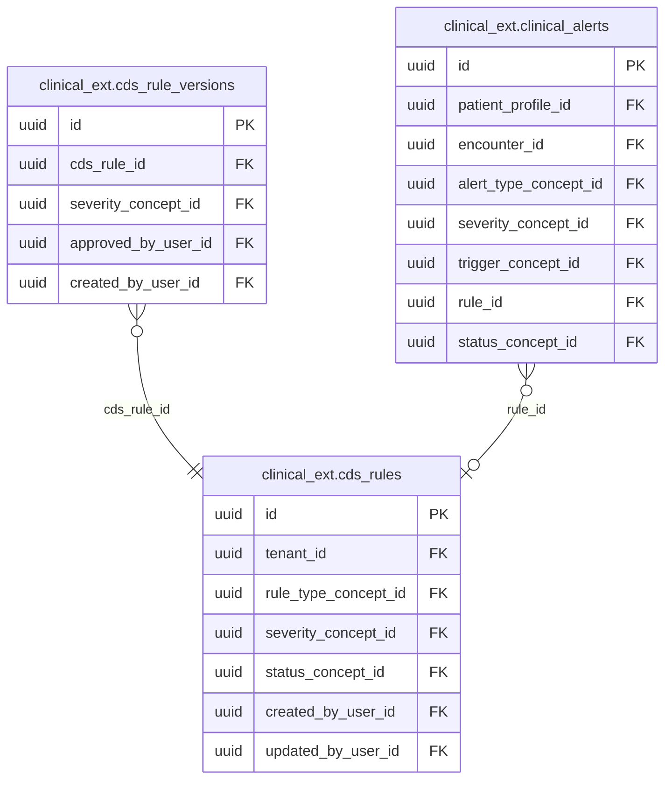
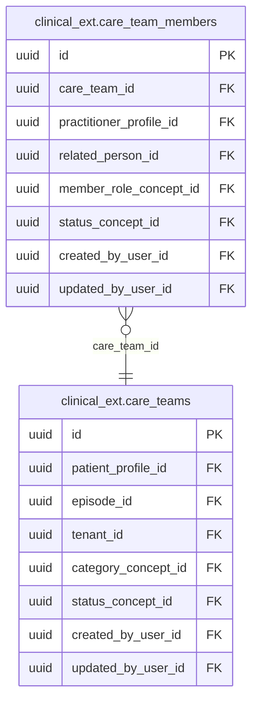
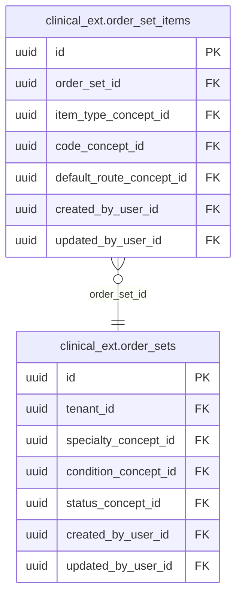

<!-- AUTOGENERADO por tools/inventario/catalogo.mjs. No editar manualmente. -->

# Catálogo del schema `clinical_ext`

- **Tablas:** 14 · **Columnas:** 225 (62 con descripción: 27.6 %) · **Índices:** 112
- **Dominio:** Clínico y Diagnóstico
- Método y límites del catálogo: [README del inventario](../README.md)

## Tablas

| Tabla | Propósito | Columnas | Índices | Operaciones | ORM |
|---|---|---|---|---|---|
| [care_gaps](#care_gaps) | Identifica brechas entre la atención esperada y la documentada para apoyar seguimiento preventivo o de continuidad. | 14 | 8 | 6 | COINCIDE |
| [care_team_members](#care_team_members) | Relaciona profesionales y otros participantes con equipos de cuidado para documentar composición y vigencia del equipo. | 14 | 7 | 3 | COINCIDE |
| [care_teams](#care_teams) | Representa equipos de atención responsables de coordinar el cuidado de pacientes a través de encuentros y servicios. | 14 | 9 | 3 | COINCIDE |
| [cds_rule_versions](#cds_rule_versions) | sin propósito | 10 | 4 | 0 | SIN_ENTIDAD |
| [cds_rules](#cds_rules) | Define reglas de soporte a decisiones clínicas que pueden evaluar datos del paciente y presentar recomendaciones o alertas. | 16 | 8 | 7 | COINCIDE |
| [clinical_alerts](#clinical_alerts) | Mantiene alertas clínicas asociadas a pacientes o atención para hacer visibles condiciones que requieren consideración del equipo. | 20 | 11 | 3 | COINCIDE |
| [drug_interactions](#drug_interactions) | Cataloga interacciones entre medicamentos para apoyar controles de seguridad farmacológica durante la prescripción. | 14 | 6 | 4 | COINCIDE |
| [immunization_schedules](#immunization_schedules) | Define calendarios de inmunización que organizan recomendaciones de dosis por población, edad o pauta. | 14 | 7 | 2 | COINCIDE |
| [order_set_items](#order_set_items) | Asocia órdenes individuales a conjuntos para especificar qué solicitudes componen cada protocolo reutilizable. | 14 | 6 | 2 | COINCIDE |
| [order_sets](#order_sets) | Define conjuntos reutilizables de órdenes clínicas para apoyar flujos frecuentes de atención con componentes coordinados. | 14 | 7 | 3 | COINCIDE |
| [prescription_favorites](#prescription_favorites) | Guarda selecciones frecuentes de prescripción para facilitar la captura de órdenes recurrentes por profesionales autorizados. | 16 | 8 | 5 | COINCIDE |
| [reference_ranges](#reference_ranges) | Conserva rangos de referencia clínicos para contextualizar la interpretación de mediciones y resultados. | 18 | 6 | 0 | COINCIDE |
| [referrals](#referrals) | Registra derivaciones de pacientes entre profesionales o servicios para apoyar continuidad de atención. | 33 | 19 | 15 | COINCIDE |
| [virtual_encounters](#virtual_encounters) | Representa encuentros clínicos realizados por canales virtuales y conserva su contexto dentro de la atención del paciente. | 14 | 6 | 6 | COINCIDE |

## Diagrama entidad-relación

Las tablas se agrupan en familias por sus claves foráneas dentro del schema (máximo 40 por diagrama). Las FK hacia otros schemas se listan en la ficha de cada tabla.

### Familia 1 de 3 — 3 tablas

### Familia 2 de 3 — 2 tablas

### Familia 3 de 3 — 2 tablas

### Tablas sin relaciones dentro del schema

`clinical_ext.care_gaps` · `clinical_ext.drug_interactions` · `clinical_ext.immunization_schedules` · `clinical_ext.prescription_favorites` · `clinical_ext.reference_ranges` · `clinical_ext.referrals` · `clinical_ext.virtual_encounters`

## Fichas

### care_gaps

#### Vista general

Identifica brechas entre la atención esperada y la documentada para apoyar seguimiento preventivo o de continuidad.

- **Estado del propósito:** DOMAIN_CURATED_DRAFT · fuente: `Mantra Core Health Context/modules/diagram_18_clinical_ext.puml: care_gaps`
- **Dominio:** Clínico y Diagnóstico · **Diagrama:** `Mantra Core Health Context/modules/diagram_18_clinical_ext.puml` · **DDL:** `SQL/18_clinical_ext/02_tables.sql`
- **Entidad del ORM:** `CareGaps` — `src/modules/clinical_ext/entities/care_gaps.entity.ts`
- **Resumen:** 14 columnas · 8 índices · 6 FK salientes · 0 entrantes · 6 operaciones

#### Columnas

| # | Columna | Tipo | Rol estructural | Descripción | ORM |
|---|---|---|---|---|---|
| 1 | `id` | `uuid` | Clave primaria; Obligatoria | Identificador único de la instancia. _(JSDOC_ESTANDAR, `src/modules/clinical_ext/entities/care_gaps.entity.ts:12`)_ | coincide |
| 2 | `patient_profile_id` | `uuid` | Clave foránea → profiles.patient_profiles.profile_id; Obligatoria | _sin dato_ | coincide |
| 3 | `gap_type_concept_id` | `uuid` | Clave foránea → terminology.catalog_concepts.id; Obligatoria | _sin dato_ | coincide |
| 4 | `measure_concept_id` | `uuid` | Clave foránea → terminology.catalog_concepts.id; Opcional | _sin dato_ | coincide |
| 5 | `due_date` | `date` | Opcional | _sin dato_ | coincide |
| 6 | `status_concept_id` | `uuid` | Clave foránea → terminology.catalog_concepts.id; Obligatoria | _sin dato_ | coincide |
| 7 | `closed_at` | `timestamptz` | Opcional | _sin dato_ | coincide |
| 8 | `closed_by_resource_type` | `varchar` | Opcional | _sin dato_ | coincide |
| 9 | `closed_by_resource_id` | `uuid` | Opcional | _sin dato_ | coincide |
| 10 | `created_at` | `timestamptz` | Obligatoria | Fecha y hora en que se creó el registro. _(JSDOC_ESTANDAR, `src/modules/clinical_ext/entities/care_gaps.entity.ts:78`)_ | coincide |
| 11 | `updated_at` | `timestamptz` | Obligatoria | Fecha y hora de la última actualización. _(JSDOC_ESTANDAR, `src/modules/clinical_ext/entities/care_gaps.entity.ts:84`)_ | coincide |
| 12 | `created_by_user_id` | `uuid` | Clave foránea → iam.users.id; Opcional | _sin dato_ | coincide |
| 13 | `updated_by_user_id` | `uuid` | Clave foránea → iam.users.id; Opcional | _sin dato_ | coincide |
| 14 | `row_version` | `integer = 1` | Obligatoria | Versión usada para controlar actualizaciones concurrentes. _(JSDOC_ENTIDAD, `src/modules/clinical_ext/entities/care_gaps.entity.ts:102`)_ | coincide |

#### Relaciones

| Sentido | Columnas | Tabla | Restricción |
|---|---|---|---|
| hacia | patient_profile_id | profiles.patient_profiles (profile_id) | fk_care_gaps_patient_profile_id |
| hacia | gap_type_concept_id | terminology.catalog_concepts (id) | fk_care_gaps_gap_type_concept_id |
| hacia | measure_concept_id | terminology.catalog_concepts (id) | fk_care_gaps_measure_concept_id |
| hacia | status_concept_id | terminology.catalog_concepts (id) | fk_care_gaps_status_concept_id |
| hacia | created_by_user_id | iam.users (id) | fk_care_gaps_created_by_user_id |
| hacia | updated_by_user_id | iam.users (id) | fk_care_gaps_updated_by_user_id |

#### Índices

| Índice | Único | Columnas | Para qué |
|---|---|---|---|
| `ix_care_gaps_patient_profile_id` | no | patient_profile_id | Soporta la clave foránea fk_care_gaps_patient_profile_id: PostgreSQL no indexa las FK por sí mismo _(DOCUMENTO)_; 1 consulta(s) de repositorio filtran u ordenan por «patient_profile_id», la primera columna del índice _(CONSULTA)_ |
| `ix_care_gaps_gap_type_concept_id` | no | gap_type_concept_id | Soporta la clave foránea fk_care_gaps_gap_type_concept_id: PostgreSQL no indexa las FK por sí mismo _(DOCUMENTO)_; 1 consulta(s) de repositorio filtran u ordenan por «gap_type_concept_id», la primera columna del índice _(CONSULTA)_ |
| `ix_care_gaps_measure_concept_id` | no | measure_concept_id | Soporta la clave foránea fk_care_gaps_measure_concept_id: PostgreSQL no indexa las FK por sí mismo _(DOCUMENTO)_; 1 consulta(s) de repositorio filtran u ordenan por «measure_concept_id», la primera columna del índice _(CONSULTA)_ |
| `ix_care_gaps_status_concept_id` | no | status_concept_id | Soporta la clave foránea fk_care_gaps_status_concept_id: PostgreSQL no indexa las FK por sí mismo _(DOCUMENTO)_; 1 consulta(s) de repositorio filtran u ordenan por «status_concept_id», la primera columna del índice _(CONSULTA)_ |
| `ix_care_gaps_created_by_user_id` | no | created_by_user_id | Soporta la clave foránea fk_care_gaps_created_by_user_id: PostgreSQL no indexa las FK por sí mismo _(DOCUMENTO)_ |
| `ix_care_gaps_updated_by_user_id` | no | updated_by_user_id | Soporta la clave foránea fk_care_gaps_updated_by_user_id: PostgreSQL no indexa las FK por sí mismo _(DOCUMENTO)_ |
| `ix_care_gaps_patient_profile_id_updated_at` | no | patient_profile_id, ("updated_at" DESC) | _sin uso detectado estáticamente_ |
| `uq_care_gaps_open_logical_key` | sí | patient_profile_id, gap_type_concept_id, (COALESCE(measure_concept_id, '00000000-0000-0000-0000-000000000000'::uuid)) donde WHERE closed_at IS NULL | Garantiza que no se repita la combinación (patient_profile_id, gap_type_concept_id) _(DOCUMENTO)_; Índice parcial: sólo indexa las filas donde WHERE closed_at IS NULL _(ESTRUCTURAL)_ |

#### Restricciones

| Restricción | Tipo | Definición |
|---|---|---|
| `uq_care_gaps_open_logical_key` | UNIQUE INDEX | UNIQUE INDEX ("patient_profile_id", "gap_type_concept_id", COALESCE(measure_concept_id, '00000000-0000-0000-0000-000000000000'::uuid)) WHERE closed_at IS NULL |

#### Operaciones que la tocan

| Operación | Efecto | Confianza |
|---|---|---|
| PATCH /care-gaps/{id}/close | ACTUALIZA | POR_TIPO |
| PATCH /care-gaps/{id}/close | LEE | DIRECTA |
| POST /care-gaps/recompute | CREA | DIRECTA |
| POST /care-gaps/recompute | LEE | DIRECTA |
| POST /patients/{id}/immunization-plan/project | CREA | DIRECTA |
| POST /patients/{id}/immunization-plan/project | LEE | DIRECTA |

#### Gobierno

| Atributo | Valor | Fuente |
|---|---|---|
| Append-only | no declarado | — |
| Datos personales | sin fuente | — |
| Financiera | sin fuente | — |
| Crítica para auditoría | sin fuente | — |
| Retención | sin fuente | — |
| Responsable | sin fuente | — |
| Revisión | AUTO_DETECTADA | — |

---

### care_team_members

#### Vista general

Relaciona profesionales y otros participantes con equipos de cuidado para documentar composición y vigencia del equipo.

- **Estado del propósito:** DOMAIN_CURATED_DRAFT · fuente: `Mantra Core Health Context/modules/diagram_18_clinical_ext.puml: care_team_members`
- **Dominio:** Clínico y Diagnóstico · **Diagrama:** `Mantra Core Health Context/modules/diagram_18_clinical_ext.puml` · **DDL:** `SQL/18_clinical_ext/02_tables.sql`
- **Entidad del ORM:** `CareTeamMembers` — `src/modules/clinical_ext/entities/care_team_members.entity.ts`
- **Resumen:** 14 columnas · 7 índices · 7 FK salientes · 0 entrantes · 3 operaciones

#### Columnas

| # | Columna | Tipo | Rol estructural | Descripción | ORM |
|---|---|---|---|---|---|
| 1 | `id` | `uuid` | Clave primaria; Obligatoria | Identificador único de la instancia. _(JSDOC_ESTANDAR, `src/modules/clinical_ext/entities/care_team_members.entity.ts:12`)_ | coincide |
| 2 | `care_team_id` | `uuid` | Clave foránea → clinical_ext.care_teams.id; Obligatoria | _sin dato_ | coincide |
| 3 | `practitioner_profile_id` | `uuid` | Clave foránea → profiles.health_practitioner_profiles.profile_id; Opcional | _sin dato_ | coincide |
| 4 | `related_person_id` | `uuid` | Clave foránea → profiles.related_persons.id; Opcional | _sin dato_ | coincide |
| 5 | `member_role_concept_id` | `uuid` | Clave foránea → terminology.catalog_concepts.id; Obligatoria | _sin dato_ | coincide |
| 6 | `is_responsible` | `boolean` | Opcional | _sin dato_ | coincide |
| 7 | `period_start` | `timestamptz` | Opcional | _sin dato_ | coincide |
| 8 | `period_end` | `timestamptz` | Opcional | _sin dato_ | coincide |
| 9 | `status_concept_id` | `uuid` | Clave foránea → terminology.catalog_concepts.id; Obligatoria | _sin dato_ | coincide |
| 10 | `created_at` | `timestamptz` | Obligatoria | Fecha y hora en que se creó el registro. _(JSDOC_ESTANDAR, `src/modules/clinical_ext/entities/care_team_members.entity.ts:78`)_ | coincide |
| 11 | `updated_at` | `timestamptz` | Obligatoria | Fecha y hora de la última actualización. _(JSDOC_ESTANDAR, `src/modules/clinical_ext/entities/care_team_members.entity.ts:84`)_ | coincide |
| 12 | `created_by_user_id` | `uuid` | Clave foránea → iam.users.id; Opcional | _sin dato_ | coincide |
| 13 | `updated_by_user_id` | `uuid` | Clave foránea → iam.users.id; Opcional | _sin dato_ | coincide |
| 14 | `row_version` | `integer = 1` | Obligatoria | Versión usada para controlar actualizaciones concurrentes. _(JSDOC_ENTIDAD, `src/modules/clinical_ext/entities/care_team_members.entity.ts:102`)_ | coincide |

#### Relaciones

| Sentido | Columnas | Tabla | Restricción |
|---|---|---|---|
| hacia | care_team_id | clinical_ext.care_teams (id) | fk_care_team_members_care_team_id |
| hacia | practitioner_profile_id | profiles.health_practitioner_profiles (profile_id) | fk_care_team_members_practitioner_profile_id |
| hacia | related_person_id | profiles.related_persons (id) | fk_care_team_members_related_person_id |
| hacia | member_role_concept_id | terminology.catalog_concepts (id) | fk_care_team_members_member_role_concept_id |
| hacia | status_concept_id | terminology.catalog_concepts (id) | fk_care_team_members_status_concept_id |
| hacia | created_by_user_id | iam.users (id) | fk_care_team_members_created_by_user_id |
| hacia | updated_by_user_id | iam.users (id) | fk_care_team_members_updated_by_user_id |

#### Índices

| Índice | Único | Columnas | Para qué |
|---|---|---|---|
| `ix_care_team_members_care_team_id` | no | care_team_id | Soporta la clave foránea fk_care_team_members_care_team_id: PostgreSQL no indexa las FK por sí mismo _(DOCUMENTO)_; 2 consulta(s) de repositorio filtran u ordenan por «care_team_id», la primera columna del índice _(CONSULTA)_ |
| `ix_care_team_members_practitioner_profile_id` | no | practitioner_profile_id | Soporta la clave foránea fk_care_team_members_practitioner_profile_id: PostgreSQL no indexa las FK por sí mismo _(DOCUMENTO)_ |
| `ix_care_team_members_related_person_id` | no | related_person_id | Soporta la clave foránea fk_care_team_members_related_person_id: PostgreSQL no indexa las FK por sí mismo _(DOCUMENTO)_ |
| `ix_care_team_members_member_role_concept_id` | no | member_role_concept_id | Soporta la clave foránea fk_care_team_members_member_role_concept_id: PostgreSQL no indexa las FK por sí mismo _(DOCUMENTO)_ |
| `ix_care_team_members_status_concept_id` | no | status_concept_id | Soporta la clave foránea fk_care_team_members_status_concept_id: PostgreSQL no indexa las FK por sí mismo _(DOCUMENTO)_ |
| `ix_care_team_members_created_by_user_id` | no | created_by_user_id | Soporta la clave foránea fk_care_team_members_created_by_user_id: PostgreSQL no indexa las FK por sí mismo _(DOCUMENTO)_ |
| `ix_care_team_members_updated_by_user_id` | no | updated_by_user_id | Soporta la clave foránea fk_care_team_members_updated_by_user_id: PostgreSQL no indexa las FK por sí mismo _(DOCUMENTO)_ |

#### Operaciones que la tocan

| Operación | Efecto | Confianza |
|---|---|---|
| POST /care-teams | CREA | DIRECTA |
| PATCH /care-teams/{id}/members/{memberId}/set-responsible | ACTUALIZA | POR_TIPO |
| PATCH /care-teams/{id}/members/{memberId}/set-responsible | LEE | DIRECTA |

#### Gobierno

| Atributo | Valor | Fuente |
|---|---|---|
| Append-only | no declarado | — |
| Datos personales | sin fuente | — |
| Financiera | sin fuente | — |
| Crítica para auditoría | sin fuente | — |
| Retención | sin fuente | — |
| Responsable | sin fuente | — |
| Revisión | AUTO_DETECTADA | — |

---

### care_teams

#### Vista general

Representa equipos de atención responsables de coordinar el cuidado de pacientes a través de encuentros y servicios.

- **Estado del propósito:** DOMAIN_CURATED_DRAFT · fuente: `Mantra Core Health Context/modules/diagram_18_clinical_ext.puml: care_teams`
- **Dominio:** Clínico y Diagnóstico · **Diagrama:** `Mantra Core Health Context/modules/diagram_18_clinical_ext.puml` · **DDL:** `SQL/18_clinical_ext/02_tables.sql`
- **Entidad del ORM:** `CareTeams` — `src/modules/clinical_ext/entities/care_teams.entity.ts`
- **Resumen:** 14 columnas · 9 índices · 7 FK salientes · 2 entrantes · 3 operaciones

#### Columnas

| # | Columna | Tipo | Rol estructural | Descripción | ORM |
|---|---|---|---|---|---|
| 1 | `id` | `uuid` | Clave primaria; Obligatoria | Identificador único de la instancia. _(JSDOC_ESTANDAR, `src/modules/clinical_ext/entities/care_teams.entity.ts:12`)_ | coincide |
| 2 | `patient_profile_id` | `uuid` | Clave foránea → profiles.patient_profiles.profile_id; Obligatoria | _sin dato_ | coincide |
| 3 | `episode_id` | `uuid` | Clave foránea → clinical.care_episodes.id; Opcional | _sin dato_ | coincide |
| 4 | `tenant_id` | `uuid` | Clave foránea → directory.tenants.id; Obligatoria | _sin dato_ | coincide |
| 5 | `name` | `varchar` | Opcional | _sin dato_ | coincide |
| 6 | `category_concept_id` | `uuid` | Clave foránea → terminology.catalog_concepts.id; Opcional | _sin dato_ | coincide |
| 7 | `status_concept_id` | `uuid` | Clave foránea → terminology.catalog_concepts.id; Obligatoria | _sin dato_ | coincide |
| 8 | `period_start` | `timestamptz` | Opcional | _sin dato_ | coincide |
| 9 | `period_end` | `timestamptz` | Opcional | _sin dato_ | coincide |
| 10 | `created_at` | `timestamptz` | Obligatoria | Fecha y hora en que se creó el registro. _(JSDOC_ESTANDAR, `src/modules/clinical_ext/entities/care_teams.entity.ts:74`)_ | coincide |
| 11 | `updated_at` | `timestamptz` | Obligatoria | Fecha y hora de la última actualización. _(JSDOC_ESTANDAR, `src/modules/clinical_ext/entities/care_teams.entity.ts:80`)_ | coincide |
| 12 | `created_by_user_id` | `uuid` | Clave foránea → iam.users.id; Opcional | _sin dato_ | coincide |
| 13 | `updated_by_user_id` | `uuid` | Clave foránea → iam.users.id; Opcional | _sin dato_ | coincide |
| 14 | `row_version` | `integer = 1` | Obligatoria | Versión usada para controlar actualizaciones concurrentes. _(JSDOC_ENTIDAD, `src/modules/clinical_ext/entities/care_teams.entity.ts:98`)_ | coincide |

#### Relaciones

| Sentido | Columnas | Tabla | Restricción |
|---|---|---|---|
| hacia | patient_profile_id | profiles.patient_profiles (profile_id) | fk_care_teams_patient_profile_id |
| hacia | episode_id | clinical.care_episodes (id) | fk_care_teams_episode_id |
| hacia | tenant_id | directory.tenants (id) | fk_care_teams_tenant_id |
| hacia | category_concept_id | terminology.catalog_concepts (id) | fk_care_teams_category_concept_id |
| hacia | status_concept_id | terminology.catalog_concepts (id) | fk_care_teams_status_concept_id |
| hacia | created_by_user_id | iam.users (id) | fk_care_teams_created_by_user_id |
| hacia | updated_by_user_id | iam.users (id) | fk_care_teams_updated_by_user_id |
| desde | id | clinical_ext.care_team_members (care_team_id) | fk_care_team_members_care_team_id |
| desde | id | audit.care_teams_history (care_team_id) | fk_care_teams_history_care_team_id |

#### Índices

| Índice | Único | Columnas | Para qué |
|---|---|---|---|
| `ix_care_teams_patient_profile_id` | no | patient_profile_id | Soporta la clave foránea fk_care_teams_patient_profile_id: PostgreSQL no indexa las FK por sí mismo _(DOCUMENTO)_; 1 consulta(s) de repositorio filtran u ordenan por «patient_profile_id», la primera columna del índice _(CONSULTA)_ |
| `ix_care_teams_episode_id` | no | episode_id | Soporta la clave foránea fk_care_teams_episode_id: PostgreSQL no indexa las FK por sí mismo _(DOCUMENTO)_ |
| `ix_care_teams_tenant_id` | no | tenant_id | Soporta la clave foránea fk_care_teams_tenant_id: PostgreSQL no indexa las FK por sí mismo _(DOCUMENTO)_; 1 consulta(s) de repositorio filtran u ordenan por «tenant_id», la primera columna del índice _(CONSULTA)_ |
| `ix_care_teams_category_concept_id` | no | category_concept_id | Soporta la clave foránea fk_care_teams_category_concept_id: PostgreSQL no indexa las FK por sí mismo _(DOCUMENTO)_ |
| `ix_care_teams_status_concept_id` | no | status_concept_id | Soporta la clave foránea fk_care_teams_status_concept_id: PostgreSQL no indexa las FK por sí mismo _(DOCUMENTO)_ |
| `ix_care_teams_created_by_user_id` | no | created_by_user_id | Soporta la clave foránea fk_care_teams_created_by_user_id: PostgreSQL no indexa las FK por sí mismo _(DOCUMENTO)_ |
| `ix_care_teams_updated_by_user_id` | no | updated_by_user_id | Soporta la clave foránea fk_care_teams_updated_by_user_id: PostgreSQL no indexa las FK por sí mismo _(DOCUMENTO)_ |
| `ix_care_teams_tenant_id_status_concept_id` | no | tenant_id, status_concept_id, ("updated_at" DESC) | _sin uso detectado estáticamente_ |
| `ix_care_teams_patient_profile_id_updated_at` | no | tenant_id, patient_profile_id, ("updated_at" DESC) | _sin uso detectado estáticamente_ |

#### Operaciones que la tocan

| Operación | Efecto | Confianza |
|---|---|---|
| GET /care-teams | LEE | DIRECTA |
| POST /care-teams | CREA | DIRECTA |
| PATCH /care-teams/{id}/members/{memberId}/set-responsible | LEE | DIRECTA |

#### Gobierno

| Atributo | Valor | Fuente |
|---|---|---|
| Append-only | no declarado | — |
| Datos personales | sin fuente | — |
| Financiera | sin fuente | — |
| Crítica para auditoría | sin fuente | — |
| Retención | sin fuente | — |
| Responsable | sin fuente | — |
| Revisión | AUTO_DETECTADA | — |

---

### cds_rule_versions

#### Vista general

_Sin propósito registrado._

- **Estado del propósito:** PENDING_REVIEW
- **Dominio:** Clínico y Diagnóstico · **Diagrama:** `Mantra Core Health Context/modules/diagram_18_clinical_ext.puml` · **DDL:** `SQL/18_clinical_ext/02_tables.sql`
- **Entidad del ORM:** **sin entidad** (deriva)
- **Resumen:** 10 columnas · 4 índices · 4 FK salientes · 0 entrantes · 0 operaciones

#### Columnas

| # | Columna | Tipo | Rol estructural | Descripción | ORM |
|---|---|---|---|---|---|
| 1 | `id` | `uuid` | Clave primaria; Obligatoria | _sin dato_ | **SIN_ENTIDAD** |
| 2 | `cds_rule_id` | `uuid` | Clave foránea → clinical_ext.cds_rules.id; Obligatoria | _sin dato_ | **SIN_ENTIDAD** |
| 3 | `version_number` | `integer` | Obligatoria | _sin dato_ | **SIN_ENTIDAD** |
| 4 | `logic_json` | `jsonb` | Opcional | _sin dato_ | **SIN_ENTIDAD** |
| 5 | `message_template` | `text` | Opcional | _sin dato_ | **SIN_ENTIDAD** |
| 6 | `severity_concept_id` | `uuid` | Clave foránea → terminology.catalog_concepts.id; Obligatoria | _sin dato_ | **SIN_ENTIDAD** |
| 7 | `approved_by_user_id` | `uuid` | Clave foránea → iam.users.id; Opcional | _sin dato_ | **SIN_ENTIDAD** |
| 8 | `approved_at` | `timestamptz` | Opcional | _sin dato_ | **SIN_ENTIDAD** |
| 9 | `created_at` | `timestamptz` | Obligatoria | _sin dato_ | **SIN_ENTIDAD** |
| 10 | `created_by_user_id` | `uuid` | Clave foránea → iam.users.id; Opcional | _sin dato_ | **SIN_ENTIDAD** |

#### Relaciones

| Sentido | Columnas | Tabla | Restricción |
|---|---|---|---|
| hacia | cds_rule_id | clinical_ext.cds_rules (id) | fk_cds_rule_versions_cds_rule_id |
| hacia | severity_concept_id | terminology.catalog_concepts (id) | fk_cds_rule_versions_severity_concept_id |
| hacia | approved_by_user_id | iam.users (id) | fk_cds_rule_versions_approved_by_user_id |
| hacia | created_by_user_id | iam.users (id) | fk_cds_rule_versions_created_by_user_id |

#### Índices

| Índice | Único | Columnas | Para qué |
|---|---|---|---|
| `uq_cds_rule_versions_rule_version` | sí | cds_rule_id, version_number | Garantiza que no se repita la combinación (cds_rule_id, version_number) _(DOCUMENTO)_; Soporta la clave foránea fk_cds_rule_versions_cds_rule_id: PostgreSQL no indexa las FK por sí mismo _(DOCUMENTO)_ |
| `ix_cds_rule_versions_severity_concept_id` | no | severity_concept_id | Soporta la clave foránea fk_cds_rule_versions_severity_concept_id: PostgreSQL no indexa las FK por sí mismo _(DOCUMENTO)_ |
| `ix_cds_rule_versions_approved_by_user_id` | no | approved_by_user_id | Soporta la clave foránea fk_cds_rule_versions_approved_by_user_id: PostgreSQL no indexa las FK por sí mismo _(DOCUMENTO)_ |
| `ix_cds_rule_versions_created_by_user_id` | no | created_by_user_id | Soporta la clave foránea fk_cds_rule_versions_created_by_user_id: PostgreSQL no indexa las FK por sí mismo _(DOCUMENTO)_ |

#### Restricciones

| Restricción | Tipo | Definición |
|---|---|---|
| `uq_cds_rule_versions_rule_version` | UNIQUE INDEX | UNIQUE INDEX ("cds_rule_id", "version_number") |
| `ck_cds_rule_versions_number` | CHECK | CHECK ("version_number" >= 1) |

#### Operaciones que la tocan

_Ninguna operación HTTP la toca según el análisis estático (puede usarla un worker, un trigger o una migración)._

#### Gobierno

| Atributo | Valor | Fuente |
|---|---|---|
| Append-only | no declarado | — |
| Datos personales | sin fuente | — |
| Financiera | sin fuente | — |
| Crítica para auditoría | sin fuente | — |
| Retención | sin fuente | — |
| Responsable | sin fuente | — |
| Revisión | AUTO_DETECTADA | — |

---

### cds_rules

#### Vista general

Define reglas de soporte a decisiones clínicas que pueden evaluar datos del paciente y presentar recomendaciones o alertas.

- **Estado del propósito:** DOMAIN_CURATED_DRAFT · fuente: `Mantra Core Health Context/modules/diagram_18_clinical_ext.puml: cds_rules`
- **Dominio:** Clínico y Diagnóstico · **Diagrama:** `Mantra Core Health Context/modules/diagram_18_clinical_ext.puml` · **DDL:** `SQL/18_clinical_ext/02_tables.sql`
- **Entidad del ORM:** `CdsRules` — `src/modules/clinical_ext/entities/cds_rules.entity.ts`
- **Resumen:** 16 columnas · 8 índices · 6 FK salientes · 3 entrantes · 7 operaciones

#### Columnas

| # | Columna | Tipo | Rol estructural | Descripción | ORM |
|---|---|---|---|---|---|
| 1 | `id` | `uuid` | Clave primaria; Obligatoria | Identificador único de la instancia. _(JSDOC_ESTANDAR, `src/modules/clinical_ext/entities/cds_rules.entity.ts:12`)_ | coincide |
| 2 | `tenant_id` | `uuid` | Clave foránea → directory.tenants.id; Opcional | _sin dato_ | coincide |
| 3 | `code` | `varchar` | Obligatoria | _sin dato_ | coincide |
| 4 | `name` | `varchar` | Obligatoria | _sin dato_ | coincide |
| 5 | `rule_type_concept_id` | `uuid` | Clave foránea → terminology.catalog_concepts.id; Obligatoria | _sin dato_ | coincide |
| 6 | `severity_concept_id` | `uuid` | Clave foránea → terminology.catalog_concepts.id; Obligatoria | _sin dato_ | coincide |
| 7 | `logic_json` | `jsonb` | Opcional | _sin dato_ | coincide |
| 8 | `message_template` | `text` | Opcional | _sin dato_ | coincide |
| 9 | `is_active` | `boolean` | Obligatoria | _sin dato_ | coincide |
| 10 | `version` | `integer` | Opcional | _sin dato_ | coincide |
| 11 | `status_concept_id` | `uuid` | Clave foránea → terminology.catalog_concepts.id; Obligatoria | _sin dato_ | coincide |
| 12 | `created_at` | `timestamptz` | Obligatoria | Fecha y hora en que se creó el registro. _(JSDOC_ESTANDAR, `src/modules/clinical_ext/entities/cds_rules.entity.ts:87`)_ | coincide |
| 13 | `updated_at` | `timestamptz` | Obligatoria | Fecha y hora de la última actualización. _(JSDOC_ESTANDAR, `src/modules/clinical_ext/entities/cds_rules.entity.ts:93`)_ | coincide |
| 14 | `created_by_user_id` | `uuid` | Clave foránea → iam.users.id; Opcional | _sin dato_ | coincide |
| 15 | `updated_by_user_id` | `uuid` | Clave foránea → iam.users.id; Opcional | _sin dato_ | coincide |
| 16 | `row_version` | `integer = 1` | Obligatoria | Versión usada para controlar actualizaciones concurrentes. _(JSDOC_ENTIDAD, `src/modules/clinical_ext/entities/cds_rules.entity.ts:111`)_ | coincide |

#### Relaciones

| Sentido | Columnas | Tabla | Restricción |
|---|---|---|---|
| hacia | tenant_id | directory.tenants (id) | fk_cds_rules_tenant_id |
| hacia | rule_type_concept_id | terminology.catalog_concepts (id) | fk_cds_rules_rule_type_concept_id |
| hacia | severity_concept_id | terminology.catalog_concepts (id) | fk_cds_rules_severity_concept_id |
| hacia | status_concept_id | terminology.catalog_concepts (id) | fk_cds_rules_status_concept_id |
| hacia | created_by_user_id | iam.users (id) | fk_cds_rules_created_by_user_id |
| hacia | updated_by_user_id | iam.users (id) | fk_cds_rules_updated_by_user_id |
| desde | id | clinical_ext.clinical_alerts (rule_id) | fk_clinical_alerts_rule_id |
| desde | id | clinical_ext.cds_rule_versions (cds_rule_id) | fk_cds_rule_versions_cds_rule_id |
| desde | id | audit.cds_rules_history (cds_rule_id) | fk_cds_rules_history_cds_rule_id |

#### Índices

| Índice | Único | Columnas | Para qué |
|---|---|---|---|
| `uq_cds_rules_code` | sí | code | Garantiza que no se repita la combinación (code) _(DOCUMENTO)_; 1 consulta(s) de repositorio filtran u ordenan por «code», la primera columna del índice _(CONSULTA)_ |
| `ix_cds_rules_tenant_id` | no | tenant_id | Soporta la clave foránea fk_cds_rules_tenant_id: PostgreSQL no indexa las FK por sí mismo _(DOCUMENTO)_ |
| `ix_cds_rules_rule_type_concept_id` | no | rule_type_concept_id | Soporta la clave foránea fk_cds_rules_rule_type_concept_id: PostgreSQL no indexa las FK por sí mismo _(DOCUMENTO)_ |
| `ix_cds_rules_severity_concept_id` | no | severity_concept_id | Soporta la clave foránea fk_cds_rules_severity_concept_id: PostgreSQL no indexa las FK por sí mismo _(DOCUMENTO)_ |
| `ix_cds_rules_status_concept_id` | no | status_concept_id | Soporta la clave foránea fk_cds_rules_status_concept_id: PostgreSQL no indexa las FK por sí mismo _(DOCUMENTO)_; 1 consulta(s) de repositorio filtran u ordenan por «status_concept_id», la primera columna del índice _(CONSULTA)_ |
| `ix_cds_rules_created_by_user_id` | no | created_by_user_id | Soporta la clave foránea fk_cds_rules_created_by_user_id: PostgreSQL no indexa las FK por sí mismo _(DOCUMENTO)_ |
| `ix_cds_rules_updated_by_user_id` | no | updated_by_user_id | Soporta la clave foránea fk_cds_rules_updated_by_user_id: PostgreSQL no indexa las FK por sí mismo _(DOCUMENTO)_ |
| `ix_cds_rules_tenant_id_status_concept_id` | no | tenant_id, status_concept_id, ("updated_at" DESC) | _sin uso detectado estáticamente_ |

#### Restricciones

| Restricción | Tipo | Definición |
|---|---|---|
| `uq_cds_rules_code` | UNIQUE INDEX | UNIQUE INDEX ("code") |

#### Operaciones que la tocan

| Operación | Efecto | Confianza |
|---|---|---|
| POST /cds-rules | CREA | DIRECTA |
| POST /cds-rules | LEE | DIRECTA |
| POST /cds-rules/{id}/versions/publish | ACTUALIZA | POR_TIPO |
| POST /cds-rules/{id}/versions/publish | LEE | DIRECTA |
| POST /cds-rules/{id}/versions/rollback | ACTUALIZA | POR_TIPO |
| POST /cds-rules/{id}/versions/rollback | LEE | DIRECTA |
| POST /cds/evaluate | LEE | DIRECTA |

#### Gobierno

| Atributo | Valor | Fuente |
|---|---|---|
| Append-only | no declarado | — |
| Datos personales | sin fuente | — |
| Financiera | sin fuente | — |
| Crítica para auditoría | sin fuente | — |
| Retención | sin fuente | — |
| Responsable | sin fuente | — |
| Revisión | AUTO_DETECTADA | — |

---

### clinical_alerts

#### Vista general

Mantiene alertas clínicas asociadas a pacientes o atención para hacer visibles condiciones que requieren consideración del equipo.

- **Estado del propósito:** DOMAIN_CURATED_DRAFT · fuente: `Mantra Core Health Context/modules/diagram_18_clinical_ext.puml: clinical_alerts`
- **Dominio:** Clínico y Diagnóstico · **Diagrama:** `Mantra Core Health Context/modules/diagram_18_clinical_ext.puml` · **DDL:** `SQL/18_clinical_ext/02_tables.sql`
- **Entidad del ORM:** `ClinicalAlerts` — `src/modules/clinical_ext/entities/clinical_alerts.entity.ts`
- **Resumen:** 20 columnas · 11 índices · 10 FK salientes · 1 entrantes · 3 operaciones

#### Columnas

| # | Columna | Tipo | Rol estructural | Descripción | ORM |
|---|---|---|---|---|---|
| 1 | `id` | `uuid` | Clave primaria; Obligatoria | Identificador único de la instancia. _(JSDOC_ESTANDAR, `src/modules/clinical_ext/entities/clinical_alerts.entity.ts:12`)_ | coincide |
| 2 | `patient_profile_id` | `uuid` | Clave foránea → profiles.patient_profiles.profile_id; Obligatoria | _sin dato_ | coincide |
| 3 | `encounter_id` | `uuid` | Clave foránea → clinical.encounters.id; Opcional | _sin dato_ | coincide |
| 4 | `alert_type_concept_id` | `uuid` | Clave foránea → terminology.catalog_concepts.id; Obligatoria | _sin dato_ | coincide |
| 5 | `severity_concept_id` | `uuid` | Clave foránea → terminology.catalog_concepts.id; Obligatoria | _sin dato_ | coincide |
| 6 | `source_resource_type` | `varchar` | Opcional | _sin dato_ | coincide |
| 7 | `source_resource_id` | `uuid` | Opcional | _sin dato_ | coincide |
| 8 | `trigger_concept_id` | `uuid` | Clave foránea → terminology.catalog_concepts.id; Opcional | _sin dato_ | coincide |
| 9 | `rule_id` | `uuid` | Clave foránea → clinical_ext.cds_rules.id; Opcional | _sin dato_ | coincide |
| 10 | `detail_text` | `text` | Opcional | _sin dato_ | coincide |
| 11 | `status_concept_id` | `uuid` | Clave foránea → terminology.catalog_concepts.id; Obligatoria | _sin dato_ | coincide |
| 12 | `overridden_by_user_id` | `uuid` | Clave foránea → iam.users.id; Opcional | _sin dato_ | coincide |
| 13 | `override_reason` | `text` | Opcional | _sin dato_ | coincide |
| 14 | `overridden_at` | `timestamptz` | Opcional | _sin dato_ | coincide |
| 15 | `detected_at` | `timestamptz` | Obligatoria | _sin dato_ | coincide |
| 16 | `created_at` | `timestamptz` | Obligatoria | Fecha y hora en que se creó el registro. _(JSDOC_ESTANDAR, `src/modules/clinical_ext/entities/clinical_alerts.entity.ts:118`)_ | coincide |
| 17 | `updated_at` | `timestamptz` | Obligatoria | Fecha y hora de la última actualización. _(JSDOC_ESTANDAR, `src/modules/clinical_ext/entities/clinical_alerts.entity.ts:124`)_ | coincide |
| 18 | `created_by_user_id` | `uuid` | Clave foránea → iam.users.id; Opcional | _sin dato_ | coincide |
| 19 | `updated_by_user_id` | `uuid` | Clave foránea → iam.users.id; Opcional | _sin dato_ | coincide |
| 20 | `row_version` | `integer = 1` | Obligatoria | Versión usada para controlar actualizaciones concurrentes. _(JSDOC_ENTIDAD, `src/modules/clinical_ext/entities/clinical_alerts.entity.ts:142`)_ | coincide |

#### Relaciones

| Sentido | Columnas | Tabla | Restricción |
|---|---|---|---|
| hacia | rule_id | clinical_ext.cds_rules (id) | fk_clinical_alerts_rule_id |
| hacia | patient_profile_id | profiles.patient_profiles (profile_id) | fk_clinical_alerts_patient_profile_id |
| hacia | encounter_id | clinical.encounters (id) | fk_clinical_alerts_encounter_id |
| hacia | alert_type_concept_id | terminology.catalog_concepts (id) | fk_clinical_alerts_alert_type_concept_id |
| hacia | severity_concept_id | terminology.catalog_concepts (id) | fk_clinical_alerts_severity_concept_id |
| hacia | trigger_concept_id | terminology.catalog_concepts (id) | fk_clinical_alerts_trigger_concept_id |
| hacia | status_concept_id | terminology.catalog_concepts (id) | fk_clinical_alerts_status_concept_id |
| hacia | overridden_by_user_id | iam.users (id) | fk_clinical_alerts_overridden_by_user_id |
| hacia | created_by_user_id | iam.users (id) | fk_clinical_alerts_created_by_user_id |
| hacia | updated_by_user_id | iam.users (id) | fk_clinical_alerts_updated_by_user_id |
| desde | id | audit.clinical_alerts_history (clinical_alert_id) | fk_clinical_alerts_history_clinical_alert_id |

#### Índices

| Índice | Único | Columnas | Para qué |
|---|---|---|---|
| `ix_clinical_alerts_patient_profile_id` | no | patient_profile_id | Soporta la clave foránea fk_clinical_alerts_patient_profile_id: PostgreSQL no indexa las FK por sí mismo _(DOCUMENTO)_; 1 consulta(s) de repositorio filtran u ordenan por «patient_profile_id», la primera columna del índice _(CONSULTA)_ |
| `ix_clinical_alerts_encounter_id` | no | encounter_id | Soporta la clave foránea fk_clinical_alerts_encounter_id: PostgreSQL no indexa las FK por sí mismo _(DOCUMENTO)_ |
| `ix_clinical_alerts_alert_type_concept_id` | no | alert_type_concept_id | Soporta la clave foránea fk_clinical_alerts_alert_type_concept_id: PostgreSQL no indexa las FK por sí mismo _(DOCUMENTO)_ |
| `ix_clinical_alerts_severity_concept_id` | no | severity_concept_id | Soporta la clave foránea fk_clinical_alerts_severity_concept_id: PostgreSQL no indexa las FK por sí mismo _(DOCUMENTO)_ |
| `ix_clinical_alerts_trigger_concept_id` | no | trigger_concept_id | Soporta la clave foránea fk_clinical_alerts_trigger_concept_id: PostgreSQL no indexa las FK por sí mismo _(DOCUMENTO)_ |
| `ix_clinical_alerts_rule_id` | no | rule_id | Soporta la clave foránea fk_clinical_alerts_rule_id: PostgreSQL no indexa las FK por sí mismo _(DOCUMENTO)_ |
| `ix_clinical_alerts_status_concept_id` | no | status_concept_id | Soporta la clave foránea fk_clinical_alerts_status_concept_id: PostgreSQL no indexa las FK por sí mismo _(DOCUMENTO)_ |
| `ix_clinical_alerts_overridden_by_user_id` | no | overridden_by_user_id | Soporta la clave foránea fk_clinical_alerts_overridden_by_user_id: PostgreSQL no indexa las FK por sí mismo _(DOCUMENTO)_ |
| `ix_clinical_alerts_created_by_user_id` | no | created_by_user_id | Soporta la clave foránea fk_clinical_alerts_created_by_user_id: PostgreSQL no indexa las FK por sí mismo _(DOCUMENTO)_ |
| `ix_clinical_alerts_updated_by_user_id` | no | updated_by_user_id | Soporta la clave foránea fk_clinical_alerts_updated_by_user_id: PostgreSQL no indexa las FK por sí mismo _(DOCUMENTO)_ |
| `ix_clinical_alerts_patient_profile_id_updated_at` | no | patient_profile_id, ("updated_at" DESC) | _sin uso detectado estáticamente_ |

#### Operaciones que la tocan

| Operación | Efecto | Confianza |
|---|---|---|
| POST /cds/evaluate | CREA | DIRECTA |
| PATCH /clinical-alerts/{id}/acknowledge | LEE | DIRECTA |
| PATCH /clinical-alerts/{id}/override | LEE | DIRECTA |

#### Gobierno

| Atributo | Valor | Fuente |
|---|---|---|
| Append-only | no declarado | — |
| Datos personales | sin fuente | — |
| Financiera | sin fuente | — |
| Crítica para auditoría | sin fuente | — |
| Retención | sin fuente | — |
| Responsable | sin fuente | — |
| Revisión | AUTO_DETECTADA | — |

---

### drug_interactions

#### Vista general

Cataloga interacciones entre medicamentos para apoyar controles de seguridad farmacológica durante la prescripción.

- **Estado del propósito:** DOMAIN_CURATED_DRAFT · fuente: `Mantra Core Health Context/modules/diagram_18_clinical_ext.puml: drug_interactions`
- **Dominio:** Clínico y Diagnóstico · **Diagrama:** `Mantra Core Health Context/modules/diagram_18_clinical_ext.puml` · **DDL:** `SQL/18_clinical_ext/02_tables.sql`
- **Entidad del ORM:** `DrugInteractions` — `src/modules/clinical_ext/entities/drug_interactions.entity.ts`
- **Resumen:** 14 columnas · 6 índices · 6 FK salientes · 0 entrantes · 4 operaciones

#### Columnas

| # | Columna | Tipo | Rol estructural | Descripción | ORM |
|---|---|---|---|---|---|
| 1 | `id` | `uuid` | Clave primaria; Obligatoria | Identificador único de la instancia. _(JSDOC_ESTANDAR, `src/modules/clinical_ext/entities/drug_interactions.entity.ts:12`)_ | coincide |
| 2 | `substance_a_concept_id` | `uuid` | Clave foránea → terminology.catalog_concepts.id; Obligatoria | _sin dato_ | coincide |
| 3 | `substance_b_concept_id` | `uuid` | Clave foránea → terminology.catalog_concepts.id; Obligatoria | _sin dato_ | coincide |
| 4 | `severity_concept_id` | `uuid` | Clave foránea → terminology.catalog_concepts.id; Obligatoria | _sin dato_ | coincide |
| 5 | `mechanism_text` | `text` | Opcional | _sin dato_ | coincide |
| 6 | `management_text` | `text` | Opcional | _sin dato_ | coincide |
| 7 | `evidence_level_concept_id` | `uuid` | Clave foránea → terminology.catalog_concepts.id; Opcional | _sin dato_ | coincide |
| 8 | `source` | `varchar` | Opcional | _sin dato_ | coincide |
| 9 | `source_version` | `varchar` | Opcional | _sin dato_ | coincide |
| 10 | `created_at` | `timestamptz` | Obligatoria | Fecha y hora en que se creó el registro. _(JSDOC_ESTANDAR, `src/modules/clinical_ext/entities/drug_interactions.entity.ts:78`)_ | coincide |
| 11 | `updated_at` | `timestamptz` | Obligatoria | Fecha y hora de la última actualización. _(JSDOC_ESTANDAR, `src/modules/clinical_ext/entities/drug_interactions.entity.ts:84`)_ | coincide |
| 12 | `created_by_user_id` | `uuid` | Clave foránea → iam.users.id; Opcional | _sin dato_ | coincide |
| 13 | `updated_by_user_id` | `uuid` | Clave foránea → iam.users.id; Opcional | _sin dato_ | coincide |
| 14 | `row_version` | `integer = 1` | Obligatoria | Versión usada para controlar actualizaciones concurrentes. _(JSDOC_ENTIDAD, `src/modules/clinical_ext/entities/drug_interactions.entity.ts:102`)_ | coincide |

#### Relaciones

| Sentido | Columnas | Tabla | Restricción |
|---|---|---|---|
| hacia | substance_a_concept_id | terminology.catalog_concepts (id) | fk_drug_interactions_substance_a_concept_id |
| hacia | substance_b_concept_id | terminology.catalog_concepts (id) | fk_drug_interactions_substance_b_concept_id |
| hacia | severity_concept_id | terminology.catalog_concepts (id) | fk_drug_interactions_severity_concept_id |
| hacia | evidence_level_concept_id | terminology.catalog_concepts (id) | fk_drug_interactions_evidence_level_concept_id |
| hacia | created_by_user_id | iam.users (id) | fk_drug_interactions_created_by_user_id |
| hacia | updated_by_user_id | iam.users (id) | fk_drug_interactions_updated_by_user_id |

#### Índices

| Índice | Único | Columnas | Para qué |
|---|---|---|---|
| `ix_drug_interactions_substance_a_concept_id` | no | substance_a_concept_id | Soporta la clave foránea fk_drug_interactions_substance_a_concept_id: PostgreSQL no indexa las FK por sí mismo _(DOCUMENTO)_ |
| `ix_drug_interactions_substance_b_concept_id` | no | substance_b_concept_id | Soporta la clave foránea fk_drug_interactions_substance_b_concept_id: PostgreSQL no indexa las FK por sí mismo _(DOCUMENTO)_ |
| `ix_drug_interactions_severity_concept_id` | no | severity_concept_id | Soporta la clave foránea fk_drug_interactions_severity_concept_id: PostgreSQL no indexa las FK por sí mismo _(DOCUMENTO)_ |
| `ix_drug_interactions_evidence_level_concept_id` | no | evidence_level_concept_id | Soporta la clave foránea fk_drug_interactions_evidence_level_concept_id: PostgreSQL no indexa las FK por sí mismo _(DOCUMENTO)_ |
| `ix_drug_interactions_created_by_user_id` | no | created_by_user_id | Soporta la clave foránea fk_drug_interactions_created_by_user_id: PostgreSQL no indexa las FK por sí mismo _(DOCUMENTO)_ |
| `ix_drug_interactions_updated_by_user_id` | no | updated_by_user_id | Soporta la clave foránea fk_drug_interactions_updated_by_user_id: PostgreSQL no indexa las FK por sí mismo _(DOCUMENTO)_ |

#### Operaciones que la tocan

| Operación | Efecto | Confianza |
|---|---|---|
| POST /cds/check-interactions | LEE | DIRECTA |
| POST /drug-interactions | CREA | DIRECTA |
| POST /admin/content-packs/{code}/apply | CREA | DIRECTA |
| POST /admin/content-packs/{code}/apply | LEE | DIRECTA |

#### Gobierno

| Atributo | Valor | Fuente |
|---|---|---|
| Append-only | no declarado | — |
| Datos personales | sin fuente | — |
| Financiera | sin fuente | — |
| Crítica para auditoría | sin fuente | — |
| Retención | sin fuente | — |
| Responsable | sin fuente | — |
| Revisión | AUTO_DETECTADA | — |

---

### immunization_schedules

#### Vista general

Define calendarios de inmunización que organizan recomendaciones de dosis por población, edad o pauta.

- **Estado del propósito:** DOMAIN_CURATED_DRAFT · fuente: `Mantra Core Health Context/modules/diagram_18_clinical_ext.puml: immunization_schedules`
- **Dominio:** Clínico y Diagnóstico · **Diagrama:** `Mantra Core Health Context/modules/diagram_18_clinical_ext.puml` · **DDL:** `SQL/18_clinical_ext/02_tables.sql`
- **Entidad del ORM:** `ImmunizationSchedules` — `src/modules/clinical_ext/entities/immunization_schedules.entity.ts`
- **Resumen:** 14 columnas · 7 índices · 6 FK salientes · 0 entrantes · 2 operaciones

#### Columnas

| # | Columna | Tipo | Rol estructural | Descripción | ORM |
|---|---|---|---|---|---|
| 1 | `id` | `uuid` | Clave primaria; Obligatoria | Identificador único de la instancia. _(JSDOC_ESTANDAR, `src/modules/clinical_ext/entities/immunization_schedules.entity.ts:12`)_ | coincide |
| 2 | `tenant_id` | `uuid` | Clave foránea → directory.tenants.id; Opcional | _sin dato_ | coincide |
| 3 | `vaccine_concept_id` | `uuid` | Clave foránea → terminology.catalog_concepts.id; Obligatoria | _sin dato_ | coincide |
| 4 | `name` | `varchar` | Obligatoria | _sin dato_ | coincide |
| 5 | `recommended_age_days` | `integer` | Opcional | _sin dato_ | coincide |
| 6 | `dose_number` | `integer` | Opcional | _sin dato_ | coincide |
| 7 | `interval_days` | `integer` | Opcional | _sin dato_ | coincide |
| 8 | `jurisdiction_concept_id` | `uuid` | Clave foránea → terminology.catalog_concepts.id; Opcional | _sin dato_ | coincide |
| 9 | `status_concept_id` | `uuid` | Clave foránea → terminology.catalog_concepts.id; Obligatoria | _sin dato_ | coincide |
| 10 | `created_at` | `timestamptz` | Obligatoria | Fecha y hora en que se creó el registro. _(JSDOC_ESTANDAR, `src/modules/clinical_ext/entities/immunization_schedules.entity.ts:74`)_ | coincide |
| 11 | `updated_at` | `timestamptz` | Obligatoria | Fecha y hora de la última actualización. _(JSDOC_ESTANDAR, `src/modules/clinical_ext/entities/immunization_schedules.entity.ts:80`)_ | coincide |
| 12 | `created_by_user_id` | `uuid` | Clave foránea → iam.users.id; Opcional | _sin dato_ | coincide |
| 13 | `updated_by_user_id` | `uuid` | Clave foránea → iam.users.id; Opcional | _sin dato_ | coincide |
| 14 | `row_version` | `integer = 1` | Obligatoria | Versión usada para controlar actualizaciones concurrentes. _(JSDOC_ENTIDAD, `src/modules/clinical_ext/entities/immunization_schedules.entity.ts:98`)_ | coincide |

#### Relaciones

| Sentido | Columnas | Tabla | Restricción |
|---|---|---|---|
| hacia | tenant_id | directory.tenants (id) | fk_immunization_schedules_tenant_id |
| hacia | vaccine_concept_id | terminology.catalog_concepts (id) | fk_immunization_schedules_vaccine_concept_id |
| hacia | jurisdiction_concept_id | terminology.catalog_concepts (id) | fk_immunization_schedules_jurisdiction_concept_id |
| hacia | status_concept_id | terminology.catalog_concepts (id) | fk_immunization_schedules_status_concept_id |
| hacia | created_by_user_id | iam.users (id) | fk_immunization_schedules_created_by_user_id |
| hacia | updated_by_user_id | iam.users (id) | fk_immunization_schedules_updated_by_user_id |

#### Índices

| Índice | Único | Columnas | Para qué |
|---|---|---|---|
| `ix_immunization_schedules_tenant_id` | no | tenant_id | Soporta la clave foránea fk_immunization_schedules_tenant_id: PostgreSQL no indexa las FK por sí mismo _(DOCUMENTO)_ |
| `ix_immunization_schedules_vaccine_concept_id` | no | vaccine_concept_id | Soporta la clave foránea fk_immunization_schedules_vaccine_concept_id: PostgreSQL no indexa las FK por sí mismo _(DOCUMENTO)_ |
| `ix_immunization_schedules_jurisdiction_concept_id` | no | jurisdiction_concept_id | Soporta la clave foránea fk_immunization_schedules_jurisdiction_concept_id: PostgreSQL no indexa las FK por sí mismo _(DOCUMENTO)_ |
| `ix_immunization_schedules_status_concept_id` | no | status_concept_id | Soporta la clave foránea fk_immunization_schedules_status_concept_id: PostgreSQL no indexa las FK por sí mismo _(DOCUMENTO)_; 1 consulta(s) de repositorio filtran u ordenan por «status_concept_id», la primera columna del índice _(CONSULTA)_ |
| `ix_immunization_schedules_created_by_user_id` | no | created_by_user_id | Soporta la clave foránea fk_immunization_schedules_created_by_user_id: PostgreSQL no indexa las FK por sí mismo _(DOCUMENTO)_ |
| `ix_immunization_schedules_updated_by_user_id` | no | updated_by_user_id | Soporta la clave foránea fk_immunization_schedules_updated_by_user_id: PostgreSQL no indexa las FK por sí mismo _(DOCUMENTO)_ |
| `ix_immunization_schedules_tenant_id_status_concept_id` | no | tenant_id, status_concept_id, ("updated_at" DESC) | _sin uso detectado estáticamente_ |

#### Operaciones que la tocan

| Operación | Efecto | Confianza |
|---|---|---|
| POST /immunization-schedules | CREA | DIRECTA |
| POST /patients/{id}/immunization-plan/project | LEE | DIRECTA |

#### Gobierno

| Atributo | Valor | Fuente |
|---|---|---|
| Append-only | no declarado | — |
| Datos personales | sin fuente | — |
| Financiera | sin fuente | — |
| Crítica para auditoría | sin fuente | — |
| Retención | sin fuente | — |
| Responsable | sin fuente | — |
| Revisión | AUTO_DETECTADA | — |

---

### order_set_items

#### Vista general

Asocia órdenes individuales a conjuntos para especificar qué solicitudes componen cada protocolo reutilizable.

- **Estado del propósito:** DOMAIN_CURATED_DRAFT · fuente: `Mantra Core Health Context/modules/diagram_18_clinical_ext.puml: order_set_items`
- **Dominio:** Clínico y Diagnóstico · **Diagrama:** `Mantra Core Health Context/modules/diagram_18_clinical_ext.puml` · **DDL:** `SQL/18_clinical_ext/02_tables.sql`
- **Entidad del ORM:** `OrderSetItems` — `src/modules/clinical_ext/entities/order_set_items.entity.ts`
- **Resumen:** 14 columnas · 6 índices · 6 FK salientes · 0 entrantes · 2 operaciones

#### Columnas

| # | Columna | Tipo | Rol estructural | Descripción | ORM |
|---|---|---|---|---|---|
| 1 | `id` | `uuid` | Clave primaria; Obligatoria | Identificador único de la instancia. _(JSDOC_ESTANDAR, `src/modules/clinical_ext/entities/order_set_items.entity.ts:12`)_ | coincide |
| 2 | `order_set_id` | `uuid` | Clave foránea → clinical_ext.order_sets.id; Obligatoria | _sin dato_ | coincide |
| 3 | `item_type_concept_id` | `uuid` | Clave foránea → terminology.catalog_concepts.id; Obligatoria | _sin dato_ | coincide |
| 4 | `code_concept_id` | `uuid` | Clave foránea → terminology.catalog_concepts.id; Obligatoria | _sin dato_ | coincide |
| 5 | `default_dose_text` | `varchar` | Opcional | _sin dato_ | coincide |
| 6 | `default_route_concept_id` | `uuid` | Clave foránea → terminology.catalog_concepts.id; Opcional | _sin dato_ | coincide |
| 7 | `default_frequency_text` | `varchar` | Opcional | _sin dato_ | coincide |
| 8 | `is_selected_default` | `boolean` | Opcional | _sin dato_ | coincide |
| 9 | `ordinal` | `integer` | Opcional | _sin dato_ | coincide |
| 10 | `created_at` | `timestamptz` | Obligatoria | Fecha y hora en que se creó el registro. _(JSDOC_ESTANDAR, `src/modules/clinical_ext/entities/order_set_items.entity.ts:82`)_ | coincide |
| 11 | `updated_at` | `timestamptz` | Obligatoria | Fecha y hora de la última actualización. _(JSDOC_ESTANDAR, `src/modules/clinical_ext/entities/order_set_items.entity.ts:88`)_ | coincide |
| 12 | `created_by_user_id` | `uuid` | Clave foránea → iam.users.id; Opcional | _sin dato_ | coincide |
| 13 | `updated_by_user_id` | `uuid` | Clave foránea → iam.users.id; Opcional | _sin dato_ | coincide |
| 14 | `row_version` | `integer = 1` | Obligatoria | Versión usada para controlar actualizaciones concurrentes. _(JSDOC_ENTIDAD, `src/modules/clinical_ext/entities/order_set_items.entity.ts:106`)_ | coincide |

#### Relaciones

| Sentido | Columnas | Tabla | Restricción |
|---|---|---|---|
| hacia | order_set_id | clinical_ext.order_sets (id) | fk_order_set_items_order_set_id |
| hacia | item_type_concept_id | terminology.catalog_concepts (id) | fk_order_set_items_item_type_concept_id |
| hacia | code_concept_id | terminology.catalog_concepts (id) | fk_order_set_items_code_concept_id |
| hacia | default_route_concept_id | terminology.catalog_concepts (id) | fk_order_set_items_default_route_concept_id |
| hacia | created_by_user_id | iam.users (id) | fk_order_set_items_created_by_user_id |
| hacia | updated_by_user_id | iam.users (id) | fk_order_set_items_updated_by_user_id |

#### Índices

| Índice | Único | Columnas | Para qué |
|---|---|---|---|
| `ix_order_set_items_order_set_id` | no | order_set_id | Soporta la clave foránea fk_order_set_items_order_set_id: PostgreSQL no indexa las FK por sí mismo _(DOCUMENTO)_; 1 consulta(s) de repositorio filtran u ordenan por «order_set_id», la primera columna del índice _(CONSULTA)_ |
| `ix_order_set_items_item_type_concept_id` | no | item_type_concept_id | Soporta la clave foránea fk_order_set_items_item_type_concept_id: PostgreSQL no indexa las FK por sí mismo _(DOCUMENTO)_ |
| `ix_order_set_items_code_concept_id` | no | code_concept_id | Soporta la clave foránea fk_order_set_items_code_concept_id: PostgreSQL no indexa las FK por sí mismo _(DOCUMENTO)_ |
| `ix_order_set_items_default_route_concept_id` | no | default_route_concept_id | Soporta la clave foránea fk_order_set_items_default_route_concept_id: PostgreSQL no indexa las FK por sí mismo _(DOCUMENTO)_ |
| `ix_order_set_items_created_by_user_id` | no | created_by_user_id | Soporta la clave foránea fk_order_set_items_created_by_user_id: PostgreSQL no indexa las FK por sí mismo _(DOCUMENTO)_ |
| `ix_order_set_items_updated_by_user_id` | no | updated_by_user_id | Soporta la clave foránea fk_order_set_items_updated_by_user_id: PostgreSQL no indexa las FK por sí mismo _(DOCUMENTO)_ |

#### Operaciones que la tocan

| Operación | Efecto | Confianza |
|---|---|---|
| POST /order-sets | CREA | DIRECTA |
| POST /order-sets/{id}/apply | LEE | DIRECTA |

#### Gobierno

| Atributo | Valor | Fuente |
|---|---|---|
| Append-only | no declarado | — |
| Datos personales | sin fuente | — |
| Financiera | sin fuente | — |
| Crítica para auditoría | sin fuente | — |
| Retención | sin fuente | — |
| Responsable | sin fuente | — |
| Revisión | AUTO_DETECTADA | — |

---

### order_sets

#### Vista general

Define conjuntos reutilizables de órdenes clínicas para apoyar flujos frecuentes de atención con componentes coordinados.

- **Estado del propósito:** DOMAIN_CURATED_DRAFT · fuente: `Mantra Core Health Context/modules/diagram_18_clinical_ext.puml: order_sets`
- **Dominio:** Clínico y Diagnóstico · **Diagrama:** `Mantra Core Health Context/modules/diagram_18_clinical_ext.puml` · **DDL:** `SQL/18_clinical_ext/02_tables.sql`
- **Entidad del ORM:** `OrderSets` — `src/modules/clinical_ext/entities/order_sets.entity.ts`
- **Resumen:** 14 columnas · 7 índices · 6 FK salientes · 2 entrantes · 3 operaciones

#### Columnas

| # | Columna | Tipo | Rol estructural | Descripción | ORM |
|---|---|---|---|---|---|
| 1 | `id` | `uuid` | Clave primaria; Obligatoria | Identificador único de la instancia. _(JSDOC_ESTANDAR, `src/modules/clinical_ext/entities/order_sets.entity.ts:12`)_ | coincide |
| 2 | `tenant_id` | `uuid` | Clave foránea → directory.tenants.id; Opcional | _sin dato_ | coincide |
| 3 | `specialty_concept_id` | `uuid` | Clave foránea → terminology.catalog_concepts.id; Opcional | _sin dato_ | coincide |
| 4 | `code` | `varchar` | Obligatoria | _sin dato_ | coincide |
| 5 | `name` | `varchar` | Obligatoria | _sin dato_ | coincide |
| 6 | `description` | `text` | Opcional | _sin dato_ | coincide |
| 7 | `condition_concept_id` | `uuid` | Clave foránea → terminology.catalog_concepts.id; Opcional | _sin dato_ | coincide |
| 8 | `version` | `integer` | Obligatoria | _sin dato_ | coincide |
| 9 | `status_concept_id` | `uuid` | Clave foránea → terminology.catalog_concepts.id; Obligatoria | _sin dato_ | coincide |
| 10 | `created_at` | `timestamptz` | Obligatoria | Fecha y hora en que se creó el registro. _(JSDOC_ESTANDAR, `src/modules/clinical_ext/entities/order_sets.entity.ts:66`)_ | coincide |
| 11 | `updated_at` | `timestamptz` | Obligatoria | Fecha y hora de la última actualización. _(JSDOC_ESTANDAR, `src/modules/clinical_ext/entities/order_sets.entity.ts:72`)_ | coincide |
| 12 | `created_by_user_id` | `uuid` | Clave foránea → iam.users.id; Opcional | _sin dato_ | coincide |
| 13 | `updated_by_user_id` | `uuid` | Clave foránea → iam.users.id; Opcional | _sin dato_ | coincide |
| 14 | `row_version` | `integer = 1` | Obligatoria | Versión usada para controlar actualizaciones concurrentes. _(JSDOC_ENTIDAD, `src/modules/clinical_ext/entities/order_sets.entity.ts:90`)_ | coincide |

#### Relaciones

| Sentido | Columnas | Tabla | Restricción |
|---|---|---|---|
| hacia | tenant_id | directory.tenants (id) | fk_order_sets_tenant_id |
| hacia | specialty_concept_id | terminology.catalog_concepts (id) | fk_order_sets_specialty_concept_id |
| hacia | condition_concept_id | terminology.catalog_concepts (id) | fk_order_sets_condition_concept_id |
| hacia | status_concept_id | terminology.catalog_concepts (id) | fk_order_sets_status_concept_id |
| hacia | created_by_user_id | iam.users (id) | fk_order_sets_created_by_user_id |
| hacia | updated_by_user_id | iam.users (id) | fk_order_sets_updated_by_user_id |
| desde | id | clinical_ext.order_set_items (order_set_id) | fk_order_set_items_order_set_id |
| desde | id | audit.order_sets_history (order_set_id) | fk_order_sets_history_order_set_id |

#### Índices

| Índice | Único | Columnas | Para qué |
|---|---|---|---|
| `ix_order_sets_tenant_id` | no | tenant_id | Soporta la clave foránea fk_order_sets_tenant_id: PostgreSQL no indexa las FK por sí mismo _(DOCUMENTO)_ |
| `ix_order_sets_specialty_concept_id` | no | specialty_concept_id | Soporta la clave foránea fk_order_sets_specialty_concept_id: PostgreSQL no indexa las FK por sí mismo _(DOCUMENTO)_ |
| `ix_order_sets_condition_concept_id` | no | condition_concept_id | Soporta la clave foránea fk_order_sets_condition_concept_id: PostgreSQL no indexa las FK por sí mismo _(DOCUMENTO)_ |
| `ix_order_sets_status_concept_id` | no | status_concept_id | Soporta la clave foránea fk_order_sets_status_concept_id: PostgreSQL no indexa las FK por sí mismo _(DOCUMENTO)_ |
| `ix_order_sets_created_by_user_id` | no | created_by_user_id | Soporta la clave foránea fk_order_sets_created_by_user_id: PostgreSQL no indexa las FK por sí mismo _(DOCUMENTO)_ |
| `ix_order_sets_updated_by_user_id` | no | updated_by_user_id | Soporta la clave foránea fk_order_sets_updated_by_user_id: PostgreSQL no indexa las FK por sí mismo _(DOCUMENTO)_ |
| `ix_order_sets_tenant_id_status_concept_id` | no | tenant_id, status_concept_id, ("updated_at" DESC) | _sin uso detectado estáticamente_ |

#### Operaciones que la tocan

| Operación | Efecto | Confianza |
|---|---|---|
| POST /order-sets | CREA | DIRECTA |
| POST /order-sets | LEE | DIRECTA |
| POST /order-sets/{id}/apply | LEE | DIRECTA |

#### Gobierno

| Atributo | Valor | Fuente |
|---|---|---|
| Append-only | no declarado | — |
| Datos personales | sin fuente | — |
| Financiera | sin fuente | — |
| Crítica para auditoría | sin fuente | — |
| Retención | sin fuente | — |
| Responsable | sin fuente | — |
| Revisión | AUTO_DETECTADA | — |

---

### prescription_favorites

#### Vista general

Guarda selecciones frecuentes de prescripción para facilitar la captura de órdenes recurrentes por profesionales autorizados.

- **Estado del propósito:** DOMAIN_CURATED_DRAFT · fuente: `Mantra Core Health Context/modules/diagram_18_clinical_ext.puml: prescription_favorites`
- **Dominio:** Clínico y Diagnóstico · **Diagrama:** `Mantra Core Health Context/modules/diagram_18_clinical_ext.puml` · **DDL:** `SQL/18_clinical_ext/02_tables.sql`
- **Entidad del ORM:** `PrescriptionFavorites` — `src/modules/clinical_ext/entities/prescription_favorites.entity.ts`
- **Resumen:** 16 columnas · 8 índices · 7 FK salientes · 0 entrantes · 5 operaciones

#### Columnas

| # | Columna | Tipo | Rol estructural | Descripción | ORM |
|---|---|---|---|---|---|
| 1 | `id` | `uuid` | Clave primaria; Obligatoria | _sin dato_ | coincide |
| 2 | `practitioner_profile_id` | `uuid` | Clave foránea → profiles.health_practitioner_profiles.profile_id; Obligatoria | _sin dato_ | coincide |
| 3 | `name` | `varchar` | Obligatoria | _sin dato_ | coincide |
| 4 | `medication_concept_id` | `uuid` | Clave foránea → terminology.catalog_concepts.id; Obligatoria | _sin dato_ | coincide |
| 5 | `substance_atc_concept_id` | `uuid` | Clave foránea → terminology.catalog_concepts.id; Opcional | _sin dato_ | coincide |
| 6 | `dose_text` | `varchar` | Opcional | _sin dato_ | coincide |
| 7 | `route_concept_id` | `uuid` | Clave foránea → terminology.catalog_concepts.id; Opcional | _sin dato_ | coincide |
| 8 | `frequency_text` | `varchar` | Opcional | _sin dato_ | coincide |
| 9 | `quantity_decimal` | `numeric` | Opcional | _sin dato_ | coincide |
| 10 | `unit_concept_id` | `uuid` | Clave foránea → terminology.catalog_concepts.id; Opcional | _sin dato_ | coincide |
| 11 | `patient_instructions_text` | `text` | Opcional | _sin dato_ | coincide |
| 12 | `created_at` | `timestamptz` | Obligatoria | _sin dato_ | coincide |
| 13 | `updated_at` | `timestamptz` | Obligatoria | _sin dato_ | coincide |
| 14 | `created_by_user_id` | `uuid` | Clave foránea → iam.users.id; Opcional | _sin dato_ | coincide |
| 15 | `updated_by_user_id` | `uuid` | Clave foránea → iam.users.id; Opcional | _sin dato_ | coincide |
| 16 | `row_version` | `integer = 1` | Obligatoria | _sin dato_ | coincide |

#### Relaciones

| Sentido | Columnas | Tabla | Restricción |
|---|---|---|---|
| hacia | practitioner_profile_id | profiles.health_practitioner_profiles (profile_id) | fk_prescription_favorites_practitioner_profile_id |
| hacia | medication_concept_id | terminology.catalog_concepts (id) | fk_prescription_favorites_medication_concept_id |
| hacia | substance_atc_concept_id | terminology.catalog_concepts (id) | fk_prescription_favorites_substance_atc_concept_id |
| hacia | route_concept_id | terminology.catalog_concepts (id) | fk_prescription_favorites_route_concept_id |
| hacia | unit_concept_id | terminology.catalog_concepts (id) | fk_prescription_favorites_unit_concept_id |
| hacia | created_by_user_id | iam.users (id) | fk_prescription_favorites_created_by_user_id |
| hacia | updated_by_user_id | iam.users (id) | fk_prescription_favorites_updated_by_user_id |

#### Índices

| Índice | Único | Columnas | Para qué |
|---|---|---|---|
| `ix_prescription_favorites_practitioner_profile_id` | no | practitioner_profile_id | Soporta la clave foránea fk_prescription_favorites_practitioner_profile_id: PostgreSQL no indexa las FK por sí mismo _(DOCUMENTO)_; 2 consulta(s) de repositorio filtran u ordenan por «practitioner_profile_id», la primera columna del índice _(CONSULTA)_ |
| `ix_prescription_favorites_medication_concept_id` | no | medication_concept_id | Soporta la clave foránea fk_prescription_favorites_medication_concept_id: PostgreSQL no indexa las FK por sí mismo _(DOCUMENTO)_ |
| `ix_prescription_favorites_substance_atc_concept_id` | no | substance_atc_concept_id | Soporta la clave foránea fk_prescription_favorites_substance_atc_concept_id: PostgreSQL no indexa las FK por sí mismo _(DOCUMENTO)_ |
| `ix_prescription_favorites_route_concept_id` | no | route_concept_id | Soporta la clave foránea fk_prescription_favorites_route_concept_id: PostgreSQL no indexa las FK por sí mismo _(DOCUMENTO)_ |
| `ix_prescription_favorites_unit_concept_id` | no | unit_concept_id | Soporta la clave foránea fk_prescription_favorites_unit_concept_id: PostgreSQL no indexa las FK por sí mismo _(DOCUMENTO)_ |
| `ix_prescription_favorites_created_by_user_id` | no | created_by_user_id | Soporta la clave foránea fk_prescription_favorites_created_by_user_id: PostgreSQL no indexa las FK por sí mismo _(DOCUMENTO)_ |
| `ix_prescription_favorites_updated_by_user_id` | no | updated_by_user_id | Soporta la clave foránea fk_prescription_favorites_updated_by_user_id: PostgreSQL no indexa las FK por sí mismo _(DOCUMENTO)_ |
| `uq_prescription_favorites_practitioner_name` | sí | practitioner_profile_id, name | Garantiza que no se repita la combinación (practitioner_profile_id, name) _(DOCUMENTO)_; Soporta la clave foránea fk_prescription_favorites_practitioner_profile_id: PostgreSQL no indexa las FK por sí mismo _(DOCUMENTO)_; 2 consulta(s) de repositorio filtran u ordenan por «practitioner_profile_id», la primera columna del índice _(CONSULTA)_ |

#### Restricciones

| Restricción | Tipo | Definición |
|---|---|---|
| `uq_prescription_favorites_practitioner_name` | UNIQUE INDEX | UNIQUE INDEX ("practitioner_profile_id", "name") |

#### Operaciones que la tocan

| Operación | Efecto | Confianza |
|---|---|---|
| GET /prescription-favorites | LEE | DIRECTA |
| POST /prescription-favorites | CREA | DIRECTA |
| POST /prescription-favorites | LEE | DIRECTA |
| DELETE /prescription-favorites/{id} | BORRA | POR_TIPO |
| DELETE /prescription-favorites/{id} | LEE | DIRECTA |

#### Gobierno

| Atributo | Valor | Fuente |
|---|---|---|
| Append-only | no declarado | — |
| Datos personales | sin fuente | — |
| Financiera | sin fuente | — |
| Crítica para auditoría | sin fuente | — |
| Retención | sin fuente | — |
| Responsable | sin fuente | — |
| Revisión | AUTO_DETECTADA | — |

---

### reference_ranges

#### Vista general

Conserva rangos de referencia clínicos para contextualizar la interpretación de mediciones y resultados.

- **Estado del propósito:** DOMAIN_CURATED_DRAFT · fuente: `Mantra Core Health Context/modules/diagram_18_clinical_ext.puml: reference_ranges`
- **Dominio:** Clínico y Diagnóstico · **Diagrama:** `Mantra Core Health Context/modules/diagram_18_clinical_ext.puml` · **DDL:** `SQL/18_clinical_ext/02_tables.sql`
- **Entidad del ORM:** `ReferenceRanges` — `src/modules/clinical_ext/entities/reference_ranges.entity.ts`
- **Resumen:** 18 columnas · 6 índices · 6 FK salientes · 0 entrantes · 0 operaciones

#### Columnas

| # | Columna | Tipo | Rol estructural | Descripción | ORM |
|---|---|---|---|---|---|
| 1 | `id` | `uuid` | Clave primaria; Obligatoria | Identificador único de la instancia. _(JSDOC_ESTANDAR, `src/modules/clinical_ext/entities/reference_ranges.entity.ts:12`)_ | coincide |
| 2 | `code_concept_id` | `uuid` | Clave foránea → terminology.catalog_concepts.id; Obligatoria | _sin dato_ | coincide |
| 3 | `unit_concept_id` | `uuid` | Clave foránea → terminology.catalog_concepts.id; Opcional | _sin dato_ | coincide |
| 4 | `sex_concept_id` | `uuid` | Clave foránea → terminology.catalog_concepts.id; Opcional | _sin dato_ | coincide |
| 5 | `age_min_days` | `integer` | Opcional | _sin dato_ | coincide |
| 6 | `age_max_days` | `integer` | Opcional | _sin dato_ | coincide |
| 7 | `condition_concept_id` | `uuid` | Clave foránea → terminology.catalog_concepts.id; Opcional | _sin dato_ | coincide |
| 8 | `low_value` | `numeric` | Opcional | _sin dato_ | coincide |
| 9 | `high_value` | `numeric` | Opcional | _sin dato_ | coincide |
| 10 | `critical_low` | `numeric` | Opcional | _sin dato_ | coincide |
| 11 | `critical_high` | `numeric` | Opcional | _sin dato_ | coincide |
| 12 | `interpretation_text` | `text` | Opcional | _sin dato_ | coincide |
| 13 | `source` | `varchar` | Opcional | _sin dato_ | coincide |
| 14 | `created_at` | `timestamptz` | Obligatoria | Fecha y hora en que se creó el registro. _(JSDOC_ESTANDAR, `src/modules/clinical_ext/entities/reference_ranges.entity.ts:102`)_ | coincide |
| 15 | `updated_at` | `timestamptz` | Obligatoria | Fecha y hora de la última actualización. _(JSDOC_ESTANDAR, `src/modules/clinical_ext/entities/reference_ranges.entity.ts:108`)_ | coincide |
| 16 | `created_by_user_id` | `uuid` | Clave foránea → iam.users.id; Opcional | _sin dato_ | coincide |
| 17 | `updated_by_user_id` | `uuid` | Clave foránea → iam.users.id; Opcional | _sin dato_ | coincide |
| 18 | `row_version` | `integer = 1` | Obligatoria | Versión usada para controlar actualizaciones concurrentes. _(JSDOC_ENTIDAD, `src/modules/clinical_ext/entities/reference_ranges.entity.ts:126`)_ | coincide |

#### Relaciones

| Sentido | Columnas | Tabla | Restricción |
|---|---|---|---|
| hacia | code_concept_id | terminology.catalog_concepts (id) | fk_reference_ranges_code_concept_id |
| hacia | unit_concept_id | terminology.catalog_concepts (id) | fk_reference_ranges_unit_concept_id |
| hacia | sex_concept_id | terminology.catalog_concepts (id) | fk_reference_ranges_sex_concept_id |
| hacia | condition_concept_id | terminology.catalog_concepts (id) | fk_reference_ranges_condition_concept_id |
| hacia | created_by_user_id | iam.users (id) | fk_reference_ranges_created_by_user_id |
| hacia | updated_by_user_id | iam.users (id) | fk_reference_ranges_updated_by_user_id |

#### Índices

| Índice | Único | Columnas | Para qué |
|---|---|---|---|
| `ix_reference_ranges_code_concept_id` | no | code_concept_id | Soporta la clave foránea fk_reference_ranges_code_concept_id: PostgreSQL no indexa las FK por sí mismo _(DOCUMENTO)_; 1 consulta(s) de repositorio filtran u ordenan por «code_concept_id», la primera columna del índice _(CONSULTA)_ |
| `ix_reference_ranges_unit_concept_id` | no | unit_concept_id | Soporta la clave foránea fk_reference_ranges_unit_concept_id: PostgreSQL no indexa las FK por sí mismo _(DOCUMENTO)_ |
| `ix_reference_ranges_sex_concept_id` | no | sex_concept_id | Soporta la clave foránea fk_reference_ranges_sex_concept_id: PostgreSQL no indexa las FK por sí mismo _(DOCUMENTO)_ |
| `ix_reference_ranges_condition_concept_id` | no | condition_concept_id | Soporta la clave foránea fk_reference_ranges_condition_concept_id: PostgreSQL no indexa las FK por sí mismo _(DOCUMENTO)_ |
| `ix_reference_ranges_created_by_user_id` | no | created_by_user_id | Soporta la clave foránea fk_reference_ranges_created_by_user_id: PostgreSQL no indexa las FK por sí mismo _(DOCUMENTO)_ |
| `ix_reference_ranges_updated_by_user_id` | no | updated_by_user_id | Soporta la clave foránea fk_reference_ranges_updated_by_user_id: PostgreSQL no indexa las FK por sí mismo _(DOCUMENTO)_ |

#### Operaciones que la tocan

_Ninguna operación HTTP la toca según el análisis estático (puede usarla un worker, un trigger o una migración)._

#### Gobierno

| Atributo | Valor | Fuente |
|---|---|---|
| Append-only | no declarado | — |
| Datos personales | sin fuente | — |
| Financiera | sin fuente | — |
| Crítica para auditoría | sin fuente | — |
| Retención | sin fuente | — |
| Responsable | sin fuente | — |
| Revisión | AUTO_DETECTADA | — |

---

### referrals

#### Vista general

Registra derivaciones de pacientes entre profesionales o servicios para apoyar continuidad de atención.

- **Estado del propósito:** DOMAIN_CURATED_DRAFT · fuente: `Mantra Core Health Context/modules/diagram_18_clinical_ext.puml: referrals`
- **Dominio:** Clínico y Diagnóstico · **Diagrama:** `Mantra Core Health Context/modules/diagram_18_clinical_ext.puml` · **DDL:** `SQL/18_clinical_ext/02_tables.sql`
- **Entidad del ORM:** `Referrals` — `src/modules/clinical_ext/entities/referrals.entity.ts`
- **Resumen:** 33 columnas · 19 índices · 17 FK salientes · 1 entrantes · 15 operaciones

#### Columnas

| # | Columna | Tipo | Rol estructural | Descripción | ORM |
|---|---|---|---|---|---|
| 1 | `id` | `uuid` | Clave primaria; Obligatoria | Identificador único de la instancia. _(JSDOC_ESTANDAR, `src/modules/clinical_ext/entities/referrals.entity.ts:12`)_ | coincide |
| 2 | `patient_profile_id` | `uuid` | Clave foránea → profiles.patient_profiles.profile_id; Obligatoria | _sin dato_ | coincide |
| 3 | `source_encounter_id` | `uuid` | Clave foránea → clinical.encounters.id; Opcional | _sin dato_ | coincide |
| 4 | `referring_profile_id` | `uuid` | Clave foránea → profiles.health_practitioner_profiles.profile_id; Opcional | _sin dato_ | coincide |
| 5 | `target_profile_id` | `uuid` | Clave foránea → profiles.health_practitioner_profiles.profile_id; Opcional | _sin dato_ | coincide |
| 6 | `target_tenant_id` | `uuid` | Clave foránea → directory.tenants.id; Opcional | _sin dato_ | coincide |
| 7 | `specialty_concept_id` | `uuid` | Clave foránea → terminology.catalog_concepts.id; Opcional | _sin dato_ | coincide |
| 8 | `service_request_id` | `uuid` | Clave foránea → clinical.service_requests.id; Opcional | _sin dato_ | coincide |
| 9 | `reason_concept_id` | `uuid` | Clave foránea → terminology.catalog_concepts.id; Opcional | _sin dato_ | coincide |
| 10 | `reason_text` | `text` | Opcional | _sin dato_ | coincide |
| 11 | `priority_concept_id` | `uuid` | Clave foránea → terminology.catalog_concepts.id; Opcional | _sin dato_ | coincide |
| 12 | `status_concept_id` | `uuid` | Clave foránea → terminology.catalog_concepts.id; Obligatoria | _sin dato_ | coincide |
| 13 | `referral_type_concept_id` | `uuid` | Clave foránea → terminology.catalog_concepts.id; Opcional | Tipo de derivación (tratamiento, consulta, estudio, procedimiento, segunda opinión). Concepto `CEXT.REFERRAL_TYPE_*`. _(JSDOC_ENTIDAD, `src/modules/clinical_ext/entities/referrals.entity.ts:55`)_ | coincide |
| 14 | `target_service_catalog_id` | `uuid` | Clave foránea → billing.service_catalog.id; Opcional | Servicio puntual del destino al que se deriva. _(JSDOC_ENTIDAD, `src/modules/clinical_ext/entities/referrals.entity.ts:65`)_ | coincide |
| 15 | `valid_until` | `date` | Opcional | _sin dato_ | coincide |
| 16 | `responded_at` | `timestamptz` | Opcional | _sin dato_ | coincide |
| 17 | `target_branch_id` | `uuid` | Clave foránea → directory.branches.id; Opcional | Sede u organización médica destino (FK → directory.branches). _(JSDOC_ENTIDAD, `src/modules/clinical_ext/entities/referrals.entity.ts:121`)_ | coincide |
| 18 | `target_external_name` | `varchar(200)` | Opcional | Doctor u organización destino fuera de la plataforma. _(JSDOC_ENTIDAD, `src/modules/clinical_ext/entities/referrals.entity.ts:127`)_ | coincide |
| 19 | `target_external_contact` | `varchar(200)` | Opcional | Contacto del destino externo. _(JSDOC_ENTIDAD, `src/modules/clinical_ext/entities/referrals.entity.ts:137`)_ | coincide |
| 20 | `requested_service_text` | `varchar(500)` | Opcional | Servicio específico pedido. _(JSDOC_ENTIDAD, `src/modules/clinical_ext/entities/referrals.entity.ts:147`)_ | coincide |
| 21 | `requested_service_concept_id` | `uuid` | Clave foránea → terminology.catalog_concepts.id; Opcional | Servicio codificado (FK → terminology.catalog_concepts). _(JSDOC_ENTIDAD, `src/modules/clinical_ext/entities/referrals.entity.ts:157`)_ | coincide |
| 22 | `diagnosis_text` | `text` | Opcional | Diagnóstico presuntivo o definitivo. _(JSDOC_ENTIDAD, `src/modules/clinical_ext/entities/referrals.entity.ts:167`)_ | coincide |
| 23 | `clinical_summary` | `text` | Opcional | Resumen clínico. _(JSDOC_ENTIDAD, `src/modules/clinical_ext/entities/referrals.entity.ts:173`)_ | coincide |
| 24 | `treatment_given_text` | `text` | Opcional | Tratamiento realizado antes de derivar. _(JSDOC_ENTIDAD, `src/modules/clinical_ext/entities/referrals.entity.ts:183`)_ | coincide |
| 25 | `informed_consent_id` | `uuid` | Clave foránea → consent.treatment_informed_consents.id; Opcional | Consentimiento informado asociado (FK → consent.treatment_informed_consents). _(JSDOC_ENTIDAD, `src/modules/clinical_ext/entities/referrals.entity.ts:193`)_ | coincide |
| 26 | `reject_reason` | `text` | Opcional | Motivo del rechazo del destino. _(JSDOC_ENTIDAD, `src/modules/clinical_ext/entities/referrals.entity.ts:199`)_ | coincide |
| 27 | `counter_referral_text` | `text` | Opcional | Contrarreferencia: lo que el destino devuelve. _(JSDOC_ENTIDAD, `src/modules/clinical_ext/entities/referrals.entity.ts:205`)_ | coincide |
| 28 | `counter_referral_at` | `timestamptz` | Opcional | Cuándo se registró la contrarreferencia. _(JSDOC_ENTIDAD, `src/modules/clinical_ext/entities/referrals.entity.ts:215`)_ | coincide |
| 29 | `created_at` | `timestamptz` | Obligatoria | Fecha y hora en que se creó el registro. _(JSDOC_ESTANDAR, `src/modules/clinical_ext/entities/referrals.entity.ts:225`)_ | coincide |
| 30 | `updated_at` | `timestamptz` | Obligatoria | Fecha y hora de la última actualización. _(JSDOC_ESTANDAR, `src/modules/clinical_ext/entities/referrals.entity.ts:231`)_ | coincide |
| 31 | `created_by_user_id` | `uuid` | Clave foránea → iam.users.id; Opcional | _sin dato_ | coincide |
| 32 | `updated_by_user_id` | `uuid` | Clave foránea → iam.users.id; Opcional | _sin dato_ | coincide |
| 33 | `row_version` | `integer = 1` | Obligatoria | Versión usada para controlar actualizaciones concurrentes. _(JSDOC_ENTIDAD, `src/modules/clinical_ext/entities/referrals.entity.ts:249`)_ | coincide |

#### Relaciones

| Sentido | Columnas | Tabla | Restricción |
|---|---|---|---|
| hacia | patient_profile_id | profiles.patient_profiles (profile_id) | fk_referrals_patient_profile_id |
| hacia | source_encounter_id | clinical.encounters (id) | fk_referrals_source_encounter_id |
| hacia | referring_profile_id | profiles.health_practitioner_profiles (profile_id) | fk_referrals_referring_profile_id |
| hacia | target_profile_id | profiles.health_practitioner_profiles (profile_id) | fk_referrals_target_profile_id |
| hacia | target_tenant_id | directory.tenants (id) | fk_referrals_target_tenant_id |
| hacia | specialty_concept_id | terminology.catalog_concepts (id) | fk_referrals_specialty_concept_id |
| hacia | service_request_id | clinical.service_requests (id) | fk_referrals_service_request_id |
| hacia | reason_concept_id | terminology.catalog_concepts (id) | fk_referrals_reason_concept_id |
| hacia | priority_concept_id | terminology.catalog_concepts (id) | fk_referrals_priority_concept_id |
| hacia | status_concept_id | terminology.catalog_concepts (id) | fk_referrals_status_concept_id |
| hacia | target_branch_id | directory.branches (id) | fk_referrals_target_branch_id |
| hacia | requested_service_concept_id | terminology.catalog_concepts (id) | fk_referrals_requested_service_concept_id |
| hacia | informed_consent_id | consent.treatment_informed_consents (id) | fk_referrals_informed_consent_id |
| hacia | referral_type_concept_id | terminology.catalog_concepts (id) | fk_referrals_referral_type_concept_id |
| hacia | target_service_catalog_id | billing.service_catalog (id) | fk_referrals_target_service_catalog_id |
| hacia | created_by_user_id | iam.users (id) | fk_referrals_created_by_user_id |
| hacia | updated_by_user_id | iam.users (id) | fk_referrals_updated_by_user_id |
| desde | id | audit.referrals_history (referral_id) | fk_referrals_history_referral_id |

#### Índices

| Índice | Único | Columnas | Para qué |
|---|---|---|---|
| `ix_referrals_patient_profile_id` | no | patient_profile_id | Soporta la clave foránea fk_referrals_patient_profile_id: PostgreSQL no indexa las FK por sí mismo _(DOCUMENTO)_; 1 consulta(s) de repositorio filtran u ordenan por «patient_profile_id», la primera columna del índice _(CONSULTA)_ |
| `ix_referrals_source_encounter_id` | no | source_encounter_id | Soporta la clave foránea fk_referrals_source_encounter_id: PostgreSQL no indexa las FK por sí mismo _(DOCUMENTO)_ |
| `ix_referrals_referring_profile_id` | no | referring_profile_id | Soporta la clave foránea fk_referrals_referring_profile_id: PostgreSQL no indexa las FK por sí mismo _(DOCUMENTO)_ |
| `ix_referrals_target_profile_id` | no | target_profile_id | Soporta la clave foránea fk_referrals_target_profile_id: PostgreSQL no indexa las FK por sí mismo _(DOCUMENTO)_ |
| `ix_referrals_target_tenant_id` | no | target_tenant_id | Soporta la clave foránea fk_referrals_target_tenant_id: PostgreSQL no indexa las FK por sí mismo _(DOCUMENTO)_ |
| `ix_referrals_specialty_concept_id` | no | specialty_concept_id | Soporta la clave foránea fk_referrals_specialty_concept_id: PostgreSQL no indexa las FK por sí mismo _(DOCUMENTO)_ |
| `ix_referrals_service_request_id` | no | service_request_id | Soporta la clave foránea fk_referrals_service_request_id: PostgreSQL no indexa las FK por sí mismo _(DOCUMENTO)_ |
| `ix_referrals_reason_concept_id` | no | reason_concept_id | Soporta la clave foránea fk_referrals_reason_concept_id: PostgreSQL no indexa las FK por sí mismo _(DOCUMENTO)_ |
| `ix_referrals_priority_concept_id` | no | priority_concept_id | Soporta la clave foránea fk_referrals_priority_concept_id: PostgreSQL no indexa las FK por sí mismo _(DOCUMENTO)_ |
| `ix_referrals_status_concept_id` | no | status_concept_id | Soporta la clave foránea fk_referrals_status_concept_id: PostgreSQL no indexa las FK por sí mismo _(DOCUMENTO)_ |
| `ix_referrals_referral_type_concept_id` | no | referral_type_concept_id | Soporta la clave foránea fk_referrals_referral_type_concept_id: PostgreSQL no indexa las FK por sí mismo _(DOCUMENTO)_ |
| `ix_referrals_target_service_catalog_id` | no | target_service_catalog_id | Soporta la clave foránea fk_referrals_target_service_catalog_id: PostgreSQL no indexa las FK por sí mismo _(DOCUMENTO)_ |
| `ix_referrals_created_by_user_id` | no | created_by_user_id | Soporta la clave foránea fk_referrals_created_by_user_id: PostgreSQL no indexa las FK por sí mismo _(DOCUMENTO)_ |
| `ix_referrals_updated_by_user_id` | no | updated_by_user_id | Soporta la clave foránea fk_referrals_updated_by_user_id: PostgreSQL no indexa las FK por sí mismo _(DOCUMENTO)_ |
| `ix_referrals_patient_profile_id_updated_at` | no | patient_profile_id, ("updated_at" DESC) | _sin uso detectado estáticamente_ |
| `ix_referrals_target_branch` | no | target_branch_id | Soporta la clave foránea fk_referrals_target_branch_id: PostgreSQL no indexa las FK por sí mismo _(DOCUMENTO)_ |
| `ix_referrals_requested_service_concept_id` | no | requested_service_concept_id | Soporta la clave foránea fk_referrals_requested_service_concept_id: PostgreSQL no indexa las FK por sí mismo _(DOCUMENTO)_ |
| `ix_referrals_informed_consent_id` | no | informed_consent_id | Soporta la clave foránea fk_referrals_informed_consent_id: PostgreSQL no indexa las FK por sí mismo _(DOCUMENTO)_; 1 consulta(s) de repositorio filtran u ordenan por «informed_consent_id», la primera columna del índice _(CONSULTA)_ |
| `uq_referrals_source_encounter_target_specialty` | sí | source_encounter_id, target_profile_id, specialty_concept_id donde WHERE source_encounter_id IS NOT NULL AND target_profile_id IS NOT NULL AND specialty_concept_id IS NOT NULL | Garantiza que no se repita la combinación (source_encounter_id, target_profile_id, specialty_concept_id) _(DOCUMENTO)_; Soporta la clave foránea fk_referrals_source_encounter_id: PostgreSQL no indexa las FK por sí mismo _(DOCUMENTO)_; Índice parcial: sólo indexa las filas donde WHERE source_encounter_id IS NOT NULL AND target_profile_id IS NOT NULL AND specialty_concept_id IS NOT NULL _(ESTRUCTURAL)_ |

#### Restricciones

| Restricción | Tipo | Definición |
|---|---|---|
| `uq_referrals_source_encounter_target_specialty` | UNIQUE INDEX | UNIQUE INDEX ("source_encounter_id", "target_profile_id", "specialty_concept_id") WHERE source_encounter_id IS NOT NULL AND target_profile_id IS NOT NULL AND specialty_concept_id IS NOT NULL |

#### Operaciones que la tocan

| Operación | Efecto | Confianza |
|---|---|---|
| GET /referrals | LEE | DIRECTA |
| POST /referrals | CREA | DIRECTA |
| POST /referrals | LEE | DIRECTA |
| GET /referrals/{id} | LEE | DIRECTA |
| PATCH /referrals/{id}/cancel | ACTUALIZA | POR_TIPO |
| PATCH /referrals/{id}/cancel | LEE | DIRECTA |
| PATCH /referrals/{id}/counter-referral | ACTUALIZA | POR_TIPO |
| PATCH /referrals/{id}/counter-referral | LEE | DIRECTA |
| PATCH /referrals/{id}/respond | ACTUALIZA | POR_TIPO |
| PATCH /referrals/{id}/respond | LEE | DIRECTA |
| GET /referrals/me | LEE | DIRECTA |
| POST /consent/encounters/{encounterId}/informed-consent | ACTUALIZA | POR_TIPO |
| POST /consent/treatment-informed-consents | ACTUALIZA | POR_TIPO |
| PATCH /consent/treatment-informed-consents/{id}/withdraw | ACTUALIZA | POR_TIPO |
| PATCH /consent/treatment-informed-consents/{id}/withdraw | LEE | DIRECTA |

#### Gobierno

| Atributo | Valor | Fuente |
|---|---|---|
| Append-only | no declarado | — |
| Datos personales | sin fuente | — |
| Financiera | sin fuente | — |
| Crítica para auditoría | sin fuente | — |
| Retención | sin fuente | — |
| Responsable | sin fuente | — |
| Revisión | AUTO_DETECTADA | — |

---

### virtual_encounters

#### Vista general

Representa encuentros clínicos realizados por canales virtuales y conserva su contexto dentro de la atención del paciente.

- **Estado del propósito:** DOMAIN_CURATED_DRAFT · fuente: `Mantra Core Health Context/modules/diagram_18_clinical_ext.puml: virtual_encounters`
- **Dominio:** Clínico y Diagnóstico · **Diagrama:** `Mantra Core Health Context/modules/diagram_18_clinical_ext.puml` · **DDL:** `SQL/18_clinical_ext/02_tables.sql`
- **Entidad del ORM:** `VirtualEncounters` — `src/modules/clinical_ext/entities/virtual_encounters.entity.ts`
- **Resumen:** 14 columnas · 6 índices · 6 FK salientes · 0 entrantes · 6 operaciones

#### Columnas

| # | Columna | Tipo | Rol estructural | Descripción | ORM |
|---|---|---|---|---|---|
| 1 | `id` | `uuid` | Clave primaria; Obligatoria | Identificador único de la instancia. _(JSDOC_ESTANDAR, `src/modules/clinical_ext/entities/virtual_encounters.entity.ts:12`)_ | coincide |
| 2 | `encounter_id` | `uuid` | Clave foránea → clinical.encounters.id; Obligatoria | _sin dato_ | coincide |
| 3 | `platform_concept_id` | `uuid` | Clave foránea → terminology.catalog_concepts.id; Opcional | _sin dato_ | coincide |
| 4 | `meeting_url` | `text` | Opcional | _sin dato_ | coincide |
| 5 | `meeting_id` | `varchar` | Opcional | _sin dato_ | coincide |
| 6 | `recording_file_id` | `uuid` | Clave foránea → common.files.id; Opcional | _sin dato_ | coincide |
| 7 | `joined_at` | `timestamptz` | Opcional | _sin dato_ | coincide |
| 8 | `ended_at` | `timestamptz` | Opcional | _sin dato_ | coincide |
| 9 | `status_concept_id` | `uuid` | Clave foránea → terminology.catalog_concepts.id; Obligatoria | _sin dato_ | coincide |
| 10 | `created_at` | `timestamptz` | Obligatoria | Fecha y hora en que se creó el registro. _(JSDOC_ESTANDAR, `src/modules/clinical_ext/entities/virtual_encounters.entity.ts:74`)_ | coincide |
| 11 | `updated_at` | `timestamptz` | Obligatoria | Fecha y hora de la última actualización. _(JSDOC_ESTANDAR, `src/modules/clinical_ext/entities/virtual_encounters.entity.ts:80`)_ | coincide |
| 12 | `created_by_user_id` | `uuid` | Clave foránea → iam.users.id; Opcional | _sin dato_ | coincide |
| 13 | `updated_by_user_id` | `uuid` | Clave foránea → iam.users.id; Opcional | _sin dato_ | coincide |
| 14 | `row_version` | `integer = 1` | Obligatoria | Versión usada para controlar actualizaciones concurrentes. _(JSDOC_ENTIDAD, `src/modules/clinical_ext/entities/virtual_encounters.entity.ts:98`)_ | coincide |

#### Relaciones

| Sentido | Columnas | Tabla | Restricción |
|---|---|---|---|
| hacia | encounter_id | clinical.encounters (id) | fk_virtual_encounters_encounter_id |
| hacia | platform_concept_id | terminology.catalog_concepts (id) | fk_virtual_encounters_platform_concept_id |
| hacia | recording_file_id | common.files (id) | fk_virtual_encounters_recording_file_id |
| hacia | status_concept_id | terminology.catalog_concepts (id) | fk_virtual_encounters_status_concept_id |
| hacia | created_by_user_id | iam.users (id) | fk_virtual_encounters_created_by_user_id |
| hacia | updated_by_user_id | iam.users (id) | fk_virtual_encounters_updated_by_user_id |

#### Índices

| Índice | Único | Columnas | Para qué |
|---|---|---|---|
| `uq_virtual_encounters_encounter_id` | sí | encounter_id | Garantiza que no se repita la combinación (encounter_id) _(DOCUMENTO)_; Soporta la clave foránea fk_virtual_encounters_encounter_id: PostgreSQL no indexa las FK por sí mismo _(DOCUMENTO)_; 1 consulta(s) de repositorio filtran u ordenan por «encounter_id», la primera columna del índice _(CONSULTA)_ |
| `ix_virtual_encounters_platform_concept_id` | no | platform_concept_id | Soporta la clave foránea fk_virtual_encounters_platform_concept_id: PostgreSQL no indexa las FK por sí mismo _(DOCUMENTO)_ |
| `ix_virtual_encounters_recording_file_id` | no | recording_file_id | Soporta la clave foránea fk_virtual_encounters_recording_file_id: PostgreSQL no indexa las FK por sí mismo _(DOCUMENTO)_ |
| `ix_virtual_encounters_status_concept_id` | no | status_concept_id | Soporta la clave foránea fk_virtual_encounters_status_concept_id: PostgreSQL no indexa las FK por sí mismo _(DOCUMENTO)_ |
| `ix_virtual_encounters_created_by_user_id` | no | created_by_user_id | Soporta la clave foránea fk_virtual_encounters_created_by_user_id: PostgreSQL no indexa las FK por sí mismo _(DOCUMENTO)_ |
| `ix_virtual_encounters_updated_by_user_id` | no | updated_by_user_id | Soporta la clave foránea fk_virtual_encounters_updated_by_user_id: PostgreSQL no indexa las FK por sí mismo _(DOCUMENTO)_ |

#### Restricciones

| Restricción | Tipo | Definición |
|---|---|---|
| `uq_virtual_encounters_encounter_id` | UNIQUE INDEX | UNIQUE INDEX ("encounter_id") |

#### Operaciones que la tocan

| Operación | Efecto | Confianza |
|---|---|---|
| POST /virtual-encounters | CREA | DIRECTA |
| POST /virtual-encounters | LEE | DIRECTA |
| PATCH /virtual-encounters/{id}/end | ACTUALIZA | POR_TIPO |
| PATCH /virtual-encounters/{id}/end | LEE | DIRECTA |
| PATCH /virtual-encounters/{id}/join | ACTUALIZA | POR_TIPO |
| PATCH /virtual-encounters/{id}/join | LEE | DIRECTA |

#### Gobierno

| Atributo | Valor | Fuente |
|---|---|---|
| Append-only | no declarado | — |
| Datos personales | sin fuente | — |
| Financiera | sin fuente | — |
| Crítica para auditoría | sin fuente | — |
| Retención | sin fuente | — |
| Responsable | sin fuente | — |
| Revisión | AUTO_DETECTADA | — |

---

