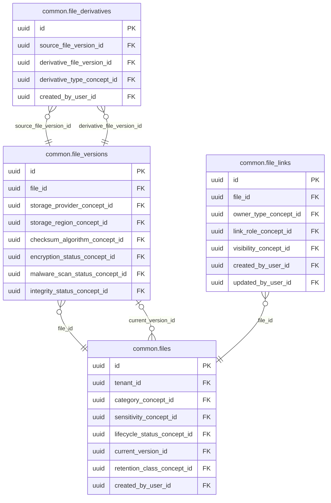

<!-- AUTOGENERADO por tools/inventario/catalogo.mjs. No editar manualmente. -->

# Catálogo del schema `common`

- **Tablas:** 7 · **Columnas:** 111 (27 con descripción: 24.3 %) · **Índices:** 52
- **Dominio:** Núcleo y Terminología
- Método y límites del catálogo: [README del inventario](../README.md)

## Tablas

| Tabla | Propósito | Columnas | Índices | Operaciones | ORM |
|---|---|---|---|---|---|
| [addresses](#addresses) | Representa domicilios y direcciones de personas, sedes y organizaciones utilizadas por procesos del sistema médico. | 20 | 8 | 101 | DIVERGE |
| [contact_points](#contact_points) | Conserva medios de contacto de personas y organizaciones para comunicación asistencial y administrativa. | 15 | 5 | 48 | COINCIDE |
| [file_derivatives](#file_derivatives) | Cataloga derivados de archivos —como representaciones o vistas procesadas— asociados al original. | 7 | 4 | 5 | COINCIDE |
| [file_links](#file_links) | Vincula archivos con registros de negocio para reutilizar documentos sin duplicar su identidad. | 13 | 6 | 10 | COINCIDE |
| [file_versions](#file_versions) | Preserva versiones de archivos para mantener trazabilidad e integridad del contenido documental. | 22 | 10 | 97 | COINCIDE |
| [files](#files) | Cataloga archivos compartidos por los dominios, separando metadata del almacenamiento de contenido. | 15 | 9 | 107 | COINCIDE |
| [identifiers](#identifiers) | Centraliza identificadores de personas y entidades para mantener referencias reutilizables entre módulos médicos. | 19 | 10 | 62 | COINCIDE |

## Diagrama entidad-relación

Las tablas se agrupan en familias por sus claves foráneas dentro del schema (máximo 40 por diagrama). Las FK hacia otros schemas se listan en la ficha de cada tabla.

### Familia 1 de 1 — 4 tablas

### Tablas sin relaciones dentro del schema

`common.addresses` · `common.contact_points` · `common.identifiers`

## Fichas

### addresses

#### Vista general

Representa domicilios y direcciones de personas, sedes y organizaciones utilizadas por procesos del sistema médico.

- **Estado del propósito:** DOMAIN_CURATED_DRAFT · fuente: `Mantra Core Health Context/modules/diagram_02_common.puml: addresses`
- **Dominio:** Núcleo y Terminología · **Diagrama:** `Mantra Core Health Context/modules/diagram_02_common.puml` · **DDL:** `SQL/02_common/02_tables.sql`
- **Entidad del ORM:** `Addresses` — `src/modules/common/entities/addresses.entity.ts`
- **Resumen:** 20 columnas · 8 índices · 8 FK salientes · 7 entrantes · 101 operaciones

#### Columnas

| # | Columna | Tipo | Rol estructural | Descripción | ORM |
|---|---|---|---|---|---|
| 1 | `id` | `uuid` | Clave primaria; Obligatoria | Identificador único de la instancia. _(JSDOC_ESTANDAR, `src/modules/common/entities/addresses.entity.ts:12`)_ | coincide |
| 2 | `owner_type_concept_id` | `uuid` | Clave foránea → terminology.catalog_concepts.id; Obligatoria | _sin dato_ | coincide |
| 3 | `owner_id` | `uuid` | Obligatoria | _sin dato_ | coincide |
| 4 | `use_concept_id` | `uuid` | Clave foránea → terminology.catalog_concepts.id; Opcional | _sin dato_ | coincide |
| 5 | `type_concept_id` | `uuid` | Clave foránea → terminology.catalog_concepts.id; Opcional | _sin dato_ | coincide |
| 6 | `lines` | `varchar` | Opcional | _sin dato_ | coincide |
| 7 | `city` | `varchar` | Opcional | _sin dato_ | coincide |
| 8 | `administrative_area_concept_id` | `uuid` | Clave foránea → terminology.catalog_concepts.id; Opcional | _sin dato_ | coincide |
| 9 | `municipality_concept_id` | `uuid` | Clave foránea → terminology.catalog_concepts.id; Opcional | + v4.1.5 — municipio. `administrative_area_concept_id` sigue siendo el departamento; éste es el nivel de detalle que `city` (texto libre) no puede garantizar consistente. Value set: vs_bo_municipality (340 municipios). _(MODELO_PUML, `Mantra Core Health Context/modules/diagram_02_common.puml:90`)_ | coincide |
| 10 | `postal_code` | `varchar` | Opcional | _sin dato_ | coincide |
| 11 | `country_concept_id` | `uuid` | Clave foránea → terminology.catalog_concepts.id; Obligatoria | _sin dato_ | coincide |
| 12 | `latitude` | `numeric` | Opcional | _sin dato_ | coincide |
| 13 | `longitude` | `numeric` | Opcional | _sin dato_ | coincide |
| 14 | `valid_from` | `date` | Opcional | _sin dato_ | coincide |
| 15 | `valid_to` | `date` | Opcional | _sin dato_ | coincide |
| 16 | `created_at` | `timestamptz` | Obligatoria | Fecha y hora en que se creó el registro. _(JSDOC_ESTANDAR, `src/modules/common/entities/addresses.entity.ts:152`)_ | coincide |
| 17 | `updated_at` | `timestamptz` | Obligatoria | Fecha y hora de la última actualización. _(JSDOC_ESTANDAR, `src/modules/common/entities/addresses.entity.ts:158`)_ | coincide |
| 18 | `created_by_user_id` | `uuid` | Clave foránea → iam.users.id; Opcional | _sin dato_ | coincide |
| 19 | `updated_by_user_id` | `uuid` | Clave foránea → iam.users.id; Opcional | _sin dato_ | coincide |
| 20 | `row_version` | `integer = 1` | Obligatoria | Versión usada para controlar actualizaciones concurrentes. _(JSDOC_ENTIDAD, `src/modules/common/entities/addresses.entity.ts:176`)_ | coincide |

#### Relaciones

| Sentido | Columnas | Tabla | Restricción |
|---|---|---|---|
| hacia | owner_type_concept_id | terminology.catalog_concepts (id) | fk_addresses_owner_type_concept_id |
| hacia | use_concept_id | terminology.catalog_concepts (id) | fk_addresses_use_concept_id |
| hacia | type_concept_id | terminology.catalog_concepts (id) | fk_addresses_type_concept_id |
| hacia | administrative_area_concept_id | terminology.catalog_concepts (id) | fk_addresses_administrative_area_concept_id |
| hacia | municipality_concept_id | terminology.catalog_concepts (id) | fk_addresses_municipality_concept_id |
| hacia | country_concept_id | terminology.catalog_concepts (id) | fk_addresses_country_concept_id |
| hacia | created_by_user_id | iam.users (id) | fk_addresses_created_by_user_id |
| hacia | updated_by_user_id | iam.users (id) | fk_addresses_updated_by_user_id |
| desde | id | geo.trips (origin_address_id) | fk_trips_origin_address_id |
| desde | id | geo.trips (destination_address_id) | fk_trips_destination_address_id |
| desde | id | practice.practice_sites (address_id) | fk_practice_sites_address_id |
| desde | id | pharmacy_inventory.inventory_reservations (delivery_address_id) | fk_inventory_reservations_delivery_address_id |
| desde | id | tracking.shipments (origin_address_id) | fk_shipments_origin_address_id |
| desde | id | tracking.shipments (destination_address_id) | fk_shipments_destination_address_id |
| desde | id | payments.payment_methods (billing_address_id) | fk_payment_methods_billing_address_id |

#### Índices

| Índice | Único | Columnas | Para qué |
|---|---|---|---|
| `ix_addresses_owner_type_concept_id` | no | owner_type_concept_id | Soporta la clave foránea fk_addresses_owner_type_concept_id: PostgreSQL no indexa las FK por sí mismo _(DOCUMENTO)_; 1 consulta(s) de repositorio filtran u ordenan por «owner_type_concept_id», la primera columna del índice _(CONSULTA)_ |
| `ix_addresses_use_concept_id` | no | use_concept_id | Soporta la clave foránea fk_addresses_use_concept_id: PostgreSQL no indexa las FK por sí mismo _(DOCUMENTO)_; 3 consulta(s) de repositorio filtran u ordenan por «use_concept_id», la primera columna del índice _(CONSULTA)_ |
| `ix_addresses_type_concept_id` | no | type_concept_id | Soporta la clave foránea fk_addresses_type_concept_id: PostgreSQL no indexa las FK por sí mismo _(DOCUMENTO)_ |
| `ix_addresses_administrative_area_concept_id` | no | administrative_area_concept_id | Soporta la clave foránea fk_addresses_administrative_area_concept_id: PostgreSQL no indexa las FK por sí mismo _(DOCUMENTO)_ |
| `ix_addresses_municipality_concept_id` | no | municipality_concept_id | Soporta la clave foránea fk_addresses_municipality_concept_id: PostgreSQL no indexa las FK por sí mismo _(DOCUMENTO)_ |
| `ix_addresses_country_concept_id` | no | country_concept_id | Soporta la clave foránea fk_addresses_country_concept_id: PostgreSQL no indexa las FK por sí mismo _(DOCUMENTO)_ |
| `ix_addresses_created_by_user_id` | no | created_by_user_id | Soporta la clave foránea fk_addresses_created_by_user_id: PostgreSQL no indexa las FK por sí mismo _(DOCUMENTO)_ |
| `ix_addresses_updated_by_user_id` | no | updated_by_user_id | Soporta la clave foránea fk_addresses_updated_by_user_id: PostgreSQL no indexa las FK por sí mismo _(DOCUMENTO)_ |

#### Operaciones que la tocan

| Operación | Efecto | Confianza |
|---|---|---|
| GET /clinical/me/procedure-centers | LEE | DIRECTA |
| POST /common/addresses | CREA | DIRECTA |
| GET /f/{slug} | LEE | POR_SQL |
| POST /internal/community/search/reindex | LEE | POR_SQL |
| GET /l/{slug} | LEE | POR_SQL |
| GET /o/{slug} | LEE | POR_SQL |
| GET /p/{slug} | LEE | POR_SQL |
| GET /public/nearby | LEE | POR_SQL |
| GET /public/profiles/{prefijo}/{slug} | LEE | POR_SQL |
| GET /public/search | LEE | POR_SQL |
| GET /public/search/diagnostic-units | LEE | POR_SQL |
| GET /public/search/insurers | LEE | POR_SQL |
| GET /public/search/medications | LEE | POR_SQL |
| GET /public/search/organizations | LEE | POR_SQL |
| GET /public/search/pharmacies | LEE | POR_SQL |
| GET /public/search/practitioners | LEE | POR_SQL |
| GET /s/{slug} | LEE | POR_SQL |
| GET /diagnostic-units/{id} | LEE | DIRECTA |
| GET /diagnostic-units/search | LEE | DIRECTA |
| POST /admin/tenants | CREA | DIRECTA |
| POST /admin/tenants/{tenantId}/verification | LEE | DIRECTA |
| POST /tenants/{tenantId}/child-tenants | CREA | DIRECTA |
| GET /tenants/{tenantId}/laboratory-readiness | LEE | DIRECTA |
| GET /tenants/{tenantId}/pharmacy-readiness | LEE | DIRECTA |
| GET /tenants/me | LEE | DIRECTA |
| POST /iam/auth/register-organization | CREA | DIRECTA |
| POST /iam/auth/register-practitioner | CREA | DIRECTA |
| POST /iam/auth/register-practitioner | LEE | DIRECTA |
| POST /iam/users/assisted-practitioner-registration | CREA | DIRECTA |
| POST /iam/users/assisted-practitioner-registration | LEE | DIRECTA |
| POST /identity/checks/{id}/results | LEE | DIRECTA |
| POST /identity/manual-review/{id}/decision | LEE | DIRECTA |
| POST /internal/identity/checks/{id}/results | LEE | DIRECTA |
| GET /medical-centers/search | LEE | DIRECTA |
| GET /medical-centers/search/for-my-orders | LEE | DIRECTA |
| GET /pharmacy/pharmacies/{id} | LEE | DIRECTA |
| GET /pharmacy/sites | LEE | DIRECTA |
| GET /public/medications | LEE | POR_SQL |
| GET /public/medications/{conceptId}/availability | LEE | POR_SQL |
| GET /public/pharmacies/open-now | LEE | POR_SQL |
| GET /pharmacy-inventory/availability | LEE | DIRECTA |
| GET /pharmacy/orders | LEE | DIRECTA |
| POST /pharmacy/orders | LEE | DIRECTA |
| GET /pharmacy/orders/{id} | LEE | DIRECTA |
| POST /pharmacy/orders/{id}/accept-substitutions | LEE | DIRECTA |
| POST /pharmacy/orders/{id}/cancel | LEE | DIRECTA |
| POST /pharmacy/orders/{id}/confirm | LEE | DIRECTA |
| POST /pharmacy/orders/{id}/dispense | LEE | DIRECTA |
| POST /pharmacy/orders/{id}/prefer-original | LEE | DIRECTA |
| POST /pharmacy/orders/{id}/ready | LEE | DIRECTA |
| POST /pharmacy/orders/{id}/reject | LEE | DIRECTA |
| POST /pharmacy/orders/{id}/review | LEE | DIRECTA |
| GET /pharmacy/orders/me | LEE | DIRECTA |
| GET /practitioners/{profileId}/sites | LEE | DIRECTA |
| POST /practitioners/me/sites | CREA | DIRECTA |
| PATCH /practitioners/me/sites/{siteId} | ACTUALIZA | POR_TIPO |
| PATCH /practitioners/me/sites/{siteId} | CREA | DIRECTA |
| PATCH /practitioners/me/sites/{siteId} | LEE | DIRECTA |
| PUT /practitioners/me/sites/{siteId}/bank-qr | LEE | DIRECTA |
| PUT /practitioners/me/sites/{siteId}/contact-phone | LEE | DIRECTA |
| PUT /practitioners/me/sites/{siteId}/logo | LEE | DIRECTA |
| POST /tenants/{tenantId}/practices | CREA | DIRECTA |
| GET /admissions | LEE | DIRECTA |
| GET /admissions/{id} | LEE | DIRECTA |
| POST /admissions/{id}/claim | LEE | DIRECTA |
| POST /admissions/{id}/decision | LEE | DIRECTA |
| GET /admissions/{id}/documents/{fileId}/content | LEE | DIRECTA |
| POST /admissions/{id}/documents/{fileId}/download-url | LEE | DIRECTA |
| POST /admissions/{id}/items/{itemId}/review | LEE | DIRECTA |
| POST /admissions/{id}/reassign | LEE | DIRECTA |
| POST /admissions/{id}/reinstate | LEE | DIRECTA |
| POST /admissions/{id}/release | LEE | DIRECTA |
| POST /admissions/{id}/request-info | LEE | DIRECTA |
| POST /admissions/{id}/suspend | LEE | DIRECTA |
| POST /admissions/search | LEE | DIRECTA |
| POST /profiles/credentials/{credentialId}/verify | LEE | DIRECTA |
| GET /profiles/patients/me | LEE | DIRECTA |
| PATCH /profiles/patients/me | ACTUALIZA | POR_TIPO |
| PATCH /profiles/patients/me | LEE | DIRECTA |
| GET /profiles/patients/me/addresses | LEE | DIRECTA |
| POST /profiles/patients/me/addresses | LEE | DIRECTA |
| DELETE /profiles/patients/me/addresses/{id} | ACTUALIZA | POR_TIPO |
| DELETE /profiles/patients/me/addresses/{id} | LEE | DIRECTA |
| PATCH /profiles/patients/me/addresses/{id} | ACTUALIZA | POR_TIPO |
| PATCH /profiles/patients/me/addresses/{id} | LEE | DIRECTA |
| PUT /profiles/patients/me/addresses/{id}/preferred | LEE | DIRECTA |
| DELETE /profiles/patients/me/photo | LEE | DIRECTA |
| PUT /profiles/patients/me/photo | LEE | DIRECTA |
| POST /profiles/practitioners | LEE | DIRECTA |
| PATCH /profiles/practitioners/{profileId} | LEE | DIRECTA |
| DELETE /profiles/practitioners/{profileId}/photo | LEE | DIRECTA |
| PUT /profiles/practitioners/{profileId}/photo | LEE | DIRECTA |
| GET /profiles/practitioners/{profileId}/summary | LEE | DIRECTA |
| PATCH /profiles/practitioners/me | LEE | DIRECTA |
| GET /profiles/practitioners/me/admission | LEE | DIRECTA |
| POST /profiles/practitioners/me/admission/resubmit | LEE | DIRECTA |
| POST /profiles/practitioners/me/admission/withdraw | LEE | DIRECTA |
| GET /profiles/practitioners/me/summary | LEE | DIRECTA |
| POST /public/profiles/f/{slug}/branch-availability | LEE | POR_SQL |
| GET /public/profiles/f/{slug}/branches | LEE | POR_SQL |
| GET /scheduling/resources | LEE | DIRECTA |

#### Gobierno

| Atributo | Valor | Fuente |
|---|---|---|
| Append-only | no declarado | — |
| Datos personales | sin fuente | — |
| Financiera | sin fuente | — |
| Crítica para auditoría | sin fuente | — |
| Retención | sin fuente | — |
| Responsable | sin fuente | — |
| Revisión | AUTO_DETECTADA | — |

---

### contact_points

#### Vista general

Conserva medios de contacto de personas y organizaciones para comunicación asistencial y administrativa.

- **Estado del propósito:** DOMAIN_CURATED_DRAFT · fuente: `Mantra Core Health Context/modules/diagram_02_common.puml: contact_points`
- **Dominio:** Núcleo y Terminología · **Diagrama:** `Mantra Core Health Context/modules/diagram_02_common.puml` · **DDL:** `SQL/02_common/02_tables.sql`
- **Entidad del ORM:** `ContactPoints` — `src/modules/common/entities/contact_points.entity.ts`
- **Resumen:** 15 columnas · 5 índices · 5 FK salientes · 0 entrantes · 48 operaciones

#### Columnas

| # | Columna | Tipo | Rol estructural | Descripción | ORM |
|---|---|---|---|---|---|
| 1 | `id` | `uuid` | Clave primaria; Obligatoria | Identificador único de la instancia. _(JSDOC_ESTANDAR, `src/modules/common/entities/contact_points.entity.ts:12`)_ | coincide |
| 2 | `owner_type_concept_id` | `uuid` | Clave foránea → terminology.catalog_concepts.id; Obligatoria | _sin dato_ | coincide |
| 3 | `owner_id` | `uuid` | Obligatoria | _sin dato_ | coincide |
| 4 | `system_concept_id` | `uuid` | Clave foránea → terminology.catalog_concepts.id; Obligatoria | _sin dato_ | coincide |
| 5 | `value` | `varchar` | Obligatoria | _sin dato_ | coincide |
| 6 | `use_concept_id` | `uuid` | Clave foránea → terminology.catalog_concepts.id; Opcional | _sin dato_ | coincide |
| 7 | `rank` | `integer` | Opcional | _sin dato_ | coincide |
| 8 | `verified` | `boolean` | Opcional | _sin dato_ | coincide |
| 9 | `valid_from` | `date` | Opcional | _sin dato_ | coincide |
| 10 | `valid_to` | `date` | Opcional | _sin dato_ | coincide |
| 11 | `created_at` | `timestamptz` | Obligatoria | Fecha y hora en que se creó el registro. _(JSDOC_ESTANDAR, `src/modules/common/entities/contact_points.entity.ts:72`)_ | coincide |
| 12 | `updated_at` | `timestamptz` | Obligatoria | Fecha y hora de la última actualización. _(JSDOC_ESTANDAR, `src/modules/common/entities/contact_points.entity.ts:78`)_ | coincide |
| 13 | `created_by_user_id` | `uuid` | Clave foránea → iam.users.id; Opcional | _sin dato_ | coincide |
| 14 | `updated_by_user_id` | `uuid` | Clave foránea → iam.users.id; Opcional | _sin dato_ | coincide |
| 15 | `row_version` | `integer = 1` | Obligatoria | Versión usada para controlar actualizaciones concurrentes. _(JSDOC_ENTIDAD, `src/modules/common/entities/contact_points.entity.ts:96`)_ | coincide |

#### Relaciones

| Sentido | Columnas | Tabla | Restricción |
|---|---|---|---|
| hacia | owner_type_concept_id | terminology.catalog_concepts (id) | fk_contact_points_owner_type_concept_id |
| hacia | system_concept_id | terminology.catalog_concepts (id) | fk_contact_points_system_concept_id |
| hacia | use_concept_id | terminology.catalog_concepts (id) | fk_contact_points_use_concept_id |
| hacia | created_by_user_id | iam.users (id) | fk_contact_points_created_by_user_id |
| hacia | updated_by_user_id | iam.users (id) | fk_contact_points_updated_by_user_id |

#### Índices

| Índice | Único | Columnas | Para qué |
|---|---|---|---|
| `ix_contact_points_owner_type_concept_id` | no | owner_type_concept_id | Soporta la clave foránea fk_contact_points_owner_type_concept_id: PostgreSQL no indexa las FK por sí mismo _(DOCUMENTO)_; 1 consulta(s) de repositorio filtran u ordenan por «owner_type_concept_id», la primera columna del índice _(CONSULTA)_ |
| `ix_contact_points_system_concept_id` | no | system_concept_id | Soporta la clave foránea fk_contact_points_system_concept_id: PostgreSQL no indexa las FK por sí mismo _(DOCUMENTO)_; 4 consulta(s) de repositorio filtran u ordenan por «system_concept_id», la primera columna del índice _(CONSULTA)_ |
| `ix_contact_points_use_concept_id` | no | use_concept_id | Soporta la clave foránea fk_contact_points_use_concept_id: PostgreSQL no indexa las FK por sí mismo _(DOCUMENTO)_; 1 consulta(s) de repositorio filtran u ordenan por «use_concept_id», la primera columna del índice _(CONSULTA)_ |
| `ix_contact_points_created_by_user_id` | no | created_by_user_id | Soporta la clave foránea fk_contact_points_created_by_user_id: PostgreSQL no indexa las FK por sí mismo _(DOCUMENTO)_ |
| `ix_contact_points_updated_by_user_id` | no | updated_by_user_id | Soporta la clave foránea fk_contact_points_updated_by_user_id: PostgreSQL no indexa las FK por sí mismo _(DOCUMENTO)_ |

#### Operaciones que la tocan

| Operación | Efecto | Confianza |
|---|---|---|
| POST /common/contact-points | CREA | DIRECTA |
| POST /common/contact-points/{id}/verify | ACTUALIZA | POR_TIPO |
| POST /common/contact-points/{id}/verify | LEE | DIRECTA |
| POST /admin/content-packs/{code}/apply | CREA | DIRECTA |
| GET /tenants/me | LEE | DIRECTA |
| POST /iam/auth/login | LEE | DIRECTA |
| POST /iam/auth/register-patient | CREA | DIRECTA |
| POST /iam/auth/register-practitioner | CREA | DIRECTA |
| POST /iam/auth/register-practitioner | LEE | DIRECTA |
| POST /iam/users | CREA | DIRECTA |
| POST /iam/users/assisted-practitioner-registration | CREA | DIRECTA |
| POST /iam/users/assisted-practitioner-registration | LEE | DIRECTA |
| POST /identity/checks/{id}/results | LEE | DIRECTA |
| POST /identity/manual-review/{id}/decision | LEE | DIRECTA |
| POST /internal/identity/checks/{id}/results | LEE | DIRECTA |
| POST /insurance/patients/conversation | LEE | POR_SQL |
| POST /insurance/patients/search | LEE | POR_SQL |
| GET /pharmacy/pharmacies/{id}/contacts | LEE | DIRECTA |
| GET /admissions/{id} | LEE | DIRECTA |
| POST /admissions/{id}/claim | LEE | DIRECTA |
| POST /admissions/{id}/decision | LEE | DIRECTA |
| POST /admissions/{id}/items/{itemId}/review | LEE | DIRECTA |
| POST /admissions/{id}/reassign | LEE | DIRECTA |
| POST /admissions/{id}/reinstate | LEE | DIRECTA |
| POST /admissions/{id}/release | LEE | DIRECTA |
| POST /admissions/{id}/request-info | LEE | DIRECTA |
| POST /admissions/{id}/suspend | LEE | DIRECTA |
| POST /admissions/expire-sweep | LEE | DIRECTA |
| POST /profiles/credentials/{credentialId}/verify | LEE | DIRECTA |
| GET /profiles/patients/me | LEE | DIRECTA |
| PATCH /profiles/patients/me | ACTUALIZA | POR_TIPO |
| PATCH /profiles/patients/me | CREA | DIRECTA |
| PATCH /profiles/patients/me | LEE | DIRECTA |
| DELETE /profiles/patients/me/photo | LEE | DIRECTA |
| PUT /profiles/patients/me/photo | LEE | DIRECTA |
| POST /profiles/practitioners | LEE | DIRECTA |
| PATCH /profiles/practitioners/{profileId} | ACTUALIZA | POR_TIPO |
| PATCH /profiles/practitioners/{profileId} | CREA | DIRECTA |
| PATCH /profiles/practitioners/{profileId} | LEE | DIRECTA |
| DELETE /profiles/practitioners/{profileId}/photo | LEE | DIRECTA |
| PUT /profiles/practitioners/{profileId}/photo | LEE | DIRECTA |
| GET /profiles/practitioners/{profileId}/summary | LEE | DIRECTA |
| PATCH /profiles/practitioners/me | ACTUALIZA | POR_TIPO |
| PATCH /profiles/practitioners/me | CREA | DIRECTA |
| PATCH /profiles/practitioners/me | LEE | DIRECTA |
| POST /profiles/practitioners/me/admission/resubmit | LEE | DIRECTA |
| POST /profiles/practitioners/me/admission/withdraw | LEE | DIRECTA |
| GET /profiles/practitioners/me/summary | LEE | DIRECTA |

#### Gobierno

| Atributo | Valor | Fuente |
|---|---|---|
| Append-only | no declarado | — |
| Datos personales | sin fuente | — |
| Financiera | sin fuente | — |
| Crítica para auditoría | sin fuente | — |
| Retención | sin fuente | — |
| Responsable | sin fuente | — |
| Revisión | AUTO_DETECTADA | — |

---

### file_derivatives

#### Vista general

Cataloga derivados de archivos —como representaciones o vistas procesadas— asociados al original.

- **Estado del propósito:** DOMAIN_CURATED_DRAFT · fuente: `Mantra Core Health Context/modules/diagram_02_common.puml: file_derivatives`
- **Dominio:** Núcleo y Terminología · **Diagrama:** `Mantra Core Health Context/modules/diagram_02_common.puml` · **DDL:** `SQL/02_common/02_tables.sql`
- **Entidad del ORM:** `FileDerivatives` — `src/modules/common/entities/file_derivatives.entity.ts`
- **Resumen:** 7 columnas · 4 índices · 4 FK salientes · 0 entrantes · 5 operaciones

#### Columnas

| # | Columna | Tipo | Rol estructural | Descripción | ORM |
|---|---|---|---|---|---|
| 1 | `id` | `uuid` | Clave primaria; Obligatoria | Identificador único de la instancia. _(JSDOC_ESTANDAR, `src/modules/common/entities/file_derivatives.entity.ts:12`)_ | coincide |
| 2 | `source_file_version_id` | `uuid` | Clave foránea → common.file_versions.id; Obligatoria | _sin dato_ | coincide |
| 3 | `derivative_file_version_id` | `uuid` | Clave foránea → common.file_versions.id; Obligatoria | _sin dato_ | coincide |
| 4 | `derivative_type_concept_id` | `uuid` | Clave foránea → terminology.catalog_concepts.id; Obligatoria | _sin dato_ | coincide |
| 5 | `generation_profile` | `varchar` | Opcional | _sin dato_ | coincide |
| 6 | `created_at` | `timestamptz` | Obligatoria | Fecha y hora en que se creó el registro. _(JSDOC_ESTANDAR, `src/modules/common/entities/file_derivatives.entity.ts:46`)_ | coincide |
| 7 | `created_by_user_id` | `uuid` | Clave foránea → iam.users.id; Opcional | _sin dato_ | coincide |

#### Relaciones

| Sentido | Columnas | Tabla | Restricción |
|---|---|---|---|
| hacia | source_file_version_id | common.file_versions (id) | fk_file_derivatives_source_file_version_id |
| hacia | derivative_file_version_id | common.file_versions (id) | fk_file_derivatives_derivative_file_version_id |
| hacia | derivative_type_concept_id | terminology.catalog_concepts (id) | fk_file_derivatives_derivative_type_concept_id |
| hacia | created_by_user_id | iam.users (id) | fk_file_derivatives_created_by_user_id |

#### Índices

| Índice | Único | Columnas | Para qué |
|---|---|---|---|
| `ix_file_derivatives_source_file_version_id` | no | source_file_version_id | Soporta la clave foránea fk_file_derivatives_source_file_version_id: PostgreSQL no indexa las FK por sí mismo _(DOCUMENTO)_ |
| `ix_file_derivatives_derivative_file_version_id` | no | derivative_file_version_id | Soporta la clave foránea fk_file_derivatives_derivative_file_version_id: PostgreSQL no indexa las FK por sí mismo _(DOCUMENTO)_ |
| `ix_file_derivatives_derivative_type_concept_id` | no | derivative_type_concept_id | Soporta la clave foránea fk_file_derivatives_derivative_type_concept_id: PostgreSQL no indexa las FK por sí mismo _(DOCUMENTO)_ |
| `ix_file_derivatives_created_by_user_id` | no | created_by_user_id | Soporta la clave foránea fk_file_derivatives_created_by_user_id: PostgreSQL no indexa las FK por sí mismo _(DOCUMENTO)_ |

#### Operaciones que la tocan

| Operación | Efecto | Confianza |
|---|---|---|
| POST /common/files/{id}/versions/{vid}/derivatives | CREA | DIRECTA |
| POST /internal/identity/evidence/lifecycle-scan | BORRA | POR_SQL |
| POST /internal/identity/evidence/lifecycle-scan | LEE | DIRECTA |
| POST /internal/governance/retention-executions/run | BORRA | POR_SQL |
| POST /internal/governance/retention-executions/run | LEE | DIRECTA |

#### Gobierno

| Atributo | Valor | Fuente |
|---|---|---|
| Append-only | no declarado | — |
| Datos personales | sin fuente | — |
| Financiera | sin fuente | — |
| Crítica para auditoría | sin fuente | — |
| Retención | sin fuente | — |
| Responsable | sin fuente | — |
| Revisión | AUTO_DETECTADA | — |

---

### file_links

#### Vista general

Vincula archivos con registros de negocio para reutilizar documentos sin duplicar su identidad.

- **Estado del propósito:** DOMAIN_CURATED_DRAFT · fuente: `Mantra Core Health Context/modules/diagram_02_common.puml: file_links`
- **Dominio:** Núcleo y Terminología · **Diagrama:** `Mantra Core Health Context/modules/diagram_02_common.puml` · **DDL:** `SQL/02_common/02_tables.sql`
- **Entidad del ORM:** `FileLinks` — `src/modules/common/entities/file_links.entity.ts`
- **Resumen:** 13 columnas · 6 índices · 6 FK salientes · 0 entrantes · 10 operaciones

#### Columnas

| # | Columna | Tipo | Rol estructural | Descripción | ORM |
|---|---|---|---|---|---|
| 1 | `id` | `uuid` | Clave primaria; Obligatoria | Identificador único de la instancia. _(JSDOC_ESTANDAR, `src/modules/common/entities/file_links.entity.ts:12`)_ | coincide |
| 2 | `file_id` | `uuid` | Clave foránea → common.files.id; Obligatoria | _sin dato_ | coincide |
| 3 | `owner_type_concept_id` | `uuid` | Clave foránea → terminology.catalog_concepts.id; Obligatoria | _sin dato_ | coincide |
| 4 | `owner_id` | `uuid` | Obligatoria | _sin dato_ | coincide |
| 5 | `link_role_concept_id` | `uuid` | Clave foránea → terminology.catalog_concepts.id; Obligatoria | _sin dato_ | coincide |
| 6 | `visibility_concept_id` | `uuid` | Clave foránea → terminology.catalog_concepts.id; Opcional | _sin dato_ | coincide |
| 7 | `valid_from` | `timestamptz` | Opcional | _sin dato_ | coincide |
| 8 | `valid_to` | `timestamptz` | Opcional | _sin dato_ | coincide |
| 9 | `created_at` | `timestamptz` | Obligatoria | Fecha y hora en que se creó el registro. _(JSDOC_ESTANDAR, `src/modules/common/entities/file_links.entity.ts:72`)_ | coincide |
| 10 | `updated_at` | `timestamptz` | Obligatoria | Fecha y hora de la última actualización. _(JSDOC_ESTANDAR, `src/modules/common/entities/file_links.entity.ts:78`)_ | coincide |
| 11 | `created_by_user_id` | `uuid` | Clave foránea → iam.users.id; Opcional | _sin dato_ | coincide |
| 12 | `updated_by_user_id` | `uuid` | Clave foránea → iam.users.id; Opcional | _sin dato_ | coincide |
| 13 | `row_version` | `integer = 1` | Obligatoria | Versión usada para controlar actualizaciones concurrentes. _(JSDOC_ENTIDAD, `src/modules/common/entities/file_links.entity.ts:96`)_ | coincide |

#### Relaciones

| Sentido | Columnas | Tabla | Restricción |
|---|---|---|---|
| hacia | file_id | common.files (id) | fk_file_links_file_id |
| hacia | owner_type_concept_id | terminology.catalog_concepts (id) | fk_file_links_owner_type_concept_id |
| hacia | link_role_concept_id | terminology.catalog_concepts (id) | fk_file_links_link_role_concept_id |
| hacia | visibility_concept_id | terminology.catalog_concepts (id) | fk_file_links_visibility_concept_id |
| hacia | created_by_user_id | iam.users (id) | fk_file_links_created_by_user_id |
| hacia | updated_by_user_id | iam.users (id) | fk_file_links_updated_by_user_id |

#### Índices

| Índice | Único | Columnas | Para qué |
|---|---|---|---|
| `ix_file_links_file_id` | no | file_id | Soporta la clave foránea fk_file_links_file_id: PostgreSQL no indexa las FK por sí mismo _(DOCUMENTO)_ |
| `ix_file_links_owner_type_concept_id` | no | owner_type_concept_id | Soporta la clave foránea fk_file_links_owner_type_concept_id: PostgreSQL no indexa las FK por sí mismo _(DOCUMENTO)_; 1 consulta(s) de repositorio filtran u ordenan por «owner_type_concept_id», la primera columna del índice _(CONSULTA)_ |
| `ix_file_links_link_role_concept_id` | no | link_role_concept_id | Soporta la clave foránea fk_file_links_link_role_concept_id: PostgreSQL no indexa las FK por sí mismo _(DOCUMENTO)_ |
| `ix_file_links_visibility_concept_id` | no | visibility_concept_id | Soporta la clave foránea fk_file_links_visibility_concept_id: PostgreSQL no indexa las FK por sí mismo _(DOCUMENTO)_ |
| `ix_file_links_created_by_user_id` | no | created_by_user_id | Soporta la clave foránea fk_file_links_created_by_user_id: PostgreSQL no indexa las FK por sí mismo _(DOCUMENTO)_ |
| `ix_file_links_updated_by_user_id` | no | updated_by_user_id | Soporta la clave foránea fk_file_links_updated_by_user_id: PostgreSQL no indexa las FK por sí mismo _(DOCUMENTO)_ |

#### Operaciones que la tocan

| Operación | Efecto | Confianza |
|---|---|---|
| GET /clinical/allergy-intolerances/{id}/attachments | LEE | DIRECTA |
| POST /clinical/allergy-intolerances/{id}/attachments | CREA | DIRECTA |
| POST /clinical/conditions/{id}/attachments | CREA | DIRECTA |
| GET /clinical/encounters/{id}/attachments | LEE | DIRECTA |
| POST /clinical/encounters/{id}/attachments | CREA | DIRECTA |
| GET /clinical/medication-requests/{id}/attachments | LEE | DIRECTA |
| POST /clinical/medication-requests/{id}/attachments | CREA | DIRECTA |
| POST /clinical/procedures/{id}/attachments | CREA | DIRECTA |
| POST /common/files/{id}/links | CREA | DIRECTA |
| GET /common/files/links | LEE | DIRECTA |

#### Gobierno

| Atributo | Valor | Fuente |
|---|---|---|
| Append-only | no declarado | — |
| Datos personales | sin fuente | — |
| Financiera | sin fuente | — |
| Crítica para auditoría | sin fuente | — |
| Retención | sin fuente | — |
| Responsable | sin fuente | — |
| Revisión | AUTO_DETECTADA | — |

---

### file_versions

#### Vista general

Preserva versiones de archivos para mantener trazabilidad e integridad del contenido documental.

- **Estado del propósito:** DOMAIN_CURATED_DRAFT · fuente: `Mantra Core Health Context/modules/diagram_02_common.puml: file_versions`
- **Dominio:** Núcleo y Terminología · **Diagrama:** `Mantra Core Health Context/modules/diagram_02_common.puml` · **DDL:** `SQL/02_common/02_tables.sql`
- **Entidad del ORM:** `FileVersions` — `src/modules/common/entities/file_versions.entity.ts`
- **Resumen:** 22 columnas · 10 índices · 8 FK salientes · 3 entrantes · 97 operaciones

#### Columnas

| # | Columna | Tipo | Rol estructural | Descripción | ORM |
|---|---|---|---|---|---|
| 1 | `id` | `uuid` | Clave primaria; Obligatoria | Identificador único de la instancia. _(JSDOC_ESTANDAR, `src/modules/common/entities/file_versions.entity.ts:12`)_ | coincide |
| 2 | `file_id` | `uuid` | Clave foránea → common.files.id; Obligatoria | _sin dato_ | coincide |
| 3 | `version_number` | `integer` | Obligatoria | _sin dato_ | coincide |
| 4 | `storage_provider_concept_id` | `uuid` | Clave foránea → terminology.catalog_concepts.id; Obligatoria | _sin dato_ | coincide |
| 5 | `storage_region_concept_id` | `uuid` | Clave foránea → terminology.catalog_concepts.id; Obligatoria | _sin dato_ | coincide |
| 6 | `bucket_or_container` | `varchar` | Opcional | _sin dato_ | coincide |
| 7 | `object_key` | `text` | Opcional | _sin dato_ | coincide |
| 8 | `object_version` | `varchar` | Opcional | _sin dato_ | coincide |
| 9 | `storage_uri` | `text` | Obligatoria | _sin dato_ | coincide |
| 10 | `external_source_uri` | `text` | Opcional | _sin dato_ | coincide |
| 11 | `mime_type` | `varchar` | Obligatoria | _sin dato_ | coincide |
| 12 | `size_bytes` | `bigint` | Obligatoria | _sin dato_ | coincide |
| 13 | `checksum_algorithm_concept_id` | `uuid` | Clave foránea → terminology.catalog_concepts.id; Obligatoria | _sin dato_ | coincide |
| 14 | `content_hash` | `varchar` | Obligatoria | _sin dato_ | coincide |
| 15 | `encryption_status_concept_id` | `uuid` | Clave foránea → terminology.catalog_concepts.id; Obligatoria | _sin dato_ | coincide |
| 16 | `encryption_key_reference` | `varchar` | Opcional | _sin dato_ | coincide |
| 17 | `malware_scan_status_concept_id` | `uuid` | Clave foránea → terminology.catalog_concepts.id; Obligatoria | _sin dato_ | coincide |
| 18 | `integrity_status_concept_id` | `uuid` | Clave foránea → terminology.catalog_concepts.id; Opcional | _sin dato_ | coincide |
| 19 | `uploaded_at` | `timestamptz` | Opcional | _sin dato_ | coincide |
| 20 | `verified_at` | `timestamptz` | Opcional | _sin dato_ | coincide |
| 21 | `recorded_at` | `timestamptz` | Obligatoria | _sin dato_ | coincide |
| 22 | `recorded_by_user_id` | `uuid` | Clave foránea → iam.users.id; Opcional | _sin dato_ | coincide |

#### Relaciones

| Sentido | Columnas | Tabla | Restricción |
|---|---|---|---|
| hacia | file_id | common.files (id) | fk_file_versions_file_id |
| hacia | storage_provider_concept_id | terminology.catalog_concepts (id) | fk_file_versions_storage_provider_concept_id |
| hacia | storage_region_concept_id | terminology.catalog_concepts (id) | fk_file_versions_storage_region_concept_id |
| hacia | checksum_algorithm_concept_id | terminology.catalog_concepts (id) | fk_file_versions_checksum_algorithm_concept_id |
| hacia | encryption_status_concept_id | terminology.catalog_concepts (id) | fk_file_versions_encryption_status_concept_id |
| hacia | malware_scan_status_concept_id | terminology.catalog_concepts (id) | fk_file_versions_malware_scan_status_concept_id |
| hacia | integrity_status_concept_id | terminology.catalog_concepts (id) | fk_file_versions_integrity_status_concept_id |
| hacia | recorded_by_user_id | iam.users (id) | fk_file_versions_recorded_by_user_id |
| desde | id | common.files (current_version_id) | fk_files_current_version_id |
| desde | id | common.file_derivatives (source_file_version_id) | fk_file_derivatives_source_file_version_id |
| desde | id | common.file_derivatives (derivative_file_version_id) | fk_file_derivatives_derivative_file_version_id |

#### Índices

| Índice | Único | Columnas | Para qué |
|---|---|---|---|
| `ix_file_versions_file_id` | no | file_id | Soporta la clave foránea fk_file_versions_file_id: PostgreSQL no indexa las FK por sí mismo _(DOCUMENTO)_; 4 consulta(s) de repositorio filtran u ordenan por «file_id», la primera columna del índice _(CONSULTA)_ |
| `ix_file_versions_storage_provider_concept_id` | no | storage_provider_concept_id | Soporta la clave foránea fk_file_versions_storage_provider_concept_id: PostgreSQL no indexa las FK por sí mismo _(DOCUMENTO)_ |
| `ix_file_versions_storage_region_concept_id` | no | storage_region_concept_id | Soporta la clave foránea fk_file_versions_storage_region_concept_id: PostgreSQL no indexa las FK por sí mismo _(DOCUMENTO)_ |
| `ix_file_versions_checksum_algorithm_concept_id` | no | checksum_algorithm_concept_id | Soporta la clave foránea fk_file_versions_checksum_algorithm_concept_id: PostgreSQL no indexa las FK por sí mismo _(DOCUMENTO)_ |
| `ix_file_versions_encryption_status_concept_id` | no | encryption_status_concept_id | Soporta la clave foránea fk_file_versions_encryption_status_concept_id: PostgreSQL no indexa las FK por sí mismo _(DOCUMENTO)_ |
| `ix_file_versions_malware_scan_status_concept_id` | no | malware_scan_status_concept_id | Soporta la clave foránea fk_file_versions_malware_scan_status_concept_id: PostgreSQL no indexa las FK por sí mismo _(DOCUMENTO)_; 1 consulta(s) de repositorio filtran u ordenan por «malware_scan_status_concept_id», la primera columna del índice _(CONSULTA)_ |
| `ix_file_versions_integrity_status_concept_id` | no | integrity_status_concept_id | Soporta la clave foránea fk_file_versions_integrity_status_concept_id: PostgreSQL no indexa las FK por sí mismo _(DOCUMENTO)_ |
| `ix_file_versions_recorded_by_user_id` | no | recorded_by_user_id | Soporta la clave foránea fk_file_versions_recorded_by_user_id: PostgreSQL no indexa las FK por sí mismo _(DOCUMENTO)_ |
| `uq_file_versions_file_id_version_number` | sí | file_id, version_number | Garantiza que no se repita la combinación (file_id, version_number) _(DOCUMENTO)_; Soporta la clave foránea fk_file_versions_file_id: PostgreSQL no indexa las FK por sí mismo _(DOCUMENTO)_; 4 consulta(s) de repositorio filtran u ordenan por «file_id», la primera columna del índice _(CONSULTA)_ |
| `brin_file_versions_recorded_at` | no | recorded_at | BRIN para logs e historiales append-only de gran volumen _(DOCUMENTO)_; 1 consulta(s) de repositorio filtran u ordenan por «recorded_at», la primera columna del índice _(CONSULTA)_ |

#### Restricciones

| Restricción | Tipo | Definición |
|---|---|---|
| `uq_file_versions_file_id_version_number` | UNIQUE INDEX | UNIQUE INDEX ("file_id", "version_number") |

#### Operaciones que la tocan

| Operación | Efecto | Confianza |
|---|---|---|
| POST /billing/service-catalog | LEE | DIRECTA |
| GET /billing/service-catalog/{id}/image | LEE | DIRECTA |
| POST /charts/documents | LEE | DIRECTA |
| GET /charts/documents/{documentId}/files/{fileId}/content | LEE | DIRECTA |
| GET /charts/me/documents/{documentId}/files/{fileId}/content | LEE | DIRECTA |
| GET /clinical/allergy-intolerances/{id}/attachments | LEE | DIRECTA |
| POST /clinical/allergy-intolerances/{id}/attachments | LEE | DIRECTA |
| POST /clinical/conditions/{id}/attachments | LEE | DIRECTA |
| GET /clinical/encounters/{id}/attachments | LEE | DIRECTA |
| POST /clinical/encounters/{id}/attachments | LEE | DIRECTA |
| GET /clinical/medication-requests/{id}/attachments | LEE | DIRECTA |
| POST /clinical/medication-requests/{id}/attachments | LEE | DIRECTA |
| POST /clinical/procedures/{id}/attachments | LEE | DIRECTA |
| POST /common/files | CREA | DIRECTA |
| DELETE /common/files/{id} | LEE | DIRECTA |
| GET /common/files/{id}/content | LEE | DIRECTA |
| POST /common/files/{id}/download-url | LEE | DIRECTA |
| POST /common/files/{id}/links | LEE | DIRECTA |
| POST /common/files/{id}/versions | CREA | DIRECTA |
| POST /common/files/{id}/versions | LEE | DIRECTA |
| POST /common/files/{id}/versions/{vid}/derivatives | CREA | DIRECTA |
| POST /common/files/{id}/versions/{vid}/derivatives | LEE | DIRECTA |
| GET /common/files/links | LEE | DIRECTA |
| POST /common/files/upload | CREA | DIRECTA |
| POST /internal/files/versions/{vid}/scan-result | ACTUALIZA | POR_TIPO |
| POST /internal/files/versions/{vid}/scan-result | LEE | DIRECTA |
| GET /internal/files/versions/pending-scan | LEE | DIRECTA |
| POST /community/comments | LEE | DIRECTA |
| GET /community/comments/media/{fileId}/content | LEE | DIRECTA |
| GET /community/conversations/{conversationId}/attachments/{fileId}/content | LEE | DIRECTA |
| POST /community/conversations/{conversationId}/messages | LEE | DIRECTA |
| POST /community/profiles/{profileId}/posts | LEE | DIRECTA |
| PUT /community/profiles/me | LEE | DIRECTA |
| GET /public/media/{id} | LEE | DIRECTA |
| GET /diagnostic-results/me/{reportId}/files/{fileId}/content | LEE | DIRECTA |
| POST /tenants/{tenantId}/affiliation-documents | LEE | DIRECTA |
| PUT /tenants/{tenantId}/logo | LEE | DIRECTA |
| GET /tenants/{tenantId}/logo/content | LEE | DIRECTA |
| POST /iam/auth/register-organization | LEE | DIRECTA |
| POST /iam/auth/register-practitioner | CREA | DIRECTA |
| POST /iam/auth/register-practitioner | LEE | DIRECTA |
| POST /iam/auth/upload-registration-document | CREA | DIRECTA |
| POST /iam/auth/upload-registration-logo | CREA | DIRECTA |
| POST /iam/auth/upload-registration-signature-image | CREA | DIRECTA |
| POST /iam/users/assisted-practitioner-registration | CREA | DIRECTA |
| POST /iam/users/assisted-practitioner-registration | LEE | DIRECTA |
| POST /identity/checks/{id}/results | LEE | DIRECTA |
| POST /identity/manual-review/{id}/decision | LEE | DIRECTA |
| POST /identity/me/identity-verification | LEE | DIRECTA |
| POST /identity/me/practitioner/identity-verification | LEE | DIRECTA |
| POST /identity/me/practitioner/license-verification | LEE | DIRECTA |
| POST /identity/me/tenants/{tenantId}/verification | LEE | DIRECTA |
| POST /identity/verification-cases/{id}/evidence | LEE | DIRECTA |
| POST /internal/identity/checks/{id}/results | LEE | DIRECTA |
| POST /internal/identity/evidence/lifecycle-scan | BORRA | POR_SQL |
| POST /internal/identity/evidence/lifecycle-scan | LEE | DIRECTA |
| POST /internal/identity/evidence/storage-purge-review | LEE | POR_SQL |
| GET /insurance/portability/certificates/{certificateId}/json | LEE | DIRECTA |
| GET /insurance/portability/certificates/{certificateId}/pdf | LEE | DIRECTA |
| POST /insurance/portability/export | CREA | DIRECTA |
| POST /pharmacies/{pharmacyId}/products | LEE | DIRECTA |
| PATCH /pharmacies/{pharmacyId}/products/{productId} | LEE | DIRECTA |
| POST /practitioners/me/sites | LEE | DIRECTA |
| PUT /practitioners/me/sites/{siteId}/logo | LEE | DIRECTA |
| GET /admissions | LEE | DIRECTA |
| GET /admissions/{id} | LEE | DIRECTA |
| POST /admissions/{id}/claim | LEE | DIRECTA |
| POST /admissions/{id}/decision | LEE | DIRECTA |
| GET /admissions/{id}/documents/{fileId}/content | LEE | DIRECTA |
| POST /admissions/{id}/documents/{fileId}/download-url | LEE | DIRECTA |
| POST /admissions/{id}/items/{itemId}/review | LEE | DIRECTA |
| POST /admissions/{id}/reassign | LEE | DIRECTA |
| POST /admissions/{id}/reinstate | LEE | DIRECTA |
| POST /admissions/{id}/release | LEE | DIRECTA |
| POST /admissions/{id}/request-info | LEE | DIRECTA |
| POST /admissions/{id}/suspend | LEE | DIRECTA |
| POST /admissions/search | LEE | DIRECTA |
| POST /profiles/credentials/{credentialId}/verify | LEE | DIRECTA |
| PUT /profiles/patients/me/photo | LEE | DIRECTA |
| POST /profiles/practitioners | LEE | DIRECTA |
| POST /profiles/practitioners/{profileId}/jurisdiction-authorizations | LEE | DIRECTA |
| PUT /profiles/practitioners/{profileId}/photo | LEE | DIRECTA |
| GET /profiles/practitioners/me/admission | LEE | DIRECTA |
| POST /profiles/practitioners/me/admission/resubmit | LEE | DIRECTA |
| POST /profiles/practitioners/me/admission/withdraw | LEE | DIRECTA |
| POST /profiles/practitioners/me/credentials | LEE | DIRECTA |
| PATCH /profiles/practitioners/me/credentials/{credentialId} | LEE | DIRECTA |
| PATCH /profiles/practitioners/me/jurisdiction-authorizations/{licenseId} | LEE | DIRECTA |
| PUT /profiles/practitioners/me/signature-assets | LEE | DIRECTA |
| POST /scheduling/bookings/{id}/accept | LEE | DIRECTA |
| GET /scheduling/bookings/{id}/payment-receipts | LEE | DIRECTA |
| POST /scheduling/bookings/{id}/payment-receipts | LEE | DIRECTA |
| POST /scheduling/bookings/{id}/payment-receipts/{receiptId}/confirm | LEE | DIRECTA |
| GET /scheduling/bookings/{id}/payment-receipts/{receiptId}/content | LEE | DIRECTA |
| POST /scheduling/bookings/{id}/payment-receipts/{receiptId}/reject | LEE | DIRECTA |
| POST /internal/governance/retention-executions/run | BORRA | POR_SQL |
| POST /internal/governance/retention-executions/run | LEE | DIRECTA |

#### Gobierno

| Atributo | Valor | Fuente |
|---|---|---|
| Append-only | no declarado | — |
| Datos personales | sin fuente | — |
| Financiera | sin fuente | — |
| Crítica para auditoría | sin fuente | — |
| Retención | sin fuente | — |
| Responsable | sin fuente | — |
| Revisión | AUTO_DETECTADA | — |

---

### files

#### Vista general

Cataloga archivos compartidos por los dominios, separando metadata del almacenamiento de contenido.

- **Estado del propósito:** DOMAIN_CURATED_DRAFT · fuente: `Mantra Core Health Context/modules/diagram_02_common.puml: files`
- **Dominio:** Núcleo y Terminología · **Diagrama:** `Mantra Core Health Context/modules/diagram_02_common.puml` · **DDL:** `SQL/02_common/02_tables.sql`
- **Entidad del ORM:** `Files` — `src/modules/common/entities/files.entity.ts`
- **Resumen:** 15 columnas · 9 índices · 8 FK salientes · 85 entrantes · 107 operaciones

#### Columnas

| # | Columna | Tipo | Rol estructural | Descripción | ORM |
|---|---|---|---|---|---|
| 1 | `id` | `uuid` | Clave primaria; Obligatoria | Identificador único de la instancia. _(JSDOC_ESTANDAR, `src/modules/common/entities/files.entity.ts:12`)_ | coincide |
| 2 | `tenant_id` | `uuid` | Clave foránea → directory.tenants.id; Obligatoria | _sin dato_ | coincide |
| 3 | `category_concept_id` | `uuid` | Clave foránea → terminology.catalog_concepts.id; Obligatoria | _sin dato_ | coincide |
| 4 | `original_name` | `varchar` | Opcional | _sin dato_ | coincide |
| 5 | `sensitivity_concept_id` | `uuid` | Clave foránea → terminology.catalog_concepts.id; Obligatoria | _sin dato_ | coincide |
| 6 | `lifecycle_status_concept_id` | `uuid` | Clave foránea → terminology.catalog_concepts.id; Obligatoria | _sin dato_ | coincide |
| 7 | `current_version_id` | `uuid` | Clave foránea → common.file_versions.id; Opcional | _sin dato_ | coincide |
| 8 | `retention_class_concept_id` | `uuid` | Clave foránea → terminology.catalog_concepts.id; Opcional | _sin dato_ | coincide |
| 9 | `legal_hold_until` | `timestamptz` | Opcional | _sin dato_ | coincide |
| 10 | `deleted_at` | `timestamptz` | Opcional | Fecha y hora de la eliminación lógica, si corresponde. _(JSDOC_ENTIDAD, `src/modules/common/entities/files.entity.ts:78`)_ | coincide |
| 11 | `created_at` | `timestamptz` | Obligatoria | Fecha y hora en que se creó el registro. _(JSDOC_ESTANDAR, `src/modules/common/entities/files.entity.ts:88`)_ | coincide |
| 12 | `updated_at` | `timestamptz` | Obligatoria | Fecha y hora de la última actualización. _(JSDOC_ESTANDAR, `src/modules/common/entities/files.entity.ts:94`)_ | coincide |
| 13 | `created_by_user_id` | `uuid` | Clave foránea → iam.users.id; Opcional | _sin dato_ | coincide |
| 14 | `updated_by_user_id` | `uuid` | Clave foránea → iam.users.id; Opcional | _sin dato_ | coincide |
| 15 | `row_version` | `integer = 1` | Obligatoria | Versión usada para controlar actualizaciones concurrentes. _(JSDOC_ENTIDAD, `src/modules/common/entities/files.entity.ts:112`)_ | coincide |

#### Relaciones

| Sentido | Columnas | Tabla | Restricción |
|---|---|---|---|
| hacia | current_version_id | common.file_versions (id) | fk_files_current_version_id |
| hacia | tenant_id | directory.tenants (id) | fk_files_tenant_id |
| hacia | category_concept_id | terminology.catalog_concepts (id) | fk_files_category_concept_id |
| hacia | sensitivity_concept_id | terminology.catalog_concepts (id) | fk_files_sensitivity_concept_id |
| hacia | lifecycle_status_concept_id | terminology.catalog_concepts (id) | fk_files_lifecycle_status_concept_id |
| hacia | retention_class_concept_id | terminology.catalog_concepts (id) | fk_files_retention_class_concept_id |
| hacia | created_by_user_id | iam.users (id) | fk_files_created_by_user_id |
| hacia | updated_by_user_id | iam.users (id) | fk_files_updated_by_user_id |
| desde | id | common.file_versions (file_id) | fk_file_versions_file_id |
| desde | id | common.file_links (file_id) | fk_file_links_file_id |
| desde | id | terminology.catalog_import_batches (file_id) | fk_catalog_import_batches_file_id |
| desde | id | directory.tenant_affiliation_documents (file_id) | fk_tenant_affiliation_documents_file_id |
| desde | id | profiles.persons (photo_file_id) | fk_persons_photo_file_id |
| desde | id | profiles.health_practitioner_profiles (photo_file_id) | fk_health_practitioner_profiles_photo_file_id |
| desde | id | profiles.health_practitioner_profiles (signature_file_id) | fk_health_practitioner_profiles_signature_file_id |
| desde | id | profiles.health_practitioner_profiles (seal_file_id) | fk_health_practitioner_profiles_seal_file_id |
| desde | id | profiles.professional_credentials (file_id) | fk_professional_credentials_file_id |
| desde | id | profiles.jurisdiction_authorizations (file_id) | fk_jurisdiction_authorizations_file_id |
| desde | id | consent.consent_evidence (document_file_id) | fk_consent_evidence_document_file_id |
| desde | id | clinical.observations (value_file_id) | fk_observations_value_file_id |
| desde | id | clinical.procedures (operative_report_file_id) | fk_procedures_operative_report_file_id |
| desde | id | forms.field_values (file_id) | fk_field_values_file_id |
| desde | id | audit.dsar_requests (result_file_id) | fk_dsar_requests_result_file_id |
| desde | id | system_ops.restore_test_runs (evidence_file_id) | fk_restore_test_runs_evidence_file_id |
| desde | id | practice.practice_sites (bank_qr_file_id) | fk_practice_sites_bank_qr_file_id |
| desde | id | practice.practice_accreditations (evidence_file_id) | fk_practice_accreditations_evidence_file_id |
| desde | id | chart.document_record_files (file_id) | fk_document_record_files_file_id |
| desde | id | accounting.transaction_files (file_id) | fk_transaction_files_file_id |
| desde | id | billing.service_catalog (image_file_id) | fk_service_catalog_image_file_id |
| desde | id | billing.dunning_items (notice_file_id) | fk_dunning_items_notice_file_id |
| desde | id | clinical_ext.virtual_encounters (recording_file_id) | fk_virtual_encounters_recording_file_id |
| desde | id | community.public_profiles (avatar_file_id) | fk_public_profiles_avatar_file_id |
| desde | id | community.public_profiles (cover_file_id) | fk_public_profiles_cover_file_id |
| desde | id | community.post_media (file_id) | fk_post_media_file_id |
| desde | id | community.groups (cover_file_id) | fk_groups_cover_file_id |
| desde | id | community.direct_messages (attachment_file_id) | fk_direct_messages_attachment_file_id |
| desde | id | community.comment_media (file_id) | fk_comment_media_file_id |
| desde | id | diagnostics.diagnostic_report_files (file_id) | fk_diagnostic_report_files_file_id |
| desde | id | diagnostics.clinical_media (file_id) | fk_clinical_media_file_id |
| desde | id | diagnostics.analyzer_result_messages (raw_message_file_id) | fk_analyzer_result_messages_raw_message_file_id |
| desde | id | diagnostics.dicom_structured_reports (file_id) | fk_dicom_structured_reports_file_id |
| desde | id | organization_extensions.facility_licenses (evidence_file_id) | fk_facility_licenses_evidence_file_id |
| desde | id | diagnostic_units.diagnostic_unit_accreditations (evidence_file_id) | fk_diagnostic_unit_accreditations_evidence_file_id |
| desde | id | pharmacy.pharmacy_licenses (evidence_file_id) | fk_pharmacy_licenses_evidence_file_id |
| desde | id | pharmacy_inventory.pharmacy_goods_receipts (source_document_file_id) | fk_pharmacy_goods_receipts_source_document_file_id |
| desde | id | insurance.broker_carrier_agreements (contract_file_id) | fk_broker_carrier_agreements_contract_file_id |
| desde | id | insurance.insurance_plans (policy_document_file_id) | fk_insurance_plans_policy_document_file_id |
| desde | id | insurance.prior_authorization_determinations (supporting_file_id) | fk_prior_authorization_determinations_supporting_file_id |
| desde | id | insurance.claim_disputes (supporting_evidence_file_id) | fk_claim_disputes_supporting_evidence_file_id |
| desde | id | identity_assurance.identity_evidence_records (evidence_file_id) | fk_identity_evidence_records_evidence_file_id |
| desde | id | telemetry.tracking_disclosure_versions (file_id) | fk_tracking_disclosure_versions_file_id |
| desde | id | integration_contracts.integration_contract_versions (request_schema_file_id) | fk_integration_contract_versions_request_schema_file_id |
| desde | id | integration_contracts.integration_contract_versions (response_schema_file_id) | fk_integration_contract_versions_response_schema_file_id |
| desde | id | integration_contracts.integration_contract_versions (openapi_file_id) | fk_integration_contract_versions_openapi_file_id |
| desde | id | integration_contracts.integration_exchange_records (payload_file_id) | fk_integration_exchange_records_payload_file_id |
| desde | id | qa_lab.test_fixtures (file_id) | fk_test_fixtures_file_id |
| desde | id | qa_lab.run_artifacts (file_id) | fk_run_artifacts_file_id |
| desde | id | tracking.delivery_proofs (signature_file_id) | fk_delivery_proofs_signature_file_id |
| desde | id | tracking.delivery_proofs (photo_file_id) | fk_delivery_proofs_photo_file_id |
| desde | id | erp.contract_documents (file_id) | fk_contract_documents_file_id |
| desde | id | erp.contract_versions (main_document_file_id) | fk_contract_versions_main_document_file_id |
| desde | id | erp.contract_obligation_events (evidence_file_id) | fk_contract_obligation_events_evidence_file_id |
| desde | id | reporting.report_executions (output_file_id) | fk_report_executions_output_file_id |
| desde | id | auth_providers.identity_providers (logo_file_id) | fk_identity_providers_logo_file_id |
| desde | id | payments.payment_disputes (evidence_file_id) | fk_payment_disputes_evidence_file_id |
| desde | id | payments.kyc_verifications (evidence_file_id) | fk_kyc_verifications_evidence_file_id |
| desde | id | payments.provider_invoice_artifacts (file_id) | fk_provider_invoice_artifacts_file_id |
| desde | id | payments.payment_receipts (file_id) | fk_payment_receipts_file_id |
| desde | id | ads.ad_creatives (primary_media_file_id) | fk_ad_creatives_primary_media_file_id |
| desde | id | ads.creative_assets (file_id) | fk_creative_assets_file_id |
| desde | id | ads.catalog_feeds (file_id) | fk_catalog_feeds_file_id |
| desde | id | ads.offline_conversion_sets (file_id) | fk_offline_conversion_sets_file_id |
| desde | id | ads.ad_policy_appeals (evidence_file_id) | fk_ad_policy_appeals_evidence_file_id |
| desde | id | health_context.context_source_observations (raw_payload_file_id) | fk_context_source_observations_raw_payload_file_id |
| desde | id | platform_ops.artifacts (file_id) | fk_artifacts_file_id |
| desde | id | education.courses (cover_file_id) | fk_courses_cover_file_id |
| desde | id | education.lessons (media_file_id) | fk_lessons_media_file_id |
| desde | id | education.instructors (photo_file_id) | fk_instructors_photo_file_id |
| desde | id | education.certificates (file_id) | fk_certificates_file_id |
| desde | id | automation.knowledge_sources (file_id) | fk_knowledge_sources_file_id |
| desde | id | crm.partnership_agreements (document_file_id) | fk_partnership_agreements_document_file_id |
| desde | id | crm.crm_email_messages (body_html_file_id) | fk_crm_email_messages_body_html_file_id |
| desde | id | crm.crm_call_logs (recording_file_id) | fk_crm_call_logs_recording_file_id |
| desde | id | crm.crm_notes (document_file_id) | fk_crm_notes_document_file_id |
| desde | id | crm.crm_case_comments (attachment_file_id) | fk_crm_case_comments_attachment_file_id |
| desde | id | health_data.health_ingestion_batches (payload_manifest_file_id) | fk_health_ingestion_batches_payload_manifest_file_id |
| desde | id | health_data.health_ingestion_records (payload_file_id) | fk_health_ingestion_records_payload_file_id |
| desde | id | health_data.canonical_health_resource_versions (original_payload_file_id) | fk_canonical_health_resource_versions_original_payload_file_id |
| desde | id | health_data.health_deidentification_runs (input_manifest_file_id) | fk_health_deidentification_runs_input_manifest_file_id |
| desde | id | health_data.health_deidentification_runs (output_manifest_file_id) | fk_health_deidentification_runs_output_manifest_file_id |
| desde | id | health_data.health_export_manifests (file_id) | fk_health_export_manifests_file_id |
| desde | id | procedures_perioperative.operative_reports (file_id) | fk_operative_reports_file_id |
| desde | id | polyglot_storage.dataset_versions (schema_document_file_id) | fk_dataset_versions_schema_document_file_id |

#### Índices

| Índice | Único | Columnas | Para qué |
|---|---|---|---|
| `ix_files_tenant_id` | no | tenant_id | Soporta la clave foránea fk_files_tenant_id: PostgreSQL no indexa las FK por sí mismo _(DOCUMENTO)_; 1 consulta(s) de repositorio filtran u ordenan por «tenant_id», la primera columna del índice _(CONSULTA)_ |
| `ix_files_category_concept_id` | no | category_concept_id | Soporta la clave foránea fk_files_category_concept_id: PostgreSQL no indexa las FK por sí mismo _(DOCUMENTO)_ |
| `ix_files_sensitivity_concept_id` | no | sensitivity_concept_id | Soporta la clave foránea fk_files_sensitivity_concept_id: PostgreSQL no indexa las FK por sí mismo _(DOCUMENTO)_ |
| `ix_files_lifecycle_status_concept_id` | no | lifecycle_status_concept_id | Soporta la clave foránea fk_files_lifecycle_status_concept_id: PostgreSQL no indexa las FK por sí mismo _(DOCUMENTO)_ |
| `ix_files_current_version_id` | no | current_version_id | Soporta la clave foránea fk_files_current_version_id: PostgreSQL no indexa las FK por sí mismo _(DOCUMENTO)_ |
| `ix_files_retention_class_concept_id` | no | retention_class_concept_id | Soporta la clave foránea fk_files_retention_class_concept_id: PostgreSQL no indexa las FK por sí mismo _(DOCUMENTO)_ |
| `ix_files_created_by_user_id` | no | created_by_user_id | Soporta la clave foránea fk_files_created_by_user_id: PostgreSQL no indexa las FK por sí mismo _(DOCUMENTO)_ |
| `ix_files_updated_by_user_id` | no | updated_by_user_id | Soporta la clave foránea fk_files_updated_by_user_id: PostgreSQL no indexa las FK por sí mismo _(DOCUMENTO)_ |
| `ix_files_tenant_id_lifecycle_status_concept_id` | no | tenant_id, lifecycle_status_concept_id, ("updated_at" DESC) | _sin uso detectado estáticamente_ |

#### Operaciones que la tocan

| Operación | Efecto | Confianza |
|---|---|---|
| POST /billing/service-catalog | LEE | DIRECTA |
| GET /billing/service-catalog/{id}/image | LEE | DIRECTA |
| POST /charts/documents | LEE | DIRECTA |
| GET /charts/documents/{documentId}/files/{fileId}/content | LEE | DIRECTA |
| GET /charts/encounters/{id}/pdf | LEE | DIRECTA |
| GET /charts/me/documents/{documentId}/files/{fileId}/content | LEE | DIRECTA |
| GET /charts/me/encounters/{id}/pdf | LEE | DIRECTA |
| GET /clinical/allergy-intolerances/{id}/attachments | LEE | DIRECTA |
| POST /clinical/allergy-intolerances/{id}/attachments | LEE | DIRECTA |
| POST /clinical/conditions/{id}/attachments | LEE | DIRECTA |
| GET /clinical/encounters/{id}/attachments | LEE | DIRECTA |
| POST /clinical/encounters/{id}/attachments | LEE | DIRECTA |
| GET /clinical/medication-requests/{id}/attachments | LEE | DIRECTA |
| POST /clinical/medication-requests/{id}/attachments | LEE | DIRECTA |
| POST /clinical/procedures/{id}/attachments | LEE | DIRECTA |
| POST /common/files | CREA | DIRECTA |
| DELETE /common/files/{id} | ACTUALIZA | POR_TIPO |
| DELETE /common/files/{id} | LEE | DIRECTA |
| GET /common/files/{id}/content | LEE | DIRECTA |
| POST /common/files/{id}/download-url | LEE | DIRECTA |
| POST /common/files/{id}/links | LEE | DIRECTA |
| POST /common/files/{id}/versions | ACTUALIZA | POR_TIPO |
| POST /common/files/{id}/versions | LEE | DIRECTA |
| POST /common/files/{id}/versions/{vid}/derivatives | LEE | DIRECTA |
| GET /common/files/links | LEE | DIRECTA |
| POST /common/files/upload | CREA | DIRECTA |
| POST /community/comments | LEE | DIRECTA |
| GET /community/comments/media/{fileId}/content | LEE | DIRECTA |
| GET /community/conversations/{conversationId}/attachments/{fileId}/content | LEE | DIRECTA |
| POST /community/conversations/{conversationId}/messages | LEE | DIRECTA |
| POST /community/profiles/{profileId}/posts | LEE | DIRECTA |
| PUT /community/profiles/me | LEE | DIRECTA |
| GET /public/media/{id} | LEE | DIRECTA |
| GET /diagnostic-results/me/{reportId}/files/{fileId}/content | LEE | DIRECTA |
| POST /diagnostics/analyzer-runs/{id}/messages | LEE | DIRECTA |
| POST /diagnostics/clinical-media | LEE | DIRECTA |
| POST /diagnostics/reports/{reportId}/versions | LEE | DIRECTA |
| POST /tenants/{tenantId}/affiliation-documents | ACTUALIZA | POR_TIPO |
| POST /tenants/{tenantId}/affiliation-documents | LEE | DIRECTA |
| PUT /tenants/{tenantId}/logo | LEE | DIRECTA |
| GET /tenants/{tenantId}/logo/content | LEE | DIRECTA |
| POST /fhir/r5/$export | LEE | DIRECTA |
| POST /health-data/deidentification-runs | LEE | DIRECTA |
| POST /iam/auth/register-organization | ACTUALIZA | POR_TIPO |
| POST /iam/auth/register-organization | LEE | DIRECTA |
| POST /iam/auth/register-practitioner | CREA | DIRECTA |
| POST /iam/auth/register-practitioner | ACTUALIZA | POR_TIPO |
| POST /iam/auth/register-practitioner | LEE | DIRECTA |
| POST /iam/auth/upload-registration-document | CREA | DIRECTA |
| POST /iam/auth/upload-registration-logo | CREA | DIRECTA |
| POST /iam/auth/upload-registration-signature-image | CREA | DIRECTA |
| POST /iam/users/assisted-practitioner-registration | CREA | DIRECTA |
| POST /iam/users/assisted-practitioner-registration | ACTUALIZA | POR_TIPO |
| POST /iam/users/assisted-practitioner-registration | LEE | DIRECTA |
| POST /identity/checks/{id}/results | LEE | DIRECTA |
| POST /identity/manual-review/{id}/decision | LEE | DIRECTA |
| POST /identity/me/identity-verification | LEE | DIRECTA |
| POST /identity/me/practitioner/identity-verification | LEE | DIRECTA |
| POST /identity/me/practitioner/license-verification | LEE | DIRECTA |
| POST /identity/me/tenants/{tenantId}/verification | LEE | DIRECTA |
| POST /identity/verification-cases/{id}/evidence | LEE | DIRECTA |
| POST /internal/identity/checks/{id}/results | LEE | DIRECTA |
| POST /internal/identity/evidence/lifecycle-scan | BORRA | POR_SQL |
| POST /internal/identity/evidence/lifecycle-scan | ACTUALIZA | POR_SQL |
| POST /internal/identity/evidence/lifecycle-scan | LEE | DIRECTA |
| GET /insurance/portability/certificates/{certificateId}/json | LEE | DIRECTA |
| GET /insurance/portability/certificates/{certificateId}/pdf | LEE | DIRECTA |
| POST /insurance/portability/export | CREA | DIRECTA |
| POST /orgext/facility-licenses | LEE | DIRECTA |
| POST /pharmacies/{pharmacyId}/products | LEE | DIRECTA |
| PATCH /pharmacies/{pharmacyId}/products/{productId} | LEE | DIRECTA |
| POST /practitioners/me/sites | LEE | DIRECTA |
| PUT /practitioners/me/sites/{siteId}/logo | LEE | DIRECTA |
| GET /admissions | LEE | DIRECTA |
| GET /admissions/{id} | LEE | DIRECTA |
| POST /admissions/{id}/claim | LEE | DIRECTA |
| POST /admissions/{id}/decision | LEE | DIRECTA |
| GET /admissions/{id}/documents/{fileId}/content | LEE | DIRECTA |
| POST /admissions/{id}/documents/{fileId}/download-url | LEE | DIRECTA |
| POST /admissions/{id}/items/{itemId}/review | LEE | DIRECTA |
| POST /admissions/{id}/reassign | LEE | DIRECTA |
| POST /admissions/{id}/reinstate | LEE | DIRECTA |
| POST /admissions/{id}/release | LEE | DIRECTA |
| POST /admissions/{id}/request-info | LEE | DIRECTA |
| POST /admissions/{id}/suspend | LEE | DIRECTA |
| POST /admissions/search | LEE | DIRECTA |
| POST /profiles/credentials/{credentialId}/verify | LEE | DIRECTA |
| PUT /profiles/patients/me/photo | LEE | DIRECTA |
| POST /profiles/practitioners | LEE | DIRECTA |
| POST /profiles/practitioners/{profileId}/jurisdiction-authorizations | LEE | DIRECTA |
| PUT /profiles/practitioners/{profileId}/photo | LEE | DIRECTA |
| GET /profiles/practitioners/me/admission | LEE | DIRECTA |
| POST /profiles/practitioners/me/admission/resubmit | LEE | DIRECTA |
| POST /profiles/practitioners/me/admission/withdraw | LEE | DIRECTA |
| POST /profiles/practitioners/me/credentials | LEE | DIRECTA |
| PATCH /profiles/practitioners/me/credentials/{credentialId} | LEE | DIRECTA |
| PATCH /profiles/practitioners/me/jurisdiction-authorizations/{licenseId} | LEE | DIRECTA |
| PUT /profiles/practitioners/me/signature-assets | LEE | DIRECTA |
| POST /scheduling/bookings/{id}/accept | LEE | DIRECTA |
| GET /scheduling/bookings/{id}/payment-receipts | LEE | DIRECTA |
| POST /scheduling/bookings/{id}/payment-receipts | LEE | DIRECTA |
| POST /scheduling/bookings/{id}/payment-receipts/{receiptId}/confirm | LEE | DIRECTA |
| GET /scheduling/bookings/{id}/payment-receipts/{receiptId}/content | LEE | DIRECTA |
| POST /scheduling/bookings/{id}/payment-receipts/{receiptId}/reject | LEE | DIRECTA |
| POST /internal/governance/retention-executions/run | BORRA | POR_SQL |
| POST /internal/governance/retention-executions/run | ACTUALIZA | POR_SQL |
| POST /internal/governance/retention-executions/run | LEE | DIRECTA |

#### Gobierno

| Atributo | Valor | Fuente |
|---|---|---|
| Append-only | no declarado | — |
| Datos personales | sin fuente | — |
| Financiera | sin fuente | — |
| Crítica para auditoría | sin fuente | — |
| Retención | sin fuente | — |
| Responsable | sin fuente | — |
| Revisión | AUTO_DETECTADA | — |

---

### identifiers

#### Vista general

Centraliza identificadores de personas y entidades para mantener referencias reutilizables entre módulos médicos.

- **Estado del propósito:** DOMAIN_CURATED_DRAFT · fuente: `Mantra Core Health Context/modules/diagram_02_common.puml: identifiers`
- **Dominio:** Núcleo y Terminología · **Diagrama:** `Mantra Core Health Context/modules/diagram_02_common.puml` · **DDL:** `SQL/02_common/02_tables.sql`
- **Entidad del ORM:** `Identifiers` — `src/modules/common/entities/identifiers.entity.ts`
- **Resumen:** 19 columnas · 10 índices · 9 FK salientes · 2 entrantes · 62 operaciones

#### Columnas

| # | Columna | Tipo | Rol estructural | Descripción | ORM |
|---|---|---|---|---|---|
| 1 | `id` | `uuid` | Clave primaria; Obligatoria | Identificador único de la instancia. _(JSDOC_ESTANDAR, `src/modules/common/entities/identifiers.entity.ts:12`)_ | coincide |
| 2 | `owner_type_concept_id` | `uuid` | Clave foránea → terminology.catalog_concepts.id; Obligatoria | _sin dato_ | coincide |
| 3 | `owner_id` | `uuid` | Obligatoria | _sin dato_ | coincide |
| 4 | `use_concept_id` | `uuid` | Clave foránea → terminology.catalog_concepts.id; Opcional | _sin dato_ | coincide |
| 5 | `type_concept_id` | `uuid` | Clave foránea → terminology.catalog_concepts.id; Obligatoria | _sin dato_ | coincide |
| 6 | `system` | `text` | Opcional | _sin dato_ | coincide |
| 7 | `value` | `varchar` | Obligatoria | _sin dato_ | coincide |
| 8 | `issuer_country_concept_id` | `uuid` | Clave foránea → terminology.catalog_concepts.id; Opcional | _sin dato_ | coincide |
| 9 | `issuer_administrative_area_concept_id` | `uuid` | Clave foránea → terminology.catalog_concepts.id; Opcional | + v4.1.4 — departamento de expedición del documento (la «extensión» del carnet boliviano: SC, LP, CB…). Dato INFORMATIVO del registro: no participa del login ni de la unicidad del documento, por eso es nullable y no entra en ninguna UK. Value set: vs_administrative_area (los 9 departamentos), el mismo catálogo que addresses.administrative_area_concept_id referencia por convención. Se llamó `issuing_` hasta el 21/08: dos carriles declararon esta misma columna con nombres distintos —el otro, ya en `dev`, la escribió `issuer_`— y se unificó en el nombre que el código ya usaba, para no arrastrar el conflicto. _(MODELO_PUML, `Mantra Core Health Context/modules/diagram_02_common.puml:29`)_ | coincide |
| 10 | `assigner_tenant_id` | `uuid` | Clave foránea → directory.tenants.id; Opcional | _sin dato_ | coincide |
| 11 | `holder_name` | `varchar` | Opcional | + v4.2.2 — a nombre de quién sale el comprobante. El registro de procesos pide para el paciente «Nombre o Razón social» Y «Número de NIT» (PACIENTE §1.15), y hasta ahora sólo existía el número: la ficha mostraba el NIT y no de quién era. Va ACÁ y no en `persons` porque es el titular DEL IDENTIFICADOR, no un dato de la persona: alguien puede facturar a nombre de su empresa, y el día que cambie de NIT la razón social cambia con él. La versión la da `valid_to`, que esta tabla ya tiene. Nullable a propósito: un CI no tiene razón social, y sólo se llena para los identificadores de tipo fiscal. _(MODELO_PUML, `Mantra Core Health Context/modules/diagram_02_common.puml:39`)_ | coincide |
| 12 | `valid_from` | `date` | Opcional | _sin dato_ | coincide |
| 13 | `valid_to` | `date` | Opcional | _sin dato_ | coincide |
| 14 | `state_concept_id` | `uuid` | Clave foránea → terminology.catalog_concepts.id; Obligatoria | _sin dato_ | coincide |
| 15 | `created_at` | `timestamptz` | Obligatoria | Fecha y hora en que se creó el registro. _(JSDOC_ESTANDAR, `src/modules/common/entities/identifiers.entity.ts:113`)_ | coincide |
| 16 | `updated_at` | `timestamptz` | Obligatoria | Fecha y hora de la última actualización. _(JSDOC_ESTANDAR, `src/modules/common/entities/identifiers.entity.ts:119`)_ | coincide |
| 17 | `created_by_user_id` | `uuid` | Clave foránea → iam.users.id; Opcional | _sin dato_ | coincide |
| 18 | `updated_by_user_id` | `uuid` | Clave foránea → iam.users.id; Opcional | _sin dato_ | coincide |
| 19 | `row_version` | `integer = 1` | Obligatoria | Versión usada para controlar actualizaciones concurrentes. _(JSDOC_ENTIDAD, `src/modules/common/entities/identifiers.entity.ts:137`)_ | coincide |

#### Relaciones

| Sentido | Columnas | Tabla | Restricción |
|---|---|---|---|
| hacia | owner_type_concept_id | terminology.catalog_concepts (id) | fk_identifiers_owner_type_concept_id |
| hacia | use_concept_id | terminology.catalog_concepts (id) | fk_identifiers_use_concept_id |
| hacia | type_concept_id | terminology.catalog_concepts (id) | fk_identifiers_type_concept_id |
| hacia | issuer_country_concept_id | terminology.catalog_concepts (id) | fk_identifiers_issuer_country_concept_id |
| hacia | issuer_administrative_area_concept_id | terminology.catalog_concepts (id) | fk_identifiers_issuer_administrative_area_concept_id |
| hacia | assigner_tenant_id | directory.tenants (id) | fk_identifiers_assigner_tenant_id |
| hacia | state_concept_id | terminology.catalog_concepts (id) | fk_identifiers_state_concept_id |
| hacia | created_by_user_id | iam.users (id) | fk_identifiers_created_by_user_id |
| hacia | updated_by_user_id | iam.users (id) | fk_identifiers_updated_by_user_id |
| desde | id | directory.tenant_affiliation_documents (identifier_id) | fk_tenant_affiliation_documents_identifier_id |
| desde | id | directory.tenant_legal_representatives (ci_identifier_id) | fk_tenant_legal_representatives_ci_identifier_id |

#### Índices

| Índice | Único | Columnas | Para qué |
|---|---|---|---|
| `ix_identifiers_owner_type_concept_id` | no | owner_type_concept_id | Soporta la clave foránea fk_identifiers_owner_type_concept_id: PostgreSQL no indexa las FK por sí mismo _(DOCUMENTO)_ |
| `ix_identifiers_use_concept_id` | no | use_concept_id | Soporta la clave foránea fk_identifiers_use_concept_id: PostgreSQL no indexa las FK por sí mismo _(DOCUMENTO)_ |
| `ix_identifiers_type_concept_id` | no | type_concept_id | Soporta la clave foránea fk_identifiers_type_concept_id: PostgreSQL no indexa las FK por sí mismo _(DOCUMENTO)_; 2 consulta(s) de repositorio filtran u ordenan por «type_concept_id», la primera columna del índice _(CONSULTA)_ |
| `ix_identifiers_type_concept_id_value` | no | type_concept_id, value | Soporta la clave foránea fk_identifiers_type_concept_id: PostgreSQL no indexa las FK por sí mismo _(DOCUMENTO)_; 2 consulta(s) de repositorio filtran u ordenan por «type_concept_id», la primera columna del índice _(CONSULTA)_ |
| `ix_identifiers_issuer_country_concept_id` | no | issuer_country_concept_id | Soporta la clave foránea fk_identifiers_issuer_country_concept_id: PostgreSQL no indexa las FK por sí mismo _(DOCUMENTO)_ |
| `ix_identifiers_issuer_administrative_area_concept_id` | no | issuer_administrative_area_concept_id | Soporta la clave foránea fk_identifiers_issuer_administrative_area_concept_id: PostgreSQL no indexa las FK por sí mismo _(DOCUMENTO)_ |
| `ix_identifiers_assigner_tenant_id` | no | assigner_tenant_id | Soporta la clave foránea fk_identifiers_assigner_tenant_id: PostgreSQL no indexa las FK por sí mismo _(DOCUMENTO)_ |
| `ix_identifiers_state_concept_id` | no | state_concept_id | Soporta la clave foránea fk_identifiers_state_concept_id: PostgreSQL no indexa las FK por sí mismo _(DOCUMENTO)_; 1 consulta(s) de repositorio filtran u ordenan por «state_concept_id», la primera columna del índice _(CONSULTA)_ |
| `ix_identifiers_created_by_user_id` | no | created_by_user_id | Soporta la clave foránea fk_identifiers_created_by_user_id: PostgreSQL no indexa las FK por sí mismo _(DOCUMENTO)_ |
| `ix_identifiers_updated_by_user_id` | no | updated_by_user_id | Soporta la clave foránea fk_identifiers_updated_by_user_id: PostgreSQL no indexa las FK por sí mismo _(DOCUMENTO)_ |

#### Operaciones que la tocan

| Operación | Efecto | Confianza |
|---|---|---|
| GET /billing/simulated/charges | LEE | POR_SQL |
| POST /billing/simulated/charges/{chargeId}/instances/{instanceId}/payments | LEE | POR_SQL |
| POST /billing/simulated/charges/{chargeId}/invoices | LEE | POR_SQL |
| POST /billing/simulated/charges/{chargeId}/payment | LEE | POR_SQL |
| GET /billing/simulated/invoices/{invoiceId} | LEE | POR_SQL |
| POST /billing/simulated/invoices/{invoiceId}/annulment | LEE | POR_SQL |
| POST /billing/simulated/invoices/{invoiceId}/annulment-reversal | LEE | POR_SQL |
| POST /billing/simulated/invoices/{invoiceId}/email | LEE | POR_SQL |
| GET /clinical/prescriptions/{id}/pdf | LEE | DIRECTA |
| POST /common/identifiers | CREA | DIRECTA |
| POST /common/identifiers | LEE | DIRECTA |
| GET /tenants/me | LEE | DIRECTA |
| POST /iam/auth/register-patient | CREA | DIRECTA |
| POST /iam/auth/register-practitioner | CREA | DIRECTA |
| POST /iam/auth/register-practitioner | LEE | DIRECTA |
| POST /iam/users/assisted-practitioner-registration | CREA | DIRECTA |
| POST /iam/users/assisted-practitioner-registration | LEE | DIRECTA |
| POST /identity/checks/{id}/results | LEE | DIRECTA |
| POST /identity/manual-review/{id}/decision | LEE | DIRECTA |
| POST /internal/identity/checks/{id}/results | LEE | DIRECTA |
| POST /insurance/portability/export | LEE | DIRECTA |
| GET /pharmacy/pharmacies/{id} | LEE | DIRECTA |
| GET /pharmacy/pharmacies/{id}/contacts | LEE | DIRECTA |
| GET /pharmacy/prescription-shares/{token} | LEE | DIRECTA |
| GET /admissions | LEE | DIRECTA |
| GET /admissions/{id} | LEE | DIRECTA |
| POST /admissions/{id}/claim | LEE | DIRECTA |
| POST /admissions/{id}/decision | LEE | DIRECTA |
| GET /admissions/{id}/documents/{fileId}/content | LEE | DIRECTA |
| POST /admissions/{id}/documents/{fileId}/download-url | LEE | DIRECTA |
| POST /admissions/{id}/items/{itemId}/review | LEE | DIRECTA |
| POST /admissions/{id}/reassign | LEE | DIRECTA |
| POST /admissions/{id}/reinstate | LEE | DIRECTA |
| POST /admissions/{id}/release | LEE | DIRECTA |
| POST /admissions/{id}/request-info | LEE | DIRECTA |
| POST /admissions/{id}/suspend | LEE | DIRECTA |
| POST /admissions/search | LEE | DIRECTA |
| POST /profiles/credentials/{credentialId}/verify | LEE | DIRECTA |
| GET /profiles/patients | LEE | POR_SQL |
| GET /profiles/patients/me | LEE | DIRECTA |
| PATCH /profiles/patients/me | CREA | DIRECTA |
| PATCH /profiles/patients/me | LEE | DIRECTA |
| GET /profiles/patients/me/dependent-candidates | LEE | POR_SQL |
| POST /profiles/patients/me/dependent-requests | LEE | DIRECTA |
| GET /profiles/patients/me/dependents | LEE | POR_SQL |
| POST /profiles/patients/me/dependents | CREA | DIRECTA |
| POST /profiles/patients/me/dependents | LEE | DIRECTA |
| DELETE /profiles/patients/me/photo | LEE | DIRECTA |
| PUT /profiles/patients/me/photo | LEE | DIRECTA |
| POST /profiles/patients/search | LEE | POR_SQL |
| POST /profiles/practitioners | LEE | DIRECTA |
| PATCH /profiles/practitioners/{profileId} | CREA | DIRECTA |
| PATCH /profiles/practitioners/{profileId} | LEE | DIRECTA |
| DELETE /profiles/practitioners/{profileId}/photo | LEE | DIRECTA |
| PUT /profiles/practitioners/{profileId}/photo | LEE | DIRECTA |
| GET /profiles/practitioners/{profileId}/summary | LEE | DIRECTA |
| PATCH /profiles/practitioners/me | CREA | DIRECTA |
| PATCH /profiles/practitioners/me | LEE | DIRECTA |
| GET /profiles/practitioners/me/admission | LEE | DIRECTA |
| POST /profiles/practitioners/me/admission/resubmit | LEE | DIRECTA |
| POST /profiles/practitioners/me/admission/withdraw | LEE | DIRECTA |
| GET /profiles/practitioners/me/summary | LEE | DIRECTA |

#### Gobierno

| Atributo | Valor | Fuente |
|---|---|---|
| Append-only | no declarado | — |
| Datos personales | sin fuente | — |
| Financiera | sin fuente | — |
| Crítica para auditoría | sin fuente | — |
| Retención | sin fuente | — |
| Responsable | sin fuente | — |
| Revisión | AUTO_DETECTADA | — |

---

