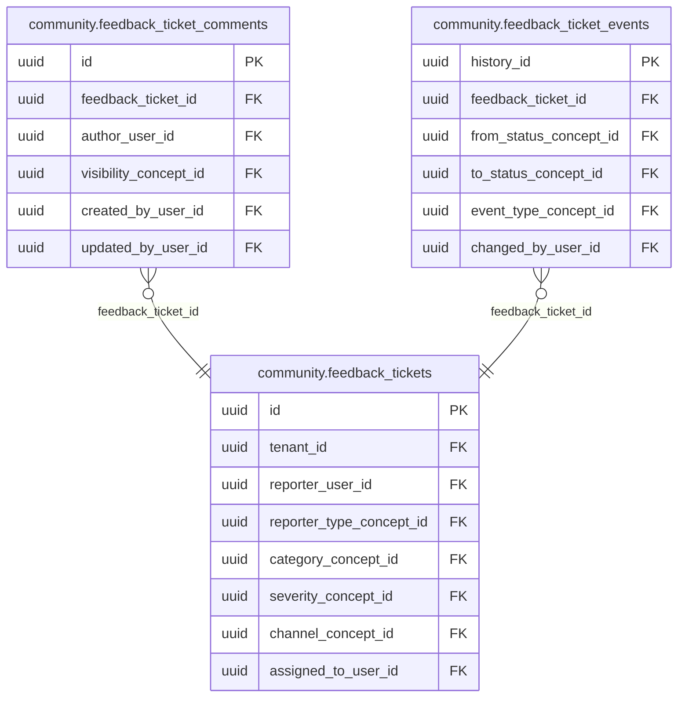

<!-- AUTOGENERADO por tools/inventario/catalogo.mjs. No editar manualmente. -->

# Catálogo del schema `community`

- **Tablas:** 44 · **Columnas:** 569 (161 con descripción: 28.3 %) · **Índices:** 288
- **Dominio:** Marketing y Crecimiento
- Método y límites del catálogo: [README del inventario](../README.md)

## Tablas

| Tabla | Propósito | Columnas | Índices | Operaciones | ORM |
|---|---|---|---|---|---|
| [bookmarks](#bookmarks) | Permite a usuarios guardar contenido comunitario para consultarlo después. | 10 | 4 | 5 | COINCIDE |
| [chat_auto_replies](#chat_auto_replies) | Guarda la respuesta automática asociada a un perfil público para atender mensajes entrantes y orientar la interacción en la comunidad de profesionales de salud. | 15 | 4 | 4 | COINCIDE |
| [comment_media](#comment_media) | Vincula archivos multimedia con comentarios de la comunidad, para adjuntar evidencia o material contextual a una conversación sin mezclarlo con la historia clínica. | 8 | 4 | 6 | COINCIDE |
| [comments](#comments) | Almacena comentarios sobre publicaciones o conversaciones comunitarias para habilitar diálogo público. | 20 | 11 | 23 | COINCIDE |
| [content_hashtags](#content_hashtags) | Asocia etiquetas a contenidos para habilitar clasificación y búsqueda temática. | 9 | 4 | 2 | COINCIDE |
| [content_reports](#content_reports) | Registra reportes de contenido para solicitar evaluación de publicaciones potencialmente inadecuadas. | 11 | 5 | 4 | COINCIDE |
| [conversation_assignments](#conversation_assignments) | Asigna cada conversación de mensajes a un profesional y a quien del equipo de apoyo la tomó, con su estado y su plazo de respuesta. | 12 | 8 | 0 | SIN_ENTIDAD |
| [conversation_internal_notes](#conversation_internal_notes) | Guarda las notas internas del equipo sobre una conversación, que el paciente nunca ve. | 6 | 3 | 0 | SIN_ENTIDAD |
| [conversation_participants](#conversation_participants) | Relaciona usuarios con conversaciones para controlar participantes y acceso a mensajes. | 17 | 8 | 46 | COINCIDE |
| [conversations](#conversations) | Representa conversaciones comunitarias entre usuarios para habilitar comunicación fuera del expediente clínico. | 13 | 8 | 44 | COINCIDE |
| [direct_messages](#direct_messages) | Conserva mensajes directos entre usuarios para la comunicación privada del producto, separados de las notas clínicas. | 20 | 12 | 13 | DIVERGE |
| [feed_items](#feed_items) | Compone elementos del feed para presentar publicaciones relevantes a cada usuario. | 15 | 6 | 6 | COINCIDE |
| [feedback_ticket_comments](#feedback_ticket_comments) | Conserva intercambios y observaciones asociados a tickets de feedback para documentar su atención. | 11 | 3 | 0 | COINCIDE |
| [feedback_ticket_events](#feedback_ticket_events) | Mantiene eventos de cambio de tickets para reconstruir su ciclo de vida y resolución. | 9 | 4 | 0 | COINCIDE |
| [feedback_tickets](#feedback_tickets) | Gestiona tickets de comentarios o soporte generados por participantes del producto comunitario. | 23 | 7 | 0 | COINCIDE |
| [group_members](#group_members) | Asocia usuarios a grupos para administrar membresía, participación y alcance de contenidos. | 12 | 7 | 12 | COINCIDE |
| [groups](#groups) | Representa grupos comunitarios que reúnen usuarios alrededor de intereses o áreas de salud. | 18 | 12 | 12 | COINCIDE |
| [hashtags](#hashtags) | Cataloga etiquetas temáticas que organizan y hacen descubrible contenido comunitario. | 11 | 5 | 4 | COINCIDE |
| [mentions](#mentions) | Relaciona usuarios mencionados en publicaciones o comentarios para facilitar notificaciones y navegación. | 12 | 5 | 3 | COINCIDE |
| [message_receipts](#message_receipts) | Registra estados de recepción o lectura de mensajes directos para dar seguimiento a su entrega. | 7 | 5 | 3 | COINCIDE |
| [moderation_appeals](#moderation_appeals) | Gestiona apelaciones de usuarios a decisiones de moderación para habilitar revisión y resolución. | 13 | 7 | 6 | COINCIDE |
| [moderation_decisions](#moderation_decisions) | Preserva decisiones de moderación para explicar acciones tomadas sobre contenido o usuarios. | 13 | 7 | 6 | COINCIDE |
| [moderation_queue](#moderation_queue) | Encola contenido que requiere revisión para aplicar normas de participación y seguridad comunitaria. | 16 | 10 | 9 | COINCIDE |
| [moderation_strikes](#moderation_strikes) | Cuenta infracciones atribuidas a usuarios para aplicar medidas progresivas de moderación. | 12 | 6 | 3 | COINCIDE |
| [party_ratings](#party_ratings) | Registra valoraciones entre pacientes, profesionales y prácticas; el vínculo opcional con un encuentro verificado permite respaldar reputación con una interacción asistencial real. | 17 | 12 | 6 | COINCIDE |
| [poll_options](#poll_options) | Define opciones disponibles para responder una encuesta comunitaria. | 10 | 3 | 4 | COINCIDE |
| [poll_votes](#poll_votes) | Registra votos emitidos en encuestas para resumir participación comunitaria. | 9 | 5 | 3 | COINCIDE |
| [polls](#polls) | Representa encuestas comunitarias para recopilar respuestas no clínicas dentro de la interacción social. | 12 | 4 | 4 | COINCIDE |
| [post_media](#post_media) | Vincula imágenes u otros medios con publicaciones comunitarias para mantenerlas separadas de archivos clínicos. | 8 | 4 | 10 | COINCIDE |
| [post_shares](#post_shares) | Registra compartidos de publicaciones para conocer cómo circula contenido público entre usuarios. | 11 | 6 | 0 | COINCIDE |
| [prestige_awards](#prestige_awards) | Registra reconocimientos otorgados a perfiles para comunicar logros o contribuciones comunitarias. | 17 | 6 | 0 | COINCIDE |
| [prestige_scores](#prestige_scores) | Mantiene puntajes de reputación o participación asociados a perfiles según reglas del producto. | 16 | 4 | 2 | COINCIDE |
| [public_profiles](#public_profiles) | Publica perfiles de descubrimiento y reputación de prestadores sanitarios, separados del expediente clínico. | 20 | 12 | 193 | COINCIDE |
| [reactions](#reactions) | Registra reacciones de usuarios a contenido comunitario para expresar interacción social. | 10 | 6 | 16 | COINCIDE |
| [reply_templates](#reply_templates) | Conserva respuestas rápidas de una organización o de un profesional para que el equipo conteste mensajes administrativos con textos acordados. | 12 | 6 | 0 | SIN_ENTIDAD |
| [review_dimension_scores](#review_dimension_scores) | Desglosa puntuaciones de reseñas por dimensión para resumir la experiencia de atención. | 5 | 2 | 4 | COINCIDE |
| [review_responses](#review_responses) | Conserva respuestas de prestadores a reseñas para sostener interacción y gestión de reputación. | 11 | 5 | 4 | COINCIDE |
| [service_reviews](#service_reviews) | Registra reseñas sobre prestadores y servicios, con verificación de experiencia cuando corresponde y sin publicar identificadores de encuentros. | 18 | 13 | 25 | DIVERGE |
| [social_follows](#social_follows) | Relaciona usuarios que siguen perfiles para personalizar descubrimiento y actualizaciones públicas. | 11 | 7 | 17 | COINCIDE |
| [social_notifications](#social_notifications) | Genera avisos sobre interacciones sociales para que usuarios conozcan menciones, respuestas o actividad relevante. | 16 | 8 | 1 | COINCIDE |
| [social_posts](#social_posts) | Conserva publicaciones públicas de profesionales y organizaciones para informar y facilitar su descubrimiento, sin incorporarlas a la historia clínica. | 16 | 10 | 24 | COINCIDE |
| [topics](#topics) | Define temas comunitarios para clasificar contenido y espacios de conversación. | 12 | 7 | 2 | COINCIDE |
| [user_blocks](#user_blocks) | Registra bloqueos entre usuarios para controlar interacciones y seguridad en espacios comunitarios. | 10 | 6 | 36 | COINCIDE |
| [verified_badges](#verified_badges) | Representa insignias de verificación pública para indicar atributos revisados de perfiles sanitarios. | 15 | 7 | 56 | COINCIDE |

## Diagrama entidad-relación

Las tablas se agrupan en familias por sus claves foráneas dentro del schema (máximo 40 por diagrama). Las FK hacia otros schemas se listan en la ficha de cada tabla.

### Familia 1 de 2 — 38 tablas

```mermaid
erDiagram
  community_bookmarks["community.bookmarks"] {
    uuid id PK
    uuid profile_id FK
    uuid bookmarkable_type_concept_id FK
    uuid created_by_user_id FK
    uuid updated_by_user_id FK
  }
  community_public_profiles["community.public_profiles"] {
    uuid id PK
    uuid tenant_id FK
    uuid target_type_concept_id FK
    uuid avatar_file_id FK
    uuid cover_file_id FK
    uuid verification_status_concept_id FK
    uuid visibility_concept_id FK
    uuid status_concept_id FK
  }
  community_chat_auto_replies["community.chat_auto_replies"] {
    uuid id PK
    uuid public_profile_id FK
    uuid status_concept_id FK
    uuid created_by_user_id FK
    uuid updated_by_user_id FK
  }
  community_comments["community.comments"] {
    uuid id PK
    uuid tenant_id FK
    uuid author_profile_id FK
    uuid commentable_type_concept_id FK
    uuid parent_comment_id FK
    uuid root_comment_id FK
    uuid status_concept_id FK
    uuid created_by_user_id FK
  }
  community_conversation_participants["community.conversation_participants"] {
    uuid id PK
    uuid conversation_id FK
    uuid participant_profile_id FK
    uuid role_concept_id FK
    uuid last_read_message_id FK
    uuid status_concept_id FK
    uuid created_by_user_id FK
    uuid updated_by_user_id FK
  }
  community_direct_messages["community.direct_messages"] {
    uuid id PK
    uuid conversation_id FK
    uuid sender_profile_id FK
    uuid reply_to_message_id FK
    uuid content_type_concept_id FK
    uuid attachment_file_id FK
    uuid status_concept_id FK
    uuid created_by_user_id FK
  }
  community_feed_items["community.feed_items"] {
    uuid id PK
    uuid owner_profile_id FK
    uuid item_type_concept_id FK
    uuid source_type_concept_id FK
    uuid origin_concept_id FK
    uuid created_by_user_id FK
    uuid updated_by_user_id FK
  }
  community_group_members["community.group_members"] {
    uuid id PK
    uuid group_id FK
    uuid member_profile_id FK
    uuid member_role_concept_id FK
    uuid join_status_concept_id FK
    uuid invited_by_profile_id FK
    uuid created_by_user_id FK
    uuid updated_by_user_id FK
  }
  community_groups["community.groups"] {
    uuid id PK
    uuid tenant_id FK
    uuid visibility_concept_id FK
    uuid group_type_concept_id FK
    uuid topic_id FK
    uuid owner_profile_id FK
    uuid cover_file_id FK
    uuid status_concept_id FK
  }
  community_mentions["community.mentions"] {
    uuid id PK
    uuid source_type_concept_id FK
    uuid mentioned_profile_id FK
    uuid status_concept_id FK
    uuid created_by_user_id FK
    uuid updated_by_user_id FK
  }
  community_message_receipts["community.message_receipts"] {
    uuid id PK
    uuid direct_message_id FK
    uuid recipient_profile_id FK
    uuid receipt_type_concept_id FK
    uuid recorded_by_user_id FK
  }
  community_moderation_appeals["community.moderation_appeals"] {
    uuid id PK
    uuid moderation_decision_id FK
    uuid appellant_profile_id FK
    uuid status_concept_id FK
    uuid reviewed_by_user_id FK
    uuid resolution_concept_id FK
    uuid created_by_user_id FK
    uuid updated_by_user_id FK
  }
  community_moderation_strikes["community.moderation_strikes"] {
    uuid id PK
    uuid subject_profile_id FK
    uuid moderation_decision_id FK
    uuid severity_concept_id FK
    uuid status_concept_id FK
    uuid created_by_user_id FK
    uuid updated_by_user_id FK
  }
  community_poll_votes["community.poll_votes"] {
    uuid id PK
    uuid poll_id FK
    uuid poll_option_id FK
    uuid voter_profile_id FK
    uuid created_by_user_id FK
    uuid updated_by_user_id FK
  }
  community_post_shares["community.post_shares"] {
    uuid id PK
    uuid post_id FK
    uuid sharer_profile_id FK
    uuid share_type_concept_id FK
    uuid target_group_id FK
    uuid created_by_user_id FK
    uuid updated_by_user_id FK
  }
  community_prestige_awards["community.prestige_awards"] {
    uuid id PK
    uuid tenant_id FK
    uuid subject_type_concept_id FK
    uuid public_profile_id FK
    uuid direction_concept_id FK
    uuid reason_concept_id FK
    uuid awarded_by_user_id FK
    uuid recorded_by_user_id FK
  }
  community_prestige_scores["community.prestige_scores"] {
    uuid id PK
    uuid tenant_id FK
    uuid subject_type_concept_id FK
    uuid public_profile_id FK
    uuid level_concept_id FK
    uuid last_award_id FK
    uuid status_concept_id FK
    uuid created_by_user_id FK
  }
  community_reactions["community.reactions"] {
    uuid id PK
    uuid actor_profile_id FK
    uuid reactable_type_concept_id FK
    uuid reaction_type_concept_id FK
    uuid created_by_user_id FK
    uuid updated_by_user_id FK
  }
  community_review_responses["community.review_responses"] {
    uuid id PK
    uuid review_id FK
    uuid responder_public_profile_id FK
    uuid moderation_status_concept_id FK
    uuid created_by_user_id FK
    uuid updated_by_user_id FK
  }
  community_service_reviews["community.service_reviews"] {
    uuid id PK
    uuid target_public_profile_id FK
    uuid reviewer_patient_profile_id FK
    uuid verified_encounter_id FK
    uuid reviewer_display_mode_concept_id FK
    uuid verification_status_concept_id FK
    uuid moderation_status_concept_id FK
    uuid publication_status_concept_id FK
  }
  community_social_follows["community.social_follows"] {
    uuid id PK
    uuid follower_profile_id FK
    uuid followable_type_concept_id FK
    uuid status_concept_id FK
    uuid notification_level_concept_id FK
    uuid created_by_user_id FK
    uuid updated_by_user_id FK
  }
  community_social_notifications["community.social_notifications"] {
    uuid id PK
    uuid recipient_profile_id FK
    uuid notification_type_concept_id FK
    uuid actor_profile_id FK
    uuid source_type_concept_id FK
    uuid notification_request_id FK
    uuid status_concept_id FK
    uuid created_by_user_id FK
  }
  community_social_posts["community.social_posts"] {
    uuid id PK
    uuid author_public_profile_id FK
    uuid post_type_concept_id FK
    uuid visibility_concept_id FK
    uuid health_data_screening_status_concept_id FK
    uuid moderation_status_concept_id FK
    uuid publication_status_concept_id FK
    uuid created_by_user_id FK
  }
  community_user_blocks["community.user_blocks"] {
    uuid id PK
    uuid blocker_profile_id FK
    uuid blocked_profile_id FK
    uuid reason_concept_id FK
    uuid status_concept_id FK
    uuid created_by_user_id FK
    uuid updated_by_user_id FK
  }
  community_comment_media["community.comment_media"] {
    uuid id PK
    uuid comment_id FK
    uuid file_id FK
    uuid media_role_concept_id FK
    uuid created_by_user_id FK
  }
  community_conversations["community.conversations"] {
    uuid id PK
    uuid tenant_id FK
    uuid conversation_type_concept_id FK
    uuid group_id FK
    uuid pinned_message_id FK
    uuid status_concept_id FK
    uuid created_by_user_id FK
    uuid updated_by_user_id FK
  }
  community_topics["community.topics"] {
    uuid id PK
    uuid parent_topic_id FK
    uuid specialty_concept_id FK
    uuid status_concept_id FK
    uuid created_by_user_id FK
    uuid updated_by_user_id FK
  }
  community_moderation_decisions["community.moderation_decisions"] {
    uuid id PK
    uuid moderation_queue_id FK
    uuid decision_concept_id FK
    uuid policy_concept_id FK
    uuid action_taken_concept_id FK
    uuid decided_by_user_id FK
    uuid created_by_user_id FK
    uuid updated_by_user_id FK
  }
  community_poll_options["community.poll_options"] {
    uuid id PK
    uuid poll_id FK
    uuid created_by_user_id FK
    uuid updated_by_user_id FK
  }
  community_polls["community.polls"] {
    uuid id PK
    uuid post_id FK
    uuid status_concept_id FK
    uuid created_by_user_id FK
    uuid updated_by_user_id FK
  }
  community_review_dimension_scores["community.review_dimension_scores"] {
    uuid id PK
    uuid review_id FK
    uuid dimension_concept_id FK
  }
  community_post_media["community.post_media"] {
    uuid id PK
    uuid post_id FK
    uuid file_id FK
    uuid media_role_concept_id FK
    uuid created_by_user_id FK
  }
  community_conversation_assignments["community.conversation_assignments"] {
    uuid id PK
    uuid tenant_id FK
    uuid conversation_id FK
    uuid practitioner_profile_id FK
    uuid assigned_user_id FK
    uuid status_concept_id FK
    uuid created_by_user_id FK
    uuid updated_by_user_id FK
  }
  community_conversation_internal_notes["community.conversation_internal_notes"] {
    uuid id PK
    uuid tenant_id FK
    uuid conversation_id FK
    uuid author_user_id FK
  }
  community_hashtags["community.hashtags"] {
    uuid id PK
    uuid topic_id FK
    uuid status_concept_id FK
    uuid created_by_user_id FK
    uuid updated_by_user_id FK
  }
  community_moderation_queue["community.moderation_queue"] {
    uuid id PK
    uuid tenant_id FK
    uuid content_type_concept_id FK
    uuid source_concept_id FK
    uuid content_report_id FK
    uuid priority_concept_id FK
    uuid assigned_to_user_id FK
    uuid status_concept_id FK
  }
  community_content_hashtags["community.content_hashtags"] {
    uuid id PK
    uuid hashtag_id FK
    uuid content_type_concept_id FK
    uuid created_by_user_id FK
    uuid updated_by_user_id FK
  }
  community_content_reports["community.content_reports"] {
    uuid id PK
    uuid reporter_user_id FK
    uuid target_type_concept_id FK
    uuid reason_concept_id FK
    uuid status_concept_id FK
    uuid assigned_moderator_user_id FK
  }
  community_bookmarks }o--|| community_public_profiles : "profile_id"
  community_chat_auto_replies }o--|| community_public_profiles : "public_profile_id"
  community_comments }o--|| community_public_profiles : "author_profile_id"
  community_conversation_participants }o--|| community_conversations : "conversation_id"
  community_conversation_participants }o--|| community_public_profiles : "participant_profile_id"
  community_conversation_participants }o--o| community_direct_messages : "last_read_message_id"
  community_direct_messages }o--|| community_conversations : "conversation_id"
  community_direct_messages }o--|| community_public_profiles : "sender_profile_id"
  community_feed_items }o--|| community_public_profiles : "owner_profile_id"
  community_group_members }o--|| community_groups : "group_id"
  community_group_members }o--|| community_public_profiles : "member_profile_id"
  community_group_members }o--o| community_public_profiles : "invited_by_profile_id"
  community_groups }o--o| community_topics : "topic_id"
  community_groups }o--o| community_public_profiles : "owner_profile_id"
  community_mentions }o--|| community_public_profiles : "mentioned_profile_id"
  community_message_receipts }o--|| community_direct_messages : "direct_message_id"
  community_message_receipts }o--|| community_public_profiles : "recipient_profile_id"
  community_moderation_appeals }o--|| community_moderation_decisions : "moderation_decision_id"
  community_moderation_appeals }o--|| community_public_profiles : "appellant_profile_id"
  community_moderation_strikes }o--|| community_public_profiles : "subject_profile_id"
  community_moderation_strikes }o--|| community_moderation_decisions : "moderation_decision_id"
  community_poll_votes }o--|| community_polls : "poll_id"
  community_poll_votes }o--|| community_poll_options : "poll_option_id"
  community_poll_votes }o--|| community_public_profiles : "voter_profile_id"
  community_post_shares }o--|| community_social_posts : "post_id"
  community_post_shares }o--|| community_public_profiles : "sharer_profile_id"
  community_post_shares }o--o| community_groups : "target_group_id"
  community_prestige_awards }o--o| community_public_profiles : "public_profile_id"
  community_prestige_scores }o--o| community_public_profiles : "public_profile_id"
  community_prestige_scores }o--o| community_prestige_awards : "last_award_id"
  community_reactions }o--|| community_public_profiles : "actor_profile_id"
  community_review_responses }o--|| community_service_reviews : "review_id"
  community_review_responses }o--|| community_public_profiles : "responder_public_profile_id"
  community_service_reviews }o--|| community_public_profiles : "target_public_profile_id"
  community_social_follows }o--|| community_public_profiles : "follower_profile_id"
  community_social_notifications }o--|| community_public_profiles : "recipient_profile_id"
  community_social_notifications }o--o| community_public_profiles : "actor_profile_id"
  community_social_posts }o--|| community_public_profiles : "author_public_profile_id"
  community_user_blocks }o--|| community_public_profiles : "blocker_profile_id"
  community_user_blocks }o--|| community_public_profiles : "blocked_profile_id"
  community_comment_media }o--|| community_comments : "comment_id"
  community_conversations }o--o| community_groups : "group_id"
  community_conversations }o--o| community_direct_messages : "pinned_message_id"
  community_moderation_decisions }o--|| community_moderation_queue : "moderation_queue_id"
  community_poll_options }o--|| community_polls : "poll_id"
  community_polls }o--|| community_social_posts : "post_id"
  community_review_dimension_scores }o--|| community_service_reviews : "review_id"
  community_post_media }o--|| community_social_posts : "post_id"
  community_conversation_assignments }o--|| community_conversations : "conversation_id"
  community_conversation_internal_notes }o--|| community_conversations : "conversation_id"
  community_hashtags }o--o| community_topics : "topic_id"
  community_moderation_queue }o--o| community_content_reports : "content_report_id"
  community_content_hashtags }o--|| community_hashtags : "hashtag_id"
```

### Familia 2 de 2 — 3 tablas

### Tablas sin relaciones dentro del schema

`community.party_ratings` · `community.reply_templates` · `community.verified_badges`

## Fichas

### bookmarks

#### Vista general

Permite a usuarios guardar contenido comunitario para consultarlo después.

- **Estado del propósito:** DOMAIN_CURATED_DRAFT · fuente: `Mantra Core Health Context/modules/diagram_19_community.puml: bookmarks`
- **Dominio:** Marketing y Crecimiento · **Diagrama:** `Mantra Core Health Context/modules/diagram_19_community.puml` · **DDL:** `SQL/19_community/02_tables.sql`
- **Entidad del ORM:** `Bookmarks` — `src/modules/community/entities/bookmarks.entity.ts`
- **Resumen:** 10 columnas · 4 índices · 4 FK salientes · 0 entrantes · 5 operaciones

#### Columnas

| # | Columna | Tipo | Rol estructural | Descripción | ORM |
|---|---|---|---|---|---|
| 1 | `id` | `uuid` | Clave primaria; Obligatoria | Identificador único de la instancia. _(JSDOC_ESTANDAR, `src/modules/community/entities/bookmarks.entity.ts:12`)_ | coincide |
| 2 | `profile_id` | `uuid` | Clave foránea → community.public_profiles.id; Obligatoria | _sin dato_ | coincide |
| 3 | `bookmarkable_type_concept_id` | `uuid` | Clave foránea → terminology.catalog_concepts.id; Obligatoria | _sin dato_ | coincide |
| 4 | `bookmarkable_ref_id` | `uuid` | Obligatoria | _sin dato_ | coincide |
| 5 | `collection_name` | `varchar` | Opcional | _sin dato_ | coincide |
| 6 | `created_at` | `timestamptz` | Obligatoria | Fecha y hora en que se creó el registro. _(JSDOC_ESTANDAR, `src/modules/community/entities/bookmarks.entity.ts:46`)_ | coincide |
| 7 | `updated_at` | `timestamptz` | Obligatoria | Fecha y hora de la última actualización. _(JSDOC_ESTANDAR, `src/modules/community/entities/bookmarks.entity.ts:52`)_ | coincide |
| 8 | `created_by_user_id` | `uuid` | Clave foránea → iam.users.id; Opcional | _sin dato_ | coincide |
| 9 | `updated_by_user_id` | `uuid` | Clave foránea → iam.users.id; Opcional | _sin dato_ | coincide |
| 10 | `row_version` | `integer = 1` | Obligatoria | Versión usada para controlar actualizaciones concurrentes. _(JSDOC_ENTIDAD, `src/modules/community/entities/bookmarks.entity.ts:70`)_ | coincide |

#### Relaciones

| Sentido | Columnas | Tabla | Restricción |
|---|---|---|---|
| hacia | profile_id | community.public_profiles (id) | fk_bookmarks_profile_id |
| hacia | bookmarkable_type_concept_id | terminology.catalog_concepts (id) | fk_bookmarks_bookmarkable_type_concept_id |
| hacia | created_by_user_id | iam.users (id) | fk_bookmarks_created_by_user_id |
| hacia | updated_by_user_id | iam.users (id) | fk_bookmarks_updated_by_user_id |

#### Índices

| Índice | Único | Columnas | Para qué |
|---|---|---|---|
| `ix_bookmarks_profile_id` | no | profile_id | Soporta la clave foránea fk_bookmarks_profile_id: PostgreSQL no indexa las FK por sí mismo _(DOCUMENTO)_; 2 consulta(s) de repositorio filtran u ordenan por «profile_id», la primera columna del índice _(CONSULTA)_ |
| `ix_bookmarks_bookmarkable_type_concept_id` | no | bookmarkable_type_concept_id | Soporta la clave foránea fk_bookmarks_bookmarkable_type_concept_id: PostgreSQL no indexa las FK por sí mismo _(DOCUMENTO)_; 1 consulta(s) de repositorio filtran u ordenan por «bookmarkable_type_concept_id», la primera columna del índice _(CONSULTA)_ |
| `ix_bookmarks_created_by_user_id` | no | created_by_user_id | Soporta la clave foránea fk_bookmarks_created_by_user_id: PostgreSQL no indexa las FK por sí mismo _(DOCUMENTO)_ |
| `ix_bookmarks_updated_by_user_id` | no | updated_by_user_id | Soporta la clave foránea fk_bookmarks_updated_by_user_id: PostgreSQL no indexa las FK por sí mismo _(DOCUMENTO)_ |

#### Operaciones que la tocan

| Operación | Efecto | Confianza |
|---|---|---|
| DELETE /community/bookmarks | BORRA | POR_TIPO |
| DELETE /community/bookmarks | LEE | DIRECTA |
| GET /community/bookmarks | LEE | DIRECTA |
| POST /community/bookmarks | CREA | DIRECTA |
| POST /community/bookmarks | LEE | DIRECTA |

#### Gobierno

| Atributo | Valor | Fuente |
|---|---|---|
| Append-only | no declarado | — |
| Datos personales | sin fuente | — |
| Financiera | sin fuente | — |
| Crítica para auditoría | sin fuente | — |
| Retención | sin fuente | — |
| Responsable | sin fuente | — |
| Revisión | AUTO_DETECTADA | — |

---

### chat_auto_replies

#### Vista general

Guarda la respuesta automática asociada a un perfil público para atender mensajes entrantes y orientar la interacción en la comunidad de profesionales de salud.

- **Estado del propósito:** DOMAIN_CURATED_DRAFT · fuente: `Mantra Core Health Context/modules/diagram_19_community.puml:594: entity chat_auto_replies {`
- **Dominio:** Marketing y Crecimiento · **Diagrama:** `Mantra Core Health Context/modules/diagram_19_community.puml` · **DDL:** `SQL/19_community/02_tables.sql`
- **Entidad del ORM:** `ChatAutoReplies` — `src/modules/community/entities/chat_auto_replies.entity.ts`
- **Resumen:** 15 columnas · 4 índices · 4 FK salientes · 0 entrantes · 4 operaciones

#### Columnas

| # | Columna | Tipo | Rol estructural | Descripción | ORM |
|---|---|---|---|---|---|
| 1 | `id` | `uuid` | Clave primaria; Obligatoria | Identificador único de la instancia. _(JSDOC_ESTANDAR, `src/modules/community/entities/chat_auto_replies.entity.ts:17`)_ | coincide |
| 2 | `public_profile_id` | `uuid` | Clave foránea → community.public_profiles.id; Obligatoria | De quién es esta configuración. _(JSDOC_ENTIDAD, `src/modules/community/entities/chat_auto_replies.entity.ts:23`)_ | coincide |
| 3 | `is_active` | `boolean` | Obligatoria | Si contestar solo. Apagada, nada de lo demás importa. _(JSDOC_ENTIDAD, `src/modules/community/entities/chat_auto_replies.entity.ts:27`)_ | coincide |
| 4 | `inactivity_minutes` | `integer` | Obligatoria | Cuántos minutos sin actividad del titular hacen falta para contestar solo. _(JSDOC_ENTIDAD, `src/modules/community/entities/chat_auto_replies.entity.ts:33`)_ | coincide |
| 5 | `body_text` | `text` | Obligatoria | Lo que se contesta. _(JSDOC_ENTIDAD, `src/modules/community/entities/chat_auto_replies.entity.ts:37`)_ | coincide |
| 6 | `cooldown_hours` | `integer` | Obligatoria | Cuántas horas esperar antes de volver a avisarle a la misma conversación. _(JSDOC_ENTIDAD, `src/modules/community/entities/chat_auto_replies.entity.ts:43`)_ | coincide |
| 7 | `only_outside_business_hours` | `boolean` | Obligatoria | Si sólo contestar fuera de la franja declarada abajo. _(JSDOC_ENTIDAD, `src/modules/community/entities/chat_auto_replies.entity.ts:47`)_ | coincide |
| 8 | `business_hours_from` | `time` | Opcional | Desde qué hora atiende, `HH:MM`. `columnType: 'time'` y no una fecha: es una hora del día, sin día ni zona. Viaja como texto, que es lo que devuelve Postgres para `time`. _(JSDOC_ENTIDAD, `src/modules/community/entities/chat_auto_replies.entity.ts:56`)_ | coincide |
| 9 | `business_hours_to` | `time` | Opcional | Hasta qué hora atiende, `HH:MM`. **Puede ser menor que `businessHoursFrom`**: eso significa que la franja cruza la medianoche, que es el turno noche y no un error. _(JSDOC_ENTIDAD, `src/modules/community/entities/chat_auto_replies.entity.ts:69`)_ | coincide |
| 10 | `status_concept_id` | `uuid` | Clave foránea → terminology.catalog_concepts.id; Obligatoria | _sin dato_ | coincide |
| 11 | `created_at` | `timestamptz` | Obligatoria | Fecha y hora en que se creó el registro. _(JSDOC_ESTANDAR, `src/modules/community/entities/chat_auto_replies.entity.ts:85`)_ | coincide |
| 12 | `updated_at` | `timestamptz` | Obligatoria | Fecha y hora de la última actualización. _(JSDOC_ESTANDAR, `src/modules/community/entities/chat_auto_replies.entity.ts:91`)_ | coincide |
| 13 | `created_by_user_id` | `uuid` | Clave foránea → iam.users.id; Opcional | _sin dato_ | coincide |
| 14 | `updated_by_user_id` | `uuid` | Clave foránea → iam.users.id; Opcional | _sin dato_ | coincide |
| 15 | `row_version` | `integer = 1` | Obligatoria | Versión usada para controlar actualizaciones concurrentes. _(JSDOC_ENTIDAD, `src/modules/community/entities/chat_auto_replies.entity.ts:109`)_ | coincide |

#### Relaciones

| Sentido | Columnas | Tabla | Restricción |
|---|---|---|---|
| hacia | public_profile_id | community.public_profiles (id) | fk_chat_auto_replies_public_profile_id |
| hacia | status_concept_id | terminology.catalog_concepts (id) | fk_chat_auto_replies_status_concept_id |
| hacia | created_by_user_id | iam.users (id) | fk_chat_auto_replies_created_by_user_id |
| hacia | updated_by_user_id | iam.users (id) | fk_chat_auto_replies_updated_by_user_id |

#### Índices

| Índice | Único | Columnas | Para qué |
|---|---|---|---|
| `ux_chat_auto_replies_public_profile_id` | sí | public_profile_id | Garantiza que no se repita la combinación (public_profile_id) _(DOCUMENTO)_; Soporta la clave foránea fk_chat_auto_replies_public_profile_id: PostgreSQL no indexa las FK por sí mismo _(DOCUMENTO)_; 3 consulta(s) de repositorio filtran u ordenan por «public_profile_id», la primera columna del índice _(CONSULTA)_ |
| `ix_chat_auto_replies_status_concept_id` | no | status_concept_id | Soporta la clave foránea fk_chat_auto_replies_status_concept_id: PostgreSQL no indexa las FK por sí mismo _(DOCUMENTO)_ |
| `ix_chat_auto_replies_created_by_user_id` | no | created_by_user_id | Soporta la clave foránea fk_chat_auto_replies_created_by_user_id: PostgreSQL no indexa las FK por sí mismo _(DOCUMENTO)_ |
| `ix_chat_auto_replies_updated_by_user_id` | no | updated_by_user_id | Soporta la clave foránea fk_chat_auto_replies_updated_by_user_id: PostgreSQL no indexa las FK por sí mismo _(DOCUMENTO)_ |

#### Restricciones

| Restricción | Tipo | Definición |
|---|---|---|
| `ux_chat_auto_replies_public_profile_id` | UNIQUE INDEX | UNIQUE INDEX ("public_profile_id") |

#### Operaciones que la tocan

| Operación | Efecto | Confianza |
|---|---|---|
| POST /community/conversations/{conversationId}/messages | LEE | DIRECTA |
| GET /community/profiles/{profileId}/auto-reply | LEE | DIRECTA |
| PUT /community/profiles/{profileId}/auto-reply | LEE | DIRECTA |
| POST /scheduling/bookings/{id}/accept | LEE | DIRECTA |

#### Gobierno

| Atributo | Valor | Fuente |
|---|---|---|
| Append-only | no declarado | — |
| Datos personales | sin fuente | — |
| Financiera | sin fuente | — |
| Crítica para auditoría | sin fuente | — |
| Retención | sin fuente | — |
| Responsable | sin fuente | — |
| Revisión | AUTO_DETECTADA | — |

---

### comment_media

#### Vista general

Vincula archivos multimedia con comentarios de la comunidad, para adjuntar evidencia o material contextual a una conversación sin mezclarlo con la historia clínica.

- **Estado del propósito:** DOMAIN_CURATED_DRAFT · fuente: `Mantra Core Health Context/modules/diagram_19_community.puml:1511: entity comment_media {`
- **Dominio:** Marketing y Crecimiento · **Diagrama:** `Mantra Core Health Context/modules/diagram_19_community.puml` · **DDL:** `SQL/19_community/02_tables.sql`
- **Entidad del ORM:** `CommentMedia` — `src/modules/community/entities/comment_media.entity.ts`
- **Resumen:** 8 columnas · 4 índices · 4 FK salientes · 0 entrantes · 6 operaciones

#### Columnas

| # | Columna | Tipo | Rol estructural | Descripción | ORM |
|---|---|---|---|---|---|
| 1 | `id` | `uuid` | Clave primaria; Obligatoria | Identificador único de la instancia. _(JSDOC_ESTANDAR, `src/modules/community/entities/comment_media.entity.ts:14`)_ | coincide |
| 2 | `comment_id` | `uuid` | Clave foránea → community.comments.id; Obligatoria | _sin dato_ | coincide |
| 3 | `file_id` | `uuid` | Clave foránea → common.files.id; Obligatoria | _sin dato_ | coincide |
| 4 | `media_role_concept_id` | `uuid` | Clave foránea → terminology.catalog_concepts.id; Obligatoria | _sin dato_ | coincide |
| 5 | `alt_text` | `varchar` | Opcional | _sin dato_ | coincide |
| 6 | `ordinal` | `integer` | Opcional | _sin dato_ | coincide |
| 7 | `created_at` | `timestamptz` | Obligatoria | Fecha y hora en que se creó el registro. _(JSDOC_ESTANDAR, `src/modules/community/entities/comment_media.entity.ts:50`)_ | coincide |
| 8 | `created_by_user_id` | `uuid` | Clave foránea → iam.users.id; Opcional | _sin dato_ | coincide |

#### Relaciones

| Sentido | Columnas | Tabla | Restricción |
|---|---|---|---|
| hacia | comment_id | community.comments (id) | fk_comment_media_comment_id |
| hacia | file_id | common.files (id) | fk_comment_media_file_id |
| hacia | media_role_concept_id | terminology.catalog_concepts (id) | fk_comment_media_media_role_concept_id |
| hacia | created_by_user_id | iam.users (id) | fk_comment_media_created_by_user_id |

#### Índices

| Índice | Único | Columnas | Para qué |
|---|---|---|---|
| `ix_comment_media_comment_id` | no | comment_id | Soporta la clave foránea fk_comment_media_comment_id: PostgreSQL no indexa las FK por sí mismo _(DOCUMENTO)_; 1 consulta(s) de repositorio filtran u ordenan por «comment_id», la primera columna del índice _(CONSULTA)_ |
| `ix_comment_media_file_id` | no | file_id | Soporta la clave foránea fk_comment_media_file_id: PostgreSQL no indexa las FK por sí mismo _(DOCUMENTO)_; 1 consulta(s) de repositorio filtran u ordenan por «file_id», la primera columna del índice _(CONSULTA)_ |
| `ix_comment_media_media_role_concept_id` | no | media_role_concept_id | Soporta la clave foránea fk_comment_media_media_role_concept_id: PostgreSQL no indexa las FK por sí mismo _(DOCUMENTO)_ |
| `ix_comment_media_created_by_user_id` | no | created_by_user_id | Soporta la clave foránea fk_comment_media_created_by_user_id: PostgreSQL no indexa las FK por sí mismo _(DOCUMENTO)_ |

#### Operaciones que la tocan

| Operación | Efecto | Confianza |
|---|---|---|
| POST /community/comments | CREA | DIRECTA |
| GET /community/comments/media/{fileId}/content | LEE | DIRECTA |
| GET /community/posts/{postId}/comments | LEE | DIRECTA |
| GET /public/comments/{commentId}/replies | LEE | POR_SQL |
| GET /public/media/{id} | LEE | POR_SQL |
| GET /public/posts/{postId}/comments | LEE | POR_SQL |

#### Gobierno

| Atributo | Valor | Fuente |
|---|---|---|
| Append-only | no declarado | — |
| Datos personales | sin fuente | — |
| Financiera | sin fuente | — |
| Crítica para auditoría | sin fuente | — |
| Retención | sin fuente | — |
| Responsable | sin fuente | — |
| Revisión | AUTO_DETECTADA | — |

---

### comments

#### Vista general

Almacena comentarios sobre publicaciones o conversaciones comunitarias para habilitar diálogo público.

- **Estado del propósito:** DOMAIN_CURATED_DRAFT · fuente: `Mantra Core Health Context/modules/diagram_19_community.puml: comments`
- **Dominio:** Marketing y Crecimiento · **Diagrama:** `Mantra Core Health Context/modules/diagram_19_community.puml` · **DDL:** `SQL/19_community/02_tables.sql`
- **Entidad del ORM:** `Comments` — `src/modules/community/entities/comments.entity.ts`
- **Resumen:** 20 columnas · 11 índices · 8 FK salientes · 4 entrantes · 23 operaciones

#### Columnas

| # | Columna | Tipo | Rol estructural | Descripción | ORM |
|---|---|---|---|---|---|
| 1 | `id` | `uuid` | Clave primaria; Obligatoria | Identificador único de la instancia. _(JSDOC_ESTANDAR, `src/modules/community/entities/comments.entity.ts:12`)_ | coincide |
| 2 | `tenant_id` | `uuid` | Clave foránea → directory.tenants.id; Opcional | _sin dato_ | coincide |
| 3 | `author_profile_id` | `uuid` | Clave foránea → community.public_profiles.id; Obligatoria | _sin dato_ | coincide |
| 4 | `commentable_type_concept_id` | `uuid` | Clave foránea → terminology.catalog_concepts.id; Obligatoria | _sin dato_ | coincide |
| 5 | `commentable_ref_id` | `uuid` | Obligatoria | _sin dato_ | coincide |
| 6 | `parent_comment_id` | `uuid` | Clave foránea → community.comments.id; Opcional | _sin dato_ | coincide |
| 7 | `root_comment_id` | `uuid` | Clave foránea → community.comments.id; Opcional | _sin dato_ | coincide |
| 8 | `thread_depth` | `integer` | Opcional | _sin dato_ | coincide |
| 9 | `body_text` | `text` | Obligatoria | _sin dato_ | coincide |
| 10 | `body_richtext_json` | `jsonb` | Opcional | _sin dato_ | coincide |
| 11 | `reply_count` | `integer` | Opcional | _sin dato_ | coincide |
| 12 | `reaction_count` | `integer` | Opcional | _sin dato_ | coincide |
| 13 | `is_edited` | `boolean` | Opcional | _sin dato_ | coincide |
| 14 | `edited_at` | `timestamptz` | Opcional | _sin dato_ | coincide |
| 15 | `status_concept_id` | `uuid` | Clave foránea → terminology.catalog_concepts.id; Obligatoria | _sin dato_ | coincide |
| 16 | `created_at` | `timestamptz` | Obligatoria | Fecha y hora en que se creó el registro. _(JSDOC_ESTANDAR, `src/modules/community/entities/comments.entity.ts:111`)_ | coincide |
| 17 | `updated_at` | `timestamptz` | Obligatoria | Fecha y hora de la última actualización. _(JSDOC_ESTANDAR, `src/modules/community/entities/comments.entity.ts:117`)_ | coincide |
| 18 | `created_by_user_id` | `uuid` | Clave foránea → iam.users.id; Opcional | _sin dato_ | coincide |
| 19 | `updated_by_user_id` | `uuid` | Clave foránea → iam.users.id; Opcional | _sin dato_ | coincide |
| 20 | `row_version` | `integer = 1` | Obligatoria | Versión usada para controlar actualizaciones concurrentes. _(JSDOC_ENTIDAD, `src/modules/community/entities/comments.entity.ts:135`)_ | coincide |

#### Relaciones

| Sentido | Columnas | Tabla | Restricción |
|---|---|---|---|
| hacia | author_profile_id | community.public_profiles (id) | fk_comments_author_profile_id |
| hacia | parent_comment_id | community.comments (id) | fk_comments_parent_comment_id |
| hacia | root_comment_id | community.comments (id) | fk_comments_root_comment_id |
| hacia | tenant_id | directory.tenants (id) | fk_comments_tenant_id |
| hacia | commentable_type_concept_id | terminology.catalog_concepts (id) | fk_comments_commentable_type_concept_id |
| hacia | status_concept_id | terminology.catalog_concepts (id) | fk_comments_status_concept_id |
| hacia | created_by_user_id | iam.users (id) | fk_comments_created_by_user_id |
| hacia | updated_by_user_id | iam.users (id) | fk_comments_updated_by_user_id |
| desde | id | community.comments (parent_comment_id) | fk_comments_parent_comment_id |
| desde | id | community.comments (root_comment_id) | fk_comments_root_comment_id |
| desde | id | community.comment_media (comment_id) | fk_comment_media_comment_id |
| desde | id | audit.comments_history (comments_id) | fk_comments_history_comments_id |

#### Índices

| Índice | Único | Columnas | Para qué |
|---|---|---|---|
| `ix_comments_tenant_id` | no | tenant_id | Soporta la clave foránea fk_comments_tenant_id: PostgreSQL no indexa las FK por sí mismo _(DOCUMENTO)_ |
| `ix_comments_author_profile_id` | no | author_profile_id | Soporta la clave foránea fk_comments_author_profile_id: PostgreSQL no indexa las FK por sí mismo _(DOCUMENTO)_ |
| `ix_comments_commentable_type_concept_id` | no | commentable_type_concept_id | Soporta la clave foránea fk_comments_commentable_type_concept_id: PostgreSQL no indexa las FK por sí mismo _(DOCUMENTO)_; 1 consulta(s) de repositorio filtran u ordenan por «commentable_type_concept_id», la primera columna del índice _(CONSULTA)_ |
| `ix_comments_parent_comment_id` | no | parent_comment_id | Soporta la clave foránea fk_comments_parent_comment_id: PostgreSQL no indexa las FK por sí mismo _(DOCUMENTO)_; 2 consulta(s) de repositorio filtran u ordenan por «parent_comment_id», la primera columna del índice _(CONSULTA)_ |
| `ix_comments_root_comment_id` | no | root_comment_id | Soporta la clave foránea fk_comments_root_comment_id: PostgreSQL no indexa las FK por sí mismo _(DOCUMENTO)_; 1 consulta(s) de repositorio filtran u ordenan por «root_comment_id», la primera columna del índice _(CONSULTA)_ |
| `ix_comments_status_concept_id` | no | status_concept_id | Soporta la clave foránea fk_comments_status_concept_id: PostgreSQL no indexa las FK por sí mismo _(DOCUMENTO)_ |
| `ix_comments_created_by_user_id` | no | created_by_user_id | Soporta la clave foránea fk_comments_created_by_user_id: PostgreSQL no indexa las FK por sí mismo _(DOCUMENTO)_ |
| `ix_comments_updated_by_user_id` | no | updated_by_user_id | Soporta la clave foránea fk_comments_updated_by_user_id: PostgreSQL no indexa las FK por sí mismo _(DOCUMENTO)_ |
| `ix_comments_tenant_id_status_concept_id` | no | tenant_id, status_concept_id, ("updated_at" DESC) | _sin uso detectado estáticamente_ |
| `ix_comments_thread` | no | commentable_type_concept_id, commentable_ref_id, root_comment_id, created_at | Soporta la clave foránea fk_comments_commentable_type_concept_id: PostgreSQL no indexa las FK por sí mismo _(DOCUMENTO)_; 1 consulta(s) de repositorio filtran u ordenan por «commentable_type_concept_id», la primera columna del índice _(CONSULTA)_ |
| `gin_comments_search` | no | (to_tsvector('simple', (coalesce(body_text, '')))) | GIN para búsqueda textual gobernada _(DOCUMENTO)_ |

#### Operaciones que la tocan

| Operación | Efecto | Confianza |
|---|---|---|
| POST /community/comments | ACTUALIZA | POR_TIPO |
| POST /community/comments | CREA | DIRECTA |
| POST /community/comments | LEE | DIRECTA |
| GET /community/comments/media/{fileId}/content | LEE | DIRECTA |
| GET /community/feed | LEE | POR_SQL |
| GET /community/groups/{groupId}/posts | LEE | DIRECTA |
| POST /community/groups/{groupId}/posts | ACTUALIZA | POR_TIPO |
| POST /community/groups/{groupId}/posts | CREA | DIRECTA |
| POST /community/groups/{groupId}/posts | LEE | DIRECTA |
| GET /community/posts/{postId} | LEE | POR_SQL |
| GET /community/posts/{postId}/comments | LEE | DIRECTA |
| GET /community/profiles/{profileId}/posts | LEE | POR_SQL |
| GET /f/{slug} | LEE | POR_SQL |
| GET /internal/community/feed/ranking/pending | LEE | POR_SQL |
| GET /l/{slug} | LEE | POR_SQL |
| GET /o/{slug} | LEE | POR_SQL |
| GET /p/{slug} | LEE | POR_SQL |
| GET /public/comments/{commentId}/replies | LEE | POR_SQL |
| GET /public/media/{id} | LEE | POR_SQL |
| GET /public/posts | LEE | POR_SQL |
| GET /public/posts/{postId}/comments | LEE | POR_SQL |
| GET /public/profiles/{prefijo}/{slug} | LEE | POR_SQL |
| GET /s/{slug} | LEE | POR_SQL |

#### Gobierno

| Atributo | Valor | Fuente |
|---|---|---|
| Append-only | no declarado | — |
| Datos personales | sin fuente | — |
| Financiera | sin fuente | — |
| Crítica para auditoría | sin fuente | — |
| Retención | sin fuente | — |
| Responsable | sin fuente | — |
| Revisión | AUTO_DETECTADA | — |

---

### content_hashtags

#### Vista general

Asocia etiquetas a contenidos para habilitar clasificación y búsqueda temática.

- **Estado del propósito:** DOMAIN_CURATED_DRAFT · fuente: `Mantra Core Health Context/modules/diagram_19_community.puml: content_hashtags`
- **Dominio:** Marketing y Crecimiento · **Diagrama:** `Mantra Core Health Context/modules/diagram_19_community.puml` · **DDL:** `SQL/19_community/02_tables.sql`
- **Entidad del ORM:** `ContentHashtags` — `src/modules/community/entities/content_hashtags.entity.ts`
- **Resumen:** 9 columnas · 4 índices · 4 FK salientes · 0 entrantes · 2 operaciones

#### Columnas

| # | Columna | Tipo | Rol estructural | Descripción | ORM |
|---|---|---|---|---|---|
| 1 | `id` | `uuid` | Clave primaria; Obligatoria | Identificador único de la instancia. _(JSDOC_ESTANDAR, `src/modules/community/entities/content_hashtags.entity.ts:12`)_ | coincide |
| 2 | `hashtag_id` | `uuid` | Clave foránea → community.hashtags.id; Obligatoria | _sin dato_ | coincide |
| 3 | `content_type_concept_id` | `uuid` | Clave foránea → terminology.catalog_concepts.id; Obligatoria | _sin dato_ | coincide |
| 4 | `content_ref_id` | `uuid` | Obligatoria | _sin dato_ | coincide |
| 5 | `created_at` | `timestamptz` | Obligatoria | Fecha y hora en que se creó el registro. _(JSDOC_ESTANDAR, `src/modules/community/entities/content_hashtags.entity.ts:36`)_ | coincide |
| 6 | `updated_at` | `timestamptz` | Obligatoria | Fecha y hora de la última actualización. _(JSDOC_ESTANDAR, `src/modules/community/entities/content_hashtags.entity.ts:42`)_ | coincide |
| 7 | `created_by_user_id` | `uuid` | Clave foránea → iam.users.id; Opcional | _sin dato_ | coincide |
| 8 | `updated_by_user_id` | `uuid` | Clave foránea → iam.users.id; Opcional | _sin dato_ | coincide |
| 9 | `row_version` | `integer = 1` | Obligatoria | Versión usada para controlar actualizaciones concurrentes. _(JSDOC_ENTIDAD, `src/modules/community/entities/content_hashtags.entity.ts:60`)_ | coincide |

#### Relaciones

| Sentido | Columnas | Tabla | Restricción |
|---|---|---|---|
| hacia | hashtag_id | community.hashtags (id) | fk_content_hashtags_hashtag_id |
| hacia | content_type_concept_id | terminology.catalog_concepts (id) | fk_content_hashtags_content_type_concept_id |
| hacia | created_by_user_id | iam.users (id) | fk_content_hashtags_created_by_user_id |
| hacia | updated_by_user_id | iam.users (id) | fk_content_hashtags_updated_by_user_id |

#### Índices

| Índice | Único | Columnas | Para qué |
|---|---|---|---|
| `ix_content_hashtags_hashtag_id` | no | hashtag_id | Soporta la clave foránea fk_content_hashtags_hashtag_id: PostgreSQL no indexa las FK por sí mismo _(DOCUMENTO)_ |
| `ix_content_hashtags_content_type_concept_id` | no | content_type_concept_id | Soporta la clave foránea fk_content_hashtags_content_type_concept_id: PostgreSQL no indexa las FK por sí mismo _(DOCUMENTO)_; 1 consulta(s) de repositorio filtran u ordenan por «content_type_concept_id», la primera columna del índice _(CONSULTA)_ |
| `ix_content_hashtags_created_by_user_id` | no | created_by_user_id | Soporta la clave foránea fk_content_hashtags_created_by_user_id: PostgreSQL no indexa las FK por sí mismo _(DOCUMENTO)_ |
| `ix_content_hashtags_updated_by_user_id` | no | updated_by_user_id | Soporta la clave foránea fk_content_hashtags_updated_by_user_id: PostgreSQL no indexa las FK por sí mismo _(DOCUMENTO)_ |

#### Operaciones que la tocan

| Operación | Efecto | Confianza |
|---|---|---|
| GET /community/posts/{postId} | LEE | DIRECTA |
| POST /community/profiles/{profileId}/posts | CREA | DIRECTA |

#### Gobierno

| Atributo | Valor | Fuente |
|---|---|---|
| Append-only | no declarado | — |
| Datos personales | sin fuente | — |
| Financiera | sin fuente | — |
| Crítica para auditoría | sin fuente | — |
| Retención | sin fuente | — |
| Responsable | sin fuente | — |
| Revisión | AUTO_DETECTADA | — |

---

### content_reports

#### Vista general

Registra reportes de contenido para solicitar evaluación de publicaciones potencialmente inadecuadas.

- **Estado del propósito:** DOMAIN_CURATED_DRAFT · fuente: `Mantra Core Health Context/modules/diagram_19_community.puml: content_reports`
- **Dominio:** Marketing y Crecimiento · **Diagrama:** `Mantra Core Health Context/modules/diagram_19_community.puml` · **DDL:** `SQL/19_community/02_tables.sql`
- **Entidad del ORM:** `ContentReports` — `src/modules/community/entities/content_reports.entity.ts`
- **Resumen:** 11 columnas · 5 índices · 5 FK salientes · 1 entrantes · 4 operaciones

#### Columnas

| # | Columna | Tipo | Rol estructural | Descripción | ORM |
|---|---|---|---|---|---|
| 1 | `id` | `uuid` | Clave primaria; Obligatoria | Identificador único de la instancia. _(JSDOC_ESTANDAR, `src/modules/community/entities/content_reports.entity.ts:12`)_ | coincide |
| 2 | `reporter_user_id` | `uuid` | Clave foránea → iam.users.id; Obligatoria | _sin dato_ | coincide |
| 3 | `target_type_concept_id` | `uuid` | Clave foránea → terminology.catalog_concepts.id; Obligatoria | _sin dato_ | coincide |
| 4 | `target_id` | `uuid` | Obligatoria | _sin dato_ | coincide |
| 5 | `reason_concept_id` | `uuid` | Clave foránea → terminology.catalog_concepts.id; Obligatoria | _sin dato_ | coincide |
| 6 | `detail_text` | `text` | Opcional | _sin dato_ | coincide |
| 7 | `status_concept_id` | `uuid` | Clave foránea → terminology.catalog_concepts.id; Obligatoria | _sin dato_ | coincide |
| 8 | `assigned_moderator_user_id` | `uuid` | Clave foránea → iam.users.id; Opcional | _sin dato_ | coincide |
| 9 | `resolved_at` | `timestamptz` | Opcional | _sin dato_ | coincide |
| 10 | `created_at` | `timestamptz` | Obligatoria | Fecha y hora en que se creó el registro. _(JSDOC_ESTANDAR, `src/modules/community/entities/content_reports.entity.ts:74`)_ | coincide |
| 11 | `updated_at` | `timestamptz` | Obligatoria | Fecha y hora de la última actualización. _(JSDOC_ESTANDAR, `src/modules/community/entities/content_reports.entity.ts:80`)_ | coincide |

#### Relaciones

| Sentido | Columnas | Tabla | Restricción |
|---|---|---|---|
| hacia | reporter_user_id | iam.users (id) | fk_content_reports_reporter_user_id |
| hacia | target_type_concept_id | terminology.catalog_concepts (id) | fk_content_reports_target_type_concept_id |
| hacia | reason_concept_id | terminology.catalog_concepts (id) | fk_content_reports_reason_concept_id |
| hacia | status_concept_id | terminology.catalog_concepts (id) | fk_content_reports_status_concept_id |
| hacia | assigned_moderator_user_id | iam.users (id) | fk_content_reports_assigned_moderator_user_id |
| desde | id | community.moderation_queue (content_report_id) | fk_moderation_queue_content_report_id |

#### Índices

| Índice | Único | Columnas | Para qué |
|---|---|---|---|
| `ix_content_reports_reporter_user_id` | no | reporter_user_id | Soporta la clave foránea fk_content_reports_reporter_user_id: PostgreSQL no indexa las FK por sí mismo _(DOCUMENTO)_ |
| `ix_content_reports_target_type_concept_id` | no | target_type_concept_id | Soporta la clave foránea fk_content_reports_target_type_concept_id: PostgreSQL no indexa las FK por sí mismo _(DOCUMENTO)_ |
| `ix_content_reports_reason_concept_id` | no | reason_concept_id | Soporta la clave foránea fk_content_reports_reason_concept_id: PostgreSQL no indexa las FK por sí mismo _(DOCUMENTO)_ |
| `ix_content_reports_status_concept_id` | no | status_concept_id | Soporta la clave foránea fk_content_reports_status_concept_id: PostgreSQL no indexa las FK por sí mismo _(DOCUMENTO)_ |
| `ix_content_reports_assigned_moderator_user_id` | no | assigned_moderator_user_id | Soporta la clave foránea fk_content_reports_assigned_moderator_user_id: PostgreSQL no indexa las FK por sí mismo _(DOCUMENTO)_ |

#### Operaciones que la tocan

| Operación | Efecto | Confianza |
|---|---|---|
| GET /community/moderation/queue | LEE | DIRECTA |
| POST /community/moderation/queue/{queueId}/decision | ACTUALIZA | POR_TIPO |
| POST /community/moderation/queue/{queueId}/decision | LEE | DIRECTA |
| POST /community/reports | CREA | DIRECTA |

#### Gobierno

| Atributo | Valor | Fuente |
|---|---|---|
| Append-only | no declarado | — |
| Datos personales | sin fuente | — |
| Financiera | sin fuente | — |
| Crítica para auditoría | sin fuente | — |
| Retención | sin fuente | — |
| Responsable | sin fuente | — |
| Revisión | AUTO_DETECTADA | — |

---

### conversation_assignments

#### Vista general

Asigna cada conversación de mensajes a un profesional y a quien del equipo de apoyo la tomó, con su estado y su plazo de respuesta.

- **Estado del propósito:** DOMAIN_CURATED_DRAFT · fuente: `Mantra Core Health Context/modules/diagram_19_community.puml: conversation_assignments`
- **Dominio:** Marketing y Crecimiento · **Diagrama:** `Mantra Core Health Context/modules/diagram_19_community.puml` · **DDL:** `SQL/19_community/02_tables.sql`
- **Entidad del ORM:** **sin entidad** (deriva)
- **Resumen:** 12 columnas · 8 índices · 7 FK salientes · 0 entrantes · 0 operaciones

#### Columnas

| # | Columna | Tipo | Rol estructural | Descripción | ORM |
|---|---|---|---|---|---|
| 1 | `id` | `uuid` | Clave primaria; Obligatoria | _sin dato_ | **SIN_ENTIDAD** |
| 2 | `tenant_id` | `uuid` | Clave foránea → directory.tenants.id; Obligatoria | v4.2.76 (hardening): tenant_id ancla la asignacion a la ORGANIZACION cuyo equipo atiende la conversacion (conversations.tenant_id suele ser NULL). Si la conversacion SI trae tenant, deben coincidir (trigger integrity.trg_support_tenant_consistency). _(MODELO_PUML, `Mantra Core Health Context/modules/diagram_19_community.puml:1571`)_ | **SIN_ENTIDAD** |
| 3 | `conversation_id` | `uuid` | Clave foránea → community.conversations.id; Obligatoria | _sin dato_ | **SIN_ENTIDAD** |
| 4 | `practitioner_profile_id` | `uuid` | Clave foránea → profiles.health_practitioner_profiles.profile_id; Obligatoria | _sin dato_ | **SIN_ENTIDAD** |
| 5 | `assigned_user_id` | `uuid` | Clave foránea → iam.users.id; Opcional | _sin dato_ | **SIN_ENTIDAD** |
| 6 | `status_concept_id` | `uuid` | Clave foránea → terminology.catalog_concepts.id; Obligatoria | _sin dato_ | **SIN_ENTIDAD** |
| 7 | `sla_due_at` | `timestamptz` | Opcional | _sin dato_ | **SIN_ENTIDAD** |
| 8 | `created_at` | `timestamptz` | Obligatoria | _sin dato_ | **SIN_ENTIDAD** |
| 9 | `updated_at` | `timestamptz` | Obligatoria | _sin dato_ | **SIN_ENTIDAD** |
| 10 | `created_by_user_id` | `uuid` | Clave foránea → iam.users.id; Opcional | _sin dato_ | **SIN_ENTIDAD** |
| 11 | `updated_by_user_id` | `uuid` | Clave foránea → iam.users.id; Opcional | _sin dato_ | **SIN_ENTIDAD** |
| 12 | `row_version` | `integer = 1` | Obligatoria | _sin dato_ | **SIN_ENTIDAD** |

#### Relaciones

| Sentido | Columnas | Tabla | Restricción |
|---|---|---|---|
| hacia | conversation_id | community.conversations (id) | fk_conversation_assignments_conversation_id |
| hacia | practitioner_profile_id | profiles.health_practitioner_profiles (profile_id) | fk_conversation_assignments_practitioner_profile_id |
| hacia | assigned_user_id | iam.users (id) | fk_conversation_assignments_assigned_user_id |
| hacia | status_concept_id | terminology.catalog_concepts (id) | fk_conversation_assignments_status_concept_id |
| hacia | created_by_user_id | iam.users (id) | fk_conversation_assignments_created_by_user_id |
| hacia | updated_by_user_id | iam.users (id) | fk_conversation_assignments_updated_by_user_id |
| hacia | tenant_id | directory.tenants (id) | fk_conversation_assignments_tenant_id |

#### Índices

| Índice | Único | Columnas | Para qué |
|---|---|---|---|
| `uq_conversation_assignments_conversation_id` | sí | conversation_id | Garantiza que no se repita la combinación (conversation_id) _(DOCUMENTO)_; Soporta la clave foránea fk_conversation_assignments_conversation_id: PostgreSQL no indexa las FK por sí mismo _(DOCUMENTO)_ |
| `ix_conversation_assignments_tenant_id` | no | tenant_id, status_concept_id | Soporta la clave foránea fk_conversation_assignments_tenant_id: PostgreSQL no indexa las FK por sí mismo _(DOCUMENTO)_ |
| `ix_conversation_assignments_practitioner_profile_id` | no | practitioner_profile_id, status_concept_id | Soporta la clave foránea fk_conversation_assignments_practitioner_profile_id: PostgreSQL no indexa las FK por sí mismo _(DOCUMENTO)_ |
| `ix_conversation_assignments_assigned_user_id` | no | assigned_user_id | Soporta la clave foránea fk_conversation_assignments_assigned_user_id: PostgreSQL no indexa las FK por sí mismo _(DOCUMENTO)_ |
| `ix_conversation_assignments_status_concept_id` | no | status_concept_id | Soporta la clave foránea fk_conversation_assignments_status_concept_id: PostgreSQL no indexa las FK por sí mismo _(DOCUMENTO)_ |
| `ix_conversation_assignments_sla_due_at` | no | sla_due_at donde WHERE sla_due_at IS NOT NULL | Índice parcial: sólo indexa las filas donde WHERE sla_due_at IS NOT NULL _(ESTRUCTURAL)_ |
| `ix_conversation_assignments_created_by_user_id` | no | created_by_user_id | Soporta la clave foránea fk_conversation_assignments_created_by_user_id: PostgreSQL no indexa las FK por sí mismo _(DOCUMENTO)_ |
| `ix_conversation_assignments_updated_by_user_id` | no | updated_by_user_id | Soporta la clave foránea fk_conversation_assignments_updated_by_user_id: PostgreSQL no indexa las FK por sí mismo _(DOCUMENTO)_ |

#### Restricciones

| Restricción | Tipo | Definición |
|---|---|---|
| `uq_conversation_assignments_conversation_id` | UNIQUE INDEX | UNIQUE INDEX ("conversation_id") |

#### Operaciones que la tocan

_Ninguna operación HTTP la toca según el análisis estático (puede usarla un worker, un trigger o una migración)._

#### Gobierno

| Atributo | Valor | Fuente |
|---|---|---|
| Append-only | no declarado | — |
| Datos personales | sin fuente | — |
| Financiera | sin fuente | — |
| Crítica para auditoría | sin fuente | — |
| Retención | sin fuente | — |
| Responsable | sin fuente | — |
| Revisión | AUTO_DETECTADA | — |

---

### conversation_internal_notes

#### Vista general

Guarda las notas internas del equipo sobre una conversación, que el paciente nunca ve.

- **Estado del propósito:** DOMAIN_CURATED_DRAFT · fuente: `Mantra Core Health Context/modules/diagram_19_community.puml: conversation_internal_notes`
- **Dominio:** Marketing y Crecimiento · **Diagrama:** `Mantra Core Health Context/modules/diagram_19_community.puml` · **DDL:** `SQL/19_community/02_tables.sql`
- **Entidad del ORM:** **sin entidad** (deriva)
- **Resumen:** 6 columnas · 3 índices · 3 FK salientes · 0 entrantes · 0 operaciones

#### Columnas

| # | Columna | Tipo | Rol estructural | Descripción | ORM |
|---|---|---|---|---|---|
| 1 | `id` | `uuid` | Clave primaria; Obligatoria | _sin dato_ | **SIN_ENTIDAD** |
| 2 | `tenant_id` | `uuid` | Clave foránea → directory.tenants.id; Obligatoria | v4.2.76: tenant_id = organizacion del equipo que escribe la nota (misma regla que conversation_assignments). _(MODELO_PUML, `Mantra Core Health Context/modules/diagram_19_community.puml:1590`)_ | **SIN_ENTIDAD** |
| 3 | `conversation_id` | `uuid` | Clave foránea → community.conversations.id; Obligatoria | _sin dato_ | **SIN_ENTIDAD** |
| 4 | `author_user_id` | `uuid` | Clave foránea → iam.users.id; Obligatoria | _sin dato_ | **SIN_ENTIDAD** |
| 5 | `body_text` | `text` | Obligatoria | _sin dato_ | **SIN_ENTIDAD** |
| 6 | `created_at` | `timestamptz` | Obligatoria | _sin dato_ | **SIN_ENTIDAD** |

#### Relaciones

| Sentido | Columnas | Tabla | Restricción |
|---|---|---|---|
| hacia | conversation_id | community.conversations (id) | fk_conversation_internal_notes_conversation_id |
| hacia | author_user_id | iam.users (id) | fk_conversation_internal_notes_author_user_id |
| hacia | tenant_id | directory.tenants (id) | fk_conversation_internal_notes_tenant_id |

#### Índices

| Índice | Único | Columnas | Para qué |
|---|---|---|---|
| `ix_conversation_internal_notes_tenant_id` | no | tenant_id | Soporta la clave foránea fk_conversation_internal_notes_tenant_id: PostgreSQL no indexa las FK por sí mismo _(DOCUMENTO)_ |
| `ix_conversation_internal_notes_conversation_created` | no | conversation_id, ("created_at" DESC) | _sin uso detectado estáticamente_ |
| `ix_conversation_internal_notes_author_user_id` | no | author_user_id | Soporta la clave foránea fk_conversation_internal_notes_author_user_id: PostgreSQL no indexa las FK por sí mismo _(DOCUMENTO)_ |

#### Operaciones que la tocan

_Ninguna operación HTTP la toca según el análisis estático (puede usarla un worker, un trigger o una migración)._

#### Gobierno

| Atributo | Valor | Fuente |
|---|---|---|
| Append-only | no declarado | — |
| Datos personales | sin fuente | — |
| Financiera | sin fuente | — |
| Crítica para auditoría | sin fuente | — |
| Retención | sin fuente | — |
| Responsable | sin fuente | — |
| Revisión | AUTO_DETECTADA | — |

---

### conversation_participants

#### Vista general

Relaciona usuarios con conversaciones para controlar participantes y acceso a mensajes.

- **Estado del propósito:** DOMAIN_CURATED_DRAFT · fuente: `Mantra Core Health Context/modules/diagram_19_community.puml: conversation_participants`
- **Dominio:** Marketing y Crecimiento · **Diagrama:** `Mantra Core Health Context/modules/diagram_19_community.puml` · **DDL:** `SQL/19_community/02_tables.sql`
- **Entidad del ORM:** `ConversationParticipants` — `src/modules/community/entities/conversation_participants.entity.ts`
- **Resumen:** 17 columnas · 8 índices · 7 FK salientes · 0 entrantes · 46 operaciones

#### Columnas

| # | Columna | Tipo | Rol estructural | Descripción | ORM |
|---|---|---|---|---|---|
| 1 | `id` | `uuid` | Clave primaria; Obligatoria | Identificador único de la instancia. _(JSDOC_ESTANDAR, `src/modules/community/entities/conversation_participants.entity.ts:12`)_ | coincide |
| 2 | `conversation_id` | `uuid` | Clave foránea → community.conversations.id; Obligatoria | _sin dato_ | coincide |
| 3 | `participant_profile_id` | `uuid` | Clave foránea → community.public_profiles.id; Obligatoria | _sin dato_ | coincide |
| 4 | `role_concept_id` | `uuid` | Clave foránea → terminology.catalog_concepts.id; Obligatoria | _sin dato_ | coincide |
| 5 | `joined_at` | `timestamptz` | Opcional | _sin dato_ | coincide |
| 6 | `last_read_message_id` | `uuid` | Clave foránea → community.direct_messages.id; Opcional | _sin dato_ | coincide |
| 7 | `muted_until` | `timestamptz` | Opcional | _sin dato_ | coincide |
| 8 | `last_auto_reply_at` | `timestamptz` | Opcional | Cuándo se mandó la última respuesta automática en esta conversación (F4.7). Es la marca del descanso entre avisos, y vive en la fila del participante **que responde**: eso la hace única por (conversación, perfil) sin una tabla de bitácora que diría lo mismo con un join. _(JSDOC_ENTIDAD, `src/modules/community/entities/conversation_participants.entity.ts:66`)_ | coincide |
| 9 | `is_favorite` | `boolean = false` | Obligatoria | Marcada como favorita por este participante (F4.4). _(JSDOC_ENTIDAD, `src/modules/community/entities/conversation_participants.entity.ts:74`)_ | coincide |
| 10 | `is_pinned` | `boolean = false` | Obligatoria | Fijada arriba de la bandeja de este participante (F4.4). _(JSDOC_ENTIDAD, `src/modules/community/entities/conversation_participants.entity.ts:78`)_ | coincide |
| 11 | `archived_at` | `timestamptz` | Opcional | Desde cuándo la archivó este participante; `null` si no está archivada. _(JSDOC_ENTIDAD, `src/modules/community/entities/conversation_participants.entity.ts:82`)_ | coincide |
| 12 | `status_concept_id` | `uuid` | Clave foránea → terminology.catalog_concepts.id; Obligatoria | _sin dato_ | coincide |
| 13 | `created_at` | `timestamptz` | Obligatoria | Fecha y hora en que se creó el registro. _(JSDOC_ESTANDAR, `src/modules/community/entities/conversation_participants.entity.ts:98`)_ | coincide |
| 14 | `updated_at` | `timestamptz` | Obligatoria | Fecha y hora de la última actualización. _(JSDOC_ESTANDAR, `src/modules/community/entities/conversation_participants.entity.ts:104`)_ | coincide |
| 15 | `created_by_user_id` | `uuid` | Clave foránea → iam.users.id; Opcional | _sin dato_ | coincide |
| 16 | `updated_by_user_id` | `uuid` | Clave foránea → iam.users.id; Opcional | _sin dato_ | coincide |
| 17 | `row_version` | `integer = 1` | Obligatoria | Versión usada para controlar actualizaciones concurrentes. _(JSDOC_ENTIDAD, `src/modules/community/entities/conversation_participants.entity.ts:122`)_ | coincide |

#### Relaciones

| Sentido | Columnas | Tabla | Restricción |
|---|---|---|---|
| hacia | conversation_id | community.conversations (id) | fk_conversation_participants_conversation_id |
| hacia | participant_profile_id | community.public_profiles (id) | fk_conversation_participants_participant_profile_id |
| hacia | last_read_message_id | community.direct_messages (id) | fk_conversation_participants_last_read_message_id |
| hacia | role_concept_id | terminology.catalog_concepts (id) | fk_conversation_participants_role_concept_id |
| hacia | status_concept_id | terminology.catalog_concepts (id) | fk_conversation_participants_status_concept_id |
| hacia | created_by_user_id | iam.users (id) | fk_conversation_participants_created_by_user_id |
| hacia | updated_by_user_id | iam.users (id) | fk_conversation_participants_updated_by_user_id |

#### Índices

| Índice | Único | Columnas | Para qué |
|---|---|---|---|
| `ix_conversation_participants_profile_pinned` | no | participant_profile_id, is_pinned donde WHERE is_pinned | Soporta la clave foránea fk_conversation_participants_participant_profile_id: PostgreSQL no indexa las FK por sí mismo _(DOCUMENTO)_; Índice parcial: sólo indexa las filas donde WHERE is_pinned _(ESTRUCTURAL)_; 6 consulta(s) de repositorio filtran u ordenan por «participant_profile_id», la primera columna del índice _(CONSULTA)_ |
| `ix_conversation_participants_conversation_id` | no | conversation_id | Soporta la clave foránea fk_conversation_participants_conversation_id: PostgreSQL no indexa las FK por sí mismo _(DOCUMENTO)_; 4 consulta(s) de repositorio filtran u ordenan por «conversation_id», la primera columna del índice _(CONSULTA)_ |
| `ix_conversation_participants_participant_profile_id` | no | participant_profile_id | Soporta la clave foránea fk_conversation_participants_participant_profile_id: PostgreSQL no indexa las FK por sí mismo _(DOCUMENTO)_; 6 consulta(s) de repositorio filtran u ordenan por «participant_profile_id», la primera columna del índice _(CONSULTA)_ |
| `ix_conversation_participants_role_concept_id` | no | role_concept_id | Soporta la clave foránea fk_conversation_participants_role_concept_id: PostgreSQL no indexa las FK por sí mismo _(DOCUMENTO)_ |
| `ix_conversation_participants_last_read_message_id` | no | last_read_message_id | Soporta la clave foránea fk_conversation_participants_last_read_message_id: PostgreSQL no indexa las FK por sí mismo _(DOCUMENTO)_ |
| `ix_conversation_participants_status_concept_id` | no | status_concept_id | Soporta la clave foránea fk_conversation_participants_status_concept_id: PostgreSQL no indexa las FK por sí mismo _(DOCUMENTO)_; 4 consulta(s) de repositorio filtran u ordenan por «status_concept_id», la primera columna del índice _(CONSULTA)_ |
| `ix_conversation_participants_created_by_user_id` | no | created_by_user_id | Soporta la clave foránea fk_conversation_participants_created_by_user_id: PostgreSQL no indexa las FK por sí mismo _(DOCUMENTO)_ |
| `ix_conversation_participants_updated_by_user_id` | no | updated_by_user_id | Soporta la clave foránea fk_conversation_participants_updated_by_user_id: PostgreSQL no indexa las FK por sí mismo _(DOCUMENTO)_ |

#### Operaciones que la tocan

| Operación | Efecto | Confianza |
|---|---|---|
| GET /community/conversations | LEE | DIRECTA |
| POST /community/conversations | CREA | DIRECTA |
| POST /community/conversations | LEE | DIRECTA |
| GET /community/conversations/{conversationId}/attachments/{fileId}/content | LEE | DIRECTA |
| GET /community/conversations/{conversationId}/messages | LEE | DIRECTA |
| POST /community/conversations/{conversationId}/messages | ACTUALIZA | POR_TIPO |
| POST /community/conversations/{conversationId}/messages | LEE | DIRECTA |
| DELETE /community/conversations/{conversationId}/messages/{messageId} | LEE | DIRECTA |
| PATCH /community/conversations/{conversationId}/messages/{messageId} | LEE | DIRECTA |
| PATCH /community/conversations/{conversationId}/participant | LEE | DIRECTA |
| DELETE /community/conversations/{conversationId}/pin | LEE | DIRECTA |
| POST /community/conversations/{conversationId}/pin | LEE | DIRECTA |
| GET /community/conversations/{conversationId}/presence | LEE | DIRECTA |
| POST /community/conversations/{conversationId}/read | ACTUALIZA | POR_TIPO |
| POST /community/conversations/{conversationId}/read | LEE | DIRECTA |
| POST /insurance/patients/conversation | CREA | DIRECTA |
| POST /insurance/patients/conversation | LEE | DIRECTA |
| POST /pharmacy/orders/{id}/conversation | CREA | DIRECTA |
| POST /pharmacy/orders/{id}/conversation | LEE | DIRECTA |
| POST /scheduling/appointments/direct | CREA | DIRECTA |
| POST /scheduling/appointments/direct | LEE | DIRECTA |
| POST /scheduling/bookings/{id}/accept | CREA | DIRECTA |
| POST /scheduling/bookings/{id}/accept | ACTUALIZA | POR_TIPO |
| POST /scheduling/bookings/{id}/accept | LEE | DIRECTA |
| POST /scheduling/bookings/{id}/cancel | CREA | DIRECTA |
| POST /scheduling/bookings/{id}/cancel | LEE | DIRECTA |
| POST /scheduling/bookings/{id}/delay | CREA | DIRECTA |
| POST /scheduling/bookings/{id}/delay | LEE | DIRECTA |
| POST /scheduling/bookings/{id}/payment-receipts | CREA | DIRECTA |
| POST /scheduling/bookings/{id}/payment-receipts | LEE | DIRECTA |
| POST /scheduling/bookings/{id}/payment-receipts/{receiptId}/confirm | CREA | DIRECTA |
| POST /scheduling/bookings/{id}/payment-receipts/{receiptId}/confirm | LEE | DIRECTA |
| POST /scheduling/bookings/{id}/payment-receipts/{receiptId}/reject | CREA | DIRECTA |
| POST /scheduling/bookings/{id}/payment-receipts/{receiptId}/reject | LEE | DIRECTA |
| POST /scheduling/bookings/{id}/reschedule | CREA | DIRECTA |
| POST /scheduling/bookings/{id}/reschedule | LEE | DIRECTA |
| POST /scheduling/holds/{holdToken}/request | CREA | DIRECTA |
| POST /scheduling/holds/{holdToken}/request | LEE | DIRECTA |
| POST /scheduling/internal/dispatch-reminders | CREA | DIRECTA |
| POST /scheduling/internal/dispatch-reminders | LEE | DIRECTA |
| POST /scheduling/internal/promote-waitlist/{slotId} | CREA | DIRECTA |
| POST /scheduling/internal/promote-waitlist/{slotId} | LEE | DIRECTA |
| POST /scheduling/resources/{id}/delay | CREA | DIRECTA |
| POST /scheduling/resources/{id}/delay | LEE | DIRECTA |
| POST /scheduling/resources/{id}/shift-slots | CREA | DIRECTA |
| POST /scheduling/resources/{id}/shift-slots | LEE | DIRECTA |

#### Gobierno

| Atributo | Valor | Fuente |
|---|---|---|
| Append-only | no declarado | — |
| Datos personales | sin fuente | — |
| Financiera | sin fuente | — |
| Crítica para auditoría | sin fuente | — |
| Retención | sin fuente | — |
| Responsable | sin fuente | — |
| Revisión | AUTO_DETECTADA | — |

---

### conversations

#### Vista general

Representa conversaciones comunitarias entre usuarios para habilitar comunicación fuera del expediente clínico.

- **Estado del propósito:** DOMAIN_CURATED_DRAFT · fuente: `Mantra Core Health Context/modules/diagram_19_community.puml: conversations`
- **Dominio:** Marketing y Crecimiento · **Diagrama:** `Mantra Core Health Context/modules/diagram_19_community.puml` · **DDL:** `SQL/19_community/02_tables.sql`
- **Entidad del ORM:** `Conversations` — `src/modules/community/entities/conversations.entity.ts`
- **Resumen:** 13 columnas · 8 índices · 7 FK salientes · 5 entrantes · 44 operaciones

#### Columnas

| # | Columna | Tipo | Rol estructural | Descripción | ORM |
|---|---|---|---|---|---|
| 1 | `id` | `uuid` | Clave primaria; Obligatoria | Identificador único de la instancia. _(JSDOC_ESTANDAR, `src/modules/community/entities/conversations.entity.ts:12`)_ | coincide |
| 2 | `tenant_id` | `uuid` | Clave foránea → directory.tenants.id; Opcional | _sin dato_ | coincide |
| 3 | `conversation_type_concept_id` | `uuid` | Clave foránea → terminology.catalog_concepts.id; Obligatoria | _sin dato_ | coincide |
| 4 | `group_id` | `uuid` | Clave foránea → community.groups.id; Opcional | _sin dato_ | coincide |
| 5 | `last_message_at` | `timestamptz` | Opcional | _sin dato_ | coincide |
| 6 | `message_count` | `integer` | Opcional | _sin dato_ | coincide |
| 7 | `pinned_message_id` | `uuid` | Clave foránea → community.direct_messages.id; Opcional | El mensaje fijado en la barra superior del hilo, si hay uno (F4.6). Es de la conversación y no de un lado: lo ven todos los participantes. _(JSDOC_ENTIDAD, `src/modules/community/entities/conversations.entity.ts:53`)_ | coincide |
| 8 | `status_concept_id` | `uuid` | Clave foránea → terminology.catalog_concepts.id; Obligatoria | _sin dato_ | coincide |
| 9 | `created_at` | `timestamptz` | Obligatoria | Fecha y hora en que se creó el registro. _(JSDOC_ESTANDAR, `src/modules/community/entities/conversations.entity.ts:65`)_ | coincide |
| 10 | `updated_at` | `timestamptz` | Obligatoria | Fecha y hora de la última actualización. _(JSDOC_ESTANDAR, `src/modules/community/entities/conversations.entity.ts:71`)_ | coincide |
| 11 | `created_by_user_id` | `uuid` | Clave foránea → iam.users.id; Opcional | _sin dato_ | coincide |
| 12 | `updated_by_user_id` | `uuid` | Clave foránea → iam.users.id; Opcional | _sin dato_ | coincide |
| 13 | `row_version` | `integer = 1` | Obligatoria | Versión usada para controlar actualizaciones concurrentes. _(JSDOC_ENTIDAD, `src/modules/community/entities/conversations.entity.ts:89`)_ | coincide |

#### Relaciones

| Sentido | Columnas | Tabla | Restricción |
|---|---|---|---|
| hacia | group_id | community.groups (id) | fk_conversations_group_id |
| hacia | pinned_message_id | community.direct_messages (id) | fk_conversations_pinned_message_id |
| hacia | tenant_id | directory.tenants (id) | fk_conversations_tenant_id |
| hacia | conversation_type_concept_id | terminology.catalog_concepts (id) | fk_conversations_conversation_type_concept_id |
| hacia | status_concept_id | terminology.catalog_concepts (id) | fk_conversations_status_concept_id |
| hacia | created_by_user_id | iam.users (id) | fk_conversations_created_by_user_id |
| hacia | updated_by_user_id | iam.users (id) | fk_conversations_updated_by_user_id |
| desde | id | community.conversation_participants (conversation_id) | fk_conversation_participants_conversation_id |
| desde | id | community.direct_messages (conversation_id) | fk_direct_messages_conversation_id |
| desde | id | community.conversation_assignments (conversation_id) | fk_conversation_assignments_conversation_id |
| desde | id | community.conversation_internal_notes (conversation_id) | fk_conversation_internal_notes_conversation_id |
| desde | id | audit.conversations_history (conversations_id) | fk_conversations_history_conversations_id |

#### Índices

| Índice | Único | Columnas | Para qué |
|---|---|---|---|
| `ix_conversations_pinned_message_id` | no | pinned_message_id | Soporta la clave foránea fk_conversations_pinned_message_id: PostgreSQL no indexa las FK por sí mismo _(DOCUMENTO)_ |
| `ix_conversations_tenant_id` | no | tenant_id | Soporta la clave foránea fk_conversations_tenant_id: PostgreSQL no indexa las FK por sí mismo _(DOCUMENTO)_ |
| `ix_conversations_conversation_type_concept_id` | no | conversation_type_concept_id | Soporta la clave foránea fk_conversations_conversation_type_concept_id: PostgreSQL no indexa las FK por sí mismo _(DOCUMENTO)_; 1 consulta(s) de repositorio filtran u ordenan por «conversation_type_concept_id», la primera columna del índice _(CONSULTA)_ |
| `ix_conversations_group_id` | no | group_id | Soporta la clave foránea fk_conversations_group_id: PostgreSQL no indexa las FK por sí mismo _(DOCUMENTO)_ |
| `ix_conversations_status_concept_id` | no | status_concept_id | Soporta la clave foránea fk_conversations_status_concept_id: PostgreSQL no indexa las FK por sí mismo _(DOCUMENTO)_; 1 consulta(s) de repositorio filtran u ordenan por «status_concept_id», la primera columna del índice _(CONSULTA)_ |
| `ix_conversations_created_by_user_id` | no | created_by_user_id | Soporta la clave foránea fk_conversations_created_by_user_id: PostgreSQL no indexa las FK por sí mismo _(DOCUMENTO)_ |
| `ix_conversations_updated_by_user_id` | no | updated_by_user_id | Soporta la clave foránea fk_conversations_updated_by_user_id: PostgreSQL no indexa las FK por sí mismo _(DOCUMENTO)_ |
| `ix_conversations_tenant_id_status_concept_id` | no | tenant_id, status_concept_id, ("updated_at" DESC) | _sin uso detectado estáticamente_ |

#### Operaciones que la tocan

| Operación | Efecto | Confianza |
|---|---|---|
| GET /community/conversations | LEE | DIRECTA |
| POST /community/conversations | CREA | DIRECTA |
| POST /community/conversations | LEE | DIRECTA |
| GET /community/conversations/{conversationId}/messages | LEE | DIRECTA |
| POST /community/conversations/{conversationId}/messages | ACTUALIZA | POR_TIPO |
| POST /community/conversations/{conversationId}/messages | LEE | DIRECTA |
| DELETE /community/conversations/{conversationId}/messages/{messageId} | ACTUALIZA | POR_TIPO |
| DELETE /community/conversations/{conversationId}/messages/{messageId} | LEE | DIRECTA |
| DELETE /community/conversations/{conversationId}/pin | ACTUALIZA | POR_TIPO |
| DELETE /community/conversations/{conversationId}/pin | LEE | DIRECTA |
| POST /community/conversations/{conversationId}/pin | ACTUALIZA | POR_TIPO |
| POST /community/conversations/{conversationId}/pin | LEE | DIRECTA |
| POST /community/conversations/{conversationId}/read | LEE | DIRECTA |
| POST /insurance/patients/conversation | CREA | DIRECTA |
| POST /insurance/patients/conversation | LEE | DIRECTA |
| POST /pharmacy/orders/{id}/conversation | CREA | DIRECTA |
| POST /pharmacy/orders/{id}/conversation | LEE | DIRECTA |
| POST /scheduling/appointments/direct | CREA | DIRECTA |
| POST /scheduling/appointments/direct | LEE | DIRECTA |
| POST /scheduling/bookings/{id}/accept | CREA | DIRECTA |
| POST /scheduling/bookings/{id}/accept | ACTUALIZA | POR_TIPO |
| POST /scheduling/bookings/{id}/accept | LEE | DIRECTA |
| POST /scheduling/bookings/{id}/cancel | CREA | DIRECTA |
| POST /scheduling/bookings/{id}/cancel | LEE | DIRECTA |
| POST /scheduling/bookings/{id}/delay | CREA | DIRECTA |
| POST /scheduling/bookings/{id}/delay | LEE | DIRECTA |
| POST /scheduling/bookings/{id}/payment-receipts | CREA | DIRECTA |
| POST /scheduling/bookings/{id}/payment-receipts | LEE | DIRECTA |
| POST /scheduling/bookings/{id}/payment-receipts/{receiptId}/confirm | CREA | DIRECTA |
| POST /scheduling/bookings/{id}/payment-receipts/{receiptId}/confirm | LEE | DIRECTA |
| POST /scheduling/bookings/{id}/payment-receipts/{receiptId}/reject | CREA | DIRECTA |
| POST /scheduling/bookings/{id}/payment-receipts/{receiptId}/reject | LEE | DIRECTA |
| POST /scheduling/bookings/{id}/reschedule | CREA | DIRECTA |
| POST /scheduling/bookings/{id}/reschedule | LEE | DIRECTA |
| POST /scheduling/holds/{holdToken}/request | CREA | DIRECTA |
| POST /scheduling/holds/{holdToken}/request | LEE | DIRECTA |
| POST /scheduling/internal/dispatch-reminders | CREA | DIRECTA |
| POST /scheduling/internal/dispatch-reminders | LEE | DIRECTA |
| POST /scheduling/internal/promote-waitlist/{slotId} | CREA | DIRECTA |
| POST /scheduling/internal/promote-waitlist/{slotId} | LEE | DIRECTA |
| POST /scheduling/resources/{id}/delay | CREA | DIRECTA |
| POST /scheduling/resources/{id}/delay | LEE | DIRECTA |
| POST /scheduling/resources/{id}/shift-slots | CREA | DIRECTA |
| POST /scheduling/resources/{id}/shift-slots | LEE | DIRECTA |

#### Gobierno

| Atributo | Valor | Fuente |
|---|---|---|
| Append-only | no declarado | — |
| Datos personales | sin fuente | — |
| Financiera | sin fuente | — |
| Crítica para auditoría | sin fuente | — |
| Retención | sin fuente | — |
| Responsable | sin fuente | — |
| Revisión | AUTO_DETECTADA | — |

---

### direct_messages

#### Vista general

Conserva mensajes directos entre usuarios para la comunicación privada del producto, separados de las notas clínicas.

- **Estado del propósito:** DOMAIN_CURATED_DRAFT · fuente: `Mantra Core Health Context/modules/diagram_19_community.puml: direct_messages`
- **Dominio:** Marketing y Crecimiento · **Diagrama:** `Mantra Core Health Context/modules/diagram_19_community.puml` · **DDL:** `SQL/19_community/02_tables.sql`
- **Entidad del ORM:** `DirectMessages` — `src/modules/community/entities/direct_messages.entity.ts`
- **Resumen:** 20 columnas · 12 índices · 11 FK salientes · 4 entrantes · 13 operaciones

#### Columnas

| # | Columna | Tipo | Rol estructural | Descripción | ORM |
|---|---|---|---|---|---|
| 1 | `id` | `uuid` | Clave primaria; Obligatoria | Identificador único de la instancia. _(JSDOC_ESTANDAR, `src/modules/community/entities/direct_messages.entity.ts:12`)_ | coincide |
| 2 | `conversation_id` | `uuid` | Clave foránea → community.conversations.id; Obligatoria | _sin dato_ | coincide |
| 3 | `sender_profile_id` | `uuid` | Clave foránea → community.public_profiles.id; Obligatoria | _sin dato_ | coincide |
| 4 | `reply_to_message_id` | `uuid` | Clave foránea → community.direct_messages.id; Opcional | _sin dato_ | coincide |
| 5 | `content_type_concept_id` | `uuid` | Clave foránea → terminology.catalog_concepts.id; Obligatoria | _sin dato_ | coincide |
| 6 | `body_text` | `text` | Opcional | _sin dato_ | coincide |
| 7 | `attachment_file_id` | `uuid` | Clave foránea → common.files.id; Opcional | _sin dato_ | coincide |
| 8 | `is_edited` | `boolean` | Opcional | _sin dato_ | coincide |
| 9 | `deleted_at` | `timestamptz` | Opcional | Fecha y hora de la eliminación lógica, si corresponde. _(JSDOC_ENTIDAD, `src/modules/community/entities/direct_messages.entity.ts:60`)_ | coincide |
| 10 | `status_concept_id` | `uuid` | Clave foránea → terminology.catalog_concepts.id; Obligatoria | _sin dato_ | coincide |
| 11 | `sent_at` | `timestamptz` | Opcional | _sin dato_ | coincide |
| 12 | `created_at` | `timestamptz` | Obligatoria | Fecha y hora en que se creó el registro. _(JSDOC_ESTANDAR, `src/modules/community/entities/direct_messages.entity.ts:82`)_ | coincide |
| 13 | `updated_at` | `timestamptz` | Obligatoria | Fecha y hora de la última actualización. _(JSDOC_ESTANDAR, `src/modules/community/entities/direct_messages.entity.ts:88`)_ | coincide |
| 14 | `created_by_user_id` | `uuid` | Clave foránea → iam.users.id; Opcional | _sin dato_ | coincide |
| 15 | `updated_by_user_id` | `uuid` | Clave foránea → iam.users.id; Opcional | _sin dato_ | coincide |
| 16 | `row_version` | `integer = 1` | Obligatoria | Versión usada para controlar actualizaciones concurrentes. _(JSDOC_ENTIDAD, `src/modules/community/entities/direct_messages.entity.ts:106`)_ | coincide |
| 17 | `authored_by_user_id` | `uuid` | Clave foránea → iam.users.id; Opcional | + v4.2.75 (personal de apoyo): el paciente ve al DOCTOR como emisor (sender_profile_id), pero se guarda la AUTORA REAL: authored_by_user_id (la persona de apoyo), on_behalf_of_profile_id (el doctor) y delegate_assignment_id (el vinculo que lo autoriza). disclosure_shown = el paciente vio 'respondido por su equipo'. Solo mensajes administrativos. Nullable: los mensajes existentes no los declaran. _(MODELO_PUML, `Mantra Core Health Context/modules/diagram_19_community.puml:638`)_ | **AUSENTE_EN_ORM** |
| 18 | `on_behalf_of_profile_id` | `uuid` | Clave foránea → profiles.health_practitioner_profiles.profile_id; Opcional | _sin dato_ | **AUSENTE_EN_ORM** |
| 19 | `delegate_assignment_id` | `uuid` | Clave foránea → delegated_access.practitioner_delegate_assignments.id; Opcional | _sin dato_ | **AUSENTE_EN_ORM** |
| 20 | `disclosure_shown` | `boolean = false` | Obligatoria | _sin dato_ | **AUSENTE_EN_ORM** |

#### Relaciones

| Sentido | Columnas | Tabla | Restricción |
|---|---|---|---|
| hacia | conversation_id | community.conversations (id) | fk_direct_messages_conversation_id |
| hacia | sender_profile_id | community.public_profiles (id) | fk_direct_messages_sender_profile_id |
| hacia | reply_to_message_id | community.direct_messages (id) | fk_direct_messages_reply_to_message_id |
| hacia | content_type_concept_id | terminology.catalog_concepts (id) | fk_direct_messages_content_type_concept_id |
| hacia | attachment_file_id | common.files (id) | fk_direct_messages_attachment_file_id |
| hacia | status_concept_id | terminology.catalog_concepts (id) | fk_direct_messages_status_concept_id |
| hacia | created_by_user_id | iam.users (id) | fk_direct_messages_created_by_user_id |
| hacia | updated_by_user_id | iam.users (id) | fk_direct_messages_updated_by_user_id |
| hacia | authored_by_user_id | iam.users (id) | fk_direct_messages_authored_by_user_id |
| hacia | on_behalf_of_profile_id | profiles.health_practitioner_profiles (profile_id) | fk_direct_messages_on_behalf_of_profile_id |
| hacia | delegate_assignment_id | delegated_access.practitioner_delegate_assignments (id) | fk_direct_messages_delegate_assignment_id |
| desde | id | community.conversations (pinned_message_id) | fk_conversations_pinned_message_id |
| desde | id | community.conversation_participants (last_read_message_id) | fk_conversation_participants_last_read_message_id |
| desde | id | community.direct_messages (reply_to_message_id) | fk_direct_messages_reply_to_message_id |
| desde | id | community.message_receipts (direct_message_id) | fk_message_receipts_direct_message_id |

#### Índices

| Índice | Único | Columnas | Para qué |
|---|---|---|---|
| `ix_direct_messages_conversation_id` | no | conversation_id | Soporta la clave foránea fk_direct_messages_conversation_id: PostgreSQL no indexa las FK por sí mismo _(DOCUMENTO)_; 3 consulta(s) de repositorio filtran u ordenan por «conversation_id», la primera columna del índice _(CONSULTA)_ |
| `ix_direct_messages_sender_profile_id` | no | sender_profile_id | Soporta la clave foránea fk_direct_messages_sender_profile_id: PostgreSQL no indexa las FK por sí mismo _(DOCUMENTO)_ |
| `ix_direct_messages_reply_to_message_id` | no | reply_to_message_id | Soporta la clave foránea fk_direct_messages_reply_to_message_id: PostgreSQL no indexa las FK por sí mismo _(DOCUMENTO)_ |
| `ix_direct_messages_content_type_concept_id` | no | content_type_concept_id | Soporta la clave foránea fk_direct_messages_content_type_concept_id: PostgreSQL no indexa las FK por sí mismo _(DOCUMENTO)_ |
| `ix_direct_messages_attachment_file_id` | no | attachment_file_id | Soporta la clave foránea fk_direct_messages_attachment_file_id: PostgreSQL no indexa las FK por sí mismo _(DOCUMENTO)_; 1 consulta(s) de repositorio filtran u ordenan por «attachment_file_id», la primera columna del índice _(CONSULTA)_ |
| `ix_direct_messages_status_concept_id` | no | status_concept_id | Soporta la clave foránea fk_direct_messages_status_concept_id: PostgreSQL no indexa las FK por sí mismo _(DOCUMENTO)_ |
| `ix_direct_messages_created_by_user_id` | no | created_by_user_id | Soporta la clave foránea fk_direct_messages_created_by_user_id: PostgreSQL no indexa las FK por sí mismo _(DOCUMENTO)_ |
| `ix_direct_messages_updated_by_user_id` | no | updated_by_user_id | Soporta la clave foránea fk_direct_messages_updated_by_user_id: PostgreSQL no indexa las FK por sí mismo _(DOCUMENTO)_ |
| `ix_direct_messages_authored_by_user_id` | no | authored_by_user_id | Soporta la clave foránea fk_direct_messages_authored_by_user_id: PostgreSQL no indexa las FK por sí mismo _(DOCUMENTO)_ |
| `ix_direct_messages_on_behalf_of_profile_id` | no | on_behalf_of_profile_id | Soporta la clave foránea fk_direct_messages_on_behalf_of_profile_id: PostgreSQL no indexa las FK por sí mismo _(DOCUMENTO)_ |
| `ix_direct_messages_delegate_assignment_id` | no | delegate_assignment_id | Soporta la clave foránea fk_direct_messages_delegate_assignment_id: PostgreSQL no indexa las FK por sí mismo _(DOCUMENTO)_ |
| `gin_direct_messages_search` | no | (to_tsvector('simple', (coalesce(body_text, '')))) | GIN para búsqueda textual gobernada _(DOCUMENTO)_ |

#### Restricciones

| Restricción | Tipo | Definición |
|---|---|---|
| `ck_direct_messages_on_behalf_has_author` | CHECK | CHECK (("on_behalf_of_profile_id" IS NULL OR "authored_by_user_id" IS NOT NULL)) |

#### Operaciones que la tocan

| Operación | Efecto | Confianza |
|---|---|---|
| GET /community/conversations | LEE | DIRECTA |
| GET /community/conversations/{conversationId}/attachments/{fileId}/content | LEE | DIRECTA |
| GET /community/conversations/{conversationId}/messages | LEE | DIRECTA |
| POST /community/conversations/{conversationId}/messages | CREA | DIRECTA |
| POST /community/conversations/{conversationId}/messages | LEE | DIRECTA |
| DELETE /community/conversations/{conversationId}/messages/{messageId} | ACTUALIZA | POR_TIPO |
| DELETE /community/conversations/{conversationId}/messages/{messageId} | LEE | DIRECTA |
| PATCH /community/conversations/{conversationId}/messages/{messageId} | ACTUALIZA | POR_TIPO |
| PATCH /community/conversations/{conversationId}/messages/{messageId} | LEE | DIRECTA |
| POST /community/conversations/{conversationId}/pin | LEE | DIRECTA |
| POST /community/conversations/{conversationId}/read | LEE | DIRECTA |
| POST /scheduling/bookings/{id}/accept | CREA | DIRECTA |
| POST /scheduling/bookings/{id}/accept | LEE | DIRECTA |

#### Gobierno

| Atributo | Valor | Fuente |
|---|---|---|
| Append-only | no declarado | — |
| Datos personales | sin fuente | — |
| Financiera | sin fuente | — |
| Crítica para auditoría | sin fuente | — |
| Retención | sin fuente | — |
| Responsable | sin fuente | — |
| Revisión | AUTO_DETECTADA | — |

---

### feed_items

#### Vista general

Compone elementos del feed para presentar publicaciones relevantes a cada usuario.

- **Estado del propósito:** DOMAIN_CURATED_DRAFT · fuente: `Mantra Core Health Context/modules/diagram_19_community.puml: feed_items`
- **Dominio:** Marketing y Crecimiento · **Diagrama:** `Mantra Core Health Context/modules/diagram_19_community.puml` · **DDL:** `SQL/19_community/02_tables.sql`
- **Entidad del ORM:** `FeedItems` — `src/modules/community/entities/feed_items.entity.ts`
- **Resumen:** 15 columnas · 6 índices · 6 FK salientes · 0 entrantes · 6 operaciones

#### Columnas

| # | Columna | Tipo | Rol estructural | Descripción | ORM |
|---|---|---|---|---|---|
| 1 | `id` | `uuid` | Clave primaria; Obligatoria | Identificador único de la instancia. _(JSDOC_ESTANDAR, `src/modules/community/entities/feed_items.entity.ts:12`)_ | coincide |
| 2 | `owner_profile_id` | `uuid` | Clave foránea → community.public_profiles.id; Obligatoria | _sin dato_ | coincide |
| 3 | `item_type_concept_id` | `uuid` | Clave foránea → terminology.catalog_concepts.id; Obligatoria | _sin dato_ | coincide |
| 4 | `source_type_concept_id` | `uuid` | Clave foránea → terminology.catalog_concepts.id; Obligatoria | _sin dato_ | coincide |
| 5 | `source_ref_id` | `uuid` | Obligatoria | _sin dato_ | coincide |
| 6 | `origin_concept_id` | `uuid` | Clave foránea → terminology.catalog_concepts.id; Obligatoria | _sin dato_ | coincide |
| 7 | `rank_score` | `numeric` | Opcional | _sin dato_ | coincide |
| 8 | `is_seen` | `boolean` | Opcional | _sin dato_ | coincide |
| 9 | `is_hidden` | `boolean` | Opcional | _sin dato_ | coincide |
| 10 | `surfaced_at` | `timestamptz` | Opcional | _sin dato_ | coincide |
| 11 | `created_at` | `timestamptz` | Obligatoria | Fecha y hora en que se creó el registro. _(JSDOC_ESTANDAR, `src/modules/community/entities/feed_items.entity.ts:76`)_ | coincide |
| 12 | `updated_at` | `timestamptz` | Obligatoria | Fecha y hora de la última actualización. _(JSDOC_ESTANDAR, `src/modules/community/entities/feed_items.entity.ts:82`)_ | coincide |
| 13 | `created_by_user_id` | `uuid` | Clave foránea → iam.users.id; Opcional | _sin dato_ | coincide |
| 14 | `updated_by_user_id` | `uuid` | Clave foránea → iam.users.id; Opcional | _sin dato_ | coincide |
| 15 | `row_version` | `integer = 1` | Obligatoria | Versión usada para controlar actualizaciones concurrentes. _(JSDOC_ENTIDAD, `src/modules/community/entities/feed_items.entity.ts:100`)_ | coincide |

#### Relaciones

| Sentido | Columnas | Tabla | Restricción |
|---|---|---|---|
| hacia | owner_profile_id | community.public_profiles (id) | fk_feed_items_owner_profile_id |
| hacia | item_type_concept_id | terminology.catalog_concepts (id) | fk_feed_items_item_type_concept_id |
| hacia | source_type_concept_id | terminology.catalog_concepts (id) | fk_feed_items_source_type_concept_id |
| hacia | origin_concept_id | terminology.catalog_concepts (id) | fk_feed_items_origin_concept_id |
| hacia | created_by_user_id | iam.users (id) | fk_feed_items_created_by_user_id |
| hacia | updated_by_user_id | iam.users (id) | fk_feed_items_updated_by_user_id |

#### Índices

| Índice | Único | Columnas | Para qué |
|---|---|---|---|
| `ix_feed_items_owner_profile_id` | no | owner_profile_id | Soporta la clave foránea fk_feed_items_owner_profile_id: PostgreSQL no indexa las FK por sí mismo _(DOCUMENTO)_; 2 consulta(s) de repositorio filtran u ordenan por «owner_profile_id», la primera columna del índice _(CONSULTA)_ |
| `ix_feed_items_item_type_concept_id` | no | item_type_concept_id | Soporta la clave foránea fk_feed_items_item_type_concept_id: PostgreSQL no indexa las FK por sí mismo _(DOCUMENTO)_ |
| `ix_feed_items_source_type_concept_id` | no | source_type_concept_id | Soporta la clave foránea fk_feed_items_source_type_concept_id: PostgreSQL no indexa las FK por sí mismo _(DOCUMENTO)_ |
| `ix_feed_items_origin_concept_id` | no | origin_concept_id | Soporta la clave foránea fk_feed_items_origin_concept_id: PostgreSQL no indexa las FK por sí mismo _(DOCUMENTO)_ |
| `ix_feed_items_created_by_user_id` | no | created_by_user_id | Soporta la clave foránea fk_feed_items_created_by_user_id: PostgreSQL no indexa las FK por sí mismo _(DOCUMENTO)_ |
| `ix_feed_items_updated_by_user_id` | no | updated_by_user_id | Soporta la clave foránea fk_feed_items_updated_by_user_id: PostgreSQL no indexa las FK por sí mismo _(DOCUMENTO)_ |

#### Operaciones que la tocan

| Operación | Efecto | Confianza |
|---|---|---|
| GET /community/feed | LEE | DIRECTA |
| GET /internal/community/feed/pending | LEE | DIRECTA |
| POST /internal/community/feed/ranking/apply | ACTUALIZA | DIRECTA |
| GET /internal/community/feed/ranking/pending | LEE | DIRECTA |
| POST /internal/community/feed/rebuild | CREA | DIRECTA |
| POST /internal/community/feed/rebuild | LEE | DIRECTA |

#### Gobierno

| Atributo | Valor | Fuente |
|---|---|---|
| Append-only | no declarado | — |
| Datos personales | sin fuente | — |
| Financiera | sin fuente | — |
| Crítica para auditoría | sin fuente | — |
| Retención | sin fuente | — |
| Responsable | sin fuente | — |
| Revisión | AUTO_DETECTADA | — |

---

### feedback_ticket_comments

#### Vista general

Conserva intercambios y observaciones asociados a tickets de feedback para documentar su atención.

- **Estado del propósito:** DOMAIN_CURATED_DRAFT · fuente: `Mantra Core Health Context/modules/diagram_19_community.puml: feedback_ticket_comments`
- **Dominio:** Marketing y Crecimiento · **Diagrama:** `Mantra Core Health Context/modules/diagram_19_community.puml` · **DDL:** `SQL/19_community/02_tables.sql`
- **Entidad del ORM:** `FeedbackTicketComments` — `src/modules/community/entities/feedback_ticket_comments.entity.ts`
- **Resumen:** 11 columnas · 3 índices · 5 FK salientes · 0 entrantes · 0 operaciones

#### Columnas

| # | Columna | Tipo | Rol estructural | Descripción | ORM |
|---|---|---|---|---|---|
| 1 | `id` | `uuid` | Clave primaria; Obligatoria | Identificador único de la instancia. _(JSDOC_ESTANDAR, `src/modules/community/entities/feedback_ticket_comments.entity.ts:12`)_ | coincide |
| 2 | `feedback_ticket_id` | `uuid` | Clave foránea → community.feedback_tickets.id; Obligatoria | _sin dato_ | coincide |
| 3 | `author_user_id` | `uuid` | Clave foránea → iam.users.id; Obligatoria | _sin dato_ | coincide |
| 4 | `body` | `text` | Obligatoria | _sin dato_ | coincide |
| 5 | `is_internal` | `boolean` | Opcional | _sin dato_ | coincide |
| 6 | `visibility_concept_id` | `uuid` | Clave foránea → terminology.catalog_concepts.id; Opcional | _sin dato_ | coincide |
| 7 | `created_at` | `timestamptz` | Obligatoria | Fecha y hora en que se creó el registro. _(JSDOC_ESTANDAR, `src/modules/community/entities/feedback_ticket_comments.entity.ts:52`)_ | coincide |
| 8 | `updated_at` | `timestamptz` | Obligatoria | Fecha y hora de la última actualización. _(JSDOC_ESTANDAR, `src/modules/community/entities/feedback_ticket_comments.entity.ts:58`)_ | coincide |
| 9 | `created_by_user_id` | `uuid` | Clave foránea → iam.users.id; Opcional | _sin dato_ | coincide |
| 10 | `updated_by_user_id` | `uuid` | Clave foránea → iam.users.id; Opcional | _sin dato_ | coincide |
| 11 | `row_version` | `integer = 1` | Obligatoria | Versión usada para controlar actualizaciones concurrentes. _(JSDOC_ENTIDAD, `src/modules/community/entities/feedback_ticket_comments.entity.ts:76`)_ | coincide |

#### Relaciones

| Sentido | Columnas | Tabla | Restricción |
|---|---|---|---|
| hacia | feedback_ticket_id | community.feedback_tickets (id) | fk_feedback_ticket_comments_feedback_ticket_id |
| hacia | author_user_id | iam.users (id) | fk_feedback_ticket_comments_author_user_id |
| hacia | visibility_concept_id | terminology.catalog_concepts (id) | fk_feedback_ticket_comments_visibility_concept_id |
| hacia | created_by_user_id | iam.users (id) | fk_feedback_ticket_comments_created_by_user_id |
| hacia | updated_by_user_id | iam.users (id) | fk_feedback_ticket_comments_updated_by_user_id |

#### Índices

| Índice | Único | Columnas | Para qué |
|---|---|---|---|
| `ix_feedback_ticket_comments_feedback_ticket_id` | no | feedback_ticket_id | Soporta la clave foránea fk_feedback_ticket_comments_feedback_ticket_id: PostgreSQL no indexa las FK por sí mismo _(DOCUMENTO)_; 1 consulta(s) de repositorio filtran u ordenan por «feedback_ticket_id», la primera columna del índice _(CONSULTA)_ |
| `ix_feedback_ticket_comments_author_user_id` | no | author_user_id | Soporta la clave foránea fk_feedback_ticket_comments_author_user_id: PostgreSQL no indexa las FK por sí mismo _(DOCUMENTO)_ |
| `ix_feedback_ticket_comments_created_at` | no | created_at | 1 consulta(s) de repositorio filtran u ordenan por «created_at», la primera columna del índice _(CONSULTA)_ |

#### Operaciones que la tocan

_Ninguna operación HTTP la toca según el análisis estático (puede usarla un worker, un trigger o una migración)._

#### Gobierno

| Atributo | Valor | Fuente |
|---|---|---|
| Append-only | no declarado | — |
| Datos personales | sin fuente | — |
| Financiera | sin fuente | — |
| Crítica para auditoría | sin fuente | — |
| Retención | sin fuente | — |
| Responsable | sin fuente | — |
| Revisión | AUTO_DETECTADA | — |

---

### feedback_ticket_events

#### Vista general

Mantiene eventos de cambio de tickets para reconstruir su ciclo de vida y resolución.

- **Estado del propósito:** DOMAIN_CURATED_DRAFT · fuente: `Mantra Core Health Context/modules/diagram_19_community.puml: feedback_ticket_events`
- **Dominio:** Marketing y Crecimiento · **Diagrama:** `Mantra Core Health Context/modules/diagram_19_community.puml` · **DDL:** `SQL/19_community/02_tables.sql`
- **Entidad del ORM:** `FeedbackTicketEvents` — `src/modules/community/entities/feedback_ticket_events.entity.ts`
- **Resumen:** 9 columnas · 4 índices · 5 FK salientes · 0 entrantes · 0 operaciones

#### Columnas

| # | Columna | Tipo | Rol estructural | Descripción | ORM |
|---|---|---|---|---|---|
| 1 | `history_id` | `uuid` | Clave primaria; Obligatoria | _sin dato_ | coincide |
| 2 | `feedback_ticket_id` | `uuid` | Clave foránea → community.feedback_tickets.id; Obligatoria | _sin dato_ | coincide |
| 3 | `revision_no` | `integer` | Obligatoria | _sin dato_ | coincide |
| 4 | `from_status_concept_id` | `uuid` | Clave foránea → terminology.catalog_concepts.id; Opcional | _sin dato_ | coincide |
| 5 | `to_status_concept_id` | `uuid` | Clave foránea → terminology.catalog_concepts.id; Obligatoria | _sin dato_ | coincide |
| 6 | `event_type_concept_id` | `uuid` | Clave foránea → terminology.catalog_concepts.id; Obligatoria | _sin dato_ | coincide |
| 7 | `note` | `varchar` | Opcional | _sin dato_ | coincide |
| 8 | `changed_by_user_id` | `uuid` | Clave foránea → iam.users.id; Opcional | _sin dato_ | coincide |
| 9 | `recorded_at` | `timestamptz` | Obligatoria | _sin dato_ | coincide |

#### Relaciones

| Sentido | Columnas | Tabla | Restricción |
|---|---|---|---|
| hacia | feedback_ticket_id | community.feedback_tickets (id) | fk_feedback_ticket_events_feedback_ticket_id |
| hacia | from_status_concept_id | terminology.catalog_concepts (id) | fk_feedback_ticket_events_from_status_concept_id |
| hacia | to_status_concept_id | terminology.catalog_concepts (id) | fk_feedback_ticket_events_to_status_concept_id |
| hacia | event_type_concept_id | terminology.catalog_concepts (id) | fk_feedback_ticket_events_event_type_concept_id |
| hacia | changed_by_user_id | iam.users (id) | fk_feedback_ticket_events_changed_by_user_id |

#### Índices

| Índice | Único | Columnas | Para qué |
|---|---|---|---|
| `ix_feedback_ticket_events_feedback_ticket_id` | no | feedback_ticket_id | Soporta la clave foránea fk_feedback_ticket_events_feedback_ticket_id: PostgreSQL no indexa las FK por sí mismo _(DOCUMENTO)_; 1 consulta(s) de repositorio filtran u ordenan por «feedback_ticket_id», la primera columna del índice _(CONSULTA)_ |
| `uk_feedback_ticket_events_revision` | sí | feedback_ticket_id, revision_no | Garantiza que no se repita la combinación (feedback_ticket_id, revision_no) _(DOCUMENTO)_; Soporta la clave foránea fk_feedback_ticket_events_feedback_ticket_id: PostgreSQL no indexa las FK por sí mismo _(DOCUMENTO)_; 1 consulta(s) de repositorio filtran u ordenan por «feedback_ticket_id», la primera columna del índice _(CONSULTA)_ |
| `ix_feedback_ticket_events_to_status_concept_id` | no | to_status_concept_id | Soporta la clave foránea fk_feedback_ticket_events_to_status_concept_id: PostgreSQL no indexa las FK por sí mismo _(DOCUMENTO)_ |
| `ix_feedback_ticket_events_recorded_at` | no | recorded_at | _sin uso detectado estáticamente_ |

#### Restricciones

| Restricción | Tipo | Definición |
|---|---|---|
| `uk_feedback_ticket_events_revision` | UNIQUE INDEX | UNIQUE INDEX ("feedback_ticket_id", "revision_no") |

#### Operaciones que la tocan

_Ninguna operación HTTP la toca según el análisis estático (puede usarla un worker, un trigger o una migración)._

#### Gobierno

| Atributo | Valor | Fuente |
|---|---|---|
| Append-only | no declarado | — |
| Datos personales | sin fuente | — |
| Financiera | sin fuente | — |
| Crítica para auditoría | sin fuente | — |
| Retención | sin fuente | — |
| Responsable | sin fuente | — |
| Revisión | AUTO_DETECTADA | — |

---

### feedback_tickets

#### Vista general

Gestiona tickets de comentarios o soporte generados por participantes del producto comunitario.

- **Estado del propósito:** DOMAIN_CURATED_DRAFT · fuente: `Mantra Core Health Context/modules/diagram_19_community.puml: feedback_tickets`
- **Dominio:** Marketing y Crecimiento · **Diagrama:** `Mantra Core Health Context/modules/diagram_19_community.puml` · **DDL:** `SQL/19_community/02_tables.sql`
- **Entidad del ORM:** `FeedbackTickets` — `src/modules/community/entities/feedback_tickets.entity.ts`
- **Resumen:** 23 columnas · 7 índices · 10 FK salientes · 2 entrantes · 0 operaciones

#### Columnas

| # | Columna | Tipo | Rol estructural | Descripción | ORM |
|---|---|---|---|---|---|
| 1 | `id` | `uuid` | Clave primaria; Obligatoria | Identificador único de la instancia. _(JSDOC_ESTANDAR, `src/modules/community/entities/feedback_tickets.entity.ts:12`)_ | coincide |
| 2 | `tenant_id` | `uuid` | Clave foránea → directory.tenants.id; Obligatoria | _sin dato_ | coincide |
| 3 | `ticket_number` | `varchar` | Obligatoria | _sin dato_ | coincide |
| 4 | `reporter_user_id` | `uuid` | Clave foránea → iam.users.id; Obligatoria | _sin dato_ | coincide |
| 5 | `reporter_type_concept_id` | `uuid` | Clave foránea → terminology.catalog_concepts.id; Opcional | _sin dato_ | coincide |
| 6 | `category_concept_id` | `uuid` | Clave foránea → terminology.catalog_concepts.id; Obligatoria | _sin dato_ | coincide |
| 7 | `subject` | `varchar` | Obligatoria | _sin dato_ | coincide |
| 8 | `description` | `text` | Opcional | _sin dato_ | coincide |
| 9 | `severity_concept_id` | `uuid` | Clave foránea → terminology.catalog_concepts.id; Opcional | _sin dato_ | coincide |
| 10 | `channel_concept_id` | `uuid` | Clave foránea → terminology.catalog_concepts.id; Opcional | _sin dato_ | coincide |
| 11 | `related_ref_type` | `varchar` | Opcional | _sin dato_ | coincide |
| 12 | `related_ref_id` | `uuid` | Opcional | _sin dato_ | coincide |
| 13 | `assigned_to_user_id` | `uuid` | Clave foránea → iam.users.id; Opcional | _sin dato_ | coincide |
| 14 | `resolution` | `text` | Opcional | _sin dato_ | coincide |
| 15 | `opened_at` | `timestamptz` | Opcional | _sin dato_ | coincide |
| 16 | `resolved_at` | `timestamptz` | Opcional | _sin dato_ | coincide |
| 17 | `closed_at` | `timestamptz` | Opcional | _sin dato_ | coincide |
| 18 | `status_concept_id` | `uuid` | Clave foránea → terminology.catalog_concepts.id; Obligatoria | _sin dato_ | coincide |
| 19 | `created_at` | `timestamptz` | Obligatoria | Fecha y hora en que se creó el registro. _(JSDOC_ESTANDAR, `src/modules/community/entities/feedback_tickets.entity.ts:140`)_ | coincide |
| 20 | `updated_at` | `timestamptz` | Obligatoria | Fecha y hora de la última actualización. _(JSDOC_ESTANDAR, `src/modules/community/entities/feedback_tickets.entity.ts:146`)_ | coincide |
| 21 | `created_by_user_id` | `uuid` | Clave foránea → iam.users.id; Opcional | _sin dato_ | coincide |
| 22 | `updated_by_user_id` | `uuid` | Clave foránea → iam.users.id; Opcional | _sin dato_ | coincide |
| 23 | `row_version` | `integer = 1` | Obligatoria | Versión usada para controlar actualizaciones concurrentes. _(JSDOC_ENTIDAD, `src/modules/community/entities/feedback_tickets.entity.ts:164`)_ | coincide |

#### Relaciones

| Sentido | Columnas | Tabla | Restricción |
|---|---|---|---|
| hacia | tenant_id | directory.tenants (id) | fk_feedback_tickets_tenant_id |
| hacia | reporter_user_id | iam.users (id) | fk_feedback_tickets_reporter_user_id |
| hacia | reporter_type_concept_id | terminology.catalog_concepts (id) | fk_feedback_tickets_reporter_type_concept_id |
| hacia | category_concept_id | terminology.catalog_concepts (id) | fk_feedback_tickets_category_concept_id |
| hacia | severity_concept_id | terminology.catalog_concepts (id) | fk_feedback_tickets_severity_concept_id |
| hacia | channel_concept_id | terminology.catalog_concepts (id) | fk_feedback_tickets_channel_concept_id |
| hacia | assigned_to_user_id | iam.users (id) | fk_feedback_tickets_assigned_to_user_id |
| hacia | status_concept_id | terminology.catalog_concepts (id) | fk_feedback_tickets_status_concept_id |
| hacia | created_by_user_id | iam.users (id) | fk_feedback_tickets_created_by_user_id |
| hacia | updated_by_user_id | iam.users (id) | fk_feedback_tickets_updated_by_user_id |
| desde | id | community.feedback_ticket_comments (feedback_ticket_id) | fk_feedback_ticket_comments_feedback_ticket_id |
| desde | id | community.feedback_ticket_events (feedback_ticket_id) | fk_feedback_ticket_events_feedback_ticket_id |

#### Índices

| Índice | Único | Columnas | Para qué |
|---|---|---|---|
| `uk_feedback_tickets_ticket_number` | sí | tenant_id, ticket_number | Garantiza que no se repita la combinación (tenant_id, ticket_number) _(DOCUMENTO)_; Soporta la clave foránea fk_feedback_tickets_tenant_id: PostgreSQL no indexa las FK por sí mismo _(DOCUMENTO)_; 1 consulta(s) de repositorio filtran u ordenan por «tenant_id», la primera columna del índice _(CONSULTA)_ |
| `ix_feedback_tickets_reporter_user_id` | no | reporter_user_id | Soporta la clave foránea fk_feedback_tickets_reporter_user_id: PostgreSQL no indexa las FK por sí mismo _(DOCUMENTO)_ |
| `ix_feedback_tickets_category_concept_id` | no | category_concept_id | Soporta la clave foránea fk_feedback_tickets_category_concept_id: PostgreSQL no indexa las FK por sí mismo _(DOCUMENTO)_ |
| `ix_feedback_tickets_status_concept_id` | no | tenant_id, status_concept_id | Soporta la clave foránea fk_feedback_tickets_tenant_id: PostgreSQL no indexa las FK por sí mismo _(DOCUMENTO)_; 1 consulta(s) de repositorio filtran u ordenan por «tenant_id», la primera columna del índice _(CONSULTA)_ |
| `ix_feedback_tickets_severity_concept_id` | no | severity_concept_id | Soporta la clave foránea fk_feedback_tickets_severity_concept_id: PostgreSQL no indexa las FK por sí mismo _(DOCUMENTO)_ |
| `ix_feedback_tickets_assigned_to_user_id` | no | assigned_to_user_id | Soporta la clave foránea fk_feedback_tickets_assigned_to_user_id: PostgreSQL no indexa las FK por sí mismo _(DOCUMENTO)_ |
| `ix_feedback_tickets_opened_at` | no | opened_at | _sin uso detectado estáticamente_ |

#### Restricciones

| Restricción | Tipo | Definición |
|---|---|---|
| `uk_feedback_tickets_ticket_number` | UNIQUE INDEX | UNIQUE INDEX ("tenant_id", "ticket_number") |

#### Operaciones que la tocan

_Ninguna operación HTTP la toca según el análisis estático (puede usarla un worker, un trigger o una migración)._

#### Gobierno

| Atributo | Valor | Fuente |
|---|---|---|
| Append-only | no declarado | — |
| Datos personales | sin fuente | — |
| Financiera | sin fuente | — |
| Crítica para auditoría | sin fuente | — |
| Retención | sin fuente | — |
| Responsable | sin fuente | — |
| Revisión | AUTO_DETECTADA | — |

---

### group_members

#### Vista general

Asocia usuarios a grupos para administrar membresía, participación y alcance de contenidos.

- **Estado del propósito:** DOMAIN_CURATED_DRAFT · fuente: `Mantra Core Health Context/modules/diagram_19_community.puml: group_members`
- **Dominio:** Marketing y Crecimiento · **Diagrama:** `Mantra Core Health Context/modules/diagram_19_community.puml` · **DDL:** `SQL/19_community/02_tables.sql`
- **Entidad del ORM:** `GroupMembers` — `src/modules/community/entities/group_members.entity.ts`
- **Resumen:** 12 columnas · 7 índices · 7 FK salientes · 0 entrantes · 12 operaciones

#### Columnas

| # | Columna | Tipo | Rol estructural | Descripción | ORM |
|---|---|---|---|---|---|
| 1 | `id` | `uuid` | Clave primaria; Obligatoria | Identificador único de la instancia. _(JSDOC_ESTANDAR, `src/modules/community/entities/group_members.entity.ts:12`)_ | coincide |
| 2 | `group_id` | `uuid` | Clave foránea → community.groups.id; Obligatoria | _sin dato_ | coincide |
| 3 | `member_profile_id` | `uuid` | Clave foránea → community.public_profiles.id; Obligatoria | _sin dato_ | coincide |
| 4 | `member_role_concept_id` | `uuid` | Clave foránea → terminology.catalog_concepts.id; Obligatoria | _sin dato_ | coincide |
| 5 | `join_status_concept_id` | `uuid` | Clave foránea → terminology.catalog_concepts.id; Obligatoria | _sin dato_ | coincide |
| 6 | `joined_at` | `timestamptz` | Opcional | _sin dato_ | coincide |
| 7 | `invited_by_profile_id` | `uuid` | Clave foránea → community.public_profiles.id; Opcional | _sin dato_ | coincide |
| 8 | `created_at` | `timestamptz` | Obligatoria | Fecha y hora en que se creó el registro. _(JSDOC_ESTANDAR, `src/modules/community/entities/group_members.entity.ts:62`)_ | coincide |
| 9 | `updated_at` | `timestamptz` | Obligatoria | Fecha y hora de la última actualización. _(JSDOC_ESTANDAR, `src/modules/community/entities/group_members.entity.ts:68`)_ | coincide |
| 10 | `created_by_user_id` | `uuid` | Clave foránea → iam.users.id; Opcional | _sin dato_ | coincide |
| 11 | `updated_by_user_id` | `uuid` | Clave foránea → iam.users.id; Opcional | _sin dato_ | coincide |
| 12 | `row_version` | `integer = 1` | Obligatoria | Versión usada para controlar actualizaciones concurrentes. _(JSDOC_ENTIDAD, `src/modules/community/entities/group_members.entity.ts:86`)_ | coincide |

#### Relaciones

| Sentido | Columnas | Tabla | Restricción |
|---|---|---|---|
| hacia | group_id | community.groups (id) | fk_group_members_group_id |
| hacia | member_profile_id | community.public_profiles (id) | fk_group_members_member_profile_id |
| hacia | invited_by_profile_id | community.public_profiles (id) | fk_group_members_invited_by_profile_id |
| hacia | member_role_concept_id | terminology.catalog_concepts (id) | fk_group_members_member_role_concept_id |
| hacia | join_status_concept_id | terminology.catalog_concepts (id) | fk_group_members_join_status_concept_id |
| hacia | created_by_user_id | iam.users (id) | fk_group_members_created_by_user_id |
| hacia | updated_by_user_id | iam.users (id) | fk_group_members_updated_by_user_id |

#### Índices

| Índice | Único | Columnas | Para qué |
|---|---|---|---|
| `ix_group_members_group_id` | no | group_id | Soporta la clave foránea fk_group_members_group_id: PostgreSQL no indexa las FK por sí mismo _(DOCUMENTO)_; 6 consulta(s) de repositorio filtran u ordenan por «group_id», la primera columna del índice _(CONSULTA)_ |
| `ix_group_members_member_profile_id` | no | member_profile_id | Soporta la clave foránea fk_group_members_member_profile_id: PostgreSQL no indexa las FK por sí mismo _(DOCUMENTO)_; 1 consulta(s) de repositorio filtran u ordenan por «member_profile_id», la primera columna del índice _(CONSULTA)_ |
| `ix_group_members_member_role_concept_id` | no | member_role_concept_id | Soporta la clave foránea fk_group_members_member_role_concept_id: PostgreSQL no indexa las FK por sí mismo _(DOCUMENTO)_ |
| `ix_group_members_join_status_concept_id` | no | join_status_concept_id | Soporta la clave foránea fk_group_members_join_status_concept_id: PostgreSQL no indexa las FK por sí mismo _(DOCUMENTO)_; 3 consulta(s) de repositorio filtran u ordenan por «join_status_concept_id», la primera columna del índice _(CONSULTA)_ |
| `ix_group_members_invited_by_profile_id` | no | invited_by_profile_id | Soporta la clave foránea fk_group_members_invited_by_profile_id: PostgreSQL no indexa las FK por sí mismo _(DOCUMENTO)_ |
| `ix_group_members_created_by_user_id` | no | created_by_user_id | Soporta la clave foránea fk_group_members_created_by_user_id: PostgreSQL no indexa las FK por sí mismo _(DOCUMENTO)_ |
| `ix_group_members_updated_by_user_id` | no | updated_by_user_id | Soporta la clave foránea fk_group_members_updated_by_user_id: PostgreSQL no indexa las FK por sí mismo _(DOCUMENTO)_ |

#### Operaciones que la tocan

| Operación | Efecto | Confianza |
|---|---|---|
| POST /community/groups | CREA | DIRECTA |
| GET /community/groups/{groupId} | LEE | DIRECTA |
| GET /community/groups/{groupId}/members | LEE | DIRECTA |
| POST /community/groups/{groupId}/members | ACTUALIZA | POR_TIPO |
| POST /community/groups/{groupId}/members | CREA | DIRECTA |
| POST /community/groups/{groupId}/members | LEE | DIRECTA |
| DELETE /community/groups/{groupId}/members/{member} | ACTUALIZA | POR_TIPO |
| DELETE /community/groups/{groupId}/members/{member} | LEE | DIRECTA |
| PATCH /community/groups/{groupId}/members/{member} | ACTUALIZA | POR_TIPO |
| PATCH /community/groups/{groupId}/members/{member} | LEE | DIRECTA |
| GET /community/groups/{groupId}/posts | LEE | DIRECTA |
| POST /community/groups/{groupId}/posts | LEE | DIRECTA |

#### Gobierno

| Atributo | Valor | Fuente |
|---|---|---|
| Append-only | no declarado | — |
| Datos personales | sin fuente | — |
| Financiera | sin fuente | — |
| Crítica para auditoría | sin fuente | — |
| Retención | sin fuente | — |
| Responsable | sin fuente | — |
| Revisión | AUTO_DETECTADA | — |

---

### groups

#### Vista general

Representa grupos comunitarios que reúnen usuarios alrededor de intereses o áreas de salud.

- **Estado del propósito:** DOMAIN_CURATED_DRAFT · fuente: `Mantra Core Health Context/modules/diagram_19_community.puml: groups`
- **Dominio:** Marketing y Crecimiento · **Diagrama:** `Mantra Core Health Context/modules/diagram_19_community.puml` · **DDL:** `SQL/19_community/02_tables.sql`
- **Entidad del ORM:** `Groups` — `src/modules/community/entities/groups.entity.ts`
- **Resumen:** 18 columnas · 12 índices · 9 FK salientes · 5 entrantes · 12 operaciones

#### Columnas

| # | Columna | Tipo | Rol estructural | Descripción | ORM |
|---|---|---|---|---|---|
| 1 | `id` | `uuid` | Clave primaria; Obligatoria | Identificador único de la instancia. _(JSDOC_ESTANDAR, `src/modules/community/entities/groups.entity.ts:12`)_ | coincide |
| 2 | `tenant_id` | `uuid` | Clave foránea → directory.tenants.id; Opcional | _sin dato_ | coincide |
| 3 | `slug` | `varchar` | Obligatoria | _sin dato_ | coincide |
| 4 | `name` | `varchar` | Obligatoria | _sin dato_ | coincide |
| 5 | `description` | `text` | Opcional | _sin dato_ | coincide |
| 6 | `visibility_concept_id` | `uuid` | Clave foránea → terminology.catalog_concepts.id; Obligatoria | _sin dato_ | coincide |
| 7 | `group_type_concept_id` | `uuid` | Clave foránea → terminology.catalog_concepts.id; Obligatoria | _sin dato_ | coincide |
| 8 | `topic_id` | `uuid` | Clave foránea → community.topics.id; Opcional | _sin dato_ | coincide |
| 9 | `owner_profile_id` | `uuid` | Clave foránea → community.public_profiles.id; Opcional | _sin dato_ | coincide |
| 10 | `cover_file_id` | `uuid` | Clave foránea → common.files.id; Opcional | _sin dato_ | coincide |
| 11 | `member_count` | `integer` | Opcional | _sin dato_ | coincide |
| 12 | `post_count` | `integer` | Opcional | _sin dato_ | coincide |
| 13 | `status_concept_id` | `uuid` | Clave foránea → terminology.catalog_concepts.id; Obligatoria | _sin dato_ | coincide |
| 14 | `created_at` | `timestamptz` | Obligatoria | Fecha y hora en que se creó el registro. _(JSDOC_ESTANDAR, `src/modules/community/entities/groups.entity.ts:90`)_ | coincide |
| 15 | `updated_at` | `timestamptz` | Obligatoria | Fecha y hora de la última actualización. _(JSDOC_ESTANDAR, `src/modules/community/entities/groups.entity.ts:96`)_ | coincide |
| 16 | `created_by_user_id` | `uuid` | Clave foránea → iam.users.id; Opcional | _sin dato_ | coincide |
| 17 | `updated_by_user_id` | `uuid` | Clave foránea → iam.users.id; Opcional | _sin dato_ | coincide |
| 18 | `row_version` | `integer = 1` | Obligatoria | Versión usada para controlar actualizaciones concurrentes. _(JSDOC_ENTIDAD, `src/modules/community/entities/groups.entity.ts:114`)_ | coincide |

#### Relaciones

| Sentido | Columnas | Tabla | Restricción |
|---|---|---|---|
| hacia | topic_id | community.topics (id) | fk_groups_topic_id |
| hacia | owner_profile_id | community.public_profiles (id) | fk_groups_owner_profile_id |
| hacia | tenant_id | directory.tenants (id) | fk_groups_tenant_id |
| hacia | visibility_concept_id | terminology.catalog_concepts (id) | fk_groups_visibility_concept_id |
| hacia | group_type_concept_id | terminology.catalog_concepts (id) | fk_groups_group_type_concept_id |
| hacia | cover_file_id | common.files (id) | fk_groups_cover_file_id |
| hacia | status_concept_id | terminology.catalog_concepts (id) | fk_groups_status_concept_id |
| hacia | created_by_user_id | iam.users (id) | fk_groups_created_by_user_id |
| hacia | updated_by_user_id | iam.users (id) | fk_groups_updated_by_user_id |
| desde | id | community.group_members (group_id) | fk_group_members_group_id |
| desde | id | community.post_shares (target_group_id) | fk_post_shares_target_group_id |
| desde | id | community.conversations (group_id) | fk_conversations_group_id |
| desde | id | audit.groups_history (groups_id) | fk_groups_history_groups_id |
| desde | id | accounting.account_groups (parent_group_id) | fk_account_groups_parent_group_id |

#### Índices

| Índice | Único | Columnas | Para qué |
|---|---|---|---|
| `uq_groups_slug` | sí | slug | Garantiza que no se repita la combinación (slug) _(DOCUMENTO)_; 1 consulta(s) de repositorio filtran u ordenan por «slug», la primera columna del índice _(CONSULTA)_ |
| `ix_groups_tenant_id` | no | tenant_id | Soporta la clave foránea fk_groups_tenant_id: PostgreSQL no indexa las FK por sí mismo _(DOCUMENTO)_; 2 consulta(s) de repositorio filtran u ordenan por «tenant_id», la primera columna del índice _(CONSULTA)_ |
| `ix_groups_visibility_concept_id` | no | visibility_concept_id | Soporta la clave foránea fk_groups_visibility_concept_id: PostgreSQL no indexa las FK por sí mismo _(DOCUMENTO)_; 1 consulta(s) de repositorio filtran u ordenan por «visibility_concept_id», la primera columna del índice _(CONSULTA)_ |
| `ix_groups_group_type_concept_id` | no | group_type_concept_id | Soporta la clave foránea fk_groups_group_type_concept_id: PostgreSQL no indexa las FK por sí mismo _(DOCUMENTO)_ |
| `ix_groups_topic_id` | no | topic_id | Soporta la clave foránea fk_groups_topic_id: PostgreSQL no indexa las FK por sí mismo _(DOCUMENTO)_ |
| `ix_groups_owner_profile_id` | no | owner_profile_id | Soporta la clave foránea fk_groups_owner_profile_id: PostgreSQL no indexa las FK por sí mismo _(DOCUMENTO)_ |
| `ix_groups_cover_file_id` | no | cover_file_id | Soporta la clave foránea fk_groups_cover_file_id: PostgreSQL no indexa las FK por sí mismo _(DOCUMENTO)_ |
| `ix_groups_status_concept_id` | no | status_concept_id | Soporta la clave foránea fk_groups_status_concept_id: PostgreSQL no indexa las FK por sí mismo _(DOCUMENTO)_; 1 consulta(s) de repositorio filtran u ordenan por «status_concept_id», la primera columna del índice _(CONSULTA)_ |
| `ix_groups_created_by_user_id` | no | created_by_user_id | Soporta la clave foránea fk_groups_created_by_user_id: PostgreSQL no indexa las FK por sí mismo _(DOCUMENTO)_ |
| `ix_groups_updated_by_user_id` | no | updated_by_user_id | Soporta la clave foránea fk_groups_updated_by_user_id: PostgreSQL no indexa las FK por sí mismo _(DOCUMENTO)_ |
| `ix_groups_tenant_id_status_concept_id` | no | tenant_id, status_concept_id, ("updated_at" DESC) | _sin uso detectado estáticamente_ |
| `gin_groups_search` | no | (to_tsvector('simple', (coalesce(name, '') ¦¦ ' ' ¦¦ coalesce(description, '')))) | GIN para búsqueda textual gobernada _(DOCUMENTO)_ |

#### Restricciones

| Restricción | Tipo | Definición |
|---|---|---|
| `uq_groups_slug` | UNIQUE INDEX | UNIQUE INDEX ("slug") |

#### Operaciones que la tocan

| Operación | Efecto | Confianza |
|---|---|---|
| GET /community/groups | LEE | DIRECTA |
| POST /community/groups | CREA | DIRECTA |
| POST /community/groups | LEE | DIRECTA |
| GET /community/groups/{groupId} | LEE | DIRECTA |
| GET /community/groups/{groupId}/members | LEE | DIRECTA |
| POST /community/groups/{groupId}/members | ACTUALIZA | POR_TIPO |
| POST /community/groups/{groupId}/members | LEE | DIRECTA |
| DELETE /community/groups/{groupId}/members/{member} | ACTUALIZA | POR_TIPO |
| DELETE /community/groups/{groupId}/members/{member} | LEE | DIRECTA |
| PATCH /community/groups/{groupId}/members/{member} | LEE | DIRECTA |
| GET /community/groups/{groupId}/posts | LEE | DIRECTA |
| POST /community/groups/{groupId}/posts | LEE | DIRECTA |

#### Gobierno

| Atributo | Valor | Fuente |
|---|---|---|
| Append-only | no declarado | — |
| Datos personales | sin fuente | — |
| Financiera | sin fuente | — |
| Crítica para auditoría | sin fuente | — |
| Retención | sin fuente | — |
| Responsable | sin fuente | — |
| Revisión | AUTO_DETECTADA | — |

---

### hashtags

#### Vista general

Cataloga etiquetas temáticas que organizan y hacen descubrible contenido comunitario.

- **Estado del propósito:** DOMAIN_CURATED_DRAFT · fuente: `Mantra Core Health Context/modules/diagram_19_community.puml: hashtags`
- **Dominio:** Marketing y Crecimiento · **Diagrama:** `Mantra Core Health Context/modules/diagram_19_community.puml` · **DDL:** `SQL/19_community/02_tables.sql`
- **Entidad del ORM:** `Hashtags` — `src/modules/community/entities/hashtags.entity.ts`
- **Resumen:** 11 columnas · 5 índices · 4 FK salientes · 1 entrantes · 4 operaciones

#### Columnas

| # | Columna | Tipo | Rol estructural | Descripción | ORM |
|---|---|---|---|---|---|
| 1 | `id` | `uuid` | Clave primaria; Obligatoria | Identificador único de la instancia. _(JSDOC_ESTANDAR, `src/modules/community/entities/hashtags.entity.ts:12`)_ | coincide |
| 2 | `tag` | `varchar` | Obligatoria | _sin dato_ | coincide |
| 3 | `normalized_tag` | `varchar` | Opcional | _sin dato_ | coincide |
| 4 | `usage_count` | `bigint` | Opcional | _sin dato_ | coincide |
| 5 | `topic_id` | `uuid` | Clave foránea → community.topics.id; Opcional | _sin dato_ | coincide |
| 6 | `status_concept_id` | `uuid` | Clave foránea → terminology.catalog_concepts.id; Obligatoria | _sin dato_ | coincide |
| 7 | `created_at` | `timestamptz` | Obligatoria | Fecha y hora en que se creó el registro. _(JSDOC_ESTANDAR, `src/modules/community/entities/hashtags.entity.ts:52`)_ | coincide |
| 8 | `updated_at` | `timestamptz` | Obligatoria | Fecha y hora de la última actualización. _(JSDOC_ESTANDAR, `src/modules/community/entities/hashtags.entity.ts:58`)_ | coincide |
| 9 | `created_by_user_id` | `uuid` | Clave foránea → iam.users.id; Opcional | _sin dato_ | coincide |
| 10 | `updated_by_user_id` | `uuid` | Clave foránea → iam.users.id; Opcional | _sin dato_ | coincide |
| 11 | `row_version` | `integer = 1` | Obligatoria | Versión usada para controlar actualizaciones concurrentes. _(JSDOC_ENTIDAD, `src/modules/community/entities/hashtags.entity.ts:76`)_ | coincide |

#### Relaciones

| Sentido | Columnas | Tabla | Restricción |
|---|---|---|---|
| hacia | topic_id | community.topics (id) | fk_hashtags_topic_id |
| hacia | status_concept_id | terminology.catalog_concepts (id) | fk_hashtags_status_concept_id |
| hacia | created_by_user_id | iam.users (id) | fk_hashtags_created_by_user_id |
| hacia | updated_by_user_id | iam.users (id) | fk_hashtags_updated_by_user_id |
| desde | id | community.content_hashtags (hashtag_id) | fk_content_hashtags_hashtag_id |

#### Índices

| Índice | Único | Columnas | Para qué |
|---|---|---|---|
| `uq_hashtags_tag` | sí | tag | Garantiza que no se repita la combinación (tag) _(DOCUMENTO)_ |
| `ix_hashtags_topic_id` | no | topic_id | Soporta la clave foránea fk_hashtags_topic_id: PostgreSQL no indexa las FK por sí mismo _(DOCUMENTO)_ |
| `ix_hashtags_status_concept_id` | no | status_concept_id | Soporta la clave foránea fk_hashtags_status_concept_id: PostgreSQL no indexa las FK por sí mismo _(DOCUMENTO)_ |
| `ix_hashtags_created_by_user_id` | no | created_by_user_id | Soporta la clave foránea fk_hashtags_created_by_user_id: PostgreSQL no indexa las FK por sí mismo _(DOCUMENTO)_ |
| `ix_hashtags_updated_by_user_id` | no | updated_by_user_id | Soporta la clave foránea fk_hashtags_updated_by_user_id: PostgreSQL no indexa las FK por sí mismo _(DOCUMENTO)_ |

#### Restricciones

| Restricción | Tipo | Definición |
|---|---|---|
| `uq_hashtags_tag` | UNIQUE INDEX | UNIQUE INDEX ("tag") |

#### Operaciones que la tocan

| Operación | Efecto | Confianza |
|---|---|---|
| GET /community/posts/{postId} | LEE | DIRECTA |
| POST /community/profiles/{profileId}/posts | ACTUALIZA | POR_TIPO |
| POST /community/profiles/{profileId}/posts | CREA | DIRECTA |
| POST /community/profiles/{profileId}/posts | LEE | DIRECTA |

#### Gobierno

| Atributo | Valor | Fuente |
|---|---|---|
| Append-only | no declarado | — |
| Datos personales | sin fuente | — |
| Financiera | sin fuente | — |
| Crítica para auditoría | sin fuente | — |
| Retención | sin fuente | — |
| Responsable | sin fuente | — |
| Revisión | AUTO_DETECTADA | — |

---

### mentions

#### Vista general

Relaciona usuarios mencionados en publicaciones o comentarios para facilitar notificaciones y navegación.

- **Estado del propósito:** DOMAIN_CURATED_DRAFT · fuente: `Mantra Core Health Context/modules/diagram_19_community.puml: mentions`
- **Dominio:** Marketing y Crecimiento · **Diagrama:** `Mantra Core Health Context/modules/diagram_19_community.puml` · **DDL:** `SQL/19_community/02_tables.sql`
- **Entidad del ORM:** `Mentions` — `src/modules/community/entities/mentions.entity.ts`
- **Resumen:** 12 columnas · 5 índices · 5 FK salientes · 0 entrantes · 3 operaciones

#### Columnas

| # | Columna | Tipo | Rol estructural | Descripción | ORM |
|---|---|---|---|---|---|
| 1 | `id` | `uuid` | Clave primaria; Obligatoria | Identificador único de la instancia. _(JSDOC_ESTANDAR, `src/modules/community/entities/mentions.entity.ts:12`)_ | coincide |
| 2 | `source_type_concept_id` | `uuid` | Clave foránea → terminology.catalog_concepts.id; Obligatoria | _sin dato_ | coincide |
| 3 | `source_ref_id` | `uuid` | Obligatoria | _sin dato_ | coincide |
| 4 | `mentioned_profile_id` | `uuid` | Clave foránea → community.public_profiles.id; Obligatoria | _sin dato_ | coincide |
| 5 | `offset_start` | `integer` | Opcional | _sin dato_ | coincide |
| 6 | `offset_end` | `integer` | Opcional | _sin dato_ | coincide |
| 7 | `status_concept_id` | `uuid` | Clave foránea → terminology.catalog_concepts.id; Obligatoria | _sin dato_ | coincide |
| 8 | `created_at` | `timestamptz` | Obligatoria | Fecha y hora en que se creó el registro. _(JSDOC_ESTANDAR, `src/modules/community/entities/mentions.entity.ts:54`)_ | coincide |
| 9 | `updated_at` | `timestamptz` | Obligatoria | Fecha y hora de la última actualización. _(JSDOC_ESTANDAR, `src/modules/community/entities/mentions.entity.ts:60`)_ | coincide |
| 10 | `created_by_user_id` | `uuid` | Clave foránea → iam.users.id; Opcional | _sin dato_ | coincide |
| 11 | `updated_by_user_id` | `uuid` | Clave foránea → iam.users.id; Opcional | _sin dato_ | coincide |
| 12 | `row_version` | `integer = 1` | Obligatoria | Versión usada para controlar actualizaciones concurrentes. _(JSDOC_ENTIDAD, `src/modules/community/entities/mentions.entity.ts:78`)_ | coincide |

#### Relaciones

| Sentido | Columnas | Tabla | Restricción |
|---|---|---|---|
| hacia | mentioned_profile_id | community.public_profiles (id) | fk_mentions_mentioned_profile_id |
| hacia | source_type_concept_id | terminology.catalog_concepts (id) | fk_mentions_source_type_concept_id |
| hacia | status_concept_id | terminology.catalog_concepts (id) | fk_mentions_status_concept_id |
| hacia | created_by_user_id | iam.users (id) | fk_mentions_created_by_user_id |
| hacia | updated_by_user_id | iam.users (id) | fk_mentions_updated_by_user_id |

#### Índices

| Índice | Único | Columnas | Para qué |
|---|---|---|---|
| `ix_mentions_source_type_concept_id` | no | source_type_concept_id | Soporta la clave foránea fk_mentions_source_type_concept_id: PostgreSQL no indexa las FK por sí mismo _(DOCUMENTO)_; 1 consulta(s) de repositorio filtran u ordenan por «source_type_concept_id», la primera columna del índice _(CONSULTA)_ |
| `ix_mentions_mentioned_profile_id` | no | mentioned_profile_id | Soporta la clave foránea fk_mentions_mentioned_profile_id: PostgreSQL no indexa las FK por sí mismo _(DOCUMENTO)_ |
| `ix_mentions_status_concept_id` | no | status_concept_id | Soporta la clave foránea fk_mentions_status_concept_id: PostgreSQL no indexa las FK por sí mismo _(DOCUMENTO)_; 1 consulta(s) de repositorio filtran u ordenan por «status_concept_id», la primera columna del índice _(CONSULTA)_ |
| `ix_mentions_created_by_user_id` | no | created_by_user_id | Soporta la clave foránea fk_mentions_created_by_user_id: PostgreSQL no indexa las FK por sí mismo _(DOCUMENTO)_ |
| `ix_mentions_updated_by_user_id` | no | updated_by_user_id | Soporta la clave foránea fk_mentions_updated_by_user_id: PostgreSQL no indexa las FK por sí mismo _(DOCUMENTO)_ |

#### Operaciones que la tocan

| Operación | Efecto | Confianza |
|---|---|---|
| POST /community/comments | CREA | DIRECTA |
| GET /community/posts/{postId} | LEE | DIRECTA |
| POST /community/profiles/{profileId}/posts | CREA | DIRECTA |

#### Gobierno

| Atributo | Valor | Fuente |
|---|---|---|
| Append-only | no declarado | — |
| Datos personales | sin fuente | — |
| Financiera | sin fuente | — |
| Crítica para auditoría | sin fuente | — |
| Retención | sin fuente | — |
| Responsable | sin fuente | — |
| Revisión | AUTO_DETECTADA | — |

---

### message_receipts

#### Vista general

Registra estados de recepción o lectura de mensajes directos para dar seguimiento a su entrega.

- **Estado del propósito:** DOMAIN_CURATED_DRAFT · fuente: `Mantra Core Health Context/modules/diagram_19_community.puml: message_receipts`
- **Dominio:** Marketing y Crecimiento · **Diagrama:** `Mantra Core Health Context/modules/diagram_19_community.puml` · **DDL:** `SQL/19_community/02_tables.sql`
- **Entidad del ORM:** `MessageReceipts` — `src/modules/community/entities/message_receipts.entity.ts`
- **Resumen:** 7 columnas · 5 índices · 4 FK salientes · 0 entrantes · 3 operaciones

#### Columnas

| # | Columna | Tipo | Rol estructural | Descripción | ORM |
|---|---|---|---|---|---|
| 1 | `id` | `uuid` | Clave primaria; Obligatoria | Identificador único de la instancia. _(JSDOC_ESTANDAR, `src/modules/community/entities/message_receipts.entity.ts:12`)_ | coincide |
| 2 | `direct_message_id` | `uuid` | Clave foránea → community.direct_messages.id; Obligatoria | _sin dato_ | coincide |
| 3 | `recipient_profile_id` | `uuid` | Clave foránea → community.public_profiles.id; Obligatoria | _sin dato_ | coincide |
| 4 | `receipt_type_concept_id` | `uuid` | Clave foránea → terminology.catalog_concepts.id; Obligatoria | _sin dato_ | coincide |
| 5 | `occurred_at` | `timestamptz` | Opcional | _sin dato_ | coincide |
| 6 | `recorded_at` | `timestamptz` | Obligatoria | _sin dato_ | coincide |
| 7 | `recorded_by_user_id` | `uuid` | Clave foránea → iam.users.id; Opcional | _sin dato_ | coincide |

#### Relaciones

| Sentido | Columnas | Tabla | Restricción |
|---|---|---|---|
| hacia | direct_message_id | community.direct_messages (id) | fk_message_receipts_direct_message_id |
| hacia | recipient_profile_id | community.public_profiles (id) | fk_message_receipts_recipient_profile_id |
| hacia | receipt_type_concept_id | terminology.catalog_concepts (id) | fk_message_receipts_receipt_type_concept_id |
| hacia | recorded_by_user_id | iam.users (id) | fk_message_receipts_recorded_by_user_id |

#### Índices

| Índice | Único | Columnas | Para qué |
|---|---|---|---|
| `ix_message_receipts_direct_message_id` | no | direct_message_id | Soporta la clave foránea fk_message_receipts_direct_message_id: PostgreSQL no indexa las FK por sí mismo _(DOCUMENTO)_ |
| `ix_message_receipts_recipient_profile_id` | no | recipient_profile_id | Soporta la clave foránea fk_message_receipts_recipient_profile_id: PostgreSQL no indexa las FK por sí mismo _(DOCUMENTO)_ |
| `ix_message_receipts_receipt_type_concept_id` | no | receipt_type_concept_id | Soporta la clave foránea fk_message_receipts_receipt_type_concept_id: PostgreSQL no indexa las FK por sí mismo _(DOCUMENTO)_ |
| `ix_message_receipts_recorded_by_user_id` | no | recorded_by_user_id | Soporta la clave foránea fk_message_receipts_recorded_by_user_id: PostgreSQL no indexa las FK por sí mismo _(DOCUMENTO)_ |
| `brin_message_receipts_recorded_at` | no | recorded_at | BRIN para logs e historiales append-only de gran volumen _(DOCUMENTO)_ |

#### Operaciones que la tocan

| Operación | Efecto | Confianza |
|---|---|---|
| POST /community/conversations/{conversationId}/messages | CREA | DIRECTA |
| POST /community/conversations/{conversationId}/read | CREA | DIRECTA |
| POST /scheduling/bookings/{id}/accept | CREA | DIRECTA |

#### Gobierno

| Atributo | Valor | Fuente |
|---|---|---|
| Append-only | no declarado | — |
| Datos personales | sin fuente | — |
| Financiera | sin fuente | — |
| Crítica para auditoría | sin fuente | — |
| Retención | sin fuente | — |
| Responsable | sin fuente | — |
| Revisión | AUTO_DETECTADA | — |

---

### moderation_appeals

#### Vista general

Gestiona apelaciones de usuarios a decisiones de moderación para habilitar revisión y resolución.

- **Estado del propósito:** DOMAIN_CURATED_DRAFT · fuente: `Mantra Core Health Context/modules/diagram_19_community.puml: moderation_appeals`
- **Dominio:** Marketing y Crecimiento · **Diagrama:** `Mantra Core Health Context/modules/diagram_19_community.puml` · **DDL:** `SQL/19_community/02_tables.sql`
- **Entidad del ORM:** `ModerationAppeals` — `src/modules/community/entities/moderation_appeals.entity.ts`
- **Resumen:** 13 columnas · 7 índices · 7 FK salientes · 0 entrantes · 6 operaciones

#### Columnas

| # | Columna | Tipo | Rol estructural | Descripción | ORM |
|---|---|---|---|---|---|
| 1 | `id` | `uuid` | Clave primaria; Obligatoria | Identificador único de la instancia. _(JSDOC_ESTANDAR, `src/modules/community/entities/moderation_appeals.entity.ts:12`)_ | coincide |
| 2 | `moderation_decision_id` | `uuid` | Clave foránea → community.moderation_decisions.id; Obligatoria | _sin dato_ | coincide |
| 3 | `appellant_profile_id` | `uuid` | Clave foránea → community.public_profiles.id; Obligatoria | _sin dato_ | coincide |
| 4 | `reason_text` | `text` | Obligatoria | _sin dato_ | coincide |
| 5 | `status_concept_id` | `uuid` | Clave foránea → terminology.catalog_concepts.id; Obligatoria | _sin dato_ | coincide |
| 6 | `reviewed_by_user_id` | `uuid` | Clave foránea → iam.users.id; Opcional | _sin dato_ | coincide |
| 7 | `resolution_concept_id` | `uuid` | Clave foránea → terminology.catalog_concepts.id; Opcional | _sin dato_ | coincide |
| 8 | `resolved_at` | `timestamptz` | Opcional | _sin dato_ | coincide |
| 9 | `created_at` | `timestamptz` | Obligatoria | Fecha y hora en que se creó el registro. _(JSDOC_ESTANDAR, `src/modules/community/entities/moderation_appeals.entity.ts:68`)_ | coincide |
| 10 | `updated_at` | `timestamptz` | Obligatoria | Fecha y hora de la última actualización. _(JSDOC_ESTANDAR, `src/modules/community/entities/moderation_appeals.entity.ts:74`)_ | coincide |
| 11 | `created_by_user_id` | `uuid` | Clave foránea → iam.users.id; Opcional | _sin dato_ | coincide |
| 12 | `updated_by_user_id` | `uuid` | Clave foránea → iam.users.id; Opcional | _sin dato_ | coincide |
| 13 | `row_version` | `integer = 1` | Obligatoria | Versión usada para controlar actualizaciones concurrentes. _(JSDOC_ENTIDAD, `src/modules/community/entities/moderation_appeals.entity.ts:92`)_ | coincide |

#### Relaciones

| Sentido | Columnas | Tabla | Restricción |
|---|---|---|---|
| hacia | moderation_decision_id | community.moderation_decisions (id) | fk_moderation_appeals_moderation_decision_id |
| hacia | appellant_profile_id | community.public_profiles (id) | fk_moderation_appeals_appellant_profile_id |
| hacia | status_concept_id | terminology.catalog_concepts (id) | fk_moderation_appeals_status_concept_id |
| hacia | reviewed_by_user_id | iam.users (id) | fk_moderation_appeals_reviewed_by_user_id |
| hacia | resolution_concept_id | terminology.catalog_concepts (id) | fk_moderation_appeals_resolution_concept_id |
| hacia | created_by_user_id | iam.users (id) | fk_moderation_appeals_created_by_user_id |
| hacia | updated_by_user_id | iam.users (id) | fk_moderation_appeals_updated_by_user_id |

#### Índices

| Índice | Único | Columnas | Para qué |
|---|---|---|---|
| `ix_moderation_appeals_moderation_decision_id` | no | moderation_decision_id | Soporta la clave foránea fk_moderation_appeals_moderation_decision_id: PostgreSQL no indexa las FK por sí mismo _(DOCUMENTO)_; 1 consulta(s) de repositorio filtran u ordenan por «moderation_decision_id», la primera columna del índice _(CONSULTA)_ |
| `ix_moderation_appeals_appellant_profile_id` | no | appellant_profile_id | Soporta la clave foránea fk_moderation_appeals_appellant_profile_id: PostgreSQL no indexa las FK por sí mismo _(DOCUMENTO)_ |
| `ix_moderation_appeals_status_concept_id` | no | status_concept_id | Soporta la clave foránea fk_moderation_appeals_status_concept_id: PostgreSQL no indexa las FK por sí mismo _(DOCUMENTO)_; 1 consulta(s) de repositorio filtran u ordenan por «status_concept_id», la primera columna del índice _(CONSULTA)_ |
| `ix_moderation_appeals_reviewed_by_user_id` | no | reviewed_by_user_id | Soporta la clave foránea fk_moderation_appeals_reviewed_by_user_id: PostgreSQL no indexa las FK por sí mismo _(DOCUMENTO)_ |
| `ix_moderation_appeals_resolution_concept_id` | no | resolution_concept_id | Soporta la clave foránea fk_moderation_appeals_resolution_concept_id: PostgreSQL no indexa las FK por sí mismo _(DOCUMENTO)_ |
| `ix_moderation_appeals_created_by_user_id` | no | created_by_user_id | Soporta la clave foránea fk_moderation_appeals_created_by_user_id: PostgreSQL no indexa las FK por sí mismo _(DOCUMENTO)_ |
| `ix_moderation_appeals_updated_by_user_id` | no | updated_by_user_id | Soporta la clave foránea fk_moderation_appeals_updated_by_user_id: PostgreSQL no indexa las FK por sí mismo _(DOCUMENTO)_ |

#### Operaciones que la tocan

| Operación | Efecto | Confianza |
|---|---|---|
| GET /community/moderation/appeals | LEE | DIRECTA |
| POST /community/moderation/appeals/{appealId}/resolve | ACTUALIZA | POR_TIPO |
| POST /community/moderation/appeals/{appealId}/resolve | LEE | DIRECTA |
| POST /community/moderation/decisions/{decisionId}/appeal | CREA | DIRECTA |
| POST /community/moderation/decisions/{decisionId}/appeal | LEE | DIRECTA |
| GET /community/moderation/decisions/mine | LEE | DIRECTA |

#### Gobierno

| Atributo | Valor | Fuente |
|---|---|---|
| Append-only | no declarado | — |
| Datos personales | sin fuente | — |
| Financiera | sin fuente | — |
| Crítica para auditoría | sin fuente | — |
| Retención | sin fuente | — |
| Responsable | sin fuente | — |
| Revisión | AUTO_DETECTADA | — |

---

### moderation_decisions

#### Vista general

Preserva decisiones de moderación para explicar acciones tomadas sobre contenido o usuarios.

- **Estado del propósito:** DOMAIN_CURATED_DRAFT · fuente: `Mantra Core Health Context/modules/diagram_19_community.puml: moderation_decisions`
- **Dominio:** Marketing y Crecimiento · **Diagrama:** `Mantra Core Health Context/modules/diagram_19_community.puml` · **DDL:** `SQL/19_community/02_tables.sql`
- **Entidad del ORM:** `ModerationDecisions` — `src/modules/community/entities/moderation_decisions.entity.ts`
- **Resumen:** 13 columnas · 7 índices · 7 FK salientes · 3 entrantes · 6 operaciones

#### Columnas

| # | Columna | Tipo | Rol estructural | Descripción | ORM |
|---|---|---|---|---|---|
| 1 | `id` | `uuid` | Clave primaria; Obligatoria | Identificador único de la instancia. _(JSDOC_ESTANDAR, `src/modules/community/entities/moderation_decisions.entity.ts:12`)_ | coincide |
| 2 | `moderation_queue_id` | `uuid` | Clave foránea → community.moderation_queue.id; Obligatoria | _sin dato_ | coincide |
| 3 | `decision_concept_id` | `uuid` | Clave foránea → terminology.catalog_concepts.id; Obligatoria | _sin dato_ | coincide |
| 4 | `policy_concept_id` | `uuid` | Clave foránea → terminology.catalog_concepts.id; Obligatoria | _sin dato_ | coincide |
| 5 | `rationale_text` | `text` | Opcional | _sin dato_ | coincide |
| 6 | `action_taken_concept_id` | `uuid` | Clave foránea → terminology.catalog_concepts.id; Opcional | _sin dato_ | coincide |
| 7 | `decided_by_user_id` | `uuid` | Clave foránea → iam.users.id; Obligatoria | _sin dato_ | coincide |
| 8 | `decided_at` | `timestamptz` | Opcional | _sin dato_ | coincide |
| 9 | `created_at` | `timestamptz` | Obligatoria | Fecha y hora en que se creó el registro. _(JSDOC_ESTANDAR, `src/modules/community/entities/moderation_decisions.entity.ts:68`)_ | coincide |
| 10 | `updated_at` | `timestamptz` | Obligatoria | Fecha y hora de la última actualización. _(JSDOC_ESTANDAR, `src/modules/community/entities/moderation_decisions.entity.ts:74`)_ | coincide |
| 11 | `created_by_user_id` | `uuid` | Clave foránea → iam.users.id; Opcional | _sin dato_ | coincide |
| 12 | `updated_by_user_id` | `uuid` | Clave foránea → iam.users.id; Opcional | _sin dato_ | coincide |
| 13 | `row_version` | `integer = 1` | Obligatoria | Versión usada para controlar actualizaciones concurrentes. _(JSDOC_ENTIDAD, `src/modules/community/entities/moderation_decisions.entity.ts:92`)_ | coincide |

#### Relaciones

| Sentido | Columnas | Tabla | Restricción |
|---|---|---|---|
| hacia | moderation_queue_id | community.moderation_queue (id) | fk_moderation_decisions_moderation_queue_id |
| hacia | decision_concept_id | terminology.catalog_concepts (id) | fk_moderation_decisions_decision_concept_id |
| hacia | policy_concept_id | terminology.catalog_concepts (id) | fk_moderation_decisions_policy_concept_id |
| hacia | action_taken_concept_id | terminology.catalog_concepts (id) | fk_moderation_decisions_action_taken_concept_id |
| hacia | decided_by_user_id | iam.users (id) | fk_moderation_decisions_decided_by_user_id |
| hacia | created_by_user_id | iam.users (id) | fk_moderation_decisions_created_by_user_id |
| hacia | updated_by_user_id | iam.users (id) | fk_moderation_decisions_updated_by_user_id |
| desde | id | community.moderation_strikes (moderation_decision_id) | fk_moderation_strikes_moderation_decision_id |
| desde | id | community.moderation_appeals (moderation_decision_id) | fk_moderation_appeals_moderation_decision_id |
| desde | id | audit.moderation_decisions_history (moderation_decisions_id) | fk_moderation_decisions_history_moderation_decisions_id |

#### Índices

| Índice | Único | Columnas | Para qué |
|---|---|---|---|
| `ix_moderation_decisions_moderation_queue_id` | no | moderation_queue_id | Soporta la clave foránea fk_moderation_decisions_moderation_queue_id: PostgreSQL no indexa las FK por sí mismo _(DOCUMENTO)_ |
| `ix_moderation_decisions_decision_concept_id` | no | decision_concept_id | Soporta la clave foránea fk_moderation_decisions_decision_concept_id: PostgreSQL no indexa las FK por sí mismo _(DOCUMENTO)_ |
| `ix_moderation_decisions_policy_concept_id` | no | policy_concept_id | Soporta la clave foránea fk_moderation_decisions_policy_concept_id: PostgreSQL no indexa las FK por sí mismo _(DOCUMENTO)_ |
| `ix_moderation_decisions_action_taken_concept_id` | no | action_taken_concept_id | Soporta la clave foránea fk_moderation_decisions_action_taken_concept_id: PostgreSQL no indexa las FK por sí mismo _(DOCUMENTO)_ |
| `ix_moderation_decisions_decided_by_user_id` | no | decided_by_user_id | Soporta la clave foránea fk_moderation_decisions_decided_by_user_id: PostgreSQL no indexa las FK por sí mismo _(DOCUMENTO)_ |
| `ix_moderation_decisions_created_by_user_id` | no | created_by_user_id | Soporta la clave foránea fk_moderation_decisions_created_by_user_id: PostgreSQL no indexa las FK por sí mismo _(DOCUMENTO)_ |
| `ix_moderation_decisions_updated_by_user_id` | no | updated_by_user_id | Soporta la clave foránea fk_moderation_decisions_updated_by_user_id: PostgreSQL no indexa las FK por sí mismo _(DOCUMENTO)_ |

#### Operaciones que la tocan

| Operación | Efecto | Confianza |
|---|---|---|
| GET /community/moderation/appeals | LEE | DIRECTA |
| POST /community/moderation/appeals/{appealId}/resolve | LEE | DIRECTA |
| GET /community/moderation/decisions | LEE | DIRECTA |
| POST /community/moderation/decisions/{decisionId}/appeal | LEE | DIRECTA |
| GET /community/moderation/decisions/mine | LEE | DIRECTA |
| POST /community/moderation/queue/{queueId}/decision | CREA | DIRECTA |

#### Gobierno

| Atributo | Valor | Fuente |
|---|---|---|
| Append-only | no declarado | — |
| Datos personales | sin fuente | — |
| Financiera | sin fuente | — |
| Crítica para auditoría | sin fuente | — |
| Retención | sin fuente | — |
| Responsable | sin fuente | — |
| Revisión | AUTO_DETECTADA | — |

---

### moderation_queue

#### Vista general

Encola contenido que requiere revisión para aplicar normas de participación y seguridad comunitaria.

- **Estado del propósito:** DOMAIN_CURATED_DRAFT · fuente: `Mantra Core Health Context/modules/diagram_19_community.puml: moderation_queue`
- **Dominio:** Marketing y Crecimiento · **Diagrama:** `Mantra Core Health Context/modules/diagram_19_community.puml` · **DDL:** `SQL/19_community/02_tables.sql`
- **Entidad del ORM:** `ModerationQueue` — `src/modules/community/entities/moderation_queue.entity.ts`
- **Resumen:** 16 columnas · 10 índices · 9 FK salientes · 1 entrantes · 9 operaciones

#### Columnas

| # | Columna | Tipo | Rol estructural | Descripción | ORM |
|---|---|---|---|---|---|
| 1 | `id` | `uuid` | Clave primaria; Obligatoria | Identificador único de la instancia. _(JSDOC_ESTANDAR, `src/modules/community/entities/moderation_queue.entity.ts:12`)_ | coincide |
| 2 | `tenant_id` | `uuid` | Clave foránea → directory.tenants.id; Opcional | _sin dato_ | coincide |
| 3 | `content_type_concept_id` | `uuid` | Clave foránea → terminology.catalog_concepts.id; Obligatoria | _sin dato_ | coincide |
| 4 | `content_ref_id` | `uuid` | Obligatoria | _sin dato_ | coincide |
| 5 | `source_concept_id` | `uuid` | Clave foránea → terminology.catalog_concepts.id; Obligatoria | _sin dato_ | coincide |
| 6 | `content_report_id` | `uuid` | Clave foránea → community.content_reports.id; Opcional | _sin dato_ | coincide |
| 7 | `priority_concept_id` | `uuid` | Clave foránea → terminology.catalog_concepts.id; Opcional | _sin dato_ | coincide |
| 8 | `ml_score` | `numeric` | Opcional | _sin dato_ | coincide |
| 9 | `assigned_to_user_id` | `uuid` | Clave foránea → iam.users.id; Opcional | _sin dato_ | coincide |
| 10 | `status_concept_id` | `uuid` | Clave foránea → terminology.catalog_concepts.id; Obligatoria | _sin dato_ | coincide |
| 11 | `queued_at` | `timestamptz` | Opcional | _sin dato_ | coincide |
| 12 | `created_at` | `timestamptz` | Obligatoria | Fecha y hora en que se creó el registro. _(JSDOC_ESTANDAR, `src/modules/community/entities/moderation_queue.entity.ts:82`)_ | coincide |
| 13 | `updated_at` | `timestamptz` | Obligatoria | Fecha y hora de la última actualización. _(JSDOC_ESTANDAR, `src/modules/community/entities/moderation_queue.entity.ts:88`)_ | coincide |
| 14 | `created_by_user_id` | `uuid` | Clave foránea → iam.users.id; Opcional | _sin dato_ | coincide |
| 15 | `updated_by_user_id` | `uuid` | Clave foránea → iam.users.id; Opcional | _sin dato_ | coincide |
| 16 | `row_version` | `integer = 1` | Obligatoria | Versión usada para controlar actualizaciones concurrentes. _(JSDOC_ENTIDAD, `src/modules/community/entities/moderation_queue.entity.ts:106`)_ | coincide |

#### Relaciones

| Sentido | Columnas | Tabla | Restricción |
|---|---|---|---|
| hacia | content_report_id | community.content_reports (id) | fk_moderation_queue_content_report_id |
| hacia | tenant_id | directory.tenants (id) | fk_moderation_queue_tenant_id |
| hacia | content_type_concept_id | terminology.catalog_concepts (id) | fk_moderation_queue_content_type_concept_id |
| hacia | source_concept_id | terminology.catalog_concepts (id) | fk_moderation_queue_source_concept_id |
| hacia | priority_concept_id | terminology.catalog_concepts (id) | fk_moderation_queue_priority_concept_id |
| hacia | assigned_to_user_id | iam.users (id) | fk_moderation_queue_assigned_to_user_id |
| hacia | status_concept_id | terminology.catalog_concepts (id) | fk_moderation_queue_status_concept_id |
| hacia | created_by_user_id | iam.users (id) | fk_moderation_queue_created_by_user_id |
| hacia | updated_by_user_id | iam.users (id) | fk_moderation_queue_updated_by_user_id |
| desde | id | community.moderation_decisions (moderation_queue_id) | fk_moderation_decisions_moderation_queue_id |

#### Índices

| Índice | Único | Columnas | Para qué |
|---|---|---|---|
| `ix_moderation_queue_tenant_id` | no | tenant_id | Soporta la clave foránea fk_moderation_queue_tenant_id: PostgreSQL no indexa las FK por sí mismo _(DOCUMENTO)_ |
| `ix_moderation_queue_content_type_concept_id` | no | content_type_concept_id | Soporta la clave foránea fk_moderation_queue_content_type_concept_id: PostgreSQL no indexa las FK por sí mismo _(DOCUMENTO)_ |
| `ix_moderation_queue_source_concept_id` | no | source_concept_id | Soporta la clave foránea fk_moderation_queue_source_concept_id: PostgreSQL no indexa las FK por sí mismo _(DOCUMENTO)_ |
| `ix_moderation_queue_content_report_id` | no | content_report_id | Soporta la clave foránea fk_moderation_queue_content_report_id: PostgreSQL no indexa las FK por sí mismo _(DOCUMENTO)_ |
| `ix_moderation_queue_priority_concept_id` | no | priority_concept_id | Soporta la clave foránea fk_moderation_queue_priority_concept_id: PostgreSQL no indexa las FK por sí mismo _(DOCUMENTO)_ |
| `ix_moderation_queue_assigned_to_user_id` | no | assigned_to_user_id | Soporta la clave foránea fk_moderation_queue_assigned_to_user_id: PostgreSQL no indexa las FK por sí mismo _(DOCUMENTO)_ |
| `ix_moderation_queue_status_concept_id` | no | status_concept_id | Soporta la clave foránea fk_moderation_queue_status_concept_id: PostgreSQL no indexa las FK por sí mismo _(DOCUMENTO)_; 1 consulta(s) de repositorio filtran u ordenan por «status_concept_id», la primera columna del índice _(CONSULTA)_ |
| `ix_moderation_queue_created_by_user_id` | no | created_by_user_id | Soporta la clave foránea fk_moderation_queue_created_by_user_id: PostgreSQL no indexa las FK por sí mismo _(DOCUMENTO)_ |
| `ix_moderation_queue_updated_by_user_id` | no | updated_by_user_id | Soporta la clave foránea fk_moderation_queue_updated_by_user_id: PostgreSQL no indexa las FK por sí mismo _(DOCUMENTO)_ |
| `ix_moderation_queue_tenant_id_status_concept_id` | no | tenant_id, status_concept_id, ("updated_at" DESC) | _sin uso detectado estáticamente_ |

#### Operaciones que la tocan

| Operación | Efecto | Confianza |
|---|---|---|
| POST /community/moderation/appeals/{appealId}/resolve | ACTUALIZA | POR_TIPO |
| POST /community/moderation/appeals/{appealId}/resolve | LEE | DIRECTA |
| POST /community/moderation/decisions/{decisionId}/appeal | CREA | DIRECTA |
| POST /community/moderation/decisions/{decisionId}/appeal | LEE | DIRECTA |
| GET /community/moderation/queue | LEE | DIRECTA |
| POST /community/moderation/queue/{queueId}/decision | ACTUALIZA | POR_TIPO |
| POST /community/moderation/queue/{queueId}/decision | LEE | DIRECTA |
| POST /community/reports | CREA | DIRECTA |
| POST /community/reports | LEE | DIRECTA |

#### Gobierno

| Atributo | Valor | Fuente |
|---|---|---|
| Append-only | no declarado | — |
| Datos personales | sin fuente | — |
| Financiera | sin fuente | — |
| Crítica para auditoría | sin fuente | — |
| Retención | sin fuente | — |
| Responsable | sin fuente | — |
| Revisión | AUTO_DETECTADA | — |

---

### moderation_strikes

#### Vista general

Cuenta infracciones atribuidas a usuarios para aplicar medidas progresivas de moderación.

- **Estado del propósito:** DOMAIN_CURATED_DRAFT · fuente: `Mantra Core Health Context/modules/diagram_19_community.puml: moderation_strikes`
- **Dominio:** Marketing y Crecimiento · **Diagrama:** `Mantra Core Health Context/modules/diagram_19_community.puml` · **DDL:** `SQL/19_community/02_tables.sql`
- **Entidad del ORM:** `ModerationStrikes` — `src/modules/community/entities/moderation_strikes.entity.ts`
- **Resumen:** 12 columnas · 6 índices · 6 FK salientes · 0 entrantes · 3 operaciones

#### Columnas

| # | Columna | Tipo | Rol estructural | Descripción | ORM |
|---|---|---|---|---|---|
| 1 | `id` | `uuid` | Clave primaria; Obligatoria | Identificador único de la instancia. _(JSDOC_ESTANDAR, `src/modules/community/entities/moderation_strikes.entity.ts:12`)_ | coincide |
| 2 | `subject_profile_id` | `uuid` | Clave foránea → community.public_profiles.id; Obligatoria | _sin dato_ | coincide |
| 3 | `moderation_decision_id` | `uuid` | Clave foránea → community.moderation_decisions.id; Obligatoria | _sin dato_ | coincide |
| 4 | `severity_concept_id` | `uuid` | Clave foránea → terminology.catalog_concepts.id; Obligatoria | _sin dato_ | coincide |
| 5 | `points` | `integer` | Opcional | _sin dato_ | coincide |
| 6 | `expires_at` | `timestamptz` | Opcional | _sin dato_ | coincide |
| 7 | `status_concept_id` | `uuid` | Clave foránea → terminology.catalog_concepts.id; Obligatoria | _sin dato_ | coincide |
| 8 | `created_at` | `timestamptz` | Obligatoria | Fecha y hora en que se creó el registro. _(JSDOC_ESTANDAR, `src/modules/community/entities/moderation_strikes.entity.ts:58`)_ | coincide |
| 9 | `updated_at` | `timestamptz` | Obligatoria | Fecha y hora de la última actualización. _(JSDOC_ESTANDAR, `src/modules/community/entities/moderation_strikes.entity.ts:64`)_ | coincide |
| 10 | `created_by_user_id` | `uuid` | Clave foránea → iam.users.id; Opcional | _sin dato_ | coincide |
| 11 | `updated_by_user_id` | `uuid` | Clave foránea → iam.users.id; Opcional | _sin dato_ | coincide |
| 12 | `row_version` | `integer = 1` | Obligatoria | Versión usada para controlar actualizaciones concurrentes. _(JSDOC_ENTIDAD, `src/modules/community/entities/moderation_strikes.entity.ts:82`)_ | coincide |

#### Relaciones

| Sentido | Columnas | Tabla | Restricción |
|---|---|---|---|
| hacia | subject_profile_id | community.public_profiles (id) | fk_moderation_strikes_subject_profile_id |
| hacia | moderation_decision_id | community.moderation_decisions (id) | fk_moderation_strikes_moderation_decision_id |
| hacia | severity_concept_id | terminology.catalog_concepts (id) | fk_moderation_strikes_severity_concept_id |
| hacia | status_concept_id | terminology.catalog_concepts (id) | fk_moderation_strikes_status_concept_id |
| hacia | created_by_user_id | iam.users (id) | fk_moderation_strikes_created_by_user_id |
| hacia | updated_by_user_id | iam.users (id) | fk_moderation_strikes_updated_by_user_id |

#### Índices

| Índice | Único | Columnas | Para qué |
|---|---|---|---|
| `ix_moderation_strikes_subject_profile_id` | no | subject_profile_id | Soporta la clave foránea fk_moderation_strikes_subject_profile_id: PostgreSQL no indexa las FK por sí mismo _(DOCUMENTO)_; 2 consulta(s) de repositorio filtran u ordenan por «subject_profile_id», la primera columna del índice _(CONSULTA)_ |
| `ix_moderation_strikes_moderation_decision_id` | no | moderation_decision_id | Soporta la clave foránea fk_moderation_strikes_moderation_decision_id: PostgreSQL no indexa las FK por sí mismo _(DOCUMENTO)_; 1 consulta(s) de repositorio filtran u ordenan por «moderation_decision_id», la primera columna del índice _(CONSULTA)_ |
| `ix_moderation_strikes_severity_concept_id` | no | severity_concept_id | Soporta la clave foránea fk_moderation_strikes_severity_concept_id: PostgreSQL no indexa las FK por sí mismo _(DOCUMENTO)_ |
| `ix_moderation_strikes_status_concept_id` | no | status_concept_id | Soporta la clave foránea fk_moderation_strikes_status_concept_id: PostgreSQL no indexa las FK por sí mismo _(DOCUMENTO)_ |
| `ix_moderation_strikes_created_by_user_id` | no | created_by_user_id | Soporta la clave foránea fk_moderation_strikes_created_by_user_id: PostgreSQL no indexa las FK por sí mismo _(DOCUMENTO)_ |
| `ix_moderation_strikes_updated_by_user_id` | no | updated_by_user_id | Soporta la clave foránea fk_moderation_strikes_updated_by_user_id: PostgreSQL no indexa las FK por sí mismo _(DOCUMENTO)_ |

#### Operaciones que la tocan

| Operación | Efecto | Confianza |
|---|---|---|
| POST /community/moderation/decisions/{decisionId}/appeal | LEE | DIRECTA |
| GET /community/moderation/decisions/mine | LEE | DIRECTA |
| POST /community/moderation/queue/{queueId}/decision | CREA | DIRECTA |

#### Gobierno

| Atributo | Valor | Fuente |
|---|---|---|
| Append-only | no declarado | — |
| Datos personales | sin fuente | — |
| Financiera | sin fuente | — |
| Crítica para auditoría | sin fuente | — |
| Retención | sin fuente | — |
| Responsable | sin fuente | — |
| Revisión | AUTO_DETECTADA | — |

---

### party_ratings

#### Vista general

Registra valoraciones entre pacientes, profesionales y prácticas; el vínculo opcional con un encuentro verificado permite respaldar reputación con una interacción asistencial real.

- **Estado del propósito:** DOMAIN_CURATED_DRAFT · fuente: `Mantra Core Health Context/modules/diagram_19_community.puml:157: entity party_ratings {`
- **Dominio:** Marketing y Crecimiento · **Diagrama:** `Mantra Core Health Context/modules/diagram_19_community.puml` · **DDL:** `SQL/19_community/02_tables.sql`
- **Entidad del ORM:** `PartyRatings` — `src/modules/community/entities/party_ratings.entity.ts`
- **Resumen:** 17 columnas · 12 índices · 11 FK salientes · 0 entrantes · 6 operaciones

#### Columnas

| # | Columna | Tipo | Rol estructural | Descripción | ORM |
|---|---|---|---|---|---|
| 1 | `id` | `uuid` | Clave primaria; Obligatoria | _sin dato_ | coincide |
| 2 | `reviewer_patient_profile_id` | `uuid` | Clave foránea → profiles.patient_profiles.profile_id; Opcional | _sin dato_ | coincide |
| 3 | `reviewer_practitioner_profile_id` | `uuid` | Clave foránea → profiles.health_practitioner_profiles.profile_id; Parte de la restricción única uq_party_ratings_basis; Opcional | _sin dato_ | coincide |
| 4 | `reviewer_practice_id` | `uuid` | Clave foránea → practice.practices.id; Opcional | _sin dato_ | coincide |
| 5 | `target_patient_profile_id` | `uuid` | Clave foránea → profiles.patient_profiles.profile_id; Opcional | _sin dato_ | coincide |
| 6 | `target_practitioner_profile_id` | `uuid` | Clave foránea → profiles.health_practitioner_profiles.profile_id; Parte de la restricción única uq_party_ratings_basis; Opcional | _sin dato_ | coincide |
| 7 | `target_practice_id` | `uuid` | Clave foránea → practice.practices.id; Opcional | _sin dato_ | coincide |
| 8 | `verified_encounter_id` | `uuid` | Clave foránea → clinical.encounters.id; Opcional | _sin dato_ | coincide |
| 9 | `verified_role_assignment_id` | `uuid` | Clave foránea → practice.practitioner_role_assignments.id; Opcional | _sin dato_ | coincide |
| 10 | `overall_rating` | `smallint` | Obligatoria | _sin dato_ | coincide |
| 11 | `comment_text` | `text` | Opcional | _sin dato_ | coincide |
| 12 | `moderation_status_concept_id` | `uuid` | Clave foránea → terminology.catalog_concepts.id; Obligatoria | _sin dato_ | coincide |
| 13 | `created_at` | `timestamptz` | Obligatoria | _sin dato_ | coincide |
| 14 | `updated_at` | `timestamptz` | Obligatoria | _sin dato_ | coincide |
| 15 | `created_by_user_id` | `uuid` | Clave foránea → iam.users.id; Opcional | _sin dato_ | coincide |
| 16 | `updated_by_user_id` | `uuid` | Clave foránea → iam.users.id; Opcional | _sin dato_ | coincide |
| 17 | `row_version` | `integer = 1` | Obligatoria | _sin dato_ | coincide |

#### Relaciones

| Sentido | Columnas | Tabla | Restricción |
|---|---|---|---|
| hacia | reviewer_patient_profile_id | profiles.patient_profiles (profile_id) | fk_party_ratings_reviewer_patient_profile_id |
| hacia | reviewer_practitioner_profile_id | profiles.health_practitioner_profiles (profile_id) | fk_party_ratings_reviewer_practitioner_profile_id |
| hacia | reviewer_practice_id | practice.practices (id) | fk_party_ratings_reviewer_practice_id |
| hacia | target_patient_profile_id | profiles.patient_profiles (profile_id) | fk_party_ratings_target_patient_profile_id |
| hacia | target_practitioner_profile_id | profiles.health_practitioner_profiles (profile_id) | fk_party_ratings_target_practitioner_profile_id |
| hacia | target_practice_id | practice.practices (id) | fk_party_ratings_target_practice_id |
| hacia | verified_encounter_id | clinical.encounters (id) | fk_party_ratings_verified_encounter_id |
| hacia | verified_role_assignment_id | practice.practitioner_role_assignments (id) | fk_party_ratings_verified_role_assignment_id |
| hacia | moderation_status_concept_id | terminology.catalog_concepts (id) | fk_party_ratings_moderation_status_concept_id |
| hacia | created_by_user_id | iam.users (id) | fk_party_ratings_created_by_user_id |
| hacia | updated_by_user_id | iam.users (id) | fk_party_ratings_updated_by_user_id |

#### Índices

| Índice | Único | Columnas | Para qué |
|---|---|---|---|
| `ix_party_ratings_reviewer_patient_profile_id` | no | reviewer_patient_profile_id | Soporta la clave foránea fk_party_ratings_reviewer_patient_profile_id: PostgreSQL no indexa las FK por sí mismo _(DOCUMENTO)_ |
| `ix_party_ratings_reviewer_practitioner_profile_id` | no | reviewer_practitioner_profile_id | Soporta la clave foránea fk_party_ratings_reviewer_practitioner_profile_id: PostgreSQL no indexa las FK por sí mismo _(DOCUMENTO)_ |
| `ix_party_ratings_reviewer_practice_id` | no | reviewer_practice_id | Soporta la clave foránea fk_party_ratings_reviewer_practice_id: PostgreSQL no indexa las FK por sí mismo _(DOCUMENTO)_ |
| `ix_party_ratings_target_patient_profile_id` | no | target_patient_profile_id | Soporta la clave foránea fk_party_ratings_target_patient_profile_id: PostgreSQL no indexa las FK por sí mismo _(DOCUMENTO)_ |
| `ix_party_ratings_target_practitioner_profile_id` | no | target_practitioner_profile_id | Soporta la clave foránea fk_party_ratings_target_practitioner_profile_id: PostgreSQL no indexa las FK por sí mismo _(DOCUMENTO)_ |
| `ix_party_ratings_target_practice_id` | no | target_practice_id | Soporta la clave foránea fk_party_ratings_target_practice_id: PostgreSQL no indexa las FK por sí mismo _(DOCUMENTO)_ |
| `ix_party_ratings_verified_encounter_id` | no | verified_encounter_id | Soporta la clave foránea fk_party_ratings_verified_encounter_id: PostgreSQL no indexa las FK por sí mismo _(DOCUMENTO)_; 1 consulta(s) de repositorio filtran u ordenan por «verified_encounter_id», la primera columna del índice _(CONSULTA)_ |
| `ix_party_ratings_verified_role_assignment_id` | no | verified_role_assignment_id | Soporta la clave foránea fk_party_ratings_verified_role_assignment_id: PostgreSQL no indexa las FK por sí mismo _(DOCUMENTO)_; 1 consulta(s) de repositorio filtran u ordenan por «verified_role_assignment_id», la primera columna del índice _(CONSULTA)_ |
| `ix_party_ratings_moderation_status_concept_id` | no | moderation_status_concept_id | Soporta la clave foránea fk_party_ratings_moderation_status_concept_id: PostgreSQL no indexa las FK por sí mismo _(DOCUMENTO)_; 2 consulta(s) de repositorio filtran u ordenan por «moderation_status_concept_id», la primera columna del índice _(CONSULTA)_ |
| `ix_party_ratings_created_by_user_id` | no | created_by_user_id | Soporta la clave foránea fk_party_ratings_created_by_user_id: PostgreSQL no indexa las FK por sí mismo _(DOCUMENTO)_ |
| `ix_party_ratings_updated_by_user_id` | no | updated_by_user_id | Soporta la clave foránea fk_party_ratings_updated_by_user_id: PostgreSQL no indexa las FK por sí mismo _(DOCUMENTO)_ |
| `uq_party_ratings_basis` | sí | (coalesce(reviewer_patient_profile_id, reviewer_practitioner_profile_id, reviewer_practice_id)), (coalesce(target_patient_profile_id, target_practitioner_profile_id, target_practice_id)), (coalesce(verified_encounter_id, verified_role_assignment_id)) | Garantiza que no se repita la combinación (coalesce(reviewer_patient_profile_id, reviewer_practitioner_profile_id, reviewer_practice_id), coalesce(target_patient_profile_id, target_practitioner_profile_id, target_practice_id), coalesce(verified_encounter_id, verified_role_assignment_id)) _(DOCUMENTO)_ |

#### Restricciones

| Restricción | Tipo | Definición |
|---|---|---|
| `uq_party_ratings_basis` | UNIQUE INDEX | UNIQUE INDEX (coalesce(reviewer_patient_profile_id, reviewer_practitioner_profile_id, reviewer_practice_id), coalesce(target_patient_profile_id, target_practitioner_profile_id, target_practice_id), coalesce(verified_encounter_id, verified_role_assignment_id)) |

#### Operaciones que la tocan

| Operación | Efecto | Confianza |
|---|---|---|
| GET /community/ratings | LEE | DIRECTA |
| PUT /community/ratings | ACTUALIZA | POR_TIPO |
| PUT /community/ratings | CREA | DIRECTA |
| PUT /community/ratings | LEE | DIRECTA |
| GET /community/ratings/mine | LEE | DIRECTA |
| GET /community/ratings/summary | LEE | DIRECTA |

#### Gobierno

| Atributo | Valor | Fuente |
|---|---|---|
| Append-only | no declarado | — |
| Datos personales | sin fuente | — |
| Financiera | sin fuente | — |
| Crítica para auditoría | sin fuente | — |
| Retención | sin fuente | — |
| Responsable | sin fuente | — |
| Revisión | AUTO_DETECTADA | — |

---

### poll_options

#### Vista general

Define opciones disponibles para responder una encuesta comunitaria.

- **Estado del propósito:** DOMAIN_CURATED_DRAFT · fuente: `Mantra Core Health Context/modules/diagram_19_community.puml: poll_options`
- **Dominio:** Marketing y Crecimiento · **Diagrama:** `Mantra Core Health Context/modules/diagram_19_community.puml` · **DDL:** `SQL/19_community/02_tables.sql`
- **Entidad del ORM:** `PollOptions` — `src/modules/community/entities/poll_options.entity.ts`
- **Resumen:** 10 columnas · 3 índices · 3 FK salientes · 1 entrantes · 4 operaciones

#### Columnas

| # | Columna | Tipo | Rol estructural | Descripción | ORM |
|---|---|---|---|---|---|
| 1 | `id` | `uuid` | Clave primaria; Obligatoria | Identificador único de la instancia. _(JSDOC_ESTANDAR, `src/modules/community/entities/poll_options.entity.ts:12`)_ | coincide |
| 2 | `poll_id` | `uuid` | Clave foránea → community.polls.id; Obligatoria | _sin dato_ | coincide |
| 3 | `label` | `varchar` | Obligatoria | _sin dato_ | coincide |
| 4 | `ordinal` | `integer` | Opcional | _sin dato_ | coincide |
| 5 | `vote_count` | `bigint` | Opcional | _sin dato_ | coincide |
| 6 | `created_at` | `timestamptz` | Obligatoria | Fecha y hora en que se creó el registro. _(JSDOC_ESTANDAR, `src/modules/community/entities/poll_options.entity.ts:42`)_ | coincide |
| 7 | `updated_at` | `timestamptz` | Obligatoria | Fecha y hora de la última actualización. _(JSDOC_ESTANDAR, `src/modules/community/entities/poll_options.entity.ts:48`)_ | coincide |
| 8 | `created_by_user_id` | `uuid` | Clave foránea → iam.users.id; Opcional | _sin dato_ | coincide |
| 9 | `updated_by_user_id` | `uuid` | Clave foránea → iam.users.id; Opcional | _sin dato_ | coincide |
| 10 | `row_version` | `integer = 1` | Obligatoria | Versión usada para controlar actualizaciones concurrentes. _(JSDOC_ENTIDAD, `src/modules/community/entities/poll_options.entity.ts:66`)_ | coincide |

#### Relaciones

| Sentido | Columnas | Tabla | Restricción |
|---|---|---|---|
| hacia | poll_id | community.polls (id) | fk_poll_options_poll_id |
| hacia | created_by_user_id | iam.users (id) | fk_poll_options_created_by_user_id |
| hacia | updated_by_user_id | iam.users (id) | fk_poll_options_updated_by_user_id |
| desde | id | community.poll_votes (poll_option_id) | fk_poll_votes_poll_option_id |

#### Índices

| Índice | Único | Columnas | Para qué |
|---|---|---|---|
| `ix_poll_options_poll_id` | no | poll_id | Soporta la clave foránea fk_poll_options_poll_id: PostgreSQL no indexa las FK por sí mismo _(DOCUMENTO)_; 1 consulta(s) de repositorio filtran u ordenan por «poll_id», la primera columna del índice _(CONSULTA)_ |
| `ix_poll_options_created_by_user_id` | no | created_by_user_id | Soporta la clave foránea fk_poll_options_created_by_user_id: PostgreSQL no indexa las FK por sí mismo _(DOCUMENTO)_ |
| `ix_poll_options_updated_by_user_id` | no | updated_by_user_id | Soporta la clave foránea fk_poll_options_updated_by_user_id: PostgreSQL no indexa las FK por sí mismo _(DOCUMENTO)_ |

#### Operaciones que la tocan

| Operación | Efecto | Confianza |
|---|---|---|
| GET /community/polls/{pollId} | LEE | DIRECTA |
| POST /community/polls/{pollId}/votes | ACTUALIZA | POR_TIPO |
| POST /community/polls/{pollId}/votes | LEE | DIRECTA |
| POST /community/posts/{postId}/polls | CREA | DIRECTA |

#### Gobierno

| Atributo | Valor | Fuente |
|---|---|---|
| Append-only | no declarado | — |
| Datos personales | sin fuente | — |
| Financiera | sin fuente | — |
| Crítica para auditoría | sin fuente | — |
| Retención | sin fuente | — |
| Responsable | sin fuente | — |
| Revisión | AUTO_DETECTADA | — |

---

### poll_votes

#### Vista general

Registra votos emitidos en encuestas para resumir participación comunitaria.

- **Estado del propósito:** DOMAIN_CURATED_DRAFT · fuente: `Mantra Core Health Context/modules/diagram_19_community.puml: poll_votes`
- **Dominio:** Marketing y Crecimiento · **Diagrama:** `Mantra Core Health Context/modules/diagram_19_community.puml` · **DDL:** `SQL/19_community/02_tables.sql`
- **Entidad del ORM:** `PollVotes` — `src/modules/community/entities/poll_votes.entity.ts`
- **Resumen:** 9 columnas · 5 índices · 5 FK salientes · 0 entrantes · 3 operaciones

#### Columnas

| # | Columna | Tipo | Rol estructural | Descripción | ORM |
|---|---|---|---|---|---|
| 1 | `id` | `uuid` | Clave primaria; Obligatoria | Identificador único de la instancia. _(JSDOC_ESTANDAR, `src/modules/community/entities/poll_votes.entity.ts:12`)_ | coincide |
| 2 | `poll_id` | `uuid` | Clave foránea → community.polls.id; Obligatoria | _sin dato_ | coincide |
| 3 | `poll_option_id` | `uuid` | Clave foránea → community.poll_options.id; Obligatoria | _sin dato_ | coincide |
| 4 | `voter_profile_id` | `uuid` | Clave foránea → community.public_profiles.id; Obligatoria | _sin dato_ | coincide |
| 5 | `created_at` | `timestamptz` | Obligatoria | Fecha y hora en que se creó el registro. _(JSDOC_ESTANDAR, `src/modules/community/entities/poll_votes.entity.ts:36`)_ | coincide |
| 6 | `updated_at` | `timestamptz` | Obligatoria | Fecha y hora de la última actualización. _(JSDOC_ESTANDAR, `src/modules/community/entities/poll_votes.entity.ts:42`)_ | coincide |
| 7 | `created_by_user_id` | `uuid` | Clave foránea → iam.users.id; Opcional | _sin dato_ | coincide |
| 8 | `updated_by_user_id` | `uuid` | Clave foránea → iam.users.id; Opcional | _sin dato_ | coincide |
| 9 | `row_version` | `integer = 1` | Obligatoria | Versión usada para controlar actualizaciones concurrentes. _(JSDOC_ENTIDAD, `src/modules/community/entities/poll_votes.entity.ts:60`)_ | coincide |

#### Relaciones

| Sentido | Columnas | Tabla | Restricción |
|---|---|---|---|
| hacia | poll_id | community.polls (id) | fk_poll_votes_poll_id |
| hacia | poll_option_id | community.poll_options (id) | fk_poll_votes_poll_option_id |
| hacia | voter_profile_id | community.public_profiles (id) | fk_poll_votes_voter_profile_id |
| hacia | created_by_user_id | iam.users (id) | fk_poll_votes_created_by_user_id |
| hacia | updated_by_user_id | iam.users (id) | fk_poll_votes_updated_by_user_id |

#### Índices

| Índice | Único | Columnas | Para qué |
|---|---|---|---|
| `ix_poll_votes_poll_id` | no | poll_id | Soporta la clave foránea fk_poll_votes_poll_id: PostgreSQL no indexa las FK por sí mismo _(DOCUMENTO)_; 3 consulta(s) de repositorio filtran u ordenan por «poll_id», la primera columna del índice _(CONSULTA)_ |
| `ix_poll_votes_poll_option_id` | no | poll_option_id | Soporta la clave foránea fk_poll_votes_poll_option_id: PostgreSQL no indexa las FK por sí mismo _(DOCUMENTO)_; 1 consulta(s) de repositorio filtran u ordenan por «poll_option_id», la primera columna del índice _(CONSULTA)_ |
| `ix_poll_votes_voter_profile_id` | no | voter_profile_id | Soporta la clave foránea fk_poll_votes_voter_profile_id: PostgreSQL no indexa las FK por sí mismo _(DOCUMENTO)_; 3 consulta(s) de repositorio filtran u ordenan por «voter_profile_id», la primera columna del índice _(CONSULTA)_ |
| `ix_poll_votes_created_by_user_id` | no | created_by_user_id | Soporta la clave foránea fk_poll_votes_created_by_user_id: PostgreSQL no indexa las FK por sí mismo _(DOCUMENTO)_ |
| `ix_poll_votes_updated_by_user_id` | no | updated_by_user_id | Soporta la clave foránea fk_poll_votes_updated_by_user_id: PostgreSQL no indexa las FK por sí mismo _(DOCUMENTO)_ |

#### Operaciones que la tocan

| Operación | Efecto | Confianza |
|---|---|---|
| GET /community/polls/{pollId} | LEE | DIRECTA |
| POST /community/polls/{pollId}/votes | CREA | DIRECTA |
| POST /community/polls/{pollId}/votes | LEE | DIRECTA |

#### Gobierno

| Atributo | Valor | Fuente |
|---|---|---|
| Append-only | no declarado | — |
| Datos personales | sin fuente | — |
| Financiera | sin fuente | — |
| Crítica para auditoría | sin fuente | — |
| Retención | sin fuente | — |
| Responsable | sin fuente | — |
| Revisión | AUTO_DETECTADA | — |

---

### polls

#### Vista general

Representa encuestas comunitarias para recopilar respuestas no clínicas dentro de la interacción social.

- **Estado del propósito:** DOMAIN_CURATED_DRAFT · fuente: `Mantra Core Health Context/modules/diagram_19_community.puml: polls`
- **Dominio:** Marketing y Crecimiento · **Diagrama:** `Mantra Core Health Context/modules/diagram_19_community.puml` · **DDL:** `SQL/19_community/02_tables.sql`
- **Entidad del ORM:** `Polls` — `src/modules/community/entities/polls.entity.ts`
- **Resumen:** 12 columnas · 4 índices · 4 FK salientes · 2 entrantes · 4 operaciones

#### Columnas

| # | Columna | Tipo | Rol estructural | Descripción | ORM |
|---|---|---|---|---|---|
| 1 | `id` | `uuid` | Clave primaria; Obligatoria | Identificador único de la instancia. _(JSDOC_ESTANDAR, `src/modules/community/entities/polls.entity.ts:12`)_ | coincide |
| 2 | `post_id` | `uuid` | Clave foránea → community.social_posts.id; Obligatoria | _sin dato_ | coincide |
| 3 | `question` | `varchar` | Obligatoria | _sin dato_ | coincide |
| 4 | `allows_multiple` | `boolean` | Obligatoria | _sin dato_ | coincide |
| 5 | `closes_at` | `timestamptz` | Opcional | _sin dato_ | coincide |
| 6 | `total_votes` | `bigint` | Opcional | _sin dato_ | coincide |
| 7 | `status_concept_id` | `uuid` | Clave foránea → terminology.catalog_concepts.id; Obligatoria | _sin dato_ | coincide |
| 8 | `created_at` | `timestamptz` | Obligatoria | Fecha y hora en que se creó el registro. _(JSDOC_ESTANDAR, `src/modules/community/entities/polls.entity.ts:58`)_ | coincide |
| 9 | `updated_at` | `timestamptz` | Obligatoria | Fecha y hora de la última actualización. _(JSDOC_ESTANDAR, `src/modules/community/entities/polls.entity.ts:64`)_ | coincide |
| 10 | `created_by_user_id` | `uuid` | Clave foránea → iam.users.id; Opcional | _sin dato_ | coincide |
| 11 | `updated_by_user_id` | `uuid` | Clave foránea → iam.users.id; Opcional | _sin dato_ | coincide |
| 12 | `row_version` | `integer = 1` | Obligatoria | Versión usada para controlar actualizaciones concurrentes. _(JSDOC_ENTIDAD, `src/modules/community/entities/polls.entity.ts:82`)_ | coincide |

#### Relaciones

| Sentido | Columnas | Tabla | Restricción |
|---|---|---|---|
| hacia | post_id | community.social_posts (id) | fk_polls_post_id |
| hacia | status_concept_id | terminology.catalog_concepts (id) | fk_polls_status_concept_id |
| hacia | created_by_user_id | iam.users (id) | fk_polls_created_by_user_id |
| hacia | updated_by_user_id | iam.users (id) | fk_polls_updated_by_user_id |
| desde | id | community.poll_options (poll_id) | fk_poll_options_poll_id |
| desde | id | community.poll_votes (poll_id) | fk_poll_votes_poll_id |

#### Índices

| Índice | Único | Columnas | Para qué |
|---|---|---|---|
| `ix_polls_post_id` | no | post_id | Soporta la clave foránea fk_polls_post_id: PostgreSQL no indexa las FK por sí mismo _(DOCUMENTO)_ |
| `ix_polls_status_concept_id` | no | status_concept_id | Soporta la clave foránea fk_polls_status_concept_id: PostgreSQL no indexa las FK por sí mismo _(DOCUMENTO)_ |
| `ix_polls_created_by_user_id` | no | created_by_user_id | Soporta la clave foránea fk_polls_created_by_user_id: PostgreSQL no indexa las FK por sí mismo _(DOCUMENTO)_ |
| `ix_polls_updated_by_user_id` | no | updated_by_user_id | Soporta la clave foránea fk_polls_updated_by_user_id: PostgreSQL no indexa las FK por sí mismo _(DOCUMENTO)_ |

#### Operaciones que la tocan

| Operación | Efecto | Confianza |
|---|---|---|
| GET /community/polls/{pollId} | LEE | DIRECTA |
| POST /community/polls/{pollId}/votes | ACTUALIZA | POR_TIPO |
| POST /community/polls/{pollId}/votes | LEE | DIRECTA |
| POST /community/posts/{postId}/polls | CREA | DIRECTA |

#### Gobierno

| Atributo | Valor | Fuente |
|---|---|---|
| Append-only | no declarado | — |
| Datos personales | sin fuente | — |
| Financiera | sin fuente | — |
| Crítica para auditoría | sin fuente | — |
| Retención | sin fuente | — |
| Responsable | sin fuente | — |
| Revisión | AUTO_DETECTADA | — |

---

### post_media

#### Vista general

Vincula imágenes u otros medios con publicaciones comunitarias para mantenerlas separadas de archivos clínicos.

- **Estado del propósito:** DOMAIN_CURATED_DRAFT · fuente: `Mantra Core Health Context/modules/diagram_19_community.puml: post_media`
- **Dominio:** Marketing y Crecimiento · **Diagrama:** `Mantra Core Health Context/modules/diagram_19_community.puml` · **DDL:** `SQL/19_community/02_tables.sql`
- **Entidad del ORM:** `PostMedia` — `src/modules/community/entities/post_media.entity.ts`
- **Resumen:** 8 columnas · 4 índices · 4 FK salientes · 0 entrantes · 10 operaciones

#### Columnas

| # | Columna | Tipo | Rol estructural | Descripción | ORM |
|---|---|---|---|---|---|
| 1 | `id` | `uuid` | Clave primaria; Obligatoria | Identificador único de la instancia. _(JSDOC_ESTANDAR, `src/modules/community/entities/post_media.entity.ts:12`)_ | coincide |
| 2 | `post_id` | `uuid` | Clave foránea → community.social_posts.id; Obligatoria | _sin dato_ | coincide |
| 3 | `file_id` | `uuid` | Clave foránea → common.files.id; Obligatoria | _sin dato_ | coincide |
| 4 | `media_role_concept_id` | `uuid` | Clave foránea → terminology.catalog_concepts.id; Obligatoria | _sin dato_ | coincide |
| 5 | `alt_text` | `varchar` | Opcional | _sin dato_ | coincide |
| 6 | `ordinal` | `integer` | Opcional | _sin dato_ | coincide |
| 7 | `created_at` | `timestamptz` | Obligatoria | Fecha y hora en que se creó el registro. _(JSDOC_ESTANDAR, `src/modules/community/entities/post_media.entity.ts:48`)_ | coincide |
| 8 | `created_by_user_id` | `uuid` | Clave foránea → iam.users.id; Opcional | _sin dato_ | coincide |

#### Relaciones

| Sentido | Columnas | Tabla | Restricción |
|---|---|---|---|
| hacia | post_id | community.social_posts (id) | fk_post_media_post_id |
| hacia | file_id | common.files (id) | fk_post_media_file_id |
| hacia | media_role_concept_id | terminology.catalog_concepts (id) | fk_post_media_media_role_concept_id |
| hacia | created_by_user_id | iam.users (id) | fk_post_media_created_by_user_id |

#### Índices

| Índice | Único | Columnas | Para qué |
|---|---|---|---|
| `ix_post_media_post_id` | no | post_id | Soporta la clave foránea fk_post_media_post_id: PostgreSQL no indexa las FK por sí mismo _(DOCUMENTO)_; 1 consulta(s) de repositorio filtran u ordenan por «post_id», la primera columna del índice _(CONSULTA)_ |
| `ix_post_media_file_id` | no | file_id | Soporta la clave foránea fk_post_media_file_id: PostgreSQL no indexa las FK por sí mismo _(DOCUMENTO)_ |
| `ix_post_media_media_role_concept_id` | no | media_role_concept_id | Soporta la clave foránea fk_post_media_media_role_concept_id: PostgreSQL no indexa las FK por sí mismo _(DOCUMENTO)_ |
| `ix_post_media_created_by_user_id` | no | created_by_user_id | Soporta la clave foránea fk_post_media_created_by_user_id: PostgreSQL no indexa las FK por sí mismo _(DOCUMENTO)_ |

#### Operaciones que la tocan

| Operación | Efecto | Confianza |
|---|---|---|
| GET /community/posts/{postId} | LEE | DIRECTA |
| POST /community/profiles/{profileId}/posts | CREA | DIRECTA |
| GET /f/{slug} | LEE | POR_SQL |
| GET /l/{slug} | LEE | POR_SQL |
| GET /o/{slug} | LEE | POR_SQL |
| GET /p/{slug} | LEE | POR_SQL |
| GET /public/media/{id} | LEE | POR_SQL |
| GET /public/posts | LEE | POR_SQL |
| GET /public/profiles/{prefijo}/{slug} | LEE | POR_SQL |
| GET /s/{slug} | LEE | POR_SQL |

#### Gobierno

| Atributo | Valor | Fuente |
|---|---|---|
| Append-only | no declarado | — |
| Datos personales | sin fuente | — |
| Financiera | sin fuente | — |
| Crítica para auditoría | sin fuente | — |
| Retención | sin fuente | — |
| Responsable | sin fuente | — |
| Revisión | AUTO_DETECTADA | — |

---

### post_shares

#### Vista general

Registra compartidos de publicaciones para conocer cómo circula contenido público entre usuarios.

- **Estado del propósito:** DOMAIN_CURATED_DRAFT · fuente: `Mantra Core Health Context/modules/diagram_19_community.puml: post_shares`
- **Dominio:** Marketing y Crecimiento · **Diagrama:** `Mantra Core Health Context/modules/diagram_19_community.puml` · **DDL:** `SQL/19_community/02_tables.sql`
- **Entidad del ORM:** `PostShares` — `src/modules/community/entities/post_shares.entity.ts`
- **Resumen:** 11 columnas · 6 índices · 6 FK salientes · 0 entrantes · 0 operaciones

#### Columnas

| # | Columna | Tipo | Rol estructural | Descripción | ORM |
|---|---|---|---|---|---|
| 1 | `id` | `uuid` | Clave primaria; Obligatoria | Identificador único de la instancia. _(JSDOC_ESTANDAR, `src/modules/community/entities/post_shares.entity.ts:12`)_ | coincide |
| 2 | `post_id` | `uuid` | Clave foránea → community.social_posts.id; Obligatoria | _sin dato_ | coincide |
| 3 | `sharer_profile_id` | `uuid` | Clave foránea → community.public_profiles.id; Obligatoria | _sin dato_ | coincide |
| 4 | `share_type_concept_id` | `uuid` | Clave foránea → terminology.catalog_concepts.id; Obligatoria | _sin dato_ | coincide |
| 5 | `quote_text` | `text` | Opcional | _sin dato_ | coincide |
| 6 | `target_group_id` | `uuid` | Clave foránea → community.groups.id; Opcional | _sin dato_ | coincide |
| 7 | `created_at` | `timestamptz` | Obligatoria | Fecha y hora en que se creó el registro. _(JSDOC_ESTANDAR, `src/modules/community/entities/post_shares.entity.ts:48`)_ | coincide |
| 8 | `updated_at` | `timestamptz` | Obligatoria | Fecha y hora de la última actualización. _(JSDOC_ESTANDAR, `src/modules/community/entities/post_shares.entity.ts:54`)_ | coincide |
| 9 | `created_by_user_id` | `uuid` | Clave foránea → iam.users.id; Opcional | _sin dato_ | coincide |
| 10 | `updated_by_user_id` | `uuid` | Clave foránea → iam.users.id; Opcional | _sin dato_ | coincide |
| 11 | `row_version` | `integer = 1` | Obligatoria | Versión usada para controlar actualizaciones concurrentes. _(JSDOC_ENTIDAD, `src/modules/community/entities/post_shares.entity.ts:72`)_ | coincide |

#### Relaciones

| Sentido | Columnas | Tabla | Restricción |
|---|---|---|---|
| hacia | post_id | community.social_posts (id) | fk_post_shares_post_id |
| hacia | sharer_profile_id | community.public_profiles (id) | fk_post_shares_sharer_profile_id |
| hacia | target_group_id | community.groups (id) | fk_post_shares_target_group_id |
| hacia | share_type_concept_id | terminology.catalog_concepts (id) | fk_post_shares_share_type_concept_id |
| hacia | created_by_user_id | iam.users (id) | fk_post_shares_created_by_user_id |
| hacia | updated_by_user_id | iam.users (id) | fk_post_shares_updated_by_user_id |

#### Índices

| Índice | Único | Columnas | Para qué |
|---|---|---|---|
| `ix_post_shares_post_id` | no | post_id | Soporta la clave foránea fk_post_shares_post_id: PostgreSQL no indexa las FK por sí mismo _(DOCUMENTO)_ |
| `ix_post_shares_sharer_profile_id` | no | sharer_profile_id | Soporta la clave foránea fk_post_shares_sharer_profile_id: PostgreSQL no indexa las FK por sí mismo _(DOCUMENTO)_ |
| `ix_post_shares_share_type_concept_id` | no | share_type_concept_id | Soporta la clave foránea fk_post_shares_share_type_concept_id: PostgreSQL no indexa las FK por sí mismo _(DOCUMENTO)_ |
| `ix_post_shares_target_group_id` | no | target_group_id | Soporta la clave foránea fk_post_shares_target_group_id: PostgreSQL no indexa las FK por sí mismo _(DOCUMENTO)_ |
| `ix_post_shares_created_by_user_id` | no | created_by_user_id | Soporta la clave foránea fk_post_shares_created_by_user_id: PostgreSQL no indexa las FK por sí mismo _(DOCUMENTO)_ |
| `ix_post_shares_updated_by_user_id` | no | updated_by_user_id | Soporta la clave foránea fk_post_shares_updated_by_user_id: PostgreSQL no indexa las FK por sí mismo _(DOCUMENTO)_ |

#### Operaciones que la tocan

_Ninguna operación HTTP la toca según el análisis estático (puede usarla un worker, un trigger o una migración)._

#### Gobierno

| Atributo | Valor | Fuente |
|---|---|---|
| Append-only | no declarado | — |
| Datos personales | sin fuente | — |
| Financiera | sin fuente | — |
| Crítica para auditoría | sin fuente | — |
| Retención | sin fuente | — |
| Responsable | sin fuente | — |
| Revisión | AUTO_DETECTADA | — |

---

### prestige_awards

#### Vista general

Registra reconocimientos otorgados a perfiles para comunicar logros o contribuciones comunitarias.

- **Estado del propósito:** DOMAIN_CURATED_DRAFT · fuente: `Mantra Core Health Context/modules/diagram_19_community.puml: prestige_awards`
- **Dominio:** Marketing y Crecimiento · **Diagrama:** `Mantra Core Health Context/modules/diagram_19_community.puml` · **DDL:** `SQL/19_community/02_tables.sql`
- **Entidad del ORM:** `PrestigeAwards` — `src/modules/community/entities/prestige_awards.entity.ts`
- **Resumen:** 17 columnas · 6 índices · 7 FK salientes · 1 entrantes · 0 operaciones

#### Columnas

| # | Columna | Tipo | Rol estructural | Descripción | ORM |
|---|---|---|---|---|---|
| 1 | `id` | `uuid` | Clave primaria; Obligatoria | Identificador único de la instancia. _(JSDOC_ESTANDAR, `src/modules/community/entities/prestige_awards.entity.ts:12`)_ | coincide |
| 2 | `tenant_id` | `uuid` | Clave foránea → directory.tenants.id; Obligatoria | _sin dato_ | coincide |
| 3 | `subject_type_concept_id` | `uuid` | Clave foránea → terminology.catalog_concepts.id; Obligatoria | _sin dato_ | coincide |
| 4 | `subject_ref_id` | `uuid` | Obligatoria | _sin dato_ | coincide |
| 5 | `public_profile_id` | `uuid` | Clave foránea → community.public_profiles.id; Opcional | _sin dato_ | coincide |
| 6 | `direction_concept_id` | `uuid` | Clave foránea → terminology.catalog_concepts.id; Obligatoria | _sin dato_ | coincide |
| 7 | `points` | `numeric` | Obligatoria | _sin dato_ | coincide |
| 8 | `reason_concept_id` | `uuid` | Clave foránea → terminology.catalog_concepts.id; Obligatoria | _sin dato_ | coincide |
| 9 | `note` | `varchar` | Opcional | _sin dato_ | coincide |
| 10 | `awarded_by_user_id` | `uuid` | Clave foránea → iam.users.id; Obligatoria | _sin dato_ | coincide |
| 11 | `source_type` | `varchar` | Opcional | _sin dato_ | coincide |
| 12 | `source_ref_id` | `uuid` | Opcional | _sin dato_ | coincide |
| 13 | `balance_after` | `numeric` | Opcional | _sin dato_ | coincide |
| 14 | `idempotency_key` | `varchar` | Obligatoria | _sin dato_ | coincide |
| 15 | `occurred_at` | `timestamptz` | Opcional | _sin dato_ | coincide |
| 16 | `recorded_at` | `timestamptz` | Obligatoria | _sin dato_ | coincide |
| 17 | `recorded_by_user_id` | `uuid` | Clave foránea → iam.users.id; Opcional | _sin dato_ | coincide |

#### Relaciones

| Sentido | Columnas | Tabla | Restricción |
|---|---|---|---|
| hacia | public_profile_id | community.public_profiles (id) | fk_prestige_awards_public_profile_id |
| hacia | tenant_id | directory.tenants (id) | fk_prestige_awards_tenant_id |
| hacia | subject_type_concept_id | terminology.catalog_concepts (id) | fk_prestige_awards_subject_type_concept_id |
| hacia | direction_concept_id | terminology.catalog_concepts (id) | fk_prestige_awards_direction_concept_id |
| hacia | reason_concept_id | terminology.catalog_concepts (id) | fk_prestige_awards_reason_concept_id |
| hacia | awarded_by_user_id | iam.users (id) | fk_prestige_awards_awarded_by_user_id |
| hacia | recorded_by_user_id | iam.users (id) | fk_prestige_awards_recorded_by_user_id |
| desde | id | community.prestige_scores (last_award_id) | fk_prestige_scores_last_award_id |

#### Índices

| Índice | Único | Columnas | Para qué |
|---|---|---|---|
| `uk_prestige_awards_idempotency_key` | sí | idempotency_key | Garantiza que no se repita la combinación (idempotency_key) _(DOCUMENTO)_ |
| `ix_prestige_awards_subject` | no | tenant_id, subject_type_concept_id, subject_ref_id | Soporta la clave foránea fk_prestige_awards_tenant_id: PostgreSQL no indexa las FK por sí mismo _(DOCUMENTO)_; 1 consulta(s) de repositorio filtran u ordenan por «tenant_id», la primera columna del índice _(CONSULTA)_ |
| `ix_prestige_awards_public_profile_id` | no | public_profile_id | Soporta la clave foránea fk_prestige_awards_public_profile_id: PostgreSQL no indexa las FK por sí mismo _(DOCUMENTO)_; 1 consulta(s) de repositorio filtran u ordenan por «public_profile_id», la primera columna del índice _(CONSULTA)_ |
| `ix_prestige_awards_awarded_by_user_id` | no | awarded_by_user_id | Soporta la clave foránea fk_prestige_awards_awarded_by_user_id: PostgreSQL no indexa las FK por sí mismo _(DOCUMENTO)_ |
| `ix_prestige_awards_reason_concept_id` | no | reason_concept_id | Soporta la clave foránea fk_prestige_awards_reason_concept_id: PostgreSQL no indexa las FK por sí mismo _(DOCUMENTO)_ |
| `ix_prestige_awards_recorded_at` | no | recorded_at | 1 consulta(s) de repositorio filtran u ordenan por «recorded_at», la primera columna del índice _(CONSULTA)_ |

#### Restricciones

| Restricción | Tipo | Definición |
|---|---|---|
| `uk_prestige_awards_idempotency_key` | UNIQUE INDEX | UNIQUE INDEX ("idempotency_key") |

#### Operaciones que la tocan

_Ninguna operación HTTP la toca según el análisis estático (puede usarla un worker, un trigger o una migración)._

#### Gobierno

| Atributo | Valor | Fuente |
|---|---|---|
| Append-only | no declarado | — |
| Datos personales | sin fuente | — |
| Financiera | sin fuente | — |
| Crítica para auditoría | sin fuente | — |
| Retención | sin fuente | — |
| Responsable | sin fuente | — |
| Revisión | AUTO_DETECTADA | — |

---

### prestige_scores

#### Vista general

Mantiene puntajes de reputación o participación asociados a perfiles según reglas del producto.

- **Estado del propósito:** DOMAIN_CURATED_DRAFT · fuente: `Mantra Core Health Context/modules/diagram_19_community.puml: prestige_scores`
- **Dominio:** Marketing y Crecimiento · **Diagrama:** `Mantra Core Health Context/modules/diagram_19_community.puml` · **DDL:** `SQL/19_community/02_tables.sql`
- **Entidad del ORM:** `PrestigeScores` — `src/modules/community/entities/prestige_scores.entity.ts`
- **Resumen:** 16 columnas · 4 índices · 8 FK salientes · 0 entrantes · 2 operaciones

#### Columnas

| # | Columna | Tipo | Rol estructural | Descripción | ORM |
|---|---|---|---|---|---|
| 1 | `id` | `uuid` | Clave primaria; Obligatoria | Identificador único de la instancia. _(JSDOC_ESTANDAR, `src/modules/community/entities/prestige_scores.entity.ts:12`)_ | coincide |
| 2 | `tenant_id` | `uuid` | Clave foránea → directory.tenants.id; Obligatoria | _sin dato_ | coincide |
| 3 | `subject_type_concept_id` | `uuid` | Clave foránea → terminology.catalog_concepts.id; Obligatoria | _sin dato_ | coincide |
| 4 | `subject_ref_id` | `uuid` | Obligatoria | _sin dato_ | coincide |
| 5 | `public_profile_id` | `uuid` | Clave foránea → community.public_profiles.id; Opcional | _sin dato_ | coincide |
| 6 | `total_points` | `numeric` | Obligatoria | _sin dato_ | coincide |
| 7 | `level_concept_id` | `uuid` | Clave foránea → terminology.catalog_concepts.id; Opcional | _sin dato_ | coincide |
| 8 | `rank_position` | `integer` | Opcional | _sin dato_ | coincide |
| 9 | `last_award_id` | `uuid` | Clave foránea → community.prestige_awards.id; Opcional | _sin dato_ | coincide |
| 10 | `calculated_at` | `timestamptz` | Opcional | _sin dato_ | coincide |
| 11 | `status_concept_id` | `uuid` | Clave foránea → terminology.catalog_concepts.id; Obligatoria | _sin dato_ | coincide |
| 12 | `created_at` | `timestamptz` | Obligatoria | Fecha y hora en que se creó el registro. _(JSDOC_ESTANDAR, `src/modules/community/entities/prestige_scores.entity.ts:82`)_ | coincide |
| 13 | `updated_at` | `timestamptz` | Obligatoria | Fecha y hora de la última actualización. _(JSDOC_ESTANDAR, `src/modules/community/entities/prestige_scores.entity.ts:88`)_ | coincide |
| 14 | `created_by_user_id` | `uuid` | Clave foránea → iam.users.id; Opcional | _sin dato_ | coincide |
| 15 | `updated_by_user_id` | `uuid` | Clave foránea → iam.users.id; Opcional | _sin dato_ | coincide |
| 16 | `row_version` | `integer = 1` | Obligatoria | Versión usada para controlar actualizaciones concurrentes. _(JSDOC_ENTIDAD, `src/modules/community/entities/prestige_scores.entity.ts:106`)_ | coincide |

#### Relaciones

| Sentido | Columnas | Tabla | Restricción |
|---|---|---|---|
| hacia | public_profile_id | community.public_profiles (id) | fk_prestige_scores_public_profile_id |
| hacia | last_award_id | community.prestige_awards (id) | fk_prestige_scores_last_award_id |
| hacia | tenant_id | directory.tenants (id) | fk_prestige_scores_tenant_id |
| hacia | subject_type_concept_id | terminology.catalog_concepts (id) | fk_prestige_scores_subject_type_concept_id |
| hacia | level_concept_id | terminology.catalog_concepts (id) | fk_prestige_scores_level_concept_id |
| hacia | status_concept_id | terminology.catalog_concepts (id) | fk_prestige_scores_status_concept_id |
| hacia | created_by_user_id | iam.users (id) | fk_prestige_scores_created_by_user_id |
| hacia | updated_by_user_id | iam.users (id) | fk_prestige_scores_updated_by_user_id |

#### Índices

| Índice | Único | Columnas | Para qué |
|---|---|---|---|
| `uk_prestige_scores_subject` | sí | tenant_id, subject_type_concept_id, subject_ref_id | Garantiza que no se repita la combinación (tenant_id, subject_type_concept_id, subject_ref_id) _(DOCUMENTO)_; Soporta la clave foránea fk_prestige_scores_tenant_id: PostgreSQL no indexa las FK por sí mismo _(DOCUMENTO)_; 1 consulta(s) de repositorio filtran u ordenan por «tenant_id», la primera columna del índice _(CONSULTA)_ |
| `ix_prestige_scores_public_profile_id` | no | public_profile_id | Soporta la clave foránea fk_prestige_scores_public_profile_id: PostgreSQL no indexa las FK por sí mismo _(DOCUMENTO)_; 1 consulta(s) de repositorio filtran u ordenan por «public_profile_id», la primera columna del índice _(CONSULTA)_ |
| `ix_prestige_scores_level_concept_id` | no | level_concept_id | Soporta la clave foránea fk_prestige_scores_level_concept_id: PostgreSQL no indexa las FK por sí mismo _(DOCUMENTO)_ |
| `ix_prestige_scores_total_points` | no | tenant_id, total_points | Soporta la clave foránea fk_prestige_scores_tenant_id: PostgreSQL no indexa las FK por sí mismo _(DOCUMENTO)_; 1 consulta(s) de repositorio filtran u ordenan por «tenant_id», la primera columna del índice _(CONSULTA)_ |

#### Restricciones

| Restricción | Tipo | Definición |
|---|---|---|
| `uk_prestige_scores_subject` | UNIQUE INDEX | UNIQUE INDEX ("tenant_id", "subject_type_concept_id", "subject_ref_id") |

#### Operaciones que la tocan

| Operación | Efecto | Confianza |
|---|---|---|
| GET /community/profiles/{profileId} | LEE | DIRECTA |
| GET /community/profiles/by-slug/{slug} | LEE | DIRECTA |

#### Gobierno

| Atributo | Valor | Fuente |
|---|---|---|
| Append-only | no declarado | — |
| Datos personales | sin fuente | — |
| Financiera | sin fuente | — |
| Crítica para auditoría | sin fuente | — |
| Retención | sin fuente | — |
| Responsable | sin fuente | — |
| Revisión | AUTO_DETECTADA | — |

---

### public_profiles

#### Vista general

Publica perfiles de descubrimiento y reputación de prestadores sanitarios, separados del expediente clínico.

- **Estado del propósito:** DOMAIN_CURATED_DRAFT · fuente: `Mantra Core Health Context/modules/diagram_19_community.puml: public_profiles; BIZ note`
- **Dominio:** Marketing y Crecimiento · **Diagrama:** `Mantra Core Health Context/modules/diagram_19_community.puml` · **DDL:** `SQL/19_community/02_tables.sql`
- **Entidad del ORM:** `PublicProfiles` — `src/modules/community/entities/public_profiles.entity.ts`
- **Resumen:** 20 columnas · 12 índices · 9 FK salientes · 32 entrantes · 193 operaciones

#### Columnas

| # | Columna | Tipo | Rol estructural | Descripción | ORM |
|---|---|---|---|---|---|
| 1 | `id` | `uuid` | Clave primaria; Obligatoria | Identificador único de la instancia. _(JSDOC_ESTANDAR, `src/modules/community/entities/public_profiles.entity.ts:12`)_ | coincide |
| 2 | `tenant_id` | `uuid` | Clave foránea → directory.tenants.id; Obligatoria | _sin dato_ | coincide |
| 3 | `target_type_concept_id` | `uuid` | Clave foránea → terminology.catalog_concepts.id; Obligatoria | _sin dato_ | coincide |
| 4 | `target_id` | `uuid` | Obligatoria | _sin dato_ | coincide |
| 5 | `slug` | `varchar` | Obligatoria | _sin dato_ | coincide |
| 6 | `display_name` | `varchar` | Obligatoria | _sin dato_ | coincide |
| 7 | `headline` | `varchar` | Opcional | _sin dato_ | coincide |
| 8 | `biography` | `text` | Opcional | _sin dato_ | coincide |
| 9 | `avatar_file_id` | `uuid` | Clave foránea → common.files.id; Opcional | _sin dato_ | coincide |
| 10 | `cover_file_id` | `uuid` | Clave foránea → common.files.id; Opcional | _sin dato_ | coincide |
| 11 | `verification_status_concept_id` | `uuid` | Clave foránea → terminology.catalog_concepts.id; Opcional | _sin dato_ | coincide |
| 12 | `visibility_concept_id` | `uuid` | Clave foránea → terminology.catalog_concepts.id; Opcional | _sin dato_ | coincide |
| 13 | `accepts_reviews` | `boolean` | Opcional | _sin dato_ | coincide |
| 14 | `comments_default_enabled` | `boolean` | Opcional | _sin dato_ | coincide |
| 15 | `status_concept_id` | `uuid` | Clave foránea → terminology.catalog_concepts.id; Obligatoria | _sin dato_ | coincide |
| 16 | `created_at` | `timestamptz` | Obligatoria | Fecha y hora en que se creó el registro. _(JSDOC_ESTANDAR, `src/modules/community/entities/public_profiles.entity.ts:114`)_ | coincide |
| 17 | `updated_at` | `timestamptz` | Obligatoria | Fecha y hora de la última actualización. _(JSDOC_ESTANDAR, `src/modules/community/entities/public_profiles.entity.ts:120`)_ | coincide |
| 18 | `created_by_user_id` | `uuid` | Clave foránea → iam.users.id; Opcional | _sin dato_ | coincide |
| 19 | `updated_by_user_id` | `uuid` | Clave foránea → iam.users.id; Opcional | _sin dato_ | coincide |
| 20 | `row_version` | `integer = 1` | Obligatoria | Versión usada para controlar actualizaciones concurrentes. _(JSDOC_ENTIDAD, `src/modules/community/entities/public_profiles.entity.ts:138`)_ | coincide |

#### Relaciones

| Sentido | Columnas | Tabla | Restricción |
|---|---|---|---|
| hacia | tenant_id | directory.tenants (id) | fk_public_profiles_tenant_id |
| hacia | target_type_concept_id | terminology.catalog_concepts (id) | fk_public_profiles_target_type_concept_id |
| hacia | avatar_file_id | common.files (id) | fk_public_profiles_avatar_file_id |
| hacia | cover_file_id | common.files (id) | fk_public_profiles_cover_file_id |
| hacia | verification_status_concept_id | terminology.catalog_concepts (id) | fk_public_profiles_verification_status_concept_id |
| hacia | visibility_concept_id | terminology.catalog_concepts (id) | fk_public_profiles_visibility_concept_id |
| hacia | status_concept_id | terminology.catalog_concepts (id) | fk_public_profiles_status_concept_id |
| hacia | created_by_user_id | iam.users (id) | fk_public_profiles_created_by_user_id |
| hacia | updated_by_user_id | iam.users (id) | fk_public_profiles_updated_by_user_id |
| desde | id | community.social_posts (author_public_profile_id) | fk_social_posts_author_public_profile_id |
| desde | id | community.service_reviews (target_public_profile_id) | fk_service_reviews_target_public_profile_id |
| desde | id | community.review_responses (responder_public_profile_id) | fk_review_responses_responder_public_profile_id |
| desde | id | community.comments (author_profile_id) | fk_comments_author_profile_id |
| desde | id | community.reactions (actor_profile_id) | fk_reactions_actor_profile_id |
| desde | id | community.mentions (mentioned_profile_id) | fk_mentions_mentioned_profile_id |
| desde | id | community.groups (owner_profile_id) | fk_groups_owner_profile_id |
| desde | id | community.group_members (member_profile_id) | fk_group_members_member_profile_id |
| desde | id | community.group_members (invited_by_profile_id) | fk_group_members_invited_by_profile_id |
| desde | id | community.post_shares (sharer_profile_id) | fk_post_shares_sharer_profile_id |
| desde | id | community.bookmarks (profile_id) | fk_bookmarks_profile_id |
| desde | id | community.feed_items (owner_profile_id) | fk_feed_items_owner_profile_id |
| desde | id | community.poll_votes (voter_profile_id) | fk_poll_votes_voter_profile_id |
| desde | id | community.conversation_participants (participant_profile_id) | fk_conversation_participants_participant_profile_id |
| desde | id | community.chat_auto_replies (public_profile_id) | fk_chat_auto_replies_public_profile_id |
| desde | id | community.direct_messages (sender_profile_id) | fk_direct_messages_sender_profile_id |
| desde | id | community.message_receipts (recipient_profile_id) | fk_message_receipts_recipient_profile_id |
| desde | id | community.social_notifications (recipient_profile_id) | fk_social_notifications_recipient_profile_id |
| desde | id | community.social_notifications (actor_profile_id) | fk_social_notifications_actor_profile_id |
| desde | id | community.user_blocks (blocker_profile_id) | fk_user_blocks_blocker_profile_id |
| desde | id | community.user_blocks (blocked_profile_id) | fk_user_blocks_blocked_profile_id |
| desde | id | community.moderation_strikes (subject_profile_id) | fk_moderation_strikes_subject_profile_id |
| desde | id | community.moderation_appeals (appellant_profile_id) | fk_moderation_appeals_appellant_profile_id |
| desde | id | community.social_follows (follower_profile_id) | fk_social_follows_follower_profile_id |
| desde | id | community.prestige_scores (public_profile_id) | fk_prestige_scores_public_profile_id |
| desde | id | community.prestige_awards (public_profile_id) | fk_prestige_awards_public_profile_id |
| desde | id | audit.public_profiles_history (public_profile_id) | fk_public_profiles_history_public_profile_id |
| desde | id | organization_extensions.hospitals (public_profile_id) | fk_hospitals_public_profile_id |
| desde | id | diagnostic_units.diagnostic_units (public_profile_id) | fk_diagnostic_units_public_profile_id |
| desde | id | pharmacy.pharmacies (public_profile_id) | fk_pharmacies_public_profile_id |
| desde | id | insurance.insurance_carriers (public_profile_id) | fk_insurance_carriers_public_profile_id |
| desde | id | insurance.insurance_brokers (public_profile_id) | fk_insurance_brokers_public_profile_id |

#### Índices

| Índice | Único | Columnas | Para qué |
|---|---|---|---|
| `uq_public_profiles_slug` | sí | slug | Garantiza que no se repita la combinación (slug) _(DOCUMENTO)_; 3 consulta(s) de repositorio filtran u ordenan por «slug», la primera columna del índice _(CONSULTA)_ |
| `ix_public_profiles_tenant_id` | no | tenant_id | Soporta la clave foránea fk_public_profiles_tenant_id: PostgreSQL no indexa las FK por sí mismo _(DOCUMENTO)_; 2 consulta(s) de repositorio filtran u ordenan por «tenant_id», la primera columna del índice _(CONSULTA)_ |
| `ix_public_profiles_target_type_concept_id` | no | target_type_concept_id | Soporta la clave foránea fk_public_profiles_target_type_concept_id: PostgreSQL no indexa las FK por sí mismo _(DOCUMENTO)_; 9 consulta(s) de repositorio filtran u ordenan por «target_type_concept_id», la primera columna del índice _(CONSULTA)_ |
| `ix_public_profiles_avatar_file_id` | no | avatar_file_id | Soporta la clave foránea fk_public_profiles_avatar_file_id: PostgreSQL no indexa las FK por sí mismo _(DOCUMENTO)_ |
| `ix_public_profiles_cover_file_id` | no | cover_file_id | Soporta la clave foránea fk_public_profiles_cover_file_id: PostgreSQL no indexa las FK por sí mismo _(DOCUMENTO)_ |
| `ix_public_profiles_verification_status_concept_id` | no | verification_status_concept_id | Soporta la clave foránea fk_public_profiles_verification_status_concept_id: PostgreSQL no indexa las FK por sí mismo _(DOCUMENTO)_ |
| `ix_public_profiles_visibility_concept_id` | no | visibility_concept_id | Soporta la clave foránea fk_public_profiles_visibility_concept_id: PostgreSQL no indexa las FK por sí mismo _(DOCUMENTO)_; 4 consulta(s) de repositorio filtran u ordenan por «visibility_concept_id», la primera columna del índice _(CONSULTA)_ |
| `ix_public_profiles_status_concept_id` | no | status_concept_id | Soporta la clave foránea fk_public_profiles_status_concept_id: PostgreSQL no indexa las FK por sí mismo _(DOCUMENTO)_; 4 consulta(s) de repositorio filtran u ordenan por «status_concept_id», la primera columna del índice _(CONSULTA)_ |
| `ix_public_profiles_created_by_user_id` | no | created_by_user_id | Soporta la clave foránea fk_public_profiles_created_by_user_id: PostgreSQL no indexa las FK por sí mismo _(DOCUMENTO)_ |
| `ix_public_profiles_updated_by_user_id` | no | updated_by_user_id | Soporta la clave foránea fk_public_profiles_updated_by_user_id: PostgreSQL no indexa las FK por sí mismo _(DOCUMENTO)_ |
| `ix_public_profiles_tenant_id_status_concept_id` | no | tenant_id, status_concept_id, ("updated_at" DESC) | _sin uso detectado estáticamente_ |
| `gin_public_profiles_search` | no | (to_tsvector('simple', (coalesce(display_name, '') ¦¦ ' ' ¦¦ coalesce(headline, '')))) | GIN para búsqueda textual gobernada _(DOCUMENTO)_ |

#### Restricciones

| Restricción | Tipo | Definición |
|---|---|---|
| `uq_public_profiles_slug` | UNIQUE INDEX | UNIQUE INDEX ("slug") |

#### Operaciones que la tocan

| Operación | Efecto | Confianza |
|---|---|---|
| POST /referrals | LEE | DIRECTA |
| DELETE /community/blocks | LEE | DIRECTA |
| GET /community/blocks | LEE | DIRECTA |
| POST /community/blocks | LEE | DIRECTA |
| DELETE /community/bookmarks | LEE | DIRECTA |
| GET /community/bookmarks | LEE | DIRECTA |
| POST /community/bookmarks | LEE | DIRECTA |
| POST /community/comments | LEE | DIRECTA |
| GET /community/comments/media/{fileId}/content | LEE | DIRECTA |
| GET /community/conversations | LEE | DIRECTA |
| POST /community/conversations | LEE | DIRECTA |
| GET /community/conversations/{conversationId}/attachments/{fileId}/content | LEE | DIRECTA |
| GET /community/conversations/{conversationId}/messages | LEE | DIRECTA |
| POST /community/conversations/{conversationId}/messages | LEE | DIRECTA |
| DELETE /community/conversations/{conversationId}/messages/{messageId} | LEE | DIRECTA |
| PATCH /community/conversations/{conversationId}/messages/{messageId} | LEE | DIRECTA |
| PATCH /community/conversations/{conversationId}/participant | LEE | DIRECTA |
| DELETE /community/conversations/{conversationId}/pin | LEE | DIRECTA |
| POST /community/conversations/{conversationId}/pin | LEE | DIRECTA |
| GET /community/conversations/{conversationId}/presence | LEE | DIRECTA |
| POST /community/conversations/{conversationId}/read | LEE | DIRECTA |
| POST /community/conversations/contacts/search | LEE | DIRECTA |
| GET /community/feed | LEE | DIRECTA |
| DELETE /community/follows | LEE | DIRECTA |
| GET /community/follows | LEE | DIRECTA |
| POST /community/follows | LEE | DIRECTA |
| GET /community/groups | LEE | DIRECTA |
| POST /community/groups | LEE | DIRECTA |
| GET /community/groups/{groupId} | LEE | DIRECTA |
| GET /community/groups/{groupId}/members | LEE | DIRECTA |
| POST /community/groups/{groupId}/members | LEE | DIRECTA |
| DELETE /community/groups/{groupId}/members/{member} | LEE | DIRECTA |
| PATCH /community/groups/{groupId}/members/{member} | LEE | DIRECTA |
| GET /community/groups/{groupId}/posts | LEE | DIRECTA |
| POST /community/groups/{groupId}/posts | LEE | DIRECTA |
| POST /community/moderation/decisions/{decisionId}/appeal | LEE | DIRECTA |
| GET /community/moderation/decisions/mine | LEE | DIRECTA |
| GET /community/notifications | LEE | DIRECTA |
| GET /community/polls/{pollId} | LEE | DIRECTA |
| POST /community/polls/{pollId}/votes | LEE | DIRECTA |
| GET /community/posts/{postId} | LEE | DIRECTA |
| GET /community/posts/{postId}/comments | LEE | DIRECTA |
| POST /community/posts/{postId}/polls | LEE | DIRECTA |
| GET /community/posts/{postId}/reactions | LEE | DIRECTA |
| GET /community/profiles/{profileId} | LEE | DIRECTA |
| GET /community/profiles/{profileId}/auto-reply | LEE | DIRECTA |
| PUT /community/profiles/{profileId}/auto-reply | LEE | DIRECTA |
| GET /community/profiles/{profileId}/posts | LEE | DIRECTA |
| POST /community/profiles/{profileId}/posts | LEE | DIRECTA |
| GET /community/profiles/{profileId}/reviews | LEE | DIRECTA |
| POST /community/profiles/{profileId}/reviews | LEE | DIRECTA |
| POST /community/profiles/{profileId}/reviews/{reviewId}/responses | LEE | DIRECTA |
| GET /community/profiles/by-slug/{slug} | LEE | DIRECTA |
| GET /community/profiles/me | LEE | DIRECTA |
| PUT /community/profiles/me | CREA | DIRECTA |
| PUT /community/profiles/me | LEE | DIRECTA |
| GET /community/profiles/me/stats | LEE | DIRECTA |
| GET /community/profiles/organization-showcases/me | LEE | DIRECTA |
| POST /community/public-profiles | CREA | DIRECTA |
| PUT /community/reactions | LEE | DIRECTA |
| GET /f/{slug} | LEE | DIRECTA |
| GET /internal/community/search/health | LEE | DIRECTA |
| POST /internal/community/search/reindex | LEE | DIRECTA |
| POST /internal/community/verification/badges | ACTUALIZA | POR_TIPO |
| POST /internal/community/verification/badges | LEE | DIRECTA |
| POST /internal/community/verification/badges/{targetId}/revoke | ACTUALIZA | POR_TIPO |
| POST /internal/community/verification/badges/{targetId}/revoke | LEE | DIRECTA |
| POST /internal/community/verification/badges/expire-sweep | ACTUALIZA | POR_TIPO |
| POST /internal/community/verification/badges/expire-sweep | LEE | DIRECTA |
| GET /l/{slug} | LEE | DIRECTA |
| GET /o/{slug} | LEE | DIRECTA |
| GET /p/{slug} | LEE | DIRECTA |
| GET /patients/me/reviewable-care | LEE | DIRECTA |
| POST /patients/me/reviews | LEE | DIRECTA |
| GET /public/comments/{commentId}/replies | LEE | POR_SQL |
| GET /public/media/{id} | LEE | DIRECTA |
| GET /public/nearby | LEE | DIRECTA |
| GET /public/posts | LEE | POR_SQL |
| GET /public/posts/{postId}/comments | LEE | POR_SQL |
| GET /public/posts/{postId}/reactions | LEE | POR_SQL |
| GET /public/profiles/{prefijo}/{slug} | LEE | DIRECTA |
| GET /public/profiles/{prefijo}/{slug}/reviews | LEE | DIRECTA |
| GET /public/search | LEE | DIRECTA |
| GET /public/search/diagnostic-units | LEE | DIRECTA |
| GET /public/search/insurers | LEE | DIRECTA |
| GET /public/search/medications | LEE | DIRECTA |
| GET /public/search/organizations | LEE | DIRECTA |
| GET /public/search/pharmacies | LEE | DIRECTA |
| GET /public/search/practitioners | LEE | DIRECTA |
| GET /s/{slug} | LEE | DIRECTA |
| POST /admin/content-packs/{code}/apply | ACTUALIZA | POR_TIPO |
| POST /admin/content-packs/{code}/apply | CREA | DIRECTA |
| POST /admin/content-packs/{code}/apply | LEE | DIRECTA |
| POST /diagnostic-units/{id}/verify-and-publish | ACTUALIZA | POR_TIPO |
| POST /diagnostic-units/{id}/verify-and-publish | CREA | DIRECTA |
| POST /diagnostic-units/{id}/verify-and-publish | LEE | DIRECTA |
| PUT /admin/tenants/{tenantId}/public-profile | ACTUALIZA | POR_TIPO |
| PUT /admin/tenants/{tenantId}/public-profile | LEE | DIRECTA |
| POST /admin/tenants/{tenantId}/verification | ACTUALIZA | POR_TIPO |
| POST /admin/tenants/{tenantId}/verification | CREA | DIRECTA |
| POST /admin/tenants/{tenantId}/verification | LEE | DIRECTA |
| GET /tenants/{tenantId}/logo | LEE | DIRECTA |
| PUT /tenants/{tenantId}/logo | ACTUALIZA | POR_TIPO |
| PUT /tenants/{tenantId}/logo | CREA | DIRECTA |
| PUT /tenants/{tenantId}/logo | LEE | DIRECTA |
| GET /tenants/{tenantId}/logo/content | LEE | DIRECTA |
| POST /iam/auth/register-practitioner | LEE | DIRECTA |
| POST /iam/users/assisted-practitioner-registration | LEE | DIRECTA |
| POST /identity/assertions/{id}/revoke | ACTUALIZA | POR_TIPO |
| POST /identity/assertions/{id}/revoke | LEE | DIRECTA |
| POST /identity/checks/{id}/results | ACTUALIZA | POR_TIPO |
| POST /identity/checks/{id}/results | LEE | DIRECTA |
| POST /identity/manual-review/{id}/decision | ACTUALIZA | POR_TIPO |
| POST /identity/manual-review/{id}/decision | LEE | DIRECTA |
| POST /identity/verification-cases/expire-sweep | ACTUALIZA | POR_TIPO |
| POST /identity/verification-cases/expire-sweep | LEE | DIRECTA |
| POST /internal/identity/checks/{id}/results | ACTUALIZA | POR_TIPO |
| POST /internal/identity/checks/{id}/results | LEE | DIRECTA |
| POST /insurance/patients/conversation | LEE | DIRECTA |
| POST /insurance/patients/search | LEE | POR_SQL |
| POST /orgext/hospitals/{id}/activate | LEE | DIRECTA |
| POST /pharma-labs/{pharmaLabId}/visitor-posts/{submissionId}/decision | CREA | DIRECTA |
| POST /pharma-labs/{pharmaLabId}/visitor-posts/{submissionId}/decision | LEE | DIRECTA |
| POST /pharmacies/{pharmacyId}/licenses/{licenseId}/verify | LEE | POR_SQL |
| GET /public/medications | LEE | POR_SQL |
| GET /public/medications/{conceptId}/availability | LEE | POR_SQL |
| GET /public/pharmacies/open-now | LEE | POR_SQL |
| GET /pharmacy/orders | LEE | DIRECTA |
| POST /pharmacy/orders | LEE | DIRECTA |
| GET /pharmacy/orders/{id} | LEE | DIRECTA |
| POST /pharmacy/orders/{id}/accept-substitutions | LEE | DIRECTA |
| POST /pharmacy/orders/{id}/cancel | LEE | DIRECTA |
| POST /pharmacy/orders/{id}/confirm | LEE | DIRECTA |
| POST /pharmacy/orders/{id}/conversation | LEE | DIRECTA |
| POST /pharmacy/orders/{id}/dispense | LEE | DIRECTA |
| POST /pharmacy/orders/{id}/prefer-original | LEE | DIRECTA |
| POST /pharmacy/orders/{id}/ready | LEE | DIRECTA |
| POST /pharmacy/orders/{id}/reject | LEE | DIRECTA |
| POST /pharmacy/orders/{id}/review | LEE | DIRECTA |
| GET /pharmacy/orders/me | LEE | DIRECTA |
| GET /practitioners/me/role-assignments | LEE | DIRECTA |
| POST /admissions/{id}/decision | ACTUALIZA | POR_TIPO |
| POST /admissions/{id}/decision | LEE | DIRECTA |
| POST /admissions/{id}/reinstate | ACTUALIZA | POR_TIPO |
| POST /admissions/{id}/reinstate | LEE | DIRECTA |
| POST /admissions/{id}/suspend | ACTUALIZA | POR_TIPO |
| POST /admissions/{id}/suspend | LEE | DIRECTA |
| POST /admissions/expire-sweep | ACTUALIZA | POR_TIPO |
| POST /admissions/expire-sweep | LEE | DIRECTA |
| GET /profiles/practitioners | LEE | POR_SQL |
| POST /public/profiles/f/{slug}/branch-availability | LEE | POR_SQL |
| GET /public/profiles/f/{slug}/branches | LEE | POR_SQL |
| GET /public/profiles/f/{slug}/products | LEE | POR_SQL |
| GET /public/profiles/o/{slug}/services | LEE | POR_SQL |
| POST /scheduling/appointments/direct | ACTUALIZA | POR_TIPO |
| POST /scheduling/appointments/direct | CREA | DIRECTA |
| POST /scheduling/appointments/direct | LEE | DIRECTA |
| POST /scheduling/bookings/{id}/accept | ACTUALIZA | POR_TIPO |
| POST /scheduling/bookings/{id}/accept | CREA | DIRECTA |
| POST /scheduling/bookings/{id}/accept | LEE | DIRECTA |
| POST /scheduling/bookings/{id}/cancel | ACTUALIZA | POR_TIPO |
| POST /scheduling/bookings/{id}/cancel | CREA | DIRECTA |
| POST /scheduling/bookings/{id}/cancel | LEE | DIRECTA |
| POST /scheduling/bookings/{id}/delay | ACTUALIZA | POR_TIPO |
| POST /scheduling/bookings/{id}/delay | CREA | DIRECTA |
| POST /scheduling/bookings/{id}/delay | LEE | DIRECTA |
| POST /scheduling/bookings/{id}/payment-receipts | ACTUALIZA | POR_TIPO |
| POST /scheduling/bookings/{id}/payment-receipts | CREA | DIRECTA |
| POST /scheduling/bookings/{id}/payment-receipts | LEE | DIRECTA |
| POST /scheduling/bookings/{id}/payment-receipts/{receiptId}/confirm | ACTUALIZA | POR_TIPO |
| POST /scheduling/bookings/{id}/payment-receipts/{receiptId}/confirm | CREA | DIRECTA |
| POST /scheduling/bookings/{id}/payment-receipts/{receiptId}/confirm | LEE | DIRECTA |
| POST /scheduling/bookings/{id}/payment-receipts/{receiptId}/reject | ACTUALIZA | POR_TIPO |
| POST /scheduling/bookings/{id}/payment-receipts/{receiptId}/reject | CREA | DIRECTA |
| POST /scheduling/bookings/{id}/payment-receipts/{receiptId}/reject | LEE | DIRECTA |
| POST /scheduling/bookings/{id}/reschedule | ACTUALIZA | POR_TIPO |
| POST /scheduling/bookings/{id}/reschedule | CREA | DIRECTA |
| POST /scheduling/bookings/{id}/reschedule | LEE | DIRECTA |
| POST /scheduling/holds/{holdToken}/request | ACTUALIZA | POR_TIPO |
| POST /scheduling/holds/{holdToken}/request | CREA | DIRECTA |
| POST /scheduling/holds/{holdToken}/request | LEE | DIRECTA |
| POST /scheduling/internal/dispatch-reminders | ACTUALIZA | POR_TIPO |
| POST /scheduling/internal/dispatch-reminders | CREA | DIRECTA |
| POST /scheduling/internal/dispatch-reminders | LEE | DIRECTA |
| POST /scheduling/internal/promote-waitlist/{slotId} | ACTUALIZA | POR_TIPO |
| POST /scheduling/internal/promote-waitlist/{slotId} | CREA | DIRECTA |
| POST /scheduling/internal/promote-waitlist/{slotId} | LEE | DIRECTA |
| POST /scheduling/resources/{id}/delay | ACTUALIZA | POR_TIPO |
| POST /scheduling/resources/{id}/delay | CREA | DIRECTA |
| POST /scheduling/resources/{id}/delay | LEE | DIRECTA |
| POST /scheduling/resources/{id}/shift-slots | ACTUALIZA | POR_TIPO |
| POST /scheduling/resources/{id}/shift-slots | CREA | DIRECTA |
| POST /scheduling/resources/{id}/shift-slots | LEE | DIRECTA |

#### Gobierno

| Atributo | Valor | Fuente |
|---|---|---|
| Append-only | no declarado | — |
| Datos personales | sin fuente | — |
| Financiera | sin fuente | — |
| Crítica para auditoría | sin fuente | — |
| Retención | sin fuente | — |
| Responsable | sin fuente | — |
| Revisión | AUTO_DETECTADA | — |

---

### reactions

#### Vista general

Registra reacciones de usuarios a contenido comunitario para expresar interacción social.

- **Estado del propósito:** DOMAIN_CURATED_DRAFT · fuente: `Mantra Core Health Context/modules/diagram_19_community.puml: reactions`
- **Dominio:** Marketing y Crecimiento · **Diagrama:** `Mantra Core Health Context/modules/diagram_19_community.puml` · **DDL:** `SQL/19_community/02_tables.sql`
- **Entidad del ORM:** `Reactions` — `src/modules/community/entities/reactions.entity.ts`
- **Resumen:** 10 columnas · 6 índices · 5 FK salientes · 0 entrantes · 16 operaciones

#### Columnas

| # | Columna | Tipo | Rol estructural | Descripción | ORM |
|---|---|---|---|---|---|
| 1 | `id` | `uuid` | Clave primaria; Obligatoria | Identificador único de la instancia. _(JSDOC_ESTANDAR, `src/modules/community/entities/reactions.entity.ts:12`)_ | coincide |
| 2 | `actor_profile_id` | `uuid` | Clave foránea → community.public_profiles.id; Obligatoria | _sin dato_ | coincide |
| 3 | `reactable_type_concept_id` | `uuid` | Clave foránea → terminology.catalog_concepts.id; Obligatoria | _sin dato_ | coincide |
| 4 | `reactable_ref_id` | `uuid` | Obligatoria | _sin dato_ | coincide |
| 5 | `reaction_type_concept_id` | `uuid` | Clave foránea → terminology.catalog_concepts.id; Obligatoria | _sin dato_ | coincide |
| 6 | `created_at` | `timestamptz` | Obligatoria | Fecha y hora en que se creó el registro. _(JSDOC_ESTANDAR, `src/modules/community/entities/reactions.entity.ts:42`)_ | coincide |
| 7 | `updated_at` | `timestamptz` | Obligatoria | Fecha y hora de la última actualización. _(JSDOC_ESTANDAR, `src/modules/community/entities/reactions.entity.ts:48`)_ | coincide |
| 8 | `created_by_user_id` | `uuid` | Clave foránea → iam.users.id; Opcional | _sin dato_ | coincide |
| 9 | `updated_by_user_id` | `uuid` | Clave foránea → iam.users.id; Opcional | _sin dato_ | coincide |
| 10 | `row_version` | `integer = 1` | Obligatoria | Versión usada para controlar actualizaciones concurrentes. _(JSDOC_ENTIDAD, `src/modules/community/entities/reactions.entity.ts:66`)_ | coincide |

#### Relaciones

| Sentido | Columnas | Tabla | Restricción |
|---|---|---|---|
| hacia | actor_profile_id | community.public_profiles (id) | fk_reactions_actor_profile_id |
| hacia | reactable_type_concept_id | terminology.catalog_concepts (id) | fk_reactions_reactable_type_concept_id |
| hacia | reaction_type_concept_id | terminology.catalog_concepts (id) | fk_reactions_reaction_type_concept_id |
| hacia | created_by_user_id | iam.users (id) | fk_reactions_created_by_user_id |
| hacia | updated_by_user_id | iam.users (id) | fk_reactions_updated_by_user_id |

#### Índices

| Índice | Único | Columnas | Para qué |
|---|---|---|---|
| `ix_reactions_actor_profile_id` | no | actor_profile_id | Soporta la clave foránea fk_reactions_actor_profile_id: PostgreSQL no indexa las FK por sí mismo _(DOCUMENTO)_; 2 consulta(s) de repositorio filtran u ordenan por «actor_profile_id», la primera columna del índice _(CONSULTA)_ |
| `ix_reactions_reactable_type_concept_id` | no | reactable_type_concept_id | Soporta la clave foránea fk_reactions_reactable_type_concept_id: PostgreSQL no indexa las FK por sí mismo _(DOCUMENTO)_; 2 consulta(s) de repositorio filtran u ordenan por «reactable_type_concept_id», la primera columna del índice _(CONSULTA)_ |
| `ix_reactions_reaction_type_concept_id` | no | reaction_type_concept_id | Soporta la clave foránea fk_reactions_reaction_type_concept_id: PostgreSQL no indexa las FK por sí mismo _(DOCUMENTO)_ |
| `ix_reactions_created_by_user_id` | no | created_by_user_id | Soporta la clave foránea fk_reactions_created_by_user_id: PostgreSQL no indexa las FK por sí mismo _(DOCUMENTO)_ |
| `ix_reactions_updated_by_user_id` | no | updated_by_user_id | Soporta la clave foránea fk_reactions_updated_by_user_id: PostgreSQL no indexa las FK por sí mismo _(DOCUMENTO)_ |
| `uq_reactions_actor_target_type` | sí | actor_profile_id, reactable_type_concept_id, reactable_ref_id, reaction_type_concept_id | Garantiza que no se repita la combinación (actor_profile_id, reactable_type_concept_id, reactable_ref_id, reaction_type_concept_id) _(DOCUMENTO)_; Soporta la clave foránea fk_reactions_actor_profile_id: PostgreSQL no indexa las FK por sí mismo _(DOCUMENTO)_; 2 consulta(s) de repositorio filtran u ordenan por «actor_profile_id», la primera columna del índice _(CONSULTA)_ |

#### Restricciones

| Restricción | Tipo | Definición |
|---|---|---|
| `uq_reactions_actor_target_type` | UNIQUE INDEX | UNIQUE INDEX ("actor_profile_id", "reactable_type_concept_id", "reactable_ref_id", "reaction_type_concept_id") |

#### Operaciones que la tocan

| Operación | Efecto | Confianza |
|---|---|---|
| GET /community/feed | LEE | DIRECTA |
| GET /community/posts/{postId} | LEE | DIRECTA |
| GET /community/posts/{postId}/reactions | LEE | DIRECTA |
| GET /community/profiles/{profileId}/posts | LEE | DIRECTA |
| PUT /community/reactions | ACTUALIZA | POR_TIPO |
| PUT /community/reactions | CREA | DIRECTA |
| PUT /community/reactions | LEE | DIRECTA |
| GET /f/{slug} | LEE | POR_SQL |
| GET /internal/community/feed/ranking/pending | LEE | POR_SQL |
| GET /l/{slug} | LEE | POR_SQL |
| GET /o/{slug} | LEE | POR_SQL |
| GET /p/{slug} | LEE | POR_SQL |
| GET /public/posts | LEE | POR_SQL |
| GET /public/posts/{postId}/reactions | LEE | POR_SQL |
| GET /public/profiles/{prefijo}/{slug} | LEE | POR_SQL |
| GET /s/{slug} | LEE | POR_SQL |

#### Gobierno

| Atributo | Valor | Fuente |
|---|---|---|
| Append-only | no declarado | — |
| Datos personales | sin fuente | — |
| Financiera | sin fuente | — |
| Crítica para auditoría | sin fuente | — |
| Retención | sin fuente | — |
| Responsable | sin fuente | — |
| Revisión | AUTO_DETECTADA | — |

---

### reply_templates

#### Vista general

Conserva respuestas rápidas de una organización o de un profesional para que el equipo conteste mensajes administrativos con textos acordados.

- **Estado del propósito:** DOMAIN_CURATED_DRAFT · fuente: `Mantra Core Health Context/modules/diagram_19_community.puml: reply_templates`
- **Dominio:** Marketing y Crecimiento · **Diagrama:** `Mantra Core Health Context/modules/diagram_19_community.puml` · **DDL:** `SQL/19_community/02_tables.sql`
- **Entidad del ORM:** **sin entidad** (deriva)
- **Resumen:** 12 columnas · 6 índices · 6 FK salientes · 0 entrantes · 0 operaciones

#### Columnas

| # | Columna | Tipo | Rol estructural | Descripción | ORM |
|---|---|---|---|---|---|
| 1 | `id` | `uuid` | Clave primaria; Obligatoria | _sin dato_ | **SIN_ENTIDAD** |
| 2 | `tenant_id` | `uuid` | Clave foránea → directory.tenants.id; Obligatoria | _sin dato_ | **SIN_ENTIDAD** |
| 3 | `practitioner_profile_id` | `uuid` | Clave foránea → profiles.health_practitioner_profiles.profile_id; Opcional | _sin dato_ | **SIN_ENTIDAD** |
| 4 | `category_concept_id` | `uuid` | Clave foránea → terminology.catalog_concepts.id; Obligatoria | _sin dato_ | **SIN_ENTIDAD** |
| 5 | `title` | `varchar` | Obligatoria | _sin dato_ | **SIN_ENTIDAD** |
| 6 | `body_text` | `text` | Obligatoria | _sin dato_ | **SIN_ENTIDAD** |
| 7 | `status_concept_id` | `uuid` | Clave foránea → terminology.catalog_concepts.id; Obligatoria | _sin dato_ | **SIN_ENTIDAD** |
| 8 | `created_at` | `timestamptz` | Obligatoria | _sin dato_ | **SIN_ENTIDAD** |
| 9 | `updated_at` | `timestamptz` | Obligatoria | _sin dato_ | **SIN_ENTIDAD** |
| 10 | `created_by_user_id` | `uuid` | Clave foránea → iam.users.id; Opcional | _sin dato_ | **SIN_ENTIDAD** |
| 11 | `updated_by_user_id` | `uuid` | Clave foránea → iam.users.id; Opcional | _sin dato_ | **SIN_ENTIDAD** |
| 12 | `row_version` | `integer = 1` | Obligatoria | _sin dato_ | **SIN_ENTIDAD** |

#### Relaciones

| Sentido | Columnas | Tabla | Restricción |
|---|---|---|---|
| hacia | tenant_id | directory.tenants (id) | fk_reply_templates_tenant_id |
| hacia | practitioner_profile_id | profiles.health_practitioner_profiles (profile_id) | fk_reply_templates_practitioner_profile_id |
| hacia | category_concept_id | terminology.catalog_concepts (id) | fk_reply_templates_category_concept_id |
| hacia | status_concept_id | terminology.catalog_concepts (id) | fk_reply_templates_status_concept_id |
| hacia | created_by_user_id | iam.users (id) | fk_reply_templates_created_by_user_id |
| hacia | updated_by_user_id | iam.users (id) | fk_reply_templates_updated_by_user_id |

#### Índices

| Índice | Único | Columnas | Para qué |
|---|---|---|---|
| `ix_reply_templates_tenant_id` | no | tenant_id, status_concept_id | Soporta la clave foránea fk_reply_templates_tenant_id: PostgreSQL no indexa las FK por sí mismo _(DOCUMENTO)_ |
| `ix_reply_templates_practitioner_profile_id` | no | practitioner_profile_id | Soporta la clave foránea fk_reply_templates_practitioner_profile_id: PostgreSQL no indexa las FK por sí mismo _(DOCUMENTO)_ |
| `ix_reply_templates_category_concept_id` | no | category_concept_id | Soporta la clave foránea fk_reply_templates_category_concept_id: PostgreSQL no indexa las FK por sí mismo _(DOCUMENTO)_ |
| `ix_reply_templates_status_concept_id` | no | status_concept_id | Soporta la clave foránea fk_reply_templates_status_concept_id: PostgreSQL no indexa las FK por sí mismo _(DOCUMENTO)_ |
| `ix_reply_templates_created_by_user_id` | no | created_by_user_id | Soporta la clave foránea fk_reply_templates_created_by_user_id: PostgreSQL no indexa las FK por sí mismo _(DOCUMENTO)_ |
| `ix_reply_templates_updated_by_user_id` | no | updated_by_user_id | Soporta la clave foránea fk_reply_templates_updated_by_user_id: PostgreSQL no indexa las FK por sí mismo _(DOCUMENTO)_ |

#### Operaciones que la tocan

_Ninguna operación HTTP la toca según el análisis estático (puede usarla un worker, un trigger o una migración)._

#### Gobierno

| Atributo | Valor | Fuente |
|---|---|---|
| Append-only | no declarado | — |
| Datos personales | sin fuente | — |
| Financiera | sin fuente | — |
| Crítica para auditoría | sin fuente | — |
| Retención | sin fuente | — |
| Responsable | sin fuente | — |
| Revisión | AUTO_DETECTADA | — |

---

### review_dimension_scores

#### Vista general

Desglosa puntuaciones de reseñas por dimensión para resumir la experiencia de atención.

- **Estado del propósito:** DOMAIN_CURATED_DRAFT · fuente: `Mantra Core Health Context/modules/diagram_19_community.puml: review_dimension_scores`
- **Dominio:** Marketing y Crecimiento · **Diagrama:** `Mantra Core Health Context/modules/diagram_19_community.puml` · **DDL:** `SQL/19_community/02_tables.sql`
- **Entidad del ORM:** `ReviewDimensionScores` — `src/modules/community/entities/review_dimension_scores.entity.ts`
- **Resumen:** 5 columnas · 2 índices · 2 FK salientes · 0 entrantes · 4 operaciones

#### Columnas

| # | Columna | Tipo | Rol estructural | Descripción | ORM |
|---|---|---|---|---|---|
| 1 | `id` | `uuid` | Clave primaria; Obligatoria | Identificador único de la instancia. _(JSDOC_ESTANDAR, `src/modules/community/entities/review_dimension_scores.entity.ts:12`)_ | coincide |
| 2 | `review_id` | `uuid` | Clave foránea → community.service_reviews.id; Obligatoria | _sin dato_ | coincide |
| 3 | `dimension_concept_id` | `uuid` | Clave foránea → terminology.catalog_concepts.id; Obligatoria | _sin dato_ | coincide |
| 4 | `score` | `smallint` | Obligatoria | _sin dato_ | coincide |
| 5 | `created_at` | `timestamptz` | Obligatoria | Fecha y hora en que se creó el registro. _(JSDOC_ESTANDAR, `src/modules/community/entities/review_dimension_scores.entity.ts:36`)_ | coincide |

#### Relaciones

| Sentido | Columnas | Tabla | Restricción |
|---|---|---|---|
| hacia | review_id | community.service_reviews (id) | fk_review_dimension_scores_review_id |
| hacia | dimension_concept_id | terminology.catalog_concepts (id) | fk_review_dimension_scores_dimension_concept_id |

#### Índices

| Índice | Único | Columnas | Para qué |
|---|---|---|---|
| `ix_review_dimension_scores_review_id` | no | review_id | Soporta la clave foránea fk_review_dimension_scores_review_id: PostgreSQL no indexa las FK por sí mismo _(DOCUMENTO)_; 1 consulta(s) de repositorio filtran u ordenan por «review_id», la primera columna del índice _(CONSULTA)_ |
| `ix_review_dimension_scores_dimension_concept_id` | no | dimension_concept_id | Soporta la clave foránea fk_review_dimension_scores_dimension_concept_id: PostgreSQL no indexa las FK por sí mismo _(DOCUMENTO)_ |

#### Operaciones que la tocan

| Operación | Efecto | Confianza |
|---|---|---|
| GET /community/profiles/{profileId}/reviews | LEE | DIRECTA |
| POST /community/profiles/{profileId}/reviews | CREA | DIRECTA |
| POST /patients/me/reviews | CREA | DIRECTA |
| GET /public/profiles/{prefijo}/{slug}/reviews | LEE | DIRECTA |

#### Gobierno

| Atributo | Valor | Fuente |
|---|---|---|
| Append-only | no declarado | — |
| Datos personales | sin fuente | — |
| Financiera | sin fuente | — |
| Crítica para auditoría | sin fuente | — |
| Retención | sin fuente | — |
| Responsable | sin fuente | — |
| Revisión | AUTO_DETECTADA | — |

---

### review_responses

#### Vista general

Conserva respuestas de prestadores a reseñas para sostener interacción y gestión de reputación.

- **Estado del propósito:** DOMAIN_CURATED_DRAFT · fuente: `Mantra Core Health Context/modules/diagram_19_community.puml: review_responses`
- **Dominio:** Marketing y Crecimiento · **Diagrama:** `Mantra Core Health Context/modules/diagram_19_community.puml` · **DDL:** `SQL/19_community/02_tables.sql`
- **Entidad del ORM:** `ReviewResponses` — `src/modules/community/entities/review_responses.entity.ts`
- **Resumen:** 11 columnas · 5 índices · 5 FK salientes · 0 entrantes · 4 operaciones

#### Columnas

| # | Columna | Tipo | Rol estructural | Descripción | ORM |
|---|---|---|---|---|---|
| 1 | `id` | `uuid` | Clave primaria; Obligatoria | Identificador único de la instancia. _(JSDOC_ESTANDAR, `src/modules/community/entities/review_responses.entity.ts:12`)_ | coincide |
| 2 | `review_id` | `uuid` | Clave foránea → community.service_reviews.id; Obligatoria | _sin dato_ | coincide |
| 3 | `responder_public_profile_id` | `uuid` | Clave foránea → community.public_profiles.id; Obligatoria | _sin dato_ | coincide |
| 4 | `response_text` | `text` | Obligatoria | _sin dato_ | coincide |
| 5 | `moderation_status_concept_id` | `uuid` | Clave foránea → terminology.catalog_concepts.id; Obligatoria | _sin dato_ | coincide |
| 6 | `published_at` | `timestamptz` | Opcional | _sin dato_ | coincide |
| 7 | `created_at` | `timestamptz` | Obligatoria | Fecha y hora en que se creó el registro. _(JSDOC_ESTANDAR, `src/modules/community/entities/review_responses.entity.ts:52`)_ | coincide |
| 8 | `updated_at` | `timestamptz` | Obligatoria | Fecha y hora de la última actualización. _(JSDOC_ESTANDAR, `src/modules/community/entities/review_responses.entity.ts:58`)_ | coincide |
| 9 | `created_by_user_id` | `uuid` | Clave foránea → iam.users.id; Opcional | _sin dato_ | coincide |
| 10 | `updated_by_user_id` | `uuid` | Clave foránea → iam.users.id; Opcional | _sin dato_ | coincide |
| 11 | `row_version` | `integer = 1` | Obligatoria | Versión usada para controlar actualizaciones concurrentes. _(JSDOC_ENTIDAD, `src/modules/community/entities/review_responses.entity.ts:76`)_ | coincide |

#### Relaciones

| Sentido | Columnas | Tabla | Restricción |
|---|---|---|---|
| hacia | review_id | community.service_reviews (id) | fk_review_responses_review_id |
| hacia | responder_public_profile_id | community.public_profiles (id) | fk_review_responses_responder_public_profile_id |
| hacia | moderation_status_concept_id | terminology.catalog_concepts (id) | fk_review_responses_moderation_status_concept_id |
| hacia | created_by_user_id | iam.users (id) | fk_review_responses_created_by_user_id |
| hacia | updated_by_user_id | iam.users (id) | fk_review_responses_updated_by_user_id |

#### Índices

| Índice | Único | Columnas | Para qué |
|---|---|---|---|
| `ix_review_responses_review_id` | no | review_id | Soporta la clave foránea fk_review_responses_review_id: PostgreSQL no indexa las FK por sí mismo _(DOCUMENTO)_; 2 consulta(s) de repositorio filtran u ordenan por «review_id», la primera columna del índice _(CONSULTA)_ |
| `ix_review_responses_responder_public_profile_id` | no | responder_public_profile_id | Soporta la clave foránea fk_review_responses_responder_public_profile_id: PostgreSQL no indexa las FK por sí mismo _(DOCUMENTO)_; 1 consulta(s) de repositorio filtran u ordenan por «responder_public_profile_id», la primera columna del índice _(CONSULTA)_ |
| `ix_review_responses_moderation_status_concept_id` | no | moderation_status_concept_id | Soporta la clave foránea fk_review_responses_moderation_status_concept_id: PostgreSQL no indexa las FK por sí mismo _(DOCUMENTO)_ |
| `ix_review_responses_created_by_user_id` | no | created_by_user_id | Soporta la clave foránea fk_review_responses_created_by_user_id: PostgreSQL no indexa las FK por sí mismo _(DOCUMENTO)_ |
| `ix_review_responses_updated_by_user_id` | no | updated_by_user_id | Soporta la clave foránea fk_review_responses_updated_by_user_id: PostgreSQL no indexa las FK por sí mismo _(DOCUMENTO)_ |

#### Operaciones que la tocan

| Operación | Efecto | Confianza |
|---|---|---|
| GET /community/profiles/{profileId}/reviews | LEE | DIRECTA |
| POST /community/profiles/{profileId}/reviews/{reviewId}/responses | CREA | DIRECTA |
| POST /community/profiles/{profileId}/reviews/{reviewId}/responses | LEE | DIRECTA |
| GET /public/profiles/{prefijo}/{slug}/reviews | LEE | DIRECTA |

#### Gobierno

| Atributo | Valor | Fuente |
|---|---|---|
| Append-only | no declarado | — |
| Datos personales | sin fuente | — |
| Financiera | sin fuente | — |
| Crítica para auditoría | sin fuente | — |
| Retención | sin fuente | — |
| Responsable | sin fuente | — |
| Revisión | AUTO_DETECTADA | — |

---

### service_reviews

#### Vista general

Registra reseñas sobre prestadores y servicios, con verificación de experiencia cuando corresponde y sin publicar identificadores de encuentros.

- **Estado del propósito:** DOMAIN_CURATED_DRAFT · fuente: `Mantra Core Health Context/modules/diagram_19_community.puml: service_reviews; BIZ note`
- **Dominio:** Marketing y Crecimiento · **Diagrama:** `Mantra Core Health Context/modules/diagram_19_community.puml` · **DDL:** `SQL/19_community/02_tables.sql`
- **Entidad del ORM:** `ServiceReviews` — `src/modules/community/entities/service_reviews.entity.ts`
- **Resumen:** 18 columnas · 13 índices · 10 FK salientes · 3 entrantes · 25 operaciones

#### Columnas

| # | Columna | Tipo | Rol estructural | Descripción | ORM |
|---|---|---|---|---|---|
| 1 | `id` | `uuid` | Clave primaria; Obligatoria | Identificador único de la instancia. _(JSDOC_ESTANDAR, `src/modules/community/entities/service_reviews.entity.ts:12`)_ | coincide |
| 2 | `target_public_profile_id` | `uuid` | Clave foránea → community.public_profiles.id; Obligatoria | _sin dato_ | coincide |
| 3 | `reviewer_patient_profile_id` | `uuid` | Clave foránea → profiles.patient_profiles.profile_id; Obligatoria | _sin dato_ | coincide |
| 4 | `verified_encounter_id` | `uuid` | Clave foránea → clinical.encounters.id; Opcional | _sin dato_ | coincide |
| 5 | `overall_rating` | `smallint` | Obligatoria | _sin dato_ | coincide |
| 6 | `review_text` | `text` | Opcional | _sin dato_ | coincide |
| 7 | `reviewer_display_mode_concept_id` | `uuid` | Clave foránea → terminology.catalog_concepts.id; Opcional | _sin dato_ | coincide |
| 8 | `verification_status_concept_id` | `uuid` | Clave foránea → terminology.catalog_concepts.id; Obligatoria | _sin dato_ | coincide |
| 9 | `moderation_status_concept_id` | `uuid` | Clave foránea → terminology.catalog_concepts.id; Obligatoria | _sin dato_ | coincide |
| 10 | `publication_status_concept_id` | `uuid` | Clave foránea → terminology.catalog_concepts.id; Obligatoria | _sin dato_ | coincide |
| 11 | `published_at` | `timestamptz` | Opcional | _sin dato_ | coincide |
| 12 | `edited_at` | `timestamptz` | Opcional | _sin dato_ | coincide |
| 13 | `created_at` | `timestamptz` | Obligatoria | Fecha y hora en que se creó el registro. _(JSDOC_ESTANDAR, `src/modules/community/entities/service_reviews.entity.ts:100`)_ | coincide |
| 14 | `updated_at` | `timestamptz` | Obligatoria | Fecha y hora de la última actualización. _(JSDOC_ESTANDAR, `src/modules/community/entities/service_reviews.entity.ts:106`)_ | coincide |
| 15 | `created_by_user_id` | `uuid` | Clave foránea → iam.users.id; Opcional | _sin dato_ | coincide |
| 16 | `updated_by_user_id` | `uuid` | Clave foránea → iam.users.id; Opcional | _sin dato_ | coincide |
| 17 | `row_version` | `integer = 1` | Obligatoria | Versión usada para controlar actualizaciones concurrentes. _(JSDOC_ENTIDAD, `src/modules/community/entities/service_reviews.entity.ts:124`)_ | coincide |
| 18 | `verified_crm_case_id` | `uuid` | Clave foránea → crm.crm_cases.id; Opcional | + v4.2.49 (INS-CAL-001..003 / INS-BRK-016, issue #60): ancla de verificacion de la atencion COMERCIAL (un caso CRM) para calificar a quien no atiende clinicamente, p. ej. un broker, cuya vitrina ya existe (insurance_brokers.public_profile_id). verified_encounter_id sigue siendo el ancla de la atencion clinica; una resena usa una u otra. _(MODELO_PUML, `Mantra Core Health Context/modules/diagram_19_community.puml:119`)_ | **AUSENTE_EN_ORM** |

#### Relaciones

| Sentido | Columnas | Tabla | Restricción |
|---|---|---|---|
| hacia | target_public_profile_id | community.public_profiles (id) | fk_service_reviews_target_public_profile_id |
| hacia | reviewer_patient_profile_id | profiles.patient_profiles (profile_id) | fk_service_reviews_reviewer_patient_profile_id |
| hacia | verified_encounter_id | clinical.encounters (id) | fk_service_reviews_verified_encounter_id |
| hacia | reviewer_display_mode_concept_id | terminology.catalog_concepts (id) | fk_service_reviews_reviewer_display_mode_concept_id |
| hacia | verification_status_concept_id | terminology.catalog_concepts (id) | fk_service_reviews_verification_status_concept_id |
| hacia | moderation_status_concept_id | terminology.catalog_concepts (id) | fk_service_reviews_moderation_status_concept_id |
| hacia | publication_status_concept_id | terminology.catalog_concepts (id) | fk_service_reviews_publication_status_concept_id |
| hacia | created_by_user_id | iam.users (id) | fk_service_reviews_created_by_user_id |
| hacia | updated_by_user_id | iam.users (id) | fk_service_reviews_updated_by_user_id |
| hacia | verified_crm_case_id | crm.crm_cases (id) | fk_service_reviews_verified_crm_case_id |
| desde | id | community.review_dimension_scores (review_id) | fk_review_dimension_scores_review_id |
| desde | id | community.review_responses (review_id) | fk_review_responses_review_id |
| desde | id | audit.service_reviews_history (service_review_id) | fk_service_reviews_history_service_review_id |

#### Índices

| Índice | Único | Columnas | Para qué |
|---|---|---|---|
| `ix_service_reviews_target_public_profile_id` | no | target_public_profile_id | Soporta la clave foránea fk_service_reviews_target_public_profile_id: PostgreSQL no indexa las FK por sí mismo _(DOCUMENTO)_; 4 consulta(s) de repositorio filtran u ordenan por «target_public_profile_id», la primera columna del índice _(CONSULTA)_ |
| `ix_service_reviews_reviewer_patient_profile_id` | no | reviewer_patient_profile_id | Soporta la clave foránea fk_service_reviews_reviewer_patient_profile_id: PostgreSQL no indexa las FK por sí mismo _(DOCUMENTO)_; 1 consulta(s) de repositorio filtran u ordenan por «reviewer_patient_profile_id», la primera columna del índice _(CONSULTA)_ |
| `ix_service_reviews_verified_encounter_id` | no | verified_encounter_id | Soporta la clave foránea fk_service_reviews_verified_encounter_id: PostgreSQL no indexa las FK por sí mismo _(DOCUMENTO)_; 1 consulta(s) de repositorio filtran u ordenan por «verified_encounter_id», la primera columna del índice _(CONSULTA)_ |
| `ix_service_reviews_reviewer_display_mode_concept_id` | no | reviewer_display_mode_concept_id | Soporta la clave foránea fk_service_reviews_reviewer_display_mode_concept_id: PostgreSQL no indexa las FK por sí mismo _(DOCUMENTO)_ |
| `ix_service_reviews_verification_status_concept_id` | no | verification_status_concept_id | Soporta la clave foránea fk_service_reviews_verification_status_concept_id: PostgreSQL no indexa las FK por sí mismo _(DOCUMENTO)_ |
| `ix_service_reviews_moderation_status_concept_id` | no | moderation_status_concept_id | Soporta la clave foránea fk_service_reviews_moderation_status_concept_id: PostgreSQL no indexa las FK por sí mismo _(DOCUMENTO)_; 2 consulta(s) de repositorio filtran u ordenan por «moderation_status_concept_id», la primera columna del índice _(CONSULTA)_ |
| `ix_service_reviews_publication_status_concept_id` | no | publication_status_concept_id | Soporta la clave foránea fk_service_reviews_publication_status_concept_id: PostgreSQL no indexa las FK por sí mismo _(DOCUMENTO)_; 3 consulta(s) de repositorio filtran u ordenan por «publication_status_concept_id», la primera columna del índice _(CONSULTA)_ |
| `ix_service_reviews_created_by_user_id` | no | created_by_user_id | Soporta la clave foránea fk_service_reviews_created_by_user_id: PostgreSQL no indexa las FK por sí mismo _(DOCUMENTO)_ |
| `ix_service_reviews_updated_by_user_id` | no | updated_by_user_id | Soporta la clave foránea fk_service_reviews_updated_by_user_id: PostgreSQL no indexa las FK por sí mismo _(DOCUMENTO)_ |
| `uq_service_reviews_verified_encounter` | sí | reviewer_patient_profile_id, target_public_profile_id, verified_encounter_id donde WHERE verified_encounter_id IS NOT NULL | Garantiza que no se repita la combinación (reviewer_patient_profile_id, target_public_profile_id, verified_encounter_id) _(DOCUMENTO)_; Soporta la clave foránea fk_service_reviews_reviewer_patient_profile_id: PostgreSQL no indexa las FK por sí mismo _(DOCUMENTO)_; Índice parcial: sólo indexa las filas donde WHERE verified_encounter_id IS NOT NULL _(ESTRUCTURAL)_; 1 consulta(s) de repositorio filtran u ordenan por «reviewer_patient_profile_id», la primera columna del índice _(CONSULTA)_ |
| `ix_service_reviews_verified_crm_case_id` | no | verified_crm_case_id | Soporta la clave foránea fk_service_reviews_verified_crm_case_id: PostgreSQL no indexa las FK por sí mismo _(DOCUMENTO)_ |
| `uq_service_reviews_verified_crm_case` | sí | reviewer_patient_profile_id, target_public_profile_id, verified_crm_case_id donde WHERE verified_crm_case_id IS NOT NULL | Garantiza que no se repita la combinación (reviewer_patient_profile_id, target_public_profile_id, verified_crm_case_id) _(DOCUMENTO)_; Soporta la clave foránea fk_service_reviews_reviewer_patient_profile_id: PostgreSQL no indexa las FK por sí mismo _(DOCUMENTO)_; Índice parcial: sólo indexa las filas donde WHERE verified_crm_case_id IS NOT NULL _(ESTRUCTURAL)_; 1 consulta(s) de repositorio filtran u ordenan por «reviewer_patient_profile_id», la primera columna del índice _(CONSULTA)_ |
| `gin_service_reviews_search` | no | (to_tsvector('simple', (coalesce(review_text, '')))) | GIN para búsqueda textual gobernada _(DOCUMENTO)_ |

#### Restricciones

| Restricción | Tipo | Definición |
|---|---|---|
| `uq_service_reviews_verified_encounter` | UNIQUE INDEX | UNIQUE INDEX ("reviewer_patient_profile_id", "target_public_profile_id", "verified_encounter_id") WHERE verified_encounter_id IS NOT NULL |
| `uq_service_reviews_verified_crm_case` | UNIQUE INDEX | UNIQUE INDEX ("reviewer_patient_profile_id", "target_public_profile_id", "verified_crm_case_id") WHERE verified_crm_case_id IS NOT NULL |

#### Operaciones que la tocan

| Operación | Efecto | Confianza |
|---|---|---|
| GET /community/profiles/{profileId}/reviews | LEE | DIRECTA |
| POST /community/profiles/{profileId}/reviews | CREA | DIRECTA |
| POST /community/profiles/{profileId}/reviews | LEE | DIRECTA |
| POST /community/profiles/{profileId}/reviews/{reviewId}/responses | LEE | DIRECTA |
| GET /f/{slug} | LEE | POR_SQL |
| POST /internal/community/search/reindex | LEE | POR_SQL |
| GET /l/{slug} | LEE | POR_SQL |
| GET /o/{slug} | LEE | POR_SQL |
| GET /p/{slug} | LEE | POR_SQL |
| GET /patients/me/reviewable-care | LEE | DIRECTA |
| POST /patients/me/reviews | CREA | DIRECTA |
| POST /patients/me/reviews | LEE | DIRECTA |
| GET /public/nearby | LEE | POR_SQL |
| GET /public/profiles/{prefijo}/{slug} | LEE | POR_SQL |
| GET /public/profiles/{prefijo}/{slug}/reviews | LEE | DIRECTA |
| GET /public/search | LEE | POR_SQL |
| GET /public/search/diagnostic-units | LEE | POR_SQL |
| GET /public/search/insurers | LEE | POR_SQL |
| GET /public/search/medications | LEE | POR_SQL |
| GET /public/search/organizations | LEE | POR_SQL |
| GET /public/search/pharmacies | LEE | POR_SQL |
| GET /public/search/practitioners | LEE | POR_SQL |
| GET /s/{slug} | LEE | POR_SQL |
| GET /diagnostic-units/search | LEE | DIRECTA |
| GET /profiles/practitioners | LEE | POR_SQL |

#### Gobierno

| Atributo | Valor | Fuente |
|---|---|---|
| Append-only | no declarado | — |
| Datos personales | sin fuente | — |
| Financiera | sin fuente | — |
| Crítica para auditoría | sin fuente | — |
| Retención | sin fuente | — |
| Responsable | sin fuente | — |
| Revisión | AUTO_DETECTADA | — |

---

### social_follows

#### Vista general

Relaciona usuarios que siguen perfiles para personalizar descubrimiento y actualizaciones públicas.

- **Estado del propósito:** DOMAIN_CURATED_DRAFT · fuente: `Mantra Core Health Context/modules/diagram_19_community.puml: social_follows`
- **Dominio:** Marketing y Crecimiento · **Diagrama:** `Mantra Core Health Context/modules/diagram_19_community.puml` · **DDL:** `SQL/19_community/02_tables.sql`
- **Entidad del ORM:** `SocialFollows` — `src/modules/community/entities/social_follows.entity.ts`
- **Resumen:** 11 columnas · 7 índices · 6 FK salientes · 0 entrantes · 17 operaciones

#### Columnas

| # | Columna | Tipo | Rol estructural | Descripción | ORM |
|---|---|---|---|---|---|
| 1 | `id` | `uuid` | Clave primaria; Obligatoria | Identificador único de la instancia. _(JSDOC_ESTANDAR, `src/modules/community/entities/social_follows.entity.ts:12`)_ | coincide |
| 2 | `follower_profile_id` | `uuid` | Clave foránea → community.public_profiles.id; Obligatoria | _sin dato_ | coincide |
| 3 | `followable_type_concept_id` | `uuid` | Clave foránea → terminology.catalog_concepts.id; Obligatoria | _sin dato_ | coincide |
| 4 | `followable_ref_id` | `uuid` | Obligatoria | _sin dato_ | coincide |
| 5 | `status_concept_id` | `uuid` | Clave foránea → terminology.catalog_concepts.id; Obligatoria | _sin dato_ | coincide |
| 6 | `notification_level_concept_id` | `uuid` | Clave foránea → terminology.catalog_concepts.id; Opcional | _sin dato_ | coincide |
| 7 | `created_at` | `timestamptz` | Obligatoria | Fecha y hora en que se creó el registro. _(JSDOC_ESTANDAR, `src/modules/community/entities/social_follows.entity.ts:52`)_ | coincide |
| 8 | `updated_at` | `timestamptz` | Obligatoria | Fecha y hora de la última actualización. _(JSDOC_ESTANDAR, `src/modules/community/entities/social_follows.entity.ts:58`)_ | coincide |
| 9 | `created_by_user_id` | `uuid` | Clave foránea → iam.users.id; Opcional | _sin dato_ | coincide |
| 10 | `updated_by_user_id` | `uuid` | Clave foránea → iam.users.id; Opcional | _sin dato_ | coincide |
| 11 | `row_version` | `integer = 1` | Obligatoria | Versión usada para controlar actualizaciones concurrentes. _(JSDOC_ENTIDAD, `src/modules/community/entities/social_follows.entity.ts:76`)_ | coincide |

#### Relaciones

| Sentido | Columnas | Tabla | Restricción |
|---|---|---|---|
| hacia | follower_profile_id | community.public_profiles (id) | fk_social_follows_follower_profile_id |
| hacia | followable_type_concept_id | terminology.catalog_concepts (id) | fk_social_follows_followable_type_concept_id |
| hacia | status_concept_id | terminology.catalog_concepts (id) | fk_social_follows_status_concept_id |
| hacia | notification_level_concept_id | terminology.catalog_concepts (id) | fk_social_follows_notification_level_concept_id |
| hacia | created_by_user_id | iam.users (id) | fk_social_follows_created_by_user_id |
| hacia | updated_by_user_id | iam.users (id) | fk_social_follows_updated_by_user_id |

#### Índices

| Índice | Único | Columnas | Para qué |
|---|---|---|---|
| `ix_social_follows_follower_profile_id` | no | follower_profile_id | Soporta la clave foránea fk_social_follows_follower_profile_id: PostgreSQL no indexa las FK por sí mismo _(DOCUMENTO)_; 3 consulta(s) de repositorio filtran u ordenan por «follower_profile_id», la primera columna del índice _(CONSULTA)_ |
| `ix_social_follows_followable_type_concept_id` | no | followable_type_concept_id | Soporta la clave foránea fk_social_follows_followable_type_concept_id: PostgreSQL no indexa las FK por sí mismo _(DOCUMENTO)_; 4 consulta(s) de repositorio filtran u ordenan por «followable_type_concept_id», la primera columna del índice _(CONSULTA)_ |
| `ix_social_follows_status_concept_id` | no | status_concept_id | Soporta la clave foránea fk_social_follows_status_concept_id: PostgreSQL no indexa las FK por sí mismo _(DOCUMENTO)_; 3 consulta(s) de repositorio filtran u ordenan por «status_concept_id», la primera columna del índice _(CONSULTA)_ |
| `ix_social_follows_notification_level_concept_id` | no | notification_level_concept_id | Soporta la clave foránea fk_social_follows_notification_level_concept_id: PostgreSQL no indexa las FK por sí mismo _(DOCUMENTO)_ |
| `ix_social_follows_created_by_user_id` | no | created_by_user_id | Soporta la clave foránea fk_social_follows_created_by_user_id: PostgreSQL no indexa las FK por sí mismo _(DOCUMENTO)_ |
| `ix_social_follows_updated_by_user_id` | no | updated_by_user_id | Soporta la clave foránea fk_social_follows_updated_by_user_id: PostgreSQL no indexa las FK por sí mismo _(DOCUMENTO)_ |
| `uq_social_follows_actor_target` | sí | follower_profile_id, followable_type_concept_id, followable_ref_id | Garantiza que no se repita la combinación (follower_profile_id, followable_type_concept_id, followable_ref_id) _(DOCUMENTO)_; Soporta la clave foránea fk_social_follows_follower_profile_id: PostgreSQL no indexa las FK por sí mismo _(DOCUMENTO)_; 3 consulta(s) de repositorio filtran u ordenan por «follower_profile_id», la primera columna del índice _(CONSULTA)_ |

#### Restricciones

| Restricción | Tipo | Definición |
|---|---|---|
| `uq_social_follows_actor_target` | UNIQUE INDEX | UNIQUE INDEX ("follower_profile_id", "followable_type_concept_id", "followable_ref_id") |

#### Operaciones que la tocan

| Operación | Efecto | Confianza |
|---|---|---|
| POST /community/blocks | ACTUALIZA | POR_TIPO |
| POST /community/blocks | LEE | DIRECTA |
| GET /community/comments/media/{fileId}/content | LEE | DIRECTA |
| GET /community/feed | LEE | DIRECTA |
| DELETE /community/follows | ACTUALIZA | POR_TIPO |
| DELETE /community/follows | LEE | DIRECTA |
| GET /community/follows | LEE | DIRECTA |
| POST /community/follows | ACTUALIZA | POR_TIPO |
| POST /community/follows | CREA | DIRECTA |
| POST /community/follows | LEE | DIRECTA |
| GET /community/polls/{pollId} | LEE | DIRECTA |
| POST /community/polls/{pollId}/votes | LEE | DIRECTA |
| GET /community/posts/{postId} | LEE | DIRECTA |
| GET /community/posts/{postId}/comments | LEE | DIRECTA |
| GET /community/posts/{postId}/reactions | LEE | DIRECTA |
| GET /community/profiles/{profileId}/posts | LEE | DIRECTA |
| GET /internal/community/feed/pending | LEE | DIRECTA |

#### Gobierno

| Atributo | Valor | Fuente |
|---|---|---|
| Append-only | no declarado | — |
| Datos personales | sin fuente | — |
| Financiera | sin fuente | — |
| Crítica para auditoría | sin fuente | — |
| Retención | sin fuente | — |
| Responsable | sin fuente | — |
| Revisión | AUTO_DETECTADA | — |

---

### social_notifications

#### Vista general

Genera avisos sobre interacciones sociales para que usuarios conozcan menciones, respuestas o actividad relevante.

- **Estado del propósito:** DOMAIN_CURATED_DRAFT · fuente: `Mantra Core Health Context/modules/diagram_19_community.puml: social_notifications`
- **Dominio:** Marketing y Crecimiento · **Diagrama:** `Mantra Core Health Context/modules/diagram_19_community.puml` · **DDL:** `SQL/19_community/02_tables.sql`
- **Entidad del ORM:** `SocialNotifications` — `src/modules/community/entities/social_notifications.entity.ts`
- **Resumen:** 16 columnas · 8 índices · 8 FK salientes · 0 entrantes · 1 operaciones

#### Columnas

| # | Columna | Tipo | Rol estructural | Descripción | ORM |
|---|---|---|---|---|---|
| 1 | `id` | `uuid` | Clave primaria; Obligatoria | Identificador único de la instancia. _(JSDOC_ESTANDAR, `src/modules/community/entities/social_notifications.entity.ts:12`)_ | coincide |
| 2 | `recipient_profile_id` | `uuid` | Clave foránea → community.public_profiles.id; Obligatoria | _sin dato_ | coincide |
| 3 | `notification_type_concept_id` | `uuid` | Clave foránea → terminology.catalog_concepts.id; Obligatoria | _sin dato_ | coincide |
| 4 | `actor_profile_id` | `uuid` | Clave foránea → community.public_profiles.id; Opcional | _sin dato_ | coincide |
| 5 | `source_type_concept_id` | `uuid` | Clave foránea → terminology.catalog_concepts.id; Obligatoria | _sin dato_ | coincide |
| 6 | `source_ref_id` | `uuid` | Obligatoria | _sin dato_ | coincide |
| 7 | `preview_text` | `varchar` | Opcional | _sin dato_ | coincide |
| 8 | `is_read` | `boolean` | Opcional | _sin dato_ | coincide |
| 9 | `read_at` | `timestamptz` | Opcional | _sin dato_ | coincide |
| 10 | `notification_request_id` | `uuid` | Clave foránea → messaging.notification_requests.id; Opcional | _sin dato_ | coincide |
| 11 | `status_concept_id` | `uuid` | Clave foránea → terminology.catalog_concepts.id; Obligatoria | _sin dato_ | coincide |
| 12 | `created_at` | `timestamptz` | Obligatoria | Fecha y hora en que se creó el registro. _(JSDOC_ESTANDAR, `src/modules/community/entities/social_notifications.entity.ts:86`)_ | coincide |
| 13 | `updated_at` | `timestamptz` | Obligatoria | Fecha y hora de la última actualización. _(JSDOC_ESTANDAR, `src/modules/community/entities/social_notifications.entity.ts:92`)_ | coincide |
| 14 | `created_by_user_id` | `uuid` | Clave foránea → iam.users.id; Opcional | _sin dato_ | coincide |
| 15 | `updated_by_user_id` | `uuid` | Clave foránea → iam.users.id; Opcional | _sin dato_ | coincide |
| 16 | `row_version` | `integer = 1` | Obligatoria | Versión usada para controlar actualizaciones concurrentes. _(JSDOC_ENTIDAD, `src/modules/community/entities/social_notifications.entity.ts:110`)_ | coincide |

#### Relaciones

| Sentido | Columnas | Tabla | Restricción |
|---|---|---|---|
| hacia | recipient_profile_id | community.public_profiles (id) | fk_social_notifications_recipient_profile_id |
| hacia | actor_profile_id | community.public_profiles (id) | fk_social_notifications_actor_profile_id |
| hacia | notification_type_concept_id | terminology.catalog_concepts (id) | fk_social_notifications_notification_type_concept_id |
| hacia | source_type_concept_id | terminology.catalog_concepts (id) | fk_social_notifications_source_type_concept_id |
| hacia | notification_request_id | messaging.notification_requests (id) | fk_social_notifications_notification_request_id |
| hacia | status_concept_id | terminology.catalog_concepts (id) | fk_social_notifications_status_concept_id |
| hacia | created_by_user_id | iam.users (id) | fk_social_notifications_created_by_user_id |
| hacia | updated_by_user_id | iam.users (id) | fk_social_notifications_updated_by_user_id |

#### Índices

| Índice | Único | Columnas | Para qué |
|---|---|---|---|
| `ix_social_notifications_recipient_profile_id` | no | recipient_profile_id | Soporta la clave foránea fk_social_notifications_recipient_profile_id: PostgreSQL no indexa las FK por sí mismo _(DOCUMENTO)_; 2 consulta(s) de repositorio filtran u ordenan por «recipient_profile_id», la primera columna del índice _(CONSULTA)_ |
| `ix_social_notifications_notification_type_concept_id` | no | notification_type_concept_id | Soporta la clave foránea fk_social_notifications_notification_type_concept_id: PostgreSQL no indexa las FK por sí mismo _(DOCUMENTO)_ |
| `ix_social_notifications_actor_profile_id` | no | actor_profile_id | Soporta la clave foránea fk_social_notifications_actor_profile_id: PostgreSQL no indexa las FK por sí mismo _(DOCUMENTO)_ |
| `ix_social_notifications_source_type_concept_id` | no | source_type_concept_id | Soporta la clave foránea fk_social_notifications_source_type_concept_id: PostgreSQL no indexa las FK por sí mismo _(DOCUMENTO)_ |
| `ix_social_notifications_notification_request_id` | no | notification_request_id | Soporta la clave foránea fk_social_notifications_notification_request_id: PostgreSQL no indexa las FK por sí mismo _(DOCUMENTO)_ |
| `ix_social_notifications_status_concept_id` | no | status_concept_id | Soporta la clave foránea fk_social_notifications_status_concept_id: PostgreSQL no indexa las FK por sí mismo _(DOCUMENTO)_ |
| `ix_social_notifications_created_by_user_id` | no | created_by_user_id | Soporta la clave foránea fk_social_notifications_created_by_user_id: PostgreSQL no indexa las FK por sí mismo _(DOCUMENTO)_ |
| `ix_social_notifications_updated_by_user_id` | no | updated_by_user_id | Soporta la clave foránea fk_social_notifications_updated_by_user_id: PostgreSQL no indexa las FK por sí mismo _(DOCUMENTO)_ |

#### Operaciones que la tocan

| Operación | Efecto | Confianza |
|---|---|---|
| GET /community/notifications | LEE | DIRECTA |

#### Gobierno

| Atributo | Valor | Fuente |
|---|---|---|
| Append-only | no declarado | — |
| Datos personales | sin fuente | — |
| Financiera | sin fuente | — |
| Crítica para auditoría | sin fuente | — |
| Retención | sin fuente | — |
| Responsable | sin fuente | — |
| Revisión | AUTO_DETECTADA | — |

---

### social_posts

#### Vista general

Conserva publicaciones públicas de profesionales y organizaciones para informar y facilitar su descubrimiento, sin incorporarlas a la historia clínica.

- **Estado del propósito:** DOMAIN_CURATED_DRAFT · fuente: `Mantra Core Health Context/modules/diagram_19_community.puml: social_posts; BIZ note`
- **Dominio:** Marketing y Crecimiento · **Diagrama:** `Mantra Core Health Context/modules/diagram_19_community.puml` · **DDL:** `SQL/19_community/02_tables.sql`
- **Entidad del ORM:** `SocialPosts` — `src/modules/community/entities/social_posts.entity.ts`
- **Resumen:** 16 columnas · 10 índices · 8 FK salientes · 5 entrantes · 24 operaciones

#### Columnas

| # | Columna | Tipo | Rol estructural | Descripción | ORM |
|---|---|---|---|---|---|
| 1 | `id` | `uuid` | Clave primaria; Obligatoria | Identificador único de la instancia. _(JSDOC_ESTANDAR, `src/modules/community/entities/social_posts.entity.ts:12`)_ | coincide |
| 2 | `author_public_profile_id` | `uuid` | Clave foránea → community.public_profiles.id; Obligatoria | _sin dato_ | coincide |
| 3 | `post_type_concept_id` | `uuid` | Clave foránea → terminology.catalog_concepts.id; Obligatoria | _sin dato_ | coincide |
| 4 | `body_text` | `text` | Obligatoria | _sin dato_ | coincide |
| 5 | `visibility_concept_id` | `uuid` | Clave foránea → terminology.catalog_concepts.id; Opcional | _sin dato_ | coincide |
| 6 | `comments_enabled` | `boolean` | Opcional | _sin dato_ | coincide |
| 7 | `health_data_screening_status_concept_id` | `uuid` | Clave foránea → terminology.catalog_concepts.id; Obligatoria | _sin dato_ | coincide |
| 8 | `moderation_status_concept_id` | `uuid` | Clave foránea → terminology.catalog_concepts.id; Obligatoria | _sin dato_ | coincide |
| 9 | `publication_status_concept_id` | `uuid` | Clave foránea → terminology.catalog_concepts.id; Obligatoria | _sin dato_ | coincide |
| 10 | `published_at` | `timestamptz` | Opcional | _sin dato_ | coincide |
| 11 | `edited_at` | `timestamptz` | Opcional | _sin dato_ | coincide |
| 12 | `created_at` | `timestamptz` | Obligatoria | Fecha y hora en que se creó el registro. _(JSDOC_ESTANDAR, `src/modules/community/entities/social_posts.entity.ts:93`)_ | coincide |
| 13 | `updated_at` | `timestamptz` | Obligatoria | Fecha y hora de la última actualización. _(JSDOC_ESTANDAR, `src/modules/community/entities/social_posts.entity.ts:99`)_ | coincide |
| 14 | `created_by_user_id` | `uuid` | Clave foránea → iam.users.id; Opcional | _sin dato_ | coincide |
| 15 | `updated_by_user_id` | `uuid` | Clave foránea → iam.users.id; Opcional | _sin dato_ | coincide |
| 16 | `row_version` | `integer = 1` | Obligatoria | Versión usada para controlar actualizaciones concurrentes. _(JSDOC_ENTIDAD, `src/modules/community/entities/social_posts.entity.ts:117`)_ | coincide |

#### Relaciones

| Sentido | Columnas | Tabla | Restricción |
|---|---|---|---|
| hacia | author_public_profile_id | community.public_profiles (id) | fk_social_posts_author_public_profile_id |
| hacia | post_type_concept_id | terminology.catalog_concepts (id) | fk_social_posts_post_type_concept_id |
| hacia | visibility_concept_id | terminology.catalog_concepts (id) | fk_social_posts_visibility_concept_id |
| hacia | health_data_screening_status_concept_id | terminology.catalog_concepts (id) | fk_social_posts_health_data_screening_status_concept_id |
| hacia | moderation_status_concept_id | terminology.catalog_concepts (id) | fk_social_posts_moderation_status_concept_id |
| hacia | publication_status_concept_id | terminology.catalog_concepts (id) | fk_social_posts_publication_status_concept_id |
| hacia | created_by_user_id | iam.users (id) | fk_social_posts_created_by_user_id |
| hacia | updated_by_user_id | iam.users (id) | fk_social_posts_updated_by_user_id |
| desde | id | community.post_media (post_id) | fk_post_media_post_id |
| desde | id | community.post_shares (post_id) | fk_post_shares_post_id |
| desde | id | community.polls (post_id) | fk_polls_post_id |
| desde | id | audit.social_posts_history (social_post_id) | fk_social_posts_history_social_post_id |
| desde | id | pharma_lab.visitor_post_submissions (social_post_id) | fk_visitor_post_submissions_social_post_id |

#### Índices

| Índice | Único | Columnas | Para qué |
|---|---|---|---|
| `ix_social_posts_author_public_profile_id` | no | author_public_profile_id | Soporta la clave foránea fk_social_posts_author_public_profile_id: PostgreSQL no indexa las FK por sí mismo _(DOCUMENTO)_; 2 consulta(s) de repositorio filtran u ordenan por «author_public_profile_id», la primera columna del índice _(CONSULTA)_ |
| `ix_social_posts_post_type_concept_id` | no | post_type_concept_id | Soporta la clave foránea fk_social_posts_post_type_concept_id: PostgreSQL no indexa las FK por sí mismo _(DOCUMENTO)_ |
| `ix_social_posts_visibility_concept_id` | no | visibility_concept_id | Soporta la clave foránea fk_social_posts_visibility_concept_id: PostgreSQL no indexa las FK por sí mismo _(DOCUMENTO)_; 1 consulta(s) de repositorio filtran u ordenan por «visibility_concept_id», la primera columna del índice _(CONSULTA)_ |
| `ix_social_posts_health_data_screening_status_concept_id` | no | health_data_screening_status_concept_id | Soporta la clave foránea fk_social_posts_health_data_screening_status_concept_id: PostgreSQL no indexa las FK por sí mismo _(DOCUMENTO)_ |
| `ix_social_posts_moderation_status_concept_id` | no | moderation_status_concept_id | Soporta la clave foránea fk_social_posts_moderation_status_concept_id: PostgreSQL no indexa las FK por sí mismo _(DOCUMENTO)_; 1 consulta(s) de repositorio filtran u ordenan por «moderation_status_concept_id», la primera columna del índice _(CONSULTA)_ |
| `ix_social_posts_publication_status_concept_id` | no | publication_status_concept_id | Soporta la clave foránea fk_social_posts_publication_status_concept_id: PostgreSQL no indexa las FK por sí mismo _(DOCUMENTO)_; 3 consulta(s) de repositorio filtran u ordenan por «publication_status_concept_id», la primera columna del índice _(CONSULTA)_ |
| `ix_social_posts_created_by_user_id` | no | created_by_user_id | Soporta la clave foránea fk_social_posts_created_by_user_id: PostgreSQL no indexa las FK por sí mismo _(DOCUMENTO)_ |
| `ix_social_posts_updated_by_user_id` | no | updated_by_user_id | Soporta la clave foránea fk_social_posts_updated_by_user_id: PostgreSQL no indexa las FK por sí mismo _(DOCUMENTO)_ |
| `ix_social_posts_profile_publication` | no | author_public_profile_id, publication_status_concept_id, ("published_at" DESC) | _sin uso detectado estáticamente_ |
| `gin_social_posts_search` | no | (to_tsvector('simple', (coalesce(body_text, '')))) | GIN para búsqueda textual gobernada _(DOCUMENTO)_ |

#### Operaciones que la tocan

| Operación | Efecto | Confianza |
|---|---|---|
| GET /community/comments/media/{fileId}/content | LEE | DIRECTA |
| GET /community/feed | LEE | DIRECTA |
| GET /community/polls/{pollId} | LEE | DIRECTA |
| POST /community/polls/{pollId}/votes | LEE | DIRECTA |
| GET /community/posts/{postId} | LEE | DIRECTA |
| GET /community/posts/{postId}/comments | LEE | DIRECTA |
| POST /community/posts/{postId}/polls | LEE | DIRECTA |
| GET /community/posts/{postId}/reactions | LEE | DIRECTA |
| GET /community/profiles/{profileId}/posts | LEE | DIRECTA |
| POST /community/profiles/{profileId}/posts | CREA | DIRECTA |
| GET /f/{slug} | LEE | DIRECTA |
| GET /internal/community/feed/pending | LEE | DIRECTA |
| GET /internal/community/feed/ranking/pending | LEE | DIRECTA |
| GET /l/{slug} | LEE | DIRECTA |
| GET /o/{slug} | LEE | DIRECTA |
| GET /p/{slug} | LEE | DIRECTA |
| GET /public/comments/{commentId}/replies | LEE | POR_SQL |
| GET /public/media/{id} | LEE | POR_SQL |
| GET /public/posts | LEE | POR_SQL |
| GET /public/posts/{postId}/comments | LEE | POR_SQL |
| GET /public/posts/{postId}/reactions | LEE | POR_SQL |
| GET /public/profiles/{prefijo}/{slug} | LEE | DIRECTA |
| GET /s/{slug} | LEE | DIRECTA |
| POST /pharma-labs/{pharmaLabId}/visitor-posts/{submissionId}/decision | CREA | DIRECTA |

#### Gobierno

| Atributo | Valor | Fuente |
|---|---|---|
| Append-only | no declarado | — |
| Datos personales | sin fuente | — |
| Financiera | sin fuente | — |
| Crítica para auditoría | sin fuente | — |
| Retención | sin fuente | — |
| Responsable | sin fuente | — |
| Revisión | AUTO_DETECTADA | — |

---

### topics

#### Vista general

Define temas comunitarios para clasificar contenido y espacios de conversación.

- **Estado del propósito:** DOMAIN_CURATED_DRAFT · fuente: `Mantra Core Health Context/modules/diagram_19_community.puml: topics`
- **Dominio:** Marketing y Crecimiento · **Diagrama:** `Mantra Core Health Context/modules/diagram_19_community.puml` · **DDL:** `SQL/19_community/02_tables.sql`
- **Entidad del ORM:** `Topics` — `src/modules/community/entities/topics.entity.ts`
- **Resumen:** 12 columnas · 7 índices · 5 FK salientes · 4 entrantes · 2 operaciones

#### Columnas

| # | Columna | Tipo | Rol estructural | Descripción | ORM |
|---|---|---|---|---|---|
| 1 | `id` | `uuid` | Clave primaria; Obligatoria | Identificador único de la instancia. _(JSDOC_ESTANDAR, `src/modules/community/entities/topics.entity.ts:12`)_ | coincide |
| 2 | `code` | `varchar` | Obligatoria | _sin dato_ | coincide |
| 3 | `name` | `varchar` | Obligatoria | _sin dato_ | coincide |
| 4 | `parent_topic_id` | `uuid` | Clave foránea → community.topics.id; Opcional | _sin dato_ | coincide |
| 5 | `specialty_concept_id` | `uuid` | Clave foránea → terminology.catalog_concepts.id; Opcional | _sin dato_ | coincide |
| 6 | `follower_count` | `bigint` | Opcional | _sin dato_ | coincide |
| 7 | `status_concept_id` | `uuid` | Clave foránea → terminology.catalog_concepts.id; Obligatoria | _sin dato_ | coincide |
| 8 | `created_at` | `timestamptz` | Obligatoria | Fecha y hora en que se creó el registro. _(JSDOC_ESTANDAR, `src/modules/community/entities/topics.entity.ts:54`)_ | coincide |
| 9 | `updated_at` | `timestamptz` | Obligatoria | Fecha y hora de la última actualización. _(JSDOC_ESTANDAR, `src/modules/community/entities/topics.entity.ts:60`)_ | coincide |
| 10 | `created_by_user_id` | `uuid` | Clave foránea → iam.users.id; Opcional | _sin dato_ | coincide |
| 11 | `updated_by_user_id` | `uuid` | Clave foránea → iam.users.id; Opcional | _sin dato_ | coincide |
| 12 | `row_version` | `integer = 1` | Obligatoria | Versión usada para controlar actualizaciones concurrentes. _(JSDOC_ENTIDAD, `src/modules/community/entities/topics.entity.ts:78`)_ | coincide |

#### Relaciones

| Sentido | Columnas | Tabla | Restricción |
|---|---|---|---|
| hacia | parent_topic_id | community.topics (id) | fk_topics_parent_topic_id |
| hacia | specialty_concept_id | terminology.catalog_concepts (id) | fk_topics_specialty_concept_id |
| hacia | status_concept_id | terminology.catalog_concepts (id) | fk_topics_status_concept_id |
| hacia | created_by_user_id | iam.users (id) | fk_topics_created_by_user_id |
| hacia | updated_by_user_id | iam.users (id) | fk_topics_updated_by_user_id |
| desde | id | community.hashtags (topic_id) | fk_hashtags_topic_id |
| desde | id | community.topics (parent_topic_id) | fk_topics_parent_topic_id |
| desde | id | community.groups (topic_id) | fk_groups_topic_id |
| desde | id | audit.topics_history (topics_id) | fk_topics_history_topics_id |

#### Índices

| Índice | Único | Columnas | Para qué |
|---|---|---|---|
| `uq_topics_code` | sí | code | Garantiza que no se repita la combinación (code) _(DOCUMENTO)_ |
| `ix_topics_parent_topic_id` | no | parent_topic_id | Soporta la clave foránea fk_topics_parent_topic_id: PostgreSQL no indexa las FK por sí mismo _(DOCUMENTO)_ |
| `ix_topics_specialty_concept_id` | no | specialty_concept_id | Soporta la clave foránea fk_topics_specialty_concept_id: PostgreSQL no indexa las FK por sí mismo _(DOCUMENTO)_ |
| `ix_topics_status_concept_id` | no | status_concept_id | Soporta la clave foránea fk_topics_status_concept_id: PostgreSQL no indexa las FK por sí mismo _(DOCUMENTO)_; 1 consulta(s) de repositorio filtran u ordenan por «status_concept_id», la primera columna del índice _(CONSULTA)_ |
| `ix_topics_created_by_user_id` | no | created_by_user_id | Soporta la clave foránea fk_topics_created_by_user_id: PostgreSQL no indexa las FK por sí mismo _(DOCUMENTO)_ |
| `ix_topics_updated_by_user_id` | no | updated_by_user_id | Soporta la clave foránea fk_topics_updated_by_user_id: PostgreSQL no indexa las FK por sí mismo _(DOCUMENTO)_ |
| `gin_topics_search` | no | (to_tsvector('simple', (coalesce(name, '') ¦¦ ' ' ¦¦ coalesce(code, '')))) | GIN para búsqueda textual gobernada _(DOCUMENTO)_ |

#### Restricciones

| Restricción | Tipo | Definición |
|---|---|---|
| `uq_topics_code` | UNIQUE INDEX | UNIQUE INDEX ("code") |

#### Operaciones que la tocan

| Operación | Efecto | Confianza |
|---|---|---|
| POST /community/groups | LEE | DIRECTA |
| GET /community/topics | LEE | DIRECTA |

#### Gobierno

| Atributo | Valor | Fuente |
|---|---|---|
| Append-only | no declarado | — |
| Datos personales | sin fuente | — |
| Financiera | sin fuente | — |
| Crítica para auditoría | sin fuente | — |
| Retención | sin fuente | — |
| Responsable | sin fuente | — |
| Revisión | AUTO_DETECTADA | — |

---

### user_blocks

#### Vista general

Registra bloqueos entre usuarios para controlar interacciones y seguridad en espacios comunitarios.

- **Estado del propósito:** DOMAIN_CURATED_DRAFT · fuente: `Mantra Core Health Context/modules/diagram_19_community.puml: user_blocks`
- **Dominio:** Marketing y Crecimiento · **Diagrama:** `Mantra Core Health Context/modules/diagram_19_community.puml` · **DDL:** `SQL/19_community/02_tables.sql`
- **Entidad del ORM:** `UserBlocks` — `src/modules/community/entities/user_blocks.entity.ts`
- **Resumen:** 10 columnas · 6 índices · 6 FK salientes · 0 entrantes · 36 operaciones

#### Columnas

| # | Columna | Tipo | Rol estructural | Descripción | ORM |
|---|---|---|---|---|---|
| 1 | `id` | `uuid` | Clave primaria; Obligatoria | Identificador único de la instancia. _(JSDOC_ESTANDAR, `src/modules/community/entities/user_blocks.entity.ts:12`)_ | coincide |
| 2 | `blocker_profile_id` | `uuid` | Clave foránea → community.public_profiles.id; Obligatoria | _sin dato_ | coincide |
| 3 | `blocked_profile_id` | `uuid` | Clave foránea → community.public_profiles.id; Obligatoria | _sin dato_ | coincide |
| 4 | `reason_concept_id` | `uuid` | Clave foránea → terminology.catalog_concepts.id; Opcional | _sin dato_ | coincide |
| 5 | `status_concept_id` | `uuid` | Clave foránea → terminology.catalog_concepts.id; Obligatoria | _sin dato_ | coincide |
| 6 | `created_at` | `timestamptz` | Obligatoria | Fecha y hora en que se creó el registro. _(JSDOC_ESTANDAR, `src/modules/community/entities/user_blocks.entity.ts:42`)_ | coincide |
| 7 | `updated_at` | `timestamptz` | Obligatoria | Fecha y hora de la última actualización. _(JSDOC_ESTANDAR, `src/modules/community/entities/user_blocks.entity.ts:48`)_ | coincide |
| 8 | `created_by_user_id` | `uuid` | Clave foránea → iam.users.id; Opcional | _sin dato_ | coincide |
| 9 | `updated_by_user_id` | `uuid` | Clave foránea → iam.users.id; Opcional | _sin dato_ | coincide |
| 10 | `row_version` | `integer = 1` | Obligatoria | Versión usada para controlar actualizaciones concurrentes. _(JSDOC_ENTIDAD, `src/modules/community/entities/user_blocks.entity.ts:66`)_ | coincide |

#### Relaciones

| Sentido | Columnas | Tabla | Restricción |
|---|---|---|---|
| hacia | blocker_profile_id | community.public_profiles (id) | fk_user_blocks_blocker_profile_id |
| hacia | blocked_profile_id | community.public_profiles (id) | fk_user_blocks_blocked_profile_id |
| hacia | reason_concept_id | terminology.catalog_concepts (id) | fk_user_blocks_reason_concept_id |
| hacia | status_concept_id | terminology.catalog_concepts (id) | fk_user_blocks_status_concept_id |
| hacia | created_by_user_id | iam.users (id) | fk_user_blocks_created_by_user_id |
| hacia | updated_by_user_id | iam.users (id) | fk_user_blocks_updated_by_user_id |

#### Índices

| Índice | Único | Columnas | Para qué |
|---|---|---|---|
| `ix_user_blocks_blocker_profile_id` | no | blocker_profile_id | Soporta la clave foránea fk_user_blocks_blocker_profile_id: PostgreSQL no indexa las FK por sí mismo _(DOCUMENTO)_; 2 consulta(s) de repositorio filtran u ordenan por «blocker_profile_id», la primera columna del índice _(CONSULTA)_ |
| `ix_user_blocks_blocked_profile_id` | no | blocked_profile_id | Soporta la clave foránea fk_user_blocks_blocked_profile_id: PostgreSQL no indexa las FK por sí mismo _(DOCUMENTO)_; 1 consulta(s) de repositorio filtran u ordenan por «blocked_profile_id», la primera columna del índice _(CONSULTA)_ |
| `ix_user_blocks_reason_concept_id` | no | reason_concept_id | Soporta la clave foránea fk_user_blocks_reason_concept_id: PostgreSQL no indexa las FK por sí mismo _(DOCUMENTO)_ |
| `ix_user_blocks_status_concept_id` | no | status_concept_id | Soporta la clave foránea fk_user_blocks_status_concept_id: PostgreSQL no indexa las FK por sí mismo _(DOCUMENTO)_; 2 consulta(s) de repositorio filtran u ordenan por «status_concept_id», la primera columna del índice _(CONSULTA)_ |
| `ix_user_blocks_created_by_user_id` | no | created_by_user_id | Soporta la clave foránea fk_user_blocks_created_by_user_id: PostgreSQL no indexa las FK por sí mismo _(DOCUMENTO)_ |
| `ix_user_blocks_updated_by_user_id` | no | updated_by_user_id | Soporta la clave foránea fk_user_blocks_updated_by_user_id: PostgreSQL no indexa las FK por sí mismo _(DOCUMENTO)_ |

#### Operaciones que la tocan

| Operación | Efecto | Confianza |
|---|---|---|
| DELETE /community/blocks | ACTUALIZA | POR_TIPO |
| DELETE /community/blocks | LEE | DIRECTA |
| GET /community/blocks | LEE | DIRECTA |
| POST /community/blocks | ACTUALIZA | POR_TIPO |
| POST /community/blocks | CREA | DIRECTA |
| POST /community/blocks | LEE | DIRECTA |
| GET /community/comments/media/{fileId}/content | LEE | DIRECTA |
| POST /community/conversations | LEE | DIRECTA |
| GET /community/conversations/{conversationId}/attachments/{fileId}/content | LEE | DIRECTA |
| GET /community/conversations/{conversationId}/messages | LEE | DIRECTA |
| POST /community/conversations/{conversationId}/messages | LEE | DIRECTA |
| POST /community/conversations/contacts/search | LEE | POR_SQL |
| GET /community/feed | LEE | DIRECTA |
| GET /community/polls/{pollId} | LEE | DIRECTA |
| POST /community/polls/{pollId}/votes | LEE | DIRECTA |
| GET /community/posts/{postId} | LEE | DIRECTA |
| GET /community/posts/{postId}/comments | LEE | DIRECTA |
| GET /community/posts/{postId}/reactions | LEE | DIRECTA |
| GET /community/profiles/{profileId} | LEE | DIRECTA |
| GET /community/profiles/{profileId}/posts | LEE | DIRECTA |
| GET /community/profiles/by-slug/{slug} | LEE | DIRECTA |
| POST /insurance/patients/conversation | LEE | DIRECTA |
| POST /pharmacy/orders/{id}/conversation | LEE | DIRECTA |
| POST /scheduling/appointments/direct | LEE | DIRECTA |
| POST /scheduling/bookings/{id}/accept | LEE | DIRECTA |
| POST /scheduling/bookings/{id}/cancel | LEE | DIRECTA |
| POST /scheduling/bookings/{id}/delay | LEE | DIRECTA |
| POST /scheduling/bookings/{id}/payment-receipts | LEE | DIRECTA |
| POST /scheduling/bookings/{id}/payment-receipts/{receiptId}/confirm | LEE | DIRECTA |
| POST /scheduling/bookings/{id}/payment-receipts/{receiptId}/reject | LEE | DIRECTA |
| POST /scheduling/bookings/{id}/reschedule | LEE | DIRECTA |
| POST /scheduling/holds/{holdToken}/request | LEE | DIRECTA |
| POST /scheduling/internal/dispatch-reminders | LEE | DIRECTA |
| POST /scheduling/internal/promote-waitlist/{slotId} | LEE | DIRECTA |
| POST /scheduling/resources/{id}/delay | LEE | DIRECTA |
| POST /scheduling/resources/{id}/shift-slots | LEE | DIRECTA |

#### Gobierno

| Atributo | Valor | Fuente |
|---|---|---|
| Append-only | no declarado | — |
| Datos personales | sin fuente | — |
| Financiera | sin fuente | — |
| Crítica para auditoría | sin fuente | — |
| Retención | sin fuente | — |
| Responsable | sin fuente | — |
| Revisión | AUTO_DETECTADA | — |

---

### verified_badges

#### Vista general

Representa insignias de verificación pública para indicar atributos revisados de perfiles sanitarios.

- **Estado del propósito:** DOMAIN_CURATED_DRAFT · fuente: `Mantra Core Health Context/modules/diagram_19_community.puml: verified_badges`
- **Dominio:** Marketing y Crecimiento · **Diagrama:** `Mantra Core Health Context/modules/diagram_19_community.puml` · **DDL:** `SQL/19_community/02_tables.sql`
- **Entidad del ORM:** `VerifiedBadges` — `src/modules/community/entities/verified_badges.entity.ts`
- **Resumen:** 15 columnas · 7 índices · 7 FK salientes · 1 entrantes · 56 operaciones

#### Columnas

| # | Columna | Tipo | Rol estructural | Descripción | ORM |
|---|---|---|---|---|---|
| 1 | `id` | `uuid` | Clave primaria; Obligatoria | Identificador único de la instancia. _(JSDOC_ESTANDAR, `src/modules/community/entities/verified_badges.entity.ts:12`)_ | coincide |
| 2 | `subject_type_concept_id` | `uuid` | Clave foránea → terminology.catalog_concepts.id; Obligatoria | _sin dato_ | coincide |
| 3 | `subject_ref_id` | `uuid` | Obligatoria | _sin dato_ | coincide |
| 4 | `badge_type_concept_id` | `uuid` | Clave foránea → terminology.catalog_concepts.id; Obligatoria | _sin dato_ | coincide |
| 5 | `verification_method_concept_id` | `uuid` | Clave foránea → terminology.catalog_concepts.id; Obligatoria | _sin dato_ | coincide |
| 6 | `verified_by_user_id` | `uuid` | Clave foránea → iam.users.id; Opcional | _sin dato_ | coincide |
| 7 | `evidence_ref` | `varchar` | Opcional | _sin dato_ | coincide |
| 8 | `valid_from` | `timestamptz` | Opcional | _sin dato_ | coincide |
| 9 | `valid_to` | `timestamptz` | Opcional | _sin dato_ | coincide |
| 10 | `status_concept_id` | `uuid` | Clave foránea → terminology.catalog_concepts.id; Obligatoria | _sin dato_ | coincide |
| 11 | `created_at` | `timestamptz` | Obligatoria | Fecha y hora en que se creó el registro. _(JSDOC_ESTANDAR, `src/modules/community/entities/verified_badges.entity.ts:84`)_ | coincide |
| 12 | `updated_at` | `timestamptz` | Obligatoria | Fecha y hora de la última actualización. _(JSDOC_ESTANDAR, `src/modules/community/entities/verified_badges.entity.ts:90`)_ | coincide |
| 13 | `created_by_user_id` | `uuid` | Clave foránea → iam.users.id; Opcional | _sin dato_ | coincide |
| 14 | `updated_by_user_id` | `uuid` | Clave foránea → iam.users.id; Opcional | _sin dato_ | coincide |
| 15 | `row_version` | `integer = 1` | Obligatoria | Versión usada para controlar actualizaciones concurrentes. _(JSDOC_ENTIDAD, `src/modules/community/entities/verified_badges.entity.ts:108`)_ | coincide |

#### Relaciones

| Sentido | Columnas | Tabla | Restricción |
|---|---|---|---|
| hacia | subject_type_concept_id | terminology.catalog_concepts (id) | fk_verified_badges_subject_type_concept_id |
| hacia | badge_type_concept_id | terminology.catalog_concepts (id) | fk_verified_badges_badge_type_concept_id |
| hacia | verification_method_concept_id | terminology.catalog_concepts (id) | fk_verified_badges_verification_method_concept_id |
| hacia | verified_by_user_id | iam.users (id) | fk_verified_badges_verified_by_user_id |
| hacia | status_concept_id | terminology.catalog_concepts (id) | fk_verified_badges_status_concept_id |
| hacia | created_by_user_id | iam.users (id) | fk_verified_badges_created_by_user_id |
| hacia | updated_by_user_id | iam.users (id) | fk_verified_badges_updated_by_user_id |
| desde | id | audit.verified_badges_history (verified_badges_id) | fk_verified_badges_history_verified_badges_id |

#### Índices

| Índice | Único | Columnas | Para qué |
|---|---|---|---|
| `ix_verified_badges_subject_type_concept_id` | no | subject_type_concept_id | Soporta la clave foránea fk_verified_badges_subject_type_concept_id: PostgreSQL no indexa las FK por sí mismo _(DOCUMENTO)_ |
| `ix_verified_badges_badge_type_concept_id` | no | badge_type_concept_id | Soporta la clave foránea fk_verified_badges_badge_type_concept_id: PostgreSQL no indexa las FK por sí mismo _(DOCUMENTO)_; 1 consulta(s) de repositorio filtran u ordenan por «badge_type_concept_id», la primera columna del índice _(CONSULTA)_ |
| `ix_verified_badges_verification_method_concept_id` | no | verification_method_concept_id | Soporta la clave foránea fk_verified_badges_verification_method_concept_id: PostgreSQL no indexa las FK por sí mismo _(DOCUMENTO)_ |
| `ix_verified_badges_verified_by_user_id` | no | verified_by_user_id | Soporta la clave foránea fk_verified_badges_verified_by_user_id: PostgreSQL no indexa las FK por sí mismo _(DOCUMENTO)_ |
| `ix_verified_badges_status_concept_id` | no | status_concept_id | Soporta la clave foránea fk_verified_badges_status_concept_id: PostgreSQL no indexa las FK por sí mismo _(DOCUMENTO)_; 3 consulta(s) de repositorio filtran u ordenan por «status_concept_id», la primera columna del índice _(CONSULTA)_ |
| `ix_verified_badges_created_by_user_id` | no | created_by_user_id | Soporta la clave foránea fk_verified_badges_created_by_user_id: PostgreSQL no indexa las FK por sí mismo _(DOCUMENTO)_ |
| `ix_verified_badges_updated_by_user_id` | no | updated_by_user_id | Soporta la clave foránea fk_verified_badges_updated_by_user_id: PostgreSQL no indexa las FK por sí mismo _(DOCUMENTO)_ |

#### Operaciones que la tocan

| Operación | Efecto | Confianza |
|---|---|---|
| GET /community/groups | LEE | DIRECTA |
| POST /community/groups | LEE | DIRECTA |
| GET /community/groups/{groupId} | LEE | DIRECTA |
| GET /community/groups/{groupId}/members | LEE | DIRECTA |
| POST /community/groups/{groupId}/members | LEE | DIRECTA |
| DELETE /community/groups/{groupId}/members/{member} | LEE | DIRECTA |
| PATCH /community/groups/{groupId}/members/{member} | LEE | DIRECTA |
| GET /community/groups/{groupId}/posts | LEE | DIRECTA |
| POST /community/groups/{groupId}/posts | LEE | DIRECTA |
| GET /community/profiles/{profileId} | LEE | DIRECTA |
| GET /community/profiles/by-slug/{slug} | LEE | DIRECTA |
| GET /f/{slug} | LEE | DIRECTA |
| POST /internal/community/search/reindex | LEE | DIRECTA |
| POST /internal/community/verification/badges | ACTUALIZA | POR_TIPO |
| POST /internal/community/verification/badges | CREA | DIRECTA |
| POST /internal/community/verification/badges | LEE | DIRECTA |
| POST /internal/community/verification/badges/{targetId}/revoke | ACTUALIZA | POR_TIPO |
| POST /internal/community/verification/badges/{targetId}/revoke | LEE | DIRECTA |
| POST /internal/community/verification/badges/expire-sweep | ACTUALIZA | POR_TIPO |
| POST /internal/community/verification/badges/expire-sweep | LEE | DIRECTA |
| GET /l/{slug} | LEE | DIRECTA |
| GET /o/{slug} | LEE | DIRECTA |
| GET /p/{slug} | LEE | DIRECTA |
| GET /public/nearby | LEE | DIRECTA |
| GET /public/profiles/{prefijo}/{slug} | LEE | DIRECTA |
| GET /public/search | LEE | DIRECTA |
| GET /public/search/diagnostic-units | LEE | DIRECTA |
| GET /public/search/insurers | LEE | DIRECTA |
| GET /public/search/medications | LEE | DIRECTA |
| GET /public/search/organizations | LEE | DIRECTA |
| GET /public/search/pharmacies | LEE | DIRECTA |
| GET /public/search/practitioners | LEE | DIRECTA |
| GET /s/{slug} | LEE | DIRECTA |
| POST /identity/assertions/{id}/revoke | ACTUALIZA | POR_TIPO |
| POST /identity/assertions/{id}/revoke | LEE | DIRECTA |
| POST /identity/checks/{id}/results | ACTUALIZA | POR_TIPO |
| POST /identity/checks/{id}/results | CREA | DIRECTA |
| POST /identity/checks/{id}/results | LEE | DIRECTA |
| POST /identity/manual-review/{id}/decision | ACTUALIZA | POR_TIPO |
| POST /identity/manual-review/{id}/decision | CREA | DIRECTA |
| POST /identity/manual-review/{id}/decision | LEE | DIRECTA |
| POST /identity/verification-cases/expire-sweep | ACTUALIZA | POR_TIPO |
| POST /identity/verification-cases/expire-sweep | LEE | DIRECTA |
| POST /internal/identity/checks/{id}/results | ACTUALIZA | POR_TIPO |
| POST /internal/identity/checks/{id}/results | CREA | DIRECTA |
| POST /internal/identity/checks/{id}/results | LEE | DIRECTA |
| POST /admissions/{id}/decision | ACTUALIZA | POR_TIPO |
| POST /admissions/{id}/decision | CREA | DIRECTA |
| POST /admissions/{id}/decision | LEE | DIRECTA |
| POST /admissions/{id}/reinstate | ACTUALIZA | POR_TIPO |
| POST /admissions/{id}/reinstate | CREA | DIRECTA |
| POST /admissions/{id}/reinstate | LEE | DIRECTA |
| POST /admissions/{id}/suspend | ACTUALIZA | POR_TIPO |
| POST /admissions/{id}/suspend | LEE | DIRECTA |
| POST /admissions/expire-sweep | ACTUALIZA | POR_TIPO |
| POST /admissions/expire-sweep | LEE | DIRECTA |

#### Gobierno

| Atributo | Valor | Fuente |
|---|---|---|
| Append-only | no declarado | — |
| Datos personales | sin fuente | — |
| Financiera | sin fuente | — |
| Crítica para auditoría | sin fuente | — |
| Retención | sin fuente | — |
| Responsable | sin fuente | — |
| Revisión | AUTO_DETECTADA | — |

---

