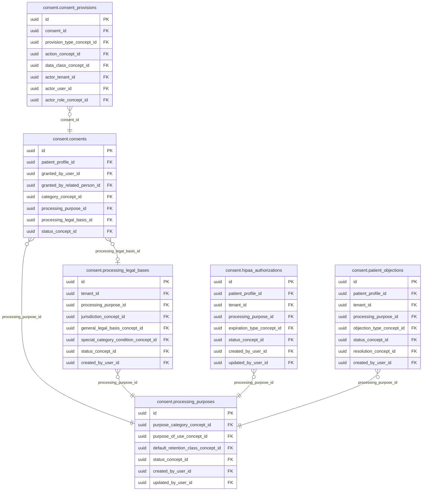

<!-- AUTOGENERADO por tools/inventario/catalogo.mjs. No editar manualmente. -->

# Catálogo del schema `consent`

- **Tablas:** 10 · **Columnas:** 152 (34 con descripción: 22.4 %) · **Índices:** 101
- **Dominio:** Identidad y Seguridad
- Método y límites del catálogo: [README del inventario](../README.md)

## Tablas

| Tabla | Propósito | Columnas | Índices | Operaciones | ORM |
|---|---|---|---|---|---|
| [consent_events](#consent_events) | Mantiene la secuencia de eventos de consentimiento para reconstruir otorgamientos, cambios y revocaciones. | 10 | 7 | 14 | COINCIDE |
| [consent_evidence](#consent_evidence) | Vincula evidencia que respalda la obtención de un consentimiento y su contexto probatorio. | 11 | 7 | 1 | COINCIDE |
| [consent_provisions](#consent_provisions) | Desglosa un consentimiento en disposiciones específicas para representar alcances diferenciados dentro de una autorización. | 17 | 12 | 8 | COINCIDE |
| [consents](#consents) | Conserva el estado de consentimiento de un titular respecto de una finalidad, para apoyar la habilitación o bloqueo de usos de datos. | 20 | 15 | 17 | COINCIDE |
| [hipaa_authorizations](#hipaa_authorizations) | Registra autorizaciones de divulgación estructuradas según el modelo de autorización HIPAA contemplado por el sistema. | 17 | 9 | 6 | COINCIDE |
| [patient_objections](#patient_objections) | Registra objeciones de pacientes a usos o tratamientos de datos para hacerlas visibles a los controles del sistema. | 15 | 10 | 5 | COINCIDE |
| [privacy_restrictions](#privacy_restrictions) | Representa restricciones de privacidad que deben considerarse al acceder o utilizar información de una persona. | 16 | 11 | 6 | COINCIDE |
| [processing_legal_bases](#processing_legal_bases) | Registra las bases legales asociadas a finalidades de tratamiento y aporta contexto a la autorización de operaciones con datos de salud. | 16 | 11 | 3 | COINCIDE |
| [processing_purposes](#processing_purposes) | Define finalidades de tratamiento para que el sistema médico pueda relacionar cada uso de datos con un propósito identificable. | 13 | 7 | 3 | COINCIDE |
| [treatment_informed_consents](#treatment_informed_consents) | Conserva consentimientos informados vinculados a tratamientos para documentar el acto de autorización asistencial. | 17 | 12 | 4 | COINCIDE |

## Diagrama entidad-relación

Las tablas se agrupan en familias por sus claves foráneas dentro del schema (máximo 40 por diagrama). Las FK hacia otros schemas se listan en la ficha de cada tabla.

### Familia 1 de 1 — 6 tablas

### Tablas sin relaciones dentro del schema

`consent.consent_events` · `consent.consent_evidence` · `consent.privacy_restrictions` · `consent.treatment_informed_consents`

## Fichas

### consent_events

#### Vista general

Mantiene la secuencia de eventos de consentimiento para reconstruir otorgamientos, cambios y revocaciones.

- **Estado del propósito:** DOMAIN_CURATED_DRAFT · fuente: `Mantra Core Health Context/modules/diagram_07_consent.puml: consent_events`
- **Dominio:** Identidad y Seguridad · **Diagrama:** `Mantra Core Health Context/modules/diagram_07_consent.puml` · **DDL:** `SQL/07_consent/02_tables.sql`
- **Entidad del ORM:** `ConsentEvents` — `src/modules/consent/entities/consent_events.entity.ts`
- **Resumen:** 10 columnas · 7 índices · 6 FK salientes · 0 entrantes · 14 operaciones

#### Columnas

| # | Columna | Tipo | Rol estructural | Descripción | ORM |
|---|---|---|---|---|---|
| 1 | `id` | `uuid` | Clave primaria; Obligatoria | Identificador único de la instancia. _(JSDOC_ESTANDAR, `src/modules/consent/entities/consent_events.entity.ts:12`)_ | coincide |
| 2 | `subject_type_concept_id` | `uuid` | Clave foránea → terminology.catalog_concepts.id; Obligatoria | _sin dato_ | coincide |
| 3 | `subject_id` | `uuid` | Obligatoria | _sin dato_ | coincide |
| 4 | `event_type_concept_id` | `uuid` | Clave foránea → terminology.catalog_concepts.id; Obligatoria | _sin dato_ | coincide |
| 5 | `previous_status_concept_id` | `uuid` | Clave foránea → terminology.catalog_concepts.id; Obligatoria | _sin dato_ | coincide |
| 6 | `new_status_concept_id` | `uuid` | Clave foránea → terminology.catalog_concepts.id; Obligatoria | _sin dato_ | coincide |
| 7 | `reason_concept_id` | `uuid` | Clave foránea → terminology.catalog_concepts.id; Opcional | _sin dato_ | coincide |
| 8 | `correlation_id` | `uuid` | Opcional | _sin dato_ | coincide |
| 9 | `recorded_at` | `timestamptz` | Obligatoria | _sin dato_ | coincide |
| 10 | `recorded_by_user_id` | `uuid` | Clave foránea → iam.users.id; Opcional | _sin dato_ | coincide |

#### Relaciones

| Sentido | Columnas | Tabla | Restricción |
|---|---|---|---|
| hacia | subject_type_concept_id | terminology.catalog_concepts (id) | fk_consent_events_subject_type_concept_id |
| hacia | event_type_concept_id | terminology.catalog_concepts (id) | fk_consent_events_event_type_concept_id |
| hacia | previous_status_concept_id | terminology.catalog_concepts (id) | fk_consent_events_previous_status_concept_id |
| hacia | new_status_concept_id | terminology.catalog_concepts (id) | fk_consent_events_new_status_concept_id |
| hacia | reason_concept_id | terminology.catalog_concepts (id) | fk_consent_events_reason_concept_id |
| hacia | recorded_by_user_id | iam.users (id) | fk_consent_events_recorded_by_user_id |

#### Índices

| Índice | Único | Columnas | Para qué |
|---|---|---|---|
| `ix_consent_events_subject_type_concept_id` | no | subject_type_concept_id | Soporta la clave foránea fk_consent_events_subject_type_concept_id: PostgreSQL no indexa las FK por sí mismo _(DOCUMENTO)_ |
| `ix_consent_events_event_type_concept_id` | no | event_type_concept_id | Soporta la clave foránea fk_consent_events_event_type_concept_id: PostgreSQL no indexa las FK por sí mismo _(DOCUMENTO)_ |
| `ix_consent_events_previous_status_concept_id` | no | previous_status_concept_id | Soporta la clave foránea fk_consent_events_previous_status_concept_id: PostgreSQL no indexa las FK por sí mismo _(DOCUMENTO)_ |
| `ix_consent_events_new_status_concept_id` | no | new_status_concept_id | Soporta la clave foránea fk_consent_events_new_status_concept_id: PostgreSQL no indexa las FK por sí mismo _(DOCUMENTO)_ |
| `ix_consent_events_reason_concept_id` | no | reason_concept_id | Soporta la clave foránea fk_consent_events_reason_concept_id: PostgreSQL no indexa las FK por sí mismo _(DOCUMENTO)_ |
| `ix_consent_events_recorded_by_user_id` | no | recorded_by_user_id | Soporta la clave foránea fk_consent_events_recorded_by_user_id: PostgreSQL no indexa las FK por sí mismo _(DOCUMENTO)_ |
| `brin_consent_events_recorded_at` | no | recorded_at | BRIN para logs e historiales append-only de gran volumen _(DOCUMENTO)_ |

#### Operaciones que la tocan

| Operación | Efecto | Confianza |
|---|---|---|
| POST /consent/consents | CREA | DIRECTA |
| PATCH /consent/consents/{id}/provisions | CREA | DIRECTA |
| POST /consent/consents/{id}/withdraw | CREA | DIRECTA |
| POST /consent/encounters/{encounterId}/informed-consent | CREA | DIRECTA |
| POST /consent/hipaa-authorizations | CREA | DIRECTA |
| POST /consent/hipaa-authorizations/{id}/revoke | CREA | DIRECTA |
| POST /consent/internal/expiration-sweep | CREA | DIRECTA |
| POST /consent/me/consents/{id}/withdraw | CREA | DIRECTA |
| POST /consent/patient-objections | CREA | DIRECTA |
| POST /consent/patient-objections/{id}/resolve | CREA | DIRECTA |
| POST /consent/practitioner-access-requests | CREA | DIRECTA |
| POST /consent/practitioner-access-requests/{id}/decision | CREA | DIRECTA |
| POST /consent/privacy-restrictions | CREA | DIRECTA |
| POST /consent/treatment-informed-consents | CREA | DIRECTA |

#### Gobierno

| Atributo | Valor | Fuente |
|---|---|---|
| Append-only | no declarado | — |
| Datos personales | sin fuente | — |
| Financiera | sin fuente | — |
| Crítica para auditoría | sin fuente | — |
| Retención | sin fuente | — |
| Responsable | sin fuente | — |
| Revisión | AUTO_DETECTADA | — |

---

### consent_evidence

#### Vista general

Vincula evidencia que respalda la obtención de un consentimiento y su contexto probatorio.

- **Estado del propósito:** DOMAIN_CURATED_DRAFT · fuente: `Mantra Core Health Context/modules/diagram_07_consent.puml: consent_evidence`
- **Dominio:** Identidad y Seguridad · **Diagrama:** `Mantra Core Health Context/modules/diagram_07_consent.puml` · **DDL:** `SQL/07_consent/02_tables.sql`
- **Entidad del ORM:** `ConsentEvidence` — `src/modules/consent/entities/consent_evidence.entity.ts`
- **Resumen:** 11 columnas · 7 índices · 6 FK salientes · 0 entrantes · 1 operaciones

#### Columnas

| # | Columna | Tipo | Rol estructural | Descripción | ORM |
|---|---|---|---|---|---|
| 1 | `id` | `uuid` | Clave primaria; Obligatoria | Identificador único de la instancia. _(JSDOC_ESTANDAR, `src/modules/consent/entities/consent_evidence.entity.ts:12`)_ | coincide |
| 2 | `subject_type_concept_id` | `uuid` | Clave foránea → terminology.catalog_concepts.id; Obligatoria | _sin dato_ | coincide |
| 3 | `subject_id` | `uuid` | Obligatoria | _sin dato_ | coincide |
| 4 | `evidence_type_concept_id` | `uuid` | Clave foránea → terminology.catalog_concepts.id; Obligatoria | _sin dato_ | coincide |
| 5 | `document_file_id` | `uuid` | Clave foránea → common.files.id; Opcional | _sin dato_ | coincide |
| 6 | `signature_id` | `uuid` | Clave foránea → chart.clinical_note_signatures.id; Opcional | _sin dato_ | coincide |
| 7 | `captured_channel_concept_id` | `uuid` | Clave foránea → terminology.catalog_concepts.id; Opcional | _sin dato_ | coincide |
| 8 | `policy_snapshot_hash` | `varchar` | Opcional | _sin dato_ | coincide |
| 9 | `evidence_hash` | `varchar` | Opcional | _sin dato_ | coincide |
| 10 | `recorded_at` | `timestamptz` | Obligatoria | _sin dato_ | coincide |
| 11 | `recorded_by_user_id` | `uuid` | Clave foránea → iam.users.id; Opcional | _sin dato_ | coincide |

#### Relaciones

| Sentido | Columnas | Tabla | Restricción |
|---|---|---|---|
| hacia | subject_type_concept_id | terminology.catalog_concepts (id) | fk_consent_evidence_subject_type_concept_id |
| hacia | evidence_type_concept_id | terminology.catalog_concepts (id) | fk_consent_evidence_evidence_type_concept_id |
| hacia | document_file_id | common.files (id) | fk_consent_evidence_document_file_id |
| hacia | signature_id | chart.clinical_note_signatures (id) | fk_consent_evidence_signature_id |
| hacia | captured_channel_concept_id | terminology.catalog_concepts (id) | fk_consent_evidence_captured_channel_concept_id |
| hacia | recorded_by_user_id | iam.users (id) | fk_consent_evidence_recorded_by_user_id |

#### Índices

| Índice | Único | Columnas | Para qué |
|---|---|---|---|
| `ix_consent_evidence_subject_type_concept_id` | no | subject_type_concept_id | Soporta la clave foránea fk_consent_evidence_subject_type_concept_id: PostgreSQL no indexa las FK por sí mismo _(DOCUMENTO)_ |
| `ix_consent_evidence_evidence_type_concept_id` | no | evidence_type_concept_id | Soporta la clave foránea fk_consent_evidence_evidence_type_concept_id: PostgreSQL no indexa las FK por sí mismo _(DOCUMENTO)_ |
| `ix_consent_evidence_document_file_id` | no | document_file_id | Soporta la clave foránea fk_consent_evidence_document_file_id: PostgreSQL no indexa las FK por sí mismo _(DOCUMENTO)_ |
| `ix_consent_evidence_signature_id` | no | signature_id | Soporta la clave foránea fk_consent_evidence_signature_id: PostgreSQL no indexa las FK por sí mismo _(DOCUMENTO)_ |
| `ix_consent_evidence_captured_channel_concept_id` | no | captured_channel_concept_id | Soporta la clave foránea fk_consent_evidence_captured_channel_concept_id: PostgreSQL no indexa las FK por sí mismo _(DOCUMENTO)_ |
| `ix_consent_evidence_recorded_by_user_id` | no | recorded_by_user_id | Soporta la clave foránea fk_consent_evidence_recorded_by_user_id: PostgreSQL no indexa las FK por sí mismo _(DOCUMENTO)_ |
| `brin_consent_evidence_recorded_at` | no | recorded_at | BRIN para logs e historiales append-only de gran volumen _(DOCUMENTO)_ |

#### Operaciones que la tocan

| Operación | Efecto | Confianza |
|---|---|---|
| POST /consent/consent-evidence | CREA | DIRECTA |

#### Gobierno

| Atributo | Valor | Fuente |
|---|---|---|
| Append-only | no declarado | — |
| Datos personales | sin fuente | — |
| Financiera | sin fuente | — |
| Crítica para auditoría | sin fuente | — |
| Retención | sin fuente | — |
| Responsable | sin fuente | — |
| Revisión | AUTO_DETECTADA | — |

---

### consent_provisions

#### Vista general

Desglosa un consentimiento en disposiciones específicas para representar alcances diferenciados dentro de una autorización.

- **Estado del propósito:** DOMAIN_CURATED_DRAFT · fuente: `Mantra Core Health Context/modules/diagram_07_consent.puml: consent_provisions`
- **Dominio:** Identidad y Seguridad · **Diagrama:** `Mantra Core Health Context/modules/diagram_07_consent.puml` · **DDL:** `SQL/07_consent/02_tables.sql`
- **Entidad del ORM:** `ConsentProvisions` — `src/modules/consent/entities/consent_provisions.entity.ts`
- **Resumen:** 17 columnas · 12 índices · 11 FK salientes · 0 entrantes · 8 operaciones

#### Columnas

| # | Columna | Tipo | Rol estructural | Descripción | ORM |
|---|---|---|---|---|---|
| 1 | `id` | `uuid` | Clave primaria; Obligatoria | Identificador único de la instancia. _(JSDOC_ESTANDAR, `src/modules/consent/entities/consent_provisions.entity.ts:12`)_ | coincide |
| 2 | `consent_id` | `uuid` | Clave foránea → consent.consents.id; Obligatoria | _sin dato_ | coincide |
| 3 | `provision_type_concept_id` | `uuid` | Clave foránea → terminology.catalog_concepts.id; Obligatoria | _sin dato_ | coincide |
| 4 | `action_concept_id` | `uuid` | Clave foránea → terminology.catalog_concepts.id; Obligatoria | _sin dato_ | coincide |
| 5 | `data_class_concept_id` | `uuid` | Clave foránea → terminology.catalog_concepts.id; Opcional | _sin dato_ | coincide |
| 6 | `actor_tenant_id` | `uuid` | Clave foránea → directory.tenants.id; Opcional | _sin dato_ | coincide |
| 7 | `actor_user_id` | `uuid` | Clave foránea → iam.users.id; Opcional | _sin dato_ | coincide |
| 8 | `actor_role_concept_id` | `uuid` | Clave foránea → terminology.catalog_concepts.id; Opcional | _sin dato_ | coincide |
| 9 | `purpose_of_use_concept_id` | `uuid` | Clave foránea → terminology.catalog_concepts.id; Opcional | _sin dato_ | coincide |
| 10 | `security_label_concept_id` | `uuid` | Clave foránea → terminology.catalog_concepts.id; Opcional | _sin dato_ | coincide |
| 11 | `valid_from` | `timestamptz` | Opcional | _sin dato_ | coincide |
| 12 | `valid_to` | `timestamptz` | Opcional | _sin dato_ | coincide |
| 13 | `created_at` | `timestamptz` | Obligatoria | Fecha y hora en que se creó el registro. _(JSDOC_ESTANDAR, `src/modules/consent/entities/consent_provisions.entity.ts:108`)_ | coincide |
| 14 | `updated_at` | `timestamptz` | Obligatoria | Fecha y hora de la última actualización. _(JSDOC_ESTANDAR, `src/modules/consent/entities/consent_provisions.entity.ts:114`)_ | coincide |
| 15 | `created_by_user_id` | `uuid` | Clave foránea → iam.users.id; Opcional | _sin dato_ | coincide |
| 16 | `updated_by_user_id` | `uuid` | Clave foránea → iam.users.id; Opcional | _sin dato_ | coincide |
| 17 | `row_version` | `integer = 1` | Obligatoria | Versión usada para controlar actualizaciones concurrentes. _(JSDOC_ENTIDAD, `src/modules/consent/entities/consent_provisions.entity.ts:132`)_ | coincide |

#### Relaciones

| Sentido | Columnas | Tabla | Restricción |
|---|---|---|---|
| hacia | consent_id | consent.consents (id) | fk_consent_provisions_consent_id |
| hacia | provision_type_concept_id | terminology.catalog_concepts (id) | fk_consent_provisions_provision_type_concept_id |
| hacia | action_concept_id | terminology.catalog_concepts (id) | fk_consent_provisions_action_concept_id |
| hacia | data_class_concept_id | terminology.catalog_concepts (id) | fk_consent_provisions_data_class_concept_id |
| hacia | actor_tenant_id | directory.tenants (id) | fk_consent_provisions_actor_tenant_id |
| hacia | actor_user_id | iam.users (id) | fk_consent_provisions_actor_user_id |
| hacia | actor_role_concept_id | terminology.catalog_concepts (id) | fk_consent_provisions_actor_role_concept_id |
| hacia | purpose_of_use_concept_id | terminology.catalog_concepts (id) | fk_consent_provisions_purpose_of_use_concept_id |
| hacia | security_label_concept_id | terminology.catalog_concepts (id) | fk_consent_provisions_security_label_concept_id |
| hacia | created_by_user_id | iam.users (id) | fk_consent_provisions_created_by_user_id |
| hacia | updated_by_user_id | iam.users (id) | fk_consent_provisions_updated_by_user_id |

#### Índices

| Índice | Único | Columnas | Para qué |
|---|---|---|---|
| `ix_consent_provisions_consent_id` | no | consent_id | Soporta la clave foránea fk_consent_provisions_consent_id: PostgreSQL no indexa las FK por sí mismo _(DOCUMENTO)_; 1 consulta(s) de repositorio filtran u ordenan por «consent_id», la primera columna del índice _(CONSULTA)_ |
| `ix_consent_provisions_provision_type_concept_id` | no | provision_type_concept_id | Soporta la clave foránea fk_consent_provisions_provision_type_concept_id: PostgreSQL no indexa las FK por sí mismo _(DOCUMENTO)_ |
| `ix_consent_provisions_action_concept_id` | no | action_concept_id | Soporta la clave foránea fk_consent_provisions_action_concept_id: PostgreSQL no indexa las FK por sí mismo _(DOCUMENTO)_ |
| `ix_consent_provisions_data_class_concept_id` | no | data_class_concept_id | Soporta la clave foránea fk_consent_provisions_data_class_concept_id: PostgreSQL no indexa las FK por sí mismo _(DOCUMENTO)_ |
| `ix_consent_provisions_actor_tenant_id` | no | actor_tenant_id | Soporta la clave foránea fk_consent_provisions_actor_tenant_id: PostgreSQL no indexa las FK por sí mismo _(DOCUMENTO)_ |
| `ix_consent_provisions_actor_user_id` | no | actor_user_id | Soporta la clave foránea fk_consent_provisions_actor_user_id: PostgreSQL no indexa las FK por sí mismo _(DOCUMENTO)_ |
| `ix_consent_provisions_actor_role_concept_id` | no | actor_role_concept_id | Soporta la clave foránea fk_consent_provisions_actor_role_concept_id: PostgreSQL no indexa las FK por sí mismo _(DOCUMENTO)_ |
| `ix_consent_provisions_purpose_of_use_concept_id` | no | purpose_of_use_concept_id | Soporta la clave foránea fk_consent_provisions_purpose_of_use_concept_id: PostgreSQL no indexa las FK por sí mismo _(DOCUMENTO)_ |
| `ix_consent_provisions_security_label_concept_id` | no | security_label_concept_id | Soporta la clave foránea fk_consent_provisions_security_label_concept_id: PostgreSQL no indexa las FK por sí mismo _(DOCUMENTO)_ |
| `ix_consent_provisions_created_by_user_id` | no | created_by_user_id | Soporta la clave foránea fk_consent_provisions_created_by_user_id: PostgreSQL no indexa las FK por sí mismo _(DOCUMENTO)_ |
| `ix_consent_provisions_updated_by_user_id` | no | updated_by_user_id | Soporta la clave foránea fk_consent_provisions_updated_by_user_id: PostgreSQL no indexa las FK por sí mismo _(DOCUMENTO)_ |
| `gist_consent_provisions_effective_period` | no | (tstzrange(valid_from, valid_to, '[)')) | GiST para periodos, no solapamiento y geografía _(DOCUMENTO)_ |

#### Operaciones que la tocan

| Operación | Efecto | Confianza |
|---|---|---|
| POST /consent/consents | CREA | DIRECTA |
| PATCH /consent/consents/{id}/provisions | ACTUALIZA | POR_TIPO |
| PATCH /consent/consents/{id}/provisions | CREA | DIRECTA |
| PATCH /consent/consents/{id}/provisions | LEE | DIRECTA |
| POST /consent/practitioner-access-requests | CREA | DIRECTA |
| POST /consent/practitioner-access-requests/{id}/decision | ACTUALIZA | POR_TIPO |
| POST /consent/practitioner-access-requests/{id}/decision | LEE | DIRECTA |
| GET /consent/practitioner-access-requests/mine | LEE | DIRECTA |

#### Gobierno

| Atributo | Valor | Fuente |
|---|---|---|
| Append-only | no declarado | — |
| Datos personales | sin fuente | — |
| Financiera | sin fuente | — |
| Crítica para auditoría | sin fuente | — |
| Retención | sin fuente | — |
| Responsable | sin fuente | — |
| Revisión | AUTO_DETECTADA | — |

---

### consents

#### Vista general

Conserva el estado de consentimiento de un titular respecto de una finalidad, para apoyar la habilitación o bloqueo de usos de datos.

- **Estado del propósito:** DOMAIN_CURATED_DRAFT · fuente: `Mantra Core Health Context/modules/diagram_07_consent.puml: consents`
- **Dominio:** Identidad y Seguridad · **Diagrama:** `Mantra Core Health Context/modules/diagram_07_consent.puml` · **DDL:** `SQL/07_consent/02_tables.sql`
- **Entidad del ORM:** `Consents` — `src/modules/consent/entities/consents.entity.ts`
- **Resumen:** 20 columnas · 15 índices · 11 FK salientes · 8 entrantes · 17 operaciones

#### Columnas

| # | Columna | Tipo | Rol estructural | Descripción | ORM |
|---|---|---|---|---|---|
| 1 | `id` | `uuid` | Clave primaria; Obligatoria | Identificador único de la instancia. _(JSDOC_ESTANDAR, `src/modules/consent/entities/consents.entity.ts:12`)_ | coincide |
| 2 | `patient_profile_id` | `uuid` | Clave foránea → profiles.patient_profiles.profile_id; Obligatoria | _sin dato_ | coincide |
| 3 | `granted_by_user_id` | `uuid` | Clave foránea → iam.users.id; Opcional | _sin dato_ | coincide |
| 4 | `granted_by_related_person_id` | `uuid` | Clave foránea → profiles.related_persons.id; Opcional | _sin dato_ | coincide |
| 5 | `category_concept_id` | `uuid` | Clave foránea → terminology.catalog_concepts.id; Obligatoria | _sin dato_ | coincide |
| 6 | `processing_purpose_id` | `uuid` | Clave foránea → consent.processing_purposes.id; Obligatoria | _sin dato_ | coincide |
| 7 | `processing_legal_basis_id` | `uuid` | Clave foránea → consent.processing_legal_bases.id; Opcional | _sin dato_ | coincide |
| 8 | `status_concept_id` | `uuid` | Clave foránea → terminology.catalog_concepts.id; Obligatoria | _sin dato_ | coincide |
| 9 | `policy_uri` | `text` | Opcional | _sin dato_ | coincide |
| 10 | `policy_version` | `varchar` | Opcional | _sin dato_ | coincide |
| 11 | `tenant_id` | `uuid` | Clave foránea → directory.tenants.id; Opcional | _sin dato_ | coincide |
| 12 | `valid_from` | `timestamptz` | Opcional | _sin dato_ | coincide |
| 13 | `valid_to` | `timestamptz` | Opcional | _sin dato_ | coincide |
| 14 | `withdrawal_reason_concept_id` | `uuid` | Clave foránea → terminology.catalog_concepts.id; Opcional | _sin dato_ | coincide |
| 15 | `withdrawn_at` | `timestamptz` | Opcional | _sin dato_ | coincide |
| 16 | `created_at` | `timestamptz` | Obligatoria | Fecha y hora en que se creó el registro. _(JSDOC_ESTANDAR, `src/modules/consent/entities/consents.entity.ts:130`)_ | coincide |
| 17 | `updated_at` | `timestamptz` | Obligatoria | Fecha y hora de la última actualización. _(JSDOC_ESTANDAR, `src/modules/consent/entities/consents.entity.ts:136`)_ | coincide |
| 18 | `created_by_user_id` | `uuid` | Clave foránea → iam.users.id; Opcional | _sin dato_ | coincide |
| 19 | `updated_by_user_id` | `uuid` | Clave foránea → iam.users.id; Opcional | _sin dato_ | coincide |
| 20 | `row_version` | `integer = 1` | Obligatoria | Versión usada para controlar actualizaciones concurrentes. _(JSDOC_ENTIDAD, `src/modules/consent/entities/consents.entity.ts:154`)_ | coincide |

#### Relaciones

| Sentido | Columnas | Tabla | Restricción |
|---|---|---|---|
| hacia | processing_purpose_id | consent.processing_purposes (id) | fk_consents_processing_purpose_id |
| hacia | processing_legal_basis_id | consent.processing_legal_bases (id) | fk_consents_processing_legal_basis_id |
| hacia | patient_profile_id | profiles.patient_profiles (profile_id) | fk_consents_patient_profile_id |
| hacia | granted_by_user_id | iam.users (id) | fk_consents_granted_by_user_id |
| hacia | granted_by_related_person_id | profiles.related_persons (id) | fk_consents_granted_by_related_person_id |
| hacia | category_concept_id | terminology.catalog_concepts (id) | fk_consents_category_concept_id |
| hacia | status_concept_id | terminology.catalog_concepts (id) | fk_consents_status_concept_id |
| hacia | tenant_id | directory.tenants (id) | fk_consents_tenant_id |
| hacia | withdrawal_reason_concept_id | terminology.catalog_concepts (id) | fk_consents_withdrawal_reason_concept_id |
| hacia | created_by_user_id | iam.users (id) | fk_consents_created_by_user_id |
| hacia | updated_by_user_id | iam.users (id) | fk_consents_updated_by_user_id |
| desde | id | consent.consent_provisions (consent_id) | fk_consent_provisions_consent_id |
| desde | id | authz.clinical_access_grants (consent_id) | fk_clinical_access_grants_consent_id |
| desde | id | audit.consents_history (consent_id) | fk_consents_history_consent_id |
| desde | id | identity_assurance.identity_evidence_records (collected_under_consent_id) | fk_identity_evidence_records_collected_under_consent_id |
| desde | id | telemetry.analytics_subjects (created_from_consent_id) | fk_analytics_subjects_created_from_consent_id |
| desde | id | messaging.notification_requests (consent_id) | fk_notification_requests_consent_id |
| desde | id | crm.contacts (marketing_consent_id) | fk_contacts_marketing_consent_id |
| desde | id | marketing.campaign_dispatch_recipients (consent_id) | fk_campaign_dispatch_recipients_consent_id |

#### Índices

| Índice | Único | Columnas | Para qué |
|---|---|---|---|
| `ix_consents_patient_profile_id` | no | patient_profile_id | Soporta la clave foránea fk_consents_patient_profile_id: PostgreSQL no indexa las FK por sí mismo _(DOCUMENTO)_; 5 consulta(s) de repositorio filtran u ordenan por «patient_profile_id», la primera columna del índice _(CONSULTA)_ |
| `ix_consents_granted_by_user_id` | no | granted_by_user_id | Soporta la clave foránea fk_consents_granted_by_user_id: PostgreSQL no indexa las FK por sí mismo _(DOCUMENTO)_ |
| `ix_consents_granted_by_related_person_id` | no | granted_by_related_person_id | Soporta la clave foránea fk_consents_granted_by_related_person_id: PostgreSQL no indexa las FK por sí mismo _(DOCUMENTO)_ |
| `ix_consents_category_concept_id` | no | category_concept_id | Soporta la clave foránea fk_consents_category_concept_id: PostgreSQL no indexa las FK por sí mismo _(DOCUMENTO)_; 3 consulta(s) de repositorio filtran u ordenan por «category_concept_id», la primera columna del índice _(CONSULTA)_ |
| `ix_consents_processing_purpose_id` | no | processing_purpose_id | Soporta la clave foránea fk_consents_processing_purpose_id: PostgreSQL no indexa las FK por sí mismo _(DOCUMENTO)_; 1 consulta(s) de repositorio filtran u ordenan por «processing_purpose_id», la primera columna del índice _(CONSULTA)_ |
| `ix_consents_processing_legal_basis_id` | no | processing_legal_basis_id | Soporta la clave foránea fk_consents_processing_legal_basis_id: PostgreSQL no indexa las FK por sí mismo _(DOCUMENTO)_ |
| `ix_consents_status_concept_id` | no | status_concept_id | Soporta la clave foránea fk_consents_status_concept_id: PostgreSQL no indexa las FK por sí mismo _(DOCUMENTO)_; 3 consulta(s) de repositorio filtran u ordenan por «status_concept_id», la primera columna del índice _(CONSULTA)_ |
| `ix_consents_tenant_id` | no | tenant_id | Soporta la clave foránea fk_consents_tenant_id: PostgreSQL no indexa las FK por sí mismo _(DOCUMENTO)_ |
| `ix_consents_withdrawal_reason_concept_id` | no | withdrawal_reason_concept_id | Soporta la clave foránea fk_consents_withdrawal_reason_concept_id: PostgreSQL no indexa las FK por sí mismo _(DOCUMENTO)_ |
| `ix_consents_created_by_user_id` | no | created_by_user_id | Soporta la clave foránea fk_consents_created_by_user_id: PostgreSQL no indexa las FK por sí mismo _(DOCUMENTO)_; 1 consulta(s) de repositorio filtran u ordenan por «created_by_user_id», la primera columna del índice _(CONSULTA)_ |
| `ix_consents_updated_by_user_id` | no | updated_by_user_id | Soporta la clave foránea fk_consents_updated_by_user_id: PostgreSQL no indexa las FK por sí mismo _(DOCUMENTO)_ |
| `ix_consents_tenant_id_status_concept_id` | no | tenant_id, status_concept_id, ("updated_at" DESC) | _sin uso detectado estáticamente_ |
| `ix_consents_patient_profile_id_updated_at` | no | tenant_id, patient_profile_id, ("updated_at" DESC) | _sin uso detectado estáticamente_ |
| `ix_consents_patient_purpose_status` | no | patient_profile_id, processing_purpose_id, status_concept_id, ("valid_from" DESC) | _sin uso detectado estáticamente_ |
| `gist_consents_effective_period` | no | (tstzrange(valid_from, valid_to, '[)')) | GiST para periodos, no solapamiento y geografía _(DOCUMENTO)_ |

#### Operaciones que la tocan

| Operación | Efecto | Confianza |
|---|---|---|
| POST /consent/consents | CREA | DIRECTA |
| POST /consent/consents | LEE | DIRECTA |
| PATCH /consent/consents/{id}/provisions | LEE | DIRECTA |
| POST /consent/consents/{id}/withdraw | ACTUALIZA | POR_TIPO |
| POST /consent/consents/{id}/withdraw | LEE | DIRECTA |
| POST /consent/internal/expiration-sweep | ACTUALIZA | POR_TIPO |
| POST /consent/internal/expiration-sweep | LEE | DIRECTA |
| GET /consent/me/consents | LEE | DIRECTA |
| POST /consent/me/consents/{id}/withdraw | ACTUALIZA | POR_TIPO |
| POST /consent/me/consents/{id}/withdraw | LEE | DIRECTA |
| POST /consent/practitioner-access-requests | CREA | DIRECTA |
| POST /consent/practitioner-access-requests | LEE | DIRECTA |
| POST /consent/practitioner-access-requests/{id}/decision | ACTUALIZA | POR_TIPO |
| POST /consent/practitioner-access-requests/{id}/decision | LEE | DIRECTA |
| GET /consent/practitioner-access-requests/mine | LEE | DIRECTA |
| POST /internal/identity/evidence/lifecycle-scan | LEE | DIRECTA |
| POST /internal/governance/retention-executions/run | LEE | DIRECTA |

#### Gobierno

| Atributo | Valor | Fuente |
|---|---|---|
| Append-only | no declarado | — |
| Datos personales | sin fuente | — |
| Financiera | sin fuente | — |
| Crítica para auditoría | sin fuente | — |
| Retención | sin fuente | — |
| Responsable | sin fuente | — |
| Revisión | AUTO_DETECTADA | — |

---

### hipaa_authorizations

#### Vista general

Registra autorizaciones de divulgación estructuradas según el modelo de autorización HIPAA contemplado por el sistema.

- **Estado del propósito:** DOMAIN_CURATED_DRAFT · fuente: `Mantra Core Health Context/modules/diagram_07_consent.puml: hipaa_authorizations`
- **Dominio:** Identidad y Seguridad · **Diagrama:** `Mantra Core Health Context/modules/diagram_07_consent.puml` · **DDL:** `SQL/07_consent/02_tables.sql`
- **Entidad del ORM:** `HipaaAuthorizations` — `src/modules/consent/entities/hipaa_authorizations.entity.ts`
- **Resumen:** 17 columnas · 9 índices · 7 FK salientes · 0 entrantes · 6 operaciones

#### Columnas

| # | Columna | Tipo | Rol estructural | Descripción | ORM |
|---|---|---|---|---|---|
| 1 | `id` | `uuid` | Clave primaria; Obligatoria | Identificador único de la instancia. _(JSDOC_ESTANDAR, `src/modules/consent/entities/hipaa_authorizations.entity.ts:12`)_ | coincide |
| 2 | `patient_profile_id` | `uuid` | Clave foránea → profiles.patient_profiles.profile_id; Obligatoria | _sin dato_ | coincide |
| 3 | `tenant_id` | `uuid` | Clave foránea → directory.tenants.id; Obligatoria | _sin dato_ | coincide |
| 4 | `processing_purpose_id` | `uuid` | Clave foránea → consent.processing_purposes.id; Obligatoria | _sin dato_ | coincide |
| 5 | `recipient_description` | `varchar` | Obligatoria | _sin dato_ | coincide |
| 6 | `information_description` | `text` | Obligatoria | _sin dato_ | coincide |
| 7 | `expiration_type_concept_id` | `uuid` | Clave foránea → terminology.catalog_concepts.id; Obligatoria | _sin dato_ | coincide |
| 8 | `expires_at` | `timestamptz` | Opcional | _sin dato_ | coincide |
| 9 | `expiration_event_text` | `text` | Opcional | _sin dato_ | coincide |
| 10 | `status_concept_id` | `uuid` | Clave foránea → terminology.catalog_concepts.id; Obligatoria | _sin dato_ | coincide |
| 11 | `signed_at` | `timestamptz` | Opcional | _sin dato_ | coincide |
| 12 | `revoked_at` | `timestamptz` | Opcional | _sin dato_ | coincide |
| 13 | `created_at` | `timestamptz` | Obligatoria | Fecha y hora en que se creó el registro. _(JSDOC_ESTANDAR, `src/modules/consent/entities/hipaa_authorizations.entity.ts:100`)_ | coincide |
| 14 | `updated_at` | `timestamptz` | Obligatoria | Fecha y hora de la última actualización. _(JSDOC_ESTANDAR, `src/modules/consent/entities/hipaa_authorizations.entity.ts:106`)_ | coincide |
| 15 | `created_by_user_id` | `uuid` | Clave foránea → iam.users.id; Opcional | _sin dato_ | coincide |
| 16 | `updated_by_user_id` | `uuid` | Clave foránea → iam.users.id; Opcional | _sin dato_ | coincide |
| 17 | `row_version` | `integer = 1` | Obligatoria | Versión usada para controlar actualizaciones concurrentes. _(JSDOC_ENTIDAD, `src/modules/consent/entities/hipaa_authorizations.entity.ts:124`)_ | coincide |

#### Relaciones

| Sentido | Columnas | Tabla | Restricción |
|---|---|---|---|
| hacia | processing_purpose_id | consent.processing_purposes (id) | fk_hipaa_authorizations_processing_purpose_id |
| hacia | patient_profile_id | profiles.patient_profiles (profile_id) | fk_hipaa_authorizations_patient_profile_id |
| hacia | tenant_id | directory.tenants (id) | fk_hipaa_authorizations_tenant_id |
| hacia | expiration_type_concept_id | terminology.catalog_concepts (id) | fk_hipaa_authorizations_expiration_type_concept_id |
| hacia | status_concept_id | terminology.catalog_concepts (id) | fk_hipaa_authorizations_status_concept_id |
| hacia | created_by_user_id | iam.users (id) | fk_hipaa_authorizations_created_by_user_id |
| hacia | updated_by_user_id | iam.users (id) | fk_hipaa_authorizations_updated_by_user_id |

#### Índices

| Índice | Único | Columnas | Para qué |
|---|---|---|---|
| `ix_hipaa_authorizations_patient_profile_id` | no | patient_profile_id | Soporta la clave foránea fk_hipaa_authorizations_patient_profile_id: PostgreSQL no indexa las FK por sí mismo _(DOCUMENTO)_; 1 consulta(s) de repositorio filtran u ordenan por «patient_profile_id», la primera columna del índice _(CONSULTA)_ |
| `ix_hipaa_authorizations_tenant_id` | no | tenant_id | Soporta la clave foránea fk_hipaa_authorizations_tenant_id: PostgreSQL no indexa las FK por sí mismo _(DOCUMENTO)_ |
| `ix_hipaa_authorizations_processing_purpose_id` | no | processing_purpose_id | Soporta la clave foránea fk_hipaa_authorizations_processing_purpose_id: PostgreSQL no indexa las FK por sí mismo _(DOCUMENTO)_ |
| `ix_hipaa_authorizations_expiration_type_concept_id` | no | expiration_type_concept_id | Soporta la clave foránea fk_hipaa_authorizations_expiration_type_concept_id: PostgreSQL no indexa las FK por sí mismo _(DOCUMENTO)_ |
| `ix_hipaa_authorizations_status_concept_id` | no | status_concept_id | Soporta la clave foránea fk_hipaa_authorizations_status_concept_id: PostgreSQL no indexa las FK por sí mismo _(DOCUMENTO)_; 1 consulta(s) de repositorio filtran u ordenan por «status_concept_id», la primera columna del índice _(CONSULTA)_ |
| `ix_hipaa_authorizations_created_by_user_id` | no | created_by_user_id | Soporta la clave foránea fk_hipaa_authorizations_created_by_user_id: PostgreSQL no indexa las FK por sí mismo _(DOCUMENTO)_ |
| `ix_hipaa_authorizations_updated_by_user_id` | no | updated_by_user_id | Soporta la clave foránea fk_hipaa_authorizations_updated_by_user_id: PostgreSQL no indexa las FK por sí mismo _(DOCUMENTO)_ |
| `ix_hipaa_authorizations_tenant_id_status_concept_id` | no | tenant_id, status_concept_id, ("updated_at" DESC) | _sin uso detectado estáticamente_ |
| `ix_hipaa_authorizations_patient_profile_id_updated_at` | no | tenant_id, patient_profile_id, ("updated_at" DESC) | _sin uso detectado estáticamente_ |

#### Operaciones que la tocan

| Operación | Efecto | Confianza |
|---|---|---|
| POST /consent/hipaa-authorizations | CREA | DIRECTA |
| POST /consent/hipaa-authorizations/{id}/revoke | ACTUALIZA | POR_TIPO |
| POST /consent/hipaa-authorizations/{id}/revoke | LEE | DIRECTA |
| POST /consent/internal/expiration-sweep | ACTUALIZA | POR_TIPO |
| POST /consent/internal/expiration-sweep | LEE | DIRECTA |
| GET /consent/me/hipaa-authorizations | LEE | DIRECTA |

#### Gobierno

| Atributo | Valor | Fuente |
|---|---|---|
| Append-only | no declarado | — |
| Datos personales | sin fuente | — |
| Financiera | sin fuente | — |
| Crítica para auditoría | sin fuente | — |
| Retención | sin fuente | — |
| Responsable | sin fuente | — |
| Revisión | AUTO_DETECTADA | — |

---

### patient_objections

#### Vista general

Registra objeciones de pacientes a usos o tratamientos de datos para hacerlas visibles a los controles del sistema.

- **Estado del propósito:** DOMAIN_CURATED_DRAFT · fuente: `Mantra Core Health Context/modules/diagram_07_consent.puml: patient_objections`
- **Dominio:** Identidad y Seguridad · **Diagrama:** `Mantra Core Health Context/modules/diagram_07_consent.puml` · **DDL:** `SQL/07_consent/02_tables.sql`
- **Entidad del ORM:** `PatientObjections` — `src/modules/consent/entities/patient_objections.entity.ts`
- **Resumen:** 15 columnas · 10 índices · 8 FK salientes · 0 entrantes · 5 operaciones

#### Columnas

| # | Columna | Tipo | Rol estructural | Descripción | ORM |
|---|---|---|---|---|---|
| 1 | `id` | `uuid` | Clave primaria; Obligatoria | Identificador único de la instancia. _(JSDOC_ESTANDAR, `src/modules/consent/entities/patient_objections.entity.ts:12`)_ | coincide |
| 2 | `patient_profile_id` | `uuid` | Clave foránea → profiles.patient_profiles.profile_id; Obligatoria | _sin dato_ | coincide |
| 3 | `tenant_id` | `uuid` | Clave foránea → directory.tenants.id; Obligatoria | _sin dato_ | coincide |
| 4 | `processing_purpose_id` | `uuid` | Clave foránea → consent.processing_purposes.id; Obligatoria | _sin dato_ | coincide |
| 5 | `objection_type_concept_id` | `uuid` | Clave foránea → terminology.catalog_concepts.id; Obligatoria | _sin dato_ | coincide |
| 6 | `reason_text` | `text` | Opcional | _sin dato_ | coincide |
| 7 | `status_concept_id` | `uuid` | Clave foránea → terminology.catalog_concepts.id; Obligatoria | _sin dato_ | coincide |
| 8 | `raised_at` | `timestamptz` | Opcional | _sin dato_ | coincide |
| 9 | `resolved_at` | `timestamptz` | Opcional | _sin dato_ | coincide |
| 10 | `resolution_concept_id` | `uuid` | Clave foránea → terminology.catalog_concepts.id; Opcional | _sin dato_ | coincide |
| 11 | `created_at` | `timestamptz` | Obligatoria | Fecha y hora en que se creó el registro. _(JSDOC_ESTANDAR, `src/modules/consent/entities/patient_objections.entity.ts:84`)_ | coincide |
| 12 | `updated_at` | `timestamptz` | Obligatoria | Fecha y hora de la última actualización. _(JSDOC_ESTANDAR, `src/modules/consent/entities/patient_objections.entity.ts:90`)_ | coincide |
| 13 | `created_by_user_id` | `uuid` | Clave foránea → iam.users.id; Opcional | _sin dato_ | coincide |
| 14 | `updated_by_user_id` | `uuid` | Clave foránea → iam.users.id; Opcional | _sin dato_ | coincide |
| 15 | `row_version` | `integer = 1` | Obligatoria | Versión usada para controlar actualizaciones concurrentes. _(JSDOC_ENTIDAD, `src/modules/consent/entities/patient_objections.entity.ts:108`)_ | coincide |

#### Relaciones

| Sentido | Columnas | Tabla | Restricción |
|---|---|---|---|
| hacia | processing_purpose_id | consent.processing_purposes (id) | fk_patient_objections_processing_purpose_id |
| hacia | patient_profile_id | profiles.patient_profiles (profile_id) | fk_patient_objections_patient_profile_id |
| hacia | tenant_id | directory.tenants (id) | fk_patient_objections_tenant_id |
| hacia | objection_type_concept_id | terminology.catalog_concepts (id) | fk_patient_objections_objection_type_concept_id |
| hacia | status_concept_id | terminology.catalog_concepts (id) | fk_patient_objections_status_concept_id |
| hacia | resolution_concept_id | terminology.catalog_concepts (id) | fk_patient_objections_resolution_concept_id |
| hacia | created_by_user_id | iam.users (id) | fk_patient_objections_created_by_user_id |
| hacia | updated_by_user_id | iam.users (id) | fk_patient_objections_updated_by_user_id |

#### Índices

| Índice | Único | Columnas | Para qué |
|---|---|---|---|
| `ix_patient_objections_patient_profile_id` | no | patient_profile_id | Soporta la clave foránea fk_patient_objections_patient_profile_id: PostgreSQL no indexa las FK por sí mismo _(DOCUMENTO)_; 2 consulta(s) de repositorio filtran u ordenan por «patient_profile_id», la primera columna del índice _(CONSULTA)_ |
| `ix_patient_objections_tenant_id` | no | tenant_id | Soporta la clave foránea fk_patient_objections_tenant_id: PostgreSQL no indexa las FK por sí mismo _(DOCUMENTO)_ |
| `ix_patient_objections_processing_purpose_id` | no | processing_purpose_id | Soporta la clave foránea fk_patient_objections_processing_purpose_id: PostgreSQL no indexa las FK por sí mismo _(DOCUMENTO)_; 1 consulta(s) de repositorio filtran u ordenan por «processing_purpose_id», la primera columna del índice _(CONSULTA)_ |
| `ix_patient_objections_objection_type_concept_id` | no | objection_type_concept_id | Soporta la clave foránea fk_patient_objections_objection_type_concept_id: PostgreSQL no indexa las FK por sí mismo _(DOCUMENTO)_ |
| `ix_patient_objections_status_concept_id` | no | status_concept_id | Soporta la clave foránea fk_patient_objections_status_concept_id: PostgreSQL no indexa las FK por sí mismo _(DOCUMENTO)_; 1 consulta(s) de repositorio filtran u ordenan por «status_concept_id», la primera columna del índice _(CONSULTA)_ |
| `ix_patient_objections_resolution_concept_id` | no | resolution_concept_id | Soporta la clave foránea fk_patient_objections_resolution_concept_id: PostgreSQL no indexa las FK por sí mismo _(DOCUMENTO)_ |
| `ix_patient_objections_created_by_user_id` | no | created_by_user_id | Soporta la clave foránea fk_patient_objections_created_by_user_id: PostgreSQL no indexa las FK por sí mismo _(DOCUMENTO)_ |
| `ix_patient_objections_updated_by_user_id` | no | updated_by_user_id | Soporta la clave foránea fk_patient_objections_updated_by_user_id: PostgreSQL no indexa las FK por sí mismo _(DOCUMENTO)_ |
| `ix_patient_objections_tenant_id_status_concept_id` | no | tenant_id, status_concept_id, ("updated_at" DESC) | _sin uso detectado estáticamente_ |
| `ix_patient_objections_patient_profile_id_updated_at` | no | tenant_id, patient_profile_id, ("updated_at" DESC) | _sin uso detectado estáticamente_ |

#### Operaciones que la tocan

| Operación | Efecto | Confianza |
|---|---|---|
| GET /consent/me/objections | LEE | DIRECTA |
| POST /consent/patient-objections | CREA | DIRECTA |
| POST /consent/patient-objections | LEE | DIRECTA |
| POST /consent/patient-objections/{id}/resolve | ACTUALIZA | POR_TIPO |
| POST /consent/patient-objections/{id}/resolve | LEE | DIRECTA |

#### Gobierno

| Atributo | Valor | Fuente |
|---|---|---|
| Append-only | no declarado | — |
| Datos personales | sin fuente | — |
| Financiera | sin fuente | — |
| Crítica para auditoría | sin fuente | — |
| Retención | sin fuente | — |
| Responsable | sin fuente | — |
| Revisión | AUTO_DETECTADA | — |

---

### privacy_restrictions

#### Vista general

Representa restricciones de privacidad que deben considerarse al acceder o utilizar información de una persona.

- **Estado del propósito:** DOMAIN_CURATED_DRAFT · fuente: `Mantra Core Health Context/modules/diagram_07_consent.puml: privacy_restrictions`
- **Dominio:** Identidad y Seguridad · **Diagrama:** `Mantra Core Health Context/modules/diagram_07_consent.puml` · **DDL:** `SQL/07_consent/02_tables.sql`
- **Entidad del ORM:** `PrivacyRestrictions` — `src/modules/consent/entities/privacy_restrictions.entity.ts`
- **Resumen:** 16 columnas · 11 índices · 8 FK salientes · 0 entrantes · 6 operaciones

#### Columnas

| # | Columna | Tipo | Rol estructural | Descripción | ORM |
|---|---|---|---|---|---|
| 1 | `id` | `uuid` | Clave primaria; Obligatoria | Identificador único de la instancia. _(JSDOC_ESTANDAR, `src/modules/consent/entities/privacy_restrictions.entity.ts:12`)_ | coincide |
| 2 | `patient_profile_id` | `uuid` | Clave foránea → profiles.patient_profiles.profile_id; Obligatoria | _sin dato_ | coincide |
| 3 | `tenant_id` | `uuid` | Clave foránea → directory.tenants.id; Obligatoria | _sin dato_ | coincide |
| 4 | `restriction_type_concept_id` | `uuid` | Clave foránea → terminology.catalog_concepts.id; Obligatoria | _sin dato_ | coincide |
| 5 | `data_class_concept_id` | `uuid` | Clave foránea → terminology.catalog_concepts.id; Obligatoria | _sin dato_ | coincide |
| 6 | `target_actor_type_concept_id` | `uuid` | Clave foránea → terminology.catalog_concepts.id; Opcional | _sin dato_ | coincide |
| 7 | `target_actor_id` | `uuid` | Opcional | _sin dato_ | coincide |
| 8 | `reason_text` | `text` | Opcional | _sin dato_ | coincide |
| 9 | `status_concept_id` | `uuid` | Clave foránea → terminology.catalog_concepts.id; Obligatoria | _sin dato_ | coincide |
| 10 | `valid_from` | `timestamptz` | Opcional | _sin dato_ | coincide |
| 11 | `valid_to` | `timestamptz` | Opcional | _sin dato_ | coincide |
| 12 | `created_at` | `timestamptz` | Obligatoria | Fecha y hora en que se creó el registro. _(JSDOC_ESTANDAR, `src/modules/consent/entities/privacy_restrictions.entity.ts:90`)_ | coincide |
| 13 | `updated_at` | `timestamptz` | Obligatoria | Fecha y hora de la última actualización. _(JSDOC_ESTANDAR, `src/modules/consent/entities/privacy_restrictions.entity.ts:96`)_ | coincide |
| 14 | `created_by_user_id` | `uuid` | Clave foránea → iam.users.id; Opcional | _sin dato_ | coincide |
| 15 | `updated_by_user_id` | `uuid` | Clave foránea → iam.users.id; Opcional | _sin dato_ | coincide |
| 16 | `row_version` | `integer = 1` | Obligatoria | Versión usada para controlar actualizaciones concurrentes. _(JSDOC_ENTIDAD, `src/modules/consent/entities/privacy_restrictions.entity.ts:114`)_ | coincide |

#### Relaciones

| Sentido | Columnas | Tabla | Restricción |
|---|---|---|---|
| hacia | patient_profile_id | profiles.patient_profiles (profile_id) | fk_privacy_restrictions_patient_profile_id |
| hacia | tenant_id | directory.tenants (id) | fk_privacy_restrictions_tenant_id |
| hacia | restriction_type_concept_id | terminology.catalog_concepts (id) | fk_privacy_restrictions_restriction_type_concept_id |
| hacia | data_class_concept_id | terminology.catalog_concepts (id) | fk_privacy_restrictions_data_class_concept_id |
| hacia | target_actor_type_concept_id | terminology.catalog_concepts (id) | fk_privacy_restrictions_target_actor_type_concept_id |
| hacia | status_concept_id | terminology.catalog_concepts (id) | fk_privacy_restrictions_status_concept_id |
| hacia | created_by_user_id | iam.users (id) | fk_privacy_restrictions_created_by_user_id |
| hacia | updated_by_user_id | iam.users (id) | fk_privacy_restrictions_updated_by_user_id |

#### Índices

| Índice | Único | Columnas | Para qué |
|---|---|---|---|
| `ix_privacy_restrictions_patient_profile_id` | no | patient_profile_id | Soporta la clave foránea fk_privacy_restrictions_patient_profile_id: PostgreSQL no indexa las FK por sí mismo _(DOCUMENTO)_; 1 consulta(s) de repositorio filtran u ordenan por «patient_profile_id», la primera columna del índice _(CONSULTA)_ |
| `ix_privacy_restrictions_tenant_id` | no | tenant_id | Soporta la clave foránea fk_privacy_restrictions_tenant_id: PostgreSQL no indexa las FK por sí mismo _(DOCUMENTO)_ |
| `ix_privacy_restrictions_restriction_type_concept_id` | no | restriction_type_concept_id | Soporta la clave foránea fk_privacy_restrictions_restriction_type_concept_id: PostgreSQL no indexa las FK por sí mismo _(DOCUMENTO)_ |
| `ix_privacy_restrictions_data_class_concept_id` | no | data_class_concept_id | Soporta la clave foránea fk_privacy_restrictions_data_class_concept_id: PostgreSQL no indexa las FK por sí mismo _(DOCUMENTO)_ |
| `ix_privacy_restrictions_target_actor_type_concept_id` | no | target_actor_type_concept_id | Soporta la clave foránea fk_privacy_restrictions_target_actor_type_concept_id: PostgreSQL no indexa las FK por sí mismo _(DOCUMENTO)_ |
| `ix_privacy_restrictions_status_concept_id` | no | status_concept_id | Soporta la clave foránea fk_privacy_restrictions_status_concept_id: PostgreSQL no indexa las FK por sí mismo _(DOCUMENTO)_; 2 consulta(s) de repositorio filtran u ordenan por «status_concept_id», la primera columna del índice _(CONSULTA)_ |
| `ix_privacy_restrictions_created_by_user_id` | no | created_by_user_id | Soporta la clave foránea fk_privacy_restrictions_created_by_user_id: PostgreSQL no indexa las FK por sí mismo _(DOCUMENTO)_ |
| `ix_privacy_restrictions_updated_by_user_id` | no | updated_by_user_id | Soporta la clave foránea fk_privacy_restrictions_updated_by_user_id: PostgreSQL no indexa las FK por sí mismo _(DOCUMENTO)_ |
| `ix_privacy_restrictions_tenant_id_status_concept_id` | no | tenant_id, status_concept_id, ("updated_at" DESC) | _sin uso detectado estáticamente_ |
| `ix_privacy_restrictions_patient_profile_id_updated_at` | no | tenant_id, patient_profile_id, ("updated_at" DESC) | _sin uso detectado estáticamente_ |
| `gist_privacy_restrictions_effective_period` | no | (tstzrange(valid_from, valid_to, '[)')) | GiST para periodos, no solapamiento y geografía _(DOCUMENTO)_ |

#### Operaciones que la tocan

| Operación | Efecto | Confianza |
|---|---|---|
| POST /consent/internal/expiration-sweep | ACTUALIZA | POR_TIPO |
| POST /consent/internal/expiration-sweep | LEE | DIRECTA |
| POST /consent/patient-objections | CREA | DIRECTA |
| POST /consent/patient-objections/{id}/resolve | ACTUALIZA | POR_TIPO |
| POST /consent/patient-objections/{id}/resolve | LEE | DIRECTA |
| POST /consent/privacy-restrictions | CREA | DIRECTA |

#### Gobierno

| Atributo | Valor | Fuente |
|---|---|---|
| Append-only | no declarado | — |
| Datos personales | sin fuente | — |
| Financiera | sin fuente | — |
| Crítica para auditoría | sin fuente | — |
| Retención | sin fuente | — |
| Responsable | sin fuente | — |
| Revisión | AUTO_DETECTADA | — |

---

### processing_legal_bases

#### Vista general

Registra las bases legales asociadas a finalidades de tratamiento y aporta contexto a la autorización de operaciones con datos de salud.

- **Estado del propósito:** DOMAIN_CURATED_DRAFT · fuente: `Mantra Core Health Context/modules/diagram_07_consent.puml: processing_legal_bases`
- **Dominio:** Identidad y Seguridad · **Diagrama:** `Mantra Core Health Context/modules/diagram_07_consent.puml` · **DDL:** `SQL/07_consent/02_tables.sql`
- **Entidad del ORM:** `ProcessingLegalBases` — `src/modules/consent/entities/processing_legal_bases.entity.ts`
- **Resumen:** 16 columnas · 11 índices · 8 FK salientes · 2 entrantes · 3 operaciones

#### Columnas

| # | Columna | Tipo | Rol estructural | Descripción | ORM |
|---|---|---|---|---|---|
| 1 | `id` | `uuid` | Clave primaria; Obligatoria | Identificador único de la instancia. _(JSDOC_ESTANDAR, `src/modules/consent/entities/processing_legal_bases.entity.ts:12`)_ | coincide |
| 2 | `tenant_id` | `uuid` | Clave foránea → directory.tenants.id; Obligatoria | _sin dato_ | coincide |
| 3 | `processing_purpose_id` | `uuid` | Clave foránea → consent.processing_purposes.id; Obligatoria | _sin dato_ | coincide |
| 4 | `jurisdiction_concept_id` | `uuid` | Clave foránea → terminology.catalog_concepts.id; Obligatoria | _sin dato_ | coincide |
| 5 | `general_legal_basis_concept_id` | `uuid` | Clave foránea → terminology.catalog_concepts.id; Obligatoria | _sin dato_ | coincide |
| 6 | `special_category_condition_concept_id` | `uuid` | Clave foránea → terminology.catalog_concepts.id; Opcional | _sin dato_ | coincide |
| 7 | `policy_version` | `varchar` | Opcional | _sin dato_ | coincide |
| 8 | `legal_reference_uri` | `text` | Opcional | _sin dato_ | coincide |
| 9 | `valid_from` | `timestamptz` | Obligatoria | _sin dato_ | coincide |
| 10 | `valid_to` | `timestamptz` | Opcional | _sin dato_ | coincide |
| 11 | `status_concept_id` | `uuid` | Clave foránea → terminology.catalog_concepts.id; Obligatoria | _sin dato_ | coincide |
| 12 | `created_at` | `timestamptz` | Obligatoria | Fecha y hora en que se creó el registro. _(JSDOC_ESTANDAR, `src/modules/consent/entities/processing_legal_bases.entity.ts:94`)_ | coincide |
| 13 | `updated_at` | `timestamptz` | Obligatoria | Fecha y hora de la última actualización. _(JSDOC_ESTANDAR, `src/modules/consent/entities/processing_legal_bases.entity.ts:100`)_ | coincide |
| 14 | `created_by_user_id` | `uuid` | Clave foránea → iam.users.id; Opcional | _sin dato_ | coincide |
| 15 | `updated_by_user_id` | `uuid` | Clave foránea → iam.users.id; Opcional | _sin dato_ | coincide |
| 16 | `row_version` | `integer = 1` | Obligatoria | Versión usada para controlar actualizaciones concurrentes. _(JSDOC_ENTIDAD, `src/modules/consent/entities/processing_legal_bases.entity.ts:118`)_ | coincide |

#### Relaciones

| Sentido | Columnas | Tabla | Restricción |
|---|---|---|---|
| hacia | processing_purpose_id | consent.processing_purposes (id) | fk_processing_legal_bases_processing_purpose_id |
| hacia | tenant_id | directory.tenants (id) | fk_processing_legal_bases_tenant_id |
| hacia | jurisdiction_concept_id | terminology.catalog_concepts (id) | fk_processing_legal_bases_jurisdiction_concept_id |
| hacia | general_legal_basis_concept_id | terminology.catalog_concepts (id) | fk_processing_legal_bases_general_legal_basis_concept_id |
| hacia | special_category_condition_concept_id | terminology.catalog_concepts (id) | fk_processing_legal_bases_special_category_condition_concept_id |
| hacia | status_concept_id | terminology.catalog_concepts (id) | fk_processing_legal_bases_status_concept_id |
| hacia | created_by_user_id | iam.users (id) | fk_processing_legal_bases_created_by_user_id |
| hacia | updated_by_user_id | iam.users (id) | fk_processing_legal_bases_updated_by_user_id |
| desde | id | consent.consents (processing_legal_basis_id) | fk_consents_processing_legal_basis_id |
| desde | id | profiles.patient_portal_proxies (legal_basis_record_id) | fk_patient_portal_proxies_legal_basis_record_id |

#### Índices

| Índice | Único | Columnas | Para qué |
|---|---|---|---|
| `ix_processing_legal_bases_tenant_id` | no | tenant_id | Soporta la clave foránea fk_processing_legal_bases_tenant_id: PostgreSQL no indexa las FK por sí mismo _(DOCUMENTO)_; 1 consulta(s) de repositorio filtran u ordenan por «tenant_id», la primera columna del índice _(CONSULTA)_ |
| `ix_processing_legal_bases_processing_purpose_id` | no | processing_purpose_id | Soporta la clave foránea fk_processing_legal_bases_processing_purpose_id: PostgreSQL no indexa las FK por sí mismo _(DOCUMENTO)_; 1 consulta(s) de repositorio filtran u ordenan por «processing_purpose_id», la primera columna del índice _(CONSULTA)_ |
| `ix_processing_legal_bases_jurisdiction_concept_id` | no | jurisdiction_concept_id | Soporta la clave foránea fk_processing_legal_bases_jurisdiction_concept_id: PostgreSQL no indexa las FK por sí mismo _(DOCUMENTO)_; 1 consulta(s) de repositorio filtran u ordenan por «jurisdiction_concept_id», la primera columna del índice _(CONSULTA)_ |
| `ix_processing_legal_bases_general_legal_basis_concept_id` | no | general_legal_basis_concept_id | Soporta la clave foránea fk_processing_legal_bases_general_legal_basis_concept_id: PostgreSQL no indexa las FK por sí mismo _(DOCUMENTO)_ |
| `ix_processing_legal_bases_special_category_condition_concept_id` | no | special_category_condition_concept_id | Soporta la clave foránea fk_processing_legal_bases_special_category_condition_concept_id: PostgreSQL no indexa las FK por sí mismo _(DOCUMENTO)_ |
| `ix_processing_legal_bases_status_concept_id` | no | status_concept_id | Soporta la clave foránea fk_processing_legal_bases_status_concept_id: PostgreSQL no indexa las FK por sí mismo _(DOCUMENTO)_; 1 consulta(s) de repositorio filtran u ordenan por «status_concept_id», la primera columna del índice _(CONSULTA)_ |
| `ix_processing_legal_bases_created_by_user_id` | no | created_by_user_id | Soporta la clave foránea fk_processing_legal_bases_created_by_user_id: PostgreSQL no indexa las FK por sí mismo _(DOCUMENTO)_ |
| `ix_processing_legal_bases_updated_by_user_id` | no | updated_by_user_id | Soporta la clave foránea fk_processing_legal_bases_updated_by_user_id: PostgreSQL no indexa las FK por sí mismo _(DOCUMENTO)_ |
| `ix_processing_legal_bases_tenant_id_status_concept_id` | no | tenant_id, status_concept_id, ("updated_at" DESC) | _sin uso detectado estáticamente_ |
| `uq_processing_legal_basis_version` | sí | tenant_id, processing_purpose_id, jurisdiction_concept_id, valid_from | Garantiza que no se repita la combinación (tenant_id, processing_purpose_id, jurisdiction_concept_id, valid_from) _(DOCUMENTO)_; Soporta la clave foránea fk_processing_legal_bases_tenant_id: PostgreSQL no indexa las FK por sí mismo _(DOCUMENTO)_; 1 consulta(s) de repositorio filtran u ordenan por «tenant_id», la primera columna del índice _(CONSULTA)_ |
| `gist_processing_legal_bases_effective_period` | no | (tstzrange(valid_from, valid_to, '[)')) | GiST para periodos, no solapamiento y geografía _(DOCUMENTO)_ |

#### Restricciones

| Restricción | Tipo | Definición |
|---|---|---|
| `uq_processing_legal_basis_version` | UNIQUE INDEX | UNIQUE INDEX ("tenant_id", "processing_purpose_id", "jurisdiction_concept_id", "valid_from") |

#### Operaciones que la tocan

| Operación | Efecto | Confianza |
|---|---|---|
| POST /consent/processing-legal-bases | ACTUALIZA | POR_TIPO |
| POST /consent/processing-legal-bases | CREA | DIRECTA |
| POST /consent/processing-legal-bases | LEE | DIRECTA |

#### Gobierno

| Atributo | Valor | Fuente |
|---|---|---|
| Append-only | no declarado | — |
| Datos personales | sin fuente | — |
| Financiera | sin fuente | — |
| Crítica para auditoría | sin fuente | — |
| Retención | sin fuente | — |
| Responsable | sin fuente | — |
| Revisión | AUTO_DETECTADA | — |

---

### processing_purposes

#### Vista general

Define finalidades de tratamiento para que el sistema médico pueda relacionar cada uso de datos con un propósito identificable.

- **Estado del propósito:** DOMAIN_CURATED_DRAFT · fuente: `Mantra Core Health Context/modules/diagram_07_consent.puml: processing_purposes`
- **Dominio:** Identidad y Seguridad · **Diagrama:** `Mantra Core Health Context/modules/diagram_07_consent.puml` · **DDL:** `SQL/07_consent/02_tables.sql`
- **Entidad del ORM:** `ProcessingPurposes` — `src/modules/consent/entities/processing_purposes.entity.ts`
- **Resumen:** 13 columnas · 7 índices · 6 FK salientes · 4 entrantes · 3 operaciones

#### Columnas

| # | Columna | Tipo | Rol estructural | Descripción | ORM |
|---|---|---|---|---|---|
| 1 | `id` | `uuid` | Clave primaria; Obligatoria | Identificador único de la instancia. _(JSDOC_ESTANDAR, `src/modules/consent/entities/processing_purposes.entity.ts:12`)_ | coincide |
| 2 | `code` | `varchar` | Obligatoria | _sin dato_ | coincide |
| 3 | `name` | `varchar` | Obligatoria | _sin dato_ | coincide |
| 4 | `purpose_category_concept_id` | `uuid` | Clave foránea → terminology.catalog_concepts.id; Obligatoria | _sin dato_ | coincide |
| 5 | `description` | `text` | Opcional | _sin dato_ | coincide |
| 6 | `purpose_of_use_concept_id` | `uuid` | Clave foránea → terminology.catalog_concepts.id; Opcional | _sin dato_ | coincide |
| 7 | `default_retention_class_concept_id` | `uuid` | Clave foránea → terminology.catalog_concepts.id; Opcional | _sin dato_ | coincide |
| 8 | `status_concept_id` | `uuid` | Clave foránea → terminology.catalog_concepts.id; Obligatoria | _sin dato_ | coincide |
| 9 | `created_at` | `timestamptz` | Obligatoria | Fecha y hora en que se creó el registro. _(JSDOC_ESTANDAR, `src/modules/consent/entities/processing_purposes.entity.ts:68`)_ | coincide |
| 10 | `updated_at` | `timestamptz` | Obligatoria | Fecha y hora de la última actualización. _(JSDOC_ESTANDAR, `src/modules/consent/entities/processing_purposes.entity.ts:74`)_ | coincide |
| 11 | `created_by_user_id` | `uuid` | Clave foránea → iam.users.id; Opcional | _sin dato_ | coincide |
| 12 | `updated_by_user_id` | `uuid` | Clave foránea → iam.users.id; Opcional | _sin dato_ | coincide |
| 13 | `row_version` | `integer = 1` | Obligatoria | Versión usada para controlar actualizaciones concurrentes. _(JSDOC_ENTIDAD, `src/modules/consent/entities/processing_purposes.entity.ts:92`)_ | coincide |

#### Relaciones

| Sentido | Columnas | Tabla | Restricción |
|---|---|---|---|
| hacia | purpose_category_concept_id | terminology.catalog_concepts (id) | fk_processing_purposes_purpose_category_concept_id |
| hacia | purpose_of_use_concept_id | terminology.catalog_concepts (id) | fk_processing_purposes_purpose_of_use_concept_id |
| hacia | default_retention_class_concept_id | terminology.catalog_concepts (id) | fk_processing_purposes_default_retention_class_concept_id |
| hacia | status_concept_id | terminology.catalog_concepts (id) | fk_processing_purposes_status_concept_id |
| hacia | created_by_user_id | iam.users (id) | fk_processing_purposes_created_by_user_id |
| hacia | updated_by_user_id | iam.users (id) | fk_processing_purposes_updated_by_user_id |
| desde | id | consent.processing_legal_bases (processing_purpose_id) | fk_processing_legal_bases_processing_purpose_id |
| desde | id | consent.consents (processing_purpose_id) | fk_consents_processing_purpose_id |
| desde | id | consent.hipaa_authorizations (processing_purpose_id) | fk_hipaa_authorizations_processing_purpose_id |
| desde | id | consent.patient_objections (processing_purpose_id) | fk_patient_objections_processing_purpose_id |

#### Índices

| Índice | Único | Columnas | Para qué |
|---|---|---|---|
| `uq_processing_purposes_code` | sí | code | Garantiza que no se repita la combinación (code) _(DOCUMENTO)_ |
| `ix_processing_purposes_purpose_category_concept_id` | no | purpose_category_concept_id | Soporta la clave foránea fk_processing_purposes_purpose_category_concept_id: PostgreSQL no indexa las FK por sí mismo _(DOCUMENTO)_ |
| `ix_processing_purposes_purpose_of_use_concept_id` | no | purpose_of_use_concept_id | Soporta la clave foránea fk_processing_purposes_purpose_of_use_concept_id: PostgreSQL no indexa las FK por sí mismo _(DOCUMENTO)_ |
| `ix_processing_purposes_default_retention_class_concept_id` | no | default_retention_class_concept_id | Soporta la clave foránea fk_processing_purposes_default_retention_class_concept_id: PostgreSQL no indexa las FK por sí mismo _(DOCUMENTO)_ |
| `ix_processing_purposes_status_concept_id` | no | status_concept_id | Soporta la clave foránea fk_processing_purposes_status_concept_id: PostgreSQL no indexa las FK por sí mismo _(DOCUMENTO)_ |
| `ix_processing_purposes_created_by_user_id` | no | created_by_user_id | Soporta la clave foránea fk_processing_purposes_created_by_user_id: PostgreSQL no indexa las FK por sí mismo _(DOCUMENTO)_ |
| `ix_processing_purposes_updated_by_user_id` | no | updated_by_user_id | Soporta la clave foránea fk_processing_purposes_updated_by_user_id: PostgreSQL no indexa las FK por sí mismo _(DOCUMENTO)_ |

#### Restricciones

| Restricción | Tipo | Definición |
|---|---|---|
| `uq_processing_purposes_code` | UNIQUE INDEX | UNIQUE INDEX ("code") |

#### Operaciones que la tocan

| Operación | Efecto | Confianza |
|---|---|---|
| GET /consent/me/consents | LEE | DIRECTA |
| GET /consent/me/hipaa-authorizations | LEE | DIRECTA |
| GET /consent/me/objections | LEE | DIRECTA |

#### Gobierno

| Atributo | Valor | Fuente |
|---|---|---|
| Append-only | no declarado | — |
| Datos personales | sin fuente | — |
| Financiera | sin fuente | — |
| Crítica para auditoría | sin fuente | — |
| Retención | sin fuente | — |
| Responsable | sin fuente | — |
| Revisión | AUTO_DETECTADA | — |

---

### treatment_informed_consents

#### Vista general

Conserva consentimientos informados vinculados a tratamientos para documentar el acto de autorización asistencial.

- **Estado del propósito:** DOMAIN_CURATED_DRAFT · fuente: `Mantra Core Health Context/modules/diagram_07_consent.puml: treatment_informed_consents`
- **Dominio:** Identidad y Seguridad · **Diagrama:** `Mantra Core Health Context/modules/diagram_07_consent.puml` · **DDL:** `SQL/07_consent/02_tables.sql`
- **Entidad del ORM:** `TreatmentInformedConsents` — `src/modules/consent/entities/treatment_informed_consents.entity.ts`
- **Resumen:** 17 columnas · 12 índices · 10 FK salientes · 0 entrantes · 4 operaciones

#### Columnas

| # | Columna | Tipo | Rol estructural | Descripción | ORM |
|---|---|---|---|---|---|
| 1 | `id` | `uuid` | Clave primaria; Obligatoria | Identificador único de la instancia. _(JSDOC_ESTANDAR, `src/modules/consent/entities/treatment_informed_consents.entity.ts:12`)_ | coincide |
| 2 | `patient_profile_id` | `uuid` | Clave foránea → profiles.patient_profiles.profile_id; Obligatoria | _sin dato_ | coincide |
| 3 | `tenant_id` | `uuid` | Clave foránea → directory.tenants.id; Obligatoria | _sin dato_ | coincide |
| 4 | `encounter_id` | `uuid` | Clave foránea → clinical.encounters.id; Obligatoria | _sin dato_ | coincide |
| 5 | `procedure_code_concept_id` | `uuid` | Clave foránea → terminology.catalog_concepts.id; Opcional | _sin dato_ | coincide |
| 6 | `information_version` | `varchar` | Opcional | _sin dato_ | coincide |
| 7 | `interpreter_user_id` | `uuid` | Clave foránea → iam.users.id; Opcional | _sin dato_ | coincide |
| 8 | `witness_user_id` | `uuid` | Clave foránea → iam.users.id; Opcional | _sin dato_ | coincide |
| 9 | `decision_concept_id` | `uuid` | Clave foránea → terminology.catalog_concepts.id; Obligatoria | _sin dato_ | coincide |
| 10 | `status_concept_id` | `uuid` | Clave foránea → terminology.catalog_concepts.id; Obligatoria | _sin dato_ | coincide |
| 11 | `signed_at` | `timestamptz` | Opcional | _sin dato_ | coincide |
| 12 | `withdrawn_at` | `timestamptz` | Opcional | _sin dato_ | coincide |
| 13 | `created_at` | `timestamptz` | Obligatoria | Fecha y hora en que se creó el registro. _(JSDOC_ESTANDAR, `src/modules/consent/entities/treatment_informed_consents.entity.ts:100`)_ | coincide |
| 14 | `updated_at` | `timestamptz` | Obligatoria | Fecha y hora de la última actualización. _(JSDOC_ESTANDAR, `src/modules/consent/entities/treatment_informed_consents.entity.ts:106`)_ | coincide |
| 15 | `created_by_user_id` | `uuid` | Clave foránea → iam.users.id; Opcional | _sin dato_ | coincide |
| 16 | `updated_by_user_id` | `uuid` | Clave foránea → iam.users.id; Opcional | _sin dato_ | coincide |
| 17 | `row_version` | `integer = 1` | Obligatoria | Versión usada para controlar actualizaciones concurrentes. _(JSDOC_ENTIDAD, `src/modules/consent/entities/treatment_informed_consents.entity.ts:124`)_ | coincide |

#### Relaciones

| Sentido | Columnas | Tabla | Restricción |
|---|---|---|---|
| hacia | patient_profile_id | profiles.patient_profiles (profile_id) | fk_treatment_informed_consents_patient_profile_id |
| hacia | tenant_id | directory.tenants (id) | fk_treatment_informed_consents_tenant_id |
| hacia | encounter_id | clinical.encounters (id) | fk_treatment_informed_consents_encounter_id |
| hacia | procedure_code_concept_id | terminology.catalog_concepts (id) | fk_treatment_informed_consents_procedure_code_concept_id |
| hacia | interpreter_user_id | iam.users (id) | fk_treatment_informed_consents_interpreter_user_id |
| hacia | witness_user_id | iam.users (id) | fk_treatment_informed_consents_witness_user_id |
| hacia | decision_concept_id | terminology.catalog_concepts (id) | fk_treatment_informed_consents_decision_concept_id |
| hacia | status_concept_id | terminology.catalog_concepts (id) | fk_treatment_informed_consents_status_concept_id |
| hacia | created_by_user_id | iam.users (id) | fk_treatment_informed_consents_created_by_user_id |
| hacia | updated_by_user_id | iam.users (id) | fk_treatment_informed_consents_updated_by_user_id |

#### Índices

| Índice | Único | Columnas | Para qué |
|---|---|---|---|
| `ix_treatment_informed_consents_patient_profile_id` | no | patient_profile_id | Soporta la clave foránea fk_treatment_informed_consents_patient_profile_id: PostgreSQL no indexa las FK por sí mismo _(DOCUMENTO)_; 2 consulta(s) de repositorio filtran u ordenan por «patient_profile_id», la primera columna del índice _(CONSULTA)_ |
| `ix_treatment_informed_consents_tenant_id` | no | tenant_id | Soporta la clave foránea fk_treatment_informed_consents_tenant_id: PostgreSQL no indexa las FK por sí mismo _(DOCUMENTO)_ |
| `ix_treatment_informed_consents_encounter_id` | no | encounter_id | Soporta la clave foránea fk_treatment_informed_consents_encounter_id: PostgreSQL no indexa las FK por sí mismo _(DOCUMENTO)_; 1 consulta(s) de repositorio filtran u ordenan por «encounter_id», la primera columna del índice _(CONSULTA)_ |
| `ix_treatment_informed_consents_procedure_code_concept_id` | no | procedure_code_concept_id | Soporta la clave foránea fk_treatment_informed_consents_procedure_code_concept_id: PostgreSQL no indexa las FK por sí mismo _(DOCUMENTO)_ |
| `ix_treatment_informed_consents_interpreter_user_id` | no | interpreter_user_id | Soporta la clave foránea fk_treatment_informed_consents_interpreter_user_id: PostgreSQL no indexa las FK por sí mismo _(DOCUMENTO)_ |
| `ix_treatment_informed_consents_witness_user_id` | no | witness_user_id | Soporta la clave foránea fk_treatment_informed_consents_witness_user_id: PostgreSQL no indexa las FK por sí mismo _(DOCUMENTO)_ |
| `ix_treatment_informed_consents_decision_concept_id` | no | decision_concept_id | Soporta la clave foránea fk_treatment_informed_consents_decision_concept_id: PostgreSQL no indexa las FK por sí mismo _(DOCUMENTO)_ |
| `ix_treatment_informed_consents_status_concept_id` | no | status_concept_id | Soporta la clave foránea fk_treatment_informed_consents_status_concept_id: PostgreSQL no indexa las FK por sí mismo _(DOCUMENTO)_ |
| `ix_treatment_informed_consents_created_by_user_id` | no | created_by_user_id | Soporta la clave foránea fk_treatment_informed_consents_created_by_user_id: PostgreSQL no indexa las FK por sí mismo _(DOCUMENTO)_ |
| `ix_treatment_informed_consents_updated_by_user_id` | no | updated_by_user_id | Soporta la clave foránea fk_treatment_informed_consents_updated_by_user_id: PostgreSQL no indexa las FK por sí mismo _(DOCUMENTO)_ |
| `ix_treatment_informed_consents_tenant_id_status_concept_id` | no | tenant_id, status_concept_id, ("updated_at" DESC) | _sin uso detectado estáticamente_ |
| `ix_treatment_informed_consents_patient_profile_id_updated_at` | no | tenant_id, patient_profile_id, ("updated_at" DESC) | _sin uso detectado estáticamente_ |

#### Operaciones que la tocan

| Operación | Efecto | Confianza |
|---|---|---|
| GET /consent/encounters/{encounterId}/informed-consent | LEE | DIRECTA |
| POST /consent/encounters/{encounterId}/informed-consent | CREA | DIRECTA |
| GET /consent/me/treatment-informed-consents | LEE | DIRECTA |
| POST /consent/treatment-informed-consents | CREA | DIRECTA |

#### Gobierno

| Atributo | Valor | Fuente |
|---|---|---|
| Append-only | no declarado | — |
| Datos personales | sin fuente | — |
| Financiera | sin fuente | — |
| Crítica para auditoría | sin fuente | — |
| Retención | sin fuente | — |
| Responsable | sin fuente | — |
| Revisión | AUTO_DETECTADA | — |

---

