<!-- AUTOGENERADO por tools/inventario/catalogo.mjs. No editar manualmente. -->

# Catálogo del schema `crm`

- **Tablas:** 32 · **Columnas:** 470 (106 con descripción: 22.6 %) · **Índices:** 278
- **Dominio:** Marketing y Crecimiento
- Método y límites del catálogo: [README del inventario](../README.md)

## Tablas

| Tabla | Propósito | Columnas | Índices | Operaciones | ORM |
|---|---|---|---|---|---|
| [account_contact_relations](#account_contact_relations) | Relaciona contactos con cuentas para representar responsabilidades y vínculos organizacionales. | 13 | 7 | 0 | COINCIDE |
| [account_team_members](#account_team_members) | Asigna miembros del equipo a cuentas para definir responsables de gestión comercial. | 10 | 7 | 3 | COINCIDE |
| [contact_channel_endpoints](#contact_channel_endpoints) | Conserva direcciones o endpoints de canales de contacto para permitir comunicaciones CRM. | 24 | 10 | 2 | COINCIDE |
| [contact_channels](#contact_channels) | Registra canales de contacto de personas para coordinar comunicaciones comerciales o institucionales. | 12 | 5 | 0 | COINCIDE |
| [contacts](#contacts) | Cataloga personas de contacto asociadas a cuentas y relaciones comerciales del operador. | 21 | 12 | 2 | COINCIDE |
| [crm_accounts](#crm_accounts) | Representa empresas y organizaciones con las que el operador mantiene relaciones comerciales, separado de los datos clínicos de pacientes. | 21 | 13 | 3 | COINCIDE |
| [crm_activities](#crm_activities) | Registra llamadas, reuniones y otras actividades para mantener una línea de tiempo de relaciones comerciales. | 20 | 13 | 2 | COINCIDE |
| [crm_activity_assignments](#crm_activity_assignments) | Asigna actividades a responsables para coordinar tareas y seguimientos. | 10 | 7 | 0 | COINCIDE |
| [crm_activity_relations](#crm_activity_relations) | Vincula actividades CRM con cuentas, contactos, oportunidades y otros objetos relacionados. | 18 | 19 | 0 | COINCIDE |
| [crm_activity_reminders](#crm_activity_reminders) | Programa recordatorios para evitar que actividades y seguimientos comerciales queden sin atender. | 9 | 7 | 0 | COINCIDE |
| [crm_call_logs](#crm_call_logs) | Registra llamadas asociadas a contactos y cuentas para mantener historial de interacción. | 13 | 6 | 0 | COINCIDE |
| [crm_case_comments](#crm_case_comments) | Conserva comentarios y actualizaciones asociados a la atención de casos CRM. | 7 | 5 | 1 | COINCIDE |
| [crm_case_contacts](#crm_case_contacts) | Vincula contactos participantes a casos para identificar solicitantes y personas involucradas. | 7 | 5 | 0 | COINCIDE |
| [crm_case_milestones](#crm_case_milestones) | Registra hitos y vencimientos de casos para medir compromisos de atención al cliente. | 13 | 7 | 0 | COINCIDE |
| [crm_case_status_history](#crm_case_status_history) | Preserva transiciones de estado de casos para reconstruir su atención y resolución. | 8 | 6 | 3 | COINCIDE |
| [crm_cases](#crm_cases) | Gestiona casos de servicio o relación comercial abiertos por cuentas y contactos. | 23 | 18 | 8 | COINCIDE |
| [crm_email_messages](#crm_email_messages) | Conserva emails asociados a relaciones CRM para documentar comunicaciones comerciales. | 14 | 5 | 0 | COINCIDE |
| [crm_email_recipients](#crm_email_recipients) | Identifica destinatarios de mensajes CRM para trazar a quién se comunicó cada email. | 11 | 7 | 0 | COINCIDE |
| [crm_entitlements](#crm_entitlements) | Define niveles o derechos de servicio que determinan qué asistencia corresponde a cada cuenta. | 17 | 10 | 0 | COINCIDE |
| [crm_events](#crm_events) | Programa eventos y reuniones relacionados con cuentas, contactos u oportunidades. | 18 | 10 | 0 | COINCIDE |
| [crm_notes](#crm_notes) | Guarda notas internas sobre cuentas, contactos y oportunidades para apoyar continuidad de gestión. | 11 | 5 | 1 | COINCIDE |
| [crm_recurrence_rules](#crm_recurrence_rules) | Define reglas de repetición para eventos o actividades periódicas de gestión. | 12 | 5 | 0 | COINCIDE |
| [crm_tasks](#crm_tasks) | Registra tareas de seguimiento y gestión dentro de relaciones comerciales e institucionales. | 16 | 9 | 1 | COINCIDE |
| [leads](#leads) | Conserva prospectos capturados para calificarlos y convertirlos en oportunidades comerciales. | 21 | 11 | 5 | COINCIDE |
| [opportunities](#opportunities) | Representa oportunidades comerciales o institucionales que pueden derivar en contratos o acuerdos. | 22 | 15 | 7 | COINCIDE |
| [opportunity_contact_roles](#opportunity_contact_roles) | Asocia contactos con oportunidades y describe su papel en el proceso comercial. | 11 | 6 | 0 | COINCIDE |
| [opportunity_line_items](#opportunity_line_items) | Detalla productos o servicios considerados en una oportunidad para describir su alcance económico. | 18 | 8 | 0 | COINCIDE |
| [opportunity_stage_history](#opportunity_stage_history) | Preserva cambios de etapa de oportunidades para reconstruir decisiones y duración del ciclo comercial. | 10 | 7 | 4 | COINCIDE |
| [partnership_agreements](#partnership_agreements) | Vincula alianzas con acuerdos formales y sus condiciones comerciales. | 16 | 9 | 1 | COINCIDE |
| [partnerships](#partnerships) | Cataloga alianzas con prestadores, proveedores u organizaciones que colaboran con el ecosistema médico. | 20 | 12 | 1 | COINCIDE |
| [pipeline_stages](#pipeline_stages) | Cataloga etapas de cada pipeline para seguir el avance de prospectos y oportunidades. | 13 | 4 | 1 | COINCIDE |
| [pipelines](#pipelines) | Define procesos comerciales por etapas para organizar oportunidades y alianzas del operador médico. | 11 | 8 | 0 | COINCIDE |

## Diagrama entidad-relación

Las tablas se agrupan en familias por sus claves foráneas dentro del schema (máximo 40 por diagrama). Las FK hacia otros schemas se listan en la ficha de cada tabla.

### Familia 1 de 1 — 32 tablas

```mermaid
erDiagram
  crm_account_contact_relations["crm.account_contact_relations"] {
    uuid id PK
    uuid crm_account_id FK
    uuid contact_id FK
    uuid relation_role_concept_id FK
    uuid status_concept_id FK
    uuid created_by_user_id FK
    uuid updated_by_user_id FK
  }
  crm_contacts["crm.contacts"] {
    uuid id PK
    uuid tenant_id FK
    uuid crm_account_id FK
    uuid contact_type_concept_id FK
    uuid linked_user_id FK
    uuid owner_user_id FK
    uuid lifecycle_stage_concept_id FK
    uuid source_concept_id FK
  }
  crm_crm_accounts["crm.crm_accounts"] {
    uuid id PK
    uuid tenant_id FK
    uuid account_type_concept_id FK
    uuid industry_concept_id FK
    uuid parent_account_id FK
    uuid linked_tenant_id FK
    uuid business_partner_id FK
    uuid owner_user_id FK
  }
  crm_contact_channel_endpoints["crm.contact_channel_endpoints"] {
    uuid id PK
    uuid tenant_id FK
    uuid contact_id FK
    uuid lead_id FK
    uuid user_id FK
    uuid endpoint_type_concept_id FK
    uuid verification_status_concept_id FK
    uuid deliverability_status_concept_id FK
  }
  crm_contact_channels["crm.contact_channels"] {
    uuid id PK
    uuid contact_id FK
    uuid channel_type_concept_id FK
    uuid opt_in_status_concept_id FK
    uuid created_by_user_id FK
    uuid updated_by_user_id FK
  }
  crm_crm_activities["crm.crm_activities"] {
    uuid id PK
    uuid tenant_id FK
    uuid activity_type_concept_id FK
    uuid subject_type_concept_id FK
    uuid contact_id FK
    uuid crm_account_id FK
    uuid direction_concept_id FK
    uuid outcome_concept_id FK
  }
  crm_crm_activity_relations["crm.crm_activity_relations"] {
    uuid id PK
    uuid crm_activity_id FK
    uuid relation_kind_concept_id FK
    uuid related_entity_type_concept_id FK
    uuid crm_account_id FK
    uuid contact_id FK
    uuid lead_id FK
    uuid opportunity_id FK
  }
  crm_crm_case_contacts["crm.crm_case_contacts"] {
    uuid id PK
    uuid crm_case_id FK
    uuid contact_id FK
    uuid role_concept_id FK
    uuid created_by_user_id FK
  }
  crm_crm_cases["crm.crm_cases"] {
    uuid id PK
    uuid tenant_id FK
    uuid crm_account_id FK
    uuid primary_contact_id FK
    uuid business_partner_id FK
    uuid contract_id FK
    uuid invoice_id FK
    uuid case_type_concept_id FK
  }
  crm_crm_email_recipients["crm.crm_email_recipients"] {
    uuid id PK
    uuid crm_email_message_id FK
    uuid recipient_type_concept_id FK
    uuid contact_id FK
    uuid lead_id FK
    uuid user_id FK
    uuid delivery_status_concept_id FK
  }
  crm_leads["crm.leads"] {
    uuid id PK
    uuid tenant_id FK
    uuid lead_source_concept_id FK
    uuid contact_id FK
    uuid crm_account_id FK
    uuid lead_status_concept_id FK
    uuid owner_user_id FK
    uuid converted_opportunity_id FK
  }
  crm_opportunities["crm.opportunities"] {
    uuid id PK
    uuid tenant_id FK
    uuid pipeline_id FK
    uuid stage_id FK
    uuid crm_account_id FK
    uuid primary_contact_id FK
    uuid currency_concept_id FK
    uuid owner_user_id FK
  }
  crm_opportunity_contact_roles["crm.opportunity_contact_roles"] {
    uuid id PK
    uuid opportunity_id FK
    uuid contact_id FK
    uuid role_concept_id FK
    uuid created_by_user_id FK
    uuid updated_by_user_id FK
  }
  crm_account_team_members["crm.account_team_members"] {
    uuid id PK
    uuid crm_account_id FK
    uuid user_id FK
    uuid team_role_concept_id FK
    uuid access_level_concept_id FK
    uuid status_concept_id FK
    uuid created_by_user_id FK
  }
  crm_crm_entitlements["crm.crm_entitlements"] {
    uuid id PK
    uuid tenant_id FK
    uuid crm_account_id FK
    uuid business_partner_id FK
    uuid contract_id FK
    uuid entitlement_type_concept_id FK
    uuid status_concept_id FK
    uuid created_by_user_id FK
  }
  crm_partnerships["crm.partnerships"] {
    uuid id PK
    uuid tenant_id FK
    uuid partnership_type_concept_id FK
    uuid crm_account_id FK
    uuid ad_partner_id FK
    uuid contract_id FK
    uuid tier_concept_id FK
    uuid owner_user_id FK
  }
  crm_crm_activity_assignments["crm.crm_activity_assignments"] {
    uuid id PK
    uuid crm_activity_id FK
    uuid assignee_user_id FK
    uuid assignment_role_concept_id FK
    uuid status_concept_id FK
    uuid created_by_user_id FK
  }
  crm_crm_activity_reminders["crm.crm_activity_reminders"] {
    uuid id PK
    uuid crm_activity_id FK
    uuid recipient_user_id FK
    uuid channel_concept_id FK
    uuid delivery_status_concept_id FK
    uuid created_by_user_id FK
  }
  crm_crm_call_logs["crm.crm_call_logs"] {
    uuid id PK
    uuid crm_activity_id FK
    uuid call_direction_concept_id FK
    uuid outcome_concept_id FK
    uuid recording_file_id FK
    uuid created_by_user_id FK
  }
  crm_crm_email_messages["crm.crm_email_messages"] {
    uuid id PK
    uuid crm_activity_id FK
    uuid body_html_file_id FK
    uuid delivery_status_concept_id FK
    uuid created_by_user_id FK
  }
  crm_crm_events["crm.crm_events"] {
    uuid id PK
    uuid crm_activity_id FK
    uuid event_subtype_concept_id FK
    uuid organizer_user_id FK
    uuid recurrence_rule_id FK
    uuid parent_event_id FK
    uuid status_concept_id FK
    uuid created_by_user_id FK
  }
  crm_crm_notes["crm.crm_notes"] {
    uuid id PK
    uuid crm_activity_id FK
    uuid document_file_id FK
    uuid created_by_user_id FK
    uuid updated_by_user_id FK
  }
  crm_crm_tasks["crm.crm_tasks"] {
    uuid id PK
    uuid crm_activity_id FK
    uuid task_subtype_concept_id FK
    uuid priority_concept_id FK
    uuid recurrence_rule_id FK
    uuid status_concept_id FK
    uuid created_by_user_id FK
    uuid updated_by_user_id FK
  }
  crm_crm_case_comments["crm.crm_case_comments"] {
    uuid id PK
    uuid crm_case_id FK
    uuid author_user_id FK
    uuid attachment_file_id FK
  }
  crm_crm_case_milestones["crm.crm_case_milestones"] {
    uuid id PK
    uuid crm_case_id FK
    uuid crm_entitlement_id FK
    uuid milestone_type_concept_id FK
    uuid status_concept_id FK
    uuid created_by_user_id FK
    uuid updated_by_user_id FK
  }
  crm_crm_case_status_history["crm.crm_case_status_history"] {
    uuid id PK
    uuid crm_case_id FK
    uuid from_status_concept_id FK
    uuid to_status_concept_id FK
    uuid changed_by_user_id FK
  }
  crm_opportunity_line_items["crm.opportunity_line_items"] {
    uuid id PK
    uuid opportunity_id FK
    uuid product_or_service_type_concept_id FK
    uuid currency_concept_id FK
    uuid contract_line_item_id FK
    uuid status_concept_id FK
    uuid created_by_user_id FK
    uuid updated_by_user_id FK
  }
  crm_opportunity_stage_history["crm.opportunity_stage_history"] {
    uuid id PK
    uuid opportunity_id FK
    uuid from_stage_id FK
    uuid to_stage_id FK
    uuid changed_by_user_id FK
    uuid reason_concept_id FK
  }
  crm_pipeline_stages["crm.pipeline_stages"] {
    uuid id PK
    uuid pipeline_id FK
    uuid created_by_user_id FK
    uuid updated_by_user_id FK
  }
  crm_pipelines["crm.pipelines"] {
    uuid id PK
    uuid tenant_id FK
    uuid pipeline_type_concept_id FK
    uuid state_concept_id FK
    uuid created_by_user_id FK
    uuid updated_by_user_id FK
  }
  crm_partnership_agreements["crm.partnership_agreements"] {
    uuid id PK
    uuid partnership_id FK
    uuid agreement_type_concept_id FK
    uuid contract_id FK
    uuid currency_concept_id FK
    uuid document_file_id FK
    uuid status_concept_id FK
    uuid created_by_user_id FK
  }
  crm_crm_recurrence_rules["crm.crm_recurrence_rules"] {
    uuid id PK
    uuid tenant_id FK
    uuid recurrence_frequency_concept_id FK
    uuid created_by_user_id FK
    uuid updated_by_user_id FK
  }
  crm_account_contact_relations }o--|| crm_crm_accounts : "crm_account_id"
  crm_account_contact_relations }o--|| crm_contacts : "contact_id"
  crm_contacts }o--o| crm_crm_accounts : "crm_account_id"
  crm_contact_channel_endpoints }o--o| crm_contacts : "contact_id"
  crm_contact_channel_endpoints }o--o| crm_leads : "lead_id"
  crm_contact_channels }o--|| crm_contacts : "contact_id"
  crm_crm_activities }o--o| crm_contacts : "contact_id"
  crm_crm_activities }o--o| crm_crm_accounts : "crm_account_id"
  crm_crm_activity_relations }o--|| crm_crm_activities : "crm_activity_id"
  crm_crm_activity_relations }o--o| crm_crm_accounts : "crm_account_id"
  crm_crm_activity_relations }o--o| crm_contacts : "contact_id"
  crm_crm_activity_relations }o--o| crm_leads : "lead_id"
  crm_crm_activity_relations }o--o| crm_opportunities : "opportunity_id"
  crm_crm_activity_relations }o--o| crm_partnerships : "partnership_id"
  crm_crm_activity_relations }o--o| crm_crm_cases : "case_id"
  crm_crm_case_contacts }o--|| crm_crm_cases : "crm_case_id"
  crm_crm_case_contacts }o--|| crm_contacts : "contact_id"
  crm_crm_cases }o--o| crm_crm_accounts : "crm_account_id"
  crm_crm_cases }o--o| crm_contacts : "primary_contact_id"
  crm_crm_email_recipients }o--|| crm_crm_email_messages : "crm_email_message_id"
  crm_crm_email_recipients }o--o| crm_contacts : "contact_id"
  crm_crm_email_recipients }o--o| crm_leads : "lead_id"
  crm_leads }o--o| crm_contacts : "contact_id"
  crm_leads }o--o| crm_crm_accounts : "crm_account_id"
  crm_leads }o--o| crm_opportunities : "converted_opportunity_id"
  crm_opportunities }o--|| crm_pipelines : "pipeline_id"
  crm_opportunities }o--|| crm_pipeline_stages : "stage_id"
  crm_opportunities }o--o| crm_crm_accounts : "crm_account_id"
  crm_opportunities }o--o| crm_contacts : "primary_contact_id"
  crm_opportunity_contact_roles }o--|| crm_opportunities : "opportunity_id"
  crm_opportunity_contact_roles }o--|| crm_contacts : "contact_id"
  crm_account_team_members }o--|| crm_crm_accounts : "crm_account_id"
  crm_crm_entitlements }o--o| crm_crm_accounts : "crm_account_id"
  crm_partnerships }o--o| crm_crm_accounts : "crm_account_id"
  crm_crm_activity_assignments }o--|| crm_crm_activities : "crm_activity_id"
  crm_crm_activity_reminders }o--|| crm_crm_activities : "crm_activity_id"
  crm_crm_call_logs }o--|| crm_crm_activities : "crm_activity_id"
  crm_crm_email_messages }o--|| crm_crm_activities : "crm_activity_id"
  crm_crm_events }o--|| crm_crm_activities : "crm_activity_id"
  crm_crm_events }o--o| crm_crm_recurrence_rules : "recurrence_rule_id"
  crm_crm_notes }o--|| crm_crm_activities : "crm_activity_id"
  crm_crm_tasks }o--|| crm_crm_activities : "crm_activity_id"
  crm_crm_tasks }o--o| crm_crm_recurrence_rules : "recurrence_rule_id"
  crm_crm_case_comments }o--|| crm_crm_cases : "crm_case_id"
  crm_crm_case_milestones }o--|| crm_crm_cases : "crm_case_id"
  crm_crm_case_milestones }o--o| crm_crm_entitlements : "crm_entitlement_id"
  crm_crm_case_status_history }o--|| crm_crm_cases : "crm_case_id"
  crm_opportunity_line_items }o--|| crm_opportunities : "opportunity_id"
  crm_opportunity_stage_history }o--|| crm_opportunities : "opportunity_id"
  crm_opportunity_stage_history }o--o| crm_pipeline_stages : "from_stage_id"
  crm_opportunity_stage_history }o--|| crm_pipeline_stages : "to_stage_id"
  crm_pipeline_stages }o--|| crm_pipelines : "pipeline_id"
  crm_partnership_agreements }o--|| crm_partnerships : "partnership_id"
```

## Fichas

### account_contact_relations

#### Vista general

Relaciona contactos con cuentas para representar responsabilidades y vínculos organizacionales.

- **Estado del propósito:** DOMAIN_CURATED_DRAFT · fuente: `Mantra Core Health Context/modules/diagram_49_crm.puml: account_contact_relations`
- **Dominio:** Marketing y Crecimiento · **Diagrama:** `Mantra Core Health Context/modules/diagram_49_crm.puml` · **DDL:** `SQL/49_crm/02_tables.sql`
- **Entidad del ORM:** `AccountContactRelations` — `src/modules/crm/entities/account_contact_relations.entity.ts`
- **Resumen:** 13 columnas · 7 índices · 6 FK salientes · 0 entrantes · 0 operaciones

#### Columnas

| # | Columna | Tipo | Rol estructural | Descripción | ORM |
|---|---|---|---|---|---|
| 1 | `id` | `uuid` | Clave primaria; Obligatoria | Identificador único de la instancia. _(JSDOC_ESTANDAR, `src/modules/crm/entities/account_contact_relations.entity.ts:12`)_ | coincide |
| 2 | `crm_account_id` | `uuid` | Clave foránea → crm.crm_accounts.id; Obligatoria | _sin dato_ | coincide |
| 3 | `contact_id` | `uuid` | Clave foránea → crm.contacts.id; Obligatoria | _sin dato_ | coincide |
| 4 | `relation_role_concept_id` | `uuid` | Clave foránea → terminology.catalog_concepts.id; Obligatoria | _sin dato_ | coincide |
| 5 | `is_primary` | `boolean` | Opcional | _sin dato_ | coincide |
| 6 | `valid_from` | `date` | Opcional | _sin dato_ | coincide |
| 7 | `valid_to` | `date` | Opcional | _sin dato_ | coincide |
| 8 | `status_concept_id` | `uuid` | Clave foránea → terminology.catalog_concepts.id; Obligatoria | _sin dato_ | coincide |
| 9 | `created_at` | `timestamptz` | Obligatoria | Fecha y hora en que se creó el registro. _(JSDOC_ESTANDAR, `src/modules/crm/entities/account_contact_relations.entity.ts:60`)_ | coincide |
| 10 | `updated_at` | `timestamptz` | Obligatoria | Fecha y hora de la última actualización. _(JSDOC_ESTANDAR, `src/modules/crm/entities/account_contact_relations.entity.ts:66`)_ | coincide |
| 11 | `created_by_user_id` | `uuid` | Clave foránea → iam.users.id; Opcional | _sin dato_ | coincide |
| 12 | `updated_by_user_id` | `uuid` | Clave foránea → iam.users.id; Opcional | _sin dato_ | coincide |
| 13 | `row_version` | `integer = 1` | Obligatoria | Versión usada para controlar actualizaciones concurrentes. _(JSDOC_ENTIDAD, `src/modules/crm/entities/account_contact_relations.entity.ts:84`)_ | coincide |

#### Relaciones

| Sentido | Columnas | Tabla | Restricción |
|---|---|---|---|
| hacia | crm_account_id | crm.crm_accounts (id) | fk_account_contact_relations_crm_account_id |
| hacia | contact_id | crm.contacts (id) | fk_account_contact_relations_contact_id |
| hacia | relation_role_concept_id | terminology.catalog_concepts (id) | fk_account_contact_relations_relation_role_concept_id |
| hacia | status_concept_id | terminology.catalog_concepts (id) | fk_account_contact_relations_status_concept_id |
| hacia | created_by_user_id | iam.users (id) | fk_account_contact_relations_created_by_user_id |
| hacia | updated_by_user_id | iam.users (id) | fk_account_contact_relations_updated_by_user_id |

#### Índices

| Índice | Único | Columnas | Para qué |
|---|---|---|---|
| `uq_account_contact_relations_crm_account_id_contact_id_6579264d` | sí | crm_account_id, contact_id, relation_role_concept_id, valid_from | Garantiza que no se repita la combinación (crm_account_id, contact_id, relation_role_concept_id, valid_from) _(DOCUMENTO)_; Soporta la clave foránea fk_account_contact_relations_crm_account_id: PostgreSQL no indexa las FK por sí mismo _(DOCUMENTO)_ |
| `ix_account_contact_relations_crm_account_id` | no | crm_account_id | Soporta la clave foránea fk_account_contact_relations_crm_account_id: PostgreSQL no indexa las FK por sí mismo _(DOCUMENTO)_ |
| `ix_account_contact_relations_contact_id` | no | contact_id | Soporta la clave foránea fk_account_contact_relations_contact_id: PostgreSQL no indexa las FK por sí mismo _(DOCUMENTO)_ |
| `ix_account_contact_relations_relation_role_concept_id` | no | relation_role_concept_id | Soporta la clave foránea fk_account_contact_relations_relation_role_concept_id: PostgreSQL no indexa las FK por sí mismo _(DOCUMENTO)_ |
| `ix_account_contact_relations_status_concept_id` | no | status_concept_id | Soporta la clave foránea fk_account_contact_relations_status_concept_id: PostgreSQL no indexa las FK por sí mismo _(DOCUMENTO)_ |
| `ix_account_contact_relations_created_by_user_id` | no | created_by_user_id | Soporta la clave foránea fk_account_contact_relations_created_by_user_id: PostgreSQL no indexa las FK por sí mismo _(DOCUMENTO)_ |
| `ix_account_contact_relations_updated_by_user_id` | no | updated_by_user_id | Soporta la clave foránea fk_account_contact_relations_updated_by_user_id: PostgreSQL no indexa las FK por sí mismo _(DOCUMENTO)_ |

#### Restricciones

| Restricción | Tipo | Definición |
|---|---|---|
| `uq_account_contact_relations_crm_account_id_contact_id_6579264d` | UNIQUE INDEX | UNIQUE INDEX ("crm_account_id", "contact_id", "relation_role_concept_id", "valid_from") |

#### Operaciones que la tocan

_Ninguna operación HTTP la toca según el análisis estático (puede usarla un worker, un trigger o una migración)._

#### Gobierno

| Atributo | Valor | Fuente |
|---|---|---|
| Append-only | no declarado | — |
| Datos personales | sin fuente | — |
| Financiera | sin fuente | — |
| Crítica para auditoría | sin fuente | — |
| Retención | sin fuente | — |
| Responsable | sin fuente | — |
| Revisión | AUTO_DETECTADA | — |

---

### account_team_members

#### Vista general

Asigna miembros del equipo a cuentas para definir responsables de gestión comercial.

- **Estado del propósito:** DOMAIN_CURATED_DRAFT · fuente: `Mantra Core Health Context/modules/diagram_49_crm.puml: account_team_members`
- **Dominio:** Marketing y Crecimiento · **Diagrama:** `Mantra Core Health Context/modules/diagram_49_crm.puml` · **DDL:** `SQL/49_crm/02_tables.sql`
- **Entidad del ORM:** `AccountTeamMembers` — `src/modules/crm/entities/account_team_members.entity.ts`
- **Resumen:** 10 columnas · 7 índices · 6 FK salientes · 0 entrantes · 3 operaciones

#### Columnas

| # | Columna | Tipo | Rol estructural | Descripción | ORM |
|---|---|---|---|---|---|
| 1 | `id` | `uuid` | Clave primaria; Obligatoria | Identificador único de la instancia. _(JSDOC_ESTANDAR, `src/modules/crm/entities/account_team_members.entity.ts:12`)_ | coincide |
| 2 | `crm_account_id` | `uuid` | Clave foránea → crm.crm_accounts.id; Obligatoria | _sin dato_ | coincide |
| 3 | `user_id` | `uuid` | Clave foránea → iam.users.id; Obligatoria | _sin dato_ | coincide |
| 4 | `team_role_concept_id` | `uuid` | Clave foránea → terminology.catalog_concepts.id; Obligatoria | _sin dato_ | coincide |
| 5 | `access_level_concept_id` | `uuid` | Clave foránea → terminology.catalog_concepts.id; Opcional | _sin dato_ | coincide |
| 6 | `valid_from` | `date` | Opcional | _sin dato_ | coincide |
| 7 | `valid_to` | `date` | Opcional | _sin dato_ | coincide |
| 8 | `status_concept_id` | `uuid` | Clave foránea → terminology.catalog_concepts.id; Obligatoria | _sin dato_ | coincide |
| 9 | `created_at` | `timestamptz` | Obligatoria | Fecha y hora en que se creó el registro. _(JSDOC_ESTANDAR, `src/modules/crm/entities/account_team_members.entity.ts:64`)_ | coincide |
| 10 | `created_by_user_id` | `uuid` | Clave foránea → iam.users.id; Opcional | _sin dato_ | coincide |

#### Relaciones

| Sentido | Columnas | Tabla | Restricción |
|---|---|---|---|
| hacia | crm_account_id | crm.crm_accounts (id) | fk_account_team_members_crm_account_id |
| hacia | user_id | iam.users (id) | fk_account_team_members_user_id |
| hacia | team_role_concept_id | terminology.catalog_concepts (id) | fk_account_team_members_team_role_concept_id |
| hacia | access_level_concept_id | terminology.catalog_concepts (id) | fk_account_team_members_access_level_concept_id |
| hacia | status_concept_id | terminology.catalog_concepts (id) | fk_account_team_members_status_concept_id |
| hacia | created_by_user_id | iam.users (id) | fk_account_team_members_created_by_user_id |

#### Índices

| Índice | Único | Columnas | Para qué |
|---|---|---|---|
| `uq_account_team_members_crm_account_id_user_id_team_ro_099044e1` | sí | crm_account_id, user_id, team_role_concept_id, valid_from | Garantiza que no se repita la combinación (crm_account_id, user_id, team_role_concept_id, valid_from) _(DOCUMENTO)_; Soporta la clave foránea fk_account_team_members_crm_account_id: PostgreSQL no indexa las FK por sí mismo _(DOCUMENTO)_; 1 consulta(s) de repositorio filtran u ordenan por «crm_account_id», la primera columna del índice _(CONSULTA)_ |
| `ix_account_team_members_crm_account_id` | no | crm_account_id | Soporta la clave foránea fk_account_team_members_crm_account_id: PostgreSQL no indexa las FK por sí mismo _(DOCUMENTO)_; 1 consulta(s) de repositorio filtran u ordenan por «crm_account_id», la primera columna del índice _(CONSULTA)_ |
| `ix_account_team_members_user_id` | no | user_id | Soporta la clave foránea fk_account_team_members_user_id: PostgreSQL no indexa las FK por sí mismo _(DOCUMENTO)_; 1 consulta(s) de repositorio filtran u ordenan por «user_id», la primera columna del índice _(CONSULTA)_ |
| `ix_account_team_members_team_role_concept_id` | no | team_role_concept_id | Soporta la clave foránea fk_account_team_members_team_role_concept_id: PostgreSQL no indexa las FK por sí mismo _(DOCUMENTO)_ |
| `ix_account_team_members_access_level_concept_id` | no | access_level_concept_id | Soporta la clave foránea fk_account_team_members_access_level_concept_id: PostgreSQL no indexa las FK por sí mismo _(DOCUMENTO)_ |
| `ix_account_team_members_status_concept_id` | no | status_concept_id | Soporta la clave foránea fk_account_team_members_status_concept_id: PostgreSQL no indexa las FK por sí mismo _(DOCUMENTO)_ |
| `ix_account_team_members_created_by_user_id` | no | created_by_user_id | Soporta la clave foránea fk_account_team_members_created_by_user_id: PostgreSQL no indexa las FK por sí mismo _(DOCUMENTO)_ |

#### Restricciones

| Restricción | Tipo | Definición |
|---|---|---|
| `uq_account_team_members_crm_account_id_user_id_team_ro_099044e1` | UNIQUE INDEX | UNIQUE INDEX ("crm_account_id", "user_id", "team_role_concept_id", "valid_from") |

#### Operaciones que la tocan

| Operación | Efecto | Confianza |
|---|---|---|
| POST /crm/accounts | CREA | DIRECTA |
| POST /crm/accounts/{id}/team-members | CREA | DIRECTA |
| POST /crm/accounts/{id}/team-members | LEE | DIRECTA |

#### Gobierno

| Atributo | Valor | Fuente |
|---|---|---|
| Append-only | no declarado | — |
| Datos personales | sin fuente | — |
| Financiera | sin fuente | — |
| Crítica para auditoría | sin fuente | — |
| Retención | sin fuente | — |
| Responsable | sin fuente | — |
| Revisión | AUTO_DETECTADA | — |

---

### contact_channel_endpoints

#### Vista general

Conserva direcciones o endpoints de canales de contacto para permitir comunicaciones CRM.

- **Estado del propósito:** DOMAIN_CURATED_DRAFT · fuente: `Mantra Core Health Context/modules/diagram_49_crm.puml: contact_channel_endpoints`
- **Dominio:** Marketing y Crecimiento · **Diagrama:** `Mantra Core Health Context/modules/diagram_49_crm.puml` · **DDL:** `SQL/49_crm/02_tables.sql`
- **Entidad del ORM:** `ContactChannelEndpoints` — `src/modules/crm/entities/contact_channel_endpoints.entity.ts`
- **Resumen:** 24 columnas · 10 índices · 10 FK salientes · 2 entrantes · 2 operaciones

#### Columnas

| # | Columna | Tipo | Rol estructural | Descripción | ORM |
|---|---|---|---|---|---|
| 1 | `id` | `uuid` | Clave primaria; Obligatoria | Identificador único de la instancia. _(JSDOC_ESTANDAR, `src/modules/crm/entities/contact_channel_endpoints.entity.ts:12`)_ | coincide |
| 2 | `tenant_id` | `uuid` | Clave foránea → directory.tenants.id; Opcional | _sin dato_ | coincide |
| 3 | `contact_id` | `uuid` | Clave foránea → crm.contacts.id; Opcional | _sin dato_ | coincide |
| 4 | `lead_id` | `uuid` | Clave foránea → crm.leads.id; Opcional | _sin dato_ | coincide |
| 5 | `user_id` | `uuid` | Clave foránea → iam.users.id; Opcional | _sin dato_ | coincide |
| 6 | `endpoint_type_concept_id` | `uuid` | Clave foránea → terminology.catalog_concepts.id; Obligatoria | _sin dato_ | coincide |
| 7 | `normalized_value` | `varchar` | Obligatoria | _sin dato_ | coincide |
| 8 | `masked_display_value` | `varchar` | Obligatoria | _sin dato_ | coincide |
| 9 | `value_hash` | `varchar` | Obligatoria | _sin dato_ | coincide |
| 10 | `is_primary` | `boolean` | Obligatoria | _sin dato_ | coincide |
| 11 | `verification_status_concept_id` | `uuid` | Clave foránea → terminology.catalog_concepts.id; Obligatoria | _sin dato_ | coincide |
| 12 | `verified_at` | `timestamptz` | Opcional | _sin dato_ | coincide |
| 13 | `deliverability_status_concept_id` | `uuid` | Clave foránea → terminology.catalog_concepts.id; Obligatoria | _sin dato_ | coincide |
| 14 | `last_success_at` | `timestamptz` | Opcional | _sin dato_ | coincide |
| 15 | `last_failure_at` | `timestamptz` | Opcional | _sin dato_ | coincide |
| 16 | `do_not_contact` | `boolean` | Obligatoria | _sin dato_ | coincide |
| 17 | `valid_from` | `timestamptz` | Obligatoria | _sin dato_ | coincide |
| 18 | `valid_to` | `timestamptz` | Opcional | _sin dato_ | coincide |
| 19 | `state_concept_id` | `uuid` | Clave foránea → terminology.catalog_concepts.id; Obligatoria | _sin dato_ | coincide |
| 20 | `created_at` | `timestamptz` | Obligatoria | Fecha y hora en que se creó el registro. _(JSDOC_ESTANDAR, `src/modules/crm/entities/contact_channel_endpoints.entity.ts:142`)_ | coincide |
| 21 | `updated_at` | `timestamptz` | Obligatoria | Fecha y hora de la última actualización. _(JSDOC_ESTANDAR, `src/modules/crm/entities/contact_channel_endpoints.entity.ts:148`)_ | coincide |
| 22 | `created_by_user_id` | `uuid` | Clave foránea → iam.users.id; Obligatoria | _sin dato_ | coincide |
| 23 | `updated_by_user_id` | `uuid` | Clave foránea → iam.users.id; Obligatoria | _sin dato_ | coincide |
| 24 | `row_version` | `integer = 1` | Obligatoria | Versión usada para controlar actualizaciones concurrentes. _(JSDOC_ENTIDAD, `src/modules/crm/entities/contact_channel_endpoints.entity.ts:166`)_ | coincide |

#### Relaciones

| Sentido | Columnas | Tabla | Restricción |
|---|---|---|---|
| hacia | contact_id | crm.contacts (id) | fk_contact_channel_endpoints_contact_id |
| hacia | lead_id | crm.leads (id) | fk_contact_channel_endpoints_lead_id |
| hacia | tenant_id | directory.tenants (id) | fk_contact_channel_endpoints_tenant_id |
| hacia | user_id | iam.users (id) | fk_contact_channel_endpoints_user_id |
| hacia | endpoint_type_concept_id | terminology.catalog_concepts (id) | fk_contact_channel_endpoints_endpoint_type_concept_id |
| hacia | verification_status_concept_id | terminology.catalog_concepts (id) | fk_contact_channel_endpoints_verification_status_concept_id |
| hacia | deliverability_status_concept_id | terminology.catalog_concepts (id) | fk_contact_channel_endpoints_deliverability_status_concept_id |
| hacia | state_concept_id | terminology.catalog_concepts (id) | fk_contact_channel_endpoints_state_concept_id |
| hacia | created_by_user_id | iam.users (id) | fk_contact_channel_endpoints_created_by_user_id |
| hacia | updated_by_user_id | iam.users (id) | fk_contact_channel_endpoints_updated_by_user_id |
| desde | id | messaging.notification_requests (recipient_endpoint_id) | fk_notification_requests_recipient_endpoint_id |
| desde | id | marketing.campaign_dispatch_recipients (recipient_endpoint_id) | fk_campaign_dispatch_recipients_recipient_endpoint_id |

#### Índices

| Índice | Único | Columnas | Para qué |
|---|---|---|---|
| `ix_contact_channel_endpoints_tenant_id` | no | tenant_id | Soporta la clave foránea fk_contact_channel_endpoints_tenant_id: PostgreSQL no indexa las FK por sí mismo _(DOCUMENTO)_ |
| `ix_contact_channel_endpoints_contact_id` | no | contact_id | Soporta la clave foránea fk_contact_channel_endpoints_contact_id: PostgreSQL no indexa las FK por sí mismo _(DOCUMENTO)_ |
| `ix_contact_channel_endpoints_lead_id` | no | lead_id | Soporta la clave foránea fk_contact_channel_endpoints_lead_id: PostgreSQL no indexa las FK por sí mismo _(DOCUMENTO)_ |
| `ix_contact_channel_endpoints_user_id` | no | user_id | Soporta la clave foránea fk_contact_channel_endpoints_user_id: PostgreSQL no indexa las FK por sí mismo _(DOCUMENTO)_ |
| `ix_contact_channel_endpoints_endpoint_type_concept_id` | no | endpoint_type_concept_id | Soporta la clave foránea fk_contact_channel_endpoints_endpoint_type_concept_id: PostgreSQL no indexa las FK por sí mismo _(DOCUMENTO)_ |
| `ix_contact_channel_endpoints_verification_status_concept_id` | no | verification_status_concept_id | Soporta la clave foránea fk_contact_channel_endpoints_verification_status_concept_id: PostgreSQL no indexa las FK por sí mismo _(DOCUMENTO)_ |
| `ix_contact_channel_endpoints_deliverability_status_concept_id` | no | deliverability_status_concept_id | Soporta la clave foránea fk_contact_channel_endpoints_deliverability_status_concept_id: PostgreSQL no indexa las FK por sí mismo _(DOCUMENTO)_ |
| `ix_contact_channel_endpoints_state_concept_id` | no | state_concept_id | Soporta la clave foránea fk_contact_channel_endpoints_state_concept_id: PostgreSQL no indexa las FK por sí mismo _(DOCUMENTO)_ |
| `ix_contact_channel_endpoints_created_by_user_id` | no | created_by_user_id | Soporta la clave foránea fk_contact_channel_endpoints_created_by_user_id: PostgreSQL no indexa las FK por sí mismo _(DOCUMENTO)_ |
| `ix_contact_channel_endpoints_updated_by_user_id` | no | updated_by_user_id | Soporta la clave foránea fk_contact_channel_endpoints_updated_by_user_id: PostgreSQL no indexa las FK por sí mismo _(DOCUMENTO)_ |

#### Operaciones que la tocan

| Operación | Efecto | Confianza |
|---|---|---|
| PATCH /crm/contacts/{id}/channels/{cid}/opt-in | ACTUALIZA | POR_TIPO |
| PATCH /crm/contacts/{id}/channels/{cid}/opt-in | LEE | DIRECTA |

#### Gobierno

| Atributo | Valor | Fuente |
|---|---|---|
| Append-only | no declarado | — |
| Datos personales | sin fuente | — |
| Financiera | sin fuente | — |
| Crítica para auditoría | sin fuente | — |
| Retención | sin fuente | — |
| Responsable | sin fuente | — |
| Revisión | AUTO_DETECTADA | — |

---

### contact_channels

#### Vista general

Registra canales de contacto de personas para coordinar comunicaciones comerciales o institucionales.

- **Estado del propósito:** DOMAIN_CURATED_DRAFT · fuente: `Mantra Core Health Context/modules/diagram_49_crm.puml: contact_channels`
- **Dominio:** Marketing y Crecimiento · **Diagrama:** `Mantra Core Health Context/modules/diagram_49_crm.puml` · **DDL:** `SQL/49_crm/02_tables.sql`
- **Entidad del ORM:** `ContactChannels` — `src/modules/crm/entities/contact_channels.entity.ts`
- **Resumen:** 12 columnas · 5 índices · 5 FK salientes · 0 entrantes · 0 operaciones

#### Columnas

| # | Columna | Tipo | Rol estructural | Descripción | ORM |
|---|---|---|---|---|---|
| 1 | `id` | `uuid` | Clave primaria; Obligatoria | Identificador único de la instancia. _(JSDOC_ESTANDAR, `src/modules/crm/entities/contact_channels.entity.ts:12`)_ | coincide |
| 2 | `contact_id` | `uuid` | Clave foránea → crm.contacts.id; Obligatoria | _sin dato_ | coincide |
| 3 | `channel_type_concept_id` | `uuid` | Clave foránea → terminology.catalog_concepts.id; Obligatoria | _sin dato_ | coincide |
| 4 | `value` | `varchar` | Obligatoria | _sin dato_ | coincide |
| 5 | `is_primary` | `boolean` | Opcional | _sin dato_ | coincide |
| 6 | `is_verified` | `boolean` | Opcional | _sin dato_ | coincide |
| 7 | `opt_in_status_concept_id` | `uuid` | Clave foránea → terminology.catalog_concepts.id; Opcional | _sin dato_ | coincide |
| 8 | `created_at` | `timestamptz` | Obligatoria | Fecha y hora en que se creó el registro. _(JSDOC_ESTANDAR, `src/modules/crm/entities/contact_channels.entity.ts:58`)_ | coincide |
| 9 | `updated_at` | `timestamptz` | Obligatoria | Fecha y hora de la última actualización. _(JSDOC_ESTANDAR, `src/modules/crm/entities/contact_channels.entity.ts:64`)_ | coincide |
| 10 | `created_by_user_id` | `uuid` | Clave foránea → iam.users.id; Opcional | _sin dato_ | coincide |
| 11 | `updated_by_user_id` | `uuid` | Clave foránea → iam.users.id; Opcional | _sin dato_ | coincide |
| 12 | `row_version` | `integer = 1` | Obligatoria | Versión usada para controlar actualizaciones concurrentes. _(JSDOC_ENTIDAD, `src/modules/crm/entities/contact_channels.entity.ts:82`)_ | coincide |

#### Relaciones

| Sentido | Columnas | Tabla | Restricción |
|---|---|---|---|
| hacia | contact_id | crm.contacts (id) | fk_contact_channels_contact_id |
| hacia | channel_type_concept_id | terminology.catalog_concepts (id) | fk_contact_channels_channel_type_concept_id |
| hacia | opt_in_status_concept_id | terminology.catalog_concepts (id) | fk_contact_channels_opt_in_status_concept_id |
| hacia | created_by_user_id | iam.users (id) | fk_contact_channels_created_by_user_id |
| hacia | updated_by_user_id | iam.users (id) | fk_contact_channels_updated_by_user_id |

#### Índices

| Índice | Único | Columnas | Para qué |
|---|---|---|---|
| `ix_contact_channels_contact_id` | no | contact_id | Soporta la clave foránea fk_contact_channels_contact_id: PostgreSQL no indexa las FK por sí mismo _(DOCUMENTO)_ |
| `ix_contact_channels_channel_type_concept_id` | no | channel_type_concept_id | Soporta la clave foránea fk_contact_channels_channel_type_concept_id: PostgreSQL no indexa las FK por sí mismo _(DOCUMENTO)_ |
| `ix_contact_channels_opt_in_status_concept_id` | no | opt_in_status_concept_id | Soporta la clave foránea fk_contact_channels_opt_in_status_concept_id: PostgreSQL no indexa las FK por sí mismo _(DOCUMENTO)_ |
| `ix_contact_channels_created_by_user_id` | no | created_by_user_id | Soporta la clave foránea fk_contact_channels_created_by_user_id: PostgreSQL no indexa las FK por sí mismo _(DOCUMENTO)_ |
| `ix_contact_channels_updated_by_user_id` | no | updated_by_user_id | Soporta la clave foránea fk_contact_channels_updated_by_user_id: PostgreSQL no indexa las FK por sí mismo _(DOCUMENTO)_ |

#### Operaciones que la tocan

_Ninguna operación HTTP la toca según el análisis estático (puede usarla un worker, un trigger o una migración)._

#### Gobierno

| Atributo | Valor | Fuente |
|---|---|---|
| Append-only | no declarado | — |
| Datos personales | sin fuente | — |
| Financiera | sin fuente | — |
| Crítica para auditoría | sin fuente | — |
| Retención | sin fuente | — |
| Responsable | sin fuente | — |
| Revisión | AUTO_DETECTADA | — |

---

### contacts

#### Vista general

Cataloga personas de contacto asociadas a cuentas y relaciones comerciales del operador.

- **Estado del propósito:** DOMAIN_CURATED_DRAFT · fuente: `Mantra Core Health Context/modules/diagram_49_crm.puml: contacts`
- **Dominio:** Marketing y Crecimiento · **Diagrama:** `Mantra Core Health Context/modules/diagram_49_crm.puml` · **DDL:** `SQL/49_crm/02_tables.sql`
- **Entidad del ORM:** `Contacts` — `src/modules/crm/entities/contacts.entity.ts`
- **Resumen:** 21 columnas · 12 índices · 11 FK salientes · 12 entrantes · 2 operaciones

#### Columnas

| # | Columna | Tipo | Rol estructural | Descripción | ORM |
|---|---|---|---|---|---|
| 1 | `id` | `uuid` | Clave primaria; Obligatoria | Identificador único de la instancia. _(JSDOC_ESTANDAR, `src/modules/crm/entities/contacts.entity.ts:12`)_ | coincide |
| 2 | `tenant_id` | `uuid` | Clave foránea → directory.tenants.id; Obligatoria | _sin dato_ | coincide |
| 3 | `crm_account_id` | `uuid` | Clave foránea → crm.crm_accounts.id; Opcional | _sin dato_ | coincide |
| 4 | `first_name` | `varchar` | Obligatoria | _sin dato_ | coincide |
| 5 | `last_name` | `varchar` | Opcional | _sin dato_ | coincide |
| 6 | `contact_type_concept_id` | `uuid` | Clave foránea → terminology.catalog_concepts.id; Obligatoria | _sin dato_ | coincide |
| 7 | `job_title` | `varchar` | Opcional | _sin dato_ | coincide |
| 8 | `linked_user_id` | `uuid` | Clave foránea → iam.users.id; Opcional | _sin dato_ | coincide |
| 9 | `linked_profile_ref_type` | `varchar` | Opcional | _sin dato_ | coincide |
| 10 | `linked_profile_ref_id` | `uuid` | Opcional | _sin dato_ | coincide |
| 11 | `owner_user_id` | `uuid` | Clave foránea → iam.users.id; Opcional | _sin dato_ | coincide |
| 12 | `lifecycle_stage_concept_id` | `uuid` | Clave foránea → terminology.catalog_concepts.id; Opcional | _sin dato_ | coincide |
| 13 | `source_concept_id` | `uuid` | Clave foránea → terminology.catalog_concepts.id; Opcional | _sin dato_ | coincide |
| 14 | `do_not_contact` | `boolean` | Opcional | _sin dato_ | coincide |
| 15 | `marketing_consent_id` | `uuid` | Clave foránea → consent.consents.id; Opcional | _sin dato_ | coincide |
| 16 | `status_concept_id` | `uuid` | Clave foránea → terminology.catalog_concepts.id; Obligatoria | _sin dato_ | coincide |
| 17 | `created_at` | `timestamptz` | Obligatoria | Fecha y hora en que se creó el registro. _(JSDOC_ESTANDAR, `src/modules/crm/entities/contacts.entity.ts:120`)_ | coincide |
| 18 | `updated_at` | `timestamptz` | Obligatoria | Fecha y hora de la última actualización. _(JSDOC_ESTANDAR, `src/modules/crm/entities/contacts.entity.ts:126`)_ | coincide |
| 19 | `created_by_user_id` | `uuid` | Clave foránea → iam.users.id; Opcional | _sin dato_ | coincide |
| 20 | `updated_by_user_id` | `uuid` | Clave foránea → iam.users.id; Opcional | _sin dato_ | coincide |
| 21 | `row_version` | `integer = 1` | Obligatoria | Versión usada para controlar actualizaciones concurrentes. _(JSDOC_ENTIDAD, `src/modules/crm/entities/contacts.entity.ts:144`)_ | coincide |

#### Relaciones

| Sentido | Columnas | Tabla | Restricción |
|---|---|---|---|
| hacia | crm_account_id | crm.crm_accounts (id) | fk_contacts_crm_account_id |
| hacia | tenant_id | directory.tenants (id) | fk_contacts_tenant_id |
| hacia | contact_type_concept_id | terminology.catalog_concepts (id) | fk_contacts_contact_type_concept_id |
| hacia | linked_user_id | iam.users (id) | fk_contacts_linked_user_id |
| hacia | owner_user_id | iam.users (id) | fk_contacts_owner_user_id |
| hacia | lifecycle_stage_concept_id | terminology.catalog_concepts (id) | fk_contacts_lifecycle_stage_concept_id |
| hacia | source_concept_id | terminology.catalog_concepts (id) | fk_contacts_source_concept_id |
| hacia | marketing_consent_id | consent.consents (id) | fk_contacts_marketing_consent_id |
| hacia | status_concept_id | terminology.catalog_concepts (id) | fk_contacts_status_concept_id |
| hacia | created_by_user_id | iam.users (id) | fk_contacts_created_by_user_id |
| hacia | updated_by_user_id | iam.users (id) | fk_contacts_updated_by_user_id |
| desde | id | crm.contact_channels (contact_id) | fk_contact_channels_contact_id |
| desde | id | crm.leads (contact_id) | fk_leads_contact_id |
| desde | id | crm.opportunities (primary_contact_id) | fk_opportunities_primary_contact_id |
| desde | id | crm.crm_activities (contact_id) | fk_crm_activities_contact_id |
| desde | id | crm.account_contact_relations (contact_id) | fk_account_contact_relations_contact_id |
| desde | id | crm.opportunity_contact_roles (contact_id) | fk_opportunity_contact_roles_contact_id |
| desde | id | crm.crm_activity_relations (contact_id) | fk_crm_activity_relations_contact_id |
| desde | id | crm.crm_email_recipients (contact_id) | fk_crm_email_recipients_contact_id |
| desde | id | crm.crm_cases (primary_contact_id) | fk_crm_cases_primary_contact_id |
| desde | id | crm.crm_case_contacts (contact_id) | fk_crm_case_contacts_contact_id |
| desde | id | crm.contact_channel_endpoints (contact_id) | fk_contact_channel_endpoints_contact_id |
| desde | id | audit.contacts_history (contacts_id) | fk_contacts_history_contacts_id |

#### Índices

| Índice | Único | Columnas | Para qué |
|---|---|---|---|
| `ix_contacts_tenant_id` | no | tenant_id | Soporta la clave foránea fk_contacts_tenant_id: PostgreSQL no indexa las FK por sí mismo _(DOCUMENTO)_ |
| `ix_contacts_crm_account_id` | no | crm_account_id | Soporta la clave foránea fk_contacts_crm_account_id: PostgreSQL no indexa las FK por sí mismo _(DOCUMENTO)_ |
| `ix_contacts_contact_type_concept_id` | no | contact_type_concept_id | Soporta la clave foránea fk_contacts_contact_type_concept_id: PostgreSQL no indexa las FK por sí mismo _(DOCUMENTO)_ |
| `ix_contacts_linked_user_id` | no | linked_user_id | Soporta la clave foránea fk_contacts_linked_user_id: PostgreSQL no indexa las FK por sí mismo _(DOCUMENTO)_ |
| `ix_contacts_owner_user_id` | no | owner_user_id | Soporta la clave foránea fk_contacts_owner_user_id: PostgreSQL no indexa las FK por sí mismo _(DOCUMENTO)_ |
| `ix_contacts_lifecycle_stage_concept_id` | no | lifecycle_stage_concept_id | Soporta la clave foránea fk_contacts_lifecycle_stage_concept_id: PostgreSQL no indexa las FK por sí mismo _(DOCUMENTO)_ |
| `ix_contacts_source_concept_id` | no | source_concept_id | Soporta la clave foránea fk_contacts_source_concept_id: PostgreSQL no indexa las FK por sí mismo _(DOCUMENTO)_ |
| `ix_contacts_marketing_consent_id` | no | marketing_consent_id | Soporta la clave foránea fk_contacts_marketing_consent_id: PostgreSQL no indexa las FK por sí mismo _(DOCUMENTO)_ |
| `ix_contacts_status_concept_id` | no | status_concept_id | Soporta la clave foránea fk_contacts_status_concept_id: PostgreSQL no indexa las FK por sí mismo _(DOCUMENTO)_ |
| `ix_contacts_created_by_user_id` | no | created_by_user_id | Soporta la clave foránea fk_contacts_created_by_user_id: PostgreSQL no indexa las FK por sí mismo _(DOCUMENTO)_ |
| `ix_contacts_updated_by_user_id` | no | updated_by_user_id | Soporta la clave foránea fk_contacts_updated_by_user_id: PostgreSQL no indexa las FK por sí mismo _(DOCUMENTO)_ |
| `ix_contacts_tenant_id_status_concept_id` | no | tenant_id, status_concept_id, ("updated_at" DESC) | _sin uso detectado estáticamente_ |

#### Operaciones que la tocan

| Operación | Efecto | Confianza |
|---|---|---|
| POST /crm/accounts | CREA | DIRECTA |
| PATCH /crm/contacts/{id}/channels/{cid}/opt-in | LEE | DIRECTA |

#### Gobierno

| Atributo | Valor | Fuente |
|---|---|---|
| Append-only | no declarado | — |
| Datos personales | sin fuente | — |
| Financiera | sin fuente | — |
| Crítica para auditoría | sin fuente | — |
| Retención | sin fuente | — |
| Responsable | sin fuente | — |
| Revisión | AUTO_DETECTADA | — |

---

### crm_accounts

#### Vista general

Representa empresas y organizaciones con las que el operador mantiene relaciones comerciales, separado de los datos clínicos de pacientes.

- **Estado del propósito:** DOMAIN_CURATED_DRAFT · fuente: `Mantra Core Health Context/modules/diagram_49_crm.puml: crm_accounts; BIZ note`
- **Dominio:** Marketing y Crecimiento · **Diagrama:** `Mantra Core Health Context/modules/diagram_49_crm.puml` · **DDL:** `SQL/49_crm/02_tables.sql`
- **Entidad del ORM:** `CrmAccounts` — `src/modules/crm/entities/crm_accounts.entity.ts`
- **Resumen:** 21 columnas · 13 índices · 11 FK salientes · 11 entrantes · 3 operaciones

#### Columnas

| # | Columna | Tipo | Rol estructural | Descripción | ORM |
|---|---|---|---|---|---|
| 1 | `id` | `uuid` | Clave primaria; Obligatoria | Identificador único de la instancia. _(JSDOC_ESTANDAR, `src/modules/crm/entities/crm_accounts.entity.ts:12`)_ | coincide |
| 2 | `tenant_id` | `uuid` | Clave foránea → directory.tenants.id; Obligatoria | _sin dato_ | coincide |
| 3 | `name` | `varchar` | Obligatoria | _sin dato_ | coincide |
| 4 | `account_type_concept_id` | `uuid` | Clave foránea → terminology.catalog_concepts.id; Obligatoria | _sin dato_ | coincide |
| 5 | `industry_concept_id` | `uuid` | Clave foránea → terminology.catalog_concepts.id; Opcional | _sin dato_ | coincide |
| 6 | `parent_account_id` | `uuid` | Clave foránea → accounting.accounts.id; Opcional | _sin dato_ | coincide |
| 7 | `website` | `varchar` | Opcional | _sin dato_ | coincide |
| 8 | `tax_id` | `varchar` | Opcional | _sin dato_ | coincide |
| 9 | `linked_tenant_id` | `uuid` | Clave foránea → directory.tenants.id; Opcional | _sin dato_ | coincide |
| 10 | `business_partner_id` | `uuid` | Clave foránea → erp.business_partners.id; Opcional | _sin dato_ | coincide |
| 11 | `linked_org_ref_type` | `varchar` | Opcional | _sin dato_ | coincide |
| 12 | `linked_org_ref_id` | `uuid` | Opcional | _sin dato_ | coincide |
| 13 | `owner_user_id` | `uuid` | Clave foránea → iam.users.id; Opcional | _sin dato_ | coincide |
| 14 | `annual_value` | `numeric` | Opcional | _sin dato_ | coincide |
| 15 | `currency_concept_id` | `uuid` | Clave foránea → terminology.catalog_concepts.id; Opcional | _sin dato_ | coincide |
| 16 | `status_concept_id` | `uuid` | Clave foránea → terminology.catalog_concepts.id; Obligatoria | _sin dato_ | coincide |
| 17 | `created_at` | `timestamptz` | Obligatoria | Fecha y hora en que se creó el registro. _(JSDOC_ESTANDAR, `src/modules/crm/entities/crm_accounts.entity.ts:116`)_ | coincide |
| 18 | `updated_at` | `timestamptz` | Obligatoria | Fecha y hora de la última actualización. _(JSDOC_ESTANDAR, `src/modules/crm/entities/crm_accounts.entity.ts:122`)_ | coincide |
| 19 | `created_by_user_id` | `uuid` | Clave foránea → iam.users.id; Opcional | _sin dato_ | coincide |
| 20 | `updated_by_user_id` | `uuid` | Clave foránea → iam.users.id; Opcional | _sin dato_ | coincide |
| 21 | `row_version` | `integer = 1` | Obligatoria | Versión usada para controlar actualizaciones concurrentes. _(JSDOC_ENTIDAD, `src/modules/crm/entities/crm_accounts.entity.ts:140`)_ | coincide |

#### Relaciones

| Sentido | Columnas | Tabla | Restricción |
|---|---|---|---|
| hacia | tenant_id | directory.tenants (id) | fk_crm_accounts_tenant_id |
| hacia | account_type_concept_id | terminology.catalog_concepts (id) | fk_crm_accounts_account_type_concept_id |
| hacia | industry_concept_id | terminology.catalog_concepts (id) | fk_crm_accounts_industry_concept_id |
| hacia | parent_account_id | accounting.accounts (id) | fk_crm_accounts_parent_account_id |
| hacia | linked_tenant_id | directory.tenants (id) | fk_crm_accounts_linked_tenant_id |
| hacia | business_partner_id | erp.business_partners (id) | fk_crm_accounts_business_partner_id |
| hacia | owner_user_id | iam.users (id) | fk_crm_accounts_owner_user_id |
| hacia | currency_concept_id | terminology.catalog_concepts (id) | fk_crm_accounts_currency_concept_id |
| hacia | status_concept_id | terminology.catalog_concepts (id) | fk_crm_accounts_status_concept_id |
| hacia | created_by_user_id | iam.users (id) | fk_crm_accounts_created_by_user_id |
| hacia | updated_by_user_id | iam.users (id) | fk_crm_accounts_updated_by_user_id |
| desde | id | crm.contacts (crm_account_id) | fk_contacts_crm_account_id |
| desde | id | crm.leads (crm_account_id) | fk_leads_crm_account_id |
| desde | id | crm.opportunities (crm_account_id) | fk_opportunities_crm_account_id |
| desde | id | crm.crm_activities (crm_account_id) | fk_crm_activities_crm_account_id |
| desde | id | crm.partnerships (crm_account_id) | fk_partnerships_crm_account_id |
| desde | id | crm.account_contact_relations (crm_account_id) | fk_account_contact_relations_crm_account_id |
| desde | id | crm.account_team_members (crm_account_id) | fk_account_team_members_crm_account_id |
| desde | id | crm.crm_activity_relations (crm_account_id) | fk_crm_activity_relations_crm_account_id |
| desde | id | crm.crm_cases (crm_account_id) | fk_crm_cases_crm_account_id |
| desde | id | crm.crm_entitlements (crm_account_id) | fk_crm_entitlements_crm_account_id |
| desde | id | audit.crm_accounts_history (crm_accounts_id) | fk_crm_accounts_history_crm_accounts_id |

#### Índices

| Índice | Único | Columnas | Para qué |
|---|---|---|---|
| `ix_crm_accounts_tenant_id` | no | tenant_id | Soporta la clave foránea fk_crm_accounts_tenant_id: PostgreSQL no indexa las FK por sí mismo _(DOCUMENTO)_ |
| `ix_crm_accounts_account_type_concept_id` | no | account_type_concept_id | Soporta la clave foránea fk_crm_accounts_account_type_concept_id: PostgreSQL no indexa las FK por sí mismo _(DOCUMENTO)_ |
| `ix_crm_accounts_industry_concept_id` | no | industry_concept_id | Soporta la clave foránea fk_crm_accounts_industry_concept_id: PostgreSQL no indexa las FK por sí mismo _(DOCUMENTO)_ |
| `ix_crm_accounts_parent_account_id` | no | parent_account_id | Soporta la clave foránea fk_crm_accounts_parent_account_id: PostgreSQL no indexa las FK por sí mismo _(DOCUMENTO)_ |
| `ix_crm_accounts_linked_tenant_id` | no | linked_tenant_id | Soporta la clave foránea fk_crm_accounts_linked_tenant_id: PostgreSQL no indexa las FK por sí mismo _(DOCUMENTO)_ |
| `ix_crm_accounts_business_partner_id` | no | business_partner_id | Soporta la clave foránea fk_crm_accounts_business_partner_id: PostgreSQL no indexa las FK por sí mismo _(DOCUMENTO)_ |
| `ix_crm_accounts_owner_user_id` | no | owner_user_id | Soporta la clave foránea fk_crm_accounts_owner_user_id: PostgreSQL no indexa las FK por sí mismo _(DOCUMENTO)_ |
| `ix_crm_accounts_currency_concept_id` | no | currency_concept_id | Soporta la clave foránea fk_crm_accounts_currency_concept_id: PostgreSQL no indexa las FK por sí mismo _(DOCUMENTO)_ |
| `ix_crm_accounts_status_concept_id` | no | status_concept_id | Soporta la clave foránea fk_crm_accounts_status_concept_id: PostgreSQL no indexa las FK por sí mismo _(DOCUMENTO)_ |
| `ix_crm_accounts_created_by_user_id` | no | created_by_user_id | Soporta la clave foránea fk_crm_accounts_created_by_user_id: PostgreSQL no indexa las FK por sí mismo _(DOCUMENTO)_ |
| `ix_crm_accounts_updated_by_user_id` | no | updated_by_user_id | Soporta la clave foránea fk_crm_accounts_updated_by_user_id: PostgreSQL no indexa las FK por sí mismo _(DOCUMENTO)_ |
| `ix_crm_accounts_tenant_id_status_concept_id` | no | tenant_id, status_concept_id, ("updated_at" DESC) | _sin uso detectado estáticamente_ |
| `gin_crm_accounts_search` | no | (to_tsvector('simple', (coalesce(name, '')))) | GIN para búsqueda textual gobernada _(DOCUMENTO)_ |

#### Operaciones que la tocan

| Operación | Efecto | Confianza |
|---|---|---|
| POST /crm/accounts | CREA | DIRECTA |
| GET /crm/accounts/{id}/360 | LEE | DIRECTA |
| POST /crm/accounts/{id}/team-members | LEE | DIRECTA |

#### Gobierno

| Atributo | Valor | Fuente |
|---|---|---|
| Append-only | no declarado | — |
| Datos personales | sin fuente | — |
| Financiera | sin fuente | — |
| Crítica para auditoría | sin fuente | — |
| Retención | sin fuente | — |
| Responsable | sin fuente | — |
| Revisión | AUTO_DETECTADA | — |

---

### crm_activities

#### Vista general

Registra llamadas, reuniones y otras actividades para mantener una línea de tiempo de relaciones comerciales.

- **Estado del propósito:** DOMAIN_CURATED_DRAFT · fuente: `Mantra Core Health Context/modules/diagram_49_crm.puml: crm_activities`
- **Dominio:** Marketing y Crecimiento · **Diagrama:** `Mantra Core Health Context/modules/diagram_49_crm.puml` · **DDL:** `SQL/49_crm/02_tables.sql`
- **Entidad del ORM:** `CrmActivities` — `src/modules/crm/entities/crm_activities.entity.ts`
- **Resumen:** 20 columnas · 13 índices · 11 FK salientes · 8 entrantes · 2 operaciones

#### Columnas

| # | Columna | Tipo | Rol estructural | Descripción | ORM |
|---|---|---|---|---|---|
| 1 | `id` | `uuid` | Clave primaria; Obligatoria | Identificador único de la instancia. _(JSDOC_ESTANDAR, `src/modules/crm/entities/crm_activities.entity.ts:12`)_ | coincide |
| 2 | `tenant_id` | `uuid` | Clave foránea → directory.tenants.id; Obligatoria | _sin dato_ | coincide |
| 3 | `activity_type_concept_id` | `uuid` | Clave foránea → terminology.catalog_concepts.id; Obligatoria | _sin dato_ | coincide |
| 4 | `subject_type_concept_id` | `uuid` | Clave foránea → terminology.catalog_concepts.id; Obligatoria | _sin dato_ | coincide |
| 5 | `subject_ref_id` | `uuid` | Obligatoria | _sin dato_ | coincide |
| 6 | `contact_id` | `uuid` | Clave foránea → crm.contacts.id; Opcional | _sin dato_ | coincide |
| 7 | `crm_account_id` | `uuid` | Clave foránea → crm.crm_accounts.id; Opcional | _sin dato_ | coincide |
| 8 | `direction_concept_id` | `uuid` | Clave foránea → terminology.catalog_concepts.id; Obligatoria | _sin dato_ | coincide |
| 9 | `subject` | `varchar` | Opcional | _sin dato_ | coincide |
| 10 | `body_text` | `text` | Opcional | _sin dato_ | coincide |
| 11 | `outcome_concept_id` | `uuid` | Clave foránea → terminology.catalog_concepts.id; Opcional | _sin dato_ | coincide |
| 12 | `due_at` | `timestamptz` | Opcional | _sin dato_ | coincide |
| 13 | `completed_at` | `timestamptz` | Opcional | _sin dato_ | coincide |
| 14 | `owner_user_id` | `uuid` | Clave foránea → iam.users.id; Opcional | _sin dato_ | coincide |
| 15 | `status_concept_id` | `uuid` | Clave foránea → terminology.catalog_concepts.id; Obligatoria | _sin dato_ | coincide |
| 16 | `created_at` | `timestamptz` | Obligatoria | Fecha y hora en que se creó el registro. _(JSDOC_ESTANDAR, `src/modules/crm/entities/crm_activities.entity.ts:106`)_ | coincide |
| 17 | `updated_at` | `timestamptz` | Obligatoria | Fecha y hora de la última actualización. _(JSDOC_ESTANDAR, `src/modules/crm/entities/crm_activities.entity.ts:112`)_ | coincide |
| 18 | `created_by_user_id` | `uuid` | Clave foránea → iam.users.id; Opcional | _sin dato_ | coincide |
| 19 | `updated_by_user_id` | `uuid` | Clave foránea → iam.users.id; Opcional | _sin dato_ | coincide |
| 20 | `row_version` | `integer = 1` | Obligatoria | Versión usada para controlar actualizaciones concurrentes. _(JSDOC_ENTIDAD, `src/modules/crm/entities/crm_activities.entity.ts:130`)_ | coincide |

#### Relaciones

| Sentido | Columnas | Tabla | Restricción |
|---|---|---|---|
| hacia | contact_id | crm.contacts (id) | fk_crm_activities_contact_id |
| hacia | crm_account_id | crm.crm_accounts (id) | fk_crm_activities_crm_account_id |
| hacia | tenant_id | directory.tenants (id) | fk_crm_activities_tenant_id |
| hacia | activity_type_concept_id | terminology.catalog_concepts (id) | fk_crm_activities_activity_type_concept_id |
| hacia | subject_type_concept_id | terminology.catalog_concepts (id) | fk_crm_activities_subject_type_concept_id |
| hacia | direction_concept_id | terminology.catalog_concepts (id) | fk_crm_activities_direction_concept_id |
| hacia | outcome_concept_id | terminology.catalog_concepts (id) | fk_crm_activities_outcome_concept_id |
| hacia | owner_user_id | iam.users (id) | fk_crm_activities_owner_user_id |
| hacia | status_concept_id | terminology.catalog_concepts (id) | fk_crm_activities_status_concept_id |
| hacia | created_by_user_id | iam.users (id) | fk_crm_activities_created_by_user_id |
| hacia | updated_by_user_id | iam.users (id) | fk_crm_activities_updated_by_user_id |
| desde | id | crm.crm_activity_relations (crm_activity_id) | fk_crm_activity_relations_crm_activity_id |
| desde | id | crm.crm_activity_assignments (crm_activity_id) | fk_crm_activity_assignments_crm_activity_id |
| desde | id | crm.crm_tasks (crm_activity_id) | fk_crm_tasks_crm_activity_id |
| desde | id | crm.crm_events (crm_activity_id) | fk_crm_events_crm_activity_id |
| desde | id | crm.crm_activity_reminders (crm_activity_id) | fk_crm_activity_reminders_crm_activity_id |
| desde | id | crm.crm_email_messages (crm_activity_id) | fk_crm_email_messages_crm_activity_id |
| desde | id | crm.crm_call_logs (crm_activity_id) | fk_crm_call_logs_crm_activity_id |
| desde | id | crm.crm_notes (crm_activity_id) | fk_crm_notes_crm_activity_id |

#### Índices

| Índice | Único | Columnas | Para qué |
|---|---|---|---|
| `ix_crm_activities_tenant_id` | no | tenant_id | Soporta la clave foránea fk_crm_activities_tenant_id: PostgreSQL no indexa las FK por sí mismo _(DOCUMENTO)_ |
| `ix_crm_activities_activity_type_concept_id` | no | activity_type_concept_id | Soporta la clave foránea fk_crm_activities_activity_type_concept_id: PostgreSQL no indexa las FK por sí mismo _(DOCUMENTO)_ |
| `ix_crm_activities_subject_type_concept_id` | no | subject_type_concept_id | Soporta la clave foránea fk_crm_activities_subject_type_concept_id: PostgreSQL no indexa las FK por sí mismo _(DOCUMENTO)_ |
| `ix_crm_activities_contact_id` | no | contact_id | Soporta la clave foránea fk_crm_activities_contact_id: PostgreSQL no indexa las FK por sí mismo _(DOCUMENTO)_ |
| `ix_crm_activities_crm_account_id` | no | crm_account_id | Soporta la clave foránea fk_crm_activities_crm_account_id: PostgreSQL no indexa las FK por sí mismo _(DOCUMENTO)_; 1 consulta(s) de repositorio filtran u ordenan por «crm_account_id», la primera columna del índice _(CONSULTA)_ |
| `ix_crm_activities_direction_concept_id` | no | direction_concept_id | Soporta la clave foránea fk_crm_activities_direction_concept_id: PostgreSQL no indexa las FK por sí mismo _(DOCUMENTO)_ |
| `ix_crm_activities_outcome_concept_id` | no | outcome_concept_id | Soporta la clave foránea fk_crm_activities_outcome_concept_id: PostgreSQL no indexa las FK por sí mismo _(DOCUMENTO)_ |
| `ix_crm_activities_owner_user_id` | no | owner_user_id | Soporta la clave foránea fk_crm_activities_owner_user_id: PostgreSQL no indexa las FK por sí mismo _(DOCUMENTO)_ |
| `ix_crm_activities_status_concept_id` | no | status_concept_id | Soporta la clave foránea fk_crm_activities_status_concept_id: PostgreSQL no indexa las FK por sí mismo _(DOCUMENTO)_ |
| `ix_crm_activities_created_by_user_id` | no | created_by_user_id | Soporta la clave foránea fk_crm_activities_created_by_user_id: PostgreSQL no indexa las FK por sí mismo _(DOCUMENTO)_ |
| `ix_crm_activities_updated_by_user_id` | no | updated_by_user_id | Soporta la clave foránea fk_crm_activities_updated_by_user_id: PostgreSQL no indexa las FK por sí mismo _(DOCUMENTO)_ |
| `ix_crm_activities_tenant_id_status_concept_id` | no | tenant_id, status_concept_id, ("updated_at" DESC) | _sin uso detectado estáticamente_ |
| `gin_crm_activities_search` | no | (to_tsvector('simple', (coalesce(body_text, '')))) | GIN para búsqueda textual gobernada _(DOCUMENTO)_ |

#### Operaciones que la tocan

| Operación | Efecto | Confianza |
|---|---|---|
| GET /crm/accounts/{id}/360 | LEE | DIRECTA |
| POST /crm/activities | CREA | DIRECTA |

#### Gobierno

| Atributo | Valor | Fuente |
|---|---|---|
| Append-only | no declarado | — |
| Datos personales | sin fuente | — |
| Financiera | sin fuente | — |
| Crítica para auditoría | sin fuente | — |
| Retención | sin fuente | — |
| Responsable | sin fuente | — |
| Revisión | AUTO_DETECTADA | — |

---

### crm_activity_assignments

#### Vista general

Asigna actividades a responsables para coordinar tareas y seguimientos.

- **Estado del propósito:** DOMAIN_CURATED_DRAFT · fuente: `Mantra Core Health Context/modules/diagram_49_crm.puml: crm_activity_assignments`
- **Dominio:** Marketing y Crecimiento · **Diagrama:** `Mantra Core Health Context/modules/diagram_49_crm.puml` · **DDL:** `SQL/49_crm/02_tables.sql`
- **Entidad del ORM:** `CrmActivityAssignments` — `src/modules/crm/entities/crm_activity_assignments.entity.ts`
- **Resumen:** 10 columnas · 7 índices · 5 FK salientes · 0 entrantes · 0 operaciones

#### Columnas

| # | Columna | Tipo | Rol estructural | Descripción | ORM |
|---|---|---|---|---|---|
| 1 | `id` | `uuid` | Clave primaria; Obligatoria | Identificador único de la instancia. _(JSDOC_ESTANDAR, `src/modules/crm/entities/crm_activity_assignments.entity.ts:12`)_ | coincide |
| 2 | `crm_activity_id` | `uuid` | Clave foránea → crm.crm_activities.id; Obligatoria | _sin dato_ | coincide |
| 3 | `assignee_user_id` | `uuid` | Clave foránea → iam.users.id; Obligatoria | _sin dato_ | coincide |
| 4 | `assignment_role_concept_id` | `uuid` | Clave foránea → terminology.catalog_concepts.id; Opcional | _sin dato_ | coincide |
| 5 | `assigned_at` | `timestamptz` | Opcional | _sin dato_ | coincide |
| 6 | `accepted_at` | `timestamptz` | Opcional | _sin dato_ | coincide |
| 7 | `completed_at` | `timestamptz` | Opcional | _sin dato_ | coincide |
| 8 | `status_concept_id` | `uuid` | Clave foránea → terminology.catalog_concepts.id; Obligatoria | _sin dato_ | coincide |
| 9 | `created_at` | `timestamptz` | Obligatoria | Fecha y hora en que se creó el registro. _(JSDOC_ESTANDAR, `src/modules/crm/entities/crm_activity_assignments.entity.ts:76`)_ | coincide |
| 10 | `created_by_user_id` | `uuid` | Clave foránea → iam.users.id; Opcional | _sin dato_ | coincide |

#### Relaciones

| Sentido | Columnas | Tabla | Restricción |
|---|---|---|---|
| hacia | crm_activity_id | crm.crm_activities (id) | fk_crm_activity_assignments_crm_activity_id |
| hacia | assignee_user_id | iam.users (id) | fk_crm_activity_assignments_assignee_user_id |
| hacia | assignment_role_concept_id | terminology.catalog_concepts (id) | fk_crm_activity_assignments_assignment_role_concept_id |
| hacia | status_concept_id | terminology.catalog_concepts (id) | fk_crm_activity_assignments_status_concept_id |
| hacia | created_by_user_id | iam.users (id) | fk_crm_activity_assignments_created_by_user_id |

#### Índices

| Índice | Único | Columnas | Para qué |
|---|---|---|---|
| `uq_crm_activity_assignments_crm_activity_id_assignee_u_669bd146` | sí | crm_activity_id, assignee_user_id, assignment_role_concept_id | Garantiza que no se repita la combinación (crm_activity_id, assignee_user_id, assignment_role_concept_id) _(DOCUMENTO)_; Soporta la clave foránea fk_crm_activity_assignments_crm_activity_id: PostgreSQL no indexa las FK por sí mismo _(DOCUMENTO)_ |
| `ix_crm_activity_assignments_crm_activity_id` | no | crm_activity_id | Soporta la clave foránea fk_crm_activity_assignments_crm_activity_id: PostgreSQL no indexa las FK por sí mismo _(DOCUMENTO)_ |
| `ix_crm_activity_assignments_assignee_user_id` | no | assignee_user_id | Soporta la clave foránea fk_crm_activity_assignments_assignee_user_id: PostgreSQL no indexa las FK por sí mismo _(DOCUMENTO)_ |
| `ix_crm_activity_assignments_assignment_role_concept_id` | no | assignment_role_concept_id | Soporta la clave foránea fk_crm_activity_assignments_assignment_role_concept_id: PostgreSQL no indexa las FK por sí mismo _(DOCUMENTO)_ |
| `ix_crm_activity_assignments_status_concept_id` | no | status_concept_id | Soporta la clave foránea fk_crm_activity_assignments_status_concept_id: PostgreSQL no indexa las FK por sí mismo _(DOCUMENTO)_ |
| `ix_crm_activity_assignments_created_by_user_id` | no | created_by_user_id | Soporta la clave foránea fk_crm_activity_assignments_created_by_user_id: PostgreSQL no indexa las FK por sí mismo _(DOCUMENTO)_ |
| `ix_crm_activity_assignments_assignee_status_assigned` | no | assignee_user_id, status_concept_id, ("assigned_at" DESC) | _sin uso detectado estáticamente_ |

#### Restricciones

| Restricción | Tipo | Definición |
|---|---|---|
| `uq_crm_activity_assignments_crm_activity_id_assignee_u_669bd146` | UNIQUE INDEX | UNIQUE INDEX ("crm_activity_id", "assignee_user_id", "assignment_role_concept_id") |

#### Operaciones que la tocan

_Ninguna operación HTTP la toca según el análisis estático (puede usarla un worker, un trigger o una migración)._

#### Gobierno

| Atributo | Valor | Fuente |
|---|---|---|
| Append-only | no declarado | — |
| Datos personales | sin fuente | — |
| Financiera | sin fuente | — |
| Crítica para auditoría | sin fuente | — |
| Retención | sin fuente | — |
| Responsable | sin fuente | — |
| Revisión | AUTO_DETECTADA | — |

---

### crm_activity_relations

#### Vista general

Vincula actividades CRM con cuentas, contactos, oportunidades y otros objetos relacionados.

- **Estado del propósito:** DOMAIN_CURATED_DRAFT · fuente: `Mantra Core Health Context/modules/diagram_49_crm.puml: crm_activity_relations`
- **Dominio:** Marketing y Crecimiento · **Diagrama:** `Mantra Core Health Context/modules/diagram_49_crm.puml` · **DDL:** `SQL/49_crm/02_tables.sql`
- **Entidad del ORM:** `CrmActivityRelations` — `src/modules/crm/entities/crm_activity_relations.entity.ts`
- **Resumen:** 18 columnas · 19 índices · 14 FK salientes · 0 entrantes · 0 operaciones

#### Columnas

| # | Columna | Tipo | Rol estructural | Descripción | ORM |
|---|---|---|---|---|---|
| 1 | `id` | `uuid` | Clave primaria; Obligatoria | Identificador único de la instancia. _(JSDOC_ESTANDAR, `src/modules/crm/entities/crm_activity_relations.entity.ts:12`)_ | coincide |
| 2 | `crm_activity_id` | `uuid` | Clave foránea → crm.crm_activities.id; Obligatoria | _sin dato_ | coincide |
| 3 | `relation_kind_concept_id` | `uuid` | Clave foránea → terminology.catalog_concepts.id; Obligatoria | _sin dato_ | coincide |
| 4 | `related_entity_type_concept_id` | `uuid` | Clave foránea → terminology.catalog_concepts.id; Obligatoria | _sin dato_ | coincide |
| 5 | `crm_account_id` | `uuid` | Clave foránea → crm.crm_accounts.id; Opcional | _sin dato_ | coincide |
| 6 | `contact_id` | `uuid` | Clave foránea → crm.contacts.id; Opcional | _sin dato_ | coincide |
| 7 | `lead_id` | `uuid` | Clave foránea → crm.leads.id; Opcional | _sin dato_ | coincide |
| 8 | `opportunity_id` | `uuid` | Clave foránea → crm.opportunities.id; Opcional | _sin dato_ | coincide |
| 9 | `partnership_id` | `uuid` | Clave foránea → crm.partnerships.id; Opcional | _sin dato_ | coincide |
| 10 | `contract_id` | `uuid` | Clave foránea → erp.contracts.id; Opcional | _sin dato_ | coincide |
| 11 | `case_id` | `uuid` | Clave foránea → crm.crm_cases.id; Opcional | _sin dato_ | coincide |
| 12 | `related_user_id` | `uuid` | Clave foránea → iam.users.id; Opcional | _sin dato_ | coincide |
| 13 | `is_primary` | `boolean` | Opcional | _sin dato_ | coincide |
| 14 | `is_invitee` | `boolean` | Opcional | _sin dato_ | coincide |
| 15 | `participant_role_concept_id` | `uuid` | Clave foránea → terminology.catalog_concepts.id; Opcional | _sin dato_ | coincide |
| 16 | `response_status_concept_id` | `uuid` | Clave foránea → terminology.catalog_concepts.id; Opcional | _sin dato_ | coincide |
| 17 | `created_at` | `timestamptz` | Obligatoria | Fecha y hora en que se creó el registro. _(JSDOC_ESTANDAR, `src/modules/crm/entities/crm_activity_relations.entity.ts:116`)_ | coincide |
| 18 | `created_by_user_id` | `uuid` | Clave foránea → iam.users.id; Opcional | _sin dato_ | coincide |

#### Relaciones

| Sentido | Columnas | Tabla | Restricción |
|---|---|---|---|
| hacia | crm_activity_id | crm.crm_activities (id) | fk_crm_activity_relations_crm_activity_id |
| hacia | crm_account_id | crm.crm_accounts (id) | fk_crm_activity_relations_crm_account_id |
| hacia | contact_id | crm.contacts (id) | fk_crm_activity_relations_contact_id |
| hacia | lead_id | crm.leads (id) | fk_crm_activity_relations_lead_id |
| hacia | opportunity_id | crm.opportunities (id) | fk_crm_activity_relations_opportunity_id |
| hacia | partnership_id | crm.partnerships (id) | fk_crm_activity_relations_partnership_id |
| hacia | case_id | crm.crm_cases (id) | fk_crm_activity_relations_case_id |
| hacia | relation_kind_concept_id | terminology.catalog_concepts (id) | fk_crm_activity_relations_relation_kind_concept_id |
| hacia | related_entity_type_concept_id | terminology.catalog_concepts (id) | fk_crm_activity_relations_related_entity_type_concept_id |
| hacia | contract_id | erp.contracts (id) | fk_crm_activity_relations_contract_id |
| hacia | related_user_id | iam.users (id) | fk_crm_activity_relations_related_user_id |
| hacia | participant_role_concept_id | terminology.catalog_concepts (id) | fk_crm_activity_relations_participant_role_concept_id |
| hacia | response_status_concept_id | terminology.catalog_concepts (id) | fk_crm_activity_relations_response_status_concept_id |
| hacia | created_by_user_id | iam.users (id) | fk_crm_activity_relations_created_by_user_id |

#### Índices

| Índice | Único | Columnas | Para qué |
|---|---|---|---|
| `ix_crm_activity_relations_crm_activity_id` | no | crm_activity_id | Soporta la clave foránea fk_crm_activity_relations_crm_activity_id: PostgreSQL no indexa las FK por sí mismo _(DOCUMENTO)_ |
| `ix_crm_activity_relations_relation_kind_concept_id` | no | relation_kind_concept_id | Soporta la clave foránea fk_crm_activity_relations_relation_kind_concept_id: PostgreSQL no indexa las FK por sí mismo _(DOCUMENTO)_ |
| `ix_crm_activity_relations_related_entity_type_concept_id` | no | related_entity_type_concept_id | Soporta la clave foránea fk_crm_activity_relations_related_entity_type_concept_id: PostgreSQL no indexa las FK por sí mismo _(DOCUMENTO)_ |
| `ix_crm_activity_relations_crm_account_id` | no | crm_account_id | Soporta la clave foránea fk_crm_activity_relations_crm_account_id: PostgreSQL no indexa las FK por sí mismo _(DOCUMENTO)_ |
| `ix_crm_activity_relations_contact_id` | no | contact_id | Soporta la clave foránea fk_crm_activity_relations_contact_id: PostgreSQL no indexa las FK por sí mismo _(DOCUMENTO)_ |
| `ix_crm_activity_relations_lead_id` | no | lead_id | Soporta la clave foránea fk_crm_activity_relations_lead_id: PostgreSQL no indexa las FK por sí mismo _(DOCUMENTO)_ |
| `ix_crm_activity_relations_opportunity_id` | no | opportunity_id | Soporta la clave foránea fk_crm_activity_relations_opportunity_id: PostgreSQL no indexa las FK por sí mismo _(DOCUMENTO)_ |
| `ix_crm_activity_relations_partnership_id` | no | partnership_id | Soporta la clave foránea fk_crm_activity_relations_partnership_id: PostgreSQL no indexa las FK por sí mismo _(DOCUMENTO)_ |
| `ix_crm_activity_relations_contract_id` | no | contract_id | Soporta la clave foránea fk_crm_activity_relations_contract_id: PostgreSQL no indexa las FK por sí mismo _(DOCUMENTO)_ |
| `ix_crm_activity_relations_case_id` | no | case_id | Soporta la clave foránea fk_crm_activity_relations_case_id: PostgreSQL no indexa las FK por sí mismo _(DOCUMENTO)_ |
| `ix_crm_activity_relations_related_user_id` | no | related_user_id | Soporta la clave foránea fk_crm_activity_relations_related_user_id: PostgreSQL no indexa las FK por sí mismo _(DOCUMENTO)_ |
| `ix_crm_activity_relations_participant_role_concept_id` | no | participant_role_concept_id | Soporta la clave foránea fk_crm_activity_relations_participant_role_concept_id: PostgreSQL no indexa las FK por sí mismo _(DOCUMENTO)_ |
| `ix_crm_activity_relations_response_status_concept_id` | no | response_status_concept_id | Soporta la clave foránea fk_crm_activity_relations_response_status_concept_id: PostgreSQL no indexa las FK por sí mismo _(DOCUMENTO)_ |
| `ix_crm_activity_relations_created_by_user_id` | no | created_by_user_id | Soporta la clave foránea fk_crm_activity_relations_created_by_user_id: PostgreSQL no indexa las FK por sí mismo _(DOCUMENTO)_ |
| `ix_crm_activity_relations_activity_kind` | no | crm_activity_id, relation_kind_concept_id | Soporta la clave foránea fk_crm_activity_relations_crm_activity_id: PostgreSQL no indexa las FK por sí mismo _(DOCUMENTO)_ |
| `ix_crm_activity_relations_account_activity` | no | crm_account_id, crm_activity_id | Soporta la clave foránea fk_crm_activity_relations_crm_account_id: PostgreSQL no indexa las FK por sí mismo _(DOCUMENTO)_ |
| `ix_crm_activity_relations_contact_activity` | no | contact_id, crm_activity_id | Soporta la clave foránea fk_crm_activity_relations_contact_id: PostgreSQL no indexa las FK por sí mismo _(DOCUMENTO)_ |
| `ix_crm_activity_relations_opportunity_activity` | no | opportunity_id, crm_activity_id | Soporta la clave foránea fk_crm_activity_relations_opportunity_id: PostgreSQL no indexa las FK por sí mismo _(DOCUMENTO)_ |
| `ix_crm_activity_relations_case_activity` | no | case_id, crm_activity_id | Soporta la clave foránea fk_crm_activity_relations_case_id: PostgreSQL no indexa las FK por sí mismo _(DOCUMENTO)_ |

#### Operaciones que la tocan

_Ninguna operación HTTP la toca según el análisis estático (puede usarla un worker, un trigger o una migración)._

#### Gobierno

| Atributo | Valor | Fuente |
|---|---|---|
| Append-only | no declarado | — |
| Datos personales | sin fuente | — |
| Financiera | sin fuente | — |
| Crítica para auditoría | sin fuente | — |
| Retención | sin fuente | — |
| Responsable | sin fuente | — |
| Revisión | AUTO_DETECTADA | — |

---

### crm_activity_reminders

#### Vista general

Programa recordatorios para evitar que actividades y seguimientos comerciales queden sin atender.

- **Estado del propósito:** DOMAIN_CURATED_DRAFT · fuente: `Mantra Core Health Context/modules/diagram_49_crm.puml: crm_activity_reminders`
- **Dominio:** Marketing y Crecimiento · **Diagrama:** `Mantra Core Health Context/modules/diagram_49_crm.puml` · **DDL:** `SQL/49_crm/02_tables.sql`
- **Entidad del ORM:** `CrmActivityReminders` — `src/modules/crm/entities/crm_activity_reminders.entity.ts`
- **Resumen:** 9 columnas · 7 índices · 5 FK salientes · 0 entrantes · 0 operaciones

#### Columnas

| # | Columna | Tipo | Rol estructural | Descripción | ORM |
|---|---|---|---|---|---|
| 1 | `id` | `uuid` | Clave primaria; Obligatoria | Identificador único de la instancia. _(JSDOC_ESTANDAR, `src/modules/crm/entities/crm_activity_reminders.entity.ts:12`)_ | coincide |
| 2 | `crm_activity_id` | `uuid` | Clave foránea → crm.crm_activities.id; Obligatoria | _sin dato_ | coincide |
| 3 | `recipient_user_id` | `uuid` | Clave foránea → iam.users.id; Obligatoria | _sin dato_ | coincide |
| 4 | `channel_concept_id` | `uuid` | Clave foránea → terminology.catalog_concepts.id; Obligatoria | _sin dato_ | coincide |
| 5 | `remind_at` | `timestamptz` | Opcional | _sin dato_ | coincide |
| 6 | `sent_at` | `timestamptz` | Opcional | _sin dato_ | coincide |
| 7 | `delivery_status_concept_id` | `uuid` | Clave foránea → terminology.catalog_concepts.id; Opcional | _sin dato_ | coincide |
| 8 | `created_at` | `timestamptz` | Obligatoria | Fecha y hora en que se creó el registro. _(JSDOC_ESTANDAR, `src/modules/crm/entities/crm_activity_reminders.entity.ts:62`)_ | coincide |
| 9 | `created_by_user_id` | `uuid` | Clave foránea → iam.users.id; Opcional | _sin dato_ | coincide |

#### Relaciones

| Sentido | Columnas | Tabla | Restricción |
|---|---|---|---|
| hacia | crm_activity_id | crm.crm_activities (id) | fk_crm_activity_reminders_crm_activity_id |
| hacia | recipient_user_id | iam.users (id) | fk_crm_activity_reminders_recipient_user_id |
| hacia | channel_concept_id | terminology.catalog_concepts (id) | fk_crm_activity_reminders_channel_concept_id |
| hacia | delivery_status_concept_id | terminology.catalog_concepts (id) | fk_crm_activity_reminders_delivery_status_concept_id |
| hacia | created_by_user_id | iam.users (id) | fk_crm_activity_reminders_created_by_user_id |

#### Índices

| Índice | Único | Columnas | Para qué |
|---|---|---|---|
| `uq_crm_activity_reminders_crm_activity_id_recipient_us_595aad96` | sí | crm_activity_id, recipient_user_id, remind_at | Garantiza que no se repita la combinación (crm_activity_id, recipient_user_id, remind_at) _(DOCUMENTO)_; Soporta la clave foránea fk_crm_activity_reminders_crm_activity_id: PostgreSQL no indexa las FK por sí mismo _(DOCUMENTO)_ |
| `ix_crm_activity_reminders_crm_activity_id` | no | crm_activity_id | Soporta la clave foránea fk_crm_activity_reminders_crm_activity_id: PostgreSQL no indexa las FK por sí mismo _(DOCUMENTO)_ |
| `ix_crm_activity_reminders_recipient_user_id` | no | recipient_user_id | Soporta la clave foránea fk_crm_activity_reminders_recipient_user_id: PostgreSQL no indexa las FK por sí mismo _(DOCUMENTO)_ |
| `ix_crm_activity_reminders_channel_concept_id` | no | channel_concept_id | Soporta la clave foránea fk_crm_activity_reminders_channel_concept_id: PostgreSQL no indexa las FK por sí mismo _(DOCUMENTO)_ |
| `ix_crm_activity_reminders_delivery_status_concept_id` | no | delivery_status_concept_id | Soporta la clave foránea fk_crm_activity_reminders_delivery_status_concept_id: PostgreSQL no indexa las FK por sí mismo _(DOCUMENTO)_ |
| `ix_crm_activity_reminders_created_by_user_id` | no | created_by_user_id | Soporta la clave foránea fk_crm_activity_reminders_created_by_user_id: PostgreSQL no indexa las FK por sí mismo _(DOCUMENTO)_ |
| `ix_crm_activity_reminders_delivery_remind` | no | delivery_status_concept_id, remind_at | Soporta la clave foránea fk_crm_activity_reminders_delivery_status_concept_id: PostgreSQL no indexa las FK por sí mismo _(DOCUMENTO)_ |

#### Restricciones

| Restricción | Tipo | Definición |
|---|---|---|
| `uq_crm_activity_reminders_crm_activity_id_recipient_us_595aad96` | UNIQUE INDEX | UNIQUE INDEX ("crm_activity_id", "recipient_user_id", "remind_at") |

#### Operaciones que la tocan

_Ninguna operación HTTP la toca según el análisis estático (puede usarla un worker, un trigger o una migración)._

#### Gobierno

| Atributo | Valor | Fuente |
|---|---|---|
| Append-only | no declarado | — |
| Datos personales | sin fuente | — |
| Financiera | sin fuente | — |
| Crítica para auditoría | sin fuente | — |
| Retención | sin fuente | — |
| Responsable | sin fuente | — |
| Revisión | AUTO_DETECTADA | — |

---

### crm_call_logs

#### Vista general

Registra llamadas asociadas a contactos y cuentas para mantener historial de interacción.

- **Estado del propósito:** DOMAIN_CURATED_DRAFT · fuente: `Mantra Core Health Context/modules/diagram_49_crm.puml: crm_call_logs`
- **Dominio:** Marketing y Crecimiento · **Diagrama:** `Mantra Core Health Context/modules/diagram_49_crm.puml` · **DDL:** `SQL/49_crm/02_tables.sql`
- **Entidad del ORM:** `CrmCallLogs` — `src/modules/crm/entities/crm_call_logs.entity.ts`
- **Resumen:** 13 columnas · 6 índices · 5 FK salientes · 0 entrantes · 0 operaciones

#### Columnas

| # | Columna | Tipo | Rol estructural | Descripción | ORM |
|---|---|---|---|---|---|
| 1 | `id` | `uuid` | Clave primaria; Obligatoria | Identificador único de la instancia. _(JSDOC_ESTANDAR, `src/modules/crm/entities/crm_call_logs.entity.ts:12`)_ | coincide |
| 2 | `crm_activity_id` | `uuid` | Clave foránea → crm.crm_activities.id; Obligatoria | _sin dato_ | coincide |
| 3 | `call_direction_concept_id` | `uuid` | Clave foránea → terminology.catalog_concepts.id; Obligatoria | _sin dato_ | coincide |
| 4 | `started_at` | `timestamptz` | Opcional | _sin dato_ | coincide |
| 5 | `ended_at` | `timestamptz` | Opcional | _sin dato_ | coincide |
| 6 | `duration_seconds` | `integer` | Opcional | _sin dato_ | coincide |
| 7 | `from_number_masked` | `varchar` | Opcional | _sin dato_ | coincide |
| 8 | `to_number_masked` | `varchar` | Opcional | _sin dato_ | coincide |
| 9 | `outcome_concept_id` | `uuid` | Clave foránea → terminology.catalog_concepts.id; Opcional | _sin dato_ | coincide |
| 10 | `recording_file_id` | `uuid` | Clave foránea → common.files.id; Opcional | _sin dato_ | coincide |
| 11 | `external_call_id` | `varchar` | Opcional | _sin dato_ | coincide |
| 12 | `created_at` | `timestamptz` | Obligatoria | Fecha y hora en que se creó el registro. _(JSDOC_ESTANDAR, `src/modules/crm/entities/crm_call_logs.entity.ts:102`)_ | coincide |
| 13 | `created_by_user_id` | `uuid` | Clave foránea → iam.users.id; Opcional | _sin dato_ | coincide |

#### Relaciones

| Sentido | Columnas | Tabla | Restricción |
|---|---|---|---|
| hacia | crm_activity_id | crm.crm_activities (id) | fk_crm_call_logs_crm_activity_id |
| hacia | call_direction_concept_id | terminology.catalog_concepts (id) | fk_crm_call_logs_call_direction_concept_id |
| hacia | outcome_concept_id | terminology.catalog_concepts (id) | fk_crm_call_logs_outcome_concept_id |
| hacia | recording_file_id | common.files (id) | fk_crm_call_logs_recording_file_id |
| hacia | created_by_user_id | iam.users (id) | fk_crm_call_logs_created_by_user_id |

#### Índices

| Índice | Único | Columnas | Para qué |
|---|---|---|---|
| `uq_crm_call_logs_crm_activity_id` | sí | crm_activity_id | Garantiza que no se repita la combinación (crm_activity_id) _(DOCUMENTO)_; Soporta la clave foránea fk_crm_call_logs_crm_activity_id: PostgreSQL no indexa las FK por sí mismo _(DOCUMENTO)_ |
| `ix_crm_call_logs_crm_activity_id` | no | crm_activity_id | Soporta la clave foránea fk_crm_call_logs_crm_activity_id: PostgreSQL no indexa las FK por sí mismo _(DOCUMENTO)_ |
| `ix_crm_call_logs_call_direction_concept_id` | no | call_direction_concept_id | Soporta la clave foránea fk_crm_call_logs_call_direction_concept_id: PostgreSQL no indexa las FK por sí mismo _(DOCUMENTO)_ |
| `ix_crm_call_logs_outcome_concept_id` | no | outcome_concept_id | Soporta la clave foránea fk_crm_call_logs_outcome_concept_id: PostgreSQL no indexa las FK por sí mismo _(DOCUMENTO)_ |
| `ix_crm_call_logs_recording_file_id` | no | recording_file_id | Soporta la clave foránea fk_crm_call_logs_recording_file_id: PostgreSQL no indexa las FK por sí mismo _(DOCUMENTO)_ |
| `ix_crm_call_logs_created_by_user_id` | no | created_by_user_id | Soporta la clave foránea fk_crm_call_logs_created_by_user_id: PostgreSQL no indexa las FK por sí mismo _(DOCUMENTO)_ |

#### Restricciones

| Restricción | Tipo | Definición |
|---|---|---|
| `uq_crm_call_logs_crm_activity_id` | UNIQUE INDEX | UNIQUE INDEX ("crm_activity_id") |

#### Operaciones que la tocan

_Ninguna operación HTTP la toca según el análisis estático (puede usarla un worker, un trigger o una migración)._

#### Gobierno

| Atributo | Valor | Fuente |
|---|---|---|
| Append-only | no declarado | — |
| Datos personales | sin fuente | — |
| Financiera | sin fuente | — |
| Crítica para auditoría | sin fuente | — |
| Retención | sin fuente | — |
| Responsable | sin fuente | — |
| Revisión | AUTO_DETECTADA | — |

---

### crm_case_comments

#### Vista general

Conserva comentarios y actualizaciones asociados a la atención de casos CRM.

- **Estado del propósito:** DOMAIN_CURATED_DRAFT · fuente: `Mantra Core Health Context/modules/diagram_49_crm.puml: crm_case_comments`
- **Dominio:** Marketing y Crecimiento · **Diagrama:** `Mantra Core Health Context/modules/diagram_49_crm.puml` · **DDL:** `SQL/49_crm/02_tables.sql`
- **Entidad del ORM:** `CrmCaseComments` — `src/modules/crm/entities/crm_case_comments.entity.ts`
- **Resumen:** 7 columnas · 5 índices · 3 FK salientes · 0 entrantes · 1 operaciones

#### Columnas

| # | Columna | Tipo | Rol estructural | Descripción | ORM |
|---|---|---|---|---|---|
| 1 | `id` | `uuid` | Clave primaria; Obligatoria | Identificador único de la instancia. _(JSDOC_ESTANDAR, `src/modules/crm/entities/crm_case_comments.entity.ts:12`)_ | coincide |
| 2 | `crm_case_id` | `uuid` | Clave foránea → crm.crm_cases.id; Obligatoria | _sin dato_ | coincide |
| 3 | `comment_text` | `text` | Obligatoria | _sin dato_ | coincide |
| 4 | `is_public` | `boolean` | Opcional | _sin dato_ | coincide |
| 5 | `author_user_id` | `uuid` | Clave foránea → iam.users.id; Opcional | _sin dato_ | coincide |
| 6 | `attachment_file_id` | `uuid` | Clave foránea → common.files.id; Opcional | _sin dato_ | coincide |
| 7 | `created_at` | `timestamptz` | Obligatoria | Fecha y hora en que se creó el registro. _(JSDOC_ESTANDAR, `src/modules/crm/entities/crm_case_comments.entity.ts:48`)_ | coincide |

#### Relaciones

| Sentido | Columnas | Tabla | Restricción |
|---|---|---|---|
| hacia | crm_case_id | crm.crm_cases (id) | fk_crm_case_comments_crm_case_id |
| hacia | author_user_id | iam.users (id) | fk_crm_case_comments_author_user_id |
| hacia | attachment_file_id | common.files (id) | fk_crm_case_comments_attachment_file_id |

#### Índices

| Índice | Único | Columnas | Para qué |
|---|---|---|---|
| `ix_crm_case_comments_crm_case_id` | no | crm_case_id | Soporta la clave foránea fk_crm_case_comments_crm_case_id: PostgreSQL no indexa las FK por sí mismo _(DOCUMENTO)_ |
| `ix_crm_case_comments_author_user_id` | no | author_user_id | Soporta la clave foránea fk_crm_case_comments_author_user_id: PostgreSQL no indexa las FK por sí mismo _(DOCUMENTO)_ |
| `ix_crm_case_comments_attachment_file_id` | no | attachment_file_id | Soporta la clave foránea fk_crm_case_comments_attachment_file_id: PostgreSQL no indexa las FK por sí mismo _(DOCUMENTO)_ |
| `ix_crm_case_comments_case_created` | no | crm_case_id, ("created_at" DESC) | _sin uso detectado estáticamente_ |
| `brin_crm_case_comments_created_at` | no | created_at | BRIN para logs e historiales append-only de gran volumen _(DOCUMENTO)_ |

#### Operaciones que la tocan

| Operación | Efecto | Confianza |
|---|---|---|
| POST /crm/cases/{id}/comments | CREA | DIRECTA |

#### Gobierno

| Atributo | Valor | Fuente |
|---|---|---|
| Append-only | no declarado | — |
| Datos personales | sin fuente | — |
| Financiera | sin fuente | — |
| Crítica para auditoría | sin fuente | — |
| Retención | sin fuente | — |
| Responsable | sin fuente | — |
| Revisión | AUTO_DETECTADA | — |

---

### crm_case_contacts

#### Vista general

Vincula contactos participantes a casos para identificar solicitantes y personas involucradas.

- **Estado del propósito:** DOMAIN_CURATED_DRAFT · fuente: `Mantra Core Health Context/modules/diagram_49_crm.puml: crm_case_contacts`
- **Dominio:** Marketing y Crecimiento · **Diagrama:** `Mantra Core Health Context/modules/diagram_49_crm.puml` · **DDL:** `SQL/49_crm/02_tables.sql`
- **Entidad del ORM:** `CrmCaseContacts` — `src/modules/crm/entities/crm_case_contacts.entity.ts`
- **Resumen:** 7 columnas · 5 índices · 4 FK salientes · 0 entrantes · 0 operaciones

#### Columnas

| # | Columna | Tipo | Rol estructural | Descripción | ORM |
|---|---|---|---|---|---|
| 1 | `id` | `uuid` | Clave primaria; Obligatoria | Identificador único de la instancia. _(JSDOC_ESTANDAR, `src/modules/crm/entities/crm_case_contacts.entity.ts:12`)_ | coincide |
| 2 | `crm_case_id` | `uuid` | Clave foránea → crm.crm_cases.id; Obligatoria | _sin dato_ | coincide |
| 3 | `contact_id` | `uuid` | Clave foránea → crm.contacts.id; Obligatoria | _sin dato_ | coincide |
| 4 | `role_concept_id` | `uuid` | Clave foránea → terminology.catalog_concepts.id; Obligatoria | _sin dato_ | coincide |
| 5 | `is_primary` | `boolean` | Opcional | _sin dato_ | coincide |
| 6 | `created_at` | `timestamptz` | Obligatoria | Fecha y hora en que se creó el registro. _(JSDOC_ESTANDAR, `src/modules/crm/entities/crm_case_contacts.entity.ts:42`)_ | coincide |
| 7 | `created_by_user_id` | `uuid` | Clave foránea → iam.users.id; Opcional | _sin dato_ | coincide |

#### Relaciones

| Sentido | Columnas | Tabla | Restricción |
|---|---|---|---|
| hacia | crm_case_id | crm.crm_cases (id) | fk_crm_case_contacts_crm_case_id |
| hacia | contact_id | crm.contacts (id) | fk_crm_case_contacts_contact_id |
| hacia | role_concept_id | terminology.catalog_concepts (id) | fk_crm_case_contacts_role_concept_id |
| hacia | created_by_user_id | iam.users (id) | fk_crm_case_contacts_created_by_user_id |

#### Índices

| Índice | Único | Columnas | Para qué |
|---|---|---|---|
| `uq_crm_case_contacts_crm_case_id_contact_id_role_concept_id` | sí | crm_case_id, contact_id, role_concept_id | Garantiza que no se repita la combinación (crm_case_id, contact_id, role_concept_id) _(DOCUMENTO)_; Soporta la clave foránea fk_crm_case_contacts_crm_case_id: PostgreSQL no indexa las FK por sí mismo _(DOCUMENTO)_ |
| `ix_crm_case_contacts_crm_case_id` | no | crm_case_id | Soporta la clave foránea fk_crm_case_contacts_crm_case_id: PostgreSQL no indexa las FK por sí mismo _(DOCUMENTO)_ |
| `ix_crm_case_contacts_contact_id` | no | contact_id | Soporta la clave foránea fk_crm_case_contacts_contact_id: PostgreSQL no indexa las FK por sí mismo _(DOCUMENTO)_ |
| `ix_crm_case_contacts_role_concept_id` | no | role_concept_id | Soporta la clave foránea fk_crm_case_contacts_role_concept_id: PostgreSQL no indexa las FK por sí mismo _(DOCUMENTO)_ |
| `ix_crm_case_contacts_created_by_user_id` | no | created_by_user_id | Soporta la clave foránea fk_crm_case_contacts_created_by_user_id: PostgreSQL no indexa las FK por sí mismo _(DOCUMENTO)_ |

#### Restricciones

| Restricción | Tipo | Definición |
|---|---|---|
| `uq_crm_case_contacts_crm_case_id_contact_id_role_concept_id` | UNIQUE INDEX | UNIQUE INDEX ("crm_case_id", "contact_id", "role_concept_id") |

#### Operaciones que la tocan

_Ninguna operación HTTP la toca según el análisis estático (puede usarla un worker, un trigger o una migración)._

#### Gobierno

| Atributo | Valor | Fuente |
|---|---|---|
| Append-only | no declarado | — |
| Datos personales | sin fuente | — |
| Financiera | sin fuente | — |
| Crítica para auditoría | sin fuente | — |
| Retención | sin fuente | — |
| Responsable | sin fuente | — |
| Revisión | AUTO_DETECTADA | — |

---

### crm_case_milestones

#### Vista general

Registra hitos y vencimientos de casos para medir compromisos de atención al cliente.

- **Estado del propósito:** DOMAIN_CURATED_DRAFT · fuente: `Mantra Core Health Context/modules/diagram_49_crm.puml: crm_case_milestones`
- **Dominio:** Marketing y Crecimiento · **Diagrama:** `Mantra Core Health Context/modules/diagram_49_crm.puml` · **DDL:** `SQL/49_crm/02_tables.sql`
- **Entidad del ORM:** `CrmCaseMilestones` — `src/modules/crm/entities/crm_case_milestones.entity.ts`
- **Resumen:** 13 columnas · 7 índices · 6 FK salientes · 0 entrantes · 0 operaciones

#### Columnas

| # | Columna | Tipo | Rol estructural | Descripción | ORM |
|---|---|---|---|---|---|
| 1 | `id` | `uuid` | Clave primaria; Obligatoria | Identificador único de la instancia. _(JSDOC_ESTANDAR, `src/modules/crm/entities/crm_case_milestones.entity.ts:12`)_ | coincide |
| 2 | `crm_case_id` | `uuid` | Clave foránea → crm.crm_cases.id; Obligatoria | _sin dato_ | coincide |
| 3 | `crm_entitlement_id` | `uuid` | Clave foránea → crm.crm_entitlements.id; Opcional | _sin dato_ | coincide |
| 4 | `milestone_type_concept_id` | `uuid` | Clave foránea → terminology.catalog_concepts.id; Obligatoria | _sin dato_ | coincide |
| 5 | `target_at` | `timestamptz` | Opcional | _sin dato_ | coincide |
| 6 | `completed_at` | `timestamptz` | Opcional | _sin dato_ | coincide |
| 7 | `breached_at` | `timestamptz` | Opcional | _sin dato_ | coincide |
| 8 | `status_concept_id` | `uuid` | Clave foránea → terminology.catalog_concepts.id; Obligatoria | _sin dato_ | coincide |
| 9 | `created_at` | `timestamptz` | Obligatoria | Fecha y hora en que se creó el registro. _(JSDOC_ESTANDAR, `src/modules/crm/entities/crm_case_milestones.entity.ts:72`)_ | coincide |
| 10 | `updated_at` | `timestamptz` | Obligatoria | Fecha y hora de la última actualización. _(JSDOC_ESTANDAR, `src/modules/crm/entities/crm_case_milestones.entity.ts:78`)_ | coincide |
| 11 | `created_by_user_id` | `uuid` | Clave foránea → iam.users.id; Opcional | _sin dato_ | coincide |
| 12 | `updated_by_user_id` | `uuid` | Clave foránea → iam.users.id; Opcional | _sin dato_ | coincide |
| 13 | `row_version` | `integer = 1` | Obligatoria | Versión usada para controlar actualizaciones concurrentes. _(JSDOC_ENTIDAD, `src/modules/crm/entities/crm_case_milestones.entity.ts:96`)_ | coincide |

#### Relaciones

| Sentido | Columnas | Tabla | Restricción |
|---|---|---|---|
| hacia | crm_case_id | crm.crm_cases (id) | fk_crm_case_milestones_crm_case_id |
| hacia | crm_entitlement_id | crm.crm_entitlements (id) | fk_crm_case_milestones_crm_entitlement_id |
| hacia | milestone_type_concept_id | terminology.catalog_concepts (id) | fk_crm_case_milestones_milestone_type_concept_id |
| hacia | status_concept_id | terminology.catalog_concepts (id) | fk_crm_case_milestones_status_concept_id |
| hacia | created_by_user_id | iam.users (id) | fk_crm_case_milestones_created_by_user_id |
| hacia | updated_by_user_id | iam.users (id) | fk_crm_case_milestones_updated_by_user_id |

#### Índices

| Índice | Único | Columnas | Para qué |
|---|---|---|---|
| `ix_crm_case_milestones_crm_case_id` | no | crm_case_id | Soporta la clave foránea fk_crm_case_milestones_crm_case_id: PostgreSQL no indexa las FK por sí mismo _(DOCUMENTO)_ |
| `ix_crm_case_milestones_crm_entitlement_id` | no | crm_entitlement_id | Soporta la clave foránea fk_crm_case_milestones_crm_entitlement_id: PostgreSQL no indexa las FK por sí mismo _(DOCUMENTO)_ |
| `ix_crm_case_milestones_milestone_type_concept_id` | no | milestone_type_concept_id | Soporta la clave foránea fk_crm_case_milestones_milestone_type_concept_id: PostgreSQL no indexa las FK por sí mismo _(DOCUMENTO)_ |
| `ix_crm_case_milestones_status_concept_id` | no | status_concept_id | Soporta la clave foránea fk_crm_case_milestones_status_concept_id: PostgreSQL no indexa las FK por sí mismo _(DOCUMENTO)_ |
| `ix_crm_case_milestones_created_by_user_id` | no | created_by_user_id | Soporta la clave foránea fk_crm_case_milestones_created_by_user_id: PostgreSQL no indexa las FK por sí mismo _(DOCUMENTO)_ |
| `ix_crm_case_milestones_updated_by_user_id` | no | updated_by_user_id | Soporta la clave foránea fk_crm_case_milestones_updated_by_user_id: PostgreSQL no indexa las FK por sí mismo _(DOCUMENTO)_ |
| `ix_crm_case_milestones_status_target` | no | status_concept_id, target_at | Soporta la clave foránea fk_crm_case_milestones_status_concept_id: PostgreSQL no indexa las FK por sí mismo _(DOCUMENTO)_ |

#### Operaciones que la tocan

_Ninguna operación HTTP la toca según el análisis estático (puede usarla un worker, un trigger o una migración)._

#### Gobierno

| Atributo | Valor | Fuente |
|---|---|---|
| Append-only | no declarado | — |
| Datos personales | sin fuente | — |
| Financiera | sin fuente | — |
| Crítica para auditoría | sin fuente | — |
| Retención | sin fuente | — |
| Responsable | sin fuente | — |
| Revisión | AUTO_DETECTADA | — |

---

### crm_case_status_history

#### Vista general

Preserva transiciones de estado de casos para reconstruir su atención y resolución.

- **Estado del propósito:** DOMAIN_CURATED_DRAFT · fuente: `Mantra Core Health Context/modules/diagram_49_crm.puml: crm_case_status_history`
- **Dominio:** Marketing y Crecimiento · **Diagrama:** `Mantra Core Health Context/modules/diagram_49_crm.puml` · **DDL:** `SQL/49_crm/02_tables.sql`
- **Entidad del ORM:** `CrmCaseStatusHistory` — `src/modules/crm/entities/crm_case_status_history.entity.ts`
- **Resumen:** 8 columnas · 6 índices · 4 FK salientes · 0 entrantes · 3 operaciones

#### Columnas

| # | Columna | Tipo | Rol estructural | Descripción | ORM |
|---|---|---|---|---|---|
| 1 | `id` | `uuid` | Clave primaria; Obligatoria | Identificador único de la instancia. _(JSDOC_ESTANDAR, `src/modules/crm/entities/crm_case_status_history.entity.ts:12`)_ | coincide |
| 2 | `crm_case_id` | `uuid` | Clave foránea → crm.crm_cases.id; Obligatoria | _sin dato_ | coincide |
| 3 | `from_status_concept_id` | `uuid` | Clave foránea → terminology.catalog_concepts.id; Opcional | _sin dato_ | coincide |
| 4 | `to_status_concept_id` | `uuid` | Clave foránea → terminology.catalog_concepts.id; Obligatoria | _sin dato_ | coincide |
| 5 | `changed_at` | `timestamptz` | Opcional | _sin dato_ | coincide |
| 6 | `changed_by_user_id` | `uuid` | Clave foránea → iam.users.id; Opcional | _sin dato_ | coincide |
| 7 | `reason_text` | `varchar` | Opcional | _sin dato_ | coincide |
| 8 | `created_at` | `timestamptz` | Obligatoria | Fecha y hora en que se creó el registro. _(JSDOC_ESTANDAR, `src/modules/crm/entities/crm_case_status_history.entity.ts:62`)_ | coincide |

#### Relaciones

| Sentido | Columnas | Tabla | Restricción |
|---|---|---|---|
| hacia | crm_case_id | crm.crm_cases (id) | fk_crm_case_status_history_crm_case_id |
| hacia | from_status_concept_id | terminology.catalog_concepts (id) | fk_crm_case_status_history_from_status_concept_id |
| hacia | to_status_concept_id | terminology.catalog_concepts (id) | fk_crm_case_status_history_to_status_concept_id |
| hacia | changed_by_user_id | iam.users (id) | fk_crm_case_status_history_changed_by_user_id |

#### Índices

| Índice | Único | Columnas | Para qué |
|---|---|---|---|
| `ix_crm_case_status_history_crm_case_id` | no | crm_case_id | Soporta la clave foránea fk_crm_case_status_history_crm_case_id: PostgreSQL no indexa las FK por sí mismo _(DOCUMENTO)_ |
| `ix_crm_case_status_history_from_status_concept_id` | no | from_status_concept_id | Soporta la clave foránea fk_crm_case_status_history_from_status_concept_id: PostgreSQL no indexa las FK por sí mismo _(DOCUMENTO)_ |
| `ix_crm_case_status_history_to_status_concept_id` | no | to_status_concept_id | Soporta la clave foránea fk_crm_case_status_history_to_status_concept_id: PostgreSQL no indexa las FK por sí mismo _(DOCUMENTO)_ |
| `ix_crm_case_status_history_changed_by_user_id` | no | changed_by_user_id | Soporta la clave foránea fk_crm_case_status_history_changed_by_user_id: PostgreSQL no indexa las FK por sí mismo _(DOCUMENTO)_ |
| `ix_crm_case_status_history_case_changed` | no | crm_case_id, ("changed_at" DESC) | _sin uso detectado estáticamente_ |
| `brin_crm_case_status_history_created_at` | no | created_at | BRIN para logs e historiales append-only de gran volumen _(DOCUMENTO)_ |

#### Operaciones que la tocan

| Operación | Efecto | Confianza |
|---|---|---|
| POST /crm/cases | CREA | DIRECTA |
| POST /crm/cases/{id}/resolve | CREA | DIRECTA |
| PATCH /crm/cases/{id}/status | CREA | DIRECTA |

#### Gobierno

| Atributo | Valor | Fuente |
|---|---|---|
| Append-only | no declarado | — |
| Datos personales | sin fuente | — |
| Financiera | sin fuente | — |
| Crítica para auditoría | sin fuente | — |
| Retención | sin fuente | — |
| Responsable | sin fuente | — |
| Revisión | AUTO_DETECTADA | — |

---

### crm_cases

#### Vista general

Gestiona casos de servicio o relación comercial abiertos por cuentas y contactos.

- **Estado del propósito:** DOMAIN_CURATED_DRAFT · fuente: `Mantra Core Health Context/modules/diagram_49_crm.puml: crm_cases`
- **Dominio:** Marketing y Crecimiento · **Diagrama:** `Mantra Core Health Context/modules/diagram_49_crm.puml` · **DDL:** `SQL/49_crm/02_tables.sql`
- **Entidad del ORM:** `CrmCases` — `src/modules/crm/entities/crm_cases.entity.ts`
- **Resumen:** 23 columnas · 18 índices · 14 FK salientes · 6 entrantes · 8 operaciones

#### Columnas

| # | Columna | Tipo | Rol estructural | Descripción | ORM |
|---|---|---|---|---|---|
| 1 | `id` | `uuid` | Clave primaria; Obligatoria | Identificador único de la instancia. _(JSDOC_ESTANDAR, `src/modules/crm/entities/crm_cases.entity.ts:12`)_ | coincide |
| 2 | `tenant_id` | `uuid` | Clave foránea → directory.tenants.id; Obligatoria | _sin dato_ | coincide |
| 3 | `case_number` | `varchar` | Obligatoria | _sin dato_ | coincide |
| 4 | `subject` | `varchar` | Obligatoria | _sin dato_ | coincide |
| 5 | `description` | `text` | Opcional | _sin dato_ | coincide |
| 6 | `crm_account_id` | `uuid` | Clave foránea → crm.crm_accounts.id; Opcional | _sin dato_ | coincide |
| 7 | `primary_contact_id` | `uuid` | Clave foránea → crm.contacts.id; Opcional | _sin dato_ | coincide |
| 8 | `business_partner_id` | `uuid` | Clave foránea → erp.business_partners.id; Opcional | _sin dato_ | coincide |
| 9 | `contract_id` | `uuid` | Clave foránea → erp.contracts.id; Opcional | _sin dato_ | coincide |
| 10 | `invoice_id` | `uuid` | Clave foránea → billing.invoices.id; Opcional | _sin dato_ | coincide |
| 11 | `case_type_concept_id` | `uuid` | Clave foránea → terminology.catalog_concepts.id; Opcional | _sin dato_ | coincide |
| 12 | `origin_concept_id` | `uuid` | Clave foránea → terminology.catalog_concepts.id; Opcional | _sin dato_ | coincide |
| 13 | `priority_concept_id` | `uuid` | Clave foránea → terminology.catalog_concepts.id; Opcional | _sin dato_ | coincide |
| 14 | `owner_user_id` | `uuid` | Clave foránea → iam.users.id; Opcional | _sin dato_ | coincide |
| 15 | `parent_case_id` | `uuid` | Clave foránea → crm.crm_cases.id; Opcional | _sin dato_ | coincide |
| 16 | `opened_at` | `timestamptz` | Opcional | _sin dato_ | coincide |
| 17 | `closed_at` | `timestamptz` | Opcional | _sin dato_ | coincide |
| 18 | `status_concept_id` | `uuid` | Clave foránea → terminology.catalog_concepts.id; Obligatoria | _sin dato_ | coincide |
| 19 | `created_at` | `timestamptz` | Obligatoria | Fecha y hora en que se creó el registro. _(JSDOC_ESTANDAR, `src/modules/crm/entities/crm_cases.entity.ts:128`)_ | coincide |
| 20 | `updated_at` | `timestamptz` | Obligatoria | Fecha y hora de la última actualización. _(JSDOC_ESTANDAR, `src/modules/crm/entities/crm_cases.entity.ts:134`)_ | coincide |
| 21 | `created_by_user_id` | `uuid` | Clave foránea → iam.users.id; Opcional | _sin dato_ | coincide |
| 22 | `updated_by_user_id` | `uuid` | Clave foránea → iam.users.id; Opcional | _sin dato_ | coincide |
| 23 | `row_version` | `integer = 1` | Obligatoria | Versión usada para controlar actualizaciones concurrentes. _(JSDOC_ENTIDAD, `src/modules/crm/entities/crm_cases.entity.ts:152`)_ | coincide |

#### Relaciones

| Sentido | Columnas | Tabla | Restricción |
|---|---|---|---|
| hacia | crm_account_id | crm.crm_accounts (id) | fk_crm_cases_crm_account_id |
| hacia | primary_contact_id | crm.contacts (id) | fk_crm_cases_primary_contact_id |
| hacia | parent_case_id | crm.crm_cases (id) | fk_crm_cases_parent_case_id |
| hacia | tenant_id | directory.tenants (id) | fk_crm_cases_tenant_id |
| hacia | business_partner_id | erp.business_partners (id) | fk_crm_cases_business_partner_id |
| hacia | contract_id | erp.contracts (id) | fk_crm_cases_contract_id |
| hacia | invoice_id | billing.invoices (id) | fk_crm_cases_invoice_id |
| hacia | case_type_concept_id | terminology.catalog_concepts (id) | fk_crm_cases_case_type_concept_id |
| hacia | origin_concept_id | terminology.catalog_concepts (id) | fk_crm_cases_origin_concept_id |
| hacia | priority_concept_id | terminology.catalog_concepts (id) | fk_crm_cases_priority_concept_id |
| hacia | owner_user_id | iam.users (id) | fk_crm_cases_owner_user_id |
| hacia | status_concept_id | terminology.catalog_concepts (id) | fk_crm_cases_status_concept_id |
| hacia | created_by_user_id | iam.users (id) | fk_crm_cases_created_by_user_id |
| hacia | updated_by_user_id | iam.users (id) | fk_crm_cases_updated_by_user_id |
| desde | id | crm.crm_activity_relations (case_id) | fk_crm_activity_relations_case_id |
| desde | id | crm.crm_cases (parent_case_id) | fk_crm_cases_parent_case_id |
| desde | id | crm.crm_case_contacts (crm_case_id) | fk_crm_case_contacts_crm_case_id |
| desde | id | crm.crm_case_comments (crm_case_id) | fk_crm_case_comments_crm_case_id |
| desde | id | crm.crm_case_status_history (crm_case_id) | fk_crm_case_status_history_crm_case_id |
| desde | id | crm.crm_case_milestones (crm_case_id) | fk_crm_case_milestones_crm_case_id |

#### Índices

| Índice | Único | Columnas | Para qué |
|---|---|---|---|
| `uq_crm_cases_tenant_id_case_number` | sí | tenant_id, case_number | Garantiza que no se repita la combinación (tenant_id, case_number) _(DOCUMENTO)_; Soporta la clave foránea fk_crm_cases_tenant_id: PostgreSQL no indexa las FK por sí mismo _(DOCUMENTO)_; 1 consulta(s) de repositorio filtran u ordenan por «tenant_id», la primera columna del índice _(CONSULTA)_ |
| `ix_crm_cases_tenant_id` | no | tenant_id | Soporta la clave foránea fk_crm_cases_tenant_id: PostgreSQL no indexa las FK por sí mismo _(DOCUMENTO)_; 1 consulta(s) de repositorio filtran u ordenan por «tenant_id», la primera columna del índice _(CONSULTA)_ |
| `ix_crm_cases_crm_account_id` | no | crm_account_id | Soporta la clave foránea fk_crm_cases_crm_account_id: PostgreSQL no indexa las FK por sí mismo _(DOCUMENTO)_; 1 consulta(s) de repositorio filtran u ordenan por «crm_account_id», la primera columna del índice _(CONSULTA)_ |
| `ix_crm_cases_primary_contact_id` | no | primary_contact_id | Soporta la clave foránea fk_crm_cases_primary_contact_id: PostgreSQL no indexa las FK por sí mismo _(DOCUMENTO)_ |
| `ix_crm_cases_business_partner_id` | no | business_partner_id | Soporta la clave foránea fk_crm_cases_business_partner_id: PostgreSQL no indexa las FK por sí mismo _(DOCUMENTO)_ |
| `ix_crm_cases_contract_id` | no | contract_id | Soporta la clave foránea fk_crm_cases_contract_id: PostgreSQL no indexa las FK por sí mismo _(DOCUMENTO)_ |
| `ix_crm_cases_invoice_id` | no | invoice_id | Soporta la clave foránea fk_crm_cases_invoice_id: PostgreSQL no indexa las FK por sí mismo _(DOCUMENTO)_ |
| `ix_crm_cases_case_type_concept_id` | no | case_type_concept_id | Soporta la clave foránea fk_crm_cases_case_type_concept_id: PostgreSQL no indexa las FK por sí mismo _(DOCUMENTO)_ |
| `ix_crm_cases_origin_concept_id` | no | origin_concept_id | Soporta la clave foránea fk_crm_cases_origin_concept_id: PostgreSQL no indexa las FK por sí mismo _(DOCUMENTO)_ |
| `ix_crm_cases_priority_concept_id` | no | priority_concept_id | Soporta la clave foránea fk_crm_cases_priority_concept_id: PostgreSQL no indexa las FK por sí mismo _(DOCUMENTO)_ |
| `ix_crm_cases_owner_user_id` | no | owner_user_id | Soporta la clave foránea fk_crm_cases_owner_user_id: PostgreSQL no indexa las FK por sí mismo _(DOCUMENTO)_ |
| `ix_crm_cases_parent_case_id` | no | parent_case_id | Soporta la clave foránea fk_crm_cases_parent_case_id: PostgreSQL no indexa las FK por sí mismo _(DOCUMENTO)_ |
| `ix_crm_cases_status_concept_id` | no | status_concept_id | Soporta la clave foránea fk_crm_cases_status_concept_id: PostgreSQL no indexa las FK por sí mismo _(DOCUMENTO)_ |
| `ix_crm_cases_created_by_user_id` | no | created_by_user_id | Soporta la clave foránea fk_crm_cases_created_by_user_id: PostgreSQL no indexa las FK por sí mismo _(DOCUMENTO)_ |
| `ix_crm_cases_updated_by_user_id` | no | updated_by_user_id | Soporta la clave foránea fk_crm_cases_updated_by_user_id: PostgreSQL no indexa las FK por sí mismo _(DOCUMENTO)_ |
| `ix_crm_cases_tenant_status_priority_updated` | no | tenant_id, status_concept_id, priority_concept_id, ("updated_at" DESC) | _sin uso detectado estáticamente_ |
| `ix_crm_cases_owner_status_updated` | no | owner_user_id, status_concept_id, ("updated_at" DESC) | _sin uso detectado estáticamente_ |
| `gin_crm_cases_search` | no | (to_tsvector('simple', (coalesce(case_number, '') ¦¦ ' ' ¦¦ coalesce(subject, '')))) | GIN para búsqueda textual gobernada _(DOCUMENTO)_ |

#### Restricciones

| Restricción | Tipo | Definición |
|---|---|---|
| `uq_crm_cases_tenant_id_case_number` | UNIQUE INDEX | UNIQUE INDEX ("tenant_id", "case_number") |

#### Operaciones que la tocan

| Operación | Efecto | Confianza |
|---|---|---|
| GET /crm/accounts/{id}/360 | LEE | DIRECTA |
| POST /crm/cases | CREA | DIRECTA |
| POST /crm/cases | LEE | DIRECTA |
| POST /crm/cases/{id}/comments | LEE | DIRECTA |
| POST /crm/cases/{id}/resolve | ACTUALIZA | POR_TIPO |
| POST /crm/cases/{id}/resolve | LEE | DIRECTA |
| PATCH /crm/cases/{id}/status | ACTUALIZA | POR_TIPO |
| PATCH /crm/cases/{id}/status | LEE | DIRECTA |

#### Gobierno

| Atributo | Valor | Fuente |
|---|---|---|
| Append-only | no declarado | — |
| Datos personales | sin fuente | — |
| Financiera | sin fuente | — |
| Crítica para auditoría | sin fuente | — |
| Retención | sin fuente | — |
| Responsable | sin fuente | — |
| Revisión | AUTO_DETECTADA | — |

---

### crm_email_messages

#### Vista general

Conserva emails asociados a relaciones CRM para documentar comunicaciones comerciales.

- **Estado del propósito:** DOMAIN_CURATED_DRAFT · fuente: `Mantra Core Health Context/modules/diagram_49_crm.puml: crm_email_messages`
- **Dominio:** Marketing y Crecimiento · **Diagrama:** `Mantra Core Health Context/modules/diagram_49_crm.puml` · **DDL:** `SQL/49_crm/02_tables.sql`
- **Entidad del ORM:** `CrmEmailMessages` — `src/modules/crm/entities/crm_email_messages.entity.ts`
- **Resumen:** 14 columnas · 5 índices · 4 FK salientes · 1 entrantes · 0 operaciones

#### Columnas

| # | Columna | Tipo | Rol estructural | Descripción | ORM |
|---|---|---|---|---|---|
| 1 | `id` | `uuid` | Clave primaria; Obligatoria | Identificador único de la instancia. _(JSDOC_ESTANDAR, `src/modules/crm/entities/crm_email_messages.entity.ts:12`)_ | coincide |
| 2 | `crm_activity_id` | `uuid` | Clave foránea → crm.crm_activities.id; Obligatoria | _sin dato_ | coincide |
| 3 | `thread_reference` | `varchar` | Opcional | _sin dato_ | coincide |
| 4 | `internet_message_id` | `varchar` | Opcional | _sin dato_ | coincide |
| 5 | `from_address` | `varchar` | Opcional | _sin dato_ | coincide |
| 6 | `subject` | `varchar` | Opcional | _sin dato_ | coincide |
| 7 | `body_text` | `text` | Opcional | _sin dato_ | coincide |
| 8 | `body_html_file_id` | `uuid` | Clave foránea → common.files.id; Opcional | _sin dato_ | coincide |
| 9 | `sent_at` | `timestamptz` | Opcional | _sin dato_ | coincide |
| 10 | `received_at` | `timestamptz` | Opcional | _sin dato_ | coincide |
| 11 | `delivery_status_concept_id` | `uuid` | Clave foránea → terminology.catalog_concepts.id; Opcional | _sin dato_ | coincide |
| 12 | `is_inbound` | `boolean` | Opcional | _sin dato_ | coincide |
| 13 | `created_at` | `timestamptz` | Obligatoria | Fecha y hora en que se creó el registro. _(JSDOC_ESTANDAR, `src/modules/crm/entities/crm_email_messages.entity.ts:104`)_ | coincide |
| 14 | `created_by_user_id` | `uuid` | Clave foránea → iam.users.id; Opcional | _sin dato_ | coincide |

#### Relaciones

| Sentido | Columnas | Tabla | Restricción |
|---|---|---|---|
| hacia | crm_activity_id | crm.crm_activities (id) | fk_crm_email_messages_crm_activity_id |
| hacia | body_html_file_id | common.files (id) | fk_crm_email_messages_body_html_file_id |
| hacia | delivery_status_concept_id | terminology.catalog_concepts (id) | fk_crm_email_messages_delivery_status_concept_id |
| hacia | created_by_user_id | iam.users (id) | fk_crm_email_messages_created_by_user_id |
| desde | id | crm.crm_email_recipients (crm_email_message_id) | fk_crm_email_recipients_crm_email_message_id |

#### Índices

| Índice | Único | Columnas | Para qué |
|---|---|---|---|
| `uq_crm_email_messages_crm_activity_id` | sí | crm_activity_id | Garantiza que no se repita la combinación (crm_activity_id) _(DOCUMENTO)_; Soporta la clave foránea fk_crm_email_messages_crm_activity_id: PostgreSQL no indexa las FK por sí mismo _(DOCUMENTO)_ |
| `ix_crm_email_messages_crm_activity_id` | no | crm_activity_id | Soporta la clave foránea fk_crm_email_messages_crm_activity_id: PostgreSQL no indexa las FK por sí mismo _(DOCUMENTO)_ |
| `ix_crm_email_messages_body_html_file_id` | no | body_html_file_id | Soporta la clave foránea fk_crm_email_messages_body_html_file_id: PostgreSQL no indexa las FK por sí mismo _(DOCUMENTO)_ |
| `ix_crm_email_messages_delivery_status_concept_id` | no | delivery_status_concept_id | Soporta la clave foránea fk_crm_email_messages_delivery_status_concept_id: PostgreSQL no indexa las FK por sí mismo _(DOCUMENTO)_ |
| `ix_crm_email_messages_created_by_user_id` | no | created_by_user_id | Soporta la clave foránea fk_crm_email_messages_created_by_user_id: PostgreSQL no indexa las FK por sí mismo _(DOCUMENTO)_ |

#### Restricciones

| Restricción | Tipo | Definición |
|---|---|---|
| `uq_crm_email_messages_crm_activity_id` | UNIQUE INDEX | UNIQUE INDEX ("crm_activity_id") |

#### Operaciones que la tocan

_Ninguna operación HTTP la toca según el análisis estático (puede usarla un worker, un trigger o una migración)._

#### Gobierno

| Atributo | Valor | Fuente |
|---|---|---|
| Append-only | no declarado | — |
| Datos personales | sin fuente | — |
| Financiera | sin fuente | — |
| Crítica para auditoría | sin fuente | — |
| Retención | sin fuente | — |
| Responsable | sin fuente | — |
| Revisión | AUTO_DETECTADA | — |

---

### crm_email_recipients

#### Vista general

Identifica destinatarios de mensajes CRM para trazar a quién se comunicó cada email.

- **Estado del propósito:** DOMAIN_CURATED_DRAFT · fuente: `Mantra Core Health Context/modules/diagram_49_crm.puml: crm_email_recipients`
- **Dominio:** Marketing y Crecimiento · **Diagrama:** `Mantra Core Health Context/modules/diagram_49_crm.puml` · **DDL:** `SQL/49_crm/02_tables.sql`
- **Entidad del ORM:** `CrmEmailRecipients` — `src/modules/crm/entities/crm_email_recipients.entity.ts`
- **Resumen:** 11 columnas · 7 índices · 6 FK salientes · 0 entrantes · 0 operaciones

#### Columnas

| # | Columna | Tipo | Rol estructural | Descripción | ORM |
|---|---|---|---|---|---|
| 1 | `id` | `uuid` | Clave primaria; Obligatoria | Identificador único de la instancia. _(JSDOC_ESTANDAR, `src/modules/crm/entities/crm_email_recipients.entity.ts:12`)_ | coincide |
| 2 | `crm_email_message_id` | `uuid` | Clave foránea → crm.crm_email_messages.id; Obligatoria | _sin dato_ | coincide |
| 3 | `recipient_type_concept_id` | `uuid` | Clave foránea → terminology.catalog_concepts.id; Obligatoria | _sin dato_ | coincide |
| 4 | `contact_id` | `uuid` | Clave foránea → crm.contacts.id; Opcional | _sin dato_ | coincide |
| 5 | `lead_id` | `uuid` | Clave foránea → crm.leads.id; Opcional | _sin dato_ | coincide |
| 6 | `user_id` | `uuid` | Clave foránea → iam.users.id; Opcional | _sin dato_ | coincide |
| 7 | `email_address` | `varchar` | Opcional | _sin dato_ | coincide |
| 8 | `delivery_status_concept_id` | `uuid` | Clave foránea → terminology.catalog_concepts.id; Opcional | _sin dato_ | coincide |
| 9 | `opened_at` | `timestamptz` | Opcional | _sin dato_ | coincide |
| 10 | `clicked_at` | `timestamptz` | Opcional | _sin dato_ | coincide |
| 11 | `created_at` | `timestamptz` | Obligatoria | Fecha y hora en que se creó el registro. _(JSDOC_ESTANDAR, `src/modules/crm/entities/crm_email_recipients.entity.ts:88`)_ | coincide |

#### Relaciones

| Sentido | Columnas | Tabla | Restricción |
|---|---|---|---|
| hacia | crm_email_message_id | crm.crm_email_messages (id) | fk_crm_email_recipients_crm_email_message_id |
| hacia | contact_id | crm.contacts (id) | fk_crm_email_recipients_contact_id |
| hacia | lead_id | crm.leads (id) | fk_crm_email_recipients_lead_id |
| hacia | recipient_type_concept_id | terminology.catalog_concepts (id) | fk_crm_email_recipients_recipient_type_concept_id |
| hacia | user_id | iam.users (id) | fk_crm_email_recipients_user_id |
| hacia | delivery_status_concept_id | terminology.catalog_concepts (id) | fk_crm_email_recipients_delivery_status_concept_id |

#### Índices

| Índice | Único | Columnas | Para qué |
|---|---|---|---|
| `ix_crm_email_recipients_crm_email_message_id` | no | crm_email_message_id | Soporta la clave foránea fk_crm_email_recipients_crm_email_message_id: PostgreSQL no indexa las FK por sí mismo _(DOCUMENTO)_ |
| `ix_crm_email_recipients_recipient_type_concept_id` | no | recipient_type_concept_id | Soporta la clave foránea fk_crm_email_recipients_recipient_type_concept_id: PostgreSQL no indexa las FK por sí mismo _(DOCUMENTO)_ |
| `ix_crm_email_recipients_contact_id` | no | contact_id | Soporta la clave foránea fk_crm_email_recipients_contact_id: PostgreSQL no indexa las FK por sí mismo _(DOCUMENTO)_ |
| `ix_crm_email_recipients_lead_id` | no | lead_id | Soporta la clave foránea fk_crm_email_recipients_lead_id: PostgreSQL no indexa las FK por sí mismo _(DOCUMENTO)_ |
| `ix_crm_email_recipients_user_id` | no | user_id | Soporta la clave foránea fk_crm_email_recipients_user_id: PostgreSQL no indexa las FK por sí mismo _(DOCUMENTO)_ |
| `ix_crm_email_recipients_delivery_status_concept_id` | no | delivery_status_concept_id | Soporta la clave foránea fk_crm_email_recipients_delivery_status_concept_id: PostgreSQL no indexa las FK por sí mismo _(DOCUMENTO)_ |
| `ix_crm_email_recipients_message_type` | no | crm_email_message_id, recipient_type_concept_id | Soporta la clave foránea fk_crm_email_recipients_crm_email_message_id: PostgreSQL no indexa las FK por sí mismo _(DOCUMENTO)_ |

#### Operaciones que la tocan

_Ninguna operación HTTP la toca según el análisis estático (puede usarla un worker, un trigger o una migración)._

#### Gobierno

| Atributo | Valor | Fuente |
|---|---|---|
| Append-only | no declarado | — |
| Datos personales | sin fuente | — |
| Financiera | sin fuente | — |
| Crítica para auditoría | sin fuente | — |
| Retención | sin fuente | — |
| Responsable | sin fuente | — |
| Revisión | AUTO_DETECTADA | — |

---

### crm_entitlements

#### Vista general

Define niveles o derechos de servicio que determinan qué asistencia corresponde a cada cuenta.

- **Estado del propósito:** DOMAIN_CURATED_DRAFT · fuente: `Mantra Core Health Context/modules/diagram_49_crm.puml: crm_entitlements`
- **Dominio:** Marketing y Crecimiento · **Diagrama:** `Mantra Core Health Context/modules/diagram_49_crm.puml` · **DDL:** `SQL/49_crm/02_tables.sql`
- **Entidad del ORM:** `CrmEntitlements` — `src/modules/crm/entities/crm_entitlements.entity.ts`
- **Resumen:** 17 columnas · 10 índices · 8 FK salientes · 1 entrantes · 0 operaciones

#### Columnas

| # | Columna | Tipo | Rol estructural | Descripción | ORM |
|---|---|---|---|---|---|
| 1 | `id` | `uuid` | Clave primaria; Obligatoria | Identificador único de la instancia. _(JSDOC_ESTANDAR, `src/modules/crm/entities/crm_entitlements.entity.ts:12`)_ | coincide |
| 2 | `tenant_id` | `uuid` | Clave foránea → directory.tenants.id; Obligatoria | _sin dato_ | coincide |
| 3 | `name` | `varchar` | Obligatoria | _sin dato_ | coincide |
| 4 | `crm_account_id` | `uuid` | Clave foránea → crm.crm_accounts.id; Opcional | _sin dato_ | coincide |
| 5 | `business_partner_id` | `uuid` | Clave foránea → erp.business_partners.id; Opcional | _sin dato_ | coincide |
| 6 | `contract_id` | `uuid` | Clave foránea → erp.contracts.id; Opcional | _sin dato_ | coincide |
| 7 | `entitlement_type_concept_id` | `uuid` | Clave foránea → terminology.catalog_concepts.id; Opcional | _sin dato_ | coincide |
| 8 | `start_date` | `date` | Opcional | _sin dato_ | coincide |
| 9 | `end_date` | `date` | Opcional | _sin dato_ | coincide |
| 10 | `response_time_minutes` | `integer` | Opcional | _sin dato_ | coincide |
| 11 | `resolution_time_minutes` | `integer` | Opcional | _sin dato_ | coincide |
| 12 | `status_concept_id` | `uuid` | Clave foránea → terminology.catalog_concepts.id; Obligatoria | _sin dato_ | coincide |
| 13 | `created_at` | `timestamptz` | Obligatoria | Fecha y hora en que se creó el registro. _(JSDOC_ESTANDAR, `src/modules/crm/entities/crm_entitlements.entity.ts:96`)_ | coincide |
| 14 | `updated_at` | `timestamptz` | Obligatoria | Fecha y hora de la última actualización. _(JSDOC_ESTANDAR, `src/modules/crm/entities/crm_entitlements.entity.ts:102`)_ | coincide |
| 15 | `created_by_user_id` | `uuid` | Clave foránea → iam.users.id; Opcional | _sin dato_ | coincide |
| 16 | `updated_by_user_id` | `uuid` | Clave foránea → iam.users.id; Opcional | _sin dato_ | coincide |
| 17 | `row_version` | `integer = 1` | Obligatoria | Versión usada para controlar actualizaciones concurrentes. _(JSDOC_ENTIDAD, `src/modules/crm/entities/crm_entitlements.entity.ts:120`)_ | coincide |

#### Relaciones

| Sentido | Columnas | Tabla | Restricción |
|---|---|---|---|
| hacia | crm_account_id | crm.crm_accounts (id) | fk_crm_entitlements_crm_account_id |
| hacia | tenant_id | directory.tenants (id) | fk_crm_entitlements_tenant_id |
| hacia | business_partner_id | erp.business_partners (id) | fk_crm_entitlements_business_partner_id |
| hacia | contract_id | erp.contracts (id) | fk_crm_entitlements_contract_id |
| hacia | entitlement_type_concept_id | terminology.catalog_concepts (id) | fk_crm_entitlements_entitlement_type_concept_id |
| hacia | status_concept_id | terminology.catalog_concepts (id) | fk_crm_entitlements_status_concept_id |
| hacia | created_by_user_id | iam.users (id) | fk_crm_entitlements_created_by_user_id |
| hacia | updated_by_user_id | iam.users (id) | fk_crm_entitlements_updated_by_user_id |
| desde | id | crm.crm_case_milestones (crm_entitlement_id) | fk_crm_case_milestones_crm_entitlement_id |

#### Índices

| Índice | Único | Columnas | Para qué |
|---|---|---|---|
| `ix_crm_entitlements_tenant_id` | no | tenant_id | Soporta la clave foránea fk_crm_entitlements_tenant_id: PostgreSQL no indexa las FK por sí mismo _(DOCUMENTO)_ |
| `ix_crm_entitlements_crm_account_id` | no | crm_account_id | Soporta la clave foránea fk_crm_entitlements_crm_account_id: PostgreSQL no indexa las FK por sí mismo _(DOCUMENTO)_ |
| `ix_crm_entitlements_business_partner_id` | no | business_partner_id | Soporta la clave foránea fk_crm_entitlements_business_partner_id: PostgreSQL no indexa las FK por sí mismo _(DOCUMENTO)_ |
| `ix_crm_entitlements_contract_id` | no | contract_id | Soporta la clave foránea fk_crm_entitlements_contract_id: PostgreSQL no indexa las FK por sí mismo _(DOCUMENTO)_ |
| `ix_crm_entitlements_entitlement_type_concept_id` | no | entitlement_type_concept_id | Soporta la clave foránea fk_crm_entitlements_entitlement_type_concept_id: PostgreSQL no indexa las FK por sí mismo _(DOCUMENTO)_ |
| `ix_crm_entitlements_status_concept_id` | no | status_concept_id | Soporta la clave foránea fk_crm_entitlements_status_concept_id: PostgreSQL no indexa las FK por sí mismo _(DOCUMENTO)_ |
| `ix_crm_entitlements_created_by_user_id` | no | created_by_user_id | Soporta la clave foránea fk_crm_entitlements_created_by_user_id: PostgreSQL no indexa las FK por sí mismo _(DOCUMENTO)_ |
| `ix_crm_entitlements_updated_by_user_id` | no | updated_by_user_id | Soporta la clave foránea fk_crm_entitlements_updated_by_user_id: PostgreSQL no indexa las FK por sí mismo _(DOCUMENTO)_ |
| `ix_crm_entitlements_account_status_end` | no | crm_account_id, status_concept_id, end_date | Soporta la clave foránea fk_crm_entitlements_crm_account_id: PostgreSQL no indexa las FK por sí mismo _(DOCUMENTO)_ |
| `gin_crm_entitlements_search` | no | (to_tsvector('simple', (coalesce(name, '')))) | GIN para búsqueda textual gobernada _(DOCUMENTO)_ |

#### Operaciones que la tocan

_Ninguna operación HTTP la toca según el análisis estático (puede usarla un worker, un trigger o una migración)._

#### Gobierno

| Atributo | Valor | Fuente |
|---|---|---|
| Append-only | no declarado | — |
| Datos personales | sin fuente | — |
| Financiera | sin fuente | — |
| Crítica para auditoría | sin fuente | — |
| Retención | sin fuente | — |
| Responsable | sin fuente | — |
| Revisión | AUTO_DETECTADA | — |

---

### crm_events

#### Vista general

Programa eventos y reuniones relacionados con cuentas, contactos u oportunidades.

- **Estado del propósito:** DOMAIN_CURATED_DRAFT · fuente: `Mantra Core Health Context/modules/diagram_49_crm.puml: crm_events`
- **Dominio:** Marketing y Crecimiento · **Diagrama:** `Mantra Core Health Context/modules/diagram_49_crm.puml` · **DDL:** `SQL/49_crm/02_tables.sql`
- **Entidad del ORM:** `CrmEvents` — `src/modules/crm/entities/crm_events.entity.ts`
- **Resumen:** 18 columnas · 10 índices · 8 FK salientes · 1 entrantes · 0 operaciones

#### Columnas

| # | Columna | Tipo | Rol estructural | Descripción | ORM |
|---|---|---|---|---|---|
| 1 | `id` | `uuid` | Clave primaria; Obligatoria | Identificador único de la instancia. _(JSDOC_ESTANDAR, `src/modules/crm/entities/crm_events.entity.ts:12`)_ | coincide |
| 2 | `crm_activity_id` | `uuid` | Clave foránea → crm.crm_activities.id; Obligatoria | _sin dato_ | coincide |
| 3 | `event_subtype_concept_id` | `uuid` | Clave foránea → terminology.catalog_concepts.id; Obligatoria | _sin dato_ | coincide |
| 4 | `start_at` | `timestamptz` | Opcional | _sin dato_ | coincide |
| 5 | `end_at` | `timestamptz` | Opcional | _sin dato_ | coincide |
| 6 | `is_all_day` | `boolean` | Opcional | _sin dato_ | coincide |
| 7 | `time_zone` | `varchar` | Opcional | _sin dato_ | coincide |
| 8 | `location_text` | `varchar` | Opcional | _sin dato_ | coincide |
| 9 | `meeting_url` | `varchar` | Opcional | _sin dato_ | coincide |
| 10 | `organizer_user_id` | `uuid` | Clave foránea → iam.users.id; Opcional | _sin dato_ | coincide |
| 11 | `recurrence_rule_id` | `uuid` | Clave foránea → crm.crm_recurrence_rules.id; Opcional | _sin dato_ | coincide |
| 12 | `parent_event_id` | `uuid` | Clave foránea → crm.crm_events.id; Opcional | _sin dato_ | coincide |
| 13 | `status_concept_id` | `uuid` | Clave foránea → terminology.catalog_concepts.id; Obligatoria | _sin dato_ | coincide |
| 14 | `created_at` | `timestamptz` | Obligatoria | Fecha y hora en que se creó el registro. _(JSDOC_ESTANDAR, `src/modules/crm/entities/crm_events.entity.ts:98`)_ | coincide |
| 15 | `updated_at` | `timestamptz` | Obligatoria | Fecha y hora de la última actualización. _(JSDOC_ESTANDAR, `src/modules/crm/entities/crm_events.entity.ts:104`)_ | coincide |
| 16 | `created_by_user_id` | `uuid` | Clave foránea → iam.users.id; Opcional | _sin dato_ | coincide |
| 17 | `updated_by_user_id` | `uuid` | Clave foránea → iam.users.id; Opcional | _sin dato_ | coincide |
| 18 | `row_version` | `integer = 1` | Obligatoria | Versión usada para controlar actualizaciones concurrentes. _(JSDOC_ENTIDAD, `src/modules/crm/entities/crm_events.entity.ts:122`)_ | coincide |

#### Relaciones

| Sentido | Columnas | Tabla | Restricción |
|---|---|---|---|
| hacia | crm_activity_id | crm.crm_activities (id) | fk_crm_events_crm_activity_id |
| hacia | recurrence_rule_id | crm.crm_recurrence_rules (id) | fk_crm_events_recurrence_rule_id |
| hacia | parent_event_id | crm.crm_events (id) | fk_crm_events_parent_event_id |
| hacia | event_subtype_concept_id | terminology.catalog_concepts (id) | fk_crm_events_event_subtype_concept_id |
| hacia | organizer_user_id | iam.users (id) | fk_crm_events_organizer_user_id |
| hacia | status_concept_id | terminology.catalog_concepts (id) | fk_crm_events_status_concept_id |
| hacia | created_by_user_id | iam.users (id) | fk_crm_events_created_by_user_id |
| hacia | updated_by_user_id | iam.users (id) | fk_crm_events_updated_by_user_id |
| desde | id | crm.crm_events (parent_event_id) | fk_crm_events_parent_event_id |

#### Índices

| Índice | Único | Columnas | Para qué |
|---|---|---|---|
| `uq_crm_events_crm_activity_id` | sí | crm_activity_id | Garantiza que no se repita la combinación (crm_activity_id) _(DOCUMENTO)_; Soporta la clave foránea fk_crm_events_crm_activity_id: PostgreSQL no indexa las FK por sí mismo _(DOCUMENTO)_ |
| `ix_crm_events_crm_activity_id` | no | crm_activity_id | Soporta la clave foránea fk_crm_events_crm_activity_id: PostgreSQL no indexa las FK por sí mismo _(DOCUMENTO)_ |
| `ix_crm_events_event_subtype_concept_id` | no | event_subtype_concept_id | Soporta la clave foránea fk_crm_events_event_subtype_concept_id: PostgreSQL no indexa las FK por sí mismo _(DOCUMENTO)_ |
| `ix_crm_events_organizer_user_id` | no | organizer_user_id | Soporta la clave foránea fk_crm_events_organizer_user_id: PostgreSQL no indexa las FK por sí mismo _(DOCUMENTO)_ |
| `ix_crm_events_recurrence_rule_id` | no | recurrence_rule_id | Soporta la clave foránea fk_crm_events_recurrence_rule_id: PostgreSQL no indexa las FK por sí mismo _(DOCUMENTO)_ |
| `ix_crm_events_parent_event_id` | no | parent_event_id | Soporta la clave foránea fk_crm_events_parent_event_id: PostgreSQL no indexa las FK por sí mismo _(DOCUMENTO)_ |
| `ix_crm_events_status_concept_id` | no | status_concept_id | Soporta la clave foránea fk_crm_events_status_concept_id: PostgreSQL no indexa las FK por sí mismo _(DOCUMENTO)_ |
| `ix_crm_events_created_by_user_id` | no | created_by_user_id | Soporta la clave foránea fk_crm_events_created_by_user_id: PostgreSQL no indexa las FK por sí mismo _(DOCUMENTO)_ |
| `ix_crm_events_updated_by_user_id` | no | updated_by_user_id | Soporta la clave foránea fk_crm_events_updated_by_user_id: PostgreSQL no indexa las FK por sí mismo _(DOCUMENTO)_ |
| `ix_crm_events_start_end` | no | start_at, end_at | _sin uso detectado estáticamente_ |

#### Restricciones

| Restricción | Tipo | Definición |
|---|---|---|
| `uq_crm_events_crm_activity_id` | UNIQUE INDEX | UNIQUE INDEX ("crm_activity_id") |

#### Operaciones que la tocan

_Ninguna operación HTTP la toca según el análisis estático (puede usarla un worker, un trigger o una migración)._

#### Gobierno

| Atributo | Valor | Fuente |
|---|---|---|
| Append-only | no declarado | — |
| Datos personales | sin fuente | — |
| Financiera | sin fuente | — |
| Crítica para auditoría | sin fuente | — |
| Retención | sin fuente | — |
| Responsable | sin fuente | — |
| Revisión | AUTO_DETECTADA | — |

---

### crm_notes

#### Vista general

Guarda notas internas sobre cuentas, contactos y oportunidades para apoyar continuidad de gestión.

- **Estado del propósito:** DOMAIN_CURATED_DRAFT · fuente: `Mantra Core Health Context/modules/diagram_49_crm.puml: crm_notes`
- **Dominio:** Marketing y Crecimiento · **Diagrama:** `Mantra Core Health Context/modules/diagram_49_crm.puml` · **DDL:** `SQL/49_crm/02_tables.sql`
- **Entidad del ORM:** `CrmNotes` — `src/modules/crm/entities/crm_notes.entity.ts`
- **Resumen:** 11 columnas · 5 índices · 4 FK salientes · 0 entrantes · 1 operaciones

#### Columnas

| # | Columna | Tipo | Rol estructural | Descripción | ORM |
|---|---|---|---|---|---|
| 1 | `id` | `uuid` | Clave primaria; Obligatoria | Identificador único de la instancia. _(JSDOC_ESTANDAR, `src/modules/crm/entities/crm_notes.entity.ts:12`)_ | coincide |
| 2 | `crm_activity_id` | `uuid` | Clave foránea → crm.crm_activities.id; Obligatoria | _sin dato_ | coincide |
| 3 | `note_text` | `text` | Obligatoria | _sin dato_ | coincide |
| 4 | `is_private` | `boolean` | Opcional | _sin dato_ | coincide |
| 5 | `is_pinned` | `boolean` | Opcional | _sin dato_ | coincide |
| 6 | `document_file_id` | `uuid` | Clave foránea → common.files.id; Opcional | _sin dato_ | coincide |
| 7 | `created_at` | `timestamptz` | Obligatoria | Fecha y hora en que se creó el registro. _(JSDOC_ESTANDAR, `src/modules/crm/entities/crm_notes.entity.ts:48`)_ | coincide |
| 8 | `updated_at` | `timestamptz` | Obligatoria | Fecha y hora de la última actualización. _(JSDOC_ESTANDAR, `src/modules/crm/entities/crm_notes.entity.ts:54`)_ | coincide |
| 9 | `created_by_user_id` | `uuid` | Clave foránea → iam.users.id; Opcional | _sin dato_ | coincide |
| 10 | `updated_by_user_id` | `uuid` | Clave foránea → iam.users.id; Opcional | _sin dato_ | coincide |
| 11 | `row_version` | `integer = 1` | Obligatoria | Versión usada para controlar actualizaciones concurrentes. _(JSDOC_ENTIDAD, `src/modules/crm/entities/crm_notes.entity.ts:72`)_ | coincide |

#### Relaciones

| Sentido | Columnas | Tabla | Restricción |
|---|---|---|---|
| hacia | crm_activity_id | crm.crm_activities (id) | fk_crm_notes_crm_activity_id |
| hacia | document_file_id | common.files (id) | fk_crm_notes_document_file_id |
| hacia | created_by_user_id | iam.users (id) | fk_crm_notes_created_by_user_id |
| hacia | updated_by_user_id | iam.users (id) | fk_crm_notes_updated_by_user_id |

#### Índices

| Índice | Único | Columnas | Para qué |
|---|---|---|---|
| `uq_crm_notes_crm_activity_id` | sí | crm_activity_id | Garantiza que no se repita la combinación (crm_activity_id) _(DOCUMENTO)_; Soporta la clave foránea fk_crm_notes_crm_activity_id: PostgreSQL no indexa las FK por sí mismo _(DOCUMENTO)_ |
| `ix_crm_notes_crm_activity_id` | no | crm_activity_id | Soporta la clave foránea fk_crm_notes_crm_activity_id: PostgreSQL no indexa las FK por sí mismo _(DOCUMENTO)_ |
| `ix_crm_notes_document_file_id` | no | document_file_id | Soporta la clave foránea fk_crm_notes_document_file_id: PostgreSQL no indexa las FK por sí mismo _(DOCUMENTO)_ |
| `ix_crm_notes_created_by_user_id` | no | created_by_user_id | Soporta la clave foránea fk_crm_notes_created_by_user_id: PostgreSQL no indexa las FK por sí mismo _(DOCUMENTO)_ |
| `ix_crm_notes_updated_by_user_id` | no | updated_by_user_id | Soporta la clave foránea fk_crm_notes_updated_by_user_id: PostgreSQL no indexa las FK por sí mismo _(DOCUMENTO)_ |

#### Restricciones

| Restricción | Tipo | Definición |
|---|---|---|
| `uq_crm_notes_crm_activity_id` | UNIQUE INDEX | UNIQUE INDEX ("crm_activity_id") |

#### Operaciones que la tocan

| Operación | Efecto | Confianza |
|---|---|---|
| POST /crm/activities | CREA | DIRECTA |

#### Gobierno

| Atributo | Valor | Fuente |
|---|---|---|
| Append-only | no declarado | — |
| Datos personales | sin fuente | — |
| Financiera | sin fuente | — |
| Crítica para auditoría | sin fuente | — |
| Retención | sin fuente | — |
| Responsable | sin fuente | — |
| Revisión | AUTO_DETECTADA | — |

---

### crm_recurrence_rules

#### Vista general

Define reglas de repetición para eventos o actividades periódicas de gestión.

- **Estado del propósito:** DOMAIN_CURATED_DRAFT · fuente: `Mantra Core Health Context/modules/diagram_49_crm.puml: crm_recurrence_rules`
- **Dominio:** Marketing y Crecimiento · **Diagrama:** `Mantra Core Health Context/modules/diagram_49_crm.puml` · **DDL:** `SQL/49_crm/02_tables.sql`
- **Entidad del ORM:** `CrmRecurrenceRules` — `src/modules/crm/entities/crm_recurrence_rules.entity.ts`
- **Resumen:** 12 columnas · 5 índices · 4 FK salientes · 2 entrantes · 0 operaciones

#### Columnas

| # | Columna | Tipo | Rol estructural | Descripción | ORM |
|---|---|---|---|---|---|
| 1 | `id` | `uuid` | Clave primaria; Obligatoria | Identificador único de la instancia. _(JSDOC_ESTANDAR, `src/modules/crm/entities/crm_recurrence_rules.entity.ts:12`)_ | coincide |
| 2 | `tenant_id` | `uuid` | Clave foránea → directory.tenants.id; Obligatoria | _sin dato_ | coincide |
| 3 | `recurrence_frequency_concept_id` | `uuid` | Clave foránea → terminology.catalog_concepts.id; Obligatoria | _sin dato_ | coincide |
| 4 | `interval_count` | `integer` | Opcional | _sin dato_ | coincide |
| 5 | `by_day_json` | `jsonb` | Opcional | _sin dato_ | coincide |
| 6 | `count_limit` | `integer` | Opcional | _sin dato_ | coincide |
| 7 | `until_at` | `timestamptz` | Opcional | _sin dato_ | coincide |
| 8 | `created_at` | `timestamptz` | Obligatoria | Fecha y hora en que se creó el registro. _(JSDOC_ESTANDAR, `src/modules/crm/entities/crm_recurrence_rules.entity.ts:63`)_ | coincide |
| 9 | `updated_at` | `timestamptz` | Obligatoria | Fecha y hora de la última actualización. _(JSDOC_ESTANDAR, `src/modules/crm/entities/crm_recurrence_rules.entity.ts:69`)_ | coincide |
| 10 | `created_by_user_id` | `uuid` | Clave foránea → iam.users.id; Opcional | _sin dato_ | coincide |
| 11 | `updated_by_user_id` | `uuid` | Clave foránea → iam.users.id; Opcional | _sin dato_ | coincide |
| 12 | `row_version` | `integer = 1` | Obligatoria | Versión usada para controlar actualizaciones concurrentes. _(JSDOC_ENTIDAD, `src/modules/crm/entities/crm_recurrence_rules.entity.ts:87`)_ | coincide |

#### Relaciones

| Sentido | Columnas | Tabla | Restricción |
|---|---|---|---|
| hacia | tenant_id | directory.tenants (id) | fk_crm_recurrence_rules_tenant_id |
| hacia | recurrence_frequency_concept_id | terminology.catalog_concepts (id) | fk_crm_recurrence_rules_recurrence_frequency_concept_id |
| hacia | created_by_user_id | iam.users (id) | fk_crm_recurrence_rules_created_by_user_id |
| hacia | updated_by_user_id | iam.users (id) | fk_crm_recurrence_rules_updated_by_user_id |
| desde | id | crm.crm_tasks (recurrence_rule_id) | fk_crm_tasks_recurrence_rule_id |
| desde | id | crm.crm_events (recurrence_rule_id) | fk_crm_events_recurrence_rule_id |

#### Índices

| Índice | Único | Columnas | Para qué |
|---|---|---|---|
| `ix_crm_recurrence_rules_tenant_id` | no | tenant_id | Soporta la clave foránea fk_crm_recurrence_rules_tenant_id: PostgreSQL no indexa las FK por sí mismo _(DOCUMENTO)_ |
| `ix_crm_recurrence_rules_recurrence_frequency_concept_id` | no | recurrence_frequency_concept_id | Soporta la clave foránea fk_crm_recurrence_rules_recurrence_frequency_concept_id: PostgreSQL no indexa las FK por sí mismo _(DOCUMENTO)_ |
| `ix_crm_recurrence_rules_created_by_user_id` | no | created_by_user_id | Soporta la clave foránea fk_crm_recurrence_rules_created_by_user_id: PostgreSQL no indexa las FK por sí mismo _(DOCUMENTO)_ |
| `ix_crm_recurrence_rules_updated_by_user_id` | no | updated_by_user_id | Soporta la clave foránea fk_crm_recurrence_rules_updated_by_user_id: PostgreSQL no indexa las FK por sí mismo _(DOCUMENTO)_ |
| `ix_crm_recurrence_rules_tenant_until` | no | tenant_id, until_at | Soporta la clave foránea fk_crm_recurrence_rules_tenant_id: PostgreSQL no indexa las FK por sí mismo _(DOCUMENTO)_ |

#### Operaciones que la tocan

_Ninguna operación HTTP la toca según el análisis estático (puede usarla un worker, un trigger o una migración)._

#### Gobierno

| Atributo | Valor | Fuente |
|---|---|---|
| Append-only | no declarado | — |
| Datos personales | sin fuente | — |
| Financiera | sin fuente | — |
| Crítica para auditoría | sin fuente | — |
| Retención | sin fuente | — |
| Responsable | sin fuente | — |
| Revisión | AUTO_DETECTADA | — |

---

### crm_tasks

#### Vista general

Registra tareas de seguimiento y gestión dentro de relaciones comerciales e institucionales.

- **Estado del propósito:** DOMAIN_CURATED_DRAFT · fuente: `Mantra Core Health Context/modules/diagram_49_crm.puml: crm_tasks`
- **Dominio:** Marketing y Crecimiento · **Diagrama:** `Mantra Core Health Context/modules/diagram_49_crm.puml` · **DDL:** `SQL/49_crm/02_tables.sql`
- **Entidad del ORM:** `CrmTasks` — `src/modules/crm/entities/crm_tasks.entity.ts`
- **Resumen:** 16 columnas · 9 índices · 7 FK salientes · 0 entrantes · 1 operaciones

#### Columnas

| # | Columna | Tipo | Rol estructural | Descripción | ORM |
|---|---|---|---|---|---|
| 1 | `id` | `uuid` | Clave primaria; Obligatoria | Identificador único de la instancia. _(JSDOC_ESTANDAR, `src/modules/crm/entities/crm_tasks.entity.ts:12`)_ | coincide |
| 2 | `crm_activity_id` | `uuid` | Clave foránea → crm.crm_activities.id; Obligatoria | _sin dato_ | coincide |
| 3 | `task_subtype_concept_id` | `uuid` | Clave foránea → terminology.catalog_concepts.id; Obligatoria | _sin dato_ | coincide |
| 4 | `priority_concept_id` | `uuid` | Clave foránea → terminology.catalog_concepts.id; Opcional | _sin dato_ | coincide |
| 5 | `due_date` | `date` | Opcional | _sin dato_ | coincide |
| 6 | `reminder_at` | `timestamptz` | Opcional | _sin dato_ | coincide |
| 7 | `is_recurring` | `boolean` | Opcional | _sin dato_ | coincide |
| 8 | `recurrence_rule_id` | `uuid` | Clave foránea → crm.crm_recurrence_rules.id; Opcional | _sin dato_ | coincide |
| 9 | `completed_at` | `timestamptz` | Opcional | _sin dato_ | coincide |
| 10 | `completion_note` | `text` | Opcional | _sin dato_ | coincide |
| 11 | `status_concept_id` | `uuid` | Clave foránea → terminology.catalog_concepts.id; Obligatoria | _sin dato_ | coincide |
| 12 | `created_at` | `timestamptz` | Obligatoria | Fecha y hora en que se creó el registro. _(JSDOC_ESTANDAR, `src/modules/crm/entities/crm_tasks.entity.ts:90`)_ | coincide |
| 13 | `updated_at` | `timestamptz` | Obligatoria | Fecha y hora de la última actualización. _(JSDOC_ESTANDAR, `src/modules/crm/entities/crm_tasks.entity.ts:96`)_ | coincide |
| 14 | `created_by_user_id` | `uuid` | Clave foránea → iam.users.id; Opcional | _sin dato_ | coincide |
| 15 | `updated_by_user_id` | `uuid` | Clave foránea → iam.users.id; Opcional | _sin dato_ | coincide |
| 16 | `row_version` | `integer = 1` | Obligatoria | Versión usada para controlar actualizaciones concurrentes. _(JSDOC_ENTIDAD, `src/modules/crm/entities/crm_tasks.entity.ts:114`)_ | coincide |

#### Relaciones

| Sentido | Columnas | Tabla | Restricción |
|---|---|---|---|
| hacia | crm_activity_id | crm.crm_activities (id) | fk_crm_tasks_crm_activity_id |
| hacia | recurrence_rule_id | crm.crm_recurrence_rules (id) | fk_crm_tasks_recurrence_rule_id |
| hacia | task_subtype_concept_id | terminology.catalog_concepts (id) | fk_crm_tasks_task_subtype_concept_id |
| hacia | priority_concept_id | terminology.catalog_concepts (id) | fk_crm_tasks_priority_concept_id |
| hacia | status_concept_id | terminology.catalog_concepts (id) | fk_crm_tasks_status_concept_id |
| hacia | created_by_user_id | iam.users (id) | fk_crm_tasks_created_by_user_id |
| hacia | updated_by_user_id | iam.users (id) | fk_crm_tasks_updated_by_user_id |

#### Índices

| Índice | Único | Columnas | Para qué |
|---|---|---|---|
| `uq_crm_tasks_crm_activity_id` | sí | crm_activity_id | Garantiza que no se repita la combinación (crm_activity_id) _(DOCUMENTO)_; Soporta la clave foránea fk_crm_tasks_crm_activity_id: PostgreSQL no indexa las FK por sí mismo _(DOCUMENTO)_ |
| `ix_crm_tasks_crm_activity_id` | no | crm_activity_id | Soporta la clave foránea fk_crm_tasks_crm_activity_id: PostgreSQL no indexa las FK por sí mismo _(DOCUMENTO)_ |
| `ix_crm_tasks_task_subtype_concept_id` | no | task_subtype_concept_id | Soporta la clave foránea fk_crm_tasks_task_subtype_concept_id: PostgreSQL no indexa las FK por sí mismo _(DOCUMENTO)_ |
| `ix_crm_tasks_priority_concept_id` | no | priority_concept_id | Soporta la clave foránea fk_crm_tasks_priority_concept_id: PostgreSQL no indexa las FK por sí mismo _(DOCUMENTO)_ |
| `ix_crm_tasks_recurrence_rule_id` | no | recurrence_rule_id | Soporta la clave foránea fk_crm_tasks_recurrence_rule_id: PostgreSQL no indexa las FK por sí mismo _(DOCUMENTO)_ |
| `ix_crm_tasks_status_concept_id` | no | status_concept_id | Soporta la clave foránea fk_crm_tasks_status_concept_id: PostgreSQL no indexa las FK por sí mismo _(DOCUMENTO)_ |
| `ix_crm_tasks_created_by_user_id` | no | created_by_user_id | Soporta la clave foránea fk_crm_tasks_created_by_user_id: PostgreSQL no indexa las FK por sí mismo _(DOCUMENTO)_ |
| `ix_crm_tasks_updated_by_user_id` | no | updated_by_user_id | Soporta la clave foránea fk_crm_tasks_updated_by_user_id: PostgreSQL no indexa las FK por sí mismo _(DOCUMENTO)_ |
| `ix_crm_tasks_status_due` | no | status_concept_id, due_date | Soporta la clave foránea fk_crm_tasks_status_concept_id: PostgreSQL no indexa las FK por sí mismo _(DOCUMENTO)_ |

#### Restricciones

| Restricción | Tipo | Definición |
|---|---|---|
| `uq_crm_tasks_crm_activity_id` | UNIQUE INDEX | UNIQUE INDEX ("crm_activity_id") |

#### Operaciones que la tocan

| Operación | Efecto | Confianza |
|---|---|---|
| POST /crm/activities | CREA | DIRECTA |

#### Gobierno

| Atributo | Valor | Fuente |
|---|---|---|
| Append-only | no declarado | — |
| Datos personales | sin fuente | — |
| Financiera | sin fuente | — |
| Crítica para auditoría | sin fuente | — |
| Retención | sin fuente | — |
| Responsable | sin fuente | — |
| Revisión | AUTO_DETECTADA | — |

---

### leads

#### Vista general

Conserva prospectos capturados para calificarlos y convertirlos en oportunidades comerciales.

- **Estado del propósito:** DOMAIN_CURATED_DRAFT · fuente: `Mantra Core Health Context/modules/diagram_49_crm.puml: leads`
- **Dominio:** Marketing y Crecimiento · **Diagrama:** `Mantra Core Health Context/modules/diagram_49_crm.puml` · **DDL:** `SQL/49_crm/02_tables.sql`
- **Entidad del ORM:** `Leads` — `src/modules/crm/entities/leads.entity.ts`
- **Resumen:** 21 columnas · 11 índices · 10 FK salientes · 5 entrantes · 5 operaciones

#### Columnas

| # | Columna | Tipo | Rol estructural | Descripción | ORM |
|---|---|---|---|---|---|
| 1 | `id` | `uuid` | Clave primaria; Obligatoria | Identificador único de la instancia. _(JSDOC_ESTANDAR, `src/modules/crm/entities/leads.entity.ts:12`)_ | coincide |
| 2 | `tenant_id` | `uuid` | Clave foránea → directory.tenants.id; Obligatoria | _sin dato_ | coincide |
| 3 | `lead_source_concept_id` | `uuid` | Clave foránea → terminology.catalog_concepts.id; Obligatoria | _sin dato_ | coincide |
| 4 | `contact_id` | `uuid` | Clave foránea → crm.contacts.id; Opcional | _sin dato_ | coincide |
| 5 | `crm_account_id` | `uuid` | Clave foránea → crm.crm_accounts.id; Opcional | _sin dato_ | coincide |
| 6 | `full_name` | `varchar` | Opcional | _sin dato_ | coincide |
| 7 | `email` | `varchar` | Opcional | _sin dato_ | coincide |
| 8 | `phone` | `varchar` | Opcional | _sin dato_ | coincide |
| 9 | `interest_text` | `varchar` | Opcional | _sin dato_ | coincide |
| 10 | `lead_score` | `numeric` | Opcional | _sin dato_ | coincide |
| 11 | `lead_status_concept_id` | `uuid` | Clave foránea → terminology.catalog_concepts.id; Obligatoria | _sin dato_ | coincide |
| 12 | `owner_user_id` | `uuid` | Clave foránea → iam.users.id; Opcional | _sin dato_ | coincide |
| 13 | `campaign_ref_id` | `uuid` | Opcional | _sin dato_ | coincide |
| 14 | `converted_opportunity_id` | `uuid` | Clave foránea → crm.opportunities.id; Opcional | _sin dato_ | coincide |
| 15 | `converted_at` | `timestamptz` | Opcional | _sin dato_ | coincide |
| 16 | `status_concept_id` | `uuid` | Clave foránea → terminology.catalog_concepts.id; Obligatoria | _sin dato_ | coincide |
| 17 | `created_at` | `timestamptz` | Obligatoria | Fecha y hora en que se creó el registro. _(JSDOC_ESTANDAR, `src/modules/crm/entities/leads.entity.ts:120`)_ | coincide |
| 18 | `updated_at` | `timestamptz` | Obligatoria | Fecha y hora de la última actualización. _(JSDOC_ESTANDAR, `src/modules/crm/entities/leads.entity.ts:126`)_ | coincide |
| 19 | `created_by_user_id` | `uuid` | Clave foránea → iam.users.id; Opcional | _sin dato_ | coincide |
| 20 | `updated_by_user_id` | `uuid` | Clave foránea → iam.users.id; Opcional | _sin dato_ | coincide |
| 21 | `row_version` | `integer = 1` | Obligatoria | Versión usada para controlar actualizaciones concurrentes. _(JSDOC_ENTIDAD, `src/modules/crm/entities/leads.entity.ts:144`)_ | coincide |

#### Relaciones

| Sentido | Columnas | Tabla | Restricción |
|---|---|---|---|
| hacia | contact_id | crm.contacts (id) | fk_leads_contact_id |
| hacia | crm_account_id | crm.crm_accounts (id) | fk_leads_crm_account_id |
| hacia | converted_opportunity_id | crm.opportunities (id) | fk_leads_converted_opportunity_id |
| hacia | tenant_id | directory.tenants (id) | fk_leads_tenant_id |
| hacia | lead_source_concept_id | terminology.catalog_concepts (id) | fk_leads_lead_source_concept_id |
| hacia | lead_status_concept_id | terminology.catalog_concepts (id) | fk_leads_lead_status_concept_id |
| hacia | owner_user_id | iam.users (id) | fk_leads_owner_user_id |
| hacia | status_concept_id | terminology.catalog_concepts (id) | fk_leads_status_concept_id |
| hacia | created_by_user_id | iam.users (id) | fk_leads_created_by_user_id |
| hacia | updated_by_user_id | iam.users (id) | fk_leads_updated_by_user_id |
| desde | id | crm.crm_activity_relations (lead_id) | fk_crm_activity_relations_lead_id |
| desde | id | crm.crm_email_recipients (lead_id) | fk_crm_email_recipients_lead_id |
| desde | id | crm.contact_channel_endpoints (lead_id) | fk_contact_channel_endpoints_lead_id |
| desde | id | ads.server_conversion_events (crm_lead_id) | fk_server_conversion_events_crm_lead_id |
| desde | id | ads.lead_submissions (crm_lead_id) | fk_lead_submissions_crm_lead_id |

#### Índices

| Índice | Único | Columnas | Para qué |
|---|---|---|---|
| `ix_leads_tenant_id` | no | tenant_id | Soporta la clave foránea fk_leads_tenant_id: PostgreSQL no indexa las FK por sí mismo _(DOCUMENTO)_ |
| `ix_leads_lead_source_concept_id` | no | lead_source_concept_id | Soporta la clave foránea fk_leads_lead_source_concept_id: PostgreSQL no indexa las FK por sí mismo _(DOCUMENTO)_ |
| `ix_leads_contact_id` | no | contact_id | Soporta la clave foránea fk_leads_contact_id: PostgreSQL no indexa las FK por sí mismo _(DOCUMENTO)_ |
| `ix_leads_crm_account_id` | no | crm_account_id | Soporta la clave foránea fk_leads_crm_account_id: PostgreSQL no indexa las FK por sí mismo _(DOCUMENTO)_ |
| `ix_leads_lead_status_concept_id` | no | lead_status_concept_id | Soporta la clave foránea fk_leads_lead_status_concept_id: PostgreSQL no indexa las FK por sí mismo _(DOCUMENTO)_ |
| `ix_leads_owner_user_id` | no | owner_user_id | Soporta la clave foránea fk_leads_owner_user_id: PostgreSQL no indexa las FK por sí mismo _(DOCUMENTO)_ |
| `ix_leads_converted_opportunity_id` | no | converted_opportunity_id | Soporta la clave foránea fk_leads_converted_opportunity_id: PostgreSQL no indexa las FK por sí mismo _(DOCUMENTO)_ |
| `ix_leads_status_concept_id` | no | status_concept_id | Soporta la clave foránea fk_leads_status_concept_id: PostgreSQL no indexa las FK por sí mismo _(DOCUMENTO)_ |
| `ix_leads_created_by_user_id` | no | created_by_user_id | Soporta la clave foránea fk_leads_created_by_user_id: PostgreSQL no indexa las FK por sí mismo _(DOCUMENTO)_ |
| `ix_leads_updated_by_user_id` | no | updated_by_user_id | Soporta la clave foránea fk_leads_updated_by_user_id: PostgreSQL no indexa las FK por sí mismo _(DOCUMENTO)_ |
| `ix_leads_tenant_id_status_concept_id` | no | tenant_id, status_concept_id, ("updated_at" DESC) | _sin uso detectado estáticamente_ |

#### Operaciones que la tocan

| Operación | Efecto | Confianza |
|---|---|---|
| POST /crm/leads | CREA | DIRECTA |
| POST /crm/leads/{id}/convert | ACTUALIZA | POR_TIPO |
| POST /crm/leads/{id}/convert | LEE | DIRECTA |
| PATCH /crm/leads/{id}/qualify | ACTUALIZA | POR_TIPO |
| PATCH /crm/leads/{id}/qualify | LEE | DIRECTA |

#### Gobierno

| Atributo | Valor | Fuente |
|---|---|---|
| Append-only | no declarado | — |
| Datos personales | sin fuente | — |
| Financiera | sin fuente | — |
| Crítica para auditoría | sin fuente | — |
| Retención | sin fuente | — |
| Responsable | sin fuente | — |
| Revisión | AUTO_DETECTADA | — |

---

### opportunities

#### Vista general

Representa oportunidades comerciales o institucionales que pueden derivar en contratos o acuerdos.

- **Estado del propósito:** DOMAIN_CURATED_DRAFT · fuente: `Mantra Core Health Context/modules/diagram_49_crm.puml: opportunities`
- **Dominio:** Marketing y Crecimiento · **Diagrama:** `Mantra Core Health Context/modules/diagram_49_crm.puml` · **DDL:** `SQL/49_crm/02_tables.sql`
- **Entidad del ORM:** `Opportunities` — `src/modules/crm/entities/opportunities.entity.ts`
- **Resumen:** 22 columnas · 15 índices · 13 FK salientes · 8 entrantes · 7 operaciones

#### Columnas

| # | Columna | Tipo | Rol estructural | Descripción | ORM |
|---|---|---|---|---|---|
| 1 | `id` | `uuid` | Clave primaria; Obligatoria | Identificador único de la instancia. _(JSDOC_ESTANDAR, `src/modules/crm/entities/opportunities.entity.ts:12`)_ | coincide |
| 2 | `tenant_id` | `uuid` | Clave foránea → directory.tenants.id; Obligatoria | _sin dato_ | coincide |
| 3 | `pipeline_id` | `uuid` | Clave foránea → crm.pipelines.id; Obligatoria | _sin dato_ | coincide |
| 4 | `stage_id` | `uuid` | Clave foránea → crm.pipeline_stages.id; Obligatoria | _sin dato_ | coincide |
| 5 | `name` | `varchar` | Obligatoria | _sin dato_ | coincide |
| 6 | `crm_account_id` | `uuid` | Clave foránea → crm.crm_accounts.id; Opcional | _sin dato_ | coincide |
| 7 | `primary_contact_id` | `uuid` | Clave foránea → crm.contacts.id; Opcional | _sin dato_ | coincide |
| 8 | `amount` | `numeric` | Opcional | _sin dato_ | coincide |
| 9 | `currency_concept_id` | `uuid` | Clave foránea → terminology.catalog_concepts.id; Opcional | _sin dato_ | coincide |
| 10 | `expected_close_date` | `date` | Opcional | _sin dato_ | coincide |
| 11 | `probability_percent` | `numeric` | Opcional | _sin dato_ | coincide |
| 12 | `owner_user_id` | `uuid` | Clave foránea → iam.users.id; Opcional | _sin dato_ | coincide |
| 13 | `contract_id` | `uuid` | Clave foránea → erp.contracts.id; Opcional | _sin dato_ | coincide |
| 14 | `sales_order_id` | `uuid` | Clave foránea → erp.sales_orders.id; Opcional | _sin dato_ | coincide |
| 15 | `lost_reason_concept_id` | `uuid` | Clave foránea → terminology.catalog_concepts.id; Opcional | _sin dato_ | coincide |
| 16 | `won_at` | `timestamptz` | Opcional | _sin dato_ | coincide |
| 17 | `status_concept_id` | `uuid` | Clave foránea → terminology.catalog_concepts.id; Obligatoria | _sin dato_ | coincide |
| 18 | `created_at` | `timestamptz` | Obligatoria | Fecha y hora en que se creó el registro. _(JSDOC_ESTANDAR, `src/modules/crm/entities/opportunities.entity.ts:126`)_ | coincide |
| 19 | `updated_at` | `timestamptz` | Obligatoria | Fecha y hora de la última actualización. _(JSDOC_ESTANDAR, `src/modules/crm/entities/opportunities.entity.ts:132`)_ | coincide |
| 20 | `created_by_user_id` | `uuid` | Clave foránea → iam.users.id; Opcional | _sin dato_ | coincide |
| 21 | `updated_by_user_id` | `uuid` | Clave foránea → iam.users.id; Opcional | _sin dato_ | coincide |
| 22 | `row_version` | `integer = 1` | Obligatoria | Versión usada para controlar actualizaciones concurrentes. _(JSDOC_ENTIDAD, `src/modules/crm/entities/opportunities.entity.ts:150`)_ | coincide |

#### Relaciones

| Sentido | Columnas | Tabla | Restricción |
|---|---|---|---|
| hacia | pipeline_id | crm.pipelines (id) | fk_opportunities_pipeline_id |
| hacia | stage_id | crm.pipeline_stages (id) | fk_opportunities_stage_id |
| hacia | crm_account_id | crm.crm_accounts (id) | fk_opportunities_crm_account_id |
| hacia | primary_contact_id | crm.contacts (id) | fk_opportunities_primary_contact_id |
| hacia | tenant_id | directory.tenants (id) | fk_opportunities_tenant_id |
| hacia | currency_concept_id | terminology.catalog_concepts (id) | fk_opportunities_currency_concept_id |
| hacia | owner_user_id | iam.users (id) | fk_opportunities_owner_user_id |
| hacia | contract_id | erp.contracts (id) | fk_opportunities_contract_id |
| hacia | sales_order_id | erp.sales_orders (id) | fk_opportunities_sales_order_id |
| hacia | lost_reason_concept_id | terminology.catalog_concepts (id) | fk_opportunities_lost_reason_concept_id |
| hacia | status_concept_id | terminology.catalog_concepts (id) | fk_opportunities_status_concept_id |
| hacia | created_by_user_id | iam.users (id) | fk_opportunities_created_by_user_id |
| hacia | updated_by_user_id | iam.users (id) | fk_opportunities_updated_by_user_id |
| desde | id | crm.leads (converted_opportunity_id) | fk_leads_converted_opportunity_id |
| desde | id | crm.opportunity_contact_roles (opportunity_id) | fk_opportunity_contact_roles_opportunity_id |
| desde | id | crm.opportunity_line_items (opportunity_id) | fk_opportunity_line_items_opportunity_id |
| desde | id | crm.opportunity_stage_history (opportunity_id) | fk_opportunity_stage_history_opportunity_id |
| desde | id | crm.crm_activity_relations (opportunity_id) | fk_crm_activity_relations_opportunity_id |
| desde | id | audit.opportunities_history (opportunities_id) | fk_opportunities_history_opportunities_id |
| desde | id | erp.sales_orders (opportunity_id) | fk_sales_orders_opportunity_id |
| desde | id | ads.server_conversion_events (crm_opportunity_id) | fk_server_conversion_events_crm_opportunity_id |

#### Índices

| Índice | Único | Columnas | Para qué |
|---|---|---|---|
| `ix_opportunities_tenant_id` | no | tenant_id | Soporta la clave foránea fk_opportunities_tenant_id: PostgreSQL no indexa las FK por sí mismo _(DOCUMENTO)_ |
| `ix_opportunities_pipeline_id` | no | pipeline_id | Soporta la clave foránea fk_opportunities_pipeline_id: PostgreSQL no indexa las FK por sí mismo _(DOCUMENTO)_ |
| `ix_opportunities_stage_id` | no | stage_id | Soporta la clave foránea fk_opportunities_stage_id: PostgreSQL no indexa las FK por sí mismo _(DOCUMENTO)_ |
| `ix_opportunities_crm_account_id` | no | crm_account_id | Soporta la clave foránea fk_opportunities_crm_account_id: PostgreSQL no indexa las FK por sí mismo _(DOCUMENTO)_ |
| `ix_opportunities_primary_contact_id` | no | primary_contact_id | Soporta la clave foránea fk_opportunities_primary_contact_id: PostgreSQL no indexa las FK por sí mismo _(DOCUMENTO)_ |
| `ix_opportunities_currency_concept_id` | no | currency_concept_id | Soporta la clave foránea fk_opportunities_currency_concept_id: PostgreSQL no indexa las FK por sí mismo _(DOCUMENTO)_ |
| `ix_opportunities_owner_user_id` | no | owner_user_id | Soporta la clave foránea fk_opportunities_owner_user_id: PostgreSQL no indexa las FK por sí mismo _(DOCUMENTO)_ |
| `ix_opportunities_contract_id` | no | contract_id | Soporta la clave foránea fk_opportunities_contract_id: PostgreSQL no indexa las FK por sí mismo _(DOCUMENTO)_ |
| `ix_opportunities_sales_order_id` | no | sales_order_id | Soporta la clave foránea fk_opportunities_sales_order_id: PostgreSQL no indexa las FK por sí mismo _(DOCUMENTO)_ |
| `ix_opportunities_lost_reason_concept_id` | no | lost_reason_concept_id | Soporta la clave foránea fk_opportunities_lost_reason_concept_id: PostgreSQL no indexa las FK por sí mismo _(DOCUMENTO)_ |
| `ix_opportunities_status_concept_id` | no | status_concept_id | Soporta la clave foránea fk_opportunities_status_concept_id: PostgreSQL no indexa las FK por sí mismo _(DOCUMENTO)_ |
| `ix_opportunities_created_by_user_id` | no | created_by_user_id | Soporta la clave foránea fk_opportunities_created_by_user_id: PostgreSQL no indexa las FK por sí mismo _(DOCUMENTO)_ |
| `ix_opportunities_updated_by_user_id` | no | updated_by_user_id | Soporta la clave foránea fk_opportunities_updated_by_user_id: PostgreSQL no indexa las FK por sí mismo _(DOCUMENTO)_ |
| `ix_opportunities_tenant_id_status_concept_id` | no | tenant_id, status_concept_id, ("updated_at" DESC) | _sin uso detectado estáticamente_ |
| `gin_opportunities_search` | no | (to_tsvector('simple', (coalesce(name, '')))) | GIN para búsqueda textual gobernada _(DOCUMENTO)_ |

#### Operaciones que la tocan

| Operación | Efecto | Confianza |
|---|---|---|
| POST /crm/leads/{id}/convert | CREA | DIRECTA |
| POST /crm/opportunities/{id}/advance-stage | ACTUALIZA | POR_TIPO |
| POST /crm/opportunities/{id}/advance-stage | LEE | DIRECTA |
| POST /crm/opportunities/{id}/lose | ACTUALIZA | POR_TIPO |
| POST /crm/opportunities/{id}/lose | LEE | DIRECTA |
| POST /crm/opportunities/{id}/win | ACTUALIZA | POR_TIPO |
| POST /crm/opportunities/{id}/win | LEE | DIRECTA |

#### Gobierno

| Atributo | Valor | Fuente |
|---|---|---|
| Append-only | no declarado | — |
| Datos personales | sin fuente | — |
| Financiera | sin fuente | — |
| Crítica para auditoría | sin fuente | — |
| Retención | sin fuente | — |
| Responsable | sin fuente | — |
| Revisión | AUTO_DETECTADA | — |

---

### opportunity_contact_roles

#### Vista general

Asocia contactos con oportunidades y describe su papel en el proceso comercial.

- **Estado del propósito:** DOMAIN_CURATED_DRAFT · fuente: `Mantra Core Health Context/modules/diagram_49_crm.puml: opportunity_contact_roles`
- **Dominio:** Marketing y Crecimiento · **Diagrama:** `Mantra Core Health Context/modules/diagram_49_crm.puml` · **DDL:** `SQL/49_crm/02_tables.sql`
- **Entidad del ORM:** `OpportunityContactRoles` — `src/modules/crm/entities/opportunity_contact_roles.entity.ts`
- **Resumen:** 11 columnas · 6 índices · 5 FK salientes · 0 entrantes · 0 operaciones

#### Columnas

| # | Columna | Tipo | Rol estructural | Descripción | ORM |
|---|---|---|---|---|---|
| 1 | `id` | `uuid` | Clave primaria; Obligatoria | Identificador único de la instancia. _(JSDOC_ESTANDAR, `src/modules/crm/entities/opportunity_contact_roles.entity.ts:12`)_ | coincide |
| 2 | `opportunity_id` | `uuid` | Clave foránea → crm.opportunities.id; Obligatoria | _sin dato_ | coincide |
| 3 | `contact_id` | `uuid` | Clave foránea → crm.contacts.id; Obligatoria | _sin dato_ | coincide |
| 4 | `role_concept_id` | `uuid` | Clave foránea → terminology.catalog_concepts.id; Obligatoria | _sin dato_ | coincide |
| 5 | `is_primary` | `boolean` | Opcional | _sin dato_ | coincide |
| 6 | `influence_percent` | `numeric` | Opcional | _sin dato_ | coincide |
| 7 | `created_at` | `timestamptz` | Obligatoria | Fecha y hora en que se creó el registro. _(JSDOC_ESTANDAR, `src/modules/crm/entities/opportunity_contact_roles.entity.ts:52`)_ | coincide |
| 8 | `updated_at` | `timestamptz` | Obligatoria | Fecha y hora de la última actualización. _(JSDOC_ESTANDAR, `src/modules/crm/entities/opportunity_contact_roles.entity.ts:58`)_ | coincide |
| 9 | `created_by_user_id` | `uuid` | Clave foránea → iam.users.id; Opcional | _sin dato_ | coincide |
| 10 | `updated_by_user_id` | `uuid` | Clave foránea → iam.users.id; Opcional | _sin dato_ | coincide |
| 11 | `row_version` | `integer = 1` | Obligatoria | Versión usada para controlar actualizaciones concurrentes. _(JSDOC_ENTIDAD, `src/modules/crm/entities/opportunity_contact_roles.entity.ts:76`)_ | coincide |

#### Relaciones

| Sentido | Columnas | Tabla | Restricción |
|---|---|---|---|
| hacia | opportunity_id | crm.opportunities (id) | fk_opportunity_contact_roles_opportunity_id |
| hacia | contact_id | crm.contacts (id) | fk_opportunity_contact_roles_contact_id |
| hacia | role_concept_id | terminology.catalog_concepts (id) | fk_opportunity_contact_roles_role_concept_id |
| hacia | created_by_user_id | iam.users (id) | fk_opportunity_contact_roles_created_by_user_id |
| hacia | updated_by_user_id | iam.users (id) | fk_opportunity_contact_roles_updated_by_user_id |

#### Índices

| Índice | Único | Columnas | Para qué |
|---|---|---|---|
| `uq_opportunity_contact_roles_opportunity_id_contact_id_06ce3ee3` | sí | opportunity_id, contact_id, role_concept_id | Garantiza que no se repita la combinación (opportunity_id, contact_id, role_concept_id) _(DOCUMENTO)_; Soporta la clave foránea fk_opportunity_contact_roles_opportunity_id: PostgreSQL no indexa las FK por sí mismo _(DOCUMENTO)_ |
| `ix_opportunity_contact_roles_opportunity_id` | no | opportunity_id | Soporta la clave foránea fk_opportunity_contact_roles_opportunity_id: PostgreSQL no indexa las FK por sí mismo _(DOCUMENTO)_ |
| `ix_opportunity_contact_roles_contact_id` | no | contact_id | Soporta la clave foránea fk_opportunity_contact_roles_contact_id: PostgreSQL no indexa las FK por sí mismo _(DOCUMENTO)_ |
| `ix_opportunity_contact_roles_role_concept_id` | no | role_concept_id | Soporta la clave foránea fk_opportunity_contact_roles_role_concept_id: PostgreSQL no indexa las FK por sí mismo _(DOCUMENTO)_ |
| `ix_opportunity_contact_roles_created_by_user_id` | no | created_by_user_id | Soporta la clave foránea fk_opportunity_contact_roles_created_by_user_id: PostgreSQL no indexa las FK por sí mismo _(DOCUMENTO)_ |
| `ix_opportunity_contact_roles_updated_by_user_id` | no | updated_by_user_id | Soporta la clave foránea fk_opportunity_contact_roles_updated_by_user_id: PostgreSQL no indexa las FK por sí mismo _(DOCUMENTO)_ |

#### Restricciones

| Restricción | Tipo | Definición |
|---|---|---|
| `uq_opportunity_contact_roles_opportunity_id_contact_id_06ce3ee3` | UNIQUE INDEX | UNIQUE INDEX ("opportunity_id", "contact_id", "role_concept_id") |

#### Operaciones que la tocan

_Ninguna operación HTTP la toca según el análisis estático (puede usarla un worker, un trigger o una migración)._

#### Gobierno

| Atributo | Valor | Fuente |
|---|---|---|
| Append-only | no declarado | — |
| Datos personales | sin fuente | — |
| Financiera | sin fuente | — |
| Crítica para auditoría | sin fuente | — |
| Retención | sin fuente | — |
| Responsable | sin fuente | — |
| Revisión | AUTO_DETECTADA | — |

---

### opportunity_line_items

#### Vista general

Detalla productos o servicios considerados en una oportunidad para describir su alcance económico.

- **Estado del propósito:** DOMAIN_CURATED_DRAFT · fuente: `Mantra Core Health Context/modules/diagram_49_crm.puml: opportunity_line_items`
- **Dominio:** Marketing y Crecimiento · **Diagrama:** `Mantra Core Health Context/modules/diagram_49_crm.puml` · **DDL:** `SQL/49_crm/02_tables.sql`
- **Entidad del ORM:** `OpportunityLineItems` — `src/modules/crm/entities/opportunity_line_items.entity.ts`
- **Resumen:** 18 columnas · 8 índices · 7 FK salientes · 0 entrantes · 0 operaciones

#### Columnas

| # | Columna | Tipo | Rol estructural | Descripción | ORM |
|---|---|---|---|---|---|
| 1 | `id` | `uuid` | Clave primaria; Obligatoria | Identificador único de la instancia. _(JSDOC_ESTANDAR, `src/modules/crm/entities/opportunity_line_items.entity.ts:12`)_ | coincide |
| 2 | `opportunity_id` | `uuid` | Clave foránea → crm.opportunities.id; Obligatoria | _sin dato_ | coincide |
| 3 | `line_number` | `integer` | Obligatoria | _sin dato_ | coincide |
| 4 | `product_or_service_type_concept_id` | `uuid` | Clave foránea → terminology.catalog_concepts.id; Opcional | _sin dato_ | coincide |
| 5 | `product_or_service_ref_id` | `uuid` | Opcional | _sin dato_ | coincide |
| 6 | `description` | `varchar` | Opcional | _sin dato_ | coincide |
| 7 | `quantity` | `numeric` | Opcional | _sin dato_ | coincide |
| 8 | `unit_price` | `numeric` | Opcional | _sin dato_ | coincide |
| 9 | `discount_percent` | `numeric` | Opcional | _sin dato_ | coincide |
| 10 | `total_amount` | `numeric` | Opcional | _sin dato_ | coincide |
| 11 | `currency_concept_id` | `uuid` | Clave foránea → terminology.catalog_concepts.id; Opcional | _sin dato_ | coincide |
| 12 | `contract_line_item_id` | `uuid` | Clave foránea → erp.contract_line_items.id; Opcional | _sin dato_ | coincide |
| 13 | `status_concept_id` | `uuid` | Clave foránea → terminology.catalog_concepts.id; Obligatoria | _sin dato_ | coincide |
| 14 | `created_at` | `timestamptz` | Obligatoria | Fecha y hora en que se creó el registro. _(JSDOC_ESTANDAR, `src/modules/crm/entities/opportunity_line_items.entity.ts:110`)_ | coincide |
| 15 | `updated_at` | `timestamptz` | Obligatoria | Fecha y hora de la última actualización. _(JSDOC_ESTANDAR, `src/modules/crm/entities/opportunity_line_items.entity.ts:116`)_ | coincide |
| 16 | `created_by_user_id` | `uuid` | Clave foránea → iam.users.id; Opcional | _sin dato_ | coincide |
| 17 | `updated_by_user_id` | `uuid` | Clave foránea → iam.users.id; Opcional | _sin dato_ | coincide |
| 18 | `row_version` | `integer = 1` | Obligatoria | Versión usada para controlar actualizaciones concurrentes. _(JSDOC_ENTIDAD, `src/modules/crm/entities/opportunity_line_items.entity.ts:134`)_ | coincide |

#### Relaciones

| Sentido | Columnas | Tabla | Restricción |
|---|---|---|---|
| hacia | opportunity_id | crm.opportunities (id) | fk_opportunity_line_items_opportunity_id |
| hacia | product_or_service_type_concept_id | terminology.catalog_concepts (id) | fk_opportunity_line_items_product_or_service_type_concept_id |
| hacia | currency_concept_id | terminology.catalog_concepts (id) | fk_opportunity_line_items_currency_concept_id |
| hacia | contract_line_item_id | erp.contract_line_items (id) | fk_opportunity_line_items_contract_line_item_id |
| hacia | status_concept_id | terminology.catalog_concepts (id) | fk_opportunity_line_items_status_concept_id |
| hacia | created_by_user_id | iam.users (id) | fk_opportunity_line_items_created_by_user_id |
| hacia | updated_by_user_id | iam.users (id) | fk_opportunity_line_items_updated_by_user_id |

#### Índices

| Índice | Único | Columnas | Para qué |
|---|---|---|---|
| `uq_opportunity_line_items_opportunity_id_line_number` | sí | opportunity_id, line_number | Garantiza que no se repita la combinación (opportunity_id, line_number) _(DOCUMENTO)_; Soporta la clave foránea fk_opportunity_line_items_opportunity_id: PostgreSQL no indexa las FK por sí mismo _(DOCUMENTO)_ |
| `ix_opportunity_line_items_opportunity_id` | no | opportunity_id | Soporta la clave foránea fk_opportunity_line_items_opportunity_id: PostgreSQL no indexa las FK por sí mismo _(DOCUMENTO)_ |
| `ix_opportunity_line_items_product_or_service_type_concept_id` | no | product_or_service_type_concept_id | Soporta la clave foránea fk_opportunity_line_items_product_or_service_type_concept_id: PostgreSQL no indexa las FK por sí mismo _(DOCUMENTO)_ |
| `ix_opportunity_line_items_currency_concept_id` | no | currency_concept_id | Soporta la clave foránea fk_opportunity_line_items_currency_concept_id: PostgreSQL no indexa las FK por sí mismo _(DOCUMENTO)_ |
| `ix_opportunity_line_items_contract_line_item_id` | no | contract_line_item_id | Soporta la clave foránea fk_opportunity_line_items_contract_line_item_id: PostgreSQL no indexa las FK por sí mismo _(DOCUMENTO)_ |
| `ix_opportunity_line_items_status_concept_id` | no | status_concept_id | Soporta la clave foránea fk_opportunity_line_items_status_concept_id: PostgreSQL no indexa las FK por sí mismo _(DOCUMENTO)_ |
| `ix_opportunity_line_items_created_by_user_id` | no | created_by_user_id | Soporta la clave foránea fk_opportunity_line_items_created_by_user_id: PostgreSQL no indexa las FK por sí mismo _(DOCUMENTO)_ |
| `ix_opportunity_line_items_updated_by_user_id` | no | updated_by_user_id | Soporta la clave foránea fk_opportunity_line_items_updated_by_user_id: PostgreSQL no indexa las FK por sí mismo _(DOCUMENTO)_ |

#### Restricciones

| Restricción | Tipo | Definición |
|---|---|---|
| `uq_opportunity_line_items_opportunity_id_line_number` | UNIQUE INDEX | UNIQUE INDEX ("opportunity_id", "line_number") |

#### Operaciones que la tocan

_Ninguna operación HTTP la toca según el análisis estático (puede usarla un worker, un trigger o una migración)._

#### Gobierno

| Atributo | Valor | Fuente |
|---|---|---|
| Append-only | no declarado | — |
| Datos personales | sin fuente | — |
| Financiera | sin fuente | — |
| Crítica para auditoría | sin fuente | — |
| Retención | sin fuente | — |
| Responsable | sin fuente | — |
| Revisión | AUTO_DETECTADA | — |

---

### opportunity_stage_history

#### Vista general

Preserva cambios de etapa de oportunidades para reconstruir decisiones y duración del ciclo comercial.

- **Estado del propósito:** DOMAIN_CURATED_DRAFT · fuente: `Mantra Core Health Context/modules/diagram_49_crm.puml: opportunity_stage_history`
- **Dominio:** Marketing y Crecimiento · **Diagrama:** `Mantra Core Health Context/modules/diagram_49_crm.puml` · **DDL:** `SQL/49_crm/02_tables.sql`
- **Entidad del ORM:** `OpportunityStageHistory` — `src/modules/crm/entities/opportunity_stage_history.entity.ts`
- **Resumen:** 10 columnas · 7 índices · 5 FK salientes · 0 entrantes · 4 operaciones

#### Columnas

| # | Columna | Tipo | Rol estructural | Descripción | ORM |
|---|---|---|---|---|---|
| 1 | `id` | `uuid` | Clave primaria; Obligatoria | Identificador único de la instancia. _(JSDOC_ESTANDAR, `src/modules/crm/entities/opportunity_stage_history.entity.ts:12`)_ | coincide |
| 2 | `opportunity_id` | `uuid` | Clave foránea → crm.opportunities.id; Obligatoria | _sin dato_ | coincide |
| 3 | `from_stage_id` | `uuid` | Clave foránea → crm.pipeline_stages.id; Opcional | _sin dato_ | coincide |
| 4 | `to_stage_id` | `uuid` | Clave foránea → crm.pipeline_stages.id; Obligatoria | _sin dato_ | coincide |
| 5 | `changed_at` | `timestamptz` | Opcional | _sin dato_ | coincide |
| 6 | `changed_by_user_id` | `uuid` | Clave foránea → iam.users.id; Opcional | _sin dato_ | coincide |
| 7 | `amount_at_change` | `numeric` | Opcional | _sin dato_ | coincide |
| 8 | `probability_at_change` | `numeric` | Opcional | _sin dato_ | coincide |
| 9 | `reason_concept_id` | `uuid` | Clave foránea → terminology.catalog_concepts.id; Opcional | _sin dato_ | coincide |
| 10 | `created_at` | `timestamptz` | Obligatoria | Fecha y hora en que se creó el registro. _(JSDOC_ESTANDAR, `src/modules/crm/entities/opportunity_stage_history.entity.ts:78`)_ | coincide |

#### Relaciones

| Sentido | Columnas | Tabla | Restricción |
|---|---|---|---|
| hacia | opportunity_id | crm.opportunities (id) | fk_opportunity_stage_history_opportunity_id |
| hacia | from_stage_id | crm.pipeline_stages (id) | fk_opportunity_stage_history_from_stage_id |
| hacia | to_stage_id | crm.pipeline_stages (id) | fk_opportunity_stage_history_to_stage_id |
| hacia | changed_by_user_id | iam.users (id) | fk_opportunity_stage_history_changed_by_user_id |
| hacia | reason_concept_id | terminology.catalog_concepts (id) | fk_opportunity_stage_history_reason_concept_id |

#### Índices

| Índice | Único | Columnas | Para qué |
|---|---|---|---|
| `ix_opportunity_stage_history_opportunity_id` | no | opportunity_id | Soporta la clave foránea fk_opportunity_stage_history_opportunity_id: PostgreSQL no indexa las FK por sí mismo _(DOCUMENTO)_ |
| `ix_opportunity_stage_history_from_stage_id` | no | from_stage_id | Soporta la clave foránea fk_opportunity_stage_history_from_stage_id: PostgreSQL no indexa las FK por sí mismo _(DOCUMENTO)_ |
| `ix_opportunity_stage_history_to_stage_id` | no | to_stage_id | Soporta la clave foránea fk_opportunity_stage_history_to_stage_id: PostgreSQL no indexa las FK por sí mismo _(DOCUMENTO)_ |
| `ix_opportunity_stage_history_changed_by_user_id` | no | changed_by_user_id | Soporta la clave foránea fk_opportunity_stage_history_changed_by_user_id: PostgreSQL no indexa las FK por sí mismo _(DOCUMENTO)_ |
| `ix_opportunity_stage_history_reason_concept_id` | no | reason_concept_id | Soporta la clave foránea fk_opportunity_stage_history_reason_concept_id: PostgreSQL no indexa las FK por sí mismo _(DOCUMENTO)_ |
| `ix_opportunity_stage_history_opportunity_changed` | no | opportunity_id, ("changed_at" DESC) | _sin uso detectado estáticamente_ |
| `brin_opportunity_stage_history_created_at` | no | created_at | BRIN para logs e historiales append-only de gran volumen _(DOCUMENTO)_ |

#### Operaciones que la tocan

| Operación | Efecto | Confianza |
|---|---|---|
| POST /crm/leads/{id}/convert | CREA | DIRECTA |
| POST /crm/opportunities/{id}/advance-stage | CREA | DIRECTA |
| POST /crm/opportunities/{id}/lose | CREA | DIRECTA |
| POST /crm/opportunities/{id}/win | CREA | DIRECTA |

#### Gobierno

| Atributo | Valor | Fuente |
|---|---|---|
| Append-only | no declarado | — |
| Datos personales | sin fuente | — |
| Financiera | sin fuente | — |
| Crítica para auditoría | sin fuente | — |
| Retención | sin fuente | — |
| Responsable | sin fuente | — |
| Revisión | AUTO_DETECTADA | — |

---

### partnership_agreements

#### Vista general

Vincula alianzas con acuerdos formales y sus condiciones comerciales.

- **Estado del propósito:** DOMAIN_CURATED_DRAFT · fuente: `Mantra Core Health Context/modules/diagram_49_crm.puml: partnership_agreements`
- **Dominio:** Marketing y Crecimiento · **Diagrama:** `Mantra Core Health Context/modules/diagram_49_crm.puml` · **DDL:** `SQL/49_crm/02_tables.sql`
- **Entidad del ORM:** `PartnershipAgreements` — `src/modules/crm/entities/partnership_agreements.entity.ts`
- **Resumen:** 16 columnas · 9 índices · 8 FK salientes · 2 entrantes · 1 operaciones

#### Columnas

| # | Columna | Tipo | Rol estructural | Descripción | ORM |
|---|---|---|---|---|---|
| 1 | `id` | `uuid` | Clave primaria; Obligatoria | Identificador único de la instancia. _(JSDOC_ESTANDAR, `src/modules/crm/entities/partnership_agreements.entity.ts:12`)_ | coincide |
| 2 | `partnership_id` | `uuid` | Clave foránea → crm.partnerships.id; Obligatoria | _sin dato_ | coincide |
| 3 | `agreement_type_concept_id` | `uuid` | Clave foránea → terminology.catalog_concepts.id; Obligatoria | _sin dato_ | coincide |
| 4 | `contract_id` | `uuid` | Clave foránea → erp.contracts.id; Opcional | _sin dato_ | coincide |
| 5 | `terms_json` | `jsonb` | Opcional | _sin dato_ | coincide |
| 6 | `commitment_amount` | `numeric` | Opcional | _sin dato_ | coincide |
| 7 | `currency_concept_id` | `uuid` | Clave foránea → terminology.catalog_concepts.id; Opcional | _sin dato_ | coincide |
| 8 | `valid_from` | `date` | Opcional | _sin dato_ | coincide |
| 9 | `valid_to` | `date` | Opcional | _sin dato_ | coincide |
| 10 | `document_file_id` | `uuid` | Clave foránea → common.files.id; Opcional | _sin dato_ | coincide |
| 11 | `status_concept_id` | `uuid` | Clave foránea → terminology.catalog_concepts.id; Obligatoria | _sin dato_ | coincide |
| 12 | `created_at` | `timestamptz` | Obligatoria | Fecha y hora en que se creó el registro. _(JSDOC_ESTANDAR, `src/modules/crm/entities/partnership_agreements.entity.ts:87`)_ | coincide |
| 13 | `updated_at` | `timestamptz` | Obligatoria | Fecha y hora de la última actualización. _(JSDOC_ESTANDAR, `src/modules/crm/entities/partnership_agreements.entity.ts:93`)_ | coincide |
| 14 | `created_by_user_id` | `uuid` | Clave foránea → iam.users.id; Opcional | _sin dato_ | coincide |
| 15 | `updated_by_user_id` | `uuid` | Clave foránea → iam.users.id; Opcional | _sin dato_ | coincide |
| 16 | `row_version` | `integer = 1` | Obligatoria | Versión usada para controlar actualizaciones concurrentes. _(JSDOC_ENTIDAD, `src/modules/crm/entities/partnership_agreements.entity.ts:111`)_ | coincide |

#### Relaciones

| Sentido | Columnas | Tabla | Restricción |
|---|---|---|---|
| hacia | partnership_id | crm.partnerships (id) | fk_partnership_agreements_partnership_id |
| hacia | agreement_type_concept_id | terminology.catalog_concepts (id) | fk_partnership_agreements_agreement_type_concept_id |
| hacia | contract_id | erp.contracts (id) | fk_partnership_agreements_contract_id |
| hacia | currency_concept_id | terminology.catalog_concepts (id) | fk_partnership_agreements_currency_concept_id |
| hacia | document_file_id | common.files (id) | fk_partnership_agreements_document_file_id |
| hacia | status_concept_id | terminology.catalog_concepts (id) | fk_partnership_agreements_status_concept_id |
| hacia | created_by_user_id | iam.users (id) | fk_partnership_agreements_created_by_user_id |
| hacia | updated_by_user_id | iam.users (id) | fk_partnership_agreements_updated_by_user_id |
| desde | id | audit.partnership_agreements_history (partnership_agreements_id) | fk_partnership_agreements_history_partnership_agreements_id |
| desde | id | erp.contracts (master_agreement_id) | fk_contracts_master_agreement_id |

#### Índices

| Índice | Único | Columnas | Para qué |
|---|---|---|---|
| `ix_partnership_agreements_partnership_id` | no | partnership_id | Soporta la clave foránea fk_partnership_agreements_partnership_id: PostgreSQL no indexa las FK por sí mismo _(DOCUMENTO)_ |
| `ix_partnership_agreements_agreement_type_concept_id` | no | agreement_type_concept_id | Soporta la clave foránea fk_partnership_agreements_agreement_type_concept_id: PostgreSQL no indexa las FK por sí mismo _(DOCUMENTO)_ |
| `ix_partnership_agreements_contract_id` | no | contract_id | Soporta la clave foránea fk_partnership_agreements_contract_id: PostgreSQL no indexa las FK por sí mismo _(DOCUMENTO)_ |
| `ix_partnership_agreements_currency_concept_id` | no | currency_concept_id | Soporta la clave foránea fk_partnership_agreements_currency_concept_id: PostgreSQL no indexa las FK por sí mismo _(DOCUMENTO)_ |
| `ix_partnership_agreements_document_file_id` | no | document_file_id | Soporta la clave foránea fk_partnership_agreements_document_file_id: PostgreSQL no indexa las FK por sí mismo _(DOCUMENTO)_ |
| `ix_partnership_agreements_status_concept_id` | no | status_concept_id | Soporta la clave foránea fk_partnership_agreements_status_concept_id: PostgreSQL no indexa las FK por sí mismo _(DOCUMENTO)_ |
| `ix_partnership_agreements_created_by_user_id` | no | created_by_user_id | Soporta la clave foránea fk_partnership_agreements_created_by_user_id: PostgreSQL no indexa las FK por sí mismo _(DOCUMENTO)_ |
| `ix_partnership_agreements_updated_by_user_id` | no | updated_by_user_id | Soporta la clave foránea fk_partnership_agreements_updated_by_user_id: PostgreSQL no indexa las FK por sí mismo _(DOCUMENTO)_ |
| `gist_partnership_agreements_effective_period` | no | (daterange(valid_from, valid_to, '[)')) | GiST para periodos, no solapamiento y geografía _(DOCUMENTO)_ |

#### Operaciones que la tocan

| Operación | Efecto | Confianza |
|---|---|---|
| POST /crm/partnerships | CREA | DIRECTA |

#### Gobierno

| Atributo | Valor | Fuente |
|---|---|---|
| Append-only | no declarado | — |
| Datos personales | sin fuente | — |
| Financiera | sin fuente | — |
| Crítica para auditoría | sin fuente | — |
| Retención | sin fuente | — |
| Responsable | sin fuente | — |
| Revisión | AUTO_DETECTADA | — |

---

### partnerships

#### Vista general

Cataloga alianzas con prestadores, proveedores u organizaciones que colaboran con el ecosistema médico.

- **Estado del propósito:** DOMAIN_CURATED_DRAFT · fuente: `Mantra Core Health Context/modules/diagram_49_crm.puml: partnerships`
- **Dominio:** Marketing y Crecimiento · **Diagrama:** `Mantra Core Health Context/modules/diagram_49_crm.puml` · **DDL:** `SQL/49_crm/02_tables.sql`
- **Entidad del ORM:** `Partnerships` — `src/modules/crm/entities/partnerships.entity.ts`
- **Resumen:** 20 columnas · 12 índices · 10 FK salientes · 3 entrantes · 1 operaciones

#### Columnas

| # | Columna | Tipo | Rol estructural | Descripción | ORM |
|---|---|---|---|---|---|
| 1 | `id` | `uuid` | Clave primaria; Obligatoria | Identificador único de la instancia. _(JSDOC_ESTANDAR, `src/modules/crm/entities/partnerships.entity.ts:12`)_ | coincide |
| 2 | `tenant_id` | `uuid` | Clave foránea → directory.tenants.id; Obligatoria | _sin dato_ | coincide |
| 3 | `name` | `varchar` | Obligatoria | _sin dato_ | coincide |
| 4 | `partnership_type_concept_id` | `uuid` | Clave foránea → terminology.catalog_concepts.id; Obligatoria | _sin dato_ | coincide |
| 5 | `partner_ref_type` | `varchar` | Obligatoria | _sin dato_ | coincide |
| 6 | `partner_ref_id` | `uuid` | Obligatoria | _sin dato_ | coincide |
| 7 | `crm_account_id` | `uuid` | Clave foránea → crm.crm_accounts.id; Opcional | _sin dato_ | coincide |
| 8 | `ad_partner_id` | `uuid` | Clave foránea → ads.ad_partners.id; Opcional | _sin dato_ | coincide |
| 9 | `contract_id` | `uuid` | Clave foránea → erp.contracts.id; Opcional | _sin dato_ | coincide |
| 10 | `tier_concept_id` | `uuid` | Clave foránea → terminology.catalog_concepts.id; Opcional | _sin dato_ | coincide |
| 11 | `revenue_share_percent` | `numeric` | Opcional | _sin dato_ | coincide |
| 12 | `start_date` | `date` | Opcional | _sin dato_ | coincide |
| 13 | `end_date` | `date` | Opcional | _sin dato_ | coincide |
| 14 | `owner_user_id` | `uuid` | Clave foránea → iam.users.id; Opcional | _sin dato_ | coincide |
| 15 | `status_concept_id` | `uuid` | Clave foránea → terminology.catalog_concepts.id; Obligatoria | _sin dato_ | coincide |
| 16 | `created_at` | `timestamptz` | Obligatoria | Fecha y hora en que se creó el registro. _(JSDOC_ESTANDAR, `src/modules/crm/entities/partnerships.entity.ts:106`)_ | coincide |
| 17 | `updated_at` | `timestamptz` | Obligatoria | Fecha y hora de la última actualización. _(JSDOC_ESTANDAR, `src/modules/crm/entities/partnerships.entity.ts:112`)_ | coincide |
| 18 | `created_by_user_id` | `uuid` | Clave foránea → iam.users.id; Opcional | _sin dato_ | coincide |
| 19 | `updated_by_user_id` | `uuid` | Clave foránea → iam.users.id; Opcional | _sin dato_ | coincide |
| 20 | `row_version` | `integer = 1` | Obligatoria | Versión usada para controlar actualizaciones concurrentes. _(JSDOC_ENTIDAD, `src/modules/crm/entities/partnerships.entity.ts:130`)_ | coincide |

#### Relaciones

| Sentido | Columnas | Tabla | Restricción |
|---|---|---|---|
| hacia | crm_account_id | crm.crm_accounts (id) | fk_partnerships_crm_account_id |
| hacia | tenant_id | directory.tenants (id) | fk_partnerships_tenant_id |
| hacia | partnership_type_concept_id | terminology.catalog_concepts (id) | fk_partnerships_partnership_type_concept_id |
| hacia | ad_partner_id | ads.ad_partners (id) | fk_partnerships_ad_partner_id |
| hacia | contract_id | erp.contracts (id) | fk_partnerships_contract_id |
| hacia | tier_concept_id | terminology.catalog_concepts (id) | fk_partnerships_tier_concept_id |
| hacia | owner_user_id | iam.users (id) | fk_partnerships_owner_user_id |
| hacia | status_concept_id | terminology.catalog_concepts (id) | fk_partnerships_status_concept_id |
| hacia | created_by_user_id | iam.users (id) | fk_partnerships_created_by_user_id |
| hacia | updated_by_user_id | iam.users (id) | fk_partnerships_updated_by_user_id |
| desde | id | crm.partnership_agreements (partnership_id) | fk_partnership_agreements_partnership_id |
| desde | id | crm.crm_activity_relations (partnership_id) | fk_crm_activity_relations_partnership_id |
| desde | id | audit.partnerships_history (partnerships_id) | fk_partnerships_history_partnerships_id |

#### Índices

| Índice | Único | Columnas | Para qué |
|---|---|---|---|
| `ix_partnerships_tenant_id` | no | tenant_id | Soporta la clave foránea fk_partnerships_tenant_id: PostgreSQL no indexa las FK por sí mismo _(DOCUMENTO)_ |
| `ix_partnerships_partnership_type_concept_id` | no | partnership_type_concept_id | Soporta la clave foránea fk_partnerships_partnership_type_concept_id: PostgreSQL no indexa las FK por sí mismo _(DOCUMENTO)_ |
| `ix_partnerships_crm_account_id` | no | crm_account_id | Soporta la clave foránea fk_partnerships_crm_account_id: PostgreSQL no indexa las FK por sí mismo _(DOCUMENTO)_ |
| `ix_partnerships_ad_partner_id` | no | ad_partner_id | Soporta la clave foránea fk_partnerships_ad_partner_id: PostgreSQL no indexa las FK por sí mismo _(DOCUMENTO)_ |
| `ix_partnerships_contract_id` | no | contract_id | Soporta la clave foránea fk_partnerships_contract_id: PostgreSQL no indexa las FK por sí mismo _(DOCUMENTO)_ |
| `ix_partnerships_tier_concept_id` | no | tier_concept_id | Soporta la clave foránea fk_partnerships_tier_concept_id: PostgreSQL no indexa las FK por sí mismo _(DOCUMENTO)_ |
| `ix_partnerships_owner_user_id` | no | owner_user_id | Soporta la clave foránea fk_partnerships_owner_user_id: PostgreSQL no indexa las FK por sí mismo _(DOCUMENTO)_ |
| `ix_partnerships_status_concept_id` | no | status_concept_id | Soporta la clave foránea fk_partnerships_status_concept_id: PostgreSQL no indexa las FK por sí mismo _(DOCUMENTO)_ |
| `ix_partnerships_created_by_user_id` | no | created_by_user_id | Soporta la clave foránea fk_partnerships_created_by_user_id: PostgreSQL no indexa las FK por sí mismo _(DOCUMENTO)_ |
| `ix_partnerships_updated_by_user_id` | no | updated_by_user_id | Soporta la clave foránea fk_partnerships_updated_by_user_id: PostgreSQL no indexa las FK por sí mismo _(DOCUMENTO)_ |
| `ix_partnerships_tenant_id_status_concept_id` | no | tenant_id, status_concept_id, ("updated_at" DESC) | _sin uso detectado estáticamente_ |
| `gin_partnerships_search` | no | (to_tsvector('simple', (coalesce(name, '')))) | GIN para búsqueda textual gobernada _(DOCUMENTO)_ |

#### Operaciones que la tocan

| Operación | Efecto | Confianza |
|---|---|---|
| POST /crm/partnerships | CREA | DIRECTA |

#### Gobierno

| Atributo | Valor | Fuente |
|---|---|---|
| Append-only | no declarado | — |
| Datos personales | sin fuente | — |
| Financiera | sin fuente | — |
| Crítica para auditoría | sin fuente | — |
| Retención | sin fuente | — |
| Responsable | sin fuente | — |
| Revisión | AUTO_DETECTADA | — |

---

### pipeline_stages

#### Vista general

Cataloga etapas de cada pipeline para seguir el avance de prospectos y oportunidades.

- **Estado del propósito:** DOMAIN_CURATED_DRAFT · fuente: `Mantra Core Health Context/modules/diagram_49_crm.puml: pipeline_stages`
- **Dominio:** Marketing y Crecimiento · **Diagrama:** `Mantra Core Health Context/modules/diagram_49_crm.puml` · **DDL:** `SQL/49_crm/02_tables.sql`
- **Entidad del ORM:** `PipelineStages` — `src/modules/crm/entities/pipeline_stages.entity.ts`
- **Resumen:** 13 columnas · 4 índices · 3 FK salientes · 3 entrantes · 1 operaciones

#### Columnas

| # | Columna | Tipo | Rol estructural | Descripción | ORM |
|---|---|---|---|---|---|
| 1 | `id` | `uuid` | Clave primaria; Obligatoria | Identificador único de la instancia. _(JSDOC_ESTANDAR, `src/modules/crm/entities/pipeline_stages.entity.ts:12`)_ | coincide |
| 2 | `pipeline_id` | `uuid` | Clave foránea → crm.pipelines.id; Obligatoria | _sin dato_ | coincide |
| 3 | `code` | `varchar` | Obligatoria | _sin dato_ | coincide |
| 4 | `name` | `varchar` | Obligatoria | _sin dato_ | coincide |
| 5 | `ordinal` | `integer` | Opcional | _sin dato_ | coincide |
| 6 | `probability_percent` | `numeric` | Opcional | _sin dato_ | coincide |
| 7 | `is_won` | `boolean` | Opcional | _sin dato_ | coincide |
| 8 | `is_lost` | `boolean` | Opcional | _sin dato_ | coincide |
| 9 | `created_at` | `timestamptz` | Obligatoria | Fecha y hora en que se creó el registro. _(JSDOC_ESTANDAR, `src/modules/crm/entities/pipeline_stages.entity.ts:64`)_ | coincide |
| 10 | `updated_at` | `timestamptz` | Obligatoria | Fecha y hora de la última actualización. _(JSDOC_ESTANDAR, `src/modules/crm/entities/pipeline_stages.entity.ts:70`)_ | coincide |
| 11 | `created_by_user_id` | `uuid` | Clave foránea → iam.users.id; Opcional | _sin dato_ | coincide |
| 12 | `updated_by_user_id` | `uuid` | Clave foránea → iam.users.id; Opcional | _sin dato_ | coincide |
| 13 | `row_version` | `integer = 1` | Obligatoria | Versión usada para controlar actualizaciones concurrentes. _(JSDOC_ENTIDAD, `src/modules/crm/entities/pipeline_stages.entity.ts:88`)_ | coincide |

#### Relaciones

| Sentido | Columnas | Tabla | Restricción |
|---|---|---|---|
| hacia | pipeline_id | crm.pipelines (id) | fk_pipeline_stages_pipeline_id |
| hacia | created_by_user_id | iam.users (id) | fk_pipeline_stages_created_by_user_id |
| hacia | updated_by_user_id | iam.users (id) | fk_pipeline_stages_updated_by_user_id |
| desde | id | crm.opportunities (stage_id) | fk_opportunities_stage_id |
| desde | id | crm.opportunity_stage_history (from_stage_id) | fk_opportunity_stage_history_from_stage_id |
| desde | id | crm.opportunity_stage_history (to_stage_id) | fk_opportunity_stage_history_to_stage_id |

#### Índices

| Índice | Único | Columnas | Para qué |
|---|---|---|---|
| `ix_pipeline_stages_pipeline_id` | no | pipeline_id | Soporta la clave foránea fk_pipeline_stages_pipeline_id: PostgreSQL no indexa las FK por sí mismo _(DOCUMENTO)_ |
| `ix_pipeline_stages_created_by_user_id` | no | created_by_user_id | Soporta la clave foránea fk_pipeline_stages_created_by_user_id: PostgreSQL no indexa las FK por sí mismo _(DOCUMENTO)_ |
| `ix_pipeline_stages_updated_by_user_id` | no | updated_by_user_id | Soporta la clave foránea fk_pipeline_stages_updated_by_user_id: PostgreSQL no indexa las FK por sí mismo _(DOCUMENTO)_ |
| `gin_pipeline_stages_search` | no | (to_tsvector('simple', (coalesce(name, '') ¦¦ ' ' ¦¦ coalesce(code, '')))) | GIN para búsqueda textual gobernada _(DOCUMENTO)_ |

#### Operaciones que la tocan

| Operación | Efecto | Confianza |
|---|---|---|
| POST /crm/opportunities/{id}/advance-stage | LEE | DIRECTA |

#### Gobierno

| Atributo | Valor | Fuente |
|---|---|---|
| Append-only | no declarado | — |
| Datos personales | sin fuente | — |
| Financiera | sin fuente | — |
| Crítica para auditoría | sin fuente | — |
| Retención | sin fuente | — |
| Responsable | sin fuente | — |
| Revisión | AUTO_DETECTADA | — |

---

### pipelines

#### Vista general

Define procesos comerciales por etapas para organizar oportunidades y alianzas del operador médico.

- **Estado del propósito:** DOMAIN_CURATED_DRAFT · fuente: `Mantra Core Health Context/modules/diagram_49_crm.puml: pipelines`
- **Dominio:** Marketing y Crecimiento · **Diagrama:** `Mantra Core Health Context/modules/diagram_49_crm.puml` · **DDL:** `SQL/49_crm/02_tables.sql`
- **Entidad del ORM:** `Pipelines` — `src/modules/crm/entities/pipelines.entity.ts`
- **Resumen:** 11 columnas · 8 índices · 5 FK salientes · 3 entrantes · 0 operaciones

#### Columnas

| # | Columna | Tipo | Rol estructural | Descripción | ORM |
|---|---|---|---|---|---|
| 1 | `id` | `uuid` | Clave primaria; Obligatoria | Identificador único de la instancia. _(JSDOC_ESTANDAR, `src/modules/crm/entities/pipelines.entity.ts:12`)_ | coincide |
| 2 | `tenant_id` | `uuid` | Clave foránea → directory.tenants.id; Obligatoria | _sin dato_ | coincide |
| 3 | `code` | `varchar` | Obligatoria | _sin dato_ | coincide |
| 4 | `name` | `varchar` | Obligatoria | _sin dato_ | coincide |
| 5 | `pipeline_type_concept_id` | `uuid` | Clave foránea → terminology.catalog_concepts.id; Obligatoria | _sin dato_ | coincide |
| 6 | `state_concept_id` | `uuid` | Clave foránea → terminology.catalog_concepts.id; Obligatoria | _sin dato_ | coincide |
| 7 | `created_at` | `timestamptz` | Obligatoria | Fecha y hora en que se creó el registro. _(JSDOC_ESTANDAR, `src/modules/crm/entities/pipelines.entity.ts:48`)_ | coincide |
| 8 | `updated_at` | `timestamptz` | Obligatoria | Fecha y hora de la última actualización. _(JSDOC_ESTANDAR, `src/modules/crm/entities/pipelines.entity.ts:54`)_ | coincide |
| 9 | `created_by_user_id` | `uuid` | Clave foránea → iam.users.id; Opcional | _sin dato_ | coincide |
| 10 | `updated_by_user_id` | `uuid` | Clave foránea → iam.users.id; Opcional | _sin dato_ | coincide |
| 11 | `row_version` | `integer = 1` | Obligatoria | Versión usada para controlar actualizaciones concurrentes. _(JSDOC_ENTIDAD, `src/modules/crm/entities/pipelines.entity.ts:72`)_ | coincide |

#### Relaciones

| Sentido | Columnas | Tabla | Restricción |
|---|---|---|---|
| hacia | tenant_id | directory.tenants (id) | fk_pipelines_tenant_id |
| hacia | pipeline_type_concept_id | terminology.catalog_concepts (id) | fk_pipelines_pipeline_type_concept_id |
| hacia | state_concept_id | terminology.catalog_concepts (id) | fk_pipelines_state_concept_id |
| hacia | created_by_user_id | iam.users (id) | fk_pipelines_created_by_user_id |
| hacia | updated_by_user_id | iam.users (id) | fk_pipelines_updated_by_user_id |
| desde | id | crm.pipeline_stages (pipeline_id) | fk_pipeline_stages_pipeline_id |
| desde | id | crm.opportunities (pipeline_id) | fk_opportunities_pipeline_id |
| desde | id | ads.lead_forms (destination_crm_pipeline_id) | fk_lead_forms_destination_crm_pipeline_id |

#### Índices

| Índice | Único | Columnas | Para qué |
|---|---|---|---|
| `uq_pipelines_code` | sí | code | Garantiza que no se repita la combinación (code) _(DOCUMENTO)_ |
| `ix_pipelines_tenant_id` | no | tenant_id | Soporta la clave foránea fk_pipelines_tenant_id: PostgreSQL no indexa las FK por sí mismo _(DOCUMENTO)_ |
| `ix_pipelines_pipeline_type_concept_id` | no | pipeline_type_concept_id | Soporta la clave foránea fk_pipelines_pipeline_type_concept_id: PostgreSQL no indexa las FK por sí mismo _(DOCUMENTO)_ |
| `ix_pipelines_state_concept_id` | no | state_concept_id | Soporta la clave foránea fk_pipelines_state_concept_id: PostgreSQL no indexa las FK por sí mismo _(DOCUMENTO)_ |
| `ix_pipelines_created_by_user_id` | no | created_by_user_id | Soporta la clave foránea fk_pipelines_created_by_user_id: PostgreSQL no indexa las FK por sí mismo _(DOCUMENTO)_ |
| `ix_pipelines_updated_by_user_id` | no | updated_by_user_id | Soporta la clave foránea fk_pipelines_updated_by_user_id: PostgreSQL no indexa las FK por sí mismo _(DOCUMENTO)_ |
| `ix_pipelines_tenant_id_state_concept_id` | no | tenant_id, state_concept_id, ("updated_at" DESC) | _sin uso detectado estáticamente_ |
| `gin_pipelines_search` | no | (to_tsvector('simple', (coalesce(name, '') ¦¦ ' ' ¦¦ coalesce(code, '')))) | GIN para búsqueda textual gobernada _(DOCUMENTO)_ |

#### Restricciones

| Restricción | Tipo | Definición |
|---|---|---|
| `uq_pipelines_code` | UNIQUE INDEX | UNIQUE INDEX ("code") |

#### Operaciones que la tocan

_Ninguna operación HTTP la toca según el análisis estático (puede usarla un worker, un trigger o una migración)._

#### Gobierno

| Atributo | Valor | Fuente |
|---|---|---|
| Append-only | no declarado | — |
| Datos personales | sin fuente | — |
| Financiera | sin fuente | — |
| Crítica para auditoría | sin fuente | — |
| Retención | sin fuente | — |
| Responsable | sin fuente | — |
| Revisión | AUTO_DETECTADA | — |

---

