<!-- AUTOGENERADO por tools/inventario/catalogo.mjs. No editar manualmente. -->

# Catálogo del schema `data_catalog`

- **Tablas:** 25 · **Columnas:** 378 (0 con descripción: 0.0 %) · **Índices:** 69
- **Dominio:** sin dato
- Método y límites del catálogo: [README del inventario](../README.md)

## Tablas

| Tabla | Propósito | Columnas | Índices | Operaciones | ORM |
|---|---|---|---|---|---|
| [catalog_annotation_revisions](#catalog_annotation_revisions) | Conserva versiones de las anotaciones del catálogo de datos de salud, de modo que puedan revisarse los cambios en definiciones y contexto de los activos catalogados. | 10 | 1 | 8 | COINCIDE |
| [catalog_annotations](#catalog_annotations) | Documenta definiciones y contexto funcional asociados a objetos o columnas del catálogo de datos de salud para mejorar su interpretación y gobernanza. | 34 | 3 | 33 | COINCIDE |
| [catalog_certifications](#catalog_certifications) | sin propósito | 19 | 6 | 0 | SIN_ENTIDAD |
| [catalog_change_acknowledgements](#catalog_change_acknowledgements) | sin propósito | 5 | 2 | 0 | SIN_ENTIDAD |
| [catalog_change_events](#catalog_change_events) | Registra cambios detectados en objetos y columnas entre escaneos del catálogo, lo que permite seguir la evolución de los activos de datos de salud. | 8 | 2 | 6 | COINCIDE |
| [catalog_columns](#catalog_columns) | Describe las columnas encontradas en los objetos de datos de salud durante un escaneo, con metadatos para su búsqueda, interpretación y gobernanza. | 24 | 1 | 21 | COINCIDE |
| [catalog_evidence_items](#catalog_evidence_items) | Asocia evidencia a objetos y columnas del catálogo para respaldar la revisión de su significado, procedencia y uso en datos de salud. | 9 | 2 | 6 | COINCIDE |
| [catalog_glossary_term_links](#catalog_glossary_term_links) | sin propósito | 7 | 3 | 0 | SIN_ENTIDAD |
| [catalog_glossary_term_revisions](#catalog_glossary_term_revisions) | sin propósito | 8 | 1 | 0 | SIN_ENTIDAD |
| [catalog_glossary_terms](#catalog_glossary_terms) | sin propósito | 16 | 3 | 0 | SIN_ENTIDAD |
| [catalog_lineage_edges](#catalog_lineage_edges) | sin propósito | 19 | 4 | 0 | SIN_ENTIDAD |
| [catalog_objects](#catalog_objects) | Identifica objetos de datos relevados por el catálogo y el escaneo que los observó, facilitando localizar y gobernar los activos que sostienen la plataforma de salud. | 23 | 3 | 28 | DIVERGE |
| [catalog_operation_impacts](#catalog_operation_impacts) | sin propósito | 14 | 3 | 2 | COINCIDE |
| [catalog_operations](#catalog_operations) | sin propósito | 21 | 1 | 5 | COINCIDE |
| [catalog_process_step_operations](#catalog_process_step_operations) | sin propósito | 9 | 3 | 3 | COINCIDE |
| [catalog_process_steps](#catalog_process_steps) | sin propósito | 10 | 1 | 3 | COINCIDE |
| [catalog_processes](#catalog_processes) | sin propósito | 12 | 1 | 3 | COINCIDE |
| [catalog_review_decisions](#catalog_review_decisions) | Mantiene decisiones de revisión sobre anotaciones del catálogo, dejando trazabilidad de la validación de definiciones de activos de datos de salud. | 7 | 1 | 2 | COINCIDE |
| [catalog_scan_runs](#catalog_scan_runs) | Registra cada ejecución de relevamiento del catálogo para identificar cuándo se descubrieron objetos y columnas de datos de salud y comparar cambios entre escaneos. | 34 | 3 | 22 | COINCIDE |
| [catalog_stewardships](#catalog_stewardships) | sin propósito | 14 | 4 | 0 | SIN_ENTIDAD |
| [quality_issue_events](#quality_issue_events) | sin propósito | 7 | 2 | 0 | SIN_ENTIDAD |
| [quality_issues](#quality_issues) | sin propósito | 22 | 7 | 0 | SIN_ENTIDAD |
| [quality_rule_runs](#quality_rule_runs) | sin propósito | 18 | 4 | 0 | SIN_ENTIDAD |
| [quality_rules](#quality_rules) | sin propósito | 20 | 5 | 0 | SIN_ENTIDAD |
| [quality_score_snapshots](#quality_score_snapshots) | sin propósito | 8 | 3 | 0 | SIN_ENTIDAD |

## Diagrama entidad-relación

Las tablas se agrupan en familias por sus claves foráneas dentro del schema (máximo 40 por diagrama). Las FK hacia otros schemas se listan en la ficha de cada tabla.

### Familia 1 de 1 — 24 tablas

```mermaid
erDiagram
  data_catalog_catalog_annotation_revisions["data_catalog.catalog_annotation_revisions"] {
    uuid id PK
    uuid annotation_id FK
    uuid author_user_id FK
  }
  data_catalog_catalog_annotations["data_catalog.catalog_annotations"] {
    uuid id PK
    uuid object_id FK
    uuid column_id FK
    uuid approved_by_user_id FK
    uuid created_by_user_id FK
    uuid updated_by_user_id FK
  }
  data_catalog_catalog_columns["data_catalog.catalog_columns"] {
    uuid id PK
    uuid object_id FK
    uuid first_seen_scan_id FK
    uuid last_seen_scan_id FK
    uuid created_by_user_id FK
    uuid updated_by_user_id FK
  }
  data_catalog_catalog_objects["data_catalog.catalog_objects"] {
    uuid id PK
    uuid first_seen_scan_id FK
    uuid last_seen_scan_id FK
    uuid domain_id FK
    uuid created_by_user_id FK
    uuid updated_by_user_id FK
  }
  data_catalog_catalog_review_decisions["data_catalog.catalog_review_decisions"] {
    uuid id PK
    uuid annotation_id FK
    uuid reviewer_user_id FK
  }
  data_catalog_catalog_change_events["data_catalog.catalog_change_events"] {
    uuid id PK
    uuid scan_run_id FK
    uuid object_id FK
    uuid column_id FK
  }
  data_catalog_catalog_evidence_items["data_catalog.catalog_evidence_items"] {
    uuid id PK
    uuid object_id FK
    uuid column_id FK
    uuid added_by_user_id FK
  }
  data_catalog_catalog_glossary_term_links["data_catalog.catalog_glossary_term_links"] {
    uuid id PK
    uuid term_id FK
    uuid object_id FK
    uuid column_id FK
    uuid created_by_user_id FK
  }
  data_catalog_catalog_operation_impacts["data_catalog.catalog_operation_impacts"] {
    uuid id PK
    uuid operation_id FK
    uuid object_id FK
    uuid column_id FK
    uuid created_by_user_id FK
    uuid updated_by_user_id FK
  }
  data_catalog_catalog_scan_runs["data_catalog.catalog_scan_runs"] {
    uuid id PK
    uuid requested_by_user_id FK
    uuid created_by_user_id FK
    uuid updated_by_user_id FK
  }
  data_catalog_quality_issues["data_catalog.quality_issues"] {
    uuid id PK
    uuid rule_id FK
    uuid object_id FK
    uuid column_id FK
    uuid first_seen_run_id FK
    uuid last_seen_run_id FK
    uuid acknowledged_by_user_id FK
    uuid resolved_by_user_id FK
  }
  data_catalog_quality_rules["data_catalog.quality_rules"] {
    uuid id PK
    uuid object_id FK
    uuid column_id FK
    uuid owner_user_id FK
    uuid created_by_user_id FK
    uuid updated_by_user_id FK
  }
  data_catalog_catalog_certifications["data_catalog.catalog_certifications"] {
    uuid id PK
    uuid object_id FK
    uuid read_model_definition_id FK
    uuid report_definition_id FK
    uuid requested_by_user_id FK
    uuid certified_by_user_id FK
    uuid revoked_by_user_id FK
  }
  data_catalog_catalog_stewardships["data_catalog.catalog_stewardships"] {
    uuid id PK
    uuid domain_id FK
    uuid object_id FK
    uuid user_id FK
    uuid created_by_user_id FK
    uuid updated_by_user_id FK
  }
  data_catalog_quality_score_snapshots["data_catalog.quality_score_snapshots"] {
    uuid id PK
    uuid object_id FK
    uuid domain_id FK
  }
  data_catalog_catalog_change_acknowledgements["data_catalog.catalog_change_acknowledgements"] {
    uuid id PK
    uuid change_event_id FK
    uuid user_id FK
  }
  data_catalog_catalog_glossary_terms["data_catalog.catalog_glossary_terms"] {
    uuid id PK
    uuid domain_id FK
    uuid approved_by_user_id FK
    uuid created_by_user_id FK
    uuid updated_by_user_id FK
  }
  data_catalog_catalog_operations["data_catalog.catalog_operations"] {
    uuid id PK
    uuid created_by_user_id FK
    uuid updated_by_user_id FK
  }
  data_catalog_quality_issue_events["data_catalog.quality_issue_events"] {
    uuid id PK
    uuid issue_id FK
    uuid run_id FK
    uuid actor_user_id FK
  }
  data_catalog_quality_rule_runs["data_catalog.quality_rule_runs"] {
    uuid id PK
    uuid rule_id FK
    uuid requested_by_user_id FK
  }
  data_catalog_catalog_glossary_term_revisions["data_catalog.catalog_glossary_term_revisions"] {
    uuid id PK
    uuid term_id FK
    uuid author_user_id FK
  }
  data_catalog_catalog_process_step_operations["data_catalog.catalog_process_step_operations"] {
    uuid id PK
    uuid step_id FK
    uuid operation_id FK
    uuid created_by_user_id FK
    uuid updated_by_user_id FK
  }
  data_catalog_catalog_process_steps["data_catalog.catalog_process_steps"] {
    uuid id PK
    uuid process_id FK
    uuid created_by_user_id FK
    uuid updated_by_user_id FK
  }
  data_catalog_catalog_processes["data_catalog.catalog_processes"] {
    uuid id PK
    uuid created_by_user_id FK
    uuid updated_by_user_id FK
  }
  data_catalog_catalog_annotation_revisions }o--|| data_catalog_catalog_annotations : "annotation_id"
  data_catalog_catalog_annotations }o--|| data_catalog_catalog_objects : "object_id"
  data_catalog_catalog_annotations }o--o| data_catalog_catalog_columns : "column_id"
  data_catalog_catalog_columns }o--|| data_catalog_catalog_objects : "object_id"
  data_catalog_catalog_columns }o--|| data_catalog_catalog_scan_runs : "first_seen_scan_id"
  data_catalog_catalog_columns }o--|| data_catalog_catalog_scan_runs : "last_seen_scan_id"
  data_catalog_catalog_objects }o--|| data_catalog_catalog_scan_runs : "first_seen_scan_id"
  data_catalog_catalog_objects }o--|| data_catalog_catalog_scan_runs : "last_seen_scan_id"
  data_catalog_catalog_review_decisions }o--|| data_catalog_catalog_annotations : "annotation_id"
  data_catalog_catalog_change_events }o--|| data_catalog_catalog_scan_runs : "scan_run_id"
  data_catalog_catalog_change_events }o--|| data_catalog_catalog_objects : "object_id"
  data_catalog_catalog_change_events }o--o| data_catalog_catalog_columns : "column_id"
  data_catalog_catalog_evidence_items }o--|| data_catalog_catalog_objects : "object_id"
  data_catalog_catalog_evidence_items }o--o| data_catalog_catalog_columns : "column_id"
  data_catalog_catalog_glossary_term_links }o--|| data_catalog_catalog_glossary_terms : "term_id"
  data_catalog_catalog_glossary_term_links }o--|| data_catalog_catalog_objects : "object_id"
  data_catalog_catalog_glossary_term_links }o--o| data_catalog_catalog_columns : "column_id"
  data_catalog_catalog_operation_impacts }o--|| data_catalog_catalog_operations : "operation_id"
  data_catalog_catalog_operation_impacts }o--|| data_catalog_catalog_objects : "object_id"
  data_catalog_catalog_operation_impacts }o--o| data_catalog_catalog_columns : "column_id"
  data_catalog_quality_issues }o--|| data_catalog_quality_rules : "rule_id"
  data_catalog_quality_issues }o--|| data_catalog_catalog_objects : "object_id"
  data_catalog_quality_issues }o--o| data_catalog_catalog_columns : "column_id"
  data_catalog_quality_issues }o--|| data_catalog_quality_rule_runs : "first_seen_run_id"
  data_catalog_quality_issues }o--|| data_catalog_quality_rule_runs : "last_seen_run_id"
  data_catalog_quality_rules }o--|| data_catalog_catalog_objects : "object_id"
  data_catalog_quality_rules }o--o| data_catalog_catalog_columns : "column_id"
  data_catalog_catalog_certifications }o--o| data_catalog_catalog_objects : "object_id"
  data_catalog_catalog_stewardships }o--o| data_catalog_catalog_objects : "object_id"
  data_catalog_quality_score_snapshots }o--o| data_catalog_catalog_objects : "object_id"
  data_catalog_catalog_change_acknowledgements }o--|| data_catalog_catalog_change_events : "change_event_id"
  data_catalog_quality_issue_events }o--|| data_catalog_quality_issues : "issue_id"
  data_catalog_quality_issue_events }o--o| data_catalog_quality_rule_runs : "run_id"
  data_catalog_quality_rule_runs }o--|| data_catalog_quality_rules : "rule_id"
  data_catalog_catalog_glossary_term_revisions }o--|| data_catalog_catalog_glossary_terms : "term_id"
  data_catalog_catalog_process_step_operations }o--|| data_catalog_catalog_process_steps : "step_id"
  data_catalog_catalog_process_step_operations }o--|| data_catalog_catalog_operations : "operation_id"
  data_catalog_catalog_process_steps }o--|| data_catalog_catalog_processes : "process_id"
```

### Tablas sin relaciones dentro del schema

`data_catalog.catalog_lineage_edges`

## Fichas

### catalog_annotation_revisions

#### Vista general

Conserva versiones de las anotaciones del catálogo de datos de salud, de modo que puedan revisarse los cambios en definiciones y contexto de los activos catalogados.

- **Estado del propósito:** DOMAIN_CURATED_DRAFT · fuente: `Mantra Core Health Context/modules/diagram_67_data_catalog.puml:188: entity catalog_annotation_revisions <<LOG>> {`
- **Dominio:** sin dato · **Diagrama:** `Mantra Core Health Context/modules/diagram_67_data_catalog.puml` · **DDL:** `SQL/67_data_catalog/02_tables.sql`
- **Entidad del ORM:** `CatalogAnnotationRevisions` — `src/modules/data_catalog/entities/catalog_annotation_revisions.entity.ts`
- **Resumen:** 10 columnas · 1 índices · 2 FK salientes · 0 entrantes · 8 operaciones

#### Columnas

| # | Columna | Tipo | Rol estructural | Descripción | ORM |
|---|---|---|---|---|---|
| 1 | `id` | `uuid` | Clave primaria; Obligatoria | _sin dato_ | coincide |
| 2 | `annotation_id` | `uuid` | Clave foránea → data_catalog.catalog_annotations.id; Obligatoria | _sin dato_ | coincide |
| 3 | `revision_no` | `integer` | Obligatoria | _sin dato_ | coincide |
| 4 | `content_json` | `jsonb` | Obligatoria | _sin dato_ | coincide |
| 5 | `content_hash` | `varchar` | Obligatoria | _sin dato_ | coincide |
| 6 | `origin` | `varchar` | Obligatoria | _sin dato_ | coincide |
| 7 | `submitted_status` | `varchar` | Obligatoria | _sin dato_ | coincide |
| 8 | `change_reason` | `text` | Opcional | _sin dato_ | coincide |
| 9 | `author_user_id` | `uuid` | Clave foránea → iam.users.id; Opcional | _sin dato_ | coincide |
| 10 | `created_at` | `timestamptz` | Obligatoria | _sin dato_ | coincide |

#### Relaciones

| Sentido | Columnas | Tabla | Restricción |
|---|---|---|---|
| hacia | annotation_id | data_catalog.catalog_annotations (id) | fk_catalog_annotation_revisions_annotation_id |
| hacia | author_user_id | iam.users (id) | fk_catalog_annotation_revisions_author_user_id |

#### Índices

| Índice | Único | Columnas | Para qué |
|---|---|---|---|
| `ux_data_catalog_annotation_revisions_no` | sí | annotation_id, revision_no | Garantiza que no se repita la combinación (annotation_id, revision_no) _(DOCUMENTO)_; Soporta la clave foránea fk_catalog_annotation_revisions_annotation_id: PostgreSQL no indexa las FK por sí mismo _(DOCUMENTO)_ |

#### Restricciones

| Restricción | Tipo | Definición |
|---|---|---|
| `ux_data_catalog_annotation_revisions_no` | UNIQUE INDEX | UNIQUE INDEX ("annotation_id", "revision_no") |

#### Operaciones que la tocan

| Operación | Efecto | Confianza |
|---|---|---|
| POST /admin/catalog/annotations/{id}/review | LEE | POR_SQL |
| POST /admin/catalog/classification/run | CREA | POR_SQL |
| PUT /admin/catalog/columns/{id}/annotation | CREA | POR_SQL |
| PUT /admin/catalog/objects/{id}/annotation | CREA | POR_SQL |
| GET /admin/catalog/objects/{id}/history | LEE | POR_SQL |
| POST /admin/catalog/scans | CREA | POR_SQL |
| GET /admin/governance/review-queue | LEE | POR_SQL |
| POST /internal/catalog/scans/run-next | CREA | POR_SQL |

#### Gobierno

| Atributo | Valor | Fuente |
|---|---|---|
| Append-only | no declarado | — |
| Datos personales | sin fuente | — |
| Financiera | sin fuente | — |
| Crítica para auditoría | sin fuente | — |
| Retención | sin fuente | — |
| Responsable | sin fuente | — |
| Revisión | AUTO_DETECTADA | — |

---

### catalog_annotations

#### Vista general

Documenta definiciones y contexto funcional asociados a objetos o columnas del catálogo de datos de salud para mejorar su interpretación y gobernanza.

- **Estado del propósito:** DOMAIN_CURATED_DRAFT · fuente: `Mantra Core Health Context/modules/diagram_67_data_catalog.puml:143: entity catalog_annotations {`
- **Dominio:** sin dato · **Diagrama:** `Mantra Core Health Context/modules/diagram_67_data_catalog.puml` · **DDL:** `SQL/67_data_catalog/02_tables.sql`
- **Entidad del ORM:** `CatalogAnnotations` — `src/modules/data_catalog/entities/catalog_annotations.entity.ts`
- **Resumen:** 34 columnas · 3 índices · 5 FK salientes · 2 entrantes · 33 operaciones

#### Columnas

| # | Columna | Tipo | Rol estructural | Descripción | ORM |
|---|---|---|---|---|---|
| 1 | `id` | `uuid` | Clave primaria; Obligatoria | _sin dato_ | coincide |
| 2 | `target_kind` | `varchar` | Obligatoria | _sin dato_ | coincide |
| 3 | `object_id` | `uuid` | Clave foránea → data_catalog.catalog_objects.id; Obligatoria | _sin dato_ | coincide |
| 4 | `column_id` | `uuid` | Clave foránea → data_catalog.catalog_columns.id; Opcional | _sin dato_ | coincide |
| 5 | `business_name` | `varchar` | Opcional | _sin dato_ | coincide |
| 6 | `definition` | `text` | Opcional | _sin dato_ | coincide |
| 7 | `purpose` | `text` | Opcional | _sin dato_ | coincide |
| 8 | `existence_rationale` | `text` | Opcional | _sin dato_ | coincide |
| 9 | `row_grain` | `text` | Opcional | _sin dato_ | coincide |
| 10 | `alternatives_rationale` | `text` | Opcional | _sin dato_ | coincide |
| 11 | `process_supported` | `text` | Opcional | _sin dato_ | coincide |
| 12 | `source_of_truth` | `text` | Opcional | _sin dato_ | coincide |
| 13 | `producers` | `jsonb` | Opcional | _sin dato_ | coincide |
| 14 | `consumers` | `jsonb` | Opcional | _sin dato_ | coincide |
| 15 | `deletion_impact` | `text` | Opcional | _sin dato_ | coincide |
| 16 | `business_owner` | `varchar` | Opcional | _sin dato_ | coincide |
| 17 | `data_steward` | `varchar` | Opcional | _sin dato_ | coincide |
| 18 | `technical_owner` | `varchar` | Opcional | _sin dato_ | coincide |
| 19 | `unit` | `varchar` | Opcional | _sin dato_ | coincide |
| 20 | `value_domain` | `text` | Opcional | _sin dato_ | coincide |
| 21 | `null_semantics` | `text` | Opcional | _sin dato_ | coincide |
| 22 | `sensitivity` | `varchar` | Obligatoria | _sin dato_ | coincide |
| 23 | `open_questions` | `jsonb` | Opcional | _sin dato_ | coincide |
| 24 | `review_status` | `varchar` | Obligatoria | _sin dato_ | coincide |
| 25 | `origin` | `varchar` | Obligatoria | _sin dato_ | coincide |
| 26 | `current_revision_no` | `integer` | Obligatoria | _sin dato_ | coincide |
| 27 | `approved_revision_no` | `integer` | Opcional | _sin dato_ | coincide |
| 28 | `approved_by_user_id` | `uuid` | Clave foránea → iam.users.id; Opcional | _sin dato_ | coincide |
| 29 | `approved_at` | `timestamptz` | Opcional | _sin dato_ | coincide |
| 30 | `created_at` | `timestamptz` | Obligatoria | _sin dato_ | coincide |
| 31 | `updated_at` | `timestamptz` | Obligatoria | _sin dato_ | coincide |
| 32 | `created_by_user_id` | `uuid` | Clave foránea → iam.users.id; Opcional | _sin dato_ | coincide |
| 33 | `updated_by_user_id` | `uuid` | Clave foránea → iam.users.id; Opcional | _sin dato_ | coincide |
| 34 | `row_version` | `integer = 1` | Obligatoria | _sin dato_ | coincide |

#### Relaciones

| Sentido | Columnas | Tabla | Restricción |
|---|---|---|---|
| hacia | object_id | data_catalog.catalog_objects (id) | fk_catalog_annotations_object_id |
| hacia | column_id | data_catalog.catalog_columns (id) | fk_catalog_annotations_column_id |
| hacia | approved_by_user_id | iam.users (id) | fk_catalog_annotations_approved_by_user_id |
| hacia | created_by_user_id | iam.users (id) | fk_catalog_annotations_created_by_user_id |
| hacia | updated_by_user_id | iam.users (id) | fk_catalog_annotations_updated_by_user_id |
| desde | id | data_catalog.catalog_annotation_revisions (annotation_id) | fk_catalog_annotation_revisions_annotation_id |
| desde | id | data_catalog.catalog_review_decisions (annotation_id) | fk_catalog_review_decisions_annotation_id |

#### Índices

| Índice | Único | Columnas | Para qué |
|---|---|---|---|
| `ux_data_catalog_annotations_object` | sí | object_id donde WHERE target_kind = 'OBJECT' | Garantiza que no se repita la combinación (object_id) _(DOCUMENTO)_; Soporta la clave foránea fk_catalog_annotations_object_id: PostgreSQL no indexa las FK por sí mismo _(DOCUMENTO)_; Índice parcial: sólo indexa las filas donde WHERE target_kind = 'OBJECT' _(ESTRUCTURAL)_ |
| `ux_data_catalog_annotations_column` | sí | column_id donde WHERE column_id IS NOT NULL | Garantiza que no se repita la combinación (column_id) _(DOCUMENTO)_; Soporta la clave foránea fk_catalog_annotations_column_id: PostgreSQL no indexa las FK por sí mismo _(DOCUMENTO)_; Índice parcial: sólo indexa las filas donde WHERE column_id IS NOT NULL _(ESTRUCTURAL)_ |
| `ix_data_catalog_annotations_review_status` | no | review_status | _sin uso detectado estáticamente_ |

#### Restricciones

| Restricción | Tipo | Definición |
|---|---|---|
| `ux_data_catalog_annotations_object` | UNIQUE INDEX | UNIQUE INDEX ("object_id") WHERE target_kind = 'OBJECT' |
| `ux_data_catalog_annotations_column` | UNIQUE INDEX | UNIQUE INDEX ("column_id") WHERE column_id IS NOT NULL |

#### Operaciones que la tocan

| Operación | Efecto | Confianza |
|---|---|---|
| POST /admin/catalog/annotations/{id}/review | ACTUALIZA | POR_SQL |
| POST /admin/catalog/annotations/{id}/review | LEE | POR_SQL |
| POST /admin/catalog/classification/run | CREA | POR_SQL |
| POST /admin/catalog/classification/run | ACTUALIZA | POR_SQL |
| POST /admin/catalog/classification/run | LEE | POR_SQL |
| PUT /admin/catalog/columns/{id}/annotation | CREA | POR_SQL |
| PUT /admin/catalog/columns/{id}/annotation | ACTUALIZA | POR_SQL |
| PUT /admin/catalog/columns/{id}/annotation | LEE | POR_SQL |
| GET /admin/catalog/coverage | LEE | POR_SQL |
| POST /admin/catalog/fit/run | LEE | POR_SQL |
| GET /admin/catalog/objects | LEE | POR_SQL |
| GET /admin/catalog/objects/{id} | LEE | POR_SQL |
| PUT /admin/catalog/objects/{id}/annotation | CREA | POR_SQL |
| PUT /admin/catalog/objects/{id}/annotation | ACTUALIZA | POR_SQL |
| PUT /admin/catalog/objects/{id}/annotation | LEE | POR_SQL |
| GET /admin/catalog/objects/{id}/columns | LEE | POR_SQL |
| GET /admin/catalog/objects/{id}/history | LEE | POR_SQL |
| GET /admin/catalog/objects/{id}/impact | LEE | POR_SQL |
| GET /admin/catalog/pii/columns | LEE | POR_SQL |
| GET /admin/catalog/pii/reconciliation | LEE | POR_SQL |
| GET /admin/catalog/pii/summary | LEE | POR_SQL |
| GET /admin/catalog/quality/issues | LEE | POR_SQL |
| GET /admin/catalog/quality/rules | LEE | POR_SQL |
| POST /admin/catalog/scans | CREA | POR_SQL |
| POST /admin/catalog/scans | ACTUALIZA | POR_SQL |
| POST /admin/catalog/scans | LEE | POR_SQL |
| GET /admin/catalog/schemas | LEE | POR_SQL |
| GET /admin/governance/review-queue | LEE | POR_SQL |
| POST /internal/catalog/fit/run | LEE | POR_SQL |
| POST /internal/catalog/scans/run-next | CREA | POR_SQL |
| POST /internal/catalog/scans/run-next | ACTUALIZA | POR_SQL |
| POST /internal/catalog/scans/run-next | LEE | POR_SQL |
| GET /admin/ops/readiness | LEE | POR_SQL |

#### Gobierno

| Atributo | Valor | Fuente |
|---|---|---|
| Append-only | no declarado | — |
| Datos personales | sin fuente | — |
| Financiera | sin fuente | — |
| Crítica para auditoría | sin fuente | — |
| Retención | sin fuente | — |
| Responsable | sin fuente | — |
| Revisión | AUTO_DETECTADA | — |

---

### catalog_certifications

#### Vista general

_Sin propósito registrado._

- **Estado del propósito:** PENDING_REVIEW
- **Dominio:** sin dato · **Diagrama:** `Mantra Core Health Context/modules/diagram_67_data_catalog.puml` · **DDL:** `SQL/67_data_catalog/02_tables.sql`
- **Entidad del ORM:** **sin entidad** (deriva)
- **Resumen:** 19 columnas · 6 índices · 6 FK salientes · 0 entrantes · 0 operaciones

#### Columnas

| # | Columna | Tipo | Rol estructural | Descripción | ORM |
|---|---|---|---|---|---|
| 1 | `id` | `uuid` | Clave primaria; Obligatoria | _sin dato_ | **SIN_ENTIDAD** |
| 2 | `target_kind` | `varchar` | Obligatoria | _sin dato_ | **SIN_ENTIDAD** |
| 3 | `object_id` | `uuid` | Clave foránea → data_catalog.catalog_objects.id; Opcional | _sin dato_ | **SIN_ENTIDAD** |
| 4 | `read_model_definition_id` | `uuid` | Clave foránea → read_models.read_model_definitions.id; Parte de la restricción única ux_data_catalog_certifications_live; Opcional | _sin dato_ | **SIN_ENTIDAD** |
| 5 | `report_definition_id` | `uuid` | Clave foránea → reporting.report_definitions.id; Parte de la restricción única ux_data_catalog_certifications_live; Opcional | _sin dato_ | **SIN_ENTIDAD** |
| 6 | `kpi_code` | `varchar` | Opcional | _sin dato_ | **SIN_ENTIDAD** |
| 7 | `status` | `varchar` | Obligatoria | _sin dato_ | **SIN_ENTIDAD** |
| 8 | `basis_json` | `jsonb` | Obligatoria | _sin dato_ | **SIN_ENTIDAD** |
| 9 | `requested_by_user_id` | `uuid` | Clave foránea → iam.users.id; Obligatoria | _sin dato_ | **SIN_ENTIDAD** |
| 10 | `requested_at` | `timestamptz` | Obligatoria | _sin dato_ | **SIN_ENTIDAD** |
| 11 | `certified_by_user_id` | `uuid` | Clave foránea → iam.users.id; Opcional | _sin dato_ | **SIN_ENTIDAD** |
| 12 | `certified_at` | `timestamptz` | Opcional | _sin dato_ | **SIN_ENTIDAD** |
| 13 | `expires_at` | `timestamptz` | Opcional | _sin dato_ | **SIN_ENTIDAD** |
| 14 | `revoked_by_user_id` | `uuid` | Clave foránea → iam.users.id; Opcional | _sin dato_ | **SIN_ENTIDAD** |
| 15 | `revoked_at` | `timestamptz` | Opcional | _sin dato_ | **SIN_ENTIDAD** |
| 16 | `reason` | `text` | Opcional | _sin dato_ | **SIN_ENTIDAD** |
| 17 | `created_at` | `timestamptz` | Obligatoria | _sin dato_ | **SIN_ENTIDAD** |
| 18 | `updated_at` | `timestamptz` | Obligatoria | _sin dato_ | **SIN_ENTIDAD** |
| 19 | `row_version` | `integer = 1` | Obligatoria | _sin dato_ | **SIN_ENTIDAD** |

#### Relaciones

| Sentido | Columnas | Tabla | Restricción |
|---|---|---|---|
| hacia | object_id | data_catalog.catalog_objects (id) | fk_catalog_certifications_object_id |
| hacia | read_model_definition_id | read_models.read_model_definitions (id) | fk_catalog_certifications_read_model_definition_id |
| hacia | report_definition_id | reporting.report_definitions (id) | fk_catalog_certifications_report_definition_id |
| hacia | requested_by_user_id | iam.users (id) | fk_catalog_certifications_requested_by_user_id |
| hacia | certified_by_user_id | iam.users (id) | fk_catalog_certifications_certified_by_user_id |
| hacia | revoked_by_user_id | iam.users (id) | fk_catalog_certifications_revoked_by_user_id |

#### Índices

| Índice | Único | Columnas | Para qué |
|---|---|---|---|
| `ux_data_catalog_certifications_live` | sí | target_kind, (COALESCE(object_id, read_model_definition_id, report_definition_id, '00000000-0000-0000-0000-000000000000'::uuid)), (COALESCE(kpi_code, '')) WHERE status IN ('REQUESTED'), ('CERTIFIED') | Garantiza que no se repita la combinación (target_kind) _(DOCUMENTO)_ |
| `ix_data_catalog_certifications_status_expires` | no | status, expires_at | _sin uso detectado estáticamente_ |
| `ix_data_catalog_certifications_object_id` | no | object_id | Soporta la clave foránea fk_catalog_certifications_object_id: PostgreSQL no indexa las FK por sí mismo _(DOCUMENTO)_ |
| `ix_data_catalog_certifications_read_model_definition_id` | no | read_model_definition_id | Soporta la clave foránea fk_catalog_certifications_read_model_definition_id: PostgreSQL no indexa las FK por sí mismo _(DOCUMENTO)_ |
| `ix_data_catalog_certifications_report_definition_id` | no | report_definition_id | Soporta la clave foránea fk_catalog_certifications_report_definition_id: PostgreSQL no indexa las FK por sí mismo _(DOCUMENTO)_ |
| `ix_data_catalog_certifications_requested_by_user_id` | no | requested_by_user_id | Soporta la clave foránea fk_catalog_certifications_requested_by_user_id: PostgreSQL no indexa las FK por sí mismo _(DOCUMENTO)_ |

#### Restricciones

| Restricción | Tipo | Definición |
|---|---|---|
| `ux_data_catalog_certifications_live` | UNIQUE INDEX | UNIQUE INDEX ("target_kind", COALESCE(object_id, read_model_definition_id, report_definition_id, '00000000-0000-0000-0000-000000000000'::uuid), COALESCE(kpi_code, '')) WHERE status IN ('REQUESTED', 'CERTIFIED') |
| `ck_catalog_certifications_not_self` | CHECK | CHECK (("certified_by_user_id" IS NULL OR "certified_by_user_id" <> "requested_by_user_id")) |
| `ck_catalog_certifications_target` | CHECK | CHECK ((num_nonnulls("object_id", "read_model_definition_id", "report_definition_id", "kpi_code") = 1)) |

#### Operaciones que la tocan

_Ninguna operación HTTP la toca según el análisis estático (puede usarla un worker, un trigger o una migración)._

#### Gobierno

| Atributo | Valor | Fuente |
|---|---|---|
| Append-only | no declarado | — |
| Datos personales | sin fuente | — |
| Financiera | sin fuente | — |
| Crítica para auditoría | sin fuente | — |
| Retención | sin fuente | — |
| Responsable | sin fuente | — |
| Revisión | AUTO_DETECTADA | — |

---

### catalog_change_acknowledgements

#### Vista general

_Sin propósito registrado._

- **Estado del propósito:** PENDING_REVIEW
- **Dominio:** sin dato · **Diagrama:** `Mantra Core Health Context/modules/diagram_67_data_catalog.puml` · **DDL:** `SQL/67_data_catalog/02_tables.sql`
- **Entidad del ORM:** **sin entidad** (deriva)
- **Resumen:** 5 columnas · 2 índices · 2 FK salientes · 0 entrantes · 0 operaciones

#### Columnas

| # | Columna | Tipo | Rol estructural | Descripción | ORM |
|---|---|---|---|---|---|
| 1 | `id` | `uuid` | Clave primaria; Obligatoria | _sin dato_ | **SIN_ENTIDAD** |
| 2 | `change_event_id` | `uuid` | Clave foránea → data_catalog.catalog_change_events.id; Obligatoria | _sin dato_ | **SIN_ENTIDAD** |
| 3 | `user_id` | `uuid` | Clave foránea → iam.users.id; Obligatoria | _sin dato_ | **SIN_ENTIDAD** |
| 4 | `reason` | `text` | Opcional | _sin dato_ | **SIN_ENTIDAD** |
| 5 | `created_at` | `timestamptz` | Obligatoria | _sin dato_ | **SIN_ENTIDAD** |

#### Relaciones

| Sentido | Columnas | Tabla | Restricción |
|---|---|---|---|
| hacia | change_event_id | data_catalog.catalog_change_events (id) | fk_catalog_change_acknowledgements_change_event_id |
| hacia | user_id | iam.users (id) | fk_catalog_change_acknowledgements_user_id |

#### Índices

| Índice | Único | Columnas | Para qué |
|---|---|---|---|
| `ux_data_catalog_change_acknowledgements_event` | sí | change_event_id | Garantiza que no se repita la combinación (change_event_id) _(DOCUMENTO)_; Soporta la clave foránea fk_catalog_change_acknowledgements_change_event_id: PostgreSQL no indexa las FK por sí mismo _(DOCUMENTO)_ |
| `ix_data_catalog_change_acknowledgements_user_id` | no | user_id | Soporta la clave foránea fk_catalog_change_acknowledgements_user_id: PostgreSQL no indexa las FK por sí mismo _(DOCUMENTO)_ |

#### Restricciones

| Restricción | Tipo | Definición |
|---|---|---|
| `ux_data_catalog_change_acknowledgements_event` | UNIQUE INDEX | UNIQUE INDEX ("change_event_id") |

#### Operaciones que la tocan

_Ninguna operación HTTP la toca según el análisis estático (puede usarla un worker, un trigger o una migración)._

#### Gobierno

| Atributo | Valor | Fuente |
|---|---|---|
| Append-only | no declarado | — |
| Datos personales | sin fuente | — |
| Financiera | sin fuente | — |
| Crítica para auditoría | sin fuente | — |
| Retención | sin fuente | — |
| Responsable | sin fuente | — |
| Revisión | AUTO_DETECTADA | — |

---

### catalog_change_events

#### Vista general

Registra cambios detectados en objetos y columnas entre escaneos del catálogo, lo que permite seguir la evolución de los activos de datos de salud.

- **Estado del propósito:** DOMAIN_CURATED_DRAFT · fuente: `Mantra Core Health Context/modules/diagram_67_data_catalog.puml:125: entity catalog_change_events <<LOG>> {`
- **Dominio:** sin dato · **Diagrama:** `Mantra Core Health Context/modules/diagram_67_data_catalog.puml` · **DDL:** `SQL/67_data_catalog/02_tables.sql`
- **Entidad del ORM:** `CatalogChangeEvents` — `src/modules/data_catalog/entities/catalog_change_events.entity.ts`
- **Resumen:** 8 columnas · 2 índices · 3 FK salientes · 1 entrantes · 6 operaciones

#### Columnas

| # | Columna | Tipo | Rol estructural | Descripción | ORM |
|---|---|---|---|---|---|
| 1 | `id` | `uuid` | Clave primaria; Obligatoria | _sin dato_ | coincide |
| 2 | `scan_run_id` | `uuid` | Clave foránea → data_catalog.catalog_scan_runs.id; Obligatoria | _sin dato_ | coincide |
| 3 | `object_id` | `uuid` | Clave foránea → data_catalog.catalog_objects.id; Obligatoria | _sin dato_ | coincide |
| 4 | `column_id` | `uuid` | Clave foránea → data_catalog.catalog_columns.id; Opcional | _sin dato_ | coincide |
| 5 | `change_kind` | `varchar` | Obligatoria | _sin dato_ | coincide |
| 6 | `before_json` | `jsonb` | Opcional | _sin dato_ | coincide |
| 7 | `after_json` | `jsonb` | Opcional | _sin dato_ | coincide |
| 8 | `created_at` | `timestamptz` | Obligatoria | _sin dato_ | coincide |

#### Relaciones

| Sentido | Columnas | Tabla | Restricción |
|---|---|---|---|
| hacia | scan_run_id | data_catalog.catalog_scan_runs (id) | fk_catalog_change_events_scan_run_id |
| hacia | object_id | data_catalog.catalog_objects (id) | fk_catalog_change_events_object_id |
| hacia | column_id | data_catalog.catalog_columns (id) | fk_catalog_change_events_column_id |
| desde | id | data_catalog.catalog_change_acknowledgements (change_event_id) | fk_catalog_change_acknowledgements_change_event_id |

#### Índices

| Índice | Único | Columnas | Para qué |
|---|---|---|---|
| `ix_data_catalog_change_events_scan_run_id` | no | scan_run_id | Soporta la clave foránea fk_catalog_change_events_scan_run_id: PostgreSQL no indexa las FK por sí mismo _(DOCUMENTO)_ |
| `ix_data_catalog_change_events_object_created` | no | object_id, created_at | Soporta la clave foránea fk_catalog_change_events_object_id: PostgreSQL no indexa las FK por sí mismo _(DOCUMENTO)_ |

#### Operaciones que la tocan

| Operación | Efecto | Confianza |
|---|---|---|
| POST /admin/catalog/classification/run | LEE | POR_SQL |
| GET /admin/catalog/objects/{id}/changes | LEE | POR_SQL |
| POST /admin/catalog/scans | CREA | POR_SQL |
| POST /admin/catalog/scans | LEE | POR_SQL |
| POST /internal/catalog/scans/run-next | CREA | POR_SQL |
| POST /internal/catalog/scans/run-next | LEE | POR_SQL |

#### Gobierno

| Atributo | Valor | Fuente |
|---|---|---|
| Append-only | no declarado | — |
| Datos personales | sin fuente | — |
| Financiera | sin fuente | — |
| Crítica para auditoría | sin fuente | — |
| Retención | sin fuente | — |
| Responsable | sin fuente | — |
| Revisión | AUTO_DETECTADA | — |

---

### catalog_columns

#### Vista general

Describe las columnas encontradas en los objetos de datos de salud durante un escaneo, con metadatos para su búsqueda, interpretación y gobernanza.

- **Estado del propósito:** DOMAIN_CURATED_DRAFT · fuente: `Mantra Core Health Context/modules/diagram_67_data_catalog.puml:92: entity catalog_columns {`
- **Dominio:** sin dato · **Diagrama:** `Mantra Core Health Context/modules/diagram_67_data_catalog.puml` · **DDL:** `SQL/67_data_catalog/02_tables.sql`
- **Entidad del ORM:** `CatalogColumns` — `src/modules/data_catalog/entities/catalog_columns.entity.ts`
- **Resumen:** 24 columnas · 1 índices · 5 FK salientes · 7 entrantes · 21 operaciones

#### Columnas

| # | Columna | Tipo | Rol estructural | Descripción | ORM |
|---|---|---|---|---|---|
| 1 | `id` | `uuid` | Clave primaria; Obligatoria | _sin dato_ | coincide |
| 2 | `object_id` | `uuid` | Clave foránea → data_catalog.catalog_objects.id; Obligatoria | _sin dato_ | coincide |
| 3 | `column_name` | `varchar` | Obligatoria | _sin dato_ | coincide |
| 4 | `ordinal` | `integer` | Obligatoria | _sin dato_ | coincide |
| 5 | `native_type` | `varchar` | Obligatoria | _sin dato_ | coincide |
| 6 | `is_nullable` | `boolean` | Obligatoria | _sin dato_ | coincide |
| 7 | `default_expression` | `text` | Opcional | _sin dato_ | coincide |
| 8 | `is_identity` | `boolean` | Obligatoria | _sin dato_ | coincide |
| 9 | `is_generated` | `boolean` | Obligatoria | _sin dato_ | coincide |
| 10 | `is_primary_key` | `boolean` | Obligatoria | _sin dato_ | coincide |
| 11 | `is_unique` | `boolean` | Obligatoria | _sin dato_ | coincide |
| 12 | `foreign_key` | `jsonb` | Opcional | _sin dato_ | coincide |
| 13 | `column_comment` | `text` | Opcional | _sin dato_ | coincide |
| 14 | `observation_status` | `varchar` | Obligatoria | _sin dato_ | coincide |
| 15 | `technical_hash` | `varchar` | Obligatoria | _sin dato_ | coincide |
| 16 | `first_seen_scan_id` | `uuid` | Clave foránea → data_catalog.catalog_scan_runs.id; Obligatoria | _sin dato_ | coincide |
| 17 | `last_seen_scan_id` | `uuid` | Clave foránea → data_catalog.catalog_scan_runs.id; Obligatoria | _sin dato_ | coincide |
| 18 | `last_seen_at` | `timestamptz` | Obligatoria | _sin dato_ | coincide |
| 19 | `not_observed_since` | `timestamptz` | Opcional | _sin dato_ | coincide |
| 20 | `created_at` | `timestamptz` | Obligatoria | _sin dato_ | coincide |
| 21 | `updated_at` | `timestamptz` | Obligatoria | _sin dato_ | coincide |
| 22 | `created_by_user_id` | `uuid` | Clave foránea → iam.users.id; Opcional | _sin dato_ | coincide |
| 23 | `updated_by_user_id` | `uuid` | Clave foránea → iam.users.id; Opcional | _sin dato_ | coincide |
| 24 | `row_version` | `integer = 1` | Obligatoria | _sin dato_ | coincide |

#### Relaciones

| Sentido | Columnas | Tabla | Restricción |
|---|---|---|---|
| hacia | object_id | data_catalog.catalog_objects (id) | fk_catalog_columns_object_id |
| hacia | first_seen_scan_id | data_catalog.catalog_scan_runs (id) | fk_catalog_columns_first_seen_scan_id |
| hacia | last_seen_scan_id | data_catalog.catalog_scan_runs (id) | fk_catalog_columns_last_seen_scan_id |
| hacia | created_by_user_id | iam.users (id) | fk_catalog_columns_created_by_user_id |
| hacia | updated_by_user_id | iam.users (id) | fk_catalog_columns_updated_by_user_id |
| desde | id | data_catalog.catalog_change_events (column_id) | fk_catalog_change_events_column_id |
| desde | id | data_catalog.catalog_annotations (column_id) | fk_catalog_annotations_column_id |
| desde | id | data_catalog.catalog_evidence_items (column_id) | fk_catalog_evidence_items_column_id |
| desde | id | data_catalog.catalog_operation_impacts (column_id) | fk_catalog_operation_impacts_column_id |
| desde | id | data_catalog.catalog_glossary_term_links (column_id) | fk_catalog_glossary_term_links_column_id |
| desde | id | data_catalog.quality_rules (column_id) | fk_quality_rules_column_id |
| desde | id | data_catalog.quality_issues (column_id) | fk_quality_issues_column_id |

#### Índices

| Índice | Único | Columnas | Para qué |
|---|---|---|---|
| `ux_data_catalog_columns_identity` | sí | object_id, column_name | Garantiza que no se repita la combinación (object_id, column_name) _(DOCUMENTO)_; Soporta la clave foránea fk_catalog_columns_object_id: PostgreSQL no indexa las FK por sí mismo _(DOCUMENTO)_ |

#### Restricciones

| Restricción | Tipo | Definición |
|---|---|---|
| `ux_data_catalog_columns_identity` | UNIQUE INDEX | UNIQUE INDEX ("object_id", "column_name") |

#### Operaciones que la tocan

| Operación | Efecto | Confianza |
|---|---|---|
| POST /admin/catalog/classification/run | LEE | POR_SQL |
| PUT /admin/catalog/columns/{id}/annotation | LEE | POR_SQL |
| GET /admin/catalog/columns/{id}/evidence | LEE | POR_SQL |
| POST /admin/catalog/columns/{id}/evidence | LEE | POR_SQL |
| POST /admin/catalog/fit/run | LEE | POR_SQL |
| GET /admin/catalog/objects/{id}/changes | LEE | POR_SQL |
| GET /admin/catalog/objects/{id}/columns | LEE | POR_SQL |
| GET /admin/catalog/objects/{id}/impact | LEE | POR_SQL |
| GET /admin/catalog/pii/columns | LEE | POR_SQL |
| GET /admin/catalog/pii/reconciliation | LEE | POR_SQL |
| GET /admin/catalog/pii/summary | LEE | POR_SQL |
| GET /admin/catalog/quality/issues | LEE | POR_SQL |
| GET /admin/catalog/quality/rules | LEE | POR_SQL |
| POST /admin/catalog/scans | CREA | POR_SQL |
| POST /admin/catalog/scans | ACTUALIZA | POR_SQL |
| POST /admin/catalog/scans | LEE | POR_SQL |
| GET /admin/governance/review-queue | LEE | POR_SQL |
| POST /internal/catalog/fit/run | LEE | POR_SQL |
| POST /internal/catalog/scans/run-next | CREA | POR_SQL |
| POST /internal/catalog/scans/run-next | ACTUALIZA | POR_SQL |
| POST /internal/catalog/scans/run-next | LEE | POR_SQL |

#### Gobierno

| Atributo | Valor | Fuente |
|---|---|---|
| Append-only | no declarado | — |
| Datos personales | sin fuente | — |
| Financiera | sin fuente | — |
| Crítica para auditoría | sin fuente | — |
| Retención | sin fuente | — |
| Responsable | sin fuente | — |
| Revisión | AUTO_DETECTADA | — |

---

### catalog_evidence_items

#### Vista general

Asocia evidencia a objetos y columnas del catálogo para respaldar la revisión de su significado, procedencia y uso en datos de salud.

- **Estado del propósito:** DOMAIN_CURATED_DRAFT · fuente: `Mantra Core Health Context/modules/diagram_67_data_catalog.puml:223: entity catalog_evidence_items <<LOG>> {`
- **Dominio:** sin dato · **Diagrama:** `Mantra Core Health Context/modules/diagram_67_data_catalog.puml` · **DDL:** `SQL/67_data_catalog/02_tables.sql`
- **Entidad del ORM:** `CatalogEvidenceItems` — `src/modules/data_catalog/entities/catalog_evidence_items.entity.ts`
- **Resumen:** 9 columnas · 2 índices · 3 FK salientes · 0 entrantes · 6 operaciones

#### Columnas

| # | Columna | Tipo | Rol estructural | Descripción | ORM |
|---|---|---|---|---|---|
| 1 | `id` | `uuid` | Clave primaria; Obligatoria | _sin dato_ | coincide |
| 2 | `object_id` | `uuid` | Clave foránea → data_catalog.catalog_objects.id; Obligatoria | _sin dato_ | coincide |
| 3 | `column_id` | `uuid` | Clave foránea → data_catalog.catalog_columns.id; Opcional | _sin dato_ | coincide |
| 4 | `kind` | `varchar` | Obligatoria | _sin dato_ | coincide |
| 5 | `reference` | `text` | Obligatoria | _sin dato_ | coincide |
| 6 | `excerpt` | `text` | Opcional | _sin dato_ | coincide |
| 7 | `source_revision` | `varchar` | Opcional | _sin dato_ | coincide |
| 8 | `added_by_user_id` | `uuid` | Clave foránea → iam.users.id; Opcional | _sin dato_ | coincide |
| 9 | `created_at` | `timestamptz` | Obligatoria | _sin dato_ | coincide |

#### Relaciones

| Sentido | Columnas | Tabla | Restricción |
|---|---|---|---|
| hacia | object_id | data_catalog.catalog_objects (id) | fk_catalog_evidence_items_object_id |
| hacia | column_id | data_catalog.catalog_columns (id) | fk_catalog_evidence_items_column_id |
| hacia | added_by_user_id | iam.users (id) | fk_catalog_evidence_items_added_by_user_id |

#### Índices

| Índice | Único | Columnas | Para qué |
|---|---|---|---|
| `ix_data_catalog_evidence_items_object_id` | no | object_id | Soporta la clave foránea fk_catalog_evidence_items_object_id: PostgreSQL no indexa las FK por sí mismo _(DOCUMENTO)_ |
| `ix_data_catalog_evidence_items_column_id` | no | column_id | Soporta la clave foránea fk_catalog_evidence_items_column_id: PostgreSQL no indexa las FK por sí mismo _(DOCUMENTO)_ |

#### Operaciones que la tocan

| Operación | Efecto | Confianza |
|---|---|---|
| POST /admin/catalog/annotations/{id}/review | LEE | POR_SQL |
| GET /admin/catalog/columns/{id}/evidence | LEE | POR_SQL |
| POST /admin/catalog/columns/{id}/evidence | CREA | POR_SQL |
| GET /admin/catalog/objects/{id} | LEE | POR_SQL |
| GET /admin/catalog/objects/{id}/evidence | LEE | POR_SQL |
| POST /admin/catalog/objects/{id}/evidence | CREA | POR_SQL |

#### Gobierno

| Atributo | Valor | Fuente |
|---|---|---|
| Append-only | no declarado | — |
| Datos personales | sin fuente | — |
| Financiera | sin fuente | — |
| Crítica para auditoría | sin fuente | — |
| Retención | sin fuente | — |
| Responsable | sin fuente | — |
| Revisión | AUTO_DETECTADA | — |

---

### catalog_glossary_term_links

#### Vista general

_Sin propósito registrado._

- **Estado del propósito:** PENDING_REVIEW
- **Dominio:** sin dato · **Diagrama:** `Mantra Core Health Context/modules/diagram_67_data_catalog.puml` · **DDL:** `SQL/67_data_catalog/02_tables.sql`
- **Entidad del ORM:** **sin entidad** (deriva)
- **Resumen:** 7 columnas · 3 índices · 4 FK salientes · 0 entrantes · 0 operaciones

#### Columnas

| # | Columna | Tipo | Rol estructural | Descripción | ORM |
|---|---|---|---|---|---|
| 1 | `id` | `uuid` | Clave primaria; Obligatoria | _sin dato_ | **SIN_ENTIDAD** |
| 2 | `term_id` | `uuid` | Clave foránea → data_catalog.catalog_glossary_terms.id; Obligatoria | _sin dato_ | **SIN_ENTIDAD** |
| 3 | `object_id` | `uuid` | Clave foránea → data_catalog.catalog_objects.id; Obligatoria | _sin dato_ | **SIN_ENTIDAD** |
| 4 | `column_id` | `uuid` | Clave foránea → data_catalog.catalog_columns.id; Opcional | _sin dato_ | **SIN_ENTIDAD** |
| 5 | `link_kind` | `varchar` | Obligatoria | _sin dato_ | **SIN_ENTIDAD** |
| 6 | `created_at` | `timestamptz` | Obligatoria | _sin dato_ | **SIN_ENTIDAD** |
| 7 | `created_by_user_id` | `uuid` | Clave foránea → iam.users.id; Opcional | _sin dato_ | **SIN_ENTIDAD** |

#### Relaciones

| Sentido | Columnas | Tabla | Restricción |
|---|---|---|---|
| hacia | term_id | data_catalog.catalog_glossary_terms (id) | fk_catalog_glossary_term_links_term_id |
| hacia | object_id | data_catalog.catalog_objects (id) | fk_catalog_glossary_term_links_object_id |
| hacia | column_id | data_catalog.catalog_columns (id) | fk_catalog_glossary_term_links_column_id |
| hacia | created_by_user_id | iam.users (id) | fk_catalog_glossary_term_links_created_by_user_id |

#### Índices

| Índice | Único | Columnas | Para qué |
|---|---|---|---|
| `ux_data_catalog_glossary_term_links_pair` | sí | term_id, object_id, (COALESCE(column_id, '00000000-0000-0000-0000-000000000000'::uuid)) | Garantiza que no se repita la combinación (term_id, object_id) _(DOCUMENTO)_ |
| `ix_data_catalog_glossary_term_links_column_id` | no | column_id | Soporta la clave foránea fk_catalog_glossary_term_links_column_id: PostgreSQL no indexa las FK por sí mismo _(DOCUMENTO)_ |
| `ix_data_catalog_glossary_term_links_object_id` | no | object_id | Soporta la clave foránea fk_catalog_glossary_term_links_object_id: PostgreSQL no indexa las FK por sí mismo _(DOCUMENTO)_ |

#### Restricciones

| Restricción | Tipo | Definición |
|---|---|---|
| `ux_data_catalog_glossary_term_links_pair` | UNIQUE INDEX | UNIQUE INDEX ("term_id", "object_id", COALESCE(column_id, '00000000-0000-0000-0000-000000000000'::uuid)) |

#### Operaciones que la tocan

_Ninguna operación HTTP la toca según el análisis estático (puede usarla un worker, un trigger o una migración)._

#### Gobierno

| Atributo | Valor | Fuente |
|---|---|---|
| Append-only | no declarado | — |
| Datos personales | sin fuente | — |
| Financiera | sin fuente | — |
| Crítica para auditoría | sin fuente | — |
| Retención | sin fuente | — |
| Responsable | sin fuente | — |
| Revisión | AUTO_DETECTADA | — |

---

### catalog_glossary_term_revisions

#### Vista general

_Sin propósito registrado._

- **Estado del propósito:** PENDING_REVIEW
- **Dominio:** sin dato · **Diagrama:** `Mantra Core Health Context/modules/diagram_67_data_catalog.puml` · **DDL:** `SQL/67_data_catalog/02_tables.sql`
- **Entidad del ORM:** **sin entidad** (deriva)
- **Resumen:** 8 columnas · 1 índices · 2 FK salientes · 0 entrantes · 0 operaciones

#### Columnas

| # | Columna | Tipo | Rol estructural | Descripción | ORM |
|---|---|---|---|---|---|
| 1 | `id` | `uuid` | Clave primaria; Obligatoria | _sin dato_ | **SIN_ENTIDAD** |
| 2 | `term_id` | `uuid` | Clave foránea → data_catalog.catalog_glossary_terms.id; Obligatoria | _sin dato_ | **SIN_ENTIDAD** |
| 3 | `revision_no` | `integer` | Obligatoria | _sin dato_ | **SIN_ENTIDAD** |
| 4 | `content_json` | `jsonb` | Obligatoria | _sin dato_ | **SIN_ENTIDAD** |
| 5 | `content_hash` | `varchar` | Obligatoria | _sin dato_ | **SIN_ENTIDAD** |
| 6 | `change_reason` | `text` | Opcional | _sin dato_ | **SIN_ENTIDAD** |
| 7 | `author_user_id` | `uuid` | Clave foránea → iam.users.id; Opcional | _sin dato_ | **SIN_ENTIDAD** |
| 8 | `created_at` | `timestamptz` | Obligatoria | _sin dato_ | **SIN_ENTIDAD** |

#### Relaciones

| Sentido | Columnas | Tabla | Restricción |
|---|---|---|---|
| hacia | term_id | data_catalog.catalog_glossary_terms (id) | fk_catalog_glossary_term_revisions_term_id |
| hacia | author_user_id | iam.users (id) | fk_catalog_glossary_term_revisions_author_user_id |

#### Índices

| Índice | Único | Columnas | Para qué |
|---|---|---|---|
| `ux_data_catalog_glossary_term_revisions_no` | sí | term_id, revision_no | Garantiza que no se repita la combinación (term_id, revision_no) _(DOCUMENTO)_; Soporta la clave foránea fk_catalog_glossary_term_revisions_term_id: PostgreSQL no indexa las FK por sí mismo _(DOCUMENTO)_ |

#### Restricciones

| Restricción | Tipo | Definición |
|---|---|---|
| `ux_data_catalog_glossary_term_revisions_no` | UNIQUE INDEX | UNIQUE INDEX ("term_id", "revision_no") |

#### Operaciones que la tocan

_Ninguna operación HTTP la toca según el análisis estático (puede usarla un worker, un trigger o una migración)._

#### Gobierno

| Atributo | Valor | Fuente |
|---|---|---|
| Append-only | no declarado | — |
| Datos personales | sin fuente | — |
| Financiera | sin fuente | — |
| Crítica para auditoría | sin fuente | — |
| Retención | sin fuente | — |
| Responsable | sin fuente | — |
| Revisión | AUTO_DETECTADA | — |

---

### catalog_glossary_terms

#### Vista general

_Sin propósito registrado._

- **Estado del propósito:** PENDING_REVIEW
- **Dominio:** sin dato · **Diagrama:** `Mantra Core Health Context/modules/diagram_67_data_catalog.puml` · **DDL:** `SQL/67_data_catalog/02_tables.sql`
- **Entidad del ORM:** **sin entidad** (deriva)
- **Resumen:** 16 columnas · 3 índices · 4 FK salientes · 2 entrantes · 0 operaciones

#### Columnas

| # | Columna | Tipo | Rol estructural | Descripción | ORM |
|---|---|---|---|---|---|
| 1 | `id` | `uuid` | Clave primaria; Obligatoria | _sin dato_ | **SIN_ENTIDAD** |
| 2 | `term_code` | `varchar` | Obligatoria | _sin dato_ | **SIN_ENTIDAD** |
| 3 | `name` | `varchar` | Obligatoria | _sin dato_ | **SIN_ENTIDAD** |
| 4 | `definition` | `text` | Obligatoria | _sin dato_ | **SIN_ENTIDAD** |
| 5 | `domain_id` | `uuid` | Clave foránea → system_ops.data_domains.id; Opcional | _sin dato_ | **SIN_ENTIDAD** |
| 6 | `synonyms` | `jsonb` | Opcional | _sin dato_ | **SIN_ENTIDAD** |
| 7 | `status` | `varchar` | Obligatoria | _sin dato_ | **SIN_ENTIDAD** |
| 8 | `current_revision_no` | `integer` | Obligatoria | _sin dato_ | **SIN_ENTIDAD** |
| 9 | `approved_revision_no` | `integer` | Opcional | _sin dato_ | **SIN_ENTIDAD** |
| 10 | `approved_by_user_id` | `uuid` | Clave foránea → iam.users.id; Opcional | _sin dato_ | **SIN_ENTIDAD** |
| 11 | `approved_at` | `timestamptz` | Opcional | _sin dato_ | **SIN_ENTIDAD** |
| 12 | `created_at` | `timestamptz` | Obligatoria | _sin dato_ | **SIN_ENTIDAD** |
| 13 | `updated_at` | `timestamptz` | Obligatoria | _sin dato_ | **SIN_ENTIDAD** |
| 14 | `created_by_user_id` | `uuid` | Clave foránea → iam.users.id; Opcional | _sin dato_ | **SIN_ENTIDAD** |
| 15 | `updated_by_user_id` | `uuid` | Clave foránea → iam.users.id; Opcional | _sin dato_ | **SIN_ENTIDAD** |
| 16 | `row_version` | `integer = 1` | Obligatoria | _sin dato_ | **SIN_ENTIDAD** |

#### Relaciones

| Sentido | Columnas | Tabla | Restricción |
|---|---|---|---|
| hacia | domain_id | system_ops.data_domains (id) | fk_catalog_glossary_terms_domain_id |
| hacia | approved_by_user_id | iam.users (id) | fk_catalog_glossary_terms_approved_by_user_id |
| hacia | created_by_user_id | iam.users (id) | fk_catalog_glossary_terms_created_by_user_id |
| hacia | updated_by_user_id | iam.users (id) | fk_catalog_glossary_terms_updated_by_user_id |
| desde | id | data_catalog.catalog_glossary_term_revisions (term_id) | fk_catalog_glossary_term_revisions_term_id |
| desde | id | data_catalog.catalog_glossary_term_links (term_id) | fk_catalog_glossary_term_links_term_id |

#### Índices

| Índice | Único | Columnas | Para qué |
|---|---|---|---|
| `ux_data_catalog_glossary_terms_code` | sí | term_code | Garantiza que no se repita la combinación (term_code) _(DOCUMENTO)_ |
| `ix_data_catalog_glossary_terms_status` | no | status | _sin uso detectado estáticamente_ |
| `ix_data_catalog_glossary_terms_domain_id` | no | domain_id | Soporta la clave foránea fk_catalog_glossary_terms_domain_id: PostgreSQL no indexa las FK por sí mismo _(DOCUMENTO)_ |

#### Restricciones

| Restricción | Tipo | Definición |
|---|---|---|
| `ux_data_catalog_glossary_terms_code` | UNIQUE INDEX | UNIQUE INDEX ("term_code") |

#### Operaciones que la tocan

_Ninguna operación HTTP la toca según el análisis estático (puede usarla un worker, un trigger o una migración)._

#### Gobierno

| Atributo | Valor | Fuente |
|---|---|---|
| Append-only | no declarado | — |
| Datos personales | sin fuente | — |
| Financiera | sin fuente | — |
| Crítica para auditoría | sin fuente | — |
| Retención | sin fuente | — |
| Responsable | sin fuente | — |
| Revisión | AUTO_DETECTADA | — |

---

### catalog_lineage_edges

#### Vista general

_Sin propósito registrado._

- **Estado del propósito:** PENDING_REVIEW
- **Dominio:** sin dato · **Diagrama:** `Mantra Core Health Context/modules/diagram_67_data_catalog.puml` · **DDL:** `SQL/67_data_catalog/02_tables.sql`
- **Entidad del ORM:** **sin entidad** (deriva)
- **Resumen:** 19 columnas · 4 índices · 3 FK salientes · 0 entrantes · 0 operaciones

#### Columnas

| # | Columna | Tipo | Rol estructural | Descripción | ORM |
|---|---|---|---|---|---|
| 1 | `id` | `uuid` | Clave primaria; Obligatoria | _sin dato_ | **SIN_ENTIDAD** |
| 2 | `source_kind` | `varchar` | Obligatoria | _sin dato_ | **SIN_ENTIDAD** |
| 3 | `source_ref` | `varchar` | Obligatoria | _sin dato_ | **SIN_ENTIDAD** |
| 4 | `target_kind` | `varchar` | Obligatoria | _sin dato_ | **SIN_ENTIDAD** |
| 5 | `target_ref` | `varchar` | Obligatoria | _sin dato_ | **SIN_ENTIDAD** |
| 6 | `edge_kind` | `varchar` | Obligatoria | _sin dato_ | **SIN_ENTIDAD** |
| 7 | `origin` | `varchar` | Obligatoria | _sin dato_ | **SIN_ENTIDAD** |
| 8 | `confidence` | `varchar` | Opcional | _sin dato_ | **SIN_ENTIDAD** |
| 9 | `is_official` | `boolean = false` | Obligatoria | _sin dato_ | **SIN_ENTIDAD** |
| 10 | `approved_by_user_id` | `uuid` | Clave foránea → iam.users.id; Opcional | _sin dato_ | **SIN_ENTIDAD** |
| 11 | `approved_at` | `timestamptz` | Opcional | _sin dato_ | **SIN_ENTIDAD** |
| 12 | `observation_status` | `varchar` | Obligatoria | _sin dato_ | **SIN_ENTIDAD** |
| 13 | `first_seen_at` | `timestamptz` | Obligatoria | _sin dato_ | **SIN_ENTIDAD** |
| 14 | `last_seen_at` | `timestamptz` | Obligatoria | _sin dato_ | **SIN_ENTIDAD** |
| 15 | `created_at` | `timestamptz` | Obligatoria | _sin dato_ | **SIN_ENTIDAD** |
| 16 | `updated_at` | `timestamptz` | Obligatoria | _sin dato_ | **SIN_ENTIDAD** |
| 17 | `created_by_user_id` | `uuid` | Clave foránea → iam.users.id; Opcional | _sin dato_ | **SIN_ENTIDAD** |
| 18 | `updated_by_user_id` | `uuid` | Clave foránea → iam.users.id; Opcional | _sin dato_ | **SIN_ENTIDAD** |
| 19 | `row_version` | `integer = 1` | Obligatoria | _sin dato_ | **SIN_ENTIDAD** |

#### Relaciones

| Sentido | Columnas | Tabla | Restricción |
|---|---|---|---|
| hacia | approved_by_user_id | iam.users (id) | fk_catalog_lineage_edges_approved_by_user_id |
| hacia | created_by_user_id | iam.users (id) | fk_catalog_lineage_edges_created_by_user_id |
| hacia | updated_by_user_id | iam.users (id) | fk_catalog_lineage_edges_updated_by_user_id |

#### Índices

| Índice | Único | Columnas | Para qué |
|---|---|---|---|
| `ux_data_catalog_lineage_edges_identity` | sí | source_kind, source_ref, target_kind, target_ref, edge_kind, origin | Garantiza que no se repita la combinación (source_kind, source_ref, target_kind, target_ref, edge_kind, origin) _(DOCUMENTO)_ |
| `ix_data_catalog_lineage_edges_source` | no | source_kind, source_ref | _sin uso detectado estáticamente_ |
| `ix_data_catalog_lineage_edges_target` | no | target_kind, target_ref | _sin uso detectado estáticamente_ |
| `ix_data_catalog_lineage_edges_official` | no | source_kind, source_ref donde WHERE is_official | Índice parcial: sólo indexa las filas donde WHERE is_official _(ESTRUCTURAL)_ |

#### Restricciones

| Restricción | Tipo | Definición |
|---|---|---|
| `ux_data_catalog_lineage_edges_identity` | UNIQUE INDEX | UNIQUE INDEX ("source_kind", "source_ref", "target_kind", "target_ref", "edge_kind", "origin") |

#### Operaciones que la tocan

_Ninguna operación HTTP la toca según el análisis estático (puede usarla un worker, un trigger o una migración)._

#### Gobierno

| Atributo | Valor | Fuente |
|---|---|---|
| Append-only | no declarado | — |
| Datos personales | sin fuente | — |
| Financiera | sin fuente | — |
| Crítica para auditoría | sin fuente | — |
| Retención | sin fuente | — |
| Responsable | sin fuente | — |
| Revisión | AUTO_DETECTADA | — |

---

### catalog_objects

#### Vista general

Identifica objetos de datos relevados por el catálogo y el escaneo que los observó, facilitando localizar y gobernar los activos que sostienen la plataforma de salud.

- **Estado del propósito:** DOMAIN_CURATED_DRAFT · fuente: `Mantra Core Health Context/modules/diagram_67_data_catalog.puml:60: entity catalog_objects {`
- **Dominio:** sin dato · **Diagrama:** `Mantra Core Health Context/modules/diagram_67_data_catalog.puml` · **DDL:** `SQL/67_data_catalog/02_tables.sql`
- **Entidad del ORM:** `CatalogObjects` — `src/modules/data_catalog/entities/catalog_objects.entity.ts`
- **Resumen:** 23 columnas · 3 índices · 5 FK salientes · 11 entrantes · 28 operaciones

#### Columnas

| # | Columna | Tipo | Rol estructural | Descripción | ORM |
|---|---|---|---|---|---|
| 1 | `id` | `uuid` | Clave primaria; Obligatoria | _sin dato_ | coincide |
| 2 | `source_code` | `varchar` | Obligatoria | _sin dato_ | coincide |
| 3 | `schema_name` | `varchar` | Obligatoria | _sin dato_ | coincide |
| 4 | `object_name` | `varchar` | Obligatoria | _sin dato_ | coincide |
| 5 | `object_kind` | `varchar` | Obligatoria | _sin dato_ | coincide |
| 6 | `observation_status` | `varchar` | Obligatoria | _sin dato_ | coincide |
| 7 | `table_comment` | `text` | Opcional | _sin dato_ | coincide |
| 8 | `estimated_rows` | `bigint` | Opcional | _sin dato_ | coincide |
| 9 | `total_bytes` | `bigint` | Opcional | _sin dato_ | coincide |
| 10 | `stats_observed_at` | `timestamptz` | Opcional | _sin dato_ | coincide |
| 11 | `column_count` | `integer` | Obligatoria | _sin dato_ | coincide |
| 12 | `primary_key_columns` | `jsonb` | Opcional | _sin dato_ | coincide |
| 13 | `technical_hash` | `varchar` | Obligatoria | _sin dato_ | coincide |
| 14 | `first_seen_scan_id` | `uuid` | Clave foránea → data_catalog.catalog_scan_runs.id; Obligatoria | _sin dato_ | coincide |
| 15 | `last_seen_scan_id` | `uuid` | Clave foránea → data_catalog.catalog_scan_runs.id; Obligatoria | _sin dato_ | coincide |
| 16 | `last_seen_at` | `timestamptz` | Obligatoria | _sin dato_ | coincide |
| 17 | `not_observed_since` | `timestamptz` | Opcional | _sin dato_ | coincide |
| 18 | `domain_id` | `uuid` | Clave foránea → system_ops.data_domains.id; Opcional | _sin dato_ | **AUSENTE_EN_ORM** |
| 19 | `created_at` | `timestamptz` | Obligatoria | _sin dato_ | coincide |
| 20 | `updated_at` | `timestamptz` | Obligatoria | _sin dato_ | coincide |
| 21 | `created_by_user_id` | `uuid` | Clave foránea → iam.users.id; Opcional | _sin dato_ | coincide |
| 22 | `updated_by_user_id` | `uuid` | Clave foránea → iam.users.id; Opcional | _sin dato_ | coincide |
| 23 | `row_version` | `integer = 1` | Obligatoria | _sin dato_ | coincide |

#### Relaciones

| Sentido | Columnas | Tabla | Restricción |
|---|---|---|---|
| hacia | first_seen_scan_id | data_catalog.catalog_scan_runs (id) | fk_catalog_objects_first_seen_scan_id |
| hacia | last_seen_scan_id | data_catalog.catalog_scan_runs (id) | fk_catalog_objects_last_seen_scan_id |
| hacia | domain_id | system_ops.data_domains (id) | fk_catalog_objects_domain_id |
| hacia | created_by_user_id | iam.users (id) | fk_catalog_objects_created_by_user_id |
| hacia | updated_by_user_id | iam.users (id) | fk_catalog_objects_updated_by_user_id |
| desde | id | data_catalog.catalog_columns (object_id) | fk_catalog_columns_object_id |
| desde | id | data_catalog.catalog_change_events (object_id) | fk_catalog_change_events_object_id |
| desde | id | data_catalog.catalog_annotations (object_id) | fk_catalog_annotations_object_id |
| desde | id | data_catalog.catalog_evidence_items (object_id) | fk_catalog_evidence_items_object_id |
| desde | id | data_catalog.catalog_operation_impacts (object_id) | fk_catalog_operation_impacts_object_id |
| desde | id | data_catalog.catalog_stewardships (object_id) | fk_catalog_stewardships_object_id |
| desde | id | data_catalog.catalog_glossary_term_links (object_id) | fk_catalog_glossary_term_links_object_id |
| desde | id | data_catalog.quality_rules (object_id) | fk_quality_rules_object_id |
| desde | id | data_catalog.quality_issues (object_id) | fk_quality_issues_object_id |
| desde | id | data_catalog.quality_score_snapshots (object_id) | fk_quality_score_snapshots_object_id |
| desde | id | data_catalog.catalog_certifications (object_id) | fk_catalog_certifications_object_id |

#### Índices

| Índice | Único | Columnas | Para qué |
|---|---|---|---|
| `ux_data_catalog_objects_identity` | sí | source_code, schema_name, object_name | Garantiza que no se repita la combinación (source_code, schema_name, object_name) _(DOCUMENTO)_ |
| `ix_data_catalog_objects_observation_status` | no | observation_status | _sin uso detectado estáticamente_ |
| `ix_data_catalog_objects_domain_id` | no | domain_id | Soporta la clave foránea fk_catalog_objects_domain_id: PostgreSQL no indexa las FK por sí mismo _(DOCUMENTO)_ |

#### Restricciones

| Restricción | Tipo | Definición |
|---|---|---|
| `ux_data_catalog_objects_identity` | UNIQUE INDEX | UNIQUE INDEX ("source_code", "schema_name", "object_name") |

#### Operaciones que la tocan

| Operación | Efecto | Confianza |
|---|---|---|
| POST /admin/catalog/classification/run | LEE | POR_SQL |
| GET /admin/catalog/coverage | LEE | POR_SQL |
| POST /admin/catalog/fit/run | LEE | POR_SQL |
| GET /admin/catalog/objects | LEE | POR_SQL |
| GET /admin/catalog/objects/{id} | LEE | POR_SQL |
| PUT /admin/catalog/objects/{id}/annotation | LEE | POR_SQL |
| GET /admin/catalog/objects/{id}/changes | LEE | POR_SQL |
| GET /admin/catalog/objects/{id}/columns | LEE | POR_SQL |
| GET /admin/catalog/objects/{id}/evidence | LEE | POR_SQL |
| POST /admin/catalog/objects/{id}/evidence | LEE | POR_SQL |
| GET /admin/catalog/objects/{id}/history | LEE | POR_SQL |
| GET /admin/catalog/objects/{id}/impact | LEE | POR_SQL |
| GET /admin/catalog/pii/columns | LEE | POR_SQL |
| GET /admin/catalog/pii/reconciliation | LEE | POR_SQL |
| GET /admin/catalog/pii/summary | LEE | POR_SQL |
| GET /admin/catalog/quality/issues | LEE | POR_SQL |
| GET /admin/catalog/quality/rules | LEE | POR_SQL |
| POST /admin/catalog/scans | CREA | POR_SQL |
| POST /admin/catalog/scans | ACTUALIZA | POR_SQL |
| POST /admin/catalog/scans | LEE | POR_SQL |
| GET /admin/catalog/schemas | LEE | POR_SQL |
| GET /admin/governance/review-queue | LEE | POR_SQL |
| POST /internal/catalog/fit/run | LEE | POR_SQL |
| POST /internal/catalog/inventory/import | LEE | POR_SQL |
| POST /internal/catalog/scans/run-next | CREA | POR_SQL |
| POST /internal/catalog/scans/run-next | ACTUALIZA | POR_SQL |
| POST /internal/catalog/scans/run-next | LEE | POR_SQL |
| GET /admin/ops/readiness | LEE | POR_SQL |

#### Gobierno

| Atributo | Valor | Fuente |
|---|---|---|
| Append-only | no declarado | — |
| Datos personales | sin fuente | — |
| Financiera | sin fuente | — |
| Crítica para auditoría | sin fuente | — |
| Retención | sin fuente | — |
| Responsable | sin fuente | — |
| Revisión | AUTO_DETECTADA | — |

---

### catalog_operation_impacts

#### Vista general

_Sin propósito registrado._

- **Estado del propósito:** PENDING_REVIEW
- **Dominio:** sin dato · **Diagrama:** `Mantra Core Health Context/modules/diagram_67_data_catalog.puml` · **DDL:** `SQL/67_data_catalog/02_tables.sql`
- **Entidad del ORM:** `CatalogOperationImpacts` — `src/modules/data_catalog/entities/catalog_operation_impacts.entity.ts`
- **Resumen:** 14 columnas · 3 índices · 5 FK salientes · 0 entrantes · 2 operaciones

#### Columnas

| # | Columna | Tipo | Rol estructural | Descripción | ORM |
|---|---|---|---|---|---|
| 1 | `id` | `uuid` | Clave primaria; Obligatoria | _sin dato_ | coincide |
| 2 | `operation_id` | `uuid` | Clave foránea → data_catalog.catalog_operations.id; Obligatoria | _sin dato_ | coincide |
| 3 | `object_id` | `uuid` | Clave foránea → data_catalog.catalog_objects.id; Obligatoria | _sin dato_ | coincide |
| 4 | `column_id` | `uuid` | Clave foránea → data_catalog.catalog_columns.id; Opcional | _sin dato_ | coincide |
| 5 | `access_kind` | `varchar` | Obligatoria | _sin dato_ | coincide |
| 6 | `access_detail` | `varchar` | Opcional | _sin dato_ | coincide |
| 7 | `confidence` | `varchar` | Opcional | _sin dato_ | coincide |
| 8 | `call_path` | `jsonb` | Opcional | _sin dato_ | coincide |
| 9 | `source_ref` | `varchar` | Opcional | _sin dato_ | coincide |
| 10 | `created_at` | `timestamptz` | Obligatoria | _sin dato_ | coincide |
| 11 | `updated_at` | `timestamptz` | Obligatoria | _sin dato_ | coincide |
| 12 | `created_by_user_id` | `uuid` | Clave foránea → iam.users.id; Opcional | _sin dato_ | coincide |
| 13 | `updated_by_user_id` | `uuid` | Clave foránea → iam.users.id; Opcional | _sin dato_ | coincide |
| 14 | `row_version` | `integer = 1` | Obligatoria | _sin dato_ | coincide |

#### Relaciones

| Sentido | Columnas | Tabla | Restricción |
|---|---|---|---|
| hacia | operation_id | data_catalog.catalog_operations (id) | fk_catalog_operation_impacts_operation_id |
| hacia | object_id | data_catalog.catalog_objects (id) | fk_catalog_operation_impacts_object_id |
| hacia | column_id | data_catalog.catalog_columns (id) | fk_catalog_operation_impacts_column_id |
| hacia | created_by_user_id | iam.users (id) | fk_catalog_operation_impacts_created_by_user_id |
| hacia | updated_by_user_id | iam.users (id) | fk_catalog_operation_impacts_updated_by_user_id |

#### Índices

| Índice | Único | Columnas | Para qué |
|---|---|---|---|
| `ix_data_catalog_operation_impacts_operation_id` | no | operation_id | Soporta la clave foránea fk_catalog_operation_impacts_operation_id: PostgreSQL no indexa las FK por sí mismo _(DOCUMENTO)_ |
| `ix_data_catalog_operation_impacts_object_id` | no | object_id | Soporta la clave foránea fk_catalog_operation_impacts_object_id: PostgreSQL no indexa las FK por sí mismo _(DOCUMENTO)_ |
| `ix_data_catalog_operation_impacts_column_id` | no | column_id | Soporta la clave foránea fk_catalog_operation_impacts_column_id: PostgreSQL no indexa las FK por sí mismo _(DOCUMENTO)_ |

#### Operaciones que la tocan

| Operación | Efecto | Confianza |
|---|---|---|
| POST /internal/catalog/inventory/import | BORRA | POR_SQL |
| POST /internal/catalog/inventory/import | CREA | POR_SQL |

#### Gobierno

| Atributo | Valor | Fuente |
|---|---|---|
| Append-only | no declarado | — |
| Datos personales | sin fuente | — |
| Financiera | sin fuente | — |
| Crítica para auditoría | sin fuente | — |
| Retención | sin fuente | — |
| Responsable | sin fuente | — |
| Revisión | AUTO_DETECTADA | — |

---

### catalog_operations

#### Vista general

_Sin propósito registrado._

- **Estado del propósito:** PENDING_REVIEW
- **Dominio:** sin dato · **Diagrama:** `Mantra Core Health Context/modules/diagram_67_data_catalog.puml` · **DDL:** `SQL/67_data_catalog/02_tables.sql`
- **Entidad del ORM:** `CatalogOperations` — `src/modules/data_catalog/entities/catalog_operations.entity.ts`
- **Resumen:** 21 columnas · 1 índices · 2 FK salientes · 2 entrantes · 5 operaciones

#### Columnas

| # | Columna | Tipo | Rol estructural | Descripción | ORM |
|---|---|---|---|---|---|
| 1 | `id` | `uuid` | Clave primaria; Obligatoria | _sin dato_ | coincide |
| 2 | `source_code` | `varchar` | Obligatoria | _sin dato_ | coincide |
| 3 | `operation_key` | `varchar` | Obligatoria | _sin dato_ | coincide |
| 4 | `http_method` | `varchar` | Obligatoria | _sin dato_ | coincide |
| 5 | `route_template` | `varchar` | Obligatoria | _sin dato_ | coincide |
| 6 | `module_code` | `varchar` | Opcional | _sin dato_ | coincide |
| 7 | `controller_name` | `varchar` | Opcional | _sin dato_ | coincide |
| 8 | `handler_name` | `varchar` | Opcional | _sin dato_ | coincide |
| 9 | `source_ref` | `varchar` | Opcional | _sin dato_ | coincide |
| 10 | `is_public` | `boolean` | Obligatoria | _sin dato_ | coincide |
| 11 | `required_roles` | `jsonb` | Opcional | _sin dato_ | coincide |
| 12 | `risk_level` | `varchar` | Obligatoria | _sin dato_ | coincide |
| 13 | `observation_status` | `varchar` | Obligatoria | _sin dato_ | coincide |
| 14 | `technical_hash` | `varchar` | Opcional | _sin dato_ | coincide |
| 15 | `first_seen_at` | `timestamptz` | Obligatoria | _sin dato_ | coincide |
| 16 | `last_seen_at` | `timestamptz` | Obligatoria | _sin dato_ | coincide |
| 17 | `created_at` | `timestamptz` | Obligatoria | _sin dato_ | coincide |
| 18 | `updated_at` | `timestamptz` | Obligatoria | _sin dato_ | coincide |
| 19 | `created_by_user_id` | `uuid` | Clave foránea → iam.users.id; Opcional | _sin dato_ | coincide |
| 20 | `updated_by_user_id` | `uuid` | Clave foránea → iam.users.id; Opcional | _sin dato_ | coincide |
| 21 | `row_version` | `integer = 1` | Obligatoria | _sin dato_ | coincide |

#### Relaciones

| Sentido | Columnas | Tabla | Restricción |
|---|---|---|---|
| hacia | created_by_user_id | iam.users (id) | fk_catalog_operations_created_by_user_id |
| hacia | updated_by_user_id | iam.users (id) | fk_catalog_operations_updated_by_user_id |
| desde | id | data_catalog.catalog_operation_impacts (operation_id) | fk_catalog_operation_impacts_operation_id |
| desde | id | data_catalog.catalog_process_step_operations (operation_id) | fk_catalog_process_step_operations_operation_id |

#### Índices

| Índice | Único | Columnas | Para qué |
|---|---|---|---|
| `ux_data_catalog_operations_key` | sí | operation_key | Garantiza que no se repita la combinación (operation_key) _(DOCUMENTO)_ |

#### Restricciones

| Restricción | Tipo | Definición |
|---|---|---|
| `ux_data_catalog_operations_key` | UNIQUE INDEX | UNIQUE INDEX ("operation_key") |

#### Operaciones que la tocan

| Operación | Efecto | Confianza |
|---|---|---|
| POST /admin/catalog/fit/run | LEE | POR_SQL |
| POST /internal/catalog/fit/run | LEE | POR_SQL |
| POST /internal/catalog/inventory/import | CREA | POR_SQL |
| POST /internal/catalog/inventory/import | ACTUALIZA | POR_SQL |
| POST /internal/catalog/inventory/import | LEE | POR_SQL |

#### Gobierno

| Atributo | Valor | Fuente |
|---|---|---|
| Append-only | no declarado | — |
| Datos personales | sin fuente | — |
| Financiera | sin fuente | — |
| Crítica para auditoría | sin fuente | — |
| Retención | sin fuente | — |
| Responsable | sin fuente | — |
| Revisión | AUTO_DETECTADA | — |

---

### catalog_process_step_operations

#### Vista general

_Sin propósito registrado._

- **Estado del propósito:** PENDING_REVIEW
- **Dominio:** sin dato · **Diagrama:** `Mantra Core Health Context/modules/diagram_67_data_catalog.puml` · **DDL:** `SQL/67_data_catalog/02_tables.sql`
- **Entidad del ORM:** `CatalogProcessStepOperations` — `src/modules/data_catalog/entities/catalog_process_step_operations.entity.ts`
- **Resumen:** 9 columnas · 3 índices · 4 FK salientes · 0 entrantes · 3 operaciones

#### Columnas

| # | Columna | Tipo | Rol estructural | Descripción | ORM |
|---|---|---|---|---|---|
| 1 | `id` | `uuid` | Clave primaria; Obligatoria | _sin dato_ | coincide |
| 2 | `step_id` | `uuid` | Clave foránea → data_catalog.catalog_process_steps.id; Obligatoria | _sin dato_ | coincide |
| 3 | `operation_id` | `uuid` | Clave foránea → data_catalog.catalog_operations.id; Obligatoria | _sin dato_ | coincide |
| 4 | `ordinal` | `integer` | Obligatoria | _sin dato_ | coincide |
| 5 | `created_at` | `timestamptz` | Obligatoria | _sin dato_ | coincide |
| 6 | `updated_at` | `timestamptz` | Obligatoria | _sin dato_ | coincide |
| 7 | `created_by_user_id` | `uuid` | Clave foránea → iam.users.id; Opcional | _sin dato_ | coincide |
| 8 | `updated_by_user_id` | `uuid` | Clave foránea → iam.users.id; Opcional | _sin dato_ | coincide |
| 9 | `row_version` | `integer = 1` | Obligatoria | _sin dato_ | coincide |

#### Relaciones

| Sentido | Columnas | Tabla | Restricción |
|---|---|---|---|
| hacia | step_id | data_catalog.catalog_process_steps (id) | fk_catalog_process_step_operations_step_id |
| hacia | operation_id | data_catalog.catalog_operations (id) | fk_catalog_process_step_operations_operation_id |
| hacia | created_by_user_id | iam.users (id) | fk_catalog_process_step_operations_created_by_user_id |
| hacia | updated_by_user_id | iam.users (id) | fk_catalog_process_step_operations_updated_by_user_id |

#### Índices

| Índice | Único | Columnas | Para qué |
|---|---|---|---|
| `ux_data_catalog_process_step_operations_pair` | sí | step_id, operation_id | Garantiza que no se repita la combinación (step_id, operation_id) _(DOCUMENTO)_; Soporta la clave foránea fk_catalog_process_step_operations_step_id: PostgreSQL no indexa las FK por sí mismo _(DOCUMENTO)_ |
| `ix_data_catalog_process_step_operations_step_id` | no | step_id | Soporta la clave foránea fk_catalog_process_step_operations_step_id: PostgreSQL no indexa las FK por sí mismo _(DOCUMENTO)_ |
| `ix_data_catalog_process_step_operations_operation_id` | no | operation_id | Soporta la clave foránea fk_catalog_process_step_operations_operation_id: PostgreSQL no indexa las FK por sí mismo _(DOCUMENTO)_ |

#### Restricciones

| Restricción | Tipo | Definición |
|---|---|---|
| `ux_data_catalog_process_step_operations_pair` | UNIQUE INDEX | UNIQUE INDEX ("step_id", "operation_id") |

#### Operaciones que la tocan

| Operación | Efecto | Confianza |
|---|---|---|
| POST /internal/catalog/inventory/import | BORRA | POR_SQL |
| POST /internal/catalog/inventory/import | CREA | POR_SQL |
| POST /internal/catalog/inventory/import | LEE | POR_SQL |

#### Gobierno

| Atributo | Valor | Fuente |
|---|---|---|
| Append-only | no declarado | — |
| Datos personales | sin fuente | — |
| Financiera | sin fuente | — |
| Crítica para auditoría | sin fuente | — |
| Retención | sin fuente | — |
| Responsable | sin fuente | — |
| Revisión | AUTO_DETECTADA | — |

---

### catalog_process_steps

#### Vista general

_Sin propósito registrado._

- **Estado del propósito:** PENDING_REVIEW
- **Dominio:** sin dato · **Diagrama:** `Mantra Core Health Context/modules/diagram_67_data_catalog.puml` · **DDL:** `SQL/67_data_catalog/02_tables.sql`
- **Entidad del ORM:** `CatalogProcessSteps` — `src/modules/data_catalog/entities/catalog_process_steps.entity.ts`
- **Resumen:** 10 columnas · 1 índices · 3 FK salientes · 1 entrantes · 3 operaciones

#### Columnas

| # | Columna | Tipo | Rol estructural | Descripción | ORM |
|---|---|---|---|---|---|
| 1 | `id` | `uuid` | Clave primaria; Obligatoria | _sin dato_ | coincide |
| 2 | `process_id` | `uuid` | Clave foránea → data_catalog.catalog_processes.id; Obligatoria | _sin dato_ | coincide |
| 3 | `ordinal` | `integer` | Obligatoria | _sin dato_ | coincide |
| 4 | `step_code` | `varchar` | Obligatoria | _sin dato_ | coincide |
| 5 | `name` | `varchar` | Obligatoria | _sin dato_ | coincide |
| 6 | `created_at` | `timestamptz` | Obligatoria | _sin dato_ | coincide |
| 7 | `updated_at` | `timestamptz` | Obligatoria | _sin dato_ | coincide |
| 8 | `created_by_user_id` | `uuid` | Clave foránea → iam.users.id; Opcional | _sin dato_ | coincide |
| 9 | `updated_by_user_id` | `uuid` | Clave foránea → iam.users.id; Opcional | _sin dato_ | coincide |
| 10 | `row_version` | `integer = 1` | Obligatoria | _sin dato_ | coincide |

#### Relaciones

| Sentido | Columnas | Tabla | Restricción |
|---|---|---|---|
| hacia | process_id | data_catalog.catalog_processes (id) | fk_catalog_process_steps_process_id |
| hacia | created_by_user_id | iam.users (id) | fk_catalog_process_steps_created_by_user_id |
| hacia | updated_by_user_id | iam.users (id) | fk_catalog_process_steps_updated_by_user_id |
| desde | id | data_catalog.catalog_process_step_operations (step_id) | fk_catalog_process_step_operations_step_id |

#### Índices

| Índice | Único | Columnas | Para qué |
|---|---|---|---|
| `ux_data_catalog_process_steps_ordinal` | sí | process_id, ordinal | Garantiza que no se repita la combinación (process_id, ordinal) _(DOCUMENTO)_; Soporta la clave foránea fk_catalog_process_steps_process_id: PostgreSQL no indexa las FK por sí mismo _(DOCUMENTO)_ |

#### Restricciones

| Restricción | Tipo | Definición |
|---|---|---|
| `ux_data_catalog_process_steps_ordinal` | UNIQUE INDEX | UNIQUE INDEX ("process_id", "ordinal") |

#### Operaciones que la tocan

| Operación | Efecto | Confianza |
|---|---|---|
| POST /internal/catalog/inventory/import | BORRA | POR_SQL |
| POST /internal/catalog/inventory/import | CREA | POR_SQL |
| POST /internal/catalog/inventory/import | LEE | POR_SQL |

#### Gobierno

| Atributo | Valor | Fuente |
|---|---|---|
| Append-only | no declarado | — |
| Datos personales | sin fuente | — |
| Financiera | sin fuente | — |
| Crítica para auditoría | sin fuente | — |
| Retención | sin fuente | — |
| Responsable | sin fuente | — |
| Revisión | AUTO_DETECTADA | — |

---

### catalog_processes

#### Vista general

_Sin propósito registrado._

- **Estado del propósito:** PENDING_REVIEW
- **Dominio:** sin dato · **Diagrama:** `Mantra Core Health Context/modules/diagram_67_data_catalog.puml` · **DDL:** `SQL/67_data_catalog/02_tables.sql`
- **Entidad del ORM:** `CatalogProcesses` — `src/modules/data_catalog/entities/catalog_processes.entity.ts`
- **Resumen:** 12 columnas · 1 índices · 2 FK salientes · 1 entrantes · 3 operaciones

#### Columnas

| # | Columna | Tipo | Rol estructural | Descripción | ORM |
|---|---|---|---|---|---|
| 1 | `id` | `uuid` | Clave primaria; Obligatoria | _sin dato_ | coincide |
| 2 | `process_code` | `varchar` | Obligatoria | _sin dato_ | coincide |
| 3 | `kind` | `varchar` | Obligatoria | _sin dato_ | coincide |
| 4 | `name` | `varchar` | Obligatoria | _sin dato_ | coincide |
| 5 | `module_code` | `varchar` | Opcional | _sin dato_ | coincide |
| 6 | `purpose` | `text` | Opcional | _sin dato_ | coincide |
| 7 | `source_ref` | `text` | Opcional | _sin dato_ | coincide |
| 8 | `created_at` | `timestamptz` | Obligatoria | _sin dato_ | coincide |
| 9 | `updated_at` | `timestamptz` | Obligatoria | _sin dato_ | coincide |
| 10 | `created_by_user_id` | `uuid` | Clave foránea → iam.users.id; Opcional | _sin dato_ | coincide |
| 11 | `updated_by_user_id` | `uuid` | Clave foránea → iam.users.id; Opcional | _sin dato_ | coincide |
| 12 | `row_version` | `integer = 1` | Obligatoria | _sin dato_ | coincide |

#### Relaciones

| Sentido | Columnas | Tabla | Restricción |
|---|---|---|---|
| hacia | created_by_user_id | iam.users (id) | fk_catalog_processes_created_by_user_id |
| hacia | updated_by_user_id | iam.users (id) | fk_catalog_processes_updated_by_user_id |
| desde | id | data_catalog.catalog_process_steps (process_id) | fk_catalog_process_steps_process_id |

#### Índices

| Índice | Único | Columnas | Para qué |
|---|---|---|---|
| `ux_data_catalog_processes_code` | sí | process_code | Garantiza que no se repita la combinación (process_code) _(DOCUMENTO)_ |

#### Restricciones

| Restricción | Tipo | Definición |
|---|---|---|
| `ux_data_catalog_processes_code` | UNIQUE INDEX | UNIQUE INDEX ("process_code") |

#### Operaciones que la tocan

| Operación | Efecto | Confianza |
|---|---|---|
| POST /internal/catalog/inventory/import | CREA | POR_SQL |
| POST /internal/catalog/inventory/import | ACTUALIZA | POR_SQL |
| POST /internal/catalog/inventory/import | LEE | POR_SQL |

#### Gobierno

| Atributo | Valor | Fuente |
|---|---|---|
| Append-only | no declarado | — |
| Datos personales | sin fuente | — |
| Financiera | sin fuente | — |
| Crítica para auditoría | sin fuente | — |
| Retención | sin fuente | — |
| Responsable | sin fuente | — |
| Revisión | AUTO_DETECTADA | — |

---

### catalog_review_decisions

#### Vista general

Mantiene decisiones de revisión sobre anotaciones del catálogo, dejando trazabilidad de la validación de definiciones de activos de datos de salud.

- **Estado del propósito:** DOMAIN_CURATED_DRAFT · fuente: `Mantra Core Health Context/modules/diagram_67_data_catalog.puml:207: entity catalog_review_decisions <<LOG>> {`
- **Dominio:** sin dato · **Diagrama:** `Mantra Core Health Context/modules/diagram_67_data_catalog.puml` · **DDL:** `SQL/67_data_catalog/02_tables.sql`
- **Entidad del ORM:** `CatalogReviewDecisions` — `src/modules/data_catalog/entities/catalog_review_decisions.entity.ts`
- **Resumen:** 7 columnas · 1 índices · 2 FK salientes · 0 entrantes · 2 operaciones

#### Columnas

| # | Columna | Tipo | Rol estructural | Descripción | ORM |
|---|---|---|---|---|---|
| 1 | `id` | `uuid` | Clave primaria; Obligatoria | _sin dato_ | coincide |
| 2 | `annotation_id` | `uuid` | Clave foránea → data_catalog.catalog_annotations.id; Obligatoria | _sin dato_ | coincide |
| 3 | `revision_no` | `integer` | Obligatoria | _sin dato_ | coincide |
| 4 | `decision` | `varchar` | Obligatoria | _sin dato_ | coincide |
| 5 | `comment` | `text` | Opcional | _sin dato_ | coincide |
| 6 | `reviewer_user_id` | `uuid` | Clave foránea → iam.users.id; Obligatoria | _sin dato_ | coincide |
| 7 | `decided_at` | `timestamptz` | Obligatoria | _sin dato_ | coincide |

#### Relaciones

| Sentido | Columnas | Tabla | Restricción |
|---|---|---|---|
| hacia | annotation_id | data_catalog.catalog_annotations (id) | fk_catalog_review_decisions_annotation_id |
| hacia | reviewer_user_id | iam.users (id) | fk_catalog_review_decisions_reviewer_user_id |

#### Índices

| Índice | Único | Columnas | Para qué |
|---|---|---|---|
| `ix_data_catalog_review_decisions_annotation` | no | annotation_id, revision_no | Soporta la clave foránea fk_catalog_review_decisions_annotation_id: PostgreSQL no indexa las FK por sí mismo _(DOCUMENTO)_ |

#### Operaciones que la tocan

| Operación | Efecto | Confianza |
|---|---|---|
| POST /admin/catalog/annotations/{id}/review | CREA | POR_SQL |
| GET /admin/catalog/objects/{id}/history | LEE | POR_SQL |

#### Gobierno

| Atributo | Valor | Fuente |
|---|---|---|
| Append-only | no declarado | — |
| Datos personales | sin fuente | — |
| Financiera | sin fuente | — |
| Crítica para auditoría | sin fuente | — |
| Retención | sin fuente | — |
| Responsable | sin fuente | — |
| Revisión | AUTO_DETECTADA | — |

---

### catalog_scan_runs

#### Vista general

Registra cada ejecución de relevamiento del catálogo para identificar cuándo se descubrieron objetos y columnas de datos de salud y comparar cambios entre escaneos.

- **Estado del propósito:** DOMAIN_CURATED_DRAFT · fuente: `Mantra Core Health Context/modules/diagram_67_data_catalog.puml:15: entity catalog_scan_runs {`
- **Dominio:** sin dato · **Diagrama:** `Mantra Core Health Context/modules/diagram_67_data_catalog.puml` · **DDL:** `SQL/67_data_catalog/02_tables.sql`
- **Entidad del ORM:** `CatalogScanRuns` — `src/modules/data_catalog/entities/catalog_scan_runs.entity.ts`
- **Resumen:** 34 columnas · 3 índices · 3 FK salientes · 5 entrantes · 22 operaciones

#### Columnas

| # | Columna | Tipo | Rol estructural | Descripción | ORM |
|---|---|---|---|---|---|
| 1 | `id` | `uuid` | Clave primaria; Obligatoria | _sin dato_ | coincide |
| 2 | `source_code` | `varchar` | Obligatoria | _sin dato_ | coincide |
| 3 | `mode` | `varchar` | Obligatoria | _sin dato_ | coincide |
| 4 | `status` | `varchar` | Obligatoria | _sin dato_ | coincide |
| 5 | `idempotency_key` | `varchar` | Opcional | _sin dato_ | coincide |
| 6 | `requested_by_user_id` | `uuid` | Clave foránea → iam.users.id; Opcional | _sin dato_ | coincide |
| 7 | `requested_at` | `timestamptz` | Obligatoria | _sin dato_ | coincide |
| 8 | `started_at` | `timestamptz` | Opcional | _sin dato_ | coincide |
| 9 | `finished_at` | `timestamptz` | Opcional | _sin dato_ | coincide |
| 10 | `cancel_requested_at` | `timestamptz` | Opcional | _sin dato_ | coincide |
| 11 | `lease_owner` | `varchar` | Opcional | _sin dato_ | coincide |
| 12 | `lease_expires_at` | `timestamptz` | Opcional | _sin dato_ | coincide |
| 13 | `attempt` | `integer` | Obligatoria | _sin dato_ | coincide |
| 14 | `engine_version` | `varchar` | Opcional | _sin dato_ | coincide |
| 15 | `connector_version` | `varchar` | Obligatoria | _sin dato_ | coincide |
| 16 | `excluded_schemas` | `jsonb` | Opcional | _sin dato_ | coincide |
| 17 | `limitations` | `jsonb` | Opcional | _sin dato_ | coincide |
| 18 | `objects_observed` | `integer` | Opcional | _sin dato_ | coincide |
| 19 | `columns_observed` | `integer` | Opcional | _sin dato_ | coincide |
| 20 | `objects_added` | `integer` | Opcional | _sin dato_ | coincide |
| 21 | `objects_changed` | `integer` | Opcional | _sin dato_ | coincide |
| 22 | `objects_not_observed` | `integer` | Opcional | _sin dato_ | coincide |
| 23 | `objects_reappeared` | `integer` | Opcional | _sin dato_ | coincide |
| 24 | `columns_added` | `integer` | Opcional | _sin dato_ | coincide |
| 25 | `columns_changed` | `integer` | Opcional | _sin dato_ | coincide |
| 26 | `columns_not_observed` | `integer` | Opcional | _sin dato_ | coincide |
| 27 | `snapshot_hash` | `varchar` | Opcional | _sin dato_ | coincide |
| 28 | `error_code` | `varchar` | Opcional | _sin dato_ | coincide |
| 29 | `error_message` | `text` | Opcional | _sin dato_ | coincide |
| 30 | `created_at` | `timestamptz` | Obligatoria | _sin dato_ | coincide |
| 31 | `updated_at` | `timestamptz` | Obligatoria | _sin dato_ | coincide |
| 32 | `created_by_user_id` | `uuid` | Clave foránea → iam.users.id; Opcional | _sin dato_ | coincide |
| 33 | `updated_by_user_id` | `uuid` | Clave foránea → iam.users.id; Opcional | _sin dato_ | coincide |
| 34 | `row_version` | `integer = 1` | Obligatoria | _sin dato_ | coincide |

#### Relaciones

| Sentido | Columnas | Tabla | Restricción |
|---|---|---|---|
| hacia | requested_by_user_id | iam.users (id) | fk_catalog_scan_runs_requested_by_user_id |
| hacia | created_by_user_id | iam.users (id) | fk_catalog_scan_runs_created_by_user_id |
| hacia | updated_by_user_id | iam.users (id) | fk_catalog_scan_runs_updated_by_user_id |
| desde | id | data_catalog.catalog_objects (first_seen_scan_id) | fk_catalog_objects_first_seen_scan_id |
| desde | id | data_catalog.catalog_objects (last_seen_scan_id) | fk_catalog_objects_last_seen_scan_id |
| desde | id | data_catalog.catalog_columns (first_seen_scan_id) | fk_catalog_columns_first_seen_scan_id |
| desde | id | data_catalog.catalog_columns (last_seen_scan_id) | fk_catalog_columns_last_seen_scan_id |
| desde | id | data_catalog.catalog_change_events (scan_run_id) | fk_catalog_change_events_scan_run_id |

#### Índices

| Índice | Único | Columnas | Para qué |
|---|---|---|---|
| `ix_data_catalog_scan_runs_status_requested_at` | no | status, requested_at | _sin uso detectado estáticamente_ |
| `ux_data_catalog_scan_runs_one_active` | sí | ("source_code") WHERE status IN ('QUEUED'), ('RUNNING') | Garantiza que no se repita la combinación ("source_code") WHERE status IN ('QUEUED', 'RUNNING') _(DOCUMENTO)_ |
| `ux_data_catalog_scan_runs_idempotency` | sí | requested_by_user_id, idempotency_key donde WHERE idempotency_key IS NOT NULL | Garantiza que no se repita la combinación (requested_by_user_id, idempotency_key) _(DOCUMENTO)_; Soporta la clave foránea fk_catalog_scan_runs_requested_by_user_id: PostgreSQL no indexa las FK por sí mismo _(DOCUMENTO)_; Índice parcial: sólo indexa las filas donde WHERE idempotency_key IS NOT NULL _(ESTRUCTURAL)_ |

#### Restricciones

| Restricción | Tipo | Definición |
|---|---|---|
| `ux_data_catalog_scan_runs_one_active` | UNIQUE INDEX | UNIQUE INDEX ("source_code") WHERE status IN ('QUEUED', 'RUNNING') |
| `ux_data_catalog_scan_runs_idempotency` | UNIQUE INDEX | UNIQUE INDEX ("requested_by_user_id", "idempotency_key") WHERE idempotency_key IS NOT NULL |

#### Operaciones que la tocan

| Operación | Efecto | Confianza |
|---|---|---|
| GET /admin/catalog/coverage | LEE | POR_SQL |
| POST /admin/catalog/fit/run | LEE | POR_SQL |
| GET /admin/catalog/objects | LEE | POR_SQL |
| GET /admin/catalog/objects/{id} | LEE | POR_SQL |
| PUT /admin/catalog/objects/{id}/annotation | LEE | POR_SQL |
| GET /admin/catalog/objects/{id}/changes | LEE | POR_SQL |
| GET /admin/catalog/objects/{id}/columns | LEE | POR_SQL |
| GET /admin/catalog/objects/{id}/evidence | LEE | POR_SQL |
| POST /admin/catalog/objects/{id}/evidence | LEE | POR_SQL |
| GET /admin/catalog/objects/{id}/history | LEE | POR_SQL |
| GET /admin/catalog/objects/{id}/impact | LEE | POR_SQL |
| GET /admin/catalog/scans | LEE | POR_SQL |
| POST /admin/catalog/scans | ACTUALIZA | POR_SQL |
| POST /admin/catalog/scans | CREA | POR_SQL |
| POST /admin/catalog/scans | LEE | POR_SQL |
| GET /admin/catalog/scans/{id} | LEE | POR_SQL |
| GET /admin/governance/jobs | LEE | POR_SQL |
| POST /internal/catalog/fit/run | LEE | POR_SQL |
| POST /internal/catalog/scans/run-next | ACTUALIZA | POR_SQL |
| POST /internal/catalog/scans/run-next | CREA | POR_SQL |
| POST /internal/catalog/scans/run-next | LEE | POR_SQL |
| GET /admin/ops/readiness | LEE | POR_SQL |

#### Gobierno

| Atributo | Valor | Fuente |
|---|---|---|
| Append-only | no declarado | — |
| Datos personales | sin fuente | — |
| Financiera | sin fuente | — |
| Crítica para auditoría | sin fuente | — |
| Retención | sin fuente | — |
| Responsable | sin fuente | — |
| Revisión | AUTO_DETECTADA | — |

---

### catalog_stewardships

#### Vista general

_Sin propósito registrado._

- **Estado del propósito:** PENDING_REVIEW
- **Dominio:** sin dato · **Diagrama:** `Mantra Core Health Context/modules/diagram_67_data_catalog.puml` · **DDL:** `SQL/67_data_catalog/02_tables.sql`
- **Entidad del ORM:** **sin entidad** (deriva)
- **Resumen:** 14 columnas · 4 índices · 5 FK salientes · 0 entrantes · 0 operaciones

#### Columnas

| # | Columna | Tipo | Rol estructural | Descripción | ORM |
|---|---|---|---|---|---|
| 1 | `id` | `uuid` | Clave primaria; Obligatoria | _sin dato_ | **SIN_ENTIDAD** |
| 2 | `scope_kind` | `varchar` | Obligatoria | _sin dato_ | **SIN_ENTIDAD** |
| 3 | `domain_id` | `uuid` | Clave foránea → system_ops.data_domains.id; Opcional | _sin dato_ | **SIN_ENTIDAD** |
| 4 | `object_id` | `uuid` | Clave foránea → data_catalog.catalog_objects.id; Opcional | _sin dato_ | **SIN_ENTIDAD** |
| 5 | `role_kind` | `varchar` | Obligatoria | _sin dato_ | **SIN_ENTIDAD** |
| 6 | `user_id` | `uuid` | Clave foránea → iam.users.id; Opcional | _sin dato_ | **SIN_ENTIDAD** |
| 7 | `team_code` | `varchar` | Opcional | _sin dato_ | **SIN_ENTIDAD** |
| 8 | `valid_from` | `timestamptz` | Obligatoria | _sin dato_ | **SIN_ENTIDAD** |
| 9 | `valid_to` | `timestamptz` | Opcional | _sin dato_ | **SIN_ENTIDAD** |
| 10 | `created_at` | `timestamptz` | Obligatoria | _sin dato_ | **SIN_ENTIDAD** |
| 11 | `updated_at` | `timestamptz` | Obligatoria | _sin dato_ | **SIN_ENTIDAD** |
| 12 | `created_by_user_id` | `uuid` | Clave foránea → iam.users.id; Opcional | _sin dato_ | **SIN_ENTIDAD** |
| 13 | `updated_by_user_id` | `uuid` | Clave foránea → iam.users.id; Opcional | _sin dato_ | **SIN_ENTIDAD** |
| 14 | `row_version` | `integer = 1` | Obligatoria | _sin dato_ | **SIN_ENTIDAD** |

#### Relaciones

| Sentido | Columnas | Tabla | Restricción |
|---|---|---|---|
| hacia | object_id | data_catalog.catalog_objects (id) | fk_catalog_stewardships_object_id |
| hacia | domain_id | system_ops.data_domains (id) | fk_catalog_stewardships_domain_id |
| hacia | user_id | iam.users (id) | fk_catalog_stewardships_user_id |
| hacia | created_by_user_id | iam.users (id) | fk_catalog_stewardships_created_by_user_id |
| hacia | updated_by_user_id | iam.users (id) | fk_catalog_stewardships_updated_by_user_id |

#### Índices

| Índice | Único | Columnas | Para qué |
|---|---|---|---|
| `ux_data_catalog_stewardships_active_role` | sí | scope_kind, (COALESCE(domain_id, object_id)), role_kind donde WHERE valid_to IS NULL | Garantiza que no se repita la combinación (scope_kind, role_kind) _(DOCUMENTO)_; Índice parcial: sólo indexa las filas donde WHERE valid_to IS NULL _(ESTRUCTURAL)_ |
| `ix_data_catalog_stewardships_user_id` | no | user_id | Soporta la clave foránea fk_catalog_stewardships_user_id: PostgreSQL no indexa las FK por sí mismo _(DOCUMENTO)_ |
| `ix_data_catalog_stewardships_object_id` | no | object_id | Soporta la clave foránea fk_catalog_stewardships_object_id: PostgreSQL no indexa las FK por sí mismo _(DOCUMENTO)_ |
| `ix_data_catalog_stewardships_domain_id` | no | domain_id | Soporta la clave foránea fk_catalog_stewardships_domain_id: PostgreSQL no indexa las FK por sí mismo _(DOCUMENTO)_ |

#### Restricciones

| Restricción | Tipo | Definición |
|---|---|---|
| `ux_data_catalog_stewardships_active_role` | UNIQUE INDEX | UNIQUE INDEX ("scope_kind", COALESCE(domain_id, object_id), "role_kind") WHERE valid_to IS NULL |
| `ck_catalog_stewardships_scope` | CHECK | CHECK ((("scope_kind" = 'DOMAIN' AND "domain_id" IS NOT NULL AND "object_id" IS NULL) OR ("scope_kind" = 'OBJECT' AND "object_id" IS NOT NULL AND "domain_id" IS NULL))) |
| `ck_catalog_stewardships_holder` | CHECK | CHECK (("user_id" IS NOT NULL OR "team_code" IS NOT NULL)) |
| `ck_catalog_stewardships_period` | CHECK | CHECK (("valid_to" IS NULL OR "valid_to" >= "valid_from")) |

#### Operaciones que la tocan

_Ninguna operación HTTP la toca según el análisis estático (puede usarla un worker, un trigger o una migración)._

#### Gobierno

| Atributo | Valor | Fuente |
|---|---|---|
| Append-only | no declarado | — |
| Datos personales | sin fuente | — |
| Financiera | sin fuente | — |
| Crítica para auditoría | sin fuente | — |
| Retención | sin fuente | — |
| Responsable | sin fuente | — |
| Revisión | AUTO_DETECTADA | — |

---

### quality_issue_events

#### Vista general

_Sin propósito registrado._

- **Estado del propósito:** PENDING_REVIEW
- **Dominio:** sin dato · **Diagrama:** `Mantra Core Health Context/modules/diagram_67_data_catalog.puml` · **DDL:** `SQL/67_data_catalog/02_tables.sql`
- **Entidad del ORM:** **sin entidad** (deriva)
- **Resumen:** 7 columnas · 2 índices · 3 FK salientes · 0 entrantes · 0 operaciones

#### Columnas

| # | Columna | Tipo | Rol estructural | Descripción | ORM |
|---|---|---|---|---|---|
| 1 | `id` | `uuid` | Clave primaria; Obligatoria | _sin dato_ | **SIN_ENTIDAD** |
| 2 | `issue_id` | `uuid` | Clave foránea → data_catalog.quality_issues.id; Obligatoria | _sin dato_ | **SIN_ENTIDAD** |
| 3 | `event_kind` | `varchar` | Obligatoria | _sin dato_ | **SIN_ENTIDAD** |
| 4 | `run_id` | `uuid` | Clave foránea → data_catalog.quality_rule_runs.id; Opcional | _sin dato_ | **SIN_ENTIDAD** |
| 5 | `actor_user_id` | `uuid` | Clave foránea → iam.users.id; Opcional | _sin dato_ | **SIN_ENTIDAD** |
| 6 | `reason` | `text` | Opcional | _sin dato_ | **SIN_ENTIDAD** |
| 7 | `created_at` | `timestamptz` | Obligatoria | _sin dato_ | **SIN_ENTIDAD** |

#### Relaciones

| Sentido | Columnas | Tabla | Restricción |
|---|---|---|---|
| hacia | issue_id | data_catalog.quality_issues (id) | fk_quality_issue_events_issue_id |
| hacia | run_id | data_catalog.quality_rule_runs (id) | fk_quality_issue_events_run_id |
| hacia | actor_user_id | iam.users (id) | fk_quality_issue_events_actor_user_id |

#### Índices

| Índice | Único | Columnas | Para qué |
|---|---|---|---|
| `ix_data_catalog_quality_issue_events_issue_created` | no | issue_id, created_at | Soporta la clave foránea fk_quality_issue_events_issue_id: PostgreSQL no indexa las FK por sí mismo _(DOCUMENTO)_ |
| `ix_data_catalog_quality_issue_events_run_id` | no | run_id | Soporta la clave foránea fk_quality_issue_events_run_id: PostgreSQL no indexa las FK por sí mismo _(DOCUMENTO)_ |

#### Operaciones que la tocan

_Ninguna operación HTTP la toca según el análisis estático (puede usarla un worker, un trigger o una migración)._

#### Gobierno

| Atributo | Valor | Fuente |
|---|---|---|
| Append-only | no declarado | — |
| Datos personales | sin fuente | — |
| Financiera | sin fuente | — |
| Crítica para auditoría | sin fuente | — |
| Retención | sin fuente | — |
| Responsable | sin fuente | — |
| Revisión | AUTO_DETECTADA | — |

---

### quality_issues

#### Vista general

_Sin propósito registrado._

- **Estado del propósito:** PENDING_REVIEW
- **Dominio:** sin dato · **Diagrama:** `Mantra Core Health Context/modules/diagram_67_data_catalog.puml` · **DDL:** `SQL/67_data_catalog/02_tables.sql`
- **Entidad del ORM:** **sin entidad** (deriva)
- **Resumen:** 22 columnas · 7 índices · 7 FK salientes · 1 entrantes · 0 operaciones

#### Columnas

| # | Columna | Tipo | Rol estructural | Descripción | ORM |
|---|---|---|---|---|---|
| 1 | `id` | `uuid` | Clave primaria; Obligatoria | _sin dato_ | **SIN_ENTIDAD** |
| 2 | `rule_id` | `uuid` | Clave foránea → data_catalog.quality_rules.id; Obligatoria | _sin dato_ | **SIN_ENTIDAD** |
| 3 | `object_id` | `uuid` | Clave foránea → data_catalog.catalog_objects.id; Obligatoria | _sin dato_ | **SIN_ENTIDAD** |
| 4 | `column_id` | `uuid` | Clave foránea → data_catalog.catalog_columns.id; Opcional | _sin dato_ | **SIN_ENTIDAD** |
| 5 | `fingerprint` | `varchar` | Obligatoria | _sin dato_ | **SIN_ENTIDAD** |
| 6 | `severity` | `varchar` | Obligatoria | _sin dato_ | **SIN_ENTIDAD** |
| 7 | `status` | `varchar` | Obligatoria | _sin dato_ | **SIN_ENTIDAD** |
| 8 | `first_seen_run_id` | `uuid` | Clave foránea → data_catalog.quality_rule_runs.id; Obligatoria | _sin dato_ | **SIN_ENTIDAD** |
| 9 | `last_seen_run_id` | `uuid` | Clave foránea → data_catalog.quality_rule_runs.id; Obligatoria | _sin dato_ | **SIN_ENTIDAD** |
| 10 | `occurrences` | `integer = 1` | Obligatoria | _sin dato_ | **SIN_ENTIDAD** |
| 11 | `failed_rows_last` | `bigint` | Opcional | _sin dato_ | **SIN_ENTIDAD** |
| 12 | `failed_pct_last` | `numeric(7,4)` | Opcional | _sin dato_ | **SIN_ENTIDAD** |
| 13 | `acknowledged_by_user_id` | `uuid` | Clave foránea → iam.users.id; Opcional | _sin dato_ | **SIN_ENTIDAD** |
| 14 | `acknowledged_at` | `timestamptz` | Opcional | _sin dato_ | **SIN_ENTIDAD** |
| 15 | `resolved_by_user_id` | `uuid` | Clave foránea → iam.users.id; Opcional | _sin dato_ | **SIN_ENTIDAD** |
| 16 | `resolved_at` | `timestamptz` | Opcional | _sin dato_ | **SIN_ENTIDAD** |
| 17 | `resolution_kind` | `varchar` | Opcional | _sin dato_ | **SIN_ENTIDAD** |
| 18 | `ignored_until` | `timestamptz` | Opcional | _sin dato_ | **SIN_ENTIDAD** |
| 19 | `reason` | `text` | Opcional | _sin dato_ | **SIN_ENTIDAD** |
| 20 | `created_at` | `timestamptz` | Obligatoria | _sin dato_ | **SIN_ENTIDAD** |
| 21 | `updated_at` | `timestamptz` | Obligatoria | _sin dato_ | **SIN_ENTIDAD** |
| 22 | `row_version` | `integer = 1` | Obligatoria | _sin dato_ | **SIN_ENTIDAD** |

#### Relaciones

| Sentido | Columnas | Tabla | Restricción |
|---|---|---|---|
| hacia | rule_id | data_catalog.quality_rules (id) | fk_quality_issues_rule_id |
| hacia | object_id | data_catalog.catalog_objects (id) | fk_quality_issues_object_id |
| hacia | column_id | data_catalog.catalog_columns (id) | fk_quality_issues_column_id |
| hacia | first_seen_run_id | data_catalog.quality_rule_runs (id) | fk_quality_issues_first_seen_run_id |
| hacia | last_seen_run_id | data_catalog.quality_rule_runs (id) | fk_quality_issues_last_seen_run_id |
| hacia | acknowledged_by_user_id | iam.users (id) | fk_quality_issues_acknowledged_by_user_id |
| hacia | resolved_by_user_id | iam.users (id) | fk_quality_issues_resolved_by_user_id |
| desde | id | data_catalog.quality_issue_events (issue_id) | fk_quality_issue_events_issue_id |

#### Índices

| Índice | Único | Columnas | Para qué |
|---|---|---|---|
| `ux_data_catalog_quality_issues_live` | sí | ("fingerprint") WHERE status IN ('OPEN'), ('ACKNOWLEDGED') | Garantiza que no se repita la combinación ("fingerprint") WHERE status IN ('OPEN', 'ACKNOWLEDGED') _(DOCUMENTO)_ |
| `ix_data_catalog_quality_issues_status_severity` | no | status, severity | _sin uso detectado estáticamente_ |
| `ix_data_catalog_quality_issues_object_id` | no | object_id | Soporta la clave foránea fk_quality_issues_object_id: PostgreSQL no indexa las FK por sí mismo _(DOCUMENTO)_ |
| `ix_data_catalog_quality_issues_rule_id` | no | rule_id | Soporta la clave foránea fk_quality_issues_rule_id: PostgreSQL no indexa las FK por sí mismo _(DOCUMENTO)_ |
| `ix_data_catalog_quality_issues_column_id` | no | column_id | Soporta la clave foránea fk_quality_issues_column_id: PostgreSQL no indexa las FK por sí mismo _(DOCUMENTO)_ |
| `ix_data_catalog_quality_issues_first_seen_run_id` | no | first_seen_run_id | Soporta la clave foránea fk_quality_issues_first_seen_run_id: PostgreSQL no indexa las FK por sí mismo _(DOCUMENTO)_ |
| `ix_data_catalog_quality_issues_last_seen_run_id` | no | last_seen_run_id | Soporta la clave foránea fk_quality_issues_last_seen_run_id: PostgreSQL no indexa las FK por sí mismo _(DOCUMENTO)_ |

#### Restricciones

| Restricción | Tipo | Definición |
|---|---|---|
| `ux_data_catalog_quality_issues_live` | UNIQUE INDEX | UNIQUE INDEX ("fingerprint") WHERE status IN ('OPEN', 'ACKNOWLEDGED') |

#### Operaciones que la tocan

_Ninguna operación HTTP la toca según el análisis estático (puede usarla un worker, un trigger o una migración)._

#### Gobierno

| Atributo | Valor | Fuente |
|---|---|---|
| Append-only | no declarado | — |
| Datos personales | sin fuente | — |
| Financiera | sin fuente | — |
| Crítica para auditoría | sin fuente | — |
| Retención | sin fuente | — |
| Responsable | sin fuente | — |
| Revisión | AUTO_DETECTADA | — |

---

### quality_rule_runs

#### Vista general

_Sin propósito registrado._

- **Estado del propósito:** PENDING_REVIEW
- **Dominio:** sin dato · **Diagrama:** `Mantra Core Health Context/modules/diagram_67_data_catalog.puml` · **DDL:** `SQL/67_data_catalog/02_tables.sql`
- **Entidad del ORM:** **sin entidad** (deriva)
- **Resumen:** 18 columnas · 4 índices · 2 FK salientes · 3 entrantes · 0 operaciones

#### Columnas

| # | Columna | Tipo | Rol estructural | Descripción | ORM |
|---|---|---|---|---|---|
| 1 | `id` | `uuid` | Clave primaria; Obligatoria | _sin dato_ | **SIN_ENTIDAD** |
| 2 | `rule_id` | `uuid` | Clave foránea → data_catalog.quality_rules.id; Obligatoria | _sin dato_ | **SIN_ENTIDAD** |
| 3 | `trigger` | `varchar` | Obligatoria | _sin dato_ | **SIN_ENTIDAD** |
| 4 | `status` | `varchar` | Obligatoria | _sin dato_ | **SIN_ENTIDAD** |
| 5 | `idempotency_key` | `varchar` | Opcional | _sin dato_ | **SIN_ENTIDAD** |
| 6 | `requested_by_user_id` | `uuid` | Clave foránea → iam.users.id; Opcional | _sin dato_ | **SIN_ENTIDAD** |
| 7 | `lease_owner` | `varchar` | Opcional | _sin dato_ | **SIN_ENTIDAD** |
| 8 | `lease_expires_at` | `timestamptz` | Opcional | _sin dato_ | **SIN_ENTIDAD** |
| 9 | `started_at` | `timestamptz` | Opcional | _sin dato_ | **SIN_ENTIDAD** |
| 10 | `finished_at` | `timestamptz` | Opcional | _sin dato_ | **SIN_ENTIDAD** |
| 11 | `evaluated_rows` | `bigint` | Opcional | _sin dato_ | **SIN_ENTIDAD** |
| 12 | `failed_rows` | `bigint` | Opcional | _sin dato_ | **SIN_ENTIDAD** |
| 13 | `failed_pct` | `numeric(7,4)` | Opcional | _sin dato_ | **SIN_ENTIDAD** |
| 14 | `passed` | `boolean` | Opcional | _sin dato_ | **SIN_ENTIDAD** |
| 15 | `sample_ids_json` | `jsonb` | Opcional | _sin dato_ | **SIN_ENTIDAD** |
| 16 | `error_code` | `varchar` | Opcional | _sin dato_ | **SIN_ENTIDAD** |
| 17 | `error_message` | `text` | Opcional | _sin dato_ | **SIN_ENTIDAD** |
| 18 | `created_at` | `timestamptz` | Obligatoria | _sin dato_ | **SIN_ENTIDAD** |

#### Relaciones

| Sentido | Columnas | Tabla | Restricción |
|---|---|---|---|
| hacia | rule_id | data_catalog.quality_rules (id) | fk_quality_rule_runs_rule_id |
| hacia | requested_by_user_id | iam.users (id) | fk_quality_rule_runs_requested_by_user_id |
| desde | id | data_catalog.quality_issues (first_seen_run_id) | fk_quality_issues_first_seen_run_id |
| desde | id | data_catalog.quality_issues (last_seen_run_id) | fk_quality_issues_last_seen_run_id |
| desde | id | data_catalog.quality_issue_events (run_id) | fk_quality_issue_events_run_id |

#### Índices

| Índice | Único | Columnas | Para qué |
|---|---|---|---|
| `ux_data_catalog_quality_rule_runs_one_active` | sí | ("rule_id") WHERE status IN ('QUEUED'), ('RUNNING') | Garantiza que no se repita la combinación ("rule_id") WHERE status IN ('QUEUED', 'RUNNING') _(DOCUMENTO)_ |
| `ux_data_catalog_quality_rule_runs_idempotency` | sí | requested_by_user_id, idempotency_key donde WHERE idempotency_key IS NOT NULL | Garantiza que no se repita la combinación (requested_by_user_id, idempotency_key) _(DOCUMENTO)_; Soporta la clave foránea fk_quality_rule_runs_requested_by_user_id: PostgreSQL no indexa las FK por sí mismo _(DOCUMENTO)_; Índice parcial: sólo indexa las filas donde WHERE idempotency_key IS NOT NULL _(ESTRUCTURAL)_ |
| `ix_data_catalog_quality_rule_runs_rule_created` | no | rule_id, ("created_at" DESC) | _sin uso detectado estáticamente_ |
| `ix_data_catalog_quality_rule_runs_status_created` | no | status, created_at | _sin uso detectado estáticamente_ |

#### Restricciones

| Restricción | Tipo | Definición |
|---|---|---|
| `ux_data_catalog_quality_rule_runs_one_active` | UNIQUE INDEX | UNIQUE INDEX ("rule_id") WHERE status IN ('QUEUED', 'RUNNING') |
| `ux_data_catalog_quality_rule_runs_idempotency` | UNIQUE INDEX | UNIQUE INDEX ("requested_by_user_id", "idempotency_key") WHERE idempotency_key IS NOT NULL |

#### Operaciones que la tocan

_Ninguna operación HTTP la toca según el análisis estático (puede usarla un worker, un trigger o una migración)._

#### Gobierno

| Atributo | Valor | Fuente |
|---|---|---|
| Append-only | no declarado | — |
| Datos personales | sin fuente | — |
| Financiera | sin fuente | — |
| Crítica para auditoría | sin fuente | — |
| Retención | sin fuente | — |
| Responsable | sin fuente | — |
| Revisión | AUTO_DETECTADA | — |

---

### quality_rules

#### Vista general

_Sin propósito registrado._

- **Estado del propósito:** PENDING_REVIEW
- **Dominio:** sin dato · **Diagrama:** `Mantra Core Health Context/modules/diagram_67_data_catalog.puml` · **DDL:** `SQL/67_data_catalog/02_tables.sql`
- **Entidad del ORM:** **sin entidad** (deriva)
- **Resumen:** 20 columnas · 5 índices · 5 FK salientes · 2 entrantes · 0 operaciones

#### Columnas

| # | Columna | Tipo | Rol estructural | Descripción | ORM |
|---|---|---|---|---|---|
| 1 | `id` | `uuid` | Clave primaria; Obligatoria | _sin dato_ | **SIN_ENTIDAD** |
| 2 | `rule_code` | `varchar` | Obligatoria | _sin dato_ | **SIN_ENTIDAD** |
| 3 | `name` | `varchar` | Obligatoria | _sin dato_ | **SIN_ENTIDAD** |
| 4 | `description` | `text` | Opcional | _sin dato_ | **SIN_ENTIDAD** |
| 5 | `object_id` | `uuid` | Clave foránea → data_catalog.catalog_objects.id; Obligatoria | _sin dato_ | **SIN_ENTIDAD** |
| 6 | `column_id` | `uuid` | Clave foránea → data_catalog.catalog_columns.id; Opcional | _sin dato_ | **SIN_ENTIDAD** |
| 7 | `rule_kind` | `varchar` | Obligatoria | _sin dato_ | **SIN_ENTIDAD** |
| 8 | `params_json` | `jsonb` | Obligatoria | _sin dato_ | **SIN_ENTIDAD** |
| 9 | `severity` | `varchar` | Obligatoria | _sin dato_ | **SIN_ENTIDAD** |
| 10 | `threshold_pct` | `numeric(5,2)` | Obligatoria | _sin dato_ | **SIN_ENTIDAD** |
| 11 | `schedule_minutes` | `integer` | Opcional | _sin dato_ | **SIN_ENTIDAD** |
| 12 | `sample_limit` | `integer = 20` | Obligatoria | _sin dato_ | **SIN_ENTIDAD** |
| 13 | `enabled` | `boolean = true` | Obligatoria | _sin dato_ | **SIN_ENTIDAD** |
| 14 | `owner_user_id` | `uuid` | Clave foránea → iam.users.id; Opcional | _sin dato_ | **SIN_ENTIDAD** |
| 15 | `version` | `integer = 1` | Obligatoria | _sin dato_ | **SIN_ENTIDAD** |
| 16 | `created_at` | `timestamptz` | Obligatoria | _sin dato_ | **SIN_ENTIDAD** |
| 17 | `updated_at` | `timestamptz` | Obligatoria | _sin dato_ | **SIN_ENTIDAD** |
| 18 | `created_by_user_id` | `uuid` | Clave foránea → iam.users.id; Opcional | _sin dato_ | **SIN_ENTIDAD** |
| 19 | `updated_by_user_id` | `uuid` | Clave foránea → iam.users.id; Opcional | _sin dato_ | **SIN_ENTIDAD** |
| 20 | `row_version` | `integer = 1` | Obligatoria | _sin dato_ | **SIN_ENTIDAD** |

#### Relaciones

| Sentido | Columnas | Tabla | Restricción |
|---|---|---|---|
| hacia | object_id | data_catalog.catalog_objects (id) | fk_quality_rules_object_id |
| hacia | column_id | data_catalog.catalog_columns (id) | fk_quality_rules_column_id |
| hacia | owner_user_id | iam.users (id) | fk_quality_rules_owner_user_id |
| hacia | created_by_user_id | iam.users (id) | fk_quality_rules_created_by_user_id |
| hacia | updated_by_user_id | iam.users (id) | fk_quality_rules_updated_by_user_id |
| desde | id | data_catalog.quality_rule_runs (rule_id) | fk_quality_rule_runs_rule_id |
| desde | id | data_catalog.quality_issues (rule_id) | fk_quality_issues_rule_id |

#### Índices

| Índice | Único | Columnas | Para qué |
|---|---|---|---|
| `ux_data_catalog_quality_rules_code` | sí | rule_code | Garantiza que no se repita la combinación (rule_code) _(DOCUMENTO)_ |
| `ix_data_catalog_quality_rules_object_id` | no | object_id | Soporta la clave foránea fk_quality_rules_object_id: PostgreSQL no indexa las FK por sí mismo _(DOCUMENTO)_ |
| `ix_data_catalog_quality_rules_column_id` | no | column_id | Soporta la clave foránea fk_quality_rules_column_id: PostgreSQL no indexa las FK por sí mismo _(DOCUMENTO)_ |
| `ix_data_catalog_quality_rules_due` | no | enabled, schedule_minutes donde WHERE enabled | Índice parcial: sólo indexa las filas donde WHERE enabled _(ESTRUCTURAL)_ |
| `ix_data_catalog_quality_rules_owner_user_id` | no | owner_user_id | Soporta la clave foránea fk_quality_rules_owner_user_id: PostgreSQL no indexa las FK por sí mismo _(DOCUMENTO)_ |

#### Restricciones

| Restricción | Tipo | Definición |
|---|---|---|
| `ux_data_catalog_quality_rules_code` | UNIQUE INDEX | UNIQUE INDEX ("rule_code") |
| `ck_quality_rules_threshold` | CHECK | CHECK (("threshold_pct" BETWEEN 0 AND 100)) |

#### Operaciones que la tocan

_Ninguna operación HTTP la toca según el análisis estático (puede usarla un worker, un trigger o una migración)._

#### Gobierno

| Atributo | Valor | Fuente |
|---|---|---|
| Append-only | no declarado | — |
| Datos personales | sin fuente | — |
| Financiera | sin fuente | — |
| Crítica para auditoría | sin fuente | — |
| Retención | sin fuente | — |
| Responsable | sin fuente | — |
| Revisión | AUTO_DETECTADA | — |

---

### quality_score_snapshots

#### Vista general

_Sin propósito registrado._

- **Estado del propósito:** PENDING_REVIEW
- **Dominio:** sin dato · **Diagrama:** `Mantra Core Health Context/modules/diagram_67_data_catalog.puml` · **DDL:** `SQL/67_data_catalog/02_tables.sql`
- **Entidad del ORM:** **sin entidad** (deriva)
- **Resumen:** 8 columnas · 3 índices · 2 FK salientes · 0 entrantes · 0 operaciones

#### Columnas

| # | Columna | Tipo | Rol estructural | Descripción | ORM |
|---|---|---|---|---|---|
| 1 | `id` | `uuid` | Clave primaria; Obligatoria | _sin dato_ | **SIN_ENTIDAD** |
| 2 | `scope_kind` | `varchar` | Obligatoria | _sin dato_ | **SIN_ENTIDAD** |
| 3 | `object_id` | `uuid` | Clave foránea → data_catalog.catalog_objects.id; Opcional | _sin dato_ | **SIN_ENTIDAD** |
| 4 | `domain_id` | `uuid` | Clave foránea → system_ops.data_domains.id; Parte de la restricción única ux_data_catalog_quality_score_snapshots_scope_asof; Opcional | _sin dato_ | **SIN_ENTIDAD** |
| 5 | `as_of` | `timestamptz` | Obligatoria | _sin dato_ | **SIN_ENTIDAD** |
| 6 | `score` | `numeric(5,2)` | Obligatoria | _sin dato_ | **SIN_ENTIDAD** |
| 7 | `components_json` | `jsonb` | Obligatoria | _sin dato_ | **SIN_ENTIDAD** |
| 8 | `created_at` | `timestamptz` | Obligatoria | _sin dato_ | **SIN_ENTIDAD** |

#### Relaciones

| Sentido | Columnas | Tabla | Restricción |
|---|---|---|---|
| hacia | object_id | data_catalog.catalog_objects (id) | fk_quality_score_snapshots_object_id |
| hacia | domain_id | system_ops.data_domains (id) | fk_quality_score_snapshots_domain_id |

#### Índices

| Índice | Único | Columnas | Para qué |
|---|---|---|---|
| `ux_data_catalog_quality_score_snapshots_scope_asof` | sí | scope_kind, (COALESCE(object_id, domain_id, '00000000-0000-0000-0000-000000000000'::uuid)), as_of | Garantiza que no se repita la combinación (scope_kind, as_of) _(DOCUMENTO)_ |
| `ix_data_catalog_quality_score_snapshots_object_asof` | no | object_id, ("as_of" DESC) | _sin uso detectado estáticamente_ |
| `ix_data_catalog_quality_score_snapshots_domain_asof` | no | domain_id, ("as_of" DESC) | _sin uso detectado estáticamente_ |

#### Restricciones

| Restricción | Tipo | Definición |
|---|---|---|
| `ux_data_catalog_quality_score_snapshots_scope_asof` | UNIQUE INDEX | UNIQUE INDEX ("scope_kind", COALESCE(object_id, domain_id, '00000000-0000-0000-0000-000000000000'::uuid), "as_of") |
| `ck_quality_score_snapshots_score` | CHECK | CHECK (("score" BETWEEN 0 AND 100)) |

#### Operaciones que la tocan

_Ninguna operación HTTP la toca según el análisis estático (puede usarla un worker, un trigger o una migración)._

#### Gobierno

| Atributo | Valor | Fuente |
|---|---|---|
| Append-only | no declarado | — |
| Datos personales | sin fuente | — |
| Financiera | sin fuente | — |
| Crítica para auditoría | sin fuente | — |
| Retención | sin fuente | — |
| Responsable | sin fuente | — |
| Revisión | AUTO_DETECTADA | — |

---

