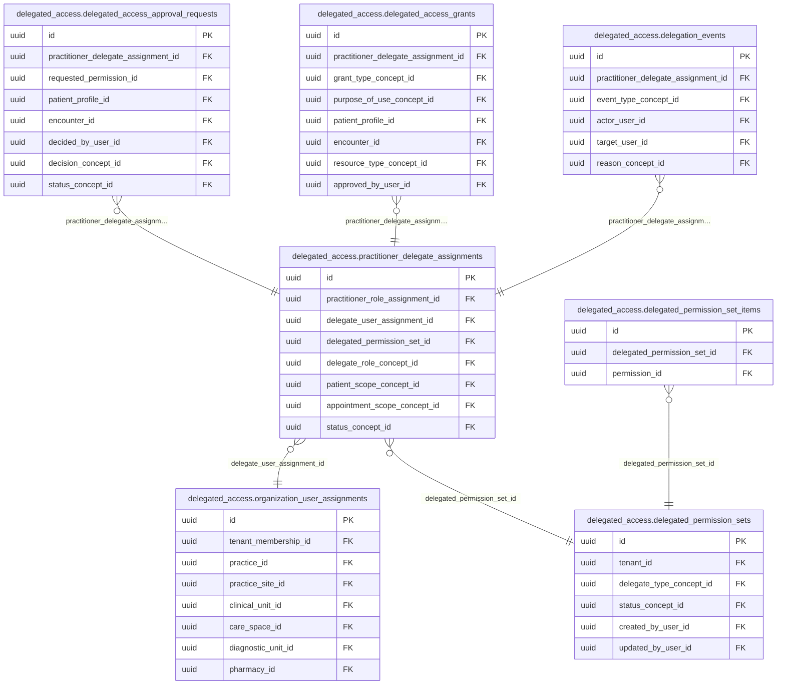

<!-- AUTOGENERADO por tools/inventario/catalogo.mjs. No editar manualmente. -->

# Catálogo del schema `delegated_access`

- **Tablas:** 7 · **Columnas:** 94 (22 con descripción: 23.4 %) · **Índices:** 57
- **Dominio:** Identidad y Seguridad
- Método y límites del catálogo: [README del inventario](../README.md)

## Tablas

| Tabla | Propósito | Columnas | Índices | Operaciones | ORM |
|---|---|---|---|---|---|
| [delegated_access_approval_requests](#delegated_access_approval_requests) | Gestiona solicitudes de aprobación antes de habilitar permisos delegados sensibles. | 12 | 8 | 5 | COINCIDE |
| [delegated_access_grants](#delegated_access_grants) | Conserva concesiones de acceso delegado con su sujeto, alcance, permisos y vigencia. | 16 | 11 | 6 | COINCIDE |
| [delegated_permission_set_items](#delegated_permission_set_items) | Detalla permisos incluidos en conjuntos delegables para limitar acciones otorgadas a representantes. | 6 | 2 | 4 | COINCIDE |
| [delegated_permission_sets](#delegated_permission_sets) | Define paquetes reutilizables de permisos que pueden concederse a delegados bajo un alcance específico. | 13 | 6 | 5 | COINCIDE |
| [delegation_events](#delegation_events) | Mantiene eventos de creación, modificación, uso o revocación de delegaciones para auditoría. | 10 | 6 | 7 | COINCIDE |
| [organization_user_assignments](#organization_user_assignments) | Asocia usuarios con organizaciones para determinar en qué ámbitos pueden actuar o administrar acceso delegado. | 19 | 14 | 7 | COINCIDE |
| [practitioner_delegate_assignments](#practitioner_delegate_assignments) | Relaciona profesionales con delegados autorizados para realizar tareas en su nombre. | 18 | 10 | 9 | COINCIDE |

## Diagrama entidad-relación

Las tablas se agrupan en familias por sus claves foráneas dentro del schema (máximo 40 por diagrama). Las FK hacia otros schemas se listan en la ficha de cada tabla.

### Familia 1 de 1 — 7 tablas

## Fichas

### delegated_access_approval_requests

#### Vista general

Gestiona solicitudes de aprobación antes de habilitar permisos delegados sensibles.

- **Estado del propósito:** DOMAIN_CURATED_DRAFT · fuente: `Mantra Core Health Context/modules/diagram_29_delegated_access.puml: delegated_access_approval_requests`
- **Dominio:** Identidad y Seguridad · **Diagrama:** `Mantra Core Health Context/modules/diagram_29_delegated_access.puml` · **DDL:** `SQL/29_delegated_access/02_tables.sql`
- **Entidad del ORM:** `DelegatedAccessApprovalRequests` — `src/modules/delegated_access/entities/delegated_access_approval_requests.entity.ts`
- **Resumen:** 12 columnas · 8 índices · 7 FK salientes · 0 entrantes · 5 operaciones

#### Columnas

| # | Columna | Tipo | Rol estructural | Descripción | ORM |
|---|---|---|---|---|---|
| 1 | `id` | `uuid` | Clave primaria; Obligatoria | Identificador único de la instancia. _(JSDOC_ESTANDAR, `src/modules/delegated_access/entities/delegated_access_approval_requests.entity.ts:15`)_ | coincide |
| 2 | `practitioner_delegate_assignment_id` | `uuid` | Clave foránea → delegated_access.practitioner_delegate_assignments.id; Obligatoria | _sin dato_ | coincide |
| 3 | `requested_permission_id` | `uuid` | Clave foránea → authz.permissions.id; Obligatoria | _sin dato_ | coincide |
| 4 | `patient_profile_id` | `uuid` | Clave foránea → profiles.patient_profiles.profile_id; Opcional | _sin dato_ | coincide |
| 5 | `encounter_id` | `uuid` | Clave foránea → clinical.encounters.id; Opcional | _sin dato_ | coincide |
| 6 | `reason_text` | `text` | Opcional | _sin dato_ | coincide |
| 7 | `requested_at` | `timestamptz` | Opcional | _sin dato_ | coincide |
| 8 | `decided_at` | `timestamptz` | Opcional | _sin dato_ | coincide |
| 9 | `decided_by_user_id` | `uuid` | Clave foránea → iam.users.id; Opcional | _sin dato_ | coincide |
| 10 | `decision_concept_id` | `uuid` | Clave foránea → terminology.catalog_concepts.id; Obligatoria | _sin dato_ | coincide |
| 11 | `status_concept_id` | `uuid` | Clave foránea → terminology.catalog_concepts.id; Obligatoria | _sin dato_ | coincide |
| 12 | `created_at` | `timestamptz` | Obligatoria | Fecha y hora en que se creó el registro. _(JSDOC_ESTANDAR, `src/modules/delegated_access/entities/delegated_access_approval_requests.entity.ts:89`)_ | coincide |

#### Relaciones

| Sentido | Columnas | Tabla | Restricción |
|---|---|---|---|
| hacia | practitioner_delegate_assignment_id | delegated_access.practitioner_delegate_assignments (id) | fk_delegated_access_approval_requests_practitioner_del_a6db1929 |
| hacia | requested_permission_id | authz.permissions (id) | fk_delegated_access_approval_requests_requested_permission_id |
| hacia | patient_profile_id | profiles.patient_profiles (profile_id) | fk_delegated_access_approval_requests_patient_profile_id |
| hacia | encounter_id | clinical.encounters (id) | fk_delegated_access_approval_requests_encounter_id |
| hacia | decided_by_user_id | iam.users (id) | fk_delegated_access_approval_requests_decided_by_user_id |
| hacia | decision_concept_id | terminology.catalog_concepts (id) | fk_delegated_access_approval_requests_decision_concept_id |
| hacia | status_concept_id | terminology.catalog_concepts (id) | fk_delegated_access_approval_requests_status_concept_id |

#### Índices

| Índice | Único | Columnas | Para qué |
|---|---|---|---|
| `ix_delegated_access_approval_requests_practitioner_del_01d90a86` | no | practitioner_delegate_assignment_id | Soporta la clave foránea fk_delegated_access_approval_requests_practitioner_del_a6db1929: PostgreSQL no indexa las FK por sí mismo _(DOCUMENTO)_; 2 consulta(s) de repositorio filtran u ordenan por «practitioner_delegate_assignment_id», la primera columna del índice _(CONSULTA)_ |
| `ix_delegated_access_approval_requests_requested_permission_id` | no | requested_permission_id | Soporta la clave foránea fk_delegated_access_approval_requests_requested_permission_id: PostgreSQL no indexa las FK por sí mismo _(DOCUMENTO)_; 1 consulta(s) de repositorio filtran u ordenan por «requested_permission_id», la primera columna del índice _(CONSULTA)_ |
| `ix_delegated_access_approval_requests_patient_profile_id` | no | patient_profile_id | Soporta la clave foránea fk_delegated_access_approval_requests_patient_profile_id: PostgreSQL no indexa las FK por sí mismo _(DOCUMENTO)_; 1 consulta(s) de repositorio filtran u ordenan por «patient_profile_id», la primera columna del índice _(CONSULTA)_ |
| `ix_delegated_access_approval_requests_encounter_id` | no | encounter_id | Soporta la clave foránea fk_delegated_access_approval_requests_encounter_id: PostgreSQL no indexa las FK por sí mismo _(DOCUMENTO)_; 1 consulta(s) de repositorio filtran u ordenan por «encounter_id», la primera columna del índice _(CONSULTA)_ |
| `ix_delegated_access_approval_requests_decided_by_user_id` | no | decided_by_user_id | Soporta la clave foránea fk_delegated_access_approval_requests_decided_by_user_id: PostgreSQL no indexa las FK por sí mismo _(DOCUMENTO)_ |
| `ix_delegated_access_approval_requests_decision_concept_id` | no | decision_concept_id | Soporta la clave foránea fk_delegated_access_approval_requests_decision_concept_id: PostgreSQL no indexa las FK por sí mismo _(DOCUMENTO)_ |
| `ix_delegated_access_approval_requests_status_concept_id` | no | status_concept_id | Soporta la clave foránea fk_delegated_access_approval_requests_status_concept_id: PostgreSQL no indexa las FK por sí mismo _(DOCUMENTO)_; 2 consulta(s) de repositorio filtran u ordenan por «status_concept_id», la primera columna del índice _(CONSULTA)_ |
| `ix_delegated_access_approval_requests_patient_profile__beb5e078` | no | patient_profile_id, ("created_at" DESC) | _sin uso detectado estáticamente_ |

#### Operaciones que la tocan

| Operación | Efecto | Confianza |
|---|---|---|
| POST /access-requests/{id}/decision | ACTUALIZA | POR_TIPO |
| POST /access-requests/{id}/decision | LEE | DIRECTA |
| POST /practitioner-delegates/{id}/access-requests | CREA | DIRECTA |
| POST /practitioner-delegates/{id}/access-requests | LEE | DIRECTA |
| POST /practitioner-delegates/{id}/revoke | ACTUALIZA | DIRECTA |

#### Gobierno

| Atributo | Valor | Fuente |
|---|---|---|
| Append-only | no declarado | — |
| Datos personales | sin fuente | — |
| Financiera | sin fuente | — |
| Crítica para auditoría | sin fuente | — |
| Retención | sin fuente | — |
| Responsable | sin fuente | — |
| Revisión | AUTO_DETECTADA | — |

---

### delegated_access_grants

#### Vista general

Conserva concesiones de acceso delegado con su sujeto, alcance, permisos y vigencia.

- **Estado del propósito:** DOMAIN_CURATED_DRAFT · fuente: `Mantra Core Health Context/modules/diagram_29_delegated_access.puml: delegated_access_grants`
- **Dominio:** Identidad y Seguridad · **Diagrama:** `Mantra Core Health Context/modules/diagram_29_delegated_access.puml` · **DDL:** `SQL/29_delegated_access/02_tables.sql`
- **Entidad del ORM:** `DelegatedAccessGrants` — `src/modules/delegated_access/entities/delegated_access_grants.entity.ts`
- **Resumen:** 16 columnas · 11 índices · 10 FK salientes · 0 entrantes · 6 operaciones

#### Columnas

| # | Columna | Tipo | Rol estructural | Descripción | ORM |
|---|---|---|---|---|---|
| 1 | `id` | `uuid` | Clave primaria; Obligatoria | Identificador único de la instancia. _(JSDOC_ESTANDAR, `src/modules/delegated_access/entities/delegated_access_grants.entity.ts:12`)_ | coincide |
| 2 | `practitioner_delegate_assignment_id` | `uuid` | Clave foránea → delegated_access.practitioner_delegate_assignments.id; Obligatoria | _sin dato_ | coincide |
| 3 | `grant_type_concept_id` | `uuid` | Clave foránea → terminology.catalog_concepts.id; Obligatoria | _sin dato_ | coincide |
| 4 | `purpose_of_use_concept_id` | `uuid` | Clave foránea → terminology.catalog_concepts.id; Obligatoria | _sin dato_ | coincide |
| 5 | `patient_profile_id` | `uuid` | Clave foránea → profiles.patient_profiles.profile_id; Opcional | _sin dato_ | coincide |
| 6 | `encounter_id` | `uuid` | Clave foránea → clinical.encounters.id; Opcional | _sin dato_ | coincide |
| 7 | `resource_type_concept_id` | `uuid` | Clave foránea → terminology.catalog_concepts.id; Opcional | _sin dato_ | coincide |
| 8 | `valid_from` | `timestamptz` | Opcional | _sin dato_ | coincide |
| 9 | `valid_to` | `timestamptz` | Opcional | _sin dato_ | coincide |
| 10 | `approved_by_user_id` | `uuid` | Clave foránea → iam.users.id; Opcional | _sin dato_ | coincide |
| 11 | `status_concept_id` | `uuid` | Clave foránea → terminology.catalog_concepts.id; Obligatoria | _sin dato_ | coincide |
| 12 | `created_at` | `timestamptz` | Obligatoria | Fecha y hora en que se creó el registro. _(JSDOC_ESTANDAR, `src/modules/delegated_access/entities/delegated_access_grants.entity.ts:90`)_ | coincide |
| 13 | `updated_at` | `timestamptz` | Obligatoria | Fecha y hora de la última actualización. _(JSDOC_ESTANDAR, `src/modules/delegated_access/entities/delegated_access_grants.entity.ts:96`)_ | coincide |
| 14 | `created_by_user_id` | `uuid` | Clave foránea → iam.users.id; Opcional | _sin dato_ | coincide |
| 15 | `updated_by_user_id` | `uuid` | Clave foránea → iam.users.id; Opcional | _sin dato_ | coincide |
| 16 | `row_version` | `integer = 1` | Obligatoria | Versión usada para controlar actualizaciones concurrentes. _(JSDOC_ENTIDAD, `src/modules/delegated_access/entities/delegated_access_grants.entity.ts:114`)_ | coincide |

#### Relaciones

| Sentido | Columnas | Tabla | Restricción |
|---|---|---|---|
| hacia | practitioner_delegate_assignment_id | delegated_access.practitioner_delegate_assignments (id) | fk_delegated_access_grants_practitioner_delegate_assignment_id |
| hacia | grant_type_concept_id | terminology.catalog_concepts (id) | fk_delegated_access_grants_grant_type_concept_id |
| hacia | purpose_of_use_concept_id | terminology.catalog_concepts (id) | fk_delegated_access_grants_purpose_of_use_concept_id |
| hacia | patient_profile_id | profiles.patient_profiles (profile_id) | fk_delegated_access_grants_patient_profile_id |
| hacia | encounter_id | clinical.encounters (id) | fk_delegated_access_grants_encounter_id |
| hacia | resource_type_concept_id | terminology.catalog_concepts (id) | fk_delegated_access_grants_resource_type_concept_id |
| hacia | approved_by_user_id | iam.users (id) | fk_delegated_access_grants_approved_by_user_id |
| hacia | status_concept_id | terminology.catalog_concepts (id) | fk_delegated_access_grants_status_concept_id |
| hacia | created_by_user_id | iam.users (id) | fk_delegated_access_grants_created_by_user_id |
| hacia | updated_by_user_id | iam.users (id) | fk_delegated_access_grants_updated_by_user_id |

#### Índices

| Índice | Único | Columnas | Para qué |
|---|---|---|---|
| `ix_delegated_access_grants_practitioner_delegate_assignment_id` | no | practitioner_delegate_assignment_id | Soporta la clave foránea fk_delegated_access_grants_practitioner_delegate_assignment_id: PostgreSQL no indexa las FK por sí mismo _(DOCUMENTO)_; 1 consulta(s) de repositorio filtran u ordenan por «practitioner_delegate_assignment_id», la primera columna del índice _(CONSULTA)_ |
| `ix_delegated_access_grants_grant_type_concept_id` | no | grant_type_concept_id | Soporta la clave foránea fk_delegated_access_grants_grant_type_concept_id: PostgreSQL no indexa las FK por sí mismo _(DOCUMENTO)_ |
| `ix_delegated_access_grants_purpose_of_use_concept_id` | no | purpose_of_use_concept_id | Soporta la clave foránea fk_delegated_access_grants_purpose_of_use_concept_id: PostgreSQL no indexa las FK por sí mismo _(DOCUMENTO)_ |
| `ix_delegated_access_grants_patient_profile_id` | no | patient_profile_id | Soporta la clave foránea fk_delegated_access_grants_patient_profile_id: PostgreSQL no indexa las FK por sí mismo _(DOCUMENTO)_ |
| `ix_delegated_access_grants_encounter_id` | no | encounter_id | Soporta la clave foránea fk_delegated_access_grants_encounter_id: PostgreSQL no indexa las FK por sí mismo _(DOCUMENTO)_ |
| `ix_delegated_access_grants_resource_type_concept_id` | no | resource_type_concept_id | Soporta la clave foránea fk_delegated_access_grants_resource_type_concept_id: PostgreSQL no indexa las FK por sí mismo _(DOCUMENTO)_ |
| `ix_delegated_access_grants_approved_by_user_id` | no | approved_by_user_id | Soporta la clave foránea fk_delegated_access_grants_approved_by_user_id: PostgreSQL no indexa las FK por sí mismo _(DOCUMENTO)_ |
| `ix_delegated_access_grants_status_concept_id` | no | status_concept_id | Soporta la clave foránea fk_delegated_access_grants_status_concept_id: PostgreSQL no indexa las FK por sí mismo _(DOCUMENTO)_; 2 consulta(s) de repositorio filtran u ordenan por «status_concept_id», la primera columna del índice _(CONSULTA)_ |
| `ix_delegated_access_grants_created_by_user_id` | no | created_by_user_id | Soporta la clave foránea fk_delegated_access_grants_created_by_user_id: PostgreSQL no indexa las FK por sí mismo _(DOCUMENTO)_ |
| `ix_delegated_access_grants_updated_by_user_id` | no | updated_by_user_id | Soporta la clave foránea fk_delegated_access_grants_updated_by_user_id: PostgreSQL no indexa las FK por sí mismo _(DOCUMENTO)_ |
| `ix_delegated_access_grants_patient_profile_id_updated_at` | no | patient_profile_id, ("updated_at" DESC) | _sin uso detectado estáticamente_ |

#### Operaciones que la tocan

| Operación | Efecto | Confianza |
|---|---|---|
| POST /access-requests/{id}/decision | CREA | DIRECTA |
| POST /authz/effective-actor/evaluate | LEE | DIRECTA |
| POST /delegated-access/expiry-sweep | ACTUALIZA | POR_TIPO |
| POST /delegated-access/expiry-sweep | LEE | DIRECTA |
| POST /practitioner-delegates/{id}/grants | CREA | DIRECTA |
| POST /practitioner-delegates/{id}/revoke | ACTUALIZA | DIRECTA |

#### Gobierno

| Atributo | Valor | Fuente |
|---|---|---|
| Append-only | no declarado | — |
| Datos personales | sin fuente | — |
| Financiera | sin fuente | — |
| Crítica para auditoría | sin fuente | — |
| Retención | sin fuente | — |
| Responsable | sin fuente | — |
| Revisión | AUTO_DETECTADA | — |

---

### delegated_permission_set_items

#### Vista general

Detalla permisos incluidos en conjuntos delegables para limitar acciones otorgadas a representantes.

- **Estado del propósito:** DOMAIN_CURATED_DRAFT · fuente: `Mantra Core Health Context/modules/diagram_29_delegated_access.puml: delegated_permission_set_items`
- **Dominio:** Identidad y Seguridad · **Diagrama:** `Mantra Core Health Context/modules/diagram_29_delegated_access.puml` · **DDL:** `SQL/29_delegated_access/02_tables.sql`
- **Entidad del ORM:** `DelegatedPermissionSetItems` — `src/modules/delegated_access/entities/delegated_permission_set_items.entity.ts`
- **Resumen:** 6 columnas · 2 índices · 2 FK salientes · 0 entrantes · 4 operaciones

#### Columnas

| # | Columna | Tipo | Rol estructural | Descripción | ORM |
|---|---|---|---|---|---|
| 1 | `id` | `uuid` | Clave primaria; Obligatoria | Identificador único de la instancia. _(JSDOC_ESTANDAR, `src/modules/delegated_access/entities/delegated_permission_set_items.entity.ts:15`)_ | coincide |
| 2 | `delegated_permission_set_id` | `uuid` | Clave foránea → delegated_access.delegated_permission_sets.id; Obligatoria | _sin dato_ | coincide |
| 3 | `permission_id` | `uuid` | Clave foránea → authz.permissions.id; Obligatoria | _sin dato_ | coincide |
| 4 | `constraint_json` | `jsonb` | Opcional | _sin dato_ | coincide |
| 5 | `requires_step_up_authentication` | `boolean` | Opcional | _sin dato_ | coincide |
| 6 | `created_at` | `timestamptz` | Obligatoria | Fecha y hora en que se creó el registro. _(JSDOC_ESTANDAR, `src/modules/delegated_access/entities/delegated_permission_set_items.entity.ts:54`)_ | coincide |

#### Relaciones

| Sentido | Columnas | Tabla | Restricción |
|---|---|---|---|
| hacia | delegated_permission_set_id | delegated_access.delegated_permission_sets (id) | fk_delegated_permission_set_items_delegated_permission_set_id |
| hacia | permission_id | authz.permissions (id) | fk_delegated_permission_set_items_permission_id |

#### Índices

| Índice | Único | Columnas | Para qué |
|---|---|---|---|
| `ix_delegated_permission_set_items_delegated_permission_set_id` | no | delegated_permission_set_id | Soporta la clave foránea fk_delegated_permission_set_items_delegated_permission_set_id: PostgreSQL no indexa las FK por sí mismo _(DOCUMENTO)_; 3 consulta(s) de repositorio filtran u ordenan por «delegated_permission_set_id», la primera columna del índice _(CONSULTA)_ |
| `ix_delegated_permission_set_items_permission_id` | no | permission_id | Soporta la clave foránea fk_delegated_permission_set_items_permission_id: PostgreSQL no indexa las FK por sí mismo _(DOCUMENTO)_; 1 consulta(s) de repositorio filtran u ordenan por «permission_id», la primera columna del índice _(CONSULTA)_ |

#### Operaciones que la tocan

| Operación | Efecto | Confianza |
|---|---|---|
| POST /authz/effective-actor/evaluate | LEE | DIRECTA |
| POST /delegated-permission-sets | CREA | DIRECTA |
| POST /delegated-permission-sets/{id}/versions | BORRA | DIRECTA |
| POST /delegated-permission-sets/{id}/versions | CREA | DIRECTA |

#### Gobierno

| Atributo | Valor | Fuente |
|---|---|---|
| Append-only | no declarado | — |
| Datos personales | sin fuente | — |
| Financiera | sin fuente | — |
| Crítica para auditoría | sin fuente | — |
| Retención | sin fuente | — |
| Responsable | sin fuente | — |
| Revisión | AUTO_DETECTADA | — |

---

### delegated_permission_sets

#### Vista general

Define paquetes reutilizables de permisos que pueden concederse a delegados bajo un alcance específico.

- **Estado del propósito:** DOMAIN_CURATED_DRAFT · fuente: `Mantra Core Health Context/modules/diagram_29_delegated_access.puml: delegated_permission_sets`
- **Dominio:** Identidad y Seguridad · **Diagrama:** `Mantra Core Health Context/modules/diagram_29_delegated_access.puml` · **DDL:** `SQL/29_delegated_access/02_tables.sql`
- **Entidad del ORM:** `DelegatedPermissionSets` — `src/modules/delegated_access/entities/delegated_permission_sets.entity.ts`
- **Resumen:** 13 columnas · 6 índices · 5 FK salientes · 2 entrantes · 5 operaciones

#### Columnas

| # | Columna | Tipo | Rol estructural | Descripción | ORM |
|---|---|---|---|---|---|
| 1 | `id` | `uuid` | Clave primaria; Obligatoria | Identificador único de la instancia. _(JSDOC_ESTANDAR, `src/modules/delegated_access/entities/delegated_permission_sets.entity.ts:12`)_ | coincide |
| 2 | `tenant_id` | `uuid` | Clave foránea → directory.tenants.id; Obligatoria | _sin dato_ | coincide |
| 3 | `code` | `varchar` | Obligatoria | _sin dato_ | coincide |
| 4 | `name` | `varchar` | Obligatoria | _sin dato_ | coincide |
| 5 | `delegate_type_concept_id` | `uuid` | Clave foránea → terminology.catalog_concepts.id; Obligatoria | _sin dato_ | coincide |
| 6 | `description` | `text` | Opcional | _sin dato_ | coincide |
| 7 | `status_concept_id` | `uuid` | Clave foránea → terminology.catalog_concepts.id; Obligatoria | _sin dato_ | coincide |
| 8 | `version_number` | `integer` | Obligatoria | _sin dato_ | coincide |
| 9 | `created_at` | `timestamptz` | Obligatoria | Fecha y hora en que se creó el registro. _(JSDOC_ESTANDAR, `src/modules/delegated_access/entities/delegated_permission_sets.entity.ts:60`)_ | coincide |
| 10 | `updated_at` | `timestamptz` | Obligatoria | Fecha y hora de la última actualización. _(JSDOC_ESTANDAR, `src/modules/delegated_access/entities/delegated_permission_sets.entity.ts:66`)_ | coincide |
| 11 | `created_by_user_id` | `uuid` | Clave foránea → iam.users.id; Opcional | _sin dato_ | coincide |
| 12 | `updated_by_user_id` | `uuid` | Clave foránea → iam.users.id; Opcional | _sin dato_ | coincide |
| 13 | `row_version` | `integer = 1` | Obligatoria | Versión usada para controlar actualizaciones concurrentes. _(JSDOC_ENTIDAD, `src/modules/delegated_access/entities/delegated_permission_sets.entity.ts:84`)_ | coincide |

#### Relaciones

| Sentido | Columnas | Tabla | Restricción |
|---|---|---|---|
| hacia | tenant_id | directory.tenants (id) | fk_delegated_permission_sets_tenant_id |
| hacia | delegate_type_concept_id | terminology.catalog_concepts (id) | fk_delegated_permission_sets_delegate_type_concept_id |
| hacia | status_concept_id | terminology.catalog_concepts (id) | fk_delegated_permission_sets_status_concept_id |
| hacia | created_by_user_id | iam.users (id) | fk_delegated_permission_sets_created_by_user_id |
| hacia | updated_by_user_id | iam.users (id) | fk_delegated_permission_sets_updated_by_user_id |
| desde | id | delegated_access.delegated_permission_set_items (delegated_permission_set_id) | fk_delegated_permission_set_items_delegated_permission_set_id |
| desde | id | delegated_access.practitioner_delegate_assignments (delegated_permission_set_id) | fk_practitioner_delegate_assignments_delegated_permiss_f69e2298 |

#### Índices

| Índice | Único | Columnas | Para qué |
|---|---|---|---|
| `ix_delegated_permission_sets_tenant_id` | no | tenant_id | Soporta la clave foránea fk_delegated_permission_sets_tenant_id: PostgreSQL no indexa las FK por sí mismo _(DOCUMENTO)_; 1 consulta(s) de repositorio filtran u ordenan por «tenant_id», la primera columna del índice _(CONSULTA)_ |
| `ix_delegated_permission_sets_delegate_type_concept_id` | no | delegate_type_concept_id | Soporta la clave foránea fk_delegated_permission_sets_delegate_type_concept_id: PostgreSQL no indexa las FK por sí mismo _(DOCUMENTO)_ |
| `ix_delegated_permission_sets_status_concept_id` | no | status_concept_id | Soporta la clave foránea fk_delegated_permission_sets_status_concept_id: PostgreSQL no indexa las FK por sí mismo _(DOCUMENTO)_ |
| `ix_delegated_permission_sets_created_by_user_id` | no | created_by_user_id | Soporta la clave foránea fk_delegated_permission_sets_created_by_user_id: PostgreSQL no indexa las FK por sí mismo _(DOCUMENTO)_ |
| `ix_delegated_permission_sets_updated_by_user_id` | no | updated_by_user_id | Soporta la clave foránea fk_delegated_permission_sets_updated_by_user_id: PostgreSQL no indexa las FK por sí mismo _(DOCUMENTO)_ |
| `ix_delegated_permission_sets_tenant_id_status_concept_id` | no | tenant_id, status_concept_id, ("updated_at" DESC) | _sin uso detectado estáticamente_ |

#### Operaciones que la tocan

| Operación | Efecto | Confianza |
|---|---|---|
| POST /delegated-permission-sets | CREA | DIRECTA |
| POST /delegated-permission-sets | LEE | DIRECTA |
| POST /delegated-permission-sets/{id}/versions | ACTUALIZA | POR_TIPO |
| POST /delegated-permission-sets/{id}/versions | LEE | DIRECTA |
| POST /practitioner-delegates | LEE | DIRECTA |

#### Gobierno

| Atributo | Valor | Fuente |
|---|---|---|
| Append-only | no declarado | — |
| Datos personales | sin fuente | — |
| Financiera | sin fuente | — |
| Crítica para auditoría | sin fuente | — |
| Retención | sin fuente | — |
| Responsable | sin fuente | — |
| Revisión | AUTO_DETECTADA | — |

---

### delegation_events

#### Vista general

Mantiene eventos de creación, modificación, uso o revocación de delegaciones para auditoría.

- **Estado del propósito:** DOMAIN_CURATED_DRAFT · fuente: `Mantra Core Health Context/modules/diagram_29_delegated_access.puml: delegation_events`
- **Dominio:** Identidad y Seguridad · **Diagrama:** `Mantra Core Health Context/modules/diagram_29_delegated_access.puml` · **DDL:** `SQL/29_delegated_access/02_tables.sql`
- **Entidad del ORM:** `DelegationEvents` — `src/modules/delegated_access/entities/delegation_events.entity.ts`
- **Resumen:** 10 columnas · 6 índices · 5 FK salientes · 0 entrantes · 7 operaciones

#### Columnas

| # | Columna | Tipo | Rol estructural | Descripción | ORM |
|---|---|---|---|---|---|
| 1 | `id` | `uuid` | Clave primaria; Obligatoria | Identificador único de la instancia. _(JSDOC_ESTANDAR, `src/modules/delegated_access/entities/delegation_events.entity.ts:12`)_ | coincide |
| 2 | `practitioner_delegate_assignment_id` | `uuid` | Clave foránea → delegated_access.practitioner_delegate_assignments.id; Obligatoria | _sin dato_ | coincide |
| 3 | `event_type_concept_id` | `uuid` | Clave foránea → terminology.catalog_concepts.id; Obligatoria | _sin dato_ | coincide |
| 4 | `actor_user_id` | `uuid` | Clave foránea → iam.users.id; Opcional | _sin dato_ | coincide |
| 5 | `target_user_id` | `uuid` | Clave foránea → iam.users.id; Opcional | _sin dato_ | coincide |
| 6 | `reason_concept_id` | `uuid` | Clave foránea → terminology.catalog_concepts.id; Opcional | _sin dato_ | coincide |
| 7 | `previous_state_hash` | `varchar` | Opcional | _sin dato_ | coincide |
| 8 | `new_state_hash` | `varchar` | Opcional | _sin dato_ | coincide |
| 9 | `occurred_at` | `timestamptz` | Obligatoria | _sin dato_ | coincide |
| 10 | `created_at` | `timestamptz` | Obligatoria | Fecha y hora en que se creó el registro. _(JSDOC_ESTANDAR, `src/modules/delegated_access/entities/delegation_events.entity.ts:74`)_ | coincide |

#### Relaciones

| Sentido | Columnas | Tabla | Restricción |
|---|---|---|---|
| hacia | practitioner_delegate_assignment_id | delegated_access.practitioner_delegate_assignments (id) | fk_delegation_events_practitioner_delegate_assignment_id |
| hacia | event_type_concept_id | terminology.catalog_concepts (id) | fk_delegation_events_event_type_concept_id |
| hacia | actor_user_id | iam.users (id) | fk_delegation_events_actor_user_id |
| hacia | target_user_id | iam.users (id) | fk_delegation_events_target_user_id |
| hacia | reason_concept_id | terminology.catalog_concepts (id) | fk_delegation_events_reason_concept_id |

#### Índices

| Índice | Único | Columnas | Para qué |
|---|---|---|---|
| `ix_delegation_events_practitioner_delegate_assignment_id` | no | practitioner_delegate_assignment_id | Soporta la clave foránea fk_delegation_events_practitioner_delegate_assignment_id: PostgreSQL no indexa las FK por sí mismo _(DOCUMENTO)_ |
| `ix_delegation_events_event_type_concept_id` | no | event_type_concept_id | Soporta la clave foránea fk_delegation_events_event_type_concept_id: PostgreSQL no indexa las FK por sí mismo _(DOCUMENTO)_ |
| `ix_delegation_events_actor_user_id` | no | actor_user_id | Soporta la clave foránea fk_delegation_events_actor_user_id: PostgreSQL no indexa las FK por sí mismo _(DOCUMENTO)_ |
| `ix_delegation_events_target_user_id` | no | target_user_id | Soporta la clave foránea fk_delegation_events_target_user_id: PostgreSQL no indexa las FK por sí mismo _(DOCUMENTO)_ |
| `ix_delegation_events_reason_concept_id` | no | reason_concept_id | Soporta la clave foránea fk_delegation_events_reason_concept_id: PostgreSQL no indexa las FK por sí mismo _(DOCUMENTO)_ |
| `brin_delegation_events_created_at` | no | created_at | BRIN para logs e historiales append-only de gran volumen _(DOCUMENTO)_ |

#### Operaciones que la tocan

| Operación | Efecto | Confianza |
|---|---|---|
| POST /access-requests/{id}/decision | CREA | DIRECTA |
| POST /authz/effective-actor/evaluate | CREA | DIRECTA |
| POST /delegated-access/expiry-sweep | CREA | DIRECTA |
| POST /practitioner-delegates | CREA | DIRECTA |
| POST /practitioner-delegates/{id}/access-requests | CREA | DIRECTA |
| POST /practitioner-delegates/{id}/grants | CREA | DIRECTA |
| POST /practitioner-delegates/{id}/revoke | CREA | DIRECTA |

#### Gobierno

| Atributo | Valor | Fuente |
|---|---|---|
| Append-only | no declarado | — |
| Datos personales | sin fuente | — |
| Financiera | sin fuente | — |
| Crítica para auditoría | sin fuente | — |
| Retención | sin fuente | — |
| Responsable | sin fuente | — |
| Revisión | AUTO_DETECTADA | — |

---

### organization_user_assignments

#### Vista general

Asocia usuarios con organizaciones para determinar en qué ámbitos pueden actuar o administrar acceso delegado.

- **Estado del propósito:** DOMAIN_CURATED_DRAFT · fuente: `Mantra Core Health Context/modules/diagram_29_delegated_access.puml: organization_user_assignments`
- **Dominio:** Identidad y Seguridad · **Diagrama:** `Mantra Core Health Context/modules/diagram_29_delegated_access.puml` · **DDL:** `SQL/29_delegated_access/02_tables.sql`
- **Entidad del ORM:** `OrganizationUserAssignments` — `src/modules/delegated_access/entities/organization_user_assignments.entity.ts`
- **Resumen:** 19 columnas · 14 índices · 13 FK salientes · 1 entrantes · 7 operaciones

#### Columnas

| # | Columna | Tipo | Rol estructural | Descripción | ORM |
|---|---|---|---|---|---|
| 1 | `id` | `uuid` | Clave primaria; Obligatoria | Identificador único de la instancia. _(JSDOC_ESTANDAR, `src/modules/delegated_access/entities/organization_user_assignments.entity.ts:15`)_ | coincide |
| 2 | `tenant_membership_id` | `uuid` | Clave foránea → directory.tenant_memberships.id; Obligatoria | _sin dato_ | coincide |
| 3 | `practice_id` | `uuid` | Clave foránea → practice.practices.id; Opcional | _sin dato_ | coincide |
| 4 | `practice_site_id` | `uuid` | Clave foránea → practice.practice_sites.id; Opcional | _sin dato_ | coincide |
| 5 | `clinical_unit_id` | `uuid` | Clave foránea → practice.clinical_units.id; Opcional | _sin dato_ | coincide |
| 6 | `care_space_id` | `uuid` | Clave foránea → practice.care_spaces.id; Opcional | _sin dato_ | coincide |
| 7 | `diagnostic_unit_id` | `uuid` | Clave foránea → diagnostic_units.diagnostic_units.id; Opcional | _sin dato_ | coincide |
| 8 | `pharmacy_id` | `uuid` | Clave foránea → pharmacy.pharmacies.id; Opcional | _sin dato_ | coincide |
| 9 | `assignment_role_concept_id` | `uuid` | Clave foránea → terminology.catalog_concepts.id; Obligatoria | _sin dato_ | coincide |
| 10 | `access_scope_concept_id` | `uuid` | Clave foránea → terminology.catalog_concepts.id; Obligatoria | _sin dato_ | coincide |
| 11 | `supervisor_user_id` | `uuid` | Clave foránea → iam.users.id; Opcional | _sin dato_ | coincide |
| 12 | `valid_from` | `timestamptz` | Opcional | _sin dato_ | coincide |
| 13 | `valid_to` | `timestamptz` | Opcional | _sin dato_ | coincide |
| 14 | `status_concept_id` | `uuid` | Clave foránea → terminology.catalog_concepts.id; Obligatoria | _sin dato_ | coincide |
| 15 | `created_at` | `timestamptz` | Obligatoria | Fecha y hora en que se creó el registro. _(JSDOC_ESTANDAR, `src/modules/delegated_access/entities/organization_user_assignments.entity.ts:107`)_ | coincide |
| 16 | `updated_at` | `timestamptz` | Obligatoria | Fecha y hora de la última actualización. _(JSDOC_ESTANDAR, `src/modules/delegated_access/entities/organization_user_assignments.entity.ts:113`)_ | coincide |
| 17 | `created_by_user_id` | `uuid` | Clave foránea → iam.users.id; Opcional | _sin dato_ | coincide |
| 18 | `updated_by_user_id` | `uuid` | Clave foránea → iam.users.id; Opcional | _sin dato_ | coincide |
| 19 | `row_version` | `integer = 1` | Obligatoria | Versión usada para controlar actualizaciones concurrentes. _(JSDOC_ENTIDAD, `src/modules/delegated_access/entities/organization_user_assignments.entity.ts:131`)_ | coincide |

#### Relaciones

| Sentido | Columnas | Tabla | Restricción |
|---|---|---|---|
| hacia | tenant_membership_id | directory.tenant_memberships (id) | fk_organization_user_assignments_tenant_membership_id |
| hacia | practice_id | practice.practices (id) | fk_organization_user_assignments_practice_id |
| hacia | practice_site_id | practice.practice_sites (id) | fk_organization_user_assignments_practice_site_id |
| hacia | clinical_unit_id | practice.clinical_units (id) | fk_organization_user_assignments_clinical_unit_id |
| hacia | care_space_id | practice.care_spaces (id) | fk_organization_user_assignments_care_space_id |
| hacia | diagnostic_unit_id | diagnostic_units.diagnostic_units (id) | fk_organization_user_assignments_diagnostic_unit_id |
| hacia | pharmacy_id | pharmacy.pharmacies (id) | fk_organization_user_assignments_pharmacy_id |
| hacia | assignment_role_concept_id | terminology.catalog_concepts (id) | fk_organization_user_assignments_assignment_role_concept_id |
| hacia | access_scope_concept_id | terminology.catalog_concepts (id) | fk_organization_user_assignments_access_scope_concept_id |
| hacia | supervisor_user_id | iam.users (id) | fk_organization_user_assignments_supervisor_user_id |
| hacia | status_concept_id | terminology.catalog_concepts (id) | fk_organization_user_assignments_status_concept_id |
| hacia | created_by_user_id | iam.users (id) | fk_organization_user_assignments_created_by_user_id |
| hacia | updated_by_user_id | iam.users (id) | fk_organization_user_assignments_updated_by_user_id |
| desde | id | delegated_access.practitioner_delegate_assignments (delegate_user_assignment_id) | fk_practitioner_delegate_assignments_delegate_user_ass_501b9011 |

#### Índices

| Índice | Único | Columnas | Para qué |
|---|---|---|---|
| `ix_organization_user_assignments_tenant_membership_id` | no | tenant_membership_id | Soporta la clave foránea fk_organization_user_assignments_tenant_membership_id: PostgreSQL no indexa las FK por sí mismo _(DOCUMENTO)_; 1 consulta(s) de repositorio filtran u ordenan por «tenant_membership_id», la primera columna del índice _(CONSULTA)_ |
| `ix_organization_user_assignments_practice_id` | no | practice_id | Soporta la clave foránea fk_organization_user_assignments_practice_id: PostgreSQL no indexa las FK por sí mismo _(DOCUMENTO)_ |
| `ix_organization_user_assignments_practice_site_id` | no | practice_site_id | Soporta la clave foránea fk_organization_user_assignments_practice_site_id: PostgreSQL no indexa las FK por sí mismo _(DOCUMENTO)_ |
| `ix_organization_user_assignments_clinical_unit_id` | no | clinical_unit_id | Soporta la clave foránea fk_organization_user_assignments_clinical_unit_id: PostgreSQL no indexa las FK por sí mismo _(DOCUMENTO)_ |
| `ix_organization_user_assignments_care_space_id` | no | care_space_id | Soporta la clave foránea fk_organization_user_assignments_care_space_id: PostgreSQL no indexa las FK por sí mismo _(DOCUMENTO)_ |
| `ix_organization_user_assignments_diagnostic_unit_id` | no | diagnostic_unit_id | Soporta la clave foránea fk_organization_user_assignments_diagnostic_unit_id: PostgreSQL no indexa las FK por sí mismo _(DOCUMENTO)_ |
| `ix_organization_user_assignments_pharmacy_id` | no | pharmacy_id | Soporta la clave foránea fk_organization_user_assignments_pharmacy_id: PostgreSQL no indexa las FK por sí mismo _(DOCUMENTO)_ |
| `ix_organization_user_assignments_assignment_role_concept_id` | no | assignment_role_concept_id | Soporta la clave foránea fk_organization_user_assignments_assignment_role_concept_id: PostgreSQL no indexa las FK por sí mismo _(DOCUMENTO)_; 1 consulta(s) de repositorio filtran u ordenan por «assignment_role_concept_id», la primera columna del índice _(CONSULTA)_ |
| `ix_organization_user_assignments_access_scope_concept_id` | no | access_scope_concept_id | Soporta la clave foránea fk_organization_user_assignments_access_scope_concept_id: PostgreSQL no indexa las FK por sí mismo _(DOCUMENTO)_; 1 consulta(s) de repositorio filtran u ordenan por «access_scope_concept_id», la primera columna del índice _(CONSULTA)_ |
| `ix_organization_user_assignments_supervisor_user_id` | no | supervisor_user_id | Soporta la clave foránea fk_organization_user_assignments_supervisor_user_id: PostgreSQL no indexa las FK por sí mismo _(DOCUMENTO)_ |
| `ix_organization_user_assignments_status_concept_id` | no | status_concept_id | Soporta la clave foránea fk_organization_user_assignments_status_concept_id: PostgreSQL no indexa las FK por sí mismo _(DOCUMENTO)_; 2 consulta(s) de repositorio filtran u ordenan por «status_concept_id», la primera columna del índice _(CONSULTA)_ |
| `ix_organization_user_assignments_created_by_user_id` | no | created_by_user_id | Soporta la clave foránea fk_organization_user_assignments_created_by_user_id: PostgreSQL no indexa las FK por sí mismo _(DOCUMENTO)_ |
| `ix_organization_user_assignments_updated_by_user_id` | no | updated_by_user_id | Soporta la clave foránea fk_organization_user_assignments_updated_by_user_id: PostgreSQL no indexa las FK por sí mismo _(DOCUMENTO)_ |
| `gist_organization_user_assignments_effective_period` | no | (tstzrange(valid_from, valid_to, '[)')) | GiST para periodos, no solapamiento y geografía _(DOCUMENTO)_ |

#### Operaciones que la tocan

| Operación | Efecto | Confianza |
|---|---|---|
| POST /delegated-access/expiry-sweep | ACTUALIZA | POR_TIPO |
| POST /delegated-access/expiry-sweep | LEE | DIRECTA |
| POST /org/{tenantMembershipId}/user-assignments | CREA | DIRECTA |
| POST /org/{tenantMembershipId}/user-assignments | LEE | DIRECTA |
| PATCH /org/user-assignments/{id} | ACTUALIZA | POR_TIPO |
| PATCH /org/user-assignments/{id} | LEE | DIRECTA |
| POST /practitioner-delegates | LEE | DIRECTA |

#### Gobierno

| Atributo | Valor | Fuente |
|---|---|---|
| Append-only | no declarado | — |
| Datos personales | sin fuente | — |
| Financiera | sin fuente | — |
| Crítica para auditoría | sin fuente | — |
| Retención | sin fuente | — |
| Responsable | sin fuente | — |
| Revisión | AUTO_DETECTADA | — |

---

### practitioner_delegate_assignments

#### Vista general

Relaciona profesionales con delegados autorizados para realizar tareas en su nombre.

- **Estado del propósito:** DOMAIN_CURATED_DRAFT · fuente: `Mantra Core Health Context/modules/diagram_29_delegated_access.puml: practitioner_delegate_assignments`
- **Dominio:** Identidad y Seguridad · **Diagrama:** `Mantra Core Health Context/modules/diagram_29_delegated_access.puml` · **DDL:** `SQL/29_delegated_access/02_tables.sql`
- **Entidad del ORM:** `PractitionerDelegateAssignments` — `src/modules/delegated_access/entities/practitioner_delegate_assignments.entity.ts`
- **Resumen:** 18 columnas · 10 índices · 9 FK salientes · 4 entrantes · 9 operaciones

#### Columnas

| # | Columna | Tipo | Rol estructural | Descripción | ORM |
|---|---|---|---|---|---|
| 1 | `id` | `uuid` | Clave primaria; Obligatoria | Identificador único de la instancia. _(JSDOC_ESTANDAR, `src/modules/delegated_access/entities/practitioner_delegate_assignments.entity.ts:15`)_ | coincide |
| 2 | `practitioner_role_assignment_id` | `uuid` | Clave foránea → practice.practitioner_role_assignments.id; Obligatoria | _sin dato_ | coincide |
| 3 | `delegate_user_assignment_id` | `uuid` | Clave foránea → delegated_access.organization_user_assignments.id; Obligatoria | _sin dato_ | coincide |
| 4 | `delegated_permission_set_id` | `uuid` | Clave foránea → delegated_access.delegated_permission_sets.id; Obligatoria | _sin dato_ | coincide |
| 5 | `delegate_role_concept_id` | `uuid` | Clave foránea → terminology.catalog_concepts.id; Obligatoria | _sin dato_ | coincide |
| 6 | `patient_scope_concept_id` | `uuid` | Clave foránea → terminology.catalog_concepts.id; Opcional | _sin dato_ | coincide |
| 7 | `appointment_scope_concept_id` | `uuid` | Clave foránea → terminology.catalog_concepts.id; Opcional | _sin dato_ | coincide |
| 8 | `may_view_clinical_content` | `boolean` | Opcional | _sin dato_ | coincide |
| 9 | `may_edit_drafts` | `boolean` | Opcional | _sin dato_ | coincide |
| 10 | `may_sign_clinical_content` | `boolean` | Opcional | _sin dato_ | coincide |
| 11 | `valid_from` | `timestamptz` | Opcional | _sin dato_ | coincide |
| 12 | `valid_to` | `timestamptz` | Opcional | _sin dato_ | coincide |
| 13 | `status_concept_id` | `uuid` | Clave foránea → terminology.catalog_concepts.id; Obligatoria | _sin dato_ | coincide |
| 14 | `created_at` | `timestamptz` | Obligatoria | Fecha y hora en que se creó el registro. _(JSDOC_ESTANDAR, `src/modules/delegated_access/entities/practitioner_delegate_assignments.entity.ts:117`)_ | coincide |
| 15 | `updated_at` | `timestamptz` | Obligatoria | Fecha y hora de la última actualización. _(JSDOC_ESTANDAR, `src/modules/delegated_access/entities/practitioner_delegate_assignments.entity.ts:123`)_ | coincide |
| 16 | `created_by_user_id` | `uuid` | Clave foránea → iam.users.id; Opcional | _sin dato_ | coincide |
| 17 | `updated_by_user_id` | `uuid` | Clave foránea → iam.users.id; Opcional | _sin dato_ | coincide |
| 18 | `row_version` | `integer = 1` | Obligatoria | Versión usada para controlar actualizaciones concurrentes. _(JSDOC_ENTIDAD, `src/modules/delegated_access/entities/practitioner_delegate_assignments.entity.ts:141`)_ | coincide |

#### Relaciones

| Sentido | Columnas | Tabla | Restricción |
|---|---|---|---|
| hacia | delegate_user_assignment_id | delegated_access.organization_user_assignments (id) | fk_practitioner_delegate_assignments_delegate_user_ass_501b9011 |
| hacia | delegated_permission_set_id | delegated_access.delegated_permission_sets (id) | fk_practitioner_delegate_assignments_delegated_permiss_f69e2298 |
| hacia | practitioner_role_assignment_id | practice.practitioner_role_assignments (id) | fk_practitioner_delegate_assignments_practitioner_role_7e0ebecf |
| hacia | delegate_role_concept_id | terminology.catalog_concepts (id) | fk_practitioner_delegate_assignments_delegate_role_concept_id |
| hacia | patient_scope_concept_id | terminology.catalog_concepts (id) | fk_practitioner_delegate_assignments_patient_scope_concept_id |
| hacia | appointment_scope_concept_id | terminology.catalog_concepts (id) | fk_practitioner_delegate_assignments_appointment_scope_5c233325 |
| hacia | status_concept_id | terminology.catalog_concepts (id) | fk_practitioner_delegate_assignments_status_concept_id |
| hacia | created_by_user_id | iam.users (id) | fk_practitioner_delegate_assignments_created_by_user_id |
| hacia | updated_by_user_id | iam.users (id) | fk_practitioner_delegate_assignments_updated_by_user_id |
| desde | id | delegated_access.delegated_access_grants (practitioner_delegate_assignment_id) | fk_delegated_access_grants_practitioner_delegate_assignment_id |
| desde | id | delegated_access.delegated_access_approval_requests (practitioner_delegate_assignment_id) | fk_delegated_access_approval_requests_practitioner_del_a6db1929 |
| desde | id | delegated_access.delegation_events (practitioner_delegate_assignment_id) | fk_delegation_events_practitioner_delegate_assignment_id |
| desde | id | audit.delegated_access_audit_log (delegated_assignment_id) | fk_delegated_access_audit_log_delegated_assignment_id |

#### Índices

| Índice | Único | Columnas | Para qué |
|---|---|---|---|
| `ix_practitioner_delegate_assignments_practitioner_role_5ab23b12` | no | practitioner_role_assignment_id | Soporta la clave foránea fk_practitioner_delegate_assignments_practitioner_role_7e0ebecf: PostgreSQL no indexa las FK por sí mismo _(DOCUMENTO)_ |
| `ix_practitioner_delegate_assignments_delegate_user_ass_52dcb36c` | no | delegate_user_assignment_id | Soporta la clave foránea fk_practitioner_delegate_assignments_delegate_user_ass_501b9011: PostgreSQL no indexa las FK por sí mismo _(DOCUMENTO)_; 1 consulta(s) de repositorio filtran u ordenan por «delegate_user_assignment_id», la primera columna del índice _(CONSULTA)_ |
| `ix_practitioner_delegate_assignments_delegated_permiss_e45e3818` | no | delegated_permission_set_id | Soporta la clave foránea fk_practitioner_delegate_assignments_delegated_permiss_f69e2298: PostgreSQL no indexa las FK por sí mismo _(DOCUMENTO)_ |
| `ix_practitioner_delegate_assignments_delegate_role_concept_id` | no | delegate_role_concept_id | Soporta la clave foránea fk_practitioner_delegate_assignments_delegate_role_concept_id: PostgreSQL no indexa las FK por sí mismo _(DOCUMENTO)_ |
| `ix_practitioner_delegate_assignments_patient_scope_concept_id` | no | patient_scope_concept_id | Soporta la clave foránea fk_practitioner_delegate_assignments_patient_scope_concept_id: PostgreSQL no indexa las FK por sí mismo _(DOCUMENTO)_ |
| `ix_practitioner_delegate_assignments_appointment_scope_692488ef` | no | appointment_scope_concept_id | Soporta la clave foránea fk_practitioner_delegate_assignments_appointment_scope_5c233325: PostgreSQL no indexa las FK por sí mismo _(DOCUMENTO)_ |
| `ix_practitioner_delegate_assignments_status_concept_id` | no | status_concept_id | Soporta la clave foránea fk_practitioner_delegate_assignments_status_concept_id: PostgreSQL no indexa las FK por sí mismo _(DOCUMENTO)_; 2 consulta(s) de repositorio filtran u ordenan por «status_concept_id», la primera columna del índice _(CONSULTA)_ |
| `ix_practitioner_delegate_assignments_created_by_user_id` | no | created_by_user_id | Soporta la clave foránea fk_practitioner_delegate_assignments_created_by_user_id: PostgreSQL no indexa las FK por sí mismo _(DOCUMENTO)_ |
| `ix_practitioner_delegate_assignments_updated_by_user_id` | no | updated_by_user_id | Soporta la clave foránea fk_practitioner_delegate_assignments_updated_by_user_id: PostgreSQL no indexa las FK por sí mismo _(DOCUMENTO)_ |
| `gist_practitioner_delegate_assignments_effective_period` | no | (tstzrange(valid_from, valid_to, '[)')) | GiST para periodos, no solapamiento y geografía _(DOCUMENTO)_ |

#### Operaciones que la tocan

| Operación | Efecto | Confianza |
|---|---|---|
| POST /authz/effective-actor/evaluate | LEE | DIRECTA |
| POST /delegated-access/expiry-sweep | ACTUALIZA | POR_TIPO |
| POST /delegated-access/expiry-sweep | LEE | DIRECTA |
| PATCH /org/user-assignments/{id} | ACTUALIZA | DIRECTA |
| POST /practitioner-delegates | CREA | DIRECTA |
| POST /practitioner-delegates/{id}/access-requests | LEE | DIRECTA |
| POST /practitioner-delegates/{id}/grants | LEE | DIRECTA |
| POST /practitioner-delegates/{id}/revoke | ACTUALIZA | POR_TIPO |
| POST /practitioner-delegates/{id}/revoke | LEE | DIRECTA |

#### Gobierno

| Atributo | Valor | Fuente |
|---|---|---|
| Append-only | no declarado | — |
| Datos personales | sin fuente | — |
| Financiera | sin fuente | — |
| Crítica para auditoría | sin fuente | — |
| Retención | sin fuente | — |
| Responsable | sin fuente | — |
| Revisión | AUTO_DETECTADA | — |

---

