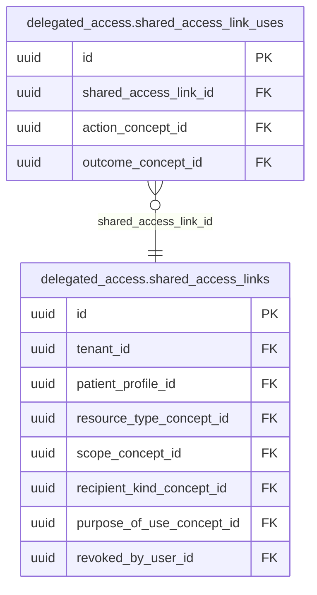

<!-- AUTOGENERADO por tools/inventario/catalogo.mjs. No editar manualmente. -->

# Catálogo del schema `delegated_access`

- **Tablas:** 15 · **Columnas:** 206 (106 con descripción: 51.5 %) · **Índices:** 126
- **Dominio:** Identidad y Seguridad
- Método y límites del catálogo: [README del inventario](../README.md)

## Tablas

| Tabla | Propósito | Columnas | Índices | Operaciones | ORM |
|---|---|---|---|---|---|
| [delegated_access_approval_requests](#delegated_access_approval_requests) | Gestiona solicitudes de aprobación antes de habilitar permisos delegados sensibles. | 12 | 8 | 10 | COINCIDE |
| [delegated_access_grants](#delegated_access_grants) | Conserva concesiones de acceso delegado con su sujeto, alcance, permisos y vigencia. | 16 | 11 | 7 | COINCIDE |
| [delegated_permission_set_items](#delegated_permission_set_items) | Detalla permisos incluidos en conjuntos delegables para limitar acciones otorgadas a representantes. | 6 | 2 | 4 | COINCIDE |
| [delegated_permission_sets](#delegated_permission_sets) | Define paquetes reutilizables de permisos que pueden concederse a delegados bajo un alcance específico. | 13 | 6 | 11 | COINCIDE |
| [delegation_events](#delegation_events) | Mantiene eventos de creación, modificación, uso o revocación de delegaciones para auditoría. | 10 | 6 | 9 | COINCIDE |
| [effective_support_access](#effective_support_access) | Tabla derivada que expande los permisos de apoyo vigentes a lo que cada persona puede hacer y sobre qué doctor, servicio y espacio, para decidir cada acción sin recalcular. | 9 | 6 | 21 | COINCIDE |
| [engagement_request_items](#engagement_request_items) | Detalla cada objetivo pedido en una solicitud o invitación de apoyo y la decisión por línea (aprobar, ajustar, rechazar), enlazada con el permiso que nace de ella. | 13 | 9 | 5 | COINCIDE |
| [engagement_requests](#engagement_requests) | Registra la solicitud de una persona a una organización, o la invitación de la organización a la persona, con su decisión y su vencimiento a los 15 días. | 17 | 9 | 12 | COINCIDE |
| [organization_user_assignments](#organization_user_assignments) | Asocia usuarios con organizaciones para determinar en qué ámbitos pueden actuar o administrar acceso delegado. | 25 | 19 | 142 | COINCIDE |
| [practitioner_delegate_assignments](#practitioner_delegate_assignments) | Relaciona profesionales con delegados autorizados para realizar tareas en su nombre. | 21 | 11 | 70 | COINCIDE |
| [role_templates](#role_templates) | Define los paquetes de acciones por defecto de cada rol de apoyo (secretaria, recepción, central telefónica, etc.), de plataforma o propios de una organización, para conceder permisos sin repetirlos uno a uno. | 12 | 6 | 16 | COINCIDE |
| [shared_access_link_uses](#shared_access_link_uses) | sin propósito | 8 | 4 | 0 | SIN_ENTIDAD |
| [shared_access_links](#shared_access_links) | sin propósito | 20 | 13 | 0 | SIN_ENTIDAD |
| [support_grant_actions](#support_grant_actions) | Lista las acciones concretas que habilita cada permiso de apoyo, para que cada permiso tenga sus propias acciones granulares. | 5 | 3 | 48 | COINCIDE |
| [support_scope_grants](#support_scope_grants) | Conserva cada permiso concedido a un vínculo de apoyo con su tipo de objetivo (doctor, servicio, ubicación o sus combinaciones), su modo de expansión y su vigencia; varias filas se suman. | 19 | 13 | 51 | COINCIDE |

## Diagrama entidad-relación

Las tablas se agrupan en familias por sus claves foráneas dentro del schema (máximo 40 por diagrama). Las FK hacia otros schemas se listan en la ficha de cada tabla.

### Familia 1 de 2 — 13 tablas

```mermaid
erDiagram
  delegated_access_delegated_access_approval_requests["delegated_access.delegated_access_approval_requests"] {
    uuid id PK
    uuid practitioner_delegate_assignment_id FK
    uuid requested_permission_id FK
    uuid patient_profile_id FK
    uuid encounter_id FK
    uuid decided_by_user_id FK
    uuid decision_concept_id FK
    uuid status_concept_id FK
  }
  delegated_access_practitioner_delegate_assignments["delegated_access.practitioner_delegate_assignments"] {
    uuid id PK
    uuid practitioner_role_assignment_id FK
    uuid delegate_user_assignment_id FK
    uuid delegated_permission_set_id FK
    uuid delegate_role_concept_id FK
    uuid patient_scope_concept_id FK
    uuid appointment_scope_concept_id FK
    uuid status_concept_id FK
  }
  delegated_access_delegated_access_grants["delegated_access.delegated_access_grants"] {
    uuid id PK
    uuid practitioner_delegate_assignment_id FK
    uuid grant_type_concept_id FK
    uuid purpose_of_use_concept_id FK
    uuid patient_profile_id FK
    uuid encounter_id FK
    uuid resource_type_concept_id FK
    uuid approved_by_user_id FK
  }
  delegated_access_delegated_permission_sets["delegated_access.delegated_permission_sets"] {
    uuid id PK
    uuid tenant_id FK
    uuid delegate_type_concept_id FK
    uuid status_concept_id FK
    uuid created_by_user_id FK
    uuid updated_by_user_id FK
  }
  delegated_access_delegation_events["delegated_access.delegation_events"] {
    uuid id PK
    uuid practitioner_delegate_assignment_id FK
    uuid event_type_concept_id FK
    uuid actor_user_id FK
    uuid target_user_id FK
    uuid reason_concept_id FK
  }
  delegated_access_organization_user_assignments["delegated_access.organization_user_assignments"] {
    uuid id PK
    uuid tenant_membership_id FK
    uuid practice_id FK
    uuid practice_site_id FK
    uuid clinical_unit_id FK
    uuid care_space_id FK
    uuid diagnostic_unit_id FK
    uuid pharmacy_id FK
  }
  delegated_access_delegated_permission_set_items["delegated_access.delegated_permission_set_items"] {
    uuid id PK
    uuid delegated_permission_set_id FK
    uuid permission_id FK
  }
  delegated_access_engagement_requests["delegated_access.engagement_requests"] {
    uuid id PK
    uuid tenant_id FK
    uuid requester_user_id FK
    uuid direction_concept_id FK
    uuid role_template_id FK
    uuid parent_assignment_id FK
    uuid status_concept_id FK
    uuid decided_by_user_id FK
  }
  delegated_access_role_templates["delegated_access.role_templates"] {
    uuid id PK
    uuid tenant_id FK
    uuid status_concept_id FK
    uuid created_by_user_id FK
    uuid updated_by_user_id FK
  }
  delegated_access_support_scope_grants["delegated_access.support_scope_grants"] {
    uuid id PK
    uuid tenant_id FK
    uuid organization_user_assignment_id FK
    uuid target_kind_concept_id FK
    uuid practitioner_role_assignment_id FK
    uuid healthcare_service_id FK
    uuid care_space_id FK
    uuid practice_site_id FK
  }
  delegated_access_engagement_request_items["delegated_access.engagement_request_items"] {
    uuid id PK
    uuid tenant_id FK
    uuid engagement_request_id FK
    uuid target_kind_concept_id FK
    uuid practitioner_role_assignment_id FK
    uuid healthcare_service_id FK
    uuid care_space_id FK
    uuid practice_site_id FK
  }
  delegated_access_effective_support_access["delegated_access.effective_support_access"] {
    uuid id PK
    uuid user_id FK
    uuid tenant_id FK
    uuid practitioner_role_assignment_id FK
    uuid healthcare_service_id FK
    uuid care_space_id FK
    uuid grant_id FK
  }
  delegated_access_support_grant_actions["delegated_access.support_grant_actions"] {
    uuid id PK
    uuid tenant_id FK
    uuid support_scope_grant_id FK
    uuid permission_id FK
  }
  delegated_access_delegated_access_approval_requests }o--|| delegated_access_practitioner_delegate_assignments : "practitioner_delegate_assignm…"
  delegated_access_practitioner_delegate_assignments }o--|| delegated_access_organization_user_assignments : "delegate_user_assignment_id"
  delegated_access_practitioner_delegate_assignments }o--|| delegated_access_delegated_permission_sets : "delegated_permission_set_id"
  delegated_access_delegated_access_grants }o--|| delegated_access_practitioner_delegate_assignments : "practitioner_delegate_assignm…"
  delegated_access_delegation_events }o--|| delegated_access_practitioner_delegate_assignments : "practitioner_delegate_assignm…"
  delegated_access_organization_user_assignments }o--o| delegated_access_role_templates : "role_template_id"
  delegated_access_delegated_permission_set_items }o--|| delegated_access_delegated_permission_sets : "delegated_permission_set_id"
  delegated_access_engagement_requests }o--|| delegated_access_role_templates : "role_template_id"
  delegated_access_engagement_requests }o--o| delegated_access_organization_user_assignments : "parent_assignment_id"
  delegated_access_support_scope_grants }o--|| delegated_access_organization_user_assignments : "organization_user_assignment_…"
  delegated_access_engagement_request_items }o--|| delegated_access_engagement_requests : "engagement_request_id"
  delegated_access_engagement_request_items }o--o| delegated_access_support_scope_grants : "resulting_grant_id"
  delegated_access_effective_support_access }o--|| delegated_access_support_scope_grants : "grant_id"
  delegated_access_support_grant_actions }o--|| delegated_access_support_scope_grants : "support_scope_grant_id"
```

### Familia 2 de 2 — 2 tablas

## Fichas

### delegated_access_approval_requests

#### Vista general

Gestiona solicitudes de aprobación antes de habilitar permisos delegados sensibles.

- **Estado del propósito:** DOMAIN_CURATED_DRAFT · fuente: `Mantra Core Health Context/modules/diagram_29_delegated_access.puml: delegated_access_approval_requests`
- **Dominio:** Identidad y Seguridad · **Diagrama:** `Mantra Core Health Context/modules/diagram_29_delegated_access.puml` · **DDL:** `SQL/29_delegated_access/02_tables.sql`
- **Entidad del ORM:** `DelegatedAccessApprovalRequests` — `src/modules/delegated_access/entities/delegated_access_approval_requests.entity.ts`
- **Resumen:** 12 columnas · 8 índices · 7 FK salientes · 0 entrantes · 10 operaciones

#### Columnas

| # | Columna | Tipo | Rol estructural | Descripción | ORM |
|---|---|---|---|---|---|
| 1 | `id` | `uuid` | Clave primaria; Obligatoria | Identificador único de la instancia. _(JSDOC_ESTANDAR, `src/modules/delegated_access/entities/delegated_access_approval_requests.entity.ts:15`)_ | coincide |
| 2 | `practitioner_delegate_assignment_id` | `uuid` | Clave foránea → delegated_access.practitioner_delegate_assignments.id; Obligatoria | _sin dato_ | coincide |
| 3 | `requested_permission_id` | `uuid` | Clave foránea → authz.permissions.id; Obligatoria | _sin dato_ | coincide |
| 4 | `patient_profile_id` | `uuid` | Clave foránea → profiles.patient_profiles.profile_id; Opcional | _sin dato_ | coincide |
| 5 | `encounter_id` | `uuid` | Clave foránea → clinical.encounters.id; Opcional | _sin dato_ | coincide |
| 6 | `reason_text` | `text` | Opcional | _sin dato_ | coincide |
| 7 | `requested_at` | `timestamptz` | Opcional | _sin dato_ | coincide |
| 8 | `decided_at` | `timestamptz` | Opcional | _sin dato_ | coincide |
| 9 | `decided_by_user_id` | `uuid` | Clave foránea → iam.users.id; Opcional | _sin dato_ | coincide |
| 10 | `decision_concept_id` | `uuid` | Clave foránea → terminology.catalog_concepts.id; Obligatoria | _sin dato_ | coincide |
| 11 | `status_concept_id` | `uuid` | Clave foránea → terminology.catalog_concepts.id; Obligatoria | _sin dato_ | coincide |
| 12 | `created_at` | `timestamptz` | Obligatoria | Fecha y hora en que se creó el registro. _(JSDOC_ESTANDAR, `src/modules/delegated_access/entities/delegated_access_approval_requests.entity.ts:89`)_ | coincide |

#### Relaciones

| Sentido | Columnas | Tabla | Restricción |
|---|---|---|---|
| hacia | practitioner_delegate_assignment_id | delegated_access.practitioner_delegate_assignments (id) | fk_delegated_access_approval_requests_practitioner_del_a6db1929 |
| hacia | requested_permission_id | authz.permissions (id) | fk_delegated_access_approval_requests_requested_permission_id |
| hacia | patient_profile_id | profiles.patient_profiles (profile_id) | fk_delegated_access_approval_requests_patient_profile_id |
| hacia | encounter_id | clinical.encounters (id) | fk_delegated_access_approval_requests_encounter_id |
| hacia | decided_by_user_id | iam.users (id) | fk_delegated_access_approval_requests_decided_by_user_id |
| hacia | decision_concept_id | terminology.catalog_concepts (id) | fk_delegated_access_approval_requests_decision_concept_id |
| hacia | status_concept_id | terminology.catalog_concepts (id) | fk_delegated_access_approval_requests_status_concept_id |

#### Índices

| Índice | Único | Columnas | Para qué |
|---|---|---|---|
| `ix_delegated_access_approval_requests_practitioner_del_01d90a86` | no | practitioner_delegate_assignment_id | Soporta la clave foránea fk_delegated_access_approval_requests_practitioner_del_a6db1929: PostgreSQL no indexa las FK por sí mismo _(DOCUMENTO)_; 4 consulta(s) de repositorio filtran u ordenan por «practitioner_delegate_assignment_id», la primera columna del índice _(CONSULTA)_ |
| `ix_delegated_access_approval_requests_requested_permission_id` | no | requested_permission_id | Soporta la clave foránea fk_delegated_access_approval_requests_requested_permission_id: PostgreSQL no indexa las FK por sí mismo _(DOCUMENTO)_; 1 consulta(s) de repositorio filtran u ordenan por «requested_permission_id», la primera columna del índice _(CONSULTA)_ |
| `ix_delegated_access_approval_requests_patient_profile_id` | no | patient_profile_id | Soporta la clave foránea fk_delegated_access_approval_requests_patient_profile_id: PostgreSQL no indexa las FK por sí mismo _(DOCUMENTO)_; 2 consulta(s) de repositorio filtran u ordenan por «patient_profile_id», la primera columna del índice _(CONSULTA)_ |
| `ix_delegated_access_approval_requests_encounter_id` | no | encounter_id | Soporta la clave foránea fk_delegated_access_approval_requests_encounter_id: PostgreSQL no indexa las FK por sí mismo _(DOCUMENTO)_; 1 consulta(s) de repositorio filtran u ordenan por «encounter_id», la primera columna del índice _(CONSULTA)_ |
| `ix_delegated_access_approval_requests_decided_by_user_id` | no | decided_by_user_id | Soporta la clave foránea fk_delegated_access_approval_requests_decided_by_user_id: PostgreSQL no indexa las FK por sí mismo _(DOCUMENTO)_ |
| `ix_delegated_access_approval_requests_decision_concept_id` | no | decision_concept_id | Soporta la clave foránea fk_delegated_access_approval_requests_decision_concept_id: PostgreSQL no indexa las FK por sí mismo _(DOCUMENTO)_ |
| `ix_delegated_access_approval_requests_status_concept_id` | no | status_concept_id | Soporta la clave foránea fk_delegated_access_approval_requests_status_concept_id: PostgreSQL no indexa las FK por sí mismo _(DOCUMENTO)_; 4 consulta(s) de repositorio filtran u ordenan por «status_concept_id», la primera columna del índice _(CONSULTA)_ |
| `ix_delegated_access_approval_requests_patient_profile__beb5e078` | no | patient_profile_id, ("created_at" DESC) | _sin uso detectado estáticamente_ |

#### Operaciones que la tocan

| Operación | Efecto | Confianza |
|---|---|---|
| GET /me/support-inbox/{conversationId} | LEE | DIRECTA |
| POST /access-requests/{id}/decision | ACTUALIZA | POR_TIPO |
| POST /access-requests/{id}/decision | LEE | DIRECTA |
| GET /me/practitioner/support-access-requests | LEE | DIRECTA |
| GET /me/practitioner/support-team | LEE | DIRECTA |
| POST /me/support-access-requests | CREA | DIRECTA |
| POST /me/support-access-requests | LEE | DIRECTA |
| POST /practitioner-delegates/{id}/access-requests | CREA | DIRECTA |
| POST /practitioner-delegates/{id}/access-requests | LEE | DIRECTA |
| POST /practitioner-delegates/{id}/revoke | ACTUALIZA | DIRECTA |

#### Gobierno

| Atributo | Valor | Fuente |
|---|---|---|
| Append-only | no declarado | — |
| Datos personales | sin fuente | — |
| Financiera | sin fuente | — |
| Crítica para auditoría | sin fuente | — |
| Retención | sin fuente | — |
| Responsable | sin fuente | — |
| Revisión | AUTO_DETECTADA | — |

---

### delegated_access_grants

#### Vista general

Conserva concesiones de acceso delegado con su sujeto, alcance, permisos y vigencia.

- **Estado del propósito:** DOMAIN_CURATED_DRAFT · fuente: `Mantra Core Health Context/modules/diagram_29_delegated_access.puml: delegated_access_grants`
- **Dominio:** Identidad y Seguridad · **Diagrama:** `Mantra Core Health Context/modules/diagram_29_delegated_access.puml` · **DDL:** `SQL/29_delegated_access/02_tables.sql`
- **Entidad del ORM:** `DelegatedAccessGrants` — `src/modules/delegated_access/entities/delegated_access_grants.entity.ts`
- **Resumen:** 16 columnas · 11 índices · 10 FK salientes · 0 entrantes · 7 operaciones

#### Columnas

| # | Columna | Tipo | Rol estructural | Descripción | ORM |
|---|---|---|---|---|---|
| 1 | `id` | `uuid` | Clave primaria; Obligatoria | Identificador único de la instancia. _(JSDOC_ESTANDAR, `src/modules/delegated_access/entities/delegated_access_grants.entity.ts:12`)_ | coincide |
| 2 | `practitioner_delegate_assignment_id` | `uuid` | Clave foránea → delegated_access.practitioner_delegate_assignments.id; Obligatoria | _sin dato_ | coincide |
| 3 | `grant_type_concept_id` | `uuid` | Clave foránea → terminology.catalog_concepts.id; Obligatoria | _sin dato_ | coincide |
| 4 | `purpose_of_use_concept_id` | `uuid` | Clave foránea → terminology.catalog_concepts.id; Obligatoria | _sin dato_ | coincide |
| 5 | `patient_profile_id` | `uuid` | Clave foránea → profiles.patient_profiles.profile_id; Opcional | _sin dato_ | coincide |
| 6 | `encounter_id` | `uuid` | Clave foránea → clinical.encounters.id; Opcional | _sin dato_ | coincide |
| 7 | `resource_type_concept_id` | `uuid` | Clave foránea → terminology.catalog_concepts.id; Opcional | _sin dato_ | coincide |
| 8 | `valid_from` | `timestamptz` | Opcional | _sin dato_ | coincide |
| 9 | `valid_to` | `timestamptz` | Opcional | _sin dato_ | coincide |
| 10 | `approved_by_user_id` | `uuid` | Clave foránea → iam.users.id; Opcional | _sin dato_ | coincide |
| 11 | `status_concept_id` | `uuid` | Clave foránea → terminology.catalog_concepts.id; Obligatoria | _sin dato_ | coincide |
| 12 | `created_at` | `timestamptz` | Obligatoria | Fecha y hora en que se creó el registro. _(JSDOC_ESTANDAR, `src/modules/delegated_access/entities/delegated_access_grants.entity.ts:90`)_ | coincide |
| 13 | `updated_at` | `timestamptz` | Obligatoria | Fecha y hora de la última actualización. _(JSDOC_ESTANDAR, `src/modules/delegated_access/entities/delegated_access_grants.entity.ts:96`)_ | coincide |
| 14 | `created_by_user_id` | `uuid` | Clave foránea → iam.users.id; Opcional | _sin dato_ | coincide |
| 15 | `updated_by_user_id` | `uuid` | Clave foránea → iam.users.id; Opcional | _sin dato_ | coincide |
| 16 | `row_version` | `integer = 1` | Obligatoria | Versión usada para controlar actualizaciones concurrentes. _(JSDOC_ENTIDAD, `src/modules/delegated_access/entities/delegated_access_grants.entity.ts:114`)_ | coincide |

#### Relaciones

| Sentido | Columnas | Tabla | Restricción |
|---|---|---|---|
| hacia | practitioner_delegate_assignment_id | delegated_access.practitioner_delegate_assignments (id) | fk_delegated_access_grants_practitioner_delegate_assignment_id |
| hacia | grant_type_concept_id | terminology.catalog_concepts (id) | fk_delegated_access_grants_grant_type_concept_id |
| hacia | purpose_of_use_concept_id | terminology.catalog_concepts (id) | fk_delegated_access_grants_purpose_of_use_concept_id |
| hacia | patient_profile_id | profiles.patient_profiles (profile_id) | fk_delegated_access_grants_patient_profile_id |
| hacia | encounter_id | clinical.encounters (id) | fk_delegated_access_grants_encounter_id |
| hacia | resource_type_concept_id | terminology.catalog_concepts (id) | fk_delegated_access_grants_resource_type_concept_id |
| hacia | approved_by_user_id | iam.users (id) | fk_delegated_access_grants_approved_by_user_id |
| hacia | status_concept_id | terminology.catalog_concepts (id) | fk_delegated_access_grants_status_concept_id |
| hacia | created_by_user_id | iam.users (id) | fk_delegated_access_grants_created_by_user_id |
| hacia | updated_by_user_id | iam.users (id) | fk_delegated_access_grants_updated_by_user_id |

#### Índices

| Índice | Único | Columnas | Para qué |
|---|---|---|---|
| `ix_delegated_access_grants_practitioner_delegate_assignment_id` | no | practitioner_delegate_assignment_id | Soporta la clave foránea fk_delegated_access_grants_practitioner_delegate_assignment_id: PostgreSQL no indexa las FK por sí mismo _(DOCUMENTO)_; 2 consulta(s) de repositorio filtran u ordenan por «practitioner_delegate_assignment_id», la primera columna del índice _(CONSULTA)_ |
| `ix_delegated_access_grants_grant_type_concept_id` | no | grant_type_concept_id | Soporta la clave foránea fk_delegated_access_grants_grant_type_concept_id: PostgreSQL no indexa las FK por sí mismo _(DOCUMENTO)_ |
| `ix_delegated_access_grants_purpose_of_use_concept_id` | no | purpose_of_use_concept_id | Soporta la clave foránea fk_delegated_access_grants_purpose_of_use_concept_id: PostgreSQL no indexa las FK por sí mismo _(DOCUMENTO)_ |
| `ix_delegated_access_grants_patient_profile_id` | no | patient_profile_id | Soporta la clave foránea fk_delegated_access_grants_patient_profile_id: PostgreSQL no indexa las FK por sí mismo _(DOCUMENTO)_; 1 consulta(s) de repositorio filtran u ordenan por «patient_profile_id», la primera columna del índice _(CONSULTA)_ |
| `ix_delegated_access_grants_encounter_id` | no | encounter_id | Soporta la clave foránea fk_delegated_access_grants_encounter_id: PostgreSQL no indexa las FK por sí mismo _(DOCUMENTO)_ |
| `ix_delegated_access_grants_resource_type_concept_id` | no | resource_type_concept_id | Soporta la clave foránea fk_delegated_access_grants_resource_type_concept_id: PostgreSQL no indexa las FK por sí mismo _(DOCUMENTO)_ |
| `ix_delegated_access_grants_approved_by_user_id` | no | approved_by_user_id | Soporta la clave foránea fk_delegated_access_grants_approved_by_user_id: PostgreSQL no indexa las FK por sí mismo _(DOCUMENTO)_ |
| `ix_delegated_access_grants_status_concept_id` | no | status_concept_id | Soporta la clave foránea fk_delegated_access_grants_status_concept_id: PostgreSQL no indexa las FK por sí mismo _(DOCUMENTO)_; 3 consulta(s) de repositorio filtran u ordenan por «status_concept_id», la primera columna del índice _(CONSULTA)_ |
| `ix_delegated_access_grants_created_by_user_id` | no | created_by_user_id | Soporta la clave foránea fk_delegated_access_grants_created_by_user_id: PostgreSQL no indexa las FK por sí mismo _(DOCUMENTO)_ |
| `ix_delegated_access_grants_updated_by_user_id` | no | updated_by_user_id | Soporta la clave foránea fk_delegated_access_grants_updated_by_user_id: PostgreSQL no indexa las FK por sí mismo _(DOCUMENTO)_ |
| `ix_delegated_access_grants_patient_profile_id_updated_at` | no | patient_profile_id, ("updated_at" DESC) | _sin uso detectado estáticamente_ |

#### Operaciones que la tocan

| Operación | Efecto | Confianza |
|---|---|---|
| GET /me/support-inbox/{conversationId} | LEE | DIRECTA |
| POST /access-requests/{id}/decision | CREA | DIRECTA |
| POST /authz/effective-actor/evaluate | LEE | DIRECTA |
| POST /delegated-access/expiry-sweep | ACTUALIZA | POR_TIPO |
| POST /delegated-access/expiry-sweep | LEE | DIRECTA |
| POST /practitioner-delegates/{id}/grants | CREA | DIRECTA |
| POST /practitioner-delegates/{id}/revoke | ACTUALIZA | DIRECTA |

#### Gobierno

| Atributo | Valor | Fuente |
|---|---|---|
| Append-only | no declarado | — |
| Datos personales | sin fuente | — |
| Financiera | sin fuente | — |
| Crítica para auditoría | sin fuente | — |
| Retención | sin fuente | — |
| Responsable | sin fuente | — |
| Revisión | AUTO_DETECTADA | — |

---

### delegated_permission_set_items

#### Vista general

Detalla permisos incluidos en conjuntos delegables para limitar acciones otorgadas a representantes.

- **Estado del propósito:** DOMAIN_CURATED_DRAFT · fuente: `Mantra Core Health Context/modules/diagram_29_delegated_access.puml: delegated_permission_set_items`
- **Dominio:** Identidad y Seguridad · **Diagrama:** `Mantra Core Health Context/modules/diagram_29_delegated_access.puml` · **DDL:** `SQL/29_delegated_access/02_tables.sql`
- **Entidad del ORM:** `DelegatedPermissionSetItems` — `src/modules/delegated_access/entities/delegated_permission_set_items.entity.ts`
- **Resumen:** 6 columnas · 2 índices · 2 FK salientes · 0 entrantes · 4 operaciones

#### Columnas

| # | Columna | Tipo | Rol estructural | Descripción | ORM |
|---|---|---|---|---|---|
| 1 | `id` | `uuid` | Clave primaria; Obligatoria | Identificador único de la instancia. _(JSDOC_ESTANDAR, `src/modules/delegated_access/entities/delegated_permission_set_items.entity.ts:15`)_ | coincide |
| 2 | `delegated_permission_set_id` | `uuid` | Clave foránea → delegated_access.delegated_permission_sets.id; Obligatoria | _sin dato_ | coincide |
| 3 | `permission_id` | `uuid` | Clave foránea → authz.permissions.id; Obligatoria | _sin dato_ | coincide |
| 4 | `constraint_json` | `jsonb` | Opcional | _sin dato_ | coincide |
| 5 | `requires_step_up_authentication` | `boolean` | Opcional | _sin dato_ | coincide |
| 6 | `created_at` | `timestamptz` | Obligatoria | Fecha y hora en que se creó el registro. _(JSDOC_ESTANDAR, `src/modules/delegated_access/entities/delegated_permission_set_items.entity.ts:54`)_ | coincide |

#### Relaciones

| Sentido | Columnas | Tabla | Restricción |
|---|---|---|---|
| hacia | delegated_permission_set_id | delegated_access.delegated_permission_sets (id) | fk_delegated_permission_set_items_delegated_permission_set_id |
| hacia | permission_id | authz.permissions (id) | fk_delegated_permission_set_items_permission_id |

#### Índices

| Índice | Único | Columnas | Para qué |
|---|---|---|---|
| `ix_delegated_permission_set_items_delegated_permission_set_id` | no | delegated_permission_set_id | Soporta la clave foránea fk_delegated_permission_set_items_delegated_permission_set_id: PostgreSQL no indexa las FK por sí mismo _(DOCUMENTO)_; 3 consulta(s) de repositorio filtran u ordenan por «delegated_permission_set_id», la primera columna del índice _(CONSULTA)_ |
| `ix_delegated_permission_set_items_permission_id` | no | permission_id | Soporta la clave foránea fk_delegated_permission_set_items_permission_id: PostgreSQL no indexa las FK por sí mismo _(DOCUMENTO)_; 1 consulta(s) de repositorio filtran u ordenan por «permission_id», la primera columna del índice _(CONSULTA)_ |

#### Operaciones que la tocan

| Operación | Efecto | Confianza |
|---|---|---|
| POST /authz/effective-actor/evaluate | LEE | DIRECTA |
| POST /delegated-permission-sets | CREA | DIRECTA |
| POST /delegated-permission-sets/{id}/versions | BORRA | DIRECTA |
| POST /delegated-permission-sets/{id}/versions | CREA | DIRECTA |

#### Gobierno

| Atributo | Valor | Fuente |
|---|---|---|
| Append-only | no declarado | — |
| Datos personales | sin fuente | — |
| Financiera | sin fuente | — |
| Crítica para auditoría | sin fuente | — |
| Retención | sin fuente | — |
| Responsable | sin fuente | — |
| Revisión | AUTO_DETECTADA | — |

---

### delegated_permission_sets

#### Vista general

Define paquetes reutilizables de permisos que pueden concederse a delegados bajo un alcance específico.

- **Estado del propósito:** DOMAIN_CURATED_DRAFT · fuente: `Mantra Core Health Context/modules/diagram_29_delegated_access.puml: delegated_permission_sets`
- **Dominio:** Identidad y Seguridad · **Diagrama:** `Mantra Core Health Context/modules/diagram_29_delegated_access.puml` · **DDL:** `SQL/29_delegated_access/02_tables.sql`
- **Entidad del ORM:** `DelegatedPermissionSets` — `src/modules/delegated_access/entities/delegated_permission_sets.entity.ts`
- **Resumen:** 13 columnas · 6 índices · 5 FK salientes · 2 entrantes · 11 operaciones

#### Columnas

| # | Columna | Tipo | Rol estructural | Descripción | ORM |
|---|---|---|---|---|---|
| 1 | `id` | `uuid` | Clave primaria; Obligatoria | Identificador único de la instancia. _(JSDOC_ESTANDAR, `src/modules/delegated_access/entities/delegated_permission_sets.entity.ts:12`)_ | coincide |
| 2 | `tenant_id` | `uuid` | Clave foránea → directory.tenants.id; Obligatoria | _sin dato_ | coincide |
| 3 | `code` | `varchar` | Obligatoria | _sin dato_ | coincide |
| 4 | `name` | `varchar` | Obligatoria | _sin dato_ | coincide |
| 5 | `delegate_type_concept_id` | `uuid` | Clave foránea → terminology.catalog_concepts.id; Obligatoria | _sin dato_ | coincide |
| 6 | `description` | `text` | Opcional | _sin dato_ | coincide |
| 7 | `status_concept_id` | `uuid` | Clave foránea → terminology.catalog_concepts.id; Obligatoria | _sin dato_ | coincide |
| 8 | `version_number` | `integer` | Obligatoria | _sin dato_ | coincide |
| 9 | `created_at` | `timestamptz` | Obligatoria | Fecha y hora en que se creó el registro. _(JSDOC_ESTANDAR, `src/modules/delegated_access/entities/delegated_permission_sets.entity.ts:60`)_ | coincide |
| 10 | `updated_at` | `timestamptz` | Obligatoria | Fecha y hora de la última actualización. _(JSDOC_ESTANDAR, `src/modules/delegated_access/entities/delegated_permission_sets.entity.ts:66`)_ | coincide |
| 11 | `created_by_user_id` | `uuid` | Clave foránea → iam.users.id; Opcional | _sin dato_ | coincide |
| 12 | `updated_by_user_id` | `uuid` | Clave foránea → iam.users.id; Opcional | _sin dato_ | coincide |
| 13 | `row_version` | `integer = 1` | Obligatoria | Versión usada para controlar actualizaciones concurrentes. _(JSDOC_ENTIDAD, `src/modules/delegated_access/entities/delegated_permission_sets.entity.ts:84`)_ | coincide |

#### Relaciones

| Sentido | Columnas | Tabla | Restricción |
|---|---|---|---|
| hacia | tenant_id | directory.tenants (id) | fk_delegated_permission_sets_tenant_id |
| hacia | delegate_type_concept_id | terminology.catalog_concepts (id) | fk_delegated_permission_sets_delegate_type_concept_id |
| hacia | status_concept_id | terminology.catalog_concepts (id) | fk_delegated_permission_sets_status_concept_id |
| hacia | created_by_user_id | iam.users (id) | fk_delegated_permission_sets_created_by_user_id |
| hacia | updated_by_user_id | iam.users (id) | fk_delegated_permission_sets_updated_by_user_id |
| desde | id | delegated_access.delegated_permission_set_items (delegated_permission_set_id) | fk_delegated_permission_set_items_delegated_permission_set_id |
| desde | id | delegated_access.practitioner_delegate_assignments (delegated_permission_set_id) | fk_practitioner_delegate_assignments_delegated_permiss_f69e2298 |

#### Índices

| Índice | Único | Columnas | Para qué |
|---|---|---|---|
| `ix_delegated_permission_sets_tenant_id` | no | tenant_id | Soporta la clave foránea fk_delegated_permission_sets_tenant_id: PostgreSQL no indexa las FK por sí mismo _(DOCUMENTO)_; 1 consulta(s) de repositorio filtran u ordenan por «tenant_id», la primera columna del índice _(CONSULTA)_ |
| `ix_delegated_permission_sets_delegate_type_concept_id` | no | delegate_type_concept_id | Soporta la clave foránea fk_delegated_permission_sets_delegate_type_concept_id: PostgreSQL no indexa las FK por sí mismo _(DOCUMENTO)_ |
| `ix_delegated_permission_sets_status_concept_id` | no | status_concept_id | Soporta la clave foránea fk_delegated_permission_sets_status_concept_id: PostgreSQL no indexa las FK por sí mismo _(DOCUMENTO)_ |
| `ix_delegated_permission_sets_created_by_user_id` | no | created_by_user_id | Soporta la clave foránea fk_delegated_permission_sets_created_by_user_id: PostgreSQL no indexa las FK por sí mismo _(DOCUMENTO)_ |
| `ix_delegated_permission_sets_updated_by_user_id` | no | updated_by_user_id | Soporta la clave foránea fk_delegated_permission_sets_updated_by_user_id: PostgreSQL no indexa las FK por sí mismo _(DOCUMENTO)_ |
| `ix_delegated_permission_sets_tenant_id_status_concept_id` | no | tenant_id, status_concept_id, ("updated_at" DESC) | _sin uso detectado estáticamente_ |

#### Operaciones que la tocan

| Operación | Efecto | Confianza |
|---|---|---|
| POST /access-requests/{id}/decision | LEE | DIRECTA |
| POST /authz/effective-actor/evaluate | LEE | DIRECTA |
| GET /delegated-permission-sets | LEE | DIRECTA |
| POST /delegated-permission-sets | CREA | DIRECTA |
| POST /delegated-permission-sets | LEE | DIRECTA |
| POST /delegated-permission-sets/{id}/versions | ACTUALIZA | POR_TIPO |
| POST /delegated-permission-sets/{id}/versions | LEE | DIRECTA |
| POST /practitioner-delegates | LEE | DIRECTA |
| POST /practitioner-delegates/{id}/access-requests | LEE | DIRECTA |
| POST /practitioner-delegates/{id}/grants | LEE | DIRECTA |
| POST /practitioner-delegates/{id}/revoke | LEE | DIRECTA |

#### Gobierno

| Atributo | Valor | Fuente |
|---|---|---|
| Append-only | no declarado | — |
| Datos personales | sin fuente | — |
| Financiera | sin fuente | — |
| Crítica para auditoría | sin fuente | — |
| Retención | sin fuente | — |
| Responsable | sin fuente | — |
| Revisión | AUTO_DETECTADA | — |

---

### delegation_events

#### Vista general

Mantiene eventos de creación, modificación, uso o revocación de delegaciones para auditoría.

- **Estado del propósito:** DOMAIN_CURATED_DRAFT · fuente: `Mantra Core Health Context/modules/diagram_29_delegated_access.puml: delegation_events`
- **Dominio:** Identidad y Seguridad · **Diagrama:** `Mantra Core Health Context/modules/diagram_29_delegated_access.puml` · **DDL:** `SQL/29_delegated_access/02_tables.sql`
- **Entidad del ORM:** `DelegationEvents` — `src/modules/delegated_access/entities/delegation_events.entity.ts`
- **Resumen:** 10 columnas · 6 índices · 5 FK salientes · 0 entrantes · 9 operaciones

#### Columnas

| # | Columna | Tipo | Rol estructural | Descripción | ORM |
|---|---|---|---|---|---|
| 1 | `id` | `uuid` | Clave primaria; Obligatoria | Identificador único de la instancia. _(JSDOC_ESTANDAR, `src/modules/delegated_access/entities/delegation_events.entity.ts:12`)_ | coincide |
| 2 | `practitioner_delegate_assignment_id` | `uuid` | Clave foránea → delegated_access.practitioner_delegate_assignments.id; Obligatoria | _sin dato_ | coincide |
| 3 | `event_type_concept_id` | `uuid` | Clave foránea → terminology.catalog_concepts.id; Obligatoria | _sin dato_ | coincide |
| 4 | `actor_user_id` | `uuid` | Clave foránea → iam.users.id; Opcional | _sin dato_ | coincide |
| 5 | `target_user_id` | `uuid` | Clave foránea → iam.users.id; Opcional | _sin dato_ | coincide |
| 6 | `reason_concept_id` | `uuid` | Clave foránea → terminology.catalog_concepts.id; Opcional | _sin dato_ | coincide |
| 7 | `previous_state_hash` | `varchar` | Opcional | _sin dato_ | coincide |
| 8 | `new_state_hash` | `varchar` | Opcional | _sin dato_ | coincide |
| 9 | `occurred_at` | `timestamptz` | Obligatoria | _sin dato_ | coincide |
| 10 | `created_at` | `timestamptz` | Obligatoria | Fecha y hora en que se creó el registro. _(JSDOC_ESTANDAR, `src/modules/delegated_access/entities/delegation_events.entity.ts:74`)_ | coincide |

#### Relaciones

| Sentido | Columnas | Tabla | Restricción |
|---|---|---|---|
| hacia | practitioner_delegate_assignment_id | delegated_access.practitioner_delegate_assignments (id) | fk_delegation_events_practitioner_delegate_assignment_id |
| hacia | event_type_concept_id | terminology.catalog_concepts (id) | fk_delegation_events_event_type_concept_id |
| hacia | actor_user_id | iam.users (id) | fk_delegation_events_actor_user_id |
| hacia | target_user_id | iam.users (id) | fk_delegation_events_target_user_id |
| hacia | reason_concept_id | terminology.catalog_concepts (id) | fk_delegation_events_reason_concept_id |

#### Índices

| Índice | Único | Columnas | Para qué |
|---|---|---|---|
| `ix_delegation_events_practitioner_delegate_assignment_id` | no | practitioner_delegate_assignment_id | Soporta la clave foránea fk_delegation_events_practitioner_delegate_assignment_id: PostgreSQL no indexa las FK por sí mismo _(DOCUMENTO)_ |
| `ix_delegation_events_event_type_concept_id` | no | event_type_concept_id | Soporta la clave foránea fk_delegation_events_event_type_concept_id: PostgreSQL no indexa las FK por sí mismo _(DOCUMENTO)_ |
| `ix_delegation_events_actor_user_id` | no | actor_user_id | Soporta la clave foránea fk_delegation_events_actor_user_id: PostgreSQL no indexa las FK por sí mismo _(DOCUMENTO)_ |
| `ix_delegation_events_target_user_id` | no | target_user_id | Soporta la clave foránea fk_delegation_events_target_user_id: PostgreSQL no indexa las FK por sí mismo _(DOCUMENTO)_ |
| `ix_delegation_events_reason_concept_id` | no | reason_concept_id | Soporta la clave foránea fk_delegation_events_reason_concept_id: PostgreSQL no indexa las FK por sí mismo _(DOCUMENTO)_ |
| `brin_delegation_events_created_at` | no | created_at | BRIN para logs e historiales append-only de gran volumen _(DOCUMENTO)_ |

#### Operaciones que la tocan

| Operación | Efecto | Confianza |
|---|---|---|
| POST /access-requests/{id}/decision | CREA | DIRECTA |
| POST /authz/effective-actor/evaluate | CREA | DIRECTA |
| POST /delegated-access/expiry-sweep | CREA | DIRECTA |
| POST /me/support-access-requests | CREA | DIRECTA |
| POST /org/support-engagements/{id}/end | CREA | DIRECTA |
| POST /practitioner-delegates | CREA | DIRECTA |
| POST /practitioner-delegates/{id}/access-requests | CREA | DIRECTA |
| POST /practitioner-delegates/{id}/grants | CREA | DIRECTA |
| POST /practitioner-delegates/{id}/revoke | CREA | DIRECTA |

#### Gobierno

| Atributo | Valor | Fuente |
|---|---|---|
| Append-only | no declarado | — |
| Datos personales | sin fuente | — |
| Financiera | sin fuente | — |
| Crítica para auditoría | sin fuente | — |
| Retención | sin fuente | — |
| Responsable | sin fuente | — |
| Revisión | AUTO_DETECTADA | — |

---

### effective_support_access

#### Vista general

Tabla derivada que expande los permisos de apoyo vigentes a lo que cada persona puede hacer y sobre qué doctor, servicio y espacio, para decidir cada acción sin recalcular.

- **Estado del propósito:** DOMAIN_CURATED_DRAFT · fuente: `Mantra Core Health Context/modules/diagram_29_delegated_access.puml: effective_support_access`
- **Dominio:** Identidad y Seguridad · **Diagrama:** `Mantra Core Health Context/modules/diagram_29_delegated_access.puml` · **DDL:** `SQL/29_delegated_access/02_tables.sql`
- **Entidad del ORM:** `EffectiveSupportAccess` — `src/modules/delegated_access/entities/effective_support_access.entity.ts`
- **Resumen:** 9 columnas · 6 índices · 6 FK salientes · 0 entrantes · 21 operaciones

#### Columnas

| # | Columna | Tipo | Rol estructural | Descripción | ORM |
|---|---|---|---|---|---|
| 1 | `id` | `uuid` | Clave primaria; Obligatoria | Identificador único de la instancia. _(JSDOC_ESTANDAR, `src/modules/delegated_access/entities/effective_support_access.entity.ts:10`)_ | coincide |
| 2 | `user_id` | `uuid` | Clave foránea → iam.users.id; Obligatoria | Columna `user_id`. _(JSDOC_ENTIDAD, `src/modules/delegated_access/entities/effective_support_access.entity.ts:14`)_ | coincide |
| 3 | `tenant_id` | `uuid` | Clave foránea → directory.tenants.id; Obligatoria | Columna `tenant_id`. _(JSDOC_ENTIDAD, `src/modules/delegated_access/entities/effective_support_access.entity.ts:18`)_ | coincide |
| 4 | `practitioner_role_assignment_id` | `uuid` | Clave foránea → practice.practitioner_role_assignments.id; Opcional | Columna `practitioner_role_assignment_id`. _(JSDOC_ENTIDAD, `src/modules/delegated_access/entities/effective_support_access.entity.ts:22`)_ | coincide |
| 5 | `healthcare_service_id` | `uuid` | Clave foránea → practice.healthcare_services.id; Opcional | Columna `healthcare_service_id`. _(JSDOC_ENTIDAD, `src/modules/delegated_access/entities/effective_support_access.entity.ts:30`)_ | coincide |
| 6 | `care_space_id` | `uuid` | Clave foránea → practice.care_spaces.id; Opcional | Columna `care_space_id`. _(JSDOC_ENTIDAD, `src/modules/delegated_access/entities/effective_support_access.entity.ts:38`)_ | coincide |
| 7 | `permission_code` | `varchar` | Obligatoria | Columna `permission_code`. _(JSDOC_ENTIDAD, `src/modules/delegated_access/entities/effective_support_access.entity.ts:42`)_ | coincide |
| 8 | `grant_id` | `uuid` | Clave foránea → delegated_access.support_scope_grants.id; Obligatoria | Columna `grant_id`. _(JSDOC_ENTIDAD, `src/modules/delegated_access/entities/effective_support_access.entity.ts:46`)_ | coincide |
| 9 | `refreshed_at` | `timestamptz` | Obligatoria | Columna `refreshed_at`. _(JSDOC_ENTIDAD, `src/modules/delegated_access/entities/effective_support_access.entity.ts:50`)_ | coincide |

#### Relaciones

| Sentido | Columnas | Tabla | Restricción |
|---|---|---|---|
| hacia | grant_id | delegated_access.support_scope_grants (id) | fk_effective_support_access_grant_id |
| hacia | user_id | iam.users (id) | fk_effective_support_access_user_id |
| hacia | tenant_id | directory.tenants (id) | fk_effective_support_access_tenant_id |
| hacia | practitioner_role_assignment_id | practice.practitioner_role_assignments (id) | fk_effective_support_access_practitioner_role_assignment_id |
| hacia | healthcare_service_id | practice.healthcare_services (id) | fk_effective_support_access_healthcare_service_id |
| hacia | care_space_id | practice.care_spaces (id) | fk_effective_support_access_care_space_id |

#### Índices

| Índice | Único | Columnas | Para qué |
|---|---|---|---|
| `ix_effective_support_access_lookup` | no | user_id, tenant_id, permission_code | Soporta la clave foránea fk_effective_support_access_user_id: PostgreSQL no indexa las FK por sí mismo _(DOCUMENTO)_; 1 consulta(s) de repositorio filtran u ordenan por «user_id», la primera columna del índice _(CONSULTA)_ |
| `ix_effective_support_access_tenant_id` | no | tenant_id | Soporta la clave foránea fk_effective_support_access_tenant_id: PostgreSQL no indexa las FK por sí mismo _(DOCUMENTO)_; 2 consulta(s) de repositorio filtran u ordenan por «tenant_id», la primera columna del índice _(CONSULTA)_ |
| `ix_effective_support_access_grant_id` | no | grant_id | Soporta la clave foránea fk_effective_support_access_grant_id: PostgreSQL no indexa las FK por sí mismo _(DOCUMENTO)_ |
| `ix_effective_support_access_practitioner_role_assign_id` | no | practitioner_role_assignment_id | Soporta la clave foránea fk_effective_support_access_practitioner_role_assignment_id: PostgreSQL no indexa las FK por sí mismo _(DOCUMENTO)_ |
| `ix_effective_support_access_healthcare_service_id` | no | healthcare_service_id | Soporta la clave foránea fk_effective_support_access_healthcare_service_id: PostgreSQL no indexa las FK por sí mismo _(DOCUMENTO)_ |
| `ix_effective_support_access_care_space_id` | no | care_space_id | Soporta la clave foránea fk_effective_support_access_care_space_id: PostgreSQL no indexa las FK por sí mismo _(DOCUMENTO)_ |

#### Operaciones que la tocan

| Operación | Efecto | Confianza |
|---|---|---|
| POST /delegated-access/support/recertification-sweep | BORRA | DIRECTA |
| POST /delegated-access/support/recertification-sweep | CREA | DIRECTA |
| POST /delegated-access/support/refresh-effective-access | BORRA | DIRECTA |
| POST /delegated-access/support/refresh-effective-access | CREA | DIRECTA |
| GET /org/access-lookup | LEE | DIRECTA |
| POST /org/support-engagement-requests/{id}/decision | BORRA | DIRECTA |
| POST /org/support-engagement-requests/{id}/decision | CREA | DIRECTA |
| POST /org/support-engagements/{id}/end | BORRA | DIRECTA |
| POST /org/support-engagements/{id}/end | CREA | DIRECTA |
| PATCH /org/support-engagements/{id}/grants | BORRA | DIRECTA |
| PATCH /org/support-engagements/{id}/grants | CREA | DIRECTA |
| POST /org/support-engagements/{id}/grants | BORRA | DIRECTA |
| POST /org/support-engagements/{id}/grants | CREA | DIRECTA |
| POST /org/support-engagements/{id}/recertify | BORRA | DIRECTA |
| POST /org/support-engagements/{id}/recertify | CREA | DIRECTA |
| POST /practitioner-delegates/{id}/accept | BORRA | DIRECTA |
| POST /practitioner-delegates/{id}/accept | CREA | DIRECTA |
| POST /sites/{siteId}/care-spaces | BORRA | DIRECTA |
| POST /sites/{siteId}/care-spaces | CREA | DIRECTA |
| PATCH /sites/{siteId}/care-spaces/{id} | BORRA | DIRECTA |
| PATCH /sites/{siteId}/care-spaces/{id} | CREA | DIRECTA |

#### Gobierno

| Atributo | Valor | Fuente |
|---|---|---|
| Append-only | no declarado | — |
| Datos personales | sin fuente | — |
| Financiera | sin fuente | — |
| Crítica para auditoría | sin fuente | — |
| Retención | sin fuente | — |
| Responsable | sin fuente | — |
| Revisión | AUTO_DETECTADA | — |

---

### engagement_request_items

#### Vista general

Detalla cada objetivo pedido en una solicitud o invitación de apoyo y la decisión por línea (aprobar, ajustar, rechazar), enlazada con el permiso que nace de ella.

- **Estado del propósito:** DOMAIN_CURATED_DRAFT · fuente: `Mantra Core Health Context/modules/diagram_29_delegated_access.puml: engagement_request_items`
- **Dominio:** Identidad y Seguridad · **Diagrama:** `Mantra Core Health Context/modules/diagram_29_delegated_access.puml` · **DDL:** `SQL/29_delegated_access/02_tables.sql`
- **Entidad del ORM:** `EngagementRequestItems` — `src/modules/delegated_access/entities/engagement_request_items.entity.ts`
- **Resumen:** 13 columnas · 9 índices · 9 FK salientes · 0 entrantes · 5 operaciones

#### Columnas

| # | Columna | Tipo | Rol estructural | Descripción | ORM |
|---|---|---|---|---|---|
| 1 | `id` | `uuid` | Clave primaria; Obligatoria | Identificador único de la instancia. _(JSDOC_ESTANDAR, `src/modules/delegated_access/entities/engagement_request_items.entity.ts:10`)_ | coincide |
| 2 | `tenant_id` | `uuid` | Clave foránea → directory.tenants.id; Obligatoria | v4.2.70: tenant_id = tenant de la solicitud (trigger integrity.trg_support_tenant_consistency). _(MODELO_PUML, `Mantra Core Health Context/modules/diagram_29_delegated_access.puml:489`)_ | coincide |
| 3 | `engagement_request_id` | `uuid` | Clave foránea → delegated_access.engagement_requests.id; Obligatoria | Columna `engagement_request_id`. _(JSDOC_ENTIDAD, `src/modules/delegated_access/entities/engagement_request_items.entity.ts:18`)_ | coincide |
| 4 | `target_kind_concept_id` | `uuid` | Clave foránea → terminology.catalog_concepts.id; Obligatoria | Columna `target_kind_concept_id`. _(JSDOC_ENTIDAD, `src/modules/delegated_access/entities/engagement_request_items.entity.ts:22`)_ | coincide |
| 5 | `practitioner_role_assignment_id` | `uuid` | Clave foránea → practice.practitioner_role_assignments.id; Opcional | Columna `practitioner_role_assignment_id`. _(JSDOC_ENTIDAD, `src/modules/delegated_access/entities/engagement_request_items.entity.ts:26`)_ | coincide |
| 6 | `healthcare_service_id` | `uuid` | Clave foránea → practice.healthcare_services.id; Opcional | Columna `healthcare_service_id`. _(JSDOC_ENTIDAD, `src/modules/delegated_access/entities/engagement_request_items.entity.ts:34`)_ | coincide |
| 7 | `care_space_id` | `uuid` | Clave foránea → practice.care_spaces.id; Opcional | Columna `care_space_id`. _(JSDOC_ENTIDAD, `src/modules/delegated_access/entities/engagement_request_items.entity.ts:42`)_ | coincide |
| 8 | `practice_site_id` | `uuid` | Clave foránea → practice.practice_sites.id; Opcional | Columna `practice_site_id`. _(JSDOC_ENTIDAD, `src/modules/delegated_access/entities/engagement_request_items.entity.ts:46`)_ | coincide |
| 9 | `proposed_actions_json` | `jsonb` | Obligatoria | Columna `proposed_actions_json`. _(JSDOC_ENTIDAD, `src/modules/delegated_access/entities/engagement_request_items.entity.ts:50`)_ | coincide |
| 10 | `decision_concept_id` | `uuid` | Clave foránea → terminology.catalog_concepts.id; Obligatoria | Columna `decision_concept_id`. _(JSDOC_ENTIDAD, `src/modules/delegated_access/entities/engagement_request_items.entity.ts:58`)_ | coincide |
| 11 | `decision_comment_text` | `text` | Opcional | Columna `decision_comment_text`. _(JSDOC_ENTIDAD, `src/modules/delegated_access/entities/engagement_request_items.entity.ts:62`)_ | coincide |
| 12 | `resulting_grant_id` | `uuid` | Clave foránea → delegated_access.support_scope_grants.id; Opcional | Columna `resulting_grant_id`. _(JSDOC_ENTIDAD, `src/modules/delegated_access/entities/engagement_request_items.entity.ts:70`)_ | coincide |
| 13 | `created_at` | `timestamptz` | Obligatoria | Columna `created_at`. _(JSDOC_ENTIDAD, `src/modules/delegated_access/entities/engagement_request_items.entity.ts:74`)_ | coincide |

#### Relaciones

| Sentido | Columnas | Tabla | Restricción |
|---|---|---|---|
| hacia | engagement_request_id | delegated_access.engagement_requests (id) | fk_engagement_request_items_engagement_request_id |
| hacia | resulting_grant_id | delegated_access.support_scope_grants (id) | fk_engagement_request_items_resulting_grant_id |
| hacia | tenant_id | directory.tenants (id) | fk_engagement_request_items_tenant_id |
| hacia | target_kind_concept_id | terminology.catalog_concepts (id) | fk_engagement_request_items_target_kind_concept_id |
| hacia | practitioner_role_assignment_id | practice.practitioner_role_assignments (id) | fk_engagement_request_items_practitioner_role_assignment_id |
| hacia | healthcare_service_id | practice.healthcare_services (id) | fk_engagement_request_items_healthcare_service_id |
| hacia | care_space_id | practice.care_spaces (id) | fk_engagement_request_items_care_space_id |
| hacia | practice_site_id | practice.practice_sites (id) | fk_engagement_request_items_practice_site_id |
| hacia | decision_concept_id | terminology.catalog_concepts (id) | fk_engagement_request_items_decision_concept_id |

#### Índices

| Índice | Único | Columnas | Para qué |
|---|---|---|---|
| `ix_engagement_request_items_tenant_id` | no | tenant_id | Soporta la clave foránea fk_engagement_request_items_tenant_id: PostgreSQL no indexa las FK por sí mismo _(DOCUMENTO)_ |
| `ix_engagement_request_items_engagement_request_id` | no | engagement_request_id | Soporta la clave foránea fk_engagement_request_items_engagement_request_id: PostgreSQL no indexa las FK por sí mismo _(DOCUMENTO)_; 1 consulta(s) de repositorio filtran u ordenan por «engagement_request_id», la primera columna del índice _(CONSULTA)_ |
| `ix_engagement_request_items_target_kind_concept_id` | no | target_kind_concept_id | Soporta la clave foránea fk_engagement_request_items_target_kind_concept_id: PostgreSQL no indexa las FK por sí mismo _(DOCUMENTO)_ |
| `ix_engagement_request_items_practitioner_role_assign_id` | no | practitioner_role_assignment_id | Soporta la clave foránea fk_engagement_request_items_practitioner_role_assignment_id: PostgreSQL no indexa las FK por sí mismo _(DOCUMENTO)_ |
| `ix_engagement_request_items_healthcare_service_id` | no | healthcare_service_id | Soporta la clave foránea fk_engagement_request_items_healthcare_service_id: PostgreSQL no indexa las FK por sí mismo _(DOCUMENTO)_ |
| `ix_engagement_request_items_care_space_id` | no | care_space_id | Soporta la clave foránea fk_engagement_request_items_care_space_id: PostgreSQL no indexa las FK por sí mismo _(DOCUMENTO)_ |
| `ix_engagement_request_items_practice_site_id` | no | practice_site_id | Soporta la clave foránea fk_engagement_request_items_practice_site_id: PostgreSQL no indexa las FK por sí mismo _(DOCUMENTO)_ |
| `ix_engagement_request_items_decision_concept_id` | no | decision_concept_id | Soporta la clave foránea fk_engagement_request_items_decision_concept_id: PostgreSQL no indexa las FK por sí mismo _(DOCUMENTO)_ |
| `ix_engagement_request_items_resulting_grant_id` | no | resulting_grant_id | Soporta la clave foránea fk_engagement_request_items_resulting_grant_id: PostgreSQL no indexa las FK por sí mismo _(DOCUMENTO)_ |

#### Restricciones

| Restricción | Tipo | Definición |
|---|---|---|
| `ck_engagement_request_items_target_coherent` | CHECK | CHECK (("target_kind_concept_id" = '785d1671-5754-58d3-b1a3-e3cd467b82b7' AND "practitioner_role_assignment_id" IS NOT NULL AND "healthcare_service_id" IS NULL AND "care_space_id" IS NULL AND "practice_site_id" IS NULL) OR ("target_kind_concept_id" = '953e4408-5e19-521b-a25a-3d062d788911' AND "practitioner_role_assignment_id" IS NULL AND "healthcare_service_id" IS NOT NULL AND "care_space_id" IS NULL AND "practice_site_id" IS NULL) OR ("target_kind_concept_id" = '10510d38-c6cf-5243-9327-5cefc6c3aee5' AND "practitioner_role_assignment_id" IS NULL AND "healthcare_service_id" IS NULL AND num_nonnulls("care_space_id", "practice_site_id") = 1) OR ("target_kind_concept_id" = '19ff6b5b-b998-54bb-af93-573b96764a6c' AND "practitioner_role_assignment_id" IS NOT NULL AND "healthcare_service_id" IS NOT NULL AND "care_space_id" IS NULL AND "practice_site_id" IS NULL) OR ("target_kind_concept_id" = '2ed23be8-884f-5e75-bd63-a1ff92f42e89' AND "practitioner_role_assignment_id" IS NOT NULL AND "healthcare_service_id" IS NULL AND num_nonnulls("care_space_id", "practice_site_id") = 1) OR ("target_kind_concept_id" = 'cf017e3e-4c7f-5e2f-a7ca-2f2078eb89b3' AND "practitioner_role_assignment_id" IS NULL AND "healthcare_service_id" IS NOT NULL AND num_nonnulls("care_space_id", "practice_site_id") = 1) OR ("target_kind_concept_id" = '81f2ac43-a9ba-5043-b455-ed71b2d7e59f' AND "practitioner_role_assignment_id" IS NULL AND "healthcare_service_id" IS NULL AND "care_space_id" IS NULL AND "practice_site_id" IS NULL) OR ("target_kind_concept_id" = '3df7a566-22b8-512d-85a7-4b89604cb26b' AND "practitioner_role_assignment_id" IS NULL AND "healthcare_service_id" IS NULL AND "care_space_id" IS NULL AND "practice_site_id" IS NULL) OR ("target_kind_concept_id" = 'cf4de420-16da-57f8-8c3a-f6ff717fc59e' AND "practitioner_role_assignment_id" IS NULL AND "healthcare_service_id" IS NULL AND "care_space_id" IS NULL AND "practice_site_id" IS NULL) OR ("target_kind_concept_id" = 'b1330928-a076-5348-bffd-154144fadc85' AND "practitioner_role_assignment_id" IS NULL AND "healthcare_service_id" IS NULL AND "care_space_id" IS NULL AND "practice_site_id" IS NULL)) |

#### Operaciones que la tocan

| Operación | Efecto | Confianza |
|---|---|---|
| POST /affiliation-invitations/redeem | CREA | DIRECTA |
| GET /me/support-engagements | LEE | DIRECTA |
| GET /org/support-engagement-requests | LEE | DIRECTA |
| POST /org/support-engagement-requests/{id}/decision | LEE | DIRECTA |
| POST /support-engagement-requests | CREA | DIRECTA |

#### Gobierno

| Atributo | Valor | Fuente |
|---|---|---|
| Append-only | no declarado | — |
| Datos personales | sin fuente | — |
| Financiera | sin fuente | — |
| Crítica para auditoría | sin fuente | — |
| Retención | sin fuente | — |
| Responsable | sin fuente | — |
| Revisión | AUTO_DETECTADA | — |

---

### engagement_requests

#### Vista general

Registra la solicitud de una persona a una organización, o la invitación de la organización a la persona, con su decisión y su vencimiento a los 15 días.

- **Estado del propósito:** DOMAIN_CURATED_DRAFT · fuente: `Mantra Core Health Context/modules/diagram_29_delegated_access.puml: engagement_requests`
- **Dominio:** Identidad y Seguridad · **Diagrama:** `Mantra Core Health Context/modules/diagram_29_delegated_access.puml` · **DDL:** `SQL/29_delegated_access/02_tables.sql`
- **Entidad del ORM:** `EngagementRequests` — `src/modules/delegated_access/entities/engagement_requests.entity.ts`
- **Resumen:** 17 columnas · 9 índices · 9 FK salientes · 1 entrantes · 12 operaciones

#### Columnas

| # | Columna | Tipo | Rol estructural | Descripción | ORM |
|---|---|---|---|---|---|
| 1 | `id` | `uuid` | Clave primaria; Obligatoria | Identificador único de la instancia. _(JSDOC_ESTANDAR, `src/modules/delegated_access/entities/engagement_requests.entity.ts:10`)_ | coincide |
| 2 | `tenant_id` | `uuid` | Clave foránea → directory.tenants.id; Obligatoria | Columna `tenant_id`. _(JSDOC_ENTIDAD, `src/modules/delegated_access/entities/engagement_requests.entity.ts:14`)_ | coincide |
| 3 | `requester_user_id` | `uuid` | Clave foránea → iam.users.id; Obligatoria | Columna `requester_user_id`. _(JSDOC_ENTIDAD, `src/modules/delegated_access/entities/engagement_requests.entity.ts:18`)_ | coincide |
| 4 | `direction_concept_id` | `uuid` | Clave foránea → terminology.catalog_concepts.id; Obligatoria | Columna `direction_concept_id`. _(JSDOC_ENTIDAD, `src/modules/delegated_access/entities/engagement_requests.entity.ts:22`)_ | coincide |
| 5 | `role_template_id` | `uuid` | Clave foránea → delegated_access.role_templates.id; Obligatoria | Columna `role_template_id`. _(JSDOC_ENTIDAD, `src/modules/delegated_access/entities/engagement_requests.entity.ts:26`)_ | coincide |
| 6 | `parent_assignment_id` | `uuid` | Clave foránea → delegated_access.organization_user_assignments.id; Opcional | Columna `parent_assignment_id`. _(JSDOC_ENTIDAD, `src/modules/delegated_access/entities/engagement_requests.entity.ts:30`)_ | coincide |
| 7 | `message_text` | `text` | Opcional | Columna `message_text`. _(JSDOC_ENTIDAD, `src/modules/delegated_access/entities/engagement_requests.entity.ts:34`)_ | coincide |
| 8 | `status_concept_id` | `uuid` | Clave foránea → terminology.catalog_concepts.id; Obligatoria | Columna `status_concept_id`. _(JSDOC_ENTIDAD, `src/modules/delegated_access/entities/engagement_requests.entity.ts:38`)_ | coincide |
| 9 | `expires_at` | `timestamptz` | Obligatoria | Columna `expires_at`. _(JSDOC_ENTIDAD, `src/modules/delegated_access/entities/engagement_requests.entity.ts:42`)_ | coincide |
| 10 | `decided_at` | `timestamptz` | Opcional | Columna `decided_at`. _(JSDOC_ENTIDAD, `src/modules/delegated_access/entities/engagement_requests.entity.ts:46`)_ | coincide |
| 11 | `decided_by_user_id` | `uuid` | Clave foránea → iam.users.id; Opcional | Columna `decided_by_user_id`. _(JSDOC_ENTIDAD, `src/modules/delegated_access/entities/engagement_requests.entity.ts:54`)_ | coincide |
| 12 | `decision_reason_text` | `text` | Opcional | Columna `decision_reason_text`. _(JSDOC_ENTIDAD, `src/modules/delegated_access/entities/engagement_requests.entity.ts:58`)_ | coincide |
| 13 | `created_at` | `timestamptz` | Obligatoria | Columna `created_at`. _(JSDOC_ENTIDAD, `src/modules/delegated_access/entities/engagement_requests.entity.ts:66`)_ | coincide |
| 14 | `updated_at` | `timestamptz` | Obligatoria | Columna `updated_at`. _(JSDOC_ENTIDAD, `src/modules/delegated_access/entities/engagement_requests.entity.ts:70`)_ | coincide |
| 15 | `created_by_user_id` | `uuid` | Clave foránea → iam.users.id; Opcional | Columna `created_by_user_id`. _(JSDOC_ENTIDAD, `src/modules/delegated_access/entities/engagement_requests.entity.ts:78`)_ | coincide |
| 16 | `updated_by_user_id` | `uuid` | Clave foránea → iam.users.id; Opcional | Columna `updated_by_user_id`. _(JSDOC_ENTIDAD, `src/modules/delegated_access/entities/engagement_requests.entity.ts:82`)_ | coincide |
| 17 | `row_version` | `integer = 1` | Obligatoria | Versión usada para controlar actualizaciones concurrentes. _(JSDOC_ENTIDAD, `src/modules/delegated_access/entities/engagement_requests.entity.ts:74`)_ | coincide |

#### Relaciones

| Sentido | Columnas | Tabla | Restricción |
|---|---|---|---|
| hacia | role_template_id | delegated_access.role_templates (id) | fk_engagement_requests_role_template_id |
| hacia | parent_assignment_id | delegated_access.organization_user_assignments (id) | fk_engagement_requests_parent_assignment_id |
| hacia | tenant_id | directory.tenants (id) | fk_engagement_requests_tenant_id |
| hacia | requester_user_id | iam.users (id) | fk_engagement_requests_requester_user_id |
| hacia | direction_concept_id | terminology.catalog_concepts (id) | fk_engagement_requests_direction_concept_id |
| hacia | status_concept_id | terminology.catalog_concepts (id) | fk_engagement_requests_status_concept_id |
| hacia | decided_by_user_id | iam.users (id) | fk_engagement_requests_decided_by_user_id |
| hacia | created_by_user_id | iam.users (id) | fk_engagement_requests_created_by_user_id |
| hacia | updated_by_user_id | iam.users (id) | fk_engagement_requests_updated_by_user_id |
| desde | id | delegated_access.engagement_request_items (engagement_request_id) | fk_engagement_request_items_engagement_request_id |

#### Índices

| Índice | Único | Columnas | Para qué |
|---|---|---|---|
| `ix_engagement_requests_tenant_id` | no | tenant_id, status_concept_id, expires_at | Soporta la clave foránea fk_engagement_requests_tenant_id: PostgreSQL no indexa las FK por sí mismo _(DOCUMENTO)_; 1 consulta(s) de repositorio filtran u ordenan por «tenant_id», la primera columna del índice _(CONSULTA)_ |
| `ix_engagement_requests_requester_user_id` | no | requester_user_id | Soporta la clave foránea fk_engagement_requests_requester_user_id: PostgreSQL no indexa las FK por sí mismo _(DOCUMENTO)_; 1 consulta(s) de repositorio filtran u ordenan por «requester_user_id», la primera columna del índice _(CONSULTA)_ |
| `ix_engagement_requests_direction_concept_id` | no | direction_concept_id | Soporta la clave foránea fk_engagement_requests_direction_concept_id: PostgreSQL no indexa las FK por sí mismo _(DOCUMENTO)_ |
| `ix_engagement_requests_role_template_id` | no | role_template_id | Soporta la clave foránea fk_engagement_requests_role_template_id: PostgreSQL no indexa las FK por sí mismo _(DOCUMENTO)_ |
| `ix_engagement_requests_parent_assignment_id` | no | parent_assignment_id | Soporta la clave foránea fk_engagement_requests_parent_assignment_id: PostgreSQL no indexa las FK por sí mismo _(DOCUMENTO)_ |
| `ix_engagement_requests_status_concept_id` | no | status_concept_id | Soporta la clave foránea fk_engagement_requests_status_concept_id: PostgreSQL no indexa las FK por sí mismo _(DOCUMENTO)_; 1 consulta(s) de repositorio filtran u ordenan por «status_concept_id», la primera columna del índice _(CONSULTA)_ |
| `ix_engagement_requests_decided_by_user_id` | no | decided_by_user_id | Soporta la clave foránea fk_engagement_requests_decided_by_user_id: PostgreSQL no indexa las FK por sí mismo _(DOCUMENTO)_ |
| `ix_engagement_requests_created_by_user_id` | no | created_by_user_id | Soporta la clave foránea fk_engagement_requests_created_by_user_id: PostgreSQL no indexa las FK por sí mismo _(DOCUMENTO)_ |
| `ix_engagement_requests_updated_by_user_id` | no | updated_by_user_id | Soporta la clave foránea fk_engagement_requests_updated_by_user_id: PostgreSQL no indexa las FK por sí mismo _(DOCUMENTO)_ |

#### Restricciones

| Restricción | Tipo | Definición |
|---|---|---|
| `ck_engagement_requests_expires_after_created` | CHECK | CHECK ("expires_at" > "created_at") |

#### Operaciones que la tocan

| Operación | Efecto | Confianza |
|---|---|---|
| POST /affiliation-invitations/redeem | CREA | DIRECTA |
| POST /delegated-access/support/expire-requests | ACTUALIZA | POR_TIPO |
| POST /delegated-access/support/expire-requests | LEE | DIRECTA |
| GET /me/support-catalog | LEE | DIRECTA |
| GET /me/support-engagements | LEE | DIRECTA |
| GET /org/support-engagement-requests | LEE | DIRECTA |
| POST /org/support-engagement-requests/{id}/decision | ACTUALIZA | POR_TIPO |
| POST /org/support-engagement-requests/{id}/decision | LEE | DIRECTA |
| POST /org/support-engagements/{id}/end | ACTUALIZA | POR_TIPO |
| POST /org/support-engagements/{id}/end | LEE | DIRECTA |
| POST /support-engagement-requests | CREA | DIRECTA |
| POST /support-engagement-requests | LEE | DIRECTA |

#### Gobierno

| Atributo | Valor | Fuente |
|---|---|---|
| Append-only | no declarado | — |
| Datos personales | sin fuente | — |
| Financiera | sin fuente | — |
| Crítica para auditoría | sin fuente | — |
| Retención | sin fuente | — |
| Responsable | sin fuente | — |
| Revisión | AUTO_DETECTADA | — |

---

### organization_user_assignments

#### Vista general

Asocia usuarios con organizaciones para determinar en qué ámbitos pueden actuar o administrar acceso delegado.

- **Estado del propósito:** DOMAIN_CURATED_DRAFT · fuente: `Mantra Core Health Context/modules/diagram_29_delegated_access.puml: organization_user_assignments`
- **Dominio:** Identidad y Seguridad · **Diagrama:** `Mantra Core Health Context/modules/diagram_29_delegated_access.puml` · **DDL:** `SQL/29_delegated_access/02_tables.sql`
- **Entidad del ORM:** `OrganizationUserAssignments` — `src/modules/delegated_access/entities/organization_user_assignments.entity.ts`
- **Resumen:** 25 columnas · 19 índices · 16 FK salientes · 3 entrantes · 142 operaciones

#### Columnas

| # | Columna | Tipo | Rol estructural | Descripción | ORM |
|---|---|---|---|---|---|
| 1 | `id` | `uuid` | Clave primaria; Obligatoria | Identificador único de la instancia. _(JSDOC_ESTANDAR, `src/modules/delegated_access/entities/organization_user_assignments.entity.ts:15`)_ | coincide |
| 2 | `tenant_membership_id` | `uuid` | Clave foránea → directory.tenant_memberships.id; Obligatoria | _sin dato_ | coincide |
| 3 | `practice_id` | `uuid` | Clave foránea → practice.practices.id; Opcional | _sin dato_ | coincide |
| 4 | `practice_site_id` | `uuid` | Clave foránea → practice.practice_sites.id; Opcional | _sin dato_ | coincide |
| 5 | `clinical_unit_id` | `uuid` | Clave foránea → practice.clinical_units.id; Opcional | _sin dato_ | coincide |
| 6 | `care_space_id` | `uuid` | Clave foránea → practice.care_spaces.id; Opcional | _sin dato_ | coincide |
| 7 | `diagnostic_unit_id` | `uuid` | Clave foránea → diagnostic_units.diagnostic_units.id; Opcional | _sin dato_ | coincide |
| 8 | `pharmacy_id` | `uuid` | Clave foránea → pharmacy.pharmacies.id; Opcional | _sin dato_ | coincide |
| 9 | `assignment_role_concept_id` | `uuid` | Clave foránea → terminology.catalog_concepts.id; Obligatoria | _sin dato_ | coincide |
| 10 | `access_scope_concept_id` | `uuid` | Clave foránea → terminology.catalog_concepts.id; Obligatoria | _sin dato_ | coincide |
| 11 | `supervisor_user_id` | `uuid` | Clave foránea → iam.users.id; Opcional | _sin dato_ | coincide |
| 12 | `valid_from` | `timestamptz` | Opcional | _sin dato_ | coincide |
| 13 | `valid_to` | `timestamptz` | Opcional | _sin dato_ | coincide |
| 14 | `status_concept_id` | `uuid` | Clave foránea → terminology.catalog_concepts.id; Obligatoria | _sin dato_ | coincide |
| 15 | `created_at` | `timestamptz` | Obligatoria | Fecha y hora en que se creó el registro. _(JSDOC_ESTANDAR, `src/modules/delegated_access/entities/organization_user_assignments.entity.ts:107`)_ | coincide |
| 16 | `updated_at` | `timestamptz` | Obligatoria | Fecha y hora de la última actualización. _(JSDOC_ESTANDAR, `src/modules/delegated_access/entities/organization_user_assignments.entity.ts:113`)_ | coincide |
| 17 | `created_by_user_id` | `uuid` | Clave foránea → iam.users.id; Opcional | _sin dato_ | coincide |
| 18 | `updated_by_user_id` | `uuid` | Clave foránea → iam.users.id; Opcional | _sin dato_ | coincide |
| 19 | `row_version` | `integer = 1` | Obligatoria | Versión usada para controlar actualizaciones concurrentes. _(JSDOC_ENTIDAD, `src/modules/delegated_access/entities/organization_user_assignments.entity.ts:131`)_ | coincide |
| 20 | `origin_concept_id` | `uuid` | Clave foránea → terminology.catalog_concepts.id; Opcional | + v4.2.69 (personal de apoyo): el vinculo de apoyo es persona + organizacion + plantilla + vigencia + recertificacion. Las columnas de alcance sueltas de arriba (practice_site_id, clinical_unit_id, care_space_id, diagnostic_unit_id, pharmacy_id) quedan DEPRECADAS: el alcance ahora son filas de support_scope_grants. No se borran todavia. Todas nullable: los vinculos existentes no las declaran. _(MODELO_PUML, `Mantra Core Health Context/modules/diagram_29_delegated_access.puml:39`)_ | coincide |
| 21 | `owner_kind_concept_id` | `uuid` | Clave foránea → terminology.catalog_concepts.id; Opcional | Columna `owner_kind_concept_id`. _(JSDOC_ENTIDAD, `src/modules/delegated_access/entities/organization_user_assignments.entity.ts:139`)_ | coincide |
| 22 | `role_template_id` | `uuid` | Clave foránea → delegated_access.role_templates.id; Opcional | Columna `role_template_id`. _(JSDOC_ENTIDAD, `src/modules/delegated_access/entities/organization_user_assignments.entity.ts:147`)_ | coincide |
| 23 | `recertify_every_months` | `integer` | Opcional | Columna `recertify_every_months`. _(JSDOC_ENTIDAD, `src/modules/delegated_access/entities/organization_user_assignments.entity.ts:151`)_ | coincide |
| 24 | `next_recertification_at` | `timestamptz` | Opcional | Columna `next_recertification_at`. _(JSDOC_ENTIDAD, `src/modules/delegated_access/entities/organization_user_assignments.entity.ts:159`)_ | coincide |
| 25 | `ended_reason_text` | `text` | Opcional | Columna `ended_reason_text`. _(JSDOC_ENTIDAD, `src/modules/delegated_access/entities/organization_user_assignments.entity.ts:167`)_ | coincide |

#### Relaciones

| Sentido | Columnas | Tabla | Restricción |
|---|---|---|---|
| hacia | role_template_id | delegated_access.role_templates (id) | fk_organization_user_assignments_role_template_id |
| hacia | tenant_membership_id | directory.tenant_memberships (id) | fk_organization_user_assignments_tenant_membership_id |
| hacia | practice_id | practice.practices (id) | fk_organization_user_assignments_practice_id |
| hacia | practice_site_id | practice.practice_sites (id) | fk_organization_user_assignments_practice_site_id |
| hacia | clinical_unit_id | practice.clinical_units (id) | fk_organization_user_assignments_clinical_unit_id |
| hacia | care_space_id | practice.care_spaces (id) | fk_organization_user_assignments_care_space_id |
| hacia | diagnostic_unit_id | diagnostic_units.diagnostic_units (id) | fk_organization_user_assignments_diagnostic_unit_id |
| hacia | pharmacy_id | pharmacy.pharmacies (id) | fk_organization_user_assignments_pharmacy_id |
| hacia | assignment_role_concept_id | terminology.catalog_concepts (id) | fk_organization_user_assignments_assignment_role_concept_id |
| hacia | access_scope_concept_id | terminology.catalog_concepts (id) | fk_organization_user_assignments_access_scope_concept_id |
| hacia | supervisor_user_id | iam.users (id) | fk_organization_user_assignments_supervisor_user_id |
| hacia | status_concept_id | terminology.catalog_concepts (id) | fk_organization_user_assignments_status_concept_id |
| hacia | created_by_user_id | iam.users (id) | fk_organization_user_assignments_created_by_user_id |
| hacia | updated_by_user_id | iam.users (id) | fk_organization_user_assignments_updated_by_user_id |
| hacia | origin_concept_id | terminology.catalog_concepts (id) | fk_organization_user_assignments_origin_concept_id |
| hacia | owner_kind_concept_id | terminology.catalog_concepts (id) | fk_organization_user_assignments_owner_kind_concept_id |
| desde | id | delegated_access.practitioner_delegate_assignments (delegate_user_assignment_id) | fk_practitioner_delegate_assignments_delegate_user_ass_501b9011 |
| desde | id | delegated_access.support_scope_grants (organization_user_assignment_id) | fk_support_scope_grants_organization_user_assignment_id |
| desde | id | delegated_access.engagement_requests (parent_assignment_id) | fk_engagement_requests_parent_assignment_id |

#### Índices

| Índice | Único | Columnas | Para qué |
|---|---|---|---|
| `ix_organization_user_assignments_tenant_membership_id` | no | tenant_membership_id | Soporta la clave foránea fk_organization_user_assignments_tenant_membership_id: PostgreSQL no indexa las FK por sí mismo _(DOCUMENTO)_; 5 consulta(s) de repositorio filtran u ordenan por «tenant_membership_id», la primera columna del índice _(CONSULTA)_ |
| `ix_organization_user_assignments_practice_id` | no | practice_id | Soporta la clave foránea fk_organization_user_assignments_practice_id: PostgreSQL no indexa las FK por sí mismo _(DOCUMENTO)_ |
| `ix_organization_user_assignments_practice_site_id` | no | practice_site_id | Soporta la clave foránea fk_organization_user_assignments_practice_site_id: PostgreSQL no indexa las FK por sí mismo _(DOCUMENTO)_ |
| `ix_organization_user_assignments_clinical_unit_id` | no | clinical_unit_id | Soporta la clave foránea fk_organization_user_assignments_clinical_unit_id: PostgreSQL no indexa las FK por sí mismo _(DOCUMENTO)_ |
| `ix_organization_user_assignments_care_space_id` | no | care_space_id | Soporta la clave foránea fk_organization_user_assignments_care_space_id: PostgreSQL no indexa las FK por sí mismo _(DOCUMENTO)_ |
| `ix_organization_user_assignments_diagnostic_unit_id` | no | diagnostic_unit_id | Soporta la clave foránea fk_organization_user_assignments_diagnostic_unit_id: PostgreSQL no indexa las FK por sí mismo _(DOCUMENTO)_ |
| `ix_organization_user_assignments_pharmacy_id` | no | pharmacy_id | Soporta la clave foránea fk_organization_user_assignments_pharmacy_id: PostgreSQL no indexa las FK por sí mismo _(DOCUMENTO)_ |
| `ix_organization_user_assignments_assignment_role_concept_id` | no | assignment_role_concept_id | Soporta la clave foránea fk_organization_user_assignments_assignment_role_concept_id: PostgreSQL no indexa las FK por sí mismo _(DOCUMENTO)_; 1 consulta(s) de repositorio filtran u ordenan por «assignment_role_concept_id», la primera columna del índice _(CONSULTA)_ |
| `ix_organization_user_assignments_access_scope_concept_id` | no | access_scope_concept_id | Soporta la clave foránea fk_organization_user_assignments_access_scope_concept_id: PostgreSQL no indexa las FK por sí mismo _(DOCUMENTO)_; 1 consulta(s) de repositorio filtran u ordenan por «access_scope_concept_id», la primera columna del índice _(CONSULTA)_ |
| `ix_organization_user_assignments_supervisor_user_id` | no | supervisor_user_id | Soporta la clave foránea fk_organization_user_assignments_supervisor_user_id: PostgreSQL no indexa las FK por sí mismo _(DOCUMENTO)_ |
| `ix_organization_user_assignments_status_concept_id` | no | status_concept_id | Soporta la clave foránea fk_organization_user_assignments_status_concept_id: PostgreSQL no indexa las FK por sí mismo _(DOCUMENTO)_; 5 consulta(s) de repositorio filtran u ordenan por «status_concept_id», la primera columna del índice _(CONSULTA)_ |
| `ix_organization_user_assignments_created_by_user_id` | no | created_by_user_id | Soporta la clave foránea fk_organization_user_assignments_created_by_user_id: PostgreSQL no indexa las FK por sí mismo _(DOCUMENTO)_ |
| `ix_organization_user_assignments_updated_by_user_id` | no | updated_by_user_id | Soporta la clave foránea fk_organization_user_assignments_updated_by_user_id: PostgreSQL no indexa las FK por sí mismo _(DOCUMENTO)_ |
| `ix_organization_user_assignments_origin_concept_id` | no | origin_concept_id | Soporta la clave foránea fk_organization_user_assignments_origin_concept_id: PostgreSQL no indexa las FK por sí mismo _(DOCUMENTO)_ |
| `ix_organization_user_assignments_owner_kind_concept_id` | no | owner_kind_concept_id | Soporta la clave foránea fk_organization_user_assignments_owner_kind_concept_id: PostgreSQL no indexa las FK por sí mismo _(DOCUMENTO)_ |
| `ix_organization_user_assignments_role_template_id` | no | role_template_id | Soporta la clave foránea fk_organization_user_assignments_role_template_id: PostgreSQL no indexa las FK por sí mismo _(DOCUMENTO)_; 6 consulta(s) de repositorio filtran u ordenan por «role_template_id», la primera columna del índice _(CONSULTA)_ |
| `ix_organization_user_assignments_next_recertification` | no | next_recertification_at donde WHERE next_recertification_at IS NOT NULL | Índice parcial: sólo indexa las filas donde WHERE next_recertification_at IS NOT NULL _(ESTRUCTURAL)_; 1 consulta(s) de repositorio filtran u ordenan por «next_recertification_at», la primera columna del índice _(CONSULTA)_ |
| `uq_organization_user_assignments_active_template` | sí | tenant_membership_id, role_template_id donde WHERE role_template_id IS NOT NULL AND status_concept_id = '38a1d301-f40d-5b17-a695-5e6d605f8b19' | Garantiza que no se repita la combinación (tenant_membership_id, role_template_id) _(DOCUMENTO)_; Soporta la clave foránea fk_organization_user_assignments_tenant_membership_id: PostgreSQL no indexa las FK por sí mismo _(DOCUMENTO)_; Índice parcial: sólo indexa las filas donde WHERE role_template_id IS NOT NULL AND status_concept_id = '38a1d301-f40d-5b17-a695-5e6d605f8b19' _(ESTRUCTURAL)_; 5 consulta(s) de repositorio filtran u ordenan por «tenant_membership_id», la primera columna del índice _(CONSULTA)_ |
| `gist_organization_user_assignments_effective_period` | no | (tstzrange(valid_from, valid_to, '[)')) | GiST para periodos, no solapamiento y geografía _(DOCUMENTO)_ |

#### Restricciones

| Restricción | Tipo | Definición |
|---|---|---|
| `uq_organization_user_assignments_active_template` | UNIQUE INDEX | UNIQUE INDEX ("tenant_membership_id", "role_template_id") WHERE role_template_id IS NOT NULL AND status_concept_id = '38a1d301-f40d-5b17-a695-5e6d605f8b19' |
| `ck_organization_user_assignments_recertify_months` | CHECK | CHECK (("recertify_every_months" IS NULL OR "recertify_every_months" IN (6, 12))) |

#### Operaciones que la tocan

| Operación | Efecto | Confianza |
|---|---|---|
| POST /community/conversations/{conversationId}/assignment | LEE | DIRECTA |
| GET /community/conversations/{conversationId}/internal-notes | LEE | DIRECTA |
| POST /community/conversations/{conversationId}/internal-notes | LEE | DIRECTA |
| POST /community/conversations/{conversationId}/messages | LEE | DIRECTA |
| GET /me/support-inbox | LEE | DIRECTA |
| GET /me/support-inbox/{conversationId} | LEE | DIRECTA |
| GET /me/support-reply-templates | LEE | DIRECTA |
| POST /affiliation-invitations/redeem | CREA | DIRECTA |
| POST /affiliation-invitations/redeem | LEE | DIRECTA |
| POST /authz/effective-actor/evaluate | LEE | DIRECTA |
| POST /delegated-access/expiry-sweep | ACTUALIZA | POR_TIPO |
| POST /delegated-access/expiry-sweep | LEE | DIRECTA |
| POST /delegated-access/support/recertification-sweep | ACTUALIZA | POR_TIPO |
| POST /delegated-access/support/recertification-sweep | LEE | DIRECTA |
| POST /delegated-access/support/refresh-effective-access | LEE | DIRECTA |
| GET /me/practitioner/support-access-requests | LEE | DIRECTA |
| GET /me/practitioner/support-activity | LEE | DIRECTA |
| GET /me/practitioner/support-team | LEE | DIRECTA |
| POST /me/support-access-requests | LEE | DIRECTA |
| GET /me/support-activity | LEE | DIRECTA |
| GET /me/support-catalog | LEE | DIRECTA |
| GET /me/support-engagements | LEE | DIRECTA |
| POST /me/support-engagements/{id}/confirm | LEE | DIRECTA |
| POST /me/support-patients | LEE | POR_SQL |
| POST /org/{tenantMembershipId}/user-assignments | CREA | DIRECTA |
| POST /org/{tenantMembershipId}/user-assignments | LEE | DIRECTA |
| GET /org/support-activity | LEE | DIRECTA |
| POST /org/support-engagement-requests/{id}/decision | CREA | DIRECTA |
| POST /org/support-engagement-requests/{id}/decision | LEE | DIRECTA |
| GET /org/support-engagements | LEE | DIRECTA |
| POST /org/support-engagements/{id}/end | LEE | DIRECTA |
| GET /org/support-engagements/{id}/grants | LEE | DIRECTA |
| PATCH /org/support-engagements/{id}/grants | LEE | DIRECTA |
| POST /org/support-engagements/{id}/grants | LEE | DIRECTA |
| POST /org/support-engagements/{id}/recertify | LEE | DIRECTA |
| PATCH /org/user-assignments/{id} | ACTUALIZA | POR_TIPO |
| PATCH /org/user-assignments/{id} | LEE | DIRECTA |
| POST /practitioner-delegates | LEE | DIRECTA |
| POST /practitioner-delegates/{id}/accept | LEE | DIRECTA |
| PATCH /practitioner-delegates/{id}/reply-settings | LEE | DIRECTA |
| POST /support-engagement-requests | LEE | DIRECTA |
| GET /tenants/{tenantId} | LEE | POR_SQL |
| PATCH /tenants/{tenantId} | LEE | POR_SQL |
| POST /tenants/{tenantId}/affiliation-documents | LEE | POR_SQL |
| GET /tenants/{tenantId}/branches | LEE | POR_SQL |
| POST /tenants/{tenantId}/branches | LEE | POR_SQL |
| PATCH /tenants/{tenantId}/branches/{branchId} | LEE | POR_SQL |
| GET /tenants/{tenantId}/child-tenants | LEE | POR_SQL |
| GET /tenants/{tenantId}/laboratory-readiness | LEE | POR_SQL |
| GET /tenants/{tenantId}/logo | LEE | POR_SQL |
| PUT /tenants/{tenantId}/logo | LEE | POR_SQL |
| GET /tenants/{tenantId}/logo/content | LEE | POR_SQL |
| GET /tenants/{tenantId}/memberships | LEE | POR_SQL |
| POST /tenants/{tenantId}/memberships | LEE | POR_SQL |
| GET /tenants/{tenantId}/memberships/{membershipId}/branch-assignments | LEE | POR_SQL |
| POST /tenants/{tenantId}/memberships/{membershipId}/branch-assignments | LEE | POR_SQL |
| POST /tenants/{tenantId}/memberships/{membershipId}/offboard | LEE | POR_SQL |
| PATCH /tenants/{tenantId}/memberships/{membershipId}/role | LEE | POR_SQL |
| POST /tenants/{tenantId}/memberships/{membershipId}/transfer | LEE | POR_SQL |
| GET /tenants/{tenantId}/pharmacy-readiness | LEE | POR_SQL |
| POST /iam/auth/login | LEE | DIRECTA |
| POST /iam/auth/token/refresh | LEE | DIRECTA |
| GET /insurance-campaigns | LEE | POR_SQL |
| POST /insurance-campaigns | LEE | POR_SQL |
| GET /insurance-campaigns/{id} | LEE | POR_SQL |
| PATCH /insurance-campaigns/{id} | LEE | POR_SQL |
| PATCH /insurance-campaigns/{id}/status | LEE | POR_SQL |
| GET /insurance-carriers | LEE | POR_SQL |
| GET /insurance-carriers/{id} | LEE | POR_SQL |
| PUT /insurance-carriers/{id}/contact-channels | LEE | POR_SQL |
| POST /insurance-claims | LEE | POR_SQL |
| POST /insurance-claims/{id}/adjudications | LEE | POR_SQL |
| POST /insurance-claims/{id}/eob | LEE | POR_SQL |
| POST /insurance-claims/{id}/reversals | LEE | POR_SQL |
| POST /insurance-plans/{planId}/benefits | LEE | POR_SQL |
| PUT /insurance-plans/{planId}/benefits/{benefitId} | LEE | POR_SQL |
| PUT /insurance-plans/{planId}/benefits/{benefitId}/rules | LEE | POR_SQL |
| PUT /insurance-plans/{planId}/premium | LEE | POR_SQL |
| POST /insurance-products/{productId}/plans | LEE | POR_SQL |
| GET /insurance/analytics/loss-ratio | LEE | POR_SQL |
| GET /insurance/campaigns | LEE | POR_SQL |
| POST /insurance/campaigns | LEE | POR_SQL |
| GET /insurance/campaigns/{id} | LEE | POR_SQL |
| PATCH /insurance/campaigns/{id} | LEE | POR_SQL |
| PATCH /insurance/campaigns/{id}/status | LEE | POR_SQL |
| POST /insurance/patients/conversation | LEE | POR_SQL |
| GET /insurance/patients/options | LEE | POR_SQL |
| POST /insurance/patients/search | LEE | POR_SQL |
| GET /insurance/received-claims | LEE | POR_SQL |
| POST /insurance/received-claims/{id}/decision | LEE | POR_SQL |
| POST /practitioner-settlement-batches | LEE | POR_SQL |
| GET /practitioner-settlement-batches/{id} | LEE | POR_SQL |
| POST /prior-authorization-requests | LEE | POR_SQL |
| GET /prior-authorization-requests/{id} | LEE | POR_SQL |
| POST /prior-authorization-requests/{id}/determinations | LEE | POR_SQL |
| GET /prior-authorization-requests/inbox | LEE | POR_SQL |
| GET /pharmacy/pharmacies/{id}/contacts | LEE | POR_SQL |
| GET /pharmacy/pharmacies/{id}/licenses | LEE | POR_SQL |
| GET /pharmacy/pharmacies/{id}/summary | LEE | POR_SQL |
| GET /pharmacy/products | LEE | POR_SQL |
| GET /pharmacy/orders/{id} | LEE | POR_SQL |
| GET /practices | LEE | POR_SQL |
| GET /practices/{practiceId}/healthcare-services | LEE | POR_SQL |
| POST /practices/{practiceId}/healthcare-services | LEE | POR_SQL |
| PATCH /practices/{practiceId}/healthcare-services/{id} | LEE | POR_SQL |
| GET /practices/{practiceId}/role-assignments | LEE | POR_SQL |
| POST /practices/{practiceId}/role-assignments/invitations | LEE | POR_SQL |
| GET /practices/{practiceId}/sites | LEE | POR_SQL |
| POST /role-assignments/{roleId}/approve | LEE | POR_SQL |
| POST /role-assignments/{roleId}/end | LEE | POR_SQL |
| POST /role-assignments/{roleId}/reject | LEE | POR_SQL |
| POST /role-assignments/{roleId}/suspend | LEE | POR_SQL |
| POST /sites/{siteId}/care-spaces | LEE | DIRECTA |
| PATCH /sites/{siteId}/care-spaces/{id} | LEE | DIRECTA |
| POST /tenants/{tenantId}/practices | LEE | POR_SQL |
| GET /tenants/{tenantId}/practitioner-requests | LEE | POR_SQL |
| POST /tenants/{tenantId}/practitioner-requests/{affiliationId}/approve | LEE | POR_SQL |
| POST /tenants/{tenantId}/practitioner-requests/{affiliationId}/reject | LEE | POR_SQL |
| POST /tenants/{tenantId}/practitioner-requests/{affiliationId}/revoke | LEE | POR_SQL |
| GET /me/support-agenda | LEE | DIRECTA |
| POST /scheduling/appointments/direct | LEE | DIRECTA |
| POST /scheduling/appointments/walk-in | LEE | DIRECTA |
| GET /scheduling/bookings | LEE | DIRECTA |
| GET /scheduling/bookings/{id} | LEE | DIRECTA |
| POST /scheduling/bookings/{id}/accept | LEE | DIRECTA |
| POST /scheduling/bookings/{id}/cancel | LEE | DIRECTA |
| POST /scheduling/bookings/{id}/check-in | LEE | DIRECTA |
| POST /scheduling/bookings/{id}/complete | LEE | DIRECTA |
| POST /scheduling/bookings/{id}/payment-receipts/{receiptId}/confirm | LEE | DIRECTA |
| POST /scheduling/bookings/{id}/payment-receipts/{receiptId}/reject | LEE | DIRECTA |
| GET /scheduling/bookings/{id}/payment-state | LEE | DIRECTA |
| PUT /scheduling/bookings/{id}/payment-state | LEE | DIRECTA |
| POST /scheduling/bookings/{id}/propose-schedule | LEE | DIRECTA |
| POST /scheduling/bookings/{id}/reject | LEE | DIRECTA |
| POST /scheduling/bookings/{id}/request-info | LEE | DIRECTA |
| POST /scheduling/bookings/{id}/reschedule | LEE | DIRECTA |
| POST /scheduling/bookings/{id}/start | LEE | DIRECTA |
| POST /scheduling/holds/{holdToken}/confirm | LEE | DIRECTA |
| POST /scheduling/holds/{holdToken}/request | LEE | DIRECTA |
| POST /scheduling/slots/{id}/holds | LEE | DIRECTA |
| POST /scheduling/waitlist | LEE | DIRECTA |
| GET /tenants/{tenantId}/agenda | LEE | POR_SQL |

#### Gobierno

| Atributo | Valor | Fuente |
|---|---|---|
| Append-only | no declarado | — |
| Datos personales | sin fuente | — |
| Financiera | sin fuente | — |
| Crítica para auditoría | sin fuente | — |
| Retención | sin fuente | — |
| Responsable | sin fuente | — |
| Revisión | AUTO_DETECTADA | — |

---

### practitioner_delegate_assignments

#### Vista general

Relaciona profesionales con delegados autorizados para realizar tareas en su nombre.

- **Estado del propósito:** DOMAIN_CURATED_DRAFT · fuente: `Mantra Core Health Context/modules/diagram_29_delegated_access.puml: practitioner_delegate_assignments`
- **Dominio:** Identidad y Seguridad · **Diagrama:** `Mantra Core Health Context/modules/diagram_29_delegated_access.puml` · **DDL:** `SQL/29_delegated_access/02_tables.sql`
- **Entidad del ORM:** `PractitionerDelegateAssignments` — `src/modules/delegated_access/entities/practitioner_delegate_assignments.entity.ts`
- **Resumen:** 21 columnas · 11 índices · 10 FK salientes · 5 entrantes · 70 operaciones

#### Columnas

| # | Columna | Tipo | Rol estructural | Descripción | ORM |
|---|---|---|---|---|---|
| 1 | `id` | `uuid` | Clave primaria; Obligatoria | Identificador único de la instancia. _(JSDOC_ESTANDAR, `src/modules/delegated_access/entities/practitioner_delegate_assignments.entity.ts:15`)_ | coincide |
| 2 | `practitioner_role_assignment_id` | `uuid` | Clave foránea → practice.practitioner_role_assignments.id; Obligatoria | _sin dato_ | coincide |
| 3 | `delegate_user_assignment_id` | `uuid` | Clave foránea → delegated_access.organization_user_assignments.id; Obligatoria | _sin dato_ | coincide |
| 4 | `delegated_permission_set_id` | `uuid` | Clave foránea → delegated_access.delegated_permission_sets.id; Obligatoria | _sin dato_ | coincide |
| 5 | `delegate_role_concept_id` | `uuid` | Clave foránea → terminology.catalog_concepts.id; Obligatoria | _sin dato_ | coincide |
| 6 | `patient_scope_concept_id` | `uuid` | Clave foránea → terminology.catalog_concepts.id; Opcional | _sin dato_ | coincide |
| 7 | `appointment_scope_concept_id` | `uuid` | Clave foránea → terminology.catalog_concepts.id; Opcional | _sin dato_ | coincide |
| 8 | `may_view_clinical_content` | `boolean` | Opcional | _sin dato_ | coincide |
| 9 | `may_edit_drafts` | `boolean` | Opcional | _sin dato_ | coincide |
| 10 | `may_sign_clinical_content` | `boolean` | Opcional | _sin dato_ | coincide |
| 11 | `valid_from` | `timestamptz` | Opcional | _sin dato_ | coincide |
| 12 | `valid_to` | `timestamptz` | Opcional | _sin dato_ | coincide |
| 13 | `status_concept_id` | `uuid` | Clave foránea → terminology.catalog_concepts.id; Obligatoria | _sin dato_ | coincide |
| 14 | `created_at` | `timestamptz` | Obligatoria | Fecha y hora en que se creó el registro. _(JSDOC_ESTANDAR, `src/modules/delegated_access/entities/practitioner_delegate_assignments.entity.ts:117`)_ | coincide |
| 15 | `updated_at` | `timestamptz` | Obligatoria | Fecha y hora de la última actualización. _(JSDOC_ESTANDAR, `src/modules/delegated_access/entities/practitioner_delegate_assignments.entity.ts:123`)_ | coincide |
| 16 | `created_by_user_id` | `uuid` | Clave foránea → iam.users.id; Opcional | _sin dato_ | coincide |
| 17 | `updated_by_user_id` | `uuid` | Clave foránea → iam.users.id; Opcional | _sin dato_ | coincide |
| 18 | `row_version` | `integer = 1` | Obligatoria | Versión usada para controlar actualizaciones concurrentes. _(JSDOC_ENTIDAD, `src/modules/delegated_access/entities/practitioner_delegate_assignments.entity.ts:141`)_ | coincide |
| 19 | `may_reply_on_behalf` | `boolean = false` | Obligatoria | + v4.2.69 (personal de apoyo): el doctor acepta UNA vez al afiliarse (clausula de personal de apoyo) y, para que la persona responda mensajes en su nombre, la acepta a ELLA (may_reply_on_behalf). reply_disclosure_concept_id: SHOW = el paciente ve 'respondido por su equipo' (activo por defecto). _(MODELO_PUML, `Mantra Core Health Context/modules/diagram_29_delegated_access.puml:98`)_ | coincide |
| 20 | `reply_disclosure_concept_id` | `uuid` | Clave foránea → terminology.catalog_concepts.id; Opcional | Columna `reply_disclosure_concept_id`. _(JSDOC_ENTIDAD, `src/modules/delegated_access/entities/practitioner_delegate_assignments.entity.ts:152`)_ | coincide |
| 21 | `accepted_at` | `timestamptz` | Opcional | Columna `accepted_at`. _(JSDOC_ENTIDAD, `src/modules/delegated_access/entities/practitioner_delegate_assignments.entity.ts:160`)_ | coincide |

#### Relaciones

| Sentido | Columnas | Tabla | Restricción |
|---|---|---|---|
| hacia | delegate_user_assignment_id | delegated_access.organization_user_assignments (id) | fk_practitioner_delegate_assignments_delegate_user_ass_501b9011 |
| hacia | delegated_permission_set_id | delegated_access.delegated_permission_sets (id) | fk_practitioner_delegate_assignments_delegated_permiss_f69e2298 |
| hacia | practitioner_role_assignment_id | practice.practitioner_role_assignments (id) | fk_practitioner_delegate_assignments_practitioner_role_7e0ebecf |
| hacia | delegate_role_concept_id | terminology.catalog_concepts (id) | fk_practitioner_delegate_assignments_delegate_role_concept_id |
| hacia | patient_scope_concept_id | terminology.catalog_concepts (id) | fk_practitioner_delegate_assignments_patient_scope_concept_id |
| hacia | appointment_scope_concept_id | terminology.catalog_concepts (id) | fk_practitioner_delegate_assignments_appointment_scope_5c233325 |
| hacia | status_concept_id | terminology.catalog_concepts (id) | fk_practitioner_delegate_assignments_status_concept_id |
| hacia | created_by_user_id | iam.users (id) | fk_practitioner_delegate_assignments_created_by_user_id |
| hacia | updated_by_user_id | iam.users (id) | fk_practitioner_delegate_assignments_updated_by_user_id |
| hacia | reply_disclosure_concept_id | terminology.catalog_concepts (id) | fk_practitioner_delegate_assignments_reply_disclosure__d918f1cb |
| desde | id | delegated_access.delegated_access_grants (practitioner_delegate_assignment_id) | fk_delegated_access_grants_practitioner_delegate_assignment_id |
| desde | id | delegated_access.delegated_access_approval_requests (practitioner_delegate_assignment_id) | fk_delegated_access_approval_requests_practitioner_del_a6db1929 |
| desde | id | delegated_access.delegation_events (practitioner_delegate_assignment_id) | fk_delegation_events_practitioner_delegate_assignment_id |
| desde | id | audit.delegated_access_audit_log (delegated_assignment_id) | fk_delegated_access_audit_log_delegated_assignment_id |
| desde | id | community.direct_messages (delegate_assignment_id) | fk_direct_messages_delegate_assignment_id |

#### Índices

| Índice | Único | Columnas | Para qué |
|---|---|---|---|
| `ix_practitioner_delegate_assignments_practitioner_role_5ab23b12` | no | practitioner_role_assignment_id | Soporta la clave foránea fk_practitioner_delegate_assignments_practitioner_role_7e0ebecf: PostgreSQL no indexa las FK por sí mismo _(DOCUMENTO)_; 1 consulta(s) de repositorio filtran u ordenan por «practitioner_role_assignment_id», la primera columna del índice _(CONSULTA)_ |
| `ix_practitioner_delegate_assignments_delegate_user_ass_52dcb36c` | no | delegate_user_assignment_id | Soporta la clave foránea fk_practitioner_delegate_assignments_delegate_user_ass_501b9011: PostgreSQL no indexa las FK por sí mismo _(DOCUMENTO)_; 3 consulta(s) de repositorio filtran u ordenan por «delegate_user_assignment_id», la primera columna del índice _(CONSULTA)_ |
| `ix_practitioner_delegate_assignments_delegated_permiss_e45e3818` | no | delegated_permission_set_id | Soporta la clave foránea fk_practitioner_delegate_assignments_delegated_permiss_f69e2298: PostgreSQL no indexa las FK por sí mismo _(DOCUMENTO)_ |
| `ix_practitioner_delegate_assignments_delegate_role_concept_id` | no | delegate_role_concept_id | Soporta la clave foránea fk_practitioner_delegate_assignments_delegate_role_concept_id: PostgreSQL no indexa las FK por sí mismo _(DOCUMENTO)_ |
| `ix_practitioner_delegate_assignments_patient_scope_concept_id` | no | patient_scope_concept_id | Soporta la clave foránea fk_practitioner_delegate_assignments_patient_scope_concept_id: PostgreSQL no indexa las FK por sí mismo _(DOCUMENTO)_ |
| `ix_practitioner_delegate_assignments_appointment_scope_692488ef` | no | appointment_scope_concept_id | Soporta la clave foránea fk_practitioner_delegate_assignments_appointment_scope_5c233325: PostgreSQL no indexa las FK por sí mismo _(DOCUMENTO)_ |
| `ix_practitioner_delegate_assignments_status_concept_id` | no | status_concept_id | Soporta la clave foránea fk_practitioner_delegate_assignments_status_concept_id: PostgreSQL no indexa las FK por sí mismo _(DOCUMENTO)_; 2 consulta(s) de repositorio filtran u ordenan por «status_concept_id», la primera columna del índice _(CONSULTA)_ |
| `ix_practitioner_delegate_assignments_created_by_user_id` | no | created_by_user_id | Soporta la clave foránea fk_practitioner_delegate_assignments_created_by_user_id: PostgreSQL no indexa las FK por sí mismo _(DOCUMENTO)_ |
| `ix_practitioner_delegate_assignments_updated_by_user_id` | no | updated_by_user_id | Soporta la clave foránea fk_practitioner_delegate_assignments_updated_by_user_id: PostgreSQL no indexa las FK por sí mismo _(DOCUMENTO)_ |
| `ix_practitioner_delegate_assignments_reply_disclosure__69a0ebfe` | no | reply_disclosure_concept_id | Soporta la clave foránea fk_practitioner_delegate_assignments_reply_disclosure__d918f1cb: PostgreSQL no indexa las FK por sí mismo _(DOCUMENTO)_ |
| `gist_practitioner_delegate_assignments_effective_period` | no | (tstzrange(valid_from, valid_to, '[)')) | GiST para periodos, no solapamiento y geografía _(DOCUMENTO)_ |

#### Operaciones que la tocan

| Operación | Efecto | Confianza |
|---|---|---|
| POST /community/conversations/{conversationId}/assignment | LEE | DIRECTA |
| GET /community/conversations/{conversationId}/internal-notes | LEE | DIRECTA |
| POST /community/conversations/{conversationId}/internal-notes | LEE | DIRECTA |
| POST /community/conversations/{conversationId}/messages | LEE | DIRECTA |
| GET /me/support-inbox | LEE | DIRECTA |
| GET /me/support-inbox/{conversationId} | LEE | DIRECTA |
| GET /me/support-reply-templates | LEE | DIRECTA |
| POST /access-requests/{id}/decision | LEE | DIRECTA |
| POST /authz/effective-actor/evaluate | LEE | DIRECTA |
| POST /delegated-access/expiry-sweep | ACTUALIZA | POR_TIPO |
| POST /delegated-access/expiry-sweep | LEE | DIRECTA |
| POST /delegated-access/support/recertification-sweep | ACTUALIZA | POR_TIPO |
| POST /delegated-access/support/recertification-sweep | CREA | DIRECTA |
| POST /delegated-access/support/recertification-sweep | LEE | DIRECTA |
| POST /delegated-access/support/refresh-effective-access | CREA | DIRECTA |
| POST /delegated-access/support/refresh-effective-access | LEE | DIRECTA |
| GET /me/practitioner/support-access-requests | LEE | DIRECTA |
| GET /me/practitioner/support-activity | LEE | DIRECTA |
| GET /me/practitioner/support-team | LEE | DIRECTA |
| POST /me/support-access-requests | LEE | DIRECTA |
| GET /me/support-activity | LEE | DIRECTA |
| GET /org/support-activity | LEE | POR_SQL |
| POST /org/support-engagement-requests/{id}/decision | CREA | DIRECTA |
| POST /org/support-engagement-requests/{id}/decision | LEE | DIRECTA |
| POST /org/support-engagements/{id}/end | ACTUALIZA | POR_TIPO |
| POST /org/support-engagements/{id}/end | CREA | DIRECTA |
| POST /org/support-engagements/{id}/end | LEE | DIRECTA |
| PATCH /org/support-engagements/{id}/grants | CREA | DIRECTA |
| PATCH /org/support-engagements/{id}/grants | LEE | DIRECTA |
| POST /org/support-engagements/{id}/grants | CREA | DIRECTA |
| POST /org/support-engagements/{id}/grants | LEE | DIRECTA |
| POST /org/support-engagements/{id}/recertify | ACTUALIZA | POR_TIPO |
| POST /org/support-engagements/{id}/recertify | CREA | DIRECTA |
| POST /org/support-engagements/{id}/recertify | LEE | DIRECTA |
| PATCH /org/user-assignments/{id} | ACTUALIZA | DIRECTA |
| POST /practitioner-delegates | CREA | DIRECTA |
| POST /practitioner-delegates/{id}/accept | ACTUALIZA | POR_TIPO |
| POST /practitioner-delegates/{id}/accept | CREA | DIRECTA |
| POST /practitioner-delegates/{id}/accept | LEE | DIRECTA |
| POST /practitioner-delegates/{id}/access-requests | LEE | DIRECTA |
| POST /practitioner-delegates/{id}/grants | LEE | DIRECTA |
| PATCH /practitioner-delegates/{id}/reply-settings | ACTUALIZA | POR_TIPO |
| PATCH /practitioner-delegates/{id}/reply-settings | LEE | DIRECTA |
| POST /practitioner-delegates/{id}/revoke | LEE | DIRECTA |
| POST /sites/{siteId}/care-spaces | CREA | DIRECTA |
| POST /sites/{siteId}/care-spaces | LEE | DIRECTA |
| PATCH /sites/{siteId}/care-spaces/{id} | CREA | DIRECTA |
| PATCH /sites/{siteId}/care-spaces/{id} | LEE | DIRECTA |
| GET /me/support-agenda | LEE | DIRECTA |
| POST /scheduling/appointments/direct | LEE | DIRECTA |
| POST /scheduling/appointments/walk-in | LEE | DIRECTA |
| GET /scheduling/bookings | LEE | DIRECTA |
| GET /scheduling/bookings/{id} | LEE | DIRECTA |
| POST /scheduling/bookings/{id}/accept | LEE | DIRECTA |
| POST /scheduling/bookings/{id}/cancel | LEE | DIRECTA |
| POST /scheduling/bookings/{id}/check-in | LEE | DIRECTA |
| POST /scheduling/bookings/{id}/complete | LEE | DIRECTA |
| POST /scheduling/bookings/{id}/payment-receipts/{receiptId}/confirm | LEE | DIRECTA |
| POST /scheduling/bookings/{id}/payment-receipts/{receiptId}/reject | LEE | DIRECTA |
| GET /scheduling/bookings/{id}/payment-state | LEE | DIRECTA |
| PUT /scheduling/bookings/{id}/payment-state | LEE | DIRECTA |
| POST /scheduling/bookings/{id}/propose-schedule | LEE | DIRECTA |
| POST /scheduling/bookings/{id}/reject | LEE | DIRECTA |
| POST /scheduling/bookings/{id}/request-info | LEE | DIRECTA |
| POST /scheduling/bookings/{id}/reschedule | LEE | DIRECTA |
| POST /scheduling/bookings/{id}/start | LEE | DIRECTA |
| POST /scheduling/holds/{holdToken}/confirm | LEE | DIRECTA |
| POST /scheduling/holds/{holdToken}/request | LEE | DIRECTA |
| POST /scheduling/slots/{id}/holds | LEE | DIRECTA |
| POST /scheduling/waitlist | LEE | DIRECTA |

#### Gobierno

| Atributo | Valor | Fuente |
|---|---|---|
| Append-only | no declarado | — |
| Datos personales | sin fuente | — |
| Financiera | sin fuente | — |
| Crítica para auditoría | sin fuente | — |
| Retención | sin fuente | — |
| Responsable | sin fuente | — |
| Revisión | AUTO_DETECTADA | — |

---

### role_templates

#### Vista general

Define los paquetes de acciones por defecto de cada rol de apoyo (secretaria, recepción, central telefónica, etc.), de plataforma o propios de una organización, para conceder permisos sin repetirlos uno a uno.

- **Estado del propósito:** DOMAIN_CURATED_DRAFT · fuente: `Mantra Core Health Context/modules/diagram_29_delegated_access.puml: role_templates`
- **Dominio:** Identidad y Seguridad · **Diagrama:** `Mantra Core Health Context/modules/diagram_29_delegated_access.puml` · **DDL:** `SQL/29_delegated_access/02_tables.sql`
- **Entidad del ORM:** `RoleTemplates` — `src/modules/delegated_access/entities/role_templates.entity.ts`
- **Resumen:** 12 columnas · 6 índices · 4 FK salientes · 3 entrantes · 16 operaciones

#### Columnas

| # | Columna | Tipo | Rol estructural | Descripción | ORM |
|---|---|---|---|---|---|
| 1 | `id` | `uuid` | Clave primaria; Obligatoria | Identificador único de la instancia. _(JSDOC_ESTANDAR, `src/modules/delegated_access/entities/role_templates.entity.ts:10`)_ | coincide |
| 2 | `tenant_id` | `uuid` | Clave foránea → directory.tenants.id; Opcional | Columna `tenant_id`. _(JSDOC_ENTIDAD, `src/modules/delegated_access/entities/role_templates.entity.ts:14`)_ | coincide |
| 3 | `code` | `varchar` | Obligatoria | Columna `code`. _(JSDOC_ENTIDAD, `src/modules/delegated_access/entities/role_templates.entity.ts:18`)_ | coincide |
| 4 | `name` | `varchar` | Obligatoria | Columna `name`. _(JSDOC_ENTIDAD, `src/modules/delegated_access/entities/role_templates.entity.ts:22`)_ | coincide |
| 5 | `default_actions_json` | `jsonb` | Obligatoria | Columna `default_actions_json`. _(JSDOC_ENTIDAD, `src/modules/delegated_access/entities/role_templates.entity.ts:26`)_ | coincide |
| 6 | `status_concept_id` | `uuid` | Clave foránea → terminology.catalog_concepts.id; Obligatoria | Columna `status_concept_id`. _(JSDOC_ENTIDAD, `src/modules/delegated_access/entities/role_templates.entity.ts:34`)_ | coincide |
| 7 | `version_number` | `integer` | Obligatoria | Columna `version_number`. _(JSDOC_ENTIDAD, `src/modules/delegated_access/entities/role_templates.entity.ts:38`)_ | coincide |
| 8 | `created_at` | `timestamptz` | Obligatoria | Columna `created_at`. _(JSDOC_ENTIDAD, `src/modules/delegated_access/entities/role_templates.entity.ts:42`)_ | coincide |
| 9 | `updated_at` | `timestamptz` | Obligatoria | Columna `updated_at`. _(JSDOC_ENTIDAD, `src/modules/delegated_access/entities/role_templates.entity.ts:46`)_ | coincide |
| 10 | `created_by_user_id` | `uuid` | Clave foránea → iam.users.id; Opcional | Columna `created_by_user_id`. _(JSDOC_ENTIDAD, `src/modules/delegated_access/entities/role_templates.entity.ts:54`)_ | coincide |
| 11 | `updated_by_user_id` | `uuid` | Clave foránea → iam.users.id; Opcional | Columna `updated_by_user_id`. _(JSDOC_ENTIDAD, `src/modules/delegated_access/entities/role_templates.entity.ts:58`)_ | coincide |
| 12 | `row_version` | `integer = 1` | Obligatoria | Versión usada para controlar actualizaciones concurrentes. _(JSDOC_ENTIDAD, `src/modules/delegated_access/entities/role_templates.entity.ts:50`)_ | coincide |

#### Relaciones

| Sentido | Columnas | Tabla | Restricción |
|---|---|---|---|
| hacia | tenant_id | directory.tenants (id) | fk_role_templates_tenant_id |
| hacia | status_concept_id | terminology.catalog_concepts (id) | fk_role_templates_status_concept_id |
| hacia | created_by_user_id | iam.users (id) | fk_role_templates_created_by_user_id |
| hacia | updated_by_user_id | iam.users (id) | fk_role_templates_updated_by_user_id |
| desde | id | delegated_access.organization_user_assignments (role_template_id) | fk_organization_user_assignments_role_template_id |
| desde | id | delegated_access.engagement_requests (role_template_id) | fk_engagement_requests_role_template_id |
| desde | id | directory.affiliation_invitations (role_template_id) | fk_affiliation_invitations_role_template_id |

#### Índices

| Índice | Único | Columnas | Para qué |
|---|---|---|---|
| `ix_role_templates_tenant_id` | no | tenant_id | Soporta la clave foránea fk_role_templates_tenant_id: PostgreSQL no indexa las FK por sí mismo _(DOCUMENTO)_; 2 consulta(s) de repositorio filtran u ordenan por «tenant_id», la primera columna del índice _(CONSULTA)_ |
| `ix_role_templates_status_concept_id` | no | status_concept_id | Soporta la clave foránea fk_role_templates_status_concept_id: PostgreSQL no indexa las FK por sí mismo _(DOCUMENTO)_; 2 consulta(s) de repositorio filtran u ordenan por «status_concept_id», la primera columna del índice _(CONSULTA)_ |
| `uq_role_templates_platform_code_version` | sí | code, version_number donde WHERE tenant_id IS NULL | Garantiza que no se repita la combinación (code, version_number) _(DOCUMENTO)_; Índice parcial: sólo indexa las filas donde WHERE tenant_id IS NULL _(ESTRUCTURAL)_; 3 consulta(s) de repositorio filtran u ordenan por «code», la primera columna del índice _(CONSULTA)_ |
| `uq_role_templates_tenant_code_version` | sí | tenant_id, code, version_number donde WHERE tenant_id IS NOT NULL | Garantiza que no se repita la combinación (tenant_id, code, version_number) _(DOCUMENTO)_; Soporta la clave foránea fk_role_templates_tenant_id: PostgreSQL no indexa las FK por sí mismo _(DOCUMENTO)_; Índice parcial: sólo indexa las filas donde WHERE tenant_id IS NOT NULL _(ESTRUCTURAL)_; 2 consulta(s) de repositorio filtran u ordenan por «tenant_id», la primera columna del índice _(CONSULTA)_ |
| `ix_role_templates_created_by_user_id` | no | created_by_user_id | Soporta la clave foránea fk_role_templates_created_by_user_id: PostgreSQL no indexa las FK por sí mismo _(DOCUMENTO)_ |
| `ix_role_templates_updated_by_user_id` | no | updated_by_user_id | Soporta la clave foránea fk_role_templates_updated_by_user_id: PostgreSQL no indexa las FK por sí mismo _(DOCUMENTO)_ |

#### Restricciones

| Restricción | Tipo | Definición |
|---|---|---|
| `uq_role_templates_platform_code_version` | UNIQUE INDEX | UNIQUE INDEX ("code", "version_number") WHERE tenant_id IS NULL |
| `uq_role_templates_tenant_code_version` | UNIQUE INDEX | UNIQUE INDEX ("tenant_id", "code", "version_number") WHERE tenant_id IS NOT NULL |
| `ck_role_templates_version_number` | CHECK | CHECK ("version_number" >= 1) |

#### Operaciones que la tocan

| Operación | Efecto | Confianza |
|---|---|---|
| POST /affiliation-invitations/redeem | LEE | DIRECTA |
| GET /me/practitioner/support-team | LEE | DIRECTA |
| GET /me/support-engagements | LEE | DIRECTA |
| POST /me/support-engagements/{id}/confirm | LEE | DIRECTA |
| GET /org/affiliation-invitations | LEE | DIRECTA |
| POST /org/affiliation-invitations | LEE | DIRECTA |
| GET /org/role-templates | LEE | DIRECTA |
| POST /org/role-templates | CREA | DIRECTA |
| POST /org/role-templates | LEE | DIRECTA |
| PATCH /org/role-templates/{id} | ACTUALIZA | POR_TIPO |
| PATCH /org/role-templates/{id} | CREA | DIRECTA |
| PATCH /org/role-templates/{id} | LEE | DIRECTA |
| GET /org/support-engagement-requests | LEE | DIRECTA |
| POST /org/support-engagement-requests/{id}/decision | LEE | DIRECTA |
| GET /org/support-engagements | LEE | DIRECTA |
| POST /support-engagement-requests | LEE | DIRECTA |

#### Gobierno

| Atributo | Valor | Fuente |
|---|---|---|
| Append-only | no declarado | — |
| Datos personales | sin fuente | — |
| Financiera | sin fuente | — |
| Crítica para auditoría | sin fuente | — |
| Retención | sin fuente | — |
| Responsable | sin fuente | — |
| Revisión | AUTO_DETECTADA | — |

---

### shared_access_link_uses

#### Vista general

_Sin propósito registrado._

- **Estado del propósito:** PENDING_REVIEW
- **Dominio:** Identidad y Seguridad · **Diagrama:** `Mantra Core Health Context/modules/diagram_29_delegated_access.puml` · **DDL:** `SQL/29_delegated_access/02_tables.sql`
- **Entidad del ORM:** **sin entidad** (deriva)
- **Resumen:** 8 columnas · 4 índices · 3 FK salientes · 0 entrantes · 0 operaciones

#### Columnas

| # | Columna | Tipo | Rol estructural | Descripción | ORM |
|---|---|---|---|---|---|
| 1 | `id` | `uuid` | Clave primaria; Obligatoria | _sin dato_ | **SIN_ENTIDAD** |
| 2 | `shared_access_link_id` | `uuid` | Clave foránea → delegated_access.shared_access_links.id; Obligatoria | _sin dato_ | **SIN_ENTIDAD** |
| 3 | `action_concept_id` | `uuid` | Clave foránea → terminology.catalog_concepts.id; Obligatoria | _sin dato_ | **SIN_ENTIDAD** |
| 4 | `outcome_concept_id` | `uuid` | Clave foránea → terminology.catalog_concepts.id; Obligatoria | _sin dato_ | **SIN_ENTIDAD** |
| 5 | `source_ip` | `inet` | Opcional | _sin dato_ | **SIN_ENTIDAD** |
| 6 | `user_agent` | `varchar` | Opcional | _sin dato_ | **SIN_ENTIDAD** |
| 7 | `occurred_at` | `timestamptz` | Obligatoria | _sin dato_ | **SIN_ENTIDAD** |
| 8 | `created_at` | `timestamptz` | Obligatoria | _sin dato_ | **SIN_ENTIDAD** |

#### Relaciones

| Sentido | Columnas | Tabla | Restricción |
|---|---|---|---|
| hacia | shared_access_link_id | delegated_access.shared_access_links (id) | fk_shared_access_link_uses_shared_access_link_id |
| hacia | action_concept_id | terminology.catalog_concepts (id) | fk_shared_access_link_uses_action_concept_id |
| hacia | outcome_concept_id | terminology.catalog_concepts (id) | fk_shared_access_link_uses_outcome_concept_id |

#### Índices

| Índice | Único | Columnas | Para qué |
|---|---|---|---|
| `ix_shared_access_link_uses_link_occurred` | no | shared_access_link_id, ("occurred_at" DESC) | _sin uso detectado estáticamente_ |
| `ix_shared_access_link_uses_action_concept_id` | no | action_concept_id | Soporta la clave foránea fk_shared_access_link_uses_action_concept_id: PostgreSQL no indexa las FK por sí mismo _(DOCUMENTO)_ |
| `ix_shared_access_link_uses_outcome_concept_id` | no | outcome_concept_id | Soporta la clave foránea fk_shared_access_link_uses_outcome_concept_id: PostgreSQL no indexa las FK por sí mismo _(DOCUMENTO)_ |
| `brin_shared_access_link_uses_occurred_at` | no | occurred_at | BRIN para logs e historiales append-only de gran volumen _(DOCUMENTO)_ |

#### Operaciones que la tocan

_Ninguna operación HTTP la toca según el análisis estático (puede usarla un worker, un trigger o una migración)._

#### Gobierno

| Atributo | Valor | Fuente |
|---|---|---|
| Append-only | no declarado | — |
| Datos personales | sin fuente | — |
| Financiera | sin fuente | — |
| Crítica para auditoría | sin fuente | — |
| Retención | sin fuente | — |
| Responsable | sin fuente | — |
| Revisión | AUTO_DETECTADA | — |

---

### shared_access_links

#### Vista general

_Sin propósito registrado._

- **Estado del propósito:** PENDING_REVIEW
- **Dominio:** Identidad y Seguridad · **Diagrama:** `Mantra Core Health Context/modules/diagram_29_delegated_access.puml` · **DDL:** `SQL/29_delegated_access/02_tables.sql`
- **Entidad del ORM:** **sin entidad** (deriva)
- **Resumen:** 20 columnas · 13 índices · 10 FK salientes · 1 entrantes · 0 operaciones

#### Columnas

| # | Columna | Tipo | Rol estructural | Descripción | ORM |
|---|---|---|---|---|---|
| 1 | `id` | `uuid` | Clave primaria; Obligatoria | _sin dato_ | **SIN_ENTIDAD** |
| 2 | `tenant_id` | `uuid` | Clave foránea → directory.tenants.id; Obligatoria | _sin dato_ | **SIN_ENTIDAD** |
| 3 | `patient_profile_id` | `uuid` | Clave foránea → profiles.patient_profiles.profile_id; Obligatoria | _sin dato_ | **SIN_ENTIDAD** |
| 4 | `resource_type_concept_id` | `uuid` | Clave foránea → terminology.catalog_concepts.id; Obligatoria | _sin dato_ | **SIN_ENTIDAD** |
| 5 | `resource_id` | `uuid` | Obligatoria | _sin dato_ | **SIN_ENTIDAD** |
| 6 | `token_hash` | `varchar` | Obligatoria | _sin dato_ | **SIN_ENTIDAD** |
| 7 | `scope_concept_id` | `uuid` | Clave foránea → terminology.catalog_concepts.id; Obligatoria | _sin dato_ | **SIN_ENTIDAD** |
| 8 | `recipient_kind_concept_id` | `uuid` | Clave foránea → terminology.catalog_concepts.id; Opcional | _sin dato_ | **SIN_ENTIDAD** |
| 9 | `recipient_label` | `varchar` | Opcional | _sin dato_ | **SIN_ENTIDAD** |
| 10 | `purpose_of_use_concept_id` | `uuid` | Clave foránea → terminology.catalog_concepts.id; Opcional | _sin dato_ | **SIN_ENTIDAD** |
| 11 | `expires_at` | `timestamptz` | Obligatoria | _sin dato_ | **SIN_ENTIDAD** |
| 12 | `revoked_at` | `timestamptz` | Opcional | _sin dato_ | **SIN_ENTIDAD** |
| 13 | `revoked_by_user_id` | `uuid` | Clave foránea → iam.users.id; Opcional | _sin dato_ | **SIN_ENTIDAD** |
| 14 | `revoke_reason_text` | `text` | Opcional | _sin dato_ | **SIN_ENTIDAD** |
| 15 | `status_concept_id` | `uuid` | Clave foránea → terminology.catalog_concepts.id; Obligatoria | _sin dato_ | **SIN_ENTIDAD** |
| 16 | `created_at` | `timestamptz` | Obligatoria | _sin dato_ | **SIN_ENTIDAD** |
| 17 | `updated_at` | `timestamptz` | Obligatoria | _sin dato_ | **SIN_ENTIDAD** |
| 18 | `created_by_user_id` | `uuid` | Clave foránea → iam.users.id; Opcional | _sin dato_ | **SIN_ENTIDAD** |
| 19 | `updated_by_user_id` | `uuid` | Clave foránea → iam.users.id; Opcional | _sin dato_ | **SIN_ENTIDAD** |
| 20 | `row_version` | `integer = 1` | Obligatoria | _sin dato_ | **SIN_ENTIDAD** |

#### Relaciones

| Sentido | Columnas | Tabla | Restricción |
|---|---|---|---|
| hacia | tenant_id | directory.tenants (id) | fk_shared_access_links_tenant_id |
| hacia | patient_profile_id | profiles.patient_profiles (profile_id) | fk_shared_access_links_patient_profile_id |
| hacia | resource_type_concept_id | terminology.catalog_concepts (id) | fk_shared_access_links_resource_type_concept_id |
| hacia | scope_concept_id | terminology.catalog_concepts (id) | fk_shared_access_links_scope_concept_id |
| hacia | recipient_kind_concept_id | terminology.catalog_concepts (id) | fk_shared_access_links_recipient_kind_concept_id |
| hacia | purpose_of_use_concept_id | terminology.catalog_concepts (id) | fk_shared_access_links_purpose_of_use_concept_id |
| hacia | revoked_by_user_id | iam.users (id) | fk_shared_access_links_revoked_by_user_id |
| hacia | status_concept_id | terminology.catalog_concepts (id) | fk_shared_access_links_status_concept_id |
| hacia | created_by_user_id | iam.users (id) | fk_shared_access_links_created_by_user_id |
| hacia | updated_by_user_id | iam.users (id) | fk_shared_access_links_updated_by_user_id |
| desde | id | delegated_access.shared_access_link_uses (shared_access_link_id) | fk_shared_access_link_uses_shared_access_link_id |

#### Índices

| Índice | Único | Columnas | Para qué |
|---|---|---|---|
| `uq_shared_access_links_token_hash` | sí | token_hash | Garantiza que no se repita la combinación (token_hash) _(DOCUMENTO)_ |
| `ix_shared_access_links_tenant_id` | no | tenant_id | Soporta la clave foránea fk_shared_access_links_tenant_id: PostgreSQL no indexa las FK por sí mismo _(DOCUMENTO)_ |
| `ix_shared_access_links_patient_profile_id` | no | patient_profile_id | Soporta la clave foránea fk_shared_access_links_patient_profile_id: PostgreSQL no indexa las FK por sí mismo _(DOCUMENTO)_ |
| `ix_shared_access_links_resource` | no | resource_type_concept_id, resource_id | Soporta la clave foránea fk_shared_access_links_resource_type_concept_id: PostgreSQL no indexa las FK por sí mismo _(DOCUMENTO)_ |
| `ix_shared_access_links_scope_concept_id` | no | scope_concept_id | Soporta la clave foránea fk_shared_access_links_scope_concept_id: PostgreSQL no indexa las FK por sí mismo _(DOCUMENTO)_ |
| `ix_shared_access_links_recipient_kind_concept_id` | no | recipient_kind_concept_id | Soporta la clave foránea fk_shared_access_links_recipient_kind_concept_id: PostgreSQL no indexa las FK por sí mismo _(DOCUMENTO)_ |
| `ix_shared_access_links_purpose_of_use_concept_id` | no | purpose_of_use_concept_id | Soporta la clave foránea fk_shared_access_links_purpose_of_use_concept_id: PostgreSQL no indexa las FK por sí mismo _(DOCUMENTO)_ |
| `ix_shared_access_links_revoked_by_user_id` | no | revoked_by_user_id | Soporta la clave foránea fk_shared_access_links_revoked_by_user_id: PostgreSQL no indexa las FK por sí mismo _(DOCUMENTO)_ |
| `ix_shared_access_links_status_concept_id` | no | status_concept_id | Soporta la clave foránea fk_shared_access_links_status_concept_id: PostgreSQL no indexa las FK por sí mismo _(DOCUMENTO)_ |
| `ix_shared_access_links_created_by_user_id` | no | created_by_user_id | Soporta la clave foránea fk_shared_access_links_created_by_user_id: PostgreSQL no indexa las FK por sí mismo _(DOCUMENTO)_ |
| `ix_shared_access_links_updated_by_user_id` | no | updated_by_user_id | Soporta la clave foránea fk_shared_access_links_updated_by_user_id: PostgreSQL no indexa las FK por sí mismo _(DOCUMENTO)_ |
| `ix_shared_access_links_live_expiry` | no | expires_at donde WHERE revoked_at IS NULL | Índice parcial: sólo indexa las filas donde WHERE revoked_at IS NULL _(ESTRUCTURAL)_ |
| `ix_shared_access_links_patient_profile_id_created_at` | no | patient_profile_id, ("created_at" DESC) | _sin uso detectado estáticamente_ |

#### Restricciones

| Restricción | Tipo | Definición |
|---|---|---|
| `uq_shared_access_links_token_hash` | UNIQUE INDEX | UNIQUE INDEX ("token_hash") |

#### Operaciones que la tocan

_Ninguna operación HTTP la toca según el análisis estático (puede usarla un worker, un trigger o una migración)._

#### Gobierno

| Atributo | Valor | Fuente |
|---|---|---|
| Append-only | no declarado | — |
| Datos personales | sin fuente | — |
| Financiera | sin fuente | — |
| Crítica para auditoría | sin fuente | — |
| Retención | sin fuente | — |
| Responsable | sin fuente | — |
| Revisión | AUTO_DETECTADA | — |

---

### support_grant_actions

#### Vista general

Lista las acciones concretas que habilita cada permiso de apoyo, para que cada permiso tenga sus propias acciones granulares.

- **Estado del propósito:** DOMAIN_CURATED_DRAFT · fuente: `Mantra Core Health Context/modules/diagram_29_delegated_access.puml: support_grant_actions`
- **Dominio:** Identidad y Seguridad · **Diagrama:** `Mantra Core Health Context/modules/diagram_29_delegated_access.puml` · **DDL:** `SQL/29_delegated_access/02_tables.sql`
- **Entidad del ORM:** `SupportGrantActions` — `src/modules/delegated_access/entities/support_grant_actions.entity.ts`
- **Resumen:** 5 columnas · 3 índices · 3 FK salientes · 0 entrantes · 48 operaciones

#### Columnas

| # | Columna | Tipo | Rol estructural | Descripción | ORM |
|---|---|---|---|---|---|
| 1 | `id` | `uuid` | Clave primaria; Obligatoria | Identificador único de la instancia. _(JSDOC_ESTANDAR, `src/modules/delegated_access/entities/support_grant_actions.entity.ts:10`)_ | coincide |
| 2 | `tenant_id` | `uuid` | Clave foránea → directory.tenants.id; Obligatoria | v4.2.70: tenant_id = tenant del permiso (trigger integrity.trg_support_tenant_consistency). _(MODELO_PUML, `Mantra Core Health Context/modules/diagram_29_delegated_access.puml:453`)_ | coincide |
| 3 | `support_scope_grant_id` | `uuid` | Clave foránea → delegated_access.support_scope_grants.id; Obligatoria | Columna `support_scope_grant_id`. _(JSDOC_ENTIDAD, `src/modules/delegated_access/entities/support_grant_actions.entity.ts:18`)_ | coincide |
| 4 | `permission_id` | `uuid` | Clave foránea → authz.permissions.id; Obligatoria | Columna `permission_id`. _(JSDOC_ENTIDAD, `src/modules/delegated_access/entities/support_grant_actions.entity.ts:22`)_ | coincide |
| 5 | `created_at` | `timestamptz` | Obligatoria | Columna `created_at`. _(JSDOC_ENTIDAD, `src/modules/delegated_access/entities/support_grant_actions.entity.ts:26`)_ | coincide |

#### Relaciones

| Sentido | Columnas | Tabla | Restricción |
|---|---|---|---|
| hacia | support_scope_grant_id | delegated_access.support_scope_grants (id) | fk_support_grant_actions_support_scope_grant_id |
| hacia | tenant_id | directory.tenants (id) | fk_support_grant_actions_tenant_id |
| hacia | permission_id | authz.permissions (id) | fk_support_grant_actions_permission_id |

#### Índices

| Índice | Único | Columnas | Para qué |
|---|---|---|---|
| `ix_support_grant_actions_tenant_id` | no | tenant_id | Soporta la clave foránea fk_support_grant_actions_tenant_id: PostgreSQL no indexa las FK por sí mismo _(DOCUMENTO)_ |
| `ix_support_grant_actions_permission_id` | no | permission_id | Soporta la clave foránea fk_support_grant_actions_permission_id: PostgreSQL no indexa las FK por sí mismo _(DOCUMENTO)_ |
| `uq_support_grant_actions_grant_permission` | sí | support_scope_grant_id, permission_id | Garantiza que no se repita la combinación (support_scope_grant_id, permission_id) _(DOCUMENTO)_; Soporta la clave foránea fk_support_grant_actions_support_scope_grant_id: PostgreSQL no indexa las FK por sí mismo _(DOCUMENTO)_; 2 consulta(s) de repositorio filtran u ordenan por «support_scope_grant_id», la primera columna del índice _(CONSULTA)_ |

#### Restricciones

| Restricción | Tipo | Definición |
|---|---|---|
| `uq_support_grant_actions_grant_permission` | UNIQUE INDEX | UNIQUE INDEX ("support_scope_grant_id", "permission_id") |

#### Operaciones que la tocan

| Operación | Efecto | Confianza |
|---|---|---|
| POST /community/conversations/{conversationId}/assignment | LEE | DIRECTA |
| GET /community/conversations/{conversationId}/internal-notes | LEE | DIRECTA |
| POST /community/conversations/{conversationId}/internal-notes | LEE | DIRECTA |
| POST /community/conversations/{conversationId}/messages | LEE | DIRECTA |
| GET /me/support-inbox | LEE | DIRECTA |
| GET /me/support-inbox/{conversationId} | LEE | DIRECTA |
| GET /me/support-reply-templates | LEE | DIRECTA |
| POST /delegated-access/support/recertification-sweep | LEE | DIRECTA |
| POST /delegated-access/support/refresh-effective-access | LEE | DIRECTA |
| GET /me/practitioner/support-team | LEE | DIRECTA |
| GET /me/support-engagements | LEE | DIRECTA |
| POST /me/support-engagements/{id}/confirm | LEE | DIRECTA |
| POST /org/support-engagement-requests/{id}/decision | CREA | DIRECTA |
| POST /org/support-engagement-requests/{id}/decision | LEE | DIRECTA |
| GET /org/support-engagements | LEE | DIRECTA |
| POST /org/support-engagements/{id}/end | LEE | DIRECTA |
| GET /org/support-engagements/{id}/grants | LEE | DIRECTA |
| PATCH /org/support-engagements/{id}/grants | BORRA | POR_TIPO |
| PATCH /org/support-engagements/{id}/grants | CREA | DIRECTA |
| PATCH /org/support-engagements/{id}/grants | LEE | DIRECTA |
| POST /org/support-engagements/{id}/grants | CREA | DIRECTA |
| POST /org/support-engagements/{id}/grants | LEE | DIRECTA |
| POST /org/support-engagements/{id}/recertify | LEE | DIRECTA |
| POST /practitioner-delegates/{id}/accept | LEE | DIRECTA |
| POST /sites/{siteId}/care-spaces | LEE | DIRECTA |
| PATCH /sites/{siteId}/care-spaces/{id} | LEE | DIRECTA |
| GET /me/support-agenda | LEE | DIRECTA |
| POST /scheduling/appointments/direct | LEE | DIRECTA |
| POST /scheduling/appointments/walk-in | LEE | DIRECTA |
| GET /scheduling/bookings | LEE | DIRECTA |
| GET /scheduling/bookings/{id} | LEE | DIRECTA |
| POST /scheduling/bookings/{id}/accept | LEE | DIRECTA |
| POST /scheduling/bookings/{id}/cancel | LEE | DIRECTA |
| POST /scheduling/bookings/{id}/check-in | LEE | DIRECTA |
| POST /scheduling/bookings/{id}/complete | LEE | DIRECTA |
| POST /scheduling/bookings/{id}/payment-receipts/{receiptId}/confirm | LEE | DIRECTA |
| POST /scheduling/bookings/{id}/payment-receipts/{receiptId}/reject | LEE | DIRECTA |
| GET /scheduling/bookings/{id}/payment-state | LEE | DIRECTA |
| PUT /scheduling/bookings/{id}/payment-state | LEE | DIRECTA |
| POST /scheduling/bookings/{id}/propose-schedule | LEE | DIRECTA |
| POST /scheduling/bookings/{id}/reject | LEE | DIRECTA |
| POST /scheduling/bookings/{id}/request-info | LEE | DIRECTA |
| POST /scheduling/bookings/{id}/reschedule | LEE | DIRECTA |
| POST /scheduling/bookings/{id}/start | LEE | DIRECTA |
| POST /scheduling/holds/{holdToken}/confirm | LEE | DIRECTA |
| POST /scheduling/holds/{holdToken}/request | LEE | DIRECTA |
| POST /scheduling/slots/{id}/holds | LEE | DIRECTA |
| POST /scheduling/waitlist | LEE | DIRECTA |

#### Gobierno

| Atributo | Valor | Fuente |
|---|---|---|
| Append-only | no declarado | — |
| Datos personales | sin fuente | — |
| Financiera | sin fuente | — |
| Crítica para auditoría | sin fuente | — |
| Retención | sin fuente | — |
| Responsable | sin fuente | — |
| Revisión | AUTO_DETECTADA | — |

---

### support_scope_grants

#### Vista general

Conserva cada permiso concedido a un vínculo de apoyo con su tipo de objetivo (doctor, servicio, ubicación o sus combinaciones), su modo de expansión y su vigencia; varias filas se suman.

- **Estado del propósito:** DOMAIN_CURATED_DRAFT · fuente: `Mantra Core Health Context/modules/diagram_29_delegated_access.puml: support_scope_grants`
- **Dominio:** Identidad y Seguridad · **Diagrama:** `Mantra Core Health Context/modules/diagram_29_delegated_access.puml` · **DDL:** `SQL/29_delegated_access/02_tables.sql`
- **Entidad del ORM:** `SupportScopeGrants` — `src/modules/delegated_access/entities/support_scope_grants.entity.ts`
- **Resumen:** 19 columnas · 13 índices · 12 FK salientes · 4 entrantes · 51 operaciones

#### Columnas

| # | Columna | Tipo | Rol estructural | Descripción | ORM |
|---|---|---|---|---|---|
| 1 | `id` | `uuid` | Clave primaria; Obligatoria | Identificador único de la instancia. _(JSDOC_ESTANDAR, `src/modules/delegated_access/entities/support_scope_grants.entity.ts:10`)_ | coincide |
| 2 | `tenant_id` | `uuid` | Clave foránea → directory.tenants.id; Obligatoria | v4.2.70 (hardening): tenant_id ancla la fila a la organizacion para RLS. Debe ser el tenant del vinculo (organization_user_assignments -> tenant_memberships) y el de cada objetivo que traiga (doctor, servicio, espacio, sede): lo exige el trigger integrity.trg_support_tenant_consistency. _(MODELO_PUML, `Mantra Core Health Context/modules/diagram_29_delegated_access.puml:427`)_ | coincide |
| 3 | `organization_user_assignment_id` | `uuid` | Clave foránea → delegated_access.organization_user_assignments.id; Obligatoria | Columna `organization_user_assignment_id`. _(JSDOC_ENTIDAD, `src/modules/delegated_access/entities/support_scope_grants.entity.ts:18`)_ | coincide |
| 4 | `target_kind_concept_id` | `uuid` | Clave foránea → terminology.catalog_concepts.id; Obligatoria | Columna `target_kind_concept_id`. _(JSDOC_ENTIDAD, `src/modules/delegated_access/entities/support_scope_grants.entity.ts:22`)_ | coincide |
| 5 | `practitioner_role_assignment_id` | `uuid` | Clave foránea → practice.practitioner_role_assignments.id; Opcional | Columna `practitioner_role_assignment_id`. _(JSDOC_ENTIDAD, `src/modules/delegated_access/entities/support_scope_grants.entity.ts:26`)_ | coincide |
| 6 | `healthcare_service_id` | `uuid` | Clave foránea → practice.healthcare_services.id; Opcional | Columna `healthcare_service_id`. _(JSDOC_ENTIDAD, `src/modules/delegated_access/entities/support_scope_grants.entity.ts:34`)_ | coincide |
| 7 | `care_space_id` | `uuid` | Clave foránea → practice.care_spaces.id; Opcional | Columna `care_space_id`. _(JSDOC_ENTIDAD, `src/modules/delegated_access/entities/support_scope_grants.entity.ts:42`)_ | coincide |
| 8 | `practice_site_id` | `uuid` | Clave foránea → practice.practice_sites.id; Opcional | Columna `practice_site_id`. _(JSDOC_ENTIDAD, `src/modules/delegated_access/entities/support_scope_grants.entity.ts:46`)_ | coincide |
| 9 | `expansion_mode_concept_id` | `uuid` | Clave foránea → terminology.catalog_concepts.id; Obligatoria | Columna `expansion_mode_concept_id`. _(JSDOC_ENTIDAD, `src/modules/delegated_access/entities/support_scope_grants.entity.ts:50`)_ | coincide |
| 10 | `fixed_snapshot_json` | `jsonb` | Opcional | Columna `fixed_snapshot_json`. _(JSDOC_ENTIDAD, `src/modules/delegated_access/entities/support_scope_grants.entity.ts:54`)_ | coincide |
| 11 | `valid_from` | `timestamptz` | Opcional | Columna `valid_from`. _(JSDOC_ENTIDAD, `src/modules/delegated_access/entities/support_scope_grants.entity.ts:63`)_ | coincide |
| 12 | `valid_to` | `timestamptz` | Opcional | Columna `valid_to`. _(JSDOC_ENTIDAD, `src/modules/delegated_access/entities/support_scope_grants.entity.ts:71`)_ | coincide |
| 13 | `status_concept_id` | `uuid` | Clave foránea → terminology.catalog_concepts.id; Obligatoria | Columna `status_concept_id`. _(JSDOC_ENTIDAD, `src/modules/delegated_access/entities/support_scope_grants.entity.ts:79`)_ | coincide |
| 14 | `approved_by_user_id` | `uuid` | Clave foránea → iam.users.id; Opcional | Columna `approved_by_user_id`. _(JSDOC_ENTIDAD, `src/modules/delegated_access/entities/support_scope_grants.entity.ts:83`)_ | coincide |
| 15 | `created_at` | `timestamptz` | Obligatoria | Columna `created_at`. _(JSDOC_ENTIDAD, `src/modules/delegated_access/entities/support_scope_grants.entity.ts:87`)_ | coincide |
| 16 | `updated_at` | `timestamptz` | Obligatoria | Columna `updated_at`. _(JSDOC_ENTIDAD, `src/modules/delegated_access/entities/support_scope_grants.entity.ts:91`)_ | coincide |
| 17 | `created_by_user_id` | `uuid` | Clave foránea → iam.users.id; Opcional | Columna `created_by_user_id`. _(JSDOC_ENTIDAD, `src/modules/delegated_access/entities/support_scope_grants.entity.ts:95`)_ | coincide |
| 18 | `updated_by_user_id` | `uuid` | Clave foránea → iam.users.id; Opcional | Columna `updated_by_user_id`. _(JSDOC_ENTIDAD, `src/modules/delegated_access/entities/support_scope_grants.entity.ts:99`)_ | coincide |
| 19 | `row_version` | `integer = 1` | Obligatoria | Versión usada para controlar actualizaciones concurrentes. _(JSDOC_ENTIDAD, `src/modules/delegated_access/entities/support_scope_grants.entity.ts:103`)_ | coincide |

#### Relaciones

| Sentido | Columnas | Tabla | Restricción |
|---|---|---|---|
| hacia | organization_user_assignment_id | delegated_access.organization_user_assignments (id) | fk_support_scope_grants_organization_user_assignment_id |
| hacia | tenant_id | directory.tenants (id) | fk_support_scope_grants_tenant_id |
| hacia | target_kind_concept_id | terminology.catalog_concepts (id) | fk_support_scope_grants_target_kind_concept_id |
| hacia | practitioner_role_assignment_id | practice.practitioner_role_assignments (id) | fk_support_scope_grants_practitioner_role_assignment_id |
| hacia | healthcare_service_id | practice.healthcare_services (id) | fk_support_scope_grants_healthcare_service_id |
| hacia | care_space_id | practice.care_spaces (id) | fk_support_scope_grants_care_space_id |
| hacia | practice_site_id | practice.practice_sites (id) | fk_support_scope_grants_practice_site_id |
| hacia | expansion_mode_concept_id | terminology.catalog_concepts (id) | fk_support_scope_grants_expansion_mode_concept_id |
| hacia | status_concept_id | terminology.catalog_concepts (id) | fk_support_scope_grants_status_concept_id |
| hacia | approved_by_user_id | iam.users (id) | fk_support_scope_grants_approved_by_user_id |
| hacia | created_by_user_id | iam.users (id) | fk_support_scope_grants_created_by_user_id |
| hacia | updated_by_user_id | iam.users (id) | fk_support_scope_grants_updated_by_user_id |
| desde | id | delegated_access.support_grant_actions (support_scope_grant_id) | fk_support_grant_actions_support_scope_grant_id |
| desde | id | delegated_access.engagement_request_items (resulting_grant_id) | fk_engagement_request_items_resulting_grant_id |
| desde | id | delegated_access.effective_support_access (grant_id) | fk_effective_support_access_grant_id |
| desde | id | scheduling.appointment_bookings (booked_via_grant_id) | fk_appointment_bookings_booked_via_grant_id |

#### Índices

| Índice | Único | Columnas | Para qué |
|---|---|---|---|
| `ix_support_scope_grants_tenant_id` | no | tenant_id, status_concept_id | Soporta la clave foránea fk_support_scope_grants_tenant_id: PostgreSQL no indexa las FK por sí mismo _(DOCUMENTO)_ |
| `ix_support_scope_grants_org_user_assignment_id` | no | organization_user_assignment_id, status_concept_id | Soporta la clave foránea fk_support_scope_grants_organization_user_assignment_id: PostgreSQL no indexa las FK por sí mismo _(DOCUMENTO)_; 3 consulta(s) de repositorio filtran u ordenan por «organization_user_assignment_id», la primera columna del índice _(CONSULTA)_ |
| `ix_support_scope_grants_target_kind_concept_id` | no | target_kind_concept_id | Soporta la clave foránea fk_support_scope_grants_target_kind_concept_id: PostgreSQL no indexa las FK por sí mismo _(DOCUMENTO)_ |
| `ix_support_scope_grants_practitioner_role_assignment_id` | no | practitioner_role_assignment_id | Soporta la clave foránea fk_support_scope_grants_practitioner_role_assignment_id: PostgreSQL no indexa las FK por sí mismo _(DOCUMENTO)_ |
| `ix_support_scope_grants_healthcare_service_id` | no | healthcare_service_id | Soporta la clave foránea fk_support_scope_grants_healthcare_service_id: PostgreSQL no indexa las FK por sí mismo _(DOCUMENTO)_ |
| `ix_support_scope_grants_care_space_id` | no | care_space_id | Soporta la clave foránea fk_support_scope_grants_care_space_id: PostgreSQL no indexa las FK por sí mismo _(DOCUMENTO)_ |
| `ix_support_scope_grants_practice_site_id` | no | practice_site_id | Soporta la clave foránea fk_support_scope_grants_practice_site_id: PostgreSQL no indexa las FK por sí mismo _(DOCUMENTO)_ |
| `ix_support_scope_grants_expansion_mode_concept_id` | no | expansion_mode_concept_id | Soporta la clave foránea fk_support_scope_grants_expansion_mode_concept_id: PostgreSQL no indexa las FK por sí mismo _(DOCUMENTO)_ |
| `ix_support_scope_grants_status_concept_id` | no | status_concept_id | Soporta la clave foránea fk_support_scope_grants_status_concept_id: PostgreSQL no indexa las FK por sí mismo _(DOCUMENTO)_; 1 consulta(s) de repositorio filtran u ordenan por «status_concept_id», la primera columna del índice _(CONSULTA)_ |
| `ix_support_scope_grants_approved_by_user_id` | no | approved_by_user_id | Soporta la clave foránea fk_support_scope_grants_approved_by_user_id: PostgreSQL no indexa las FK por sí mismo _(DOCUMENTO)_ |
| `ix_support_scope_grants_created_by_user_id` | no | created_by_user_id | Soporta la clave foránea fk_support_scope_grants_created_by_user_id: PostgreSQL no indexa las FK por sí mismo _(DOCUMENTO)_ |
| `ix_support_scope_grants_updated_by_user_id` | no | updated_by_user_id | Soporta la clave foránea fk_support_scope_grants_updated_by_user_id: PostgreSQL no indexa las FK por sí mismo _(DOCUMENTO)_ |
| `gist_support_scope_grants_effective_period` | no | (tstzrange(valid_from, valid_to, '[)')) | GiST para periodos, no solapamiento y geografía _(DOCUMENTO)_ |

#### Restricciones

| Restricción | Tipo | Definición |
|---|---|---|
| `ck_support_scope_grants_target_coherent` | CHECK | CHECK (("target_kind_concept_id" = '785d1671-5754-58d3-b1a3-e3cd467b82b7' AND "practitioner_role_assignment_id" IS NOT NULL AND "healthcare_service_id" IS NULL AND "care_space_id" IS NULL AND "practice_site_id" IS NULL) OR ("target_kind_concept_id" = '953e4408-5e19-521b-a25a-3d062d788911' AND "practitioner_role_assignment_id" IS NULL AND "healthcare_service_id" IS NOT NULL AND "care_space_id" IS NULL AND "practice_site_id" IS NULL) OR ("target_kind_concept_id" = '10510d38-c6cf-5243-9327-5cefc6c3aee5' AND "practitioner_role_assignment_id" IS NULL AND "healthcare_service_id" IS NULL AND num_nonnulls("care_space_id", "practice_site_id") = 1) OR ("target_kind_concept_id" = '19ff6b5b-b998-54bb-af93-573b96764a6c' AND "practitioner_role_assignment_id" IS NOT NULL AND "healthcare_service_id" IS NOT NULL AND "care_space_id" IS NULL AND "practice_site_id" IS NULL) OR ("target_kind_concept_id" = '2ed23be8-884f-5e75-bd63-a1ff92f42e89' AND "practitioner_role_assignment_id" IS NOT NULL AND "healthcare_service_id" IS NULL AND num_nonnulls("care_space_id", "practice_site_id") = 1) OR ("target_kind_concept_id" = 'cf017e3e-4c7f-5e2f-a7ca-2f2078eb89b3' AND "practitioner_role_assignment_id" IS NULL AND "healthcare_service_id" IS NOT NULL AND num_nonnulls("care_space_id", "practice_site_id") = 1) OR ("target_kind_concept_id" = '81f2ac43-a9ba-5043-b455-ed71b2d7e59f' AND "practitioner_role_assignment_id" IS NULL AND "healthcare_service_id" IS NULL AND "care_space_id" IS NULL AND "practice_site_id" IS NULL) OR ("target_kind_concept_id" = '3df7a566-22b8-512d-85a7-4b89604cb26b' AND "practitioner_role_assignment_id" IS NULL AND "healthcare_service_id" IS NULL AND "care_space_id" IS NULL AND "practice_site_id" IS NULL) OR ("target_kind_concept_id" = 'cf4de420-16da-57f8-8c3a-f6ff717fc59e' AND "practitioner_role_assignment_id" IS NULL AND "healthcare_service_id" IS NULL AND "care_space_id" IS NULL AND "practice_site_id" IS NULL) OR ("target_kind_concept_id" = 'b1330928-a076-5348-bffd-154144fadc85' AND "practitioner_role_assignment_id" IS NULL AND "healthcare_service_id" IS NULL AND "care_space_id" IS NULL AND "practice_site_id" IS NULL)) |
| `ck_support_scope_grants_valid_period` | CHECK | CHECK (("valid_from" IS NULL OR "valid_to" IS NULL OR "valid_from" <= "valid_to")) |
| `ck_support_scope_grants_fixed_snapshot` | CHECK | CHECK (("expansion_mode_concept_id" <> '4f47115f-54ad-564f-bcd4-f06a0a0c13cd' OR (jsonb_typeof("fixed_snapshot_json" -> 'rows') = 'array' AND jsonb_array_length("fixed_snapshot_json" -> 'rows') > 0 AND NOT jsonb_path_exists("fixed_snapshot_json", '$.rows[*] ? (@.type() != "object" ¦¦ exists(@.keyvalue() ? (@.key != "practitionerRoleAssignmentId" && @.key != "practitionerProfileId" && @.key != "healthcareServiceId" && @.key != "careSpaceId" ¦¦ @.value.type() != "null" && !(@.value.type() == "string" && @.value like_regex "^[0-9a-f]{8}(-[0-9a-f]{4}){3}-[0-9a-f]{12}$"))) ¦¦ !(exists(@.practitionerRoleAssignmentId ? (@.type() == "string" && @ like_regex "^[0-9a-f]{8}(-[0-9a-f]{4}){3}-[0-9a-f]{12}$")) ¦¦ exists(@.healthcareServiceId ? (@.type() == "string" && @ like_regex "^[0-9a-f]{8}(-[0-9a-f]{4}){3}-[0-9a-f]{12}$")) ¦¦ exists(@.careSpaceId ? (@.type() == "string" && @ like_regex "^[0-9a-f]{8}(-[0-9a-f]{4}){3}-[0-9a-f]{12}$"))))')) IS TRUE)) |

#### Operaciones que la tocan

| Operación | Efecto | Confianza |
|---|---|---|
| POST /community/conversations/{conversationId}/assignment | LEE | DIRECTA |
| GET /community/conversations/{conversationId}/internal-notes | LEE | DIRECTA |
| POST /community/conversations/{conversationId}/internal-notes | LEE | DIRECTA |
| POST /community/conversations/{conversationId}/messages | LEE | DIRECTA |
| GET /me/support-inbox | LEE | DIRECTA |
| GET /me/support-inbox/{conversationId} | LEE | DIRECTA |
| GET /me/support-reply-templates | LEE | DIRECTA |
| POST /delegated-access/support/recertification-sweep | LEE | DIRECTA |
| POST /delegated-access/support/refresh-effective-access | LEE | DIRECTA |
| GET /me/practitioner/support-activity | LEE | POR_SQL |
| GET /me/practitioner/support-team | LEE | DIRECTA |
| GET /me/support-activity | LEE | POR_SQL |
| GET /me/support-engagements | LEE | DIRECTA |
| POST /me/support-engagements/{id}/confirm | LEE | DIRECTA |
| GET /org/support-activity | LEE | POR_SQL |
| POST /org/support-engagement-requests/{id}/decision | CREA | DIRECTA |
| POST /org/support-engagement-requests/{id}/decision | LEE | DIRECTA |
| GET /org/support-engagements | LEE | DIRECTA |
| POST /org/support-engagements/{id}/end | ACTUALIZA | POR_TIPO |
| POST /org/support-engagements/{id}/end | LEE | DIRECTA |
| GET /org/support-engagements/{id}/grants | LEE | DIRECTA |
| PATCH /org/support-engagements/{id}/grants | ACTUALIZA | POR_TIPO |
| PATCH /org/support-engagements/{id}/grants | LEE | DIRECTA |
| POST /org/support-engagements/{id}/grants | CREA | DIRECTA |
| POST /org/support-engagements/{id}/grants | LEE | DIRECTA |
| POST /org/support-engagements/{id}/recertify | LEE | DIRECTA |
| POST /practitioner-delegates/{id}/accept | LEE | DIRECTA |
| POST /sites/{siteId}/care-spaces | LEE | DIRECTA |
| PATCH /sites/{siteId}/care-spaces/{id} | LEE | DIRECTA |
| GET /me/support-agenda | LEE | DIRECTA |
| POST /scheduling/appointments/direct | LEE | DIRECTA |
| POST /scheduling/appointments/walk-in | LEE | DIRECTA |
| GET /scheduling/bookings | LEE | DIRECTA |
| GET /scheduling/bookings/{id} | LEE | DIRECTA |
| POST /scheduling/bookings/{id}/accept | LEE | DIRECTA |
| POST /scheduling/bookings/{id}/cancel | LEE | DIRECTA |
| POST /scheduling/bookings/{id}/check-in | LEE | DIRECTA |
| POST /scheduling/bookings/{id}/complete | LEE | DIRECTA |
| POST /scheduling/bookings/{id}/payment-receipts/{receiptId}/confirm | LEE | DIRECTA |
| POST /scheduling/bookings/{id}/payment-receipts/{receiptId}/reject | LEE | DIRECTA |
| GET /scheduling/bookings/{id}/payment-state | LEE | DIRECTA |
| PUT /scheduling/bookings/{id}/payment-state | LEE | DIRECTA |
| POST /scheduling/bookings/{id}/propose-schedule | LEE | DIRECTA |
| POST /scheduling/bookings/{id}/reject | LEE | DIRECTA |
| POST /scheduling/bookings/{id}/request-info | LEE | DIRECTA |
| POST /scheduling/bookings/{id}/reschedule | LEE | DIRECTA |
| POST /scheduling/bookings/{id}/start | LEE | DIRECTA |
| POST /scheduling/holds/{holdToken}/confirm | LEE | DIRECTA |
| POST /scheduling/holds/{holdToken}/request | LEE | DIRECTA |
| POST /scheduling/slots/{id}/holds | LEE | DIRECTA |
| POST /scheduling/waitlist | LEE | DIRECTA |

#### Gobierno

| Atributo | Valor | Fuente |
|---|---|---|
| Append-only | no declarado | — |
| Datos personales | sin fuente | — |
| Financiera | sin fuente | — |
| Crítica para auditoría | sin fuente | — |
| Retención | sin fuente | — |
| Responsable | sin fuente | — |
| Revisión | AUTO_DETECTADA | — |

---

