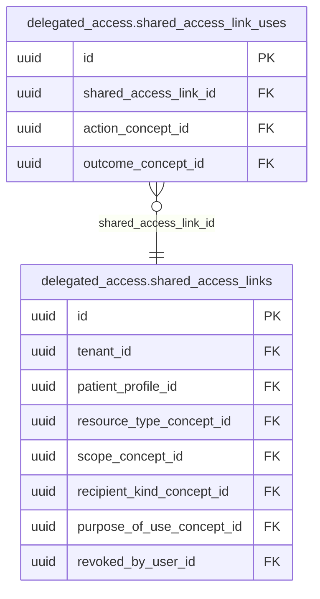

<!-- AUTOGENERADO por tools/inventario/catalogo.mjs. No editar manualmente. -->

# Catálogo del schema `delegated_access`

- **Tablas:** 27 · **Columnas:** 453 (33 con descripción: 7.3 %) · **Índices:** 234
- **Dominio:** Identidad y Seguridad
- Método y límites del catálogo: [README del inventario](../README.md)

## Tablas

| Tabla | Propósito | Columnas | Índices | Operaciones | ORM |
|---|---|---|---|---|---|
| [access_anomalies](#access_anomalies) | Registra las anomalías de actividad de las personas de apoyo (picos de búsquedas, cuentas inactivas con acceso vivo, acumulación de privilegios) para que seguridad las revise y las cierre con un comentario. | 20 | 9 | 0 | SIN_ENTIDAD |
| [access_decision_log](#access_decision_log) | Conserva, sin posibilidad de modificarse, las decisiones de acceso que niegan, desafían o ejercen un permiso sensible, con el permiso, la regla y el objetivo que las motivaron y sin datos del paciente. | 19 | 7 | 0 | SIN_ENTIDAD |
| [access_review_campaigns](#access_review_campaigns) | Define las campañas de certificación de accesos (periódicas, de recertificación, por cambio de rol, dirigidas o de remediación) con su fecha límite, recordatorios, escalamiento y qué hacer con lo que nadie certifica. | 22 | 8 | 0 | SIN_ENTIDAD |
| [access_review_items](#access_review_items) | Guarda cada tarea de una campaña: certificar, revocar o ajustar un vínculo o un permiso, con su revisor, la evidencia sellada con su huella y la decisión que se tomó. | 24 | 10 | 0 | SIN_ENTIDAD |
| [delegated_access_approval_requests](#delegated_access_approval_requests) | Gestiona solicitudes de aprobación antes de habilitar permisos delegados sensibles. | 12 | 8 | 5 | COINCIDE |
| [delegated_access_grants](#delegated_access_grants) | Conserva concesiones de acceso delegado con su sujeto, alcance, permisos y vigencia. | 16 | 11 | 6 | COINCIDE |
| [delegated_permission_set_items](#delegated_permission_set_items) | Detalla permisos incluidos en conjuntos delegables para limitar acciones otorgadas a representantes. | 6 | 2 | 4 | COINCIDE |
| [delegated_permission_sets](#delegated_permission_sets) | Define paquetes reutilizables de permisos que pueden concederse a delegados bajo un alcance específico. | 13 | 6 | 9 | COINCIDE |
| [delegation_events](#delegation_events) | Mantiene eventos de creación, modificación, uso o revocación de delegaciones para auditoría. | 10 | 6 | 7 | COINCIDE |
| [effective_support_access](#effective_support_access) | Tabla derivada que expande los permisos de apoyo vigentes a lo que cada persona puede hacer y sobre qué doctor, servicio y espacio, para decidir cada acción sin recalcular. | 9 | 6 | 0 | SIN_ENTIDAD |
| [engagement_request_items](#engagement_request_items) | Detalla cada objetivo pedido en una solicitud o invitación de apoyo y la decisión por línea (aprobar, ajustar, rechazar), enlazada con el permiso que nace de ella. | 13 | 9 | 0 | SIN_ENTIDAD |
| [engagement_requests](#engagement_requests) | Registra la solicitud de una persona a una organización, o la invitación de la organización a la persona, con su decisión y su vencimiento a los 15 días. | 17 | 9 | 0 | SIN_ENTIDAD |
| [four_eyes_requests](#four_eyes_requests) | Lleva las aprobaciones de cuatro ojos: una acción sensible, un cambio por encima del techo, una excepción de separación de funciones, una reactivación o un traslado con más privilegio que debe decidir otra persona. | 26 | 11 | 0 | SIN_ENTIDAD |
| [governance_rules](#governance_rules) | Guarda las reglas propias de cada organización sobre los permisos de apoyo: techos de delegación, denegaciones por rol, condiciones obligatorias y pisos de visibilidad de campos. | 16 | 6 | 0 | SIN_ENTIDAD |
| [grant_usage_stats](#grant_usage_stats) | Acumula por hora el uso de cada permiso de apoyo (permitidos, negados, desafíos, fuera de horario y pacientes distintos) para certificar con evidencia y detectar anomalías. | 13 | 4 | 0 | SIN_ENTIDAD |
| [handover_items](#handover_items) | Registra el traspaso del trabajo de quien se va o cambia de función: conversaciones, tareas, vínculos supervisados y citas pendientes, y a quién se reasignó cada uno. | 17 | 9 | 0 | SIN_ENTIDAD |
| [lifecycle_cases](#lifecycle_cases) | Sigue el ingreso, el cambio, la baja, la suspensión y la reactivación de una persona de apoyo con su lista de pasos y su estado. | 18 | 9 | 0 | SIN_ENTIDAD |
| [organization_user_assignments](#organization_user_assignments) | Asocia usuarios con organizaciones para determinar en qué ámbitos pueden actuar o administrar acceso delegado. | 35 | 24 | 8 | DIVERGE |
| [patient_restriction_flags](#patient_restriction_flags) | Marca por organización a los pacientes VIP, confidenciales, familiares del personal o protegidos para limitar quién del equipo de apoyo puede verlos; es una marca de acceso, no un dato clínico. | 13 | 7 | 0 | SIN_ENTIDAD |
| [practitioner_delegate_assignments](#practitioner_delegate_assignments) | Relaciona profesionales con delegados autorizados para realizar tareas en su nombre. | 22 | 12 | 8 | DIVERGE |
| [role_templates](#role_templates) | Define los paquetes de acciones por defecto de cada rol de apoyo (secretaria, recepción, central telefónica, etc.), de plataforma o propios de una organización, para conceder permisos sin repetirlos uno a uno. | 14 | 6 | 0 | SIN_ENTIDAD |
| [shared_access_link_uses](#shared_access_link_uses) | sin propósito | 8 | 4 | 0 | SIN_ENTIDAD |
| [shared_access_links](#shared_access_links) | sin propósito | 20 | 13 | 0 | SIN_ENTIDAD |
| [sod_exceptions](#sod_exceptions) | Registra las excepciones justificadas y con vencimiento a una regla de separación de funciones, nacidas de una aprobación de cuatro ojos. | 17 | 9 | 0 | SIN_ENTIDAD |
| [sod_rules](#sod_rules) | Define las reglas de separación de funciones (de plataforma y de cada organización) que impiden que una misma persona reúna permisos incompatibles, con su alcance, su acción y si admiten excepción. | 19 | 9 | 0 | SIN_ENTIDAD |
| [support_grant_actions](#support_grant_actions) | Lista las acciones concretas que habilita cada permiso de apoyo, para que cada permiso tenga sus propias acciones granulares. | 10 | 5 | 0 | SIN_ENTIDAD |
| [support_scope_grants](#support_scope_grants) | Conserva cada permiso concedido a un vínculo de apoyo con su tipo de objetivo (doctor, servicio, ubicación o sus combinaciones), su modo de expansión y su vigencia; varias filas se suman. | 24 | 15 | 0 | SIN_ENTIDAD |

## Diagrama entidad-relación

Las tablas se agrupan en familias por sus claves foráneas dentro del schema (máximo 40 por diagrama). Las FK hacia otros schemas se listan en la ficha de cada tabla.

### Familia 1 de 2 — 23 tablas

```mermaid
erDiagram
  delegated_access_access_anomalies["delegated_access.access_anomalies"] {
    uuid id PK
    uuid tenant_id FK
    uuid user_id FK
    uuid organization_user_assignment_id FK
    uuid kind_concept_id FK
    uuid status_concept_id FK
    uuid acknowledged_by_user_id FK
    uuid created_by_user_id FK
  }
  delegated_access_organization_user_assignments["delegated_access.organization_user_assignments"] {
    uuid id PK
    uuid tenant_id FK
    uuid tenant_membership_id FK
    uuid practice_id FK
    uuid practice_site_id FK
    uuid clinical_unit_id FK
    uuid care_space_id FK
    uuid diagnostic_unit_id FK
  }
  delegated_access_access_review_items["delegated_access.access_review_items"] {
    uuid id PK
    uuid tenant_id FK
    uuid access_review_campaign_id FK
    uuid organization_user_assignment_id FK
    uuid support_scope_grant_id FK
    uuid reviewer_user_id FK
    uuid reviewer_kind_concept_id FK
    uuid decision_concept_id FK
  }
  delegated_access_engagement_requests["delegated_access.engagement_requests"] {
    uuid id PK
    uuid tenant_id FK
    uuid requester_user_id FK
    uuid direction_concept_id FK
    uuid role_template_id FK
    uuid parent_assignment_id FK
    uuid status_concept_id FK
    uuid decided_by_user_id FK
  }
  delegated_access_four_eyes_requests["delegated_access.four_eyes_requests"] {
    uuid id PK
    uuid tenant_id FK
    uuid kind_concept_id FK
    uuid requester_user_id FK
    uuid subject_user_id FK
    uuid organization_user_assignment_id FK
    uuid approver_kind_concept_id FK
    uuid status_concept_id FK
  }
  delegated_access_lifecycle_cases["delegated_access.lifecycle_cases"] {
    uuid id PK
    uuid tenant_id FK
    uuid organization_user_assignment_id FK
    uuid subject_user_id FK
    uuid kind_concept_id FK
    uuid status_concept_id FK
    uuid opened_by_user_id FK
    uuid created_by_user_id FK
  }
  delegated_access_practitioner_delegate_assignments["delegated_access.practitioner_delegate_assignments"] {
    uuid id PK
    uuid tenant_id FK
    uuid practitioner_role_assignment_id FK
    uuid delegate_user_assignment_id FK
    uuid delegated_permission_set_id FK
    uuid delegate_role_concept_id FK
    uuid patient_scope_concept_id FK
    uuid appointment_scope_concept_id FK
  }
  delegated_access_role_templates["delegated_access.role_templates"] {
    uuid id PK
    uuid tenant_id FK
    uuid status_concept_id FK
    uuid created_by_user_id FK
    uuid updated_by_user_id FK
  }
  delegated_access_sod_exceptions["delegated_access.sod_exceptions"] {
    uuid id PK
    uuid tenant_id FK
    uuid sod_rule_id FK
    uuid organization_user_assignment_id FK
    uuid four_eyes_request_id FK
    uuid status_concept_id FK
    uuid revoked_by_user_id FK
    uuid created_by_user_id FK
  }
  delegated_access_support_scope_grants["delegated_access.support_scope_grants"] {
    uuid id PK
    uuid tenant_id FK
    uuid organization_user_assignment_id FK
    uuid target_kind_concept_id FK
    uuid practitioner_role_assignment_id FK
    uuid healthcare_service_id FK
    uuid care_space_id FK
    uuid practice_site_id FK
  }
  delegated_access_access_review_campaigns["delegated_access.access_review_campaigns"] {
    uuid id PK
    uuid tenant_id FK
    uuid kind_concept_id FK
    uuid uncertified_action_concept_id FK
    uuid owner_user_id FK
    uuid status_concept_id FK
    uuid created_by_user_id FK
    uuid updated_by_user_id FK
  }
  delegated_access_engagement_request_items["delegated_access.engagement_request_items"] {
    uuid id PK
    uuid tenant_id FK
    uuid engagement_request_id FK
    uuid target_kind_concept_id FK
    uuid practitioner_role_assignment_id FK
    uuid healthcare_service_id FK
    uuid care_space_id FK
    uuid practice_site_id FK
  }
  delegated_access_access_decision_log["delegated_access.access_decision_log"] {
    uuid id PK
    uuid tenant_id FK
    uuid user_id FK
    uuid effect_concept_id FK
    uuid grant_id FK
    uuid approval_id FK
    uuid recorded_by_user_id FK
  }
  delegated_access_handover_items["delegated_access.handover_items"] {
    uuid id PK
    uuid tenant_id FK
    uuid lifecycle_case_id FK
    uuid item_kind_concept_id FK
    uuid from_user_id FK
    uuid to_user_id FK
    uuid status_concept_id FK
    uuid reassigned_by_user_id FK
  }
  delegated_access_delegated_access_approval_requests["delegated_access.delegated_access_approval_requests"] {
    uuid id PK
    uuid practitioner_delegate_assignment_id FK
    uuid requested_permission_id FK
    uuid patient_profile_id FK
    uuid encounter_id FK
    uuid decided_by_user_id FK
    uuid decision_concept_id FK
    uuid status_concept_id FK
  }
  delegated_access_delegated_access_grants["delegated_access.delegated_access_grants"] {
    uuid id PK
    uuid practitioner_delegate_assignment_id FK
    uuid grant_type_concept_id FK
    uuid purpose_of_use_concept_id FK
    uuid patient_profile_id FK
    uuid encounter_id FK
    uuid resource_type_concept_id FK
    uuid approved_by_user_id FK
  }
  delegated_access_delegated_permission_sets["delegated_access.delegated_permission_sets"] {
    uuid id PK
    uuid tenant_id FK
    uuid delegate_type_concept_id FK
    uuid status_concept_id FK
    uuid created_by_user_id FK
    uuid updated_by_user_id FK
  }
  delegated_access_delegation_events["delegated_access.delegation_events"] {
    uuid id PK
    uuid practitioner_delegate_assignment_id FK
    uuid event_type_concept_id FK
    uuid actor_user_id FK
    uuid target_user_id FK
    uuid reason_concept_id FK
  }
  delegated_access_sod_rules["delegated_access.sod_rules"] {
    uuid id PK
    uuid tenant_id FK
    uuid base_rule_id FK
    uuid scope_concept_id FK
    uuid action_concept_id FK
    uuid status_concept_id FK
    uuid created_by_user_id FK
    uuid updated_by_user_id FK
  }
  delegated_access_effective_support_access["delegated_access.effective_support_access"] {
    uuid id PK
    uuid user_id FK
    uuid tenant_id FK
    uuid practitioner_role_assignment_id FK
    uuid healthcare_service_id FK
    uuid care_space_id FK
    uuid grant_id FK
  }
  delegated_access_grant_usage_stats["delegated_access.grant_usage_stats"] {
    uuid id PK
    uuid tenant_id FK
    uuid user_id FK
    uuid support_scope_grant_id FK
  }
  delegated_access_support_grant_actions["delegated_access.support_grant_actions"] {
    uuid id PK
    uuid tenant_id FK
    uuid support_scope_grant_id FK
    uuid permission_id FK
    uuid updated_by_user_id FK
  }
  delegated_access_delegated_permission_set_items["delegated_access.delegated_permission_set_items"] {
    uuid id PK
    uuid delegated_permission_set_id FK
    uuid permission_id FK
  }
  delegated_access_access_anomalies }o--o| delegated_access_organization_user_assignments : "organization_user_assignment_…"
  delegated_access_organization_user_assignments }o--o| delegated_access_role_templates : "role_template_id"
  delegated_access_access_review_items }o--|| delegated_access_access_review_campaigns : "access_review_campaign_id"
  delegated_access_access_review_items }o--|| delegated_access_organization_user_assignments : "organization_user_assignment_…"
  delegated_access_access_review_items }o--o| delegated_access_support_scope_grants : "support_scope_grant_id"
  delegated_access_engagement_requests }o--|| delegated_access_role_templates : "role_template_id"
  delegated_access_engagement_requests }o--o| delegated_access_organization_user_assignments : "parent_assignment_id"
  delegated_access_four_eyes_requests }o--o| delegated_access_organization_user_assignments : "organization_user_assignment_…"
  delegated_access_lifecycle_cases }o--|| delegated_access_organization_user_assignments : "organization_user_assignment_…"
  delegated_access_practitioner_delegate_assignments }o--|| delegated_access_organization_user_assignments : "delegate_user_assignment_id"
  delegated_access_practitioner_delegate_assignments }o--|| delegated_access_delegated_permission_sets : "delegated_permission_set_id"
  delegated_access_sod_exceptions }o--|| delegated_access_sod_rules : "sod_rule_id"
  delegated_access_sod_exceptions }o--|| delegated_access_organization_user_assignments : "organization_user_assignment_…"
  delegated_access_sod_exceptions }o--|| delegated_access_four_eyes_requests : "four_eyes_request_id"
  delegated_access_support_scope_grants }o--|| delegated_access_organization_user_assignments : "organization_user_assignment_…"
  delegated_access_support_scope_grants }o--o| delegated_access_role_templates : "source_role_template_id"
  delegated_access_engagement_request_items }o--|| delegated_access_engagement_requests : "engagement_request_id"
  delegated_access_engagement_request_items }o--o| delegated_access_support_scope_grants : "resulting_grant_id"
  delegated_access_access_decision_log }o--o| delegated_access_support_scope_grants : "grant_id"
  delegated_access_access_decision_log }o--o| delegated_access_four_eyes_requests : "approval_id"
  delegated_access_handover_items }o--|| delegated_access_lifecycle_cases : "lifecycle_case_id"
  delegated_access_delegated_access_approval_requests }o--|| delegated_access_practitioner_delegate_assignments : "practitioner_delegate_assignm…"
  delegated_access_delegated_access_grants }o--|| delegated_access_practitioner_delegate_assignments : "practitioner_delegate_assignm…"
  delegated_access_delegation_events }o--|| delegated_access_practitioner_delegate_assignments : "practitioner_delegate_assignm…"
  delegated_access_effective_support_access }o--|| delegated_access_support_scope_grants : "grant_id"
  delegated_access_grant_usage_stats }o--|| delegated_access_support_scope_grants : "support_scope_grant_id"
  delegated_access_support_grant_actions }o--|| delegated_access_support_scope_grants : "support_scope_grant_id"
  delegated_access_delegated_permission_set_items }o--|| delegated_access_delegated_permission_sets : "delegated_permission_set_id"
```

### Familia 2 de 2 — 2 tablas

### Tablas sin relaciones dentro del schema

`delegated_access.governance_rules` · `delegated_access.patient_restriction_flags`

## Fichas

### access_anomalies

#### Vista general

Registra las anomalías de actividad de las personas de apoyo (picos de búsquedas, cuentas inactivas con acceso vivo, acumulación de privilegios) para que seguridad las revise y las cierre con un comentario.

- **Estado del propósito:** DOMAIN_CURATED_DRAFT · fuente: `Mantra Core Health Context/modules/diagram_29_delegated_access.puml: access_anomalies`
- **Dominio:** Identidad y Seguridad · **Diagrama:** `Mantra Core Health Context/modules/diagram_29_delegated_access.puml` · **DDL:** `SQL/29_delegated_access/02_tables.sql`
- **Entidad del ORM:** **sin entidad** (deriva)
- **Resumen:** 20 columnas · 9 índices · 8 FK salientes · 0 entrantes · 0 operaciones

#### Columnas

| # | Columna | Tipo | Rol estructural | Descripción | ORM |
|---|---|---|---|---|---|
| 1 | `id` | `uuid` | Clave primaria; Obligatoria | _sin dato_ | **SIN_ENTIDAD** |
| 2 | `tenant_id` | `uuid` | Clave foránea → directory.tenants.id; Obligatoria | _sin dato_ | **SIN_ENTIDAD** |
| 3 | `user_id` | `uuid` | Clave foránea → iam.users.id; Obligatoria | _sin dato_ | **SIN_ENTIDAD** |
| 4 | `organization_user_assignment_id` | `uuid` | Clave foránea → delegated_access.organization_user_assignments.id; Opcional | _sin dato_ | **SIN_ENTIDAD** |
| 5 | `kind_concept_id` | `uuid` | Clave foránea → terminology.catalog_concepts.id; Obligatoria | _sin dato_ | **SIN_ENTIDAD** |
| 6 | `window_start` | `timestamptz` | Obligatoria | _sin dato_ | **SIN_ENTIDAD** |
| 7 | `window_end` | `timestamptz` | Obligatoria | _sin dato_ | **SIN_ENTIDAD** |
| 8 | `observed_value` | `numeric(12,2)` | Obligatoria | _sin dato_ | **SIN_ENTIDAD** |
| 9 | `baseline_value` | `numeric(12,2)` | Opcional | _sin dato_ | **SIN_ENTIDAD** |
| 10 | `threshold_value` | `numeric(12,2)` | Obligatoria | _sin dato_ | **SIN_ENTIDAD** |
| 11 | `evidence_json` | `jsonb` | Obligatoria | _sin dato_ | **SIN_ENTIDAD** |
| 12 | `status_concept_id` | `uuid` | Clave foránea → terminology.catalog_concepts.id; Obligatoria | _sin dato_ | **SIN_ENTIDAD** |
| 13 | `acknowledged_by_user_id` | `uuid` | Clave foránea → iam.users.id; Opcional | _sin dato_ | **SIN_ENTIDAD** |
| 14 | `acknowledged_at` | `timestamptz` | Opcional | _sin dato_ | **SIN_ENTIDAD** |
| 15 | `resolution_comment_text` | `text` | Opcional | _sin dato_ | **SIN_ENTIDAD** |
| 16 | `created_at` | `timestamptz` | Obligatoria | _sin dato_ | **SIN_ENTIDAD** |
| 17 | `updated_at` | `timestamptz` | Obligatoria | _sin dato_ | **SIN_ENTIDAD** |
| 18 | `created_by_user_id` | `uuid` | Clave foránea → iam.users.id; Opcional | _sin dato_ | **SIN_ENTIDAD** |
| 19 | `updated_by_user_id` | `uuid` | Clave foránea → iam.users.id; Opcional | _sin dato_ | **SIN_ENTIDAD** |
| 20 | `row_version` | `integer = 1` | Obligatoria | _sin dato_ | **SIN_ENTIDAD** |

#### Relaciones

| Sentido | Columnas | Tabla | Restricción |
|---|---|---|---|
| hacia | organization_user_assignment_id | delegated_access.organization_user_assignments (id) | fk_access_anomalies_organization_user_assignment_id |
| hacia | tenant_id | directory.tenants (id) | fk_access_anomalies_tenant_id |
| hacia | user_id | iam.users (id) | fk_access_anomalies_user_id |
| hacia | kind_concept_id | terminology.catalog_concepts (id) | fk_access_anomalies_kind_concept_id |
| hacia | status_concept_id | terminology.catalog_concepts (id) | fk_access_anomalies_status_concept_id |
| hacia | acknowledged_by_user_id | iam.users (id) | fk_access_anomalies_acknowledged_by_user_id |
| hacia | created_by_user_id | iam.users (id) | fk_access_anomalies_created_by_user_id |
| hacia | updated_by_user_id | iam.users (id) | fk_access_anomalies_updated_by_user_id |

#### Índices

| Índice | Único | Columnas | Para qué |
|---|---|---|---|
| `ix_access_anomalies_tenant_id` | no | tenant_id, status_concept_id, ("created_at" DESC) | _sin uso detectado estáticamente_ |
| `uq_access_anomalies_window` | sí | tenant_id, user_id, kind_concept_id, window_start | Garantiza que no se repita la combinación (tenant_id, user_id, kind_concept_id, window_start) _(DOCUMENTO)_; Soporta la clave foránea fk_access_anomalies_tenant_id: PostgreSQL no indexa las FK por sí mismo _(DOCUMENTO)_ |
| `ix_access_anomalies_user_id` | no | user_id | Soporta la clave foránea fk_access_anomalies_user_id: PostgreSQL no indexa las FK por sí mismo _(DOCUMENTO)_ |
| `ix_access_anomalies_organization_user_assignment_id` | no | organization_user_assignment_id | Soporta la clave foránea fk_access_anomalies_organization_user_assignment_id: PostgreSQL no indexa las FK por sí mismo _(DOCUMENTO)_ |
| `ix_access_anomalies_kind_concept_id` | no | kind_concept_id | Soporta la clave foránea fk_access_anomalies_kind_concept_id: PostgreSQL no indexa las FK por sí mismo _(DOCUMENTO)_ |
| `ix_access_anomalies_status_concept_id` | no | status_concept_id | Soporta la clave foránea fk_access_anomalies_status_concept_id: PostgreSQL no indexa las FK por sí mismo _(DOCUMENTO)_ |
| `ix_access_anomalies_acknowledged_by_user_id` | no | acknowledged_by_user_id | Soporta la clave foránea fk_access_anomalies_acknowledged_by_user_id: PostgreSQL no indexa las FK por sí mismo _(DOCUMENTO)_ |
| `ix_access_anomalies_created_by_user_id` | no | created_by_user_id | Soporta la clave foránea fk_access_anomalies_created_by_user_id: PostgreSQL no indexa las FK por sí mismo _(DOCUMENTO)_ |
| `ix_access_anomalies_updated_by_user_id` | no | updated_by_user_id | Soporta la clave foránea fk_access_anomalies_updated_by_user_id: PostgreSQL no indexa las FK por sí mismo _(DOCUMENTO)_ |

#### Restricciones

| Restricción | Tipo | Definición |
|---|---|---|
| `uq_access_anomalies_window` | UNIQUE INDEX | UNIQUE INDEX ("tenant_id", "user_id", "kind_concept_id", "window_start") |
| `ck_access_anomalies_window` | CHECK | CHECK (("window_end" > "window_start")) |
| `ck_access_anomalies_dismiss_comment` | CHECK | CHECK (("status_concept_id" <> '1c8f5b91-371b-5967-b8fd-98d08f80ac9c' OR COALESCE(char_length("resolution_comment_text"), 0) >= 10)) |

#### Operaciones que la tocan

_Ninguna operación HTTP la toca según el análisis estático (puede usarla un worker, un trigger o una migración)._

#### Gobierno

| Atributo | Valor | Fuente |
|---|---|---|
| Append-only | no declarado | — |
| Datos personales | sin fuente | — |
| Financiera | sin fuente | — |
| Crítica para auditoría | sin fuente | — |
| Retención | sin fuente | — |
| Responsable | sin fuente | — |
| Revisión | AUTO_DETECTADA | — |

---

### access_decision_log

#### Vista general

Conserva, sin posibilidad de modificarse, las decisiones de acceso que niegan, desafían o ejercen un permiso sensible, con el permiso, la regla y el objetivo que las motivaron y sin datos del paciente.

- **Estado del propósito:** DOMAIN_CURATED_DRAFT · fuente: `Mantra Core Health Context/modules/diagram_29_delegated_access.puml: access_decision_log`
- **Dominio:** Identidad y Seguridad · **Diagrama:** `Mantra Core Health Context/modules/diagram_29_delegated_access.puml` · **DDL:** `SQL/29_delegated_access/02_tables.sql`
- **Entidad del ORM:** **sin entidad** (deriva)
- **Resumen:** 19 columnas · 7 índices · 6 FK salientes · 0 entrantes · 0 operaciones

#### Columnas

| # | Columna | Tipo | Rol estructural | Descripción | ORM |
|---|---|---|---|---|---|
| 1 | `id` | `uuid` | Clave primaria; Obligatoria | _sin dato_ | **SIN_ENTIDAD** |
| 2 | `tenant_id` | `uuid` | Clave foránea → directory.tenants.id; Obligatoria | _sin dato_ | **SIN_ENTIDAD** |
| 3 | `user_id` | `uuid` | Clave foránea → iam.users.id; Obligatoria | _sin dato_ | **SIN_ENTIDAD** |
| 4 | `permission_code` | `varchar` | Obligatoria | _sin dato_ | **SIN_ENTIDAD** |
| 5 | `effect_concept_id` | `uuid` | Clave foránea → terminology.catalog_concepts.id; Obligatoria | _sin dato_ | **SIN_ENTIDAD** |
| 6 | `reason_code` | `varchar` | Obligatoria | _sin dato_ | **SIN_ENTIDAD** |
| 7 | `grant_id` | `uuid` | Clave foránea → delegated_access.support_scope_grants.id; Opcional | _sin dato_ | **SIN_ENTIDAD** |
| 8 | `rule_id` | `uuid` | Opcional | _sin dato_ | **SIN_ENTIDAD** |
| 9 | `practitioner_role_assignment_id` | `uuid` | Opcional | _sin dato_ | **SIN_ENTIDAD** |
| 10 | `healthcare_service_id` | `uuid` | Opcional | _sin dato_ | **SIN_ENTIDAD** |
| 11 | `care_space_id` | `uuid` | Opcional | _sin dato_ | **SIN_ENTIDAD** |
| 12 | `patient_profile_id` | `uuid` | Opcional | _sin dato_ | **SIN_ENTIDAD** |
| 13 | `approval_id` | `uuid` | Clave foránea → delegated_access.four_eyes_requests.id; Opcional | _sin dato_ | **SIN_ENTIDAD** |
| 14 | `correlation_id` | `uuid` | Opcional | _sin dato_ | **SIN_ENTIDAD** |
| 15 | `session_id` | `uuid` | Opcional | _sin dato_ | **SIN_ENTIDAD** |
| 16 | `ip` | `inet` | Opcional | _sin dato_ | **SIN_ENTIDAD** |
| 17 | `detail_json` | `jsonb` | Opcional | _sin dato_ | **SIN_ENTIDAD** |
| 18 | `recorded_at` | `timestamptz` | Obligatoria | _sin dato_ | **SIN_ENTIDAD** |
| 19 | `recorded_by_user_id` | `uuid` | Clave foránea → iam.users.id; Opcional | _sin dato_ | **SIN_ENTIDAD** |

#### Relaciones

| Sentido | Columnas | Tabla | Restricción |
|---|---|---|---|
| hacia | grant_id | delegated_access.support_scope_grants (id) | fk_access_decision_log_grant_id |
| hacia | approval_id | delegated_access.four_eyes_requests (id) | fk_access_decision_log_approval_id |
| hacia | tenant_id | directory.tenants (id) | fk_access_decision_log_tenant_id |
| hacia | user_id | iam.users (id) | fk_access_decision_log_user_id |
| hacia | effect_concept_id | terminology.catalog_concepts (id) | fk_access_decision_log_effect_concept_id |
| hacia | recorded_by_user_id | iam.users (id) | fk_access_decision_log_recorded_by_user_id |

#### Índices

| Índice | Único | Columnas | Para qué |
|---|---|---|---|
| `ix_access_decision_log_tenant_time` | no | tenant_id, ("recorded_at" DESC) | _sin uso detectado estáticamente_ |
| `ix_access_decision_log_user_time` | no | user_id, ("recorded_at" DESC) | _sin uso detectado estáticamente_ |
| `ix_access_decision_log_grant` | no | grant_id donde WHERE grant_id IS NOT NULL | Soporta la clave foránea fk_access_decision_log_grant_id: PostgreSQL no indexa las FK por sí mismo _(DOCUMENTO)_; Índice parcial: sólo indexa las filas donde WHERE grant_id IS NOT NULL _(ESTRUCTURAL)_ |
| `ix_access_decision_log_effect` | no | tenant_id, effect_concept_id, ("recorded_at" DESC) | _sin uso detectado estáticamente_ |
| `ix_access_decision_log_effect_concept_id` | no | effect_concept_id | Soporta la clave foránea fk_access_decision_log_effect_concept_id: PostgreSQL no indexa las FK por sí mismo _(DOCUMENTO)_ |
| `ix_access_decision_log_approval_id` | no | approval_id | Soporta la clave foránea fk_access_decision_log_approval_id: PostgreSQL no indexa las FK por sí mismo _(DOCUMENTO)_ |
| `ix_access_decision_log_recorded_by_user_id` | no | recorded_by_user_id | Soporta la clave foránea fk_access_decision_log_recorded_by_user_id: PostgreSQL no indexa las FK por sí mismo _(DOCUMENTO)_ |

#### Operaciones que la tocan

_Ninguna operación HTTP la toca según el análisis estático (puede usarla un worker, un trigger o una migración)._

#### Gobierno

| Atributo | Valor | Fuente |
|---|---|---|
| Append-only | no declarado | — |
| Datos personales | sin fuente | — |
| Financiera | sin fuente | — |
| Crítica para auditoría | sin fuente | — |
| Retención | sin fuente | — |
| Responsable | sin fuente | — |
| Revisión | AUTO_DETECTADA | — |

---

### access_review_campaigns

#### Vista general

Define las campañas de certificación de accesos (periódicas, de recertificación, por cambio de rol, dirigidas o de remediación) con su fecha límite, recordatorios, escalamiento y qué hacer con lo que nadie certifica.

- **Estado del propósito:** DOMAIN_CURATED_DRAFT · fuente: `Mantra Core Health Context/modules/diagram_29_delegated_access.puml: access_review_campaigns`
- **Dominio:** Identidad y Seguridad · **Diagrama:** `Mantra Core Health Context/modules/diagram_29_delegated_access.puml` · **DDL:** `SQL/29_delegated_access/02_tables.sql`
- **Entidad del ORM:** **sin entidad** (deriva)
- **Resumen:** 22 columnas · 8 índices · 7 FK salientes · 1 entrantes · 0 operaciones

#### Columnas

| # | Columna | Tipo | Rol estructural | Descripción | ORM |
|---|---|---|---|---|---|
| 1 | `id` | `uuid` | Clave primaria; Obligatoria | _sin dato_ | **SIN_ENTIDAD** |
| 2 | `tenant_id` | `uuid` | Clave foránea → directory.tenants.id; Obligatoria | _sin dato_ | **SIN_ENTIDAD** |
| 3 | `name` | `varchar` | Obligatoria | _sin dato_ | **SIN_ENTIDAD** |
| 4 | `kind_concept_id` | `uuid` | Clave foránea → terminology.catalog_concepts.id; Obligatoria | _sin dato_ | **SIN_ENTIDAD** |
| 5 | `scope_json` | `jsonb` | Obligatoria | _sin dato_ | **SIN_ENTIDAD** |
| 6 | `scope_schema_version` | `integer` | Obligatoria | _sin dato_ | **SIN_ENTIDAD** |
| 7 | `filters_json` | `jsonb` | Opcional | _sin dato_ | **SIN_ENTIDAD** |
| 8 | `due_at` | `timestamptz` | Obligatoria | _sin dato_ | **SIN_ENTIDAD** |
| 9 | `grace_days` | `integer = 7` | Obligatoria | _sin dato_ | **SIN_ENTIDAD** |
| 10 | `reminder_days_before_json` | `jsonb = '[7,3,1]'` | Obligatoria | _sin dato_ | **SIN_ENTIDAD** |
| 11 | `escalate_after_days` | `integer = 3` | Obligatoria | _sin dato_ | **SIN_ENTIDAD** |
| 12 | `uncertified_action_concept_id` | `uuid` | Clave foránea → terminology.catalog_concepts.id; Obligatoria | _sin dato_ | **SIN_ENTIDAD** |
| 13 | `owner_user_id` | `uuid` | Clave foránea → iam.users.id; Opcional | _sin dato_ | **SIN_ENTIDAD** |
| 14 | `status_concept_id` | `uuid` | Clave foránea → terminology.catalog_concepts.id; Obligatoria | _sin dato_ | **SIN_ENTIDAD** |
| 15 | `launched_at` | `timestamptz` | Opcional | _sin dato_ | **SIN_ENTIDAD** |
| 16 | `closed_at` | `timestamptz` | Opcional | _sin dato_ | **SIN_ENTIDAD** |
| 17 | `cancelled_at` | `timestamptz` | Opcional | _sin dato_ | **SIN_ENTIDAD** |
| 18 | `created_at` | `timestamptz` | Obligatoria | _sin dato_ | **SIN_ENTIDAD** |
| 19 | `updated_at` | `timestamptz` | Obligatoria | _sin dato_ | **SIN_ENTIDAD** |
| 20 | `created_by_user_id` | `uuid` | Clave foránea → iam.users.id; Opcional | _sin dato_ | **SIN_ENTIDAD** |
| 21 | `updated_by_user_id` | `uuid` | Clave foránea → iam.users.id; Opcional | _sin dato_ | **SIN_ENTIDAD** |
| 22 | `row_version` | `integer = 1` | Obligatoria | _sin dato_ | **SIN_ENTIDAD** |

#### Relaciones

| Sentido | Columnas | Tabla | Restricción |
|---|---|---|---|
| hacia | tenant_id | directory.tenants (id) | fk_access_review_campaigns_tenant_id |
| hacia | kind_concept_id | terminology.catalog_concepts (id) | fk_access_review_campaigns_kind_concept_id |
| hacia | uncertified_action_concept_id | terminology.catalog_concepts (id) | fk_access_review_campaigns_uncertified_action_concept_id |
| hacia | owner_user_id | iam.users (id) | fk_access_review_campaigns_owner_user_id |
| hacia | status_concept_id | terminology.catalog_concepts (id) | fk_access_review_campaigns_status_concept_id |
| hacia | created_by_user_id | iam.users (id) | fk_access_review_campaigns_created_by_user_id |
| hacia | updated_by_user_id | iam.users (id) | fk_access_review_campaigns_updated_by_user_id |
| desde | id | delegated_access.access_review_items (access_review_campaign_id) | fk_access_review_items_access_review_campaign_id |

#### Índices

| Índice | Único | Columnas | Para qué |
|---|---|---|---|
| `ix_access_review_campaigns_tenant_id` | no | tenant_id, status_concept_id, due_at | Soporta la clave foránea fk_access_review_campaigns_tenant_id: PostgreSQL no indexa las FK por sí mismo _(DOCUMENTO)_ |
| `uq_access_review_campaigns_recert_month` | sí | tenant_id, ("name") WHERE kind_concept_id = '9f831109-61d2-54d4-8e67-7ad04ac9a315' AND status_concept_id IN ('743d9f11-b186-5547-ae3d-cc44d94724bd'), ('faa5c9bf-5300-5e43-8829-19a9f0e94fef') | Garantiza que no se repita la combinación (tenant_id) _(DOCUMENTO)_ |
| `ix_access_review_campaigns_kind_concept_id` | no | kind_concept_id | Soporta la clave foránea fk_access_review_campaigns_kind_concept_id: PostgreSQL no indexa las FK por sí mismo _(DOCUMENTO)_ |
| `ix_access_review_campaigns_uncertified_action_concept_id` | no | uncertified_action_concept_id | Soporta la clave foránea fk_access_review_campaigns_uncertified_action_concept_id: PostgreSQL no indexa las FK por sí mismo _(DOCUMENTO)_ |
| `ix_access_review_campaigns_owner_user_id` | no | owner_user_id | Soporta la clave foránea fk_access_review_campaigns_owner_user_id: PostgreSQL no indexa las FK por sí mismo _(DOCUMENTO)_ |
| `ix_access_review_campaigns_status_concept_id` | no | status_concept_id | Soporta la clave foránea fk_access_review_campaigns_status_concept_id: PostgreSQL no indexa las FK por sí mismo _(DOCUMENTO)_ |
| `ix_access_review_campaigns_created_by_user_id` | no | created_by_user_id | Soporta la clave foránea fk_access_review_campaigns_created_by_user_id: PostgreSQL no indexa las FK por sí mismo _(DOCUMENTO)_ |
| `ix_access_review_campaigns_updated_by_user_id` | no | updated_by_user_id | Soporta la clave foránea fk_access_review_campaigns_updated_by_user_id: PostgreSQL no indexa las FK por sí mismo _(DOCUMENTO)_ |

#### Restricciones

| Restricción | Tipo | Definición |
|---|---|---|
| `uq_access_review_campaigns_recert_month` | UNIQUE INDEX | UNIQUE INDEX ("tenant_id", "name") WHERE kind_concept_id = '9f831109-61d2-54d4-8e67-7ad04ac9a315' AND status_concept_id IN ('743d9f11-b186-5547-ae3d-cc44d94724bd', 'faa5c9bf-5300-5e43-8829-19a9f0e94fef') |
| `ck_access_review_campaigns_grace` | CHECK | CHECK (("grace_days" BETWEEN 0 AND 30)) |
| `ck_access_review_campaigns_escalate` | CHECK | CHECK (("escalate_after_days" BETWEEN 1 AND 30)) |
| `ck_access_review_campaigns_reminders` | CHECK | CHECK ((jsonb_typeof("reminder_days_before_json") = 'array')) |
| `ck_access_review_campaigns_due` | CHECK | CHECK (("launched_at" IS NULL OR "due_at" > "launched_at")) |

#### Operaciones que la tocan

_Ninguna operación HTTP la toca según el análisis estático (puede usarla un worker, un trigger o una migración)._

#### Gobierno

| Atributo | Valor | Fuente |
|---|---|---|
| Append-only | no declarado | — |
| Datos personales | sin fuente | — |
| Financiera | sin fuente | — |
| Crítica para auditoría | sin fuente | — |
| Retención | sin fuente | — |
| Responsable | sin fuente | — |
| Revisión | AUTO_DETECTADA | — |

---

### access_review_items

#### Vista general

Guarda cada tarea de una campaña: certificar, revocar o ajustar un vínculo o un permiso, con su revisor, la evidencia sellada con su huella y la decisión que se tomó.

- **Estado del propósito:** DOMAIN_CURATED_DRAFT · fuente: `Mantra Core Health Context/modules/diagram_29_delegated_access.puml: access_review_items`
- **Dominio:** Identidad y Seguridad · **Diagrama:** `Mantra Core Health Context/modules/diagram_29_delegated_access.puml` · **DDL:** `SQL/29_delegated_access/02_tables.sql`
- **Entidad del ORM:** **sin entidad** (deriva)
- **Resumen:** 24 columnas · 10 índices · 11 FK salientes · 0 entrantes · 0 operaciones

#### Columnas

| # | Columna | Tipo | Rol estructural | Descripción | ORM |
|---|---|---|---|---|---|
| 1 | `id` | `uuid` | Clave primaria; Obligatoria | _sin dato_ | **SIN_ENTIDAD** |
| 2 | `tenant_id` | `uuid` | Clave foránea → directory.tenants.id; Obligatoria | _sin dato_ | **SIN_ENTIDAD** |
| 3 | `access_review_campaign_id` | `uuid` | Clave foránea → delegated_access.access_review_campaigns.id; Obligatoria | _sin dato_ | **SIN_ENTIDAD** |
| 4 | `organization_user_assignment_id` | `uuid` | Clave foránea → delegated_access.organization_user_assignments.id; Obligatoria | _sin dato_ | **SIN_ENTIDAD** |
| 5 | `support_scope_grant_id` | `uuid` | Clave foránea → delegated_access.support_scope_grants.id; Opcional | _sin dato_ | **SIN_ENTIDAD** |
| 6 | `reviewer_user_id` | `uuid` | Clave foránea → iam.users.id; Opcional | _sin dato_ | **SIN_ENTIDAD** |
| 7 | `reviewer_kind_concept_id` | `uuid` | Clave foránea → terminology.catalog_concepts.id; Obligatoria | _sin dato_ | **SIN_ENTIDAD** |
| 8 | `decision_concept_id` | `uuid = '55a6db07-19e7-5bb4-978a-3d246492f49d'` | Clave foránea → terminology.catalog_concepts.id; Obligatoria | _sin dato_ | **SIN_ENTIDAD** |
| 9 | `decided_at` | `timestamptz` | Opcional | _sin dato_ | **SIN_ENTIDAD** |
| 10 | `decided_by_user_id` | `uuid` | Clave foránea → iam.users.id; Opcional | _sin dato_ | **SIN_ENTIDAD** |
| 11 | `decision_comment_text` | `text` | Opcional | _sin dato_ | **SIN_ENTIDAD** |
| 12 | `adjustment_json` | `jsonb` | Opcional | _sin dato_ | **SIN_ENTIDAD** |
| 13 | `evidence_json` | `jsonb` | Obligatoria | _sin dato_ | **SIN_ENTIDAD** |
| 14 | `evidence_hash` | `varchar` | Obligatoria | _sin dato_ | **SIN_ENTIDAD** |
| 15 | `due_at` | `timestamptz` | Obligatoria | _sin dato_ | **SIN_ENTIDAD** |
| 16 | `reminder_count` | `integer = 0` | Obligatoria | _sin dato_ | **SIN_ENTIDAD** |
| 17 | `last_reminded_at` | `timestamptz` | Opcional | _sin dato_ | **SIN_ENTIDAD** |
| 18 | `escalated_at` | `timestamptz` | Opcional | _sin dato_ | **SIN_ENTIDAD** |
| 19 | `escalated_to_user_id` | `uuid` | Clave foránea → iam.users.id; Opcional | _sin dato_ | **SIN_ENTIDAD** |
| 20 | `created_at` | `timestamptz` | Obligatoria | _sin dato_ | **SIN_ENTIDAD** |
| 21 | `updated_at` | `timestamptz` | Obligatoria | _sin dato_ | **SIN_ENTIDAD** |
| 22 | `created_by_user_id` | `uuid` | Clave foránea → iam.users.id; Opcional | _sin dato_ | **SIN_ENTIDAD** |
| 23 | `updated_by_user_id` | `uuid` | Clave foránea → iam.users.id; Opcional | _sin dato_ | **SIN_ENTIDAD** |
| 24 | `row_version` | `integer = 1` | Obligatoria | _sin dato_ | **SIN_ENTIDAD** |

#### Relaciones

| Sentido | Columnas | Tabla | Restricción |
|---|---|---|---|
| hacia | access_review_campaign_id | delegated_access.access_review_campaigns (id) | fk_access_review_items_access_review_campaign_id |
| hacia | organization_user_assignment_id | delegated_access.organization_user_assignments (id) | fk_access_review_items_organization_user_assignment_id |
| hacia | support_scope_grant_id | delegated_access.support_scope_grants (id) | fk_access_review_items_support_scope_grant_id |
| hacia | tenant_id | directory.tenants (id) | fk_access_review_items_tenant_id |
| hacia | reviewer_user_id | iam.users (id) | fk_access_review_items_reviewer_user_id |
| hacia | reviewer_kind_concept_id | terminology.catalog_concepts (id) | fk_access_review_items_reviewer_kind_concept_id |
| hacia | decision_concept_id | terminology.catalog_concepts (id) | fk_access_review_items_decision_concept_id |
| hacia | decided_by_user_id | iam.users (id) | fk_access_review_items_decided_by_user_id |
| hacia | escalated_to_user_id | iam.users (id) | fk_access_review_items_escalated_to_user_id |
| hacia | created_by_user_id | iam.users (id) | fk_access_review_items_created_by_user_id |
| hacia | updated_by_user_id | iam.users (id) | fk_access_review_items_updated_by_user_id |

#### Índices

| Índice | Único | Columnas | Para qué |
|---|---|---|---|
| `ix_access_review_items_tenant_id` | no | tenant_id, decision_concept_id | Soporta la clave foránea fk_access_review_items_tenant_id: PostgreSQL no indexa las FK por sí mismo _(DOCUMENTO)_ |
| `uq_access_review_items_campaign_grant` | sí | access_review_campaign_id, organization_user_assignment_id, (COALESCE(support_scope_grant_id, '00000000-0000-0000-0000-000000000000'::uuid)) | Garantiza que no se repita la combinación (access_review_campaign_id, organization_user_assignment_id) _(DOCUMENTO)_ |
| `ix_access_review_items_reviewer_pending` | no | reviewer_user_id, due_at donde WHERE decision_concept_id = '55a6db07-19e7-5bb4-978a-3d246492f49d' | Soporta la clave foránea fk_access_review_items_reviewer_user_id: PostgreSQL no indexa las FK por sí mismo _(DOCUMENTO)_; Índice parcial: sólo indexa las filas donde WHERE decision_concept_id = '55a6db07-19e7-5bb4-978a-3d246492f49d' _(ESTRUCTURAL)_ |
| `ix_access_review_items_organization_user_assignment_id` | no | organization_user_assignment_id | Soporta la clave foránea fk_access_review_items_organization_user_assignment_id: PostgreSQL no indexa las FK por sí mismo _(DOCUMENTO)_ |
| `ix_access_review_items_reviewer_kind_concept_id` | no | reviewer_kind_concept_id | Soporta la clave foránea fk_access_review_items_reviewer_kind_concept_id: PostgreSQL no indexa las FK por sí mismo _(DOCUMENTO)_ |
| `ix_access_review_items_decision_concept_id` | no | decision_concept_id | Soporta la clave foránea fk_access_review_items_decision_concept_id: PostgreSQL no indexa las FK por sí mismo _(DOCUMENTO)_ |
| `ix_access_review_items_decided_by_user_id` | no | decided_by_user_id | Soporta la clave foránea fk_access_review_items_decided_by_user_id: PostgreSQL no indexa las FK por sí mismo _(DOCUMENTO)_ |
| `ix_access_review_items_escalated_to_user_id` | no | escalated_to_user_id | Soporta la clave foránea fk_access_review_items_escalated_to_user_id: PostgreSQL no indexa las FK por sí mismo _(DOCUMENTO)_ |
| `ix_access_review_items_created_by_user_id` | no | created_by_user_id | Soporta la clave foránea fk_access_review_items_created_by_user_id: PostgreSQL no indexa las FK por sí mismo _(DOCUMENTO)_ |
| `ix_access_review_items_updated_by_user_id` | no | updated_by_user_id | Soporta la clave foránea fk_access_review_items_updated_by_user_id: PostgreSQL no indexa las FK por sí mismo _(DOCUMENTO)_ |

#### Restricciones

| Restricción | Tipo | Definición |
|---|---|---|
| `uq_access_review_items_campaign_grant` | UNIQUE INDEX | UNIQUE INDEX ("access_review_campaign_id", "organization_user_assignment_id", COALESCE(support_scope_grant_id, '00000000-0000-0000-0000-000000000000'::uuid)) |
| `ck_access_review_items_decided` | CHECK | CHECK ((("decision_concept_id" = '55a6db07-19e7-5bb4-978a-3d246492f49d' AND "decided_at" IS NULL) OR ("decision_concept_id" <> '55a6db07-19e7-5bb4-978a-3d246492f49d' AND "decided_at" IS NOT NULL))) |
| `ck_access_review_items_comment` | CHECK | CHECK (("decision_concept_id" NOT IN ('bce72e9a-b3bb-5fab-8e79-85d411ba692c', '26f790b1-6d77-5286-89d5-0e82a4dcfb81') OR COALESCE(char_length("decision_comment_text"), 0) >= 10)) |
| `ck_access_review_items_hash` | CHECK | CHECK (("evidence_hash" ~ '^[0-9a-f]{64}$')) |

#### Operaciones que la tocan

_Ninguna operación HTTP la toca según el análisis estático (puede usarla un worker, un trigger o una migración)._

#### Gobierno

| Atributo | Valor | Fuente |
|---|---|---|
| Append-only | no declarado | — |
| Datos personales | sin fuente | — |
| Financiera | sin fuente | — |
| Crítica para auditoría | sin fuente | — |
| Retención | sin fuente | — |
| Responsable | sin fuente | — |
| Revisión | AUTO_DETECTADA | — |

---

### delegated_access_approval_requests

#### Vista general

Gestiona solicitudes de aprobación antes de habilitar permisos delegados sensibles.

- **Estado del propósito:** DOMAIN_CURATED_DRAFT · fuente: `Mantra Core Health Context/modules/diagram_29_delegated_access.puml: delegated_access_approval_requests`
- **Dominio:** Identidad y Seguridad · **Diagrama:** `Mantra Core Health Context/modules/diagram_29_delegated_access.puml` · **DDL:** `SQL/29_delegated_access/02_tables.sql`
- **Entidad del ORM:** `DelegatedAccessApprovalRequests` — `src/modules/delegated_access/entities/delegated_access_approval_requests.entity.ts`
- **Resumen:** 12 columnas · 8 índices · 7 FK salientes · 0 entrantes · 5 operaciones

#### Columnas

| # | Columna | Tipo | Rol estructural | Descripción | ORM |
|---|---|---|---|---|---|
| 1 | `id` | `uuid` | Clave primaria; Obligatoria | Identificador único de la instancia. _(JSDOC_ESTANDAR, `src/modules/delegated_access/entities/delegated_access_approval_requests.entity.ts:15`)_ | coincide |
| 2 | `practitioner_delegate_assignment_id` | `uuid` | Clave foránea → delegated_access.practitioner_delegate_assignments.id; Obligatoria | _sin dato_ | coincide |
| 3 | `requested_permission_id` | `uuid` | Clave foránea → authz.permissions.id; Obligatoria | _sin dato_ | coincide |
| 4 | `patient_profile_id` | `uuid` | Clave foránea → profiles.patient_profiles.profile_id; Opcional | _sin dato_ | coincide |
| 5 | `encounter_id` | `uuid` | Clave foránea → clinical.encounters.id; Opcional | _sin dato_ | coincide |
| 6 | `reason_text` | `text` | Opcional | _sin dato_ | coincide |
| 7 | `requested_at` | `timestamptz` | Opcional | _sin dato_ | coincide |
| 8 | `decided_at` | `timestamptz` | Opcional | _sin dato_ | coincide |
| 9 | `decided_by_user_id` | `uuid` | Clave foránea → iam.users.id; Opcional | _sin dato_ | coincide |
| 10 | `decision_concept_id` | `uuid` | Clave foránea → terminology.catalog_concepts.id; Obligatoria | _sin dato_ | coincide |
| 11 | `status_concept_id` | `uuid` | Clave foránea → terminology.catalog_concepts.id; Obligatoria | _sin dato_ | coincide |
| 12 | `created_at` | `timestamptz` | Obligatoria | Fecha y hora en que se creó el registro. _(JSDOC_ESTANDAR, `src/modules/delegated_access/entities/delegated_access_approval_requests.entity.ts:89`)_ | coincide |

#### Relaciones

| Sentido | Columnas | Tabla | Restricción |
|---|---|---|---|
| hacia | practitioner_delegate_assignment_id | delegated_access.practitioner_delegate_assignments (id) | fk_delegated_access_approval_requests_practitioner_del_a6db1929 |
| hacia | requested_permission_id | authz.permissions (id) | fk_delegated_access_approval_requests_requested_permission_id |
| hacia | patient_profile_id | profiles.patient_profiles (profile_id) | fk_delegated_access_approval_requests_patient_profile_id |
| hacia | encounter_id | clinical.encounters (id) | fk_delegated_access_approval_requests_encounter_id |
| hacia | decided_by_user_id | iam.users (id) | fk_delegated_access_approval_requests_decided_by_user_id |
| hacia | decision_concept_id | terminology.catalog_concepts (id) | fk_delegated_access_approval_requests_decision_concept_id |
| hacia | status_concept_id | terminology.catalog_concepts (id) | fk_delegated_access_approval_requests_status_concept_id |

#### Índices

| Índice | Único | Columnas | Para qué |
|---|---|---|---|
| `ix_delegated_access_approval_requests_practitioner_del_01d90a86` | no | practitioner_delegate_assignment_id | Soporta la clave foránea fk_delegated_access_approval_requests_practitioner_del_a6db1929: PostgreSQL no indexa las FK por sí mismo _(DOCUMENTO)_; 2 consulta(s) de repositorio filtran u ordenan por «practitioner_delegate_assignment_id», la primera columna del índice _(CONSULTA)_ |
| `ix_delegated_access_approval_requests_requested_permission_id` | no | requested_permission_id | Soporta la clave foránea fk_delegated_access_approval_requests_requested_permission_id: PostgreSQL no indexa las FK por sí mismo _(DOCUMENTO)_; 1 consulta(s) de repositorio filtran u ordenan por «requested_permission_id», la primera columna del índice _(CONSULTA)_ |
| `ix_delegated_access_approval_requests_patient_profile_id` | no | patient_profile_id | Soporta la clave foránea fk_delegated_access_approval_requests_patient_profile_id: PostgreSQL no indexa las FK por sí mismo _(DOCUMENTO)_; 1 consulta(s) de repositorio filtran u ordenan por «patient_profile_id», la primera columna del índice _(CONSULTA)_ |
| `ix_delegated_access_approval_requests_encounter_id` | no | encounter_id | Soporta la clave foránea fk_delegated_access_approval_requests_encounter_id: PostgreSQL no indexa las FK por sí mismo _(DOCUMENTO)_; 1 consulta(s) de repositorio filtran u ordenan por «encounter_id», la primera columna del índice _(CONSULTA)_ |
| `ix_delegated_access_approval_requests_decided_by_user_id` | no | decided_by_user_id | Soporta la clave foránea fk_delegated_access_approval_requests_decided_by_user_id: PostgreSQL no indexa las FK por sí mismo _(DOCUMENTO)_ |
| `ix_delegated_access_approval_requests_decision_concept_id` | no | decision_concept_id | Soporta la clave foránea fk_delegated_access_approval_requests_decision_concept_id: PostgreSQL no indexa las FK por sí mismo _(DOCUMENTO)_ |
| `ix_delegated_access_approval_requests_status_concept_id` | no | status_concept_id | Soporta la clave foránea fk_delegated_access_approval_requests_status_concept_id: PostgreSQL no indexa las FK por sí mismo _(DOCUMENTO)_; 2 consulta(s) de repositorio filtran u ordenan por «status_concept_id», la primera columna del índice _(CONSULTA)_ |
| `ix_delegated_access_approval_requests_patient_profile__beb5e078` | no | patient_profile_id, ("created_at" DESC) | _sin uso detectado estáticamente_ |

#### Operaciones que la tocan

| Operación | Efecto | Confianza |
|---|---|---|
| POST /access-requests/{id}/decision | ACTUALIZA | POR_TIPO |
| POST /access-requests/{id}/decision | LEE | DIRECTA |
| POST /practitioner-delegates/{id}/access-requests | CREA | DIRECTA |
| POST /practitioner-delegates/{id}/access-requests | LEE | DIRECTA |
| POST /practitioner-delegates/{id}/revoke | ACTUALIZA | DIRECTA |

#### Gobierno

| Atributo | Valor | Fuente |
|---|---|---|
| Append-only | no declarado | — |
| Datos personales | sin fuente | — |
| Financiera | sin fuente | — |
| Crítica para auditoría | sin fuente | — |
| Retención | sin fuente | — |
| Responsable | sin fuente | — |
| Revisión | AUTO_DETECTADA | — |

---

### delegated_access_grants

#### Vista general

Conserva concesiones de acceso delegado con su sujeto, alcance, permisos y vigencia.

- **Estado del propósito:** DOMAIN_CURATED_DRAFT · fuente: `Mantra Core Health Context/modules/diagram_29_delegated_access.puml: delegated_access_grants`
- **Dominio:** Identidad y Seguridad · **Diagrama:** `Mantra Core Health Context/modules/diagram_29_delegated_access.puml` · **DDL:** `SQL/29_delegated_access/02_tables.sql`
- **Entidad del ORM:** `DelegatedAccessGrants` — `src/modules/delegated_access/entities/delegated_access_grants.entity.ts`
- **Resumen:** 16 columnas · 11 índices · 10 FK salientes · 0 entrantes · 6 operaciones

#### Columnas

| # | Columna | Tipo | Rol estructural | Descripción | ORM |
|---|---|---|---|---|---|
| 1 | `id` | `uuid` | Clave primaria; Obligatoria | Identificador único de la instancia. _(JSDOC_ESTANDAR, `src/modules/delegated_access/entities/delegated_access_grants.entity.ts:12`)_ | coincide |
| 2 | `practitioner_delegate_assignment_id` | `uuid` | Clave foránea → delegated_access.practitioner_delegate_assignments.id; Obligatoria | _sin dato_ | coincide |
| 3 | `grant_type_concept_id` | `uuid` | Clave foránea → terminology.catalog_concepts.id; Obligatoria | _sin dato_ | coincide |
| 4 | `purpose_of_use_concept_id` | `uuid` | Clave foránea → terminology.catalog_concepts.id; Obligatoria | _sin dato_ | coincide |
| 5 | `patient_profile_id` | `uuid` | Clave foránea → profiles.patient_profiles.profile_id; Opcional | _sin dato_ | coincide |
| 6 | `encounter_id` | `uuid` | Clave foránea → clinical.encounters.id; Opcional | _sin dato_ | coincide |
| 7 | `resource_type_concept_id` | `uuid` | Clave foránea → terminology.catalog_concepts.id; Opcional | _sin dato_ | coincide |
| 8 | `valid_from` | `timestamptz` | Opcional | _sin dato_ | coincide |
| 9 | `valid_to` | `timestamptz` | Opcional | _sin dato_ | coincide |
| 10 | `approved_by_user_id` | `uuid` | Clave foránea → iam.users.id; Opcional | _sin dato_ | coincide |
| 11 | `status_concept_id` | `uuid` | Clave foránea → terminology.catalog_concepts.id; Obligatoria | _sin dato_ | coincide |
| 12 | `created_at` | `timestamptz` | Obligatoria | Fecha y hora en que se creó el registro. _(JSDOC_ESTANDAR, `src/modules/delegated_access/entities/delegated_access_grants.entity.ts:90`)_ | coincide |
| 13 | `updated_at` | `timestamptz` | Obligatoria | Fecha y hora de la última actualización. _(JSDOC_ESTANDAR, `src/modules/delegated_access/entities/delegated_access_grants.entity.ts:96`)_ | coincide |
| 14 | `created_by_user_id` | `uuid` | Clave foránea → iam.users.id; Opcional | _sin dato_ | coincide |
| 15 | `updated_by_user_id` | `uuid` | Clave foránea → iam.users.id; Opcional | _sin dato_ | coincide |
| 16 | `row_version` | `integer = 1` | Obligatoria | Versión usada para controlar actualizaciones concurrentes. _(JSDOC_ENTIDAD, `src/modules/delegated_access/entities/delegated_access_grants.entity.ts:114`)_ | coincide |

#### Relaciones

| Sentido | Columnas | Tabla | Restricción |
|---|---|---|---|
| hacia | practitioner_delegate_assignment_id | delegated_access.practitioner_delegate_assignments (id) | fk_delegated_access_grants_practitioner_delegate_assignment_id |
| hacia | grant_type_concept_id | terminology.catalog_concepts (id) | fk_delegated_access_grants_grant_type_concept_id |
| hacia | purpose_of_use_concept_id | terminology.catalog_concepts (id) | fk_delegated_access_grants_purpose_of_use_concept_id |
| hacia | patient_profile_id | profiles.patient_profiles (profile_id) | fk_delegated_access_grants_patient_profile_id |
| hacia | encounter_id | clinical.encounters (id) | fk_delegated_access_grants_encounter_id |
| hacia | resource_type_concept_id | terminology.catalog_concepts (id) | fk_delegated_access_grants_resource_type_concept_id |
| hacia | approved_by_user_id | iam.users (id) | fk_delegated_access_grants_approved_by_user_id |
| hacia | status_concept_id | terminology.catalog_concepts (id) | fk_delegated_access_grants_status_concept_id |
| hacia | created_by_user_id | iam.users (id) | fk_delegated_access_grants_created_by_user_id |
| hacia | updated_by_user_id | iam.users (id) | fk_delegated_access_grants_updated_by_user_id |

#### Índices

| Índice | Único | Columnas | Para qué |
|---|---|---|---|
| `ix_delegated_access_grants_practitioner_delegate_assignment_id` | no | practitioner_delegate_assignment_id | Soporta la clave foránea fk_delegated_access_grants_practitioner_delegate_assignment_id: PostgreSQL no indexa las FK por sí mismo _(DOCUMENTO)_; 1 consulta(s) de repositorio filtran u ordenan por «practitioner_delegate_assignment_id», la primera columna del índice _(CONSULTA)_ |
| `ix_delegated_access_grants_grant_type_concept_id` | no | grant_type_concept_id | Soporta la clave foránea fk_delegated_access_grants_grant_type_concept_id: PostgreSQL no indexa las FK por sí mismo _(DOCUMENTO)_ |
| `ix_delegated_access_grants_purpose_of_use_concept_id` | no | purpose_of_use_concept_id | Soporta la clave foránea fk_delegated_access_grants_purpose_of_use_concept_id: PostgreSQL no indexa las FK por sí mismo _(DOCUMENTO)_ |
| `ix_delegated_access_grants_patient_profile_id` | no | patient_profile_id | Soporta la clave foránea fk_delegated_access_grants_patient_profile_id: PostgreSQL no indexa las FK por sí mismo _(DOCUMENTO)_ |
| `ix_delegated_access_grants_encounter_id` | no | encounter_id | Soporta la clave foránea fk_delegated_access_grants_encounter_id: PostgreSQL no indexa las FK por sí mismo _(DOCUMENTO)_ |
| `ix_delegated_access_grants_resource_type_concept_id` | no | resource_type_concept_id | Soporta la clave foránea fk_delegated_access_grants_resource_type_concept_id: PostgreSQL no indexa las FK por sí mismo _(DOCUMENTO)_ |
| `ix_delegated_access_grants_approved_by_user_id` | no | approved_by_user_id | Soporta la clave foránea fk_delegated_access_grants_approved_by_user_id: PostgreSQL no indexa las FK por sí mismo _(DOCUMENTO)_ |
| `ix_delegated_access_grants_status_concept_id` | no | status_concept_id | Soporta la clave foránea fk_delegated_access_grants_status_concept_id: PostgreSQL no indexa las FK por sí mismo _(DOCUMENTO)_; 2 consulta(s) de repositorio filtran u ordenan por «status_concept_id», la primera columna del índice _(CONSULTA)_ |
| `ix_delegated_access_grants_created_by_user_id` | no | created_by_user_id | Soporta la clave foránea fk_delegated_access_grants_created_by_user_id: PostgreSQL no indexa las FK por sí mismo _(DOCUMENTO)_ |
| `ix_delegated_access_grants_updated_by_user_id` | no | updated_by_user_id | Soporta la clave foránea fk_delegated_access_grants_updated_by_user_id: PostgreSQL no indexa las FK por sí mismo _(DOCUMENTO)_ |
| `ix_delegated_access_grants_patient_profile_id_updated_at` | no | patient_profile_id, ("updated_at" DESC) | _sin uso detectado estáticamente_ |

#### Operaciones que la tocan

| Operación | Efecto | Confianza |
|---|---|---|
| POST /access-requests/{id}/decision | CREA | DIRECTA |
| POST /authz/effective-actor/evaluate | LEE | DIRECTA |
| POST /delegated-access/expiry-sweep | ACTUALIZA | POR_TIPO |
| POST /delegated-access/expiry-sweep | LEE | DIRECTA |
| POST /practitioner-delegates/{id}/grants | CREA | DIRECTA |
| POST /practitioner-delegates/{id}/revoke | ACTUALIZA | DIRECTA |

#### Gobierno

| Atributo | Valor | Fuente |
|---|---|---|
| Append-only | no declarado | — |
| Datos personales | sin fuente | — |
| Financiera | sin fuente | — |
| Crítica para auditoría | sin fuente | — |
| Retención | sin fuente | — |
| Responsable | sin fuente | — |
| Revisión | AUTO_DETECTADA | — |

---

### delegated_permission_set_items

#### Vista general

Detalla permisos incluidos en conjuntos delegables para limitar acciones otorgadas a representantes.

- **Estado del propósito:** DOMAIN_CURATED_DRAFT · fuente: `Mantra Core Health Context/modules/diagram_29_delegated_access.puml: delegated_permission_set_items`
- **Dominio:** Identidad y Seguridad · **Diagrama:** `Mantra Core Health Context/modules/diagram_29_delegated_access.puml` · **DDL:** `SQL/29_delegated_access/02_tables.sql`
- **Entidad del ORM:** `DelegatedPermissionSetItems` — `src/modules/delegated_access/entities/delegated_permission_set_items.entity.ts`
- **Resumen:** 6 columnas · 2 índices · 2 FK salientes · 0 entrantes · 4 operaciones

#### Columnas

| # | Columna | Tipo | Rol estructural | Descripción | ORM |
|---|---|---|---|---|---|
| 1 | `id` | `uuid` | Clave primaria; Obligatoria | Identificador único de la instancia. _(JSDOC_ESTANDAR, `src/modules/delegated_access/entities/delegated_permission_set_items.entity.ts:15`)_ | coincide |
| 2 | `delegated_permission_set_id` | `uuid` | Clave foránea → delegated_access.delegated_permission_sets.id; Obligatoria | _sin dato_ | coincide |
| 3 | `permission_id` | `uuid` | Clave foránea → authz.permissions.id; Obligatoria | _sin dato_ | coincide |
| 4 | `constraint_json` | `jsonb` | Opcional | _sin dato_ | coincide |
| 5 | `requires_step_up_authentication` | `boolean` | Opcional | _sin dato_ | coincide |
| 6 | `created_at` | `timestamptz` | Obligatoria | Fecha y hora en que se creó el registro. _(JSDOC_ESTANDAR, `src/modules/delegated_access/entities/delegated_permission_set_items.entity.ts:54`)_ | coincide |

#### Relaciones

| Sentido | Columnas | Tabla | Restricción |
|---|---|---|---|
| hacia | delegated_permission_set_id | delegated_access.delegated_permission_sets (id) | fk_delegated_permission_set_items_delegated_permission_set_id |
| hacia | permission_id | authz.permissions (id) | fk_delegated_permission_set_items_permission_id |

#### Índices

| Índice | Único | Columnas | Para qué |
|---|---|---|---|
| `ix_delegated_permission_set_items_delegated_permission_set_id` | no | delegated_permission_set_id | Soporta la clave foránea fk_delegated_permission_set_items_delegated_permission_set_id: PostgreSQL no indexa las FK por sí mismo _(DOCUMENTO)_; 3 consulta(s) de repositorio filtran u ordenan por «delegated_permission_set_id», la primera columna del índice _(CONSULTA)_ |
| `ix_delegated_permission_set_items_permission_id` | no | permission_id | Soporta la clave foránea fk_delegated_permission_set_items_permission_id: PostgreSQL no indexa las FK por sí mismo _(DOCUMENTO)_; 1 consulta(s) de repositorio filtran u ordenan por «permission_id», la primera columna del índice _(CONSULTA)_ |

#### Operaciones que la tocan

| Operación | Efecto | Confianza |
|---|---|---|
| POST /authz/effective-actor/evaluate | LEE | DIRECTA |
| POST /delegated-permission-sets | CREA | DIRECTA |
| POST /delegated-permission-sets/{id}/versions | BORRA | DIRECTA |
| POST /delegated-permission-sets/{id}/versions | CREA | DIRECTA |

#### Gobierno

| Atributo | Valor | Fuente |
|---|---|---|
| Append-only | no declarado | — |
| Datos personales | sin fuente | — |
| Financiera | sin fuente | — |
| Crítica para auditoría | sin fuente | — |
| Retención | sin fuente | — |
| Responsable | sin fuente | — |
| Revisión | AUTO_DETECTADA | — |

---

### delegated_permission_sets

#### Vista general

Define paquetes reutilizables de permisos que pueden concederse a delegados bajo un alcance específico.

- **Estado del propósito:** DOMAIN_CURATED_DRAFT · fuente: `Mantra Core Health Context/modules/diagram_29_delegated_access.puml: delegated_permission_sets`
- **Dominio:** Identidad y Seguridad · **Diagrama:** `Mantra Core Health Context/modules/diagram_29_delegated_access.puml` · **DDL:** `SQL/29_delegated_access/02_tables.sql`
- **Entidad del ORM:** `DelegatedPermissionSets` — `src/modules/delegated_access/entities/delegated_permission_sets.entity.ts`
- **Resumen:** 13 columnas · 6 índices · 5 FK salientes · 2 entrantes · 9 operaciones

#### Columnas

| # | Columna | Tipo | Rol estructural | Descripción | ORM |
|---|---|---|---|---|---|
| 1 | `id` | `uuid` | Clave primaria; Obligatoria | Identificador único de la instancia. _(JSDOC_ESTANDAR, `src/modules/delegated_access/entities/delegated_permission_sets.entity.ts:12`)_ | coincide |
| 2 | `tenant_id` | `uuid` | Clave foránea → directory.tenants.id; Obligatoria | _sin dato_ | coincide |
| 3 | `code` | `varchar` | Obligatoria | _sin dato_ | coincide |
| 4 | `name` | `varchar` | Obligatoria | _sin dato_ | coincide |
| 5 | `delegate_type_concept_id` | `uuid` | Clave foránea → terminology.catalog_concepts.id; Obligatoria | _sin dato_ | coincide |
| 6 | `description` | `text` | Opcional | _sin dato_ | coincide |
| 7 | `status_concept_id` | `uuid` | Clave foránea → terminology.catalog_concepts.id; Obligatoria | _sin dato_ | coincide |
| 8 | `version_number` | `integer` | Obligatoria | _sin dato_ | coincide |
| 9 | `created_at` | `timestamptz` | Obligatoria | Fecha y hora en que se creó el registro. _(JSDOC_ESTANDAR, `src/modules/delegated_access/entities/delegated_permission_sets.entity.ts:60`)_ | coincide |
| 10 | `updated_at` | `timestamptz` | Obligatoria | Fecha y hora de la última actualización. _(JSDOC_ESTANDAR, `src/modules/delegated_access/entities/delegated_permission_sets.entity.ts:66`)_ | coincide |
| 11 | `created_by_user_id` | `uuid` | Clave foránea → iam.users.id; Opcional | _sin dato_ | coincide |
| 12 | `updated_by_user_id` | `uuid` | Clave foránea → iam.users.id; Opcional | _sin dato_ | coincide |
| 13 | `row_version` | `integer = 1` | Obligatoria | Versión usada para controlar actualizaciones concurrentes. _(JSDOC_ENTIDAD, `src/modules/delegated_access/entities/delegated_permission_sets.entity.ts:84`)_ | coincide |

#### Relaciones

| Sentido | Columnas | Tabla | Restricción |
|---|---|---|---|
| hacia | tenant_id | directory.tenants (id) | fk_delegated_permission_sets_tenant_id |
| hacia | delegate_type_concept_id | terminology.catalog_concepts (id) | fk_delegated_permission_sets_delegate_type_concept_id |
| hacia | status_concept_id | terminology.catalog_concepts (id) | fk_delegated_permission_sets_status_concept_id |
| hacia | created_by_user_id | iam.users (id) | fk_delegated_permission_sets_created_by_user_id |
| hacia | updated_by_user_id | iam.users (id) | fk_delegated_permission_sets_updated_by_user_id |
| desde | id | delegated_access.delegated_permission_set_items (delegated_permission_set_id) | fk_delegated_permission_set_items_delegated_permission_set_id |
| desde | id | delegated_access.practitioner_delegate_assignments (delegated_permission_set_id) | fk_practitioner_delegate_assignments_delegated_permiss_f69e2298 |

#### Índices

| Índice | Único | Columnas | Para qué |
|---|---|---|---|
| `ix_delegated_permission_sets_tenant_id` | no | tenant_id | Soporta la clave foránea fk_delegated_permission_sets_tenant_id: PostgreSQL no indexa las FK por sí mismo _(DOCUMENTO)_; 1 consulta(s) de repositorio filtran u ordenan por «tenant_id», la primera columna del índice _(CONSULTA)_ |
| `ix_delegated_permission_sets_delegate_type_concept_id` | no | delegate_type_concept_id | Soporta la clave foránea fk_delegated_permission_sets_delegate_type_concept_id: PostgreSQL no indexa las FK por sí mismo _(DOCUMENTO)_ |
| `ix_delegated_permission_sets_status_concept_id` | no | status_concept_id | Soporta la clave foránea fk_delegated_permission_sets_status_concept_id: PostgreSQL no indexa las FK por sí mismo _(DOCUMENTO)_ |
| `ix_delegated_permission_sets_created_by_user_id` | no | created_by_user_id | Soporta la clave foránea fk_delegated_permission_sets_created_by_user_id: PostgreSQL no indexa las FK por sí mismo _(DOCUMENTO)_ |
| `ix_delegated_permission_sets_updated_by_user_id` | no | updated_by_user_id | Soporta la clave foránea fk_delegated_permission_sets_updated_by_user_id: PostgreSQL no indexa las FK por sí mismo _(DOCUMENTO)_ |
| `ix_delegated_permission_sets_tenant_id_status_concept_id` | no | tenant_id, status_concept_id, ("updated_at" DESC) | _sin uso detectado estáticamente_ |

#### Operaciones que la tocan

| Operación | Efecto | Confianza |
|---|---|---|
| POST /authz/effective-actor/evaluate | LEE | DIRECTA |
| GET /delegated-permission-sets | LEE | DIRECTA |
| POST /delegated-permission-sets | CREA | DIRECTA |
| POST /delegated-permission-sets | LEE | DIRECTA |
| POST /delegated-permission-sets/{id}/versions | ACTUALIZA | POR_TIPO |
| POST /delegated-permission-sets/{id}/versions | LEE | DIRECTA |
| POST /practitioner-delegates | LEE | DIRECTA |
| POST /practitioner-delegates/{id}/grants | LEE | DIRECTA |
| POST /practitioner-delegates/{id}/revoke | LEE | DIRECTA |

#### Gobierno

| Atributo | Valor | Fuente |
|---|---|---|
| Append-only | no declarado | — |
| Datos personales | sin fuente | — |
| Financiera | sin fuente | — |
| Crítica para auditoría | sin fuente | — |
| Retención | sin fuente | — |
| Responsable | sin fuente | — |
| Revisión | AUTO_DETECTADA | — |

---

### delegation_events

#### Vista general

Mantiene eventos de creación, modificación, uso o revocación de delegaciones para auditoría.

- **Estado del propósito:** DOMAIN_CURATED_DRAFT · fuente: `Mantra Core Health Context/modules/diagram_29_delegated_access.puml: delegation_events`
- **Dominio:** Identidad y Seguridad · **Diagrama:** `Mantra Core Health Context/modules/diagram_29_delegated_access.puml` · **DDL:** `SQL/29_delegated_access/02_tables.sql`
- **Entidad del ORM:** `DelegationEvents` — `src/modules/delegated_access/entities/delegation_events.entity.ts`
- **Resumen:** 10 columnas · 6 índices · 5 FK salientes · 0 entrantes · 7 operaciones

#### Columnas

| # | Columna | Tipo | Rol estructural | Descripción | ORM |
|---|---|---|---|---|---|
| 1 | `id` | `uuid` | Clave primaria; Obligatoria | Identificador único de la instancia. _(JSDOC_ESTANDAR, `src/modules/delegated_access/entities/delegation_events.entity.ts:12`)_ | coincide |
| 2 | `practitioner_delegate_assignment_id` | `uuid` | Clave foránea → delegated_access.practitioner_delegate_assignments.id; Obligatoria | _sin dato_ | coincide |
| 3 | `event_type_concept_id` | `uuid` | Clave foránea → terminology.catalog_concepts.id; Obligatoria | _sin dato_ | coincide |
| 4 | `actor_user_id` | `uuid` | Clave foránea → iam.users.id; Opcional | _sin dato_ | coincide |
| 5 | `target_user_id` | `uuid` | Clave foránea → iam.users.id; Opcional | _sin dato_ | coincide |
| 6 | `reason_concept_id` | `uuid` | Clave foránea → terminology.catalog_concepts.id; Opcional | _sin dato_ | coincide |
| 7 | `previous_state_hash` | `varchar` | Opcional | _sin dato_ | coincide |
| 8 | `new_state_hash` | `varchar` | Opcional | _sin dato_ | coincide |
| 9 | `occurred_at` | `timestamptz` | Obligatoria | _sin dato_ | coincide |
| 10 | `created_at` | `timestamptz` | Obligatoria | Fecha y hora en que se creó el registro. _(JSDOC_ESTANDAR, `src/modules/delegated_access/entities/delegation_events.entity.ts:74`)_ | coincide |

#### Relaciones

| Sentido | Columnas | Tabla | Restricción |
|---|---|---|---|
| hacia | practitioner_delegate_assignment_id | delegated_access.practitioner_delegate_assignments (id) | fk_delegation_events_practitioner_delegate_assignment_id |
| hacia | event_type_concept_id | terminology.catalog_concepts (id) | fk_delegation_events_event_type_concept_id |
| hacia | actor_user_id | iam.users (id) | fk_delegation_events_actor_user_id |
| hacia | target_user_id | iam.users (id) | fk_delegation_events_target_user_id |
| hacia | reason_concept_id | terminology.catalog_concepts (id) | fk_delegation_events_reason_concept_id |

#### Índices

| Índice | Único | Columnas | Para qué |
|---|---|---|---|
| `ix_delegation_events_practitioner_delegate_assignment_id` | no | practitioner_delegate_assignment_id | Soporta la clave foránea fk_delegation_events_practitioner_delegate_assignment_id: PostgreSQL no indexa las FK por sí mismo _(DOCUMENTO)_ |
| `ix_delegation_events_event_type_concept_id` | no | event_type_concept_id | Soporta la clave foránea fk_delegation_events_event_type_concept_id: PostgreSQL no indexa las FK por sí mismo _(DOCUMENTO)_ |
| `ix_delegation_events_actor_user_id` | no | actor_user_id | Soporta la clave foránea fk_delegation_events_actor_user_id: PostgreSQL no indexa las FK por sí mismo _(DOCUMENTO)_ |
| `ix_delegation_events_target_user_id` | no | target_user_id | Soporta la clave foránea fk_delegation_events_target_user_id: PostgreSQL no indexa las FK por sí mismo _(DOCUMENTO)_ |
| `ix_delegation_events_reason_concept_id` | no | reason_concept_id | Soporta la clave foránea fk_delegation_events_reason_concept_id: PostgreSQL no indexa las FK por sí mismo _(DOCUMENTO)_ |
| `brin_delegation_events_created_at` | no | created_at | BRIN para logs e historiales append-only de gran volumen _(DOCUMENTO)_ |

#### Operaciones que la tocan

| Operación | Efecto | Confianza |
|---|---|---|
| POST /access-requests/{id}/decision | CREA | DIRECTA |
| POST /authz/effective-actor/evaluate | CREA | DIRECTA |
| POST /delegated-access/expiry-sweep | CREA | DIRECTA |
| POST /practitioner-delegates | CREA | DIRECTA |
| POST /practitioner-delegates/{id}/access-requests | CREA | DIRECTA |
| POST /practitioner-delegates/{id}/grants | CREA | DIRECTA |
| POST /practitioner-delegates/{id}/revoke | CREA | DIRECTA |

#### Gobierno

| Atributo | Valor | Fuente |
|---|---|---|
| Append-only | no declarado | — |
| Datos personales | sin fuente | — |
| Financiera | sin fuente | — |
| Crítica para auditoría | sin fuente | — |
| Retención | sin fuente | — |
| Responsable | sin fuente | — |
| Revisión | AUTO_DETECTADA | — |

---

### effective_support_access

#### Vista general

Tabla derivada que expande los permisos de apoyo vigentes a lo que cada persona puede hacer y sobre qué doctor, servicio y espacio, para decidir cada acción sin recalcular.

- **Estado del propósito:** DOMAIN_CURATED_DRAFT · fuente: `Mantra Core Health Context/modules/diagram_29_delegated_access.puml: effective_support_access`
- **Dominio:** Identidad y Seguridad · **Diagrama:** `Mantra Core Health Context/modules/diagram_29_delegated_access.puml` · **DDL:** `SQL/29_delegated_access/02_tables.sql`
- **Entidad del ORM:** **sin entidad** (deriva)
- **Resumen:** 9 columnas · 6 índices · 6 FK salientes · 0 entrantes · 0 operaciones

#### Columnas

| # | Columna | Tipo | Rol estructural | Descripción | ORM |
|---|---|---|---|---|---|
| 1 | `id` | `uuid` | Clave primaria; Obligatoria | _sin dato_ | **SIN_ENTIDAD** |
| 2 | `user_id` | `uuid` | Clave foránea → iam.users.id; Obligatoria | _sin dato_ | **SIN_ENTIDAD** |
| 3 | `tenant_id` | `uuid` | Clave foránea → directory.tenants.id; Obligatoria | _sin dato_ | **SIN_ENTIDAD** |
| 4 | `practitioner_role_assignment_id` | `uuid` | Clave foránea → practice.practitioner_role_assignments.id; Opcional | _sin dato_ | **SIN_ENTIDAD** |
| 5 | `healthcare_service_id` | `uuid` | Clave foránea → practice.healthcare_services.id; Opcional | _sin dato_ | **SIN_ENTIDAD** |
| 6 | `care_space_id` | `uuid` | Clave foránea → practice.care_spaces.id; Opcional | _sin dato_ | **SIN_ENTIDAD** |
| 7 | `permission_code` | `varchar` | Obligatoria | _sin dato_ | **SIN_ENTIDAD** |
| 8 | `grant_id` | `uuid` | Clave foránea → delegated_access.support_scope_grants.id; Obligatoria | _sin dato_ | **SIN_ENTIDAD** |
| 9 | `refreshed_at` | `timestamptz` | Obligatoria | _sin dato_ | **SIN_ENTIDAD** |

#### Relaciones

| Sentido | Columnas | Tabla | Restricción |
|---|---|---|---|
| hacia | grant_id | delegated_access.support_scope_grants (id) | fk_effective_support_access_grant_id |
| hacia | user_id | iam.users (id) | fk_effective_support_access_user_id |
| hacia | tenant_id | directory.tenants (id) | fk_effective_support_access_tenant_id |
| hacia | practitioner_role_assignment_id | practice.practitioner_role_assignments (id) | fk_effective_support_access_practitioner_role_assignment_id |
| hacia | healthcare_service_id | practice.healthcare_services (id) | fk_effective_support_access_healthcare_service_id |
| hacia | care_space_id | practice.care_spaces (id) | fk_effective_support_access_care_space_id |

#### Índices

| Índice | Único | Columnas | Para qué |
|---|---|---|---|
| `ix_effective_support_access_lookup` | no | user_id, tenant_id, permission_code | Soporta la clave foránea fk_effective_support_access_user_id: PostgreSQL no indexa las FK por sí mismo _(DOCUMENTO)_ |
| `ix_effective_support_access_tenant_id` | no | tenant_id | Soporta la clave foránea fk_effective_support_access_tenant_id: PostgreSQL no indexa las FK por sí mismo _(DOCUMENTO)_ |
| `ix_effective_support_access_grant_id` | no | grant_id | Soporta la clave foránea fk_effective_support_access_grant_id: PostgreSQL no indexa las FK por sí mismo _(DOCUMENTO)_ |
| `ix_effective_support_access_practitioner_role_assign_id` | no | practitioner_role_assignment_id | Soporta la clave foránea fk_effective_support_access_practitioner_role_assignment_id: PostgreSQL no indexa las FK por sí mismo _(DOCUMENTO)_ |
| `ix_effective_support_access_healthcare_service_id` | no | healthcare_service_id | Soporta la clave foránea fk_effective_support_access_healthcare_service_id: PostgreSQL no indexa las FK por sí mismo _(DOCUMENTO)_ |
| `ix_effective_support_access_care_space_id` | no | care_space_id | Soporta la clave foránea fk_effective_support_access_care_space_id: PostgreSQL no indexa las FK por sí mismo _(DOCUMENTO)_ |

#### Operaciones que la tocan

_Ninguna operación HTTP la toca según el análisis estático (puede usarla un worker, un trigger o una migración)._

#### Gobierno

| Atributo | Valor | Fuente |
|---|---|---|
| Append-only | no declarado | — |
| Datos personales | sin fuente | — |
| Financiera | sin fuente | — |
| Crítica para auditoría | sin fuente | — |
| Retención | sin fuente | — |
| Responsable | sin fuente | — |
| Revisión | AUTO_DETECTADA | — |

---

### engagement_request_items

#### Vista general

Detalla cada objetivo pedido en una solicitud o invitación de apoyo y la decisión por línea (aprobar, ajustar, rechazar), enlazada con el permiso que nace de ella.

- **Estado del propósito:** DOMAIN_CURATED_DRAFT · fuente: `Mantra Core Health Context/modules/diagram_29_delegated_access.puml: engagement_request_items`
- **Dominio:** Identidad y Seguridad · **Diagrama:** `Mantra Core Health Context/modules/diagram_29_delegated_access.puml` · **DDL:** `SQL/29_delegated_access/02_tables.sql`
- **Entidad del ORM:** **sin entidad** (deriva)
- **Resumen:** 13 columnas · 9 índices · 9 FK salientes · 0 entrantes · 0 operaciones

#### Columnas

| # | Columna | Tipo | Rol estructural | Descripción | ORM |
|---|---|---|---|---|---|
| 1 | `id` | `uuid` | Clave primaria; Obligatoria | _sin dato_ | **SIN_ENTIDAD** |
| 2 | `tenant_id` | `uuid` | Clave foránea → directory.tenants.id; Obligatoria | v4.2.76: tenant_id = tenant de la solicitud (trigger integrity.trg_support_tenant_consistency). _(MODELO_PUML, `Mantra Core Health Context/modules/diagram_29_delegated_access.puml:538`)_ | **SIN_ENTIDAD** |
| 3 | `engagement_request_id` | `uuid` | Clave foránea → delegated_access.engagement_requests.id; Obligatoria | _sin dato_ | **SIN_ENTIDAD** |
| 4 | `target_kind_concept_id` | `uuid` | Clave foránea → terminology.catalog_concepts.id; Obligatoria | _sin dato_ | **SIN_ENTIDAD** |
| 5 | `practitioner_role_assignment_id` | `uuid` | Clave foránea → practice.practitioner_role_assignments.id; Opcional | _sin dato_ | **SIN_ENTIDAD** |
| 6 | `healthcare_service_id` | `uuid` | Clave foránea → practice.healthcare_services.id; Opcional | _sin dato_ | **SIN_ENTIDAD** |
| 7 | `care_space_id` | `uuid` | Clave foránea → practice.care_spaces.id; Opcional | _sin dato_ | **SIN_ENTIDAD** |
| 8 | `practice_site_id` | `uuid` | Clave foránea → practice.practice_sites.id; Opcional | _sin dato_ | **SIN_ENTIDAD** |
| 9 | `proposed_actions_json` | `jsonb` | Obligatoria | _sin dato_ | **SIN_ENTIDAD** |
| 10 | `decision_concept_id` | `uuid` | Clave foránea → terminology.catalog_concepts.id; Obligatoria | _sin dato_ | **SIN_ENTIDAD** |
| 11 | `decision_comment_text` | `text` | Opcional | _sin dato_ | **SIN_ENTIDAD** |
| 12 | `resulting_grant_id` | `uuid` | Clave foránea → delegated_access.support_scope_grants.id; Opcional | _sin dato_ | **SIN_ENTIDAD** |
| 13 | `created_at` | `timestamptz` | Obligatoria | _sin dato_ | **SIN_ENTIDAD** |

#### Relaciones

| Sentido | Columnas | Tabla | Restricción |
|---|---|---|---|
| hacia | engagement_request_id | delegated_access.engagement_requests (id) | fk_engagement_request_items_engagement_request_id |
| hacia | resulting_grant_id | delegated_access.support_scope_grants (id) | fk_engagement_request_items_resulting_grant_id |
| hacia | tenant_id | directory.tenants (id) | fk_engagement_request_items_tenant_id |
| hacia | target_kind_concept_id | terminology.catalog_concepts (id) | fk_engagement_request_items_target_kind_concept_id |
| hacia | practitioner_role_assignment_id | practice.practitioner_role_assignments (id) | fk_engagement_request_items_practitioner_role_assignment_id |
| hacia | healthcare_service_id | practice.healthcare_services (id) | fk_engagement_request_items_healthcare_service_id |
| hacia | care_space_id | practice.care_spaces (id) | fk_engagement_request_items_care_space_id |
| hacia | practice_site_id | practice.practice_sites (id) | fk_engagement_request_items_practice_site_id |
| hacia | decision_concept_id | terminology.catalog_concepts (id) | fk_engagement_request_items_decision_concept_id |

#### Índices

| Índice | Único | Columnas | Para qué |
|---|---|---|---|
| `ix_engagement_request_items_tenant_id` | no | tenant_id | Soporta la clave foránea fk_engagement_request_items_tenant_id: PostgreSQL no indexa las FK por sí mismo _(DOCUMENTO)_ |
| `ix_engagement_request_items_engagement_request_id` | no | engagement_request_id | Soporta la clave foránea fk_engagement_request_items_engagement_request_id: PostgreSQL no indexa las FK por sí mismo _(DOCUMENTO)_ |
| `ix_engagement_request_items_target_kind_concept_id` | no | target_kind_concept_id | Soporta la clave foránea fk_engagement_request_items_target_kind_concept_id: PostgreSQL no indexa las FK por sí mismo _(DOCUMENTO)_ |
| `ix_engagement_request_items_practitioner_role_assign_id` | no | practitioner_role_assignment_id | Soporta la clave foránea fk_engagement_request_items_practitioner_role_assignment_id: PostgreSQL no indexa las FK por sí mismo _(DOCUMENTO)_ |
| `ix_engagement_request_items_healthcare_service_id` | no | healthcare_service_id | Soporta la clave foránea fk_engagement_request_items_healthcare_service_id: PostgreSQL no indexa las FK por sí mismo _(DOCUMENTO)_ |
| `ix_engagement_request_items_care_space_id` | no | care_space_id | Soporta la clave foránea fk_engagement_request_items_care_space_id: PostgreSQL no indexa las FK por sí mismo _(DOCUMENTO)_ |
| `ix_engagement_request_items_practice_site_id` | no | practice_site_id | Soporta la clave foránea fk_engagement_request_items_practice_site_id: PostgreSQL no indexa las FK por sí mismo _(DOCUMENTO)_ |
| `ix_engagement_request_items_decision_concept_id` | no | decision_concept_id | Soporta la clave foránea fk_engagement_request_items_decision_concept_id: PostgreSQL no indexa las FK por sí mismo _(DOCUMENTO)_ |
| `ix_engagement_request_items_resulting_grant_id` | no | resulting_grant_id | Soporta la clave foránea fk_engagement_request_items_resulting_grant_id: PostgreSQL no indexa las FK por sí mismo _(DOCUMENTO)_ |

#### Restricciones

| Restricción | Tipo | Definición |
|---|---|---|
| `ck_engagement_request_items_target_coherent` | CHECK | CHECK (("target_kind_concept_id" = '785d1671-5754-58d3-b1a3-e3cd467b82b7' AND "practitioner_role_assignment_id" IS NOT NULL AND "healthcare_service_id" IS NULL AND "care_space_id" IS NULL AND "practice_site_id" IS NULL) OR ("target_kind_concept_id" = '953e4408-5e19-521b-a25a-3d062d788911' AND "practitioner_role_assignment_id" IS NULL AND "healthcare_service_id" IS NOT NULL AND "care_space_id" IS NULL AND "practice_site_id" IS NULL) OR ("target_kind_concept_id" = '10510d38-c6cf-5243-9327-5cefc6c3aee5' AND "practitioner_role_assignment_id" IS NULL AND "healthcare_service_id" IS NULL AND num_nonnulls("care_space_id", "practice_site_id") = 1) OR ("target_kind_concept_id" = '19ff6b5b-b998-54bb-af93-573b96764a6c' AND "practitioner_role_assignment_id" IS NOT NULL AND "healthcare_service_id" IS NOT NULL AND "care_space_id" IS NULL AND "practice_site_id" IS NULL) OR ("target_kind_concept_id" = '2ed23be8-884f-5e75-bd63-a1ff92f42e89' AND "practitioner_role_assignment_id" IS NOT NULL AND "healthcare_service_id" IS NULL AND num_nonnulls("care_space_id", "practice_site_id") = 1) OR ("target_kind_concept_id" = 'cf017e3e-4c7f-5e2f-a7ca-2f2078eb89b3' AND "practitioner_role_assignment_id" IS NULL AND "healthcare_service_id" IS NOT NULL AND num_nonnulls("care_space_id", "practice_site_id") = 1) OR ("target_kind_concept_id" = '81f2ac43-a9ba-5043-b455-ed71b2d7e59f' AND "practitioner_role_assignment_id" IS NULL AND "healthcare_service_id" IS NULL AND "care_space_id" IS NULL AND "practice_site_id" IS NULL) OR ("target_kind_concept_id" = '3df7a566-22b8-512d-85a7-4b89604cb26b' AND "practitioner_role_assignment_id" IS NULL AND "healthcare_service_id" IS NULL AND "care_space_id" IS NULL AND "practice_site_id" IS NULL) OR ("target_kind_concept_id" = 'cf4de420-16da-57f8-8c3a-f6ff717fc59e' AND "practitioner_role_assignment_id" IS NULL AND "healthcare_service_id" IS NULL AND "care_space_id" IS NULL AND "practice_site_id" IS NULL) OR ("target_kind_concept_id" = 'b1330928-a076-5348-bffd-154144fadc85' AND "practitioner_role_assignment_id" IS NULL AND "healthcare_service_id" IS NULL AND "care_space_id" IS NULL AND "practice_site_id" IS NULL)) |

#### Operaciones que la tocan

_Ninguna operación HTTP la toca según el análisis estático (puede usarla un worker, un trigger o una migración)._

#### Gobierno

| Atributo | Valor | Fuente |
|---|---|---|
| Append-only | no declarado | — |
| Datos personales | sin fuente | — |
| Financiera | sin fuente | — |
| Crítica para auditoría | sin fuente | — |
| Retención | sin fuente | — |
| Responsable | sin fuente | — |
| Revisión | AUTO_DETECTADA | — |

---

### engagement_requests

#### Vista general

Registra la solicitud de una persona a una organización, o la invitación de la organización a la persona, con su decisión y su vencimiento a los 15 días.

- **Estado del propósito:** DOMAIN_CURATED_DRAFT · fuente: `Mantra Core Health Context/modules/diagram_29_delegated_access.puml: engagement_requests`
- **Dominio:** Identidad y Seguridad · **Diagrama:** `Mantra Core Health Context/modules/diagram_29_delegated_access.puml` · **DDL:** `SQL/29_delegated_access/02_tables.sql`
- **Entidad del ORM:** **sin entidad** (deriva)
- **Resumen:** 17 columnas · 9 índices · 9 FK salientes · 1 entrantes · 0 operaciones

#### Columnas

| # | Columna | Tipo | Rol estructural | Descripción | ORM |
|---|---|---|---|---|---|
| 1 | `id` | `uuid` | Clave primaria; Obligatoria | _sin dato_ | **SIN_ENTIDAD** |
| 2 | `tenant_id` | `uuid` | Clave foránea → directory.tenants.id; Obligatoria | _sin dato_ | **SIN_ENTIDAD** |
| 3 | `requester_user_id` | `uuid` | Clave foránea → iam.users.id; Obligatoria | _sin dato_ | **SIN_ENTIDAD** |
| 4 | `direction_concept_id` | `uuid` | Clave foránea → terminology.catalog_concepts.id; Obligatoria | _sin dato_ | **SIN_ENTIDAD** |
| 5 | `role_template_id` | `uuid` | Clave foránea → delegated_access.role_templates.id; Obligatoria | _sin dato_ | **SIN_ENTIDAD** |
| 6 | `parent_assignment_id` | `uuid` | Clave foránea → delegated_access.organization_user_assignments.id; Opcional | _sin dato_ | **SIN_ENTIDAD** |
| 7 | `message_text` | `text` | Opcional | _sin dato_ | **SIN_ENTIDAD** |
| 8 | `status_concept_id` | `uuid` | Clave foránea → terminology.catalog_concepts.id; Obligatoria | _sin dato_ | **SIN_ENTIDAD** |
| 9 | `expires_at` | `timestamptz` | Obligatoria | _sin dato_ | **SIN_ENTIDAD** |
| 10 | `decided_at` | `timestamptz` | Opcional | _sin dato_ | **SIN_ENTIDAD** |
| 11 | `decided_by_user_id` | `uuid` | Clave foránea → iam.users.id; Opcional | _sin dato_ | **SIN_ENTIDAD** |
| 12 | `decision_reason_text` | `text` | Opcional | _sin dato_ | **SIN_ENTIDAD** |
| 13 | `created_at` | `timestamptz` | Obligatoria | _sin dato_ | **SIN_ENTIDAD** |
| 14 | `updated_at` | `timestamptz` | Obligatoria | _sin dato_ | **SIN_ENTIDAD** |
| 15 | `created_by_user_id` | `uuid` | Clave foránea → iam.users.id; Opcional | _sin dato_ | **SIN_ENTIDAD** |
| 16 | `updated_by_user_id` | `uuid` | Clave foránea → iam.users.id; Opcional | _sin dato_ | **SIN_ENTIDAD** |
| 17 | `row_version` | `integer = 1` | Obligatoria | _sin dato_ | **SIN_ENTIDAD** |

#### Relaciones

| Sentido | Columnas | Tabla | Restricción |
|---|---|---|---|
| hacia | role_template_id | delegated_access.role_templates (id) | fk_engagement_requests_role_template_id |
| hacia | parent_assignment_id | delegated_access.organization_user_assignments (id) | fk_engagement_requests_parent_assignment_id |
| hacia | tenant_id | directory.tenants (id) | fk_engagement_requests_tenant_id |
| hacia | requester_user_id | iam.users (id) | fk_engagement_requests_requester_user_id |
| hacia | direction_concept_id | terminology.catalog_concepts (id) | fk_engagement_requests_direction_concept_id |
| hacia | status_concept_id | terminology.catalog_concepts (id) | fk_engagement_requests_status_concept_id |
| hacia | decided_by_user_id | iam.users (id) | fk_engagement_requests_decided_by_user_id |
| hacia | created_by_user_id | iam.users (id) | fk_engagement_requests_created_by_user_id |
| hacia | updated_by_user_id | iam.users (id) | fk_engagement_requests_updated_by_user_id |
| desde | id | delegated_access.engagement_request_items (engagement_request_id) | fk_engagement_request_items_engagement_request_id |

#### Índices

| Índice | Único | Columnas | Para qué |
|---|---|---|---|
| `ix_engagement_requests_tenant_id` | no | tenant_id, status_concept_id, expires_at | Soporta la clave foránea fk_engagement_requests_tenant_id: PostgreSQL no indexa las FK por sí mismo _(DOCUMENTO)_ |
| `ix_engagement_requests_requester_user_id` | no | requester_user_id | Soporta la clave foránea fk_engagement_requests_requester_user_id: PostgreSQL no indexa las FK por sí mismo _(DOCUMENTO)_ |
| `ix_engagement_requests_direction_concept_id` | no | direction_concept_id | Soporta la clave foránea fk_engagement_requests_direction_concept_id: PostgreSQL no indexa las FK por sí mismo _(DOCUMENTO)_ |
| `ix_engagement_requests_role_template_id` | no | role_template_id | Soporta la clave foránea fk_engagement_requests_role_template_id: PostgreSQL no indexa las FK por sí mismo _(DOCUMENTO)_ |
| `ix_engagement_requests_parent_assignment_id` | no | parent_assignment_id | Soporta la clave foránea fk_engagement_requests_parent_assignment_id: PostgreSQL no indexa las FK por sí mismo _(DOCUMENTO)_ |
| `ix_engagement_requests_status_concept_id` | no | status_concept_id | Soporta la clave foránea fk_engagement_requests_status_concept_id: PostgreSQL no indexa las FK por sí mismo _(DOCUMENTO)_ |
| `ix_engagement_requests_decided_by_user_id` | no | decided_by_user_id | Soporta la clave foránea fk_engagement_requests_decided_by_user_id: PostgreSQL no indexa las FK por sí mismo _(DOCUMENTO)_ |
| `ix_engagement_requests_created_by_user_id` | no | created_by_user_id | Soporta la clave foránea fk_engagement_requests_created_by_user_id: PostgreSQL no indexa las FK por sí mismo _(DOCUMENTO)_ |
| `ix_engagement_requests_updated_by_user_id` | no | updated_by_user_id | Soporta la clave foránea fk_engagement_requests_updated_by_user_id: PostgreSQL no indexa las FK por sí mismo _(DOCUMENTO)_ |

#### Restricciones

| Restricción | Tipo | Definición |
|---|---|---|
| `ck_engagement_requests_expires_after_created` | CHECK | CHECK ("expires_at" > "created_at") |

#### Operaciones que la tocan

_Ninguna operación HTTP la toca según el análisis estático (puede usarla un worker, un trigger o una migración)._

#### Gobierno

| Atributo | Valor | Fuente |
|---|---|---|
| Append-only | no declarado | — |
| Datos personales | sin fuente | — |
| Financiera | sin fuente | — |
| Crítica para auditoría | sin fuente | — |
| Retención | sin fuente | — |
| Responsable | sin fuente | — |
| Revisión | AUTO_DETECTADA | — |

---

### four_eyes_requests

#### Vista general

Lleva las aprobaciones de cuatro ojos: una acción sensible, un cambio por encima del techo, una excepción de separación de funciones, una reactivación o un traslado con más privilegio que debe decidir otra persona.

- **Estado del propósito:** DOMAIN_CURATED_DRAFT · fuente: `Mantra Core Health Context/modules/diagram_29_delegated_access.puml: four_eyes_requests`
- **Dominio:** Identidad y Seguridad · **Diagrama:** `Mantra Core Health Context/modules/diagram_29_delegated_access.puml` · **DDL:** `SQL/29_delegated_access/02_tables.sql`
- **Entidad del ORM:** **sin entidad** (deriva)
- **Resumen:** 26 columnas · 11 índices · 10 FK salientes · 2 entrantes · 0 operaciones

#### Columnas

| # | Columna | Tipo | Rol estructural | Descripción | ORM |
|---|---|---|---|---|---|
| 1 | `id` | `uuid` | Clave primaria; Obligatoria | _sin dato_ | **SIN_ENTIDAD** |
| 2 | `tenant_id` | `uuid` | Clave foránea → directory.tenants.id; Obligatoria | _sin dato_ | **SIN_ENTIDAD** |
| 3 | `kind_concept_id` | `uuid` | Clave foránea → terminology.catalog_concepts.id; Obligatoria | _sin dato_ | **SIN_ENTIDAD** |
| 4 | `requester_user_id` | `uuid` | Clave foránea → iam.users.id; Obligatoria | _sin dato_ | **SIN_ENTIDAD** |
| 5 | `subject_user_id` | `uuid` | Clave foránea → iam.users.id; Opcional | _sin dato_ | **SIN_ENTIDAD** |
| 6 | `organization_user_assignment_id` | `uuid` | Clave foránea → delegated_access.organization_user_assignments.id; Opcional | _sin dato_ | **SIN_ENTIDAD** |
| 7 | `permission_code` | `varchar` | Opcional | _sin dato_ | **SIN_ENTIDAD** |
| 8 | `approver_kind_concept_id` | `uuid` | Clave foránea → terminology.catalog_concepts.id; Obligatoria | _sin dato_ | **SIN_ENTIDAD** |
| 9 | `payload_json` | `jsonb` | Obligatoria | _sin dato_ | **SIN_ENTIDAD** |
| 10 | `payload_hash` | `varchar` | Obligatoria | _sin dato_ | **SIN_ENTIDAD** |
| 11 | `payload_schema_version` | `integer` | Obligatoria | _sin dato_ | **SIN_ENTIDAD** |
| 12 | `reason_text` | `text` | Opcional | _sin dato_ | **SIN_ENTIDAD** |
| 13 | `status_concept_id` | `uuid` | Clave foránea → terminology.catalog_concepts.id; Obligatoria | _sin dato_ | **SIN_ENTIDAD** |
| 14 | `expires_at` | `timestamptz` | Obligatoria | _sin dato_ | **SIN_ENTIDAD** |
| 15 | `decided_at` | `timestamptz` | Opcional | _sin dato_ | **SIN_ENTIDAD** |
| 16 | `decided_by_user_id` | `uuid` | Clave foránea → iam.users.id; Opcional | _sin dato_ | **SIN_ENTIDAD** |
| 17 | `decision_comment_text` | `text` | Opcional | _sin dato_ | **SIN_ENTIDAD** |
| 18 | `approved_until` | `timestamptz` | Opcional | _sin dato_ | **SIN_ENTIDAD** |
| 19 | `consumed_at` | `timestamptz` | Opcional | _sin dato_ | **SIN_ENTIDAD** |
| 20 | `executed_at` | `timestamptz` | Opcional | _sin dato_ | **SIN_ENTIDAD** |
| 21 | `execution_result_json` | `jsonb` | Opcional | _sin dato_ | **SIN_ENTIDAD** |
| 22 | `created_at` | `timestamptz` | Obligatoria | _sin dato_ | **SIN_ENTIDAD** |
| 23 | `updated_at` | `timestamptz` | Obligatoria | _sin dato_ | **SIN_ENTIDAD** |
| 24 | `created_by_user_id` | `uuid` | Clave foránea → iam.users.id; Opcional | _sin dato_ | **SIN_ENTIDAD** |
| 25 | `updated_by_user_id` | `uuid` | Clave foránea → iam.users.id; Opcional | _sin dato_ | **SIN_ENTIDAD** |
| 26 | `row_version` | `integer = 1` | Obligatoria | _sin dato_ | **SIN_ENTIDAD** |

#### Relaciones

| Sentido | Columnas | Tabla | Restricción |
|---|---|---|---|
| hacia | organization_user_assignment_id | delegated_access.organization_user_assignments (id) | fk_four_eyes_requests_organization_user_assignment_id |
| hacia | tenant_id | directory.tenants (id) | fk_four_eyes_requests_tenant_id |
| hacia | kind_concept_id | terminology.catalog_concepts (id) | fk_four_eyes_requests_kind_concept_id |
| hacia | requester_user_id | iam.users (id) | fk_four_eyes_requests_requester_user_id |
| hacia | subject_user_id | iam.users (id) | fk_four_eyes_requests_subject_user_id |
| hacia | approver_kind_concept_id | terminology.catalog_concepts (id) | fk_four_eyes_requests_approver_kind_concept_id |
| hacia | status_concept_id | terminology.catalog_concepts (id) | fk_four_eyes_requests_status_concept_id |
| hacia | decided_by_user_id | iam.users (id) | fk_four_eyes_requests_decided_by_user_id |
| hacia | created_by_user_id | iam.users (id) | fk_four_eyes_requests_created_by_user_id |
| hacia | updated_by_user_id | iam.users (id) | fk_four_eyes_requests_updated_by_user_id |
| desde | id | delegated_access.sod_exceptions (four_eyes_request_id) | fk_sod_exceptions_four_eyes_request_id |
| desde | id | delegated_access.access_decision_log (approval_id) | fk_access_decision_log_approval_id |

#### Índices

| Índice | Único | Columnas | Para qué |
|---|---|---|---|
| `ix_four_eyes_requests_tenant_id` | no | tenant_id, status_concept_id, expires_at | Soporta la clave foránea fk_four_eyes_requests_tenant_id: PostgreSQL no indexa las FK por sí mismo _(DOCUMENTO)_ |
| `ix_four_eyes_requests_requester` | no | requester_user_id, status_concept_id | Soporta la clave foránea fk_four_eyes_requests_requester_user_id: PostgreSQL no indexa las FK por sí mismo _(DOCUMENTO)_ |
| `uq_four_eyes_requests_pending_payload` | sí | tenant_id, kind_concept_id, requester_user_id, (COALESCE(permission_code, '')), payload_hash donde WHERE status_concept_id = 'a977935a-9073-5113-9644-7df96732e776' | Garantiza que no se repita la combinación (tenant_id, kind_concept_id, requester_user_id, payload_hash) _(DOCUMENTO)_; Índice parcial: sólo indexa las filas donde WHERE status_concept_id = 'a977935a-9073-5113-9644-7df96732e776' _(ESTRUCTURAL)_ |
| `ix_four_eyes_requests_kind_concept_id` | no | kind_concept_id | Soporta la clave foránea fk_four_eyes_requests_kind_concept_id: PostgreSQL no indexa las FK por sí mismo _(DOCUMENTO)_ |
| `ix_four_eyes_requests_subject_user_id` | no | subject_user_id | Soporta la clave foránea fk_four_eyes_requests_subject_user_id: PostgreSQL no indexa las FK por sí mismo _(DOCUMENTO)_ |
| `ix_four_eyes_requests_organization_user_assignment_id` | no | organization_user_assignment_id | Soporta la clave foránea fk_four_eyes_requests_organization_user_assignment_id: PostgreSQL no indexa las FK por sí mismo _(DOCUMENTO)_ |
| `ix_four_eyes_requests_approver_kind_concept_id` | no | approver_kind_concept_id | Soporta la clave foránea fk_four_eyes_requests_approver_kind_concept_id: PostgreSQL no indexa las FK por sí mismo _(DOCUMENTO)_ |
| `ix_four_eyes_requests_status_concept_id` | no | status_concept_id | Soporta la clave foránea fk_four_eyes_requests_status_concept_id: PostgreSQL no indexa las FK por sí mismo _(DOCUMENTO)_ |
| `ix_four_eyes_requests_decided_by_user_id` | no | decided_by_user_id | Soporta la clave foránea fk_four_eyes_requests_decided_by_user_id: PostgreSQL no indexa las FK por sí mismo _(DOCUMENTO)_ |
| `ix_four_eyes_requests_created_by_user_id` | no | created_by_user_id | Soporta la clave foránea fk_four_eyes_requests_created_by_user_id: PostgreSQL no indexa las FK por sí mismo _(DOCUMENTO)_ |
| `ix_four_eyes_requests_updated_by_user_id` | no | updated_by_user_id | Soporta la clave foránea fk_four_eyes_requests_updated_by_user_id: PostgreSQL no indexa las FK por sí mismo _(DOCUMENTO)_ |

#### Restricciones

| Restricción | Tipo | Definición |
|---|---|---|
| `uq_four_eyes_requests_pending_payload` | UNIQUE INDEX | UNIQUE INDEX ("tenant_id", "kind_concept_id", "requester_user_id", COALESCE(permission_code, ''), "payload_hash") WHERE status_concept_id = 'a977935a-9073-5113-9644-7df96732e776' |
| `ck_four_eyes_requests_not_self` | CHECK | CHECK (("decided_by_user_id" IS NULL OR ("decided_by_user_id" <> "requester_user_id" AND ("subject_user_id" IS NULL OR "decided_by_user_id" <> "subject_user_id")))) |
| `ck_four_eyes_requests_hash` | CHECK | CHECK (("payload_hash" ~ '^[0-9a-f]{64}$')) |
| `ck_four_eyes_requests_expiry` | CHECK | CHECK (("expires_at" > "created_at")) |
| `ck_four_eyes_requests_decision` | CHECK | CHECK ((("status_concept_id" <> 'a977935a-9073-5113-9644-7df96732e776' OR ("decided_at" IS NULL AND "decided_by_user_id" IS NULL)) AND ("status_concept_id" NOT IN ('1627143e-d273-5fcb-b289-9e59b8b096f2', 'de15c53d-1aa0-5709-8ebd-69e9fd323e31', '013d578f-38af-564c-aff1-e36d1fdec6dd') OR ("decided_at" IS NOT NULL AND "decided_by_user_id" IS NOT NULL)))) |
| `ck_four_eyes_requests_reject_comment` | CHECK | CHECK (("status_concept_id" <> 'de15c53d-1aa0-5709-8ebd-69e9fd323e31' OR COALESCE(char_length("decision_comment_text"), 0) >= 5)) |

#### Operaciones que la tocan

_Ninguna operación HTTP la toca según el análisis estático (puede usarla un worker, un trigger o una migración)._

#### Gobierno

| Atributo | Valor | Fuente |
|---|---|---|
| Append-only | no declarado | — |
| Datos personales | sin fuente | — |
| Financiera | sin fuente | — |
| Crítica para auditoría | sin fuente | — |
| Retención | sin fuente | — |
| Responsable | sin fuente | — |
| Revisión | AUTO_DETECTADA | — |

---

### governance_rules

#### Vista general

Guarda las reglas propias de cada organización sobre los permisos de apoyo: techos de delegación, denegaciones por rol, condiciones obligatorias y pisos de visibilidad de campos.

- **Estado del propósito:** DOMAIN_CURATED_DRAFT · fuente: `Mantra Core Health Context/modules/diagram_29_delegated_access.puml: governance_rules`
- **Dominio:** Identidad y Seguridad · **Diagrama:** `Mantra Core Health Context/modules/diagram_29_delegated_access.puml` · **DDL:** `SQL/29_delegated_access/02_tables.sql`
- **Entidad del ORM:** **sin entidad** (deriva)
- **Resumen:** 16 columnas · 6 índices · 5 FK salientes · 0 entrantes · 0 operaciones

#### Columnas

| # | Columna | Tipo | Rol estructural | Descripción | ORM |
|---|---|---|---|---|---|
| 1 | `id` | `uuid` | Clave primaria; Obligatoria | _sin dato_ | **SIN_ENTIDAD** |
| 2 | `tenant_id` | `uuid` | Clave foránea → directory.tenants.id; Obligatoria | _sin dato_ | **SIN_ENTIDAD** |
| 3 | `rule_kind_concept_id` | `uuid` | Clave foránea → terminology.catalog_concepts.id; Obligatoria | _sin dato_ | **SIN_ENTIDAD** |
| 4 | `role_template_code` | `varchar` | Opcional | _sin dato_ | **SIN_ENTIDAD** |
| 5 | `permission_pattern` | `varchar` | Obligatoria | _sin dato_ | **SIN_ENTIDAD** |
| 6 | `rule_json` | `jsonb` | Opcional | _sin dato_ | **SIN_ENTIDAD** |
| 7 | `rule_schema_version` | `integer` | Opcional | _sin dato_ | **SIN_ENTIDAD** |
| 8 | `message_text` | `text` | Opcional | _sin dato_ | **SIN_ENTIDAD** |
| 9 | `status_concept_id` | `uuid` | Clave foránea → terminology.catalog_concepts.id; Obligatoria | _sin dato_ | **SIN_ENTIDAD** |
| 10 | `valid_from` | `timestamptz` | Opcional | _sin dato_ | **SIN_ENTIDAD** |
| 11 | `valid_to` | `timestamptz` | Opcional | _sin dato_ | **SIN_ENTIDAD** |
| 12 | `created_at` | `timestamptz` | Obligatoria | _sin dato_ | **SIN_ENTIDAD** |
| 13 | `updated_at` | `timestamptz` | Obligatoria | _sin dato_ | **SIN_ENTIDAD** |
| 14 | `created_by_user_id` | `uuid` | Clave foránea → iam.users.id; Opcional | _sin dato_ | **SIN_ENTIDAD** |
| 15 | `updated_by_user_id` | `uuid` | Clave foránea → iam.users.id; Opcional | _sin dato_ | **SIN_ENTIDAD** |
| 16 | `row_version` | `integer = 1` | Obligatoria | _sin dato_ | **SIN_ENTIDAD** |

#### Relaciones

| Sentido | Columnas | Tabla | Restricción |
|---|---|---|---|
| hacia | tenant_id | directory.tenants (id) | fk_governance_rules_tenant_id |
| hacia | rule_kind_concept_id | terminology.catalog_concepts (id) | fk_governance_rules_rule_kind_concept_id |
| hacia | status_concept_id | terminology.catalog_concepts (id) | fk_governance_rules_status_concept_id |
| hacia | created_by_user_id | iam.users (id) | fk_governance_rules_created_by_user_id |
| hacia | updated_by_user_id | iam.users (id) | fk_governance_rules_updated_by_user_id |

#### Índices

| Índice | Único | Columnas | Para qué |
|---|---|---|---|
| `ix_governance_rules_tenant_id` | no | tenant_id, status_concept_id | Soporta la clave foránea fk_governance_rules_tenant_id: PostgreSQL no indexa las FK por sí mismo _(DOCUMENTO)_ |
| `uq_governance_rules_active` | sí | tenant_id, rule_kind_concept_id, (COALESCE(role_template_code, '')), permission_pattern donde WHERE status_concept_id = '38a1d301-f40d-5b17-a695-5e6d605f8b19' | Garantiza que no se repita la combinación (tenant_id, rule_kind_concept_id, permission_pattern) _(DOCUMENTO)_; Índice parcial: sólo indexa las filas donde WHERE status_concept_id = '38a1d301-f40d-5b17-a695-5e6d605f8b19' _(ESTRUCTURAL)_ |
| `ix_governance_rules_rule_kind_concept_id` | no | rule_kind_concept_id | Soporta la clave foránea fk_governance_rules_rule_kind_concept_id: PostgreSQL no indexa las FK por sí mismo _(DOCUMENTO)_ |
| `ix_governance_rules_status_concept_id` | no | status_concept_id | Soporta la clave foránea fk_governance_rules_status_concept_id: PostgreSQL no indexa las FK por sí mismo _(DOCUMENTO)_ |
| `ix_governance_rules_created_by_user_id` | no | created_by_user_id | Soporta la clave foránea fk_governance_rules_created_by_user_id: PostgreSQL no indexa las FK por sí mismo _(DOCUMENTO)_ |
| `ix_governance_rules_updated_by_user_id` | no | updated_by_user_id | Soporta la clave foránea fk_governance_rules_updated_by_user_id: PostgreSQL no indexa las FK por sí mismo _(DOCUMENTO)_ |

#### Restricciones

| Restricción | Tipo | Definición |
|---|---|---|
| `uq_governance_rules_active` | UNIQUE INDEX | UNIQUE INDEX ("tenant_id", "rule_kind_concept_id", COALESCE(role_template_code, ''), "permission_pattern") WHERE status_concept_id = '38a1d301-f40d-5b17-a695-5e6d605f8b19' |
| `ck_governance_rules_pattern` | CHECK | CHECK (("permission_pattern" ~ '^([a-z_]+(\.[a-z_]+){2,3}¦[a-z_]+(\.[a-z_]+){0,2}\.\*)$')) |
| `ck_governance_rules_kind_shape` | CHECK | CHECK ((("rule_kind_concept_id" <> 'ce906685-7a58-54e7-b4d2-458062c0c303' OR "role_template_code" IS NOT NULL) AND ("rule_kind_concept_id" <> '1b6db045-2cc5-5985-9c89-18b8ac0969be' OR COALESCE("rule_json" ? 'condition', false)) AND ("rule_kind_concept_id" <> 'f2534b4a-a8cc-5fb1-a431-30e1a750274b' OR COALESCE("rule_json" ->> 'maxVisibility' IN ('PARTIAL', 'REDACT', 'NULLIFY'), false)))) |
| `ck_governance_rules_valid_period` | CHECK | CHECK (("valid_from" IS NULL OR "valid_to" IS NULL OR "valid_from" <= "valid_to")) |

#### Operaciones que la tocan

_Ninguna operación HTTP la toca según el análisis estático (puede usarla un worker, un trigger o una migración)._

#### Gobierno

| Atributo | Valor | Fuente |
|---|---|---|
| Append-only | no declarado | — |
| Datos personales | sin fuente | — |
| Financiera | sin fuente | — |
| Crítica para auditoría | sin fuente | — |
| Retención | sin fuente | — |
| Responsable | sin fuente | — |
| Revisión | AUTO_DETECTADA | — |

---

### grant_usage_stats

#### Vista general

Acumula por hora el uso de cada permiso de apoyo (permitidos, negados, desafíos, fuera de horario y pacientes distintos) para certificar con evidencia y detectar anomalías.

- **Estado del propósito:** DOMAIN_CURATED_DRAFT · fuente: `Mantra Core Health Context/modules/diagram_29_delegated_access.puml: grant_usage_stats`
- **Dominio:** Identidad y Seguridad · **Diagrama:** `Mantra Core Health Context/modules/diagram_29_delegated_access.puml` · **DDL:** `SQL/29_delegated_access/02_tables.sql`
- **Entidad del ORM:** **sin entidad** (deriva)
- **Resumen:** 13 columnas · 4 índices · 3 FK salientes · 0 entrantes · 0 operaciones

#### Columnas

| # | Columna | Tipo | Rol estructural | Descripción | ORM |
|---|---|---|---|---|---|
| 1 | `id` | `uuid` | Clave primaria; Obligatoria | _sin dato_ | **SIN_ENTIDAD** |
| 2 | `tenant_id` | `uuid` | Clave foránea → directory.tenants.id; Obligatoria | _sin dato_ | **SIN_ENTIDAD** |
| 3 | `user_id` | `uuid` | Clave foránea → iam.users.id; Obligatoria | _sin dato_ | **SIN_ENTIDAD** |
| 4 | `support_scope_grant_id` | `uuid` | Clave foránea → delegated_access.support_scope_grants.id; Obligatoria | _sin dato_ | **SIN_ENTIDAD** |
| 5 | `permission_code` | `varchar` | Obligatoria | _sin dato_ | **SIN_ENTIDAD** |
| 6 | `bucket_start` | `timestamptz` | Obligatoria | _sin dato_ | **SIN_ENTIDAD** |
| 7 | `permit_count` | `integer = 0` | Obligatoria | _sin dato_ | **SIN_ENTIDAD** |
| 8 | `deny_count` | `integer = 0` | Obligatoria | _sin dato_ | **SIN_ENTIDAD** |
| 9 | `challenge_count` | `integer = 0` | Obligatoria | _sin dato_ | **SIN_ENTIDAD** |
| 10 | `off_hours_count` | `integer = 0` | Obligatoria | _sin dato_ | **SIN_ENTIDAD** |
| 11 | `distinct_patients_in_bucket` | `integer = 0` | Obligatoria | _sin dato_ | **SIN_ENTIDAD** |
| 12 | `last_used_at` | `timestamptz` | Opcional | _sin dato_ | **SIN_ENTIDAD** |
| 13 | `updated_at` | `timestamptz` | Obligatoria | _sin dato_ | **SIN_ENTIDAD** |

#### Relaciones

| Sentido | Columnas | Tabla | Restricción |
|---|---|---|---|
| hacia | support_scope_grant_id | delegated_access.support_scope_grants (id) | fk_grant_usage_stats_support_scope_grant_id |
| hacia | tenant_id | directory.tenants (id) | fk_grant_usage_stats_tenant_id |
| hacia | user_id | iam.users (id) | fk_grant_usage_stats_user_id |

#### Índices

| Índice | Único | Columnas | Para qué |
|---|---|---|---|
| `uq_grant_usage_stats_bucket` | sí | tenant_id, support_scope_grant_id, permission_code, bucket_start | Garantiza que no se repita la combinación (tenant_id, support_scope_grant_id, permission_code, bucket_start) _(DOCUMENTO)_; Soporta la clave foránea fk_grant_usage_stats_tenant_id: PostgreSQL no indexa las FK por sí mismo _(DOCUMENTO)_ |
| `ix_grant_usage_stats_user` | no | tenant_id, user_id, bucket_start | Soporta la clave foránea fk_grant_usage_stats_tenant_id: PostgreSQL no indexa las FK por sí mismo _(DOCUMENTO)_ |
| `ix_grant_usage_stats_grant` | no | support_scope_grant_id, last_used_at | Soporta la clave foránea fk_grant_usage_stats_support_scope_grant_id: PostgreSQL no indexa las FK por sí mismo _(DOCUMENTO)_ |
| `ix_grant_usage_stats_user_id` | no | user_id | Soporta la clave foránea fk_grant_usage_stats_user_id: PostgreSQL no indexa las FK por sí mismo _(DOCUMENTO)_ |

#### Restricciones

| Restricción | Tipo | Definición |
|---|---|---|
| `uq_grant_usage_stats_bucket` | UNIQUE INDEX | UNIQUE INDEX ("tenant_id", "support_scope_grant_id", "permission_code", "bucket_start") |
| `ck_grant_usage_stats_counts` | CHECK | CHECK (("permit_count" >= 0 AND "deny_count" >= 0 AND "challenge_count" >= 0 AND "off_hours_count" >= 0 AND "distinct_patients_in_bucket" >= 0)) |

#### Operaciones que la tocan

_Ninguna operación HTTP la toca según el análisis estático (puede usarla un worker, un trigger o una migración)._

#### Gobierno

| Atributo | Valor | Fuente |
|---|---|---|
| Append-only | no declarado | — |
| Datos personales | sin fuente | — |
| Financiera | sin fuente | — |
| Crítica para auditoría | sin fuente | — |
| Retención | sin fuente | — |
| Responsable | sin fuente | — |
| Revisión | AUTO_DETECTADA | — |

---

### handover_items

#### Vista general

Registra el traspaso del trabajo de quien se va o cambia de función: conversaciones, tareas, vínculos supervisados y citas pendientes, y a quién se reasignó cada uno.

- **Estado del propósito:** DOMAIN_CURATED_DRAFT · fuente: `Mantra Core Health Context/modules/diagram_29_delegated_access.puml: handover_items`
- **Dominio:** Identidad y Seguridad · **Diagrama:** `Mantra Core Health Context/modules/diagram_29_delegated_access.puml` · **DDL:** `SQL/29_delegated_access/02_tables.sql`
- **Entidad del ORM:** **sin entidad** (deriva)
- **Resumen:** 17 columnas · 9 índices · 9 FK salientes · 0 entrantes · 0 operaciones

#### Columnas

| # | Columna | Tipo | Rol estructural | Descripción | ORM |
|---|---|---|---|---|---|
| 1 | `id` | `uuid` | Clave primaria; Obligatoria | _sin dato_ | **SIN_ENTIDAD** |
| 2 | `tenant_id` | `uuid` | Clave foránea → directory.tenants.id; Obligatoria | _sin dato_ | **SIN_ENTIDAD** |
| 3 | `lifecycle_case_id` | `uuid` | Clave foránea → delegated_access.lifecycle_cases.id; Obligatoria | _sin dato_ | **SIN_ENTIDAD** |
| 4 | `item_kind_concept_id` | `uuid` | Clave foránea → terminology.catalog_concepts.id; Obligatoria | _sin dato_ | **SIN_ENTIDAD** |
| 5 | `source_id` | `uuid` | Obligatoria | _sin dato_ | **SIN_ENTIDAD** |
| 6 | `from_user_id` | `uuid` | Clave foránea → iam.users.id; Obligatoria | _sin dato_ | **SIN_ENTIDAD** |
| 7 | `to_user_id` | `uuid` | Clave foránea → iam.users.id; Opcional | _sin dato_ | **SIN_ENTIDAD** |
| 8 | `status_concept_id` | `uuid` | Clave foránea → terminology.catalog_concepts.id; Obligatoria | _sin dato_ | **SIN_ENTIDAD** |
| 9 | `summary_text` | `varchar` | Opcional | _sin dato_ | **SIN_ENTIDAD** |
| 10 | `reassigned_at` | `timestamptz` | Opcional | _sin dato_ | **SIN_ENTIDAD** |
| 11 | `reassigned_by_user_id` | `uuid` | Clave foránea → iam.users.id; Opcional | _sin dato_ | **SIN_ENTIDAD** |
| 12 | `note_text` | `text` | Opcional | _sin dato_ | **SIN_ENTIDAD** |
| 13 | `created_at` | `timestamptz` | Obligatoria | _sin dato_ | **SIN_ENTIDAD** |
| 14 | `updated_at` | `timestamptz` | Obligatoria | _sin dato_ | **SIN_ENTIDAD** |
| 15 | `created_by_user_id` | `uuid` | Clave foránea → iam.users.id; Opcional | _sin dato_ | **SIN_ENTIDAD** |
| 16 | `updated_by_user_id` | `uuid` | Clave foránea → iam.users.id; Opcional | _sin dato_ | **SIN_ENTIDAD** |
| 17 | `row_version` | `integer = 1` | Obligatoria | _sin dato_ | **SIN_ENTIDAD** |

#### Relaciones

| Sentido | Columnas | Tabla | Restricción |
|---|---|---|---|
| hacia | lifecycle_case_id | delegated_access.lifecycle_cases (id) | fk_handover_items_lifecycle_case_id |
| hacia | tenant_id | directory.tenants (id) | fk_handover_items_tenant_id |
| hacia | item_kind_concept_id | terminology.catalog_concepts (id) | fk_handover_items_item_kind_concept_id |
| hacia | from_user_id | iam.users (id) | fk_handover_items_from_user_id |
| hacia | to_user_id | iam.users (id) | fk_handover_items_to_user_id |
| hacia | status_concept_id | terminology.catalog_concepts (id) | fk_handover_items_status_concept_id |
| hacia | reassigned_by_user_id | iam.users (id) | fk_handover_items_reassigned_by_user_id |
| hacia | created_by_user_id | iam.users (id) | fk_handover_items_created_by_user_id |
| hacia | updated_by_user_id | iam.users (id) | fk_handover_items_updated_by_user_id |

#### Índices

| Índice | Único | Columnas | Para qué |
|---|---|---|---|
| `ix_handover_items_tenant_id` | no | tenant_id, status_concept_id | Soporta la clave foránea fk_handover_items_tenant_id: PostgreSQL no indexa las FK por sí mismo _(DOCUMENTO)_ |
| `uq_handover_items_case_source` | sí | lifecycle_case_id, item_kind_concept_id, source_id | Garantiza que no se repita la combinación (lifecycle_case_id, item_kind_concept_id, source_id) _(DOCUMENTO)_; Soporta la clave foránea fk_handover_items_lifecycle_case_id: PostgreSQL no indexa las FK por sí mismo _(DOCUMENTO)_ |
| `ix_handover_items_item_kind_concept_id` | no | item_kind_concept_id | Soporta la clave foránea fk_handover_items_item_kind_concept_id: PostgreSQL no indexa las FK por sí mismo _(DOCUMENTO)_ |
| `ix_handover_items_from_user_id` | no | from_user_id | Soporta la clave foránea fk_handover_items_from_user_id: PostgreSQL no indexa las FK por sí mismo _(DOCUMENTO)_ |
| `ix_handover_items_to_user_id` | no | to_user_id | Soporta la clave foránea fk_handover_items_to_user_id: PostgreSQL no indexa las FK por sí mismo _(DOCUMENTO)_ |
| `ix_handover_items_status_concept_id` | no | status_concept_id | Soporta la clave foránea fk_handover_items_status_concept_id: PostgreSQL no indexa las FK por sí mismo _(DOCUMENTO)_ |
| `ix_handover_items_reassigned_by_user_id` | no | reassigned_by_user_id | Soporta la clave foránea fk_handover_items_reassigned_by_user_id: PostgreSQL no indexa las FK por sí mismo _(DOCUMENTO)_ |
| `ix_handover_items_created_by_user_id` | no | created_by_user_id | Soporta la clave foránea fk_handover_items_created_by_user_id: PostgreSQL no indexa las FK por sí mismo _(DOCUMENTO)_ |
| `ix_handover_items_updated_by_user_id` | no | updated_by_user_id | Soporta la clave foránea fk_handover_items_updated_by_user_id: PostgreSQL no indexa las FK por sí mismo _(DOCUMENTO)_ |

#### Restricciones

| Restricción | Tipo | Definición |
|---|---|---|
| `uq_handover_items_case_source` | UNIQUE INDEX | UNIQUE INDEX ("lifecycle_case_id", "item_kind_concept_id", "source_id") |
| `ck_handover_items_reassigned` | CHECK | CHECK (("status_concept_id" <> '57d9c373-5a94-5fd6-bf9c-bd6a95cb2a91' OR ("to_user_id" IS NOT NULL AND "reassigned_at" IS NOT NULL))) |
| `ck_handover_items_not_self` | CHECK | CHECK (("to_user_id" IS NULL OR "to_user_id" <> "from_user_id")) |

#### Operaciones que la tocan

_Ninguna operación HTTP la toca según el análisis estático (puede usarla un worker, un trigger o una migración)._

#### Gobierno

| Atributo | Valor | Fuente |
|---|---|---|
| Append-only | no declarado | — |
| Datos personales | sin fuente | — |
| Financiera | sin fuente | — |
| Crítica para auditoría | sin fuente | — |
| Retención | sin fuente | — |
| Responsable | sin fuente | — |
| Revisión | AUTO_DETECTADA | — |

---

### lifecycle_cases

#### Vista general

Sigue el ingreso, el cambio, la baja, la suspensión y la reactivación de una persona de apoyo con su lista de pasos y su estado.

- **Estado del propósito:** DOMAIN_CURATED_DRAFT · fuente: `Mantra Core Health Context/modules/diagram_29_delegated_access.puml: lifecycle_cases`
- **Dominio:** Identidad y Seguridad · **Diagrama:** `Mantra Core Health Context/modules/diagram_29_delegated_access.puml` · **DDL:** `SQL/29_delegated_access/02_tables.sql`
- **Entidad del ORM:** **sin entidad** (deriva)
- **Resumen:** 18 columnas · 9 índices · 8 FK salientes · 1 entrantes · 0 operaciones

#### Columnas

| # | Columna | Tipo | Rol estructural | Descripción | ORM |
|---|---|---|---|---|---|
| 1 | `id` | `uuid` | Clave primaria; Obligatoria | _sin dato_ | **SIN_ENTIDAD** |
| 2 | `tenant_id` | `uuid` | Clave foránea → directory.tenants.id; Obligatoria | _sin dato_ | **SIN_ENTIDAD** |
| 3 | `organization_user_assignment_id` | `uuid` | Clave foránea → delegated_access.organization_user_assignments.id; Obligatoria | _sin dato_ | **SIN_ENTIDAD** |
| 4 | `subject_user_id` | `uuid` | Clave foránea → iam.users.id; Obligatoria | _sin dato_ | **SIN_ENTIDAD** |
| 5 | `kind_concept_id` | `uuid` | Clave foránea → terminology.catalog_concepts.id; Obligatoria | _sin dato_ | **SIN_ENTIDAD** |
| 6 | `status_concept_id` | `uuid` | Clave foránea → terminology.catalog_concepts.id; Obligatoria | _sin dato_ | **SIN_ENTIDAD** |
| 7 | `opened_by_user_id` | `uuid` | Clave foránea → iam.users.id; Opcional | _sin dato_ | **SIN_ENTIDAD** |
| 8 | `opened_at` | `timestamptz` | Obligatoria | _sin dato_ | **SIN_ENTIDAD** |
| 9 | `due_at` | `timestamptz` | Opcional | _sin dato_ | **SIN_ENTIDAD** |
| 10 | `completed_at` | `timestamptz` | Opcional | _sin dato_ | **SIN_ENTIDAD** |
| 11 | `reason_text` | `text` | Opcional | _sin dato_ | **SIN_ENTIDAD** |
| 12 | `checklist_json` | `jsonb` | Obligatoria | _sin dato_ | **SIN_ENTIDAD** |
| 13 | `details_json` | `jsonb` | Opcional | _sin dato_ | **SIN_ENTIDAD** |
| 14 | `created_at` | `timestamptz` | Obligatoria | _sin dato_ | **SIN_ENTIDAD** |
| 15 | `updated_at` | `timestamptz` | Obligatoria | _sin dato_ | **SIN_ENTIDAD** |
| 16 | `created_by_user_id` | `uuid` | Clave foránea → iam.users.id; Opcional | _sin dato_ | **SIN_ENTIDAD** |
| 17 | `updated_by_user_id` | `uuid` | Clave foránea → iam.users.id; Opcional | _sin dato_ | **SIN_ENTIDAD** |
| 18 | `row_version` | `integer = 1` | Obligatoria | _sin dato_ | **SIN_ENTIDAD** |

#### Relaciones

| Sentido | Columnas | Tabla | Restricción |
|---|---|---|---|
| hacia | organization_user_assignment_id | delegated_access.organization_user_assignments (id) | fk_lifecycle_cases_organization_user_assignment_id |
| hacia | tenant_id | directory.tenants (id) | fk_lifecycle_cases_tenant_id |
| hacia | subject_user_id | iam.users (id) | fk_lifecycle_cases_subject_user_id |
| hacia | kind_concept_id | terminology.catalog_concepts (id) | fk_lifecycle_cases_kind_concept_id |
| hacia | status_concept_id | terminology.catalog_concepts (id) | fk_lifecycle_cases_status_concept_id |
| hacia | opened_by_user_id | iam.users (id) | fk_lifecycle_cases_opened_by_user_id |
| hacia | created_by_user_id | iam.users (id) | fk_lifecycle_cases_created_by_user_id |
| hacia | updated_by_user_id | iam.users (id) | fk_lifecycle_cases_updated_by_user_id |
| desde | id | delegated_access.handover_items (lifecycle_case_id) | fk_handover_items_lifecycle_case_id |

#### Índices

| Índice | Único | Columnas | Para qué |
|---|---|---|---|
| `ix_lifecycle_cases_tenant_id` | no | tenant_id, kind_concept_id, status_concept_id | Soporta la clave foránea fk_lifecycle_cases_tenant_id: PostgreSQL no indexa las FK por sí mismo _(DOCUMENTO)_ |
| `uq_lifecycle_cases_open_joiner` | sí | organization_user_assignment_id donde WHERE kind_concept_id = 'c2a9a59d-c88c-5e87-9065-1e0e068c479d' AND status_concept_id = '4f73e30c-25ba-52ff-969e-862e588cce13' | Garantiza que no se repita la combinación (organization_user_assignment_id) _(DOCUMENTO)_; Soporta la clave foránea fk_lifecycle_cases_organization_user_assignment_id: PostgreSQL no indexa las FK por sí mismo _(DOCUMENTO)_; Índice parcial: sólo indexa las filas donde WHERE kind_concept_id = 'c2a9a59d-c88c-5e87-9065-1e0e068c479d' AND status_concept_id = '4f73e30c-25ba-52ff-969e-862e588cce13' _(ESTRUCTURAL)_ |
| `uq_lifecycle_cases_open_suspension` | sí | organization_user_assignment_id donde WHERE kind_concept_id = '767afaf6-3161-56ee-8c96-5e9386804fc0' AND status_concept_id = '4f73e30c-25ba-52ff-969e-862e588cce13' | Garantiza que no se repita la combinación (organization_user_assignment_id) _(DOCUMENTO)_; Soporta la clave foránea fk_lifecycle_cases_organization_user_assignment_id: PostgreSQL no indexa las FK por sí mismo _(DOCUMENTO)_; Índice parcial: sólo indexa las filas donde WHERE kind_concept_id = '767afaf6-3161-56ee-8c96-5e9386804fc0' AND status_concept_id = '4f73e30c-25ba-52ff-969e-862e588cce13' _(ESTRUCTURAL)_ |
| `ix_lifecycle_cases_subject_user_id` | no | subject_user_id | Soporta la clave foránea fk_lifecycle_cases_subject_user_id: PostgreSQL no indexa las FK por sí mismo _(DOCUMENTO)_ |
| `ix_lifecycle_cases_kind_concept_id` | no | kind_concept_id | Soporta la clave foránea fk_lifecycle_cases_kind_concept_id: PostgreSQL no indexa las FK por sí mismo _(DOCUMENTO)_ |
| `ix_lifecycle_cases_status_concept_id` | no | status_concept_id | Soporta la clave foránea fk_lifecycle_cases_status_concept_id: PostgreSQL no indexa las FK por sí mismo _(DOCUMENTO)_ |
| `ix_lifecycle_cases_opened_by_user_id` | no | opened_by_user_id | Soporta la clave foránea fk_lifecycle_cases_opened_by_user_id: PostgreSQL no indexa las FK por sí mismo _(DOCUMENTO)_ |
| `ix_lifecycle_cases_created_by_user_id` | no | created_by_user_id | Soporta la clave foránea fk_lifecycle_cases_created_by_user_id: PostgreSQL no indexa las FK por sí mismo _(DOCUMENTO)_ |
| `ix_lifecycle_cases_updated_by_user_id` | no | updated_by_user_id | Soporta la clave foránea fk_lifecycle_cases_updated_by_user_id: PostgreSQL no indexa las FK por sí mismo _(DOCUMENTO)_ |

#### Restricciones

| Restricción | Tipo | Definición |
|---|---|---|
| `uq_lifecycle_cases_open_joiner` | UNIQUE INDEX | UNIQUE INDEX ("organization_user_assignment_id") WHERE kind_concept_id = 'c2a9a59d-c88c-5e87-9065-1e0e068c479d' AND status_concept_id = '4f73e30c-25ba-52ff-969e-862e588cce13' |
| `uq_lifecycle_cases_open_suspension` | UNIQUE INDEX | UNIQUE INDEX ("organization_user_assignment_id") WHERE kind_concept_id = '767afaf6-3161-56ee-8c96-5e9386804fc0' AND status_concept_id = '4f73e30c-25ba-52ff-969e-862e588cce13' |
| `ck_lifecycle_cases_checklist` | CHECK | CHECK ((jsonb_typeof("checklist_json") = 'array')) |
| `ck_lifecycle_cases_completed` | CHECK | CHECK (("status_concept_id" <> '4734035e-72cf-519f-8e27-e6cf25ba557f' OR "completed_at" IS NOT NULL)) |

#### Operaciones que la tocan

_Ninguna operación HTTP la toca según el análisis estático (puede usarla un worker, un trigger o una migración)._

#### Gobierno

| Atributo | Valor | Fuente |
|---|---|---|
| Append-only | no declarado | — |
| Datos personales | sin fuente | — |
| Financiera | sin fuente | — |
| Crítica para auditoría | sin fuente | — |
| Retención | sin fuente | — |
| Responsable | sin fuente | — |
| Revisión | AUTO_DETECTADA | — |

---

### organization_user_assignments

#### Vista general

Asocia usuarios con organizaciones para determinar en qué ámbitos pueden actuar o administrar acceso delegado.

- **Estado del propósito:** DOMAIN_CURATED_DRAFT · fuente: `Mantra Core Health Context/modules/diagram_29_delegated_access.puml: organization_user_assignments`
- **Dominio:** Identidad y Seguridad · **Diagrama:** `Mantra Core Health Context/modules/diagram_29_delegated_access.puml` · **DDL:** `SQL/29_delegated_access/02_tables.sql`
- **Entidad del ORM:** `OrganizationUserAssignments` — `src/modules/delegated_access/entities/organization_user_assignments.entity.ts`
- **Resumen:** 35 columnas · 24 índices · 20 FK salientes · 8 entrantes · 8 operaciones

#### Columnas

| # | Columna | Tipo | Rol estructural | Descripción | ORM |
|---|---|---|---|---|---|
| 1 | `id` | `uuid` | Clave primaria; Obligatoria | Identificador único de la instancia. _(JSDOC_ESTANDAR, `src/modules/delegated_access/entities/organization_user_assignments.entity.ts:15`)_ | coincide |
| 2 | `tenant_id` | `uuid` | Clave foránea → directory.tenants.id; Obligatoria | + v4.2.79 (revision de seguridad A-M1): tenant_id ancla el vinculo a la organizacion para RLS. Debe ser el tenant de su membresia y de cada nodo de alcance que traiga (trigger integrity.support_tenant_consistency). _(MODELO_PUML, `Mantra Core Health Context/modules/diagram_29_delegated_access.puml:29`)_ | **AUSENTE_EN_ORM** |
| 3 | `tenant_membership_id` | `uuid` | Clave foránea → directory.tenant_memberships.id; Obligatoria | _sin dato_ | coincide |
| 4 | `practice_id` | `uuid` | Clave foránea → practice.practices.id; Opcional | _sin dato_ | coincide |
| 5 | `practice_site_id` | `uuid` | Clave foránea → practice.practice_sites.id; Opcional | _sin dato_ | coincide |
| 6 | `clinical_unit_id` | `uuid` | Clave foránea → practice.clinical_units.id; Opcional | _sin dato_ | coincide |
| 7 | `care_space_id` | `uuid` | Clave foránea → practice.care_spaces.id; Opcional | _sin dato_ | coincide |
| 8 | `diagnostic_unit_id` | `uuid` | Clave foránea → diagnostic_units.diagnostic_units.id; Opcional | _sin dato_ | coincide |
| 9 | `pharmacy_id` | `uuid` | Clave foránea → pharmacy.pharmacies.id; Opcional | _sin dato_ | coincide |
| 10 | `assignment_role_concept_id` | `uuid` | Clave foránea → terminology.catalog_concepts.id; Obligatoria | _sin dato_ | coincide |
| 11 | `access_scope_concept_id` | `uuid` | Clave foránea → terminology.catalog_concepts.id; Obligatoria | _sin dato_ | coincide |
| 12 | `supervisor_user_id` | `uuid` | Clave foránea → iam.users.id; Opcional | _sin dato_ | coincide |
| 13 | `valid_from` | `timestamptz` | Opcional | _sin dato_ | coincide |
| 14 | `valid_to` | `timestamptz` | Opcional | _sin dato_ | coincide |
| 15 | `status_concept_id` | `uuid` | Clave foránea → terminology.catalog_concepts.id; Obligatoria | _sin dato_ | coincide |
| 16 | `created_at` | `timestamptz` | Obligatoria | Fecha y hora en que se creó el registro. _(JSDOC_ESTANDAR, `src/modules/delegated_access/entities/organization_user_assignments.entity.ts:107`)_ | coincide |
| 17 | `updated_at` | `timestamptz` | Obligatoria | Fecha y hora de la última actualización. _(JSDOC_ESTANDAR, `src/modules/delegated_access/entities/organization_user_assignments.entity.ts:113`)_ | coincide |
| 18 | `created_by_user_id` | `uuid` | Clave foránea → iam.users.id; Opcional | _sin dato_ | coincide |
| 19 | `updated_by_user_id` | `uuid` | Clave foránea → iam.users.id; Opcional | _sin dato_ | coincide |
| 20 | `row_version` | `integer = 1` | Obligatoria | Versión usada para controlar actualizaciones concurrentes. _(JSDOC_ENTIDAD, `src/modules/delegated_access/entities/organization_user_assignments.entity.ts:131`)_ | coincide |
| 21 | `origin_concept_id` | `uuid` | Clave foránea → terminology.catalog_concepts.id; Opcional | + v4.2.75 (personal de apoyo): el vinculo de apoyo es persona + organizacion + plantilla + vigencia + recertificacion. Las columnas de alcance sueltas de arriba (practice_site_id, clinical_unit_id, care_space_id, diagnostic_unit_id, pharmacy_id) quedan DEPRECADAS: el alcance ahora son filas de support_scope_grants. No se borran todavia. Todas nullable: los vinculos existentes no las declaran. _(MODELO_PUML, `Mantra Core Health Context/modules/diagram_29_delegated_access.puml:50`)_ | **AUSENTE_EN_ORM** |
| 22 | `owner_kind_concept_id` | `uuid` | Clave foránea → terminology.catalog_concepts.id; Opcional | _sin dato_ | **AUSENTE_EN_ORM** |
| 23 | `role_template_id` | `uuid` | Clave foránea → delegated_access.role_templates.id; Opcional | _sin dato_ | **AUSENTE_EN_ORM** |
| 24 | `recertify_every_months` | `integer` | Opcional | _sin dato_ | **AUSENTE_EN_ORM** |
| 25 | `next_recertification_at` | `timestamptz` | Opcional | _sin dato_ | **AUSENTE_EN_ORM** |
| 26 | `ended_reason_text` | `text` | Opcional | _sin dato_ | **AUSENTE_EN_ORM** |
| 27 | `identity_verified_at` | `timestamptz` | Opcional | + v4.2.78 (gobierno de accesos): verificacion de identidad, suspension, incorporacion y certificacion del vinculo. supervisor_user_id pasa a significar DUENO DE LA CUENTA (sin renombrar la columna). _(MODELO_PUML, `Mantra Core Health Context/modules/diagram_29_delegated_access.puml:60`)_ | **AUSENTE_EN_ORM** |
| 28 | `identity_verified_by_user_id` | `uuid` | Clave foránea → iam.users.id; Opcional | _sin dato_ | **AUSENTE_EN_ORM** |
| 29 | `identity_method_concept_id` | `uuid` | Clave foránea → terminology.catalog_concepts.id; Opcional | _sin dato_ | **AUSENTE_EN_ORM** |
| 30 | `suspended_at` | `timestamptz` | Opcional | _sin dato_ | **AUSENTE_EN_ORM** |
| 31 | `suspension_reason_concept_id` | `uuid` | Clave foránea → terminology.catalog_concepts.id; Opcional | _sin dato_ | **AUSENTE_EN_ORM** |
| 32 | `suspension_note_text` | `text` | Opcional | _sin dato_ | **AUSENTE_EN_ORM** |
| 33 | `onboarding_completed_at` | `timestamptz` | Opcional | _sin dato_ | **AUSENTE_EN_ORM** |
| 34 | `last_certified_at` | `timestamptz` | Opcional | _sin dato_ | **AUSENTE_EN_ORM** |
| 35 | `last_active_at` | `timestamptz` | Opcional | _sin dato_ | **AUSENTE_EN_ORM** |

#### Relaciones

| Sentido | Columnas | Tabla | Restricción |
|---|---|---|---|
| hacia | role_template_id | delegated_access.role_templates (id) | fk_organization_user_assignments_role_template_id |
| hacia | tenant_id | directory.tenants (id) | fk_organization_user_assignments_tenant_id |
| hacia | tenant_membership_id | directory.tenant_memberships (id) | fk_organization_user_assignments_tenant_membership_id |
| hacia | practice_id | practice.practices (id) | fk_organization_user_assignments_practice_id |
| hacia | practice_site_id | practice.practice_sites (id) | fk_organization_user_assignments_practice_site_id |
| hacia | clinical_unit_id | practice.clinical_units (id) | fk_organization_user_assignments_clinical_unit_id |
| hacia | care_space_id | practice.care_spaces (id) | fk_organization_user_assignments_care_space_id |
| hacia | diagnostic_unit_id | diagnostic_units.diagnostic_units (id) | fk_organization_user_assignments_diagnostic_unit_id |
| hacia | pharmacy_id | pharmacy.pharmacies (id) | fk_organization_user_assignments_pharmacy_id |
| hacia | assignment_role_concept_id | terminology.catalog_concepts (id) | fk_organization_user_assignments_assignment_role_concept_id |
| hacia | access_scope_concept_id | terminology.catalog_concepts (id) | fk_organization_user_assignments_access_scope_concept_id |
| hacia | supervisor_user_id | iam.users (id) | fk_organization_user_assignments_supervisor_user_id |
| hacia | status_concept_id | terminology.catalog_concepts (id) | fk_organization_user_assignments_status_concept_id |
| hacia | created_by_user_id | iam.users (id) | fk_organization_user_assignments_created_by_user_id |
| hacia | updated_by_user_id | iam.users (id) | fk_organization_user_assignments_updated_by_user_id |
| hacia | origin_concept_id | terminology.catalog_concepts (id) | fk_organization_user_assignments_origin_concept_id |
| hacia | owner_kind_concept_id | terminology.catalog_concepts (id) | fk_organization_user_assignments_owner_kind_concept_id |
| hacia | identity_verified_by_user_id | iam.users (id) | fk_organization_user_assignments_identity_verified_by_user_id |
| hacia | identity_method_concept_id | terminology.catalog_concepts (id) | fk_organization_user_assignments_identity_method_concept_id |
| hacia | suspension_reason_concept_id | terminology.catalog_concepts (id) | fk_organization_user_assignments_suspension_reason_concept_id |
| desde | id | delegated_access.practitioner_delegate_assignments (delegate_user_assignment_id) | fk_practitioner_delegate_assignments_delegate_user_ass_501b9011 |
| desde | id | delegated_access.support_scope_grants (organization_user_assignment_id) | fk_support_scope_grants_organization_user_assignment_id |
| desde | id | delegated_access.engagement_requests (parent_assignment_id) | fk_engagement_requests_parent_assignment_id |
| desde | id | delegated_access.sod_exceptions (organization_user_assignment_id) | fk_sod_exceptions_organization_user_assignment_id |
| desde | id | delegated_access.four_eyes_requests (organization_user_assignment_id) | fk_four_eyes_requests_organization_user_assignment_id |
| desde | id | delegated_access.access_review_items (organization_user_assignment_id) | fk_access_review_items_organization_user_assignment_id |
| desde | id | delegated_access.lifecycle_cases (organization_user_assignment_id) | fk_lifecycle_cases_organization_user_assignment_id |
| desde | id | delegated_access.access_anomalies (organization_user_assignment_id) | fk_access_anomalies_organization_user_assignment_id |

#### Índices

| Índice | Único | Columnas | Para qué |
|---|---|---|---|
| `ix_organization_user_assignments_tenant_id` | no | tenant_id, status_concept_id | Soporta la clave foránea fk_organization_user_assignments_tenant_id: PostgreSQL no indexa las FK por sí mismo _(DOCUMENTO)_ |
| `ix_organization_user_assignments_tenant_membership_id` | no | tenant_membership_id | Soporta la clave foránea fk_organization_user_assignments_tenant_membership_id: PostgreSQL no indexa las FK por sí mismo _(DOCUMENTO)_; 1 consulta(s) de repositorio filtran u ordenan por «tenant_membership_id», la primera columna del índice _(CONSULTA)_ |
| `ix_organization_user_assignments_practice_id` | no | practice_id | Soporta la clave foránea fk_organization_user_assignments_practice_id: PostgreSQL no indexa las FK por sí mismo _(DOCUMENTO)_ |
| `ix_organization_user_assignments_practice_site_id` | no | practice_site_id | Soporta la clave foránea fk_organization_user_assignments_practice_site_id: PostgreSQL no indexa las FK por sí mismo _(DOCUMENTO)_ |
| `ix_organization_user_assignments_clinical_unit_id` | no | clinical_unit_id | Soporta la clave foránea fk_organization_user_assignments_clinical_unit_id: PostgreSQL no indexa las FK por sí mismo _(DOCUMENTO)_ |
| `ix_organization_user_assignments_care_space_id` | no | care_space_id | Soporta la clave foránea fk_organization_user_assignments_care_space_id: PostgreSQL no indexa las FK por sí mismo _(DOCUMENTO)_ |
| `ix_organization_user_assignments_diagnostic_unit_id` | no | diagnostic_unit_id | Soporta la clave foránea fk_organization_user_assignments_diagnostic_unit_id: PostgreSQL no indexa las FK por sí mismo _(DOCUMENTO)_ |
| `ix_organization_user_assignments_pharmacy_id` | no | pharmacy_id | Soporta la clave foránea fk_organization_user_assignments_pharmacy_id: PostgreSQL no indexa las FK por sí mismo _(DOCUMENTO)_ |
| `ix_organization_user_assignments_assignment_role_concept_id` | no | assignment_role_concept_id | Soporta la clave foránea fk_organization_user_assignments_assignment_role_concept_id: PostgreSQL no indexa las FK por sí mismo _(DOCUMENTO)_; 1 consulta(s) de repositorio filtran u ordenan por «assignment_role_concept_id», la primera columna del índice _(CONSULTA)_ |
| `ix_organization_user_assignments_access_scope_concept_id` | no | access_scope_concept_id | Soporta la clave foránea fk_organization_user_assignments_access_scope_concept_id: PostgreSQL no indexa las FK por sí mismo _(DOCUMENTO)_; 1 consulta(s) de repositorio filtran u ordenan por «access_scope_concept_id», la primera columna del índice _(CONSULTA)_ |
| `ix_organization_user_assignments_supervisor_user_id` | no | supervisor_user_id | Soporta la clave foránea fk_organization_user_assignments_supervisor_user_id: PostgreSQL no indexa las FK por sí mismo _(DOCUMENTO)_ |
| `ix_organization_user_assignments_status_concept_id` | no | status_concept_id | Soporta la clave foránea fk_organization_user_assignments_status_concept_id: PostgreSQL no indexa las FK por sí mismo _(DOCUMENTO)_; 2 consulta(s) de repositorio filtran u ordenan por «status_concept_id», la primera columna del índice _(CONSULTA)_ |
| `ix_organization_user_assignments_created_by_user_id` | no | created_by_user_id | Soporta la clave foránea fk_organization_user_assignments_created_by_user_id: PostgreSQL no indexa las FK por sí mismo _(DOCUMENTO)_ |
| `ix_organization_user_assignments_updated_by_user_id` | no | updated_by_user_id | Soporta la clave foránea fk_organization_user_assignments_updated_by_user_id: PostgreSQL no indexa las FK por sí mismo _(DOCUMENTO)_ |
| `ix_organization_user_assignments_origin_concept_id` | no | origin_concept_id | Soporta la clave foránea fk_organization_user_assignments_origin_concept_id: PostgreSQL no indexa las FK por sí mismo _(DOCUMENTO)_ |
| `ix_organization_user_assignments_owner_kind_concept_id` | no | owner_kind_concept_id | Soporta la clave foránea fk_organization_user_assignments_owner_kind_concept_id: PostgreSQL no indexa las FK por sí mismo _(DOCUMENTO)_ |
| `ix_organization_user_assignments_role_template_id` | no | role_template_id | Soporta la clave foránea fk_organization_user_assignments_role_template_id: PostgreSQL no indexa las FK por sí mismo _(DOCUMENTO)_ |
| `ix_organization_user_assignments_next_recertification` | no | next_recertification_at donde WHERE next_recertification_at IS NOT NULL | Índice parcial: sólo indexa las filas donde WHERE next_recertification_at IS NOT NULL _(ESTRUCTURAL)_ |
| `uq_organization_user_assignments_active_template` | sí | tenant_membership_id, role_template_id donde WHERE role_template_id IS NOT NULL AND status_concept_id = '38a1d301-f40d-5b17-a695-5e6d605f8b19' | Garantiza que no se repita la combinación (tenant_membership_id, role_template_id) _(DOCUMENTO)_; Soporta la clave foránea fk_organization_user_assignments_tenant_membership_id: PostgreSQL no indexa las FK por sí mismo _(DOCUMENTO)_; Índice parcial: sólo indexa las filas donde WHERE role_template_id IS NOT NULL AND status_concept_id = '38a1d301-f40d-5b17-a695-5e6d605f8b19' _(ESTRUCTURAL)_; 1 consulta(s) de repositorio filtran u ordenan por «tenant_membership_id», la primera columna del índice _(CONSULTA)_ |
| `ix_organization_user_assignments_identity_verified_by_user_id` | no | identity_verified_by_user_id | Soporta la clave foránea fk_organization_user_assignments_identity_verified_by_user_id: PostgreSQL no indexa las FK por sí mismo _(DOCUMENTO)_ |
| `ix_organization_user_assignments_identity_method_concept_id` | no | identity_method_concept_id | Soporta la clave foránea fk_organization_user_assignments_identity_method_concept_id: PostgreSQL no indexa las FK por sí mismo _(DOCUMENTO)_ |
| `ix_organization_user_assignments_suspension_reason_concept_id` | no | suspension_reason_concept_id | Soporta la clave foránea fk_organization_user_assignments_suspension_reason_concept_id: PostgreSQL no indexa las FK por sí mismo _(DOCUMENTO)_ |
| `ix_organization_user_assignments_supervisor` | no | supervisor_user_id donde WHERE supervisor_user_id IS NOT NULL | Soporta la clave foránea fk_organization_user_assignments_supervisor_user_id: PostgreSQL no indexa las FK por sí mismo _(DOCUMENTO)_; Índice parcial: sólo indexa las filas donde WHERE supervisor_user_id IS NOT NULL _(ESTRUCTURAL)_ |
| `gist_organization_user_assignments_effective_period` | no | (tstzrange(valid_from, valid_to, '[)')) | GiST para periodos, no solapamiento y geografía _(DOCUMENTO)_ |

#### Restricciones

| Restricción | Tipo | Definición |
|---|---|---|
| `uq_organization_user_assignments_active_template` | UNIQUE INDEX | UNIQUE INDEX ("tenant_membership_id", "role_template_id") WHERE role_template_id IS NOT NULL AND status_concept_id = '38a1d301-f40d-5b17-a695-5e6d605f8b19' |
| `ck_org_user_assignments_scope_target` | CHECK | CHECK (("access_scope_concept_id" <> '928c884d-ff91-584c-8aa6-68535085e078' OR "clinical_unit_id" IS NOT NULL) AND ("access_scope_concept_id" <> '4df1a147-cb37-55ba-94e8-ab469e9cccb0' OR "care_space_id" IS NOT NULL) AND ("access_scope_concept_id" <> 'e69a4c95-fe59-5c3e-b826-222af123adb9' OR "practice_site_id" IS NOT NULL)) |
| `ex_org_user_assignments_unit_head` | EXCLUDE | EXCLUDE USING gist ("clinical_unit_id" WITH =, tstzrange("valid_from", "valid_to", '[)') WITH &&) WHERE ("assignment_role_concept_id" = 'ce54425b-5479-57f1-8bb2-274a8617723c' AND "status_concept_id" = '38a1d301-f40d-5b17-a695-5e6d605f8b19') |
| `ck_organization_user_assignments_recertify_months` | CHECK | CHECK (("recertify_every_months" IS NULL OR "recertify_every_months" IN (6, 12))) |

#### Operaciones que la tocan

| Operación | Efecto | Confianza |
|---|---|---|
| POST /authz/effective-actor/evaluate | LEE | DIRECTA |
| POST /delegated-access/expiry-sweep | ACTUALIZA | POR_TIPO |
| POST /delegated-access/expiry-sweep | LEE | DIRECTA |
| POST /org/{tenantMembershipId}/user-assignments | CREA | DIRECTA |
| POST /org/{tenantMembershipId}/user-assignments | LEE | DIRECTA |
| PATCH /org/user-assignments/{id} | ACTUALIZA | POR_TIPO |
| PATCH /org/user-assignments/{id} | LEE | DIRECTA |
| POST /practitioner-delegates | LEE | DIRECTA |

#### Gobierno

| Atributo | Valor | Fuente |
|---|---|---|
| Append-only | no declarado | — |
| Datos personales | sin fuente | — |
| Financiera | sin fuente | — |
| Crítica para auditoría | sin fuente | — |
| Retención | sin fuente | — |
| Responsable | sin fuente | — |
| Revisión | AUTO_DETECTADA | — |

---

### patient_restriction_flags

#### Vista general

Marca por organización a los pacientes VIP, confidenciales, familiares del personal o protegidos para limitar quién del equipo de apoyo puede verlos; es una marca de acceso, no un dato clínico.

- **Estado del propósito:** DOMAIN_CURATED_DRAFT · fuente: `Mantra Core Health Context/modules/diagram_29_delegated_access.puml: patient_restriction_flags`
- **Dominio:** Identidad y Seguridad · **Diagrama:** `Mantra Core Health Context/modules/diagram_29_delegated_access.puml` · **DDL:** `SQL/29_delegated_access/02_tables.sql`
- **Entidad del ORM:** **sin entidad** (deriva)
- **Resumen:** 13 columnas · 7 índices · 6 FK salientes · 0 entrantes · 0 operaciones

#### Columnas

| # | Columna | Tipo | Rol estructural | Descripción | ORM |
|---|---|---|---|---|---|
| 1 | `id` | `uuid` | Clave primaria; Obligatoria | _sin dato_ | **SIN_ENTIDAD** |
| 2 | `tenant_id` | `uuid` | Clave foránea → directory.tenants.id; Obligatoria | _sin dato_ | **SIN_ENTIDAD** |
| 3 | `patient_profile_id` | `uuid` | Clave foránea → profiles.patient_profiles.profile_id; Obligatoria | _sin dato_ | **SIN_ENTIDAD** |
| 4 | `flag_concept_id` | `uuid` | Clave foránea → terminology.catalog_concepts.id; Obligatoria | _sin dato_ | **SIN_ENTIDAD** |
| 5 | `reason_text` | `text` | Obligatoria | _sin dato_ | **SIN_ENTIDAD** |
| 6 | `status_concept_id` | `uuid` | Clave foránea → terminology.catalog_concepts.id; Obligatoria | _sin dato_ | **SIN_ENTIDAD** |
| 7 | `valid_from` | `timestamptz` | Obligatoria | _sin dato_ | **SIN_ENTIDAD** |
| 8 | `valid_to` | `timestamptz` | Opcional | _sin dato_ | **SIN_ENTIDAD** |
| 9 | `created_at` | `timestamptz` | Obligatoria | _sin dato_ | **SIN_ENTIDAD** |
| 10 | `updated_at` | `timestamptz` | Obligatoria | _sin dato_ | **SIN_ENTIDAD** |
| 11 | `created_by_user_id` | `uuid` | Clave foránea → iam.users.id; Opcional | _sin dato_ | **SIN_ENTIDAD** |
| 12 | `updated_by_user_id` | `uuid` | Clave foránea → iam.users.id; Opcional | _sin dato_ | **SIN_ENTIDAD** |
| 13 | `row_version` | `integer = 1` | Obligatoria | _sin dato_ | **SIN_ENTIDAD** |

#### Relaciones

| Sentido | Columnas | Tabla | Restricción |
|---|---|---|---|
| hacia | tenant_id | directory.tenants (id) | fk_patient_restriction_flags_tenant_id |
| hacia | patient_profile_id | profiles.patient_profiles (profile_id) | fk_patient_restriction_flags_patient_profile_id |
| hacia | flag_concept_id | terminology.catalog_concepts (id) | fk_patient_restriction_flags_flag_concept_id |
| hacia | status_concept_id | terminology.catalog_concepts (id) | fk_patient_restriction_flags_status_concept_id |
| hacia | created_by_user_id | iam.users (id) | fk_patient_restriction_flags_created_by_user_id |
| hacia | updated_by_user_id | iam.users (id) | fk_patient_restriction_flags_updated_by_user_id |

#### Índices

| Índice | Único | Columnas | Para qué |
|---|---|---|---|
| `uq_patient_restriction_flags_active` | sí | tenant_id, patient_profile_id, flag_concept_id donde WHERE status_concept_id = '38a1d301-f40d-5b17-a695-5e6d605f8b19' | Garantiza que no se repita la combinación (tenant_id, patient_profile_id, flag_concept_id) _(DOCUMENTO)_; Soporta la clave foránea fk_patient_restriction_flags_tenant_id: PostgreSQL no indexa las FK por sí mismo _(DOCUMENTO)_; Índice parcial: sólo indexa las filas donde WHERE status_concept_id = '38a1d301-f40d-5b17-a695-5e6d605f8b19' _(ESTRUCTURAL)_ |
| `ix_patient_restriction_flags_lookup` | no | tenant_id, patient_profile_id donde WHERE status_concept_id = '38a1d301-f40d-5b17-a695-5e6d605f8b19' | Soporta la clave foránea fk_patient_restriction_flags_tenant_id: PostgreSQL no indexa las FK por sí mismo _(DOCUMENTO)_; Índice parcial: sólo indexa las filas donde WHERE status_concept_id = '38a1d301-f40d-5b17-a695-5e6d605f8b19' _(ESTRUCTURAL)_ |
| `ix_patient_restriction_flags_patient_profile_id` | no | patient_profile_id | Soporta la clave foránea fk_patient_restriction_flags_patient_profile_id: PostgreSQL no indexa las FK por sí mismo _(DOCUMENTO)_ |
| `ix_patient_restriction_flags_flag_concept_id` | no | flag_concept_id | Soporta la clave foránea fk_patient_restriction_flags_flag_concept_id: PostgreSQL no indexa las FK por sí mismo _(DOCUMENTO)_ |
| `ix_patient_restriction_flags_status_concept_id` | no | status_concept_id | Soporta la clave foránea fk_patient_restriction_flags_status_concept_id: PostgreSQL no indexa las FK por sí mismo _(DOCUMENTO)_ |
| `ix_patient_restriction_flags_created_by_user_id` | no | created_by_user_id | Soporta la clave foránea fk_patient_restriction_flags_created_by_user_id: PostgreSQL no indexa las FK por sí mismo _(DOCUMENTO)_ |
| `ix_patient_restriction_flags_updated_by_user_id` | no | updated_by_user_id | Soporta la clave foránea fk_patient_restriction_flags_updated_by_user_id: PostgreSQL no indexa las FK por sí mismo _(DOCUMENTO)_ |

#### Restricciones

| Restricción | Tipo | Definición |
|---|---|---|
| `uq_patient_restriction_flags_active` | UNIQUE INDEX | UNIQUE INDEX ("tenant_id", "patient_profile_id", "flag_concept_id") WHERE status_concept_id = '38a1d301-f40d-5b17-a695-5e6d605f8b19' |
| `ck_patient_restriction_flags_reason` | CHECK | CHECK ((char_length("reason_text") >= 10)) |

#### Operaciones que la tocan

_Ninguna operación HTTP la toca según el análisis estático (puede usarla un worker, un trigger o una migración)._

#### Gobierno

| Atributo | Valor | Fuente |
|---|---|---|
| Append-only | no declarado | — |
| Datos personales | sin fuente | — |
| Financiera | sin fuente | — |
| Crítica para auditoría | sin fuente | — |
| Retención | sin fuente | — |
| Responsable | sin fuente | — |
| Revisión | AUTO_DETECTADA | — |

---

### practitioner_delegate_assignments

#### Vista general

Relaciona profesionales con delegados autorizados para realizar tareas en su nombre.

- **Estado del propósito:** DOMAIN_CURATED_DRAFT · fuente: `Mantra Core Health Context/modules/diagram_29_delegated_access.puml: practitioner_delegate_assignments`
- **Dominio:** Identidad y Seguridad · **Diagrama:** `Mantra Core Health Context/modules/diagram_29_delegated_access.puml` · **DDL:** `SQL/29_delegated_access/02_tables.sql`
- **Entidad del ORM:** `PractitionerDelegateAssignments` — `src/modules/delegated_access/entities/practitioner_delegate_assignments.entity.ts`
- **Resumen:** 22 columnas · 12 índices · 11 FK salientes · 5 entrantes · 8 operaciones

#### Columnas

| # | Columna | Tipo | Rol estructural | Descripción | ORM |
|---|---|---|---|---|---|
| 1 | `id` | `uuid` | Clave primaria; Obligatoria | Identificador único de la instancia. _(JSDOC_ESTANDAR, `src/modules/delegated_access/entities/practitioner_delegate_assignments.entity.ts:15`)_ | coincide |
| 2 | `tenant_id` | `uuid` | Clave foránea → directory.tenants.id; Obligatoria | + v4.2.79 (revision de seguridad A-M1): tenant_id ancla la delegacion a la organizacion para RLS. Debe ser el tenant de su set de permisos, de su vinculo y de su doctor (trigger integrity.support_tenant_consistency). _(MODELO_PUML, `Mantra Core Health Context/modules/diagram_29_delegated_access.puml:103`)_ | **AUSENTE_EN_ORM** |
| 3 | `practitioner_role_assignment_id` | `uuid` | Clave foránea → practice.practitioner_role_assignments.id; Obligatoria | _sin dato_ | coincide |
| 4 | `delegate_user_assignment_id` | `uuid` | Clave foránea → delegated_access.organization_user_assignments.id; Obligatoria | _sin dato_ | coincide |
| 5 | `delegated_permission_set_id` | `uuid` | Clave foránea → delegated_access.delegated_permission_sets.id; Obligatoria | _sin dato_ | coincide |
| 6 | `delegate_role_concept_id` | `uuid` | Clave foránea → terminology.catalog_concepts.id; Obligatoria | _sin dato_ | coincide |
| 7 | `patient_scope_concept_id` | `uuid` | Clave foránea → terminology.catalog_concepts.id; Opcional | _sin dato_ | coincide |
| 8 | `appointment_scope_concept_id` | `uuid` | Clave foránea → terminology.catalog_concepts.id; Opcional | _sin dato_ | coincide |
| 9 | `may_view_clinical_content` | `boolean` | Opcional | _sin dato_ | coincide |
| 10 | `may_edit_drafts` | `boolean` | Opcional | _sin dato_ | coincide |
| 11 | `may_sign_clinical_content` | `boolean` | Opcional | _sin dato_ | coincide |
| 12 | `valid_from` | `timestamptz` | Opcional | _sin dato_ | coincide |
| 13 | `valid_to` | `timestamptz` | Opcional | _sin dato_ | coincide |
| 14 | `status_concept_id` | `uuid` | Clave foránea → terminology.catalog_concepts.id; Obligatoria | _sin dato_ | coincide |
| 15 | `created_at` | `timestamptz` | Obligatoria | Fecha y hora en que se creó el registro. _(JSDOC_ESTANDAR, `src/modules/delegated_access/entities/practitioner_delegate_assignments.entity.ts:117`)_ | coincide |
| 16 | `updated_at` | `timestamptz` | Obligatoria | Fecha y hora de la última actualización. _(JSDOC_ESTANDAR, `src/modules/delegated_access/entities/practitioner_delegate_assignments.entity.ts:123`)_ | coincide |
| 17 | `created_by_user_id` | `uuid` | Clave foránea → iam.users.id; Opcional | _sin dato_ | coincide |
| 18 | `updated_by_user_id` | `uuid` | Clave foránea → iam.users.id; Opcional | _sin dato_ | coincide |
| 19 | `row_version` | `integer = 1` | Obligatoria | Versión usada para controlar actualizaciones concurrentes. _(JSDOC_ENTIDAD, `src/modules/delegated_access/entities/practitioner_delegate_assignments.entity.ts:141`)_ | coincide |
| 20 | `may_reply_on_behalf` | `boolean = false` | Obligatoria | + v4.2.75 (personal de apoyo): el doctor acepta UNA vez al afiliarse (clausula de personal de apoyo) y, para que la persona responda mensajes en su nombre, la acepta a ELLA (may_reply_on_behalf). reply_disclosure_concept_id: SHOW = el paciente ve 'respondido por su equipo' (activo por defecto). _(MODELO_PUML, `Mantra Core Health Context/modules/diagram_29_delegated_access.puml:123`)_ | **AUSENTE_EN_ORM** |
| 21 | `reply_disclosure_concept_id` | `uuid` | Clave foránea → terminology.catalog_concepts.id; Opcional | _sin dato_ | **AUSENTE_EN_ORM** |
| 22 | `accepted_at` | `timestamptz` | Opcional | _sin dato_ | **AUSENTE_EN_ORM** |

#### Relaciones

| Sentido | Columnas | Tabla | Restricción |
|---|---|---|---|
| hacia | delegate_user_assignment_id | delegated_access.organization_user_assignments (id) | fk_practitioner_delegate_assignments_delegate_user_ass_501b9011 |
| hacia | delegated_permission_set_id | delegated_access.delegated_permission_sets (id) | fk_practitioner_delegate_assignments_delegated_permiss_f69e2298 |
| hacia | practitioner_role_assignment_id | practice.practitioner_role_assignments (id) | fk_practitioner_delegate_assignments_practitioner_role_7e0ebecf |
| hacia | delegate_role_concept_id | terminology.catalog_concepts (id) | fk_practitioner_delegate_assignments_delegate_role_concept_id |
| hacia | patient_scope_concept_id | terminology.catalog_concepts (id) | fk_practitioner_delegate_assignments_patient_scope_concept_id |
| hacia | appointment_scope_concept_id | terminology.catalog_concepts (id) | fk_practitioner_delegate_assignments_appointment_scope_5c233325 |
| hacia | status_concept_id | terminology.catalog_concepts (id) | fk_practitioner_delegate_assignments_status_concept_id |
| hacia | created_by_user_id | iam.users (id) | fk_practitioner_delegate_assignments_created_by_user_id |
| hacia | updated_by_user_id | iam.users (id) | fk_practitioner_delegate_assignments_updated_by_user_id |
| hacia | reply_disclosure_concept_id | terminology.catalog_concepts (id) | fk_practitioner_delegate_assignments_reply_disclosure__d918f1cb |
| hacia | tenant_id | directory.tenants (id) | fk_practitioner_delegate_assignments_tenant_id |
| desde | id | delegated_access.delegated_access_grants (practitioner_delegate_assignment_id) | fk_delegated_access_grants_practitioner_delegate_assignment_id |
| desde | id | delegated_access.delegated_access_approval_requests (practitioner_delegate_assignment_id) | fk_delegated_access_approval_requests_practitioner_del_a6db1929 |
| desde | id | delegated_access.delegation_events (practitioner_delegate_assignment_id) | fk_delegation_events_practitioner_delegate_assignment_id |
| desde | id | audit.delegated_access_audit_log (delegated_assignment_id) | fk_delegated_access_audit_log_delegated_assignment_id |
| desde | id | community.direct_messages (delegate_assignment_id) | fk_direct_messages_delegate_assignment_id |

#### Índices

| Índice | Único | Columnas | Para qué |
|---|---|---|---|
| `ix_practitioner_delegate_assignments_tenant_id` | no | tenant_id, status_concept_id | Soporta la clave foránea fk_practitioner_delegate_assignments_tenant_id: PostgreSQL no indexa las FK por sí mismo _(DOCUMENTO)_ |
| `ix_practitioner_delegate_assignments_practitioner_role_5ab23b12` | no | practitioner_role_assignment_id | Soporta la clave foránea fk_practitioner_delegate_assignments_practitioner_role_7e0ebecf: PostgreSQL no indexa las FK por sí mismo _(DOCUMENTO)_ |
| `ix_practitioner_delegate_assignments_delegate_user_ass_52dcb36c` | no | delegate_user_assignment_id | Soporta la clave foránea fk_practitioner_delegate_assignments_delegate_user_ass_501b9011: PostgreSQL no indexa las FK por sí mismo _(DOCUMENTO)_; 1 consulta(s) de repositorio filtran u ordenan por «delegate_user_assignment_id», la primera columna del índice _(CONSULTA)_ |
| `ix_practitioner_delegate_assignments_delegated_permiss_e45e3818` | no | delegated_permission_set_id | Soporta la clave foránea fk_practitioner_delegate_assignments_delegated_permiss_f69e2298: PostgreSQL no indexa las FK por sí mismo _(DOCUMENTO)_ |
| `ix_practitioner_delegate_assignments_delegate_role_concept_id` | no | delegate_role_concept_id | Soporta la clave foránea fk_practitioner_delegate_assignments_delegate_role_concept_id: PostgreSQL no indexa las FK por sí mismo _(DOCUMENTO)_ |
| `ix_practitioner_delegate_assignments_patient_scope_concept_id` | no | patient_scope_concept_id | Soporta la clave foránea fk_practitioner_delegate_assignments_patient_scope_concept_id: PostgreSQL no indexa las FK por sí mismo _(DOCUMENTO)_ |
| `ix_practitioner_delegate_assignments_appointment_scope_692488ef` | no | appointment_scope_concept_id | Soporta la clave foránea fk_practitioner_delegate_assignments_appointment_scope_5c233325: PostgreSQL no indexa las FK por sí mismo _(DOCUMENTO)_ |
| `ix_practitioner_delegate_assignments_status_concept_id` | no | status_concept_id | Soporta la clave foránea fk_practitioner_delegate_assignments_status_concept_id: PostgreSQL no indexa las FK por sí mismo _(DOCUMENTO)_; 2 consulta(s) de repositorio filtran u ordenan por «status_concept_id», la primera columna del índice _(CONSULTA)_ |
| `ix_practitioner_delegate_assignments_created_by_user_id` | no | created_by_user_id | Soporta la clave foránea fk_practitioner_delegate_assignments_created_by_user_id: PostgreSQL no indexa las FK por sí mismo _(DOCUMENTO)_ |
| `ix_practitioner_delegate_assignments_updated_by_user_id` | no | updated_by_user_id | Soporta la clave foránea fk_practitioner_delegate_assignments_updated_by_user_id: PostgreSQL no indexa las FK por sí mismo _(DOCUMENTO)_ |
| `ix_practitioner_delegate_assignments_reply_disclosure__69a0ebfe` | no | reply_disclosure_concept_id | Soporta la clave foránea fk_practitioner_delegate_assignments_reply_disclosure__d918f1cb: PostgreSQL no indexa las FK por sí mismo _(DOCUMENTO)_ |
| `gist_practitioner_delegate_assignments_effective_period` | no | (tstzrange(valid_from, valid_to, '[)')) | GiST para periodos, no solapamiento y geografía _(DOCUMENTO)_ |

#### Operaciones que la tocan

| Operación | Efecto | Confianza |
|---|---|---|
| POST /authz/effective-actor/evaluate | LEE | DIRECTA |
| POST /delegated-access/expiry-sweep | ACTUALIZA | POR_TIPO |
| POST /delegated-access/expiry-sweep | LEE | DIRECTA |
| PATCH /org/user-assignments/{id} | ACTUALIZA | DIRECTA |
| POST /practitioner-delegates | CREA | DIRECTA |
| POST /practitioner-delegates/{id}/access-requests | LEE | DIRECTA |
| POST /practitioner-delegates/{id}/grants | LEE | DIRECTA |
| POST /practitioner-delegates/{id}/revoke | LEE | DIRECTA |

#### Gobierno

| Atributo | Valor | Fuente |
|---|---|---|
| Append-only | no declarado | — |
| Datos personales | sin fuente | — |
| Financiera | sin fuente | — |
| Crítica para auditoría | sin fuente | — |
| Retención | sin fuente | — |
| Responsable | sin fuente | — |
| Revisión | AUTO_DETECTADA | — |

---

### role_templates

#### Vista general

Define los paquetes de acciones por defecto de cada rol de apoyo (secretaria, recepción, central telefónica, etc.), de plataforma o propios de una organización, para conceder permisos sin repetirlos uno a uno.

- **Estado del propósito:** DOMAIN_CURATED_DRAFT · fuente: `Mantra Core Health Context/modules/diagram_29_delegated_access.puml: role_templates`
- **Dominio:** Identidad y Seguridad · **Diagrama:** `Mantra Core Health Context/modules/diagram_29_delegated_access.puml` · **DDL:** `SQL/29_delegated_access/02_tables.sql`
- **Entidad del ORM:** **sin entidad** (deriva)
- **Resumen:** 14 columnas · 6 índices · 4 FK salientes · 4 entrantes · 0 operaciones

#### Columnas

| # | Columna | Tipo | Rol estructural | Descripción | ORM |
|---|---|---|---|---|---|
| 1 | `id` | `uuid` | Clave primaria; Obligatoria | _sin dato_ | **SIN_ENTIDAD** |
| 2 | `tenant_id` | `uuid` | Clave foránea → directory.tenants.id; Opcional | _sin dato_ | **SIN_ENTIDAD** |
| 3 | `code` | `varchar` | Obligatoria | _sin dato_ | **SIN_ENTIDAD** |
| 4 | `name` | `varchar` | Obligatoria | _sin dato_ | **SIN_ENTIDAD** |
| 5 | `default_actions_json` | `jsonb` | Obligatoria | _sin dato_ | **SIN_ENTIDAD** |
| 6 | `status_concept_id` | `uuid` | Clave foránea → terminology.catalog_concepts.id; Obligatoria | _sin dato_ | **SIN_ENTIDAD** |
| 7 | `version_number` | `integer` | Obligatoria | _sin dato_ | **SIN_ENTIDAD** |
| 8 | `created_at` | `timestamptz` | Obligatoria | _sin dato_ | **SIN_ENTIDAD** |
| 9 | `updated_at` | `timestamptz` | Obligatoria | _sin dato_ | **SIN_ENTIDAD** |
| 10 | `created_by_user_id` | `uuid` | Clave foránea → iam.users.id; Opcional | _sin dato_ | **SIN_ENTIDAD** |
| 11 | `updated_by_user_id` | `uuid` | Clave foránea → iam.users.id; Opcional | _sin dato_ | **SIN_ENTIDAD** |
| 12 | `row_version` | `integer = 1` | Obligatoria | _sin dato_ | **SIN_ENTIDAD** |
| 13 | `default_conditions_json` | `jsonb` | Opcional | + v4.2.78: default_conditions_json = mapa atomo -> condicion v1 que recibe una concesion NUEVA; ceiling_actions_json = arreglo de atomos o `prefijo.*` que la plantilla puede otorgar como maximo (NULL = sin techo propio). Las plantillas de plataforma v2 los traen. _(MODELO_PUML, `Mantra Core Health Context/modules/diagram_29_delegated_access.puml:448`)_ | **SIN_ENTIDAD** |
| 14 | `ceiling_actions_json` | `jsonb` | Opcional | _sin dato_ | **SIN_ENTIDAD** |

#### Relaciones

| Sentido | Columnas | Tabla | Restricción |
|---|---|---|---|
| hacia | tenant_id | directory.tenants (id) | fk_role_templates_tenant_id |
| hacia | status_concept_id | terminology.catalog_concepts (id) | fk_role_templates_status_concept_id |
| hacia | created_by_user_id | iam.users (id) | fk_role_templates_created_by_user_id |
| hacia | updated_by_user_id | iam.users (id) | fk_role_templates_updated_by_user_id |
| desde | id | delegated_access.organization_user_assignments (role_template_id) | fk_organization_user_assignments_role_template_id |
| desde | id | delegated_access.support_scope_grants (source_role_template_id) | fk_support_scope_grants_source_role_template_id |
| desde | id | delegated_access.engagement_requests (role_template_id) | fk_engagement_requests_role_template_id |
| desde | id | directory.affiliation_invitations (role_template_id) | fk_affiliation_invitations_role_template_id |

#### Índices

| Índice | Único | Columnas | Para qué |
|---|---|---|---|
| `ix_role_templates_tenant_id` | no | tenant_id | Soporta la clave foránea fk_role_templates_tenant_id: PostgreSQL no indexa las FK por sí mismo _(DOCUMENTO)_ |
| `ix_role_templates_status_concept_id` | no | status_concept_id | Soporta la clave foránea fk_role_templates_status_concept_id: PostgreSQL no indexa las FK por sí mismo _(DOCUMENTO)_ |
| `uq_role_templates_platform_code_version` | sí | code, version_number donde WHERE tenant_id IS NULL | Garantiza que no se repita la combinación (code, version_number) _(DOCUMENTO)_; Índice parcial: sólo indexa las filas donde WHERE tenant_id IS NULL _(ESTRUCTURAL)_ |
| `uq_role_templates_tenant_code_version` | sí | tenant_id, code, version_number donde WHERE tenant_id IS NOT NULL | Garantiza que no se repita la combinación (tenant_id, code, version_number) _(DOCUMENTO)_; Soporta la clave foránea fk_role_templates_tenant_id: PostgreSQL no indexa las FK por sí mismo _(DOCUMENTO)_; Índice parcial: sólo indexa las filas donde WHERE tenant_id IS NOT NULL _(ESTRUCTURAL)_ |
| `ix_role_templates_created_by_user_id` | no | created_by_user_id | Soporta la clave foránea fk_role_templates_created_by_user_id: PostgreSQL no indexa las FK por sí mismo _(DOCUMENTO)_ |
| `ix_role_templates_updated_by_user_id` | no | updated_by_user_id | Soporta la clave foránea fk_role_templates_updated_by_user_id: PostgreSQL no indexa las FK por sí mismo _(DOCUMENTO)_ |

#### Restricciones

| Restricción | Tipo | Definición |
|---|---|---|
| `uq_role_templates_platform_code_version` | UNIQUE INDEX | UNIQUE INDEX ("code", "version_number") WHERE tenant_id IS NULL |
| `uq_role_templates_tenant_code_version` | UNIQUE INDEX | UNIQUE INDEX ("tenant_id", "code", "version_number") WHERE tenant_id IS NOT NULL |
| `ck_role_templates_version_number` | CHECK | CHECK ("version_number" >= 1) |
| `ck_role_templates_ceiling_array` | CHECK | CHECK (("ceiling_actions_json" IS NULL OR jsonb_typeof("ceiling_actions_json") = 'array')) |
| `ck_role_templates_default_conditions_object` | CHECK | CHECK (("default_conditions_json" IS NULL OR jsonb_typeof("default_conditions_json") = 'object')) |

#### Operaciones que la tocan

_Ninguna operación HTTP la toca según el análisis estático (puede usarla un worker, un trigger o una migración)._

#### Gobierno

| Atributo | Valor | Fuente |
|---|---|---|
| Append-only | no declarado | — |
| Datos personales | sin fuente | — |
| Financiera | sin fuente | — |
| Crítica para auditoría | sin fuente | — |
| Retención | sin fuente | — |
| Responsable | sin fuente | — |
| Revisión | AUTO_DETECTADA | — |

---

### shared_access_link_uses

#### Vista general

_Sin propósito registrado._

- **Estado del propósito:** PENDING_REVIEW
- **Dominio:** Identidad y Seguridad · **Diagrama:** `Mantra Core Health Context/modules/diagram_29_delegated_access.puml` · **DDL:** `SQL/29_delegated_access/02_tables.sql`
- **Entidad del ORM:** **sin entidad** (deriva)
- **Resumen:** 8 columnas · 4 índices · 3 FK salientes · 0 entrantes · 0 operaciones

#### Columnas

| # | Columna | Tipo | Rol estructural | Descripción | ORM |
|---|---|---|---|---|---|
| 1 | `id` | `uuid` | Clave primaria; Obligatoria | _sin dato_ | **SIN_ENTIDAD** |
| 2 | `shared_access_link_id` | `uuid` | Clave foránea → delegated_access.shared_access_links.id; Obligatoria | _sin dato_ | **SIN_ENTIDAD** |
| 3 | `action_concept_id` | `uuid` | Clave foránea → terminology.catalog_concepts.id; Obligatoria | _sin dato_ | **SIN_ENTIDAD** |
| 4 | `outcome_concept_id` | `uuid` | Clave foránea → terminology.catalog_concepts.id; Obligatoria | _sin dato_ | **SIN_ENTIDAD** |
| 5 | `source_ip` | `inet` | Opcional | _sin dato_ | **SIN_ENTIDAD** |
| 6 | `user_agent` | `varchar` | Opcional | _sin dato_ | **SIN_ENTIDAD** |
| 7 | `occurred_at` | `timestamptz` | Obligatoria | _sin dato_ | **SIN_ENTIDAD** |
| 8 | `created_at` | `timestamptz` | Obligatoria | _sin dato_ | **SIN_ENTIDAD** |

#### Relaciones

| Sentido | Columnas | Tabla | Restricción |
|---|---|---|---|
| hacia | shared_access_link_id | delegated_access.shared_access_links (id) | fk_shared_access_link_uses_shared_access_link_id |
| hacia | action_concept_id | terminology.catalog_concepts (id) | fk_shared_access_link_uses_action_concept_id |
| hacia | outcome_concept_id | terminology.catalog_concepts (id) | fk_shared_access_link_uses_outcome_concept_id |

#### Índices

| Índice | Único | Columnas | Para qué |
|---|---|---|---|
| `ix_shared_access_link_uses_link_occurred` | no | shared_access_link_id, ("occurred_at" DESC) | _sin uso detectado estáticamente_ |
| `ix_shared_access_link_uses_action_concept_id` | no | action_concept_id | Soporta la clave foránea fk_shared_access_link_uses_action_concept_id: PostgreSQL no indexa las FK por sí mismo _(DOCUMENTO)_ |
| `ix_shared_access_link_uses_outcome_concept_id` | no | outcome_concept_id | Soporta la clave foránea fk_shared_access_link_uses_outcome_concept_id: PostgreSQL no indexa las FK por sí mismo _(DOCUMENTO)_ |
| `brin_shared_access_link_uses_occurred_at` | no | occurred_at | BRIN para logs e historiales append-only de gran volumen _(DOCUMENTO)_ |

#### Operaciones que la tocan

_Ninguna operación HTTP la toca según el análisis estático (puede usarla un worker, un trigger o una migración)._

#### Gobierno

| Atributo | Valor | Fuente |
|---|---|---|
| Append-only | no declarado | — |
| Datos personales | sin fuente | — |
| Financiera | sin fuente | — |
| Crítica para auditoría | sin fuente | — |
| Retención | sin fuente | — |
| Responsable | sin fuente | — |
| Revisión | AUTO_DETECTADA | — |

---

### shared_access_links

#### Vista general

_Sin propósito registrado._

- **Estado del propósito:** PENDING_REVIEW
- **Dominio:** Identidad y Seguridad · **Diagrama:** `Mantra Core Health Context/modules/diagram_29_delegated_access.puml` · **DDL:** `SQL/29_delegated_access/02_tables.sql`
- **Entidad del ORM:** **sin entidad** (deriva)
- **Resumen:** 20 columnas · 13 índices · 10 FK salientes · 1 entrantes · 0 operaciones

#### Columnas

| # | Columna | Tipo | Rol estructural | Descripción | ORM |
|---|---|---|---|---|---|
| 1 | `id` | `uuid` | Clave primaria; Obligatoria | _sin dato_ | **SIN_ENTIDAD** |
| 2 | `tenant_id` | `uuid` | Clave foránea → directory.tenants.id; Obligatoria | _sin dato_ | **SIN_ENTIDAD** |
| 3 | `patient_profile_id` | `uuid` | Clave foránea → profiles.patient_profiles.profile_id; Obligatoria | _sin dato_ | **SIN_ENTIDAD** |
| 4 | `resource_type_concept_id` | `uuid` | Clave foránea → terminology.catalog_concepts.id; Obligatoria | _sin dato_ | **SIN_ENTIDAD** |
| 5 | `resource_id` | `uuid` | Obligatoria | _sin dato_ | **SIN_ENTIDAD** |
| 6 | `token_hash` | `varchar` | Obligatoria | _sin dato_ | **SIN_ENTIDAD** |
| 7 | `scope_concept_id` | `uuid` | Clave foránea → terminology.catalog_concepts.id; Obligatoria | _sin dato_ | **SIN_ENTIDAD** |
| 8 | `recipient_kind_concept_id` | `uuid` | Clave foránea → terminology.catalog_concepts.id; Opcional | _sin dato_ | **SIN_ENTIDAD** |
| 9 | `recipient_label` | `varchar` | Opcional | _sin dato_ | **SIN_ENTIDAD** |
| 10 | `purpose_of_use_concept_id` | `uuid` | Clave foránea → terminology.catalog_concepts.id; Opcional | _sin dato_ | **SIN_ENTIDAD** |
| 11 | `expires_at` | `timestamptz` | Obligatoria | _sin dato_ | **SIN_ENTIDAD** |
| 12 | `revoked_at` | `timestamptz` | Opcional | _sin dato_ | **SIN_ENTIDAD** |
| 13 | `revoked_by_user_id` | `uuid` | Clave foránea → iam.users.id; Opcional | _sin dato_ | **SIN_ENTIDAD** |
| 14 | `revoke_reason_text` | `text` | Opcional | _sin dato_ | **SIN_ENTIDAD** |
| 15 | `status_concept_id` | `uuid` | Clave foránea → terminology.catalog_concepts.id; Obligatoria | _sin dato_ | **SIN_ENTIDAD** |
| 16 | `created_at` | `timestamptz` | Obligatoria | _sin dato_ | **SIN_ENTIDAD** |
| 17 | `updated_at` | `timestamptz` | Obligatoria | _sin dato_ | **SIN_ENTIDAD** |
| 18 | `created_by_user_id` | `uuid` | Clave foránea → iam.users.id; Opcional | _sin dato_ | **SIN_ENTIDAD** |
| 19 | `updated_by_user_id` | `uuid` | Clave foránea → iam.users.id; Opcional | _sin dato_ | **SIN_ENTIDAD** |
| 20 | `row_version` | `integer = 1` | Obligatoria | _sin dato_ | **SIN_ENTIDAD** |

#### Relaciones

| Sentido | Columnas | Tabla | Restricción |
|---|---|---|---|
| hacia | tenant_id | directory.tenants (id) | fk_shared_access_links_tenant_id |
| hacia | patient_profile_id | profiles.patient_profiles (profile_id) | fk_shared_access_links_patient_profile_id |
| hacia | resource_type_concept_id | terminology.catalog_concepts (id) | fk_shared_access_links_resource_type_concept_id |
| hacia | scope_concept_id | terminology.catalog_concepts (id) | fk_shared_access_links_scope_concept_id |
| hacia | recipient_kind_concept_id | terminology.catalog_concepts (id) | fk_shared_access_links_recipient_kind_concept_id |
| hacia | purpose_of_use_concept_id | terminology.catalog_concepts (id) | fk_shared_access_links_purpose_of_use_concept_id |
| hacia | revoked_by_user_id | iam.users (id) | fk_shared_access_links_revoked_by_user_id |
| hacia | status_concept_id | terminology.catalog_concepts (id) | fk_shared_access_links_status_concept_id |
| hacia | created_by_user_id | iam.users (id) | fk_shared_access_links_created_by_user_id |
| hacia | updated_by_user_id | iam.users (id) | fk_shared_access_links_updated_by_user_id |
| desde | id | delegated_access.shared_access_link_uses (shared_access_link_id) | fk_shared_access_link_uses_shared_access_link_id |

#### Índices

| Índice | Único | Columnas | Para qué |
|---|---|---|---|
| `uq_shared_access_links_token_hash` | sí | token_hash | Garantiza que no se repita la combinación (token_hash) _(DOCUMENTO)_ |
| `ix_shared_access_links_tenant_id` | no | tenant_id | Soporta la clave foránea fk_shared_access_links_tenant_id: PostgreSQL no indexa las FK por sí mismo _(DOCUMENTO)_ |
| `ix_shared_access_links_patient_profile_id` | no | patient_profile_id | Soporta la clave foránea fk_shared_access_links_patient_profile_id: PostgreSQL no indexa las FK por sí mismo _(DOCUMENTO)_ |
| `ix_shared_access_links_resource` | no | resource_type_concept_id, resource_id | Soporta la clave foránea fk_shared_access_links_resource_type_concept_id: PostgreSQL no indexa las FK por sí mismo _(DOCUMENTO)_ |
| `ix_shared_access_links_scope_concept_id` | no | scope_concept_id | Soporta la clave foránea fk_shared_access_links_scope_concept_id: PostgreSQL no indexa las FK por sí mismo _(DOCUMENTO)_ |
| `ix_shared_access_links_recipient_kind_concept_id` | no | recipient_kind_concept_id | Soporta la clave foránea fk_shared_access_links_recipient_kind_concept_id: PostgreSQL no indexa las FK por sí mismo _(DOCUMENTO)_ |
| `ix_shared_access_links_purpose_of_use_concept_id` | no | purpose_of_use_concept_id | Soporta la clave foránea fk_shared_access_links_purpose_of_use_concept_id: PostgreSQL no indexa las FK por sí mismo _(DOCUMENTO)_ |
| `ix_shared_access_links_revoked_by_user_id` | no | revoked_by_user_id | Soporta la clave foránea fk_shared_access_links_revoked_by_user_id: PostgreSQL no indexa las FK por sí mismo _(DOCUMENTO)_ |
| `ix_shared_access_links_status_concept_id` | no | status_concept_id | Soporta la clave foránea fk_shared_access_links_status_concept_id: PostgreSQL no indexa las FK por sí mismo _(DOCUMENTO)_ |
| `ix_shared_access_links_created_by_user_id` | no | created_by_user_id | Soporta la clave foránea fk_shared_access_links_created_by_user_id: PostgreSQL no indexa las FK por sí mismo _(DOCUMENTO)_ |
| `ix_shared_access_links_updated_by_user_id` | no | updated_by_user_id | Soporta la clave foránea fk_shared_access_links_updated_by_user_id: PostgreSQL no indexa las FK por sí mismo _(DOCUMENTO)_ |
| `ix_shared_access_links_live_expiry` | no | expires_at donde WHERE revoked_at IS NULL | Índice parcial: sólo indexa las filas donde WHERE revoked_at IS NULL _(ESTRUCTURAL)_ |
| `ix_shared_access_links_patient_profile_id_created_at` | no | patient_profile_id, ("created_at" DESC) | _sin uso detectado estáticamente_ |

#### Restricciones

| Restricción | Tipo | Definición |
|---|---|---|
| `uq_shared_access_links_token_hash` | UNIQUE INDEX | UNIQUE INDEX ("token_hash") |

#### Operaciones que la tocan

_Ninguna operación HTTP la toca según el análisis estático (puede usarla un worker, un trigger o una migración)._

#### Gobierno

| Atributo | Valor | Fuente |
|---|---|---|
| Append-only | no declarado | — |
| Datos personales | sin fuente | — |
| Financiera | sin fuente | — |
| Crítica para auditoría | sin fuente | — |
| Retención | sin fuente | — |
| Responsable | sin fuente | — |
| Revisión | AUTO_DETECTADA | — |

---

### sod_exceptions

#### Vista general

Registra las excepciones justificadas y con vencimiento a una regla de separación de funciones, nacidas de una aprobación de cuatro ojos.

- **Estado del propósito:** DOMAIN_CURATED_DRAFT · fuente: `Mantra Core Health Context/modules/diagram_29_delegated_access.puml: sod_exceptions`
- **Dominio:** Identidad y Seguridad · **Diagrama:** `Mantra Core Health Context/modules/diagram_29_delegated_access.puml` · **DDL:** `SQL/29_delegated_access/02_tables.sql`
- **Entidad del ORM:** **sin entidad** (deriva)
- **Resumen:** 17 columnas · 9 índices · 8 FK salientes · 0 entrantes · 0 operaciones

#### Columnas

| # | Columna | Tipo | Rol estructural | Descripción | ORM |
|---|---|---|---|---|---|
| 1 | `id` | `uuid` | Clave primaria; Obligatoria | _sin dato_ | **SIN_ENTIDAD** |
| 2 | `tenant_id` | `uuid` | Clave foránea → directory.tenants.id; Obligatoria | _sin dato_ | **SIN_ENTIDAD** |
| 3 | `sod_rule_id` | `uuid` | Clave foránea → delegated_access.sod_rules.id; Obligatoria | _sin dato_ | **SIN_ENTIDAD** |
| 4 | `organization_user_assignment_id` | `uuid` | Clave foránea → delegated_access.organization_user_assignments.id; Obligatoria | _sin dato_ | **SIN_ENTIDAD** |
| 5 | `four_eyes_request_id` | `uuid` | Clave foránea → delegated_access.four_eyes_requests.id; Obligatoria | _sin dato_ | **SIN_ENTIDAD** |
| 6 | `justification_text` | `text` | Obligatoria | _sin dato_ | **SIN_ENTIDAD** |
| 7 | `valid_from` | `timestamptz` | Obligatoria | _sin dato_ | **SIN_ENTIDAD** |
| 8 | `valid_to` | `timestamptz` | Obligatoria | _sin dato_ | **SIN_ENTIDAD** |
| 9 | `status_concept_id` | `uuid` | Clave foránea → terminology.catalog_concepts.id; Obligatoria | _sin dato_ | **SIN_ENTIDAD** |
| 10 | `revoked_at` | `timestamptz` | Opcional | _sin dato_ | **SIN_ENTIDAD** |
| 11 | `revoked_by_user_id` | `uuid` | Clave foránea → iam.users.id; Opcional | _sin dato_ | **SIN_ENTIDAD** |
| 12 | `revoke_reason_text` | `text` | Opcional | _sin dato_ | **SIN_ENTIDAD** |
| 13 | `created_at` | `timestamptz` | Obligatoria | _sin dato_ | **SIN_ENTIDAD** |
| 14 | `updated_at` | `timestamptz` | Obligatoria | _sin dato_ | **SIN_ENTIDAD** |
| 15 | `created_by_user_id` | `uuid` | Clave foránea → iam.users.id; Opcional | _sin dato_ | **SIN_ENTIDAD** |
| 16 | `updated_by_user_id` | `uuid` | Clave foránea → iam.users.id; Opcional | _sin dato_ | **SIN_ENTIDAD** |
| 17 | `row_version` | `integer = 1` | Obligatoria | _sin dato_ | **SIN_ENTIDAD** |

#### Relaciones

| Sentido | Columnas | Tabla | Restricción |
|---|---|---|---|
| hacia | sod_rule_id | delegated_access.sod_rules (id) | fk_sod_exceptions_sod_rule_id |
| hacia | organization_user_assignment_id | delegated_access.organization_user_assignments (id) | fk_sod_exceptions_organization_user_assignment_id |
| hacia | four_eyes_request_id | delegated_access.four_eyes_requests (id) | fk_sod_exceptions_four_eyes_request_id |
| hacia | tenant_id | directory.tenants (id) | fk_sod_exceptions_tenant_id |
| hacia | status_concept_id | terminology.catalog_concepts (id) | fk_sod_exceptions_status_concept_id |
| hacia | revoked_by_user_id | iam.users (id) | fk_sod_exceptions_revoked_by_user_id |
| hacia | created_by_user_id | iam.users (id) | fk_sod_exceptions_created_by_user_id |
| hacia | updated_by_user_id | iam.users (id) | fk_sod_exceptions_updated_by_user_id |

#### Índices

| Índice | Único | Columnas | Para qué |
|---|---|---|---|
| `ix_sod_exceptions_tenant_id` | no | tenant_id, status_concept_id | Soporta la clave foránea fk_sod_exceptions_tenant_id: PostgreSQL no indexa las FK por sí mismo _(DOCUMENTO)_ |
| `uq_sod_exceptions_active` | sí | sod_rule_id, organization_user_assignment_id donde WHERE status_concept_id = '38a1d301-f40d-5b17-a695-5e6d605f8b19' | Garantiza que no se repita la combinación (sod_rule_id, organization_user_assignment_id) _(DOCUMENTO)_; Soporta la clave foránea fk_sod_exceptions_sod_rule_id: PostgreSQL no indexa las FK por sí mismo _(DOCUMENTO)_; Índice parcial: sólo indexa las filas donde WHERE status_concept_id = '38a1d301-f40d-5b17-a695-5e6d605f8b19' _(ESTRUCTURAL)_ |
| `ix_sod_exceptions_valid_to` | no | valid_to donde WHERE status_concept_id = '38a1d301-f40d-5b17-a695-5e6d605f8b19' | Índice parcial: sólo indexa las filas donde WHERE status_concept_id = '38a1d301-f40d-5b17-a695-5e6d605f8b19' _(ESTRUCTURAL)_ |
| `ix_sod_exceptions_organization_user_assignment_id` | no | organization_user_assignment_id | Soporta la clave foránea fk_sod_exceptions_organization_user_assignment_id: PostgreSQL no indexa las FK por sí mismo _(DOCUMENTO)_ |
| `ix_sod_exceptions_four_eyes_request_id` | no | four_eyes_request_id | Soporta la clave foránea fk_sod_exceptions_four_eyes_request_id: PostgreSQL no indexa las FK por sí mismo _(DOCUMENTO)_ |
| `ix_sod_exceptions_status_concept_id` | no | status_concept_id | Soporta la clave foránea fk_sod_exceptions_status_concept_id: PostgreSQL no indexa las FK por sí mismo _(DOCUMENTO)_ |
| `ix_sod_exceptions_revoked_by_user_id` | no | revoked_by_user_id | Soporta la clave foránea fk_sod_exceptions_revoked_by_user_id: PostgreSQL no indexa las FK por sí mismo _(DOCUMENTO)_ |
| `ix_sod_exceptions_created_by_user_id` | no | created_by_user_id | Soporta la clave foránea fk_sod_exceptions_created_by_user_id: PostgreSQL no indexa las FK por sí mismo _(DOCUMENTO)_ |
| `ix_sod_exceptions_updated_by_user_id` | no | updated_by_user_id | Soporta la clave foránea fk_sod_exceptions_updated_by_user_id: PostgreSQL no indexa las FK por sí mismo _(DOCUMENTO)_ |

#### Restricciones

| Restricción | Tipo | Definición |
|---|---|---|
| `uq_sod_exceptions_active` | UNIQUE INDEX | UNIQUE INDEX ("sod_rule_id", "organization_user_assignment_id") WHERE status_concept_id = '38a1d301-f40d-5b17-a695-5e6d605f8b19' |
| `ck_sod_exceptions_period` | CHECK | CHECK (("valid_to" > "valid_from" AND "valid_to" <= "valid_from" + interval '180 days')) |
| `ck_sod_exceptions_justification` | CHECK | CHECK ((char_length("justification_text") >= 30)) |

#### Operaciones que la tocan

_Ninguna operación HTTP la toca según el análisis estático (puede usarla un worker, un trigger o una migración)._

#### Gobierno

| Atributo | Valor | Fuente |
|---|---|---|
| Append-only | no declarado | — |
| Datos personales | sin fuente | — |
| Financiera | sin fuente | — |
| Crítica para auditoría | sin fuente | — |
| Retención | sin fuente | — |
| Responsable | sin fuente | — |
| Revisión | AUTO_DETECTADA | — |

---

### sod_rules

#### Vista general

Define las reglas de separación de funciones (de plataforma y de cada organización) que impiden que una misma persona reúna permisos incompatibles, con su alcance, su acción y si admiten excepción.

- **Estado del propósito:** DOMAIN_CURATED_DRAFT · fuente: `Mantra Core Health Context/modules/diagram_29_delegated_access.puml: sod_rules`
- **Dominio:** Identidad y Seguridad · **Diagrama:** `Mantra Core Health Context/modules/diagram_29_delegated_access.puml` · **DDL:** `SQL/29_delegated_access/02_tables.sql`
- **Entidad del ORM:** **sin entidad** (deriva)
- **Resumen:** 19 columnas · 9 índices · 7 FK salientes · 2 entrantes · 0 operaciones

#### Columnas

| # | Columna | Tipo | Rol estructural | Descripción | ORM |
|---|---|---|---|---|---|
| 1 | `id` | `uuid` | Clave primaria; Obligatoria | _sin dato_ | **SIN_ENTIDAD** |
| 2 | `tenant_id` | `uuid` | Clave foránea → directory.tenants.id; Opcional | _sin dato_ | **SIN_ENTIDAD** |
| 3 | `code` | `varchar` | Obligatoria | _sin dato_ | **SIN_ENTIDAD** |
| 4 | `name` | `varchar` | Obligatoria | _sin dato_ | **SIN_ENTIDAD** |
| 5 | `base_rule_id` | `uuid` | Clave foránea → delegated_access.sod_rules.id; Opcional | _sin dato_ | **SIN_ENTIDAD** |
| 6 | `atoms_a_json` | `jsonb` | Obligatoria | _sin dato_ | **SIN_ENTIDAD** |
| 7 | `atoms_b_json` | `jsonb` | Obligatoria | _sin dato_ | **SIN_ENTIDAD** |
| 8 | `scope_concept_id` | `uuid` | Clave foránea → terminology.catalog_concepts.id; Obligatoria | _sin dato_ | **SIN_ENTIDAD** |
| 9 | `action_concept_id` | `uuid` | Clave foránea → terminology.catalog_concepts.id; Obligatoria | _sin dato_ | **SIN_ENTIDAD** |
| 10 | `is_hard` | `boolean = false` | Obligatoria | _sin dato_ | **SIN_ENTIDAD** |
| 11 | `max_exception_days` | `integer` | Opcional | _sin dato_ | **SIN_ENTIDAD** |
| 12 | `rationale_text` | `text` | Opcional | _sin dato_ | **SIN_ENTIDAD** |
| 13 | `status_concept_id` | `uuid` | Clave foránea → terminology.catalog_concepts.id; Obligatoria | _sin dato_ | **SIN_ENTIDAD** |
| 14 | `version_number` | `integer` | Obligatoria | _sin dato_ | **SIN_ENTIDAD** |
| 15 | `created_at` | `timestamptz` | Obligatoria | _sin dato_ | **SIN_ENTIDAD** |
| 16 | `updated_at` | `timestamptz` | Obligatoria | _sin dato_ | **SIN_ENTIDAD** |
| 17 | `created_by_user_id` | `uuid` | Clave foránea → iam.users.id; Opcional | _sin dato_ | **SIN_ENTIDAD** |
| 18 | `updated_by_user_id` | `uuid` | Clave foránea → iam.users.id; Opcional | _sin dato_ | **SIN_ENTIDAD** |
| 19 | `row_version` | `integer = 1` | Obligatoria | _sin dato_ | **SIN_ENTIDAD** |

#### Relaciones

| Sentido | Columnas | Tabla | Restricción |
|---|---|---|---|
| hacia | base_rule_id | delegated_access.sod_rules (id) | fk_sod_rules_base_rule_id |
| hacia | tenant_id | directory.tenants (id) | fk_sod_rules_tenant_id |
| hacia | scope_concept_id | terminology.catalog_concepts (id) | fk_sod_rules_scope_concept_id |
| hacia | action_concept_id | terminology.catalog_concepts (id) | fk_sod_rules_action_concept_id |
| hacia | status_concept_id | terminology.catalog_concepts (id) | fk_sod_rules_status_concept_id |
| hacia | created_by_user_id | iam.users (id) | fk_sod_rules_created_by_user_id |
| hacia | updated_by_user_id | iam.users (id) | fk_sod_rules_updated_by_user_id |
| desde | id | delegated_access.sod_rules (base_rule_id) | fk_sod_rules_base_rule_id |
| desde | id | delegated_access.sod_exceptions (sod_rule_id) | fk_sod_exceptions_sod_rule_id |

#### Índices

| Índice | Único | Columnas | Para qué |
|---|---|---|---|
| `ix_sod_rules_tenant_id` | no | tenant_id | Soporta la clave foránea fk_sod_rules_tenant_id: PostgreSQL no indexa las FK por sí mismo _(DOCUMENTO)_ |
| `uq_sod_rules_platform_code_version` | sí | code, version_number donde WHERE tenant_id IS NULL | Garantiza que no se repita la combinación (code, version_number) _(DOCUMENTO)_; Índice parcial: sólo indexa las filas donde WHERE tenant_id IS NULL _(ESTRUCTURAL)_ |
| `uq_sod_rules_tenant_code_version` | sí | tenant_id, code, version_number donde WHERE tenant_id IS NOT NULL | Garantiza que no se repita la combinación (tenant_id, code, version_number) _(DOCUMENTO)_; Soporta la clave foránea fk_sod_rules_tenant_id: PostgreSQL no indexa las FK por sí mismo _(DOCUMENTO)_; Índice parcial: sólo indexa las filas donde WHERE tenant_id IS NOT NULL _(ESTRUCTURAL)_ |
| `ix_sod_rules_base_rule_id` | no | base_rule_id | Soporta la clave foránea fk_sod_rules_base_rule_id: PostgreSQL no indexa las FK por sí mismo _(DOCUMENTO)_ |
| `ix_sod_rules_scope_concept_id` | no | scope_concept_id | Soporta la clave foránea fk_sod_rules_scope_concept_id: PostgreSQL no indexa las FK por sí mismo _(DOCUMENTO)_ |
| `ix_sod_rules_action_concept_id` | no | action_concept_id | Soporta la clave foránea fk_sod_rules_action_concept_id: PostgreSQL no indexa las FK por sí mismo _(DOCUMENTO)_ |
| `ix_sod_rules_status_concept_id` | no | status_concept_id | Soporta la clave foránea fk_sod_rules_status_concept_id: PostgreSQL no indexa las FK por sí mismo _(DOCUMENTO)_ |
| `ix_sod_rules_created_by_user_id` | no | created_by_user_id | Soporta la clave foránea fk_sod_rules_created_by_user_id: PostgreSQL no indexa las FK por sí mismo _(DOCUMENTO)_ |
| `ix_sod_rules_updated_by_user_id` | no | updated_by_user_id | Soporta la clave foránea fk_sod_rules_updated_by_user_id: PostgreSQL no indexa las FK por sí mismo _(DOCUMENTO)_ |

#### Restricciones

| Restricción | Tipo | Definición |
|---|---|---|
| `uq_sod_rules_platform_code_version` | UNIQUE INDEX | UNIQUE INDEX ("code", "version_number") WHERE tenant_id IS NULL |
| `uq_sod_rules_tenant_code_version` | UNIQUE INDEX | UNIQUE INDEX ("tenant_id", "code", "version_number") WHERE tenant_id IS NOT NULL |
| `ck_sod_rules_sets` | CHECK | CHECK ((jsonb_typeof("atoms_a_json") = 'array' AND jsonb_typeof("atoms_b_json") = 'array')) |
| `ck_sod_rules_exception_days` | CHECK | CHECK (("max_exception_days" IS NULL OR "max_exception_days" BETWEEN 1 AND 180)) |
| `ck_sod_rules_hard_no_exception` | CHECK | CHECK ((NOT ("is_hard" AND "max_exception_days" IS NOT NULL))) |
| `ck_sod_rules_version_number` | CHECK | CHECK (("version_number" >= 1)) |

#### Operaciones que la tocan

_Ninguna operación HTTP la toca según el análisis estático (puede usarla un worker, un trigger o una migración)._

#### Gobierno

| Atributo | Valor | Fuente |
|---|---|---|
| Append-only | no declarado | — |
| Datos personales | sin fuente | — |
| Financiera | sin fuente | — |
| Crítica para auditoría | sin fuente | — |
| Retención | sin fuente | — |
| Responsable | sin fuente | — |
| Revisión | AUTO_DETECTADA | — |

---

### support_grant_actions

#### Vista general

Lista las acciones concretas que habilita cada permiso de apoyo, para que cada permiso tenga sus propias acciones granulares.

- **Estado del propósito:** DOMAIN_CURATED_DRAFT · fuente: `Mantra Core Health Context/modules/diagram_29_delegated_access.puml: support_grant_actions`
- **Dominio:** Identidad y Seguridad · **Diagrama:** `Mantra Core Health Context/modules/diagram_29_delegated_access.puml` · **DDL:** `SQL/29_delegated_access/02_tables.sql`
- **Entidad del ORM:** **sin entidad** (deriva)
- **Resumen:** 10 columnas · 5 índices · 4 FK salientes · 0 entrantes · 0 operaciones

#### Columnas

| # | Columna | Tipo | Rol estructural | Descripción | ORM |
|---|---|---|---|---|---|
| 1 | `id` | `uuid` | Clave primaria; Obligatoria | _sin dato_ | **SIN_ENTIDAD** |
| 2 | `tenant_id` | `uuid` | Clave foránea → directory.tenants.id; Obligatoria | v4.2.76: tenant_id = tenant del permiso (trigger integrity.trg_support_tenant_consistency). _(MODELO_PUML, `Mantra Core Health Context/modules/diagram_29_delegated_access.puml:496`)_ | **SIN_ENTIDAD** |
| 3 | `support_scope_grant_id` | `uuid` | Clave foránea → delegated_access.support_scope_grants.id; Obligatoria | _sin dato_ | **SIN_ENTIDAD** |
| 4 | `permission_id` | `uuid` | Clave foránea → authz.permissions.id; Obligatoria | _sin dato_ | **SIN_ENTIDAD** |
| 5 | `created_at` | `timestamptz` | Obligatoria | _sin dato_ | **SIN_ENTIDAD** |
| 6 | `condition_json` | `jsonb` | Opcional | + v4.2.78: condicion propia del atomo y marca de fila REEMPLAZADA por normalize-legacy (superseded_at: se ignora al evaluar, no se borra). _(MODELO_PUML, `Mantra Core Health Context/modules/diagram_29_delegated_access.puml:501`)_ | **SIN_ENTIDAD** |
| 7 | `condition_schema_version` | `integer` | Opcional | _sin dato_ | **SIN_ENTIDAD** |
| 8 | `superseded_at` | `timestamptz` | Opcional | _sin dato_ | **SIN_ENTIDAD** |
| 9 | `updated_at` | `timestamptz` | Opcional | _sin dato_ | **SIN_ENTIDAD** |
| 10 | `updated_by_user_id` | `uuid` | Clave foránea → iam.users.id; Opcional | _sin dato_ | **SIN_ENTIDAD** |

#### Relaciones

| Sentido | Columnas | Tabla | Restricción |
|---|---|---|---|
| hacia | support_scope_grant_id | delegated_access.support_scope_grants (id) | fk_support_grant_actions_support_scope_grant_id |
| hacia | tenant_id | directory.tenants (id) | fk_support_grant_actions_tenant_id |
| hacia | permission_id | authz.permissions (id) | fk_support_grant_actions_permission_id |
| hacia | updated_by_user_id | iam.users (id) | fk_support_grant_actions_updated_by_user_id |

#### Índices

| Índice | Único | Columnas | Para qué |
|---|---|---|---|
| `ix_support_grant_actions_tenant_id` | no | tenant_id | Soporta la clave foránea fk_support_grant_actions_tenant_id: PostgreSQL no indexa las FK por sí mismo _(DOCUMENTO)_ |
| `ix_support_grant_actions_permission_id` | no | permission_id | Soporta la clave foránea fk_support_grant_actions_permission_id: PostgreSQL no indexa las FK por sí mismo _(DOCUMENTO)_ |
| `uq_support_grant_actions_grant_permission` | sí | support_scope_grant_id, permission_id | Garantiza que no se repita la combinación (support_scope_grant_id, permission_id) _(DOCUMENTO)_; Soporta la clave foránea fk_support_grant_actions_support_scope_grant_id: PostgreSQL no indexa las FK por sí mismo _(DOCUMENTO)_ |
| `ix_support_grant_actions_updated_by_user_id` | no | updated_by_user_id | Soporta la clave foránea fk_support_grant_actions_updated_by_user_id: PostgreSQL no indexa las FK por sí mismo _(DOCUMENTO)_ |
| `ix_support_grant_actions_active` | no | support_scope_grant_id donde WHERE superseded_at IS NULL | Soporta la clave foránea fk_support_grant_actions_support_scope_grant_id: PostgreSQL no indexa las FK por sí mismo _(DOCUMENTO)_; Índice parcial: sólo indexa las filas donde WHERE superseded_at IS NULL _(ESTRUCTURAL)_ |

#### Restricciones

| Restricción | Tipo | Definición |
|---|---|---|
| `uq_support_grant_actions_grant_permission` | UNIQUE INDEX | UNIQUE INDEX ("support_scope_grant_id", "permission_id") |
| `ck_support_grant_actions_condition` | CHECK | CHECK ((("condition_json" IS NULL AND "condition_schema_version" IS NULL) OR (jsonb_typeof("condition_json") = 'object' AND "condition_schema_version" IS NOT NULL AND ("condition_json" ->> 'schemaVersion') = ("condition_schema_version")::text AND octet_length("condition_json"::text) <= 8192))) |

#### Operaciones que la tocan

_Ninguna operación HTTP la toca según el análisis estático (puede usarla un worker, un trigger o una migración)._

#### Gobierno

| Atributo | Valor | Fuente |
|---|---|---|
| Append-only | no declarado | — |
| Datos personales | sin fuente | — |
| Financiera | sin fuente | — |
| Crítica para auditoría | sin fuente | — |
| Retención | sin fuente | — |
| Responsable | sin fuente | — |
| Revisión | AUTO_DETECTADA | — |

---

### support_scope_grants

#### Vista general

Conserva cada permiso concedido a un vínculo de apoyo con su tipo de objetivo (doctor, servicio, ubicación o sus combinaciones), su modo de expansión y su vigencia; varias filas se suman.

- **Estado del propósito:** DOMAIN_CURATED_DRAFT · fuente: `Mantra Core Health Context/modules/diagram_29_delegated_access.puml: support_scope_grants`
- **Dominio:** Identidad y Seguridad · **Diagrama:** `Mantra Core Health Context/modules/diagram_29_delegated_access.puml` · **DDL:** `SQL/29_delegated_access/02_tables.sql`
- **Entidad del ORM:** **sin entidad** (deriva)
- **Resumen:** 24 columnas · 15 índices · 14 FK salientes · 7 entrantes · 0 operaciones

#### Columnas

| # | Columna | Tipo | Rol estructural | Descripción | ORM |
|---|---|---|---|---|---|
| 1 | `id` | `uuid` | Clave primaria; Obligatoria | _sin dato_ | **SIN_ENTIDAD** |
| 2 | `tenant_id` | `uuid` | Clave foránea → directory.tenants.id; Obligatoria | v4.2.76 (hardening): tenant_id ancla la fila a la organizacion para RLS. Debe ser el tenant del vinculo (organization_user_assignments -> tenant_memberships) y el de cada objetivo que traiga (doctor, servicio, espacio, sede): lo exige el trigger integrity.trg_support_tenant_consistency. _(MODELO_PUML, `Mantra Core Health Context/modules/diagram_29_delegated_access.puml:463`)_ | **SIN_ENTIDAD** |
| 3 | `organization_user_assignment_id` | `uuid` | Clave foránea → delegated_access.organization_user_assignments.id; Obligatoria | _sin dato_ | **SIN_ENTIDAD** |
| 4 | `target_kind_concept_id` | `uuid` | Clave foránea → terminology.catalog_concepts.id; Obligatoria | _sin dato_ | **SIN_ENTIDAD** |
| 5 | `practitioner_role_assignment_id` | `uuid` | Clave foránea → practice.practitioner_role_assignments.id; Opcional | _sin dato_ | **SIN_ENTIDAD** |
| 6 | `healthcare_service_id` | `uuid` | Clave foránea → practice.healthcare_services.id; Opcional | _sin dato_ | **SIN_ENTIDAD** |
| 7 | `care_space_id` | `uuid` | Clave foránea → practice.care_spaces.id; Opcional | _sin dato_ | **SIN_ENTIDAD** |
| 8 | `practice_site_id` | `uuid` | Clave foránea → practice.practice_sites.id; Opcional | _sin dato_ | **SIN_ENTIDAD** |
| 9 | `expansion_mode_concept_id` | `uuid` | Clave foránea → terminology.catalog_concepts.id; Obligatoria | _sin dato_ | **SIN_ENTIDAD** |
| 10 | `fixed_snapshot_json` | `jsonb` | Opcional | _sin dato_ | **SIN_ENTIDAD** |
| 11 | `valid_from` | `timestamptz` | Opcional | _sin dato_ | **SIN_ENTIDAD** |
| 12 | `valid_to` | `timestamptz` | Opcional | _sin dato_ | **SIN_ENTIDAD** |
| 13 | `status_concept_id` | `uuid` | Clave foránea → terminology.catalog_concepts.id; Obligatoria | _sin dato_ | **SIN_ENTIDAD** |
| 14 | `approved_by_user_id` | `uuid` | Clave foránea → iam.users.id; Opcional | _sin dato_ | **SIN_ENTIDAD** |
| 15 | `created_at` | `timestamptz` | Obligatoria | _sin dato_ | **SIN_ENTIDAD** |
| 16 | `updated_at` | `timestamptz` | Obligatoria | _sin dato_ | **SIN_ENTIDAD** |
| 17 | `created_by_user_id` | `uuid` | Clave foránea → iam.users.id; Opcional | _sin dato_ | **SIN_ENTIDAD** |
| 18 | `updated_by_user_id` | `uuid` | Clave foránea → iam.users.id; Opcional | _sin dato_ | **SIN_ENTIDAD** |
| 19 | `row_version` | `integer = 1` | Obligatoria | _sin dato_ | **SIN_ENTIDAD** |
| 20 | `effect_concept_id` | `uuid = '6905e0db-1650-5d49-adca-8b2688ac049c'` | Clave foránea → terminology.catalog_concepts.id; Obligatoria | + v4.2.78: efecto ALLOW (por defecto) o DENY. Un DENY NO es un permiso: refresh_effective_support_access y EffectiveSupportAccessService lo excluyen de la derivada. condition_json = condiciones ABAC v1 de la concesion (su version va en condition_schema_version). _(MODELO_PUML, `Mantra Core Health Context/modules/diagram_29_delegated_access.puml:484`)_ | **SIN_ENTIDAD** |
| 21 | `condition_json` | `jsonb` | Opcional | _sin dato_ | **SIN_ENTIDAD** |
| 22 | `condition_schema_version` | `integer` | Opcional | _sin dato_ | **SIN_ENTIDAD** |
| 23 | `reason_text` | `text` | Opcional | _sin dato_ | **SIN_ENTIDAD** |
| 24 | `source_role_template_id` | `uuid` | Clave foránea → delegated_access.role_templates.id; Opcional | _sin dato_ | **SIN_ENTIDAD** |

#### Relaciones

| Sentido | Columnas | Tabla | Restricción |
|---|---|---|---|
| hacia | organization_user_assignment_id | delegated_access.organization_user_assignments (id) | fk_support_scope_grants_organization_user_assignment_id |
| hacia | source_role_template_id | delegated_access.role_templates (id) | fk_support_scope_grants_source_role_template_id |
| hacia | tenant_id | directory.tenants (id) | fk_support_scope_grants_tenant_id |
| hacia | target_kind_concept_id | terminology.catalog_concepts (id) | fk_support_scope_grants_target_kind_concept_id |
| hacia | practitioner_role_assignment_id | practice.practitioner_role_assignments (id) | fk_support_scope_grants_practitioner_role_assignment_id |
| hacia | healthcare_service_id | practice.healthcare_services (id) | fk_support_scope_grants_healthcare_service_id |
| hacia | care_space_id | practice.care_spaces (id) | fk_support_scope_grants_care_space_id |
| hacia | practice_site_id | practice.practice_sites (id) | fk_support_scope_grants_practice_site_id |
| hacia | expansion_mode_concept_id | terminology.catalog_concepts (id) | fk_support_scope_grants_expansion_mode_concept_id |
| hacia | status_concept_id | terminology.catalog_concepts (id) | fk_support_scope_grants_status_concept_id |
| hacia | approved_by_user_id | iam.users (id) | fk_support_scope_grants_approved_by_user_id |
| hacia | created_by_user_id | iam.users (id) | fk_support_scope_grants_created_by_user_id |
| hacia | updated_by_user_id | iam.users (id) | fk_support_scope_grants_updated_by_user_id |
| hacia | effect_concept_id | terminology.catalog_concepts (id) | fk_support_scope_grants_effect_concept_id |
| desde | id | delegated_access.support_grant_actions (support_scope_grant_id) | fk_support_grant_actions_support_scope_grant_id |
| desde | id | delegated_access.engagement_request_items (resulting_grant_id) | fk_engagement_request_items_resulting_grant_id |
| desde | id | delegated_access.effective_support_access (grant_id) | fk_effective_support_access_grant_id |
| desde | id | delegated_access.access_review_items (support_scope_grant_id) | fk_access_review_items_support_scope_grant_id |
| desde | id | delegated_access.access_decision_log (grant_id) | fk_access_decision_log_grant_id |
| desde | id | delegated_access.grant_usage_stats (support_scope_grant_id) | fk_grant_usage_stats_support_scope_grant_id |
| desde | id | scheduling.appointment_bookings (booked_via_grant_id) | fk_appointment_bookings_booked_via_grant_id |

#### Índices

| Índice | Único | Columnas | Para qué |
|---|---|---|---|
| `ix_support_scope_grants_tenant_id` | no | tenant_id, status_concept_id | Soporta la clave foránea fk_support_scope_grants_tenant_id: PostgreSQL no indexa las FK por sí mismo _(DOCUMENTO)_ |
| `ix_support_scope_grants_org_user_assignment_id` | no | organization_user_assignment_id, status_concept_id | Soporta la clave foránea fk_support_scope_grants_organization_user_assignment_id: PostgreSQL no indexa las FK por sí mismo _(DOCUMENTO)_ |
| `ix_support_scope_grants_target_kind_concept_id` | no | target_kind_concept_id | Soporta la clave foránea fk_support_scope_grants_target_kind_concept_id: PostgreSQL no indexa las FK por sí mismo _(DOCUMENTO)_ |
| `ix_support_scope_grants_practitioner_role_assignment_id` | no | practitioner_role_assignment_id | Soporta la clave foránea fk_support_scope_grants_practitioner_role_assignment_id: PostgreSQL no indexa las FK por sí mismo _(DOCUMENTO)_ |
| `ix_support_scope_grants_healthcare_service_id` | no | healthcare_service_id | Soporta la clave foránea fk_support_scope_grants_healthcare_service_id: PostgreSQL no indexa las FK por sí mismo _(DOCUMENTO)_ |
| `ix_support_scope_grants_care_space_id` | no | care_space_id | Soporta la clave foránea fk_support_scope_grants_care_space_id: PostgreSQL no indexa las FK por sí mismo _(DOCUMENTO)_ |
| `ix_support_scope_grants_practice_site_id` | no | practice_site_id | Soporta la clave foránea fk_support_scope_grants_practice_site_id: PostgreSQL no indexa las FK por sí mismo _(DOCUMENTO)_ |
| `ix_support_scope_grants_expansion_mode_concept_id` | no | expansion_mode_concept_id | Soporta la clave foránea fk_support_scope_grants_expansion_mode_concept_id: PostgreSQL no indexa las FK por sí mismo _(DOCUMENTO)_ |
| `ix_support_scope_grants_status_concept_id` | no | status_concept_id | Soporta la clave foránea fk_support_scope_grants_status_concept_id: PostgreSQL no indexa las FK por sí mismo _(DOCUMENTO)_ |
| `ix_support_scope_grants_approved_by_user_id` | no | approved_by_user_id | Soporta la clave foránea fk_support_scope_grants_approved_by_user_id: PostgreSQL no indexa las FK por sí mismo _(DOCUMENTO)_ |
| `ix_support_scope_grants_created_by_user_id` | no | created_by_user_id | Soporta la clave foránea fk_support_scope_grants_created_by_user_id: PostgreSQL no indexa las FK por sí mismo _(DOCUMENTO)_ |
| `ix_support_scope_grants_updated_by_user_id` | no | updated_by_user_id | Soporta la clave foránea fk_support_scope_grants_updated_by_user_id: PostgreSQL no indexa las FK por sí mismo _(DOCUMENTO)_ |
| `ix_support_scope_grants_effect` | no | tenant_id, effect_concept_id, status_concept_id | Soporta la clave foránea fk_support_scope_grants_tenant_id: PostgreSQL no indexa las FK por sí mismo _(DOCUMENTO)_ |
| `ix_support_scope_grants_source_role_template_id` | no | source_role_template_id | Soporta la clave foránea fk_support_scope_grants_source_role_template_id: PostgreSQL no indexa las FK por sí mismo _(DOCUMENTO)_ |
| `gist_support_scope_grants_effective_period` | no | (tstzrange(valid_from, valid_to, '[)')) | GiST para periodos, no solapamiento y geografía _(DOCUMENTO)_ |

#### Restricciones

| Restricción | Tipo | Definición |
|---|---|---|
| `ck_support_scope_grants_target_coherent` | CHECK | CHECK (("target_kind_concept_id" = '785d1671-5754-58d3-b1a3-e3cd467b82b7' AND "practitioner_role_assignment_id" IS NOT NULL AND "healthcare_service_id" IS NULL AND "care_space_id" IS NULL AND "practice_site_id" IS NULL) OR ("target_kind_concept_id" = '953e4408-5e19-521b-a25a-3d062d788911' AND "practitioner_role_assignment_id" IS NULL AND "healthcare_service_id" IS NOT NULL AND "care_space_id" IS NULL AND "practice_site_id" IS NULL) OR ("target_kind_concept_id" = '10510d38-c6cf-5243-9327-5cefc6c3aee5' AND "practitioner_role_assignment_id" IS NULL AND "healthcare_service_id" IS NULL AND num_nonnulls("care_space_id", "practice_site_id") = 1) OR ("target_kind_concept_id" = '19ff6b5b-b998-54bb-af93-573b96764a6c' AND "practitioner_role_assignment_id" IS NOT NULL AND "healthcare_service_id" IS NOT NULL AND "care_space_id" IS NULL AND "practice_site_id" IS NULL) OR ("target_kind_concept_id" = '2ed23be8-884f-5e75-bd63-a1ff92f42e89' AND "practitioner_role_assignment_id" IS NOT NULL AND "healthcare_service_id" IS NULL AND num_nonnulls("care_space_id", "practice_site_id") = 1) OR ("target_kind_concept_id" = 'cf017e3e-4c7f-5e2f-a7ca-2f2078eb89b3' AND "practitioner_role_assignment_id" IS NULL AND "healthcare_service_id" IS NOT NULL AND num_nonnulls("care_space_id", "practice_site_id") = 1) OR ("target_kind_concept_id" = '81f2ac43-a9ba-5043-b455-ed71b2d7e59f' AND "practitioner_role_assignment_id" IS NULL AND "healthcare_service_id" IS NULL AND "care_space_id" IS NULL AND "practice_site_id" IS NULL) OR ("target_kind_concept_id" = '3df7a566-22b8-512d-85a7-4b89604cb26b' AND "practitioner_role_assignment_id" IS NULL AND "healthcare_service_id" IS NULL AND "care_space_id" IS NULL AND "practice_site_id" IS NULL) OR ("target_kind_concept_id" = 'cf4de420-16da-57f8-8c3a-f6ff717fc59e' AND "practitioner_role_assignment_id" IS NULL AND "healthcare_service_id" IS NULL AND "care_space_id" IS NULL AND "practice_site_id" IS NULL) OR ("target_kind_concept_id" = 'b1330928-a076-5348-bffd-154144fadc85' AND "practitioner_role_assignment_id" IS NULL AND "healthcare_service_id" IS NULL AND "care_space_id" IS NULL AND "practice_site_id" IS NULL)) |
| `ck_support_scope_grants_valid_period` | CHECK | CHECK (("valid_from" IS NULL OR "valid_to" IS NULL OR "valid_from" <= "valid_to")) |
| `ck_support_scope_grants_fixed_snapshot` | CHECK | CHECK (("expansion_mode_concept_id" <> '4f47115f-54ad-564f-bcd4-f06a0a0c13cd' OR (jsonb_typeof("fixed_snapshot_json" -> 'rows') = 'array' AND jsonb_array_length("fixed_snapshot_json" -> 'rows') > 0 AND NOT jsonb_path_exists("fixed_snapshot_json", '$.rows[*] ? (@.type() != "object" ¦¦ exists(@.keyvalue() ? (@.key != "practitionerRoleAssignmentId" && @.key != "practitionerProfileId" && @.key != "healthcareServiceId" && @.key != "careSpaceId" ¦¦ @.value.type() != "null" && !(@.value.type() == "string" && @.value like_regex "^[0-9a-f]{8}(-[0-9a-f]{4}){3}-[0-9a-f]{12}$"))) ¦¦ !(exists(@.practitionerRoleAssignmentId ? (@.type() == "string" && @ like_regex "^[0-9a-f]{8}(-[0-9a-f]{4}){3}-[0-9a-f]{12}$")) ¦¦ exists(@.healthcareServiceId ? (@.type() == "string" && @ like_regex "^[0-9a-f]{8}(-[0-9a-f]{4}){3}-[0-9a-f]{12}$")) ¦¦ exists(@.careSpaceId ? (@.type() == "string" && @ like_regex "^[0-9a-f]{8}(-[0-9a-f]{4}){3}-[0-9a-f]{12}$"))))')) IS TRUE)) |
| `ck_support_scope_grants_effect_valid` | CHECK | CHECK (("effect_concept_id" IN ('6905e0db-1650-5d49-adca-8b2688ac049c', 'b038e546-a6ba-5848-9cd2-04b02ccb22b0'))) |
| `ck_support_scope_grants_condition` | CHECK | CHECK ((("condition_json" IS NULL AND "condition_schema_version" IS NULL) OR (jsonb_typeof("condition_json") = 'object' AND "condition_schema_version" IS NOT NULL AND ("condition_json" ->> 'schemaVersion') = ("condition_schema_version")::text AND octet_length("condition_json"::text) <= 8192))) |

#### Operaciones que la tocan

_Ninguna operación HTTP la toca según el análisis estático (puede usarla un worker, un trigger o una migración)._

#### Gobierno

| Atributo | Valor | Fuente |
|---|---|---|
| Append-only | no declarado | — |
| Datos personales | sin fuente | — |
| Financiera | sin fuente | — |
| Crítica para auditoría | sin fuente | — |
| Retención | sin fuente | — |
| Responsable | sin fuente | — |
| Revisión | AUTO_DETECTADA | — |

---

