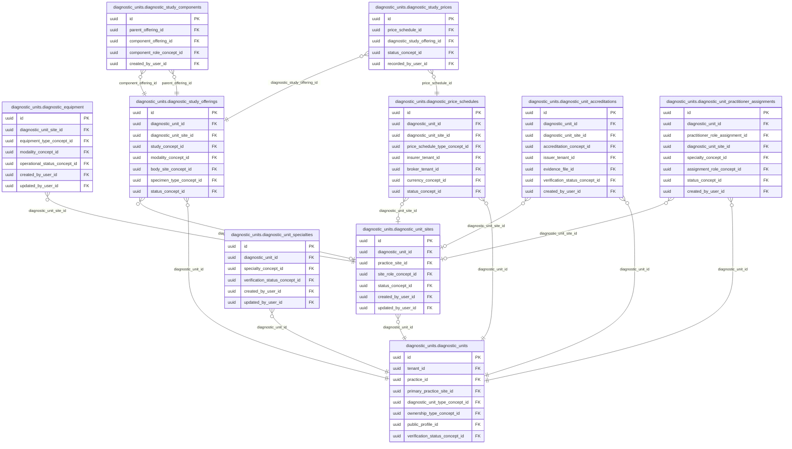

<!-- AUTOGENERADO por tools/inventario/catalogo.mjs. No editar manualmente. -->

# Catálogo del schema `diagnostic_units`

- **Tablas:** 10 · **Columnas:** 152 (35 con descripción: 23.0 %) · **Índices:** 77
- **Dominio:** Clínico y Diagnóstico
- Método y límites del catálogo: [README del inventario](../README.md)

## Tablas

| Tabla | Propósito | Columnas | Índices | Operaciones | ORM |
|---|---|---|---|---|---|
| [diagnostic_equipment](#diagnostic_equipment) | Cataloga equipos diagnósticos vinculados a unidades o sedes para identificar recursos tecnológicos de prestación. | 15 | 6 | 9 | COINCIDE |
| [diagnostic_price_schedules](#diagnostic_price_schedules) | Define esquemas temporales de precios para los servicios de unidades diagnósticas. | 17 | 11 | 7 | COINCIDE |
| [diagnostic_study_components](#diagnostic_study_components) | Detalla componentes de estudios diagnósticos para representar pruebas o partes que integran una prestación. | 8 | 4 | 1 | COINCIDE |
| [diagnostic_study_offerings](#diagnostic_study_offerings) | Cataloga estudios diagnósticos ofrecidos por una unidad para relacionar solicitudes clínicas con capacidad disponible. | 22 | 10 | 27 | COINCIDE |
| [diagnostic_study_prices](#diagnostic_study_prices) | Asocia precios a estudios concretos para disponer de valores económicos aplicables a prestaciones diagnósticas. | 15 | 5 | 8 | COINCIDE |
| [diagnostic_unit_accreditations](#diagnostic_unit_accreditations) | Conserva acreditaciones de unidades diagnósticas para documentar certificaciones y alcance reconocido de sus servicios. | 15 | 8 | 8 | COINCIDE |
| [diagnostic_unit_practitioner_assignments](#diagnostic_unit_practitioner_assignments) | Vincula profesionales con unidades diagnósticas para documentar asignación y responsabilidad de prestación. | 16 | 9 | 3 | COINCIDE |
| [diagnostic_unit_sites](#diagnostic_unit_sites) | Identifica sedes físicas de unidades diagnósticas para localizar dónde se reciben pacientes o se procesan estudios. | 13 | 6 | 20 | COINCIDE |
| [diagnostic_unit_specialties](#diagnostic_unit_specialties) | Asocia especialidades con unidades diagnósticas para describir las áreas clínicas que pueden atender. | 12 | 5 | 6 | COINCIDE |
| [diagnostic_units](#diagnostic_units) | Representa laboratorios, centros de imagen u otras unidades que realizan servicios diagnósticos para prestadores de salud. | 19 | 13 | 49 | COINCIDE |

## Diagrama entidad-relación

Las tablas se agrupan en familias por sus claves foráneas dentro del schema (máximo 40 por diagrama). Las FK hacia otros schemas se listan en la ficha de cada tabla.

### Familia 1 de 1 — 10 tablas

## Fichas

### diagnostic_equipment

#### Vista general

Cataloga equipos diagnósticos vinculados a unidades o sedes para identificar recursos tecnológicos de prestación.

- **Estado del propósito:** DOMAIN_CURATED_DRAFT · fuente: `Mantra Core Health Context/modules/diagram_23_diagnostic_units.puml: diagnostic_equipment`
- **Dominio:** Clínico y Diagnóstico · **Diagrama:** `Mantra Core Health Context/modules/diagram_23_diagnostic_units.puml` · **DDL:** `SQL/23_diagnostic_units/02_tables.sql`
- **Entidad del ORM:** `DiagnosticEquipment` — `src/modules/diagnostic_units/entities/diagnostic_equipment.entity.ts`
- **Resumen:** 15 columnas · 6 índices · 6 FK salientes · 0 entrantes · 9 operaciones

#### Columnas

| # | Columna | Tipo | Rol estructural | Descripción | ORM |
|---|---|---|---|---|---|
| 1 | `id` | `uuid` | Clave primaria; Obligatoria | Identificador único de la instancia. _(JSDOC_ESTANDAR, `src/modules/diagnostic_units/entities/diagnostic_equipment.entity.ts:12`)_ | coincide |
| 2 | `diagnostic_unit_site_id` | `uuid` | Clave foránea → diagnostic_units.diagnostic_unit_sites.id; Obligatoria | _sin dato_ | coincide |
| 3 | `equipment_type_concept_id` | `uuid` | Clave foránea → terminology.catalog_concepts.id; Obligatoria | _sin dato_ | coincide |
| 4 | `manufacturer` | `varchar` | Opcional | _sin dato_ | coincide |
| 5 | `model` | `varchar` | Opcional | _sin dato_ | coincide |
| 6 | `serial_number` | `varchar` | Opcional | _sin dato_ | coincide |
| 7 | `modality_concept_id` | `uuid` | Clave foránea → terminology.catalog_concepts.id; Opcional | _sin dato_ | coincide |
| 8 | `last_calibration_at` | `timestamptz` | Opcional | _sin dato_ | coincide |
| 9 | `next_calibration_due_at` | `timestamptz` | Opcional | _sin dato_ | coincide |
| 10 | `operational_status_concept_id` | `uuid` | Clave foránea → terminology.catalog_concepts.id; Obligatoria | _sin dato_ | coincide |
| 11 | `created_at` | `timestamptz` | Obligatoria | Fecha y hora en que se creó el registro. _(JSDOC_ESTANDAR, `src/modules/diagnostic_units/entities/diagnostic_equipment.entity.ts:84`)_ | coincide |
| 12 | `updated_at` | `timestamptz` | Obligatoria | Fecha y hora de la última actualización. _(JSDOC_ESTANDAR, `src/modules/diagnostic_units/entities/diagnostic_equipment.entity.ts:90`)_ | coincide |
| 13 | `created_by_user_id` | `uuid` | Clave foránea → iam.users.id; Opcional | _sin dato_ | coincide |
| 14 | `updated_by_user_id` | `uuid` | Clave foránea → iam.users.id; Opcional | _sin dato_ | coincide |
| 15 | `row_version` | `integer = 1` | Obligatoria | Versión usada para controlar actualizaciones concurrentes. _(JSDOC_ENTIDAD, `src/modules/diagnostic_units/entities/diagnostic_equipment.entity.ts:108`)_ | coincide |

#### Relaciones

| Sentido | Columnas | Tabla | Restricción |
|---|---|---|---|
| hacia | diagnostic_unit_site_id | diagnostic_units.diagnostic_unit_sites (id) | fk_diagnostic_equipment_diagnostic_unit_site_id |
| hacia | equipment_type_concept_id | terminology.catalog_concepts (id) | fk_diagnostic_equipment_equipment_type_concept_id |
| hacia | modality_concept_id | terminology.catalog_concepts (id) | fk_diagnostic_equipment_modality_concept_id |
| hacia | operational_status_concept_id | terminology.catalog_concepts (id) | fk_diagnostic_equipment_operational_status_concept_id |
| hacia | created_by_user_id | iam.users (id) | fk_diagnostic_equipment_created_by_user_id |
| hacia | updated_by_user_id | iam.users (id) | fk_diagnostic_equipment_updated_by_user_id |

#### Índices

| Índice | Único | Columnas | Para qué |
|---|---|---|---|
| `ix_diagnostic_equipment_diagnostic_unit_site_id` | no | diagnostic_unit_site_id | Soporta la clave foránea fk_diagnostic_equipment_diagnostic_unit_site_id: PostgreSQL no indexa las FK por sí mismo _(DOCUMENTO)_; 3 consulta(s) de repositorio filtran u ordenan por «diagnostic_unit_site_id», la primera columna del índice _(CONSULTA)_ |
| `ix_diagnostic_equipment_equipment_type_concept_id` | no | equipment_type_concept_id | Soporta la clave foránea fk_diagnostic_equipment_equipment_type_concept_id: PostgreSQL no indexa las FK por sí mismo _(DOCUMENTO)_ |
| `ix_diagnostic_equipment_modality_concept_id` | no | modality_concept_id | Soporta la clave foránea fk_diagnostic_equipment_modality_concept_id: PostgreSQL no indexa las FK por sí mismo _(DOCUMENTO)_ |
| `ix_diagnostic_equipment_operational_status_concept_id` | no | operational_status_concept_id | Soporta la clave foránea fk_diagnostic_equipment_operational_status_concept_id: PostgreSQL no indexa las FK por sí mismo _(DOCUMENTO)_ |
| `ix_diagnostic_equipment_created_by_user_id` | no | created_by_user_id | Soporta la clave foránea fk_diagnostic_equipment_created_by_user_id: PostgreSQL no indexa las FK por sí mismo _(DOCUMENTO)_ |
| `ix_diagnostic_equipment_updated_by_user_id` | no | updated_by_user_id | Soporta la clave foránea fk_diagnostic_equipment_updated_by_user_id: PostgreSQL no indexa las FK por sí mismo _(DOCUMENTO)_ |

#### Operaciones que la tocan

| Operación | Efecto | Confianza |
|---|---|---|
| PATCH /diagnostic-equipment/{id} | ACTUALIZA | POR_TIPO |
| PATCH /diagnostic-equipment/{id} | LEE | DIRECTA |
| POST /diagnostic-unit-sites/{siteId}/equipment | CREA | DIRECTA |
| POST /diagnostic-unit-sites/{siteId}/equipment | LEE | DIRECTA |
| GET /diagnostic-units | LEE | DIRECTA |
| GET /diagnostic-units/{id} | LEE | DIRECTA |
| GET /diagnostic-units/{id}/administration | LEE | DIRECTA |
| GET /diagnostic-units/administration | LEE | DIRECTA |
| GET /diagnostic-units/search | LEE | DIRECTA |

#### Gobierno

| Atributo | Valor | Fuente |
|---|---|---|
| Append-only | no declarado | — |
| Datos personales | sin fuente | — |
| Financiera | sin fuente | — |
| Crítica para auditoría | sin fuente | — |
| Retención | sin fuente | — |
| Responsable | sin fuente | — |
| Revisión | AUTO_DETECTADA | — |

---

### diagnostic_price_schedules

#### Vista general

Define esquemas temporales de precios para los servicios de unidades diagnósticas.

- **Estado del propósito:** DOMAIN_CURATED_DRAFT · fuente: `Mantra Core Health Context/modules/diagram_23_diagnostic_units.puml: diagnostic_price_schedules`
- **Dominio:** Clínico y Diagnóstico · **Diagrama:** `Mantra Core Health Context/modules/diagram_23_diagnostic_units.puml` · **DDL:** `SQL/23_diagnostic_units/02_tables.sql`
- **Entidad del ORM:** `DiagnosticPriceSchedules` — `src/modules/diagnostic_units/entities/diagnostic_price_schedules.entity.ts`
- **Resumen:** 17 columnas · 11 índices · 9 FK salientes · 1 entrantes · 7 operaciones

#### Columnas

| # | Columna | Tipo | Rol estructural | Descripción | ORM |
|---|---|---|---|---|---|
| 1 | `id` | `uuid` | Clave primaria; Obligatoria | Identificador único de la instancia. _(JSDOC_ESTANDAR, `src/modules/diagnostic_units/entities/diagnostic_price_schedules.entity.ts:12`)_ | coincide |
| 2 | `diagnostic_unit_id` | `uuid` | Clave foránea → diagnostic_units.diagnostic_units.id; Obligatoria | _sin dato_ | coincide |
| 3 | `diagnostic_unit_site_id` | `uuid` | Clave foránea → diagnostic_units.diagnostic_unit_sites.id; Opcional | _sin dato_ | coincide |
| 4 | `code` | `varchar` | Obligatoria | _sin dato_ | coincide |
| 5 | `price_schedule_type_concept_id` | `uuid` | Clave foránea → terminology.catalog_concepts.id; Obligatoria | _sin dato_ | coincide |
| 6 | `insurer_tenant_id` | `uuid` | Clave foránea → directory.tenants.id; Opcional | _sin dato_ | coincide |
| 7 | `broker_tenant_id` | `uuid` | Clave foránea → directory.tenants.id; Opcional | _sin dato_ | coincide |
| 8 | `currency_concept_id` | `uuid` | Clave foránea → terminology.catalog_concepts.id; Opcional | _sin dato_ | coincide |
| 9 | `valid_from` | `timestamptz` | Opcional | _sin dato_ | coincide |
| 10 | `valid_to` | `timestamptz` | Opcional | _sin dato_ | coincide |
| 11 | `public_visibility` | `boolean` | Opcional | _sin dato_ | coincide |
| 12 | `status_concept_id` | `uuid` | Clave foránea → terminology.catalog_concepts.id; Obligatoria | _sin dato_ | coincide |
| 13 | `created_at` | `timestamptz` | Obligatoria | Fecha y hora en que se creó el registro. _(JSDOC_ESTANDAR, `src/modules/diagnostic_units/entities/diagnostic_price_schedules.entity.ts:96`)_ | coincide |
| 14 | `updated_at` | `timestamptz` | Obligatoria | Fecha y hora de la última actualización. _(JSDOC_ESTANDAR, `src/modules/diagnostic_units/entities/diagnostic_price_schedules.entity.ts:102`)_ | coincide |
| 15 | `created_by_user_id` | `uuid` | Clave foránea → iam.users.id; Opcional | _sin dato_ | coincide |
| 16 | `updated_by_user_id` | `uuid` | Clave foránea → iam.users.id; Opcional | _sin dato_ | coincide |
| 17 | `row_version` | `integer = 1` | Obligatoria | Versión usada para controlar actualizaciones concurrentes. _(JSDOC_ENTIDAD, `src/modules/diagnostic_units/entities/diagnostic_price_schedules.entity.ts:120`)_ | coincide |

#### Relaciones

| Sentido | Columnas | Tabla | Restricción |
|---|---|---|---|
| hacia | diagnostic_unit_id | diagnostic_units.diagnostic_units (id) | fk_diagnostic_price_schedules_diagnostic_unit_id |
| hacia | diagnostic_unit_site_id | diagnostic_units.diagnostic_unit_sites (id) | fk_diagnostic_price_schedules_diagnostic_unit_site_id |
| hacia | price_schedule_type_concept_id | terminology.catalog_concepts (id) | fk_diagnostic_price_schedules_price_schedule_type_concept_id |
| hacia | insurer_tenant_id | directory.tenants (id) | fk_diagnostic_price_schedules_insurer_tenant_id |
| hacia | broker_tenant_id | directory.tenants (id) | fk_diagnostic_price_schedules_broker_tenant_id |
| hacia | currency_concept_id | terminology.catalog_concepts (id) | fk_diagnostic_price_schedules_currency_concept_id |
| hacia | status_concept_id | terminology.catalog_concepts (id) | fk_diagnostic_price_schedules_status_concept_id |
| hacia | created_by_user_id | iam.users (id) | fk_diagnostic_price_schedules_created_by_user_id |
| hacia | updated_by_user_id | iam.users (id) | fk_diagnostic_price_schedules_updated_by_user_id |
| desde | id | diagnostic_units.diagnostic_study_prices (price_schedule_id) | fk_diagnostic_study_prices_price_schedule_id |

#### Índices

| Índice | Único | Columnas | Para qué |
|---|---|---|---|
| `ix_diagnostic_price_schedules_diagnostic_unit_id` | no | diagnostic_unit_id | Soporta la clave foránea fk_diagnostic_price_schedules_diagnostic_unit_id: PostgreSQL no indexa las FK por sí mismo _(DOCUMENTO)_; 4 consulta(s) de repositorio filtran u ordenan por «diagnostic_unit_id», la primera columna del índice _(CONSULTA)_ |
| `ix_diagnostic_price_schedules_diagnostic_unit_site_id` | no | diagnostic_unit_site_id | Soporta la clave foránea fk_diagnostic_price_schedules_diagnostic_unit_site_id: PostgreSQL no indexa las FK por sí mismo _(DOCUMENTO)_ |
| `ix_diagnostic_price_schedules_price_schedule_type_concept_id` | no | price_schedule_type_concept_id | Soporta la clave foránea fk_diagnostic_price_schedules_price_schedule_type_concept_id: PostgreSQL no indexa las FK por sí mismo _(DOCUMENTO)_ |
| `ix_diagnostic_price_schedules_insurer_tenant_id` | no | insurer_tenant_id | Soporta la clave foránea fk_diagnostic_price_schedules_insurer_tenant_id: PostgreSQL no indexa las FK por sí mismo _(DOCUMENTO)_; 1 consulta(s) de repositorio filtran u ordenan por «insurer_tenant_id», la primera columna del índice _(CONSULTA)_ |
| `ix_diagnostic_price_schedules_broker_tenant_id` | no | broker_tenant_id | Soporta la clave foránea fk_diagnostic_price_schedules_broker_tenant_id: PostgreSQL no indexa las FK por sí mismo _(DOCUMENTO)_ |
| `ix_diagnostic_price_schedules_currency_concept_id` | no | currency_concept_id | Soporta la clave foránea fk_diagnostic_price_schedules_currency_concept_id: PostgreSQL no indexa las FK por sí mismo _(DOCUMENTO)_ |
| `ix_diagnostic_price_schedules_status_concept_id` | no | status_concept_id | Soporta la clave foránea fk_diagnostic_price_schedules_status_concept_id: PostgreSQL no indexa las FK por sí mismo _(DOCUMENTO)_; 3 consulta(s) de repositorio filtran u ordenan por «status_concept_id», la primera columna del índice _(CONSULTA)_ |
| `ix_diagnostic_price_schedules_created_by_user_id` | no | created_by_user_id | Soporta la clave foránea fk_diagnostic_price_schedules_created_by_user_id: PostgreSQL no indexa las FK por sí mismo _(DOCUMENTO)_ |
| `ix_diagnostic_price_schedules_updated_by_user_id` | no | updated_by_user_id | Soporta la clave foránea fk_diagnostic_price_schedules_updated_by_user_id: PostgreSQL no indexa las FK por sí mismo _(DOCUMENTO)_ |
| `gin_diagnostic_price_schedules_search` | no | (to_tsvector('simple', (coalesce(code, '')))) | GIN para búsqueda textual gobernada _(DOCUMENTO)_ |
| `gist_diagnostic_price_schedules_effective_period` | no | (tstzrange(valid_from, valid_to, '[)')) | GiST para periodos, no solapamiento y geografía _(DOCUMENTO)_ |

#### Operaciones que la tocan

| Operación | Efecto | Confianza |
|---|---|---|
| GET /diagnostic-units/{id} | LEE | DIRECTA |
| GET /diagnostic-units/{id}/administration | LEE | DIRECTA |
| POST /diagnostic-units/{id}/price-schedules | CREA | DIRECTA |
| POST /diagnostic-units/{id}/price-schedules | LEE | DIRECTA |
| GET /diagnostic-units/search | LEE | DIRECTA |
| POST /price-schedules/{scheduleId}/study-prices | LEE | DIRECTA |
| POST /study-prices/{priceId}/close | LEE | DIRECTA |

#### Gobierno

| Atributo | Valor | Fuente |
|---|---|---|
| Append-only | no declarado | — |
| Datos personales | sin fuente | — |
| Financiera | sin fuente | — |
| Crítica para auditoría | sin fuente | — |
| Retención | sin fuente | — |
| Responsable | sin fuente | — |
| Revisión | AUTO_DETECTADA | — |

---

### diagnostic_study_components

#### Vista general

Detalla componentes de estudios diagnósticos para representar pruebas o partes que integran una prestación.

- **Estado del propósito:** DOMAIN_CURATED_DRAFT · fuente: `Mantra Core Health Context/modules/diagram_23_diagnostic_units.puml: diagnostic_study_components`
- **Dominio:** Clínico y Diagnóstico · **Diagrama:** `Mantra Core Health Context/modules/diagram_23_diagnostic_units.puml` · **DDL:** `SQL/23_diagnostic_units/02_tables.sql`
- **Entidad del ORM:** `DiagnosticStudyComponents` — `src/modules/diagnostic_units/entities/diagnostic_study_components.entity.ts`
- **Resumen:** 8 columnas · 4 índices · 4 FK salientes · 0 entrantes · 1 operaciones

#### Columnas

| # | Columna | Tipo | Rol estructural | Descripción | ORM |
|---|---|---|---|---|---|
| 1 | `id` | `uuid` | Clave primaria; Obligatoria | Identificador único de la instancia. _(JSDOC_ESTANDAR, `src/modules/diagnostic_units/entities/diagnostic_study_components.entity.ts:15`)_ | coincide |
| 2 | `parent_offering_id` | `uuid` | Clave foránea → diagnostic_units.diagnostic_study_offerings.id; Obligatoria | _sin dato_ | coincide |
| 3 | `component_offering_id` | `uuid` | Clave foránea → diagnostic_units.diagnostic_study_offerings.id; Obligatoria | _sin dato_ | coincide |
| 4 | `component_role_concept_id` | `uuid` | Clave foránea → terminology.catalog_concepts.id; Obligatoria | _sin dato_ | coincide |
| 5 | `quantity` | `numeric` | Opcional | _sin dato_ | coincide |
| 6 | `ordinal` | `integer` | Opcional | _sin dato_ | coincide |
| 7 | `created_at` | `timestamptz` | Obligatoria | Fecha y hora en que se creó el registro. _(JSDOC_ESTANDAR, `src/modules/diagnostic_units/entities/diagnostic_study_components.entity.ts:51`)_ | coincide |
| 8 | `created_by_user_id` | `uuid` | Clave foránea → iam.users.id; Opcional | _sin dato_ | coincide |

#### Relaciones

| Sentido | Columnas | Tabla | Restricción |
|---|---|---|---|
| hacia | parent_offering_id | diagnostic_units.diagnostic_study_offerings (id) | fk_diagnostic_study_components_parent_offering_id |
| hacia | component_offering_id | diagnostic_units.diagnostic_study_offerings (id) | fk_diagnostic_study_components_component_offering_id |
| hacia | component_role_concept_id | terminology.catalog_concepts (id) | fk_diagnostic_study_components_component_role_concept_id |
| hacia | created_by_user_id | iam.users (id) | fk_diagnostic_study_components_created_by_user_id |

#### Índices

| Índice | Único | Columnas | Para qué |
|---|---|---|---|
| `ix_diagnostic_study_components_parent_offering_id` | no | parent_offering_id | Soporta la clave foránea fk_diagnostic_study_components_parent_offering_id: PostgreSQL no indexa las FK por sí mismo _(DOCUMENTO)_ |
| `ix_diagnostic_study_components_component_offering_id` | no | component_offering_id | Soporta la clave foránea fk_diagnostic_study_components_component_offering_id: PostgreSQL no indexa las FK por sí mismo _(DOCUMENTO)_ |
| `ix_diagnostic_study_components_component_role_concept_id` | no | component_role_concept_id | Soporta la clave foránea fk_diagnostic_study_components_component_role_concept_id: PostgreSQL no indexa las FK por sí mismo _(DOCUMENTO)_ |
| `ix_diagnostic_study_components_created_by_user_id` | no | created_by_user_id | Soporta la clave foránea fk_diagnostic_study_components_created_by_user_id: PostgreSQL no indexa las FK por sí mismo _(DOCUMENTO)_ |

#### Operaciones que la tocan

| Operación | Efecto | Confianza |
|---|---|---|
| POST /diagnostic-units/{id}/study-offerings | CREA | DIRECTA |

#### Gobierno

| Atributo | Valor | Fuente |
|---|---|---|
| Append-only | no declarado | — |
| Datos personales | sin fuente | — |
| Financiera | sin fuente | — |
| Crítica para auditoría | sin fuente | — |
| Retención | sin fuente | — |
| Responsable | sin fuente | — |
| Revisión | AUTO_DETECTADA | — |

---

### diagnostic_study_offerings

#### Vista general

Cataloga estudios diagnósticos ofrecidos por una unidad para relacionar solicitudes clínicas con capacidad disponible.

- **Estado del propósito:** DOMAIN_CURATED_DRAFT · fuente: `Mantra Core Health Context/modules/diagram_23_diagnostic_units.puml: diagnostic_study_offerings`
- **Dominio:** Clínico y Diagnóstico · **Diagrama:** `Mantra Core Health Context/modules/diagram_23_diagnostic_units.puml` · **DDL:** `SQL/23_diagnostic_units/02_tables.sql`
- **Entidad del ORM:** `DiagnosticStudyOfferings` — `src/modules/diagnostic_units/entities/diagnostic_study_offerings.entity.ts`
- **Resumen:** 22 columnas · 10 índices · 9 FK salientes · 5 entrantes · 27 operaciones

#### Columnas

| # | Columna | Tipo | Rol estructural | Descripción | ORM |
|---|---|---|---|---|---|
| 1 | `id` | `uuid` | Clave primaria; Obligatoria | Identificador único de la instancia. _(JSDOC_ESTANDAR, `src/modules/diagnostic_units/entities/diagnostic_study_offerings.entity.ts:12`)_ | coincide |
| 2 | `diagnostic_unit_id` | `uuid` | Clave foránea → diagnostic_units.diagnostic_units.id; Obligatoria | _sin dato_ | coincide |
| 3 | `diagnostic_unit_site_id` | `uuid` | Clave foránea → diagnostic_units.diagnostic_unit_sites.id; Opcional | _sin dato_ | coincide |
| 4 | `study_code` | `varchar` | Obligatoria | _sin dato_ | coincide |
| 5 | `study_concept_id` | `uuid` | Clave foránea → terminology.catalog_concepts.id; Obligatoria | _sin dato_ | coincide |
| 6 | `modality_concept_id` | `uuid` | Clave foránea → terminology.catalog_concepts.id; Opcional | _sin dato_ | coincide |
| 7 | `body_site_concept_id` | `uuid` | Clave foránea → terminology.catalog_concepts.id; Opcional | _sin dato_ | coincide |
| 8 | `specimen_type_concept_id` | `uuid` | Clave foránea → terminology.catalog_concepts.id; Opcional | _sin dato_ | coincide |
| 9 | `display_name` | `varchar` | Obligatoria | _sin dato_ | coincide |
| 10 | `description` | `text` | Opcional | _sin dato_ | coincide |
| 11 | `preparation_instructions` | `text` | Opcional | _sin dato_ | coincide |
| 12 | `expected_duration_minutes` | `integer` | Opcional | _sin dato_ | coincide |
| 13 | `expected_turnaround_minutes` | `integer` | Opcional | _sin dato_ | coincide |
| 14 | `requires_medical_order` | `boolean` | Opcional | _sin dato_ | coincide |
| 15 | `requires_prior_authorization` | `boolean` | Opcional | _sin dato_ | coincide |
| 16 | `home_collection_eligible` | `boolean` | Opcional | _sin dato_ | coincide |
| 17 | `status_concept_id` | `uuid` | Clave foránea → terminology.catalog_concepts.id; Obligatoria | _sin dato_ | coincide |
| 18 | `created_at` | `timestamptz` | Obligatoria | Fecha y hora en que se creó el registro. _(JSDOC_ESTANDAR, `src/modules/diagnostic_units/entities/diagnostic_study_offerings.entity.ts:146`)_ | coincide |
| 19 | `updated_at` | `timestamptz` | Obligatoria | Fecha y hora de la última actualización. _(JSDOC_ESTANDAR, `src/modules/diagnostic_units/entities/diagnostic_study_offerings.entity.ts:152`)_ | coincide |
| 20 | `created_by_user_id` | `uuid` | Clave foránea → iam.users.id; Opcional | _sin dato_ | coincide |
| 21 | `updated_by_user_id` | `uuid` | Clave foránea → iam.users.id; Opcional | _sin dato_ | coincide |
| 22 | `row_version` | `integer = 1` | Obligatoria | Versión usada para controlar actualizaciones concurrentes. _(JSDOC_ENTIDAD, `src/modules/diagnostic_units/entities/diagnostic_study_offerings.entity.ts:170`)_ | coincide |

#### Relaciones

| Sentido | Columnas | Tabla | Restricción |
|---|---|---|---|
| hacia | diagnostic_unit_id | diagnostic_units.diagnostic_units (id) | fk_diagnostic_study_offerings_diagnostic_unit_id |
| hacia | diagnostic_unit_site_id | diagnostic_units.diagnostic_unit_sites (id) | fk_diagnostic_study_offerings_diagnostic_unit_site_id |
| hacia | study_concept_id | terminology.catalog_concepts (id) | fk_diagnostic_study_offerings_study_concept_id |
| hacia | modality_concept_id | terminology.catalog_concepts (id) | fk_diagnostic_study_offerings_modality_concept_id |
| hacia | body_site_concept_id | terminology.catalog_concepts (id) | fk_diagnostic_study_offerings_body_site_concept_id |
| hacia | specimen_type_concept_id | terminology.catalog_concepts (id) | fk_diagnostic_study_offerings_specimen_type_concept_id |
| hacia | status_concept_id | terminology.catalog_concepts (id) | fk_diagnostic_study_offerings_status_concept_id |
| hacia | created_by_user_id | iam.users (id) | fk_diagnostic_study_offerings_created_by_user_id |
| hacia | updated_by_user_id | iam.users (id) | fk_diagnostic_study_offerings_updated_by_user_id |
| desde | id | diagnostic_units.diagnostic_study_components (parent_offering_id) | fk_diagnostic_study_components_parent_offering_id |
| desde | id | diagnostic_units.diagnostic_study_components (component_offering_id) | fk_diagnostic_study_components_component_offering_id |
| desde | id | diagnostic_units.diagnostic_study_prices (diagnostic_study_offering_id) | fk_diagnostic_study_prices_diagnostic_study_offering_id |
| desde | id | insurance.prior_authorization_items (diagnostic_study_offering_id) | fk_prior_authorization_items_diagnostic_study_offering_id |
| desde | id | insurance.insurance_claim_lines (diagnostic_study_offering_id) | fk_insurance_claim_lines_diagnostic_study_offering_id |

#### Índices

| Índice | Único | Columnas | Para qué |
|---|---|---|---|
| `ix_diagnostic_study_offerings_diagnostic_unit_id` | no | diagnostic_unit_id | Soporta la clave foránea fk_diagnostic_study_offerings_diagnostic_unit_id: PostgreSQL no indexa las FK por sí mismo _(DOCUMENTO)_; 3 consulta(s) de repositorio filtran u ordenan por «diagnostic_unit_id», la primera columna del índice _(CONSULTA)_ |
| `ix_diagnostic_study_offerings_diagnostic_unit_site_id` | no | diagnostic_unit_site_id | Soporta la clave foránea fk_diagnostic_study_offerings_diagnostic_unit_site_id: PostgreSQL no indexa las FK por sí mismo _(DOCUMENTO)_ |
| `ix_diagnostic_study_offerings_study_concept_id` | no | study_concept_id | Soporta la clave foránea fk_diagnostic_study_offerings_study_concept_id: PostgreSQL no indexa las FK por sí mismo _(DOCUMENTO)_; 2 consulta(s) de repositorio filtran u ordenan por «study_concept_id», la primera columna del índice _(CONSULTA)_ |
| `ix_diagnostic_study_offerings_modality_concept_id` | no | modality_concept_id | Soporta la clave foránea fk_diagnostic_study_offerings_modality_concept_id: PostgreSQL no indexa las FK por sí mismo _(DOCUMENTO)_ |
| `ix_diagnostic_study_offerings_body_site_concept_id` | no | body_site_concept_id | Soporta la clave foránea fk_diagnostic_study_offerings_body_site_concept_id: PostgreSQL no indexa las FK por sí mismo _(DOCUMENTO)_ |
| `ix_diagnostic_study_offerings_specimen_type_concept_id` | no | specimen_type_concept_id | Soporta la clave foránea fk_diagnostic_study_offerings_specimen_type_concept_id: PostgreSQL no indexa las FK por sí mismo _(DOCUMENTO)_ |
| `ix_diagnostic_study_offerings_status_concept_id` | no | status_concept_id | Soporta la clave foránea fk_diagnostic_study_offerings_status_concept_id: PostgreSQL no indexa las FK por sí mismo _(DOCUMENTO)_; 4 consulta(s) de repositorio filtran u ordenan por «status_concept_id», la primera columna del índice _(CONSULTA)_ |
| `ix_diagnostic_study_offerings_created_by_user_id` | no | created_by_user_id | Soporta la clave foránea fk_diagnostic_study_offerings_created_by_user_id: PostgreSQL no indexa las FK por sí mismo _(DOCUMENTO)_ |
| `ix_diagnostic_study_offerings_updated_by_user_id` | no | updated_by_user_id | Soporta la clave foránea fk_diagnostic_study_offerings_updated_by_user_id: PostgreSQL no indexa las FK por sí mismo _(DOCUMENTO)_ |
| `gin_diagnostic_study_offerings_search` | no | (to_tsvector('simple', (coalesce(display_name, '') ¦¦ ' ' ¦¦ coalesce(description, '')))) | GIN para búsqueda textual gobernada _(DOCUMENTO)_ |

#### Operaciones que la tocan

| Operación | Efecto | Confianza |
|---|---|---|
| GET /patient-spending/me | LEE | POR_SQL |
| POST /clinical/service-requests/duplicate-check | LEE | DIRECTA |
| DELETE /diagnostic-study-offerings/{id} | ACTUALIZA | POR_TIPO |
| DELETE /diagnostic-study-offerings/{id} | LEE | DIRECTA |
| GET /diagnostic-units | LEE | DIRECTA |
| GET /diagnostic-units/{id} | LEE | DIRECTA |
| GET /diagnostic-units/{id}/administration | LEE | DIRECTA |
| POST /diagnostic-units/{id}/study-offerings | CREA | DIRECTA |
| POST /diagnostic-units/{id}/study-offerings | LEE | DIRECTA |
| GET /diagnostic-units/administration | LEE | DIRECTA |
| GET /diagnostic-units/search | LEE | DIRECTA |
| POST /price-schedules/{scheduleId}/study-prices | LEE | DIRECTA |
| GET /diagnostic-results/me/orders | LEE | DIRECTA |
| POST /admin/tenants | CREA | DIRECTA |
| POST /tenants/{tenantId}/child-tenants | CREA | DIRECTA |
| POST /iam/auth/register-organization | CREA | DIRECTA |
| POST /insurance-claims | LEE | DIRECTA |
| POST /insurance-claims/{id}/adjudications | LEE | DIRECTA |
| POST /insurance-claims/{id}/eob | LEE | DIRECTA |
| POST /insurance-claims/{id}/reversals | LEE | DIRECTA |
| POST /insurance/received-claims/{id}/decision | LEE | DIRECTA |
| POST /prior-authorization-requests | LEE | DIRECTA |
| GET /prior-authorization-requests/{id} | LEE | DIRECTA |
| POST /prior-authorization-requests/{id}/determinations | LEE | DIRECTA |
| GET /prior-authorization-requests/inbox | LEE | DIRECTA |
| GET /pharmacy/orders/{id} | LEE | DIRECTA |
| GET /pharmacy/orders/me | LEE | DIRECTA |

#### Gobierno

| Atributo | Valor | Fuente |
|---|---|---|
| Append-only | no declarado | — |
| Datos personales | sin fuente | — |
| Financiera | sin fuente | — |
| Crítica para auditoría | sin fuente | — |
| Retención | sin fuente | — |
| Responsable | sin fuente | — |
| Revisión | AUTO_DETECTADA | — |

---

### diagnostic_study_prices

#### Vista general

Asocia precios a estudios concretos para disponer de valores económicos aplicables a prestaciones diagnósticas.

- **Estado del propósito:** DOMAIN_CURATED_DRAFT · fuente: `Mantra Core Health Context/modules/diagram_23_diagnostic_units.puml: diagnostic_study_prices`
- **Dominio:** Clínico y Diagnóstico · **Diagrama:** `Mantra Core Health Context/modules/diagram_23_diagnostic_units.puml` · **DDL:** `SQL/23_diagnostic_units/02_tables.sql`
- **Entidad del ORM:** `DiagnosticStudyPrices` — `src/modules/diagnostic_units/entities/diagnostic_study_prices.entity.ts`
- **Resumen:** 15 columnas · 5 índices · 4 FK salientes · 1 entrantes · 8 operaciones

#### Columnas

| # | Columna | Tipo | Rol estructural | Descripción | ORM |
|---|---|---|---|---|---|
| 1 | `id` | `uuid` | Clave primaria; Obligatoria | Identificador único de la instancia. _(JSDOC_ESTANDAR, `src/modules/diagnostic_units/entities/diagnostic_study_prices.entity.ts:12`)_ | coincide |
| 2 | `price_schedule_id` | `uuid` | Clave foránea → diagnostic_units.diagnostic_price_schedules.id; Obligatoria | _sin dato_ | coincide |
| 3 | `diagnostic_study_offering_id` | `uuid` | Clave foránea → diagnostic_units.diagnostic_study_offerings.id; Obligatoria | _sin dato_ | coincide |
| 4 | `version_number` | `integer` | Obligatoria | _sin dato_ | coincide |
| 5 | `base_amount` | `numeric` | Obligatoria | _sin dato_ | coincide |
| 6 | `patient_amount` | `numeric` | Opcional | _sin dato_ | coincide |
| 7 | `insurer_amount` | `numeric` | Opcional | _sin dato_ | coincide |
| 8 | `tax_amount` | `numeric` | Opcional | _sin dato_ | coincide |
| 9 | `discount_factor` | `numeric` | Opcional | _sin dato_ | coincide |
| 10 | `pricing_rule_json` | `jsonb` | Opcional | _sin dato_ | coincide |
| 11 | `effective_from` | `timestamptz` | Obligatoria | _sin dato_ | coincide |
| 12 | `effective_to` | `timestamptz` | Opcional | _sin dato_ | coincide |
| 13 | `status_concept_id` | `uuid` | Clave foránea → terminology.catalog_concepts.id; Obligatoria | _sin dato_ | coincide |
| 14 | `recorded_at` | `timestamptz` | Obligatoria | _sin dato_ | coincide |
| 15 | `recorded_by_user_id` | `uuid` | Clave foránea → iam.users.id; Opcional | _sin dato_ | coincide |

#### Relaciones

| Sentido | Columnas | Tabla | Restricción |
|---|---|---|---|
| hacia | price_schedule_id | diagnostic_units.diagnostic_price_schedules (id) | fk_diagnostic_study_prices_price_schedule_id |
| hacia | diagnostic_study_offering_id | diagnostic_units.diagnostic_study_offerings (id) | fk_diagnostic_study_prices_diagnostic_study_offering_id |
| hacia | status_concept_id | terminology.catalog_concepts (id) | fk_diagnostic_study_prices_status_concept_id |
| hacia | recorded_by_user_id | iam.users (id) | fk_diagnostic_study_prices_recorded_by_user_id |
| desde | id | audit.diagnostic_study_prices_history (diagnostic_study_price_id) | fk_diagnostic_study_prices_history_diagnostic_study_price_id |

#### Índices

| Índice | Único | Columnas | Para qué |
|---|---|---|---|
| `ix_diagnostic_study_prices_price_schedule_id` | no | price_schedule_id | Soporta la clave foránea fk_diagnostic_study_prices_price_schedule_id: PostgreSQL no indexa las FK por sí mismo _(DOCUMENTO)_; 5 consulta(s) de repositorio filtran u ordenan por «price_schedule_id», la primera columna del índice _(CONSULTA)_ |
| `ix_diagnostic_study_prices_diagnostic_study_offering_id` | no | diagnostic_study_offering_id | Soporta la clave foránea fk_diagnostic_study_prices_diagnostic_study_offering_id: PostgreSQL no indexa las FK por sí mismo _(DOCUMENTO)_; 3 consulta(s) de repositorio filtran u ordenan por «diagnostic_study_offering_id», la primera columna del índice _(CONSULTA)_ |
| `ix_diagnostic_study_prices_status_concept_id` | no | status_concept_id | Soporta la clave foránea fk_diagnostic_study_prices_status_concept_id: PostgreSQL no indexa las FK por sí mismo _(DOCUMENTO)_; 3 consulta(s) de repositorio filtran u ordenan por «status_concept_id», la primera columna del índice _(CONSULTA)_ |
| `ix_diagnostic_study_prices_recorded_by_user_id` | no | recorded_by_user_id | Soporta la clave foránea fk_diagnostic_study_prices_recorded_by_user_id: PostgreSQL no indexa las FK por sí mismo _(DOCUMENTO)_ |
| `uq_diagnostic_study_prices_price_schedule_id_version_number` | sí | price_schedule_id, version_number | Garantiza que no se repita la combinación (price_schedule_id, version_number) _(DOCUMENTO)_; Soporta la clave foránea fk_diagnostic_study_prices_price_schedule_id: PostgreSQL no indexa las FK por sí mismo _(DOCUMENTO)_; 5 consulta(s) de repositorio filtran u ordenan por «price_schedule_id», la primera columna del índice _(CONSULTA)_ |

#### Restricciones

| Restricción | Tipo | Definición |
|---|---|---|
| `uq_diagnostic_study_prices_price_schedule_id_version_number` | UNIQUE INDEX | UNIQUE INDEX ("price_schedule_id", "version_number") |

#### Operaciones que la tocan

| Operación | Efecto | Confianza |
|---|---|---|
| GET /diagnostic-units/{id} | LEE | DIRECTA |
| GET /diagnostic-units/{id}/administration | LEE | DIRECTA |
| GET /diagnostic-units/search | LEE | DIRECTA |
| POST /price-schedules/{scheduleId}/study-prices | ACTUALIZA | POR_TIPO |
| POST /price-schedules/{scheduleId}/study-prices | CREA | DIRECTA |
| POST /price-schedules/{scheduleId}/study-prices | LEE | DIRECTA |
| POST /study-prices/{priceId}/close | ACTUALIZA | POR_TIPO |
| POST /study-prices/{priceId}/close | LEE | DIRECTA |

#### Gobierno

| Atributo | Valor | Fuente |
|---|---|---|
| Append-only | no declarado | — |
| Datos personales | sin fuente | — |
| Financiera | sin fuente | — |
| Crítica para auditoría | sin fuente | — |
| Retención | sin fuente | — |
| Responsable | sin fuente | — |
| Revisión | AUTO_DETECTADA | — |

---

### diagnostic_unit_accreditations

#### Vista general

Conserva acreditaciones de unidades diagnósticas para documentar certificaciones y alcance reconocido de sus servicios.

- **Estado del propósito:** DOMAIN_CURATED_DRAFT · fuente: `Mantra Core Health Context/modules/diagram_23_diagnostic_units.puml: diagnostic_unit_accreditations`
- **Dominio:** Clínico y Diagnóstico · **Diagrama:** `Mantra Core Health Context/modules/diagram_23_diagnostic_units.puml` · **DDL:** `SQL/23_diagnostic_units/02_tables.sql`
- **Entidad del ORM:** `DiagnosticUnitAccreditations` — `src/modules/diagnostic_units/entities/diagnostic_unit_accreditations.entity.ts`
- **Resumen:** 15 columnas · 8 índices · 8 FK salientes · 0 entrantes · 8 operaciones

#### Columnas

| # | Columna | Tipo | Rol estructural | Descripción | ORM |
|---|---|---|---|---|---|
| 1 | `id` | `uuid` | Clave primaria; Obligatoria | Identificador único de la instancia. _(JSDOC_ESTANDAR, `src/modules/diagnostic_units/entities/diagnostic_unit_accreditations.entity.ts:15`)_ | coincide |
| 2 | `diagnostic_unit_id` | `uuid` | Clave foránea → diagnostic_units.diagnostic_units.id; Obligatoria | _sin dato_ | coincide |
| 3 | `diagnostic_unit_site_id` | `uuid` | Clave foránea → diagnostic_units.diagnostic_unit_sites.id; Opcional | _sin dato_ | coincide |
| 4 | `accreditation_concept_id` | `uuid` | Clave foránea → terminology.catalog_concepts.id; Obligatoria | _sin dato_ | coincide |
| 5 | `accreditation_number` | `varchar` | Opcional | _sin dato_ | coincide |
| 6 | `issuer_tenant_id` | `uuid` | Clave foránea → directory.tenants.id; Opcional | _sin dato_ | coincide |
| 7 | `valid_from` | `date` | Opcional | _sin dato_ | coincide |
| 8 | `valid_to` | `date` | Opcional | _sin dato_ | coincide |
| 9 | `evidence_file_id` | `uuid` | Clave foránea → common.files.id; Opcional | _sin dato_ | coincide |
| 10 | `verification_status_concept_id` | `uuid` | Clave foránea → terminology.catalog_concepts.id; Obligatoria | _sin dato_ | coincide |
| 11 | `created_at` | `timestamptz` | Obligatoria | Fecha y hora en que se creó el registro. _(JSDOC_ESTANDAR, `src/modules/diagnostic_units/entities/diagnostic_unit_accreditations.entity.ts:83`)_ | coincide |
| 12 | `updated_at` | `timestamptz` | Obligatoria | Fecha y hora de la última actualización. _(JSDOC_ESTANDAR, `src/modules/diagnostic_units/entities/diagnostic_unit_accreditations.entity.ts:89`)_ | coincide |
| 13 | `created_by_user_id` | `uuid` | Clave foránea → iam.users.id; Opcional | _sin dato_ | coincide |
| 14 | `updated_by_user_id` | `uuid` | Clave foránea → iam.users.id; Opcional | _sin dato_ | coincide |
| 15 | `row_version` | `integer = 1` | Obligatoria | Versión usada para controlar actualizaciones concurrentes. _(JSDOC_ENTIDAD, `src/modules/diagnostic_units/entities/diagnostic_unit_accreditations.entity.ts:107`)_ | coincide |

#### Relaciones

| Sentido | Columnas | Tabla | Restricción |
|---|---|---|---|
| hacia | diagnostic_unit_id | diagnostic_units.diagnostic_units (id) | fk_diagnostic_unit_accreditations_diagnostic_unit_id |
| hacia | diagnostic_unit_site_id | diagnostic_units.diagnostic_unit_sites (id) | fk_diagnostic_unit_accreditations_diagnostic_unit_site_id |
| hacia | accreditation_concept_id | terminology.catalog_concepts (id) | fk_diagnostic_unit_accreditations_accreditation_concept_id |
| hacia | issuer_tenant_id | directory.tenants (id) | fk_diagnostic_unit_accreditations_issuer_tenant_id |
| hacia | evidence_file_id | common.files (id) | fk_diagnostic_unit_accreditations_evidence_file_id |
| hacia | verification_status_concept_id | terminology.catalog_concepts (id) | fk_diagnostic_unit_accreditations_verification_status__ca2f963c |
| hacia | created_by_user_id | iam.users (id) | fk_diagnostic_unit_accreditations_created_by_user_id |
| hacia | updated_by_user_id | iam.users (id) | fk_diagnostic_unit_accreditations_updated_by_user_id |

#### Índices

| Índice | Único | Columnas | Para qué |
|---|---|---|---|
| `ix_diagnostic_unit_accreditations_diagnostic_unit_id` | no | diagnostic_unit_id | Soporta la clave foránea fk_diagnostic_unit_accreditations_diagnostic_unit_id: PostgreSQL no indexa las FK por sí mismo _(DOCUMENTO)_; 3 consulta(s) de repositorio filtran u ordenan por «diagnostic_unit_id», la primera columna del índice _(CONSULTA)_ |
| `ix_diagnostic_unit_accreditations_diagnostic_unit_site_id` | no | diagnostic_unit_site_id | Soporta la clave foránea fk_diagnostic_unit_accreditations_diagnostic_unit_site_id: PostgreSQL no indexa las FK por sí mismo _(DOCUMENTO)_ |
| `ix_diagnostic_unit_accreditations_accreditation_concept_id` | no | accreditation_concept_id | Soporta la clave foránea fk_diagnostic_unit_accreditations_accreditation_concept_id: PostgreSQL no indexa las FK por sí mismo _(DOCUMENTO)_ |
| `ix_diagnostic_unit_accreditations_issuer_tenant_id` | no | issuer_tenant_id | Soporta la clave foránea fk_diagnostic_unit_accreditations_issuer_tenant_id: PostgreSQL no indexa las FK por sí mismo _(DOCUMENTO)_ |
| `ix_diagnostic_unit_accreditations_evidence_file_id` | no | evidence_file_id | Soporta la clave foránea fk_diagnostic_unit_accreditations_evidence_file_id: PostgreSQL no indexa las FK por sí mismo _(DOCUMENTO)_ |
| `ix_diagnostic_unit_accreditations_verification_status__7e3d4f65` | no | verification_status_concept_id | Soporta la clave foránea fk_diagnostic_unit_accreditations_verification_status__ca2f963c: PostgreSQL no indexa las FK por sí mismo _(DOCUMENTO)_; 1 consulta(s) de repositorio filtran u ordenan por «verification_status_concept_id», la primera columna del índice _(CONSULTA)_ |
| `ix_diagnostic_unit_accreditations_created_by_user_id` | no | created_by_user_id | Soporta la clave foránea fk_diagnostic_unit_accreditations_created_by_user_id: PostgreSQL no indexa las FK por sí mismo _(DOCUMENTO)_ |
| `ix_diagnostic_unit_accreditations_updated_by_user_id` | no | updated_by_user_id | Soporta la clave foránea fk_diagnostic_unit_accreditations_updated_by_user_id: PostgreSQL no indexa las FK por sí mismo _(DOCUMENTO)_ |

#### Operaciones que la tocan

| Operación | Efecto | Confianza |
|---|---|---|
| POST /diagnostic-unit-accreditations/{id}/renew | ACTUALIZA | POR_TIPO |
| POST /diagnostic-unit-accreditations/{id}/renew | CREA | DIRECTA |
| POST /diagnostic-unit-accreditations/{id}/renew | LEE | DIRECTA |
| POST /diagnostic-units | CREA | DIRECTA |
| GET /diagnostic-units/{id} | LEE | DIRECTA |
| POST /diagnostic-units/{id}/accreditations | CREA | DIRECTA |
| GET /diagnostic-units/{id}/administration | LEE | DIRECTA |
| POST /diagnostic-units/{id}/verify-and-publish | ACTUALIZA | DIRECTA |

#### Gobierno

| Atributo | Valor | Fuente |
|---|---|---|
| Append-only | no declarado | — |
| Datos personales | sin fuente | — |
| Financiera | sin fuente | — |
| Crítica para auditoría | sin fuente | — |
| Retención | sin fuente | — |
| Responsable | sin fuente | — |
| Revisión | AUTO_DETECTADA | — |

---

### diagnostic_unit_practitioner_assignments

#### Vista general

Vincula profesionales con unidades diagnósticas para documentar asignación y responsabilidad de prestación.

- **Estado del propósito:** DOMAIN_CURATED_DRAFT · fuente: `Mantra Core Health Context/modules/diagram_23_diagnostic_units.puml: diagnostic_unit_practitioner_assignments`
- **Dominio:** Clínico y Diagnóstico · **Diagrama:** `Mantra Core Health Context/modules/diagram_23_diagnostic_units.puml` · **DDL:** `SQL/23_diagnostic_units/02_tables.sql`
- **Entidad del ORM:** `DiagnosticUnitPractitionerAssignments` — `src/modules/diagnostic_units/entities/diagnostic_unit_practitioner_assignments.entity.ts`
- **Resumen:** 16 columnas · 9 índices · 8 FK salientes · 0 entrantes · 3 operaciones

#### Columnas

| # | Columna | Tipo | Rol estructural | Descripción | ORM |
|---|---|---|---|---|---|
| 1 | `id` | `uuid` | Clave primaria; Obligatoria | Identificador único de la instancia. _(JSDOC_ESTANDAR, `src/modules/diagnostic_units/entities/diagnostic_unit_practitioner_assignments.entity.ts:15`)_ | coincide |
| 2 | `diagnostic_unit_id` | `uuid` | Clave foránea → diagnostic_units.diagnostic_units.id; Obligatoria | _sin dato_ | coincide |
| 3 | `practitioner_role_assignment_id` | `uuid` | Clave foránea → practice.practitioner_role_assignments.id; Obligatoria | _sin dato_ | coincide |
| 4 | `diagnostic_unit_site_id` | `uuid` | Clave foránea → diagnostic_units.diagnostic_unit_sites.id; Opcional | _sin dato_ | coincide |
| 5 | `specialty_concept_id` | `uuid` | Clave foránea → terminology.catalog_concepts.id; Opcional | _sin dato_ | coincide |
| 6 | `assignment_role_concept_id` | `uuid` | Clave foránea → terminology.catalog_concepts.id; Opcional | _sin dato_ | coincide |
| 7 | `may_validate_results` | `boolean` | Opcional | _sin dato_ | coincide |
| 8 | `may_sign_reports` | `boolean` | Opcional | _sin dato_ | coincide |
| 9 | `valid_from` | `date` | Opcional | _sin dato_ | coincide |
| 10 | `valid_to` | `date` | Opcional | _sin dato_ | coincide |
| 11 | `status_concept_id` | `uuid` | Clave foránea → terminology.catalog_concepts.id; Obligatoria | _sin dato_ | coincide |
| 12 | `created_at` | `timestamptz` | Obligatoria | Fecha y hora en que se creó el registro. _(JSDOC_ESTANDAR, `src/modules/diagnostic_units/entities/diagnostic_unit_practitioner_assignments.entity.ts:93`)_ | coincide |
| 13 | `updated_at` | `timestamptz` | Obligatoria | Fecha y hora de la última actualización. _(JSDOC_ESTANDAR, `src/modules/diagnostic_units/entities/diagnostic_unit_practitioner_assignments.entity.ts:99`)_ | coincide |
| 14 | `created_by_user_id` | `uuid` | Clave foránea → iam.users.id; Opcional | _sin dato_ | coincide |
| 15 | `updated_by_user_id` | `uuid` | Clave foránea → iam.users.id; Opcional | _sin dato_ | coincide |
| 16 | `row_version` | `integer = 1` | Obligatoria | Versión usada para controlar actualizaciones concurrentes. _(JSDOC_ENTIDAD, `src/modules/diagnostic_units/entities/diagnostic_unit_practitioner_assignments.entity.ts:117`)_ | coincide |

#### Relaciones

| Sentido | Columnas | Tabla | Restricción |
|---|---|---|---|
| hacia | diagnostic_unit_id | diagnostic_units.diagnostic_units (id) | fk_diagnostic_unit_practitioner_assignments_diagnostic_unit_id |
| hacia | diagnostic_unit_site_id | diagnostic_units.diagnostic_unit_sites (id) | fk_diagnostic_unit_practitioner_assignments_diagnostic_1163bc0c |
| hacia | practitioner_role_assignment_id | practice.practitioner_role_assignments (id) | fk_diagnostic_unit_practitioner_assignments_practition_d05600aa |
| hacia | specialty_concept_id | terminology.catalog_concepts (id) | fk_diagnostic_unit_practitioner_assignments_specialty__f8946881 |
| hacia | assignment_role_concept_id | terminology.catalog_concepts (id) | fk_diagnostic_unit_practitioner_assignments_assignment_e7e914be |
| hacia | status_concept_id | terminology.catalog_concepts (id) | fk_diagnostic_unit_practitioner_assignments_status_concept_id |
| hacia | created_by_user_id | iam.users (id) | fk_diagnostic_unit_practitioner_assignments_created_by_user_id |
| hacia | updated_by_user_id | iam.users (id) | fk_diagnostic_unit_practitioner_assignments_updated_by_user_id |

#### Índices

| Índice | Único | Columnas | Para qué |
|---|---|---|---|
| `ix_diagnostic_unit_practitioner_assignments_diagnostic_unit_id` | no | diagnostic_unit_id | Soporta la clave foránea fk_diagnostic_unit_practitioner_assignments_diagnostic_unit_id: PostgreSQL no indexa las FK por sí mismo _(DOCUMENTO)_; 2 consulta(s) de repositorio filtran u ordenan por «diagnostic_unit_id», la primera columna del índice _(CONSULTA)_ |
| `ix_diagnostic_unit_practitioner_assignments_practition_04f3585e` | no | practitioner_role_assignment_id | Soporta la clave foránea fk_diagnostic_unit_practitioner_assignments_practition_d05600aa: PostgreSQL no indexa las FK por sí mismo _(DOCUMENTO)_; 1 consulta(s) de repositorio filtran u ordenan por «practitioner_role_assignment_id», la primera columna del índice _(CONSULTA)_ |
| `ix_diagnostic_unit_practitioner_assignments_diagnostic_cf1d7558` | no | diagnostic_unit_site_id | Soporta la clave foránea fk_diagnostic_unit_practitioner_assignments_diagnostic_1163bc0c: PostgreSQL no indexa las FK por sí mismo _(DOCUMENTO)_; 1 consulta(s) de repositorio filtran u ordenan por «diagnostic_unit_site_id», la primera columna del índice _(CONSULTA)_ |
| `ix_diagnostic_unit_practitioner_assignments_specialty__966d7ef4` | no | specialty_concept_id | Soporta la clave foránea fk_diagnostic_unit_practitioner_assignments_specialty__f8946881: PostgreSQL no indexa las FK por sí mismo _(DOCUMENTO)_ |
| `ix_diagnostic_unit_practitioner_assignments_assignment_7bb2e764` | no | assignment_role_concept_id | Soporta la clave foránea fk_diagnostic_unit_practitioner_assignments_assignment_e7e914be: PostgreSQL no indexa las FK por sí mismo _(DOCUMENTO)_ |
| `ix_diagnostic_unit_practitioner_assignments_status_concept_id` | no | status_concept_id | Soporta la clave foránea fk_diagnostic_unit_practitioner_assignments_status_concept_id: PostgreSQL no indexa las FK por sí mismo _(DOCUMENTO)_; 1 consulta(s) de repositorio filtran u ordenan por «status_concept_id», la primera columna del índice _(CONSULTA)_ |
| `ix_diagnostic_unit_practitioner_assignments_created_by_user_id` | no | created_by_user_id | Soporta la clave foránea fk_diagnostic_unit_practitioner_assignments_created_by_user_id: PostgreSQL no indexa las FK por sí mismo _(DOCUMENTO)_ |
| `ix_diagnostic_unit_practitioner_assignments_updated_by_user_id` | no | updated_by_user_id | Soporta la clave foránea fk_diagnostic_unit_practitioner_assignments_updated_by_user_id: PostgreSQL no indexa las FK por sí mismo _(DOCUMENTO)_ |
| `gist_diagnostic_unit_practitioner_assignments_effective_period` | no | (daterange(valid_from, valid_to, '[)')) | GiST para periodos, no solapamiento y geografía _(DOCUMENTO)_ |

#### Operaciones que la tocan

| Operación | Efecto | Confianza |
|---|---|---|
| GET /diagnostic-units/{id}/administration | LEE | DIRECTA |
| POST /diagnostic-units/{id}/practitioner-assignments | CREA | DIRECTA |
| POST /diagnostic-units/{id}/practitioner-assignments | LEE | DIRECTA |

#### Gobierno

| Atributo | Valor | Fuente |
|---|---|---|
| Append-only | no declarado | — |
| Datos personales | sin fuente | — |
| Financiera | sin fuente | — |
| Crítica para auditoría | sin fuente | — |
| Retención | sin fuente | — |
| Responsable | sin fuente | — |
| Revisión | AUTO_DETECTADA | — |

---

### diagnostic_unit_sites

#### Vista general

Identifica sedes físicas de unidades diagnósticas para localizar dónde se reciben pacientes o se procesan estudios.

- **Estado del propósito:** DOMAIN_CURATED_DRAFT · fuente: `Mantra Core Health Context/modules/diagram_23_diagnostic_units.puml: diagnostic_unit_sites`
- **Dominio:** Clínico y Diagnóstico · **Diagrama:** `Mantra Core Health Context/modules/diagram_23_diagnostic_units.puml` · **DDL:** `SQL/23_diagnostic_units/02_tables.sql`
- **Entidad del ORM:** `DiagnosticUnitSites` — `src/modules/diagnostic_units/entities/diagnostic_unit_sites.entity.ts`
- **Resumen:** 13 columnas · 6 índices · 6 FK salientes · 6 entrantes · 20 operaciones

#### Columnas

| # | Columna | Tipo | Rol estructural | Descripción | ORM |
|---|---|---|---|---|---|
| 1 | `id` | `uuid` | Clave primaria; Obligatoria | Identificador único de la instancia. _(JSDOC_ESTANDAR, `src/modules/diagnostic_units/entities/diagnostic_unit_sites.entity.ts:12`)_ | coincide |
| 2 | `diagnostic_unit_id` | `uuid` | Clave foránea → diagnostic_units.diagnostic_units.id; Obligatoria | _sin dato_ | coincide |
| 3 | `practice_site_id` | `uuid` | Clave foránea → practice.practice_sites.id; Obligatoria | _sin dato_ | coincide |
| 4 | `site_role_concept_id` | `uuid` | Clave foránea → terminology.catalog_concepts.id; Obligatoria | _sin dato_ | coincide |
| 5 | `accession_prefix` | `varchar` | Opcional | _sin dato_ | coincide |
| 6 | `sample_collection_available` | `boolean` | Opcional | _sin dato_ | coincide |
| 7 | `imaging_available` | `boolean` | Opcional | _sin dato_ | coincide |
| 8 | `status_concept_id` | `uuid` | Clave foránea → terminology.catalog_concepts.id; Obligatoria | _sin dato_ | coincide |
| 9 | `created_at` | `timestamptz` | Obligatoria | Fecha y hora en que se creó el registro. _(JSDOC_ESTANDAR, `src/modules/diagnostic_units/entities/diagnostic_unit_sites.entity.ts:68`)_ | coincide |
| 10 | `updated_at` | `timestamptz` | Obligatoria | Fecha y hora de la última actualización. _(JSDOC_ESTANDAR, `src/modules/diagnostic_units/entities/diagnostic_unit_sites.entity.ts:74`)_ | coincide |
| 11 | `created_by_user_id` | `uuid` | Clave foránea → iam.users.id; Opcional | _sin dato_ | coincide |
| 12 | `updated_by_user_id` | `uuid` | Clave foránea → iam.users.id; Opcional | _sin dato_ | coincide |
| 13 | `row_version` | `integer = 1` | Obligatoria | Versión usada para controlar actualizaciones concurrentes. _(JSDOC_ENTIDAD, `src/modules/diagnostic_units/entities/diagnostic_unit_sites.entity.ts:92`)_ | coincide |

#### Relaciones

| Sentido | Columnas | Tabla | Restricción |
|---|---|---|---|
| hacia | diagnostic_unit_id | diagnostic_units.diagnostic_units (id) | fk_diagnostic_unit_sites_diagnostic_unit_id |
| hacia | practice_site_id | practice.practice_sites (id) | fk_diagnostic_unit_sites_practice_site_id |
| hacia | site_role_concept_id | terminology.catalog_concepts (id) | fk_diagnostic_unit_sites_site_role_concept_id |
| hacia | status_concept_id | terminology.catalog_concepts (id) | fk_diagnostic_unit_sites_status_concept_id |
| hacia | created_by_user_id | iam.users (id) | fk_diagnostic_unit_sites_created_by_user_id |
| hacia | updated_by_user_id | iam.users (id) | fk_diagnostic_unit_sites_updated_by_user_id |
| desde | id | diagnostic_units.diagnostic_unit_practitioner_assignments (diagnostic_unit_site_id) | fk_diagnostic_unit_practitioner_assignments_diagnostic_1163bc0c |
| desde | id | diagnostic_units.diagnostic_study_offerings (diagnostic_unit_site_id) | fk_diagnostic_study_offerings_diagnostic_unit_site_id |
| desde | id | diagnostic_units.diagnostic_price_schedules (diagnostic_unit_site_id) | fk_diagnostic_price_schedules_diagnostic_unit_site_id |
| desde | id | diagnostic_units.diagnostic_equipment (diagnostic_unit_site_id) | fk_diagnostic_equipment_diagnostic_unit_site_id |
| desde | id | diagnostic_units.diagnostic_unit_accreditations (diagnostic_unit_site_id) | fk_diagnostic_unit_accreditations_diagnostic_unit_site_id |
| desde | id | diagnostics.laboratory_accessions (receiving_site_id) | fk_laboratory_accessions_receiving_site_id |

#### Índices

| Índice | Único | Columnas | Para qué |
|---|---|---|---|
| `ix_diagnostic_unit_sites_diagnostic_unit_id` | no | diagnostic_unit_id | Soporta la clave foránea fk_diagnostic_unit_sites_diagnostic_unit_id: PostgreSQL no indexa las FK por sí mismo _(DOCUMENTO)_; 3 consulta(s) de repositorio filtran u ordenan por «diagnostic_unit_id», la primera columna del índice _(CONSULTA)_ |
| `ix_diagnostic_unit_sites_practice_site_id` | no | practice_site_id | Soporta la clave foránea fk_diagnostic_unit_sites_practice_site_id: PostgreSQL no indexa las FK por sí mismo _(DOCUMENTO)_ |
| `ix_diagnostic_unit_sites_site_role_concept_id` | no | site_role_concept_id | Soporta la clave foránea fk_diagnostic_unit_sites_site_role_concept_id: PostgreSQL no indexa las FK por sí mismo _(DOCUMENTO)_ |
| `ix_diagnostic_unit_sites_status_concept_id` | no | status_concept_id | Soporta la clave foránea fk_diagnostic_unit_sites_status_concept_id: PostgreSQL no indexa las FK por sí mismo _(DOCUMENTO)_; 2 consulta(s) de repositorio filtran u ordenan por «status_concept_id», la primera columna del índice _(CONSULTA)_ |
| `ix_diagnostic_unit_sites_created_by_user_id` | no | created_by_user_id | Soporta la clave foránea fk_diagnostic_unit_sites_created_by_user_id: PostgreSQL no indexa las FK por sí mismo _(DOCUMENTO)_ |
| `ix_diagnostic_unit_sites_updated_by_user_id` | no | updated_by_user_id | Soporta la clave foránea fk_diagnostic_unit_sites_updated_by_user_id: PostgreSQL no indexa las FK por sí mismo _(DOCUMENTO)_ |

#### Operaciones que la tocan

| Operación | Efecto | Confianza |
|---|---|---|
| PATCH /diagnostic-equipment/{id} | LEE | DIRECTA |
| PATCH /diagnostic-unit-sites/{siteId} | ACTUALIZA | POR_TIPO |
| PATCH /diagnostic-unit-sites/{siteId} | LEE | DIRECTA |
| POST /diagnostic-unit-sites/{siteId}/equipment | ACTUALIZA | POR_TIPO |
| POST /diagnostic-unit-sites/{siteId}/equipment | LEE | DIRECTA |
| GET /diagnostic-units | LEE | DIRECTA |
| POST /diagnostic-units | CREA | DIRECTA |
| GET /diagnostic-units/{id} | LEE | DIRECTA |
| POST /diagnostic-units/{id}/accreditations | LEE | DIRECTA |
| GET /diagnostic-units/{id}/administration | LEE | DIRECTA |
| POST /diagnostic-units/{id}/practitioner-assignments | LEE | DIRECTA |
| POST /diagnostic-units/{id}/price-schedules | LEE | DIRECTA |
| POST /diagnostic-units/{id}/sites | CREA | DIRECTA |
| POST /diagnostic-units/{id}/study-offerings | LEE | DIRECTA |
| POST /diagnostic-units/{id}/verify-and-publish | LEE | DIRECTA |
| GET /diagnostic-units/administration | LEE | DIRECTA |
| GET /diagnostic-units/search | LEE | DIRECTA |
| POST /admin/tenants | CREA | DIRECTA |
| POST /tenants/{tenantId}/child-tenants | CREA | DIRECTA |
| POST /iam/auth/register-organization | CREA | DIRECTA |

#### Gobierno

| Atributo | Valor | Fuente |
|---|---|---|
| Append-only | no declarado | — |
| Datos personales | sin fuente | — |
| Financiera | sin fuente | — |
| Crítica para auditoría | sin fuente | — |
| Retención | sin fuente | — |
| Responsable | sin fuente | — |
| Revisión | AUTO_DETECTADA | — |

---

### diagnostic_unit_specialties

#### Vista general

Asocia especialidades con unidades diagnósticas para describir las áreas clínicas que pueden atender.

- **Estado del propósito:** DOMAIN_CURATED_DRAFT · fuente: `Mantra Core Health Context/modules/diagram_23_diagnostic_units.puml: diagnostic_unit_specialties`
- **Dominio:** Clínico y Diagnóstico · **Diagrama:** `Mantra Core Health Context/modules/diagram_23_diagnostic_units.puml` · **DDL:** `SQL/23_diagnostic_units/02_tables.sql`
- **Entidad del ORM:** `DiagnosticUnitSpecialties` — `src/modules/diagnostic_units/entities/diagnostic_unit_specialties.entity.ts`
- **Resumen:** 12 columnas · 5 índices · 5 FK salientes · 0 entrantes · 6 operaciones

#### Columnas

| # | Columna | Tipo | Rol estructural | Descripción | ORM |
|---|---|---|---|---|---|
| 1 | `id` | `uuid` | Clave primaria; Obligatoria | Identificador único de la instancia. _(JSDOC_ESTANDAR, `src/modules/diagnostic_units/entities/diagnostic_unit_specialties.entity.ts:15`)_ | coincide |
| 2 | `diagnostic_unit_id` | `uuid` | Clave foránea → diagnostic_units.diagnostic_units.id; Obligatoria | _sin dato_ | coincide |
| 3 | `specialty_concept_id` | `uuid` | Clave foránea → terminology.catalog_concepts.id; Obligatoria | _sin dato_ | coincide |
| 4 | `is_primary` | `boolean` | Opcional | _sin dato_ | coincide |
| 5 | `verification_status_concept_id` | `uuid` | Clave foránea → terminology.catalog_concepts.id; Opcional | _sin dato_ | coincide |
| 6 | `valid_from` | `date` | Opcional | _sin dato_ | coincide |
| 7 | `valid_to` | `date` | Opcional | _sin dato_ | coincide |
| 8 | `created_at` | `timestamptz` | Obligatoria | Fecha y hora en que se creó el registro. _(JSDOC_ESTANDAR, `src/modules/diagnostic_units/entities/diagnostic_unit_specialties.entity.ts:61`)_ | coincide |
| 9 | `updated_at` | `timestamptz` | Obligatoria | Fecha y hora de la última actualización. _(JSDOC_ESTANDAR, `src/modules/diagnostic_units/entities/diagnostic_unit_specialties.entity.ts:67`)_ | coincide |
| 10 | `created_by_user_id` | `uuid` | Clave foránea → iam.users.id; Opcional | _sin dato_ | coincide |
| 11 | `updated_by_user_id` | `uuid` | Clave foránea → iam.users.id; Opcional | _sin dato_ | coincide |
| 12 | `row_version` | `integer = 1` | Obligatoria | Versión usada para controlar actualizaciones concurrentes. _(JSDOC_ENTIDAD, `src/modules/diagnostic_units/entities/diagnostic_unit_specialties.entity.ts:85`)_ | coincide |

#### Relaciones

| Sentido | Columnas | Tabla | Restricción |
|---|---|---|---|
| hacia | diagnostic_unit_id | diagnostic_units.diagnostic_units (id) | fk_diagnostic_unit_specialties_diagnostic_unit_id |
| hacia | specialty_concept_id | terminology.catalog_concepts (id) | fk_diagnostic_unit_specialties_specialty_concept_id |
| hacia | verification_status_concept_id | terminology.catalog_concepts (id) | fk_diagnostic_unit_specialties_verification_status_concept_id |
| hacia | created_by_user_id | iam.users (id) | fk_diagnostic_unit_specialties_created_by_user_id |
| hacia | updated_by_user_id | iam.users (id) | fk_diagnostic_unit_specialties_updated_by_user_id |

#### Índices

| Índice | Único | Columnas | Para qué |
|---|---|---|---|
| `ix_diagnostic_unit_specialties_diagnostic_unit_id` | no | diagnostic_unit_id | Soporta la clave foránea fk_diagnostic_unit_specialties_diagnostic_unit_id: PostgreSQL no indexa las FK por sí mismo _(DOCUMENTO)_; 3 consulta(s) de repositorio filtran u ordenan por «diagnostic_unit_id», la primera columna del índice _(CONSULTA)_ |
| `ix_diagnostic_unit_specialties_specialty_concept_id` | no | specialty_concept_id | Soporta la clave foránea fk_diagnostic_unit_specialties_specialty_concept_id: PostgreSQL no indexa las FK por sí mismo _(DOCUMENTO)_; 1 consulta(s) de repositorio filtran u ordenan por «specialty_concept_id», la primera columna del índice _(CONSULTA)_ |
| `ix_diagnostic_unit_specialties_verification_status_concept_id` | no | verification_status_concept_id | Soporta la clave foránea fk_diagnostic_unit_specialties_verification_status_concept_id: PostgreSQL no indexa las FK por sí mismo _(DOCUMENTO)_ |
| `ix_diagnostic_unit_specialties_created_by_user_id` | no | created_by_user_id | Soporta la clave foránea fk_diagnostic_unit_specialties_created_by_user_id: PostgreSQL no indexa las FK por sí mismo _(DOCUMENTO)_ |
| `ix_diagnostic_unit_specialties_updated_by_user_id` | no | updated_by_user_id | Soporta la clave foránea fk_diagnostic_unit_specialties_updated_by_user_id: PostgreSQL no indexa las FK por sí mismo _(DOCUMENTO)_ |

#### Operaciones que la tocan

| Operación | Efecto | Confianza |
|---|---|---|
| POST /diagnostic-units/{id}/practitioner-assignments | CREA | DIRECTA |
| POST /diagnostic-units/{id}/practitioner-assignments | LEE | DIRECTA |
| PUT /diagnostic-units/{id}/specialties | ACTUALIZA | POR_TIPO |
| PUT /diagnostic-units/{id}/specialties | CREA | DIRECTA |
| PUT /diagnostic-units/{id}/specialties | LEE | DIRECTA |
| POST /diagnostic-units/{id}/verify-and-publish | ACTUALIZA | DIRECTA |

#### Gobierno

| Atributo | Valor | Fuente |
|---|---|---|
| Append-only | no declarado | — |
| Datos personales | sin fuente | — |
| Financiera | sin fuente | — |
| Crítica para auditoría | sin fuente | — |
| Retención | sin fuente | — |
| Responsable | sin fuente | — |
| Revisión | AUTO_DETECTADA | — |

---

### diagnostic_units

#### Vista general

Representa laboratorios, centros de imagen u otras unidades que realizan servicios diagnósticos para prestadores de salud.

- **Estado del propósito:** DOMAIN_CURATED_DRAFT · fuente: `Mantra Core Health Context/modules/diagram_23_diagnostic_units.puml: diagnostic_units`
- **Dominio:** Clínico y Diagnóstico · **Diagrama:** `Mantra Core Health Context/modules/diagram_23_diagnostic_units.puml` · **DDL:** `SQL/23_diagnostic_units/02_tables.sql`
- **Entidad del ORM:** `DiagnosticUnits` — `src/modules/diagnostic_units/entities/diagnostic_units.entity.ts`
- **Resumen:** 19 columnas · 13 índices · 10 FK salientes · 10 entrantes · 49 operaciones

#### Columnas

| # | Columna | Tipo | Rol estructural | Descripción | ORM |
|---|---|---|---|---|---|
| 1 | `id` | `uuid` | Clave primaria; Obligatoria | Identificador único de la instancia. _(JSDOC_ESTANDAR, `src/modules/diagnostic_units/entities/diagnostic_units.entity.ts:12`)_ | coincide |
| 2 | `tenant_id` | `uuid` | Clave foránea → directory.tenants.id; Obligatoria | _sin dato_ | coincide |
| 3 | `practice_id` | `uuid` | Clave foránea → practice.practices.id; Opcional | _sin dato_ | coincide |
| 4 | `primary_practice_site_id` | `uuid` | Clave foránea → practice.practice_sites.id; Opcional | _sin dato_ | coincide |
| 5 | `code` | `varchar` | Obligatoria | _sin dato_ | coincide |
| 6 | `name` | `varchar` | Obligatoria | _sin dato_ | coincide |
| 7 | `diagnostic_unit_type_concept_id` | `uuid` | Clave foránea → terminology.catalog_concepts.id; Obligatoria | _sin dato_ | coincide |
| 8 | `ownership_type_concept_id` | `uuid` | Clave foránea → terminology.catalog_concepts.id; Opcional | _sin dato_ | coincide |
| 9 | `public_profile_id` | `uuid` | Clave foránea → community.public_profiles.id; Opcional | _sin dato_ | coincide |
| 10 | `accepts_external_orders` | `boolean` | Opcional | _sin dato_ | coincide |
| 11 | `walk_in_available` | `boolean` | Opcional | _sin dato_ | coincide |
| 12 | `home_collection_available` | `boolean` | Opcional | _sin dato_ | coincide |
| 13 | `verification_status_concept_id` | `uuid` | Clave foránea → terminology.catalog_concepts.id; Obligatoria | _sin dato_ | coincide |
| 14 | `status_concept_id` | `uuid` | Clave foránea → terminology.catalog_concepts.id; Obligatoria | _sin dato_ | coincide |
| 15 | `created_at` | `timestamptz` | Obligatoria | Fecha y hora en que se creó el registro. _(JSDOC_ESTANDAR, `src/modules/diagnostic_units/entities/diagnostic_units.entity.ts:112`)_ | coincide |
| 16 | `updated_at` | `timestamptz` | Obligatoria | Fecha y hora de la última actualización. _(JSDOC_ESTANDAR, `src/modules/diagnostic_units/entities/diagnostic_units.entity.ts:118`)_ | coincide |
| 17 | `created_by_user_id` | `uuid` | Clave foránea → iam.users.id; Opcional | _sin dato_ | coincide |
| 18 | `updated_by_user_id` | `uuid` | Clave foránea → iam.users.id; Opcional | _sin dato_ | coincide |
| 19 | `row_version` | `integer = 1` | Obligatoria | Versión usada para controlar actualizaciones concurrentes. _(JSDOC_ENTIDAD, `src/modules/diagnostic_units/entities/diagnostic_units.entity.ts:136`)_ | coincide |

#### Relaciones

| Sentido | Columnas | Tabla | Restricción |
|---|---|---|---|
| hacia | tenant_id | directory.tenants (id) | fk_diagnostic_units_tenant_id |
| hacia | practice_id | practice.practices (id) | fk_diagnostic_units_practice_id |
| hacia | primary_practice_site_id | practice.practice_sites (id) | fk_diagnostic_units_primary_practice_site_id |
| hacia | diagnostic_unit_type_concept_id | terminology.catalog_concepts (id) | fk_diagnostic_units_diagnostic_unit_type_concept_id |
| hacia | ownership_type_concept_id | terminology.catalog_concepts (id) | fk_diagnostic_units_ownership_type_concept_id |
| hacia | public_profile_id | community.public_profiles (id) | fk_diagnostic_units_public_profile_id |
| hacia | verification_status_concept_id | terminology.catalog_concepts (id) | fk_diagnostic_units_verification_status_concept_id |
| hacia | status_concept_id | terminology.catalog_concepts (id) | fk_diagnostic_units_status_concept_id |
| hacia | created_by_user_id | iam.users (id) | fk_diagnostic_units_created_by_user_id |
| hacia | updated_by_user_id | iam.users (id) | fk_diagnostic_units_updated_by_user_id |
| desde | id | diagnostic_units.diagnostic_unit_sites (diagnostic_unit_id) | fk_diagnostic_unit_sites_diagnostic_unit_id |
| desde | id | diagnostic_units.diagnostic_unit_specialties (diagnostic_unit_id) | fk_diagnostic_unit_specialties_diagnostic_unit_id |
| desde | id | diagnostic_units.diagnostic_unit_practitioner_assignments (diagnostic_unit_id) | fk_diagnostic_unit_practitioner_assignments_diagnostic_unit_id |
| desde | id | diagnostic_units.diagnostic_study_offerings (diagnostic_unit_id) | fk_diagnostic_study_offerings_diagnostic_unit_id |
| desde | id | diagnostic_units.diagnostic_price_schedules (diagnostic_unit_id) | fk_diagnostic_price_schedules_diagnostic_unit_id |
| desde | id | diagnostic_units.diagnostic_unit_accreditations (diagnostic_unit_id) | fk_diagnostic_unit_accreditations_diagnostic_unit_id |
| desde | id | diagnostics.laboratory_accessions (laboratory_unit_id) | fk_laboratory_accessions_laboratory_unit_id |
| desde | id | diagnostics.laboratory_work_orders (assigned_laboratory_unit_id) | fk_laboratory_work_orders_assigned_laboratory_unit_id |
| desde | id | insurance.network_provider_memberships (diagnostic_unit_id) | fk_network_provider_memberships_diagnostic_unit_id |
| desde | id | delegated_access.organization_user_assignments (diagnostic_unit_id) | fk_organization_user_assignments_diagnostic_unit_id |

#### Índices

| Índice | Único | Columnas | Para qué |
|---|---|---|---|
| `uq_diagnostic_units_tenant_id_code` | sí | tenant_id, code | Garantiza que no se repita la combinación (tenant_id, code) _(DOCUMENTO)_; Soporta la clave foránea fk_diagnostic_units_tenant_id: PostgreSQL no indexa las FK por sí mismo _(DOCUMENTO)_; 9 consulta(s) de repositorio filtran u ordenan por «tenant_id», la primera columna del índice _(CONSULTA)_ |
| `ix_diagnostic_units_tenant_id` | no | tenant_id | Soporta la clave foránea fk_diagnostic_units_tenant_id: PostgreSQL no indexa las FK por sí mismo _(DOCUMENTO)_; 9 consulta(s) de repositorio filtran u ordenan por «tenant_id», la primera columna del índice _(CONSULTA)_ |
| `ix_diagnostic_units_practice_id` | no | practice_id | Soporta la clave foránea fk_diagnostic_units_practice_id: PostgreSQL no indexa las FK por sí mismo _(DOCUMENTO)_ |
| `ix_diagnostic_units_primary_practice_site_id` | no | primary_practice_site_id | Soporta la clave foránea fk_diagnostic_units_primary_practice_site_id: PostgreSQL no indexa las FK por sí mismo _(DOCUMENTO)_ |
| `ix_diagnostic_units_diagnostic_unit_type_concept_id` | no | diagnostic_unit_type_concept_id | Soporta la clave foránea fk_diagnostic_units_diagnostic_unit_type_concept_id: PostgreSQL no indexa las FK por sí mismo _(DOCUMENTO)_; 2 consulta(s) de repositorio filtran u ordenan por «diagnostic_unit_type_concept_id», la primera columna del índice _(CONSULTA)_ |
| `ix_diagnostic_units_ownership_type_concept_id` | no | ownership_type_concept_id | Soporta la clave foránea fk_diagnostic_units_ownership_type_concept_id: PostgreSQL no indexa las FK por sí mismo _(DOCUMENTO)_ |
| `ix_diagnostic_units_public_profile_id` | no | public_profile_id | Soporta la clave foránea fk_diagnostic_units_public_profile_id: PostgreSQL no indexa las FK por sí mismo _(DOCUMENTO)_ |
| `ix_diagnostic_units_verification_status_concept_id` | no | verification_status_concept_id | Soporta la clave foránea fk_diagnostic_units_verification_status_concept_id: PostgreSQL no indexa las FK por sí mismo _(DOCUMENTO)_; 2 consulta(s) de repositorio filtran u ordenan por «verification_status_concept_id», la primera columna del índice _(CONSULTA)_ |
| `ix_diagnostic_units_status_concept_id` | no | status_concept_id | Soporta la clave foránea fk_diagnostic_units_status_concept_id: PostgreSQL no indexa las FK por sí mismo _(DOCUMENTO)_; 5 consulta(s) de repositorio filtran u ordenan por «status_concept_id», la primera columna del índice _(CONSULTA)_ |
| `ix_diagnostic_units_created_by_user_id` | no | created_by_user_id | Soporta la clave foránea fk_diagnostic_units_created_by_user_id: PostgreSQL no indexa las FK por sí mismo _(DOCUMENTO)_ |
| `ix_diagnostic_units_updated_by_user_id` | no | updated_by_user_id | Soporta la clave foránea fk_diagnostic_units_updated_by_user_id: PostgreSQL no indexa las FK por sí mismo _(DOCUMENTO)_ |
| `ix_diagnostic_units_tenant_id_status_concept_id` | no | tenant_id, status_concept_id, ("updated_at" DESC) | _sin uso detectado estáticamente_ |
| `gin_diagnostic_units_search` | no | (to_tsvector('simple', (coalesce(name, '') ¦¦ ' ' ¦¦ coalesce(code, '')))) | GIN para búsqueda textual gobernada _(DOCUMENTO)_ |

#### Restricciones

| Restricción | Tipo | Definición |
|---|---|---|
| `uq_diagnostic_units_tenant_id_code` | UNIQUE INDEX | UNIQUE INDEX ("tenant_id", "code") |

#### Operaciones que la tocan

| Operación | Efecto | Confianza |
|---|---|---|
| PATCH /diagnostic-equipment/{id} | LEE | DIRECTA |
| DELETE /diagnostic-study-offerings/{id} | LEE | DIRECTA |
| POST /diagnostic-unit-accreditations/{id}/renew | LEE | DIRECTA |
| PATCH /diagnostic-unit-sites/{siteId} | LEE | DIRECTA |
| POST /diagnostic-unit-sites/{siteId}/equipment | LEE | DIRECTA |
| GET /diagnostic-units | LEE | DIRECTA |
| POST /diagnostic-units | CREA | DIRECTA |
| POST /diagnostic-units | LEE | DIRECTA |
| GET /diagnostic-units/{id} | LEE | DIRECTA |
| POST /diagnostic-units/{id}/accreditations | LEE | DIRECTA |
| GET /diagnostic-units/{id}/administration | LEE | DIRECTA |
| POST /diagnostic-units/{id}/practitioner-assignments | LEE | DIRECTA |
| POST /diagnostic-units/{id}/price-schedules | LEE | DIRECTA |
| POST /diagnostic-units/{id}/reproject | LEE | DIRECTA |
| POST /diagnostic-units/{id}/sites | LEE | DIRECTA |
| PUT /diagnostic-units/{id}/specialties | LEE | DIRECTA |
| POST /diagnostic-units/{id}/study-offerings | LEE | DIRECTA |
| POST /diagnostic-units/{id}/verify-and-publish | ACTUALIZA | POR_TIPO |
| POST /diagnostic-units/{id}/verify-and-publish | LEE | DIRECTA |
| GET /diagnostic-units/administration | LEE | DIRECTA |
| GET /diagnostic-units/search | LEE | DIRECTA |
| POST /price-schedules/{scheduleId}/study-prices | LEE | DIRECTA |
| POST /study-prices/{priceId}/close | LEE | DIRECTA |
| GET /diagnostic-results/me/orders | LEE | DIRECTA |
| POST /admin/tenants | CREA | DIRECTA |
| POST /admin/tenants/{tenantId}/verification | LEE | DIRECTA |
| POST /tenants/{tenantId}/child-tenants | CREA | DIRECTA |
| GET /tenants/{tenantId}/laboratory-readiness | LEE | DIRECTA |
| GET /tenants/{tenantId}/pharmacy-readiness | LEE | DIRECTA |
| POST /iam/auth/register-organization | CREA | DIRECTA |
| POST /identity/checks/{id}/results | LEE | DIRECTA |
| POST /identity/manual-review/{id}/decision | LEE | DIRECTA |
| POST /internal/identity/checks/{id}/results | LEE | DIRECTA |
| GET /insurance-claims | LEE | DIRECTA |
| POST /insurance-claims | LEE | DIRECTA |
| GET /insurance-claims/{id} | LEE | DIRECTA |
| POST /insurance-claims/{id}/adjudications | LEE | DIRECTA |
| POST /insurance-claims/{id}/eob | LEE | DIRECTA |
| POST /insurance-claims/{id}/reversals | LEE | DIRECTA |
| GET /insurance/my-claims | LEE | DIRECTA |
| POST /insurance/portability/export | LEE | POR_SQL |
| GET /insurance/received-claims | LEE | DIRECTA |
| POST /insurance/received-claims/{id}/decision | LEE | DIRECTA |
| GET /practitioner-settlement-batches | LEE | DIRECTA |
| GET /practitioner-settlement-batches/{id} | LEE | DIRECTA |
| POST /prior-authorization-requests | LEE | DIRECTA |
| POST /prior-authorization-requests/{id}/determinations | LEE | DIRECTA |
| GET /pharmacy/orders/{id} | LEE | DIRECTA |
| GET /pharmacy/orders/me | LEE | DIRECTA |

#### Gobierno

| Atributo | Valor | Fuente |
|---|---|---|
| Append-only | no declarado | — |
| Datos personales | sin fuente | — |
| Financiera | sin fuente | — |
| Crítica para auditoría | sin fuente | — |
| Retención | sin fuente | — |
| Responsable | sin fuente | — |
| Revisión | AUTO_DETECTADA | — |

---

