<!-- AUTOGENERADO por tools/inventario/catalogo.mjs. No editar manualmente. -->

# Catálogo del schema `diagnostics`

- **Tablas:** 36 · **Columnas:** 474 (100 con descripción: 21.1 %) · **Índices:** 301
- **Dominio:** Clínico y Diagnóstico
- Método y límites del catálogo: [README del inventario](../README.md)

## Tablas

| Tabla | Propósito | Columnas | Índices | Operaciones | ORM |
|---|---|---|---|---|---|
| [accession_specimens](#accession_specimens) | Asocia muestras a accesiones para registrar qué material biológico integra cada ingreso de laboratorio. | 6 | 4 | 1 | COINCIDE |
| [analyzer_result_messages](#analyzer_result_messages) | Recibe mensajes de resultados emitidos por analizadores para conservar la integración entre equipos y sistemas de laboratorio. | 12 | 9 | 2 | COINCIDE |
| [analyzer_runs](#analyzer_runs) | Registra ejecuciones de analizadores clínicos para asociar mediciones automatizadas con el equipo y proceso que las produjo. | 13 | 8 | 2 | COINCIDE |
| [clinical_media](#clinical_media) | Cataloga medios clínicos asociados al proceso diagnóstico sin convertir la metadata en un repositorio binario independiente. | 19 | 15 | 2 | COINCIDE |
| [critical_result_notifications](#critical_result_notifications) | Traza notificaciones de resultados críticos para documentar la comunicación de hallazgos que requieren atención prioritaria. | 21 | 14 | 4 | COINCIDE |
| [diagnostic_data_quality_events](#diagnostic_data_quality_events) | Registra incidencias de calidad de datos diagnósticos para rastrear problemas de integridad o consistencia durante su manejo. | 13 | 8 | 1 | COINCIDE |
| [diagnostic_provenance_links](#diagnostic_provenance_links) | Vincula recursos diagnósticos con su procedencia para explicar de qué fuentes y procesos se originó la información. | 12 | 11 | 1 | COINCIDE |
| [diagnostic_release_events](#diagnostic_release_events) | Mantiene evidencia de los eventos que liberan resultados diagnósticos para consulta dentro del flujo asistencial. | 9 | 7 | 5 | COINCIDE |
| [diagnostic_report_files](#diagnostic_report_files) | Vincula archivos complementarios con informes diagnósticos manteniendo separada la metadata del contenido binario. | 8 | 5 | 5 | COINCIDE |
| [diagnostic_report_results](#diagnostic_report_results) | Asocia resultados estructurados a informes diagnósticos para que un informe pueda contener varias observaciones. | 6 | 3 | 5 | COINCIDE |
| [diagnostic_report_versions](#diagnostic_report_versions) | Preserva versiones inmutables de informes diagnósticos para conservar conclusiones y estados clínicos emitidos a lo largo del tiempo. | 18 | 12 | 8 | COINCIDE |
| [dicom_object_locations](#dicom_object_locations) | Resuelve las ubicaciones de objetos DICOM en repositorios o sistemas externos sin almacenar necesariamente el objeto pesado en la base relacional. | 18 | 10 | 1 | COINCIDE |
| [dicom_structured_reports](#dicom_structured_reports) | Cataloga informes estructurados DICOM para conservar referencias y metadata de resultados de imagenología interoperables. | 16 | 10 | 0 | COINCIDE |
| [imaging_endpoints](#imaging_endpoints) | Registra puntos de conexión con sistemas de imagenología para intercambiar estudios con PACS, VNA u otros servicios autorizados. | 13 | 8 | 2 | COINCIDE |
| [imaging_instances](#imaging_instances) | Registra instancias individuales de imagen dentro de una serie para referenciar cada objeto diagnóstico. | 9 | 3 | 1 | COINCIDE |
| [imaging_procedure_steps](#imaging_procedure_steps) | Registra etapas de procedimientos de imagenología para representar el flujo técnico de adquisición de un estudio. | 17 | 10 | 0 | COINCIDE |
| [imaging_selection_items](#imaging_selection_items) | Relaciona instancias de imagen con una selección para especificar qué imágenes forman parte de un conjunto revisable. | 8 | 4 | 0 | COINCIDE |
| [imaging_selections](#imaging_selections) | Define selecciones o conjuntos de imágenes organizados para revisión diagnóstica o tareas clínicas específicas. | 13 | 7 | 0 | COINCIDE |
| [imaging_series](#imaging_series) | Agrupa series de imágenes pertenecientes a un estudio para organizar sus instancias diagnósticas. | 11 | 5 | 1 | COINCIDE |
| [imaging_studies](#imaging_studies) | Representa estudios de imágenes de un paciente y mantiene su asociación clínica y su contexto de adquisición. | 22 | 15 | 4 | COINCIDE |
| [laboratory_accessions](#laboratory_accessions) | Representa accesiones de laboratorio que agrupan y asignan identidad operativa a muestras y solicitudes recibidas. | 17 | 13 | 3 | COINCIDE |
| [laboratory_work_order_tests](#laboratory_work_order_tests) | Desglosa cada orden de laboratorio en pruebas solicitadas para controlar el trabajo diagnóstico requerido. | 17 | 12 | 5 | COINCIDE |
| [laboratory_work_orders](#laboratory_work_orders) | Organiza órdenes de trabajo de laboratorio y su ciclo operativo de procesamiento diagnóstico. | 16 | 9 | 2 | COINCIDE |
| [media_annotations](#media_annotations) | Guarda anotaciones vinculadas a medios clínicos para conservar marcas o descripciones interpretativas asociadas al contenido. | 16 | 8 | 1 | COINCIDE |
| [observation_specimens](#observation_specimens) | Vincula observaciones clínicas o de laboratorio con las muestras que les dieron origen. | 5 | 3 | 0 | COINCIDE |
| [radiation_dose_events](#radiation_dose_events) | Registra eventos y datos de dosis de radiación asociados a estudios para dar seguimiento a la exposición durante imagenología. | 14 | 8 | 1 | COINCIDE |
| [result_verifications](#result_verifications) | Registra verificaciones de resultados diagnósticos para documentar su revisión antes de liberar o utilizar resultados. | 12 | 10 | 1 | COINCIDE |
| [specimen_chain_of_custody_events](#specimen_chain_of_custody_events) | Preserva los traspasos y controles de custodia de muestras para reconstruir su recorrido y responsables. | 14 | 10 | 2 | COINCIDE |
| [specimen_collection_events](#specimen_collection_events) | Registra eventos de recolección de muestras para documentar cuándo, dónde y bajo qué contexto se obtuvieron. | 12 | 8 | 0 | COINCIDE |
| [specimen_container_events](#specimen_container_events) | Traza cambios y eventos relacionados con recipientes de muestras durante su preparación, traslado o recepción. | 11 | 6 | 1 | COINCIDE |
| [specimen_containers](#specimen_containers) | Representa recipientes que contienen muestras para identificar el soporte físico usado en su manejo diagnóstico. | 16 | 10 | 3 | COINCIDE |
| [specimen_identifiers](#specimen_identifiers) | Conserva identificadores alternativos de muestras para reconciliar etiquetas internas y referencias de laboratorio externo. | 14 | 6 | 0 | COINCIDE |
| [specimen_parent_links](#specimen_parent_links) | Expresa relaciones entre muestras derivadas y muestras de origen para mantener trazabilidad de la cadena de procesamiento. | 7 | 6 | 0 | COINCIDE |
| [specimen_processing_steps](#specimen_processing_steps) | Traza los pasos de procesamiento aplicados a cada muestra para conservar cómo se preparó antes de producir resultados. | 9 | 5 | 0 | COINCIDE |
| [specimen_rejection_events](#specimen_rejection_events) | Documenta rechazos de muestras y sus motivos para explicar por qué un análisis no pudo continuar o requirió nueva toma. | 9 | 5 | 1 | COINCIDE |
| [specimens](#specimens) | Registra muestras biológicas asociadas a pacientes y solicitudes para mantener su identidad, recolección y estado durante el proceso diagnóstico. | 21 | 14 | 6 | COINCIDE |

## Diagrama entidad-relación

Las tablas se agrupan en familias por sus claves foráneas dentro del schema (máximo 40 por diagrama). Las FK hacia otros schemas se listan en la ficha de cada tabla.

### Familia 1 de 1 — 32 tablas

```mermaid
erDiagram
  diagnostics_accession_specimens["diagnostics.accession_specimens"] {
    uuid id PK
    uuid laboratory_accession_id FK
    uuid specimen_id FK
    uuid status_concept_id FK
  }
  diagnostics_laboratory_accessions["diagnostics.laboratory_accessions"] {
    uuid id PK
    uuid custodian_tenant_id FK
    uuid patient_profile_id FK
    uuid encounter_id FK
    uuid service_request_id FK
    uuid receiving_site_id FK
    uuid laboratory_unit_id FK
    uuid priority_concept_id FK
  }
  diagnostics_specimens["diagnostics.specimens"] {
    uuid id PK
    uuid patient_profile_id FK
    uuid service_request_id FK
    uuid encounter_id FK
    uuid specimen_type_concept_id FK
    uuid body_site_concept_id FK
    uuid collection_method_concept_id FK
    uuid collector_profile_id FK
  }
  diagnostics_laboratory_work_orders["diagnostics.laboratory_work_orders"] {
    uuid id PK
    uuid custodian_tenant_id FK
    uuid laboratory_accession_id FK
    uuid assigned_laboratory_unit_id FK
    uuid assigned_profile_id FK
    uuid priority_concept_id FK
    uuid status_concept_id FK
    uuid created_by_user_id FK
  }
  diagnostics_laboratory_work_order_tests["diagnostics.laboratory_work_order_tests"] {
    uuid id PK
    uuid laboratory_work_order_id FK
    uuid service_request_id FK
    uuid test_code_concept_id FK
    uuid specimen_id FK
    uuid method_concept_id FK
    uuid analyzer_device_id FK
    uuid status_concept_id FK
  }
  diagnostics_observation_specimens["diagnostics.observation_specimens"] {
    uuid id PK
    uuid observation_id FK
    uuid specimen_id FK
    uuid relationship_concept_id FK
  }
  diagnostics_specimen_chain_of_custody_events["diagnostics.specimen_chain_of_custody_events"] {
    uuid id PK
    uuid specimen_id FK
    uuid specimen_container_id FK
    uuid custody_event_type_concept_id FK
    uuid from_party_type_concept_id FK
    uuid to_party_type_concept_id FK
    uuid location_id FK
    uuid signed_by_user_id FK
  }
  diagnostics_specimen_collection_events["diagnostics.specimen_collection_events"] {
    uuid id PK
    uuid specimen_id FK
    uuid event_type_concept_id FK
    uuid collector_profile_id FK
    uuid collection_site_id FK
    uuid body_site_concept_id FK
    uuid method_concept_id FK
    uuid fasting_status_concept_id FK
  }
  diagnostics_specimen_containers["diagnostics.specimen_containers"] {
    uuid id PK
    uuid specimen_id FK
    uuid container_type_concept_id FK
    uuid additive_concept_id FK
    uuid capacity_unit_concept_id FK
    uuid specimen_quantity_unit_concept_id FK
    uuid parent_container_id FK
    uuid status_concept_id FK
  }
  diagnostics_specimen_identifiers["diagnostics.specimen_identifiers"] {
    uuid id PK
    uuid specimen_id FK
    uuid identifier_type_concept_id FK
    uuid created_by_user_id FK
    uuid updated_by_user_id FK
  }
  diagnostics_specimen_parent_links["diagnostics.specimen_parent_links"] {
    uuid id PK
    uuid child_specimen_id FK
    uuid parent_specimen_id FK
    uuid relationship_type_concept_id FK
    uuid quantity_unit_concept_id FK
  }
  diagnostics_specimen_processing_steps["diagnostics.specimen_processing_steps"] {
    uuid id PK
    uuid specimen_id FK
    uuid procedure_concept_id FK
    uuid additive_concept_id FK
    uuid performer_profile_id FK
    uuid created_by_user_id FK
  }
  diagnostics_specimen_rejection_events["diagnostics.specimen_rejection_events"] {
    uuid id PK
    uuid specimen_id FK
    uuid rejection_reason_concept_id FK
    uuid rejected_by_profile_id FK
    uuid recollection_service_request_id FK
  }
  diagnostics_analyzer_result_messages["diagnostics.analyzer_result_messages"] {
    uuid id PK
    uuid analyzer_run_id FK
    uuid laboratory_work_order_test_id FK
    uuid message_format_concept_id FK
    uuid raw_message_file_id FK
    uuid validation_status_concept_id FK
    uuid mapped_observation_id FK
  }
  diagnostics_dicom_object_locations["diagnostics.dicom_object_locations"] {
    uuid id PK
    uuid imaging_instance_id FK
    uuid storage_backend_id FK
    uuid encryption_profile_id FK
    uuid retention_policy_id FK
    uuid legal_hold_id FK
    uuid status_concept_id FK
    uuid created_by_user_id FK
  }
  diagnostics_specimen_container_events["diagnostics.specimen_container_events"] {
    uuid id PK
    uuid specimen_container_id FK
    uuid event_type_concept_id FK
    uuid source_location_id FK
    uuid destination_location_id FK
    uuid actor_profile_id FK
  }
  diagnostics_analyzer_runs["diagnostics.analyzer_runs"] {
    uuid id PK
    uuid custodian_tenant_id FK
    uuid analyzer_device_id FK
    uuid reagent_lot_id FK
    uuid quality_control_run_id FK
    uuid status_concept_id FK
    uuid operator_profile_id FK
  }
  diagnostics_imaging_instances["diagnostics.imaging_instances"] {
    uuid id PK
    uuid imaging_series_id FK
    uuid sop_class_concept_id FK
  }
  diagnostics_dicom_structured_reports["diagnostics.dicom_structured_reports"] {
    uuid id PK
    uuid imaging_study_id FK
    uuid imaging_instance_id FK
    uuid document_title_concept_id FK
    uuid diagnostic_report_id FK
    uuid file_id FK
    uuid status_concept_id FK
    uuid verified_by_profile_id FK
  }
  diagnostics_imaging_selection_items["diagnostics.imaging_selection_items"] {
    uuid id PK
    uuid imaging_selection_id FK
    uuid imaging_series_id FK
    uuid imaging_instance_id FK
  }
  diagnostics_imaging_series["diagnostics.imaging_series"] {
    uuid id PK
    uuid imaging_study_id FK
    uuid modality_concept_id FK
    uuid body_site_concept_id FK
    uuid laterality_concept_id FK
  }
  diagnostics_media_annotations["diagnostics.media_annotations"] {
    uuid id PK
    uuid clinical_media_id FK
    uuid imaging_instance_id FK
    uuid annotation_type_concept_id FK
    uuid label_concept_id FK
    uuid author_profile_id FK
    uuid status_concept_id FK
    uuid created_by_user_id FK
  }
  diagnostics_imaging_studies["diagnostics.imaging_studies"] {
    uuid id PK
    uuid patient_profile_id FK
    uuid encounter_id FK
    uuid service_request_id FK
    uuid diagnostic_report_id FK
    uuid imaging_endpoint_id FK
    uuid modality_value_set_id FK
    uuid body_site_concept_id FK
  }
  diagnostics_imaging_selections["diagnostics.imaging_selections"] {
    uuid id PK
    uuid custodian_tenant_id FK
    uuid imaging_study_id FK
    uuid author_profile_id FK
    uuid status_concept_id FK
    uuid created_by_user_id FK
    uuid updated_by_user_id FK
  }
  diagnostics_radiation_dose_events["diagnostics.radiation_dose_events"] {
    uuid id PK
    uuid custodian_tenant_id FK
    uuid patient_profile_id FK
    uuid imaging_study_id FK
    uuid imaging_series_id FK
    uuid unit_concept_id FK
    uuid device_id FK
  }
  diagnostics_clinical_media["diagnostics.clinical_media"] {
    uuid id PK
    uuid patient_profile_id FK
    uuid encounter_id FK
    uuid diagnostic_report_id FK
    uuid media_type_concept_id FK
    uuid body_site_concept_id FK
    uuid view_concept_id FK
    uuid file_id FK
  }
  diagnostics_diagnostic_release_events["diagnostics.diagnostic_release_events"] {
    uuid id PK
    uuid diagnostic_report_version_id FK
    uuid imaging_study_id FK
    uuid action_concept_id FK
    uuid patient_visibility_concept_id FK
    uuid reason_concept_id FK
    uuid recorded_by_user_id FK
  }
  diagnostics_imaging_endpoints["diagnostics.imaging_endpoints"] {
    uuid id PK
    uuid tenant_id FK
    uuid endpoint_type_concept_id FK
    uuid connection_id FK
    uuid storage_region_concept_id FK
    uuid status_concept_id FK
    uuid created_by_user_id FK
    uuid updated_by_user_id FK
  }
  diagnostics_imaging_procedure_steps["diagnostics.imaging_procedure_steps"] {
    uuid id PK
    uuid imaging_study_id FK
    uuid procedure_id FK
    uuid code_concept_id FK
    uuid modality_concept_id FK
    uuid body_site_concept_id FK
    uuid performed_by_profile_id FK
    uuid status_concept_id FK
  }
  diagnostics_diagnostic_report_versions["diagnostics.diagnostic_report_versions"] {
    uuid id PK
    uuid diagnostic_report_id FK
    uuid clinical_status_concept_id FK
    uuid performer_tenant_id FK
    uuid author_profile_id FK
    uuid supersedes_version_id FK
    uuid amendment_reason_concept_id FK
    uuid release_eligibility_concept_id FK
  }
  diagnostics_diagnostic_report_files["diagnostics.diagnostic_report_files"] {
    uuid id PK
    uuid diagnostic_report_version_id FK
    uuid file_id FK
    uuid content_role_concept_id FK
    uuid presentation_format_concept_id FK
    uuid created_by_user_id FK
  }
  diagnostics_diagnostic_report_results["diagnostics.diagnostic_report_results"] {
    uuid id PK
    uuid diagnostic_report_version_id FK
    uuid observation_id FK
    uuid result_role_concept_id FK
  }
  diagnostics_accession_specimens }o--|| diagnostics_laboratory_accessions : "laboratory_accession_id"
  diagnostics_accession_specimens }o--|| diagnostics_specimens : "specimen_id"
  diagnostics_laboratory_work_orders }o--|| diagnostics_laboratory_accessions : "laboratory_accession_id"
  diagnostics_laboratory_work_order_tests }o--|| diagnostics_laboratory_work_orders : "laboratory_work_order_id"
  diagnostics_laboratory_work_order_tests }o--o| diagnostics_specimens : "specimen_id"
  diagnostics_observation_specimens }o--|| diagnostics_specimens : "specimen_id"
  diagnostics_specimen_chain_of_custody_events }o--|| diagnostics_specimens : "specimen_id"
  diagnostics_specimen_chain_of_custody_events }o--o| diagnostics_specimen_containers : "specimen_container_id"
  diagnostics_specimen_chain_of_custody_events }o--o| diagnostics_dicom_object_locations : "location_id"
  diagnostics_specimen_collection_events }o--|| diagnostics_specimens : "specimen_id"
  diagnostics_specimen_containers }o--|| diagnostics_specimens : "specimen_id"
  diagnostics_specimen_identifiers }o--|| diagnostics_specimens : "specimen_id"
  diagnostics_specimen_parent_links }o--|| diagnostics_specimens : "child_specimen_id"
  diagnostics_specimen_parent_links }o--|| diagnostics_specimens : "parent_specimen_id"
  diagnostics_specimen_processing_steps }o--|| diagnostics_specimens : "specimen_id"
  diagnostics_specimen_rejection_events }o--|| diagnostics_specimens : "specimen_id"
  diagnostics_analyzer_result_messages }o--|| diagnostics_analyzer_runs : "analyzer_run_id"
  diagnostics_analyzer_result_messages }o--o| diagnostics_laboratory_work_order_tests : "laboratory_work_order_test_id"
  diagnostics_dicom_object_locations }o--|| diagnostics_imaging_instances : "imaging_instance_id"
  diagnostics_specimen_container_events }o--|| diagnostics_specimen_containers : "specimen_container_id"
  diagnostics_specimen_container_events }o--o| diagnostics_dicom_object_locations : "source_location_id"
  diagnostics_imaging_instances }o--|| diagnostics_imaging_series : "imaging_series_id"
  diagnostics_dicom_structured_reports }o--|| diagnostics_imaging_studies : "imaging_study_id"
  diagnostics_dicom_structured_reports }o--o| diagnostics_imaging_instances : "imaging_instance_id"
  diagnostics_imaging_selection_items }o--|| diagnostics_imaging_selections : "imaging_selection_id"
  diagnostics_imaging_selection_items }o--o| diagnostics_imaging_series : "imaging_series_id"
  diagnostics_imaging_selection_items }o--o| diagnostics_imaging_instances : "imaging_instance_id"
  diagnostics_imaging_series }o--|| diagnostics_imaging_studies : "imaging_study_id"
  diagnostics_media_annotations }o--|| diagnostics_clinical_media : "clinical_media_id"
  diagnostics_media_annotations }o--o| diagnostics_imaging_instances : "imaging_instance_id"
  diagnostics_imaging_studies }o--|| diagnostics_imaging_endpoints : "imaging_endpoint_id"
  diagnostics_imaging_selections }o--|| diagnostics_imaging_studies : "imaging_study_id"
  diagnostics_radiation_dose_events }o--|| diagnostics_imaging_studies : "imaging_study_id"
  diagnostics_radiation_dose_events }o--o| diagnostics_imaging_series : "imaging_series_id"
  diagnostics_diagnostic_release_events }o--o| diagnostics_diagnostic_report_versions : "diagnostic_report_version_id"
  diagnostics_diagnostic_release_events }o--o| diagnostics_imaging_studies : "imaging_study_id"
  diagnostics_imaging_procedure_steps }o--|| diagnostics_imaging_studies : "imaging_study_id"
  diagnostics_diagnostic_report_files }o--|| diagnostics_diagnostic_report_versions : "diagnostic_report_version_id"
  diagnostics_diagnostic_report_results }o--|| diagnostics_diagnostic_report_versions : "diagnostic_report_version_id"
```

### Tablas sin relaciones dentro del schema

`diagnostics.critical_result_notifications` · `diagnostics.diagnostic_data_quality_events` · `diagnostics.diagnostic_provenance_links` · `diagnostics.result_verifications`

## Fichas

### accession_specimens

#### Vista general

Asocia muestras a accesiones para registrar qué material biológico integra cada ingreso de laboratorio.

- **Estado del propósito:** DOMAIN_CURATED_DRAFT · fuente: `Mantra Core Health Context/modules/diagram_20_diagnostics.puml: accession_specimens`
- **Dominio:** Clínico y Diagnóstico · **Diagrama:** `Mantra Core Health Context/modules/diagram_20_diagnostics.puml` · **DDL:** `SQL/20_diagnostics/02_tables.sql`
- **Entidad del ORM:** `AccessionSpecimens` — `src/modules/diagnostics/entities/accession_specimens.entity.ts`
- **Resumen:** 6 columnas · 4 índices · 3 FK salientes · 0 entrantes · 1 operaciones

#### Columnas

| # | Columna | Tipo | Rol estructural | Descripción | ORM |
|---|---|---|---|---|---|
| 1 | `id` | `uuid` | Clave primaria; Obligatoria | Identificador único de la instancia. _(JSDOC_ESTANDAR, `src/modules/diagnostics/entities/accession_specimens.entity.ts:12`)_ | coincide |
| 2 | `laboratory_accession_id` | `uuid` | Clave foránea → diagnostics.laboratory_accessions.id; Obligatoria | _sin dato_ | coincide |
| 3 | `specimen_id` | `uuid` | Clave foránea → diagnostics.specimens.id; Obligatoria | _sin dato_ | coincide |
| 4 | `sequence_number` | `integer` | Obligatoria | _sin dato_ | coincide |
| 5 | `status_concept_id` | `uuid` | Clave foránea → terminology.catalog_concepts.id; Obligatoria | _sin dato_ | coincide |
| 6 | `created_at` | `timestamptz` | Obligatoria | Fecha y hora en que se creó el registro. _(JSDOC_ESTANDAR, `src/modules/diagnostics/entities/accession_specimens.entity.ts:42`)_ | coincide |

#### Relaciones

| Sentido | Columnas | Tabla | Restricción |
|---|---|---|---|
| hacia | laboratory_accession_id | diagnostics.laboratory_accessions (id) | fk_accession_specimens_laboratory_accession_id |
| hacia | specimen_id | diagnostics.specimens (id) | fk_accession_specimens_specimen_id |
| hacia | status_concept_id | terminology.catalog_concepts (id) | fk_accession_specimens_status_concept_id |

#### Índices

| Índice | Único | Columnas | Para qué |
|---|---|---|---|
| `ix_accession_specimens_laboratory_accession_id` | no | laboratory_accession_id | Soporta la clave foránea fk_accession_specimens_laboratory_accession_id: PostgreSQL no indexa las FK por sí mismo _(DOCUMENTO)_ |
| `ix_accession_specimens_specimen_id` | no | specimen_id | Soporta la clave foránea fk_accession_specimens_specimen_id: PostgreSQL no indexa las FK por sí mismo _(DOCUMENTO)_ |
| `ix_accession_specimens_status_concept_id` | no | status_concept_id | Soporta la clave foránea fk_accession_specimens_status_concept_id: PostgreSQL no indexa las FK por sí mismo _(DOCUMENTO)_ |
| `uk_accession_specimens_accession_specimen` | sí | laboratory_accession_id, specimen_id | Garantiza que no se repita la combinación (laboratory_accession_id, specimen_id) _(DOCUMENTO)_; Soporta la clave foránea fk_accession_specimens_laboratory_accession_id: PostgreSQL no indexa las FK por sí mismo _(DOCUMENTO)_ |

#### Restricciones

| Restricción | Tipo | Definición |
|---|---|---|
| `uk_accession_specimens_accession_specimen` | UNIQUE INDEX | UNIQUE INDEX ("laboratory_accession_id", "specimen_id") |

#### Operaciones que la tocan

| Operación | Efecto | Confianza |
|---|---|---|
| POST /diagnostics/accessions | CREA | DIRECTA |

#### Gobierno

| Atributo | Valor | Fuente |
|---|---|---|
| Append-only | no declarado | — |
| Datos personales | sin fuente | — |
| Financiera | sin fuente | — |
| Crítica para auditoría | sin fuente | — |
| Retención | sin fuente | — |
| Responsable | sin fuente | — |
| Revisión | AUTO_DETECTADA | — |

---

### analyzer_result_messages

#### Vista general

Recibe mensajes de resultados emitidos por analizadores para conservar la integración entre equipos y sistemas de laboratorio.

- **Estado del propósito:** DOMAIN_CURATED_DRAFT · fuente: `Mantra Core Health Context/modules/diagram_20_diagnostics.puml: analyzer_result_messages`
- **Dominio:** Clínico y Diagnóstico · **Diagrama:** `Mantra Core Health Context/modules/diagram_20_diagnostics.puml` · **DDL:** `SQL/20_diagnostics/02_tables.sql`
- **Entidad del ORM:** `AnalyzerResultMessages` — `src/modules/diagnostics/entities/analyzer_result_messages.entity.ts`
- **Resumen:** 12 columnas · 9 índices · 6 FK salientes · 0 entrantes · 2 operaciones

#### Columnas

| # | Columna | Tipo | Rol estructural | Descripción | ORM |
|---|---|---|---|---|---|
| 1 | `id` | `uuid` | Clave primaria; Obligatoria | Identificador único de la instancia. _(JSDOC_ESTANDAR, `src/modules/diagnostics/entities/analyzer_result_messages.entity.ts:12`)_ | coincide |
| 2 | `analyzer_run_id` | `uuid` | Clave foránea → diagnostics.analyzer_runs.id; Obligatoria | _sin dato_ | coincide |
| 3 | `laboratory_work_order_test_id` | `uuid` | Clave foránea → diagnostics.laboratory_work_order_tests.id; Opcional | _sin dato_ | coincide |
| 4 | `received_at` | `timestamptz` | Obligatoria | _sin dato_ | coincide |
| 5 | `message_format_concept_id` | `uuid` | Clave foránea → terminology.catalog_concepts.id; Obligatoria | _sin dato_ | coincide |
| 6 | `message_control_id` | `varchar` | Opcional | _sin dato_ | coincide |
| 7 | `raw_message_file_id` | `uuid` | Clave foránea → common.files.id; Opcional | _sin dato_ | coincide |
| 8 | `payload_hash` | `varchar` | Obligatoria | _sin dato_ | coincide |
| 9 | `validation_status_concept_id` | `uuid` | Clave foránea → terminology.catalog_concepts.id; Obligatoria | _sin dato_ | coincide |
| 10 | `mapped_observation_id` | `uuid` | Clave foránea → clinical.observations.id; Opcional | _sin dato_ | coincide |
| 11 | `processing_error_json` | `jsonb` | Opcional | _sin dato_ | coincide |
| 12 | `created_at` | `timestamptz` | Obligatoria | Fecha y hora en que se creó el registro. _(JSDOC_ESTANDAR, `src/modules/diagnostics/entities/analyzer_result_messages.entity.ts:95`)_ | coincide |

#### Relaciones

| Sentido | Columnas | Tabla | Restricción |
|---|---|---|---|
| hacia | analyzer_run_id | diagnostics.analyzer_runs (id) | fk_analyzer_result_messages_analyzer_run_id |
| hacia | laboratory_work_order_test_id | diagnostics.laboratory_work_order_tests (id) | fk_analyzer_result_messages_laboratory_work_order_test_id |
| hacia | message_format_concept_id | terminology.catalog_concepts (id) | fk_analyzer_result_messages_message_format_concept_id |
| hacia | raw_message_file_id | common.files (id) | fk_analyzer_result_messages_raw_message_file_id |
| hacia | validation_status_concept_id | terminology.catalog_concepts (id) | fk_analyzer_result_messages_validation_status_concept_id |
| hacia | mapped_observation_id | clinical.observations (id) | fk_analyzer_result_messages_mapped_observation_id |

#### Índices

| Índice | Único | Columnas | Para qué |
|---|---|---|---|
| `ix_analyzer_result_messages_analyzer_run_id` | no | analyzer_run_id | Soporta la clave foránea fk_analyzer_result_messages_analyzer_run_id: PostgreSQL no indexa las FK por sí mismo _(DOCUMENTO)_; 1 consulta(s) de repositorio filtran u ordenan por «analyzer_run_id», la primera columna del índice _(CONSULTA)_ |
| `ix_analyzer_result_messages_laboratory_work_order_test_id` | no | laboratory_work_order_test_id | Soporta la clave foránea fk_analyzer_result_messages_laboratory_work_order_test_id: PostgreSQL no indexa las FK por sí mismo _(DOCUMENTO)_ |
| `ix_analyzer_result_messages_message_format_concept_id` | no | message_format_concept_id | Soporta la clave foránea fk_analyzer_result_messages_message_format_concept_id: PostgreSQL no indexa las FK por sí mismo _(DOCUMENTO)_ |
| `ix_analyzer_result_messages_message_control_id` | no | message_control_id | 1 consulta(s) de repositorio filtran u ordenan por «message_control_id», la primera columna del índice _(CONSULTA)_ |
| `ix_analyzer_result_messages_raw_message_file_id` | no | raw_message_file_id | Soporta la clave foránea fk_analyzer_result_messages_raw_message_file_id: PostgreSQL no indexa las FK por sí mismo _(DOCUMENTO)_ |
| `ix_analyzer_result_messages_validation_status_concept_id` | no | validation_status_concept_id | Soporta la clave foránea fk_analyzer_result_messages_validation_status_concept_id: PostgreSQL no indexa las FK por sí mismo _(DOCUMENTO)_ |
| `ix_analyzer_result_messages_mapped_observation_id` | no | mapped_observation_id | Soporta la clave foránea fk_analyzer_result_messages_mapped_observation_id: PostgreSQL no indexa las FK por sí mismo _(DOCUMENTO)_ |
| `uk_analyzer_result_messages_run_control` | sí | analyzer_run_id, message_control_id | Garantiza que no se repita la combinación (analyzer_run_id, message_control_id) _(DOCUMENTO)_; Soporta la clave foránea fk_analyzer_result_messages_analyzer_run_id: PostgreSQL no indexa las FK por sí mismo _(DOCUMENTO)_; 1 consulta(s) de repositorio filtran u ordenan por «analyzer_run_id», la primera columna del índice _(CONSULTA)_ |
| `brin_analyzer_result_messages_created_at` | no | created_at | BRIN para logs e historiales append-only de gran volumen _(DOCUMENTO)_ |

#### Restricciones

| Restricción | Tipo | Definición |
|---|---|---|
| `uk_analyzer_result_messages_run_control` | UNIQUE INDEX | UNIQUE INDEX ("analyzer_run_id", "message_control_id") |

#### Operaciones que la tocan

| Operación | Efecto | Confianza |
|---|---|---|
| POST /diagnostics/analyzer-runs/{id}/messages | CREA | DIRECTA |
| POST /diagnostics/analyzer-runs/{id}/messages | LEE | DIRECTA |

#### Gobierno

| Atributo | Valor | Fuente |
|---|---|---|
| Append-only | no declarado | — |
| Datos personales | sin fuente | — |
| Financiera | sin fuente | — |
| Crítica para auditoría | sin fuente | — |
| Retención | sin fuente | — |
| Responsable | sin fuente | — |
| Revisión | AUTO_DETECTADA | — |

---

### analyzer_runs

#### Vista general

Registra ejecuciones de analizadores clínicos para asociar mediciones automatizadas con el equipo y proceso que las produjo.

- **Estado del propósito:** DOMAIN_CURATED_DRAFT · fuente: `Mantra Core Health Context/modules/diagram_20_diagnostics.puml: analyzer_runs`
- **Dominio:** Clínico y Diagnóstico · **Diagrama:** `Mantra Core Health Context/modules/diagram_20_diagnostics.puml` · **DDL:** `SQL/20_diagnostics/02_tables.sql`
- **Entidad del ORM:** `AnalyzerRuns` — `src/modules/diagnostics/entities/analyzer_runs.entity.ts`
- **Resumen:** 13 columnas · 8 índices · 6 FK salientes · 2 entrantes · 2 operaciones

#### Columnas

| # | Columna | Tipo | Rol estructural | Descripción | ORM |
|---|---|---|---|---|---|
| 1 | `id` | `uuid` | Clave primaria; Obligatoria | Identificador único de la instancia. _(JSDOC_ESTANDAR, `src/modules/diagnostics/entities/analyzer_runs.entity.ts:12`)_ | coincide |
| 2 | `custodian_tenant_id` | `uuid` | Clave foránea → directory.tenants.id; Obligatoria | _sin dato_ | coincide |
| 3 | `analyzer_device_id` | `uuid` | Clave foránea → iam.devices.id; Obligatoria | _sin dato_ | coincide |
| 4 | `run_identifier` | `varchar` | Obligatoria | _sin dato_ | coincide |
| 5 | `reagent_lot_id` | `uuid` | Clave foránea → pharmacy_inventory.inventory_lots.id; Opcional | _sin dato_ | coincide |
| 6 | `calibration_reference` | `varchar` | Opcional | _sin dato_ | coincide |
| 7 | `quality_control_run_id` | `uuid` | Clave foránea → diagnostics.analyzer_runs.id; Opcional | _sin dato_ | coincide |
| 8 | `started_at` | `timestamptz` | Obligatoria | _sin dato_ | coincide |
| 9 | `ended_at` | `timestamptz` | Opcional | _sin dato_ | coincide |
| 10 | `status_concept_id` | `uuid` | Clave foránea → terminology.catalog_concepts.id; Obligatoria | _sin dato_ | coincide |
| 11 | `operator_profile_id` | `uuid` | Clave foránea → profiles.provider_operator_profiles.profile_id; Opcional | _sin dato_ | coincide |
| 12 | `metadata_json` | `jsonb` | Opcional | _sin dato_ | coincide |
| 13 | `created_at` | `timestamptz` | Obligatoria | Fecha y hora en que se creó el registro. _(JSDOC_ESTANDAR, `src/modules/diagnostics/entities/analyzer_runs.entity.ts:101`)_ | coincide |

#### Relaciones

| Sentido | Columnas | Tabla | Restricción |
|---|---|---|---|
| hacia | quality_control_run_id | diagnostics.analyzer_runs (id) | fk_analyzer_runs_quality_control_run_id |
| hacia | custodian_tenant_id | directory.tenants (id) | fk_analyzer_runs_custodian_tenant_id |
| hacia | analyzer_device_id | iam.devices (id) | fk_analyzer_runs_analyzer_device_id |
| hacia | reagent_lot_id | pharmacy_inventory.inventory_lots (id) | fk_analyzer_runs_reagent_lot_id |
| hacia | status_concept_id | terminology.catalog_concepts (id) | fk_analyzer_runs_status_concept_id |
| hacia | operator_profile_id | profiles.provider_operator_profiles (profile_id) | fk_analyzer_runs_operator_profile_id |
| desde | id | diagnostics.analyzer_runs (quality_control_run_id) | fk_analyzer_runs_quality_control_run_id |
| desde | id | diagnostics.analyzer_result_messages (analyzer_run_id) | fk_analyzer_result_messages_analyzer_run_id |

#### Índices

| Índice | Único | Columnas | Para qué |
|---|---|---|---|
| `ix_analyzer_runs_custodian_tenant_id` | no | custodian_tenant_id | Soporta la clave foránea fk_analyzer_runs_custodian_tenant_id: PostgreSQL no indexa las FK por sí mismo _(DOCUMENTO)_ |
| `ix_analyzer_runs_analyzer_device_id` | no | analyzer_device_id | Soporta la clave foránea fk_analyzer_runs_analyzer_device_id: PostgreSQL no indexa las FK por sí mismo _(DOCUMENTO)_ |
| `ix_analyzer_runs_reagent_lot_id` | no | reagent_lot_id | Soporta la clave foránea fk_analyzer_runs_reagent_lot_id: PostgreSQL no indexa las FK por sí mismo _(DOCUMENTO)_ |
| `ix_analyzer_runs_quality_control_run_id` | no | quality_control_run_id | Soporta la clave foránea fk_analyzer_runs_quality_control_run_id: PostgreSQL no indexa las FK por sí mismo _(DOCUMENTO)_ |
| `ix_analyzer_runs_status_concept_id` | no | status_concept_id | Soporta la clave foránea fk_analyzer_runs_status_concept_id: PostgreSQL no indexa las FK por sí mismo _(DOCUMENTO)_ |
| `ix_analyzer_runs_operator_profile_id` | no | operator_profile_id | Soporta la clave foránea fk_analyzer_runs_operator_profile_id: PostgreSQL no indexa las FK por sí mismo _(DOCUMENTO)_ |
| `uk_analyzer_runs_device_identifier` | sí | analyzer_device_id, run_identifier | Garantiza que no se repita la combinación (analyzer_device_id, run_identifier) _(DOCUMENTO)_; Soporta la clave foránea fk_analyzer_runs_analyzer_device_id: PostgreSQL no indexa las FK por sí mismo _(DOCUMENTO)_ |
| `brin_analyzer_runs_created_at` | no | created_at | BRIN para logs e historiales append-only de gran volumen _(DOCUMENTO)_ |

#### Restricciones

| Restricción | Tipo | Definición |
|---|---|---|
| `uk_analyzer_runs_device_identifier` | UNIQUE INDEX | UNIQUE INDEX ("analyzer_device_id", "run_identifier") |

#### Operaciones que la tocan

| Operación | Efecto | Confianza |
|---|---|---|
| POST /diagnostics/analyzer-runs | CREA | DIRECTA |
| POST /diagnostics/analyzer-runs/{id}/messages | LEE | DIRECTA |

#### Gobierno

| Atributo | Valor | Fuente |
|---|---|---|
| Append-only | no declarado | — |
| Datos personales | sin fuente | — |
| Financiera | sin fuente | — |
| Crítica para auditoría | sin fuente | — |
| Retención | sin fuente | — |
| Responsable | sin fuente | — |
| Revisión | AUTO_DETECTADA | — |

---

### clinical_media

#### Vista general

Cataloga medios clínicos asociados al proceso diagnóstico sin convertir la metadata en un repositorio binario independiente.

- **Estado del propósito:** DOMAIN_CURATED_DRAFT · fuente: `Mantra Core Health Context/modules/diagram_20_diagnostics.puml: clinical_media`
- **Dominio:** Clínico y Diagnóstico · **Diagrama:** `Mantra Core Health Context/modules/diagram_20_diagnostics.puml` · **DDL:** `SQL/20_diagnostics/02_tables.sql`
- **Entidad del ORM:** `ClinicalMedia` — `src/modules/diagnostics/entities/clinical_media.entity.ts`
- **Resumen:** 19 columnas · 15 índices · 14 FK salientes · 1 entrantes · 2 operaciones

#### Columnas

| # | Columna | Tipo | Rol estructural | Descripción | ORM |
|---|---|---|---|---|---|
| 1 | `id` | `uuid` | Clave primaria; Obligatoria | Identificador único de la instancia. _(JSDOC_ESTANDAR, `src/modules/diagnostics/entities/clinical_media.entity.ts:12`)_ | coincide |
| 2 | `patient_profile_id` | `uuid` | Clave foránea → profiles.patient_profiles.profile_id; Obligatoria | _sin dato_ | coincide |
| 3 | `encounter_id` | `uuid` | Clave foránea → clinical.encounters.id; Opcional | _sin dato_ | coincide |
| 4 | `diagnostic_report_id` | `uuid` | Clave foránea → clinical.diagnostic_reports.id; Opcional | _sin dato_ | coincide |
| 5 | `media_type_concept_id` | `uuid` | Clave foránea → terminology.catalog_concepts.id; Obligatoria | _sin dato_ | coincide |
| 6 | `body_site_concept_id` | `uuid` | Clave foránea → terminology.catalog_concepts.id; Opcional | _sin dato_ | coincide |
| 7 | `view_concept_id` | `uuid` | Clave foránea → terminology.catalog_concepts.id; Opcional | _sin dato_ | coincide |
| 8 | `file_id` | `uuid` | Clave foránea → common.files.id; Obligatoria | _sin dato_ | coincide |
| 9 | `captured_at` | `timestamptz` | Opcional | _sin dato_ | coincide |
| 10 | `captured_by_profile_id` | `uuid` | Clave foránea → profiles.health_practitioner_profiles.profile_id; Opcional | _sin dato_ | coincide |
| 11 | `device_id` | `uuid` | Clave foránea → iam.devices.id; Opcional | _sin dato_ | coincide |
| 12 | `status_concept_id` | `uuid` | Clave foránea → terminology.catalog_concepts.id; Obligatoria | _sin dato_ | coincide |
| 13 | `patient_visibility_concept_id` | `uuid` | Clave foránea → terminology.catalog_concepts.id; Opcional | _sin dato_ | coincide |
| 14 | `custodian_tenant_id` | `uuid` | Clave foránea → directory.tenants.id; Obligatoria | _sin dato_ | coincide |
| 15 | `created_at` | `timestamptz` | Obligatoria | Fecha y hora en que se creó el registro. _(JSDOC_ESTANDAR, `src/modules/diagnostics/entities/clinical_media.entity.ts:108`)_ | coincide |
| 16 | `updated_at` | `timestamptz` | Obligatoria | Fecha y hora de la última actualización. _(JSDOC_ESTANDAR, `src/modules/diagnostics/entities/clinical_media.entity.ts:114`)_ | coincide |
| 17 | `created_by_user_id` | `uuid` | Clave foránea → iam.users.id; Opcional | _sin dato_ | coincide |
| 18 | `updated_by_user_id` | `uuid` | Clave foránea → iam.users.id; Opcional | _sin dato_ | coincide |
| 19 | `row_version` | `integer = 1` | Obligatoria | Versión usada para controlar actualizaciones concurrentes. _(JSDOC_ENTIDAD, `src/modules/diagnostics/entities/clinical_media.entity.ts:132`)_ | coincide |

#### Relaciones

| Sentido | Columnas | Tabla | Restricción |
|---|---|---|---|
| hacia | patient_profile_id | profiles.patient_profiles (profile_id) | fk_clinical_media_patient_profile_id |
| hacia | encounter_id | clinical.encounters (id) | fk_clinical_media_encounter_id |
| hacia | diagnostic_report_id | clinical.diagnostic_reports (id) | fk_clinical_media_diagnostic_report_id |
| hacia | media_type_concept_id | terminology.catalog_concepts (id) | fk_clinical_media_media_type_concept_id |
| hacia | body_site_concept_id | terminology.catalog_concepts (id) | fk_clinical_media_body_site_concept_id |
| hacia | view_concept_id | terminology.catalog_concepts (id) | fk_clinical_media_view_concept_id |
| hacia | file_id | common.files (id) | fk_clinical_media_file_id |
| hacia | captured_by_profile_id | profiles.health_practitioner_profiles (profile_id) | fk_clinical_media_captured_by_profile_id |
| hacia | device_id | iam.devices (id) | fk_clinical_media_device_id |
| hacia | status_concept_id | terminology.catalog_concepts (id) | fk_clinical_media_status_concept_id |
| hacia | patient_visibility_concept_id | terminology.catalog_concepts (id) | fk_clinical_media_patient_visibility_concept_id |
| hacia | custodian_tenant_id | directory.tenants (id) | fk_clinical_media_custodian_tenant_id |
| hacia | created_by_user_id | iam.users (id) | fk_clinical_media_created_by_user_id |
| hacia | updated_by_user_id | iam.users (id) | fk_clinical_media_updated_by_user_id |
| desde | id | diagnostics.media_annotations (clinical_media_id) | fk_media_annotations_clinical_media_id |

#### Índices

| Índice | Único | Columnas | Para qué |
|---|---|---|---|
| `ix_clinical_media_patient_profile_id` | no | patient_profile_id | Soporta la clave foránea fk_clinical_media_patient_profile_id: PostgreSQL no indexa las FK por sí mismo _(DOCUMENTO)_ |
| `ix_clinical_media_encounter_id` | no | encounter_id | Soporta la clave foránea fk_clinical_media_encounter_id: PostgreSQL no indexa las FK por sí mismo _(DOCUMENTO)_ |
| `ix_clinical_media_diagnostic_report_id` | no | diagnostic_report_id | Soporta la clave foránea fk_clinical_media_diagnostic_report_id: PostgreSQL no indexa las FK por sí mismo _(DOCUMENTO)_ |
| `ix_clinical_media_media_type_concept_id` | no | media_type_concept_id | Soporta la clave foránea fk_clinical_media_media_type_concept_id: PostgreSQL no indexa las FK por sí mismo _(DOCUMENTO)_ |
| `ix_clinical_media_body_site_concept_id` | no | body_site_concept_id | Soporta la clave foránea fk_clinical_media_body_site_concept_id: PostgreSQL no indexa las FK por sí mismo _(DOCUMENTO)_ |
| `ix_clinical_media_view_concept_id` | no | view_concept_id | Soporta la clave foránea fk_clinical_media_view_concept_id: PostgreSQL no indexa las FK por sí mismo _(DOCUMENTO)_ |
| `ix_clinical_media_file_id` | no | file_id | Soporta la clave foránea fk_clinical_media_file_id: PostgreSQL no indexa las FK por sí mismo _(DOCUMENTO)_; 1 consulta(s) de repositorio filtran u ordenan por «file_id», la primera columna del índice _(CONSULTA)_ |
| `ix_clinical_media_captured_by_profile_id` | no | captured_by_profile_id | Soporta la clave foránea fk_clinical_media_captured_by_profile_id: PostgreSQL no indexa las FK por sí mismo _(DOCUMENTO)_ |
| `ix_clinical_media_device_id` | no | device_id | Soporta la clave foránea fk_clinical_media_device_id: PostgreSQL no indexa las FK por sí mismo _(DOCUMENTO)_ |
| `ix_clinical_media_status_concept_id` | no | status_concept_id | Soporta la clave foránea fk_clinical_media_status_concept_id: PostgreSQL no indexa las FK por sí mismo _(DOCUMENTO)_ |
| `ix_clinical_media_patient_visibility_concept_id` | no | patient_visibility_concept_id | Soporta la clave foránea fk_clinical_media_patient_visibility_concept_id: PostgreSQL no indexa las FK por sí mismo _(DOCUMENTO)_ |
| `ix_clinical_media_created_by_user_id` | no | created_by_user_id | Soporta la clave foránea fk_clinical_media_created_by_user_id: PostgreSQL no indexa las FK por sí mismo _(DOCUMENTO)_ |
| `ix_clinical_media_updated_by_user_id` | no | updated_by_user_id | Soporta la clave foránea fk_clinical_media_updated_by_user_id: PostgreSQL no indexa las FK por sí mismo _(DOCUMENTO)_ |
| `ix_clinical_media_patient_profile_id_updated_at` | no | patient_profile_id, ("updated_at" DESC) | _sin uso detectado estáticamente_ |
| `ix_clinical_media_custodian_tenant_id` | no | custodian_tenant_id | Soporta la clave foránea fk_clinical_media_custodian_tenant_id: PostgreSQL no indexa las FK por sí mismo _(DOCUMENTO)_ |

#### Operaciones que la tocan

| Operación | Efecto | Confianza |
|---|---|---|
| POST /diagnostics/clinical-media | CREA | DIRECTA |
| POST /diagnostics/clinical-media | LEE | DIRECTA |

#### Gobierno

| Atributo | Valor | Fuente |
|---|---|---|
| Append-only | no declarado | — |
| Datos personales | sin fuente | — |
| Financiera | sin fuente | — |
| Crítica para auditoría | sin fuente | — |
| Retención | sin fuente | — |
| Responsable | sin fuente | — |
| Revisión | AUTO_DETECTADA | — |

---

### critical_result_notifications

#### Vista general

Traza notificaciones de resultados críticos para documentar la comunicación de hallazgos que requieren atención prioritaria.

- **Estado del propósito:** DOMAIN_CURATED_DRAFT · fuente: `Mantra Core Health Context/modules/diagram_20_diagnostics.puml: critical_result_notifications`
- **Dominio:** Clínico y Diagnóstico · **Diagrama:** `Mantra Core Health Context/modules/diagram_20_diagnostics.puml` · **DDL:** `SQL/20_diagnostics/02_tables.sql`
- **Entidad del ORM:** `CriticalResultNotifications` — `src/modules/diagnostics/entities/critical_result_notifications.entity.ts`
- **Resumen:** 21 columnas · 14 índices · 13 FK salientes · 0 entrantes · 4 operaciones

#### Columnas

| # | Columna | Tipo | Rol estructural | Descripción | ORM |
|---|---|---|---|---|---|
| 1 | `id` | `uuid` | Clave primaria; Obligatoria | Identificador único de la instancia. _(JSDOC_ESTANDAR, `src/modules/diagnostics/entities/critical_result_notifications.entity.ts:12`)_ | coincide |
| 2 | `custodian_tenant_id` | `uuid` | Clave foránea → directory.tenants.id; Obligatoria | _sin dato_ | coincide |
| 3 | `patient_profile_id` | `uuid` | Clave foránea → profiles.patient_profiles.profile_id; Obligatoria | _sin dato_ | coincide |
| 4 | `observation_id` | `uuid` | Clave foránea → clinical.observations.id; Obligatoria | _sin dato_ | coincide |
| 5 | `diagnostic_report_id` | `uuid` | Clave foránea → clinical.diagnostic_reports.id; Opcional | _sin dato_ | coincide |
| 6 | `criticality_concept_id` | `uuid` | Clave foránea → terminology.catalog_concepts.id; Obligatoria | _sin dato_ | coincide |
| 7 | `detected_at` | `timestamptz` | Obligatoria | _sin dato_ | coincide |
| 8 | `detected_by_profile_id` | `uuid` | Clave foránea → profiles.health_practitioner_profiles.profile_id; Opcional | _sin dato_ | coincide |
| 9 | `notification_status_concept_id` | `uuid` | Clave foránea → terminology.catalog_concepts.id; Obligatoria | _sin dato_ | coincide |
| 10 | `notified_profile_id` | `uuid` | Clave foránea → profiles.health_practitioner_profiles.profile_id; Opcional | _sin dato_ | coincide |
| 11 | `notified_at` | `timestamptz` | Opcional | _sin dato_ | coincide |
| 12 | `acknowledged_by_profile_id` | `uuid` | Clave foránea → profiles.health_practitioner_profiles.profile_id; Opcional | _sin dato_ | coincide |
| 13 | `acknowledged_at` | `timestamptz` | Opcional | _sin dato_ | coincide |
| 14 | `escalation_policy_id` | `uuid` | Clave foránea → platform_ops.escalation_policies.id; Opcional | _sin dato_ | coincide |
| 15 | `escalation_due_at` | `timestamptz` | Opcional | _sin dato_ | coincide |
| 16 | `communication_evidence_id` | `uuid` | Clave foránea → messaging.notification_deliveries.id; Opcional | _sin dato_ | coincide |
| 17 | `created_at` | `timestamptz` | Obligatoria | Fecha y hora en que se creó el registro. _(JSDOC_ESTANDAR, `src/modules/diagnostics/entities/critical_result_notifications.entity.ts:132`)_ | coincide |
| 18 | `updated_at` | `timestamptz` | Obligatoria | Fecha y hora de la última actualización. _(JSDOC_ESTANDAR, `src/modules/diagnostics/entities/critical_result_notifications.entity.ts:138`)_ | coincide |
| 19 | `created_by_user_id` | `uuid` | Clave foránea → iam.users.id; Opcional | _sin dato_ | coincide |
| 20 | `updated_by_user_id` | `uuid` | Clave foránea → iam.users.id; Opcional | _sin dato_ | coincide |
| 21 | `row_version` | `integer = 1` | Obligatoria | Versión usada para controlar actualizaciones concurrentes. _(JSDOC_ENTIDAD, `src/modules/diagnostics/entities/critical_result_notifications.entity.ts:156`)_ | coincide |

#### Relaciones

| Sentido | Columnas | Tabla | Restricción |
|---|---|---|---|
| hacia | custodian_tenant_id | directory.tenants (id) | fk_critical_result_notifications_custodian_tenant_id |
| hacia | patient_profile_id | profiles.patient_profiles (profile_id) | fk_critical_result_notifications_patient_profile_id |
| hacia | observation_id | clinical.observations (id) | fk_critical_result_notifications_observation_id |
| hacia | diagnostic_report_id | clinical.diagnostic_reports (id) | fk_critical_result_notifications_diagnostic_report_id |
| hacia | criticality_concept_id | terminology.catalog_concepts (id) | fk_critical_result_notifications_criticality_concept_id |
| hacia | detected_by_profile_id | profiles.health_practitioner_profiles (profile_id) | fk_critical_result_notifications_detected_by_profile_id |
| hacia | notification_status_concept_id | terminology.catalog_concepts (id) | fk_critical_result_notifications_notification_status_concept_id |
| hacia | notified_profile_id | profiles.health_practitioner_profiles (profile_id) | fk_critical_result_notifications_notified_profile_id |
| hacia | acknowledged_by_profile_id | profiles.health_practitioner_profiles (profile_id) | fk_critical_result_notifications_acknowledged_by_profile_id |
| hacia | escalation_policy_id | platform_ops.escalation_policies (id) | fk_critical_result_notifications_escalation_policy_id |
| hacia | communication_evidence_id | messaging.notification_deliveries (id) | fk_critical_result_notifications_communication_evidence_id |
| hacia | created_by_user_id | iam.users (id) | fk_critical_result_notifications_created_by_user_id |
| hacia | updated_by_user_id | iam.users (id) | fk_critical_result_notifications_updated_by_user_id |

#### Índices

| Índice | Único | Columnas | Para qué |
|---|---|---|---|
| `ix_critical_result_notifications_custodian_tenant_id` | no | custodian_tenant_id | Soporta la clave foránea fk_critical_result_notifications_custodian_tenant_id: PostgreSQL no indexa las FK por sí mismo _(DOCUMENTO)_ |
| `ix_critical_result_notifications_patient_profile_id` | no | patient_profile_id | Soporta la clave foránea fk_critical_result_notifications_patient_profile_id: PostgreSQL no indexa las FK por sí mismo _(DOCUMENTO)_ |
| `ix_critical_result_notifications_observation_id` | no | observation_id | Soporta la clave foránea fk_critical_result_notifications_observation_id: PostgreSQL no indexa las FK por sí mismo _(DOCUMENTO)_; 1 consulta(s) de repositorio filtran u ordenan por «observation_id», la primera columna del índice _(CONSULTA)_ |
| `ix_critical_result_notifications_diagnostic_report_id` | no | diagnostic_report_id | Soporta la clave foránea fk_critical_result_notifications_diagnostic_report_id: PostgreSQL no indexa las FK por sí mismo _(DOCUMENTO)_ |
| `ix_critical_result_notifications_criticality_concept_id` | no | criticality_concept_id | Soporta la clave foránea fk_critical_result_notifications_criticality_concept_id: PostgreSQL no indexa las FK por sí mismo _(DOCUMENTO)_ |
| `ix_critical_result_notifications_detected_by_profile_id` | no | detected_by_profile_id | Soporta la clave foránea fk_critical_result_notifications_detected_by_profile_id: PostgreSQL no indexa las FK por sí mismo _(DOCUMENTO)_ |
| `ix_critical_result_notifications_notification_status_concept_id` | no | notification_status_concept_id | Soporta la clave foránea fk_critical_result_notifications_notification_status_concept_id: PostgreSQL no indexa las FK por sí mismo _(DOCUMENTO)_ |
| `ix_critical_result_notifications_notified_profile_id` | no | notified_profile_id | Soporta la clave foránea fk_critical_result_notifications_notified_profile_id: PostgreSQL no indexa las FK por sí mismo _(DOCUMENTO)_ |
| `ix_critical_result_notifications_acknowledged_by_profile_id` | no | acknowledged_by_profile_id | Soporta la clave foránea fk_critical_result_notifications_acknowledged_by_profile_id: PostgreSQL no indexa las FK por sí mismo _(DOCUMENTO)_ |
| `ix_critical_result_notifications_escalation_policy_id` | no | escalation_policy_id | Soporta la clave foránea fk_critical_result_notifications_escalation_policy_id: PostgreSQL no indexa las FK por sí mismo _(DOCUMENTO)_ |
| `ix_critical_result_notifications_communication_evidence_id` | no | communication_evidence_id | Soporta la clave foránea fk_critical_result_notifications_communication_evidence_id: PostgreSQL no indexa las FK por sí mismo _(DOCUMENTO)_ |
| `ix_critical_result_notifications_created_by_user_id` | no | created_by_user_id | Soporta la clave foránea fk_critical_result_notifications_created_by_user_id: PostgreSQL no indexa las FK por sí mismo _(DOCUMENTO)_ |
| `ix_critical_result_notifications_updated_by_user_id` | no | updated_by_user_id | Soporta la clave foránea fk_critical_result_notifications_updated_by_user_id: PostgreSQL no indexa las FK por sí mismo _(DOCUMENTO)_ |
| `ix_critical_results_patient_status_detected` | no | custodian_tenant_id, patient_profile_id, notification_status_concept_id, ("detected_at" DESC) | _sin uso detectado estáticamente_ |

#### Operaciones que la tocan

| Operación | Efecto | Confianza |
|---|---|---|
| POST /diagnostics/critical-results | CREA | DIRECTA |
| POST /diagnostics/critical-results | LEE | DIRECTA |
| POST /diagnostics/critical-results/{id}/acknowledge | ACTUALIZA | POR_TIPO |
| POST /diagnostics/critical-results/{id}/acknowledge | LEE | DIRECTA |

#### Gobierno

| Atributo | Valor | Fuente |
|---|---|---|
| Append-only | no declarado | — |
| Datos personales | sin fuente | — |
| Financiera | sin fuente | — |
| Crítica para auditoría | sin fuente | — |
| Retención | sin fuente | — |
| Responsable | sin fuente | — |
| Revisión | AUTO_DETECTADA | — |

---

### diagnostic_data_quality_events

#### Vista general

Registra incidencias de calidad de datos diagnósticos para rastrear problemas de integridad o consistencia durante su manejo.

- **Estado del propósito:** DOMAIN_CURATED_DRAFT · fuente: `Mantra Core Health Context/modules/diagram_20_diagnostics.puml: diagnostic_data_quality_events`
- **Dominio:** Clínico y Diagnóstico · **Diagrama:** `Mantra Core Health Context/modules/diagram_20_diagnostics.puml` · **DDL:** `SQL/20_diagnostics/02_tables.sql`
- **Entidad del ORM:** `DiagnosticDataQualityEvents` — `src/modules/diagnostics/entities/diagnostic_data_quality_events.entity.ts`
- **Resumen:** 13 columnas · 8 índices · 5 FK salientes · 0 entrantes · 1 operaciones

#### Columnas

| # | Columna | Tipo | Rol estructural | Descripción | ORM |
|---|---|---|---|---|---|
| 1 | `id` | `uuid` | Clave primaria; Obligatoria | Identificador único de la instancia. _(JSDOC_ESTANDAR, `src/modules/diagnostics/entities/diagnostic_data_quality_events.entity.ts:12`)_ | coincide |
| 2 | `custodian_tenant_id` | `uuid` | Clave foránea → directory.tenants.id; Obligatoria | _sin dato_ | coincide |
| 3 | `target_type_concept_id` | `uuid` | Clave foránea → terminology.catalog_concepts.id; Obligatoria | _sin dato_ | coincide |
| 4 | `target_id` | `uuid` | Obligatoria | _sin dato_ | coincide |
| 5 | `occurred_at` | `timestamptz` | Obligatoria | _sin dato_ | coincide |
| 6 | `rule_code` | `varchar` | Obligatoria | _sin dato_ | coincide |
| 7 | `severity_concept_id` | `uuid` | Clave foránea → terminology.catalog_concepts.id; Obligatoria | _sin dato_ | coincide |
| 8 | `status_concept_id` | `uuid` | Clave foránea → terminology.catalog_concepts.id; Obligatoria | _sin dato_ | coincide |
| 9 | `details_json` | `jsonb` | Opcional | _sin dato_ | coincide |
| 10 | `resolution_text` | `text` | Opcional | _sin dato_ | coincide |
| 11 | `resolved_at` | `timestamptz` | Opcional | _sin dato_ | coincide |
| 12 | `resolved_by_user_id` | `uuid` | Clave foránea → iam.users.id; Opcional | _sin dato_ | coincide |
| 13 | `created_at` | `timestamptz` | Obligatoria | Fecha y hora en que se creó el registro. _(JSDOC_ESTANDAR, `src/modules/diagnostics/entities/diagnostic_data_quality_events.entity.ts:97`)_ | coincide |

#### Relaciones

| Sentido | Columnas | Tabla | Restricción |
|---|---|---|---|
| hacia | custodian_tenant_id | directory.tenants (id) | fk_diagnostic_data_quality_events_custodian_tenant_id |
| hacia | target_type_concept_id | terminology.catalog_concepts (id) | fk_diagnostic_data_quality_events_target_type_concept_id |
| hacia | severity_concept_id | terminology.catalog_concepts (id) | fk_diagnostic_data_quality_events_severity_concept_id |
| hacia | status_concept_id | terminology.catalog_concepts (id) | fk_diagnostic_data_quality_events_status_concept_id |
| hacia | resolved_by_user_id | iam.users (id) | fk_diagnostic_data_quality_events_resolved_by_user_id |

#### Índices

| Índice | Único | Columnas | Para qué |
|---|---|---|---|
| `ix_diagnostic_data_quality_events_custodian_tenant_id` | no | custodian_tenant_id | Soporta la clave foránea fk_diagnostic_data_quality_events_custodian_tenant_id: PostgreSQL no indexa las FK por sí mismo _(DOCUMENTO)_ |
| `ix_diagnostic_data_quality_events_target_type_concept_id` | no | target_type_concept_id | Soporta la clave foránea fk_diagnostic_data_quality_events_target_type_concept_id: PostgreSQL no indexa las FK por sí mismo _(DOCUMENTO)_ |
| `ix_diagnostic_data_quality_events_target_id` | no | target_id | _sin uso detectado estáticamente_ |
| `ix_diagnostic_data_quality_events_severity_concept_id` | no | severity_concept_id | Soporta la clave foránea fk_diagnostic_data_quality_events_severity_concept_id: PostgreSQL no indexa las FK por sí mismo _(DOCUMENTO)_ |
| `ix_diagnostic_data_quality_events_status_concept_id` | no | status_concept_id | Soporta la clave foránea fk_diagnostic_data_quality_events_status_concept_id: PostgreSQL no indexa las FK por sí mismo _(DOCUMENTO)_ |
| `ix_diagnostic_data_quality_events_resolved_by_user_id` | no | resolved_by_user_id | Soporta la clave foránea fk_diagnostic_data_quality_events_resolved_by_user_id: PostgreSQL no indexa las FK por sí mismo _(DOCUMENTO)_ |
| `ix_diagnostic_quality_target` | no | target_type_concept_id, target_id, ("occurred_at" DESC) | _sin uso detectado estáticamente_ |
| `brin_diagnostic_data_quality_events_occurred_at` | no | occurred_at | BRIN para logs e historiales append-only de gran volumen _(DOCUMENTO)_ |

#### Operaciones que la tocan

| Operación | Efecto | Confianza |
|---|---|---|
| POST /diagnostics/data-quality-events | CREA | DIRECTA |

#### Gobierno

| Atributo | Valor | Fuente |
|---|---|---|
| Append-only | no declarado | — |
| Datos personales | sin fuente | — |
| Financiera | sin fuente | — |
| Crítica para auditoría | sin fuente | — |
| Retención | sin fuente | — |
| Responsable | sin fuente | — |
| Revisión | AUTO_DETECTADA | — |

---

### diagnostic_provenance_links

#### Vista general

Vincula recursos diagnósticos con su procedencia para explicar de qué fuentes y procesos se originó la información.

- **Estado del propósito:** DOMAIN_CURATED_DRAFT · fuente: `Mantra Core Health Context/modules/diagram_20_diagnostics.puml: diagnostic_provenance_links`
- **Dominio:** Clínico y Diagnóstico · **Diagrama:** `Mantra Core Health Context/modules/diagram_20_diagnostics.puml` · **DDL:** `SQL/20_diagnostics/02_tables.sql`
- **Entidad del ORM:** `DiagnosticProvenanceLinks` — `src/modules/diagnostics/entities/diagnostic_provenance_links.entity.ts`
- **Resumen:** 12 columnas · 11 índices · 6 FK salientes · 0 entrantes · 1 operaciones

#### Columnas

| # | Columna | Tipo | Rol estructural | Descripción | ORM |
|---|---|---|---|---|---|
| 1 | `id` | `uuid` | Clave primaria; Obligatoria | Identificador único de la instancia. _(JSDOC_ESTANDAR, `src/modules/diagnostics/entities/diagnostic_provenance_links.entity.ts:12`)_ | coincide |
| 2 | `custodian_tenant_id` | `uuid` | Clave foránea → directory.tenants.id; Obligatoria | _sin dato_ | coincide |
| 3 | `target_type_concept_id` | `uuid` | Clave foránea → terminology.catalog_concepts.id; Obligatoria | _sin dato_ | coincide |
| 4 | `target_id` | `uuid` | Obligatoria | _sin dato_ | coincide |
| 5 | `source_type_concept_id` | `uuid` | Clave foránea → terminology.catalog_concepts.id; Obligatoria | _sin dato_ | coincide |
| 6 | `source_id` | `uuid` | Obligatoria | _sin dato_ | coincide |
| 7 | `activity_concept_id` | `uuid` | Clave foránea → terminology.catalog_concepts.id; Obligatoria | _sin dato_ | coincide |
| 8 | `agent_profile_id` | `uuid` | Clave foránea → profiles.health_practitioner_profiles.profile_id; Opcional | _sin dato_ | coincide |
| 9 | `source_system_id` | `uuid` | Clave foránea → health_data.health_source_systems.id; Opcional | _sin dato_ | coincide |
| 10 | `recorded_at` | `timestamptz` | Obligatoria | _sin dato_ | coincide |
| 11 | `content_hash` | `varchar` | Obligatoria | _sin dato_ | coincide |
| 12 | `created_at` | `timestamptz` | Obligatoria | Fecha y hora en que se creó el registro. _(JSDOC_ESTANDAR, `src/modules/diagnostics/entities/diagnostic_provenance_links.entity.ts:78`)_ | coincide |

#### Relaciones

| Sentido | Columnas | Tabla | Restricción |
|---|---|---|---|
| hacia | custodian_tenant_id | directory.tenants (id) | fk_diagnostic_provenance_links_custodian_tenant_id |
| hacia | target_type_concept_id | terminology.catalog_concepts (id) | fk_diagnostic_provenance_links_target_type_concept_id |
| hacia | source_type_concept_id | terminology.catalog_concepts (id) | fk_diagnostic_provenance_links_source_type_concept_id |
| hacia | activity_concept_id | terminology.catalog_concepts (id) | fk_diagnostic_provenance_links_activity_concept_id |
| hacia | agent_profile_id | profiles.health_practitioner_profiles (profile_id) | fk_diagnostic_provenance_links_agent_profile_id |
| hacia | source_system_id | health_data.health_source_systems (id) | fk_diagnostic_provenance_links_source_system_id |

#### Índices

| Índice | Único | Columnas | Para qué |
|---|---|---|---|
| `ix_diagnostic_provenance_links_custodian_tenant_id` | no | custodian_tenant_id | Soporta la clave foránea fk_diagnostic_provenance_links_custodian_tenant_id: PostgreSQL no indexa las FK por sí mismo _(DOCUMENTO)_ |
| `ix_diagnostic_provenance_links_target_type_concept_id` | no | target_type_concept_id | Soporta la clave foránea fk_diagnostic_provenance_links_target_type_concept_id: PostgreSQL no indexa las FK por sí mismo _(DOCUMENTO)_ |
| `ix_diagnostic_provenance_links_target_id` | no | target_id | _sin uso detectado estáticamente_ |
| `ix_diagnostic_provenance_links_source_type_concept_id` | no | source_type_concept_id | Soporta la clave foránea fk_diagnostic_provenance_links_source_type_concept_id: PostgreSQL no indexa las FK por sí mismo _(DOCUMENTO)_ |
| `ix_diagnostic_provenance_links_source_id` | no | source_id | _sin uso detectado estáticamente_ |
| `ix_diagnostic_provenance_links_activity_concept_id` | no | activity_concept_id | Soporta la clave foránea fk_diagnostic_provenance_links_activity_concept_id: PostgreSQL no indexa las FK por sí mismo _(DOCUMENTO)_ |
| `ix_diagnostic_provenance_links_agent_profile_id` | no | agent_profile_id | Soporta la clave foránea fk_diagnostic_provenance_links_agent_profile_id: PostgreSQL no indexa las FK por sí mismo _(DOCUMENTO)_ |
| `ix_diagnostic_provenance_links_source_system_id` | no | source_system_id | Soporta la clave foránea fk_diagnostic_provenance_links_source_system_id: PostgreSQL no indexa las FK por sí mismo _(DOCUMENTO)_ |
| `ix_diagnostic_provenance_target` | no | target_type_concept_id, target_id, ("recorded_at" DESC) | _sin uso detectado estáticamente_ |
| `ix_diagnostic_provenance_source` | no | source_type_concept_id, source_id | Soporta la clave foránea fk_diagnostic_provenance_links_source_type_concept_id: PostgreSQL no indexa las FK por sí mismo _(DOCUMENTO)_ |
| `brin_diagnostic_provenance_links_recorded_at` | no | recorded_at | BRIN para logs e historiales append-only de gran volumen _(DOCUMENTO)_ |

#### Operaciones que la tocan

| Operación | Efecto | Confianza |
|---|---|---|
| POST /diagnostics/data-quality-events | CREA | DIRECTA |

#### Gobierno

| Atributo | Valor | Fuente |
|---|---|---|
| Append-only | no declarado | — |
| Datos personales | sin fuente | — |
| Financiera | sin fuente | — |
| Crítica para auditoría | sin fuente | — |
| Retención | sin fuente | — |
| Responsable | sin fuente | — |
| Revisión | AUTO_DETECTADA | — |

---

### diagnostic_release_events

#### Vista general

Mantiene evidencia de los eventos que liberan resultados diagnósticos para consulta dentro del flujo asistencial.

- **Estado del propósito:** DOMAIN_CURATED_DRAFT · fuente: `Mantra Core Health Context/modules/diagram_20_diagnostics.puml: diagnostic_release_events`
- **Dominio:** Clínico y Diagnóstico · **Diagrama:** `Mantra Core Health Context/modules/diagram_20_diagnostics.puml` · **DDL:** `SQL/20_diagnostics/02_tables.sql`
- **Entidad del ORM:** `DiagnosticReleaseEvents` — `src/modules/diagnostics/entities/diagnostic_release_events.entity.ts`
- **Resumen:** 9 columnas · 7 índices · 6 FK salientes · 0 entrantes · 5 operaciones

#### Columnas

| # | Columna | Tipo | Rol estructural | Descripción | ORM |
|---|---|---|---|---|---|
| 1 | `id` | `uuid` | Clave primaria; Obligatoria | Identificador único de la instancia. _(JSDOC_ESTANDAR, `src/modules/diagnostics/entities/diagnostic_release_events.entity.ts:12`)_ | coincide |
| 2 | `diagnostic_report_version_id` | `uuid` | Clave foránea → diagnostics.diagnostic_report_versions.id; Opcional | _sin dato_ | coincide |
| 3 | `imaging_study_id` | `uuid` | Clave foránea → diagnostics.imaging_studies.id; Opcional | _sin dato_ | coincide |
| 4 | `action_concept_id` | `uuid` | Clave foránea → terminology.catalog_concepts.id; Obligatoria | _sin dato_ | coincide |
| 5 | `patient_visibility_concept_id` | `uuid` | Clave foránea → terminology.catalog_concepts.id; Obligatoria | _sin dato_ | coincide |
| 6 | `reason_concept_id` | `uuid` | Clave foránea → terminology.catalog_concepts.id; Opcional | _sin dato_ | coincide |
| 7 | `policy_version` | `varchar` | Opcional | _sin dato_ | coincide |
| 8 | `recorded_at` | `timestamptz` | Obligatoria | _sin dato_ | coincide |
| 9 | `recorded_by_user_id` | `uuid` | Clave foránea → iam.users.id; Opcional | _sin dato_ | coincide |

#### Relaciones

| Sentido | Columnas | Tabla | Restricción |
|---|---|---|---|
| hacia | diagnostic_report_version_id | diagnostics.diagnostic_report_versions (id) | fk_diagnostic_release_events_diagnostic_report_version_id |
| hacia | imaging_study_id | diagnostics.imaging_studies (id) | fk_diagnostic_release_events_imaging_study_id |
| hacia | action_concept_id | terminology.catalog_concepts (id) | fk_diagnostic_release_events_action_concept_id |
| hacia | patient_visibility_concept_id | terminology.catalog_concepts (id) | fk_diagnostic_release_events_patient_visibility_concept_id |
| hacia | reason_concept_id | terminology.catalog_concepts (id) | fk_diagnostic_release_events_reason_concept_id |
| hacia | recorded_by_user_id | iam.users (id) | fk_diagnostic_release_events_recorded_by_user_id |

#### Índices

| Índice | Único | Columnas | Para qué |
|---|---|---|---|
| `ix_diagnostic_release_events_diagnostic_report_version_id` | no | diagnostic_report_version_id | Soporta la clave foránea fk_diagnostic_release_events_diagnostic_report_version_id: PostgreSQL no indexa las FK por sí mismo _(DOCUMENTO)_; 1 consulta(s) de repositorio filtran u ordenan por «diagnostic_report_version_id», la primera columna del índice _(CONSULTA)_ |
| `ix_diagnostic_release_events_imaging_study_id` | no | imaging_study_id | Soporta la clave foránea fk_diagnostic_release_events_imaging_study_id: PostgreSQL no indexa las FK por sí mismo _(DOCUMENTO)_ |
| `ix_diagnostic_release_events_action_concept_id` | no | action_concept_id | Soporta la clave foránea fk_diagnostic_release_events_action_concept_id: PostgreSQL no indexa las FK por sí mismo _(DOCUMENTO)_ |
| `ix_diagnostic_release_events_patient_visibility_concept_id` | no | patient_visibility_concept_id | Soporta la clave foránea fk_diagnostic_release_events_patient_visibility_concept_id: PostgreSQL no indexa las FK por sí mismo _(DOCUMENTO)_ |
| `ix_diagnostic_release_events_reason_concept_id` | no | reason_concept_id | Soporta la clave foránea fk_diagnostic_release_events_reason_concept_id: PostgreSQL no indexa las FK por sí mismo _(DOCUMENTO)_ |
| `ix_diagnostic_release_events_recorded_by_user_id` | no | recorded_by_user_id | Soporta la clave foránea fk_diagnostic_release_events_recorded_by_user_id: PostgreSQL no indexa las FK por sí mismo _(DOCUMENTO)_ |
| `brin_diagnostic_release_events_recorded_at` | no | recorded_at | BRIN para logs e historiales append-only de gran volumen _(DOCUMENTO)_; 1 consulta(s) de repositorio filtran u ordenan por «recorded_at», la primera columna del índice _(CONSULTA)_ |

#### Operaciones que la tocan

| Operación | Efecto | Confianza |
|---|---|---|
| GET /diagnostic-results/me | LEE | DIRECTA |
| GET /diagnostic-results/me/{reportId} | LEE | DIRECTA |
| POST /diagnostic-results/me/{reportId}/shares | LEE | DIRECTA |
| GET /diagnostic-results/me/orders | LEE | DIRECTA |
| POST /diagnostics/reports/{reportId}/versions/{versionId}/release | CREA | DIRECTA |

#### Gobierno

| Atributo | Valor | Fuente |
|---|---|---|
| Append-only | no declarado | — |
| Datos personales | sin fuente | — |
| Financiera | sin fuente | — |
| Crítica para auditoría | sin fuente | — |
| Retención | sin fuente | — |
| Responsable | sin fuente | — |
| Revisión | AUTO_DETECTADA | — |

---

### diagnostic_report_files

#### Vista general

Vincula archivos complementarios con informes diagnósticos manteniendo separada la metadata del contenido binario.

- **Estado del propósito:** DOMAIN_CURATED_DRAFT · fuente: `Mantra Core Health Context/modules/diagram_20_diagnostics.puml: diagnostic_report_files`
- **Dominio:** Clínico y Diagnóstico · **Diagrama:** `Mantra Core Health Context/modules/diagram_20_diagnostics.puml` · **DDL:** `SQL/20_diagnostics/02_tables.sql`
- **Entidad del ORM:** `DiagnosticReportFiles` — `src/modules/diagnostics/entities/diagnostic_report_files.entity.ts`
- **Resumen:** 8 columnas · 5 índices · 5 FK salientes · 0 entrantes · 5 operaciones

#### Columnas

| # | Columna | Tipo | Rol estructural | Descripción | ORM |
|---|---|---|---|---|---|
| 1 | `id` | `uuid` | Clave primaria; Obligatoria | Identificador único de la instancia. _(JSDOC_ESTANDAR, `src/modules/diagnostics/entities/diagnostic_report_files.entity.ts:12`)_ | coincide |
| 2 | `diagnostic_report_version_id` | `uuid` | Clave foránea → diagnostics.diagnostic_report_versions.id; Obligatoria | _sin dato_ | coincide |
| 3 | `file_id` | `uuid` | Clave foránea → common.files.id; Obligatoria | _sin dato_ | coincide |
| 4 | `content_role_concept_id` | `uuid` | Clave foránea → terminology.catalog_concepts.id; Obligatoria | _sin dato_ | coincide |
| 5 | `presentation_format_concept_id` | `uuid` | Clave foránea → terminology.catalog_concepts.id; Opcional | _sin dato_ | coincide |
| 6 | `ordinal` | `integer` | Opcional | _sin dato_ | coincide |
| 7 | `created_at` | `timestamptz` | Obligatoria | Fecha y hora en que se creó el registro. _(JSDOC_ESTANDAR, `src/modules/diagnostics/entities/diagnostic_report_files.entity.ts:52`)_ | coincide |
| 8 | `created_by_user_id` | `uuid` | Clave foránea → iam.users.id; Opcional | _sin dato_ | coincide |

#### Relaciones

| Sentido | Columnas | Tabla | Restricción |
|---|---|---|---|
| hacia | diagnostic_report_version_id | diagnostics.diagnostic_report_versions (id) | fk_diagnostic_report_files_diagnostic_report_version_id |
| hacia | file_id | common.files (id) | fk_diagnostic_report_files_file_id |
| hacia | content_role_concept_id | terminology.catalog_concepts (id) | fk_diagnostic_report_files_content_role_concept_id |
| hacia | presentation_format_concept_id | terminology.catalog_concepts (id) | fk_diagnostic_report_files_presentation_format_concept_id |
| hacia | created_by_user_id | iam.users (id) | fk_diagnostic_report_files_created_by_user_id |

#### Índices

| Índice | Único | Columnas | Para qué |
|---|---|---|---|
| `ix_diagnostic_report_files_diagnostic_report_version_id` | no | diagnostic_report_version_id | Soporta la clave foránea fk_diagnostic_report_files_diagnostic_report_version_id: PostgreSQL no indexa las FK por sí mismo _(DOCUMENTO)_; 1 consulta(s) de repositorio filtran u ordenan por «diagnostic_report_version_id», la primera columna del índice _(CONSULTA)_ |
| `ix_diagnostic_report_files_file_id` | no | file_id | Soporta la clave foránea fk_diagnostic_report_files_file_id: PostgreSQL no indexa las FK por sí mismo _(DOCUMENTO)_ |
| `ix_diagnostic_report_files_content_role_concept_id` | no | content_role_concept_id | Soporta la clave foránea fk_diagnostic_report_files_content_role_concept_id: PostgreSQL no indexa las FK por sí mismo _(DOCUMENTO)_ |
| `ix_diagnostic_report_files_presentation_format_concept_id` | no | presentation_format_concept_id | Soporta la clave foránea fk_diagnostic_report_files_presentation_format_concept_id: PostgreSQL no indexa las FK por sí mismo _(DOCUMENTO)_ |
| `ix_diagnostic_report_files_created_by_user_id` | no | created_by_user_id | Soporta la clave foránea fk_diagnostic_report_files_created_by_user_id: PostgreSQL no indexa las FK por sí mismo _(DOCUMENTO)_ |

#### Operaciones que la tocan

| Operación | Efecto | Confianza |
|---|---|---|
| GET /diagnostic-results/me | LEE | DIRECTA |
| GET /diagnostic-results/me/{reportId} | LEE | DIRECTA |
| POST /diagnostic-results/me/{reportId}/shares | LEE | DIRECTA |
| GET /diagnostic-results/me/orders | LEE | DIRECTA |
| POST /diagnostics/reports/{reportId}/versions | CREA | DIRECTA |

#### Gobierno

| Atributo | Valor | Fuente |
|---|---|---|
| Append-only | no declarado | — |
| Datos personales | sin fuente | — |
| Financiera | sin fuente | — |
| Crítica para auditoría | sin fuente | — |
| Retención | sin fuente | — |
| Responsable | sin fuente | — |
| Revisión | AUTO_DETECTADA | — |

---

### diagnostic_report_results

#### Vista general

Asocia resultados estructurados a informes diagnósticos para que un informe pueda contener varias observaciones.

- **Estado del propósito:** DOMAIN_CURATED_DRAFT · fuente: `Mantra Core Health Context/modules/diagram_20_diagnostics.puml: diagnostic_report_results`
- **Dominio:** Clínico y Diagnóstico · **Diagrama:** `Mantra Core Health Context/modules/diagram_20_diagnostics.puml` · **DDL:** `SQL/20_diagnostics/02_tables.sql`
- **Entidad del ORM:** `DiagnosticReportResults` — `src/modules/diagnostics/entities/diagnostic_report_results.entity.ts`
- **Resumen:** 6 columnas · 3 índices · 3 FK salientes · 0 entrantes · 5 operaciones

#### Columnas

| # | Columna | Tipo | Rol estructural | Descripción | ORM |
|---|---|---|---|---|---|
| 1 | `id` | `uuid` | Clave primaria; Obligatoria | Identificador único de la instancia. _(JSDOC_ESTANDAR, `src/modules/diagnostics/entities/diagnostic_report_results.entity.ts:12`)_ | coincide |
| 2 | `diagnostic_report_version_id` | `uuid` | Clave foránea → diagnostics.diagnostic_report_versions.id; Obligatoria | _sin dato_ | coincide |
| 3 | `observation_id` | `uuid` | Clave foránea → clinical.observations.id; Obligatoria | _sin dato_ | coincide |
| 4 | `result_role_concept_id` | `uuid` | Clave foránea → terminology.catalog_concepts.id; Opcional | _sin dato_ | coincide |
| 5 | `ordinal` | `integer` | Opcional | _sin dato_ | coincide |
| 6 | `created_at` | `timestamptz` | Obligatoria | Fecha y hora en que se creó el registro. _(JSDOC_ESTANDAR, `src/modules/diagnostics/entities/diagnostic_report_results.entity.ts:46`)_ | coincide |

#### Relaciones

| Sentido | Columnas | Tabla | Restricción |
|---|---|---|---|
| hacia | diagnostic_report_version_id | diagnostics.diagnostic_report_versions (id) | fk_diagnostic_report_results_diagnostic_report_version_id |
| hacia | observation_id | clinical.observations (id) | fk_diagnostic_report_results_observation_id |
| hacia | result_role_concept_id | terminology.catalog_concepts (id) | fk_diagnostic_report_results_result_role_concept_id |

#### Índices

| Índice | Único | Columnas | Para qué |
|---|---|---|---|
| `ix_diagnostic_report_results_diagnostic_report_version_id` | no | diagnostic_report_version_id | Soporta la clave foránea fk_diagnostic_report_results_diagnostic_report_version_id: PostgreSQL no indexa las FK por sí mismo _(DOCUMENTO)_; 1 consulta(s) de repositorio filtran u ordenan por «diagnostic_report_version_id», la primera columna del índice _(CONSULTA)_ |
| `ix_diagnostic_report_results_observation_id` | no | observation_id | Soporta la clave foránea fk_diagnostic_report_results_observation_id: PostgreSQL no indexa las FK por sí mismo _(DOCUMENTO)_ |
| `ix_diagnostic_report_results_result_role_concept_id` | no | result_role_concept_id | Soporta la clave foránea fk_diagnostic_report_results_result_role_concept_id: PostgreSQL no indexa las FK por sí mismo _(DOCUMENTO)_ |

#### Operaciones que la tocan

| Operación | Efecto | Confianza |
|---|---|---|
| GET /diagnostic-results/me | LEE | DIRECTA |
| GET /diagnostic-results/me/{reportId} | LEE | DIRECTA |
| POST /diagnostic-results/me/{reportId}/shares | LEE | DIRECTA |
| GET /diagnostic-results/me/orders | LEE | DIRECTA |
| POST /diagnostics/reports/{reportId}/versions | CREA | DIRECTA |

#### Gobierno

| Atributo | Valor | Fuente |
|---|---|---|
| Append-only | no declarado | — |
| Datos personales | sin fuente | — |
| Financiera | sin fuente | — |
| Crítica para auditoría | sin fuente | — |
| Retención | sin fuente | — |
| Responsable | sin fuente | — |
| Revisión | AUTO_DETECTADA | — |

---

### diagnostic_report_versions

#### Vista general

Preserva versiones inmutables de informes diagnósticos para conservar conclusiones y estados clínicos emitidos a lo largo del tiempo.

- **Estado del propósito:** DOMAIN_CURATED_DRAFT · fuente: `Mantra Core Health Context/modules/diagram_20_diagnostics.puml: diagnostic_report_versions`
- **Dominio:** Clínico y Diagnóstico · **Diagrama:** `Mantra Core Health Context/modules/diagram_20_diagnostics.puml` · **DDL:** `SQL/20_diagnostics/02_tables.sql`
- **Entidad del ORM:** `DiagnosticReportVersions` — `src/modules/diagnostics/entities/diagnostic_report_versions.entity.ts`
- **Resumen:** 18 columnas · 12 índices · 11 FK salientes · 6 entrantes · 8 operaciones

#### Columnas

| # | Columna | Tipo | Rol estructural | Descripción | ORM |
|---|---|---|---|---|---|
| 1 | `id` | `uuid` | Clave primaria; Obligatoria | Identificador único de la instancia. _(JSDOC_ESTANDAR, `src/modules/diagnostics/entities/diagnostic_report_versions.entity.ts:12`)_ | coincide |
| 2 | `diagnostic_report_id` | `uuid` | Clave foránea → clinical.diagnostic_reports.id; Obligatoria | _sin dato_ | coincide |
| 3 | `version_number` | `integer` | Obligatoria | _sin dato_ | coincide |
| 4 | `clinical_status_concept_id` | `uuid` | Clave foránea → terminology.catalog_concepts.id; Obligatoria | _sin dato_ | coincide |
| 5 | `conclusion_text` | `text` | Opcional | _sin dato_ | coincide |
| 6 | `issued_at` | `timestamptz` | Opcional | _sin dato_ | coincide |
| 7 | `performer_tenant_id` | `uuid` | Clave foránea → directory.tenants.id; Opcional | _sin dato_ | coincide |
| 8 | `author_profile_id` | `uuid` | Clave foránea → profiles.health_practitioner_profiles.profile_id; Opcional | _sin dato_ | coincide |
| 9 | `supersedes_version_id` | `uuid` | Clave foránea → diagnostics.diagnostic_report_versions.id; Opcional | _sin dato_ | coincide |
| 10 | `amendment_reason_concept_id` | `uuid` | Clave foránea → terminology.catalog_concepts.id; Opcional | _sin dato_ | coincide |
| 11 | `amendment_reason_text` | `text` | Opcional | _sin dato_ | coincide |
| 12 | `content_hash` | `varchar` | Opcional | _sin dato_ | coincide |
| 13 | `release_eligibility_concept_id` | `uuid` | Clave foránea → terminology.catalog_concepts.id; Opcional | _sin dato_ | coincide |
| 14 | `recorded_at` | `timestamptz` | Obligatoria | _sin dato_ | coincide |
| 15 | `recorded_by_user_id` | `uuid` | Clave foránea → iam.users.id; Opcional | _sin dato_ | coincide |
| 16 | `custodian_tenant_id` | `uuid` | Clave foránea → directory.tenants.id; Obligatoria | _sin dato_ | coincide |
| 17 | `source_system_id` | `uuid` | Clave foránea → health_data.health_source_systems.id; Opcional | _sin dato_ | coincide |
| 18 | `provenance_record_id` | `uuid` | Clave foránea → health_data.health_provenance_records.id; Opcional | _sin dato_ | coincide |

#### Relaciones

| Sentido | Columnas | Tabla | Restricción |
|---|---|---|---|
| hacia | supersedes_version_id | diagnostics.diagnostic_report_versions (id) | fk_diagnostic_report_versions_supersedes_version_id |
| hacia | diagnostic_report_id | clinical.diagnostic_reports (id) | fk_diagnostic_report_versions_diagnostic_report_id |
| hacia | clinical_status_concept_id | terminology.catalog_concepts (id) | fk_diagnostic_report_versions_clinical_status_concept_id |
| hacia | performer_tenant_id | directory.tenants (id) | fk_diagnostic_report_versions_performer_tenant_id |
| hacia | author_profile_id | profiles.health_practitioner_profiles (profile_id) | fk_diagnostic_report_versions_author_profile_id |
| hacia | amendment_reason_concept_id | terminology.catalog_concepts (id) | fk_diagnostic_report_versions_amendment_reason_concept_id |
| hacia | release_eligibility_concept_id | terminology.catalog_concepts (id) | fk_diagnostic_report_versions_release_eligibility_concept_id |
| hacia | recorded_by_user_id | iam.users (id) | fk_diagnostic_report_versions_recorded_by_user_id |
| hacia | custodian_tenant_id | directory.tenants (id) | fk_diagnostic_report_versions_custodian_tenant_id |
| hacia | source_system_id | health_data.health_source_systems (id) | fk_diagnostic_report_versions_source_system_id |
| hacia | provenance_record_id | health_data.health_provenance_records (id) | fk_diagnostic_report_versions_provenance_record_id |
| desde | id | diagnostics.diagnostic_report_versions (supersedes_version_id) | fk_diagnostic_report_versions_supersedes_version_id |
| desde | id | diagnostics.diagnostic_report_results (diagnostic_report_version_id) | fk_diagnostic_report_results_diagnostic_report_version_id |
| desde | id | diagnostics.diagnostic_report_files (diagnostic_report_version_id) | fk_diagnostic_report_files_diagnostic_report_version_id |
| desde | id | diagnostics.diagnostic_release_events (diagnostic_report_version_id) | fk_diagnostic_release_events_diagnostic_report_version_id |
| desde | id | clinical.diagnostic_reports (current_version_id) | fk_diagnostic_reports_current_version_id |
| desde | id | clinical.diagnostic_reports (current_released_version_id) | fk_diagnostic_reports_current_released_version_id |

#### Índices

| Índice | Único | Columnas | Para qué |
|---|---|---|---|
| `ix_diagnostic_report_versions_diagnostic_report_id` | no | diagnostic_report_id | Soporta la clave foránea fk_diagnostic_report_versions_diagnostic_report_id: PostgreSQL no indexa las FK por sí mismo _(DOCUMENTO)_; 3 consulta(s) de repositorio filtran u ordenan por «diagnostic_report_id», la primera columna del índice _(CONSULTA)_ |
| `ix_diagnostic_report_versions_clinical_status_concept_id` | no | clinical_status_concept_id | Soporta la clave foránea fk_diagnostic_report_versions_clinical_status_concept_id: PostgreSQL no indexa las FK por sí mismo _(DOCUMENTO)_ |
| `ix_diagnostic_report_versions_performer_tenant_id` | no | performer_tenant_id | Soporta la clave foránea fk_diagnostic_report_versions_performer_tenant_id: PostgreSQL no indexa las FK por sí mismo _(DOCUMENTO)_ |
| `ix_diagnostic_report_versions_author_profile_id` | no | author_profile_id | Soporta la clave foránea fk_diagnostic_report_versions_author_profile_id: PostgreSQL no indexa las FK por sí mismo _(DOCUMENTO)_ |
| `ix_diagnostic_report_versions_supersedes_version_id` | no | supersedes_version_id | Soporta la clave foránea fk_diagnostic_report_versions_supersedes_version_id: PostgreSQL no indexa las FK por sí mismo _(DOCUMENTO)_ |
| `ix_diagnostic_report_versions_amendment_reason_concept_id` | no | amendment_reason_concept_id | Soporta la clave foránea fk_diagnostic_report_versions_amendment_reason_concept_id: PostgreSQL no indexa las FK por sí mismo _(DOCUMENTO)_ |
| `ix_diagnostic_report_versions_release_eligibility_concept_id` | no | release_eligibility_concept_id | Soporta la clave foránea fk_diagnostic_report_versions_release_eligibility_concept_id: PostgreSQL no indexa las FK por sí mismo _(DOCUMENTO)_ |
| `ix_diagnostic_report_versions_recorded_by_user_id` | no | recorded_by_user_id | Soporta la clave foránea fk_diagnostic_report_versions_recorded_by_user_id: PostgreSQL no indexa las FK por sí mismo _(DOCUMENTO)_ |
| `uq_diagnostic_report_versions_diagnostic_report_id_ver_f2f11b3b` | sí | diagnostic_report_id, version_number | Garantiza que no se repita la combinación (diagnostic_report_id, version_number) _(DOCUMENTO)_; Soporta la clave foránea fk_diagnostic_report_versions_diagnostic_report_id: PostgreSQL no indexa las FK por sí mismo _(DOCUMENTO)_; 3 consulta(s) de repositorio filtran u ordenan por «diagnostic_report_id», la primera columna del índice _(CONSULTA)_ |
| `ix_diagnostic_report_versions_tenant_report` | no | custodian_tenant_id, diagnostic_report_id, ("version_number" DESC) | _sin uso detectado estáticamente_ |
| `ix_diagnostic_report_versions_source_system` | no | source_system_id | Soporta la clave foránea fk_diagnostic_report_versions_source_system_id: PostgreSQL no indexa las FK por sí mismo _(DOCUMENTO)_ |
| `brin_diagnostic_report_versions_recorded_at` | no | recorded_at | BRIN para logs e historiales append-only de gran volumen _(DOCUMENTO)_ |

#### Restricciones

| Restricción | Tipo | Definición |
|---|---|---|
| `uq_diagnostic_report_versions_diagnostic_report_id_ver_f2f11b3b` | UNIQUE INDEX | UNIQUE INDEX ("diagnostic_report_id", "version_number") |

#### Operaciones que la tocan

| Operación | Efecto | Confianza |
|---|---|---|
| GET /diagnostic-results/me | LEE | DIRECTA |
| GET /diagnostic-results/me/{reportId} | LEE | DIRECTA |
| POST /diagnostic-results/me/{reportId}/shares | LEE | DIRECTA |
| GET /diagnostic-results/me/orders | LEE | DIRECTA |
| POST /diagnostics/reports/{reportId}/versions | CREA | DIRECTA |
| POST /diagnostics/reports/{reportId}/versions | LEE | DIRECTA |
| POST /diagnostics/reports/{reportId}/versions/{versionId}/release | ACTUALIZA | POR_TIPO |
| POST /diagnostics/reports/{reportId}/versions/{versionId}/release | LEE | DIRECTA |

#### Gobierno

| Atributo | Valor | Fuente |
|---|---|---|
| Append-only | no declarado | — |
| Datos personales | sin fuente | — |
| Financiera | sin fuente | — |
| Crítica para auditoría | sin fuente | — |
| Retención | sin fuente | — |
| Responsable | sin fuente | — |
| Revisión | AUTO_DETECTADA | — |

---

### dicom_object_locations

#### Vista general

Resuelve las ubicaciones de objetos DICOM en repositorios o sistemas externos sin almacenar necesariamente el objeto pesado en la base relacional.

- **Estado del propósito:** DOMAIN_CURATED_DRAFT · fuente: `Mantra Core Health Context/modules/diagram_20_diagnostics.puml: dicom_object_locations`
- **Dominio:** Clínico y Diagnóstico · **Diagrama:** `Mantra Core Health Context/modules/diagram_20_diagnostics.puml` · **DDL:** `SQL/20_diagnostics/02_tables.sql`
- **Entidad del ORM:** `DicomObjectLocations` — `src/modules/diagnostics/entities/dicom_object_locations.entity.ts`
- **Resumen:** 18 columnas · 10 índices · 8 FK salientes · 2 entrantes · 1 operaciones

#### Columnas

| # | Columna | Tipo | Rol estructural | Descripción | ORM |
|---|---|---|---|---|---|
| 1 | `id` | `uuid` | Clave primaria; Obligatoria | Identificador único de la instancia. _(JSDOC_ESTANDAR, `src/modules/diagnostics/entities/dicom_object_locations.entity.ts:12`)_ | coincide |
| 2 | `imaging_instance_id` | `uuid` | Clave foránea → diagnostics.imaging_instances.id; Obligatoria | _sin dato_ | coincide |
| 3 | `storage_backend_id` | `uuid` | Clave foránea → polyglot_storage.storage_backends.id; Obligatoria | _sin dato_ | coincide |
| 4 | `object_key` | `varchar` | Obligatoria | _sin dato_ | coincide |
| 5 | `object_version_id` | `varchar` | Opcional | _sin dato_ | coincide |
| 6 | `transfer_syntax_uid` | `varchar` | Opcional | _sin dato_ | coincide |
| 7 | `content_hash` | `varchar` | Obligatoria | _sin dato_ | coincide |
| 8 | `size_bytes` | `bigint` | Obligatoria | _sin dato_ | coincide |
| 9 | `encryption_profile_id` | `uuid` | Clave foránea → polyglot_storage.encryption_profiles.id; Opcional | _sin dato_ | coincide |
| 10 | `retention_policy_id` | `uuid` | Clave foránea → system_ops.retention_policies.id; Opcional | _sin dato_ | coincide |
| 11 | `legal_hold_id` | `uuid` | Clave foránea → system_ops.legal_holds.id; Opcional | _sin dato_ | coincide |
| 12 | `is_primary` | `boolean` | Opcional | _sin dato_ | coincide |
| 13 | `status_concept_id` | `uuid` | Clave foránea → terminology.catalog_concepts.id; Obligatoria | _sin dato_ | coincide |
| 14 | `created_at` | `timestamptz` | Obligatoria | Fecha y hora en que se creó el registro. _(JSDOC_ESTANDAR, `src/modules/diagnostics/entities/dicom_object_locations.entity.ts:102`)_ | coincide |
| 15 | `updated_at` | `timestamptz` | Obligatoria | Fecha y hora de la última actualización. _(JSDOC_ESTANDAR, `src/modules/diagnostics/entities/dicom_object_locations.entity.ts:108`)_ | coincide |
| 16 | `created_by_user_id` | `uuid` | Clave foránea → iam.users.id; Opcional | _sin dato_ | coincide |
| 17 | `updated_by_user_id` | `uuid` | Clave foránea → iam.users.id; Opcional | _sin dato_ | coincide |
| 18 | `row_version` | `integer = 1` | Obligatoria | Versión usada para controlar actualizaciones concurrentes. _(JSDOC_ENTIDAD, `src/modules/diagnostics/entities/dicom_object_locations.entity.ts:126`)_ | coincide |

#### Relaciones

| Sentido | Columnas | Tabla | Restricción |
|---|---|---|---|
| hacia | imaging_instance_id | diagnostics.imaging_instances (id) | fk_dicom_object_locations_imaging_instance_id |
| hacia | storage_backend_id | polyglot_storage.storage_backends (id) | fk_dicom_object_locations_storage_backend_id |
| hacia | encryption_profile_id | polyglot_storage.encryption_profiles (id) | fk_dicom_object_locations_encryption_profile_id |
| hacia | retention_policy_id | system_ops.retention_policies (id) | fk_dicom_object_locations_retention_policy_id |
| hacia | legal_hold_id | system_ops.legal_holds (id) | fk_dicom_object_locations_legal_hold_id |
| hacia | status_concept_id | terminology.catalog_concepts (id) | fk_dicom_object_locations_status_concept_id |
| hacia | created_by_user_id | iam.users (id) | fk_dicom_object_locations_created_by_user_id |
| hacia | updated_by_user_id | iam.users (id) | fk_dicom_object_locations_updated_by_user_id |
| desde | id | diagnostics.specimen_container_events (source_location_id) | fk_specimen_container_events_source_location_id |
| desde | id | diagnostics.specimen_chain_of_custody_events (location_id) | fk_specimen_chain_of_custody_events_location_id |

#### Índices

| Índice | Único | Columnas | Para qué |
|---|---|---|---|
| `ix_dicom_object_locations_imaging_instance_id` | no | imaging_instance_id | Soporta la clave foránea fk_dicom_object_locations_imaging_instance_id: PostgreSQL no indexa las FK por sí mismo _(DOCUMENTO)_ |
| `ix_dicom_object_locations_storage_backend_id` | no | storage_backend_id | Soporta la clave foránea fk_dicom_object_locations_storage_backend_id: PostgreSQL no indexa las FK por sí mismo _(DOCUMENTO)_ |
| `ix_dicom_object_locations_object_version_id` | no | object_version_id | _sin uso detectado estáticamente_ |
| `ix_dicom_object_locations_encryption_profile_id` | no | encryption_profile_id | Soporta la clave foránea fk_dicom_object_locations_encryption_profile_id: PostgreSQL no indexa las FK por sí mismo _(DOCUMENTO)_ |
| `ix_dicom_object_locations_retention_policy_id` | no | retention_policy_id | Soporta la clave foránea fk_dicom_object_locations_retention_policy_id: PostgreSQL no indexa las FK por sí mismo _(DOCUMENTO)_ |
| `ix_dicom_object_locations_legal_hold_id` | no | legal_hold_id | Soporta la clave foránea fk_dicom_object_locations_legal_hold_id: PostgreSQL no indexa las FK por sí mismo _(DOCUMENTO)_ |
| `ix_dicom_object_locations_status_concept_id` | no | status_concept_id | Soporta la clave foránea fk_dicom_object_locations_status_concept_id: PostgreSQL no indexa las FK por sí mismo _(DOCUMENTO)_ |
| `ix_dicom_object_locations_created_by_user_id` | no | created_by_user_id | Soporta la clave foránea fk_dicom_object_locations_created_by_user_id: PostgreSQL no indexa las FK por sí mismo _(DOCUMENTO)_ |
| `ix_dicom_object_locations_updated_by_user_id` | no | updated_by_user_id | Soporta la clave foránea fk_dicom_object_locations_updated_by_user_id: PostgreSQL no indexa las FK por sí mismo _(DOCUMENTO)_ |
| `uk_dicom_object_locations_backend_key_version` | sí | storage_backend_id, object_key, object_version_id | Garantiza que no se repita la combinación (storage_backend_id, object_key, object_version_id) _(DOCUMENTO)_; Soporta la clave foránea fk_dicom_object_locations_storage_backend_id: PostgreSQL no indexa las FK por sí mismo _(DOCUMENTO)_ |

#### Restricciones

| Restricción | Tipo | Definición |
|---|---|---|
| `uk_dicom_object_locations_backend_key_version` | UNIQUE INDEX | UNIQUE INDEX ("storage_backend_id", "object_key", "object_version_id") |

#### Operaciones que la tocan

| Operación | Efecto | Confianza |
|---|---|---|
| POST /dicomweb/studies | CREA | DIRECTA |

#### Gobierno

| Atributo | Valor | Fuente |
|---|---|---|
| Append-only | no declarado | — |
| Datos personales | sin fuente | — |
| Financiera | sin fuente | — |
| Crítica para auditoría | sin fuente | — |
| Retención | sin fuente | — |
| Responsable | sin fuente | — |
| Revisión | AUTO_DETECTADA | — |

---

### dicom_structured_reports

#### Vista general

Cataloga informes estructurados DICOM para conservar referencias y metadata de resultados de imagenología interoperables.

- **Estado del propósito:** DOMAIN_CURATED_DRAFT · fuente: `Mantra Core Health Context/modules/diagram_20_diagnostics.puml: dicom_structured_reports`
- **Dominio:** Clínico y Diagnóstico · **Diagrama:** `Mantra Core Health Context/modules/diagram_20_diagnostics.puml` · **DDL:** `SQL/20_diagnostics/02_tables.sql`
- **Entidad del ORM:** `DicomStructuredReports` — `src/modules/diagnostics/entities/dicom_structured_reports.entity.ts`
- **Resumen:** 16 columnas · 10 índices · 9 FK salientes · 0 entrantes · 0 operaciones

#### Columnas

| # | Columna | Tipo | Rol estructural | Descripción | ORM |
|---|---|---|---|---|---|
| 1 | `id` | `uuid` | Clave primaria; Obligatoria | Identificador único de la instancia. _(JSDOC_ESTANDAR, `src/modules/diagnostics/entities/dicom_structured_reports.entity.ts:12`)_ | coincide |
| 2 | `imaging_study_id` | `uuid` | Clave foránea → diagnostics.imaging_studies.id; Obligatoria | _sin dato_ | coincide |
| 3 | `imaging_instance_id` | `uuid` | Clave foránea → diagnostics.imaging_instances.id; Opcional | _sin dato_ | coincide |
| 4 | `sop_instance_uid` | `varchar` | Obligatoria | _sin dato_ | coincide |
| 5 | `document_title_concept_id` | `uuid` | Clave foránea → terminology.catalog_concepts.id; Obligatoria | _sin dato_ | coincide |
| 6 | `diagnostic_report_id` | `uuid` | Clave foránea → clinical.diagnostic_reports.id; Opcional | _sin dato_ | coincide |
| 7 | `file_id` | `uuid` | Clave foránea → common.files.id; Opcional | _sin dato_ | coincide |
| 8 | `content_hash` | `varchar` | Obligatoria | _sin dato_ | coincide |
| 9 | `status_concept_id` | `uuid` | Clave foránea → terminology.catalog_concepts.id; Obligatoria | _sin dato_ | coincide |
| 10 | `verified_by_profile_id` | `uuid` | Clave foránea → profiles.health_practitioner_profiles.profile_id; Opcional | _sin dato_ | coincide |
| 11 | `verified_at` | `timestamptz` | Opcional | _sin dato_ | coincide |
| 12 | `created_at` | `timestamptz` | Obligatoria | Fecha y hora en que se creó el registro. _(JSDOC_ESTANDAR, `src/modules/diagnostics/entities/dicom_structured_reports.entity.ts:86`)_ | coincide |
| 13 | `updated_at` | `timestamptz` | Obligatoria | Fecha y hora de la última actualización. _(JSDOC_ESTANDAR, `src/modules/diagnostics/entities/dicom_structured_reports.entity.ts:92`)_ | coincide |
| 14 | `created_by_user_id` | `uuid` | Clave foránea → iam.users.id; Opcional | _sin dato_ | coincide |
| 15 | `updated_by_user_id` | `uuid` | Clave foránea → iam.users.id; Opcional | _sin dato_ | coincide |
| 16 | `row_version` | `integer = 1` | Obligatoria | Versión usada para controlar actualizaciones concurrentes. _(JSDOC_ENTIDAD, `src/modules/diagnostics/entities/dicom_structured_reports.entity.ts:110`)_ | coincide |

#### Relaciones

| Sentido | Columnas | Tabla | Restricción |
|---|---|---|---|
| hacia | imaging_study_id | diagnostics.imaging_studies (id) | fk_dicom_structured_reports_imaging_study_id |
| hacia | imaging_instance_id | diagnostics.imaging_instances (id) | fk_dicom_structured_reports_imaging_instance_id |
| hacia | document_title_concept_id | terminology.catalog_concepts (id) | fk_dicom_structured_reports_document_title_concept_id |
| hacia | diagnostic_report_id | clinical.diagnostic_reports (id) | fk_dicom_structured_reports_diagnostic_report_id |
| hacia | file_id | common.files (id) | fk_dicom_structured_reports_file_id |
| hacia | status_concept_id | terminology.catalog_concepts (id) | fk_dicom_structured_reports_status_concept_id |
| hacia | verified_by_profile_id | profiles.health_practitioner_profiles (profile_id) | fk_dicom_structured_reports_verified_by_profile_id |
| hacia | created_by_user_id | iam.users (id) | fk_dicom_structured_reports_created_by_user_id |
| hacia | updated_by_user_id | iam.users (id) | fk_dicom_structured_reports_updated_by_user_id |

#### Índices

| Índice | Único | Columnas | Para qué |
|---|---|---|---|
| `ix_dicom_structured_reports_imaging_study_id` | no | imaging_study_id | Soporta la clave foránea fk_dicom_structured_reports_imaging_study_id: PostgreSQL no indexa las FK por sí mismo _(DOCUMENTO)_ |
| `ix_dicom_structured_reports_imaging_instance_id` | no | imaging_instance_id | Soporta la clave foránea fk_dicom_structured_reports_imaging_instance_id: PostgreSQL no indexa las FK por sí mismo _(DOCUMENTO)_ |
| `ix_dicom_structured_reports_document_title_concept_id` | no | document_title_concept_id | Soporta la clave foránea fk_dicom_structured_reports_document_title_concept_id: PostgreSQL no indexa las FK por sí mismo _(DOCUMENTO)_ |
| `ix_dicom_structured_reports_diagnostic_report_id` | no | diagnostic_report_id | Soporta la clave foránea fk_dicom_structured_reports_diagnostic_report_id: PostgreSQL no indexa las FK por sí mismo _(DOCUMENTO)_ |
| `ix_dicom_structured_reports_file_id` | no | file_id | Soporta la clave foránea fk_dicom_structured_reports_file_id: PostgreSQL no indexa las FK por sí mismo _(DOCUMENTO)_ |
| `ix_dicom_structured_reports_status_concept_id` | no | status_concept_id | Soporta la clave foránea fk_dicom_structured_reports_status_concept_id: PostgreSQL no indexa las FK por sí mismo _(DOCUMENTO)_ |
| `ix_dicom_structured_reports_verified_by_profile_id` | no | verified_by_profile_id | Soporta la clave foránea fk_dicom_structured_reports_verified_by_profile_id: PostgreSQL no indexa las FK por sí mismo _(DOCUMENTO)_ |
| `ix_dicom_structured_reports_created_by_user_id` | no | created_by_user_id | Soporta la clave foránea fk_dicom_structured_reports_created_by_user_id: PostgreSQL no indexa las FK por sí mismo _(DOCUMENTO)_ |
| `ix_dicom_structured_reports_updated_by_user_id` | no | updated_by_user_id | Soporta la clave foránea fk_dicom_structured_reports_updated_by_user_id: PostgreSQL no indexa las FK por sí mismo _(DOCUMENTO)_ |
| `uk_dicom_structured_reports_sop_uid` | sí | sop_instance_uid | Garantiza que no se repita la combinación (sop_instance_uid) _(DOCUMENTO)_ |

#### Restricciones

| Restricción | Tipo | Definición |
|---|---|---|
| `uk_dicom_structured_reports_sop_uid` | UNIQUE INDEX | UNIQUE INDEX ("sop_instance_uid") |

#### Operaciones que la tocan

_Ninguna operación HTTP la toca según el análisis estático (puede usarla un worker, un trigger o una migración)._

#### Gobierno

| Atributo | Valor | Fuente |
|---|---|---|
| Append-only | no declarado | — |
| Datos personales | sin fuente | — |
| Financiera | sin fuente | — |
| Crítica para auditoría | sin fuente | — |
| Retención | sin fuente | — |
| Responsable | sin fuente | — |
| Revisión | AUTO_DETECTADA | — |

---

### imaging_endpoints

#### Vista general

Registra puntos de conexión con sistemas de imagenología para intercambiar estudios con PACS, VNA u otros servicios autorizados.

- **Estado del propósito:** DOMAIN_CURATED_DRAFT · fuente: `Mantra Core Health Context/modules/diagram_20_diagnostics.puml: imaging_endpoints`
- **Dominio:** Clínico y Diagnóstico · **Diagrama:** `Mantra Core Health Context/modules/diagram_20_diagnostics.puml` · **DDL:** `SQL/20_diagnostics/02_tables.sql`
- **Entidad del ORM:** `ImagingEndpoints` — `src/modules/diagnostics/entities/imaging_endpoints.entity.ts`
- **Resumen:** 13 columnas · 8 índices · 7 FK salientes · 1 entrantes · 2 operaciones

#### Columnas

| # | Columna | Tipo | Rol estructural | Descripción | ORM |
|---|---|---|---|---|---|
| 1 | `id` | `uuid` | Clave primaria; Obligatoria | Identificador único de la instancia. _(JSDOC_ESTANDAR, `src/modules/diagnostics/entities/imaging_endpoints.entity.ts:12`)_ | coincide |
| 2 | `tenant_id` | `uuid` | Clave foránea → directory.tenants.id; Obligatoria | _sin dato_ | coincide |
| 3 | `endpoint_type_concept_id` | `uuid` | Clave foránea → terminology.catalog_concepts.id; Obligatoria | _sin dato_ | coincide |
| 4 | `base_uri` | `text` | Obligatoria | _sin dato_ | coincide |
| 5 | `connection_id` | `uuid` | Clave foránea → integrations.provider_connections.id; Opcional | _sin dato_ | coincide |
| 6 | `storage_region_concept_id` | `uuid` | Clave foránea → terminology.catalog_concepts.id; Opcional | _sin dato_ | coincide |
| 7 | `dicom_conformance_statement_uri` | `text` | Opcional | _sin dato_ | coincide |
| 8 | `status_concept_id` | `uuid` | Clave foránea → terminology.catalog_concepts.id; Obligatoria | _sin dato_ | coincide |
| 9 | `created_at` | `timestamptz` | Obligatoria | Fecha y hora en que se creó el registro. _(JSDOC_ESTANDAR, `src/modules/diagnostics/entities/imaging_endpoints.entity.ts:68`)_ | coincide |
| 10 | `updated_at` | `timestamptz` | Obligatoria | Fecha y hora de la última actualización. _(JSDOC_ESTANDAR, `src/modules/diagnostics/entities/imaging_endpoints.entity.ts:74`)_ | coincide |
| 11 | `created_by_user_id` | `uuid` | Clave foránea → iam.users.id; Opcional | _sin dato_ | coincide |
| 12 | `updated_by_user_id` | `uuid` | Clave foránea → iam.users.id; Opcional | _sin dato_ | coincide |
| 13 | `row_version` | `integer = 1` | Obligatoria | Versión usada para controlar actualizaciones concurrentes. _(JSDOC_ENTIDAD, `src/modules/diagnostics/entities/imaging_endpoints.entity.ts:92`)_ | coincide |

#### Relaciones

| Sentido | Columnas | Tabla | Restricción |
|---|---|---|---|
| hacia | tenant_id | directory.tenants (id) | fk_imaging_endpoints_tenant_id |
| hacia | endpoint_type_concept_id | terminology.catalog_concepts (id) | fk_imaging_endpoints_endpoint_type_concept_id |
| hacia | connection_id | integrations.provider_connections (id) | fk_imaging_endpoints_connection_id |
| hacia | storage_region_concept_id | terminology.catalog_concepts (id) | fk_imaging_endpoints_storage_region_concept_id |
| hacia | status_concept_id | terminology.catalog_concepts (id) | fk_imaging_endpoints_status_concept_id |
| hacia | created_by_user_id | iam.users (id) | fk_imaging_endpoints_created_by_user_id |
| hacia | updated_by_user_id | iam.users (id) | fk_imaging_endpoints_updated_by_user_id |
| desde | id | diagnostics.imaging_studies (imaging_endpoint_id) | fk_imaging_studies_imaging_endpoint_id |

#### Índices

| Índice | Único | Columnas | Para qué |
|---|---|---|---|
| `ix_imaging_endpoints_tenant_id` | no | tenant_id | Soporta la clave foránea fk_imaging_endpoints_tenant_id: PostgreSQL no indexa las FK por sí mismo _(DOCUMENTO)_ |
| `ix_imaging_endpoints_endpoint_type_concept_id` | no | endpoint_type_concept_id | Soporta la clave foránea fk_imaging_endpoints_endpoint_type_concept_id: PostgreSQL no indexa las FK por sí mismo _(DOCUMENTO)_ |
| `ix_imaging_endpoints_connection_id` | no | connection_id | Soporta la clave foránea fk_imaging_endpoints_connection_id: PostgreSQL no indexa las FK por sí mismo _(DOCUMENTO)_ |
| `ix_imaging_endpoints_storage_region_concept_id` | no | storage_region_concept_id | Soporta la clave foránea fk_imaging_endpoints_storage_region_concept_id: PostgreSQL no indexa las FK por sí mismo _(DOCUMENTO)_ |
| `ix_imaging_endpoints_status_concept_id` | no | status_concept_id | Soporta la clave foránea fk_imaging_endpoints_status_concept_id: PostgreSQL no indexa las FK por sí mismo _(DOCUMENTO)_ |
| `ix_imaging_endpoints_created_by_user_id` | no | created_by_user_id | Soporta la clave foránea fk_imaging_endpoints_created_by_user_id: PostgreSQL no indexa las FK por sí mismo _(DOCUMENTO)_ |
| `ix_imaging_endpoints_updated_by_user_id` | no | updated_by_user_id | Soporta la clave foránea fk_imaging_endpoints_updated_by_user_id: PostgreSQL no indexa las FK por sí mismo _(DOCUMENTO)_ |
| `ix_imaging_endpoints_tenant_id_status_concept_id` | no | tenant_id, status_concept_id, ("updated_at" DESC) | _sin uso detectado estáticamente_ |

#### Operaciones que la tocan

| Operación | Efecto | Confianza |
|---|---|---|
| POST /diagnostics/imaging-endpoints | CREA | DIRECTA |
| POST /dicomweb/studies | LEE | DIRECTA |

#### Gobierno

| Atributo | Valor | Fuente |
|---|---|---|
| Append-only | no declarado | — |
| Datos personales | sin fuente | — |
| Financiera | sin fuente | — |
| Crítica para auditoría | sin fuente | — |
| Retención | sin fuente | — |
| Responsable | sin fuente | — |
| Revisión | AUTO_DETECTADA | — |

---

### imaging_instances

#### Vista general

Registra instancias individuales de imagen dentro de una serie para referenciar cada objeto diagnóstico.

- **Estado del propósito:** DOMAIN_CURATED_DRAFT · fuente: `Mantra Core Health Context/modules/diagram_20_diagnostics.puml: imaging_instances`
- **Dominio:** Clínico y Diagnóstico · **Diagrama:** `Mantra Core Health Context/modules/diagram_20_diagnostics.puml` · **DDL:** `SQL/20_diagnostics/02_tables.sql`
- **Entidad del ORM:** `ImagingInstances` — `src/modules/diagnostics/entities/imaging_instances.entity.ts`
- **Resumen:** 9 columnas · 3 índices · 2 FK salientes · 4 entrantes · 1 operaciones

#### Columnas

| # | Columna | Tipo | Rol estructural | Descripción | ORM |
|---|---|---|---|---|---|
| 1 | `id` | `uuid` | Clave primaria; Obligatoria | Identificador único de la instancia. _(JSDOC_ESTANDAR, `src/modules/diagnostics/entities/imaging_instances.entity.ts:12`)_ | coincide |
| 2 | `imaging_series_id` | `uuid` | Clave foránea → diagnostics.imaging_series.id; Obligatoria | _sin dato_ | coincide |
| 3 | `dicom_sop_instance_uid` | `varchar` | Obligatoria | _sin dato_ | coincide |
| 4 | `sop_class_concept_id` | `uuid` | Clave foránea → terminology.catalog_concepts.id; Obligatoria | _sin dato_ | coincide |
| 5 | `instance_number` | `integer` | Opcional | _sin dato_ | coincide |
| 6 | `frames_count` | `integer` | Opcional | _sin dato_ | coincide |
| 7 | `retrieval_uri` | `text` | Opcional | _sin dato_ | coincide |
| 8 | `metadata_hash` | `varchar` | Opcional | _sin dato_ | coincide |
| 9 | `created_at` | `timestamptz` | Obligatoria | Fecha y hora en que se creó el registro. _(JSDOC_ESTANDAR, `src/modules/diagnostics/entities/imaging_instances.entity.ts:64`)_ | coincide |

#### Relaciones

| Sentido | Columnas | Tabla | Restricción |
|---|---|---|---|
| hacia | imaging_series_id | diagnostics.imaging_series (id) | fk_imaging_instances_imaging_series_id |
| hacia | sop_class_concept_id | terminology.catalog_concepts (id) | fk_imaging_instances_sop_class_concept_id |
| desde | id | diagnostics.media_annotations (imaging_instance_id) | fk_media_annotations_imaging_instance_id |
| desde | id | diagnostics.imaging_selection_items (imaging_instance_id) | fk_imaging_selection_items_imaging_instance_id |
| desde | id | diagnostics.dicom_object_locations (imaging_instance_id) | fk_dicom_object_locations_imaging_instance_id |
| desde | id | diagnostics.dicom_structured_reports (imaging_instance_id) | fk_dicom_structured_reports_imaging_instance_id |

#### Índices

| Índice | Único | Columnas | Para qué |
|---|---|---|---|
| `uq_imaging_instances_dicom_sop_instance_uid` | sí | dicom_sop_instance_uid | Garantiza que no se repita la combinación (dicom_sop_instance_uid) _(DOCUMENTO)_ |
| `ix_imaging_instances_imaging_series_id` | no | imaging_series_id | Soporta la clave foránea fk_imaging_instances_imaging_series_id: PostgreSQL no indexa las FK por sí mismo _(DOCUMENTO)_ |
| `ix_imaging_instances_sop_class_concept_id` | no | sop_class_concept_id | Soporta la clave foránea fk_imaging_instances_sop_class_concept_id: PostgreSQL no indexa las FK por sí mismo _(DOCUMENTO)_ |

#### Restricciones

| Restricción | Tipo | Definición |
|---|---|---|
| `uq_imaging_instances_dicom_sop_instance_uid` | UNIQUE INDEX | UNIQUE INDEX ("dicom_sop_instance_uid") |

#### Operaciones que la tocan

| Operación | Efecto | Confianza |
|---|---|---|
| POST /dicomweb/studies | CREA | DIRECTA |

#### Gobierno

| Atributo | Valor | Fuente |
|---|---|---|
| Append-only | no declarado | — |
| Datos personales | sin fuente | — |
| Financiera | sin fuente | — |
| Crítica para auditoría | sin fuente | — |
| Retención | sin fuente | — |
| Responsable | sin fuente | — |
| Revisión | AUTO_DETECTADA | — |

---

### imaging_procedure_steps

#### Vista general

Registra etapas de procedimientos de imagenología para representar el flujo técnico de adquisición de un estudio.

- **Estado del propósito:** DOMAIN_CURATED_DRAFT · fuente: `Mantra Core Health Context/modules/diagram_20_diagnostics.puml: imaging_procedure_steps`
- **Dominio:** Clínico y Diagnóstico · **Diagrama:** `Mantra Core Health Context/modules/diagram_20_diagnostics.puml` · **DDL:** `SQL/20_diagnostics/02_tables.sql`
- **Entidad del ORM:** `ImagingProcedureSteps` — `src/modules/diagnostics/entities/imaging_procedure_steps.entity.ts`
- **Resumen:** 17 columnas · 10 índices · 9 FK salientes · 0 entrantes · 0 operaciones

#### Columnas

| # | Columna | Tipo | Rol estructural | Descripción | ORM |
|---|---|---|---|---|---|
| 1 | `id` | `uuid` | Clave primaria; Obligatoria | Identificador único de la instancia. _(JSDOC_ESTANDAR, `src/modules/diagnostics/entities/imaging_procedure_steps.entity.ts:12`)_ | coincide |
| 2 | `imaging_study_id` | `uuid` | Clave foránea → diagnostics.imaging_studies.id; Obligatoria | _sin dato_ | coincide |
| 3 | `procedure_id` | `uuid` | Clave foránea → clinical.procedures.id; Opcional | _sin dato_ | coincide |
| 4 | `step_number` | `integer` | Obligatoria | _sin dato_ | coincide |
| 5 | `code_concept_id` | `uuid` | Clave foránea → terminology.catalog_concepts.id; Obligatoria | _sin dato_ | coincide |
| 6 | `modality_concept_id` | `uuid` | Clave foránea → terminology.catalog_concepts.id; Opcional | _sin dato_ | coincide |
| 7 | `body_site_concept_id` | `uuid` | Clave foránea → terminology.catalog_concepts.id; Opcional | _sin dato_ | coincide |
| 8 | `performed_by_profile_id` | `uuid` | Clave foránea → profiles.health_practitioner_profiles.profile_id; Opcional | _sin dato_ | coincide |
| 9 | `started_at` | `timestamptz` | Opcional | _sin dato_ | coincide |
| 10 | `ended_at` | `timestamptz` | Opcional | _sin dato_ | coincide |
| 11 | `status_concept_id` | `uuid` | Clave foránea → terminology.catalog_concepts.id; Obligatoria | _sin dato_ | coincide |
| 12 | `protocol_reference` | `varchar` | Opcional | _sin dato_ | coincide |
| 13 | `created_at` | `timestamptz` | Obligatoria | Fecha y hora en que se creó el registro. _(JSDOC_ESTANDAR, `src/modules/diagnostics/entities/imaging_procedure_steps.entity.ts:100`)_ | coincide |
| 14 | `updated_at` | `timestamptz` | Obligatoria | Fecha y hora de la última actualización. _(JSDOC_ESTANDAR, `src/modules/diagnostics/entities/imaging_procedure_steps.entity.ts:106`)_ | coincide |
| 15 | `created_by_user_id` | `uuid` | Clave foránea → iam.users.id; Opcional | _sin dato_ | coincide |
| 16 | `updated_by_user_id` | `uuid` | Clave foránea → iam.users.id; Opcional | _sin dato_ | coincide |
| 17 | `row_version` | `integer = 1` | Obligatoria | Versión usada para controlar actualizaciones concurrentes. _(JSDOC_ENTIDAD, `src/modules/diagnostics/entities/imaging_procedure_steps.entity.ts:124`)_ | coincide |

#### Relaciones

| Sentido | Columnas | Tabla | Restricción |
|---|---|---|---|
| hacia | imaging_study_id | diagnostics.imaging_studies (id) | fk_imaging_procedure_steps_imaging_study_id |
| hacia | procedure_id | clinical.procedures (id) | fk_imaging_procedure_steps_procedure_id |
| hacia | code_concept_id | terminology.catalog_concepts (id) | fk_imaging_procedure_steps_code_concept_id |
| hacia | modality_concept_id | terminology.catalog_concepts (id) | fk_imaging_procedure_steps_modality_concept_id |
| hacia | body_site_concept_id | terminology.catalog_concepts (id) | fk_imaging_procedure_steps_body_site_concept_id |
| hacia | performed_by_profile_id | profiles.health_practitioner_profiles (profile_id) | fk_imaging_procedure_steps_performed_by_profile_id |
| hacia | status_concept_id | terminology.catalog_concepts (id) | fk_imaging_procedure_steps_status_concept_id |
| hacia | created_by_user_id | iam.users (id) | fk_imaging_procedure_steps_created_by_user_id |
| hacia | updated_by_user_id | iam.users (id) | fk_imaging_procedure_steps_updated_by_user_id |

#### Índices

| Índice | Único | Columnas | Para qué |
|---|---|---|---|
| `ix_imaging_procedure_steps_imaging_study_id` | no | imaging_study_id | Soporta la clave foránea fk_imaging_procedure_steps_imaging_study_id: PostgreSQL no indexa las FK por sí mismo _(DOCUMENTO)_ |
| `ix_imaging_procedure_steps_procedure_id` | no | procedure_id | Soporta la clave foránea fk_imaging_procedure_steps_procedure_id: PostgreSQL no indexa las FK por sí mismo _(DOCUMENTO)_ |
| `ix_imaging_procedure_steps_code_concept_id` | no | code_concept_id | Soporta la clave foránea fk_imaging_procedure_steps_code_concept_id: PostgreSQL no indexa las FK por sí mismo _(DOCUMENTO)_ |
| `ix_imaging_procedure_steps_modality_concept_id` | no | modality_concept_id | Soporta la clave foránea fk_imaging_procedure_steps_modality_concept_id: PostgreSQL no indexa las FK por sí mismo _(DOCUMENTO)_ |
| `ix_imaging_procedure_steps_body_site_concept_id` | no | body_site_concept_id | Soporta la clave foránea fk_imaging_procedure_steps_body_site_concept_id: PostgreSQL no indexa las FK por sí mismo _(DOCUMENTO)_ |
| `ix_imaging_procedure_steps_performed_by_profile_id` | no | performed_by_profile_id | Soporta la clave foránea fk_imaging_procedure_steps_performed_by_profile_id: PostgreSQL no indexa las FK por sí mismo _(DOCUMENTO)_ |
| `ix_imaging_procedure_steps_status_concept_id` | no | status_concept_id | Soporta la clave foránea fk_imaging_procedure_steps_status_concept_id: PostgreSQL no indexa las FK por sí mismo _(DOCUMENTO)_ |
| `ix_imaging_procedure_steps_created_by_user_id` | no | created_by_user_id | Soporta la clave foránea fk_imaging_procedure_steps_created_by_user_id: PostgreSQL no indexa las FK por sí mismo _(DOCUMENTO)_ |
| `ix_imaging_procedure_steps_updated_by_user_id` | no | updated_by_user_id | Soporta la clave foránea fk_imaging_procedure_steps_updated_by_user_id: PostgreSQL no indexa las FK por sí mismo _(DOCUMENTO)_ |
| `uk_imaging_procedure_steps_study_step` | sí | imaging_study_id, step_number | Garantiza que no se repita la combinación (imaging_study_id, step_number) _(DOCUMENTO)_; Soporta la clave foránea fk_imaging_procedure_steps_imaging_study_id: PostgreSQL no indexa las FK por sí mismo _(DOCUMENTO)_ |

#### Restricciones

| Restricción | Tipo | Definición |
|---|---|---|
| `uk_imaging_procedure_steps_study_step` | UNIQUE INDEX | UNIQUE INDEX ("imaging_study_id", "step_number") |

#### Operaciones que la tocan

_Ninguna operación HTTP la toca según el análisis estático (puede usarla un worker, un trigger o una migración)._

#### Gobierno

| Atributo | Valor | Fuente |
|---|---|---|
| Append-only | no declarado | — |
| Datos personales | sin fuente | — |
| Financiera | sin fuente | — |
| Crítica para auditoría | sin fuente | — |
| Retención | sin fuente | — |
| Responsable | sin fuente | — |
| Revisión | AUTO_DETECTADA | — |

---

### imaging_selection_items

#### Vista general

Relaciona instancias de imagen con una selección para especificar qué imágenes forman parte de un conjunto revisable.

- **Estado del propósito:** DOMAIN_CURATED_DRAFT · fuente: `Mantra Core Health Context/modules/diagram_20_diagnostics.puml: imaging_selection_items`
- **Dominio:** Clínico y Diagnóstico · **Diagrama:** `Mantra Core Health Context/modules/diagram_20_diagnostics.puml` · **DDL:** `SQL/20_diagnostics/02_tables.sql`
- **Entidad del ORM:** `ImagingSelectionItems` — `src/modules/diagnostics/entities/imaging_selection_items.entity.ts`
- **Resumen:** 8 columnas · 4 índices · 3 FK salientes · 0 entrantes · 0 operaciones

#### Columnas

| # | Columna | Tipo | Rol estructural | Descripción | ORM |
|---|---|---|---|---|---|
| 1 | `id` | `uuid` | Clave primaria; Obligatoria | Identificador único de la instancia. _(JSDOC_ESTANDAR, `src/modules/diagnostics/entities/imaging_selection_items.entity.ts:12`)_ | coincide |
| 2 | `imaging_selection_id` | `uuid` | Clave foránea → diagnostics.imaging_selections.id; Obligatoria | _sin dato_ | coincide |
| 3 | `imaging_series_id` | `uuid` | Clave foránea → diagnostics.imaging_series.id; Opcional | _sin dato_ | coincide |
| 4 | `imaging_instance_id` | `uuid` | Clave foránea → diagnostics.imaging_instances.id; Opcional | _sin dato_ | coincide |
| 5 | `frames_json` | `jsonb` | Opcional | _sin dato_ | coincide |
| 6 | `region_of_interest_json` | `jsonb` | Opcional | _sin dato_ | coincide |
| 7 | `order_index` | `integer` | Opcional | _sin dato_ | coincide |
| 8 | `created_at` | `timestamptz` | Obligatoria | Fecha y hora en que se creó el registro. _(JSDOC_ESTANDAR, `src/modules/diagnostics/entities/imaging_selection_items.entity.ts:64`)_ | coincide |

#### Relaciones

| Sentido | Columnas | Tabla | Restricción |
|---|---|---|---|
| hacia | imaging_selection_id | diagnostics.imaging_selections (id) | fk_imaging_selection_items_imaging_selection_id |
| hacia | imaging_series_id | diagnostics.imaging_series (id) | fk_imaging_selection_items_imaging_series_id |
| hacia | imaging_instance_id | diagnostics.imaging_instances (id) | fk_imaging_selection_items_imaging_instance_id |

#### Índices

| Índice | Único | Columnas | Para qué |
|---|---|---|---|
| `ix_imaging_selection_items_imaging_selection_id` | no | imaging_selection_id | Soporta la clave foránea fk_imaging_selection_items_imaging_selection_id: PostgreSQL no indexa las FK por sí mismo _(DOCUMENTO)_ |
| `ix_imaging_selection_items_imaging_series_id` | no | imaging_series_id | Soporta la clave foránea fk_imaging_selection_items_imaging_series_id: PostgreSQL no indexa las FK por sí mismo _(DOCUMENTO)_ |
| `ix_imaging_selection_items_imaging_instance_id` | no | imaging_instance_id | Soporta la clave foránea fk_imaging_selection_items_imaging_instance_id: PostgreSQL no indexa las FK por sí mismo _(DOCUMENTO)_ |
| `ix_imaging_selection_items_selection_order` | no | imaging_selection_id, order_index | Soporta la clave foránea fk_imaging_selection_items_imaging_selection_id: PostgreSQL no indexa las FK por sí mismo _(DOCUMENTO)_ |

#### Operaciones que la tocan

_Ninguna operación HTTP la toca según el análisis estático (puede usarla un worker, un trigger o una migración)._

#### Gobierno

| Atributo | Valor | Fuente |
|---|---|---|
| Append-only | no declarado | — |
| Datos personales | sin fuente | — |
| Financiera | sin fuente | — |
| Crítica para auditoría | sin fuente | — |
| Retención | sin fuente | — |
| Responsable | sin fuente | — |
| Revisión | AUTO_DETECTADA | — |

---

### imaging_selections

#### Vista general

Define selecciones o conjuntos de imágenes organizados para revisión diagnóstica o tareas clínicas específicas.

- **Estado del propósito:** DOMAIN_CURATED_DRAFT · fuente: `Mantra Core Health Context/modules/diagram_20_diagnostics.puml: imaging_selections`
- **Dominio:** Clínico y Diagnóstico · **Diagrama:** `Mantra Core Health Context/modules/diagram_20_diagnostics.puml` · **DDL:** `SQL/20_diagnostics/02_tables.sql`
- **Entidad del ORM:** `ImagingSelections` — `src/modules/diagnostics/entities/imaging_selections.entity.ts`
- **Resumen:** 13 columnas · 7 índices · 6 FK salientes · 1 entrantes · 0 operaciones

#### Columnas

| # | Columna | Tipo | Rol estructural | Descripción | ORM |
|---|---|---|---|---|---|
| 1 | `id` | `uuid` | Clave primaria; Obligatoria | Identificador único de la instancia. _(JSDOC_ESTANDAR, `src/modules/diagnostics/entities/imaging_selections.entity.ts:12`)_ | coincide |
| 2 | `custodian_tenant_id` | `uuid` | Clave foránea → directory.tenants.id; Obligatoria | _sin dato_ | coincide |
| 3 | `imaging_study_id` | `uuid` | Clave foránea → diagnostics.imaging_studies.id; Obligatoria | _sin dato_ | coincide |
| 4 | `selection_uid` | `varchar` | Obligatoria | _sin dato_ | coincide |
| 5 | `title` | `varchar` | Obligatoria | _sin dato_ | coincide |
| 6 | `description` | `text` | Opcional | _sin dato_ | coincide |
| 7 | `author_profile_id` | `uuid` | Clave foránea → profiles.health_practitioner_profiles.profile_id; Opcional | _sin dato_ | coincide |
| 8 | `status_concept_id` | `uuid` | Clave foránea → terminology.catalog_concepts.id; Obligatoria | _sin dato_ | coincide |
| 9 | `created_at` | `timestamptz` | Obligatoria | Fecha y hora en que se creó el registro. _(JSDOC_ESTANDAR, `src/modules/diagnostics/entities/imaging_selections.entity.ts:60`)_ | coincide |
| 10 | `updated_at` | `timestamptz` | Obligatoria | Fecha y hora de la última actualización. _(JSDOC_ESTANDAR, `src/modules/diagnostics/entities/imaging_selections.entity.ts:66`)_ | coincide |
| 11 | `created_by_user_id` | `uuid` | Clave foránea → iam.users.id; Opcional | _sin dato_ | coincide |
| 12 | `updated_by_user_id` | `uuid` | Clave foránea → iam.users.id; Opcional | _sin dato_ | coincide |
| 13 | `row_version` | `integer = 1` | Obligatoria | Versión usada para controlar actualizaciones concurrentes. _(JSDOC_ENTIDAD, `src/modules/diagnostics/entities/imaging_selections.entity.ts:84`)_ | coincide |

#### Relaciones

| Sentido | Columnas | Tabla | Restricción |
|---|---|---|---|
| hacia | imaging_study_id | diagnostics.imaging_studies (id) | fk_imaging_selections_imaging_study_id |
| hacia | custodian_tenant_id | directory.tenants (id) | fk_imaging_selections_custodian_tenant_id |
| hacia | author_profile_id | profiles.health_practitioner_profiles (profile_id) | fk_imaging_selections_author_profile_id |
| hacia | status_concept_id | terminology.catalog_concepts (id) | fk_imaging_selections_status_concept_id |
| hacia | created_by_user_id | iam.users (id) | fk_imaging_selections_created_by_user_id |
| hacia | updated_by_user_id | iam.users (id) | fk_imaging_selections_updated_by_user_id |
| desde | id | diagnostics.imaging_selection_items (imaging_selection_id) | fk_imaging_selection_items_imaging_selection_id |

#### Índices

| Índice | Único | Columnas | Para qué |
|---|---|---|---|
| `ix_imaging_selections_custodian_tenant_id` | no | custodian_tenant_id | Soporta la clave foránea fk_imaging_selections_custodian_tenant_id: PostgreSQL no indexa las FK por sí mismo _(DOCUMENTO)_ |
| `ix_imaging_selections_imaging_study_id` | no | imaging_study_id | Soporta la clave foránea fk_imaging_selections_imaging_study_id: PostgreSQL no indexa las FK por sí mismo _(DOCUMENTO)_ |
| `ix_imaging_selections_author_profile_id` | no | author_profile_id | Soporta la clave foránea fk_imaging_selections_author_profile_id: PostgreSQL no indexa las FK por sí mismo _(DOCUMENTO)_ |
| `ix_imaging_selections_status_concept_id` | no | status_concept_id | Soporta la clave foránea fk_imaging_selections_status_concept_id: PostgreSQL no indexa las FK por sí mismo _(DOCUMENTO)_ |
| `ix_imaging_selections_created_by_user_id` | no | created_by_user_id | Soporta la clave foránea fk_imaging_selections_created_by_user_id: PostgreSQL no indexa las FK por sí mismo _(DOCUMENTO)_ |
| `ix_imaging_selections_updated_by_user_id` | no | updated_by_user_id | Soporta la clave foránea fk_imaging_selections_updated_by_user_id: PostgreSQL no indexa las FK por sí mismo _(DOCUMENTO)_ |
| `uk_imaging_selections_study_uid` | sí | imaging_study_id, selection_uid | Garantiza que no se repita la combinación (imaging_study_id, selection_uid) _(DOCUMENTO)_; Soporta la clave foránea fk_imaging_selections_imaging_study_id: PostgreSQL no indexa las FK por sí mismo _(DOCUMENTO)_ |

#### Restricciones

| Restricción | Tipo | Definición |
|---|---|---|
| `uk_imaging_selections_study_uid` | UNIQUE INDEX | UNIQUE INDEX ("imaging_study_id", "selection_uid") |

#### Operaciones que la tocan

_Ninguna operación HTTP la toca según el análisis estático (puede usarla un worker, un trigger o una migración)._

#### Gobierno

| Atributo | Valor | Fuente |
|---|---|---|
| Append-only | no declarado | — |
| Datos personales | sin fuente | — |
| Financiera | sin fuente | — |
| Crítica para auditoría | sin fuente | — |
| Retención | sin fuente | — |
| Responsable | sin fuente | — |
| Revisión | AUTO_DETECTADA | — |

---

### imaging_series

#### Vista general

Agrupa series de imágenes pertenecientes a un estudio para organizar sus instancias diagnósticas.

- **Estado del propósito:** DOMAIN_CURATED_DRAFT · fuente: `Mantra Core Health Context/modules/diagram_20_diagnostics.puml: imaging_series`
- **Dominio:** Clínico y Diagnóstico · **Diagrama:** `Mantra Core Health Context/modules/diagram_20_diagnostics.puml` · **DDL:** `SQL/20_diagnostics/02_tables.sql`
- **Entidad del ORM:** `ImagingSeries` — `src/modules/diagnostics/entities/imaging_series.entity.ts`
- **Resumen:** 11 columnas · 5 índices · 4 FK salientes · 3 entrantes · 1 operaciones

#### Columnas

| # | Columna | Tipo | Rol estructural | Descripción | ORM |
|---|---|---|---|---|---|
| 1 | `id` | `uuid` | Clave primaria; Obligatoria | Identificador único de la instancia. _(JSDOC_ESTANDAR, `src/modules/diagnostics/entities/imaging_series.entity.ts:12`)_ | coincide |
| 2 | `imaging_study_id` | `uuid` | Clave foránea → diagnostics.imaging_studies.id; Obligatoria | _sin dato_ | coincide |
| 3 | `dicom_series_instance_uid` | `varchar` | Obligatoria | _sin dato_ | coincide |
| 4 | `modality_concept_id` | `uuid` | Clave foránea → terminology.catalog_concepts.id; Obligatoria | _sin dato_ | coincide |
| 5 | `body_site_concept_id` | `uuid` | Clave foránea → terminology.catalog_concepts.id; Opcional | _sin dato_ | coincide |
| 6 | `laterality_concept_id` | `uuid` | Clave foránea → terminology.catalog_concepts.id; Opcional | _sin dato_ | coincide |
| 7 | `series_number` | `integer` | Opcional | _sin dato_ | coincide |
| 8 | `description` | `varchar` | Opcional | _sin dato_ | coincide |
| 9 | `number_of_instances` | `integer` | Opcional | _sin dato_ | coincide |
| 10 | `started_at` | `timestamptz` | Opcional | _sin dato_ | coincide |
| 11 | `created_at` | `timestamptz` | Obligatoria | Fecha y hora en que se creó el registro. _(JSDOC_ESTANDAR, `src/modules/diagnostics/entities/imaging_series.entity.ts:84`)_ | coincide |

#### Relaciones

| Sentido | Columnas | Tabla | Restricción |
|---|---|---|---|
| hacia | imaging_study_id | diagnostics.imaging_studies (id) | fk_imaging_series_imaging_study_id |
| hacia | modality_concept_id | terminology.catalog_concepts (id) | fk_imaging_series_modality_concept_id |
| hacia | body_site_concept_id | terminology.catalog_concepts (id) | fk_imaging_series_body_site_concept_id |
| hacia | laterality_concept_id | terminology.catalog_concepts (id) | fk_imaging_series_laterality_concept_id |
| desde | id | diagnostics.imaging_instances (imaging_series_id) | fk_imaging_instances_imaging_series_id |
| desde | id | diagnostics.imaging_selection_items (imaging_series_id) | fk_imaging_selection_items_imaging_series_id |
| desde | id | diagnostics.radiation_dose_events (imaging_series_id) | fk_radiation_dose_events_imaging_series_id |

#### Índices

| Índice | Único | Columnas | Para qué |
|---|---|---|---|
| `uq_imaging_series_dicom_series_instance_uid` | sí | dicom_series_instance_uid | Garantiza que no se repita la combinación (dicom_series_instance_uid) _(DOCUMENTO)_ |
| `ix_imaging_series_imaging_study_id` | no | imaging_study_id | Soporta la clave foránea fk_imaging_series_imaging_study_id: PostgreSQL no indexa las FK por sí mismo _(DOCUMENTO)_ |
| `ix_imaging_series_modality_concept_id` | no | modality_concept_id | Soporta la clave foránea fk_imaging_series_modality_concept_id: PostgreSQL no indexa las FK por sí mismo _(DOCUMENTO)_ |
| `ix_imaging_series_body_site_concept_id` | no | body_site_concept_id | Soporta la clave foránea fk_imaging_series_body_site_concept_id: PostgreSQL no indexa las FK por sí mismo _(DOCUMENTO)_ |
| `ix_imaging_series_laterality_concept_id` | no | laterality_concept_id | Soporta la clave foránea fk_imaging_series_laterality_concept_id: PostgreSQL no indexa las FK por sí mismo _(DOCUMENTO)_ |

#### Restricciones

| Restricción | Tipo | Definición |
|---|---|---|
| `uq_imaging_series_dicom_series_instance_uid` | UNIQUE INDEX | UNIQUE INDEX ("dicom_series_instance_uid") |

#### Operaciones que la tocan

| Operación | Efecto | Confianza |
|---|---|---|
| POST /dicomweb/studies | CREA | DIRECTA |

#### Gobierno

| Atributo | Valor | Fuente |
|---|---|---|
| Append-only | no declarado | — |
| Datos personales | sin fuente | — |
| Financiera | sin fuente | — |
| Crítica para auditoría | sin fuente | — |
| Retención | sin fuente | — |
| Responsable | sin fuente | — |
| Revisión | AUTO_DETECTADA | — |

---

### imaging_studies

#### Vista general

Representa estudios de imágenes de un paciente y mantiene su asociación clínica y su contexto de adquisición.

- **Estado del propósito:** DOMAIN_CURATED_DRAFT · fuente: `Mantra Core Health Context/modules/diagram_20_diagnostics.puml: imaging_studies`
- **Dominio:** Clínico y Diagnóstico · **Diagrama:** `Mantra Core Health Context/modules/diagram_20_diagnostics.puml` · **DDL:** `SQL/20_diagnostics/02_tables.sql`
- **Entidad del ORM:** `ImagingStudies` — `src/modules/diagnostics/entities/imaging_studies.entity.ts`
- **Resumen:** 22 columnas · 15 índices · 13 FK salientes · 7 entrantes · 4 operaciones

#### Columnas

| # | Columna | Tipo | Rol estructural | Descripción | ORM |
|---|---|---|---|---|---|
| 1 | `id` | `uuid` | Clave primaria; Obligatoria | Identificador único de la instancia. _(JSDOC_ESTANDAR, `src/modules/diagnostics/entities/imaging_studies.entity.ts:12`)_ | coincide |
| 2 | `patient_profile_id` | `uuid` | Clave foránea → profiles.patient_profiles.profile_id; Obligatoria | _sin dato_ | coincide |
| 3 | `encounter_id` | `uuid` | Clave foránea → clinical.encounters.id; Opcional | _sin dato_ | coincide |
| 4 | `service_request_id` | `uuid` | Clave foránea → clinical.service_requests.id; Opcional | _sin dato_ | coincide |
| 5 | `diagnostic_report_id` | `uuid` | Clave foránea → clinical.diagnostic_reports.id; Opcional | _sin dato_ | coincide |
| 6 | `imaging_endpoint_id` | `uuid` | Clave foránea → diagnostics.imaging_endpoints.id; Obligatoria | _sin dato_ | coincide |
| 7 | `dicom_study_instance_uid` | `varchar` | Obligatoria | _sin dato_ | coincide |
| 8 | `accession_number` | `varchar` | Opcional | _sin dato_ | coincide |
| 9 | `modality_value_set_id` | `uuid` | Clave foránea → terminology.value_sets.id; Opcional | _sin dato_ | coincide |
| 10 | `body_site_concept_id` | `uuid` | Clave foránea → terminology.catalog_concepts.id; Opcional | _sin dato_ | coincide |
| 11 | `reason_concept_id` | `uuid` | Clave foránea → terminology.catalog_concepts.id; Opcional | _sin dato_ | coincide |
| 12 | `status_concept_id` | `uuid` | Clave foránea → terminology.catalog_concepts.id; Obligatoria | _sin dato_ | coincide |
| 13 | `started_at` | `timestamptz` | Opcional | _sin dato_ | coincide |
| 14 | `number_of_series` | `integer` | Opcional | _sin dato_ | coincide |
| 15 | `number_of_instances` | `integer` | Opcional | _sin dato_ | coincide |
| 16 | `referring_practitioner_profile_id` | `uuid` | Clave foránea → profiles.health_practitioner_profiles.profile_id; Opcional | _sin dato_ | coincide |
| 17 | `custodian_tenant_id` | `uuid` | Clave foránea → directory.tenants.id; Obligatoria | _sin dato_ | coincide |
| 18 | `created_at` | `timestamptz` | Obligatoria | Fecha y hora en que se creó el registro. _(JSDOC_ESTANDAR, `src/modules/diagnostics/entities/imaging_studies.entity.ts:138`)_ | coincide |
| 19 | `updated_at` | `timestamptz` | Obligatoria | Fecha y hora de la última actualización. _(JSDOC_ESTANDAR, `src/modules/diagnostics/entities/imaging_studies.entity.ts:144`)_ | coincide |
| 20 | `created_by_user_id` | `uuid` | Clave foránea → iam.users.id; Opcional | _sin dato_ | coincide |
| 21 | `updated_by_user_id` | `uuid` | Clave foránea → iam.users.id; Opcional | _sin dato_ | coincide |
| 22 | `row_version` | `integer = 1` | Obligatoria | Versión usada para controlar actualizaciones concurrentes. _(JSDOC_ENTIDAD, `src/modules/diagnostics/entities/imaging_studies.entity.ts:162`)_ | coincide |

#### Relaciones

| Sentido | Columnas | Tabla | Restricción |
|---|---|---|---|
| hacia | imaging_endpoint_id | diagnostics.imaging_endpoints (id) | fk_imaging_studies_imaging_endpoint_id |
| hacia | patient_profile_id | profiles.patient_profiles (profile_id) | fk_imaging_studies_patient_profile_id |
| hacia | encounter_id | clinical.encounters (id) | fk_imaging_studies_encounter_id |
| hacia | service_request_id | clinical.service_requests (id) | fk_imaging_studies_service_request_id |
| hacia | diagnostic_report_id | clinical.diagnostic_reports (id) | fk_imaging_studies_diagnostic_report_id |
| hacia | modality_value_set_id | terminology.value_sets (id) | fk_imaging_studies_modality_value_set_id |
| hacia | body_site_concept_id | terminology.catalog_concepts (id) | fk_imaging_studies_body_site_concept_id |
| hacia | reason_concept_id | terminology.catalog_concepts (id) | fk_imaging_studies_reason_concept_id |
| hacia | status_concept_id | terminology.catalog_concepts (id) | fk_imaging_studies_status_concept_id |
| hacia | referring_practitioner_profile_id | profiles.health_practitioner_profiles (profile_id) | fk_imaging_studies_referring_practitioner_profile_id |
| hacia | custodian_tenant_id | directory.tenants (id) | fk_imaging_studies_custodian_tenant_id |
| hacia | created_by_user_id | iam.users (id) | fk_imaging_studies_created_by_user_id |
| hacia | updated_by_user_id | iam.users (id) | fk_imaging_studies_updated_by_user_id |
| desde | id | diagnostics.imaging_series (imaging_study_id) | fk_imaging_series_imaging_study_id |
| desde | id | diagnostics.diagnostic_release_events (imaging_study_id) | fk_diagnostic_release_events_imaging_study_id |
| desde | id | diagnostics.imaging_procedure_steps (imaging_study_id) | fk_imaging_procedure_steps_imaging_study_id |
| desde | id | diagnostics.imaging_selections (imaging_study_id) | fk_imaging_selections_imaging_study_id |
| desde | id | diagnostics.dicom_structured_reports (imaging_study_id) | fk_dicom_structured_reports_imaging_study_id |
| desde | id | diagnostics.radiation_dose_events (imaging_study_id) | fk_radiation_dose_events_imaging_study_id |
| desde | id | audit.imaging_studies_history (imaging_study_id) | fk_imaging_studies_history_imaging_study_id |

#### Índices

| Índice | Único | Columnas | Para qué |
|---|---|---|---|
| `uq_imaging_studies_dicom_study_instance_uid` | sí | dicom_study_instance_uid | Garantiza que no se repita la combinación (dicom_study_instance_uid) _(DOCUMENTO)_; 1 consulta(s) de repositorio filtran u ordenan por «dicom_study_instance_uid», la primera columna del índice _(CONSULTA)_ |
| `ix_imaging_studies_patient_profile_id` | no | patient_profile_id | Soporta la clave foránea fk_imaging_studies_patient_profile_id: PostgreSQL no indexa las FK por sí mismo _(DOCUMENTO)_; 1 consulta(s) de repositorio filtran u ordenan por «patient_profile_id», la primera columna del índice _(CONSULTA)_ |
| `ix_imaging_studies_encounter_id` | no | encounter_id | Soporta la clave foránea fk_imaging_studies_encounter_id: PostgreSQL no indexa las FK por sí mismo _(DOCUMENTO)_ |
| `ix_imaging_studies_service_request_id` | no | service_request_id | Soporta la clave foránea fk_imaging_studies_service_request_id: PostgreSQL no indexa las FK por sí mismo _(DOCUMENTO)_ |
| `ix_imaging_studies_diagnostic_report_id` | no | diagnostic_report_id | Soporta la clave foránea fk_imaging_studies_diagnostic_report_id: PostgreSQL no indexa las FK por sí mismo _(DOCUMENTO)_ |
| `ix_imaging_studies_imaging_endpoint_id` | no | imaging_endpoint_id | Soporta la clave foránea fk_imaging_studies_imaging_endpoint_id: PostgreSQL no indexa las FK por sí mismo _(DOCUMENTO)_ |
| `ix_imaging_studies_modality_value_set_id` | no | modality_value_set_id | Soporta la clave foránea fk_imaging_studies_modality_value_set_id: PostgreSQL no indexa las FK por sí mismo _(DOCUMENTO)_ |
| `ix_imaging_studies_body_site_concept_id` | no | body_site_concept_id | Soporta la clave foránea fk_imaging_studies_body_site_concept_id: PostgreSQL no indexa las FK por sí mismo _(DOCUMENTO)_ |
| `ix_imaging_studies_reason_concept_id` | no | reason_concept_id | Soporta la clave foránea fk_imaging_studies_reason_concept_id: PostgreSQL no indexa las FK por sí mismo _(DOCUMENTO)_ |
| `ix_imaging_studies_status_concept_id` | no | status_concept_id | Soporta la clave foránea fk_imaging_studies_status_concept_id: PostgreSQL no indexa las FK por sí mismo _(DOCUMENTO)_ |
| `ix_imaging_studies_referring_practitioner_profile_id` | no | referring_practitioner_profile_id | Soporta la clave foránea fk_imaging_studies_referring_practitioner_profile_id: PostgreSQL no indexa las FK por sí mismo _(DOCUMENTO)_ |
| `ix_imaging_studies_created_by_user_id` | no | created_by_user_id | Soporta la clave foránea fk_imaging_studies_created_by_user_id: PostgreSQL no indexa las FK por sí mismo _(DOCUMENTO)_ |
| `ix_imaging_studies_updated_by_user_id` | no | updated_by_user_id | Soporta la clave foránea fk_imaging_studies_updated_by_user_id: PostgreSQL no indexa las FK por sí mismo _(DOCUMENTO)_ |
| `ix_imaging_studies_patient_profile_id_updated_at` | no | patient_profile_id, ("updated_at" DESC) | _sin uso detectado estáticamente_ |
| `ix_imaging_studies_custodian_tenant_id` | no | custodian_tenant_id | Soporta la clave foránea fk_imaging_studies_custodian_tenant_id: PostgreSQL no indexa las FK por sí mismo _(DOCUMENTO)_; 1 consulta(s) de repositorio filtran u ordenan por «custodian_tenant_id», la primera columna del índice _(CONSULTA)_ |

#### Restricciones

| Restricción | Tipo | Definición |
|---|---|---|
| `uq_imaging_studies_dicom_study_instance_uid` | UNIQUE INDEX | UNIQUE INDEX ("dicom_study_instance_uid") |

#### Operaciones que la tocan

| Operación | Efecto | Confianza |
|---|---|---|
| POST /diagnostics/imaging-studies/{id}/dose-events | LEE | DIRECTA |
| GET /diagnostics/patients/{patientProfileId}/imaging-studies | LEE | DIRECTA |
| POST /dicomweb/studies | CREA | DIRECTA |
| POST /dicomweb/studies | LEE | DIRECTA |

#### Gobierno

| Atributo | Valor | Fuente |
|---|---|---|
| Append-only | no declarado | — |
| Datos personales | sin fuente | — |
| Financiera | sin fuente | — |
| Crítica para auditoría | sin fuente | — |
| Retención | sin fuente | — |
| Responsable | sin fuente | — |
| Revisión | AUTO_DETECTADA | — |

---

### laboratory_accessions

#### Vista general

Representa accesiones de laboratorio que agrupan y asignan identidad operativa a muestras y solicitudes recibidas.

- **Estado del propósito:** DOMAIN_CURATED_DRAFT · fuente: `Mantra Core Health Context/modules/diagram_20_diagnostics.puml: laboratory_accessions`
- **Dominio:** Clínico y Diagnóstico · **Diagrama:** `Mantra Core Health Context/modules/diagram_20_diagnostics.puml` · **DDL:** `SQL/20_diagnostics/02_tables.sql`
- **Entidad del ORM:** `LaboratoryAccessions` — `src/modules/diagnostics/entities/laboratory_accessions.entity.ts`
- **Resumen:** 17 columnas · 13 índices · 11 FK salientes · 2 entrantes · 3 operaciones

#### Columnas

| # | Columna | Tipo | Rol estructural | Descripción | ORM |
|---|---|---|---|---|---|
| 1 | `id` | `uuid` | Clave primaria; Obligatoria | Identificador único de la instancia. _(JSDOC_ESTANDAR, `src/modules/diagnostics/entities/laboratory_accessions.entity.ts:12`)_ | coincide |
| 2 | `custodian_tenant_id` | `uuid` | Clave foránea → directory.tenants.id; Obligatoria | _sin dato_ | coincide |
| 3 | `patient_profile_id` | `uuid` | Clave foránea → profiles.patient_profiles.profile_id; Obligatoria | _sin dato_ | coincide |
| 4 | `encounter_id` | `uuid` | Clave foránea → clinical.encounters.id; Opcional | _sin dato_ | coincide |
| 5 | `service_request_id` | `uuid` | Clave foránea → clinical.service_requests.id; Opcional | _sin dato_ | coincide |
| 6 | `accession_number` | `varchar` | Obligatoria | _sin dato_ | coincide |
| 7 | `received_at` | `timestamptz` | Obligatoria | _sin dato_ | coincide |
| 8 | `receiving_site_id` | `uuid` | Clave foránea → diagnostic_units.diagnostic_unit_sites.id; Opcional | _sin dato_ | coincide |
| 9 | `laboratory_unit_id` | `uuid` | Clave foránea → diagnostic_units.diagnostic_units.id; Opcional | _sin dato_ | coincide |
| 10 | `priority_concept_id` | `uuid` | Clave foránea → terminology.catalog_concepts.id; Obligatoria | _sin dato_ | coincide |
| 11 | `status_concept_id` | `uuid` | Clave foránea → terminology.catalog_concepts.id; Obligatoria | _sin dato_ | coincide |
| 12 | `source_system_id` | `uuid` | Clave foránea → health_data.health_source_systems.id; Opcional | _sin dato_ | coincide |
| 13 | `created_at` | `timestamptz` | Obligatoria | Fecha y hora en que se creó el registro. _(JSDOC_ESTANDAR, `src/modules/diagnostics/entities/laboratory_accessions.entity.ts:84`)_ | coincide |
| 14 | `updated_at` | `timestamptz` | Obligatoria | Fecha y hora de la última actualización. _(JSDOC_ESTANDAR, `src/modules/diagnostics/entities/laboratory_accessions.entity.ts:90`)_ | coincide |
| 15 | `created_by_user_id` | `uuid` | Clave foránea → iam.users.id; Opcional | _sin dato_ | coincide |
| 16 | `updated_by_user_id` | `uuid` | Clave foránea → iam.users.id; Opcional | _sin dato_ | coincide |
| 17 | `row_version` | `integer = 1` | Obligatoria | Versión usada para controlar actualizaciones concurrentes. _(JSDOC_ENTIDAD, `src/modules/diagnostics/entities/laboratory_accessions.entity.ts:108`)_ | coincide |

#### Relaciones

| Sentido | Columnas | Tabla | Restricción |
|---|---|---|---|
| hacia | custodian_tenant_id | directory.tenants (id) | fk_laboratory_accessions_custodian_tenant_id |
| hacia | patient_profile_id | profiles.patient_profiles (profile_id) | fk_laboratory_accessions_patient_profile_id |
| hacia | encounter_id | clinical.encounters (id) | fk_laboratory_accessions_encounter_id |
| hacia | service_request_id | clinical.service_requests (id) | fk_laboratory_accessions_service_request_id |
| hacia | receiving_site_id | diagnostic_units.diagnostic_unit_sites (id) | fk_laboratory_accessions_receiving_site_id |
| hacia | laboratory_unit_id | diagnostic_units.diagnostic_units (id) | fk_laboratory_accessions_laboratory_unit_id |
| hacia | priority_concept_id | terminology.catalog_concepts (id) | fk_laboratory_accessions_priority_concept_id |
| hacia | status_concept_id | terminology.catalog_concepts (id) | fk_laboratory_accessions_status_concept_id |
| hacia | source_system_id | health_data.health_source_systems (id) | fk_laboratory_accessions_source_system_id |
| hacia | created_by_user_id | iam.users (id) | fk_laboratory_accessions_created_by_user_id |
| hacia | updated_by_user_id | iam.users (id) | fk_laboratory_accessions_updated_by_user_id |
| desde | id | diagnostics.accession_specimens (laboratory_accession_id) | fk_accession_specimens_laboratory_accession_id |
| desde | id | diagnostics.laboratory_work_orders (laboratory_accession_id) | fk_laboratory_work_orders_laboratory_accession_id |

#### Índices

| Índice | Único | Columnas | Para qué |
|---|---|---|---|
| `ix_laboratory_accessions_custodian_tenant_id` | no | custodian_tenant_id | Soporta la clave foránea fk_laboratory_accessions_custodian_tenant_id: PostgreSQL no indexa las FK por sí mismo _(DOCUMENTO)_ |
| `ix_laboratory_accessions_patient_profile_id` | no | patient_profile_id | Soporta la clave foránea fk_laboratory_accessions_patient_profile_id: PostgreSQL no indexa las FK por sí mismo _(DOCUMENTO)_ |
| `ix_laboratory_accessions_encounter_id` | no | encounter_id | Soporta la clave foránea fk_laboratory_accessions_encounter_id: PostgreSQL no indexa las FK por sí mismo _(DOCUMENTO)_ |
| `ix_laboratory_accessions_service_request_id` | no | service_request_id | Soporta la clave foránea fk_laboratory_accessions_service_request_id: PostgreSQL no indexa las FK por sí mismo _(DOCUMENTO)_ |
| `ix_laboratory_accessions_receiving_site_id` | no | receiving_site_id | Soporta la clave foránea fk_laboratory_accessions_receiving_site_id: PostgreSQL no indexa las FK por sí mismo _(DOCUMENTO)_ |
| `ix_laboratory_accessions_laboratory_unit_id` | no | laboratory_unit_id | Soporta la clave foránea fk_laboratory_accessions_laboratory_unit_id: PostgreSQL no indexa las FK por sí mismo _(DOCUMENTO)_ |
| `ix_laboratory_accessions_priority_concept_id` | no | priority_concept_id | Soporta la clave foránea fk_laboratory_accessions_priority_concept_id: PostgreSQL no indexa las FK por sí mismo _(DOCUMENTO)_ |
| `ix_laboratory_accessions_status_concept_id` | no | status_concept_id | Soporta la clave foránea fk_laboratory_accessions_status_concept_id: PostgreSQL no indexa las FK por sí mismo _(DOCUMENTO)_ |
| `ix_laboratory_accessions_source_system_id` | no | source_system_id | Soporta la clave foránea fk_laboratory_accessions_source_system_id: PostgreSQL no indexa las FK por sí mismo _(DOCUMENTO)_ |
| `ix_laboratory_accessions_created_by_user_id` | no | created_by_user_id | Soporta la clave foránea fk_laboratory_accessions_created_by_user_id: PostgreSQL no indexa las FK por sí mismo _(DOCUMENTO)_ |
| `ix_laboratory_accessions_updated_by_user_id` | no | updated_by_user_id | Soporta la clave foránea fk_laboratory_accessions_updated_by_user_id: PostgreSQL no indexa las FK por sí mismo _(DOCUMENTO)_ |
| `uk_laboratory_accessions_tenant_number` | sí | custodian_tenant_id, accession_number | Garantiza que no se repita la combinación (custodian_tenant_id, accession_number) _(DOCUMENTO)_; Soporta la clave foránea fk_laboratory_accessions_custodian_tenant_id: PostgreSQL no indexa las FK por sí mismo _(DOCUMENTO)_ |
| `ix_laboratory_accessions_patient_received` | no | custodian_tenant_id, patient_profile_id, ("received_at" DESC) | _sin uso detectado estáticamente_ |

#### Restricciones

| Restricción | Tipo | Definición |
|---|---|---|
| `uk_laboratory_accessions_tenant_number` | UNIQUE INDEX | UNIQUE INDEX ("custodian_tenant_id", "accession_number") |

#### Operaciones que la tocan

| Operación | Efecto | Confianza |
|---|---|---|
| POST /diagnostics/accessions | CREA | DIRECTA |
| POST /diagnostics/work-orders | ACTUALIZA | POR_TIPO |
| POST /diagnostics/work-orders | LEE | DIRECTA |

#### Gobierno

| Atributo | Valor | Fuente |
|---|---|---|
| Append-only | no declarado | — |
| Datos personales | sin fuente | — |
| Financiera | sin fuente | — |
| Crítica para auditoría | sin fuente | — |
| Retención | sin fuente | — |
| Responsable | sin fuente | — |
| Revisión | AUTO_DETECTADA | — |

---

### laboratory_work_order_tests

#### Vista general

Desglosa cada orden de laboratorio en pruebas solicitadas para controlar el trabajo diagnóstico requerido.

- **Estado del propósito:** DOMAIN_CURATED_DRAFT · fuente: `Mantra Core Health Context/modules/diagram_20_diagnostics.puml: laboratory_work_order_tests`
- **Dominio:** Clínico y Diagnóstico · **Diagrama:** `Mantra Core Health Context/modules/diagram_20_diagnostics.puml` · **DDL:** `SQL/20_diagnostics/02_tables.sql`
- **Entidad del ORM:** `LaboratoryWorkOrderTests` — `src/modules/diagnostics/entities/laboratory_work_order_tests.entity.ts`
- **Resumen:** 17 columnas · 12 índices · 11 FK salientes · 1 entrantes · 5 operaciones

#### Columnas

| # | Columna | Tipo | Rol estructural | Descripción | ORM |
|---|---|---|---|---|---|
| 1 | `id` | `uuid` | Clave primaria; Obligatoria | Identificador único de la instancia. _(JSDOC_ESTANDAR, `src/modules/diagnostics/entities/laboratory_work_order_tests.entity.ts:12`)_ | coincide |
| 2 | `laboratory_work_order_id` | `uuid` | Clave foránea → diagnostics.laboratory_work_orders.id; Obligatoria | _sin dato_ | coincide |
| 3 | `service_request_id` | `uuid` | Clave foránea → clinical.service_requests.id; Obligatoria | _sin dato_ | coincide |
| 4 | `test_code_concept_id` | `uuid` | Clave foránea → terminology.catalog_concepts.id; Obligatoria | _sin dato_ | coincide |
| 5 | `specimen_id` | `uuid` | Clave foránea → diagnostics.specimens.id; Opcional | _sin dato_ | coincide |
| 6 | `method_concept_id` | `uuid` | Clave foránea → terminology.catalog_concepts.id; Opcional | _sin dato_ | coincide |
| 7 | `analyzer_device_id` | `uuid` | Clave foránea → iam.devices.id; Opcional | _sin dato_ | coincide |
| 8 | `status_concept_id` | `uuid` | Clave foránea → terminology.catalog_concepts.id; Obligatoria | _sin dato_ | coincide |
| 9 | `started_at` | `timestamptz` | Opcional | _sin dato_ | coincide |
| 10 | `completed_at` | `timestamptz` | Opcional | _sin dato_ | coincide |
| 11 | `observation_id` | `uuid` | Clave foránea → clinical.observations.id; Opcional | _sin dato_ | coincide |
| 12 | `diagnostic_report_id` | `uuid` | Clave foránea → clinical.diagnostic_reports.id; Opcional | _sin dato_ | coincide |
| 13 | `created_at` | `timestamptz` | Obligatoria | Fecha y hora en que se creó el registro. _(JSDOC_ESTANDAR, `src/modules/diagnostics/entities/laboratory_work_order_tests.entity.ts:92`)_ | coincide |
| 14 | `updated_at` | `timestamptz` | Obligatoria | Fecha y hora de la última actualización. _(JSDOC_ESTANDAR, `src/modules/diagnostics/entities/laboratory_work_order_tests.entity.ts:98`)_ | coincide |
| 15 | `created_by_user_id` | `uuid` | Clave foránea → iam.users.id; Opcional | _sin dato_ | coincide |
| 16 | `updated_by_user_id` | `uuid` | Clave foránea → iam.users.id; Opcional | _sin dato_ | coincide |
| 17 | `row_version` | `integer = 1` | Obligatoria | Versión usada para controlar actualizaciones concurrentes. _(JSDOC_ENTIDAD, `src/modules/diagnostics/entities/laboratory_work_order_tests.entity.ts:116`)_ | coincide |

#### Relaciones

| Sentido | Columnas | Tabla | Restricción |
|---|---|---|---|
| hacia | laboratory_work_order_id | diagnostics.laboratory_work_orders (id) | fk_laboratory_work_order_tests_laboratory_work_order_id |
| hacia | specimen_id | diagnostics.specimens (id) | fk_laboratory_work_order_tests_specimen_id |
| hacia | service_request_id | clinical.service_requests (id) | fk_laboratory_work_order_tests_service_request_id |
| hacia | test_code_concept_id | terminology.catalog_concepts (id) | fk_laboratory_work_order_tests_test_code_concept_id |
| hacia | method_concept_id | terminology.catalog_concepts (id) | fk_laboratory_work_order_tests_method_concept_id |
| hacia | analyzer_device_id | iam.devices (id) | fk_laboratory_work_order_tests_analyzer_device_id |
| hacia | status_concept_id | terminology.catalog_concepts (id) | fk_laboratory_work_order_tests_status_concept_id |
| hacia | observation_id | clinical.observations (id) | fk_laboratory_work_order_tests_observation_id |
| hacia | diagnostic_report_id | clinical.diagnostic_reports (id) | fk_laboratory_work_order_tests_diagnostic_report_id |
| hacia | created_by_user_id | iam.users (id) | fk_laboratory_work_order_tests_created_by_user_id |
| hacia | updated_by_user_id | iam.users (id) | fk_laboratory_work_order_tests_updated_by_user_id |
| desde | id | diagnostics.analyzer_result_messages (laboratory_work_order_test_id) | fk_analyzer_result_messages_laboratory_work_order_test_id |

#### Índices

| Índice | Único | Columnas | Para qué |
|---|---|---|---|
| `ix_laboratory_work_order_tests_laboratory_work_order_id` | no | laboratory_work_order_id | Soporta la clave foránea fk_laboratory_work_order_tests_laboratory_work_order_id: PostgreSQL no indexa las FK por sí mismo _(DOCUMENTO)_ |
| `ix_laboratory_work_order_tests_service_request_id` | no | service_request_id | Soporta la clave foránea fk_laboratory_work_order_tests_service_request_id: PostgreSQL no indexa las FK por sí mismo _(DOCUMENTO)_ |
| `ix_laboratory_work_order_tests_test_code_concept_id` | no | test_code_concept_id | Soporta la clave foránea fk_laboratory_work_order_tests_test_code_concept_id: PostgreSQL no indexa las FK por sí mismo _(DOCUMENTO)_ |
| `ix_laboratory_work_order_tests_specimen_id` | no | specimen_id | Soporta la clave foránea fk_laboratory_work_order_tests_specimen_id: PostgreSQL no indexa las FK por sí mismo _(DOCUMENTO)_; 1 consulta(s) de repositorio filtran u ordenan por «specimen_id», la primera columna del índice _(CONSULTA)_ |
| `ix_laboratory_work_order_tests_method_concept_id` | no | method_concept_id | Soporta la clave foránea fk_laboratory_work_order_tests_method_concept_id: PostgreSQL no indexa las FK por sí mismo _(DOCUMENTO)_ |
| `ix_laboratory_work_order_tests_analyzer_device_id` | no | analyzer_device_id | Soporta la clave foránea fk_laboratory_work_order_tests_analyzer_device_id: PostgreSQL no indexa las FK por sí mismo _(DOCUMENTO)_ |
| `ix_laboratory_work_order_tests_status_concept_id` | no | status_concept_id | Soporta la clave foránea fk_laboratory_work_order_tests_status_concept_id: PostgreSQL no indexa las FK por sí mismo _(DOCUMENTO)_ |
| `ix_laboratory_work_order_tests_observation_id` | no | observation_id | Soporta la clave foránea fk_laboratory_work_order_tests_observation_id: PostgreSQL no indexa las FK por sí mismo _(DOCUMENTO)_; 1 consulta(s) de repositorio filtran u ordenan por «observation_id», la primera columna del índice _(CONSULTA)_ |
| `ix_laboratory_work_order_tests_diagnostic_report_id` | no | diagnostic_report_id | Soporta la clave foránea fk_laboratory_work_order_tests_diagnostic_report_id: PostgreSQL no indexa las FK por sí mismo _(DOCUMENTO)_ |
| `ix_laboratory_work_order_tests_created_by_user_id` | no | created_by_user_id | Soporta la clave foránea fk_laboratory_work_order_tests_created_by_user_id: PostgreSQL no indexa las FK por sí mismo _(DOCUMENTO)_ |
| `ix_laboratory_work_order_tests_updated_by_user_id` | no | updated_by_user_id | Soporta la clave foránea fk_laboratory_work_order_tests_updated_by_user_id: PostgreSQL no indexa las FK por sí mismo _(DOCUMENTO)_ |
| `uk_lab_work_order_tests_order_request_code` | sí | laboratory_work_order_id, service_request_id, test_code_concept_id | Garantiza que no se repita la combinación (laboratory_work_order_id, service_request_id, test_code_concept_id) _(DOCUMENTO)_; Soporta la clave foránea fk_laboratory_work_order_tests_laboratory_work_order_id: PostgreSQL no indexa las FK por sí mismo _(DOCUMENTO)_ |

#### Restricciones

| Restricción | Tipo | Definición |
|---|---|---|
| `uk_lab_work_order_tests_order_request_code` | UNIQUE INDEX | UNIQUE INDEX ("laboratory_work_order_id", "service_request_id", "test_code_concept_id") |

#### Operaciones que la tocan

| Operación | Efecto | Confianza |
|---|---|---|
| POST /diagnostics/analyzer-runs/{id}/messages | ACTUALIZA | POR_TIPO |
| POST /diagnostics/analyzer-runs/{id}/messages | LEE | DIRECTA |
| POST /diagnostics/results/{observationId}/verifications | ACTUALIZA | DIRECTA |
| POST /diagnostics/specimens/{id}/rejection | ACTUALIZA | DIRECTA |
| POST /diagnostics/work-orders | CREA | DIRECTA |

#### Gobierno

| Atributo | Valor | Fuente |
|---|---|---|
| Append-only | no declarado | — |
| Datos personales | sin fuente | — |
| Financiera | sin fuente | — |
| Crítica para auditoría | sin fuente | — |
| Retención | sin fuente | — |
| Responsable | sin fuente | — |
| Revisión | AUTO_DETECTADA | — |

---

### laboratory_work_orders

#### Vista general

Organiza órdenes de trabajo de laboratorio y su ciclo operativo de procesamiento diagnóstico.

- **Estado del propósito:** DOMAIN_CURATED_DRAFT · fuente: `Mantra Core Health Context/modules/diagram_20_diagnostics.puml: laboratory_work_orders`
- **Dominio:** Clínico y Diagnóstico · **Diagrama:** `Mantra Core Health Context/modules/diagram_20_diagnostics.puml` · **DDL:** `SQL/20_diagnostics/02_tables.sql`
- **Entidad del ORM:** `LaboratoryWorkOrders` — `src/modules/diagnostics/entities/laboratory_work_orders.entity.ts`
- **Resumen:** 16 columnas · 9 índices · 8 FK salientes · 1 entrantes · 2 operaciones

#### Columnas

| # | Columna | Tipo | Rol estructural | Descripción | ORM |
|---|---|---|---|---|---|
| 1 | `id` | `uuid` | Clave primaria; Obligatoria | Identificador único de la instancia. _(JSDOC_ESTANDAR, `src/modules/diagnostics/entities/laboratory_work_orders.entity.ts:12`)_ | coincide |
| 2 | `custodian_tenant_id` | `uuid` | Clave foránea → directory.tenants.id; Obligatoria | _sin dato_ | coincide |
| 3 | `laboratory_accession_id` | `uuid` | Clave foránea → diagnostics.laboratory_accessions.id; Obligatoria | _sin dato_ | coincide |
| 4 | `work_order_number` | `varchar` | Obligatoria | _sin dato_ | coincide |
| 5 | `assigned_laboratory_unit_id` | `uuid` | Clave foránea → diagnostic_units.diagnostic_units.id; Opcional | _sin dato_ | coincide |
| 6 | `assigned_profile_id` | `uuid` | Clave foránea → profiles.health_practitioner_profiles.profile_id; Opcional | _sin dato_ | coincide |
| 7 | `priority_concept_id` | `uuid` | Clave foránea → terminology.catalog_concepts.id; Obligatoria | _sin dato_ | coincide |
| 8 | `status_concept_id` | `uuid` | Clave foránea → terminology.catalog_concepts.id; Obligatoria | _sin dato_ | coincide |
| 9 | `scheduled_at` | `timestamptz` | Opcional | _sin dato_ | coincide |
| 10 | `started_at` | `timestamptz` | Opcional | _sin dato_ | coincide |
| 11 | `completed_at` | `timestamptz` | Opcional | _sin dato_ | coincide |
| 12 | `created_at` | `timestamptz` | Obligatoria | Fecha y hora en que se creó el registro. _(JSDOC_ESTANDAR, `src/modules/diagnostics/entities/laboratory_work_orders.entity.ts:94`)_ | coincide |
| 13 | `updated_at` | `timestamptz` | Obligatoria | Fecha y hora de la última actualización. _(JSDOC_ESTANDAR, `src/modules/diagnostics/entities/laboratory_work_orders.entity.ts:100`)_ | coincide |
| 14 | `created_by_user_id` | `uuid` | Clave foránea → iam.users.id; Opcional | _sin dato_ | coincide |
| 15 | `updated_by_user_id` | `uuid` | Clave foránea → iam.users.id; Opcional | _sin dato_ | coincide |
| 16 | `row_version` | `integer = 1` | Obligatoria | Versión usada para controlar actualizaciones concurrentes. _(JSDOC_ENTIDAD, `src/modules/diagnostics/entities/laboratory_work_orders.entity.ts:118`)_ | coincide |

#### Relaciones

| Sentido | Columnas | Tabla | Restricción |
|---|---|---|---|
| hacia | laboratory_accession_id | diagnostics.laboratory_accessions (id) | fk_laboratory_work_orders_laboratory_accession_id |
| hacia | custodian_tenant_id | directory.tenants (id) | fk_laboratory_work_orders_custodian_tenant_id |
| hacia | assigned_laboratory_unit_id | diagnostic_units.diagnostic_units (id) | fk_laboratory_work_orders_assigned_laboratory_unit_id |
| hacia | assigned_profile_id | profiles.health_practitioner_profiles (profile_id) | fk_laboratory_work_orders_assigned_profile_id |
| hacia | priority_concept_id | terminology.catalog_concepts (id) | fk_laboratory_work_orders_priority_concept_id |
| hacia | status_concept_id | terminology.catalog_concepts (id) | fk_laboratory_work_orders_status_concept_id |
| hacia | created_by_user_id | iam.users (id) | fk_laboratory_work_orders_created_by_user_id |
| hacia | updated_by_user_id | iam.users (id) | fk_laboratory_work_orders_updated_by_user_id |
| desde | id | diagnostics.laboratory_work_order_tests (laboratory_work_order_id) | fk_laboratory_work_order_tests_laboratory_work_order_id |

#### Índices

| Índice | Único | Columnas | Para qué |
|---|---|---|---|
| `ix_laboratory_work_orders_custodian_tenant_id` | no | custodian_tenant_id | Soporta la clave foránea fk_laboratory_work_orders_custodian_tenant_id: PostgreSQL no indexa las FK por sí mismo _(DOCUMENTO)_ |
| `ix_laboratory_work_orders_laboratory_accession_id` | no | laboratory_accession_id | Soporta la clave foránea fk_laboratory_work_orders_laboratory_accession_id: PostgreSQL no indexa las FK por sí mismo _(DOCUMENTO)_ |
| `ix_laboratory_work_orders_assigned_laboratory_unit_id` | no | assigned_laboratory_unit_id | Soporta la clave foránea fk_laboratory_work_orders_assigned_laboratory_unit_id: PostgreSQL no indexa las FK por sí mismo _(DOCUMENTO)_ |
| `ix_laboratory_work_orders_assigned_profile_id` | no | assigned_profile_id | Soporta la clave foránea fk_laboratory_work_orders_assigned_profile_id: PostgreSQL no indexa las FK por sí mismo _(DOCUMENTO)_ |
| `ix_laboratory_work_orders_priority_concept_id` | no | priority_concept_id | Soporta la clave foránea fk_laboratory_work_orders_priority_concept_id: PostgreSQL no indexa las FK por sí mismo _(DOCUMENTO)_ |
| `ix_laboratory_work_orders_status_concept_id` | no | status_concept_id | Soporta la clave foránea fk_laboratory_work_orders_status_concept_id: PostgreSQL no indexa las FK por sí mismo _(DOCUMENTO)_ |
| `ix_laboratory_work_orders_created_by_user_id` | no | created_by_user_id | Soporta la clave foránea fk_laboratory_work_orders_created_by_user_id: PostgreSQL no indexa las FK por sí mismo _(DOCUMENTO)_ |
| `ix_laboratory_work_orders_updated_by_user_id` | no | updated_by_user_id | Soporta la clave foránea fk_laboratory_work_orders_updated_by_user_id: PostgreSQL no indexa las FK por sí mismo _(DOCUMENTO)_ |
| `uk_lab_work_orders_tenant_number` | sí | custodian_tenant_id, work_order_number | Garantiza que no se repita la combinación (custodian_tenant_id, work_order_number) _(DOCUMENTO)_; Soporta la clave foránea fk_laboratory_work_orders_custodian_tenant_id: PostgreSQL no indexa las FK por sí mismo _(DOCUMENTO)_ |

#### Restricciones

| Restricción | Tipo | Definición |
|---|---|---|
| `uk_lab_work_orders_tenant_number` | UNIQUE INDEX | UNIQUE INDEX ("custodian_tenant_id", "work_order_number") |

#### Operaciones que la tocan

| Operación | Efecto | Confianza |
|---|---|---|
| GET /diagnostics/work-orders | LEE | DIRECTA |
| POST /diagnostics/work-orders | CREA | DIRECTA |

#### Gobierno

| Atributo | Valor | Fuente |
|---|---|---|
| Append-only | no declarado | — |
| Datos personales | sin fuente | — |
| Financiera | sin fuente | — |
| Crítica para auditoría | sin fuente | — |
| Retención | sin fuente | — |
| Responsable | sin fuente | — |
| Revisión | AUTO_DETECTADA | — |

---

### media_annotations

#### Vista general

Guarda anotaciones vinculadas a medios clínicos para conservar marcas o descripciones interpretativas asociadas al contenido.

- **Estado del propósito:** DOMAIN_CURATED_DRAFT · fuente: `Mantra Core Health Context/modules/diagram_20_diagnostics.puml: media_annotations`
- **Dominio:** Clínico y Diagnóstico · **Diagrama:** `Mantra Core Health Context/modules/diagram_20_diagnostics.puml` · **DDL:** `SQL/20_diagnostics/02_tables.sql`
- **Entidad del ORM:** `MediaAnnotations` — `src/modules/diagnostics/entities/media_annotations.entity.ts`
- **Resumen:** 16 columnas · 8 índices · 8 FK salientes · 0 entrantes · 1 operaciones

#### Columnas

| # | Columna | Tipo | Rol estructural | Descripción | ORM |
|---|---|---|---|---|---|
| 1 | `id` | `uuid` | Clave primaria; Obligatoria | Identificador único de la instancia. _(JSDOC_ESTANDAR, `src/modules/diagnostics/entities/media_annotations.entity.ts:12`)_ | coincide |
| 2 | `clinical_media_id` | `uuid` | Clave foránea → diagnostics.clinical_media.id; Obligatoria | _sin dato_ | coincide |
| 3 | `imaging_instance_id` | `uuid` | Clave foránea → diagnostics.imaging_instances.id; Opcional | _sin dato_ | coincide |
| 4 | `annotation_type_concept_id` | `uuid` | Clave foránea → terminology.catalog_concepts.id; Obligatoria | _sin dato_ | coincide |
| 5 | `geometry_json` | `jsonb` | Opcional | _sin dato_ | coincide |
| 6 | `label_concept_id` | `uuid` | Clave foránea → terminology.catalog_concepts.id; Opcional | _sin dato_ | coincide |
| 7 | `label_text` | `varchar` | Opcional | _sin dato_ | coincide |
| 8 | `confidence_score` | `numeric` | Opcional | _sin dato_ | coincide |
| 9 | `author_profile_id` | `uuid` | Clave foránea → profiles.health_practitioner_profiles.profile_id; Opcional | _sin dato_ | coincide |
| 10 | `algorithm_model_reference` | `varchar` | Opcional | _sin dato_ | coincide |
| 11 | `status_concept_id` | `uuid` | Clave foránea → terminology.catalog_concepts.id; Obligatoria | _sin dato_ | coincide |
| 12 | `created_at` | `timestamptz` | Obligatoria | Fecha y hora en que se creó el registro. _(JSDOC_ESTANDAR, `src/modules/diagnostics/entities/media_annotations.entity.ts:91`)_ | coincide |
| 13 | `updated_at` | `timestamptz` | Obligatoria | Fecha y hora de la última actualización. _(JSDOC_ESTANDAR, `src/modules/diagnostics/entities/media_annotations.entity.ts:97`)_ | coincide |
| 14 | `created_by_user_id` | `uuid` | Clave foránea → iam.users.id; Opcional | _sin dato_ | coincide |
| 15 | `updated_by_user_id` | `uuid` | Clave foránea → iam.users.id; Opcional | _sin dato_ | coincide |
| 16 | `row_version` | `integer = 1` | Obligatoria | Versión usada para controlar actualizaciones concurrentes. _(JSDOC_ENTIDAD, `src/modules/diagnostics/entities/media_annotations.entity.ts:115`)_ | coincide |

#### Relaciones

| Sentido | Columnas | Tabla | Restricción |
|---|---|---|---|
| hacia | clinical_media_id | diagnostics.clinical_media (id) | fk_media_annotations_clinical_media_id |
| hacia | imaging_instance_id | diagnostics.imaging_instances (id) | fk_media_annotations_imaging_instance_id |
| hacia | annotation_type_concept_id | terminology.catalog_concepts (id) | fk_media_annotations_annotation_type_concept_id |
| hacia | label_concept_id | terminology.catalog_concepts (id) | fk_media_annotations_label_concept_id |
| hacia | author_profile_id | profiles.health_practitioner_profiles (profile_id) | fk_media_annotations_author_profile_id |
| hacia | status_concept_id | terminology.catalog_concepts (id) | fk_media_annotations_status_concept_id |
| hacia | created_by_user_id | iam.users (id) | fk_media_annotations_created_by_user_id |
| hacia | updated_by_user_id | iam.users (id) | fk_media_annotations_updated_by_user_id |

#### Índices

| Índice | Único | Columnas | Para qué |
|---|---|---|---|
| `ix_media_annotations_clinical_media_id` | no | clinical_media_id | Soporta la clave foránea fk_media_annotations_clinical_media_id: PostgreSQL no indexa las FK por sí mismo _(DOCUMENTO)_ |
| `ix_media_annotations_imaging_instance_id` | no | imaging_instance_id | Soporta la clave foránea fk_media_annotations_imaging_instance_id: PostgreSQL no indexa las FK por sí mismo _(DOCUMENTO)_ |
| `ix_media_annotations_annotation_type_concept_id` | no | annotation_type_concept_id | Soporta la clave foránea fk_media_annotations_annotation_type_concept_id: PostgreSQL no indexa las FK por sí mismo _(DOCUMENTO)_ |
| `ix_media_annotations_label_concept_id` | no | label_concept_id | Soporta la clave foránea fk_media_annotations_label_concept_id: PostgreSQL no indexa las FK por sí mismo _(DOCUMENTO)_ |
| `ix_media_annotations_author_profile_id` | no | author_profile_id | Soporta la clave foránea fk_media_annotations_author_profile_id: PostgreSQL no indexa las FK por sí mismo _(DOCUMENTO)_ |
| `ix_media_annotations_status_concept_id` | no | status_concept_id | Soporta la clave foránea fk_media_annotations_status_concept_id: PostgreSQL no indexa las FK por sí mismo _(DOCUMENTO)_ |
| `ix_media_annotations_created_by_user_id` | no | created_by_user_id | Soporta la clave foránea fk_media_annotations_created_by_user_id: PostgreSQL no indexa las FK por sí mismo _(DOCUMENTO)_ |
| `ix_media_annotations_updated_by_user_id` | no | updated_by_user_id | Soporta la clave foránea fk_media_annotations_updated_by_user_id: PostgreSQL no indexa las FK por sí mismo _(DOCUMENTO)_ |

#### Operaciones que la tocan

| Operación | Efecto | Confianza |
|---|---|---|
| POST /diagnostics/clinical-media | CREA | DIRECTA |

#### Gobierno

| Atributo | Valor | Fuente |
|---|---|---|
| Append-only | no declarado | — |
| Datos personales | sin fuente | — |
| Financiera | sin fuente | — |
| Crítica para auditoría | sin fuente | — |
| Retención | sin fuente | — |
| Responsable | sin fuente | — |
| Revisión | AUTO_DETECTADA | — |

---

### observation_specimens

#### Vista general

Vincula observaciones clínicas o de laboratorio con las muestras que les dieron origen.

- **Estado del propósito:** DOMAIN_CURATED_DRAFT · fuente: `Mantra Core Health Context/modules/diagram_20_diagnostics.puml: observation_specimens`
- **Dominio:** Clínico y Diagnóstico · **Diagrama:** `Mantra Core Health Context/modules/diagram_20_diagnostics.puml` · **DDL:** `SQL/20_diagnostics/02_tables.sql`
- **Entidad del ORM:** `ObservationSpecimens` — `src/modules/diagnostics/entities/observation_specimens.entity.ts`
- **Resumen:** 5 columnas · 3 índices · 3 FK salientes · 0 entrantes · 0 operaciones

#### Columnas

| # | Columna | Tipo | Rol estructural | Descripción | ORM |
|---|---|---|---|---|---|
| 1 | `id` | `uuid` | Clave primaria; Obligatoria | Identificador único de la instancia. _(JSDOC_ESTANDAR, `src/modules/diagnostics/entities/observation_specimens.entity.ts:12`)_ | coincide |
| 2 | `observation_id` | `uuid` | Clave foránea → clinical.observations.id; Obligatoria | _sin dato_ | coincide |
| 3 | `specimen_id` | `uuid` | Clave foránea → diagnostics.specimens.id; Obligatoria | _sin dato_ | coincide |
| 4 | `relationship_concept_id` | `uuid` | Clave foránea → terminology.catalog_concepts.id; Obligatoria | _sin dato_ | coincide |
| 5 | `created_at` | `timestamptz` | Obligatoria | Fecha y hora en que se creó el registro. _(JSDOC_ESTANDAR, `src/modules/diagnostics/entities/observation_specimens.entity.ts:36`)_ | coincide |

#### Relaciones

| Sentido | Columnas | Tabla | Restricción |
|---|---|---|---|
| hacia | specimen_id | diagnostics.specimens (id) | fk_observation_specimens_specimen_id |
| hacia | observation_id | clinical.observations (id) | fk_observation_specimens_observation_id |
| hacia | relationship_concept_id | terminology.catalog_concepts (id) | fk_observation_specimens_relationship_concept_id |

#### Índices

| Índice | Único | Columnas | Para qué |
|---|---|---|---|
| `ix_observation_specimens_observation_id` | no | observation_id | Soporta la clave foránea fk_observation_specimens_observation_id: PostgreSQL no indexa las FK por sí mismo _(DOCUMENTO)_ |
| `ix_observation_specimens_specimen_id` | no | specimen_id | Soporta la clave foránea fk_observation_specimens_specimen_id: PostgreSQL no indexa las FK por sí mismo _(DOCUMENTO)_ |
| `ix_observation_specimens_relationship_concept_id` | no | relationship_concept_id | Soporta la clave foránea fk_observation_specimens_relationship_concept_id: PostgreSQL no indexa las FK por sí mismo _(DOCUMENTO)_ |

#### Operaciones que la tocan

_Ninguna operación HTTP la toca según el análisis estático (puede usarla un worker, un trigger o una migración)._

#### Gobierno

| Atributo | Valor | Fuente |
|---|---|---|
| Append-only | no declarado | — |
| Datos personales | sin fuente | — |
| Financiera | sin fuente | — |
| Crítica para auditoría | sin fuente | — |
| Retención | sin fuente | — |
| Responsable | sin fuente | — |
| Revisión | AUTO_DETECTADA | — |

---

### radiation_dose_events

#### Vista general

Registra eventos y datos de dosis de radiación asociados a estudios para dar seguimiento a la exposición durante imagenología.

- **Estado del propósito:** DOMAIN_CURATED_DRAFT · fuente: `Mantra Core Health Context/modules/diagram_20_diagnostics.puml: radiation_dose_events`
- **Dominio:** Clínico y Diagnóstico · **Diagrama:** `Mantra Core Health Context/modules/diagram_20_diagnostics.puml` · **DDL:** `SQL/20_diagnostics/02_tables.sql`
- **Entidad del ORM:** `RadiationDoseEvents` — `src/modules/diagnostics/entities/radiation_dose_events.entity.ts`
- **Resumen:** 14 columnas · 8 índices · 6 FK salientes · 0 entrantes · 1 operaciones

#### Columnas

| # | Columna | Tipo | Rol estructural | Descripción | ORM |
|---|---|---|---|---|---|
| 1 | `id` | `uuid` | Clave primaria; Obligatoria | Identificador único de la instancia. _(JSDOC_ESTANDAR, `src/modules/diagnostics/entities/radiation_dose_events.entity.ts:12`)_ | coincide |
| 2 | `custodian_tenant_id` | `uuid` | Clave foránea → directory.tenants.id; Obligatoria | _sin dato_ | coincide |
| 3 | `patient_profile_id` | `uuid` | Clave foránea → profiles.patient_profiles.profile_id; Obligatoria | _sin dato_ | coincide |
| 4 | `imaging_study_id` | `uuid` | Clave foránea → diagnostics.imaging_studies.id; Obligatoria | _sin dato_ | coincide |
| 5 | `imaging_series_id` | `uuid` | Clave foránea → diagnostics.imaging_series.id; Opcional | _sin dato_ | coincide |
| 6 | `recorded_at` | `timestamptz` | Obligatoria | _sin dato_ | coincide |
| 7 | `dose_length_product` | `numeric(20,6)` | Opcional | _sin dato_ | coincide |
| 8 | `computed_tomography_dose_index` | `numeric(20,6)` | Opcional | _sin dato_ | coincide |
| 9 | `dose_area_product` | `numeric(20,6)` | Opcional | _sin dato_ | coincide |
| 10 | `effective_dose_msv` | `numeric(20,6)` | Opcional | _sin dato_ | coincide |
| 11 | `unit_concept_id` | `uuid` | Clave foránea → terminology.catalog_concepts.id; Opcional | _sin dato_ | coincide |
| 12 | `source_sop_instance_uid` | `varchar` | Opcional | _sin dato_ | coincide |
| 13 | `device_id` | `uuid` | Clave foránea → iam.devices.id; Opcional | _sin dato_ | coincide |
| 14 | `created_at` | `timestamptz` | Obligatoria | Fecha y hora en que se creó el registro. _(JSDOC_ESTANDAR, `src/modules/diagnostics/entities/radiation_dose_events.entity.ts:110`)_ | coincide |

#### Relaciones

| Sentido | Columnas | Tabla | Restricción |
|---|---|---|---|
| hacia | imaging_study_id | diagnostics.imaging_studies (id) | fk_radiation_dose_events_imaging_study_id |
| hacia | imaging_series_id | diagnostics.imaging_series (id) | fk_radiation_dose_events_imaging_series_id |
| hacia | custodian_tenant_id | directory.tenants (id) | fk_radiation_dose_events_custodian_tenant_id |
| hacia | patient_profile_id | profiles.patient_profiles (profile_id) | fk_radiation_dose_events_patient_profile_id |
| hacia | unit_concept_id | terminology.catalog_concepts (id) | fk_radiation_dose_events_unit_concept_id |
| hacia | device_id | iam.devices (id) | fk_radiation_dose_events_device_id |

#### Índices

| Índice | Único | Columnas | Para qué |
|---|---|---|---|
| `ix_radiation_dose_events_custodian_tenant_id` | no | custodian_tenant_id | Soporta la clave foránea fk_radiation_dose_events_custodian_tenant_id: PostgreSQL no indexa las FK por sí mismo _(DOCUMENTO)_ |
| `ix_radiation_dose_events_patient_profile_id` | no | patient_profile_id | Soporta la clave foránea fk_radiation_dose_events_patient_profile_id: PostgreSQL no indexa las FK por sí mismo _(DOCUMENTO)_ |
| `ix_radiation_dose_events_imaging_study_id` | no | imaging_study_id | Soporta la clave foránea fk_radiation_dose_events_imaging_study_id: PostgreSQL no indexa las FK por sí mismo _(DOCUMENTO)_ |
| `ix_radiation_dose_events_imaging_series_id` | no | imaging_series_id | Soporta la clave foránea fk_radiation_dose_events_imaging_series_id: PostgreSQL no indexa las FK por sí mismo _(DOCUMENTO)_ |
| `ix_radiation_dose_events_unit_concept_id` | no | unit_concept_id | Soporta la clave foránea fk_radiation_dose_events_unit_concept_id: PostgreSQL no indexa las FK por sí mismo _(DOCUMENTO)_ |
| `ix_radiation_dose_events_device_id` | no | device_id | Soporta la clave foránea fk_radiation_dose_events_device_id: PostgreSQL no indexa las FK por sí mismo _(DOCUMENTO)_ |
| `ix_radiation_dose_patient_time` | no | custodian_tenant_id, patient_profile_id, ("recorded_at" DESC) | _sin uso detectado estáticamente_ |
| `brin_radiation_dose_events_recorded_at` | no | recorded_at | BRIN para logs e historiales append-only de gran volumen _(DOCUMENTO)_ |

#### Operaciones que la tocan

| Operación | Efecto | Confianza |
|---|---|---|
| POST /diagnostics/imaging-studies/{id}/dose-events | CREA | DIRECTA |

#### Gobierno

| Atributo | Valor | Fuente |
|---|---|---|
| Append-only | no declarado | — |
| Datos personales | sin fuente | — |
| Financiera | sin fuente | — |
| Crítica para auditoría | sin fuente | — |
| Retención | sin fuente | — |
| Responsable | sin fuente | — |
| Revisión | AUTO_DETECTADA | — |

---

### result_verifications

#### Vista general

Registra verificaciones de resultados diagnósticos para documentar su revisión antes de liberar o utilizar resultados.

- **Estado del propósito:** DOMAIN_CURATED_DRAFT · fuente: `Mantra Core Health Context/modules/diagram_20_diagnostics.puml: result_verifications`
- **Dominio:** Clínico y Diagnóstico · **Diagrama:** `Mantra Core Health Context/modules/diagram_20_diagnostics.puml` · **DDL:** `SQL/20_diagnostics/02_tables.sql`
- **Entidad del ORM:** `ResultVerifications` — `src/modules/diagnostics/entities/result_verifications.entity.ts`
- **Resumen:** 12 columnas · 10 índices · 7 FK salientes · 1 entrantes · 1 operaciones

#### Columnas

| # | Columna | Tipo | Rol estructural | Descripción | ORM |
|---|---|---|---|---|---|
| 1 | `id` | `uuid` | Clave primaria; Obligatoria | Identificador único de la instancia. _(JSDOC_ESTANDAR, `src/modules/diagnostics/entities/result_verifications.entity.ts:12`)_ | coincide |
| 2 | `custodian_tenant_id` | `uuid` | Clave foránea → directory.tenants.id; Obligatoria | _sin dato_ | coincide |
| 3 | `verifiable_type_concept_id` | `uuid` | Clave foránea → terminology.catalog_concepts.id; Obligatoria | _sin dato_ | coincide |
| 4 | `verifiable_id` | `uuid` | Obligatoria | _sin dato_ | coincide |
| 5 | `verification_level_concept_id` | `uuid` | Clave foránea → terminology.catalog_concepts.id; Obligatoria | _sin dato_ | coincide |
| 6 | `result_concept_id` | `uuid` | Clave foránea → terminology.catalog_concepts.id; Obligatoria | _sin dato_ | coincide |
| 7 | `verified_by_profile_id` | `uuid` | Clave foránea → profiles.health_practitioner_profiles.profile_id; Obligatoria | _sin dato_ | coincide |
| 8 | `verified_at` | `timestamptz` | Obligatoria | _sin dato_ | coincide |
| 9 | `verification_comment` | `text` | Opcional | _sin dato_ | coincide |
| 10 | `previous_verification_id` | `uuid` | Clave foránea → diagnostics.result_verifications.id; Opcional | _sin dato_ | coincide |
| 11 | `signature_id` | `uuid` | Clave foránea → chart.clinical_note_signatures.id; Opcional | _sin dato_ | coincide |
| 12 | `created_at` | `timestamptz` | Obligatoria | Fecha y hora en que se creó el registro. _(JSDOC_ESTANDAR, `src/modules/diagnostics/entities/result_verifications.entity.ts:86`)_ | coincide |

#### Relaciones

| Sentido | Columnas | Tabla | Restricción |
|---|---|---|---|
| hacia | previous_verification_id | diagnostics.result_verifications (id) | fk_result_verifications_previous_verification_id |
| hacia | custodian_tenant_id | directory.tenants (id) | fk_result_verifications_custodian_tenant_id |
| hacia | verifiable_type_concept_id | terminology.catalog_concepts (id) | fk_result_verifications_verifiable_type_concept_id |
| hacia | verification_level_concept_id | terminology.catalog_concepts (id) | fk_result_verifications_verification_level_concept_id |
| hacia | result_concept_id | terminology.catalog_concepts (id) | fk_result_verifications_result_concept_id |
| hacia | verified_by_profile_id | profiles.health_practitioner_profiles (profile_id) | fk_result_verifications_verified_by_profile_id |
| hacia | signature_id | chart.clinical_note_signatures (id) | fk_result_verifications_signature_id |
| desde | id | diagnostics.result_verifications (previous_verification_id) | fk_result_verifications_previous_verification_id |

#### Índices

| Índice | Único | Columnas | Para qué |
|---|---|---|---|
| `ix_result_verifications_custodian_tenant_id` | no | custodian_tenant_id | Soporta la clave foránea fk_result_verifications_custodian_tenant_id: PostgreSQL no indexa las FK por sí mismo _(DOCUMENTO)_ |
| `ix_result_verifications_verifiable_type_concept_id` | no | verifiable_type_concept_id | Soporta la clave foránea fk_result_verifications_verifiable_type_concept_id: PostgreSQL no indexa las FK por sí mismo _(DOCUMENTO)_ |
| `ix_result_verifications_verifiable_id` | no | verifiable_id | _sin uso detectado estáticamente_ |
| `ix_result_verifications_verification_level_concept_id` | no | verification_level_concept_id | Soporta la clave foránea fk_result_verifications_verification_level_concept_id: PostgreSQL no indexa las FK por sí mismo _(DOCUMENTO)_ |
| `ix_result_verifications_result_concept_id` | no | result_concept_id | Soporta la clave foránea fk_result_verifications_result_concept_id: PostgreSQL no indexa las FK por sí mismo _(DOCUMENTO)_ |
| `ix_result_verifications_verified_by_profile_id` | no | verified_by_profile_id | Soporta la clave foránea fk_result_verifications_verified_by_profile_id: PostgreSQL no indexa las FK por sí mismo _(DOCUMENTO)_ |
| `ix_result_verifications_previous_verification_id` | no | previous_verification_id | Soporta la clave foránea fk_result_verifications_previous_verification_id: PostgreSQL no indexa las FK por sí mismo _(DOCUMENTO)_ |
| `ix_result_verifications_signature_id` | no | signature_id | Soporta la clave foránea fk_result_verifications_signature_id: PostgreSQL no indexa las FK por sí mismo _(DOCUMENTO)_ |
| `ix_result_verifications_target` | no | verifiable_type_concept_id, verifiable_id, ("verified_at" DESC) | _sin uso detectado estáticamente_ |
| `brin_result_verifications_created_at` | no | created_at | BRIN para logs e historiales append-only de gran volumen _(DOCUMENTO)_ |

#### Operaciones que la tocan

| Operación | Efecto | Confianza |
|---|---|---|
| POST /diagnostics/results/{observationId}/verifications | CREA | DIRECTA |

#### Gobierno

| Atributo | Valor | Fuente |
|---|---|---|
| Append-only | no declarado | — |
| Datos personales | sin fuente | — |
| Financiera | sin fuente | — |
| Crítica para auditoría | sin fuente | — |
| Retención | sin fuente | — |
| Responsable | sin fuente | — |
| Revisión | AUTO_DETECTADA | — |

---

### specimen_chain_of_custody_events

#### Vista general

Preserva los traspasos y controles de custodia de muestras para reconstruir su recorrido y responsables.

- **Estado del propósito:** DOMAIN_CURATED_DRAFT · fuente: `Mantra Core Health Context/modules/diagram_20_diagnostics.puml: specimen_chain_of_custody_events`
- **Dominio:** Clínico y Diagnóstico · **Diagrama:** `Mantra Core Health Context/modules/diagram_20_diagnostics.puml` · **DDL:** `SQL/20_diagnostics/02_tables.sql`
- **Entidad del ORM:** `SpecimenChainOfCustodyEvents` — `src/modules/diagnostics/entities/specimen_chain_of_custody_events.entity.ts`
- **Resumen:** 14 columnas · 10 índices · 7 FK salientes · 0 entrantes · 2 operaciones

#### Columnas

| # | Columna | Tipo | Rol estructural | Descripción | ORM |
|---|---|---|---|---|---|
| 1 | `id` | `uuid` | Clave primaria; Obligatoria | Identificador único de la instancia. _(JSDOC_ESTANDAR, `src/modules/diagnostics/entities/specimen_chain_of_custody_events.entity.ts:15`)_ | coincide |
| 2 | `specimen_id` | `uuid` | Clave foránea → diagnostics.specimens.id; Obligatoria | _sin dato_ | coincide |
| 3 | `specimen_container_id` | `uuid` | Clave foránea → diagnostics.specimen_containers.id; Opcional | _sin dato_ | coincide |
| 4 | `occurred_at` | `timestamptz` | Obligatoria | _sin dato_ | coincide |
| 5 | `custody_event_type_concept_id` | `uuid` | Clave foránea → terminology.catalog_concepts.id; Obligatoria | _sin dato_ | coincide |
| 6 | `from_party_type_concept_id` | `uuid` | Clave foránea → terminology.catalog_concepts.id; Opcional | _sin dato_ | coincide |
| 7 | `from_party_id` | `uuid` | Opcional | _sin dato_ | coincide |
| 8 | `to_party_type_concept_id` | `uuid` | Clave foránea → terminology.catalog_concepts.id; Opcional | _sin dato_ | coincide |
| 9 | `to_party_id` | `uuid` | Opcional | _sin dato_ | coincide |
| 10 | `location_id` | `uuid` | Clave foránea → diagnostics.dicom_object_locations.id; Opcional | _sin dato_ | coincide |
| 11 | `seal_identifier` | `varchar` | Opcional | _sin dato_ | coincide |
| 12 | `evidence_hash` | `varchar` | Opcional | _sin dato_ | coincide |
| 13 | `signed_by_user_id` | `uuid` | Clave foránea → iam.users.id; Opcional | _sin dato_ | coincide |
| 14 | `created_at` | `timestamptz` | Obligatoria | Fecha y hora en que se creó el registro. _(JSDOC_ESTANDAR, `src/modules/diagnostics/entities/specimen_chain_of_custody_events.entity.ts:113`)_ | coincide |

#### Relaciones

| Sentido | Columnas | Tabla | Restricción |
|---|---|---|---|
| hacia | specimen_id | diagnostics.specimens (id) | fk_specimen_chain_of_custody_events_specimen_id |
| hacia | specimen_container_id | diagnostics.specimen_containers (id) | fk_specimen_chain_of_custody_events_specimen_container_id |
| hacia | location_id | diagnostics.dicom_object_locations (id) | fk_specimen_chain_of_custody_events_location_id |
| hacia | custody_event_type_concept_id | terminology.catalog_concepts (id) | fk_specimen_chain_of_custody_events_custody_event_type_464b802a |
| hacia | from_party_type_concept_id | terminology.catalog_concepts (id) | fk_specimen_chain_of_custody_events_from_party_type_concept_id |
| hacia | to_party_type_concept_id | terminology.catalog_concepts (id) | fk_specimen_chain_of_custody_events_to_party_type_concept_id |
| hacia | signed_by_user_id | iam.users (id) | fk_specimen_chain_of_custody_events_signed_by_user_id |

#### Índices

| Índice | Único | Columnas | Para qué |
|---|---|---|---|
| `ix_specimen_chain_of_custody_events_specimen_id` | no | specimen_id | Soporta la clave foránea fk_specimen_chain_of_custody_events_specimen_id: PostgreSQL no indexa las FK por sí mismo _(DOCUMENTO)_ |
| `ix_specimen_chain_of_custody_events_specimen_container_id` | no | specimen_container_id | Soporta la clave foránea fk_specimen_chain_of_custody_events_specimen_container_id: PostgreSQL no indexa las FK por sí mismo _(DOCUMENTO)_ |
| `ix_specimen_chain_of_custody_events_custody_event_type_cbadcc6c` | no | custody_event_type_concept_id | Soporta la clave foránea fk_specimen_chain_of_custody_events_custody_event_type_464b802a: PostgreSQL no indexa las FK por sí mismo _(DOCUMENTO)_ |
| `ix_specimen_chain_of_custody_events_from_party_type_concept_id` | no | from_party_type_concept_id | Soporta la clave foránea fk_specimen_chain_of_custody_events_from_party_type_concept_id: PostgreSQL no indexa las FK por sí mismo _(DOCUMENTO)_ |
| `ix_specimen_chain_of_custody_events_from_party_id` | no | from_party_id | _sin uso detectado estáticamente_ |
| `ix_specimen_chain_of_custody_events_to_party_type_concept_id` | no | to_party_type_concept_id | Soporta la clave foránea fk_specimen_chain_of_custody_events_to_party_type_concept_id: PostgreSQL no indexa las FK por sí mismo _(DOCUMENTO)_ |
| `ix_specimen_chain_of_custody_events_to_party_id` | no | to_party_id | _sin uso detectado estáticamente_ |
| `ix_specimen_chain_of_custody_events_location_id` | no | location_id | Soporta la clave foránea fk_specimen_chain_of_custody_events_location_id: PostgreSQL no indexa las FK por sí mismo _(DOCUMENTO)_ |
| `ix_specimen_chain_of_custody_events_signed_by_user_id` | no | signed_by_user_id | Soporta la clave foránea fk_specimen_chain_of_custody_events_signed_by_user_id: PostgreSQL no indexa las FK por sí mismo _(DOCUMENTO)_ |
| `brin_specimen_chain_of_custody_events_occurred_at` | no | occurred_at | BRIN para logs e historiales append-only de gran volumen _(DOCUMENTO)_ |

#### Operaciones que la tocan

| Operación | Efecto | Confianza |
|---|---|---|
| POST /diagnostics/accessions | CREA | DIRECTA |
| POST /diagnostics/containers/{id}/custody-events | CREA | DIRECTA |

#### Gobierno

| Atributo | Valor | Fuente |
|---|---|---|
| Append-only | no declarado | — |
| Datos personales | sin fuente | — |
| Financiera | sin fuente | — |
| Crítica para auditoría | sin fuente | — |
| Retención | sin fuente | — |
| Responsable | sin fuente | — |
| Revisión | AUTO_DETECTADA | — |

---

### specimen_collection_events

#### Vista general

Registra eventos de recolección de muestras para documentar cuándo, dónde y bajo qué contexto se obtuvieron.

- **Estado del propósito:** DOMAIN_CURATED_DRAFT · fuente: `Mantra Core Health Context/modules/diagram_20_diagnostics.puml: specimen_collection_events`
- **Dominio:** Clínico y Diagnóstico · **Diagrama:** `Mantra Core Health Context/modules/diagram_20_diagnostics.puml` · **DDL:** `SQL/20_diagnostics/02_tables.sql`
- **Entidad del ORM:** `SpecimenCollectionEvents` — `src/modules/diagnostics/entities/specimen_collection_events.entity.ts`
- **Resumen:** 12 columnas · 8 índices · 7 FK salientes · 0 entrantes · 0 operaciones

#### Columnas

| # | Columna | Tipo | Rol estructural | Descripción | ORM |
|---|---|---|---|---|---|
| 1 | `id` | `uuid` | Clave primaria; Obligatoria | Identificador único de la instancia. _(JSDOC_ESTANDAR, `src/modules/diagnostics/entities/specimen_collection_events.entity.ts:12`)_ | coincide |
| 2 | `specimen_id` | `uuid` | Clave foránea → diagnostics.specimens.id; Obligatoria | _sin dato_ | coincide |
| 3 | `occurred_at` | `timestamptz` | Obligatoria | _sin dato_ | coincide |
| 4 | `event_type_concept_id` | `uuid` | Clave foránea → terminology.catalog_concepts.id; Obligatoria | _sin dato_ | coincide |
| 5 | `collector_profile_id` | `uuid` | Clave foránea → profiles.health_practitioner_profiles.profile_id; Opcional | _sin dato_ | coincide |
| 6 | `collection_site_id` | `uuid` | Clave foránea → practice.practice_sites.id; Opcional | _sin dato_ | coincide |
| 7 | `body_site_concept_id` | `uuid` | Clave foránea → terminology.catalog_concepts.id; Opcional | _sin dato_ | coincide |
| 8 | `method_concept_id` | `uuid` | Clave foránea → terminology.catalog_concepts.id; Opcional | _sin dato_ | coincide |
| 9 | `fasting_status_concept_id` | `uuid` | Clave foránea → terminology.catalog_concepts.id; Opcional | _sin dato_ | coincide |
| 10 | `condition_json` | `jsonb` | Opcional | _sin dato_ | coincide |
| 11 | `notes` | `text` | Opcional | _sin dato_ | coincide |
| 12 | `created_at` | `timestamptz` | Obligatoria | Fecha y hora en que se creó el registro. _(JSDOC_ESTANDAR, `src/modules/diagnostics/entities/specimen_collection_events.entity.ts:87`)_ | coincide |

#### Relaciones

| Sentido | Columnas | Tabla | Restricción |
|---|---|---|---|
| hacia | specimen_id | diagnostics.specimens (id) | fk_specimen_collection_events_specimen_id |
| hacia | event_type_concept_id | terminology.catalog_concepts (id) | fk_specimen_collection_events_event_type_concept_id |
| hacia | collector_profile_id | profiles.health_practitioner_profiles (profile_id) | fk_specimen_collection_events_collector_profile_id |
| hacia | collection_site_id | practice.practice_sites (id) | fk_specimen_collection_events_collection_site_id |
| hacia | body_site_concept_id | terminology.catalog_concepts (id) | fk_specimen_collection_events_body_site_concept_id |
| hacia | method_concept_id | terminology.catalog_concepts (id) | fk_specimen_collection_events_method_concept_id |
| hacia | fasting_status_concept_id | terminology.catalog_concepts (id) | fk_specimen_collection_events_fasting_status_concept_id |

#### Índices

| Índice | Único | Columnas | Para qué |
|---|---|---|---|
| `ix_specimen_collection_events_specimen_id` | no | specimen_id | Soporta la clave foránea fk_specimen_collection_events_specimen_id: PostgreSQL no indexa las FK por sí mismo _(DOCUMENTO)_ |
| `ix_specimen_collection_events_event_type_concept_id` | no | event_type_concept_id | Soporta la clave foránea fk_specimen_collection_events_event_type_concept_id: PostgreSQL no indexa las FK por sí mismo _(DOCUMENTO)_ |
| `ix_specimen_collection_events_collector_profile_id` | no | collector_profile_id | Soporta la clave foránea fk_specimen_collection_events_collector_profile_id: PostgreSQL no indexa las FK por sí mismo _(DOCUMENTO)_ |
| `ix_specimen_collection_events_collection_site_id` | no | collection_site_id | Soporta la clave foránea fk_specimen_collection_events_collection_site_id: PostgreSQL no indexa las FK por sí mismo _(DOCUMENTO)_ |
| `ix_specimen_collection_events_body_site_concept_id` | no | body_site_concept_id | Soporta la clave foránea fk_specimen_collection_events_body_site_concept_id: PostgreSQL no indexa las FK por sí mismo _(DOCUMENTO)_ |
| `ix_specimen_collection_events_method_concept_id` | no | method_concept_id | Soporta la clave foránea fk_specimen_collection_events_method_concept_id: PostgreSQL no indexa las FK por sí mismo _(DOCUMENTO)_ |
| `ix_specimen_collection_events_fasting_status_concept_id` | no | fasting_status_concept_id | Soporta la clave foránea fk_specimen_collection_events_fasting_status_concept_id: PostgreSQL no indexa las FK por sí mismo _(DOCUMENTO)_ |
| `brin_specimen_collection_events_occurred_at` | no | occurred_at | BRIN para logs e historiales append-only de gran volumen _(DOCUMENTO)_ |

#### Operaciones que la tocan

_Ninguna operación HTTP la toca según el análisis estático (puede usarla un worker, un trigger o una migración)._

#### Gobierno

| Atributo | Valor | Fuente |
|---|---|---|
| Append-only | no declarado | — |
| Datos personales | sin fuente | — |
| Financiera | sin fuente | — |
| Crítica para auditoría | sin fuente | — |
| Retención | sin fuente | — |
| Responsable | sin fuente | — |
| Revisión | AUTO_DETECTADA | — |

---

### specimen_container_events

#### Vista general

Traza cambios y eventos relacionados con recipientes de muestras durante su preparación, traslado o recepción.

- **Estado del propósito:** DOMAIN_CURATED_DRAFT · fuente: `Mantra Core Health Context/modules/diagram_20_diagnostics.puml: specimen_container_events`
- **Dominio:** Clínico y Diagnóstico · **Diagrama:** `Mantra Core Health Context/modules/diagram_20_diagnostics.puml` · **DDL:** `SQL/20_diagnostics/02_tables.sql`
- **Entidad del ORM:** `SpecimenContainerEvents` — `src/modules/diagnostics/entities/specimen_container_events.entity.ts`
- **Resumen:** 11 columnas · 6 índices · 5 FK salientes · 0 entrantes · 1 operaciones

#### Columnas

| # | Columna | Tipo | Rol estructural | Descripción | ORM |
|---|---|---|---|---|---|
| 1 | `id` | `uuid` | Clave primaria; Obligatoria | Identificador único de la instancia. _(JSDOC_ESTANDAR, `src/modules/diagnostics/entities/specimen_container_events.entity.ts:12`)_ | coincide |
| 2 | `specimen_container_id` | `uuid` | Clave foránea → diagnostics.specimen_containers.id; Obligatoria | _sin dato_ | coincide |
| 3 | `occurred_at` | `timestamptz` | Obligatoria | _sin dato_ | coincide |
| 4 | `event_type_concept_id` | `uuid` | Clave foránea → terminology.catalog_concepts.id; Obligatoria | _sin dato_ | coincide |
| 5 | `source_location_id` | `uuid` | Clave foránea → diagnostics.dicom_object_locations.id; Opcional | _sin dato_ | coincide |
| 6 | `destination_location_id` | `uuid` | Clave foránea → practice.care_spaces.id; Opcional | _sin dato_ | coincide |
| 7 | `actor_profile_id` | `uuid` | Clave foránea → profiles.health_practitioner_profiles.profile_id; Opcional | _sin dato_ | coincide |
| 8 | `temperature_celsius` | `numeric(8,3)` | Opcional | _sin dato_ | coincide |
| 9 | `condition_json` | `jsonb` | Opcional | _sin dato_ | coincide |
| 10 | `notes` | `text` | Opcional | _sin dato_ | coincide |
| 11 | `created_at` | `timestamptz` | Obligatoria | Fecha y hora en que se creó el registro. _(JSDOC_ESTANDAR, `src/modules/diagnostics/entities/specimen_container_events.entity.ts:85`)_ | coincide |

#### Relaciones

| Sentido | Columnas | Tabla | Restricción |
|---|---|---|---|
| hacia | specimen_container_id | diagnostics.specimen_containers (id) | fk_specimen_container_events_specimen_container_id |
| hacia | source_location_id | diagnostics.dicom_object_locations (id) | fk_specimen_container_events_source_location_id |
| hacia | event_type_concept_id | terminology.catalog_concepts (id) | fk_specimen_container_events_event_type_concept_id |
| hacia | destination_location_id | practice.care_spaces (id) | fk_specimen_container_events_destination_location_id |
| hacia | actor_profile_id | profiles.health_practitioner_profiles (profile_id) | fk_specimen_container_events_actor_profile_id |

#### Índices

| Índice | Único | Columnas | Para qué |
|---|---|---|---|
| `ix_specimen_container_events_specimen_container_id` | no | specimen_container_id | Soporta la clave foránea fk_specimen_container_events_specimen_container_id: PostgreSQL no indexa las FK por sí mismo _(DOCUMENTO)_ |
| `ix_specimen_container_events_event_type_concept_id` | no | event_type_concept_id | Soporta la clave foránea fk_specimen_container_events_event_type_concept_id: PostgreSQL no indexa las FK por sí mismo _(DOCUMENTO)_ |
| `ix_specimen_container_events_source_location_id` | no | source_location_id | Soporta la clave foránea fk_specimen_container_events_source_location_id: PostgreSQL no indexa las FK por sí mismo _(DOCUMENTO)_ |
| `ix_specimen_container_events_destination_location_id` | no | destination_location_id | Soporta la clave foránea fk_specimen_container_events_destination_location_id: PostgreSQL no indexa las FK por sí mismo _(DOCUMENTO)_ |
| `ix_specimen_container_events_actor_profile_id` | no | actor_profile_id | Soporta la clave foránea fk_specimen_container_events_actor_profile_id: PostgreSQL no indexa las FK por sí mismo _(DOCUMENTO)_ |
| `brin_specimen_container_events_occurred_at` | no | occurred_at | BRIN para logs e historiales append-only de gran volumen _(DOCUMENTO)_ |

#### Operaciones que la tocan

| Operación | Efecto | Confianza |
|---|---|---|
| POST /diagnostics/containers/{id}/custody-events | CREA | DIRECTA |

#### Gobierno

| Atributo | Valor | Fuente |
|---|---|---|
| Append-only | no declarado | — |
| Datos personales | sin fuente | — |
| Financiera | sin fuente | — |
| Crítica para auditoría | sin fuente | — |
| Retención | sin fuente | — |
| Responsable | sin fuente | — |
| Revisión | AUTO_DETECTADA | — |

---

### specimen_containers

#### Vista general

Representa recipientes que contienen muestras para identificar el soporte físico usado en su manejo diagnóstico.

- **Estado del propósito:** DOMAIN_CURATED_DRAFT · fuente: `Mantra Core Health Context/modules/diagram_20_diagnostics.puml: specimen_containers`
- **Dominio:** Clínico y Diagnóstico · **Diagrama:** `Mantra Core Health Context/modules/diagram_20_diagnostics.puml` · **DDL:** `SQL/20_diagnostics/02_tables.sql`
- **Entidad del ORM:** `SpecimenContainers` — `src/modules/diagnostics/entities/specimen_containers.entity.ts`
- **Resumen:** 16 columnas · 10 índices · 9 FK salientes · 3 entrantes · 3 operaciones

#### Columnas

| # | Columna | Tipo | Rol estructural | Descripción | ORM |
|---|---|---|---|---|---|
| 1 | `id` | `uuid` | Clave primaria; Obligatoria | Identificador único de la instancia. _(JSDOC_ESTANDAR, `src/modules/diagnostics/entities/specimen_containers.entity.ts:12`)_ | coincide |
| 2 | `specimen_id` | `uuid` | Clave foránea → diagnostics.specimens.id; Obligatoria | _sin dato_ | coincide |
| 3 | `container_identifier` | `varchar` | Obligatoria | _sin dato_ | coincide |
| 4 | `container_type_concept_id` | `uuid` | Clave foránea → terminology.catalog_concepts.id; Obligatoria | _sin dato_ | coincide |
| 5 | `additive_concept_id` | `uuid` | Clave foránea → terminology.catalog_concepts.id; Opcional | _sin dato_ | coincide |
| 6 | `capacity_decimal` | `numeric(20,6)` | Opcional | _sin dato_ | coincide |
| 7 | `capacity_unit_concept_id` | `uuid` | Clave foránea → terminology.catalog_concepts.id; Opcional | _sin dato_ | coincide |
| 8 | `specimen_quantity_decimal` | `numeric(20,6)` | Opcional | _sin dato_ | coincide |
| 9 | `specimen_quantity_unit_concept_id` | `uuid` | Clave foránea → terminology.catalog_concepts.id; Opcional | _sin dato_ | coincide |
| 10 | `parent_container_id` | `uuid` | Clave foránea → diagnostics.specimen_containers.id; Opcional | _sin dato_ | coincide |
| 11 | `status_concept_id` | `uuid` | Clave foránea → terminology.catalog_concepts.id; Obligatoria | _sin dato_ | coincide |
| 12 | `created_at` | `timestamptz` | Obligatoria | Fecha y hora en que se creó el registro. _(JSDOC_ESTANDAR, `src/modules/diagnostics/entities/specimen_containers.entity.ts:94`)_ | coincide |
| 13 | `updated_at` | `timestamptz` | Obligatoria | Fecha y hora de la última actualización. _(JSDOC_ESTANDAR, `src/modules/diagnostics/entities/specimen_containers.entity.ts:100`)_ | coincide |
| 14 | `created_by_user_id` | `uuid` | Clave foránea → iam.users.id; Opcional | _sin dato_ | coincide |
| 15 | `updated_by_user_id` | `uuid` | Clave foránea → iam.users.id; Opcional | _sin dato_ | coincide |
| 16 | `row_version` | `integer = 1` | Obligatoria | Versión usada para controlar actualizaciones concurrentes. _(JSDOC_ENTIDAD, `src/modules/diagnostics/entities/specimen_containers.entity.ts:118`)_ | coincide |

#### Relaciones

| Sentido | Columnas | Tabla | Restricción |
|---|---|---|---|
| hacia | specimen_id | diagnostics.specimens (id) | fk_specimen_containers_specimen_id |
| hacia | parent_container_id | diagnostics.specimen_containers (id) | fk_specimen_containers_parent_container_id |
| hacia | container_type_concept_id | terminology.catalog_concepts (id) | fk_specimen_containers_container_type_concept_id |
| hacia | additive_concept_id | terminology.catalog_concepts (id) | fk_specimen_containers_additive_concept_id |
| hacia | capacity_unit_concept_id | terminology.catalog_concepts (id) | fk_specimen_containers_capacity_unit_concept_id |
| hacia | specimen_quantity_unit_concept_id | terminology.catalog_concepts (id) | fk_specimen_containers_specimen_quantity_unit_concept_id |
| hacia | status_concept_id | terminology.catalog_concepts (id) | fk_specimen_containers_status_concept_id |
| hacia | created_by_user_id | iam.users (id) | fk_specimen_containers_created_by_user_id |
| hacia | updated_by_user_id | iam.users (id) | fk_specimen_containers_updated_by_user_id |
| desde | id | diagnostics.specimen_containers (parent_container_id) | fk_specimen_containers_parent_container_id |
| desde | id | diagnostics.specimen_container_events (specimen_container_id) | fk_specimen_container_events_specimen_container_id |
| desde | id | diagnostics.specimen_chain_of_custody_events (specimen_container_id) | fk_specimen_chain_of_custody_events_specimen_container_id |

#### Índices

| Índice | Único | Columnas | Para qué |
|---|---|---|---|
| `ix_specimen_containers_specimen_id` | no | specimen_id | Soporta la clave foránea fk_specimen_containers_specimen_id: PostgreSQL no indexa las FK por sí mismo _(DOCUMENTO)_ |
| `ix_specimen_containers_container_type_concept_id` | no | container_type_concept_id | Soporta la clave foránea fk_specimen_containers_container_type_concept_id: PostgreSQL no indexa las FK por sí mismo _(DOCUMENTO)_ |
| `ix_specimen_containers_additive_concept_id` | no | additive_concept_id | Soporta la clave foránea fk_specimen_containers_additive_concept_id: PostgreSQL no indexa las FK por sí mismo _(DOCUMENTO)_ |
| `ix_specimen_containers_capacity_unit_concept_id` | no | capacity_unit_concept_id | Soporta la clave foránea fk_specimen_containers_capacity_unit_concept_id: PostgreSQL no indexa las FK por sí mismo _(DOCUMENTO)_ |
| `ix_specimen_containers_specimen_quantity_unit_concept_id` | no | specimen_quantity_unit_concept_id | Soporta la clave foránea fk_specimen_containers_specimen_quantity_unit_concept_id: PostgreSQL no indexa las FK por sí mismo _(DOCUMENTO)_ |
| `ix_specimen_containers_parent_container_id` | no | parent_container_id | Soporta la clave foránea fk_specimen_containers_parent_container_id: PostgreSQL no indexa las FK por sí mismo _(DOCUMENTO)_ |
| `ix_specimen_containers_status_concept_id` | no | status_concept_id | Soporta la clave foránea fk_specimen_containers_status_concept_id: PostgreSQL no indexa las FK por sí mismo _(DOCUMENTO)_ |
| `ix_specimen_containers_created_by_user_id` | no | created_by_user_id | Soporta la clave foránea fk_specimen_containers_created_by_user_id: PostgreSQL no indexa las FK por sí mismo _(DOCUMENTO)_ |
| `ix_specimen_containers_updated_by_user_id` | no | updated_by_user_id | Soporta la clave foránea fk_specimen_containers_updated_by_user_id: PostgreSQL no indexa las FK por sí mismo _(DOCUMENTO)_ |
| `uk_specimen_containers_specimen_identifier` | sí | specimen_id, container_identifier | Garantiza que no se repita la combinación (specimen_id, container_identifier) _(DOCUMENTO)_; Soporta la clave foránea fk_specimen_containers_specimen_id: PostgreSQL no indexa las FK por sí mismo _(DOCUMENTO)_ |

#### Restricciones

| Restricción | Tipo | Definición |
|---|---|---|
| `uk_specimen_containers_specimen_identifier` | UNIQUE INDEX | UNIQUE INDEX ("specimen_id", "container_identifier") |

#### Operaciones que la tocan

| Operación | Efecto | Confianza |
|---|---|---|
| POST /diagnostics/containers/{id}/custody-events | ACTUALIZA | POR_TIPO |
| POST /diagnostics/containers/{id}/custody-events | LEE | DIRECTA |
| POST /diagnostics/specimens/{id}/containers | CREA | DIRECTA |

#### Gobierno

| Atributo | Valor | Fuente |
|---|---|---|
| Append-only | no declarado | — |
| Datos personales | sin fuente | — |
| Financiera | sin fuente | — |
| Crítica para auditoría | sin fuente | — |
| Retención | sin fuente | — |
| Responsable | sin fuente | — |
| Revisión | AUTO_DETECTADA | — |

---

### specimen_identifiers

#### Vista general

Conserva identificadores alternativos de muestras para reconciliar etiquetas internas y referencias de laboratorio externo.

- **Estado del propósito:** DOMAIN_CURATED_DRAFT · fuente: `Mantra Core Health Context/modules/diagram_20_diagnostics.puml: specimen_identifiers`
- **Dominio:** Clínico y Diagnóstico · **Diagrama:** `Mantra Core Health Context/modules/diagram_20_diagnostics.puml` · **DDL:** `SQL/20_diagnostics/02_tables.sql`
- **Entidad del ORM:** `SpecimenIdentifiers` — `src/modules/diagnostics/entities/specimen_identifiers.entity.ts`
- **Resumen:** 14 columnas · 6 índices · 4 FK salientes · 0 entrantes · 0 operaciones

#### Columnas

| # | Columna | Tipo | Rol estructural | Descripción | ORM |
|---|---|---|---|---|---|
| 1 | `id` | `uuid` | Clave primaria; Obligatoria | Identificador único de la instancia. _(JSDOC_ESTANDAR, `src/modules/diagnostics/entities/specimen_identifiers.entity.ts:12`)_ | coincide |
| 2 | `specimen_id` | `uuid` | Clave foránea → diagnostics.specimens.id; Obligatoria | _sin dato_ | coincide |
| 3 | `identifier_system` | `varchar` | Obligatoria | _sin dato_ | coincide |
| 4 | `identifier_value` | `varchar` | Obligatoria | _sin dato_ | coincide |
| 5 | `identifier_type_concept_id` | `uuid` | Clave foránea → terminology.catalog_concepts.id; Obligatoria | _sin dato_ | coincide |
| 6 | `assigning_organization_id` | `uuid` | Opcional | _sin dato_ | coincide |
| 7 | `is_primary` | `boolean` | Obligatoria | _sin dato_ | coincide |
| 8 | `effective_from` | `timestamptz` | Obligatoria | _sin dato_ | coincide |
| 9 | `effective_to` | `timestamptz` | Opcional | _sin dato_ | coincide |
| 10 | `created_at` | `timestamptz` | Obligatoria | Fecha y hora en que se creó el registro. _(JSDOC_ESTANDAR, `src/modules/diagnostics/entities/specimen_identifiers.entity.ts:74`)_ | coincide |
| 11 | `updated_at` | `timestamptz` | Obligatoria | Fecha y hora de la última actualización. _(JSDOC_ESTANDAR, `src/modules/diagnostics/entities/specimen_identifiers.entity.ts:80`)_ | coincide |
| 12 | `created_by_user_id` | `uuid` | Clave foránea → iam.users.id; Opcional | _sin dato_ | coincide |
| 13 | `updated_by_user_id` | `uuid` | Clave foránea → iam.users.id; Opcional | _sin dato_ | coincide |
| 14 | `row_version` | `integer = 1` | Obligatoria | Versión usada para controlar actualizaciones concurrentes. _(JSDOC_ENTIDAD, `src/modules/diagnostics/entities/specimen_identifiers.entity.ts:98`)_ | coincide |

#### Relaciones

| Sentido | Columnas | Tabla | Restricción |
|---|---|---|---|
| hacia | specimen_id | diagnostics.specimens (id) | fk_specimen_identifiers_specimen_id |
| hacia | identifier_type_concept_id | terminology.catalog_concepts (id) | fk_specimen_identifiers_identifier_type_concept_id |
| hacia | created_by_user_id | iam.users (id) | fk_specimen_identifiers_created_by_user_id |
| hacia | updated_by_user_id | iam.users (id) | fk_specimen_identifiers_updated_by_user_id |

#### Índices

| Índice | Único | Columnas | Para qué |
|---|---|---|---|
| `ix_specimen_identifiers_specimen_id` | no | specimen_id | Soporta la clave foránea fk_specimen_identifiers_specimen_id: PostgreSQL no indexa las FK por sí mismo _(DOCUMENTO)_ |
| `ix_specimen_identifiers_identifier_type_concept_id` | no | identifier_type_concept_id | Soporta la clave foránea fk_specimen_identifiers_identifier_type_concept_id: PostgreSQL no indexa las FK por sí mismo _(DOCUMENTO)_ |
| `ix_specimen_identifiers_assigning_organization_id` | no | assigning_organization_id | _sin uso detectado estáticamente_ |
| `ix_specimen_identifiers_created_by_user_id` | no | created_by_user_id | Soporta la clave foránea fk_specimen_identifiers_created_by_user_id: PostgreSQL no indexa las FK por sí mismo _(DOCUMENTO)_ |
| `ix_specimen_identifiers_updated_by_user_id` | no | updated_by_user_id | Soporta la clave foránea fk_specimen_identifiers_updated_by_user_id: PostgreSQL no indexa las FK por sí mismo _(DOCUMENTO)_ |
| `uk_specimen_identifiers_system_value` | sí | identifier_system, identifier_value | Garantiza que no se repita la combinación (identifier_system, identifier_value) _(DOCUMENTO)_ |

#### Restricciones

| Restricción | Tipo | Definición |
|---|---|---|
| `uk_specimen_identifiers_system_value` | UNIQUE INDEX | UNIQUE INDEX ("identifier_system", "identifier_value") |

#### Operaciones que la tocan

_Ninguna operación HTTP la toca según el análisis estático (puede usarla un worker, un trigger o una migración)._

#### Gobierno

| Atributo | Valor | Fuente |
|---|---|---|
| Append-only | no declarado | — |
| Datos personales | sin fuente | — |
| Financiera | sin fuente | — |
| Crítica para auditoría | sin fuente | — |
| Retención | sin fuente | — |
| Responsable | sin fuente | — |
| Revisión | AUTO_DETECTADA | — |

---

### specimen_parent_links

#### Vista general

Expresa relaciones entre muestras derivadas y muestras de origen para mantener trazabilidad de la cadena de procesamiento.

- **Estado del propósito:** DOMAIN_CURATED_DRAFT · fuente: `Mantra Core Health Context/modules/diagram_20_diagnostics.puml: specimen_parent_links`
- **Dominio:** Clínico y Diagnóstico · **Diagrama:** `Mantra Core Health Context/modules/diagram_20_diagnostics.puml` · **DDL:** `SQL/20_diagnostics/02_tables.sql`
- **Entidad del ORM:** `SpecimenParentLinks` — `src/modules/diagnostics/entities/specimen_parent_links.entity.ts`
- **Resumen:** 7 columnas · 6 índices · 4 FK salientes · 0 entrantes · 0 operaciones

#### Columnas

| # | Columna | Tipo | Rol estructural | Descripción | ORM |
|---|---|---|---|---|---|
| 1 | `id` | `uuid` | Clave primaria; Obligatoria | Identificador único de la instancia. _(JSDOC_ESTANDAR, `src/modules/diagnostics/entities/specimen_parent_links.entity.ts:12`)_ | coincide |
| 2 | `child_specimen_id` | `uuid` | Clave foránea → diagnostics.specimens.id; Obligatoria | _sin dato_ | coincide |
| 3 | `parent_specimen_id` | `uuid` | Clave foránea → diagnostics.specimens.id; Obligatoria | _sin dato_ | coincide |
| 4 | `relationship_type_concept_id` | `uuid` | Clave foránea → terminology.catalog_concepts.id; Obligatoria | _sin dato_ | coincide |
| 5 | `quantity_decimal` | `numeric(20,6)` | Opcional | _sin dato_ | coincide |
| 6 | `quantity_unit_concept_id` | `uuid` | Clave foránea → terminology.catalog_concepts.id; Opcional | _sin dato_ | coincide |
| 7 | `created_at` | `timestamptz` | Obligatoria | Fecha y hora en que se creó el registro. _(JSDOC_ESTANDAR, `src/modules/diagnostics/entities/specimen_parent_links.entity.ts:56`)_ | coincide |

#### Relaciones

| Sentido | Columnas | Tabla | Restricción |
|---|---|---|---|
| hacia | child_specimen_id | diagnostics.specimens (id) | fk_specimen_parent_links_child_specimen_id |
| hacia | parent_specimen_id | diagnostics.specimens (id) | fk_specimen_parent_links_parent_specimen_id |
| hacia | relationship_type_concept_id | terminology.catalog_concepts (id) | fk_specimen_parent_links_relationship_type_concept_id |
| hacia | quantity_unit_concept_id | terminology.catalog_concepts (id) | fk_specimen_parent_links_quantity_unit_concept_id |

#### Índices

| Índice | Único | Columnas | Para qué |
|---|---|---|---|
| `ix_specimen_parent_links_child_specimen_id` | no | child_specimen_id | Soporta la clave foránea fk_specimen_parent_links_child_specimen_id: PostgreSQL no indexa las FK por sí mismo _(DOCUMENTO)_ |
| `ix_specimen_parent_links_parent_specimen_id` | no | parent_specimen_id | Soporta la clave foránea fk_specimen_parent_links_parent_specimen_id: PostgreSQL no indexa las FK por sí mismo _(DOCUMENTO)_ |
| `ix_specimen_parent_links_relationship_type_concept_id` | no | relationship_type_concept_id | Soporta la clave foránea fk_specimen_parent_links_relationship_type_concept_id: PostgreSQL no indexa las FK por sí mismo _(DOCUMENTO)_ |
| `ix_specimen_parent_links_quantity_unit_concept_id` | no | quantity_unit_concept_id | Soporta la clave foránea fk_specimen_parent_links_quantity_unit_concept_id: PostgreSQL no indexa las FK por sí mismo _(DOCUMENTO)_ |
| `uk_specimen_parent_links_pair_type` | sí | child_specimen_id, parent_specimen_id, relationship_type_concept_id | Garantiza que no se repita la combinación (child_specimen_id, parent_specimen_id, relationship_type_concept_id) _(DOCUMENTO)_; Soporta la clave foránea fk_specimen_parent_links_child_specimen_id: PostgreSQL no indexa las FK por sí mismo _(DOCUMENTO)_ |
| `brin_specimen_parent_links_created_at` | no | created_at | BRIN para logs e historiales append-only de gran volumen _(DOCUMENTO)_ |

#### Restricciones

| Restricción | Tipo | Definición |
|---|---|---|
| `uk_specimen_parent_links_pair_type` | UNIQUE INDEX | UNIQUE INDEX ("child_specimen_id", "parent_specimen_id", "relationship_type_concept_id") |

#### Operaciones que la tocan

_Ninguna operación HTTP la toca según el análisis estático (puede usarla un worker, un trigger o una migración)._

#### Gobierno

| Atributo | Valor | Fuente |
|---|---|---|
| Append-only | no declarado | — |
| Datos personales | sin fuente | — |
| Financiera | sin fuente | — |
| Crítica para auditoría | sin fuente | — |
| Retención | sin fuente | — |
| Responsable | sin fuente | — |
| Revisión | AUTO_DETECTADA | — |

---

### specimen_processing_steps

#### Vista general

Traza los pasos de procesamiento aplicados a cada muestra para conservar cómo se preparó antes de producir resultados.

- **Estado del propósito:** DOMAIN_CURATED_DRAFT · fuente: `Mantra Core Health Context/modules/diagram_20_diagnostics.puml: specimen_processing_steps`
- **Dominio:** Clínico y Diagnóstico · **Diagrama:** `Mantra Core Health Context/modules/diagram_20_diagnostics.puml` · **DDL:** `SQL/20_diagnostics/02_tables.sql`
- **Entidad del ORM:** `SpecimenProcessingSteps` — `src/modules/diagnostics/entities/specimen_processing_steps.entity.ts`
- **Resumen:** 9 columnas · 5 índices · 5 FK salientes · 0 entrantes · 0 operaciones

#### Columnas

| # | Columna | Tipo | Rol estructural | Descripción | ORM |
|---|---|---|---|---|---|
| 1 | `id` | `uuid` | Clave primaria; Obligatoria | Identificador único de la instancia. _(JSDOC_ESTANDAR, `src/modules/diagnostics/entities/specimen_processing_steps.entity.ts:12`)_ | coincide |
| 2 | `specimen_id` | `uuid` | Clave foránea → diagnostics.specimens.id; Obligatoria | _sin dato_ | coincide |
| 3 | `procedure_concept_id` | `uuid` | Clave foránea → terminology.catalog_concepts.id; Obligatoria | _sin dato_ | coincide |
| 4 | `additive_concept_id` | `uuid` | Clave foránea → terminology.catalog_concepts.id; Opcional | _sin dato_ | coincide |
| 5 | `description` | `text` | Opcional | _sin dato_ | coincide |
| 6 | `performed_at` | `timestamptz` | Opcional | _sin dato_ | coincide |
| 7 | `performer_profile_id` | `uuid` | Clave foránea → profiles.health_practitioner_profiles.profile_id; Opcional | _sin dato_ | coincide |
| 8 | `created_at` | `timestamptz` | Obligatoria | Fecha y hora en que se creó el registro. _(JSDOC_ESTANDAR, `src/modules/diagnostics/entities/specimen_processing_steps.entity.ts:58`)_ | coincide |
| 9 | `created_by_user_id` | `uuid` | Clave foránea → iam.users.id; Opcional | _sin dato_ | coincide |

#### Relaciones

| Sentido | Columnas | Tabla | Restricción |
|---|---|---|---|
| hacia | specimen_id | diagnostics.specimens (id) | fk_specimen_processing_steps_specimen_id |
| hacia | procedure_concept_id | terminology.catalog_concepts (id) | fk_specimen_processing_steps_procedure_concept_id |
| hacia | additive_concept_id | terminology.catalog_concepts (id) | fk_specimen_processing_steps_additive_concept_id |
| hacia | performer_profile_id | profiles.health_practitioner_profiles (profile_id) | fk_specimen_processing_steps_performer_profile_id |
| hacia | created_by_user_id | iam.users (id) | fk_specimen_processing_steps_created_by_user_id |

#### Índices

| Índice | Único | Columnas | Para qué |
|---|---|---|---|
| `ix_specimen_processing_steps_specimen_id` | no | specimen_id | Soporta la clave foránea fk_specimen_processing_steps_specimen_id: PostgreSQL no indexa las FK por sí mismo _(DOCUMENTO)_ |
| `ix_specimen_processing_steps_procedure_concept_id` | no | procedure_concept_id | Soporta la clave foránea fk_specimen_processing_steps_procedure_concept_id: PostgreSQL no indexa las FK por sí mismo _(DOCUMENTO)_ |
| `ix_specimen_processing_steps_additive_concept_id` | no | additive_concept_id | Soporta la clave foránea fk_specimen_processing_steps_additive_concept_id: PostgreSQL no indexa las FK por sí mismo _(DOCUMENTO)_ |
| `ix_specimen_processing_steps_performer_profile_id` | no | performer_profile_id | Soporta la clave foránea fk_specimen_processing_steps_performer_profile_id: PostgreSQL no indexa las FK por sí mismo _(DOCUMENTO)_ |
| `ix_specimen_processing_steps_created_by_user_id` | no | created_by_user_id | Soporta la clave foránea fk_specimen_processing_steps_created_by_user_id: PostgreSQL no indexa las FK por sí mismo _(DOCUMENTO)_ |

#### Operaciones que la tocan

_Ninguna operación HTTP la toca según el análisis estático (puede usarla un worker, un trigger o una migración)._

#### Gobierno

| Atributo | Valor | Fuente |
|---|---|---|
| Append-only | no declarado | — |
| Datos personales | sin fuente | — |
| Financiera | sin fuente | — |
| Crítica para auditoría | sin fuente | — |
| Retención | sin fuente | — |
| Responsable | sin fuente | — |
| Revisión | AUTO_DETECTADA | — |

---

### specimen_rejection_events

#### Vista general

Documenta rechazos de muestras y sus motivos para explicar por qué un análisis no pudo continuar o requirió nueva toma.

- **Estado del propósito:** DOMAIN_CURATED_DRAFT · fuente: `Mantra Core Health Context/modules/diagram_20_diagnostics.puml: specimen_rejection_events`
- **Dominio:** Clínico y Diagnóstico · **Diagrama:** `Mantra Core Health Context/modules/diagram_20_diagnostics.puml` · **DDL:** `SQL/20_diagnostics/02_tables.sql`
- **Entidad del ORM:** `SpecimenRejectionEvents` — `src/modules/diagnostics/entities/specimen_rejection_events.entity.ts`
- **Resumen:** 9 columnas · 5 índices · 4 FK salientes · 0 entrantes · 1 operaciones

#### Columnas

| # | Columna | Tipo | Rol estructural | Descripción | ORM |
|---|---|---|---|---|---|
| 1 | `id` | `uuid` | Clave primaria; Obligatoria | Identificador único de la instancia. _(JSDOC_ESTANDAR, `src/modules/diagnostics/entities/specimen_rejection_events.entity.ts:12`)_ | coincide |
| 2 | `specimen_id` | `uuid` | Clave foránea → diagnostics.specimens.id; Obligatoria | _sin dato_ | coincide |
| 3 | `rejected_at` | `timestamptz` | Obligatoria | _sin dato_ | coincide |
| 4 | `rejection_reason_concept_id` | `uuid` | Clave foránea → terminology.catalog_concepts.id; Obligatoria | _sin dato_ | coincide |
| 5 | `rejected_by_profile_id` | `uuid` | Clave foránea → profiles.health_practitioner_profiles.profile_id; Opcional | _sin dato_ | coincide |
| 6 | `notes` | `text` | Opcional | _sin dato_ | coincide |
| 7 | `recollection_required` | `boolean` | Opcional | _sin dato_ | coincide |
| 8 | `recollection_service_request_id` | `uuid` | Clave foránea → clinical.service_requests.id; Opcional | _sin dato_ | coincide |
| 9 | `created_at` | `timestamptz` | Obligatoria | Fecha y hora en que se creó el registro. _(JSDOC_ESTANDAR, `src/modules/diagnostics/entities/specimen_rejection_events.entity.ts:72`)_ | coincide |

#### Relaciones

| Sentido | Columnas | Tabla | Restricción |
|---|---|---|---|
| hacia | specimen_id | diagnostics.specimens (id) | fk_specimen_rejection_events_specimen_id |
| hacia | rejection_reason_concept_id | terminology.catalog_concepts (id) | fk_specimen_rejection_events_rejection_reason_concept_id |
| hacia | rejected_by_profile_id | profiles.health_practitioner_profiles (profile_id) | fk_specimen_rejection_events_rejected_by_profile_id |
| hacia | recollection_service_request_id | clinical.service_requests (id) | fk_specimen_rejection_events_recollection_service_request_id |

#### Índices

| Índice | Único | Columnas | Para qué |
|---|---|---|---|
| `ix_specimen_rejection_events_specimen_id` | no | specimen_id | Soporta la clave foránea fk_specimen_rejection_events_specimen_id: PostgreSQL no indexa las FK por sí mismo _(DOCUMENTO)_ |
| `ix_specimen_rejection_events_rejection_reason_concept_id` | no | rejection_reason_concept_id | Soporta la clave foránea fk_specimen_rejection_events_rejection_reason_concept_id: PostgreSQL no indexa las FK por sí mismo _(DOCUMENTO)_ |
| `ix_specimen_rejection_events_rejected_by_profile_id` | no | rejected_by_profile_id | Soporta la clave foránea fk_specimen_rejection_events_rejected_by_profile_id: PostgreSQL no indexa las FK por sí mismo _(DOCUMENTO)_ |
| `ix_specimen_rejection_events_recollection_service_request_id` | no | recollection_service_request_id | Soporta la clave foránea fk_specimen_rejection_events_recollection_service_request_id: PostgreSQL no indexa las FK por sí mismo _(DOCUMENTO)_ |
| `brin_specimen_rejection_events_created_at` | no | created_at | BRIN para logs e historiales append-only de gran volumen _(DOCUMENTO)_ |

#### Operaciones que la tocan

| Operación | Efecto | Confianza |
|---|---|---|
| POST /diagnostics/specimens/{id}/rejection | CREA | DIRECTA |

#### Gobierno

| Atributo | Valor | Fuente |
|---|---|---|
| Append-only | no declarado | — |
| Datos personales | sin fuente | — |
| Financiera | sin fuente | — |
| Crítica para auditoría | sin fuente | — |
| Retención | sin fuente | — |
| Responsable | sin fuente | — |
| Revisión | AUTO_DETECTADA | — |

---

### specimens

#### Vista general

Registra muestras biológicas asociadas a pacientes y solicitudes para mantener su identidad, recolección y estado durante el proceso diagnóstico.

- **Estado del propósito:** DOMAIN_CURATED_DRAFT · fuente: `Mantra Core Health Context/modules/diagram_20_diagnostics.puml: specimens`
- **Dominio:** Clínico y Diagnóstico · **Diagrama:** `Mantra Core Health Context/modules/diagram_20_diagnostics.puml` · **DDL:** `SQL/20_diagnostics/02_tables.sql`
- **Entidad del ORM:** `Specimens` — `src/modules/diagnostics/entities/specimens.entity.ts`
- **Resumen:** 21 columnas · 14 índices · 13 FK salientes · 13 entrantes · 6 operaciones

#### Columnas

| # | Columna | Tipo | Rol estructural | Descripción | ORM |
|---|---|---|---|---|---|
| 1 | `id` | `uuid` | Clave primaria; Obligatoria | Identificador único de la instancia. _(JSDOC_ESTANDAR, `src/modules/diagnostics/entities/specimens.entity.ts:12`)_ | coincide |
| 2 | `patient_profile_id` | `uuid` | Clave foránea → profiles.patient_profiles.profile_id; Obligatoria | _sin dato_ | coincide |
| 3 | `service_request_id` | `uuid` | Clave foránea → clinical.service_requests.id; Opcional | _sin dato_ | coincide |
| 4 | `encounter_id` | `uuid` | Clave foránea → clinical.encounters.id; Opcional | _sin dato_ | coincide |
| 5 | `specimen_type_concept_id` | `uuid` | Clave foránea → terminology.catalog_concepts.id; Obligatoria | _sin dato_ | coincide |
| 6 | `accession_identifier` | `varchar` | Opcional | _sin dato_ | coincide |
| 7 | `body_site_concept_id` | `uuid` | Clave foránea → terminology.catalog_concepts.id; Opcional | _sin dato_ | coincide |
| 8 | `collection_method_concept_id` | `uuid` | Clave foránea → terminology.catalog_concepts.id; Opcional | _sin dato_ | coincide |
| 9 | `collected_at` | `timestamptz` | Opcional | _sin dato_ | coincide |
| 10 | `received_at` | `timestamptz` | Opcional | _sin dato_ | coincide |
| 11 | `collector_profile_id` | `uuid` | Clave foránea → profiles.health_practitioner_profiles.profile_id; Opcional | _sin dato_ | coincide |
| 12 | `status_concept_id` | `uuid` | Clave foránea → terminology.catalog_concepts.id; Obligatoria | _sin dato_ | coincide |
| 13 | `container_type_concept_id` | `uuid` | Clave foránea → terminology.catalog_concepts.id; Opcional | _sin dato_ | coincide |
| 14 | `quantity_decimal` | `numeric` | Opcional | _sin dato_ | coincide |
| 15 | `quantity_unit_concept_id` | `uuid` | Clave foránea → terminology.catalog_concepts.id; Opcional | _sin dato_ | coincide |
| 16 | `custodian_tenant_id` | `uuid` | Clave foránea → directory.tenants.id; Obligatoria | _sin dato_ | coincide |
| 17 | `created_at` | `timestamptz` | Obligatoria | Fecha y hora en que se creó el registro. _(JSDOC_ESTANDAR, `src/modules/diagnostics/entities/specimens.entity.ts:136`)_ | coincide |
| 18 | `updated_at` | `timestamptz` | Obligatoria | Fecha y hora de la última actualización. _(JSDOC_ESTANDAR, `src/modules/diagnostics/entities/specimens.entity.ts:142`)_ | coincide |
| 19 | `created_by_user_id` | `uuid` | Clave foránea → iam.users.id; Opcional | _sin dato_ | coincide |
| 20 | `updated_by_user_id` | `uuid` | Clave foránea → iam.users.id; Opcional | _sin dato_ | coincide |
| 21 | `row_version` | `integer = 1` | Obligatoria | Versión usada para controlar actualizaciones concurrentes. _(JSDOC_ENTIDAD, `src/modules/diagnostics/entities/specimens.entity.ts:160`)_ | coincide |

#### Relaciones

| Sentido | Columnas | Tabla | Restricción |
|---|---|---|---|
| hacia | patient_profile_id | profiles.patient_profiles (profile_id) | fk_specimens_patient_profile_id |
| hacia | service_request_id | clinical.service_requests (id) | fk_specimens_service_request_id |
| hacia | encounter_id | clinical.encounters (id) | fk_specimens_encounter_id |
| hacia | specimen_type_concept_id | terminology.catalog_concepts (id) | fk_specimens_specimen_type_concept_id |
| hacia | body_site_concept_id | terminology.catalog_concepts (id) | fk_specimens_body_site_concept_id |
| hacia | collection_method_concept_id | terminology.catalog_concepts (id) | fk_specimens_collection_method_concept_id |
| hacia | collector_profile_id | profiles.health_practitioner_profiles (profile_id) | fk_specimens_collector_profile_id |
| hacia | status_concept_id | terminology.catalog_concepts (id) | fk_specimens_status_concept_id |
| hacia | container_type_concept_id | terminology.catalog_concepts (id) | fk_specimens_container_type_concept_id |
| hacia | quantity_unit_concept_id | terminology.catalog_concepts (id) | fk_specimens_quantity_unit_concept_id |
| hacia | custodian_tenant_id | directory.tenants (id) | fk_specimens_custodian_tenant_id |
| hacia | created_by_user_id | iam.users (id) | fk_specimens_created_by_user_id |
| hacia | updated_by_user_id | iam.users (id) | fk_specimens_updated_by_user_id |
| desde | id | diagnostics.specimen_processing_steps (specimen_id) | fk_specimen_processing_steps_specimen_id |
| desde | id | diagnostics.observation_specimens (specimen_id) | fk_observation_specimens_specimen_id |
| desde | id | diagnostics.specimen_identifiers (specimen_id) | fk_specimen_identifiers_specimen_id |
| desde | id | diagnostics.specimen_parent_links (child_specimen_id) | fk_specimen_parent_links_child_specimen_id |
| desde | id | diagnostics.specimen_parent_links (parent_specimen_id) | fk_specimen_parent_links_parent_specimen_id |
| desde | id | diagnostics.specimen_collection_events (specimen_id) | fk_specimen_collection_events_specimen_id |
| desde | id | diagnostics.specimen_containers (specimen_id) | fk_specimen_containers_specimen_id |
| desde | id | diagnostics.specimen_chain_of_custody_events (specimen_id) | fk_specimen_chain_of_custody_events_specimen_id |
| desde | id | diagnostics.specimen_rejection_events (specimen_id) | fk_specimen_rejection_events_specimen_id |
| desde | id | diagnostics.accession_specimens (specimen_id) | fk_accession_specimens_specimen_id |
| desde | id | diagnostics.laboratory_work_order_tests (specimen_id) | fk_laboratory_work_order_tests_specimen_id |
| desde | id | clinical.observations (specimen_id) | fk_observations_specimen_id |
| desde | id | procedures_perioperative.procedure_specimens (specimen_id) | fk_procedure_specimens_specimen_id |

#### Índices

| Índice | Único | Columnas | Para qué |
|---|---|---|---|
| `ix_specimens_patient_profile_id` | no | patient_profile_id | Soporta la clave foránea fk_specimens_patient_profile_id: PostgreSQL no indexa las FK por sí mismo _(DOCUMENTO)_ |
| `ix_specimens_service_request_id` | no | service_request_id | Soporta la clave foránea fk_specimens_service_request_id: PostgreSQL no indexa las FK por sí mismo _(DOCUMENTO)_ |
| `ix_specimens_encounter_id` | no | encounter_id | Soporta la clave foránea fk_specimens_encounter_id: PostgreSQL no indexa las FK por sí mismo _(DOCUMENTO)_ |
| `ix_specimens_specimen_type_concept_id` | no | specimen_type_concept_id | Soporta la clave foránea fk_specimens_specimen_type_concept_id: PostgreSQL no indexa las FK por sí mismo _(DOCUMENTO)_ |
| `ix_specimens_body_site_concept_id` | no | body_site_concept_id | Soporta la clave foránea fk_specimens_body_site_concept_id: PostgreSQL no indexa las FK por sí mismo _(DOCUMENTO)_ |
| `ix_specimens_collection_method_concept_id` | no | collection_method_concept_id | Soporta la clave foránea fk_specimens_collection_method_concept_id: PostgreSQL no indexa las FK por sí mismo _(DOCUMENTO)_ |
| `ix_specimens_collector_profile_id` | no | collector_profile_id | Soporta la clave foránea fk_specimens_collector_profile_id: PostgreSQL no indexa las FK por sí mismo _(DOCUMENTO)_ |
| `ix_specimens_status_concept_id` | no | status_concept_id | Soporta la clave foránea fk_specimens_status_concept_id: PostgreSQL no indexa las FK por sí mismo _(DOCUMENTO)_ |
| `ix_specimens_container_type_concept_id` | no | container_type_concept_id | Soporta la clave foránea fk_specimens_container_type_concept_id: PostgreSQL no indexa las FK por sí mismo _(DOCUMENTO)_ |
| `ix_specimens_quantity_unit_concept_id` | no | quantity_unit_concept_id | Soporta la clave foránea fk_specimens_quantity_unit_concept_id: PostgreSQL no indexa las FK por sí mismo _(DOCUMENTO)_ |
| `ix_specimens_created_by_user_id` | no | created_by_user_id | Soporta la clave foránea fk_specimens_created_by_user_id: PostgreSQL no indexa las FK por sí mismo _(DOCUMENTO)_ |
| `ix_specimens_updated_by_user_id` | no | updated_by_user_id | Soporta la clave foránea fk_specimens_updated_by_user_id: PostgreSQL no indexa las FK por sí mismo _(DOCUMENTO)_ |
| `ix_specimens_patient_profile_id_updated_at` | no | patient_profile_id, ("updated_at" DESC) | _sin uso detectado estáticamente_ |
| `ix_specimens_custodian_tenant_id` | no | custodian_tenant_id | Soporta la clave foránea fk_specimens_custodian_tenant_id: PostgreSQL no indexa las FK por sí mismo _(DOCUMENTO)_ |

#### Operaciones que la tocan

| Operación | Efecto | Confianza |
|---|---|---|
| POST /diagnostics/accessions | ACTUALIZA | POR_TIPO |
| POST /diagnostics/accessions | LEE | DIRECTA |
| POST /diagnostics/specimens | CREA | DIRECTA |
| POST /diagnostics/specimens/{id}/containers | LEE | DIRECTA |
| POST /diagnostics/specimens/{id}/rejection | ACTUALIZA | POR_TIPO |
| POST /diagnostics/specimens/{id}/rejection | LEE | DIRECTA |

#### Gobierno

| Atributo | Valor | Fuente |
|---|---|---|
| Append-only | no declarado | — |
| Datos personales | sin fuente | — |
| Financiera | sin fuente | — |
| Crítica para auditoría | sin fuente | — |
| Retención | sin fuente | — |
| Responsable | sin fuente | — |
| Revisión | AUTO_DETECTADA | — |

---

