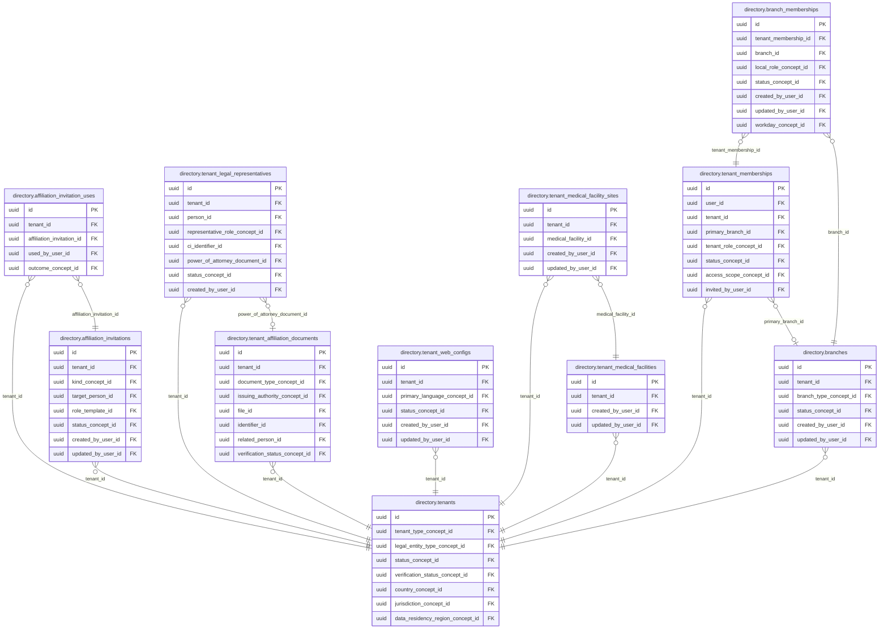

<!-- AUTOGENERADO por tools/inventario/catalogo.mjs. No editar manualmente. -->

# Catálogo del schema `directory`

- **Tablas:** 11 · **Columnas:** 173 (56 con descripción: 32.4 %) · **Índices:** 82
- **Dominio:** Núcleo y Terminología
- Método y límites del catálogo: [README del inventario](../README.md)

## Tablas

| Tabla | Propósito | Columnas | Índices | Operaciones | ORM |
|---|---|---|---|---|---|
| [affiliation_invitation_uses](#affiliation_invitation_uses) | Deja rastro de cada uso, aceptado o rechazado, de una invitación de afiliación para auditar quién la canjeó y con qué resultado. | 6 | 6 | 0 | SIN_ENTIDAD |
| [affiliation_invitations](#affiliation_invitations) | Conserva las invitaciones por enlace o QR con las que una organización afilia a un profesional o a personal de apoyo, guardando solo el hash del secreto, el tope de usos y el vencimiento. | 15 | 8 | 0 | SIN_ENTIDAD |
| [branch_memberships](#branch_memberships) | Relaciona miembros con sedes específicas para representar su asignación operativa dentro de una organización. | 12 | 8 | 77 | COINCIDE |
| [branches](#branches) | Identifica sedes de una organización sanitaria para ubicar prestación, operación y configuración local. | 16 | 7 | 25 | COINCIDE |
| [tenant_affiliation_documents](#tenant_affiliation_documents) | Conserva documentos que respaldan afiliaciones de tenants con organizaciones o redes del sistema médico. | 23 | 8 | 13 | COINCIDE |
| [tenant_legal_representatives](#tenant_legal_representatives) | Identifica representantes legales asociados a organizaciones para sostener trámites y responsabilidades institucionales. | 16 | 4 | 4 | COINCIDE |
| [tenant_medical_facilities](#tenant_medical_facilities) | sin propósito | 16 | 5 | 3 | COINCIDE |
| [tenant_medical_facility_sites](#tenant_medical_facility_sites) | sin propósito | 14 | 6 | 3 | COINCIDE |
| [tenant_memberships](#tenant_memberships) | Relaciona usuarios o perfiles con una organización para delimitar pertenencia y acceso institucional. | 18 | 14 | 317 | DIVERGE |
| [tenant_web_configs](#tenant_web_configs) | Almacena configuración web por tenant para presentar y dirigir servicios institucionales bajo sus dominios. | 18 | 3 | 0 | COINCIDE |
| [tenants](#tenants) | Representa organizaciones o espacios administrativos aislados que operan dentro del sistema médico multi-tenant. | 19 | 13 | 171 | COINCIDE |

## Diagrama entidad-relación

Las tablas se agrupan en familias por sus claves foráneas dentro del schema (máximo 40 por diagrama). Las FK hacia otros schemas se listan en la ficha de cada tabla.

### Familia 1 de 1 — 11 tablas

## Fichas

### affiliation_invitation_uses

#### Vista general

Deja rastro de cada uso, aceptado o rechazado, de una invitación de afiliación para auditar quién la canjeó y con qué resultado.

- **Estado del propósito:** DOMAIN_CURATED_DRAFT · fuente: `Mantra Core Health Context/modules/diagram_04_directory.puml: affiliation_invitation_uses`
- **Dominio:** Núcleo y Terminología · **Diagrama:** `Mantra Core Health Context/modules/diagram_04_directory.puml` · **DDL:** `SQL/04_directory/02_tables.sql`
- **Entidad del ORM:** **sin entidad** (deriva)
- **Resumen:** 6 columnas · 6 índices · 4 FK salientes · 0 entrantes · 0 operaciones

#### Columnas

| # | Columna | Tipo | Rol estructural | Descripción | ORM |
|---|---|---|---|---|---|
| 1 | `id` | `uuid` | Clave primaria; Obligatoria | _sin dato_ | **SIN_ENTIDAD** |
| 2 | `tenant_id` | `uuid` | Clave foránea → directory.tenants.id; Obligatoria | v4.2.76 (hardening): tenant_id = tenant de la invitacion (trigger integrity.trg_support_tenant_consistency). _(MODELO_PUML, `Mantra Core Health Context/modules/diagram_04_directory.puml:408`)_ | **SIN_ENTIDAD** |
| 3 | `affiliation_invitation_id` | `uuid` | Clave foránea → directory.affiliation_invitations.id; Obligatoria | _sin dato_ | **SIN_ENTIDAD** |
| 4 | `used_by_user_id` | `uuid` | Clave foránea → iam.users.id; Obligatoria | _sin dato_ | **SIN_ENTIDAD** |
| 5 | `occurred_at` | `timestamptz` | Obligatoria | _sin dato_ | **SIN_ENTIDAD** |
| 6 | `outcome_concept_id` | `uuid` | Clave foránea → terminology.catalog_concepts.id; Obligatoria | _sin dato_ | **SIN_ENTIDAD** |

#### Relaciones

| Sentido | Columnas | Tabla | Restricción |
|---|---|---|---|
| hacia | tenant_id | directory.tenants (id) | fk_affiliation_invitation_uses_tenant_id |
| hacia | affiliation_invitation_id | directory.affiliation_invitations (id) | fk_affiliation_invitation_uses_affiliation_invitation_id |
| hacia | used_by_user_id | iam.users (id) | fk_affiliation_invitation_uses_used_by_user_id |
| hacia | outcome_concept_id | terminology.catalog_concepts (id) | fk_affiliation_invitation_uses_outcome_concept_id |

#### Índices

| Índice | Único | Columnas | Para qué |
|---|---|---|---|
| `ix_affiliation_invitation_uses_tenant_id` | no | tenant_id | Soporta la clave foránea fk_affiliation_invitation_uses_tenant_id: PostgreSQL no indexa las FK por sí mismo _(DOCUMENTO)_ |
| `uq_affiliation_invitation_uses_accepted` | sí | affiliation_invitation_id, used_by_user_id donde WHERE outcome_concept_id = '659f9beb-ad4d-583e-828b-05a808ad08dc' | Garantiza que no se repita la combinación (affiliation_invitation_id, used_by_user_id) _(DOCUMENTO)_; Soporta la clave foránea fk_affiliation_invitation_uses_affiliation_invitation_id: PostgreSQL no indexa las FK por sí mismo _(DOCUMENTO)_; Índice parcial: sólo indexa las filas donde WHERE outcome_concept_id = '659f9beb-ad4d-583e-828b-05a808ad08dc' _(ESTRUCTURAL)_ |
| `ix_affiliation_invitation_uses_invitation_occurred` | no | affiliation_invitation_id, ("occurred_at" DESC) | _sin uso detectado estáticamente_ |
| `ix_affiliation_invitation_uses_used_by_user_id` | no | used_by_user_id | Soporta la clave foránea fk_affiliation_invitation_uses_used_by_user_id: PostgreSQL no indexa las FK por sí mismo _(DOCUMENTO)_ |
| `ix_affiliation_invitation_uses_outcome_concept_id` | no | outcome_concept_id | Soporta la clave foránea fk_affiliation_invitation_uses_outcome_concept_id: PostgreSQL no indexa las FK por sí mismo _(DOCUMENTO)_ |
| `brin_affiliation_invitation_uses_occurred_at` | no | occurred_at | BRIN para logs e historiales append-only de gran volumen _(DOCUMENTO)_ |

#### Restricciones

| Restricción | Tipo | Definición |
|---|---|---|
| `uq_affiliation_invitation_uses_accepted` | UNIQUE INDEX | UNIQUE INDEX ("affiliation_invitation_id", "used_by_user_id") WHERE outcome_concept_id = '659f9beb-ad4d-583e-828b-05a808ad08dc' |

#### Operaciones que la tocan

_Ninguna operación HTTP la toca según el análisis estático (puede usarla un worker, un trigger o una migración)._

#### Gobierno

| Atributo | Valor | Fuente |
|---|---|---|
| Append-only | no declarado | — |
| Datos personales | sin fuente | — |
| Financiera | sin fuente | — |
| Crítica para auditoría | sin fuente | — |
| Retención | sin fuente | — |
| Responsable | sin fuente | — |
| Revisión | AUTO_DETECTADA | — |

---

### affiliation_invitations

#### Vista general

Conserva las invitaciones por enlace o QR con las que una organización afilia a un profesional o a personal de apoyo, guardando solo el hash del secreto, el tope de usos y el vencimiento.

- **Estado del propósito:** DOMAIN_CURATED_DRAFT · fuente: `Mantra Core Health Context/modules/diagram_04_directory.puml: affiliation_invitations`
- **Dominio:** Núcleo y Terminología · **Diagrama:** `Mantra Core Health Context/modules/diagram_04_directory.puml` · **DDL:** `SQL/04_directory/02_tables.sql`
- **Entidad del ORM:** **sin entidad** (deriva)
- **Resumen:** 15 columnas · 8 índices · 7 FK salientes · 1 entrantes · 0 operaciones

#### Columnas

| # | Columna | Tipo | Rol estructural | Descripción | ORM |
|---|---|---|---|---|---|
| 1 | `id` | `uuid` | Clave primaria; Obligatoria | _sin dato_ | **SIN_ENTIDAD** |
| 2 | `tenant_id` | `uuid` | Clave foránea → directory.tenants.id; Obligatoria | _sin dato_ | **SIN_ENTIDAD** |
| 3 | `kind_concept_id` | `uuid` | Clave foránea → terminology.catalog_concepts.id; Obligatoria | _sin dato_ | **SIN_ENTIDAD** |
| 4 | `target_person_id` | `uuid` | Clave foránea → profiles.persons.id; Opcional | _sin dato_ | **SIN_ENTIDAD** |
| 5 | `token_hash` | `varchar` | Obligatoria | _sin dato_ | **SIN_ENTIDAD** |
| 6 | `max_uses` | `integer` | Obligatoria | _sin dato_ | **SIN_ENTIDAD** |
| 7 | `uses_count` | `integer` | Obligatoria | _sin dato_ | **SIN_ENTIDAD** |
| 8 | `expires_at` | `timestamptz` | Obligatoria | _sin dato_ | **SIN_ENTIDAD** |
| 9 | `role_template_id` | `uuid` | Clave foránea → delegated_access.role_templates.id; Opcional | _sin dato_ | **SIN_ENTIDAD** |
| 10 | `status_concept_id` | `uuid` | Clave foránea → terminology.catalog_concepts.id; Obligatoria | _sin dato_ | **SIN_ENTIDAD** |
| 11 | `created_by_user_id` | `uuid` | Clave foránea → iam.users.id; Obligatoria | _sin dato_ | **SIN_ENTIDAD** |
| 12 | `created_at` | `timestamptz` | Obligatoria | _sin dato_ | **SIN_ENTIDAD** |
| 13 | `updated_at` | `timestamptz` | Obligatoria | _sin dato_ | **SIN_ENTIDAD** |
| 14 | `updated_by_user_id` | `uuid` | Clave foránea → iam.users.id; Opcional | _sin dato_ | **SIN_ENTIDAD** |
| 15 | `row_version` | `integer = 1` | Obligatoria | _sin dato_ | **SIN_ENTIDAD** |

#### Relaciones

| Sentido | Columnas | Tabla | Restricción |
|---|---|---|---|
| hacia | tenant_id | directory.tenants (id) | fk_affiliation_invitations_tenant_id |
| hacia | kind_concept_id | terminology.catalog_concepts (id) | fk_affiliation_invitations_kind_concept_id |
| hacia | target_person_id | profiles.persons (id) | fk_affiliation_invitations_target_person_id |
| hacia | role_template_id | delegated_access.role_templates (id) | fk_affiliation_invitations_role_template_id |
| hacia | status_concept_id | terminology.catalog_concepts (id) | fk_affiliation_invitations_status_concept_id |
| hacia | created_by_user_id | iam.users (id) | fk_affiliation_invitations_created_by_user_id |
| hacia | updated_by_user_id | iam.users (id) | fk_affiliation_invitations_updated_by_user_id |
| desde | id | directory.affiliation_invitation_uses (affiliation_invitation_id) | fk_affiliation_invitation_uses_affiliation_invitation_id |

#### Índices

| Índice | Único | Columnas | Para qué |
|---|---|---|---|
| `uq_affiliation_invitations_token_hash` | sí | token_hash | Garantiza que no se repita la combinación (token_hash) _(DOCUMENTO)_ |
| `ix_affiliation_invitations_tenant_id` | no | tenant_id, status_concept_id, expires_at | Soporta la clave foránea fk_affiliation_invitations_tenant_id: PostgreSQL no indexa las FK por sí mismo _(DOCUMENTO)_ |
| `ix_affiliation_invitations_kind_concept_id` | no | kind_concept_id | Soporta la clave foránea fk_affiliation_invitations_kind_concept_id: PostgreSQL no indexa las FK por sí mismo _(DOCUMENTO)_ |
| `ix_affiliation_invitations_target_person_id` | no | target_person_id | Soporta la clave foránea fk_affiliation_invitations_target_person_id: PostgreSQL no indexa las FK por sí mismo _(DOCUMENTO)_ |
| `ix_affiliation_invitations_role_template_id` | no | role_template_id | Soporta la clave foránea fk_affiliation_invitations_role_template_id: PostgreSQL no indexa las FK por sí mismo _(DOCUMENTO)_ |
| `ix_affiliation_invitations_status_concept_id` | no | status_concept_id | Soporta la clave foránea fk_affiliation_invitations_status_concept_id: PostgreSQL no indexa las FK por sí mismo _(DOCUMENTO)_ |
| `ix_affiliation_invitations_created_by_user_id` | no | created_by_user_id | Soporta la clave foránea fk_affiliation_invitations_created_by_user_id: PostgreSQL no indexa las FK por sí mismo _(DOCUMENTO)_ |
| `ix_affiliation_invitations_updated_by_user_id` | no | updated_by_user_id | Soporta la clave foránea fk_affiliation_invitations_updated_by_user_id: PostgreSQL no indexa las FK por sí mismo _(DOCUMENTO)_ |

#### Restricciones

| Restricción | Tipo | Definición |
|---|---|---|
| `uq_affiliation_invitations_token_hash` | UNIQUE INDEX | UNIQUE INDEX ("token_hash") |
| `ck_affiliation_invitations_uses` | CHECK | CHECK (("max_uses" >= 1 AND "uses_count" >= 0 AND "uses_count" <= "max_uses")) |

#### Operaciones que la tocan

_Ninguna operación HTTP la toca según el análisis estático (puede usarla un worker, un trigger o una migración)._

#### Gobierno

| Atributo | Valor | Fuente |
|---|---|---|
| Append-only | no declarado | — |
| Datos personales | sin fuente | — |
| Financiera | sin fuente | — |
| Crítica para auditoría | sin fuente | — |
| Retención | sin fuente | — |
| Responsable | sin fuente | — |
| Revisión | AUTO_DETECTADA | — |

---

### branch_memberships

#### Vista general

Relaciona miembros con sedes específicas para representar su asignación operativa dentro de una organización.

- **Estado del propósito:** DOMAIN_CURATED_DRAFT · fuente: `Mantra Core Health Context/modules/diagram_04_directory.puml: branch_memberships`
- **Dominio:** Núcleo y Terminología · **Diagrama:** `Mantra Core Health Context/modules/diagram_04_directory.puml` · **DDL:** `SQL/04_directory/02_tables.sql`
- **Entidad del ORM:** `BranchMemberships` — `src/modules/directory/entities/branch_memberships.entity.ts`
- **Resumen:** 12 columnas · 8 índices · 8 FK salientes · 0 entrantes · 77 operaciones

#### Columnas

| # | Columna | Tipo | Rol estructural | Descripción | ORM |
|---|---|---|---|---|---|
| 1 | `id` | `uuid` | Clave primaria; Obligatoria | Identificador único de la instancia. _(JSDOC_ESTANDAR, `src/modules/directory/entities/branch_memberships.entity.ts:12`)_ | coincide |
| 2 | `tenant_membership_id` | `uuid` | Clave foránea → directory.tenant_memberships.id; Obligatoria | _sin dato_ | coincide |
| 3 | `branch_id` | `uuid` | Clave foránea → directory.branches.id; Obligatoria | _sin dato_ | coincide |
| 4 | `local_role_concept_id` | `uuid` | Clave foránea → terminology.catalog_concepts.id; Opcional | _sin dato_ | coincide |
| 5 | `status_concept_id` | `uuid` | Clave foránea → terminology.catalog_concepts.id; Obligatoria | _sin dato_ | coincide |
| 6 | `created_at` | `timestamptz` | Obligatoria | Fecha y hora en que se creó el registro. _(JSDOC_ESTANDAR, `src/modules/directory/entities/branch_memberships.entity.ts:46`)_ | coincide |
| 7 | `updated_at` | `timestamptz` | Obligatoria | Fecha y hora de la última actualización. _(JSDOC_ESTANDAR, `src/modules/directory/entities/branch_memberships.entity.ts:52`)_ | coincide |
| 8 | `created_by_user_id` | `uuid` | Clave foránea → iam.users.id; Opcional | _sin dato_ | coincide |
| 9 | `updated_by_user_id` | `uuid` | Clave foránea → iam.users.id; Opcional | _sin dato_ | coincide |
| 10 | `row_version` | `integer = 1` | Obligatoria | Versión usada para controlar actualizaciones concurrentes. _(JSDOC_ENTIDAD, `src/modules/directory/entities/branch_memberships.entity.ts:70`)_ | coincide |
| 11 | `workday_concept_id` | `uuid` | Clave foránea → terminology.catalog_concepts.id; Opcional | _sin dato_ | coincide |
| 12 | `responsible_user_id` | `uuid` | Clave foránea → iam.users.id; Opcional | _sin dato_ | coincide |

#### Relaciones

| Sentido | Columnas | Tabla | Restricción |
|---|---|---|---|
| hacia | tenant_membership_id | directory.tenant_memberships (id) | fk_branch_memberships_tenant_membership_id |
| hacia | branch_id | directory.branches (id) | fk_branch_memberships_branch_id |
| hacia | local_role_concept_id | terminology.catalog_concepts (id) | fk_branch_memberships_local_role_concept_id |
| hacia | status_concept_id | terminology.catalog_concepts (id) | fk_branch_memberships_status_concept_id |
| hacia | created_by_user_id | iam.users (id) | fk_branch_memberships_created_by_user_id |
| hacia | updated_by_user_id | iam.users (id) | fk_branch_memberships_updated_by_user_id |
| hacia | workday_concept_id | terminology.catalog_concepts (id) | fk_branch_memberships_workday_concept_id |
| hacia | responsible_user_id | iam.users (id) | fk_branch_memberships_responsible_user_id |

#### Índices

| Índice | Único | Columnas | Para qué |
|---|---|---|---|
| `ix_branch_memberships_tenant_membership_id` | no | tenant_membership_id | Soporta la clave foránea fk_branch_memberships_tenant_membership_id: PostgreSQL no indexa las FK por sí mismo _(DOCUMENTO)_; 4 consulta(s) de repositorio filtran u ordenan por «tenant_membership_id», la primera columna del índice _(CONSULTA)_ |
| `ix_branch_memberships_branch_id` | no | branch_id | Soporta la clave foránea fk_branch_memberships_branch_id: PostgreSQL no indexa las FK por sí mismo _(DOCUMENTO)_; 2 consulta(s) de repositorio filtran u ordenan por «branch_id», la primera columna del índice _(CONSULTA)_ |
| `ix_branch_memberships_local_role_concept_id` | no | local_role_concept_id | Soporta la clave foránea fk_branch_memberships_local_role_concept_id: PostgreSQL no indexa las FK por sí mismo _(DOCUMENTO)_ |
| `ix_branch_memberships_status_concept_id` | no | status_concept_id | Soporta la clave foránea fk_branch_memberships_status_concept_id: PostgreSQL no indexa las FK por sí mismo _(DOCUMENTO)_; 3 consulta(s) de repositorio filtran u ordenan por «status_concept_id», la primera columna del índice _(CONSULTA)_ |
| `ix_branch_memberships_created_by_user_id` | no | created_by_user_id | Soporta la clave foránea fk_branch_memberships_created_by_user_id: PostgreSQL no indexa las FK por sí mismo _(DOCUMENTO)_ |
| `ix_branch_memberships_updated_by_user_id` | no | updated_by_user_id | Soporta la clave foránea fk_branch_memberships_updated_by_user_id: PostgreSQL no indexa las FK por sí mismo _(DOCUMENTO)_ |
| `ix_branch_memberships_workday_concept_id` | no | workday_concept_id | Soporta la clave foránea fk_branch_memberships_workday_concept_id: PostgreSQL no indexa las FK por sí mismo _(DOCUMENTO)_ |
| `ix_branch_memberships_responsible_user_id` | no | responsible_user_id | Soporta la clave foránea fk_branch_memberships_responsible_user_id: PostgreSQL no indexa las FK por sí mismo _(DOCUMENTO)_ |

#### Operaciones que la tocan

| Operación | Efecto | Confianza |
|---|---|---|
| GET /accounting/cost-centers | LEE | DIRECTA |
| POST /accounting/cost-centers/{id}/unit-link | LEE | DIRECTA |
| GET /accounting/infrastructure-items | LEE | DIRECTA |
| PATCH /accounting/infrastructure-items/{id} | LEE | DIRECTA |
| GET /billing/bed-day/stays | LEE | DIRECTA |
| POST /billing/charge-captures/{id}/void | LEE | DIRECTA |
| POST /billing/encounters/{encounterId}/bed-day-charges/run | LEE | DIRECTA |
| GET /billing/encounters/{encounterId}/pending-charges | LEE | DIRECTA |
| GET /billing/space-tariffs | LEE | DIRECTA |
| POST /billing/space-tariffs | LEE | DIRECTA |
| POST /billing/space-tariffs/{id}/close | LEE | DIRECTA |
| POST /internal/billing/bed-day-charges/run | LEE | DIRECTA |
| POST /census-days/{id}/adjustments | LEE | DIRECTA |
| POST /clinical/admissions | LEE | DIRECTA |
| POST /clinical/bed-compatibility | LEE | DIRECTA |
| POST /clinical/bed-swaps | LEE | DIRECTA |
| POST /clinical/encounter-locations/{id}/cancel | LEE | DIRECTA |
| POST /clinical/encounters/{id}/bed-assignment | LEE | DIRECTA |
| POST /clinical/encounters/{id}/bed-compatibility | LEE | DIRECTA |
| POST /clinical/encounters/{id}/discharge | LEE | DIRECTA |
| GET /clinical/encounters/{id}/stay | LEE | DIRECTA |
| POST /clinical/encounters/{id}/transfer | LEE | DIRECTA |
| GET /clinical/patients/{id}/inpatient-stay | LEE | DIRECTA |
| PATCH /clinical/placement-incidents/{id} | LEE | DIRECTA |
| POST /internal/clinical/census-close-tick | LEE | DIRECTA |
| GET /sites/{siteId}/attending-practitioners | LEE | DIRECTA |
| GET /sites/{siteId}/census | LEE | DIRECTA |
| POST /sites/{siteId}/census/{date}/close | LEE | DIRECTA |
| GET /sites/{siteId}/inpatient-indicators | LEE | DIRECTA |
| GET /sites/{siteId}/inpatients | LEE | DIRECTA |
| GET /diagnostic-equipment/{id} | LEE | DIRECTA |
| PATCH /diagnostic-equipment/{id} | LEE | DIRECTA |
| GET /diagnostic-equipment/{id}/mwl-station | LEE | DIRECTA |
| POST /diagnostic-equipment/{id}/resource | LEE | DIRECTA |
| GET /tenants/{tenantId}/memberships/{membershipId}/branch-assignments | LEE | DIRECTA |
| POST /tenants/{tenantId}/memberships/{membershipId}/branch-assignments | CREA | DIRECTA |
| POST /tenants/{tenantId}/memberships/{membershipId}/branch-assignments | LEE | DIRECTA |
| POST /tenants/{tenantId}/memberships/{membershipId}/offboard | ACTUALIZA | POR_TIPO |
| POST /tenants/{tenantId}/memberships/{membershipId}/offboard | LEE | DIRECTA |
| POST /tenants/{tenantId}/memberships/{membershipId}/transfer | ACTUALIZA | POR_TIPO |
| POST /tenants/{tenantId}/memberships/{membershipId}/transfer | CREA | DIRECTA |
| POST /tenants/{tenantId}/memberships/{membershipId}/transfer | LEE | DIRECTA |
| PATCH /care-spaces/{id} | LEE | DIRECTA |
| POST /care-spaces/{id}/availability | LEE | DIRECTA |
| GET /care-spaces/{id}/blocks | LEE | DIRECTA |
| GET /care-spaces/{id}/equipment | LEE | DIRECTA |
| POST /care-spaces/{id}/hygiene | LEE | DIRECTA |
| POST /care-spaces/{id}/isolation | LEE | DIRECTA |
| POST /care-spaces/{id}/lifecycle | LEE | DIRECTA |
| POST /care-spaces/{id}/move | LEE | DIRECTA |
| GET /care-spaces/{id}/operational-state | LEE | DIRECTA |
| GET /care-spaces/{id}/status-events | LEE | DIRECTA |
| GET /care-spaces/{id}/stock | LEE | DIRECTA |
| POST /care-spaces/{id}/unit-assignments | LEE | DIRECTA |
| DELETE /care-spaces/{id}/unit-assignments/{assignmentId} | LEE | DIRECTA |
| PATCH /clinical-units/{id} | LEE | DIRECTA |
| POST /clinical-units/{id}/lifecycle | LEE | DIRECTA |
| GET /practice/infrastructure-access/me | LEE | DIRECTA |
| GET /sites/{siteId}/bed-board | LEE | DIRECTA |
| POST /sites/{siteId}/care-spaces | LEE | DIRECTA |
| POST /sites/{siteId}/care-spaces/bulk | LEE | DIRECTA |
| POST /sites/{siteId}/care-spaces/import | LEE | DIRECTA |
| GET /sites/{siteId}/cleaning-orders | LEE | DIRECTA |
| POST /sites/{siteId}/cleaning-orders | LEE | DIRECTA |
| POST /sites/{siteId}/clinical-units | LEE | DIRECTA |
| GET /sites/{siteId}/diagnostic-equipment | LEE | DIRECTA |
| GET /sites/{siteId}/regulatory | LEE | DIRECTA |
| PATCH /sites/{siteId}/regulatory | LEE | DIRECTA |
| POST /sites/{siteId}/regulatory/verify-snis | LEE | DIRECTA |
| GET /sites/{siteId}/structure | LEE | DIRECTA |
| POST /or-blocks/{id}/cancel | LEE | DIRECTA |
| POST /or-blocks/{id}/release | LEE | DIRECTA |
| GET /procedure-cases/{id} | LEE | DIRECTA |
| GET /sites/{siteId}/operating-rooms | LEE | DIRECTA |
| GET /sites/{siteId}/or-blocks | LEE | DIRECTA |
| POST /sites/{siteId}/or-blocks | LEE | DIRECTA |
| GET /sites/{siteId}/or-utilization | LEE | DIRECTA |

#### Gobierno

| Atributo | Valor | Fuente |
|---|---|---|
| Append-only | no declarado | — |
| Datos personales | sin fuente | — |
| Financiera | sin fuente | — |
| Crítica para auditoría | sin fuente | — |
| Retención | sin fuente | — |
| Responsable | sin fuente | — |
| Revisión | AUTO_DETECTADA | — |

---

### branches

#### Vista general

Identifica sedes de una organización sanitaria para ubicar prestación, operación y configuración local.

- **Estado del propósito:** DOMAIN_CURATED_DRAFT · fuente: `Mantra Core Health Context/modules/diagram_04_directory.puml: branches`
- **Dominio:** Núcleo y Terminología · **Diagrama:** `Mantra Core Health Context/modules/diagram_04_directory.puml` · **DDL:** `SQL/04_directory/02_tables.sql`
- **Entidad del ORM:** `Branches` — `src/modules/directory/entities/branches.entity.ts`
- **Resumen:** 16 columnas · 7 índices · 5 FK salientes · 24 entrantes · 25 operaciones

#### Columnas

| # | Columna | Tipo | Rol estructural | Descripción | ORM |
|---|---|---|---|---|---|
| 1 | `id` | `uuid` | Clave primaria; Obligatoria | Identificador único de la instancia. _(JSDOC_ESTANDAR, `src/modules/directory/entities/branches.entity.ts:12`)_ | coincide |
| 2 | `tenant_id` | `uuid` | Clave foránea → directory.tenants.id; Obligatoria | _sin dato_ | coincide |
| 3 | `code` | `varchar` | Obligatoria | _sin dato_ | coincide |
| 4 | `name` | `varchar` | Obligatoria | _sin dato_ | coincide |
| 5 | `branch_type_concept_id` | `uuid` | Clave foránea → terminology.catalog_concepts.id; Obligatoria | _sin dato_ | coincide |
| 6 | `status_concept_id` | `uuid` | Clave foránea → terminology.catalog_concepts.id; Obligatoria | _sin dato_ | coincide |
| 7 | `time_zone` | `varchar` | Opcional | _sin dato_ | coincide |
| 8 | `latitude` | `numeric` | Opcional | _sin dato_ | coincide |
| 9 | `longitude` | `numeric` | Opcional | _sin dato_ | coincide |
| 10 | `description` | `text` | Opcional | + v4.2.43 (P54 carga masiva de sucursales · P50 alta pública de farmacia): la sucursal declarada en el alta o subida en lote trae un texto de descripción y el enlace de mapa tal como se pegó. Ambas opcionales, sin backfill. Estaban en el parche 2026-10-11_v4243 y en la copia de la API, pero no en el modelo. _(MODELO_PUML, `Mantra Core Health Context/modules/diagram_04_directory.puml:53`)_ | coincide |
| 11 | `location_url` | `varchar(2000)` | Opcional | Enlace de mapa tal como lo pegó la persona (http/https). _(JSDOC_ENTIDAD, `src/modules/directory/entities/branches.entity.ts:68`)_ | coincide |
| 12 | `created_at` | `timestamptz` | Obligatoria | Fecha y hora en que se creó el registro. _(JSDOC_ESTANDAR, `src/modules/directory/entities/branches.entity.ts:78`)_ | coincide |
| 13 | `updated_at` | `timestamptz` | Obligatoria | Fecha y hora de la última actualización. _(JSDOC_ESTANDAR, `src/modules/directory/entities/branches.entity.ts:84`)_ | coincide |
| 14 | `created_by_user_id` | `uuid` | Clave foránea → iam.users.id; Opcional | _sin dato_ | coincide |
| 15 | `updated_by_user_id` | `uuid` | Clave foránea → iam.users.id; Opcional | _sin dato_ | coincide |
| 16 | `row_version` | `integer = 1` | Obligatoria | Versión usada para controlar actualizaciones concurrentes. _(JSDOC_ENTIDAD, `src/modules/directory/entities/branches.entity.ts:102`)_ | coincide |

#### Relaciones

| Sentido | Columnas | Tabla | Restricción |
|---|---|---|---|
| hacia | tenant_id | directory.tenants (id) | fk_branches_tenant_id |
| hacia | branch_type_concept_id | terminology.catalog_concepts (id) | fk_branches_branch_type_concept_id |
| hacia | status_concept_id | terminology.catalog_concepts (id) | fk_branches_status_concept_id |
| hacia | created_by_user_id | iam.users (id) | fk_branches_created_by_user_id |
| hacia | updated_by_user_id | iam.users (id) | fk_branches_updated_by_user_id |
| desde | id | directory.tenant_memberships (primary_branch_id) | fk_tenant_memberships_primary_branch_id |
| desde | id | directory.branch_memberships (branch_id) | fk_branch_memberships_branch_id |
| desde | id | authz.user_role_assignments (branch_id) | fk_user_role_assignments_branch_id |
| desde | id | authz.clinical_access_grants (branch_id) | fk_clinical_access_grants_branch_id |
| desde | id | clinical.encounters (branch_id) | fk_encounters_branch_id |
| desde | id | clinical.appointments (branch_id) | fk_appointments_branch_id |
| desde | id | forms.field_assignments (branch_id) | fk_field_assignments_branch_id |
| desde | id | audit.audit_log (branch_id) | fk_audit_log_branch_id |
| desde | id | practice.practice_sites (branch_id) | fk_practice_sites_branch_id |
| desde | id | accounting.infrastructure_items (branch_id) | fk_infrastructure_items_branch_id |
| desde | id | accounting.company_bank_accounts (branch_id) | fk_company_bank_accounts_branch_id |
| desde | id | accounting.journal_entry_assignments (branch_id) | fk_journal_entry_assignments_branch_id |
| desde | id | accounting.asset_assignments (branch_id) | fk_asset_assignments_branch_id |
| desde | id | clinical_ext.referrals (target_branch_id) | fk_referrals_target_branch_id |
| desde | id | diagnostic_units.unit_medical_visitors (branch_id) | fk_unit_medical_visitors_branch_id |
| desde | id | insurance.broker_carrier_agreements (branch_id) | fk_broker_carrier_agreements_branch_id |
| desde | id | erp.employee_assignments (branch_id) | fk_employee_assignments_branch_id |
| desde | id | erp.purchase_order_items (branch_id) | fk_purchase_order_items_branch_id |
| desde | id | erp.goods_receipts (receiving_branch_id) | fk_goods_receipts_receiving_branch_id |
| desde | id | erp.contract_object_assignments (branch_id) | fk_contract_object_assignments_branch_id |
| desde | id | erp.lease_objects (branch_id) | fk_lease_objects_branch_id |
| desde | id | pharma_lab.medical_visitors (branch_id) | fk_medical_visitors_branch_id |
| desde | id | pharma_lab.pharma_cost_allocations (branch_id) | fk_pharma_cost_allocations_branch_id |
| desde | id | pharma_lab.pharma_lab_staff (branch_id) | fk_pharma_lab_staff_branch_id |

#### Índices

| Índice | Único | Columnas | Para qué |
|---|---|---|---|
| `ix_branches_tenant_id` | no | tenant_id | Soporta la clave foránea fk_branches_tenant_id: PostgreSQL no indexa las FK por sí mismo _(DOCUMENTO)_; 3 consulta(s) de repositorio filtran u ordenan por «tenant_id», la primera columna del índice _(CONSULTA)_ |
| `ix_branches_branch_type_concept_id` | no | branch_type_concept_id | Soporta la clave foránea fk_branches_branch_type_concept_id: PostgreSQL no indexa las FK por sí mismo _(DOCUMENTO)_ |
| `ix_branches_status_concept_id` | no | status_concept_id | Soporta la clave foránea fk_branches_status_concept_id: PostgreSQL no indexa las FK por sí mismo _(DOCUMENTO)_; 1 consulta(s) de repositorio filtran u ordenan por «status_concept_id», la primera columna del índice _(CONSULTA)_ |
| `ix_branches_created_by_user_id` | no | created_by_user_id | Soporta la clave foránea fk_branches_created_by_user_id: PostgreSQL no indexa las FK por sí mismo _(DOCUMENTO)_ |
| `ix_branches_updated_by_user_id` | no | updated_by_user_id | Soporta la clave foránea fk_branches_updated_by_user_id: PostgreSQL no indexa las FK por sí mismo _(DOCUMENTO)_ |
| `ix_branches_tenant_id_status_concept_id` | no | tenant_id, status_concept_id, ("updated_at" DESC) | _sin uso detectado estáticamente_ |
| `gin_branches_search` | no | (to_tsvector('simple', (coalesce(name, '') ¦¦ ' ' ¦¦ coalesce(code, '')))) | GIN para búsqueda textual gobernada _(DOCUMENTO)_ |

#### Operaciones que la tocan

| Operación | Efecto | Confianza |
|---|---|---|
| GET /referrals | LEE | DIRECTA |
| POST /referrals | LEE | DIRECTA |
| GET /referrals/{id} | LEE | DIRECTA |
| PATCH /referrals/{id}/arrival | LEE | DIRECTA |
| PATCH /referrals/{id}/cancel | LEE | DIRECTA |
| PATCH /referrals/{id}/counter-referral | LEE | DIRECTA |
| PATCH /referrals/{id}/respond | LEE | DIRECTA |
| PATCH /referrals/{id}/transfer | LEE | DIRECTA |
| GET /referrals/me | LEE | DIRECTA |
| POST /admin/tenants | CREA | DIRECTA |
| POST /admin/tenants/{tenantId}/suspend | ACTUALIZA | POR_TIPO |
| POST /admin/tenants/{tenantId}/suspend | LEE | DIRECTA |
| GET /tenants/{tenantId}/branches | LEE | DIRECTA |
| POST /tenants/{tenantId}/branches | CREA | DIRECTA |
| POST /tenants/{tenantId}/branches | LEE | DIRECTA |
| PATCH /tenants/{tenantId}/branches/{branchId} | ACTUALIZA | POR_TIPO |
| PATCH /tenants/{tenantId}/branches/{branchId} | LEE | DIRECTA |
| POST /tenants/{tenantId}/child-tenants | CREA | DIRECTA |
| POST /tenants/{tenantId}/memberships/{membershipId}/branch-assignments | LEE | DIRECTA |
| POST /tenants/{tenantId}/memberships/{membershipId}/transfer | LEE | DIRECTA |
| POST /iam/auth/register-organization | CREA | DIRECTA |
| POST /insurance/portability/export | LEE | POR_SQL |
| POST /practices/{practiceId}/sites | LEE | DIRECTA |
| POST /public/profiles/f/{slug}/branch-availability | LEE | POR_SQL |
| GET /public/profiles/f/{slug}/branches | LEE | POR_SQL |

#### Gobierno

| Atributo | Valor | Fuente |
|---|---|---|
| Append-only | no declarado | — |
| Datos personales | sin fuente | — |
| Financiera | sin fuente | — |
| Crítica para auditoría | sin fuente | — |
| Retención | sin fuente | — |
| Responsable | sin fuente | — |
| Revisión | AUTO_DETECTADA | — |

---

### tenant_affiliation_documents

#### Vista general

Conserva documentos que respaldan afiliaciones de tenants con organizaciones o redes del sistema médico.

- **Estado del propósito:** DOMAIN_CURATED_DRAFT · fuente: `Mantra Core Health Context/modules/diagram_04_directory.puml: tenant_affiliation_documents`
- **Dominio:** Núcleo y Terminología · **Diagrama:** `Mantra Core Health Context/modules/diagram_04_directory.puml` · **DDL:** `SQL/04_directory/02_tables.sql`
- **Entidad del ORM:** `TenantAffiliationDocuments` — `src/modules/directory/entities/tenant_affiliation_documents.entity.ts`
- **Resumen:** 23 columnas · 8 índices · 11 FK salientes · 1 entrantes · 13 operaciones

#### Columnas

| # | Columna | Tipo | Rol estructural | Descripción | ORM |
|---|---|---|---|---|---|
| 1 | `id` | `uuid` | Clave primaria; Obligatoria | Identificador único de la instancia. _(JSDOC_ESTANDAR, `src/modules/directory/entities/tenant_affiliation_documents.entity.ts:12`)_ | coincide |
| 2 | `tenant_id` | `uuid` | Clave foránea → directory.tenants.id; Obligatoria | _sin dato_ | coincide |
| 3 | `document_type_concept_id` | `uuid` | Clave foránea → terminology.catalog_concepts.id; Obligatoria | _sin dato_ | coincide |
| 4 | `issuing_authority_concept_id` | `uuid` | Clave foránea → terminology.catalog_concepts.id; Obligatoria | _sin dato_ | coincide |
| 5 | `file_id` | `uuid` | Clave foránea → common.files.id; Obligatoria | _sin dato_ | coincide |
| 6 | `identifier_id` | `uuid` | Clave foránea → common.identifiers.id; Opcional | _sin dato_ | coincide |
| 7 | `related_person_id` | `uuid` | Clave foránea → profiles.persons.id; Opcional | _sin dato_ | coincide |
| 8 | `document_number` | `varchar` | Opcional | _sin dato_ | coincide |
| 9 | `registered_at` | `date` | Opcional | _sin dato_ | coincide |
| 10 | `issued_at` | `date` | Opcional | _sin dato_ | coincide |
| 11 | `valid_from` | `date` | Opcional | _sin dato_ | coincide |
| 12 | `valid_to` | `date` | Opcional | _sin dato_ | coincide |
| 13 | `verification_status_concept_id` | `uuid` | Clave foránea → terminology.catalog_concepts.id; Obligatoria | _sin dato_ | coincide |
| 14 | `verified_by_user_id` | `uuid` | Clave foránea → iam.users.id; Opcional | _sin dato_ | coincide |
| 15 | `verified_at` | `timestamptz` | Opcional | _sin dato_ | coincide |
| 16 | `is_required_for_affiliation` | `boolean` | Opcional | _sin dato_ | coincide |
| 17 | `notes` | `varchar` | Opcional | _sin dato_ | coincide |
| 18 | `status_concept_id` | `uuid` | Clave foránea → terminology.catalog_concepts.id; Obligatoria | _sin dato_ | coincide |
| 19 | `created_at` | `timestamptz` | Obligatoria | Fecha y hora en que se creó el registro. _(JSDOC_ESTANDAR, `src/modules/directory/entities/tenant_affiliation_documents.entity.ts:132`)_ | coincide |
| 20 | `updated_at` | `timestamptz` | Obligatoria | Fecha y hora de la última actualización. _(JSDOC_ESTANDAR, `src/modules/directory/entities/tenant_affiliation_documents.entity.ts:138`)_ | coincide |
| 21 | `created_by_user_id` | `uuid` | Clave foránea → iam.users.id; Opcional | _sin dato_ | coincide |
| 22 | `updated_by_user_id` | `uuid` | Clave foránea → iam.users.id; Opcional | _sin dato_ | coincide |
| 23 | `row_version` | `integer = 1` | Obligatoria | Versión usada para controlar actualizaciones concurrentes. _(JSDOC_ENTIDAD, `src/modules/directory/entities/tenant_affiliation_documents.entity.ts:156`)_ | coincide |

#### Relaciones

| Sentido | Columnas | Tabla | Restricción |
|---|---|---|---|
| hacia | tenant_id | directory.tenants (id) | fk_tenant_affiliation_documents_tenant_id |
| hacia | document_type_concept_id | terminology.catalog_concepts (id) | fk_tenant_affiliation_documents_document_type_concept_id |
| hacia | issuing_authority_concept_id | terminology.catalog_concepts (id) | fk_tenant_affiliation_documents_issuing_authority_concept_id |
| hacia | file_id | common.files (id) | fk_tenant_affiliation_documents_file_id |
| hacia | identifier_id | common.identifiers (id) | fk_tenant_affiliation_documents_identifier_id |
| hacia | related_person_id | profiles.persons (id) | fk_tenant_affiliation_documents_related_person_id |
| hacia | verification_status_concept_id | terminology.catalog_concepts (id) | fk_tenant_affiliation_documents_verification_status_concept_id |
| hacia | verified_by_user_id | iam.users (id) | fk_tenant_affiliation_documents_verified_by_user_id |
| hacia | status_concept_id | terminology.catalog_concepts (id) | fk_tenant_affiliation_documents_status_concept_id |
| hacia | created_by_user_id | iam.users (id) | fk_tenant_affiliation_documents_created_by_user_id |
| hacia | updated_by_user_id | iam.users (id) | fk_tenant_affiliation_documents_updated_by_user_id |
| desde | id | directory.tenant_legal_representatives (power_of_attorney_document_id) | fk_tenant_legal_representatives_power_of_attorney_document_id |

#### Índices

| Índice | Único | Columnas | Para qué |
|---|---|---|---|
| `ix_tenant_affiliation_documents_tenant_id` | no | tenant_id | Soporta la clave foránea fk_tenant_affiliation_documents_tenant_id: PostgreSQL no indexa las FK por sí mismo _(DOCUMENTO)_; 2 consulta(s) de repositorio filtran u ordenan por «tenant_id», la primera columna del índice _(CONSULTA)_ |
| `ix_tenant_affiliation_documents_document_type_concept_id` | no | document_type_concept_id | Soporta la clave foránea fk_tenant_affiliation_documents_document_type_concept_id: PostgreSQL no indexa las FK por sí mismo _(DOCUMENTO)_ |
| `ix_tenant_affiliation_documents_issuing_authority_concept_id` | no | issuing_authority_concept_id | Soporta la clave foránea fk_tenant_affiliation_documents_issuing_authority_concept_id: PostgreSQL no indexa las FK por sí mismo _(DOCUMENTO)_ |
| `ix_tenant_affiliation_documents_verification_status_concept_id` | no | verification_status_concept_id | Soporta la clave foránea fk_tenant_affiliation_documents_verification_status_concept_id: PostgreSQL no indexa las FK por sí mismo _(DOCUMENTO)_ |
| `ix_tenant_affiliation_documents_file_id` | no | file_id | Soporta la clave foránea fk_tenant_affiliation_documents_file_id: PostgreSQL no indexa las FK por sí mismo _(DOCUMENTO)_; 1 consulta(s) de repositorio filtran u ordenan por «file_id», la primera columna del índice _(CONSULTA)_ |
| `ix_tenant_affiliation_documents_identifier_id` | no | identifier_id | Soporta la clave foránea fk_tenant_affiliation_documents_identifier_id: PostgreSQL no indexa las FK por sí mismo _(DOCUMENTO)_ |
| `ix_tenant_affiliation_documents_valid_to` | no | valid_to | _sin uso detectado estáticamente_ |
| `uk_tenant_affiliation_documents_tenant_type_file` | sí | tenant_id, document_type_concept_id, file_id | Garantiza que no se repita la combinación (tenant_id, document_type_concept_id, file_id) _(DOCUMENTO)_; Soporta la clave foránea fk_tenant_affiliation_documents_tenant_id: PostgreSQL no indexa las FK por sí mismo _(DOCUMENTO)_; 2 consulta(s) de repositorio filtran u ordenan por «tenant_id», la primera columna del índice _(CONSULTA)_ |

#### Restricciones

| Restricción | Tipo | Definición |
|---|---|---|
| `uk_tenant_affiliation_documents_tenant_type_file` | UNIQUE INDEX | UNIQUE INDEX ("tenant_id", "document_type_concept_id", "file_id") |

#### Operaciones que la tocan

| Operación | Efecto | Confianza |
|---|---|---|
| POST /admin/tenants/{tenantId}/verification | ACTUALIZA | POR_TIPO |
| POST /admin/tenants/{tenantId}/verification | LEE | DIRECTA |
| POST /tenants/{tenantId}/affiliation-documents | CREA | DIRECTA |
| POST /tenants/{tenantId}/affiliation-documents | LEE | DIRECTA |
| GET /tenants/{tenantId}/laboratory-readiness | LEE | DIRECTA |
| GET /tenants/{tenantId}/pharmacy-readiness | LEE | DIRECTA |
| GET /tenants/me | LEE | DIRECTA |
| POST /iam/auth/register-organization | CREA | DIRECTA |
| POST /iam/auth/register-organization | LEE | DIRECTA |
| POST /identity/checks/{id}/results | LEE | DIRECTA |
| POST /identity/manual-review/{id}/decision | LEE | DIRECTA |
| POST /internal/identity/checks/{id}/results | LEE | DIRECTA |
| GET /pharmacy/pharmacies/{id} | LEE | DIRECTA |

#### Gobierno

| Atributo | Valor | Fuente |
|---|---|---|
| Append-only | no declarado | — |
| Datos personales | sin fuente | — |
| Financiera | sin fuente | — |
| Crítica para auditoría | sin fuente | — |
| Retención | sin fuente | — |
| Responsable | sin fuente | — |
| Revisión | AUTO_DETECTADA | — |

---

### tenant_legal_representatives

#### Vista general

Identifica representantes legales asociados a organizaciones para sostener trámites y responsabilidades institucionales.

- **Estado del propósito:** DOMAIN_CURATED_DRAFT · fuente: `Mantra Core Health Context/modules/diagram_04_directory.puml: tenant_legal_representatives`
- **Dominio:** Núcleo y Terminología · **Diagrama:** `Mantra Core Health Context/modules/diagram_04_directory.puml` · **DDL:** `SQL/04_directory/02_tables.sql`
- **Entidad del ORM:** `TenantLegalRepresentatives` — `src/modules/directory/entities/tenant_legal_representatives.entity.ts`
- **Resumen:** 16 columnas · 4 índices · 8 FK salientes · 0 entrantes · 4 operaciones

#### Columnas

| # | Columna | Tipo | Rol estructural | Descripción | ORM |
|---|---|---|---|---|---|
| 1 | `id` | `uuid` | Clave primaria; Obligatoria | Identificador único de la instancia. _(JSDOC_ESTANDAR, `src/modules/directory/entities/tenant_legal_representatives.entity.ts:12`)_ | coincide |
| 2 | `tenant_id` | `uuid` | Clave foránea → directory.tenants.id; Obligatoria | _sin dato_ | coincide |
| 3 | `person_id` | `uuid` | Clave foránea → profiles.persons.id; Obligatoria | _sin dato_ | coincide |
| 4 | `representative_role_concept_id` | `uuid` | Clave foránea → terminology.catalog_concepts.id; Obligatoria | _sin dato_ | coincide |
| 5 | `ci_identifier_id` | `uuid` | Clave foránea → common.identifiers.id; Opcional | _sin dato_ | coincide |
| 6 | `power_of_attorney_document_id` | `uuid` | Clave foránea → directory.tenant_affiliation_documents.id; Opcional | _sin dato_ | coincide |
| 7 | `appointed_at` | `date` | Opcional | _sin dato_ | coincide |
| 8 | `valid_from` | `date` | Opcional | _sin dato_ | coincide |
| 9 | `valid_to` | `date` | Opcional | _sin dato_ | coincide |
| 10 | `is_primary` | `boolean` | Opcional | _sin dato_ | coincide |
| 11 | `status_concept_id` | `uuid` | Clave foránea → terminology.catalog_concepts.id; Obligatoria | _sin dato_ | coincide |
| 12 | `created_at` | `timestamptz` | Obligatoria | Fecha y hora en que se creó el registro. _(JSDOC_ESTANDAR, `src/modules/directory/entities/tenant_legal_representatives.entity.ts:82`)_ | coincide |
| 13 | `updated_at` | `timestamptz` | Obligatoria | Fecha y hora de la última actualización. _(JSDOC_ESTANDAR, `src/modules/directory/entities/tenant_legal_representatives.entity.ts:88`)_ | coincide |
| 14 | `created_by_user_id` | `uuid` | Clave foránea → iam.users.id; Opcional | _sin dato_ | coincide |
| 15 | `updated_by_user_id` | `uuid` | Clave foránea → iam.users.id; Opcional | _sin dato_ | coincide |
| 16 | `row_version` | `integer = 1` | Obligatoria | Versión usada para controlar actualizaciones concurrentes. _(JSDOC_ENTIDAD, `src/modules/directory/entities/tenant_legal_representatives.entity.ts:106`)_ | coincide |

#### Relaciones

| Sentido | Columnas | Tabla | Restricción |
|---|---|---|---|
| hacia | tenant_id | directory.tenants (id) | fk_tenant_legal_representatives_tenant_id |
| hacia | power_of_attorney_document_id | directory.tenant_affiliation_documents (id) | fk_tenant_legal_representatives_power_of_attorney_document_id |
| hacia | person_id | profiles.persons (id) | fk_tenant_legal_representatives_person_id |
| hacia | representative_role_concept_id | terminology.catalog_concepts (id) | fk_tenant_legal_representatives_representative_role_concept_id |
| hacia | ci_identifier_id | common.identifiers (id) | fk_tenant_legal_representatives_ci_identifier_id |
| hacia | status_concept_id | terminology.catalog_concepts (id) | fk_tenant_legal_representatives_status_concept_id |
| hacia | created_by_user_id | iam.users (id) | fk_tenant_legal_representatives_created_by_user_id |
| hacia | updated_by_user_id | iam.users (id) | fk_tenant_legal_representatives_updated_by_user_id |

#### Índices

| Índice | Único | Columnas | Para qué |
|---|---|---|---|
| `ix_tenant_legal_representatives_tenant_id` | no | tenant_id | Soporta la clave foránea fk_tenant_legal_representatives_tenant_id: PostgreSQL no indexa las FK por sí mismo _(DOCUMENTO)_; 1 consulta(s) de repositorio filtran u ordenan por «tenant_id», la primera columna del índice _(CONSULTA)_ |
| `ix_tenant_legal_representatives_person_id` | no | person_id | Soporta la clave foránea fk_tenant_legal_representatives_person_id: PostgreSQL no indexa las FK por sí mismo _(DOCUMENTO)_ |
| `ix_tenant_legal_representatives_role_concept_id` | no | representative_role_concept_id | Soporta la clave foránea fk_tenant_legal_representatives_representative_role_concept_id: PostgreSQL no indexa las FK por sí mismo _(DOCUMENTO)_ |
| `uk_tenant_legal_representatives_primary` | sí | tenant_id, is_primary | Garantiza que no se repita la combinación (tenant_id, is_primary) _(DOCUMENTO)_; Soporta la clave foránea fk_tenant_legal_representatives_tenant_id: PostgreSQL no indexa las FK por sí mismo _(DOCUMENTO)_; 1 consulta(s) de repositorio filtran u ordenan por «tenant_id», la primera columna del índice _(CONSULTA)_ |

#### Restricciones

| Restricción | Tipo | Definición |
|---|---|---|
| `uk_tenant_legal_representatives_primary` | UNIQUE INDEX | UNIQUE INDEX ("tenant_id", "is_primary") |

#### Operaciones que la tocan

| Operación | Efecto | Confianza |
|---|---|---|
| POST /tenants/{tenantId}/affiliation-documents | LEE | DIRECTA |
| GET /tenants/me | LEE | DIRECTA |
| POST /iam/auth/register-organization | CREA | DIRECTA |
| GET /pharmacy/pharmacies/{id}/contacts | LEE | DIRECTA |

#### Gobierno

| Atributo | Valor | Fuente |
|---|---|---|
| Append-only | no declarado | — |
| Datos personales | sin fuente | — |
| Financiera | sin fuente | — |
| Crítica para auditoría | sin fuente | — |
| Retención | sin fuente | — |
| Responsable | sin fuente | — |
| Revisión | AUTO_DETECTADA | — |

---

### tenant_medical_facilities

#### Vista general

_Sin propósito registrado._

- **Estado del propósito:** PENDING_REVIEW
- **Dominio:** Núcleo y Terminología · **Diagrama:** `Mantra Core Health Context/modules/diagram_04_directory.puml` · **DDL:** `SQL/04_directory/02_tables.sql`
- **Entidad del ORM:** `TenantMedicalFacilities` — `src/modules/directory/entities/tenant_medical_facilities.entity.ts`
- **Resumen:** 16 columnas · 5 índices · 3 FK salientes · 1 entrantes · 3 operaciones

#### Columnas

| # | Columna | Tipo | Rol estructural | Descripción | ORM |
|---|---|---|---|---|---|
| 1 | `id` | `uuid` | Clave primaria; Obligatoria | Identificador único de la instancia. _(JSDOC_ESTANDAR, `src/modules/directory/entities/tenant_medical_facilities.entity.ts:17`)_ | coincide |
| 2 | `tenant_id` | `uuid` | Clave foránea → directory.tenants.id; Obligatoria | _sin dato_ | coincide |
| 3 | `tax_identifier_number` | `varchar(20)` | Obligatoria | NIT declarado en el alta, como número. _(JSDOC_ENTIDAD, `src/modules/directory/entities/tenant_medical_facilities.entity.ts:29`)_ | coincide |
| 4 | `health_facility_registration_number` | `varchar(50)` | Obligatoria | Número de registro del establecimiento ante la autoridad sanitaria. _(JSDOC_ENTIDAD, `src/modules/directory/entities/tenant_medical_facilities.entity.ts:35`)_ | coincide |
| 5 | `medical_director_name` | `varchar` | Obligatoria | Nombre de pila del director médico. _(JSDOC_ENTIDAD, `src/modules/directory/entities/tenant_medical_facilities.entity.ts:44`)_ | coincide |
| 6 | `medical_director_middle_name` | `varchar` | Opcional | Segundo nombre del director médico. _(JSDOC_ENTIDAD, `src/modules/directory/entities/tenant_medical_facilities.entity.ts:50`)_ | coincide |
| 7 | `medical_director_last_name` | `varchar` | Obligatoria | Apellido paterno del director médico. _(JSDOC_ENTIDAD, `src/modules/directory/entities/tenant_medical_facilities.entity.ts:60`)_ | coincide |
| 8 | `medical_director_mother_last_name` | `varchar` | Opcional | Apellido materno del director médico. _(JSDOC_ENTIDAD, `src/modules/directory/entities/tenant_medical_facilities.entity.ts:66`)_ | coincide |
| 9 | `medical_director_license_number` | `varchar(50)` | Obligatoria | Matrícula profesional del director médico. _(JSDOC_ENTIDAD, `src/modules/directory/entities/tenant_medical_facilities.entity.ts:76`)_ | coincide |
| 10 | `medical_director_email` | `varchar` | Obligatoria | Correo de contacto del director médico. _(JSDOC_ENTIDAD, `src/modules/directory/entities/tenant_medical_facilities.entity.ts:85`)_ | coincide |
| 11 | `medical_director_phone` | `varchar` | Opcional | Teléfono de contacto del director médico. _(JSDOC_ENTIDAD, `src/modules/directory/entities/tenant_medical_facilities.entity.ts:91`)_ | coincide |
| 12 | `created_at` | `timestamptz` | Obligatoria | Fecha y hora en que se creó el registro. _(JSDOC_ESTANDAR, `src/modules/directory/entities/tenant_medical_facilities.entity.ts:101`)_ | coincide |
| 13 | `updated_at` | `timestamptz` | Obligatoria | Fecha y hora de la última actualización. _(JSDOC_ESTANDAR, `src/modules/directory/entities/tenant_medical_facilities.entity.ts:107`)_ | coincide |
| 14 | `created_by_user_id` | `uuid` | Clave foránea → iam.users.id; Opcional | _sin dato_ | coincide |
| 15 | `updated_by_user_id` | `uuid` | Clave foránea → iam.users.id; Opcional | _sin dato_ | coincide |
| 16 | `row_version` | `integer = 1` | Obligatoria | Versión usada para controlar actualizaciones concurrentes. _(JSDOC_ENTIDAD, `src/modules/directory/entities/tenant_medical_facilities.entity.ts:125`)_ | coincide |

#### Relaciones

| Sentido | Columnas | Tabla | Restricción |
|---|---|---|---|
| hacia | tenant_id | directory.tenants (id) | fk_tenant_medical_facilities_tenant_id |
| hacia | created_by_user_id | iam.users (id) | fk_tenant_medical_facilities_created_by_user_id |
| hacia | updated_by_user_id | iam.users (id) | fk_tenant_medical_facilities_updated_by_user_id |
| desde | id | directory.tenant_medical_facility_sites (medical_facility_id) | fk_tenant_medical_facility_sites_medical_facility_id |

#### Índices

| Índice | Único | Columnas | Para qué |
|---|---|---|---|
| `uk_tenant_medical_facilities_tenant` | sí | tenant_id | Garantiza que no se repita la combinación (tenant_id) _(DOCUMENTO)_; Soporta la clave foránea fk_tenant_medical_facilities_tenant_id: PostgreSQL no indexa las FK por sí mismo _(DOCUMENTO)_; 1 consulta(s) de repositorio filtran u ordenan por «tenant_id», la primera columna del índice _(CONSULTA)_ |
| `ix_tenant_medical_facilities_registration_number` | no | health_facility_registration_number | _sin uso detectado estáticamente_ |
| `ix_tenant_medical_facilities_tax_identifier_number` | no | tax_identifier_number | _sin uso detectado estáticamente_ |
| `ix_tenant_medical_facilities_created_by_user_id` | no | created_by_user_id | Soporta la clave foránea fk_tenant_medical_facilities_created_by_user_id: PostgreSQL no indexa las FK por sí mismo _(DOCUMENTO)_ |
| `ix_tenant_medical_facilities_updated_by_user_id` | no | updated_by_user_id | Soporta la clave foránea fk_tenant_medical_facilities_updated_by_user_id: PostgreSQL no indexa las FK por sí mismo _(DOCUMENTO)_ |

#### Restricciones

| Restricción | Tipo | Definición |
|---|---|---|
| `uk_tenant_medical_facilities_tenant` | UNIQUE INDEX | UNIQUE INDEX ("tenant_id") |
| `ck_tenant_medical_facilities_tax_identifier_format` | CHECK | CHECK ("tax_identifier_number" ~ '^[0-9][0-9-]{3,19}$') |
| `ck_tenant_medical_facilities_registration_format` | CHECK | CHECK ("health_facility_registration_number" ~ '^[A-Za-z0-9./-]{3,50}$') |
| `ck_tenant_medical_facilities_director_license` | CHECK | CHECK (char_length(btrim("medical_director_license_number")) BETWEEN 3 AND 50) |

#### Operaciones que la tocan

| Operación | Efecto | Confianza |
|---|---|---|
| POST /admin/tenants | CREA | DIRECTA |
| POST /tenants/{tenantId}/child-tenants | CREA | DIRECTA |
| POST /iam/auth/register-organization | CREA | DIRECTA |

#### Gobierno

| Atributo | Valor | Fuente |
|---|---|---|
| Append-only | no declarado | — |
| Datos personales | sin fuente | — |
| Financiera | sin fuente | — |
| Crítica para auditoría | sin fuente | — |
| Retención | sin fuente | — |
| Responsable | sin fuente | — |
| Revisión | AUTO_DETECTADA | — |

---

### tenant_medical_facility_sites

#### Vista general

_Sin propósito registrado._

- **Estado del propósito:** PENDING_REVIEW
- **Dominio:** Núcleo y Terminología · **Diagrama:** `Mantra Core Health Context/modules/diagram_04_directory.puml` · **DDL:** `SQL/04_directory/02_tables.sql`
- **Entidad del ORM:** `TenantMedicalFacilitySites` — `src/modules/directory/entities/tenant_medical_facility_sites.entity.ts`
- **Resumen:** 14 columnas · 6 índices · 4 FK salientes · 0 entrantes · 3 operaciones

#### Columnas

| # | Columna | Tipo | Rol estructural | Descripción | ORM |
|---|---|---|---|---|---|
| 1 | `id` | `uuid` | Clave primaria; Obligatoria | Identificador único de la instancia. _(JSDOC_ESTANDAR, `src/modules/directory/entities/tenant_medical_facility_sites.entity.ts:17`)_ | coincide |
| 2 | `tenant_id` | `uuid` | Clave foránea → directory.tenants.id; Obligatoria | _sin dato_ | coincide |
| 3 | `medical_facility_id` | `uuid` | Clave foránea → directory.tenant_medical_facilities.id; Obligatoria | _sin dato_ | coincide |
| 4 | `site_kind` | `varchar` | Obligatoria | Tipo de sede: `headquarters` o `branch`. _(JSDOC_ENTIDAD, `src/modules/directory/entities/tenant_medical_facility_sites.entity.ts:35`)_ | coincide |
| 5 | `ordinal` | `integer` | Obligatoria | Posición dentro del establecimiento: 0 la casa central, 1..50 las sucursales en el orden en que se declararon. _(JSDOC_ENTIDAD, `src/modules/directory/entities/tenant_medical_facility_sites.entity.ts:42`)_ | coincide |
| 6 | `name` | `varchar(200)` | Obligatoria | Nombre de la sede. _(JSDOC_ENTIDAD, `src/modules/directory/entities/tenant_medical_facility_sites.entity.ts:48`)_ | coincide |
| 7 | `address_lines` | `varchar[]` | Obligatoria | Líneas de la dirección (al menos una). _(JSDOC_ENTIDAD, `src/modules/directory/entities/tenant_medical_facility_sites.entity.ts:54`)_ | coincide |
| 8 | `latitude` | `numeric` | Opcional | Latitud del punto en el mapa; va junto con la longitud o no va. _(JSDOC_ENTIDAD, `src/modules/directory/entities/tenant_medical_facility_sites.entity.ts:60`)_ | coincide |
| 9 | `longitude` | `numeric` | Opcional | Longitud del punto en el mapa; va junto con la latitud o no va. _(JSDOC_ENTIDAD, `src/modules/directory/entities/tenant_medical_facility_sites.entity.ts:66`)_ | coincide |
| 10 | `created_at` | `timestamptz` | Obligatoria | Fecha y hora en que se creó el registro. _(JSDOC_ESTANDAR, `src/modules/directory/entities/tenant_medical_facility_sites.entity.ts:72`)_ | coincide |
| 11 | `updated_at` | `timestamptz` | Obligatoria | Fecha y hora de la última actualización. _(JSDOC_ESTANDAR, `src/modules/directory/entities/tenant_medical_facility_sites.entity.ts:78`)_ | coincide |
| 12 | `created_by_user_id` | `uuid` | Clave foránea → iam.users.id; Opcional | _sin dato_ | coincide |
| 13 | `updated_by_user_id` | `uuid` | Clave foránea → iam.users.id; Opcional | _sin dato_ | coincide |
| 14 | `row_version` | `integer = 1` | Obligatoria | Versión usada para controlar actualizaciones concurrentes. _(JSDOC_ENTIDAD, `src/modules/directory/entities/tenant_medical_facility_sites.entity.ts:96`)_ | coincide |

#### Relaciones

| Sentido | Columnas | Tabla | Restricción |
|---|---|---|---|
| hacia | tenant_id | directory.tenants (id) | fk_tenant_medical_facility_sites_tenant_id |
| hacia | medical_facility_id | directory.tenant_medical_facilities (id) | fk_tenant_medical_facility_sites_medical_facility_id |
| hacia | created_by_user_id | iam.users (id) | fk_tenant_medical_facility_sites_created_by_user_id |
| hacia | updated_by_user_id | iam.users (id) | fk_tenant_medical_facility_sites_updated_by_user_id |

#### Índices

| Índice | Único | Columnas | Para qué |
|---|---|---|---|
| `ix_tenant_medical_facility_sites_tenant_id` | no | tenant_id | Soporta la clave foránea fk_tenant_medical_facility_sites_tenant_id: PostgreSQL no indexa las FK por sí mismo _(DOCUMENTO)_ |
| `ix_tenant_medical_facility_sites_medical_facility_id` | no | medical_facility_id | Soporta la clave foránea fk_tenant_medical_facility_sites_medical_facility_id: PostgreSQL no indexa las FK por sí mismo _(DOCUMENTO)_; 1 consulta(s) de repositorio filtran u ordenan por «medical_facility_id», la primera columna del índice _(CONSULTA)_ |
| `ux_tenant_medical_facility_sites_facility_ordinal` | sí | medical_facility_id, ordinal | Garantiza que no se repita la combinación (medical_facility_id, ordinal) _(DOCUMENTO)_; Soporta la clave foránea fk_tenant_medical_facility_sites_medical_facility_id: PostgreSQL no indexa las FK por sí mismo _(DOCUMENTO)_; 1 consulta(s) de repositorio filtran u ordenan por «medical_facility_id», la primera columna del índice _(CONSULTA)_ |
| `ux_tenant_medical_facility_sites_one_headquarters` | sí | medical_facility_id donde WHERE site_kind = 'headquarters' | Garantiza que no se repita la combinación (medical_facility_id) _(DOCUMENTO)_; Soporta la clave foránea fk_tenant_medical_facility_sites_medical_facility_id: PostgreSQL no indexa las FK por sí mismo _(DOCUMENTO)_; Índice parcial: sólo indexa las filas donde WHERE site_kind = 'headquarters' _(ESTRUCTURAL)_; 1 consulta(s) de repositorio filtran u ordenan por «medical_facility_id», la primera columna del índice _(CONSULTA)_ |
| `ix_tenant_medical_facility_sites_created_by_user_id` | no | created_by_user_id | Soporta la clave foránea fk_tenant_medical_facility_sites_created_by_user_id: PostgreSQL no indexa las FK por sí mismo _(DOCUMENTO)_ |
| `ix_tenant_medical_facility_sites_updated_by_user_id` | no | updated_by_user_id | Soporta la clave foránea fk_tenant_medical_facility_sites_updated_by_user_id: PostgreSQL no indexa las FK por sí mismo _(DOCUMENTO)_ |

#### Restricciones

| Restricción | Tipo | Definición |
|---|---|---|
| `ux_tenant_medical_facility_sites_facility_ordinal` | UNIQUE INDEX | UNIQUE INDEX ("medical_facility_id", "ordinal") |
| `ux_tenant_medical_facility_sites_one_headquarters` | UNIQUE INDEX | UNIQUE INDEX ("medical_facility_id") WHERE site_kind = 'headquarters' |
| `ck_tenant_medical_facility_sites_kind_ordinal` | CHECK | CHECK (("site_kind" = 'headquarters' AND "ordinal" = 0) OR ("site_kind" = 'branch' AND "ordinal" BETWEEN 1 AND 50)) |
| `ck_tenant_medical_facility_sites_address_lines` | CHECK | CHECK (cardinality("address_lines") >= 1) |
| `ck_tenant_medical_facility_sites_geo` | CHECK | CHECK ((("latitude" IS NULL) = ("longitude" IS NULL)) AND ("latitude" IS NULL OR ("latitude" BETWEEN -90 AND 90 AND "longitude" BETWEEN -180 AND 180))) |

#### Operaciones que la tocan

| Operación | Efecto | Confianza |
|---|---|---|
| POST /admin/tenants | CREA | DIRECTA |
| POST /tenants/{tenantId}/child-tenants | CREA | DIRECTA |
| POST /iam/auth/register-organization | CREA | DIRECTA |

#### Gobierno

| Atributo | Valor | Fuente |
|---|---|---|
| Append-only | no declarado | — |
| Datos personales | sin fuente | — |
| Financiera | sin fuente | — |
| Crítica para auditoría | sin fuente | — |
| Retención | sin fuente | — |
| Responsable | sin fuente | — |
| Revisión | AUTO_DETECTADA | — |

---

### tenant_memberships

#### Vista general

Relaciona usuarios o perfiles con una organización para delimitar pertenencia y acceso institucional.

- **Estado del propósito:** DOMAIN_CURATED_DRAFT · fuente: `Mantra Core Health Context/modules/diagram_04_directory.puml: tenant_memberships`
- **Dominio:** Núcleo y Terminología · **Diagrama:** `Mantra Core Health Context/modules/diagram_04_directory.puml` · **DDL:** `SQL/04_directory/02_tables.sql`
- **Entidad del ORM:** `TenantMemberships` — `src/modules/directory/entities/tenant_memberships.entity.ts`
- **Resumen:** 18 columnas · 14 índices · 12 FK salientes · 2 entrantes · 317 operaciones

#### Columnas

| # | Columna | Tipo | Rol estructural | Descripción | ORM |
|---|---|---|---|---|---|
| 1 | `id` | `uuid` | Clave primaria; Obligatoria | Identificador único de la instancia. _(JSDOC_ESTANDAR, `src/modules/directory/entities/tenant_memberships.entity.ts:12`)_ | coincide |
| 2 | `user_id` | `uuid` | Clave foránea → iam.users.id; Obligatoria | _sin dato_ | coincide |
| 3 | `tenant_id` | `uuid` | Clave foránea → directory.tenants.id; Obligatoria | _sin dato_ | coincide |
| 4 | `primary_branch_id` | `uuid` | Clave foránea → directory.branches.id; Opcional | _sin dato_ | coincide |
| 5 | `tenant_role_concept_id` | `uuid` | Clave foránea → terminology.catalog_concepts.id; Obligatoria | _sin dato_ | coincide |
| 6 | `status_concept_id` | `uuid` | Clave foránea → terminology.catalog_concepts.id; Obligatoria | _sin dato_ | coincide |
| 7 | `access_scope_concept_id` | `uuid` | Clave foránea → terminology.catalog_concepts.id; Obligatoria | _sin dato_ | coincide |
| 8 | `start_date` | `timestamptz` | Obligatoria | _sin dato_ | coincide |
| 9 | `end_date` | `timestamptz` | Opcional | _sin dato_ | coincide |
| 10 | `invited_by_user_id` | `uuid` | Clave foránea → iam.users.id; Opcional | _sin dato_ | coincide |
| 11 | `created_at` | `timestamptz` | Obligatoria | Fecha y hora en que se creó el registro. _(JSDOC_ESTANDAR, `src/modules/directory/entities/tenant_memberships.entity.ts:76`)_ | coincide |
| 12 | `updated_at` | `timestamptz` | Obligatoria | Fecha y hora de la última actualización. _(JSDOC_ESTANDAR, `src/modules/directory/entities/tenant_memberships.entity.ts:82`)_ | coincide |
| 13 | `created_by_user_id` | `uuid` | Clave foránea → iam.users.id; Opcional | _sin dato_ | coincide |
| 14 | `updated_by_user_id` | `uuid` | Clave foránea → iam.users.id; Opcional | _sin dato_ | coincide |
| 15 | `row_version` | `integer = 1` | Obligatoria | Versión usada para controlar actualizaciones concurrentes. _(JSDOC_ENTIDAD, `src/modules/directory/entities/tenant_memberships.entity.ts:100`)_ | coincide |
| 16 | `workday_concept_id` | `uuid` | Clave foránea → terminology.catalog_concepts.id; Opcional | + v4.2.49 (ORG-PER-003 / INS-PER-003 / PHAR-PER-004, issue #58): jornada del integrante y quien responde por el. Nullable: los vinculos existentes no los declaran. _(MODELO_PUML, `Mantra Core Health Context/modules/diagram_04_directory.puml:82`)_ | coincide |
| 17 | `responsible_user_id` | `uuid` | Clave foránea → iam.users.id; Opcional | _sin dato_ | coincide |
| 18 | `origin_concept_id` | `uuid` | Clave foránea → terminology.catalog_concepts.id; Opcional | + v4.2.77 (revision de seguridad N10): origen de la membresia (directory:MEMBERSHIP_ORIGIN_*: creada por el dueno, anadida por un administrador, canje de invitacion, SOLO por un vinculo de apoyo, o desconocido). Nullable: las filas existentes quedan en NULL (= desconocido); NUNCA se marcan como solo-apoyo por backfill. Lo escribe la API al crear la membresia. _(MODELO_PUML, `Mantra Core Health Context/modules/diagram_04_directory.puml:86`)_ | **AUSENTE_EN_ORM** |

#### Relaciones

| Sentido | Columnas | Tabla | Restricción |
|---|---|---|---|
| hacia | tenant_id | directory.tenants (id) | fk_tenant_memberships_tenant_id |
| hacia | primary_branch_id | directory.branches (id) | fk_tenant_memberships_primary_branch_id |
| hacia | user_id | iam.users (id) | fk_tenant_memberships_user_id |
| hacia | tenant_role_concept_id | terminology.catalog_concepts (id) | fk_tenant_memberships_tenant_role_concept_id |
| hacia | status_concept_id | terminology.catalog_concepts (id) | fk_tenant_memberships_status_concept_id |
| hacia | access_scope_concept_id | terminology.catalog_concepts (id) | fk_tenant_memberships_access_scope_concept_id |
| hacia | invited_by_user_id | iam.users (id) | fk_tenant_memberships_invited_by_user_id |
| hacia | created_by_user_id | iam.users (id) | fk_tenant_memberships_created_by_user_id |
| hacia | updated_by_user_id | iam.users (id) | fk_tenant_memberships_updated_by_user_id |
| hacia | workday_concept_id | terminology.catalog_concepts (id) | fk_tenant_memberships_workday_concept_id |
| hacia | responsible_user_id | iam.users (id) | fk_tenant_memberships_responsible_user_id |
| hacia | origin_concept_id | terminology.catalog_concepts (id) | fk_tenant_memberships_origin_concept_id |
| desde | id | directory.branch_memberships (tenant_membership_id) | fk_branch_memberships_tenant_membership_id |
| desde | id | delegated_access.organization_user_assignments (tenant_membership_id) | fk_organization_user_assignments_tenant_membership_id |

#### Índices

| Índice | Único | Columnas | Para qué |
|---|---|---|---|
| `ix_tenant_memberships_user_id` | no | user_id | Soporta la clave foránea fk_tenant_memberships_user_id: PostgreSQL no indexa las FK por sí mismo _(DOCUMENTO)_; 13 consulta(s) de repositorio filtran u ordenan por «user_id», la primera columna del índice _(CONSULTA)_ |
| `ix_tenant_memberships_tenant_id` | no | tenant_id | Soporta la clave foránea fk_tenant_memberships_tenant_id: PostgreSQL no indexa las FK por sí mismo _(DOCUMENTO)_; 14 consulta(s) de repositorio filtran u ordenan por «tenant_id», la primera columna del índice _(CONSULTA)_ |
| `ix_tenant_memberships_primary_branch_id` | no | primary_branch_id | Soporta la clave foránea fk_tenant_memberships_primary_branch_id: PostgreSQL no indexa las FK por sí mismo _(DOCUMENTO)_ |
| `ix_tenant_memberships_tenant_role_concept_id` | no | tenant_role_concept_id | Soporta la clave foránea fk_tenant_memberships_tenant_role_concept_id: PostgreSQL no indexa las FK por sí mismo _(DOCUMENTO)_; 3 consulta(s) de repositorio filtran u ordenan por «tenant_role_concept_id», la primera columna del índice _(CONSULTA)_ |
| `ix_tenant_memberships_status_concept_id` | no | status_concept_id | Soporta la clave foránea fk_tenant_memberships_status_concept_id: PostgreSQL no indexa las FK por sí mismo _(DOCUMENTO)_; 13 consulta(s) de repositorio filtran u ordenan por «status_concept_id», la primera columna del índice _(CONSULTA)_ |
| `ix_tenant_memberships_access_scope_concept_id` | no | access_scope_concept_id | Soporta la clave foránea fk_tenant_memberships_access_scope_concept_id: PostgreSQL no indexa las FK por sí mismo _(DOCUMENTO)_ |
| `ix_tenant_memberships_invited_by_user_id` | no | invited_by_user_id | Soporta la clave foránea fk_tenant_memberships_invited_by_user_id: PostgreSQL no indexa las FK por sí mismo _(DOCUMENTO)_ |
| `ix_tenant_memberships_created_by_user_id` | no | created_by_user_id | Soporta la clave foránea fk_tenant_memberships_created_by_user_id: PostgreSQL no indexa las FK por sí mismo _(DOCUMENTO)_ |
| `ix_tenant_memberships_updated_by_user_id` | no | updated_by_user_id | Soporta la clave foránea fk_tenant_memberships_updated_by_user_id: PostgreSQL no indexa las FK por sí mismo _(DOCUMENTO)_ |
| `ix_tenant_memberships_tenant_id_status_concept_id` | no | tenant_id, status_concept_id, ("updated_at" DESC) | _sin uso detectado estáticamente_ |
| `ix_tenant_memberships_workday_concept_id` | no | workday_concept_id | Soporta la clave foránea fk_tenant_memberships_workday_concept_id: PostgreSQL no indexa las FK por sí mismo _(DOCUMENTO)_ |
| `ix_tenant_memberships_responsible_user_id` | no | responsible_user_id | Soporta la clave foránea fk_tenant_memberships_responsible_user_id: PostgreSQL no indexa las FK por sí mismo _(DOCUMENTO)_ |
| `ix_tenant_memberships_origin_concept_id` | no | origin_concept_id | Soporta la clave foránea fk_tenant_memberships_origin_concept_id: PostgreSQL no indexa las FK por sí mismo _(DOCUMENTO)_ |
| `uq_tenant_memberships_active_user_tenant` | sí | user_id, tenant_id donde WHERE status_concept_id = '13ca1b46-61d5-5c25-9d49-8247bcd7769c' | Garantiza que no se repita la combinación (user_id, tenant_id) _(DOCUMENTO)_; Soporta la clave foránea fk_tenant_memberships_user_id: PostgreSQL no indexa las FK por sí mismo _(DOCUMENTO)_; Índice parcial: sólo indexa las filas donde WHERE status_concept_id = '13ca1b46-61d5-5c25-9d49-8247bcd7769c' _(ESTRUCTURAL)_; 13 consulta(s) de repositorio filtran u ordenan por «user_id», la primera columna del índice _(CONSULTA)_ |

#### Restricciones

| Restricción | Tipo | Definición |
|---|---|---|
| `uq_tenant_memberships_active_user_tenant` | UNIQUE INDEX | UNIQUE INDEX ("user_id", "tenant_id") WHERE status_concept_id = '13ca1b46-61d5-5c25-9d49-8247bcd7769c' |

#### Operaciones que la tocan

| Operación | Efecto | Confianza |
|---|---|---|
| GET /accounting/cost-centers | LEE | DIRECTA |
| POST /accounting/cost-centers/{id}/unit-link | LEE | DIRECTA |
| GET /accounting/infrastructure-items | LEE | DIRECTA |
| PATCH /accounting/infrastructure-items/{id} | LEE | DIRECTA |
| POST /authz/care-relationships | LEE | DIRECTA |
| POST /authz/legal-representations | LEE | DIRECTA |
| POST /authz/patients/{patientProfileId}/break-the-glass | LEE | DIRECTA |
| POST /authz/patients/{patientProfileId}/clinical-access-grants | LEE | DIRECTA |
| GET /billing/bed-day/stays | LEE | DIRECTA |
| POST /billing/charge-captures/{id}/void | LEE | DIRECTA |
| POST /billing/encounters/{encounterId}/bed-day-charges/run | LEE | DIRECTA |
| GET /billing/encounters/{encounterId}/pending-charges | LEE | DIRECTA |
| GET /billing/space-tariffs | LEE | DIRECTA |
| POST /billing/space-tariffs | LEE | DIRECTA |
| POST /billing/space-tariffs/{id}/close | LEE | DIRECTA |
| POST /internal/billing/bed-day-charges/run | LEE | DIRECTA |
| POST /census-days/{id}/adjustments | LEE | DIRECTA |
| POST /clinical/admissions | LEE | DIRECTA |
| POST /clinical/bed-compatibility | LEE | DIRECTA |
| POST /clinical/bed-swaps | LEE | DIRECTA |
| POST /clinical/encounter-locations/{id}/cancel | LEE | DIRECTA |
| POST /clinical/encounters/{id}/bed-assignment | LEE | DIRECTA |
| POST /clinical/encounters/{id}/bed-compatibility | LEE | DIRECTA |
| POST /clinical/encounters/{id}/discharge | LEE | DIRECTA |
| GET /clinical/encounters/{id}/stay | LEE | DIRECTA |
| POST /clinical/encounters/{id}/transfer | LEE | DIRECTA |
| POST /clinical/encounters/check-in | LEE | DIRECTA |
| GET /clinical/patients/{id}/inpatient-stay | LEE | DIRECTA |
| PATCH /clinical/placement-incidents/{id} | LEE | DIRECTA |
| POST /internal/clinical/census-close-tick | LEE | DIRECTA |
| GET /sites/{siteId}/attending-practitioners | LEE | DIRECTA |
| GET /sites/{siteId}/census | LEE | DIRECTA |
| POST /sites/{siteId}/census/{date}/close | LEE | DIRECTA |
| GET /sites/{siteId}/inpatient-indicators | LEE | DIRECTA |
| GET /sites/{siteId}/inpatients | LEE | DIRECTA |
| DELETE /community/blocks | LEE | DIRECTA |
| GET /community/blocks | LEE | DIRECTA |
| POST /community/blocks | LEE | DIRECTA |
| DELETE /community/bookmarks | LEE | DIRECTA |
| GET /community/bookmarks | LEE | DIRECTA |
| POST /community/bookmarks | LEE | DIRECTA |
| POST /community/comments | LEE | DIRECTA |
| GET /community/comments/media/{fileId}/content | LEE | DIRECTA |
| GET /community/conversations | LEE | DIRECTA |
| POST /community/conversations | LEE | DIRECTA |
| GET /community/conversations/{conversationId}/attachments/{fileId}/content | LEE | DIRECTA |
| GET /community/conversations/{conversationId}/messages | LEE | DIRECTA |
| POST /community/conversations/{conversationId}/messages | LEE | DIRECTA |
| DELETE /community/conversations/{conversationId}/messages/{messageId} | LEE | DIRECTA |
| PATCH /community/conversations/{conversationId}/messages/{messageId} | LEE | DIRECTA |
| PATCH /community/conversations/{conversationId}/participant | LEE | DIRECTA |
| DELETE /community/conversations/{conversationId}/pin | LEE | DIRECTA |
| POST /community/conversations/{conversationId}/pin | LEE | DIRECTA |
| GET /community/conversations/{conversationId}/presence | LEE | DIRECTA |
| POST /community/conversations/{conversationId}/read | LEE | DIRECTA |
| POST /community/conversations/contacts/search | LEE | DIRECTA |
| GET /community/feed | LEE | DIRECTA |
| DELETE /community/follows | LEE | DIRECTA |
| GET /community/follows | LEE | DIRECTA |
| POST /community/follows | LEE | DIRECTA |
| GET /community/groups | LEE | DIRECTA |
| POST /community/groups | LEE | DIRECTA |
| GET /community/groups/{groupId} | LEE | DIRECTA |
| GET /community/groups/{groupId}/members | LEE | DIRECTA |
| POST /community/groups/{groupId}/members | LEE | DIRECTA |
| DELETE /community/groups/{groupId}/members/{member} | LEE | DIRECTA |
| PATCH /community/groups/{groupId}/members/{member} | LEE | DIRECTA |
| GET /community/groups/{groupId}/posts | LEE | DIRECTA |
| POST /community/groups/{groupId}/posts | LEE | DIRECTA |
| POST /community/moderation/decisions/{decisionId}/appeal | LEE | DIRECTA |
| GET /community/moderation/decisions/mine | LEE | DIRECTA |
| GET /community/notifications | LEE | DIRECTA |
| GET /community/polls/{pollId} | LEE | DIRECTA |
| POST /community/polls/{pollId}/votes | LEE | DIRECTA |
| GET /community/posts/{postId} | LEE | DIRECTA |
| GET /community/posts/{postId}/comments | LEE | DIRECTA |
| POST /community/posts/{postId}/polls | LEE | DIRECTA |
| GET /community/posts/{postId}/reactions | LEE | DIRECTA |
| GET /community/profiles/{profileId} | LEE | DIRECTA |
| GET /community/profiles/{profileId}/auto-reply | LEE | DIRECTA |
| PUT /community/profiles/{profileId}/auto-reply | LEE | DIRECTA |
| GET /community/profiles/{profileId}/posts | LEE | DIRECTA |
| POST /community/profiles/{profileId}/posts | LEE | DIRECTA |
| POST /community/profiles/{profileId}/reviews/{reviewId}/responses | LEE | DIRECTA |
| GET /community/profiles/by-slug/{slug} | LEE | DIRECTA |
| GET /community/profiles/organization-showcases/me | LEE | DIRECTA |
| PUT /community/reactions | LEE | DIRECTA |
| POST /admin/content-packs/{code}/apply | ACTUALIZA | POR_TIPO |
| POST /admin/content-packs/{code}/apply | CREA | DIRECTA |
| POST /admin/content-packs/{code}/apply | LEE | DIRECTA |
| POST /authz/effective-actor/evaluate | LEE | DIRECTA |
| POST /me/practitioner/support-invitations | CREA | DIRECTA |
| POST /me/practitioner/support-invitations | LEE | DIRECTA |
| GET /me/practitioner/support-team | LEE | POR_SQL |
| POST /me/practitioner/support-team/{id}/end | ACTUALIZA | POR_TIPO |
| POST /me/practitioner/support-team/{id}/end | LEE | DIRECTA |
| GET /me/support-access | LEE | POR_SQL |
| GET /me/support-agenda | LEE | POR_SQL |
| GET /me/support-engagements | LEE | POR_SQL |
| POST /me/support-engagements/{id}/confirm | ACTUALIZA | POR_TIPO |
| POST /me/support-engagements/{id}/confirm | CREA | DIRECTA |
| POST /me/support-engagements/{id}/confirm | LEE | DIRECTA |
| POST /me/support-engagements/{id}/decline | ACTUALIZA | POR_TIPO |
| POST /me/support-engagements/{id}/decline | CREA | DIRECTA |
| POST /me/support-engagements/{id}/decline | LEE | DIRECTA |
| POST /me/support-engagements/{id}/leave | ACTUALIZA | POR_TIPO |
| POST /me/support-engagements/{id}/leave | LEE | DIRECTA |
| GET /org/support-catalog | LEE | POR_SQL |
| GET /org/support-engagement-requests | LEE | POR_SQL |
| POST /org/support-engagement-requests/{id}/decision | ACTUALIZA | POR_TIPO |
| POST /org/support-engagement-requests/{id}/decision | CREA | DIRECTA |
| POST /org/support-engagement-requests/{id}/decision | LEE | DIRECTA |
| GET /org/support-engagements | LEE | POR_SQL |
| POST /org/support-engagements/{id}/end | ACTUALIZA | POR_TIPO |
| POST /org/support-engagements/{id}/end | LEE | DIRECTA |
| POST /org/team/invitations | CREA | DIRECTA |
| POST /org/team/invitations | LEE | DIRECTA |
| PATCH /org/user-assignments/{id} | LEE | POR_SQL |
| POST /practitioner-delegates | LEE | DIRECTA |
| POST /practitioner-delegates/{id}/accept | ACTUALIZA | POR_TIPO |
| POST /practitioner-delegates/{id}/accept | CREA | DIRECTA |
| POST /practitioner-delegates/{id}/accept | LEE | DIRECTA |
| POST /practitioner-delegates/{id}/reject | ACTUALIZA | POR_TIPO |
| POST /practitioner-delegates/{id}/reject | CREA | DIRECTA |
| POST /practitioner-delegates/{id}/reject | LEE | DIRECTA |
| POST /support-engagement-requests | CREA | DIRECTA |
| POST /support-engagement-requests | LEE | DIRECTA |
| GET /diagnostic-equipment/{id} | LEE | DIRECTA |
| PATCH /diagnostic-equipment/{id} | LEE | DIRECTA |
| GET /diagnostic-equipment/{id}/mwl-station | LEE | DIRECTA |
| POST /diagnostic-equipment/{id}/resource | LEE | DIRECTA |
| POST /admin/tenants | CREA | DIRECTA |
| POST /admin/tenants/{tenantId}/suspend | ACTUALIZA | POR_TIPO |
| POST /admin/tenants/{tenantId}/suspend | LEE | DIRECTA |
| GET /tenants/{tenantId} | LEE | DIRECTA |
| PATCH /tenants/{tenantId} | LEE | DIRECTA |
| POST /tenants/{tenantId}/affiliation-documents | LEE | DIRECTA |
| GET /tenants/{tenantId}/branches | LEE | DIRECTA |
| POST /tenants/{tenantId}/branches | LEE | DIRECTA |
| PATCH /tenants/{tenantId}/branches/{branchId} | LEE | DIRECTA |
| GET /tenants/{tenantId}/child-tenants | LEE | DIRECTA |
| POST /tenants/{tenantId}/child-tenants | CREA | DIRECTA |
| GET /tenants/{tenantId}/laboratory-readiness | LEE | DIRECTA |
| GET /tenants/{tenantId}/logo | LEE | DIRECTA |
| PUT /tenants/{tenantId}/logo | LEE | DIRECTA |
| GET /tenants/{tenantId}/logo/content | LEE | DIRECTA |
| GET /tenants/{tenantId}/memberships | LEE | DIRECTA |
| POST /tenants/{tenantId}/memberships | CREA | DIRECTA |
| POST /tenants/{tenantId}/memberships | LEE | DIRECTA |
| GET /tenants/{tenantId}/memberships/{membershipId}/branch-assignments | LEE | DIRECTA |
| POST /tenants/{tenantId}/memberships/{membershipId}/branch-assignments | ACTUALIZA | POR_TIPO |
| POST /tenants/{tenantId}/memberships/{membershipId}/branch-assignments | LEE | DIRECTA |
| POST /tenants/{tenantId}/memberships/{membershipId}/offboard | ACTUALIZA | POR_TIPO |
| POST /tenants/{tenantId}/memberships/{membershipId}/offboard | LEE | DIRECTA |
| PATCH /tenants/{tenantId}/memberships/{membershipId}/role | ACTUALIZA | POR_TIPO |
| PATCH /tenants/{tenantId}/memberships/{membershipId}/role | LEE | DIRECTA |
| POST /tenants/{tenantId}/memberships/{membershipId}/transfer | ACTUALIZA | POR_TIPO |
| POST /tenants/{tenantId}/memberships/{membershipId}/transfer | LEE | DIRECTA |
| GET /tenants/{tenantId}/pharmacy-readiness | LEE | DIRECTA |
| GET /tenants/me | LEE | DIRECTA |
| POST /iam/auth/login | LEE | DIRECTA |
| POST /iam/auth/register-organization | CREA | DIRECTA |
| POST /iam/auth/register-patient | CREA | DIRECTA |
| POST /iam/auth/register-practitioner | CREA | DIRECTA |
| POST /iam/auth/register-practitioner | LEE | DIRECTA |
| POST /iam/auth/register-support-staff | CREA | DIRECTA |
| POST /iam/auth/token/refresh | LEE | DIRECTA |
| POST /iam/users/assisted-practitioner-registration | CREA | DIRECTA |
| POST /iam/users/assisted-practitioner-registration | LEE | DIRECTA |
| POST /identity/assertions/{id}/revoke | LEE | DIRECTA |
| POST /identity/checks/{id}/attempts | LEE | DIRECTA |
| POST /identity/checks/{id}/results | LEE | DIRECTA |
| POST /identity/manual-review/{id}/decision | LEE | DIRECTA |
| POST /identity/me/tenants/{tenantId}/verification | LEE | DIRECTA |
| GET /identity/me/verification-cases/{caseId} | LEE | DIRECTA |
| GET /identity/verification-cases | LEE | DIRECTA |
| POST /identity/verification-cases | LEE | DIRECTA |
| GET /identity/verification-cases/{id} | LEE | DIRECTA |
| POST /identity/verification-cases/{id}/assertions | LEE | DIRECTA |
| POST /identity/verification-cases/{id}/checks:plan | LEE | DIRECTA |
| POST /identity/verification-cases/{id}/evidence | LEE | DIRECTA |
| POST /identity/verification-cases/{id}/fraud-signals | LEE | DIRECTA |
| POST /identity/verification-cases/{id}/manual-review | LEE | DIRECTA |
| POST /identity/verification-cases/expire-sweep | LEE | DIRECTA |
| POST /internal/identity/checks/{id}/attempts | LEE | DIRECTA |
| POST /internal/identity/checks/{id}/results | LEE | DIRECTA |
| GET /internal/identity/checks/dispatchable | LEE | DIRECTA |
| POST /internal/identity/evidence/lifecycle-scan | LEE | DIRECTA |
| GET /insurance-campaigns | LEE | DIRECTA |
| POST /insurance-campaigns | LEE | DIRECTA |
| GET /insurance-campaigns/{id} | LEE | DIRECTA |
| PATCH /insurance-campaigns/{id} | LEE | DIRECTA |
| PATCH /insurance-campaigns/{id}/status | LEE | DIRECTA |
| GET /insurance-carrier-catalog | LEE | POR_SQL |
| GET /insurance-carriers | LEE | DIRECTA |
| GET /insurance-carriers/{id} | LEE | DIRECTA |
| PUT /insurance-carriers/{id}/contact-channels | LEE | DIRECTA |
| POST /insurance-claims | LEE | DIRECTA |
| POST /insurance-claims/{id}/adjudications | LEE | DIRECTA |
| POST /insurance-claims/{id}/eob | LEE | DIRECTA |
| POST /insurance-claims/{id}/reversals | LEE | DIRECTA |
| POST /insurance-plans/{planId}/benefits | LEE | DIRECTA |
| PUT /insurance-plans/{planId}/benefits/{benefitId} | LEE | DIRECTA |
| PUT /insurance-plans/{planId}/benefits/{benefitId}/rules | LEE | DIRECTA |
| PUT /insurance-plans/{planId}/premium | LEE | DIRECTA |
| POST /insurance-products/{productId}/plans | LEE | DIRECTA |
| GET /insurance/analytics/loss-ratio | LEE | DIRECTA |
| GET /insurance/campaigns | LEE | DIRECTA |
| POST /insurance/campaigns | LEE | DIRECTA |
| GET /insurance/campaigns/{id} | LEE | DIRECTA |
| PATCH /insurance/campaigns/{id} | LEE | DIRECTA |
| PATCH /insurance/campaigns/{id}/status | LEE | DIRECTA |
| POST /insurance/patients/conversation | LEE | DIRECTA |
| GET /insurance/patients/options | LEE | DIRECTA |
| POST /insurance/patients/search | LEE | DIRECTA |
| GET /insurance/practitioner-requests | LEE | DIRECTA |
| POST /insurance/practitioner-requests/{id}/approve | LEE | DIRECTA |
| POST /insurance/practitioner-requests/{id}/reject | LEE | DIRECTA |
| GET /insurance/received-claims | LEE | DIRECTA |
| POST /insurance/received-claims/{id}/decision | LEE | DIRECTA |
| POST /practitioner-settlement-batches | LEE | DIRECTA |
| GET /practitioner-settlement-batches/{id} | LEE | DIRECTA |
| POST /prior-authorization-requests | LEE | DIRECTA |
| GET /prior-authorization-requests/{id} | LEE | DIRECTA |
| POST /prior-authorization-requests/{id}/determinations | LEE | DIRECTA |
| GET /prior-authorization-requests/inbox | LEE | DIRECTA |
| GET /pharmacy/pharmacies/{id}/contacts | LEE | DIRECTA |
| GET /pharmacy/pharmacies/{id}/licenses | LEE | DIRECTA |
| GET /pharmacy/pharmacies/{id}/summary | LEE | DIRECTA |
| GET /pharmacy/products | LEE | DIRECTA |
| GET /pharmacy/orders/{id} | LEE | DIRECTA |
| POST /pharmacy/orders/{id}/conversation | LEE | DIRECTA |
| GET /care-spaces/{id} | LEE | DIRECTA |
| PATCH /care-spaces/{id} | LEE | DIRECTA |
| POST /care-spaces/{id}/availability | LEE | DIRECTA |
| GET /care-spaces/{id}/blocks | LEE | DIRECTA |
| GET /care-spaces/{id}/equipment | LEE | DIRECTA |
| GET /care-spaces/{id}/history | LEE | DIRECTA |
| POST /care-spaces/{id}/hygiene | LEE | DIRECTA |
| POST /care-spaces/{id}/isolation | LEE | DIRECTA |
| POST /care-spaces/{id}/lifecycle | LEE | DIRECTA |
| POST /care-spaces/{id}/move | LEE | DIRECTA |
| GET /care-spaces/{id}/operational-state | LEE | DIRECTA |
| GET /care-spaces/{id}/retire-check | LEE | DIRECTA |
| GET /care-spaces/{id}/status-events | LEE | DIRECTA |
| GET /care-spaces/{id}/stock | LEE | DIRECTA |
| POST /care-spaces/{id}/unit-assignments | LEE | DIRECTA |
| DELETE /care-spaces/{id}/unit-assignments/{assignmentId} | LEE | DIRECTA |
| POST /cleaning-orders/{id}/assign | LEE | POR_SQL |
| GET /clinical-units/{id} | LEE | DIRECTA |
| PATCH /clinical-units/{id} | LEE | DIRECTA |
| POST /clinical-units/{id}/lifecycle | LEE | DIRECTA |
| GET /practice/infrastructure-access/me | LEE | DIRECTA |
| GET /practices | LEE | DIRECTA |
| GET /practices/{practiceId}/healthcare-services | LEE | DIRECTA |
| POST /practices/{practiceId}/healthcare-services | LEE | DIRECTA |
| PATCH /practices/{practiceId}/healthcare-services/{id} | LEE | DIRECTA |
| GET /practices/{practiceId}/role-assignments | LEE | DIRECTA |
| POST /practices/{practiceId}/role-assignments/invitations | LEE | DIRECTA |
| GET /practices/{practiceId}/sites | LEE | DIRECTA |
| POST /practices/{practiceId}/sites | LEE | DIRECTA |
| DELETE /practices/{practiceId}/sites/{siteId} | LEE | DIRECTA |
| POST /role-assignments/{roleId}/approve | LEE | DIRECTA |
| POST /role-assignments/{roleId}/end | LEE | DIRECTA |
| POST /role-assignments/{roleId}/reject | LEE | DIRECTA |
| POST /role-assignments/{roleId}/suspend | LEE | DIRECTA |
| PATCH /site-licenses/{id} | LEE | DIRECTA |
| GET /sites/{siteId}/bed-board | LEE | DIRECTA |
| GET /sites/{siteId}/capacity | LEE | DIRECTA |
| POST /sites/{siteId}/care-spaces | LEE | DIRECTA |
| POST /sites/{siteId}/care-spaces/bulk | LEE | DIRECTA |
| POST /sites/{siteId}/care-spaces/import | LEE | DIRECTA |
| GET /sites/{siteId}/cleaning-orders | LEE | DIRECTA |
| POST /sites/{siteId}/cleaning-orders | LEE | DIRECTA |
| GET /sites/{siteId}/clinical-units | LEE | DIRECTA |
| POST /sites/{siteId}/clinical-units | LEE | DIRECTA |
| POST /sites/{siteId}/declared-capacities | LEE | DIRECTA |
| GET /sites/{siteId}/diagnostic-equipment | LEE | DIRECTA |
| GET /sites/{siteId}/licenses | LEE | DIRECTA |
| POST /sites/{siteId}/licenses | LEE | DIRECTA |
| GET /sites/{siteId}/regulatory | LEE | DIRECTA |
| PATCH /sites/{siteId}/regulatory | LEE | DIRECTA |
| POST /sites/{siteId}/regulatory/verify-snis | LEE | DIRECTA |
| GET /sites/{siteId}/structure | LEE | DIRECTA |
| POST /tenants/{tenantId}/practices | LEE | DIRECTA |
| POST /or-blocks/{id}/cancel | LEE | DIRECTA |
| POST /or-blocks/{id}/release | LEE | DIRECTA |
| GET /procedure-cases/{id} | LEE | DIRECTA |
| GET /sites/{siteId}/operating-rooms | LEE | DIRECTA |
| GET /sites/{siteId}/or-blocks | LEE | DIRECTA |
| POST /sites/{siteId}/or-blocks | LEE | DIRECTA |
| GET /sites/{siteId}/or-utilization | LEE | DIRECTA |
| POST /profiles/practitioners/{profileId}/affiliations | LEE | DIRECTA |
| POST /profiles/practitioners/me/affiliations | LEE | DIRECTA |
| GET /tenants/{tenantId}/practitioner-requests | LEE | DIRECTA |
| POST /tenants/{tenantId}/practitioner-requests/{affiliationId}/approve | CREA | DIRECTA |
| POST /tenants/{tenantId}/practitioner-requests/{affiliationId}/approve | LEE | DIRECTA |
| POST /tenants/{tenantId}/practitioner-requests/{affiliationId}/reject | CREA | DIRECTA |
| POST /tenants/{tenantId}/practitioner-requests/{affiliationId}/reject | LEE | DIRECTA |
| POST /tenants/{tenantId}/practitioner-requests/{affiliationId}/revoke | CREA | DIRECTA |
| POST /tenants/{tenantId}/practitioner-requests/{affiliationId}/revoke | LEE | DIRECTA |
| POST /scheduling/appointments/direct | LEE | DIRECTA |
| POST /scheduling/bookings/{id}/accept | LEE | DIRECTA |
| POST /scheduling/bookings/{id}/cancel | LEE | DIRECTA |
| POST /scheduling/bookings/{id}/delay | LEE | DIRECTA |
| POST /scheduling/bookings/{id}/payment-receipts | LEE | DIRECTA |
| POST /scheduling/bookings/{id}/payment-receipts/{receiptId}/confirm | LEE | DIRECTA |
| POST /scheduling/bookings/{id}/payment-receipts/{receiptId}/reject | LEE | DIRECTA |
| POST /scheduling/bookings/{id}/reschedule | LEE | DIRECTA |
| POST /scheduling/holds/{holdToken}/request | LEE | DIRECTA |
| POST /scheduling/internal/dispatch-reminders | LEE | DIRECTA |
| POST /scheduling/internal/promote-waitlist/{slotId} | LEE | DIRECTA |
| POST /scheduling/resources/{id}/delay | LEE | DIRECTA |
| POST /scheduling/resources/{id}/shift-slots | LEE | DIRECTA |
| GET /tenants/{tenantId}/agenda | LEE | DIRECTA |
| POST /internal/governance/retention-executions/run | LEE | DIRECTA |
| GET /admin/ui-visibility/preview | LEE | DIRECTA |

#### Gobierno

| Atributo | Valor | Fuente |
|---|---|---|
| Append-only | no declarado | — |
| Datos personales | sin fuente | — |
| Financiera | sin fuente | — |
| Crítica para auditoría | sin fuente | — |
| Retención | sin fuente | — |
| Responsable | sin fuente | — |
| Revisión | AUTO_DETECTADA | — |

---

### tenant_web_configs

#### Vista general

Almacena configuración web por tenant para presentar y dirigir servicios institucionales bajo sus dominios.

- **Estado del propósito:** DOMAIN_CURATED_DRAFT · fuente: `Mantra Core Health Context/modules/diagram_04_directory.puml: tenant_web_configs`
- **Dominio:** Núcleo y Terminología · **Diagrama:** `Mantra Core Health Context/modules/diagram_04_directory.puml` · **DDL:** `SQL/04_directory/02_tables.sql`
- **Entidad del ORM:** `TenantWebConfigs` — `src/modules/directory/entities/tenant_web_configs.entity.ts`
- **Resumen:** 18 columnas · 3 índices · 5 FK salientes · 0 entrantes · 0 operaciones

#### Columnas

| # | Columna | Tipo | Rol estructural | Descripción | ORM |
|---|---|---|---|---|---|
| 1 | `id` | `uuid` | Clave primaria; Obligatoria | Identificador único de la instancia. _(JSDOC_ESTANDAR, `src/modules/directory/entities/tenant_web_configs.entity.ts:12`)_ | coincide |
| 2 | `tenant_id` | `uuid` | Clave foránea → directory.tenants.id; Obligatoria | _sin dato_ | coincide |
| 3 | `domain` | `varchar` | Obligatoria | _sin dato_ | coincide |
| 4 | `subdomain` | `varchar` | Opcional | _sin dato_ | coincide |
| 5 | `primary_language_concept_id` | `uuid` | Clave foránea → terminology.catalog_concepts.id; Opcional | _sin dato_ | coincide |
| 6 | `supported_languages_json` | `jsonb` | Opcional | _sin dato_ | coincide |
| 7 | `locale` | `varchar` | Opcional | _sin dato_ | coincide |
| 8 | `build_language` | `varchar` | Opcional | _sin dato_ | coincide |
| 9 | `framework` | `varchar` | Opcional | _sin dato_ | coincide |
| 10 | `theme_json` | `jsonb` | Opcional | _sin dato_ | coincide |
| 11 | `ssl_enabled` | `boolean` | Opcional | _sin dato_ | coincide |
| 12 | `is_published` | `boolean` | Opcional | _sin dato_ | coincide |
| 13 | `status_concept_id` | `uuid` | Clave foránea → terminology.catalog_concepts.id; Obligatoria | _sin dato_ | coincide |
| 14 | `created_at` | `timestamptz` | Obligatoria | Fecha y hora en que se creó el registro. _(JSDOC_ESTANDAR, `src/modules/directory/entities/tenant_web_configs.entity.ts:108`)_ | coincide |
| 15 | `updated_at` | `timestamptz` | Obligatoria | Fecha y hora de la última actualización. _(JSDOC_ESTANDAR, `src/modules/directory/entities/tenant_web_configs.entity.ts:114`)_ | coincide |
| 16 | `created_by_user_id` | `uuid` | Clave foránea → iam.users.id; Opcional | _sin dato_ | coincide |
| 17 | `updated_by_user_id` | `uuid` | Clave foránea → iam.users.id; Opcional | _sin dato_ | coincide |
| 18 | `row_version` | `integer = 1` | Obligatoria | Versión usada para controlar actualizaciones concurrentes. _(JSDOC_ENTIDAD, `src/modules/directory/entities/tenant_web_configs.entity.ts:132`)_ | coincide |

#### Relaciones

| Sentido | Columnas | Tabla | Restricción |
|---|---|---|---|
| hacia | tenant_id | directory.tenants (id) | fk_tenant_web_configs_tenant_id |
| hacia | primary_language_concept_id | terminology.catalog_concepts (id) | fk_tenant_web_configs_primary_language_concept_id |
| hacia | status_concept_id | terminology.catalog_concepts (id) | fk_tenant_web_configs_status_concept_id |
| hacia | created_by_user_id | iam.users (id) | fk_tenant_web_configs_created_by_user_id |
| hacia | updated_by_user_id | iam.users (id) | fk_tenant_web_configs_updated_by_user_id |

#### Índices

| Índice | Único | Columnas | Para qué |
|---|---|---|---|
| `uk_tenant_web_configs_domain` | sí | domain | Garantiza que no se repita la combinación (domain) _(DOCUMENTO)_ |
| `ix_tenant_web_configs_tenant_id` | no | tenant_id | Soporta la clave foránea fk_tenant_web_configs_tenant_id: PostgreSQL no indexa las FK por sí mismo _(DOCUMENTO)_; 1 consulta(s) de repositorio filtran u ordenan por «tenant_id», la primera columna del índice _(CONSULTA)_ |
| `ix_tenant_web_configs_primary_language_concept_id` | no | primary_language_concept_id | Soporta la clave foránea fk_tenant_web_configs_primary_language_concept_id: PostgreSQL no indexa las FK por sí mismo _(DOCUMENTO)_ |

#### Restricciones

| Restricción | Tipo | Definición |
|---|---|---|
| `uk_tenant_web_configs_domain` | UNIQUE INDEX | UNIQUE INDEX ("domain") |

#### Operaciones que la tocan

_Ninguna operación HTTP la toca según el análisis estático (puede usarla un worker, un trigger o una migración)._

#### Gobierno

| Atributo | Valor | Fuente |
|---|---|---|
| Append-only | no declarado | — |
| Datos personales | sin fuente | — |
| Financiera | sin fuente | — |
| Crítica para auditoría | sin fuente | — |
| Retención | sin fuente | — |
| Responsable | sin fuente | — |
| Revisión | AUTO_DETECTADA | — |

---

### tenants

#### Vista general

Representa organizaciones o espacios administrativos aislados que operan dentro del sistema médico multi-tenant.

- **Estado del propósito:** DOMAIN_CURATED_DRAFT · fuente: `Mantra Core Health Context/modules/diagram_04_directory.puml: tenants`
- **Dominio:** Núcleo y Terminología · **Diagrama:** `Mantra Core Health Context/modules/diagram_04_directory.puml` · **DDL:** `SQL/04_directory/02_tables.sql`
- **Entidad del ORM:** `Tenants` — `src/modules/directory/entities/tenants.entity.ts`
- **Resumen:** 19 columnas · 13 índices · 11 FK salientes · 372 entrantes · 171 operaciones

#### Columnas

| # | Columna | Tipo | Rol estructural | Descripción | ORM |
|---|---|---|---|---|---|
| 1 | `id` | `uuid` | Clave primaria; Obligatoria | Identificador único de la instancia. _(JSDOC_ESTANDAR, `src/modules/directory/entities/tenants.entity.ts:12`)_ | coincide |
| 2 | `code` | `varchar` | Obligatoria | _sin dato_ | coincide |
| 3 | `tenant_type_concept_id` | `uuid` | Clave foránea → terminology.catalog_concepts.id; Obligatoria | _sin dato_ | coincide |
| 4 | `legal_name` | `varchar` | Obligatoria | _sin dato_ | coincide |
| 5 | `trade_name` | `varchar` | Opcional | _sin dato_ | coincide |
| 6 | `legal_entity_type_concept_id` | `uuid` | Clave foránea → terminology.catalog_concepts.id; Obligatoria | _sin dato_ | coincide |
| 7 | `status_concept_id` | `uuid` | Clave foránea → terminology.catalog_concepts.id; Obligatoria | _sin dato_ | coincide |
| 8 | `verification_status_concept_id` | `uuid` | Clave foránea → terminology.catalog_concepts.id; Obligatoria | _sin dato_ | coincide |
| 9 | `country_concept_id` | `uuid` | Clave foránea → terminology.catalog_concepts.id; Opcional | _sin dato_ | coincide |
| 10 | `jurisdiction_concept_id` | `uuid` | Clave foránea → terminology.catalog_concepts.id; Opcional | _sin dato_ | coincide |
| 11 | `data_residency_region_concept_id` | `uuid` | Clave foránea → terminology.catalog_concepts.id; Opcional | _sin dato_ | coincide |
| 12 | `currency_concept_id` | `uuid` | Clave foránea → terminology.catalog_concepts.id; Opcional | _sin dato_ | coincide |
| 13 | `time_zone` | `varchar` | Opcional | _sin dato_ | coincide |
| 14 | `parent_tenant_id` | `uuid` | Clave foránea → directory.tenants.id; Opcional | _sin dato_ | coincide |
| 15 | `created_at` | `timestamptz` | Obligatoria | Fecha y hora en que se creó el registro. _(JSDOC_ESTANDAR, `src/modules/directory/entities/tenants.entity.ts:104`)_ | coincide |
| 16 | `updated_at` | `timestamptz` | Obligatoria | Fecha y hora de la última actualización. _(JSDOC_ESTANDAR, `src/modules/directory/entities/tenants.entity.ts:110`)_ | coincide |
| 17 | `created_by_user_id` | `uuid` | Clave foránea → iam.users.id; Opcional | _sin dato_ | coincide |
| 18 | `updated_by_user_id` | `uuid` | Clave foránea → iam.users.id; Opcional | _sin dato_ | coincide |
| 19 | `row_version` | `integer = 1` | Obligatoria | Versión usada para controlar actualizaciones concurrentes. _(JSDOC_ENTIDAD, `src/modules/directory/entities/tenants.entity.ts:128`)_ | coincide |

#### Relaciones

| Sentido | Columnas | Tabla | Restricción |
|---|---|---|---|
| hacia | parent_tenant_id | directory.tenants (id) | fk_tenants_parent_tenant_id |
| hacia | tenant_type_concept_id | terminology.catalog_concepts (id) | fk_tenants_tenant_type_concept_id |
| hacia | legal_entity_type_concept_id | terminology.catalog_concepts (id) | fk_tenants_legal_entity_type_concept_id |
| hacia | status_concept_id | terminology.catalog_concepts (id) | fk_tenants_status_concept_id |
| hacia | verification_status_concept_id | terminology.catalog_concepts (id) | fk_tenants_verification_status_concept_id |
| hacia | country_concept_id | terminology.catalog_concepts (id) | fk_tenants_country_concept_id |
| hacia | jurisdiction_concept_id | terminology.catalog_concepts (id) | fk_tenants_jurisdiction_concept_id |
| hacia | data_residency_region_concept_id | terminology.catalog_concepts (id) | fk_tenants_data_residency_region_concept_id |
| hacia | currency_concept_id | terminology.catalog_concepts (id) | fk_tenants_currency_concept_id |
| hacia | created_by_user_id | iam.users (id) | fk_tenants_created_by_user_id |
| hacia | updated_by_user_id | iam.users (id) | fk_tenants_updated_by_user_id |
| desde | id | directory.tenants (parent_tenant_id) | fk_tenants_parent_tenant_id |
| desde | id | directory.branches (tenant_id) | fk_branches_tenant_id |
| desde | id | directory.tenant_memberships (tenant_id) | fk_tenant_memberships_tenant_id |
| desde | id | directory.tenant_affiliation_documents (tenant_id) | fk_tenant_affiliation_documents_tenant_id |
| desde | id | directory.tenant_legal_representatives (tenant_id) | fk_tenant_legal_representatives_tenant_id |
| desde | id | directory.tenant_web_configs (tenant_id) | fk_tenant_web_configs_tenant_id |
| desde | id | directory.affiliation_invitations (tenant_id) | fk_affiliation_invitations_tenant_id |
| desde | id | directory.tenant_medical_facilities (tenant_id) | fk_tenant_medical_facilities_tenant_id |
| desde | id | directory.affiliation_invitation_uses (tenant_id) | fk_affiliation_invitation_uses_tenant_id |
| desde | id | directory.tenant_medical_facility_sites (tenant_id) | fk_tenant_medical_facility_sites_tenant_id |
| desde | id | iam.api_keys (tenant_id) | fk_api_keys_tenant_id |
| desde | id | iam.account_lockouts (tenant_id) | fk_account_lockouts_tenant_id |
| desde | id | iam.session_policies (tenant_id) | fk_session_policies_tenant_id |
| desde | id | common.identifiers (assigner_tenant_id) | fk_identifiers_assigner_tenant_id |
| desde | id | common.files (tenant_id) | fk_files_tenant_id |
| desde | id | terminology.tenant_catalog_policies (tenant_id) | fk_tenant_catalog_policies_tenant_id |
| desde | id | terminology.tenant_concept_config (tenant_id) | fk_tenant_concept_config_tenant_id |
| desde | id | profiles.patient_identity_links (source_tenant_id) | fk_patient_identity_links_source_tenant_id |
| desde | id | profiles.professional_credentials (issuing_authority_tenant_id) | fk_professional_credentials_issuing_authority_tenant_id |
| desde | id | authz.roles (tenant_id) | fk_roles_tenant_id |
| desde | id | authz.user_role_assignments (tenant_id) | fk_user_role_assignments_tenant_id |
| desde | id | authz.user_permission_grants (tenant_id) | fk_user_permission_grants_tenant_id |
| desde | id | authz.resource_scope_grants (tenant_id) | fk_resource_scope_grants_tenant_id |
| desde | id | authz.access_policies (tenant_id) | fk_access_policies_tenant_id |
| desde | id | authz.clinical_access_grants (tenant_id) | fk_clinical_access_grants_tenant_id |
| desde | id | authz.break_glass_sessions (tenant_id) | fk_break_glass_sessions_tenant_id |
| desde | id | authz.ip_access_rules (tenant_id) | fk_ip_access_rules_tenant_id |
| desde | id | authz.care_relationships (tenant_id) | fk_care_relationships_tenant_id |
| desde | id | authz.patient_legal_representations (tenant_id) | fk_patient_legal_representations_tenant_id |
| desde | id | consent.processing_legal_bases (tenant_id) | fk_processing_legal_bases_tenant_id |
| desde | id | consent.consents (tenant_id) | fk_consents_tenant_id |
| desde | id | consent.consent_provisions (actor_tenant_id) | fk_consent_provisions_actor_tenant_id |
| desde | id | consent.hipaa_authorizations (tenant_id) | fk_hipaa_authorizations_tenant_id |
| desde | id | consent.treatment_informed_consents (tenant_id) | fk_treatment_informed_consents_tenant_id |
| desde | id | consent.privacy_restrictions (tenant_id) | fk_privacy_restrictions_tenant_id |
| desde | id | consent.patient_objections (tenant_id) | fk_patient_objections_tenant_id |
| desde | id | clinical.family_member_history (custodian_tenant_id) | fk_family_member_history_custodian_tenant_id |
| desde | id | clinical.social_history (custodian_tenant_id) | fk_social_history_custodian_tenant_id |
| desde | id | clinical.care_episodes (tenant_id) | fk_care_episodes_tenant_id |
| desde | id | clinical.encounters (tenant_id) | fk_encounters_tenant_id |
| desde | id | clinical.observations (custodian_tenant_id) | fk_observations_custodian_tenant_id |
| desde | id | clinical.conditions (custodian_tenant_id) | fk_conditions_custodian_tenant_id |
| desde | id | clinical.allergy_intolerances (custodian_tenant_id) | fk_allergy_intolerances_custodian_tenant_id |
| desde | id | clinical.service_requests (custodian_tenant_id) | fk_service_requests_custodian_tenant_id |
| desde | id | clinical.service_requests (performer_tenant_id) | fk_service_requests_performer_tenant_id |
| desde | id | clinical.diagnostic_reports (custodian_tenant_id) | fk_diagnostic_reports_custodian_tenant_id |
| desde | id | clinical.service_request_components (custodian_tenant_id) | fk_service_request_components_custodian_tenant_id |
| desde | id | clinical.medication_requests (custodian_tenant_id) | fk_medication_requests_custodian_tenant_id |
| desde | id | clinical.prescription_signature_policies (tenant_id) | fk_prescription_signature_policies_tenant_id |
| desde | id | clinical.medication_records (custodian_tenant_id) | fk_medication_records_custodian_tenant_id |
| desde | id | clinical.procedures (custodian_tenant_id) | fk_procedures_custodian_tenant_id |
| desde | id | clinical.immunizations (custodian_tenant_id) | fk_immunizations_custodian_tenant_id |
| desde | id | clinical.received_services (custodian_tenant_id) | fk_received_services_custodian_tenant_id |
| desde | id | clinical.appointments (tenant_id) | fk_appointments_tenant_id |
| desde | id | clinical.encounter_locations (tenant_id) | fk_encounter_locations_tenant_id |
| desde | id | clinical.placement_incidents (tenant_id) | fk_placement_incidents_tenant_id |
| desde | id | clinical.inpatient_census_days (tenant_id) | fk_inpatient_census_days_tenant_id |
| desde | id | clinical.patient_admission_footprints (tenant_id) | fk_patient_admission_footprints_tenant_id |
| desde | id | clinical.inpatient_census_entries (tenant_id) | fk_inpatient_census_entries_tenant_id |
| desde | id | clinical.inpatient_census_adjustments (tenant_id) | fk_inpatient_census_adjustments_tenant_id |
| desde | id | forms.field_assignments (tenant_id) | fk_field_assignments_tenant_id |
| desde | id | forms.field_definition_sets (owner_tenant_id) | fk_field_definition_sets_owner_tenant_id |
| desde | id | forms.extension_target_policies (tenant_id) | fk_extension_target_policies_tenant_id |
| desde | id | audit.audit_log (tenant_id) | fk_audit_log_tenant_id |
| desde | id | audit.data_access_log (tenant_id) | fk_data_access_log_tenant_id |
| desde | id | audit.tenants_history (tenant_id) | fk_tenants_history_tenant_id |
| desde | id | audit.practice_sites_history (tenant_id) | fk_practice_sites_history_tenant_id |
| desde | id | audit.clinical_units_history (tenant_id) | fk_clinical_units_history_tenant_id |
| desde | id | audit.care_spaces_history (tenant_id) | fk_care_spaces_history_tenant_id |
| desde | id | audit.operating_room_block_series_history (tenant_id) | fk_operating_room_block_series_history_tenant_id |
| desde | id | audit.operating_room_blocks_history (tenant_id) | fk_operating_room_blocks_history_tenant_id |
| desde | id | audit.encounter_locations_history (tenant_id) | fk_encounter_locations_history_tenant_id |
| desde | id | audit.placement_incidents_history (tenant_id) | fk_placement_incidents_history_tenant_id |
| desde | id | audit.care_space_blocks_history (tenant_id) | fk_care_space_blocks_history_tenant_id |
| desde | id | audit.cleaning_orders_history (tenant_id) | fk_cleaning_orders_history_tenant_id |
| desde | id | audit.care_space_category_periods_history (tenant_id) | fk_care_space_category_periods_history_tenant_id |
| desde | id | audit.space_tariffs_history (tenant_id) | fk_space_tariffs_history_tenant_id |
| desde | id | audit.charge_captures_history (tenant_id) | fk_charge_captures_history_tenant_id |
| desde | id | system_ops.draft_records (tenant_id) | fk_draft_records_tenant_id |
| desde | id | system_ops.tenant_residency_bindings (tenant_id) | fk_tenant_residency_bindings_tenant_id |
| desde | id | system_ops.legal_holds (tenant_id) | fk_legal_holds_tenant_id |
| desde | id | system_ops.backup_policies (tenant_id) | fk_backup_policies_tenant_id |
| desde | id | system_ops.cross_border_transfer_events (tenant_id) | fk_cross_border_transfer_events_tenant_id |
| desde | id | system_ops.cross_border_transfer_events (recipient_tenant_id) | fk_cross_border_transfer_events_recipient_tenant_id |
| desde | id | system_ops.workload_assessments (tenant_id) | fk_workload_assessments_tenant_id |
| desde | id | system_ops.remediation_plans (tenant_id) | fk_remediation_plans_tenant_id |
| desde | id | system_ops.security_incidents (tenant_id) | fk_security_incidents_tenant_id |
| desde | id | system_ops.bulk_import_batches (tenant_id) | fk_bulk_import_batches_tenant_id |
| desde | id | system_ops.bulk_import_batch_rows (tenant_id) | fk_bulk_import_batch_rows_tenant_id |
| desde | id | integrations.provider_connections (tenant_id) | fk_provider_connections_tenant_id |
| desde | id | integrations.webhook_subscriptions (tenant_id) | fk_webhook_subscriptions_tenant_id |
| desde | id | geo.tracked_subjects (tenant_id) | fk_tracked_subjects_tenant_id |
| desde | id | geo.geofences (tenant_id) | fk_geofences_tenant_id |
| desde | id | practice.practices (tenant_id) | fk_practices_tenant_id |
| desde | id | practice.practice_sites (managing_tenant_id) | fk_practice_sites_managing_tenant_id |
| desde | id | practice.practice_sites (tenant_id) | fk_practice_sites_tenant_id |
| desde | id | practice.clinical_units (tenant_id) | fk_clinical_units_tenant_id |
| desde | id | practice.care_spaces (tenant_id) | fk_care_spaces_tenant_id |
| desde | id | practice.care_space_status_events (tenant_id) | fk_care_space_status_events_tenant_id |
| desde | id | practice.care_space_blocks (tenant_id) | fk_care_space_blocks_tenant_id |
| desde | id | practice.cleaning_orders (tenant_id) | fk_cleaning_orders_tenant_id |
| desde | id | practice.care_space_category_periods (tenant_id) | fk_care_space_category_periods_tenant_id |
| desde | id | practice.space_unit_assignments (tenant_id) | fk_space_unit_assignments_tenant_id |
| desde | id | practice.site_declared_capacities (tenant_id) | fk_site_declared_capacities_tenant_id |
| desde | id | practice.healthcare_services (tenant_id) | fk_healthcare_services_tenant_id |
| desde | id | practice.practice_accreditations (issuer_tenant_id) | fk_practice_accreditations_issuer_tenant_id |
| desde | id | practice.practitioner_location_assignments (tenant_id) | fk_practitioner_location_assignments_tenant_id |
| desde | id | chart.document_records (tenant_id) | fk_document_records_tenant_id |
| desde | id | chart.specialty_chart_templates (tenant_id) | fk_specialty_chart_templates_tenant_id |
| desde | id | accounting.cost_centers (tenant_id) | fk_cost_centers_tenant_id |
| desde | id | accounting.infrastructure_items (tenant_id) | fk_infrastructure_items_tenant_id |
| desde | id | accounting.controlling_areas (tenant_id) | fk_controlling_areas_tenant_id |
| desde | id | accounting.segments (tenant_id) | fk_segments_tenant_id |
| desde | id | accounting.functional_areas (tenant_id) | fk_functional_areas_tenant_id |
| desde | id | accounting.profit_centers (tenant_id) | fk_profit_centers_tenant_id |
| desde | id | accounting.internal_orders (tenant_id) | fk_internal_orders_tenant_id |
| desde | id | accounting.company_bank_accounts (tenant_id) | fk_company_bank_accounts_tenant_id |
| desde | id | accounting.subledger_accounts (tenant_id) | fk_subledger_accounts_tenant_id |
| desde | id | accounting.account_determination_rules (tenant_id) | fk_account_determination_rules_tenant_id |
| desde | id | accounting.open_items (tenant_id) | fk_open_items_tenant_id |
| desde | id | accounting.clearing_documents (tenant_id) | fk_clearing_documents_tenant_id |
| desde | id | accounting.asset_classes (tenant_id) | fk_asset_classes_tenant_id |
| desde | id | accounting.depreciation_areas (tenant_id) | fk_depreciation_areas_tenant_id |
| desde | id | accounting.accrual_objects (tenant_id) | fk_accrual_objects_tenant_id |
| desde | id | billing.space_tariffs (tenant_id) | fk_space_tariffs_tenant_id |
| desde | id | billing.charge_captures (tenant_id) | fk_charge_captures_tenant_id |
| desde | id | billing.billing_document_links (tenant_id) | fk_billing_document_links_tenant_id |
| desde | id | billing.dunning_runs (tenant_id) | fk_dunning_runs_tenant_id |
| desde | id | clinical_ext.care_teams (tenant_id) | fk_care_teams_tenant_id |
| desde | id | clinical_ext.referrals (target_tenant_id) | fk_referrals_target_tenant_id |
| desde | id | clinical_ext.cds_rules (tenant_id) | fk_cds_rules_tenant_id |
| desde | id | clinical_ext.order_sets (tenant_id) | fk_order_sets_tenant_id |
| desde | id | clinical_ext.immunization_schedules (tenant_id) | fk_immunization_schedules_tenant_id |
| desde | id | community.public_profiles (tenant_id) | fk_public_profiles_tenant_id |
| desde | id | community.comments (tenant_id) | fk_comments_tenant_id |
| desde | id | community.groups (tenant_id) | fk_groups_tenant_id |
| desde | id | community.conversations (tenant_id) | fk_conversations_tenant_id |
| desde | id | community.moderation_queue (tenant_id) | fk_moderation_queue_tenant_id |
| desde | id | community.prestige_scores (tenant_id) | fk_prestige_scores_tenant_id |
| desde | id | community.prestige_awards (tenant_id) | fk_prestige_awards_tenant_id |
| desde | id | community.feedback_tickets (tenant_id) | fk_feedback_tickets_tenant_id |
| desde | id | community.conversation_assignments (tenant_id) | fk_conversation_assignments_tenant_id |
| desde | id | community.conversation_internal_notes (tenant_id) | fk_conversation_internal_notes_tenant_id |
| desde | id | community.reply_templates (tenant_id) | fk_reply_templates_tenant_id |
| desde | id | diagnostics.specimens (custodian_tenant_id) | fk_specimens_custodian_tenant_id |
| desde | id | diagnostics.diagnostic_report_versions (performer_tenant_id) | fk_diagnostic_report_versions_performer_tenant_id |
| desde | id | diagnostics.diagnostic_report_versions (custodian_tenant_id) | fk_diagnostic_report_versions_custodian_tenant_id |
| desde | id | diagnostics.imaging_endpoints (tenant_id) | fk_imaging_endpoints_tenant_id |
| desde | id | diagnostics.imaging_studies (custodian_tenant_id) | fk_imaging_studies_custodian_tenant_id |
| desde | id | diagnostics.clinical_media (custodian_tenant_id) | fk_clinical_media_custodian_tenant_id |
| desde | id | diagnostics.laboratory_accessions (custodian_tenant_id) | fk_laboratory_accessions_custodian_tenant_id |
| desde | id | diagnostics.laboratory_work_orders (custodian_tenant_id) | fk_laboratory_work_orders_custodian_tenant_id |
| desde | id | diagnostics.analyzer_runs (custodian_tenant_id) | fk_analyzer_runs_custodian_tenant_id |
| desde | id | diagnostics.result_verifications (custodian_tenant_id) | fk_result_verifications_custodian_tenant_id |
| desde | id | diagnostics.critical_result_notifications (custodian_tenant_id) | fk_critical_result_notifications_custodian_tenant_id |
| desde | id | diagnostics.imaging_selections (custodian_tenant_id) | fk_imaging_selections_custodian_tenant_id |
| desde | id | diagnostics.radiation_dose_events (custodian_tenant_id) | fk_radiation_dose_events_custodian_tenant_id |
| desde | id | diagnostics.diagnostic_data_quality_events (custodian_tenant_id) | fk_diagnostic_data_quality_events_custodian_tenant_id |
| desde | id | diagnostics.diagnostic_provenance_links (custodian_tenant_id) | fk_diagnostic_provenance_links_custodian_tenant_id |
| desde | id | organization_extensions.hospitals (tenant_id) | fk_hospitals_tenant_id |
| desde | id | organization_extensions.facility_licenses (tenant_id) | fk_facility_licenses_tenant_id |
| desde | id | organization_extensions.facility_licenses (issuing_authority_tenant_id) | fk_facility_licenses_issuing_authority_tenant_id |
| desde | id | organization_extensions.organization_affiliations (primary_tenant_id) | fk_organization_affiliations_primary_tenant_id |
| desde | id | organization_extensions.organization_affiliations (participating_tenant_id) | fk_organization_affiliations_participating_tenant_id |
| desde | id | organization_extensions.organization_data_boundaries (tenant_id) | fk_organization_data_boundaries_tenant_id |
| desde | id | organization_extensions.organization_data_boundaries (data_controller_tenant_id) | fk_organization_data_boundaries_data_controller_tenant_id |
| desde | id | organization_extensions.organization_data_boundaries (data_processor_tenant_id) | fk_organization_data_boundaries_data_processor_tenant_id |
| desde | id | diagnostic_units.diagnostic_units (tenant_id) | fk_diagnostic_units_tenant_id |
| desde | id | diagnostic_units.diagnostic_price_schedules (insurer_tenant_id) | fk_diagnostic_price_schedules_insurer_tenant_id |
| desde | id | diagnostic_units.diagnostic_price_schedules (broker_tenant_id) | fk_diagnostic_price_schedules_broker_tenant_id |
| desde | id | diagnostic_units.diagnostic_unit_accreditations (issuer_tenant_id) | fk_diagnostic_unit_accreditations_issuer_tenant_id |
| desde | id | diagnostic_units.unit_visit_requests (doctor_tenant_id) | fk_unit_visit_requests_doctor_tenant_id |
| desde | id | pharmacy.pharmacies (tenant_id) | fk_pharmacies_tenant_id |
| desde | id | pharmacy.pharmacy_licenses (issuing_authority_tenant_id) | fk_pharmacy_licenses_issuing_authority_tenant_id |
| desde | id | pharmacy.pharmacy_products (manufacturer_tenant_id) | fk_pharmacy_products_manufacturer_tenant_id |
| desde | id | pharmacy.pharmacy_product_identifiers (assigning_authority_tenant_id) | fk_pharmacy_product_identifiers_assigning_authority_tenant_id |
| desde | id | pharmacy.pharmacy_price_lists (insurer_tenant_id) | fk_pharmacy_price_lists_insurer_tenant_id |
| desde | id | pharmacy_inventory.inventory_recall_holds (source_authority_tenant_id) | fk_inventory_recall_holds_source_authority_tenant_id |
| desde | id | pharmacy_inventory.pharmacy_suppliers (supplier_tenant_id) | fk_pharmacy_suppliers_supplier_tenant_id |
| desde | id | insurance.insurance_carriers (tenant_id) | fk_insurance_carriers_tenant_id |
| desde | id | insurance.insurance_brokers (tenant_id) | fk_insurance_brokers_tenant_id |
| desde | id | insurance.employer_groups (tenant_id) | fk_employer_groups_tenant_id |
| desde | id | identity_assurance.identity_authorities (tenant_id) | fk_identity_authorities_tenant_id |
| desde | id | identity_assurance.identity_verification_cases (tenant_id) | fk_identity_verification_cases_tenant_id |
| desde | id | telemetry.user_activity_events (tenant_id) | fk_user_activity_events_tenant_id |
| desde | id | delegated_access.organization_user_assignments (tenant_id) | fk_organization_user_assignments_tenant_id |
| desde | id | delegated_access.delegated_permission_sets (tenant_id) | fk_delegated_permission_sets_tenant_id |
| desde | id | delegated_access.practitioner_delegate_assignments (tenant_id) | fk_practitioner_delegate_assignments_tenant_id |
| desde | id | delegated_access.shared_access_links (tenant_id) | fk_shared_access_links_tenant_id |
| desde | id | delegated_access.role_templates (tenant_id) | fk_role_templates_tenant_id |
| desde | id | delegated_access.support_scope_grants (tenant_id) | fk_support_scope_grants_tenant_id |
| desde | id | delegated_access.support_grant_actions (tenant_id) | fk_support_grant_actions_tenant_id |
| desde | id | delegated_access.engagement_requests (tenant_id) | fk_engagement_requests_tenant_id |
| desde | id | delegated_access.engagement_request_items (tenant_id) | fk_engagement_request_items_tenant_id |
| desde | id | delegated_access.effective_support_access (tenant_id) | fk_effective_support_access_tenant_id |
| desde | id | delegated_access.governance_rules (tenant_id) | fk_governance_rules_tenant_id |
| desde | id | delegated_access.sod_rules (tenant_id) | fk_sod_rules_tenant_id |
| desde | id | delegated_access.sod_exceptions (tenant_id) | fk_sod_exceptions_tenant_id |
| desde | id | delegated_access.four_eyes_requests (tenant_id) | fk_four_eyes_requests_tenant_id |
| desde | id | delegated_access.access_review_campaigns (tenant_id) | fk_access_review_campaigns_tenant_id |
| desde | id | delegated_access.access_review_items (tenant_id) | fk_access_review_items_tenant_id |
| desde | id | delegated_access.lifecycle_cases (tenant_id) | fk_lifecycle_cases_tenant_id |
| desde | id | delegated_access.handover_items (tenant_id) | fk_handover_items_tenant_id |
| desde | id | delegated_access.patient_restriction_flags (tenant_id) | fk_patient_restriction_flags_tenant_id |
| desde | id | delegated_access.access_decision_log (tenant_id) | fk_access_decision_log_tenant_id |
| desde | id | delegated_access.grant_usage_stats (tenant_id) | fk_grant_usage_stats_tenant_id |
| desde | id | delegated_access.access_anomalies (tenant_id) | fk_access_anomalies_tenant_id |
| desde | id | read_models.user_view_preferences (tenant_id) | fk_user_view_preferences_tenant_id |
| desde | id | integration_contracts.integration_contracts (tenant_id) | fk_integration_contracts_tenant_id |
| desde | id | workflow.state_transition_events (actor_tenant_id) | fk_state_transition_events_actor_tenant_id |
| desde | id | workflow.workflow_instances (tenant_id) | fk_workflow_instances_tenant_id |
| desde | id | messaging.domain_events (tenant_id) | fk_domain_events_tenant_id |
| desde | id | messaging.outbox_messages (tenant_id) | fk_outbox_messages_tenant_id |
| desde | id | messaging.event_subscriptions (tenant_id) | fk_event_subscriptions_tenant_id |
| desde | id | messaging.queued_jobs (tenant_id) | fk_queued_jobs_tenant_id |
| desde | id | messaging.in_app_notifications (tenant_id) | fk_in_app_notifications_tenant_id |
| desde | id | messaging.provider_channel_configs (tenant_id) | fk_provider_channel_configs_tenant_id |
| desde | id | messaging.message_templates (tenant_id) | fk_message_templates_tenant_id |
| desde | id | messaging.notification_requests (tenant_id) | fk_notification_requests_tenant_id |
| desde | id | messaging.recipient_preferences (tenant_id) | fk_recipient_preferences_tenant_id |
| desde | id | qa_lab.test_environments (tenant_id) | fk_test_environments_tenant_id |
| desde | id | qa_lab.test_suites (tenant_id) | fk_test_suites_tenant_id |
| desde | id | qa_lab.test_runs (tenant_id) | fk_test_runs_tenant_id |
| desde | id | qa_lab.test_schedules (tenant_id) | fk_test_schedules_tenant_id |
| desde | id | qa_lab.test_defects (tenant_id) | fk_test_defects_tenant_id |
| desde | id | tracking.trackable_subjects (tenant_id) | fk_trackable_subjects_tenant_id |
| desde | id | tracking.milestone_definitions (tenant_id) | fk_milestone_definitions_tenant_id |
| desde | id | tracking.tracking_carriers (tenant_id) | fk_tracking_carriers_tenant_id |
| desde | id | tracking.shipments (tenant_id) | fk_shipments_tenant_id |
| desde | id | erp.departments (tenant_id) | fk_departments_tenant_id |
| desde | id | erp.positions (tenant_id) | fk_positions_tenant_id |
| desde | id | erp.employment_records (tenant_id) | fk_employment_records_tenant_id |
| desde | id | erp.contracts (tenant_id) | fk_contracts_tenant_id |
| desde | id | erp.business_partners (tenant_id) | fk_business_partners_tenant_id |
| desde | id | erp.business_partners (linked_tenant_id) | fk_business_partners_linked_tenant_id |
| desde | id | erp.business_partner_roles (company_code_tenant_id) | fk_business_partner_roles_company_code_tenant_id |
| desde | id | erp.projects (tenant_id) | fk_projects_tenant_id |
| desde | id | erp.purchase_requisitions (tenant_id) | fk_purchase_requisitions_tenant_id |
| desde | id | erp.purchase_orders (tenant_id) | fk_purchase_orders_tenant_id |
| desde | id | erp.goods_receipts (tenant_id) | fk_goods_receipts_tenant_id |
| desde | id | erp.service_entry_sheets (tenant_id) | fk_service_entry_sheets_tenant_id |
| desde | id | erp.invoice_match_runs (tenant_id) | fk_invoice_match_runs_tenant_id |
| desde | id | erp.sales_orders (tenant_id) | fk_sales_orders_tenant_id |
| desde | id | erp.enterprise_document_flow (tenant_id) | fk_enterprise_document_flow_tenant_id |
| desde | id | erp.contract_clauses (tenant_id) | fk_contract_clauses_tenant_id |
| desde | id | reporting.report_data_sources (tenant_id) | fk_report_data_sources_tenant_id |
| desde | id | reporting.report_definitions (tenant_id) | fk_report_definitions_tenant_id |
| desde | id | reporting.report_schedules (tenant_id) | fk_report_schedules_tenant_id |
| desde | id | reporting.report_executions (tenant_id) | fk_report_executions_tenant_id |
| desde | id | reporting.dashboards (tenant_id) | fk_dashboards_tenant_id |
| desde | id | auth_providers.identity_providers (tenant_id) | fk_identity_providers_tenant_id |
| desde | id | auth_providers.provider_tenant_bindings (tenant_id) | fk_provider_tenant_bindings_tenant_id |
| desde | id | auth_providers.provisioning_rules (tenant_id) | fk_provisioning_rules_tenant_id |
| desde | id | auth_providers.provisioning_rules (assign_tenant_id) | fk_provisioning_rules_assign_tenant_id |
| desde | id | auth_providers.federated_login_attempts (tenant_id) | fk_federated_login_attempts_tenant_id |
| desde | id | scheduling.schedulable_resources (tenant_id) | fk_schedulable_resources_tenant_id |
| desde | id | scheduling.booking_policies (tenant_id) | fk_booking_policies_tenant_id |
| desde | id | scheduling.appointment_bookings (tenant_id) | fk_appointment_bookings_tenant_id |
| desde | id | scheduling.booking_confirmation_rules (tenant_id) | fk_booking_confirmation_rules_tenant_id |
| desde | id | scheduling.waitlist_entries (tenant_id) | fk_waitlist_entries_tenant_id |
| desde | id | scheduling.calendar_absences (tenant_id) | fk_calendar_absences_tenant_id |
| desde | id | scheduling.appointment_payment_states (tenant_id) | fk_appointment_payment_states_tenant_id |
| desde | id | scheduling.appointment_payment_receipts (tenant_id) | fk_appointment_payment_receipts_tenant_id |
| desde | id | payments.gateway_connections (tenant_id) | fk_gateway_connections_tenant_id |
| desde | id | payments.payment_methods (tenant_id) | fk_payment_methods_tenant_id |
| desde | id | payments.payment_intents (tenant_id) | fk_payment_intents_tenant_id |
| desde | id | payments.payouts (tenant_id) | fk_payouts_tenant_id |
| desde | id | payments.wallets (tenant_id) | fk_wallets_tenant_id |
| desde | id | payments.connected_accounts (tenant_id) | fk_connected_accounts_tenant_id |
| desde | id | payments.fee_schedules (tenant_id) | fk_fee_schedules_tenant_id |
| desde | id | payments.subscription_plans (tenant_id) | fk_subscription_plans_tenant_id |
| desde | id | payments.subscriptions (tenant_id) | fk_subscriptions_tenant_id |
| desde | id | payments.payment_mandates (tenant_id) | fk_payment_mandates_tenant_id |
| desde | id | payments.reconciliation_runs (tenant_id) | fk_reconciliation_runs_tenant_id |
| desde | id | payments.payment_debts (tenant_id) | fk_payment_debts_tenant_id |
| desde | id | payments.payment_checkout_sessions (tenant_id) | fk_payment_checkout_sessions_tenant_id |
| desde | id | payments.cashier_payment_contexts (tenant_id) | fk_cashier_payment_contexts_tenant_id |
| desde | id | payments.payment_cancellation_requests (tenant_id) | fk_payment_cancellation_requests_tenant_id |
| desde | id | payments.invoice_regeneration_requests (tenant_id) | fk_invoice_regeneration_requests_tenant_id |
| desde | id | payments.payment_receipts (tenant_id) | fk_payment_receipts_tenant_id |
| desde | id | ads.business_managers (tenant_id) | fk_business_managers_tenant_id |
| desde | id | ads.ad_partners (tenant_id) | fk_ad_partners_tenant_id |
| desde | id | ads.ad_platform_connections (tenant_id) | fk_ad_platform_connections_tenant_id |
| desde | id | ads.ad_identity_assets (tenant_id) | fk_ad_identity_assets_tenant_id |
| desde | id | ads.conversion_datasets (tenant_id) | fk_conversion_datasets_tenant_id |
| desde | id | ads.server_conversion_events (tenant_id) | fk_server_conversion_events_tenant_id |
| desde | id | ads.lead_forms (tenant_id) | fk_lead_forms_tenant_id |
| desde | id | ads.lead_submissions (tenant_id) | fk_lead_submissions_tenant_id |
| desde | id | ads.insight_query_runs (tenant_id) | fk_insight_query_runs_tenant_id |
| desde | id | ads.ad_event_data_policies (tenant_id) | fk_ad_event_data_policies_tenant_id |
| desde | id | ads.blocked_ad_events (tenant_id) | fk_blocked_ad_events_tenant_id |
| desde | id | health_context.context_agents (owner_tenant_id) | fk_context_agents_owner_tenant_id |
| desde | id | system_context.system_contexts (tenant_id) | fk_system_contexts_tenant_id |
| desde | id | system_context.system_context_bindings (tenant_id) | fk_system_context_bindings_tenant_id |
| desde | id | system_context.dynamic_enum_definitions (tenant_id) | fk_dynamic_enum_definitions_tenant_id |
| desde | id | platform_ops.service_components (tenant_id) | fk_service_components_tenant_id |
| desde | id | platform_ops.tool_registry (tenant_id) | fk_tool_registry_tenant_id |
| desde | id | platform_ops.artifacts (tenant_id) | fk_artifacts_tenant_id |
| desde | id | platform_ops.deployments (tenant_id) | fk_deployments_tenant_id |
| desde | id | platform_ops.health_checks (tenant_id) | fk_health_checks_tenant_id |
| desde | id | platform_ops.health_incidents (tenant_id) | fk_health_incidents_tenant_id |
| desde | id | platform_ops.operational_teams (tenant_id) | fk_operational_teams_tenant_id |
| desde | id | platform_ops.escalation_policies (tenant_id) | fk_escalation_policies_tenant_id |
| desde | id | platform_ops.runbooks (tenant_id) | fk_runbooks_tenant_id |
| desde | id | platform_ops.change_requests (tenant_id) | fk_change_requests_tenant_id |
| desde | id | platform_ops.maintenance_windows (tenant_id) | fk_maintenance_windows_tenant_id |
| desde | id | platform_ops.resilience_exercises (tenant_id) | fk_resilience_exercises_tenant_id |
| desde | id | platform_ops.operational_improvement_items (tenant_id) | fk_operational_improvement_items_tenant_id |
| desde | id | education.courses (tenant_id) | fk_courses_tenant_id |
| desde | id | education.instructors (tenant_id) | fk_instructors_tenant_id |
| desde | id | automation.agents (tenant_id) | fk_agents_tenant_id |
| desde | id | automation.guardrail_policies (tenant_id) | fk_guardrail_policies_tenant_id |
| desde | id | automation.workflows (tenant_id) | fk_workflows_tenant_id |
| desde | id | automation.automation_triggers (tenant_id) | fk_automation_triggers_tenant_id |
| desde | id | automation.record_automations (tenant_id) | fk_record_automations_tenant_id |
| desde | id | automation.workflow_runs (tenant_id) | fk_workflow_runs_tenant_id |
| desde | id | automation.knowledge_sources (tenant_id) | fk_knowledge_sources_tenant_id |
| desde | id | crm.crm_accounts (tenant_id) | fk_crm_accounts_tenant_id |
| desde | id | crm.crm_accounts (linked_tenant_id) | fk_crm_accounts_linked_tenant_id |
| desde | id | crm.contacts (tenant_id) | fk_contacts_tenant_id |
| desde | id | crm.leads (tenant_id) | fk_leads_tenant_id |
| desde | id | crm.pipelines (tenant_id) | fk_pipelines_tenant_id |
| desde | id | crm.opportunities (tenant_id) | fk_opportunities_tenant_id |
| desde | id | crm.crm_activities (tenant_id) | fk_crm_activities_tenant_id |
| desde | id | crm.partnerships (tenant_id) | fk_partnerships_tenant_id |
| desde | id | crm.crm_recurrence_rules (tenant_id) | fk_crm_recurrence_rules_tenant_id |
| desde | id | crm.crm_cases (tenant_id) | fk_crm_cases_tenant_id |
| desde | id | crm.crm_entitlements (tenant_id) | fk_crm_entitlements_tenant_id |
| desde | id | crm.contact_channel_endpoints (tenant_id) | fk_contact_channel_endpoints_tenant_id |
| desde | id | marketing.segments (tenant_id) | fk_segments_tenant_id |
| desde | id | marketing.marketing_campaigns (tenant_id) | fk_marketing_campaigns_tenant_id |
| desde | id | marketing.content_templates (tenant_id) | fk_content_templates_tenant_id |
| desde | id | marketing.journeys (tenant_id) | fk_journeys_tenant_id |
| desde | id | marketing.campaign_dispatches (tenant_id) | fk_campaign_dispatches_tenant_id |
| desde | id | marketing.campaign_schedules (tenant_id) | fk_campaign_schedules_tenant_id |
| desde | id | promotions.loyalty_programs (tenant_id) | fk_loyalty_programs_tenant_id |
| desde | id | promotions.promotions (tenant_id) | fk_promotions_tenant_id |
| desde | id | promotions.referral_programs (tenant_id) | fk_referral_programs_tenant_id |
| desde | id | health_data.health_source_systems (tenant_id) | fk_health_source_systems_tenant_id |
| desde | id | health_data.health_ingestion_batches (tenant_id) | fk_health_ingestion_batches_tenant_id |
| desde | id | health_data.canonical_health_resources (custodian_tenant_id) | fk_canonical_health_resources_custodian_tenant_id |
| desde | id | health_data.patient_timeline_entries (custodian_tenant_id) | fk_patient_timeline_entries_custodian_tenant_id |
| desde | id | health_data.fhir_validation_runs (tenant_id) | fk_fhir_validation_runs_tenant_id |
| desde | id | health_data.patient_identity_clusters (tenant_id) | fk_patient_identity_clusters_tenant_id |
| desde | id | health_data.patient_match_candidates (tenant_id) | fk_patient_match_candidates_tenant_id |
| desde | id | health_data.health_data_quality_rule_sets (tenant_id) | fk_health_data_quality_rule_sets_tenant_id |
| desde | id | health_data.health_data_quality_runs (tenant_id) | fk_health_data_quality_runs_tenant_id |
| desde | id | health_data.health_provenance_records (custodian_tenant_id) | fk_health_provenance_records_custodian_tenant_id |
| desde | id | health_data.health_lineage_edges (tenant_id) | fk_health_lineage_edges_tenant_id |
| desde | id | health_data.health_terminology_mapping_sets (tenant_id) | fk_health_terminology_mapping_sets_tenant_id |
| desde | id | health_data.health_deidentification_profiles (tenant_id) | fk_health_deidentification_profiles_tenant_id |
| desde | id | health_data.health_deidentification_runs (tenant_id) | fk_health_deidentification_runs_tenant_id |
| desde | id | health_data.health_export_jobs (tenant_id) | fk_health_export_jobs_tenant_id |
| desde | id | health_data.omop_mapping_sets (tenant_id) | fk_omop_mapping_sets_tenant_id |
| desde | id | health_data.omop_transformation_runs (tenant_id) | fk_omop_transformation_runs_tenant_id |
| desde | id | procedures_perioperative.procedure_cases (custodian_tenant_id) | fk_procedure_cases_custodian_tenant_id |
| desde | id | procedures_perioperative.operating_room_utilization_events (tenant_id) | fk_operating_room_utilization_events_tenant_id |
| desde | id | procedures_perioperative.operating_room_block_series (tenant_id) | fk_operating_room_block_series_tenant_id |
| desde | id | procedures_perioperative.operating_room_blocks (tenant_id) | fk_operating_room_blocks_tenant_id |
| desde | id | polyglot_storage.tenant_storage_bindings (tenant_id) | fk_tenant_storage_bindings_tenant_id |
| desde | id | polyglot_storage.storage_cost_snapshots (tenant_id) | fk_storage_cost_snapshots_tenant_id |
| desde | id | audio_assets.audio_assets (tenant_id) | fk_audio_assets_tenant_id |
| desde | id | surveys.survey_templates (tenant_id) | fk_survey_templates_tenant_id |
| desde | id | surveys.survey_assignments (tenant_id) | fk_survey_assignments_tenant_id |
| desde | id | surveys.survey_invitations (tenant_id) | fk_survey_invitations_tenant_id |
| desde | id | surveys.survey_responses (tenant_id) | fk_survey_responses_tenant_id |
| desde | id | medical_groups.groups (tenant_id) | fk_groups_tenant_id |
| desde | id | pharma_lab.doctor_visit_policies (tenant_id) | fk_doctor_visit_policies_tenant_id |
| desde | id | pharma_lab.pharma_lab_notices (tenant_id) | fk_pharma_lab_notices_tenant_id |
| desde | id | pharma_lab.pharma_labs (tenant_id) | fk_pharma_labs_tenant_id |
| desde | id | pharma_lab.pharmacovigilance_reports (reporter_tenant_id) | fk_pharmacovigilance_reports_reporter_tenant_id |
| desde | id | pharma_lab.visit_requests (doctor_tenant_id) | fk_visit_requests_doctor_tenant_id |

#### Índices

| Índice | Único | Columnas | Para qué |
|---|---|---|---|
| `uq_tenants_code` | sí | code | Garantiza que no se repita la combinación (code) _(DOCUMENTO)_; 5 consulta(s) de repositorio filtran u ordenan por «code», la primera columna del índice _(CONSULTA)_ |
| `ix_tenants_tenant_type_concept_id` | no | tenant_type_concept_id | Soporta la clave foránea fk_tenants_tenant_type_concept_id: PostgreSQL no indexa las FK por sí mismo _(DOCUMENTO)_; 1 consulta(s) de repositorio filtran u ordenan por «tenant_type_concept_id», la primera columna del índice _(CONSULTA)_ |
| `ix_tenants_legal_entity_type_concept_id` | no | legal_entity_type_concept_id | Soporta la clave foránea fk_tenants_legal_entity_type_concept_id: PostgreSQL no indexa las FK por sí mismo _(DOCUMENTO)_ |
| `ix_tenants_status_concept_id` | no | status_concept_id | Soporta la clave foránea fk_tenants_status_concept_id: PostgreSQL no indexa las FK por sí mismo _(DOCUMENTO)_; 1 consulta(s) de repositorio filtran u ordenan por «status_concept_id», la primera columna del índice _(CONSULTA)_ |
| `ix_tenants_verification_status_concept_id` | no | verification_status_concept_id | Soporta la clave foránea fk_tenants_verification_status_concept_id: PostgreSQL no indexa las FK por sí mismo _(DOCUMENTO)_; 2 consulta(s) de repositorio filtran u ordenan por «verification_status_concept_id», la primera columna del índice _(CONSULTA)_ |
| `ix_tenants_country_concept_id` | no | country_concept_id | Soporta la clave foránea fk_tenants_country_concept_id: PostgreSQL no indexa las FK por sí mismo _(DOCUMENTO)_ |
| `ix_tenants_jurisdiction_concept_id` | no | jurisdiction_concept_id | Soporta la clave foránea fk_tenants_jurisdiction_concept_id: PostgreSQL no indexa las FK por sí mismo _(DOCUMENTO)_ |
| `ix_tenants_data_residency_region_concept_id` | no | data_residency_region_concept_id | Soporta la clave foránea fk_tenants_data_residency_region_concept_id: PostgreSQL no indexa las FK por sí mismo _(DOCUMENTO)_ |
| `ix_tenants_currency_concept_id` | no | currency_concept_id | Soporta la clave foránea fk_tenants_currency_concept_id: PostgreSQL no indexa las FK por sí mismo _(DOCUMENTO)_ |
| `ix_tenants_parent_tenant_id` | no | parent_tenant_id | Soporta la clave foránea fk_tenants_parent_tenant_id: PostgreSQL no indexa las FK por sí mismo _(DOCUMENTO)_ |
| `ix_tenants_created_by_user_id` | no | created_by_user_id | Soporta la clave foránea fk_tenants_created_by_user_id: PostgreSQL no indexa las FK por sí mismo _(DOCUMENTO)_ |
| `ix_tenants_updated_by_user_id` | no | updated_by_user_id | Soporta la clave foránea fk_tenants_updated_by_user_id: PostgreSQL no indexa las FK por sí mismo _(DOCUMENTO)_ |
| `gin_tenants_search` | no | (to_tsvector('simple', (coalesce(code, '')))) | GIN para búsqueda textual gobernada _(DOCUMENTO)_ |

#### Restricciones

| Restricción | Tipo | Definición |
|---|---|---|
| `uq_tenants_code` | UNIQUE INDEX | UNIQUE INDEX ("code") |

#### Operaciones que la tocan

| Operación | Efecto | Confianza |
|---|---|---|
| GET /patient-spending/me | LEE | POR_SQL |
| POST /clinical/requisitions | LEE | DIRECTA |
| POST /clinical/service-requests | LEE | DIRECTA |
| POST /clinical/service-requests/duplicate-check | LEE | DIRECTA |
| GET /referrals | LEE | DIRECTA |
| POST /referrals | LEE | DIRECTA |
| GET /referrals/{id} | LEE | DIRECTA |
| PATCH /referrals/{id}/arrival | LEE | DIRECTA |
| PATCH /referrals/{id}/cancel | LEE | DIRECTA |
| PATCH /referrals/{id}/counter-referral | LEE | DIRECTA |
| PATCH /referrals/{id}/transfer | LEE | DIRECTA |
| GET /referrals/me | LEE | DIRECTA |
| GET /referrals/target-services | LEE | POR_SQL |
| GET /referrals/targets | LEE | POR_SQL |
| DELETE /community/blocks | LEE | DIRECTA |
| GET /community/blocks | LEE | DIRECTA |
| POST /community/blocks | LEE | DIRECTA |
| DELETE /community/bookmarks | LEE | DIRECTA |
| GET /community/bookmarks | LEE | DIRECTA |
| POST /community/bookmarks | LEE | DIRECTA |
| POST /community/comments | LEE | DIRECTA |
| GET /community/comments/media/{fileId}/content | LEE | DIRECTA |
| GET /community/conversations | LEE | DIRECTA |
| POST /community/conversations | LEE | DIRECTA |
| GET /community/conversations/{conversationId}/attachments/{fileId}/content | LEE | DIRECTA |
| GET /community/conversations/{conversationId}/messages | LEE | DIRECTA |
| POST /community/conversations/{conversationId}/messages | LEE | DIRECTA |
| DELETE /community/conversations/{conversationId}/messages/{messageId} | LEE | DIRECTA |
| PATCH /community/conversations/{conversationId}/messages/{messageId} | LEE | DIRECTA |
| PATCH /community/conversations/{conversationId}/participant | LEE | DIRECTA |
| DELETE /community/conversations/{conversationId}/pin | LEE | DIRECTA |
| POST /community/conversations/{conversationId}/pin | LEE | DIRECTA |
| GET /community/conversations/{conversationId}/presence | LEE | DIRECTA |
| POST /community/conversations/{conversationId}/read | LEE | DIRECTA |
| POST /community/conversations/contacts/search | LEE | DIRECTA |
| GET /community/feed | LEE | DIRECTA |
| DELETE /community/follows | LEE | DIRECTA |
| GET /community/follows | LEE | DIRECTA |
| POST /community/follows | LEE | DIRECTA |
| POST /community/groups | LEE | DIRECTA |
| GET /community/groups/{groupId} | LEE | DIRECTA |
| GET /community/groups/{groupId}/members | LEE | DIRECTA |
| POST /community/groups/{groupId}/members | LEE | DIRECTA |
| DELETE /community/groups/{groupId}/members/{member} | LEE | DIRECTA |
| PATCH /community/groups/{groupId}/members/{member} | LEE | DIRECTA |
| GET /community/groups/{groupId}/posts | LEE | DIRECTA |
| POST /community/groups/{groupId}/posts | LEE | DIRECTA |
| POST /community/moderation/decisions/{decisionId}/appeal | LEE | DIRECTA |
| GET /community/moderation/decisions/mine | LEE | DIRECTA |
| GET /community/notifications | LEE | DIRECTA |
| GET /community/polls/{pollId} | LEE | DIRECTA |
| POST /community/polls/{pollId}/votes | LEE | DIRECTA |
| GET /community/posts/{postId} | LEE | DIRECTA |
| GET /community/posts/{postId}/comments | LEE | DIRECTA |
| POST /community/posts/{postId}/polls | LEE | DIRECTA |
| GET /community/posts/{postId}/reactions | LEE | DIRECTA |
| GET /community/profiles/{profileId} | LEE | DIRECTA |
| GET /community/profiles/{profileId}/auto-reply | LEE | DIRECTA |
| PUT /community/profiles/{profileId}/auto-reply | LEE | DIRECTA |
| GET /community/profiles/{profileId}/posts | LEE | DIRECTA |
| POST /community/profiles/{profileId}/posts | LEE | DIRECTA |
| POST /community/profiles/{profileId}/reviews/{reviewId}/responses | LEE | DIRECTA |
| GET /community/profiles/by-slug/{slug} | LEE | DIRECTA |
| PUT /community/reactions | LEE | DIRECTA |
| POST /admin/content-packs/{code}/apply | CREA | DIRECTA |
| POST /me/practitioner/support-invitations | LEE | POR_SQL |
| GET /me/practitioner/support-team | LEE | POR_SQL |
| POST /me/practitioner/support-team/{id}/end | LEE | POR_SQL |
| GET /me/support-access | LEE | POR_SQL |
| GET /me/support-agenda | LEE | POR_SQL |
| GET /me/support-catalog | LEE | POR_SQL |
| GET /me/support-engagements | LEE | POR_SQL |
| POST /me/support-engagements/{id}/confirm | LEE | POR_SQL |
| POST /me/support-engagements/{id}/decline | LEE | POR_SQL |
| POST /me/support-engagements/{id}/leave | LEE | POR_SQL |
| GET /org/support-catalog | LEE | POR_SQL |
| GET /org/support-engagement-requests | LEE | POR_SQL |
| POST /org/support-engagement-requests/{id}/decision | LEE | POR_SQL |
| GET /org/support-engagements | LEE | POR_SQL |
| POST /org/support-engagements/{id}/end | LEE | POR_SQL |
| POST /org/team/invitations | LEE | POR_SQL |
| POST /practitioner-delegates/{id}/accept | LEE | POR_SQL |
| POST /practitioner-delegates/{id}/reject | LEE | POR_SQL |
| POST /support-engagement-requests | LEE | POR_SQL |
| POST /diagnostic-units/{id}/verify-and-publish | LEE | DIRECTA |
| GET /diagnostics/service-requests/{id} | LEE | DIRECTA |
| POST /diagnostics/service-requests/inbox | LEE | DIRECTA |
| POST /diagnostics/service-requests/worklist | LEE | DIRECTA |
| GET /admin/tenants | LEE | DIRECTA |
| POST /admin/tenants | CREA | DIRECTA |
| POST /admin/tenants | LEE | DIRECTA |
| PUT /admin/tenants/{tenantId}/public-profile | LEE | DIRECTA |
| POST /admin/tenants/{tenantId}/suspend | ACTUALIZA | POR_TIPO |
| POST /admin/tenants/{tenantId}/suspend | LEE | DIRECTA |
| POST /admin/tenants/{tenantId}/verification | ACTUALIZA | POR_TIPO |
| POST /admin/tenants/{tenantId}/verification | LEE | DIRECTA |
| GET /tenants/{tenantId} | LEE | DIRECTA |
| PATCH /tenants/{tenantId} | ACTUALIZA | POR_TIPO |
| PATCH /tenants/{tenantId} | LEE | DIRECTA |
| POST /tenants/{tenantId}/affiliation-documents | LEE | DIRECTA |
| GET /tenants/{tenantId}/branches | LEE | DIRECTA |
| POST /tenants/{tenantId}/branches | LEE | DIRECTA |
| GET /tenants/{tenantId}/child-tenants | LEE | DIRECTA |
| POST /tenants/{tenantId}/child-tenants | CREA | DIRECTA |
| POST /tenants/{tenantId}/child-tenants | LEE | DIRECTA |
| GET /tenants/{tenantId}/laboratory-readiness | LEE | DIRECTA |
| GET /tenants/{tenantId}/logo | LEE | DIRECTA |
| PUT /tenants/{tenantId}/logo | LEE | DIRECTA |
| GET /tenants/{tenantId}/logo/content | LEE | DIRECTA |
| GET /tenants/{tenantId}/memberships | LEE | DIRECTA |
| GET /tenants/{tenantId}/memberships/{membershipId}/branch-assignments | LEE | DIRECTA |
| GET /tenants/{tenantId}/pharmacy-readiness | LEE | DIRECTA |
| GET /tenants/me | LEE | DIRECTA |
| POST /iam/auth/login | LEE | DIRECTA |
| POST /iam/auth/register-organization | CREA | DIRECTA |
| POST /iam/auth/register-organization | LEE | DIRECTA |
| POST /iam/auth/token/refresh | LEE | DIRECTA |
| POST /identity/checks/{id}/results | ACTUALIZA | POR_TIPO |
| POST /identity/checks/{id}/results | LEE | DIRECTA |
| POST /identity/manual-review/{id}/decision | ACTUALIZA | POR_TIPO |
| POST /identity/manual-review/{id}/decision | LEE | DIRECTA |
| POST /internal/identity/checks/{id}/results | ACTUALIZA | POR_TIPO |
| POST /internal/identity/checks/{id}/results | LEE | DIRECTA |
| POST /internal/identity/evidence/lifecycle-scan | LEE | DIRECTA |
| GET /insurance-carrier-catalog | LEE | POR_SQL |
| GET /insurance-claims/{id} | LEE | DIRECTA |
| POST /insurance/patients/conversation | LEE | DIRECTA |
| POST /insurance/portability/export | LEE | POR_SQL |
| POST /pharma-labs | LEE | DIRECTA |
| GET /pharmacy/pharmacies/{id} | LEE | DIRECTA |
| GET /pharmacy/orders | LEE | DIRECTA |
| POST /pharmacy/orders | LEE | DIRECTA |
| GET /pharmacy/orders/{id} | LEE | DIRECTA |
| POST /pharmacy/orders/{id}/accept-substitutions | LEE | DIRECTA |
| POST /pharmacy/orders/{id}/cancel | LEE | DIRECTA |
| POST /pharmacy/orders/{id}/confirm | LEE | DIRECTA |
| POST /pharmacy/orders/{id}/conversation | LEE | DIRECTA |
| POST /pharmacy/orders/{id}/dispense | LEE | DIRECTA |
| POST /pharmacy/orders/{id}/prefer-original | LEE | DIRECTA |
| POST /pharmacy/orders/{id}/ready | LEE | DIRECTA |
| POST /pharmacy/orders/{id}/reject | LEE | DIRECTA |
| POST /pharmacy/orders/{id}/review | LEE | DIRECTA |
| GET /pharmacy/orders/me | LEE | DIRECTA |
| POST /admin/ops/runtime-pieces/discover | LEE | POR_SQL |
| POST /tenants/{tenantId}/practices | LEE | DIRECTA |
| POST /procedure-cases/{id}/preoperative-orders | LEE | DIRECTA |
| POST /scheduling/appointments/direct | LEE | DIRECTA |
| POST /scheduling/bookings/{id}/accept | LEE | DIRECTA |
| POST /scheduling/bookings/{id}/cancel | LEE | DIRECTA |
| POST /scheduling/bookings/{id}/delay | LEE | DIRECTA |
| POST /scheduling/bookings/{id}/payment-receipts | LEE | DIRECTA |
| POST /scheduling/bookings/{id}/payment-receipts/{receiptId}/confirm | LEE | DIRECTA |
| POST /scheduling/bookings/{id}/payment-receipts/{receiptId}/reject | LEE | DIRECTA |
| POST /scheduling/bookings/{id}/reschedule | LEE | DIRECTA |
| POST /scheduling/holds/{holdToken}/request | LEE | DIRECTA |
| POST /scheduling/internal/dispatch-reminders | LEE | DIRECTA |
| POST /scheduling/internal/promote-waitlist/{slotId} | LEE | DIRECTA |
| POST /scheduling/resources/{id}/delay | LEE | DIRECTA |
| POST /scheduling/resources/{id}/shift-slots | LEE | DIRECTA |
| POST /admin/governance/tenant-residency-bindings | LEE | DIRECTA |
| POST /internal/governance/retention-executions/run | LEE | DIRECTA |
| POST /ts/admin/compression/run | LEE | DIRECTA |
| POST /ts/admin/retention/policies | LEE | DIRECTA |
| POST /ts/admin/rollups/{name}/refresh | LEE | DIRECTA |
| POST /ts/admin/rollups/audit-daily/refresh | LEE | DIRECTA |
| GET /admin/ui-visibility/preview | LEE | DIRECTA |
| GET /admin/ui-visibility/rules | LEE | DIRECTA |
| POST /admin/ui-visibility/rules | LEE | DIRECTA |
| PATCH /admin/ui-visibility/rules/{id} | LEE | DIRECTA |
| POST /admin/ui-visibility/rules/{id}/end | LEE | DIRECTA |
| GET /me/ui-visibility | LEE | DIRECTA |

#### Gobierno

| Atributo | Valor | Fuente |
|---|---|---|
| Append-only | no declarado | — |
| Datos personales | sin fuente | — |
| Financiera | sin fuente | — |
| Crítica para auditoría | sin fuente | — |
| Retención | sin fuente | — |
| Responsable | sin fuente | — |
| Revisión | AUTO_DETECTADA | — |

---

