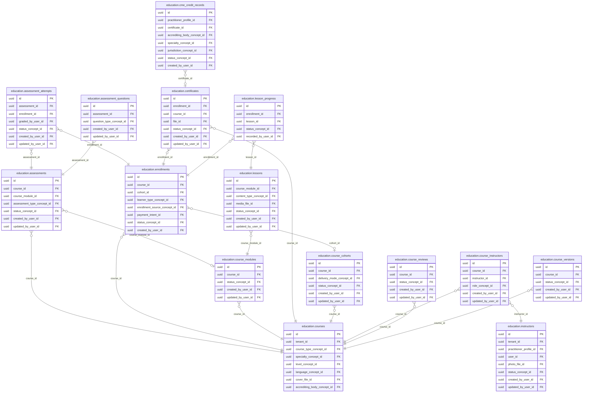

<!-- AUTOGENERADO por tools/inventario/catalogo.mjs. No editar manualmente. -->

# Catálogo del schema `education`

- **Tablas:** 15 · **Columnas:** 212 (57 con descripción: 26.9 %) · **Índices:** 103
- **Dominio:** Marketing y Crecimiento
- Método y límites del catálogo: [README del inventario](../README.md)

## Tablas

| Tabla | Propósito | Columnas | Índices | Operaciones | ORM |
|---|---|---|---|---|---|
| [assessment_attempts](#assessment_attempts) | Registra intentos de evaluación y sus resultados por participante. | 16 | 7 | 5 | COINCIDE |
| [assessment_questions](#assessment_questions) | Define preguntas que componen evaluaciones para verificar conocimientos adquiridos. | 13 | 4 | 2 | COINCIDE |
| [assessments](#assessments) | Representa evaluaciones educativas asociadas a cursos para medir aprendizaje. | 15 | 7 | 4 | COINCIDE |
| [certificates](#certificates) | Conserva certificados emitidos al completar cursos o requisitos formativos. | 16 | 8 | 5 | COINCIDE |
| [cme_credit_records](#cme_credit_records) | Registra créditos de educación médica continua obtenidos por profesionales. | 15 | 8 | 4 | COINCIDE |
| [course_cohorts](#course_cohorts) | Agrupa participantes de un curso por cohorte para organizar períodos y seguimiento de formación. | 14 | 6 | 4 | COINCIDE |
| [course_instructors](#course_instructors) | Relaciona instructores con cursos y define su participación docente. | 10 | 5 | 2 | COINCIDE |
| [course_modules](#course_modules) | Agrupa unidades temáticas de cursos para organizar una ruta educativa. | 11 | 5 | 4 | COINCIDE |
| [course_reviews](#course_reviews) | Almacena evaluaciones y comentarios de participantes sobre cursos para mejorar la oferta educativa. | 11 | 5 | 2 | COINCIDE |
| [course_versions](#course_versions) | Preserva versiones de cursos para mantener el contexto de contenidos y evaluaciones ofrecidos. | 11 | 5 | 3 | COINCIDE |
| [courses](#courses) | Representa cursos de formación para profesionales y personal del ecosistema sanitario. | 23 | 14 | 11 | COINCIDE |
| [enrollments](#enrollments) | Registra inscripciones de usuarios a cursos para administrar participación y avance. | 17 | 8 | 8 | COINCIDE |
| [instructors](#instructors) | Cataloga instructores responsables de impartir o revisar formación sanitaria. | 14 | 9 | 2 | COINCIDE |
| [lesson_progress](#lesson_progress) | Conserva el avance de participantes por lección para seguir cumplimiento de contenidos. | 10 | 5 | 3 | COINCIDE |
| [lessons](#lessons) | Define lecciones que componen módulos formativos para impartir contenidos estructurados. | 16 | 7 | 3 | COINCIDE |

## Diagrama entidad-relación

Las tablas se agrupan en familias por sus claves foráneas dentro del schema (máximo 40 por diagrama). Las FK hacia otros schemas se listan en la ficha de cada tabla.

### Familia 1 de 1 — 15 tablas

## Fichas

### assessment_attempts

#### Vista general

Registra intentos de evaluación y sus resultados por participante.

- **Estado del propósito:** DOMAIN_CURATED_DRAFT · fuente: `Mantra Core Health Context/modules/diagram_47_education.puml: assessment_attempts`
- **Dominio:** Marketing y Crecimiento · **Diagrama:** `Mantra Core Health Context/modules/diagram_47_education.puml` · **DDL:** `SQL/47_education/02_tables.sql`
- **Entidad del ORM:** `AssessmentAttempts` — `src/modules/education/entities/assessment_attempts.entity.ts`
- **Resumen:** 16 columnas · 7 índices · 6 FK salientes · 0 entrantes · 5 operaciones

#### Columnas

| # | Columna | Tipo | Rol estructural | Descripción | ORM |
|---|---|---|---|---|---|
| 1 | `id` | `uuid` | Clave primaria; Obligatoria | Identificador único de la instancia. _(JSDOC_ESTANDAR, `src/modules/education/entities/assessment_attempts.entity.ts:12`)_ | coincide |
| 2 | `assessment_id` | `uuid` | Clave foránea → education.assessments.id; Obligatoria | _sin dato_ | coincide |
| 3 | `enrollment_id` | `uuid` | Clave foránea → education.enrollments.id; Obligatoria | _sin dato_ | coincide |
| 4 | `attempt_number` | `integer` | Obligatoria | _sin dato_ | coincide |
| 5 | `score` | `numeric` | Opcional | _sin dato_ | coincide |
| 6 | `passed` | `boolean` | Opcional | _sin dato_ | coincide |
| 7 | `responses_json` | `jsonb` | Opcional | _sin dato_ | coincide |
| 8 | `started_at` | `timestamptz` | Opcional | _sin dato_ | coincide |
| 9 | `submitted_at` | `timestamptz` | Opcional | _sin dato_ | coincide |
| 10 | `graded_by_user_id` | `uuid` | Clave foránea → iam.users.id; Opcional | _sin dato_ | coincide |
| 11 | `status_concept_id` | `uuid` | Clave foránea → terminology.catalog_concepts.id; Obligatoria | _sin dato_ | coincide |
| 12 | `created_at` | `timestamptz` | Obligatoria | Fecha y hora en que se creó el registro. _(JSDOC_ESTANDAR, `src/modules/education/entities/assessment_attempts.entity.ts:91`)_ | coincide |
| 13 | `updated_at` | `timestamptz` | Obligatoria | Fecha y hora de la última actualización. _(JSDOC_ESTANDAR, `src/modules/education/entities/assessment_attempts.entity.ts:97`)_ | coincide |
| 14 | `created_by_user_id` | `uuid` | Clave foránea → iam.users.id; Opcional | _sin dato_ | coincide |
| 15 | `updated_by_user_id` | `uuid` | Clave foránea → iam.users.id; Opcional | _sin dato_ | coincide |
| 16 | `row_version` | `integer = 1` | Obligatoria | Versión usada para controlar actualizaciones concurrentes. _(JSDOC_ENTIDAD, `src/modules/education/entities/assessment_attempts.entity.ts:115`)_ | coincide |

#### Relaciones

| Sentido | Columnas | Tabla | Restricción |
|---|---|---|---|
| hacia | assessment_id | education.assessments (id) | fk_assessment_attempts_assessment_id |
| hacia | enrollment_id | education.enrollments (id) | fk_assessment_attempts_enrollment_id |
| hacia | graded_by_user_id | iam.users (id) | fk_assessment_attempts_graded_by_user_id |
| hacia | status_concept_id | terminology.catalog_concepts (id) | fk_assessment_attempts_status_concept_id |
| hacia | created_by_user_id | iam.users (id) | fk_assessment_attempts_created_by_user_id |
| hacia | updated_by_user_id | iam.users (id) | fk_assessment_attempts_updated_by_user_id |

#### Índices

| Índice | Único | Columnas | Para qué |
|---|---|---|---|
| `ix_assessment_attempts_assessment_id` | no | assessment_id | Soporta la clave foránea fk_assessment_attempts_assessment_id: PostgreSQL no indexa las FK por sí mismo _(DOCUMENTO)_; 1 consulta(s) de repositorio filtran u ordenan por «assessment_id», la primera columna del índice _(CONSULTA)_ |
| `ix_assessment_attempts_enrollment_id` | no | enrollment_id | Soporta la clave foránea fk_assessment_attempts_enrollment_id: PostgreSQL no indexa las FK por sí mismo _(DOCUMENTO)_; 2 consulta(s) de repositorio filtran u ordenan por «enrollment_id», la primera columna del índice _(CONSULTA)_ |
| `ix_assessment_attempts_graded_by_user_id` | no | graded_by_user_id | Soporta la clave foránea fk_assessment_attempts_graded_by_user_id: PostgreSQL no indexa las FK por sí mismo _(DOCUMENTO)_ |
| `ix_assessment_attempts_status_concept_id` | no | status_concept_id | Soporta la clave foránea fk_assessment_attempts_status_concept_id: PostgreSQL no indexa las FK por sí mismo _(DOCUMENTO)_ |
| `ix_assessment_attempts_created_by_user_id` | no | created_by_user_id | Soporta la clave foránea fk_assessment_attempts_created_by_user_id: PostgreSQL no indexa las FK por sí mismo _(DOCUMENTO)_ |
| `ix_assessment_attempts_updated_by_user_id` | no | updated_by_user_id | Soporta la clave foránea fk_assessment_attempts_updated_by_user_id: PostgreSQL no indexa las FK por sí mismo _(DOCUMENTO)_ |
| `uq_assessment_attempts_assessment_id_attempt_number` | sí | assessment_id, attempt_number | Garantiza que no se repita la combinación (assessment_id, attempt_number) _(DOCUMENTO)_; Soporta la clave foránea fk_assessment_attempts_assessment_id: PostgreSQL no indexa las FK por sí mismo _(DOCUMENTO)_; 1 consulta(s) de repositorio filtran u ordenan por «assessment_id», la primera columna del índice _(CONSULTA)_ |

#### Restricciones

| Restricción | Tipo | Definición |
|---|---|---|
| `uq_assessment_attempts_assessment_id_attempt_number` | UNIQUE INDEX | UNIQUE INDEX ("assessment_id", "attempt_number") |

#### Operaciones que la tocan

| Operación | Efecto | Confianza |
|---|---|---|
| POST /education/assessments/{id}/attempts | CREA | DIRECTA |
| POST /education/assessments/{id}/attempts | LEE | DIRECTA |
| POST /education/attempts/{id}/submit | ACTUALIZA | POR_TIPO |
| POST /education/attempts/{id}/submit | LEE | DIRECTA |
| POST /education/enrollments/{id}/complete | LEE | DIRECTA |

#### Gobierno

| Atributo | Valor | Fuente |
|---|---|---|
| Append-only | no declarado | — |
| Datos personales | sin fuente | — |
| Financiera | sin fuente | — |
| Crítica para auditoría | sin fuente | — |
| Retención | sin fuente | — |
| Responsable | sin fuente | — |
| Revisión | AUTO_DETECTADA | — |

---

### assessment_questions

#### Vista general

Define preguntas que componen evaluaciones para verificar conocimientos adquiridos.

- **Estado del propósito:** DOMAIN_CURATED_DRAFT · fuente: `Mantra Core Health Context/modules/diagram_47_education.puml: assessment_questions`
- **Dominio:** Marketing y Crecimiento · **Diagrama:** `Mantra Core Health Context/modules/diagram_47_education.puml` · **DDL:** `SQL/47_education/02_tables.sql`
- **Entidad del ORM:** `AssessmentQuestions` — `src/modules/education/entities/assessment_questions.entity.ts`
- **Resumen:** 13 columnas · 4 índices · 4 FK salientes · 0 entrantes · 2 operaciones

#### Columnas

| # | Columna | Tipo | Rol estructural | Descripción | ORM |
|---|---|---|---|---|---|
| 1 | `id` | `uuid` | Clave primaria; Obligatoria | Identificador único de la instancia. _(JSDOC_ESTANDAR, `src/modules/education/entities/assessment_questions.entity.ts:12`)_ | coincide |
| 2 | `assessment_id` | `uuid` | Clave foránea → education.assessments.id; Obligatoria | _sin dato_ | coincide |
| 3 | `question_type_concept_id` | `uuid` | Clave foránea → terminology.catalog_concepts.id; Obligatoria | _sin dato_ | coincide |
| 4 | `prompt_text` | `text` | Obligatoria | _sin dato_ | coincide |
| 5 | `options_json` | `jsonb` | Opcional | _sin dato_ | coincide |
| 6 | `correct_answer_json` | `jsonb` | Opcional | _sin dato_ | coincide |
| 7 | `points` | `numeric` | Opcional | _sin dato_ | coincide |
| 8 | `ordinal` | `integer` | Opcional | _sin dato_ | coincide |
| 9 | `created_at` | `timestamptz` | Obligatoria | Fecha y hora en que se creó el registro. _(JSDOC_ESTANDAR, `src/modules/education/entities/assessment_questions.entity.ts:70`)_ | coincide |
| 10 | `updated_at` | `timestamptz` | Obligatoria | Fecha y hora de la última actualización. _(JSDOC_ESTANDAR, `src/modules/education/entities/assessment_questions.entity.ts:76`)_ | coincide |
| 11 | `created_by_user_id` | `uuid` | Clave foránea → iam.users.id; Opcional | _sin dato_ | coincide |
| 12 | `updated_by_user_id` | `uuid` | Clave foránea → iam.users.id; Opcional | _sin dato_ | coincide |
| 13 | `row_version` | `integer = 1` | Obligatoria | Versión usada para controlar actualizaciones concurrentes. _(JSDOC_ENTIDAD, `src/modules/education/entities/assessment_questions.entity.ts:94`)_ | coincide |

#### Relaciones

| Sentido | Columnas | Tabla | Restricción |
|---|---|---|---|
| hacia | assessment_id | education.assessments (id) | fk_assessment_questions_assessment_id |
| hacia | question_type_concept_id | terminology.catalog_concepts (id) | fk_assessment_questions_question_type_concept_id |
| hacia | created_by_user_id | iam.users (id) | fk_assessment_questions_created_by_user_id |
| hacia | updated_by_user_id | iam.users (id) | fk_assessment_questions_updated_by_user_id |

#### Índices

| Índice | Único | Columnas | Para qué |
|---|---|---|---|
| `ix_assessment_questions_assessment_id` | no | assessment_id | Soporta la clave foránea fk_assessment_questions_assessment_id: PostgreSQL no indexa las FK por sí mismo _(DOCUMENTO)_; 1 consulta(s) de repositorio filtran u ordenan por «assessment_id», la primera columna del índice _(CONSULTA)_ |
| `ix_assessment_questions_question_type_concept_id` | no | question_type_concept_id | Soporta la clave foránea fk_assessment_questions_question_type_concept_id: PostgreSQL no indexa las FK por sí mismo _(DOCUMENTO)_ |
| `ix_assessment_questions_created_by_user_id` | no | created_by_user_id | Soporta la clave foránea fk_assessment_questions_created_by_user_id: PostgreSQL no indexa las FK por sí mismo _(DOCUMENTO)_ |
| `ix_assessment_questions_updated_by_user_id` | no | updated_by_user_id | Soporta la clave foránea fk_assessment_questions_updated_by_user_id: PostgreSQL no indexa las FK por sí mismo _(DOCUMENTO)_ |

#### Operaciones que la tocan

| Operación | Efecto | Confianza |
|---|---|---|
| POST /education/attempts/{id}/submit | LEE | DIRECTA |
| POST /education/courses/{id}/assessments | CREA | DIRECTA |

#### Gobierno

| Atributo | Valor | Fuente |
|---|---|---|
| Append-only | no declarado | — |
| Datos personales | sin fuente | — |
| Financiera | sin fuente | — |
| Crítica para auditoría | sin fuente | — |
| Retención | sin fuente | — |
| Responsable | sin fuente | — |
| Revisión | AUTO_DETECTADA | — |

---

### assessments

#### Vista general

Representa evaluaciones educativas asociadas a cursos para medir aprendizaje.

- **Estado del propósito:** DOMAIN_CURATED_DRAFT · fuente: `Mantra Core Health Context/modules/diagram_47_education.puml: assessments`
- **Dominio:** Marketing y Crecimiento · **Diagrama:** `Mantra Core Health Context/modules/diagram_47_education.puml` · **DDL:** `SQL/47_education/02_tables.sql`
- **Entidad del ORM:** `Assessments` — `src/modules/education/entities/assessments.entity.ts`
- **Resumen:** 15 columnas · 7 índices · 6 FK salientes · 2 entrantes · 4 operaciones

#### Columnas

| # | Columna | Tipo | Rol estructural | Descripción | ORM |
|---|---|---|---|---|---|
| 1 | `id` | `uuid` | Clave primaria; Obligatoria | Identificador único de la instancia. _(JSDOC_ESTANDAR, `src/modules/education/entities/assessments.entity.ts:12`)_ | coincide |
| 2 | `course_id` | `uuid` | Clave foránea → education.courses.id; Obligatoria | _sin dato_ | coincide |
| 3 | `course_module_id` | `uuid` | Clave foránea → education.course_modules.id; Opcional | _sin dato_ | coincide |
| 4 | `title` | `varchar` | Obligatoria | _sin dato_ | coincide |
| 5 | `assessment_type_concept_id` | `uuid` | Clave foránea → terminology.catalog_concepts.id; Obligatoria | _sin dato_ | coincide |
| 6 | `passing_score` | `numeric` | Opcional | _sin dato_ | coincide |
| 7 | `max_attempts` | `integer` | Opcional | _sin dato_ | coincide |
| 8 | `time_limit_minutes` | `integer` | Opcional | _sin dato_ | coincide |
| 9 | `is_graded` | `boolean` | Opcional | _sin dato_ | coincide |
| 10 | `status_concept_id` | `uuid` | Clave foránea → terminology.catalog_concepts.id; Obligatoria | _sin dato_ | coincide |
| 11 | `created_at` | `timestamptz` | Obligatoria | Fecha y hora en que se creó el registro. _(JSDOC_ESTANDAR, `src/modules/education/entities/assessments.entity.ts:80`)_ | coincide |
| 12 | `updated_at` | `timestamptz` | Obligatoria | Fecha y hora de la última actualización. _(JSDOC_ESTANDAR, `src/modules/education/entities/assessments.entity.ts:86`)_ | coincide |
| 13 | `created_by_user_id` | `uuid` | Clave foránea → iam.users.id; Opcional | _sin dato_ | coincide |
| 14 | `updated_by_user_id` | `uuid` | Clave foránea → iam.users.id; Opcional | _sin dato_ | coincide |
| 15 | `row_version` | `integer = 1` | Obligatoria | Versión usada para controlar actualizaciones concurrentes. _(JSDOC_ENTIDAD, `src/modules/education/entities/assessments.entity.ts:104`)_ | coincide |

#### Relaciones

| Sentido | Columnas | Tabla | Restricción |
|---|---|---|---|
| hacia | course_id | education.courses (id) | fk_assessments_course_id |
| hacia | course_module_id | education.course_modules (id) | fk_assessments_course_module_id |
| hacia | assessment_type_concept_id | terminology.catalog_concepts (id) | fk_assessments_assessment_type_concept_id |
| hacia | status_concept_id | terminology.catalog_concepts (id) | fk_assessments_status_concept_id |
| hacia | created_by_user_id | iam.users (id) | fk_assessments_created_by_user_id |
| hacia | updated_by_user_id | iam.users (id) | fk_assessments_updated_by_user_id |
| desde | id | education.assessment_questions (assessment_id) | fk_assessment_questions_assessment_id |
| desde | id | education.assessment_attempts (assessment_id) | fk_assessment_attempts_assessment_id |

#### Índices

| Índice | Único | Columnas | Para qué |
|---|---|---|---|
| `ix_assessments_course_id` | no | course_id | Soporta la clave foránea fk_assessments_course_id: PostgreSQL no indexa las FK por sí mismo _(DOCUMENTO)_; 1 consulta(s) de repositorio filtran u ordenan por «course_id», la primera columna del índice _(CONSULTA)_ |
| `ix_assessments_course_module_id` | no | course_module_id | Soporta la clave foránea fk_assessments_course_module_id: PostgreSQL no indexa las FK por sí mismo _(DOCUMENTO)_ |
| `ix_assessments_assessment_type_concept_id` | no | assessment_type_concept_id | Soporta la clave foránea fk_assessments_assessment_type_concept_id: PostgreSQL no indexa las FK por sí mismo _(DOCUMENTO)_ |
| `ix_assessments_status_concept_id` | no | status_concept_id | Soporta la clave foránea fk_assessments_status_concept_id: PostgreSQL no indexa las FK por sí mismo _(DOCUMENTO)_; 1 consulta(s) de repositorio filtran u ordenan por «status_concept_id», la primera columna del índice _(CONSULTA)_ |
| `ix_assessments_created_by_user_id` | no | created_by_user_id | Soporta la clave foránea fk_assessments_created_by_user_id: PostgreSQL no indexa las FK por sí mismo _(DOCUMENTO)_ |
| `ix_assessments_updated_by_user_id` | no | updated_by_user_id | Soporta la clave foránea fk_assessments_updated_by_user_id: PostgreSQL no indexa las FK por sí mismo _(DOCUMENTO)_ |
| `gin_assessments_search` | no | (to_tsvector('simple', (coalesce(title, '')))) | GIN para búsqueda textual gobernada _(DOCUMENTO)_ |

#### Operaciones que la tocan

| Operación | Efecto | Confianza |
|---|---|---|
| POST /education/assessments/{id}/attempts | LEE | DIRECTA |
| POST /education/attempts/{id}/submit | LEE | DIRECTA |
| POST /education/courses/{id}/assessments | CREA | DIRECTA |
| POST /education/enrollments/{id}/complete | LEE | DIRECTA |

#### Gobierno

| Atributo | Valor | Fuente |
|---|---|---|
| Append-only | no declarado | — |
| Datos personales | sin fuente | — |
| Financiera | sin fuente | — |
| Crítica para auditoría | sin fuente | — |
| Retención | sin fuente | — |
| Responsable | sin fuente | — |
| Revisión | AUTO_DETECTADA | — |

---

### certificates

#### Vista general

Conserva certificados emitidos al completar cursos o requisitos formativos.

- **Estado del propósito:** DOMAIN_CURATED_DRAFT · fuente: `Mantra Core Health Context/modules/diagram_47_education.puml: certificates`
- **Dominio:** Marketing y Crecimiento · **Diagrama:** `Mantra Core Health Context/modules/diagram_47_education.puml` · **DDL:** `SQL/47_education/02_tables.sql`
- **Entidad del ORM:** `Certificates` — `src/modules/education/entities/certificates.entity.ts`
- **Resumen:** 16 columnas · 8 índices · 6 FK salientes · 2 entrantes · 5 operaciones

#### Columnas

| # | Columna | Tipo | Rol estructural | Descripción | ORM |
|---|---|---|---|---|---|
| 1 | `id` | `uuid` | Clave primaria; Obligatoria | Identificador único de la instancia. _(JSDOC_ESTANDAR, `src/modules/education/entities/certificates.entity.ts:12`)_ | coincide |
| 2 | `enrollment_id` | `uuid` | Clave foránea → education.enrollments.id; Obligatoria | _sin dato_ | coincide |
| 3 | `course_id` | `uuid` | Clave foránea → education.courses.id; Obligatoria | _sin dato_ | coincide |
| 4 | `certificate_number` | `varchar` | Obligatoria | _sin dato_ | coincide |
| 5 | `learner_ref_id` | `uuid` | Opcional | _sin dato_ | coincide |
| 6 | `cme_credits_awarded` | `numeric` | Opcional | _sin dato_ | coincide |
| 7 | `issued_at` | `timestamptz` | Opcional | _sin dato_ | coincide |
| 8 | `expires_at` | `timestamptz` | Opcional | _sin dato_ | coincide |
| 9 | `verification_code` | `varchar` | Opcional | _sin dato_ | coincide |
| 10 | `file_id` | `uuid` | Clave foránea → common.files.id; Opcional | _sin dato_ | coincide |
| 11 | `status_concept_id` | `uuid` | Clave foránea → terminology.catalog_concepts.id; Obligatoria | _sin dato_ | coincide |
| 12 | `created_at` | `timestamptz` | Obligatoria | Fecha y hora en que se creó el registro. _(JSDOC_ESTANDAR, `src/modules/education/entities/certificates.entity.ts:94`)_ | coincide |
| 13 | `updated_at` | `timestamptz` | Obligatoria | Fecha y hora de la última actualización. _(JSDOC_ESTANDAR, `src/modules/education/entities/certificates.entity.ts:100`)_ | coincide |
| 14 | `created_by_user_id` | `uuid` | Clave foránea → iam.users.id; Opcional | _sin dato_ | coincide |
| 15 | `updated_by_user_id` | `uuid` | Clave foránea → iam.users.id; Opcional | _sin dato_ | coincide |
| 16 | `row_version` | `integer = 1` | Obligatoria | Versión usada para controlar actualizaciones concurrentes. _(JSDOC_ENTIDAD, `src/modules/education/entities/certificates.entity.ts:118`)_ | coincide |

#### Relaciones

| Sentido | Columnas | Tabla | Restricción |
|---|---|---|---|
| hacia | enrollment_id | education.enrollments (id) | fk_certificates_enrollment_id |
| hacia | course_id | education.courses (id) | fk_certificates_course_id |
| hacia | file_id | common.files (id) | fk_certificates_file_id |
| hacia | status_concept_id | terminology.catalog_concepts (id) | fk_certificates_status_concept_id |
| hacia | created_by_user_id | iam.users (id) | fk_certificates_created_by_user_id |
| hacia | updated_by_user_id | iam.users (id) | fk_certificates_updated_by_user_id |
| desde | id | education.cme_credit_records (certificate_id) | fk_cme_credit_records_certificate_id |
| desde | id | audit.certificates_history (certificates_id) | fk_certificates_history_certificates_id |

#### Índices

| Índice | Único | Columnas | Para qué |
|---|---|---|---|
| `uq_certificates_certificate_number` | sí | certificate_number | Garantiza que no se repita la combinación (certificate_number) _(DOCUMENTO)_; 1 consulta(s) de repositorio filtran u ordenan por «certificate_number», la primera columna del índice _(CONSULTA)_ |
| `uq_certificates_verification_code` | sí | verification_code | Garantiza que no se repita la combinación (verification_code) _(DOCUMENTO)_; 1 consulta(s) de repositorio filtran u ordenan por «verification_code», la primera columna del índice _(CONSULTA)_ |
| `ix_certificates_enrollment_id` | no | enrollment_id | Soporta la clave foránea fk_certificates_enrollment_id: PostgreSQL no indexa las FK por sí mismo _(DOCUMENTO)_; 1 consulta(s) de repositorio filtran u ordenan por «enrollment_id», la primera columna del índice _(CONSULTA)_ |
| `ix_certificates_course_id` | no | course_id | Soporta la clave foránea fk_certificates_course_id: PostgreSQL no indexa las FK por sí mismo _(DOCUMENTO)_ |
| `ix_certificates_file_id` | no | file_id | Soporta la clave foránea fk_certificates_file_id: PostgreSQL no indexa las FK por sí mismo _(DOCUMENTO)_ |
| `ix_certificates_status_concept_id` | no | status_concept_id | Soporta la clave foránea fk_certificates_status_concept_id: PostgreSQL no indexa las FK por sí mismo _(DOCUMENTO)_ |
| `ix_certificates_created_by_user_id` | no | created_by_user_id | Soporta la clave foránea fk_certificates_created_by_user_id: PostgreSQL no indexa las FK por sí mismo _(DOCUMENTO)_ |
| `ix_certificates_updated_by_user_id` | no | updated_by_user_id | Soporta la clave foránea fk_certificates_updated_by_user_id: PostgreSQL no indexa las FK por sí mismo _(DOCUMENTO)_ |

#### Restricciones

| Restricción | Tipo | Definición |
|---|---|---|
| `uq_certificates_certificate_number` | UNIQUE INDEX | UNIQUE INDEX ("certificate_number") |
| `uq_certificates_verification_code` | UNIQUE INDEX | UNIQUE INDEX ("verification_code") |

#### Operaciones que la tocan

| Operación | Efecto | Confianza |
|---|---|---|
| POST /education/certificates/{id}/cme-credits | LEE | DIRECTA |
| POST /education/certificates/{id}/revoke | ACTUALIZA | POR_TIPO |
| POST /education/certificates/{id}/revoke | LEE | DIRECTA |
| POST /education/enrollments/{id}/certificate | CREA | DIRECTA |
| POST /education/enrollments/{id}/certificate | LEE | DIRECTA |

#### Gobierno

| Atributo | Valor | Fuente |
|---|---|---|
| Append-only | no declarado | — |
| Datos personales | sin fuente | — |
| Financiera | sin fuente | — |
| Crítica para auditoría | sin fuente | — |
| Retención | sin fuente | — |
| Responsable | sin fuente | — |
| Revisión | AUTO_DETECTADA | — |

---

### cme_credit_records

#### Vista general

Registra créditos de educación médica continua obtenidos por profesionales.

- **Estado del propósito:** DOMAIN_CURATED_DRAFT · fuente: `Mantra Core Health Context/modules/diagram_47_education.puml: cme_credit_records`
- **Dominio:** Marketing y Crecimiento · **Diagrama:** `Mantra Core Health Context/modules/diagram_47_education.puml` · **DDL:** `SQL/47_education/02_tables.sql`
- **Entidad del ORM:** `CmeCreditRecords` — `src/modules/education/entities/cme_credit_records.entity.ts`
- **Resumen:** 15 columnas · 8 índices · 8 FK salientes · 0 entrantes · 4 operaciones

#### Columnas

| # | Columna | Tipo | Rol estructural | Descripción | ORM |
|---|---|---|---|---|---|
| 1 | `id` | `uuid` | Clave primaria; Obligatoria | Identificador único de la instancia. _(JSDOC_ESTANDAR, `src/modules/education/entities/cme_credit_records.entity.ts:12`)_ | coincide |
| 2 | `practitioner_profile_id` | `uuid` | Clave foránea → profiles.health_practitioner_profiles.profile_id; Obligatoria | _sin dato_ | coincide |
| 3 | `certificate_id` | `uuid` | Clave foránea → education.certificates.id; Opcional | _sin dato_ | coincide |
| 4 | `credit_hours` | `numeric` | Obligatoria | _sin dato_ | coincide |
| 5 | `accrediting_body_concept_id` | `uuid` | Clave foránea → terminology.catalog_concepts.id; Obligatoria | _sin dato_ | coincide |
| 6 | `specialty_concept_id` | `uuid` | Clave foránea → terminology.catalog_concepts.id; Opcional | _sin dato_ | coincide |
| 7 | `jurisdiction_concept_id` | `uuid` | Clave foránea → terminology.catalog_concepts.id; Opcional | _sin dato_ | coincide |
| 8 | `awarded_on` | `date` | Opcional | _sin dato_ | coincide |
| 9 | `period_year` | `integer` | Opcional | _sin dato_ | coincide |
| 10 | `status_concept_id` | `uuid` | Clave foránea → terminology.catalog_concepts.id; Obligatoria | _sin dato_ | coincide |
| 11 | `created_at` | `timestamptz` | Obligatoria | Fecha y hora en que se creó el registro. _(JSDOC_ESTANDAR, `src/modules/education/entities/cme_credit_records.entity.ts:76`)_ | coincide |
| 12 | `updated_at` | `timestamptz` | Obligatoria | Fecha y hora de la última actualización. _(JSDOC_ESTANDAR, `src/modules/education/entities/cme_credit_records.entity.ts:82`)_ | coincide |
| 13 | `created_by_user_id` | `uuid` | Clave foránea → iam.users.id; Opcional | _sin dato_ | coincide |
| 14 | `updated_by_user_id` | `uuid` | Clave foránea → iam.users.id; Opcional | _sin dato_ | coincide |
| 15 | `row_version` | `integer = 1` | Obligatoria | Versión usada para controlar actualizaciones concurrentes. _(JSDOC_ENTIDAD, `src/modules/education/entities/cme_credit_records.entity.ts:100`)_ | coincide |

#### Relaciones

| Sentido | Columnas | Tabla | Restricción |
|---|---|---|---|
| hacia | certificate_id | education.certificates (id) | fk_cme_credit_records_certificate_id |
| hacia | practitioner_profile_id | profiles.health_practitioner_profiles (profile_id) | fk_cme_credit_records_practitioner_profile_id |
| hacia | accrediting_body_concept_id | terminology.catalog_concepts (id) | fk_cme_credit_records_accrediting_body_concept_id |
| hacia | specialty_concept_id | terminology.catalog_concepts (id) | fk_cme_credit_records_specialty_concept_id |
| hacia | jurisdiction_concept_id | terminology.catalog_concepts (id) | fk_cme_credit_records_jurisdiction_concept_id |
| hacia | status_concept_id | terminology.catalog_concepts (id) | fk_cme_credit_records_status_concept_id |
| hacia | created_by_user_id | iam.users (id) | fk_cme_credit_records_created_by_user_id |
| hacia | updated_by_user_id | iam.users (id) | fk_cme_credit_records_updated_by_user_id |

#### Índices

| Índice | Único | Columnas | Para qué |
|---|---|---|---|
| `ix_cme_credit_records_practitioner_profile_id` | no | practitioner_profile_id | Soporta la clave foránea fk_cme_credit_records_practitioner_profile_id: PostgreSQL no indexa las FK por sí mismo _(DOCUMENTO)_; 1 consulta(s) de repositorio filtran u ordenan por «practitioner_profile_id», la primera columna del índice _(CONSULTA)_ |
| `ix_cme_credit_records_certificate_id` | no | certificate_id | Soporta la clave foránea fk_cme_credit_records_certificate_id: PostgreSQL no indexa las FK por sí mismo _(DOCUMENTO)_; 2 consulta(s) de repositorio filtran u ordenan por «certificate_id», la primera columna del índice _(CONSULTA)_ |
| `ix_cme_credit_records_accrediting_body_concept_id` | no | accrediting_body_concept_id | Soporta la clave foránea fk_cme_credit_records_accrediting_body_concept_id: PostgreSQL no indexa las FK por sí mismo _(DOCUMENTO)_ |
| `ix_cme_credit_records_specialty_concept_id` | no | specialty_concept_id | Soporta la clave foránea fk_cme_credit_records_specialty_concept_id: PostgreSQL no indexa las FK por sí mismo _(DOCUMENTO)_ |
| `ix_cme_credit_records_jurisdiction_concept_id` | no | jurisdiction_concept_id | Soporta la clave foránea fk_cme_credit_records_jurisdiction_concept_id: PostgreSQL no indexa las FK por sí mismo _(DOCUMENTO)_ |
| `ix_cme_credit_records_status_concept_id` | no | status_concept_id | Soporta la clave foránea fk_cme_credit_records_status_concept_id: PostgreSQL no indexa las FK por sí mismo _(DOCUMENTO)_ |
| `ix_cme_credit_records_created_by_user_id` | no | created_by_user_id | Soporta la clave foránea fk_cme_credit_records_created_by_user_id: PostgreSQL no indexa las FK por sí mismo _(DOCUMENTO)_ |
| `ix_cme_credit_records_updated_by_user_id` | no | updated_by_user_id | Soporta la clave foránea fk_cme_credit_records_updated_by_user_id: PostgreSQL no indexa las FK por sí mismo _(DOCUMENTO)_ |

#### Operaciones que la tocan

| Operación | Efecto | Confianza |
|---|---|---|
| POST /education/certificates/{id}/cme-credits | CREA | DIRECTA |
| POST /education/certificates/{id}/cme-credits | LEE | DIRECTA |
| POST /education/certificates/{id}/revoke | ACTUALIZA | POR_TIPO |
| POST /education/certificates/{id}/revoke | LEE | DIRECTA |

#### Gobierno

| Atributo | Valor | Fuente |
|---|---|---|
| Append-only | no declarado | — |
| Datos personales | sin fuente | — |
| Financiera | sin fuente | — |
| Crítica para auditoría | sin fuente | — |
| Retención | sin fuente | — |
| Responsable | sin fuente | — |
| Revisión | AUTO_DETECTADA | — |

---

### course_cohorts

#### Vista general

Agrupa participantes de un curso por cohorte para organizar períodos y seguimiento de formación.

- **Estado del propósito:** DOMAIN_CURATED_DRAFT · fuente: `Mantra Core Health Context/modules/diagram_47_education.puml: course_cohorts`
- **Dominio:** Marketing y Crecimiento · **Diagrama:** `Mantra Core Health Context/modules/diagram_47_education.puml` · **DDL:** `SQL/47_education/02_tables.sql`
- **Entidad del ORM:** `CourseCohorts` — `src/modules/education/entities/course_cohorts.entity.ts`
- **Resumen:** 14 columnas · 6 índices · 5 FK salientes · 1 entrantes · 4 operaciones

#### Columnas

| # | Columna | Tipo | Rol estructural | Descripción | ORM |
|---|---|---|---|---|---|
| 1 | `id` | `uuid` | Clave primaria; Obligatoria | Identificador único de la instancia. _(JSDOC_ESTANDAR, `src/modules/education/entities/course_cohorts.entity.ts:12`)_ | coincide |
| 2 | `course_id` | `uuid` | Clave foránea → education.courses.id; Obligatoria | _sin dato_ | coincide |
| 3 | `code` | `varchar` | Obligatoria | _sin dato_ | coincide |
| 4 | `delivery_mode_concept_id` | `uuid` | Clave foránea → terminology.catalog_concepts.id; Obligatoria | _sin dato_ | coincide |
| 5 | `start_date` | `date` | Opcional | _sin dato_ | coincide |
| 6 | `end_date` | `date` | Opcional | _sin dato_ | coincide |
| 7 | `capacity` | `integer` | Opcional | _sin dato_ | coincide |
| 8 | `enrolled_count` | `integer` | Opcional | _sin dato_ | coincide |
| 9 | `status_concept_id` | `uuid` | Clave foránea → terminology.catalog_concepts.id; Obligatoria | _sin dato_ | coincide |
| 10 | `created_at` | `timestamptz` | Obligatoria | Fecha y hora en que se creó el registro. _(JSDOC_ESTANDAR, `src/modules/education/entities/course_cohorts.entity.ts:66`)_ | coincide |
| 11 | `updated_at` | `timestamptz` | Obligatoria | Fecha y hora de la última actualización. _(JSDOC_ESTANDAR, `src/modules/education/entities/course_cohorts.entity.ts:72`)_ | coincide |
| 12 | `created_by_user_id` | `uuid` | Clave foránea → iam.users.id; Opcional | _sin dato_ | coincide |
| 13 | `updated_by_user_id` | `uuid` | Clave foránea → iam.users.id; Opcional | _sin dato_ | coincide |
| 14 | `row_version` | `integer = 1` | Obligatoria | Versión usada para controlar actualizaciones concurrentes. _(JSDOC_ENTIDAD, `src/modules/education/entities/course_cohorts.entity.ts:90`)_ | coincide |

#### Relaciones

| Sentido | Columnas | Tabla | Restricción |
|---|---|---|---|
| hacia | course_id | education.courses (id) | fk_course_cohorts_course_id |
| hacia | delivery_mode_concept_id | terminology.catalog_concepts (id) | fk_course_cohorts_delivery_mode_concept_id |
| hacia | status_concept_id | terminology.catalog_concepts (id) | fk_course_cohorts_status_concept_id |
| hacia | created_by_user_id | iam.users (id) | fk_course_cohorts_created_by_user_id |
| hacia | updated_by_user_id | iam.users (id) | fk_course_cohorts_updated_by_user_id |
| desde | id | education.enrollments (cohort_id) | fk_enrollments_cohort_id |

#### Índices

| Índice | Único | Columnas | Para qué |
|---|---|---|---|
| `ix_course_cohorts_course_id` | no | course_id | Soporta la clave foránea fk_course_cohorts_course_id: PostgreSQL no indexa las FK por sí mismo _(DOCUMENTO)_; 1 consulta(s) de repositorio filtran u ordenan por «course_id», la primera columna del índice _(CONSULTA)_ |
| `ix_course_cohorts_delivery_mode_concept_id` | no | delivery_mode_concept_id | Soporta la clave foránea fk_course_cohorts_delivery_mode_concept_id: PostgreSQL no indexa las FK por sí mismo _(DOCUMENTO)_ |
| `ix_course_cohorts_status_concept_id` | no | status_concept_id | Soporta la clave foránea fk_course_cohorts_status_concept_id: PostgreSQL no indexa las FK por sí mismo _(DOCUMENTO)_ |
| `ix_course_cohorts_created_by_user_id` | no | created_by_user_id | Soporta la clave foránea fk_course_cohorts_created_by_user_id: PostgreSQL no indexa las FK por sí mismo _(DOCUMENTO)_ |
| `ix_course_cohorts_updated_by_user_id` | no | updated_by_user_id | Soporta la clave foránea fk_course_cohorts_updated_by_user_id: PostgreSQL no indexa las FK por sí mismo _(DOCUMENTO)_ |
| `gin_course_cohorts_search` | no | (to_tsvector('simple', (coalesce(code, '')))) | GIN para búsqueda textual gobernada _(DOCUMENTO)_ |

#### Operaciones que la tocan

| Operación | Efecto | Confianza |
|---|---|---|
| POST /education/courses/{id}/cohorts | CREA | DIRECTA |
| POST /education/courses/{id}/cohorts | LEE | DIRECTA |
| POST /education/enrollments | ACTUALIZA | POR_TIPO |
| POST /education/enrollments | LEE | DIRECTA |

#### Gobierno

| Atributo | Valor | Fuente |
|---|---|---|
| Append-only | no declarado | — |
| Datos personales | sin fuente | — |
| Financiera | sin fuente | — |
| Crítica para auditoría | sin fuente | — |
| Retención | sin fuente | — |
| Responsable | sin fuente | — |
| Revisión | AUTO_DETECTADA | — |

---

### course_instructors

#### Vista general

Relaciona instructores con cursos y define su participación docente.

- **Estado del propósito:** DOMAIN_CURATED_DRAFT · fuente: `Mantra Core Health Context/modules/diagram_47_education.puml: course_instructors`
- **Dominio:** Marketing y Crecimiento · **Diagrama:** `Mantra Core Health Context/modules/diagram_47_education.puml` · **DDL:** `SQL/47_education/02_tables.sql`
- **Entidad del ORM:** `CourseInstructors` — `src/modules/education/entities/course_instructors.entity.ts`
- **Resumen:** 10 columnas · 5 índices · 5 FK salientes · 0 entrantes · 2 operaciones

#### Columnas

| # | Columna | Tipo | Rol estructural | Descripción | ORM |
|---|---|---|---|---|---|
| 1 | `id` | `uuid` | Clave primaria; Obligatoria | Identificador único de la instancia. _(JSDOC_ESTANDAR, `src/modules/education/entities/course_instructors.entity.ts:12`)_ | coincide |
| 2 | `course_id` | `uuid` | Clave foránea → education.courses.id; Obligatoria | _sin dato_ | coincide |
| 3 | `instructor_id` | `uuid` | Clave foránea → education.instructors.id; Obligatoria | _sin dato_ | coincide |
| 4 | `role_concept_id` | `uuid` | Clave foránea → terminology.catalog_concepts.id; Obligatoria | _sin dato_ | coincide |
| 5 | `ordinal` | `integer` | Opcional | _sin dato_ | coincide |
| 6 | `created_at` | `timestamptz` | Obligatoria | Fecha y hora en que se creó el registro. _(JSDOC_ESTANDAR, `src/modules/education/entities/course_instructors.entity.ts:42`)_ | coincide |
| 7 | `updated_at` | `timestamptz` | Obligatoria | Fecha y hora de la última actualización. _(JSDOC_ESTANDAR, `src/modules/education/entities/course_instructors.entity.ts:48`)_ | coincide |
| 8 | `created_by_user_id` | `uuid` | Clave foránea → iam.users.id; Opcional | _sin dato_ | coincide |
| 9 | `updated_by_user_id` | `uuid` | Clave foránea → iam.users.id; Opcional | _sin dato_ | coincide |
| 10 | `row_version` | `integer = 1` | Obligatoria | Versión usada para controlar actualizaciones concurrentes. _(JSDOC_ENTIDAD, `src/modules/education/entities/course_instructors.entity.ts:66`)_ | coincide |

#### Relaciones

| Sentido | Columnas | Tabla | Restricción |
|---|---|---|---|
| hacia | course_id | education.courses (id) | fk_course_instructors_course_id |
| hacia | instructor_id | education.instructors (id) | fk_course_instructors_instructor_id |
| hacia | role_concept_id | terminology.catalog_concepts (id) | fk_course_instructors_role_concept_id |
| hacia | created_by_user_id | iam.users (id) | fk_course_instructors_created_by_user_id |
| hacia | updated_by_user_id | iam.users (id) | fk_course_instructors_updated_by_user_id |

#### Índices

| Índice | Único | Columnas | Para qué |
|---|---|---|---|
| `ix_course_instructors_course_id` | no | course_id | Soporta la clave foránea fk_course_instructors_course_id: PostgreSQL no indexa las FK por sí mismo _(DOCUMENTO)_; 1 consulta(s) de repositorio filtran u ordenan por «course_id», la primera columna del índice _(CONSULTA)_ |
| `ix_course_instructors_instructor_id` | no | instructor_id | Soporta la clave foránea fk_course_instructors_instructor_id: PostgreSQL no indexa las FK por sí mismo _(DOCUMENTO)_ |
| `ix_course_instructors_role_concept_id` | no | role_concept_id | Soporta la clave foránea fk_course_instructors_role_concept_id: PostgreSQL no indexa las FK por sí mismo _(DOCUMENTO)_ |
| `ix_course_instructors_created_by_user_id` | no | created_by_user_id | Soporta la clave foránea fk_course_instructors_created_by_user_id: PostgreSQL no indexa las FK por sí mismo _(DOCUMENTO)_ |
| `ix_course_instructors_updated_by_user_id` | no | updated_by_user_id | Soporta la clave foránea fk_course_instructors_updated_by_user_id: PostgreSQL no indexa las FK por sí mismo _(DOCUMENTO)_ |

#### Operaciones que la tocan

| Operación | Efecto | Confianza |
|---|---|---|
| POST /education/courses/{id}/instructors | CREA | DIRECTA |
| POST /education/courses/{id}/instructors | LEE | DIRECTA |

#### Gobierno

| Atributo | Valor | Fuente |
|---|---|---|
| Append-only | no declarado | — |
| Datos personales | sin fuente | — |
| Financiera | sin fuente | — |
| Crítica para auditoría | sin fuente | — |
| Retención | sin fuente | — |
| Responsable | sin fuente | — |
| Revisión | AUTO_DETECTADA | — |

---

### course_modules

#### Vista general

Agrupa unidades temáticas de cursos para organizar una ruta educativa.

- **Estado del propósito:** DOMAIN_CURATED_DRAFT · fuente: `Mantra Core Health Context/modules/diagram_47_education.puml: course_modules`
- **Dominio:** Marketing y Crecimiento · **Diagrama:** `Mantra Core Health Context/modules/diagram_47_education.puml` · **DDL:** `SQL/47_education/02_tables.sql`
- **Entidad del ORM:** `CourseModules` — `src/modules/education/entities/course_modules.entity.ts`
- **Resumen:** 11 columnas · 5 índices · 4 FK salientes · 2 entrantes · 4 operaciones

#### Columnas

| # | Columna | Tipo | Rol estructural | Descripción | ORM |
|---|---|---|---|---|---|
| 1 | `id` | `uuid` | Clave primaria; Obligatoria | Identificador único de la instancia. _(JSDOC_ESTANDAR, `src/modules/education/entities/course_modules.entity.ts:12`)_ | coincide |
| 2 | `course_id` | `uuid` | Clave foránea → education.courses.id; Obligatoria | _sin dato_ | coincide |
| 3 | `title` | `varchar` | Obligatoria | _sin dato_ | coincide |
| 4 | `ordinal` | `integer` | Opcional | _sin dato_ | coincide |
| 5 | `description` | `text` | Opcional | _sin dato_ | coincide |
| 6 | `status_concept_id` | `uuid` | Clave foránea → terminology.catalog_concepts.id; Obligatoria | _sin dato_ | coincide |
| 7 | `created_at` | `timestamptz` | Obligatoria | Fecha y hora en que se creó el registro. _(JSDOC_ESTANDAR, `src/modules/education/entities/course_modules.entity.ts:48`)_ | coincide |
| 8 | `updated_at` | `timestamptz` | Obligatoria | Fecha y hora de la última actualización. _(JSDOC_ESTANDAR, `src/modules/education/entities/course_modules.entity.ts:54`)_ | coincide |
| 9 | `created_by_user_id` | `uuid` | Clave foránea → iam.users.id; Opcional | _sin dato_ | coincide |
| 10 | `updated_by_user_id` | `uuid` | Clave foránea → iam.users.id; Opcional | _sin dato_ | coincide |
| 11 | `row_version` | `integer = 1` | Obligatoria | Versión usada para controlar actualizaciones concurrentes. _(JSDOC_ENTIDAD, `src/modules/education/entities/course_modules.entity.ts:72`)_ | coincide |

#### Relaciones

| Sentido | Columnas | Tabla | Restricción |
|---|---|---|---|
| hacia | course_id | education.courses (id) | fk_course_modules_course_id |
| hacia | status_concept_id | terminology.catalog_concepts (id) | fk_course_modules_status_concept_id |
| hacia | created_by_user_id | iam.users (id) | fk_course_modules_created_by_user_id |
| hacia | updated_by_user_id | iam.users (id) | fk_course_modules_updated_by_user_id |
| desde | id | education.lessons (course_module_id) | fk_lessons_course_module_id |
| desde | id | education.assessments (course_module_id) | fk_assessments_course_module_id |

#### Índices

| Índice | Único | Columnas | Para qué |
|---|---|---|---|
| `ix_course_modules_course_id` | no | course_id | Soporta la clave foránea fk_course_modules_course_id: PostgreSQL no indexa las FK por sí mismo _(DOCUMENTO)_; 1 consulta(s) de repositorio filtran u ordenan por «course_id», la primera columna del índice _(CONSULTA)_ |
| `ix_course_modules_status_concept_id` | no | status_concept_id | Soporta la clave foránea fk_course_modules_status_concept_id: PostgreSQL no indexa las FK por sí mismo _(DOCUMENTO)_ |
| `ix_course_modules_created_by_user_id` | no | created_by_user_id | Soporta la clave foránea fk_course_modules_created_by_user_id: PostgreSQL no indexa las FK por sí mismo _(DOCUMENTO)_ |
| `ix_course_modules_updated_by_user_id` | no | updated_by_user_id | Soporta la clave foránea fk_course_modules_updated_by_user_id: PostgreSQL no indexa las FK por sí mismo _(DOCUMENTO)_ |
| `gin_course_modules_search` | no | (to_tsvector('simple', (coalesce(title, '') ¦¦ ' ' ¦¦ coalesce(description, '')))) | GIN para búsqueda textual gobernada _(DOCUMENTO)_ |

#### Operaciones que la tocan

| Operación | Efecto | Confianza |
|---|---|---|
| POST /education/courses/{id}/assessments | LEE | DIRECTA |
| POST /education/courses/publish | CREA | DIRECTA |
| POST /education/enrollments/{id}/complete | LEE | DIRECTA |
| POST /education/enrollments/{id}/lesson-progress | LEE | DIRECTA |

#### Gobierno

| Atributo | Valor | Fuente |
|---|---|---|
| Append-only | no declarado | — |
| Datos personales | sin fuente | — |
| Financiera | sin fuente | — |
| Crítica para auditoría | sin fuente | — |
| Retención | sin fuente | — |
| Responsable | sin fuente | — |
| Revisión | AUTO_DETECTADA | — |

---

### course_reviews

#### Vista general

Almacena evaluaciones y comentarios de participantes sobre cursos para mejorar la oferta educativa.

- **Estado del propósito:** DOMAIN_CURATED_DRAFT · fuente: `Mantra Core Health Context/modules/diagram_47_education.puml: course_reviews`
- **Dominio:** Marketing y Crecimiento · **Diagrama:** `Mantra Core Health Context/modules/diagram_47_education.puml` · **DDL:** `SQL/47_education/02_tables.sql`
- **Entidad del ORM:** `CourseReviews` — `src/modules/education/entities/course_reviews.entity.ts`
- **Resumen:** 11 columnas · 5 índices · 4 FK salientes · 0 entrantes · 2 operaciones

#### Columnas

| # | Columna | Tipo | Rol estructural | Descripción | ORM |
|---|---|---|---|---|---|
| 1 | `id` | `uuid` | Clave primaria; Obligatoria | Identificador único de la instancia. _(JSDOC_ESTANDAR, `src/modules/education/entities/course_reviews.entity.ts:12`)_ | coincide |
| 2 | `course_id` | `uuid` | Clave foránea → education.courses.id; Obligatoria | _sin dato_ | coincide |
| 3 | `reviewer_ref_id` | `uuid` | Obligatoria | _sin dato_ | coincide |
| 4 | `rating` | `integer` | Obligatoria | _sin dato_ | coincide |
| 5 | `review_text` | `text` | Opcional | _sin dato_ | coincide |
| 6 | `status_concept_id` | `uuid` | Clave foránea → terminology.catalog_concepts.id; Obligatoria | _sin dato_ | coincide |
| 7 | `created_at` | `timestamptz` | Obligatoria | Fecha y hora en que se creó el registro. _(JSDOC_ESTANDAR, `src/modules/education/entities/course_reviews.entity.ts:48`)_ | coincide |
| 8 | `updated_at` | `timestamptz` | Obligatoria | Fecha y hora de la última actualización. _(JSDOC_ESTANDAR, `src/modules/education/entities/course_reviews.entity.ts:54`)_ | coincide |
| 9 | `created_by_user_id` | `uuid` | Clave foránea → iam.users.id; Opcional | _sin dato_ | coincide |
| 10 | `updated_by_user_id` | `uuid` | Clave foránea → iam.users.id; Opcional | _sin dato_ | coincide |
| 11 | `row_version` | `integer = 1` | Obligatoria | Versión usada para controlar actualizaciones concurrentes. _(JSDOC_ENTIDAD, `src/modules/education/entities/course_reviews.entity.ts:72`)_ | coincide |

#### Relaciones

| Sentido | Columnas | Tabla | Restricción |
|---|---|---|---|
| hacia | course_id | education.courses (id) | fk_course_reviews_course_id |
| hacia | status_concept_id | terminology.catalog_concepts (id) | fk_course_reviews_status_concept_id |
| hacia | created_by_user_id | iam.users (id) | fk_course_reviews_created_by_user_id |
| hacia | updated_by_user_id | iam.users (id) | fk_course_reviews_updated_by_user_id |

#### Índices

| Índice | Único | Columnas | Para qué |
|---|---|---|---|
| `ix_course_reviews_course_id` | no | course_id | Soporta la clave foránea fk_course_reviews_course_id: PostgreSQL no indexa las FK por sí mismo _(DOCUMENTO)_; 1 consulta(s) de repositorio filtran u ordenan por «course_id», la primera columna del índice _(CONSULTA)_ |
| `ix_course_reviews_status_concept_id` | no | status_concept_id | Soporta la clave foránea fk_course_reviews_status_concept_id: PostgreSQL no indexa las FK por sí mismo _(DOCUMENTO)_ |
| `ix_course_reviews_created_by_user_id` | no | created_by_user_id | Soporta la clave foránea fk_course_reviews_created_by_user_id: PostgreSQL no indexa las FK por sí mismo _(DOCUMENTO)_ |
| `ix_course_reviews_updated_by_user_id` | no | updated_by_user_id | Soporta la clave foránea fk_course_reviews_updated_by_user_id: PostgreSQL no indexa las FK por sí mismo _(DOCUMENTO)_ |
| `gin_course_reviews_search` | no | (to_tsvector('simple', (coalesce(review_text, '')))) | GIN para búsqueda textual gobernada _(DOCUMENTO)_ |

#### Operaciones que la tocan

| Operación | Efecto | Confianza |
|---|---|---|
| POST /education/courses/{id}/reviews | CREA | DIRECTA |
| POST /education/courses/{id}/reviews | LEE | DIRECTA |

#### Gobierno

| Atributo | Valor | Fuente |
|---|---|---|
| Append-only | no declarado | — |
| Datos personales | sin fuente | — |
| Financiera | sin fuente | — |
| Crítica para auditoría | sin fuente | — |
| Retención | sin fuente | — |
| Responsable | sin fuente | — |
| Revisión | AUTO_DETECTADA | — |

---

### course_versions

#### Vista general

Preserva versiones de cursos para mantener el contexto de contenidos y evaluaciones ofrecidos.

- **Estado del propósito:** DOMAIN_CURATED_DRAFT · fuente: `Mantra Core Health Context/modules/diagram_47_education.puml: course_versions`
- **Dominio:** Marketing y Crecimiento · **Diagrama:** `Mantra Core Health Context/modules/diagram_47_education.puml` · **DDL:** `SQL/47_education/02_tables.sql`
- **Entidad del ORM:** `CourseVersions` — `src/modules/education/entities/course_versions.entity.ts`
- **Resumen:** 11 columnas · 5 índices · 4 FK salientes · 1 entrantes · 3 operaciones

#### Columnas

| # | Columna | Tipo | Rol estructural | Descripción | ORM |
|---|---|---|---|---|---|
| 1 | `id` | `uuid` | Clave primaria; Obligatoria | Identificador único de la instancia. _(JSDOC_ESTANDAR, `src/modules/education/entities/course_versions.entity.ts:12`)_ | coincide |
| 2 | `course_id` | `uuid` | Clave foránea → education.courses.id; Obligatoria | _sin dato_ | coincide |
| 3 | `version` | `integer` | Obligatoria | _sin dato_ | coincide |
| 4 | `changelog` | `text` | Opcional | _sin dato_ | coincide |
| 5 | `status_concept_id` | `uuid` | Clave foránea → terminology.catalog_concepts.id; Obligatoria | _sin dato_ | coincide |
| 6 | `published_at` | `timestamptz` | Opcional | _sin dato_ | coincide |
| 7 | `created_at` | `timestamptz` | Obligatoria | Fecha y hora en que se creó el registro. _(JSDOC_ESTANDAR, `src/modules/education/entities/course_versions.entity.ts:52`)_ | coincide |
| 8 | `updated_at` | `timestamptz` | Obligatoria | Fecha y hora de la última actualización. _(JSDOC_ESTANDAR, `src/modules/education/entities/course_versions.entity.ts:58`)_ | coincide |
| 9 | `created_by_user_id` | `uuid` | Clave foránea → iam.users.id; Opcional | _sin dato_ | coincide |
| 10 | `updated_by_user_id` | `uuid` | Clave foránea → iam.users.id; Opcional | _sin dato_ | coincide |
| 11 | `row_version` | `integer = 1` | Obligatoria | Versión usada para controlar actualizaciones concurrentes. _(JSDOC_ENTIDAD, `src/modules/education/entities/course_versions.entity.ts:76`)_ | coincide |

#### Relaciones

| Sentido | Columnas | Tabla | Restricción |
|---|---|---|---|
| hacia | course_id | education.courses (id) | fk_course_versions_course_id |
| hacia | status_concept_id | terminology.catalog_concepts (id) | fk_course_versions_status_concept_id |
| hacia | created_by_user_id | iam.users (id) | fk_course_versions_created_by_user_id |
| hacia | updated_by_user_id | iam.users (id) | fk_course_versions_updated_by_user_id |
| desde | id | audit.course_versions_history (course_versions_id) | fk_course_versions_history_course_versions_id |

#### Índices

| Índice | Único | Columnas | Para qué |
|---|---|---|---|
| `ix_course_versions_course_id` | no | course_id | Soporta la clave foránea fk_course_versions_course_id: PostgreSQL no indexa las FK por sí mismo _(DOCUMENTO)_; 1 consulta(s) de repositorio filtran u ordenan por «course_id», la primera columna del índice _(CONSULTA)_ |
| `ix_course_versions_status_concept_id` | no | status_concept_id | Soporta la clave foránea fk_course_versions_status_concept_id: PostgreSQL no indexa las FK por sí mismo _(DOCUMENTO)_ |
| `ix_course_versions_created_by_user_id` | no | created_by_user_id | Soporta la clave foránea fk_course_versions_created_by_user_id: PostgreSQL no indexa las FK por sí mismo _(DOCUMENTO)_ |
| `ix_course_versions_updated_by_user_id` | no | updated_by_user_id | Soporta la clave foránea fk_course_versions_updated_by_user_id: PostgreSQL no indexa las FK por sí mismo _(DOCUMENTO)_ |
| `uq_course_versions_course_id_version` | sí | course_id, version | Garantiza que no se repita la combinación (course_id, version) _(DOCUMENTO)_; Soporta la clave foránea fk_course_versions_course_id: PostgreSQL no indexa las FK por sí mismo _(DOCUMENTO)_; 1 consulta(s) de repositorio filtran u ordenan por «course_id», la primera columna del índice _(CONSULTA)_ |

#### Restricciones

| Restricción | Tipo | Definición |
|---|---|---|
| `uq_course_versions_course_id_version` | UNIQUE INDEX | UNIQUE INDEX ("course_id", "version") |

#### Operaciones que la tocan

| Operación | Efecto | Confianza |
|---|---|---|
| POST /education/courses/{id}/versions/publish | CREA | DIRECTA |
| POST /education/courses/{id}/versions/publish | LEE | DIRECTA |
| POST /education/courses/publish | CREA | DIRECTA |

#### Gobierno

| Atributo | Valor | Fuente |
|---|---|---|
| Append-only | no declarado | — |
| Datos personales | sin fuente | — |
| Financiera | sin fuente | — |
| Crítica para auditoría | sin fuente | — |
| Retención | sin fuente | — |
| Responsable | sin fuente | — |
| Revisión | AUTO_DETECTADA | — |

---

### courses

#### Vista general

Representa cursos de formación para profesionales y personal del ecosistema sanitario.

- **Estado del propósito:** DOMAIN_CURATED_DRAFT · fuente: `Mantra Core Health Context/modules/diagram_47_education.puml: courses`
- **Dominio:** Marketing y Crecimiento · **Diagrama:** `Mantra Core Health Context/modules/diagram_47_education.puml` · **DDL:** `SQL/47_education/02_tables.sql`
- **Entidad del ORM:** `Courses` — `src/modules/education/entities/courses.entity.ts`
- **Resumen:** 23 columnas · 14 índices · 11 FK salientes · 9 entrantes · 11 operaciones

#### Columnas

| # | Columna | Tipo | Rol estructural | Descripción | ORM |
|---|---|---|---|---|---|
| 1 | `id` | `uuid` | Clave primaria; Obligatoria | Identificador único de la instancia. _(JSDOC_ESTANDAR, `src/modules/education/entities/courses.entity.ts:12`)_ | coincide |
| 2 | `tenant_id` | `uuid` | Clave foránea → directory.tenants.id; Opcional | _sin dato_ | coincide |
| 3 | `code` | `varchar` | Obligatoria | _sin dato_ | coincide |
| 4 | `title` | `varchar` | Obligatoria | _sin dato_ | coincide |
| 5 | `description` | `text` | Opcional | _sin dato_ | coincide |
| 6 | `course_type_concept_id` | `uuid` | Clave foránea → terminology.catalog_concepts.id; Obligatoria | _sin dato_ | coincide |
| 7 | `specialty_concept_id` | `uuid` | Clave foránea → terminology.catalog_concepts.id; Opcional | _sin dato_ | coincide |
| 8 | `level_concept_id` | `uuid` | Clave foránea → terminology.catalog_concepts.id; Opcional | _sin dato_ | coincide |
| 9 | `language_concept_id` | `uuid` | Clave foránea → terminology.catalog_concepts.id; Opcional | _sin dato_ | coincide |
| 10 | `cover_file_id` | `uuid` | Clave foránea → common.files.id; Opcional | _sin dato_ | coincide |
| 11 | `is_accredited` | `boolean` | Opcional | _sin dato_ | coincide |
| 12 | `cme_credit_hours` | `numeric` | Opcional | _sin dato_ | coincide |
| 13 | `accrediting_body_concept_id` | `uuid` | Clave foránea → terminology.catalog_concepts.id; Opcional | _sin dato_ | coincide |
| 14 | `price` | `numeric` | Opcional | _sin dato_ | coincide |
| 15 | `currency_concept_id` | `uuid` | Clave foránea → terminology.catalog_concepts.id; Opcional | _sin dato_ | coincide |
| 16 | `duration_minutes` | `integer` | Opcional | _sin dato_ | coincide |
| 17 | `current_version` | `integer` | Obligatoria | _sin dato_ | coincide |
| 18 | `status_concept_id` | `uuid` | Clave foránea → terminology.catalog_concepts.id; Obligatoria | _sin dato_ | coincide |
| 19 | `created_at` | `timestamptz` | Obligatoria | Fecha y hora en que se creó el registro. _(JSDOC_ESTANDAR, `src/modules/education/entities/courses.entity.ts:132`)_ | coincide |
| 20 | `updated_at` | `timestamptz` | Obligatoria | Fecha y hora de la última actualización. _(JSDOC_ESTANDAR, `src/modules/education/entities/courses.entity.ts:138`)_ | coincide |
| 21 | `created_by_user_id` | `uuid` | Clave foránea → iam.users.id; Opcional | _sin dato_ | coincide |
| 22 | `updated_by_user_id` | `uuid` | Clave foránea → iam.users.id; Opcional | _sin dato_ | coincide |
| 23 | `row_version` | `integer = 1` | Obligatoria | Versión usada para controlar actualizaciones concurrentes. _(JSDOC_ENTIDAD, `src/modules/education/entities/courses.entity.ts:156`)_ | coincide |

#### Relaciones

| Sentido | Columnas | Tabla | Restricción |
|---|---|---|---|
| hacia | tenant_id | directory.tenants (id) | fk_courses_tenant_id |
| hacia | course_type_concept_id | terminology.catalog_concepts (id) | fk_courses_course_type_concept_id |
| hacia | specialty_concept_id | terminology.catalog_concepts (id) | fk_courses_specialty_concept_id |
| hacia | level_concept_id | terminology.catalog_concepts (id) | fk_courses_level_concept_id |
| hacia | language_concept_id | terminology.catalog_concepts (id) | fk_courses_language_concept_id |
| hacia | cover_file_id | common.files (id) | fk_courses_cover_file_id |
| hacia | accrediting_body_concept_id | terminology.catalog_concepts (id) | fk_courses_accrediting_body_concept_id |
| hacia | currency_concept_id | terminology.catalog_concepts (id) | fk_courses_currency_concept_id |
| hacia | status_concept_id | terminology.catalog_concepts (id) | fk_courses_status_concept_id |
| hacia | created_by_user_id | iam.users (id) | fk_courses_created_by_user_id |
| hacia | updated_by_user_id | iam.users (id) | fk_courses_updated_by_user_id |
| desde | id | education.course_versions (course_id) | fk_course_versions_course_id |
| desde | id | education.course_modules (course_id) | fk_course_modules_course_id |
| desde | id | education.course_instructors (course_id) | fk_course_instructors_course_id |
| desde | id | education.course_cohorts (course_id) | fk_course_cohorts_course_id |
| desde | id | education.enrollments (course_id) | fk_enrollments_course_id |
| desde | id | education.assessments (course_id) | fk_assessments_course_id |
| desde | id | education.certificates (course_id) | fk_certificates_course_id |
| desde | id | education.course_reviews (course_id) | fk_course_reviews_course_id |
| desde | id | audit.courses_history (courses_id) | fk_courses_history_courses_id |

#### Índices

| Índice | Único | Columnas | Para qué |
|---|---|---|---|
| `uq_courses_code` | sí | code | Garantiza que no se repita la combinación (code) _(DOCUMENTO)_; 1 consulta(s) de repositorio filtran u ordenan por «code», la primera columna del índice _(CONSULTA)_ |
| `ix_courses_tenant_id` | no | tenant_id | Soporta la clave foránea fk_courses_tenant_id: PostgreSQL no indexa las FK por sí mismo _(DOCUMENTO)_ |
| `ix_courses_course_type_concept_id` | no | course_type_concept_id | Soporta la clave foránea fk_courses_course_type_concept_id: PostgreSQL no indexa las FK por sí mismo _(DOCUMENTO)_ |
| `ix_courses_specialty_concept_id` | no | specialty_concept_id | Soporta la clave foránea fk_courses_specialty_concept_id: PostgreSQL no indexa las FK por sí mismo _(DOCUMENTO)_ |
| `ix_courses_level_concept_id` | no | level_concept_id | Soporta la clave foránea fk_courses_level_concept_id: PostgreSQL no indexa las FK por sí mismo _(DOCUMENTO)_ |
| `ix_courses_language_concept_id` | no | language_concept_id | Soporta la clave foránea fk_courses_language_concept_id: PostgreSQL no indexa las FK por sí mismo _(DOCUMENTO)_ |
| `ix_courses_cover_file_id` | no | cover_file_id | Soporta la clave foránea fk_courses_cover_file_id: PostgreSQL no indexa las FK por sí mismo _(DOCUMENTO)_ |
| `ix_courses_accrediting_body_concept_id` | no | accrediting_body_concept_id | Soporta la clave foránea fk_courses_accrediting_body_concept_id: PostgreSQL no indexa las FK por sí mismo _(DOCUMENTO)_ |
| `ix_courses_currency_concept_id` | no | currency_concept_id | Soporta la clave foránea fk_courses_currency_concept_id: PostgreSQL no indexa las FK por sí mismo _(DOCUMENTO)_ |
| `ix_courses_status_concept_id` | no | status_concept_id | Soporta la clave foránea fk_courses_status_concept_id: PostgreSQL no indexa las FK por sí mismo _(DOCUMENTO)_ |
| `ix_courses_created_by_user_id` | no | created_by_user_id | Soporta la clave foránea fk_courses_created_by_user_id: PostgreSQL no indexa las FK por sí mismo _(DOCUMENTO)_ |
| `ix_courses_updated_by_user_id` | no | updated_by_user_id | Soporta la clave foránea fk_courses_updated_by_user_id: PostgreSQL no indexa las FK por sí mismo _(DOCUMENTO)_ |
| `ix_courses_tenant_id_status_concept_id` | no | tenant_id, status_concept_id, ("updated_at" DESC) | _sin uso detectado estáticamente_ |
| `gin_courses_search` | no | (to_tsvector('simple', (coalesce(title, '') ¦¦ ' ' ¦¦ coalesce(description, '')))) | GIN para búsqueda textual gobernada _(DOCUMENTO)_ |

#### Restricciones

| Restricción | Tipo | Definición |
|---|---|---|
| `uq_courses_code` | UNIQUE INDEX | UNIQUE INDEX ("code") |

#### Operaciones que la tocan

| Operación | Efecto | Confianza |
|---|---|---|
| POST /education/certificates/{id}/cme-credits | LEE | DIRECTA |
| POST /education/courses/{id}/assessments | LEE | DIRECTA |
| POST /education/courses/{id}/cohorts | LEE | DIRECTA |
| POST /education/courses/{id}/instructors | LEE | DIRECTA |
| POST /education/courses/{id}/reviews | LEE | DIRECTA |
| POST /education/courses/{id}/versions/publish | ACTUALIZA | POR_TIPO |
| POST /education/courses/{id}/versions/publish | LEE | DIRECTA |
| POST /education/courses/publish | CREA | DIRECTA |
| POST /education/courses/publish | LEE | DIRECTA |
| POST /education/enrollments | LEE | DIRECTA |
| POST /education/enrollments/{id}/certificate | LEE | DIRECTA |

#### Gobierno

| Atributo | Valor | Fuente |
|---|---|---|
| Append-only | no declarado | — |
| Datos personales | sin fuente | — |
| Financiera | sin fuente | — |
| Crítica para auditoría | sin fuente | — |
| Retención | sin fuente | — |
| Responsable | sin fuente | — |
| Revisión | AUTO_DETECTADA | — |

---

### enrollments

#### Vista general

Registra inscripciones de usuarios a cursos para administrar participación y avance.

- **Estado del propósito:** DOMAIN_CURATED_DRAFT · fuente: `Mantra Core Health Context/modules/diagram_47_education.puml: enrollments`
- **Dominio:** Marketing y Crecimiento · **Diagrama:** `Mantra Core Health Context/modules/diagram_47_education.puml` · **DDL:** `SQL/47_education/02_tables.sql`
- **Entidad del ORM:** `Enrollments` — `src/modules/education/entities/enrollments.entity.ts`
- **Resumen:** 17 columnas · 8 índices · 8 FK salientes · 4 entrantes · 8 operaciones

#### Columnas

| # | Columna | Tipo | Rol estructural | Descripción | ORM |
|---|---|---|---|---|---|
| 1 | `id` | `uuid` | Clave primaria; Obligatoria | Identificador único de la instancia. _(JSDOC_ESTANDAR, `src/modules/education/entities/enrollments.entity.ts:12`)_ | coincide |
| 2 | `course_id` | `uuid` | Clave foránea → education.courses.id; Obligatoria | _sin dato_ | coincide |
| 3 | `cohort_id` | `uuid` | Clave foránea → education.course_cohorts.id; Opcional | _sin dato_ | coincide |
| 4 | `learner_type_concept_id` | `uuid` | Clave foránea → terminology.catalog_concepts.id; Obligatoria | _sin dato_ | coincide |
| 5 | `learner_ref_id` | `uuid` | Obligatoria | _sin dato_ | coincide |
| 6 | `enrollment_source_concept_id` | `uuid` | Clave foránea → terminology.catalog_concepts.id; Obligatoria | _sin dato_ | coincide |
| 7 | `payment_intent_id` | `uuid` | Clave foránea → payments.payment_intents.id; Opcional | _sin dato_ | coincide |
| 8 | `status_concept_id` | `uuid` | Clave foránea → terminology.catalog_concepts.id; Obligatoria | _sin dato_ | coincide |
| 9 | `progress_percent` | `numeric` | Opcional | _sin dato_ | coincide |
| 10 | `enrolled_at` | `timestamptz` | Opcional | _sin dato_ | coincide |
| 11 | `completed_at` | `timestamptz` | Opcional | _sin dato_ | coincide |
| 12 | `expires_at` | `timestamptz` | Opcional | _sin dato_ | coincide |
| 13 | `created_at` | `timestamptz` | Obligatoria | Fecha y hora en que se creó el registro. _(JSDOC_ESTANDAR, `src/modules/education/entities/enrollments.entity.ts:100`)_ | coincide |
| 14 | `updated_at` | `timestamptz` | Obligatoria | Fecha y hora de la última actualización. _(JSDOC_ESTANDAR, `src/modules/education/entities/enrollments.entity.ts:106`)_ | coincide |
| 15 | `created_by_user_id` | `uuid` | Clave foránea → iam.users.id; Opcional | _sin dato_ | coincide |
| 16 | `updated_by_user_id` | `uuid` | Clave foránea → iam.users.id; Opcional | _sin dato_ | coincide |
| 17 | `row_version` | `integer = 1` | Obligatoria | Versión usada para controlar actualizaciones concurrentes. _(JSDOC_ENTIDAD, `src/modules/education/entities/enrollments.entity.ts:124`)_ | coincide |

#### Relaciones

| Sentido | Columnas | Tabla | Restricción |
|---|---|---|---|
| hacia | course_id | education.courses (id) | fk_enrollments_course_id |
| hacia | cohort_id | education.course_cohorts (id) | fk_enrollments_cohort_id |
| hacia | learner_type_concept_id | terminology.catalog_concepts (id) | fk_enrollments_learner_type_concept_id |
| hacia | enrollment_source_concept_id | terminology.catalog_concepts (id) | fk_enrollments_enrollment_source_concept_id |
| hacia | payment_intent_id | payments.payment_intents (id) | fk_enrollments_payment_intent_id |
| hacia | status_concept_id | terminology.catalog_concepts (id) | fk_enrollments_status_concept_id |
| hacia | created_by_user_id | iam.users (id) | fk_enrollments_created_by_user_id |
| hacia | updated_by_user_id | iam.users (id) | fk_enrollments_updated_by_user_id |
| desde | id | education.lesson_progress (enrollment_id) | fk_lesson_progress_enrollment_id |
| desde | id | education.assessment_attempts (enrollment_id) | fk_assessment_attempts_enrollment_id |
| desde | id | education.certificates (enrollment_id) | fk_certificates_enrollment_id |
| desde | id | audit.enrollments_history (enrollments_id) | fk_enrollments_history_enrollments_id |

#### Índices

| Índice | Único | Columnas | Para qué |
|---|---|---|---|
| `ix_enrollments_course_id` | no | course_id | Soporta la clave foránea fk_enrollments_course_id: PostgreSQL no indexa las FK por sí mismo _(DOCUMENTO)_; 1 consulta(s) de repositorio filtran u ordenan por «course_id», la primera columna del índice _(CONSULTA)_ |
| `ix_enrollments_cohort_id` | no | cohort_id | Soporta la clave foránea fk_enrollments_cohort_id: PostgreSQL no indexa las FK por sí mismo _(DOCUMENTO)_ |
| `ix_enrollments_learner_type_concept_id` | no | learner_type_concept_id | Soporta la clave foránea fk_enrollments_learner_type_concept_id: PostgreSQL no indexa las FK por sí mismo _(DOCUMENTO)_; 1 consulta(s) de repositorio filtran u ordenan por «learner_type_concept_id», la primera columna del índice _(CONSULTA)_ |
| `ix_enrollments_enrollment_source_concept_id` | no | enrollment_source_concept_id | Soporta la clave foránea fk_enrollments_enrollment_source_concept_id: PostgreSQL no indexa las FK por sí mismo _(DOCUMENTO)_ |
| `ix_enrollments_payment_intent_id` | no | payment_intent_id | Soporta la clave foránea fk_enrollments_payment_intent_id: PostgreSQL no indexa las FK por sí mismo _(DOCUMENTO)_ |
| `ix_enrollments_status_concept_id` | no | status_concept_id | Soporta la clave foránea fk_enrollments_status_concept_id: PostgreSQL no indexa las FK por sí mismo _(DOCUMENTO)_; 1 consulta(s) de repositorio filtran u ordenan por «status_concept_id», la primera columna del índice _(CONSULTA)_ |
| `ix_enrollments_created_by_user_id` | no | created_by_user_id | Soporta la clave foránea fk_enrollments_created_by_user_id: PostgreSQL no indexa las FK por sí mismo _(DOCUMENTO)_ |
| `ix_enrollments_updated_by_user_id` | no | updated_by_user_id | Soporta la clave foránea fk_enrollments_updated_by_user_id: PostgreSQL no indexa las FK por sí mismo _(DOCUMENTO)_ |

#### Operaciones que la tocan

| Operación | Efecto | Confianza |
|---|---|---|
| POST /education/assessments/{id}/attempts | LEE | DIRECTA |
| POST /education/enrollments | CREA | DIRECTA |
| POST /education/enrollments | LEE | DIRECTA |
| POST /education/enrollments/{id}/certificate | LEE | DIRECTA |
| POST /education/enrollments/{id}/complete | ACTUALIZA | POR_TIPO |
| POST /education/enrollments/{id}/complete | LEE | DIRECTA |
| POST /education/enrollments/{id}/lesson-progress | ACTUALIZA | POR_TIPO |
| POST /education/enrollments/{id}/lesson-progress | LEE | DIRECTA |

#### Gobierno

| Atributo | Valor | Fuente |
|---|---|---|
| Append-only | no declarado | — |
| Datos personales | sin fuente | — |
| Financiera | sin fuente | — |
| Crítica para auditoría | sin fuente | — |
| Retención | sin fuente | — |
| Responsable | sin fuente | — |
| Revisión | AUTO_DETECTADA | — |

---

### instructors

#### Vista general

Cataloga instructores responsables de impartir o revisar formación sanitaria.

- **Estado del propósito:** DOMAIN_CURATED_DRAFT · fuente: `Mantra Core Health Context/modules/diagram_47_education.puml: instructors`
- **Dominio:** Marketing y Crecimiento · **Diagrama:** `Mantra Core Health Context/modules/diagram_47_education.puml` · **DDL:** `SQL/47_education/02_tables.sql`
- **Entidad del ORM:** `Instructors` — `src/modules/education/entities/instructors.entity.ts`
- **Resumen:** 14 columnas · 9 índices · 7 FK salientes · 1 entrantes · 2 operaciones

#### Columnas

| # | Columna | Tipo | Rol estructural | Descripción | ORM |
|---|---|---|---|---|---|
| 1 | `id` | `uuid` | Clave primaria; Obligatoria | Identificador único de la instancia. _(JSDOC_ESTANDAR, `src/modules/education/entities/instructors.entity.ts:12`)_ | coincide |
| 2 | `tenant_id` | `uuid` | Clave foránea → directory.tenants.id; Opcional | _sin dato_ | coincide |
| 3 | `practitioner_profile_id` | `uuid` | Clave foránea → profiles.health_practitioner_profiles.profile_id; Opcional | _sin dato_ | coincide |
| 4 | `user_id` | `uuid` | Clave foránea → iam.users.id; Opcional | _sin dato_ | coincide |
| 5 | `display_name` | `varchar` | Obligatoria | _sin dato_ | coincide |
| 6 | `bio` | `text` | Opcional | _sin dato_ | coincide |
| 7 | `credentials_text` | `varchar` | Opcional | _sin dato_ | coincide |
| 8 | `photo_file_id` | `uuid` | Clave foránea → common.files.id; Opcional | _sin dato_ | coincide |
| 9 | `status_concept_id` | `uuid` | Clave foránea → terminology.catalog_concepts.id; Obligatoria | _sin dato_ | coincide |
| 10 | `created_at` | `timestamptz` | Obligatoria | Fecha y hora en que se creó el registro. _(JSDOC_ESTANDAR, `src/modules/education/entities/instructors.entity.ts:74`)_ | coincide |
| 11 | `updated_at` | `timestamptz` | Obligatoria | Fecha y hora de la última actualización. _(JSDOC_ESTANDAR, `src/modules/education/entities/instructors.entity.ts:80`)_ | coincide |
| 12 | `created_by_user_id` | `uuid` | Clave foránea → iam.users.id; Opcional | _sin dato_ | coincide |
| 13 | `updated_by_user_id` | `uuid` | Clave foránea → iam.users.id; Opcional | _sin dato_ | coincide |
| 14 | `row_version` | `integer = 1` | Obligatoria | Versión usada para controlar actualizaciones concurrentes. _(JSDOC_ENTIDAD, `src/modules/education/entities/instructors.entity.ts:98`)_ | coincide |

#### Relaciones

| Sentido | Columnas | Tabla | Restricción |
|---|---|---|---|
| hacia | tenant_id | directory.tenants (id) | fk_instructors_tenant_id |
| hacia | practitioner_profile_id | profiles.health_practitioner_profiles (profile_id) | fk_instructors_practitioner_profile_id |
| hacia | user_id | iam.users (id) | fk_instructors_user_id |
| hacia | photo_file_id | common.files (id) | fk_instructors_photo_file_id |
| hacia | status_concept_id | terminology.catalog_concepts (id) | fk_instructors_status_concept_id |
| hacia | created_by_user_id | iam.users (id) | fk_instructors_created_by_user_id |
| hacia | updated_by_user_id | iam.users (id) | fk_instructors_updated_by_user_id |
| desde | id | education.course_instructors (instructor_id) | fk_course_instructors_instructor_id |

#### Índices

| Índice | Único | Columnas | Para qué |
|---|---|---|---|
| `ix_instructors_tenant_id` | no | tenant_id | Soporta la clave foránea fk_instructors_tenant_id: PostgreSQL no indexa las FK por sí mismo _(DOCUMENTO)_ |
| `ix_instructors_practitioner_profile_id` | no | practitioner_profile_id | Soporta la clave foránea fk_instructors_practitioner_profile_id: PostgreSQL no indexa las FK por sí mismo _(DOCUMENTO)_; 1 consulta(s) de repositorio filtran u ordenan por «practitioner_profile_id», la primera columna del índice _(CONSULTA)_ |
| `ix_instructors_user_id` | no | user_id | Soporta la clave foránea fk_instructors_user_id: PostgreSQL no indexa las FK por sí mismo _(DOCUMENTO)_ |
| `ix_instructors_photo_file_id` | no | photo_file_id | Soporta la clave foránea fk_instructors_photo_file_id: PostgreSQL no indexa las FK por sí mismo _(DOCUMENTO)_ |
| `ix_instructors_status_concept_id` | no | status_concept_id | Soporta la clave foránea fk_instructors_status_concept_id: PostgreSQL no indexa las FK por sí mismo _(DOCUMENTO)_ |
| `ix_instructors_created_by_user_id` | no | created_by_user_id | Soporta la clave foránea fk_instructors_created_by_user_id: PostgreSQL no indexa las FK por sí mismo _(DOCUMENTO)_ |
| `ix_instructors_updated_by_user_id` | no | updated_by_user_id | Soporta la clave foránea fk_instructors_updated_by_user_id: PostgreSQL no indexa las FK por sí mismo _(DOCUMENTO)_ |
| `ix_instructors_tenant_id_status_concept_id` | no | tenant_id, status_concept_id, ("updated_at" DESC) | _sin uso detectado estáticamente_ |
| `gin_instructors_search` | no | (to_tsvector('simple', (coalesce(display_name, '')))) | GIN para búsqueda textual gobernada _(DOCUMENTO)_ |

#### Operaciones que la tocan

| Operación | Efecto | Confianza |
|---|---|---|
| POST /education/courses/{id}/instructors | CREA | DIRECTA |
| POST /education/courses/{id}/instructors | LEE | DIRECTA |

#### Gobierno

| Atributo | Valor | Fuente |
|---|---|---|
| Append-only | no declarado | — |
| Datos personales | sin fuente | — |
| Financiera | sin fuente | — |
| Crítica para auditoría | sin fuente | — |
| Retención | sin fuente | — |
| Responsable | sin fuente | — |
| Revisión | AUTO_DETECTADA | — |

---

### lesson_progress

#### Vista general

Conserva el avance de participantes por lección para seguir cumplimiento de contenidos.

- **Estado del propósito:** DOMAIN_CURATED_DRAFT · fuente: `Mantra Core Health Context/modules/diagram_47_education.puml: lesson_progress`
- **Dominio:** Marketing y Crecimiento · **Diagrama:** `Mantra Core Health Context/modules/diagram_47_education.puml` · **DDL:** `SQL/47_education/02_tables.sql`
- **Entidad del ORM:** `LessonProgress` — `src/modules/education/entities/lesson_progress.entity.ts`
- **Resumen:** 10 columnas · 5 índices · 4 FK salientes · 0 entrantes · 3 operaciones

#### Columnas

| # | Columna | Tipo | Rol estructural | Descripción | ORM |
|---|---|---|---|---|---|
| 1 | `id` | `uuid` | Clave primaria; Obligatoria | Identificador único de la instancia. _(JSDOC_ESTANDAR, `src/modules/education/entities/lesson_progress.entity.ts:12`)_ | coincide |
| 2 | `enrollment_id` | `uuid` | Clave foránea → education.enrollments.id; Obligatoria | _sin dato_ | coincide |
| 3 | `lesson_id` | `uuid` | Clave foránea → education.lessons.id; Obligatoria | _sin dato_ | coincide |
| 4 | `status_concept_id` | `uuid` | Clave foránea → terminology.catalog_concepts.id; Obligatoria | _sin dato_ | coincide |
| 5 | `seconds_watched` | `integer` | Opcional | _sin dato_ | coincide |
| 6 | `completion_percent` | `numeric` | Opcional | _sin dato_ | coincide |
| 7 | `completed_at` | `timestamptz` | Opcional | _sin dato_ | coincide |
| 8 | `occurred_at` | `timestamptz` | Opcional | _sin dato_ | coincide |
| 9 | `recorded_at` | `timestamptz` | Obligatoria | _sin dato_ | coincide |
| 10 | `recorded_by_user_id` | `uuid` | Clave foránea → iam.users.id; Opcional | _sin dato_ | coincide |

#### Relaciones

| Sentido | Columnas | Tabla | Restricción |
|---|---|---|---|
| hacia | enrollment_id | education.enrollments (id) | fk_lesson_progress_enrollment_id |
| hacia | lesson_id | education.lessons (id) | fk_lesson_progress_lesson_id |
| hacia | status_concept_id | terminology.catalog_concepts (id) | fk_lesson_progress_status_concept_id |
| hacia | recorded_by_user_id | iam.users (id) | fk_lesson_progress_recorded_by_user_id |

#### Índices

| Índice | Único | Columnas | Para qué |
|---|---|---|---|
| `ix_lesson_progress_enrollment_id` | no | enrollment_id | Soporta la clave foránea fk_lesson_progress_enrollment_id: PostgreSQL no indexa las FK por sí mismo _(DOCUMENTO)_; 1 consulta(s) de repositorio filtran u ordenan por «enrollment_id», la primera columna del índice _(CONSULTA)_ |
| `ix_lesson_progress_lesson_id` | no | lesson_id | Soporta la clave foránea fk_lesson_progress_lesson_id: PostgreSQL no indexa las FK por sí mismo _(DOCUMENTO)_ |
| `ix_lesson_progress_status_concept_id` | no | status_concept_id | Soporta la clave foránea fk_lesson_progress_status_concept_id: PostgreSQL no indexa las FK por sí mismo _(DOCUMENTO)_ |
| `ix_lesson_progress_recorded_by_user_id` | no | recorded_by_user_id | Soporta la clave foránea fk_lesson_progress_recorded_by_user_id: PostgreSQL no indexa las FK por sí mismo _(DOCUMENTO)_ |
| `brin_lesson_progress_recorded_at` | no | recorded_at | BRIN para logs e historiales append-only de gran volumen _(DOCUMENTO)_; 1 consulta(s) de repositorio filtran u ordenan por «recorded_at», la primera columna del índice _(CONSULTA)_ |

#### Operaciones que la tocan

| Operación | Efecto | Confianza |
|---|---|---|
| POST /education/enrollments/{id}/complete | LEE | DIRECTA |
| POST /education/enrollments/{id}/lesson-progress | CREA | DIRECTA |
| POST /education/enrollments/{id}/lesson-progress | LEE | DIRECTA |

#### Gobierno

| Atributo | Valor | Fuente |
|---|---|---|
| Append-only | no declarado | — |
| Datos personales | sin fuente | — |
| Financiera | sin fuente | — |
| Crítica para auditoría | sin fuente | — |
| Retención | sin fuente | — |
| Responsable | sin fuente | — |
| Revisión | AUTO_DETECTADA | — |

---

### lessons

#### Vista general

Define lecciones que componen módulos formativos para impartir contenidos estructurados.

- **Estado del propósito:** DOMAIN_CURATED_DRAFT · fuente: `Mantra Core Health Context/modules/diagram_47_education.puml: lessons`
- **Dominio:** Marketing y Crecimiento · **Diagrama:** `Mantra Core Health Context/modules/diagram_47_education.puml` · **DDL:** `SQL/47_education/02_tables.sql`
- **Entidad del ORM:** `Lessons` — `src/modules/education/entities/lessons.entity.ts`
- **Resumen:** 16 columnas · 7 índices · 6 FK salientes · 1 entrantes · 3 operaciones

#### Columnas

| # | Columna | Tipo | Rol estructural | Descripción | ORM |
|---|---|---|---|---|---|
| 1 | `id` | `uuid` | Clave primaria; Obligatoria | Identificador único de la instancia. _(JSDOC_ESTANDAR, `src/modules/education/entities/lessons.entity.ts:12`)_ | coincide |
| 2 | `course_module_id` | `uuid` | Clave foránea → education.course_modules.id; Obligatoria | _sin dato_ | coincide |
| 3 | `title` | `varchar` | Obligatoria | _sin dato_ | coincide |
| 4 | `content_type_concept_id` | `uuid` | Clave foránea → terminology.catalog_concepts.id; Obligatoria | _sin dato_ | coincide |
| 5 | `body_richtext_json` | `jsonb` | Opcional | _sin dato_ | coincide |
| 6 | `media_file_id` | `uuid` | Clave foránea → common.files.id; Opcional | _sin dato_ | coincide |
| 7 | `external_url` | `text` | Opcional | _sin dato_ | coincide |
| 8 | `duration_minutes` | `integer` | Opcional | _sin dato_ | coincide |
| 9 | `ordinal` | `integer` | Opcional | _sin dato_ | coincide |
| 10 | `is_preview` | `boolean` | Opcional | _sin dato_ | coincide |
| 11 | `status_concept_id` | `uuid` | Clave foránea → terminology.catalog_concepts.id; Obligatoria | _sin dato_ | coincide |
| 12 | `created_at` | `timestamptz` | Obligatoria | Fecha y hora en que se creó el registro. _(JSDOC_ESTANDAR, `src/modules/education/entities/lessons.entity.ts:87`)_ | coincide |
| 13 | `updated_at` | `timestamptz` | Obligatoria | Fecha y hora de la última actualización. _(JSDOC_ESTANDAR, `src/modules/education/entities/lessons.entity.ts:93`)_ | coincide |
| 14 | `created_by_user_id` | `uuid` | Clave foránea → iam.users.id; Opcional | _sin dato_ | coincide |
| 15 | `updated_by_user_id` | `uuid` | Clave foránea → iam.users.id; Opcional | _sin dato_ | coincide |
| 16 | `row_version` | `integer = 1` | Obligatoria | Versión usada para controlar actualizaciones concurrentes. _(JSDOC_ENTIDAD, `src/modules/education/entities/lessons.entity.ts:111`)_ | coincide |

#### Relaciones

| Sentido | Columnas | Tabla | Restricción |
|---|---|---|---|
| hacia | course_module_id | education.course_modules (id) | fk_lessons_course_module_id |
| hacia | content_type_concept_id | terminology.catalog_concepts (id) | fk_lessons_content_type_concept_id |
| hacia | media_file_id | common.files (id) | fk_lessons_media_file_id |
| hacia | status_concept_id | terminology.catalog_concepts (id) | fk_lessons_status_concept_id |
| hacia | created_by_user_id | iam.users (id) | fk_lessons_created_by_user_id |
| hacia | updated_by_user_id | iam.users (id) | fk_lessons_updated_by_user_id |
| desde | id | education.lesson_progress (lesson_id) | fk_lesson_progress_lesson_id |

#### Índices

| Índice | Único | Columnas | Para qué |
|---|---|---|---|
| `ix_lessons_course_module_id` | no | course_module_id | Soporta la clave foránea fk_lessons_course_module_id: PostgreSQL no indexa las FK por sí mismo _(DOCUMENTO)_; 1 consulta(s) de repositorio filtran u ordenan por «course_module_id», la primera columna del índice _(CONSULTA)_ |
| `ix_lessons_content_type_concept_id` | no | content_type_concept_id | Soporta la clave foránea fk_lessons_content_type_concept_id: PostgreSQL no indexa las FK por sí mismo _(DOCUMENTO)_ |
| `ix_lessons_media_file_id` | no | media_file_id | Soporta la clave foránea fk_lessons_media_file_id: PostgreSQL no indexa las FK por sí mismo _(DOCUMENTO)_ |
| `ix_lessons_status_concept_id` | no | status_concept_id | Soporta la clave foránea fk_lessons_status_concept_id: PostgreSQL no indexa las FK por sí mismo _(DOCUMENTO)_; 1 consulta(s) de repositorio filtran u ordenan por «status_concept_id», la primera columna del índice _(CONSULTA)_ |
| `ix_lessons_created_by_user_id` | no | created_by_user_id | Soporta la clave foránea fk_lessons_created_by_user_id: PostgreSQL no indexa las FK por sí mismo _(DOCUMENTO)_ |
| `ix_lessons_updated_by_user_id` | no | updated_by_user_id | Soporta la clave foránea fk_lessons_updated_by_user_id: PostgreSQL no indexa las FK por sí mismo _(DOCUMENTO)_ |
| `gin_lessons_search` | no | (to_tsvector('simple', (coalesce(title, '')))) | GIN para búsqueda textual gobernada _(DOCUMENTO)_ |

#### Operaciones que la tocan

| Operación | Efecto | Confianza |
|---|---|---|
| POST /education/courses/publish | CREA | DIRECTA |
| POST /education/enrollments/{id}/complete | LEE | DIRECTA |
| POST /education/enrollments/{id}/lesson-progress | LEE | DIRECTA |

#### Gobierno

| Atributo | Valor | Fuente |
|---|---|---|
| Append-only | no declarado | — |
| Datos personales | sin fuente | — |
| Financiera | sin fuente | — |
| Crítica para auditoría | sin fuente | — |
| Retención | sin fuente | — |
| Responsable | sin fuente | — |
| Revisión | AUTO_DETECTADA | — |

---

