<!-- AUTOGENERADO por tools/inventario/catalogo.mjs. No editar manualmente. -->

# Catálogo del schema `erp`

- **Tablas:** 51 · **Columnas:** 811 (186 con descripción: 22.9 %) · **Índices:** 494
- **Dominio:** Financiero y ERP
- Método y límites del catálogo: [README del inventario](../README.md)

## Tablas

| Tabla | Propósito | Columnas | Índices | Operaciones | ORM |
|---|---|---|---|---|---|
| [business_partner_bank_accounts](#business_partner_bank_accounts) | Registra cuentas bancarias de socios para procesar pagos y liquidaciones institucionales. | 17 | 7 | 3 | COINCIDE |
| [business_partner_relationships](#business_partner_relationships) | Relaciona socios de negocio para representar grupos, afiliaciones o vínculos comerciales. | 12 | 7 | 0 | COINCIDE |
| [business_partner_roles](#business_partner_roles) | Asigna roles a socios de negocio para expresar si actúan como clientes, proveedores u otras partes. | 12 | 7 | 0 | COINCIDE |
| [business_partner_tax_registrations](#business_partner_tax_registrations) | Conserva registros tributarios de socios para documentos de compra, venta y cumplimiento fiscal. | 13 | 6 | 0 | COINCIDE |
| [business_partners](#business_partners) | Cataloga empresas y personas con las que la organización intercambia contratos, compras o ventas. | 16 | 11 | 7 | COINCIDE |
| [contract_accounting_terms](#contract_accounting_terms) | Conserva parámetros contables de contratos para determinar tratamiento financiero de sus obligaciones. | 20 | 15 | 0 | COINCIDE |
| [contract_amendments](#contract_amendments) | Registra modificaciones formales de contratos y su justificación o vigencia. | 16 | 10 | 1 | COINCIDE |
| [contract_approval_requests](#contract_approval_requests) | Gestiona solicitudes de aprobación de contratos antes de su formalización o cambio. | 11 | 8 | 1 | COINCIDE |
| [contract_approval_steps](#contract_approval_steps) | Define y registra pasos de aprobación para determinar qué revisiones requiere un contrato. | 10 | 6 | 0 | COINCIDE |
| [contract_clause_instances](#contract_clause_instances) | Asocia cláusulas concretas a contratos para conservar el texto y contexto aplicable. | 15 | 8 | 0 | COINCIDE |
| [contract_clauses](#contract_clauses) | Cataloga cláusulas reutilizables para estandarizar términos legales y comerciales. | 14 | 8 | 0 | COINCIDE |
| [contract_documents](#contract_documents) | Vincula documentos con contratos para respaldar términos, firmas y evidencia legal. | 11 | 6 | 0 | COINCIDE |
| [contract_line_items](#contract_line_items) | Desglosa bienes, servicios o importes incluidos en contratos para precisar alcance comercial. | 14 | 7 | 0 | COINCIDE |
| [contract_milestones](#contract_milestones) | Define hitos y fechas clave de contratos para controlar cumplimiento y renovación. | 13 | 5 | 0 | COINCIDE |
| [contract_object_assignments](#contract_object_assignments) | Vincula contratos con objetos de negocio como proyectos, sedes, servicios o compras. | 24 | 19 | 0 | COINCIDE |
| [contract_obligation_events](#contract_obligation_events) | Mantiene eventos de cumplimiento o cambio de obligaciones para reconstruir su trayectoria. | 9 | 7 | 0 | COINCIDE |
| [contract_obligations](#contract_obligations) | Define obligaciones contractuales para controlar responsables, fechas y condiciones de cumplimiento. | 20 | 13 | 0 | COINCIDE |
| [contract_parties](#contract_parties) | Relaciona partes y roles con contratos para identificar quiénes asumen obligaciones. | 14 | 6 | 0 | COINCIDE |
| [contract_payment_schedules](#contract_payment_schedules) | Define cuotas y vencimientos de pagos establecidos en contratos. | 18 | 13 | 2 | COINCIDE |
| [contract_renewals](#contract_renewals) | Gestiona renovaciones contractuales para dar continuidad o finalizar acuerdos de servicio. | 17 | 9 | 1 | COINCIDE |
| [contract_team_members](#contract_team_members) | Asigna responsables y participantes internos a contratos para coordinar gestión y cumplimiento. | 10 | 7 | 0 | COINCIDE |
| [contract_terminations](#contract_terminations) | Documenta terminaciones de contratos, fechas y motivos para cerrar obligaciones y relaciones. | 17 | 9 | 1 | COINCIDE |
| [contract_versions](#contract_versions) | Preserva versiones de contratos para reconstruir los términos vigentes en cada etapa. | 14 | 7 | 0 | COINCIDE |
| [contracts](#contracts) | Representa contratos comerciales y de servicio que formalizan relaciones institucionales. | 33 | 21 | 9 | COINCIDE |
| [departments](#departments) | Define departamentos internos que organizan equipos y líneas de responsabilidad de una organización. | 13 | 8 | 0 | COINCIDE |
| [employee_assignments](#employee_assignments) | Registra asignaciones de empleados a departamentos, sedes o proyectos para reflejar su ubicación operativa. | 15 | 9 | 0 | COINCIDE |
| [employees](#employees) | Representa empleados de organizaciones sanitarias para administrar relaciones laborales y responsabilidades institucionales. | 16 | 9 | 2 | COINCIDE |
| [employment_records](#employment_records) | Conserva relaciones y períodos de empleo de personas que trabajan en la organización sanitaria. | 19 | 12 | 0 | COINCIDE |
| [enterprise_document_flow](#enterprise_document_flow) | Vincula documentos empresariales sucesivos para reconstruir la cadena entre pedido, entrega, factura y pago. | 12 | 8 | 0 | COINCIDE |
| [goods_receipt_items](#goods_receipt_items) | Desglosa artículos y cantidades recibidas contra órdenes de compra. | 15 | 8 | 1 | COINCIDE |
| [goods_receipts](#goods_receipts) | Registra recepción de bienes comprados para confirmar entrega y habilitar control de inventario o pago. | 14 | 10 | 1 | COINCIDE |
| [invoice_match_items](#invoice_match_items) | Detalla diferencias y coincidencias entre líneas de facturas, pedidos y bienes recibidos. | 17 | 9 | 0 | COINCIDE |
| [invoice_match_runs](#invoice_match_runs) | Registra conciliaciones de facturas con órdenes y recepciones para verificar coherencia antes del pago. | 13 | 9 | 1 | COINCIDE |
| [lease_accounting_links](#lease_accounting_links) | Relaciona contratos de arrendamiento con activos y asientos contables correspondientes. | 16 | 11 | 0 | COINCIDE |
| [lease_cash_flows](#lease_cash_flows) | Conserva flujos de efectivo futuros de arrendamientos para calcular compromisos financieros. | 15 | 9 | 0 | COINCIDE |
| [lease_contracts](#lease_contracts) | Representa arrendamientos institucionales para administrar términos, pagos y tratamiento contable. | 16 | 8 | 0 | COINCIDE |
| [lease_objects](#lease_objects) | Cataloga bienes arrendados para relacionarlos con contratos y valorizaciones. | 14 | 8 | 0 | COINCIDE |
| [lease_valuations](#lease_valuations) | Registra valoraciones contables de arrendamientos para soportar reportes y cierres financieros. | 13 | 7 | 1 | COINCIDE |
| [performance_reviews](#performance_reviews) | Conserva revisiones de desempeño de empleados para dar seguimiento a ciclos de evaluación laboral. | 14 | 6 | 0 | COINCIDE |
| [positions](#positions) | Cataloga posiciones laborales para vincular empleados con puestos y estructura organizacional. | 15 | 8 | 0 | COINCIDE |
| [projects](#projects) | Representa proyectos institucionales para planificar trabajo, recursos y compromisos. | 19 | 12 | 0 | COINCIDE |
| [purchase_order_items](#purchase_order_items) | Detalla productos, servicios, cantidades y precios incluidos en órdenes de compra. | 27 | 18 | 2 | COINCIDE |
| [purchase_orders](#purchase_orders) | Representa órdenes de compra emitidas a proveedores para adquirir recursos institucionales. | 20 | 16 | 5 | COINCIDE |
| [purchase_requisition_items](#purchase_requisition_items) | Detalla bienes y cantidades solicitadas para revisión y aprobación de compras. | 22 | 13 | 0 | COINCIDE |
| [purchase_requisitions](#purchase_requisitions) | Registra solicitudes internas de compra de insumos, equipamiento o servicios. | 15 | 12 | 0 | COINCIDE |
| [sales_order_items](#sales_order_items) | Desglosa productos o servicios incluidos en cada pedido para seguimiento de cumplimiento e ingreso. | 21 | 12 | 0 | COINCIDE |
| [sales_orders](#sales_orders) | Representa pedidos de clientes u organizaciones para documentar servicios o productos comercializados. | 17 | 13 | 1 | COINCIDE |
| [service_entry_items](#service_entry_items) | Detalla servicios prestados y aceptados dentro de una hoja de entrada de servicio. | 16 | 10 | 0 | COINCIDE |
| [service_entry_sheets](#service_entry_sheets) | Conserva confirmaciones de servicios recibidos para respaldar aceptación y pago a proveedores. | 15 | 11 | 1 | COINCIDE |
| [time_off_requests](#time_off_requests) | Gestiona solicitudes de licencia y ausencias del personal para coordinar capacidad laboral. | 15 | 6 | 4 | COINCIDE |
| [wbs_elements](#wbs_elements) | Desglosa proyectos en elementos de estructura de trabajo para organizar entregables y costos. | 17 | 10 | 0 | COINCIDE |

## Diagrama entidad-relación

Las tablas se agrupan en familias por sus claves foráneas dentro del schema (máximo 40 por diagrama). Las FK hacia otros schemas se listan en la ficha de cada tabla.

### Familia 1 de 2 — 40 tablas

```mermaid
erDiagram
  erp_business_partner_bank_accounts["erp.business_partner_bank_accounts"] {
    uuid id PK
    uuid business_partner_id FK
    uuid currency_concept_id FK
    uuid verification_status_concept_id FK
    uuid status_concept_id FK
    uuid created_by_user_id FK
    uuid updated_by_user_id FK
  }
  erp_business_partners["erp.business_partners"] {
    uuid id PK
    uuid tenant_id FK
    uuid partner_category_concept_id FK
    uuid country_concept_id FK
    uuid linked_tenant_id FK
    uuid linked_person_id FK
    uuid status_concept_id FK
    uuid created_by_user_id FK
  }
  erp_business_partner_relationships["erp.business_partner_relationships"] {
    uuid id PK
    uuid source_business_partner_id FK
    uuid target_business_partner_id FK
    uuid relationship_type_concept_id FK
    uuid status_concept_id FK
    uuid created_by_user_id FK
    uuid updated_by_user_id FK
  }
  erp_business_partner_roles["erp.business_partner_roles"] {
    uuid id PK
    uuid business_partner_id FK
    uuid role_concept_id FK
    uuid company_code_tenant_id FK
    uuid status_concept_id FK
    uuid created_by_user_id FK
    uuid updated_by_user_id FK
  }
  erp_business_partner_tax_registrations["erp.business_partner_tax_registrations"] {
    uuid id PK
    uuid business_partner_id FK
    uuid tax_type_concept_id FK
    uuid country_concept_id FK
    uuid created_by_user_id FK
    uuid updated_by_user_id FK
  }
  erp_contract_object_assignments["erp.contract_object_assignments"] {
    uuid id PK
    uuid contract_id FK
    uuid contract_line_item_id FK
    uuid assignment_role_concept_id FK
    uuid business_partner_id FK
    uuid asset_id FK
    uuid liability_id FK
    uuid project_id FK
  }
  erp_contract_obligations["erp.contract_obligations"] {
    uuid id PK
    uuid contract_id FK
    uuid contract_version_id FK
    uuid contract_clause_instance_id FK
    uuid obligation_type_concept_id FK
    uuid responsible_business_partner_id FK
    uuid responsible_user_id FK
    uuid currency_concept_id FK
  }
  erp_contracts["erp.contracts"] {
    uuid id PK
    uuid tenant_id FK
    uuid contract_type_concept_id FK
    uuid counterparty_type_concept_id FK
    uuid renewal_type_concept_id FK
    uuid currency_concept_id FK
    uuid governing_jurisdiction_concept_id FK
    uuid owner_user_id FK
  }
  erp_employees["erp.employees"] {
    uuid id PK
    uuid practice_id FK
    uuid person_user_id FK
    uuid role_concept_id FK
    uuid currency_concept_id FK
    uuid payment_method_concept_id FK
    uuid business_partner_id FK
    uuid status_concept_id FK
  }
  erp_purchase_orders["erp.purchase_orders"] {
    uuid id PK
    uuid tenant_id FK
    uuid supplier_business_partner_id FK
    uuid contract_id FK
    uuid purchase_requisition_id FK
    uuid ordering_department_id FK
    uuid buyer_employee_id FK
    uuid currency_concept_id FK
  }
  erp_sales_orders["erp.sales_orders"] {
    uuid id PK
    uuid tenant_id FK
    uuid customer_business_partner_id FK
    uuid contract_id FK
    uuid opportunity_id FK
    uuid currency_concept_id FK
    uuid payment_terms_concept_id FK
    uuid owner_employee_id FK
  }
  erp_service_entry_sheets["erp.service_entry_sheets"] {
    uuid id PK
    uuid tenant_id FK
    uuid purchase_order_id FK
    uuid supplier_business_partner_id FK
    uuid accepted_by_employee_id FK
    uuid approval_status_concept_id FK
    uuid status_concept_id FK
    uuid created_by_user_id FK
  }
  erp_contract_line_items["erp.contract_line_items"] {
    uuid id PK
    uuid contract_id FK
    uuid service_concept_id FK
    uuid currency_concept_id FK
    uuid recurrence_concept_id FK
    uuid account_id FK
    uuid created_by_user_id FK
    uuid updated_by_user_id FK
  }
  erp_projects["erp.projects"] {
    uuid id PK
    uuid tenant_id FK
    uuid project_type_concept_id FK
    uuid responsible_employee_id FK
    uuid department_id FK
    uuid cost_center_id FK
    uuid profit_center_id FK
    uuid currency_concept_id FK
  }
  erp_wbs_elements["erp.wbs_elements"] {
    uuid id PK
    uuid project_id FK
    uuid parent_wbs_element_id FK
    uuid cost_center_id FK
    uuid profit_center_id FK
    uuid responsible_employee_id FK
    uuid status_concept_id FK
    uuid created_by_user_id FK
  }
  erp_contract_clause_instances["erp.contract_clause_instances"] {
    uuid id PK
    uuid contract_version_id FK
    uuid contract_clause_id FK
    uuid deviation_type_concept_id FK
    uuid approved_by_user_id FK
    uuid status_concept_id FK
    uuid created_by_user_id FK
    uuid updated_by_user_id FK
  }
  erp_contract_obligation_events["erp.contract_obligation_events"] {
    uuid id PK
    uuid contract_obligation_id FK
    uuid event_type_concept_id FK
    uuid evidence_file_id FK
    uuid outcome_concept_id FK
    uuid recorded_by_user_id FK
  }
  erp_contract_payment_schedules["erp.contract_payment_schedules"] {
    uuid id PK
    uuid contract_id FK
    uuid contract_line_item_id FK
    uuid contract_obligation_id FK
    uuid currency_concept_id FK
    uuid payment_direction_concept_id FK
    uuid invoice_id FK
    uuid bill_id FK
  }
  erp_contract_versions["erp.contract_versions"] {
    uuid id PK
    uuid contract_id FK
    uuid version_type_concept_id FK
    uuid main_document_file_id FK
    uuid approved_by_user_id FK
    uuid status_concept_id FK
    uuid created_by_user_id FK
  }
  erp_contract_accounting_terms["erp.contract_accounting_terms"] {
    uuid id PK
    uuid contract_id FK
    uuid contract_line_item_id FK
    uuid accounting_treatment_concept_id FK
    uuid expense_account_id FK
    uuid revenue_account_id FK
    uuid accrual_account_id FK
    uuid asset_account_id FK
  }
  erp_contract_amendments["erp.contract_amendments"] {
    uuid id PK
    uuid contract_id FK
    uuid base_version_id FK
    uuid resulting_version_id FK
    uuid amendment_type_concept_id FK
    uuid requested_by_user_id FK
    uuid approved_by_user_id FK
    uuid status_concept_id FK
  }
  erp_contract_approval_requests["erp.contract_approval_requests"] {
    uuid id PK
    uuid contract_id FK
    uuid contract_version_id FK
    uuid contract_amendment_id FK
    uuid approval_type_concept_id FK
    uuid requested_by_user_id FK
    uuid workflow_instance_id FK
    uuid status_concept_id FK
  }
  erp_contract_documents["erp.contract_documents"] {
    uuid id PK
    uuid contract_id FK
    uuid document_type_concept_id FK
    uuid file_id FK
    uuid created_by_user_id FK
    uuid updated_by_user_id FK
  }
  erp_contract_milestones["erp.contract_milestones"] {
    uuid id PK
    uuid contract_id FK
    uuid currency_concept_id FK
    uuid status_concept_id FK
    uuid created_by_user_id FK
    uuid updated_by_user_id FK
  }
  erp_contract_parties["erp.contract_parties"] {
    uuid id PK
    uuid contract_id FK
    uuid party_role_concept_id FK
    uuid party_type_concept_id FK
    uuid signatory_user_id FK
    uuid created_by_user_id FK
    uuid updated_by_user_id FK
  }
  erp_contract_renewals["erp.contract_renewals"] {
    uuid id PK
    uuid contract_id FK
    uuid renewal_type_concept_id FK
    uuid currency_concept_id FK
    uuid initiated_by_user_id FK
    uuid decision_by_user_id FK
    uuid status_concept_id FK
    uuid created_by_user_id FK
  }
  erp_contract_team_members["erp.contract_team_members"] {
    uuid id PK
    uuid contract_id FK
    uuid user_id FK
    uuid team_role_concept_id FK
    uuid responsibility_scope_concept_id FK
    uuid status_concept_id FK
    uuid created_by_user_id FK
  }
  erp_contract_terminations["erp.contract_terminations"] {
    uuid id PK
    uuid contract_id FK
    uuid termination_type_concept_id FK
    uuid initiated_by_user_id FK
    uuid approved_by_user_id FK
    uuid currency_concept_id FK
    uuid status_concept_id FK
    uuid created_by_user_id FK
  }
  erp_departments["erp.departments"] {
    uuid id PK
    uuid tenant_id FK
    uuid parent_department_id FK
    uuid manager_employee_id FK
    uuid cost_center_id FK
    uuid status_concept_id FK
    uuid created_by_user_id FK
    uuid updated_by_user_id FK
  }
  erp_employment_records["erp.employment_records"] {
    uuid id PK
    uuid employee_id FK
    uuid tenant_id FK
    uuid position_id FK
    uuid department_id FK
    uuid employment_type_concept_id FK
    uuid manager_employee_id FK
    uuid currency_concept_id FK
  }
  erp_lease_contracts["erp.lease_contracts"] {
    uuid id PK
    uuid contract_id FK
    uuid lease_role_concept_id FK
    uuid accounting_principle_concept_id FK
    uuid currency_concept_id FK
    uuid status_concept_id FK
    uuid created_by_user_id FK
    uuid updated_by_user_id FK
  }
  erp_goods_receipts["erp.goods_receipts"] {
    uuid id PK
    uuid tenant_id FK
    uuid purchase_order_id FK
    uuid receiving_branch_id FK
    uuid received_by_employee_id FK
    uuid status_concept_id FK
    uuid created_by_user_id FK
    uuid updated_by_user_id FK
  }
  erp_performance_reviews["erp.performance_reviews"] {
    uuid id PK
    uuid employee_id FK
    uuid reviewer_employee_id FK
    uuid rating_concept_id FK
    uuid status_concept_id FK
    uuid created_by_user_id FK
    uuid updated_by_user_id FK
  }
  erp_purchase_requisitions["erp.purchase_requisitions"] {
    uuid id PK
    uuid tenant_id FK
    uuid requester_employee_id FK
    uuid requesting_department_id FK
    uuid project_id FK
    uuid wbs_element_id FK
    uuid approval_status_concept_id FK
    uuid status_concept_id FK
  }
  erp_time_off_requests["erp.time_off_requests"] {
    uuid id PK
    uuid employee_id FK
    uuid leave_type_concept_id FK
    uuid approver_user_id FK
    uuid status_concept_id FK
    uuid created_by_user_id FK
    uuid updated_by_user_id FK
  }
  erp_invoice_match_runs["erp.invoice_match_runs"] {
    uuid id PK
    uuid tenant_id FK
    uuid bill_id FK
    uuid match_type_concept_id FK
    uuid purchase_order_id FK
    uuid currency_concept_id FK
    uuid result_concept_id FK
    uuid status_concept_id FK
  }
  erp_purchase_order_items["erp.purchase_order_items"] {
    uuid id PK
    uuid purchase_order_id FK
    uuid purchase_requisition_item_id FK
    uuid contract_line_item_id FK
    uuid item_type_concept_id FK
    uuid unit_concept_id FK
    uuid tax_code_id FK
    uuid expense_account_id FK
  }
  erp_sales_order_items["erp.sales_order_items"] {
    uuid id PK
    uuid sales_order_id FK
    uuid contract_line_item_id FK
    uuid tax_code_id FK
    uuid income_account_id FK
    uuid cost_center_id FK
    uuid profit_center_id FK
    uuid project_id FK
  }
  erp_service_entry_items["erp.service_entry_items"] {
    uuid id PK
    uuid service_entry_sheet_id FK
    uuid purchase_order_item_id FK
    uuid currency_concept_id FK
    uuid cost_center_id FK
    uuid profit_center_id FK
    uuid project_id FK
    uuid wbs_element_id FK
  }
  erp_purchase_requisition_items["erp.purchase_requisition_items"] {
    uuid id PK
    uuid purchase_requisition_id FK
    uuid item_type_concept_id FK
    uuid unit_concept_id FK
    uuid currency_concept_id FK
    uuid cost_center_id FK
    uuid profit_center_id FK
    uuid project_id FK
  }
  erp_contract_clauses["erp.contract_clauses"]
  erp_positions["erp.positions"]
  erp_business_partner_bank_accounts }o--|| erp_business_partners : "business_partner_id"
  erp_business_partner_relationships }o--|| erp_business_partners : "source_business_partner_id"
  erp_business_partner_relationships }o--|| erp_business_partners : "target_business_partner_id"
  erp_business_partner_roles }o--|| erp_business_partners : "business_partner_id"
  erp_business_partner_tax_registrations }o--|| erp_business_partners : "business_partner_id"
  erp_contract_object_assignments }o--|| erp_contracts : "contract_id"
  erp_contract_object_assignments }o--o| erp_contract_line_items : "contract_line_item_id"
  erp_contract_object_assignments }o--o| erp_business_partners : "business_partner_id"
  erp_contract_object_assignments }o--o| erp_projects : "project_id"
  erp_contract_object_assignments }o--o| erp_wbs_elements : "wbs_element_id"
  erp_contract_object_assignments }o--o| erp_purchase_orders : "purchase_order_id"
  erp_contract_object_assignments }o--o| erp_sales_orders : "sales_order_id"
  erp_contract_object_assignments }o--o| erp_employees : "employee_id"
  erp_contract_obligations }o--|| erp_contracts : "contract_id"
  erp_contract_obligations }o--o| erp_contract_versions : "contract_version_id"
  erp_contract_obligations }o--o| erp_contract_clause_instances : "contract_clause_instance_id"
  erp_contract_obligations }o--o| erp_business_partners : "responsible_business_partner_…"
  erp_contracts }o--o| erp_business_partners : "primary_business_partner_id"
  erp_contracts }o--o| erp_contract_versions : "current_version_id"
  erp_contracts }o--o| erp_departments : "owning_department_id"
  erp_employees }o--o| erp_business_partners : "business_partner_id"
  erp_purchase_orders }o--|| erp_business_partners : "supplier_business_partner_id"
  erp_purchase_orders }o--o| erp_contracts : "contract_id"
  erp_purchase_orders }o--o| erp_purchase_requisitions : "purchase_requisition_id"
  erp_purchase_orders }o--o| erp_departments : "ordering_department_id"
  erp_purchase_orders }o--o| erp_employees : "buyer_employee_id"
  erp_sales_orders }o--|| erp_business_partners : "customer_business_partner_id"
  erp_sales_orders }o--o| erp_contracts : "contract_id"
  erp_sales_orders }o--o| erp_employees : "owner_employee_id"
  erp_service_entry_sheets }o--|| erp_purchase_orders : "purchase_order_id"
  erp_service_entry_sheets }o--o| erp_business_partners : "supplier_business_partner_id"
  erp_service_entry_sheets }o--o| erp_employees : "accepted_by_employee_id"
  erp_contract_line_items }o--|| erp_contracts : "contract_id"
  erp_projects }o--o| erp_employees : "responsible_employee_id"
  erp_projects }o--o| erp_departments : "department_id"
  erp_wbs_elements }o--|| erp_projects : "project_id"
  erp_wbs_elements }o--o| erp_employees : "responsible_employee_id"
  erp_contract_clause_instances }o--|| erp_contract_versions : "contract_version_id"
  erp_contract_clause_instances }o--|| erp_contract_clauses : "contract_clause_id"
  erp_contract_obligation_events }o--|| erp_contract_obligations : "contract_obligation_id"
  erp_contract_payment_schedules }o--|| erp_contracts : "contract_id"
  erp_contract_payment_schedules }o--o| erp_contract_line_items : "contract_line_item_id"
  erp_contract_payment_schedules }o--o| erp_contract_obligations : "contract_obligation_id"
  erp_contract_versions }o--|| erp_contracts : "contract_id"
  erp_contract_accounting_terms }o--|| erp_contracts : "contract_id"
  erp_contract_accounting_terms }o--o| erp_contract_line_items : "contract_line_item_id"
  erp_contract_amendments }o--|| erp_contracts : "contract_id"
  erp_contract_amendments }o--|| erp_contract_versions : "base_version_id"
  erp_contract_amendments }o--o| erp_contract_versions : "resulting_version_id"
  erp_contract_approval_requests }o--|| erp_contracts : "contract_id"
  erp_contract_approval_requests }o--o| erp_contract_versions : "contract_version_id"
  erp_contract_approval_requests }o--o| erp_contract_amendments : "contract_amendment_id"
  erp_contract_documents }o--|| erp_contracts : "contract_id"
  erp_contract_milestones }o--|| erp_contracts : "contract_id"
  erp_contract_parties }o--|| erp_contracts : "contract_id"
  erp_contract_renewals }o--|| erp_contracts : "contract_id"
  erp_contract_team_members }o--|| erp_contracts : "contract_id"
  erp_contract_terminations }o--|| erp_contracts : "contract_id"
  erp_departments }o--o| erp_employees : "manager_employee_id"
  erp_employment_records }o--|| erp_employees : "employee_id"
  erp_employment_records }o--o| erp_positions : "position_id"
  erp_employment_records }o--o| erp_departments : "department_id"
  erp_employment_records }o--o| erp_employees : "manager_employee_id"
  erp_employment_records }o--o| erp_contracts : "contract_id"
  erp_lease_contracts }o--|| erp_contracts : "contract_id"
  erp_goods_receipts }o--|| erp_purchase_orders : "purchase_order_id"
  erp_goods_receipts }o--o| erp_employees : "received_by_employee_id"
  erp_performance_reviews }o--|| erp_employees : "employee_id"
  erp_performance_reviews }o--o| erp_employees : "reviewer_employee_id"
  erp_purchase_requisitions }o--o| erp_employees : "requester_employee_id"
  erp_purchase_requisitions }o--o| erp_departments : "requesting_department_id"
  erp_purchase_requisitions }o--o| erp_projects : "project_id"
  erp_purchase_requisitions }o--o| erp_wbs_elements : "wbs_element_id"
  erp_time_off_requests }o--|| erp_employees : "employee_id"
  erp_invoice_match_runs }o--o| erp_purchase_orders : "purchase_order_id"
  erp_purchase_order_items }o--|| erp_purchase_orders : "purchase_order_id"
  erp_purchase_order_items }o--o| erp_purchase_requisition_items : "purchase_requisition_item_id"
  erp_purchase_order_items }o--o| erp_contract_line_items : "contract_line_item_id"
  erp_purchase_order_items }o--o| erp_projects : "project_id"
  erp_purchase_order_items }o--o| erp_wbs_elements : "wbs_element_id"
  erp_sales_order_items }o--|| erp_sales_orders : "sales_order_id"
  erp_sales_order_items }o--o| erp_contract_line_items : "contract_line_item_id"
  erp_sales_order_items }o--o| erp_projects : "project_id"
  erp_sales_order_items }o--o| erp_wbs_elements : "wbs_element_id"
  erp_service_entry_items }o--|| erp_service_entry_sheets : "service_entry_sheet_id"
  erp_service_entry_items }o--|| erp_purchase_order_items : "purchase_order_item_id"
  erp_service_entry_items }o--o| erp_projects : "project_id"
  erp_service_entry_items }o--o| erp_wbs_elements : "wbs_element_id"
  erp_purchase_requisition_items }o--|| erp_purchase_requisitions : "purchase_requisition_id"
  erp_purchase_requisition_items }o--o| erp_projects : "project_id"
  erp_purchase_requisition_items }o--o| erp_wbs_elements : "wbs_element_id"
```

### Familia 2 de 2 — 10 tablas

```mermaid
erDiagram
  erp_contract_clauses["erp.contract_clauses"] {
    uuid id PK
    uuid tenant_id FK
    uuid clause_type_concept_id FK
    uuid risk_level_concept_id FK
    uuid status_concept_id FK
    uuid created_by_user_id FK
    uuid updated_by_user_id FK
  }
  erp_contract_approval_steps["erp.contract_approval_steps"] {
    uuid id PK
    uuid contract_approval_request_id FK
    uuid approver_user_id FK
    uuid approver_team_role_concept_id FK
    uuid decision_concept_id FK
    uuid status_concept_id FK
  }
  erp_employee_assignments["erp.employee_assignments"] {
    uuid id PK
    uuid employment_record_id FK
    uuid assignment_type_concept_id FK
    uuid practice_id FK
    uuid branch_id FK
    uuid department_id FK
    uuid status_concept_id FK
    uuid created_by_user_id FK
  }
  erp_positions["erp.positions"] {
    uuid id PK
    uuid tenant_id FK
    uuid department_id FK
    uuid job_family_concept_id FK
    uuid grade_concept_id FK
    uuid status_concept_id FK
    uuid created_by_user_id FK
    uuid updated_by_user_id FK
  }
  erp_lease_accounting_links["erp.lease_accounting_links"] {
    uuid id PK
    uuid lease_contract_id FK
    uuid lease_object_id FK
    uuid right_of_use_asset_id FK
    uuid lease_liability_id FK
    uuid right_of_use_asset_account_id FK
    uuid lease_liability_account_id FK
    uuid interest_expense_account_id FK
  }
  erp_lease_cash_flows["erp.lease_cash_flows"] {
    uuid id PK
    uuid lease_contract_id FK
    uuid lease_object_id FK
    uuid flow_type_concept_id FK
    uuid currency_concept_id FK
    uuid index_reference_concept_id FK
    uuid status_concept_id FK
    uuid created_by_user_id FK
  }
  erp_lease_objects["erp.lease_objects"] {
    uuid id PK
    uuid lease_contract_id FK
    uuid object_type_concept_id FK
    uuid source_asset_id FK
    uuid branch_id FK
    uuid unit_concept_id FK
    uuid status_concept_id FK
    uuid created_by_user_id FK
  }
  erp_lease_valuations["erp.lease_valuations"] {
    uuid id PK
    uuid lease_contract_id FK
    uuid accounting_principle_concept_id FK
    uuid currency_concept_id FK
    uuid journal_transaction_id FK
    uuid status_concept_id FK
    uuid created_by_user_id FK
  }
  erp_goods_receipt_items["erp.goods_receipt_items"] {
    uuid id PK
    uuid goods_receipt_id FK
    uuid purchase_order_item_id FK
    uuid inventory_ledger_entry_id FK
    uuid asset_id FK
    uuid quality_status_concept_id FK
    uuid created_by_user_id FK
    uuid updated_by_user_id FK
  }
  erp_invoice_match_items["erp.invoice_match_items"] {
    uuid id PK
    uuid invoice_match_run_id FK
    uuid bill_line_id FK
    uuid purchase_order_item_id FK
    uuid goods_receipt_item_id FK
    uuid service_entry_item_id FK
    uuid tolerance_rule_concept_id FK
    uuid result_concept_id FK
  }
  erp_contract_approval_requests["erp.contract_approval_requests"]
  erp_departments["erp.departments"]
  erp_employment_records["erp.employment_records"]
  erp_goods_receipts["erp.goods_receipts"]
  erp_invoice_match_runs["erp.invoice_match_runs"]
  erp_lease_contracts["erp.lease_contracts"]
  erp_purchase_order_items["erp.purchase_order_items"]
  erp_service_entry_items["erp.service_entry_items"]
  erp_contract_approval_steps }o--|| erp_contract_approval_requests : "contract_approval_request_id"
  erp_employee_assignments }o--|| erp_employment_records : "employment_record_id"
  erp_employee_assignments }o--o| erp_departments : "department_id"
  erp_positions }o--o| erp_departments : "department_id"
  erp_lease_accounting_links }o--|| erp_lease_contracts : "lease_contract_id"
  erp_lease_accounting_links }o--o| erp_lease_objects : "lease_object_id"
  erp_lease_cash_flows }o--|| erp_lease_contracts : "lease_contract_id"
  erp_lease_cash_flows }o--o| erp_lease_objects : "lease_object_id"
  erp_lease_objects }o--|| erp_lease_contracts : "lease_contract_id"
  erp_lease_valuations }o--|| erp_lease_contracts : "lease_contract_id"
  erp_goods_receipt_items }o--|| erp_goods_receipts : "goods_receipt_id"
  erp_goods_receipt_items }o--|| erp_purchase_order_items : "purchase_order_item_id"
  erp_invoice_match_items }o--|| erp_invoice_match_runs : "invoice_match_run_id"
  erp_invoice_match_items }o--o| erp_purchase_order_items : "purchase_order_item_id"
  erp_invoice_match_items }o--o| erp_goods_receipt_items : "goods_receipt_item_id"
  erp_invoice_match_items }o--o| erp_service_entry_items : "service_entry_item_id"
```



### Tablas sin relaciones dentro del schema

`erp.enterprise_document_flow`

## Fichas

### business_partner_bank_accounts

#### Vista general

Registra cuentas bancarias de socios para procesar pagos y liquidaciones institucionales.

- **Estado del propósito:** DOMAIN_CURATED_DRAFT · fuente: `Mantra Core Health Context/modules/diagram_38_erp.puml: business_partner_bank_accounts`
- **Dominio:** Financiero y ERP · **Diagrama:** `Mantra Core Health Context/modules/diagram_38_erp.puml` · **DDL:** `SQL/38_erp/02_tables.sql`
- **Entidad del ORM:** `BusinessPartnerBankAccounts` — `src/modules/erp/entities/business_partner_bank_accounts.entity.ts`
- **Resumen:** 17 columnas · 7 índices · 6 FK salientes · 0 entrantes · 3 operaciones

#### Columnas

| # | Columna | Tipo | Rol estructural | Descripción | ORM |
|---|---|---|---|---|---|
| 1 | `id` | `uuid` | Clave primaria; Obligatoria | Identificador único de la instancia. _(JSDOC_ESTANDAR, `src/modules/erp/entities/business_partner_bank_accounts.entity.ts:12`)_ | coincide |
| 2 | `business_partner_id` | `uuid` | Clave foránea → erp.business_partners.id; Obligatoria | _sin dato_ | coincide |
| 3 | `bank_name` | `varchar` | Obligatoria | _sin dato_ | coincide |
| 4 | `account_holder_name` | `varchar` | Opcional | _sin dato_ | coincide |
| 5 | `account_holder_tax_id` | `varchar` | Opcional | _sin dato_ | coincide |
| 6 | `bank_identifier_code` | `varchar` | Opcional | _sin dato_ | coincide |
| 7 | `iban_masked` | `varchar` | Opcional | _sin dato_ | coincide |
| 8 | `account_number_hash` | `varchar` | Opcional | _sin dato_ | coincide |
| 9 | `currency_concept_id` | `uuid` | Clave foránea → terminology.catalog_concepts.id; Opcional | _sin dato_ | coincide |
| 10 | `is_primary` | `boolean` | Opcional | _sin dato_ | coincide |
| 11 | `verification_status_concept_id` | `uuid` | Clave foránea → terminology.catalog_concepts.id; Opcional | _sin dato_ | coincide |
| 12 | `status_concept_id` | `uuid` | Clave foránea → terminology.catalog_concepts.id; Obligatoria | _sin dato_ | coincide |
| 13 | `created_at` | `timestamptz` | Obligatoria | Fecha y hora en que se creó el registro. _(JSDOC_ESTANDAR, `src/modules/erp/entities/business_partner_bank_accounts.entity.ts:104`)_ | coincide |
| 14 | `updated_at` | `timestamptz` | Obligatoria | Fecha y hora de la última actualización. _(JSDOC_ESTANDAR, `src/modules/erp/entities/business_partner_bank_accounts.entity.ts:110`)_ | coincide |
| 15 | `created_by_user_id` | `uuid` | Clave foránea → iam.users.id; Opcional | _sin dato_ | coincide |
| 16 | `updated_by_user_id` | `uuid` | Clave foránea → iam.users.id; Opcional | _sin dato_ | coincide |
| 17 | `row_version` | `integer = 1` | Obligatoria | Versión usada para controlar actualizaciones concurrentes. _(JSDOC_ENTIDAD, `src/modules/erp/entities/business_partner_bank_accounts.entity.ts:128`)_ | coincide |

#### Relaciones

| Sentido | Columnas | Tabla | Restricción |
|---|---|---|---|
| hacia | business_partner_id | erp.business_partners (id) | fk_business_partner_bank_accounts_business_partner_id |
| hacia | currency_concept_id | terminology.catalog_concepts (id) | fk_business_partner_bank_accounts_currency_concept_id |
| hacia | verification_status_concept_id | terminology.catalog_concepts (id) | fk_business_partner_bank_accounts_verification_status__769cb0dc |
| hacia | status_concept_id | terminology.catalog_concepts (id) | fk_business_partner_bank_accounts_status_concept_id |
| hacia | created_by_user_id | iam.users (id) | fk_business_partner_bank_accounts_created_by_user_id |
| hacia | updated_by_user_id | iam.users (id) | fk_business_partner_bank_accounts_updated_by_user_id |

#### Índices

| Índice | Único | Columnas | Para qué |
|---|---|---|---|
| `uq_business_partner_bank_accounts_business_partner_id__0b2a44a3` | sí | business_partner_id, account_number_hash | Garantiza que no se repita la combinación (business_partner_id, account_number_hash) _(DOCUMENTO)_; Soporta la clave foránea fk_business_partner_bank_accounts_business_partner_id: PostgreSQL no indexa las FK por sí mismo _(DOCUMENTO)_ |
| `ix_business_partner_bank_accounts_business_partner_id` | no | business_partner_id | Soporta la clave foránea fk_business_partner_bank_accounts_business_partner_id: PostgreSQL no indexa las FK por sí mismo _(DOCUMENTO)_ |
| `ix_business_partner_bank_accounts_currency_concept_id` | no | currency_concept_id | Soporta la clave foránea fk_business_partner_bank_accounts_currency_concept_id: PostgreSQL no indexa las FK por sí mismo _(DOCUMENTO)_ |
| `ix_business_partner_bank_accounts_verification_status__14f1d2aa` | no | verification_status_concept_id | Soporta la clave foránea fk_business_partner_bank_accounts_verification_status__769cb0dc: PostgreSQL no indexa las FK por sí mismo _(DOCUMENTO)_ |
| `ix_business_partner_bank_accounts_status_concept_id` | no | status_concept_id | Soporta la clave foránea fk_business_partner_bank_accounts_status_concept_id: PostgreSQL no indexa las FK por sí mismo _(DOCUMENTO)_ |
| `ix_business_partner_bank_accounts_created_by_user_id` | no | created_by_user_id | Soporta la clave foránea fk_business_partner_bank_accounts_created_by_user_id: PostgreSQL no indexa las FK por sí mismo _(DOCUMENTO)_ |
| `ix_business_partner_bank_accounts_updated_by_user_id` | no | updated_by_user_id | Soporta la clave foránea fk_business_partner_bank_accounts_updated_by_user_id: PostgreSQL no indexa las FK por sí mismo _(DOCUMENTO)_ |

#### Restricciones

| Restricción | Tipo | Definición |
|---|---|---|
| `uq_business_partner_bank_accounts_business_partner_id__0b2a44a3` | UNIQUE INDEX | UNIQUE INDEX ("business_partner_id", "account_number_hash") |

#### Operaciones que la tocan

| Operación | Efecto | Confianza |
|---|---|---|
| POST /erp/business-partners | CREA | DIRECTA |
| POST /erp/business-partners/{id}/bank-accounts/{accId}/verify | ACTUALIZA | POR_TIPO |
| POST /erp/business-partners/{id}/bank-accounts/{accId}/verify | LEE | DIRECTA |

#### Gobierno

| Atributo | Valor | Fuente |
|---|---|---|
| Append-only | no declarado | — |
| Datos personales | sin fuente | — |
| Financiera | sin fuente | — |
| Crítica para auditoría | sin fuente | — |
| Retención | sin fuente | — |
| Responsable | sin fuente | — |
| Revisión | AUTO_DETECTADA | — |

---

### business_partner_relationships

#### Vista general

Relaciona socios de negocio para representar grupos, afiliaciones o vínculos comerciales.

- **Estado del propósito:** DOMAIN_CURATED_DRAFT · fuente: `Mantra Core Health Context/modules/diagram_38_erp.puml: business_partner_relationships`
- **Dominio:** Financiero y ERP · **Diagrama:** `Mantra Core Health Context/modules/diagram_38_erp.puml` · **DDL:** `SQL/38_erp/02_tables.sql`
- **Entidad del ORM:** `BusinessPartnerRelationships` — `src/modules/erp/entities/business_partner_relationships.entity.ts`
- **Resumen:** 12 columnas · 7 índices · 6 FK salientes · 0 entrantes · 0 operaciones

#### Columnas

| # | Columna | Tipo | Rol estructural | Descripción | ORM |
|---|---|---|---|---|---|
| 1 | `id` | `uuid` | Clave primaria; Obligatoria | Identificador único de la instancia. _(JSDOC_ESTANDAR, `src/modules/erp/entities/business_partner_relationships.entity.ts:12`)_ | coincide |
| 2 | `source_business_partner_id` | `uuid` | Clave foránea → erp.business_partners.id; Obligatoria | _sin dato_ | coincide |
| 3 | `target_business_partner_id` | `uuid` | Clave foránea → erp.business_partners.id; Obligatoria | _sin dato_ | coincide |
| 4 | `relationship_type_concept_id` | `uuid` | Clave foránea → terminology.catalog_concepts.id; Obligatoria | _sin dato_ | coincide |
| 5 | `valid_from` | `date` | Opcional | _sin dato_ | coincide |
| 6 | `valid_to` | `date` | Opcional | _sin dato_ | coincide |
| 7 | `status_concept_id` | `uuid` | Clave foránea → terminology.catalog_concepts.id; Obligatoria | _sin dato_ | coincide |
| 8 | `created_at` | `timestamptz` | Obligatoria | Fecha y hora en que se creó el registro. _(JSDOC_ESTANDAR, `src/modules/erp/entities/business_partner_relationships.entity.ts:54`)_ | coincide |
| 9 | `updated_at` | `timestamptz` | Obligatoria | Fecha y hora de la última actualización. _(JSDOC_ESTANDAR, `src/modules/erp/entities/business_partner_relationships.entity.ts:60`)_ | coincide |
| 10 | `created_by_user_id` | `uuid` | Clave foránea → iam.users.id; Opcional | _sin dato_ | coincide |
| 11 | `updated_by_user_id` | `uuid` | Clave foránea → iam.users.id; Opcional | _sin dato_ | coincide |
| 12 | `row_version` | `integer = 1` | Obligatoria | Versión usada para controlar actualizaciones concurrentes. _(JSDOC_ENTIDAD, `src/modules/erp/entities/business_partner_relationships.entity.ts:78`)_ | coincide |

#### Relaciones

| Sentido | Columnas | Tabla | Restricción |
|---|---|---|---|
| hacia | source_business_partner_id | erp.business_partners (id) | fk_business_partner_relationships_source_business_partner_id |
| hacia | target_business_partner_id | erp.business_partners (id) | fk_business_partner_relationships_target_business_partner_id |
| hacia | relationship_type_concept_id | terminology.catalog_concepts (id) | fk_business_partner_relationships_relationship_type_concept_id |
| hacia | status_concept_id | terminology.catalog_concepts (id) | fk_business_partner_relationships_status_concept_id |
| hacia | created_by_user_id | iam.users (id) | fk_business_partner_relationships_created_by_user_id |
| hacia | updated_by_user_id | iam.users (id) | fk_business_partner_relationships_updated_by_user_id |

#### Índices

| Índice | Único | Columnas | Para qué |
|---|---|---|---|
| `ix_business_partner_relationships_source_business_partner_id` | no | source_business_partner_id | Soporta la clave foránea fk_business_partner_relationships_source_business_partner_id: PostgreSQL no indexa las FK por sí mismo _(DOCUMENTO)_ |
| `ix_business_partner_relationships_target_business_partner_id` | no | target_business_partner_id | Soporta la clave foránea fk_business_partner_relationships_target_business_partner_id: PostgreSQL no indexa las FK por sí mismo _(DOCUMENTO)_ |
| `ix_business_partner_relationships_relationship_type_concept_id` | no | relationship_type_concept_id | Soporta la clave foránea fk_business_partner_relationships_relationship_type_concept_id: PostgreSQL no indexa las FK por sí mismo _(DOCUMENTO)_ |
| `ix_business_partner_relationships_status_concept_id` | no | status_concept_id | Soporta la clave foránea fk_business_partner_relationships_status_concept_id: PostgreSQL no indexa las FK por sí mismo _(DOCUMENTO)_ |
| `ix_business_partner_relationships_created_by_user_id` | no | created_by_user_id | Soporta la clave foránea fk_business_partner_relationships_created_by_user_id: PostgreSQL no indexa las FK por sí mismo _(DOCUMENTO)_ |
| `ix_business_partner_relationships_updated_by_user_id` | no | updated_by_user_id | Soporta la clave foránea fk_business_partner_relationships_updated_by_user_id: PostgreSQL no indexa las FK por sí mismo _(DOCUMENTO)_ |
| `ix_business_partner_relationships_source_type_valid` | no | source_business_partner_id, relationship_type_concept_id, valid_from | Soporta la clave foránea fk_business_partner_relationships_source_business_partner_id: PostgreSQL no indexa las FK por sí mismo _(DOCUMENTO)_ |

#### Operaciones que la tocan

_Ninguna operación HTTP la toca según el análisis estático (puede usarla un worker, un trigger o una migración)._

#### Gobierno

| Atributo | Valor | Fuente |
|---|---|---|
| Append-only | no declarado | — |
| Datos personales | sin fuente | — |
| Financiera | sin fuente | — |
| Crítica para auditoría | sin fuente | — |
| Retención | sin fuente | — |
| Responsable | sin fuente | — |
| Revisión | AUTO_DETECTADA | — |

---

### business_partner_roles

#### Vista general

Asigna roles a socios de negocio para expresar si actúan como clientes, proveedores u otras partes.

- **Estado del propósito:** DOMAIN_CURATED_DRAFT · fuente: `Mantra Core Health Context/modules/diagram_38_erp.puml: business_partner_roles`
- **Dominio:** Financiero y ERP · **Diagrama:** `Mantra Core Health Context/modules/diagram_38_erp.puml` · **DDL:** `SQL/38_erp/02_tables.sql`
- **Entidad del ORM:** `BusinessPartnerRoles` — `src/modules/erp/entities/business_partner_roles.entity.ts`
- **Resumen:** 12 columnas · 7 índices · 6 FK salientes · 0 entrantes · 0 operaciones

#### Columnas

| # | Columna | Tipo | Rol estructural | Descripción | ORM |
|---|---|---|---|---|---|
| 1 | `id` | `uuid` | Clave primaria; Obligatoria | Identificador único de la instancia. _(JSDOC_ESTANDAR, `src/modules/erp/entities/business_partner_roles.entity.ts:12`)_ | coincide |
| 2 | `business_partner_id` | `uuid` | Clave foránea → erp.business_partners.id; Obligatoria | _sin dato_ | coincide |
| 3 | `role_concept_id` | `uuid` | Clave foránea → terminology.catalog_concepts.id; Obligatoria | _sin dato_ | coincide |
| 4 | `company_code_tenant_id` | `uuid` | Clave foránea → directory.tenants.id; Opcional | _sin dato_ | coincide |
| 5 | `valid_from` | `date` | Opcional | _sin dato_ | coincide |
| 6 | `valid_to` | `date` | Opcional | _sin dato_ | coincide |
| 7 | `status_concept_id` | `uuid` | Clave foránea → terminology.catalog_concepts.id; Obligatoria | _sin dato_ | coincide |
| 8 | `created_at` | `timestamptz` | Obligatoria | Fecha y hora en que se creó el registro. _(JSDOC_ESTANDAR, `src/modules/erp/entities/business_partner_roles.entity.ts:58`)_ | coincide |
| 9 | `updated_at` | `timestamptz` | Obligatoria | Fecha y hora de la última actualización. _(JSDOC_ESTANDAR, `src/modules/erp/entities/business_partner_roles.entity.ts:64`)_ | coincide |
| 10 | `created_by_user_id` | `uuid` | Clave foránea → iam.users.id; Opcional | _sin dato_ | coincide |
| 11 | `updated_by_user_id` | `uuid` | Clave foránea → iam.users.id; Opcional | _sin dato_ | coincide |
| 12 | `row_version` | `integer = 1` | Obligatoria | Versión usada para controlar actualizaciones concurrentes. _(JSDOC_ENTIDAD, `src/modules/erp/entities/business_partner_roles.entity.ts:82`)_ | coincide |

#### Relaciones

| Sentido | Columnas | Tabla | Restricción |
|---|---|---|---|
| hacia | business_partner_id | erp.business_partners (id) | fk_business_partner_roles_business_partner_id |
| hacia | role_concept_id | terminology.catalog_concepts (id) | fk_business_partner_roles_role_concept_id |
| hacia | company_code_tenant_id | directory.tenants (id) | fk_business_partner_roles_company_code_tenant_id |
| hacia | status_concept_id | terminology.catalog_concepts (id) | fk_business_partner_roles_status_concept_id |
| hacia | created_by_user_id | iam.users (id) | fk_business_partner_roles_created_by_user_id |
| hacia | updated_by_user_id | iam.users (id) | fk_business_partner_roles_updated_by_user_id |

#### Índices

| Índice | Único | Columnas | Para qué |
|---|---|---|---|
| `uq_business_partner_roles_business_partner_id_role_con_4a8deccf` | sí | business_partner_id, role_concept_id, company_code_tenant_id, valid_from | Garantiza que no se repita la combinación (business_partner_id, role_concept_id, company_code_tenant_id, valid_from) _(DOCUMENTO)_; Soporta la clave foránea fk_business_partner_roles_business_partner_id: PostgreSQL no indexa las FK por sí mismo _(DOCUMENTO)_ |
| `ix_business_partner_roles_business_partner_id` | no | business_partner_id | Soporta la clave foránea fk_business_partner_roles_business_partner_id: PostgreSQL no indexa las FK por sí mismo _(DOCUMENTO)_ |
| `ix_business_partner_roles_role_concept_id` | no | role_concept_id | Soporta la clave foránea fk_business_partner_roles_role_concept_id: PostgreSQL no indexa las FK por sí mismo _(DOCUMENTO)_ |
| `ix_business_partner_roles_company_code_tenant_id` | no | company_code_tenant_id | Soporta la clave foránea fk_business_partner_roles_company_code_tenant_id: PostgreSQL no indexa las FK por sí mismo _(DOCUMENTO)_ |
| `ix_business_partner_roles_status_concept_id` | no | status_concept_id | Soporta la clave foránea fk_business_partner_roles_status_concept_id: PostgreSQL no indexa las FK por sí mismo _(DOCUMENTO)_ |
| `ix_business_partner_roles_created_by_user_id` | no | created_by_user_id | Soporta la clave foránea fk_business_partner_roles_created_by_user_id: PostgreSQL no indexa las FK por sí mismo _(DOCUMENTO)_ |
| `ix_business_partner_roles_updated_by_user_id` | no | updated_by_user_id | Soporta la clave foránea fk_business_partner_roles_updated_by_user_id: PostgreSQL no indexa las FK por sí mismo _(DOCUMENTO)_ |

#### Restricciones

| Restricción | Tipo | Definición |
|---|---|---|
| `uq_business_partner_roles_business_partner_id_role_con_4a8deccf` | UNIQUE INDEX | UNIQUE INDEX ("business_partner_id", "role_concept_id", "company_code_tenant_id", "valid_from") |

#### Operaciones que la tocan

_Ninguna operación HTTP la toca según el análisis estático (puede usarla un worker, un trigger o una migración)._

#### Gobierno

| Atributo | Valor | Fuente |
|---|---|---|
| Append-only | no declarado | — |
| Datos personales | sin fuente | — |
| Financiera | sin fuente | — |
| Crítica para auditoría | sin fuente | — |
| Retención | sin fuente | — |
| Responsable | sin fuente | — |
| Revisión | AUTO_DETECTADA | — |

---

### business_partner_tax_registrations

#### Vista general

Conserva registros tributarios de socios para documentos de compra, venta y cumplimiento fiscal.

- **Estado del propósito:** DOMAIN_CURATED_DRAFT · fuente: `Mantra Core Health Context/modules/diagram_38_erp.puml: business_partner_tax_registrations`
- **Dominio:** Financiero y ERP · **Diagrama:** `Mantra Core Health Context/modules/diagram_38_erp.puml` · **DDL:** `SQL/38_erp/02_tables.sql`
- **Entidad del ORM:** `BusinessPartnerTaxRegistrations` — `src/modules/erp/entities/business_partner_tax_registrations.entity.ts`
- **Resumen:** 13 columnas · 6 índices · 5 FK salientes · 0 entrantes · 0 operaciones

#### Columnas

| # | Columna | Tipo | Rol estructural | Descripción | ORM |
|---|---|---|---|---|---|
| 1 | `id` | `uuid` | Clave primaria; Obligatoria | Identificador único de la instancia. _(JSDOC_ESTANDAR, `src/modules/erp/entities/business_partner_tax_registrations.entity.ts:12`)_ | coincide |
| 2 | `business_partner_id` | `uuid` | Clave foránea → erp.business_partners.id; Obligatoria | _sin dato_ | coincide |
| 3 | `tax_type_concept_id` | `uuid` | Clave foránea → terminology.catalog_concepts.id; Obligatoria | _sin dato_ | coincide |
| 4 | `tax_number` | `varchar` | Obligatoria | _sin dato_ | coincide |
| 5 | `country_concept_id` | `uuid` | Clave foránea → terminology.catalog_concepts.id; Opcional | _sin dato_ | coincide |
| 6 | `valid_from` | `date` | Opcional | _sin dato_ | coincide |
| 7 | `valid_to` | `date` | Opcional | _sin dato_ | coincide |
| 8 | `is_primary` | `boolean` | Opcional | _sin dato_ | coincide |
| 9 | `created_at` | `timestamptz` | Obligatoria | Fecha y hora en que se creó el registro. _(JSDOC_ESTANDAR, `src/modules/erp/entities/business_partner_tax_registrations.entity.ts:60`)_ | coincide |
| 10 | `updated_at` | `timestamptz` | Obligatoria | Fecha y hora de la última actualización. _(JSDOC_ESTANDAR, `src/modules/erp/entities/business_partner_tax_registrations.entity.ts:66`)_ | coincide |
| 11 | `created_by_user_id` | `uuid` | Clave foránea → iam.users.id; Opcional | _sin dato_ | coincide |
| 12 | `updated_by_user_id` | `uuid` | Clave foránea → iam.users.id; Opcional | _sin dato_ | coincide |
| 13 | `row_version` | `integer = 1` | Obligatoria | Versión usada para controlar actualizaciones concurrentes. _(JSDOC_ENTIDAD, `src/modules/erp/entities/business_partner_tax_registrations.entity.ts:84`)_ | coincide |

#### Relaciones

| Sentido | Columnas | Tabla | Restricción |
|---|---|---|---|
| hacia | business_partner_id | erp.business_partners (id) | fk_business_partner_tax_registrations_business_partner_id |
| hacia | tax_type_concept_id | terminology.catalog_concepts (id) | fk_business_partner_tax_registrations_tax_type_concept_id |
| hacia | country_concept_id | terminology.catalog_concepts (id) | fk_business_partner_tax_registrations_country_concept_id |
| hacia | created_by_user_id | iam.users (id) | fk_business_partner_tax_registrations_created_by_user_id |
| hacia | updated_by_user_id | iam.users (id) | fk_business_partner_tax_registrations_updated_by_user_id |

#### Índices

| Índice | Único | Columnas | Para qué |
|---|---|---|---|
| `uq_business_partner_tax_registrations_business_partner_91eeddc3` | sí | business_partner_id, tax_type_concept_id, tax_number | Garantiza que no se repita la combinación (business_partner_id, tax_type_concept_id, tax_number) _(DOCUMENTO)_; Soporta la clave foránea fk_business_partner_tax_registrations_business_partner_id: PostgreSQL no indexa las FK por sí mismo _(DOCUMENTO)_ |
| `ix_business_partner_tax_registrations_business_partner_id` | no | business_partner_id | Soporta la clave foránea fk_business_partner_tax_registrations_business_partner_id: PostgreSQL no indexa las FK por sí mismo _(DOCUMENTO)_ |
| `ix_business_partner_tax_registrations_tax_type_concept_id` | no | tax_type_concept_id | Soporta la clave foránea fk_business_partner_tax_registrations_tax_type_concept_id: PostgreSQL no indexa las FK por sí mismo _(DOCUMENTO)_ |
| `ix_business_partner_tax_registrations_country_concept_id` | no | country_concept_id | Soporta la clave foránea fk_business_partner_tax_registrations_country_concept_id: PostgreSQL no indexa las FK por sí mismo _(DOCUMENTO)_ |
| `ix_business_partner_tax_registrations_created_by_user_id` | no | created_by_user_id | Soporta la clave foránea fk_business_partner_tax_registrations_created_by_user_id: PostgreSQL no indexa las FK por sí mismo _(DOCUMENTO)_ |
| `ix_business_partner_tax_registrations_updated_by_user_id` | no | updated_by_user_id | Soporta la clave foránea fk_business_partner_tax_registrations_updated_by_user_id: PostgreSQL no indexa las FK por sí mismo _(DOCUMENTO)_ |

#### Restricciones

| Restricción | Tipo | Definición |
|---|---|---|
| `uq_business_partner_tax_registrations_business_partner_91eeddc3` | UNIQUE INDEX | UNIQUE INDEX ("business_partner_id", "tax_type_concept_id", "tax_number") |

#### Operaciones que la tocan

_Ninguna operación HTTP la toca según el análisis estático (puede usarla un worker, un trigger o una migración)._

#### Gobierno

| Atributo | Valor | Fuente |
|---|---|---|
| Append-only | no declarado | — |
| Datos personales | sin fuente | — |
| Financiera | sin fuente | — |
| Crítica para auditoría | sin fuente | — |
| Retención | sin fuente | — |
| Responsable | sin fuente | — |
| Revisión | AUTO_DETECTADA | — |

---

### business_partners

#### Vista general

Cataloga empresas y personas con las que la organización intercambia contratos, compras o ventas.

- **Estado del propósito:** DOMAIN_CURATED_DRAFT · fuente: `Mantra Core Health Context/modules/diagram_38_erp.puml: business_partners`
- **Dominio:** Financiero y ERP · **Diagrama:** `Mantra Core Health Context/modules/diagram_38_erp.puml` · **DDL:** `SQL/38_erp/02_tables.sql`
- **Entidad del ORM:** `BusinessPartners` — `src/modules/erp/entities/business_partners.entity.ts`
- **Resumen:** 16 columnas · 11 índices · 8 FK salientes · 28 entrantes · 7 operaciones

#### Columnas

| # | Columna | Tipo | Rol estructural | Descripción | ORM |
|---|---|---|---|---|---|
| 1 | `id` | `uuid` | Clave primaria; Obligatoria | Identificador único de la instancia. _(JSDOC_ESTANDAR, `src/modules/erp/entities/business_partners.entity.ts:12`)_ | coincide |
| 2 | `tenant_id` | `uuid` | Clave foránea → directory.tenants.id; Obligatoria | _sin dato_ | coincide |
| 3 | `partner_number` | `varchar` | Obligatoria | _sin dato_ | coincide |
| 4 | `partner_category_concept_id` | `uuid` | Clave foránea → terminology.catalog_concepts.id; Obligatoria | _sin dato_ | coincide |
| 5 | `display_name` | `varchar` | Obligatoria | _sin dato_ | coincide |
| 6 | `legal_name` | `varchar` | Opcional | _sin dato_ | coincide |
| 7 | `tax_id` | `varchar` | Opcional | _sin dato_ | coincide |
| 8 | `country_concept_id` | `uuid` | Clave foránea → terminology.catalog_concepts.id; Opcional | _sin dato_ | coincide |
| 9 | `linked_tenant_id` | `uuid` | Clave foránea → directory.tenants.id; Opcional | _sin dato_ | coincide |
| 10 | `linked_person_id` | `uuid` | Clave foránea → profiles.persons.id; Opcional | _sin dato_ | coincide |
| 11 | `status_concept_id` | `uuid` | Clave foránea → terminology.catalog_concepts.id; Obligatoria | _sin dato_ | coincide |
| 12 | `created_at` | `timestamptz` | Obligatoria | Fecha y hora en que se creó el registro. _(JSDOC_ESTANDAR, `src/modules/erp/entities/business_partners.entity.ts:78`)_ | coincide |
| 13 | `updated_at` | `timestamptz` | Obligatoria | Fecha y hora de la última actualización. _(JSDOC_ESTANDAR, `src/modules/erp/entities/business_partners.entity.ts:84`)_ | coincide |
| 14 | `created_by_user_id` | `uuid` | Clave foránea → iam.users.id; Opcional | _sin dato_ | coincide |
| 15 | `updated_by_user_id` | `uuid` | Clave foránea → iam.users.id; Opcional | _sin dato_ | coincide |
| 16 | `row_version` | `integer = 1` | Obligatoria | Versión usada para controlar actualizaciones concurrentes. _(JSDOC_ENTIDAD, `src/modules/erp/entities/business_partners.entity.ts:102`)_ | coincide |

#### Relaciones

| Sentido | Columnas | Tabla | Restricción |
|---|---|---|---|
| hacia | tenant_id | directory.tenants (id) | fk_business_partners_tenant_id |
| hacia | partner_category_concept_id | terminology.catalog_concepts (id) | fk_business_partners_partner_category_concept_id |
| hacia | country_concept_id | terminology.catalog_concepts (id) | fk_business_partners_country_concept_id |
| hacia | linked_tenant_id | directory.tenants (id) | fk_business_partners_linked_tenant_id |
| hacia | linked_person_id | profiles.persons (id) | fk_business_partners_linked_person_id |
| hacia | status_concept_id | terminology.catalog_concepts (id) | fk_business_partners_status_concept_id |
| hacia | created_by_user_id | iam.users (id) | fk_business_partners_created_by_user_id |
| hacia | updated_by_user_id | iam.users (id) | fk_business_partners_updated_by_user_id |
| desde | id | erp.employees (business_partner_id) | fk_employees_business_partner_id |
| desde | id | erp.contracts (primary_business_partner_id) | fk_contracts_primary_business_partner_id |
| desde | id | erp.business_partner_roles (business_partner_id) | fk_business_partner_roles_business_partner_id |
| desde | id | erp.business_partner_relationships (source_business_partner_id) | fk_business_partner_relationships_source_business_partner_id |
| desde | id | erp.business_partner_relationships (target_business_partner_id) | fk_business_partner_relationships_target_business_partner_id |
| desde | id | erp.business_partner_tax_registrations (business_partner_id) | fk_business_partner_tax_registrations_business_partner_id |
| desde | id | erp.business_partner_bank_accounts (business_partner_id) | fk_business_partner_bank_accounts_business_partner_id |
| desde | id | erp.purchase_orders (supplier_business_partner_id) | fk_purchase_orders_supplier_business_partner_id |
| desde | id | erp.service_entry_sheets (supplier_business_partner_id) | fk_service_entry_sheets_supplier_business_partner_id |
| desde | id | erp.sales_orders (customer_business_partner_id) | fk_sales_orders_customer_business_partner_id |
| desde | id | erp.contract_obligations (responsible_business_partner_id) | fk_contract_obligations_responsible_business_partner_id |
| desde | id | erp.contract_object_assignments (business_partner_id) | fk_contract_object_assignments_business_partner_id |
| desde | id | accounting.subledger_accounts (business_partner_id) | fk_subledger_accounts_business_partner_id |
| desde | id | accounting.journal_entry_assignments (business_partner_id) | fk_journal_entry_assignments_business_partner_id |
| desde | id | accounting.accrual_objects (business_partner_id) | fk_accrual_objects_business_partner_id |
| desde | id | billing.invoices (customer_business_partner_id) | fk_invoices_customer_business_partner_id |
| desde | id | billing.vendors (business_partner_id) | fk_vendors_business_partner_id |
| desde | id | billing.bills (supplier_business_partner_id) | fk_bills_supplier_business_partner_id |
| desde | id | billing.dunning_items (business_partner_id) | fk_dunning_items_business_partner_id |
| desde | id | pharmacy_inventory.pharmacy_suppliers (business_partner_id) | fk_pharmacy_suppliers_business_partner_id |
| desde | id | payments.payment_transactions (payer_business_partner_id) | fk_payment_transactions_payer_business_partner_id |
| desde | id | payments.payment_transactions (payee_business_partner_id) | fk_payment_transactions_payee_business_partner_id |
| desde | id | payments.connected_accounts (business_partner_id) | fk_connected_accounts_business_partner_id |
| desde | id | payments.payment_debts (debtor_business_partner_id) | fk_payment_debts_debtor_business_partner_id |
| desde | id | payments.payment_receipts (payer_business_partner_id) | fk_payment_receipts_payer_business_partner_id |
| desde | id | crm.crm_accounts (business_partner_id) | fk_crm_accounts_business_partner_id |
| desde | id | crm.crm_cases (business_partner_id) | fk_crm_cases_business_partner_id |
| desde | id | crm.crm_entitlements (business_partner_id) | fk_crm_entitlements_business_partner_id |

#### Índices

| Índice | Único | Columnas | Para qué |
|---|---|---|---|
| `uq_business_partners_tenant_id_partner_number` | sí | tenant_id, partner_number | Garantiza que no se repita la combinación (tenant_id, partner_number) _(DOCUMENTO)_; Soporta la clave foránea fk_business_partners_tenant_id: PostgreSQL no indexa las FK por sí mismo _(DOCUMENTO)_; 1 consulta(s) de repositorio filtran u ordenan por «tenant_id», la primera columna del índice _(CONSULTA)_ |
| `ix_business_partners_tenant_id` | no | tenant_id | Soporta la clave foránea fk_business_partners_tenant_id: PostgreSQL no indexa las FK por sí mismo _(DOCUMENTO)_; 1 consulta(s) de repositorio filtran u ordenan por «tenant_id», la primera columna del índice _(CONSULTA)_ |
| `ix_business_partners_partner_category_concept_id` | no | partner_category_concept_id | Soporta la clave foránea fk_business_partners_partner_category_concept_id: PostgreSQL no indexa las FK por sí mismo _(DOCUMENTO)_ |
| `ix_business_partners_country_concept_id` | no | country_concept_id | Soporta la clave foránea fk_business_partners_country_concept_id: PostgreSQL no indexa las FK por sí mismo _(DOCUMENTO)_ |
| `ix_business_partners_linked_tenant_id` | no | linked_tenant_id | Soporta la clave foránea fk_business_partners_linked_tenant_id: PostgreSQL no indexa las FK por sí mismo _(DOCUMENTO)_ |
| `ix_business_partners_linked_person_id` | no | linked_person_id | Soporta la clave foránea fk_business_partners_linked_person_id: PostgreSQL no indexa las FK por sí mismo _(DOCUMENTO)_ |
| `ix_business_partners_status_concept_id` | no | status_concept_id | Soporta la clave foránea fk_business_partners_status_concept_id: PostgreSQL no indexa las FK por sí mismo _(DOCUMENTO)_ |
| `ix_business_partners_created_by_user_id` | no | created_by_user_id | Soporta la clave foránea fk_business_partners_created_by_user_id: PostgreSQL no indexa las FK por sí mismo _(DOCUMENTO)_ |
| `ix_business_partners_updated_by_user_id` | no | updated_by_user_id | Soporta la clave foránea fk_business_partners_updated_by_user_id: PostgreSQL no indexa las FK por sí mismo _(DOCUMENTO)_ |
| `ix_business_partners_tenant_status_updated` | no | tenant_id, status_concept_id, ("updated_at" DESC) | _sin uso detectado estáticamente_ |
| `gin_business_partners_search` | no | (to_tsvector('simple', (coalesce(partner_number, '') ¦¦ ' ' ¦¦ coalesce(display_name, '') ¦¦ ' ' ¦¦ coalesce(legal_name, '') ¦¦ ' ' ¦¦ coalesce(tax_id, '')))) | GIN para búsqueda textual gobernada _(DOCUMENTO)_ |

#### Restricciones

| Restricción | Tipo | Definición |
|---|---|---|
| `uq_business_partners_tenant_id_partner_number` | UNIQUE INDEX | UNIQUE INDEX ("tenant_id", "partner_number") |

#### Operaciones que la tocan

| Operación | Efecto | Confianza |
|---|---|---|
| GET /accounting/open-items | LEE | DIRECTA |
| POST /erp/business-partners | CREA | DIRECTA |
| POST /erp/business-partners | LEE | DIRECTA |
| POST /erp/business-partners/{id}/bank-accounts/{accId}/verify | LEE | DIRECTA |
| POST /erp/contracts | LEE | DIRECTA |
| POST /erp/purchase-orders | LEE | DIRECTA |
| POST /erp/sales-orders | LEE | DIRECTA |

#### Gobierno

| Atributo | Valor | Fuente |
|---|---|---|
| Append-only | no declarado | — |
| Datos personales | sin fuente | — |
| Financiera | sin fuente | — |
| Crítica para auditoría | sin fuente | — |
| Retención | sin fuente | — |
| Responsable | sin fuente | — |
| Revisión | AUTO_DETECTADA | — |

---

### contract_accounting_terms

#### Vista general

Conserva parámetros contables de contratos para determinar tratamiento financiero de sus obligaciones.

- **Estado del propósito:** DOMAIN_CURATED_DRAFT · fuente: `Mantra Core Health Context/modules/diagram_38_erp.puml: contract_accounting_terms`
- **Dominio:** Financiero y ERP · **Diagrama:** `Mantra Core Health Context/modules/diagram_38_erp.puml` · **DDL:** `SQL/38_erp/02_tables.sql`
- **Entidad del ORM:** `ContractAccountingTerms` — `src/modules/erp/entities/contract_accounting_terms.entity.ts`
- **Resumen:** 20 columnas · 15 índices · 14 FK salientes · 0 entrantes · 0 operaciones

#### Columnas

| # | Columna | Tipo | Rol estructural | Descripción | ORM |
|---|---|---|---|---|---|
| 1 | `id` | `uuid` | Clave primaria; Obligatoria | Identificador único de la instancia. _(JSDOC_ESTANDAR, `src/modules/erp/entities/contract_accounting_terms.entity.ts:12`)_ | coincide |
| 2 | `contract_id` | `uuid` | Clave foránea → erp.contracts.id; Obligatoria | _sin dato_ | coincide |
| 3 | `contract_line_item_id` | `uuid` | Clave foránea → erp.contract_line_items.id; Opcional | _sin dato_ | coincide |
| 4 | `accounting_treatment_concept_id` | `uuid` | Clave foránea → terminology.catalog_concepts.id; Obligatoria | _sin dato_ | coincide |
| 5 | `expense_account_id` | `uuid` | Clave foránea → accounting.accounts.id; Opcional | _sin dato_ | coincide |
| 6 | `revenue_account_id` | `uuid` | Clave foránea → accounting.accounts.id; Opcional | _sin dato_ | coincide |
| 7 | `accrual_account_id` | `uuid` | Clave foránea → accounting.accounts.id; Opcional | _sin dato_ | coincide |
| 8 | `asset_account_id` | `uuid` | Clave foránea → accounting.accounts.id; Opcional | _sin dato_ | coincide |
| 9 | `liability_account_id` | `uuid` | Clave foránea → accounting.accounts.id; Opcional | _sin dato_ | coincide |
| 10 | `cost_center_id` | `uuid` | Clave foránea → accounting.cost_centers.id; Opcional | _sin dato_ | coincide |
| 11 | `profit_center_id` | `uuid` | Clave foránea → accounting.profit_centers.id; Opcional | _sin dato_ | coincide |
| 12 | `tax_code_id` | `uuid` | Clave foránea → billing.tax_codes.id; Opcional | _sin dato_ | coincide |
| 13 | `effective_from` | `date` | Opcional | _sin dato_ | coincide |
| 14 | `effective_to` | `date` | Opcional | _sin dato_ | coincide |
| 15 | `status_concept_id` | `uuid` | Clave foránea → terminology.catalog_concepts.id; Obligatoria | _sin dato_ | coincide |
| 16 | `created_at` | `timestamptz` | Obligatoria | Fecha y hora en que se creó el registro. _(JSDOC_ESTANDAR, `src/modules/erp/entities/contract_accounting_terms.entity.ts:106`)_ | coincide |
| 17 | `updated_at` | `timestamptz` | Obligatoria | Fecha y hora de la última actualización. _(JSDOC_ESTANDAR, `src/modules/erp/entities/contract_accounting_terms.entity.ts:112`)_ | coincide |
| 18 | `created_by_user_id` | `uuid` | Clave foránea → iam.users.id; Opcional | _sin dato_ | coincide |
| 19 | `updated_by_user_id` | `uuid` | Clave foránea → iam.users.id; Opcional | _sin dato_ | coincide |
| 20 | `row_version` | `integer = 1` | Obligatoria | Versión usada para controlar actualizaciones concurrentes. _(JSDOC_ENTIDAD, `src/modules/erp/entities/contract_accounting_terms.entity.ts:130`)_ | coincide |

#### Relaciones

| Sentido | Columnas | Tabla | Restricción |
|---|---|---|---|
| hacia | contract_id | erp.contracts (id) | fk_contract_accounting_terms_contract_id |
| hacia | contract_line_item_id | erp.contract_line_items (id) | fk_contract_accounting_terms_contract_line_item_id |
| hacia | accounting_treatment_concept_id | terminology.catalog_concepts (id) | fk_contract_accounting_terms_accounting_treatment_concept_id |
| hacia | expense_account_id | accounting.accounts (id) | fk_contract_accounting_terms_expense_account_id |
| hacia | revenue_account_id | accounting.accounts (id) | fk_contract_accounting_terms_revenue_account_id |
| hacia | accrual_account_id | accounting.accounts (id) | fk_contract_accounting_terms_accrual_account_id |
| hacia | asset_account_id | accounting.accounts (id) | fk_contract_accounting_terms_asset_account_id |
| hacia | liability_account_id | accounting.accounts (id) | fk_contract_accounting_terms_liability_account_id |
| hacia | cost_center_id | accounting.cost_centers (id) | fk_contract_accounting_terms_cost_center_id |
| hacia | profit_center_id | accounting.profit_centers (id) | fk_contract_accounting_terms_profit_center_id |
| hacia | tax_code_id | billing.tax_codes (id) | fk_contract_accounting_terms_tax_code_id |
| hacia | status_concept_id | terminology.catalog_concepts (id) | fk_contract_accounting_terms_status_concept_id |
| hacia | created_by_user_id | iam.users (id) | fk_contract_accounting_terms_created_by_user_id |
| hacia | updated_by_user_id | iam.users (id) | fk_contract_accounting_terms_updated_by_user_id |

#### Índices

| Índice | Único | Columnas | Para qué |
|---|---|---|---|
| `ix_contract_accounting_terms_contract_id` | no | contract_id | Soporta la clave foránea fk_contract_accounting_terms_contract_id: PostgreSQL no indexa las FK por sí mismo _(DOCUMENTO)_ |
| `ix_contract_accounting_terms_contract_line_item_id` | no | contract_line_item_id | Soporta la clave foránea fk_contract_accounting_terms_contract_line_item_id: PostgreSQL no indexa las FK por sí mismo _(DOCUMENTO)_ |
| `ix_contract_accounting_terms_accounting_treatment_concept_id` | no | accounting_treatment_concept_id | Soporta la clave foránea fk_contract_accounting_terms_accounting_treatment_concept_id: PostgreSQL no indexa las FK por sí mismo _(DOCUMENTO)_ |
| `ix_contract_accounting_terms_expense_account_id` | no | expense_account_id | Soporta la clave foránea fk_contract_accounting_terms_expense_account_id: PostgreSQL no indexa las FK por sí mismo _(DOCUMENTO)_ |
| `ix_contract_accounting_terms_revenue_account_id` | no | revenue_account_id | Soporta la clave foránea fk_contract_accounting_terms_revenue_account_id: PostgreSQL no indexa las FK por sí mismo _(DOCUMENTO)_ |
| `ix_contract_accounting_terms_accrual_account_id` | no | accrual_account_id | Soporta la clave foránea fk_contract_accounting_terms_accrual_account_id: PostgreSQL no indexa las FK por sí mismo _(DOCUMENTO)_ |
| `ix_contract_accounting_terms_asset_account_id` | no | asset_account_id | Soporta la clave foránea fk_contract_accounting_terms_asset_account_id: PostgreSQL no indexa las FK por sí mismo _(DOCUMENTO)_ |
| `ix_contract_accounting_terms_liability_account_id` | no | liability_account_id | Soporta la clave foránea fk_contract_accounting_terms_liability_account_id: PostgreSQL no indexa las FK por sí mismo _(DOCUMENTO)_ |
| `ix_contract_accounting_terms_cost_center_id` | no | cost_center_id | Soporta la clave foránea fk_contract_accounting_terms_cost_center_id: PostgreSQL no indexa las FK por sí mismo _(DOCUMENTO)_ |
| `ix_contract_accounting_terms_profit_center_id` | no | profit_center_id | Soporta la clave foránea fk_contract_accounting_terms_profit_center_id: PostgreSQL no indexa las FK por sí mismo _(DOCUMENTO)_ |
| `ix_contract_accounting_terms_tax_code_id` | no | tax_code_id | Soporta la clave foránea fk_contract_accounting_terms_tax_code_id: PostgreSQL no indexa las FK por sí mismo _(DOCUMENTO)_ |
| `ix_contract_accounting_terms_status_concept_id` | no | status_concept_id | Soporta la clave foránea fk_contract_accounting_terms_status_concept_id: PostgreSQL no indexa las FK por sí mismo _(DOCUMENTO)_ |
| `ix_contract_accounting_terms_created_by_user_id` | no | created_by_user_id | Soporta la clave foránea fk_contract_accounting_terms_created_by_user_id: PostgreSQL no indexa las FK por sí mismo _(DOCUMENTO)_ |
| `ix_contract_accounting_terms_updated_by_user_id` | no | updated_by_user_id | Soporta la clave foránea fk_contract_accounting_terms_updated_by_user_id: PostgreSQL no indexa las FK por sí mismo _(DOCUMENTO)_ |
| `ix_contract_accounting_terms_contract_effective` | no | contract_id, ("effective_from" DESC) | _sin uso detectado estáticamente_ |

#### Operaciones que la tocan

_Ninguna operación HTTP la toca según el análisis estático (puede usarla un worker, un trigger o una migración)._

#### Gobierno

| Atributo | Valor | Fuente |
|---|---|---|
| Append-only | no declarado | — |
| Datos personales | sin fuente | — |
| Financiera | sin fuente | — |
| Crítica para auditoría | sin fuente | — |
| Retención | sin fuente | — |
| Responsable | sin fuente | — |
| Revisión | AUTO_DETECTADA | — |

---

### contract_amendments

#### Vista general

Registra modificaciones formales de contratos y su justificación o vigencia.

- **Estado del propósito:** DOMAIN_CURATED_DRAFT · fuente: `Mantra Core Health Context/modules/diagram_38_erp.puml: contract_amendments`
- **Dominio:** Financiero y ERP · **Diagrama:** `Mantra Core Health Context/modules/diagram_38_erp.puml` · **DDL:** `SQL/38_erp/02_tables.sql`
- **Entidad del ORM:** `ContractAmendments` — `src/modules/erp/entities/contract_amendments.entity.ts`
- **Resumen:** 16 columnas · 10 índices · 9 FK salientes · 1 entrantes · 1 operaciones

#### Columnas

| # | Columna | Tipo | Rol estructural | Descripción | ORM |
|---|---|---|---|---|---|
| 1 | `id` | `uuid` | Clave primaria; Obligatoria | Identificador único de la instancia. _(JSDOC_ESTANDAR, `src/modules/erp/entities/contract_amendments.entity.ts:12`)_ | coincide |
| 2 | `contract_id` | `uuid` | Clave foránea → erp.contracts.id; Obligatoria | _sin dato_ | coincide |
| 3 | `base_version_id` | `uuid` | Clave foránea → erp.contract_versions.id; Obligatoria | _sin dato_ | coincide |
| 4 | `resulting_version_id` | `uuid` | Clave foránea → erp.contract_versions.id; Opcional | _sin dato_ | coincide |
| 5 | `amendment_type_concept_id` | `uuid` | Clave foránea → terminology.catalog_concepts.id; Obligatoria | _sin dato_ | coincide |
| 6 | `reason_text` | `text` | Opcional | _sin dato_ | coincide |
| 7 | `effective_date` | `date` | Opcional | _sin dato_ | coincide |
| 8 | `requested_by_user_id` | `uuid` | Clave foránea → iam.users.id; Opcional | _sin dato_ | coincide |
| 9 | `approved_by_user_id` | `uuid` | Clave foránea → iam.users.id; Opcional | _sin dato_ | coincide |
| 10 | `approved_at` | `timestamptz` | Opcional | _sin dato_ | coincide |
| 11 | `status_concept_id` | `uuid` | Clave foránea → terminology.catalog_concepts.id; Obligatoria | _sin dato_ | coincide |
| 12 | `created_at` | `timestamptz` | Obligatoria | Fecha y hora en que se creó el registro. _(JSDOC_ESTANDAR, `src/modules/erp/entities/contract_amendments.entity.ts:82`)_ | coincide |
| 13 | `updated_at` | `timestamptz` | Obligatoria | Fecha y hora de la última actualización. _(JSDOC_ESTANDAR, `src/modules/erp/entities/contract_amendments.entity.ts:88`)_ | coincide |
| 14 | `created_by_user_id` | `uuid` | Clave foránea → iam.users.id; Opcional | _sin dato_ | coincide |
| 15 | `updated_by_user_id` | `uuid` | Clave foránea → iam.users.id; Opcional | _sin dato_ | coincide |
| 16 | `row_version` | `integer = 1` | Obligatoria | Versión usada para controlar actualizaciones concurrentes. _(JSDOC_ENTIDAD, `src/modules/erp/entities/contract_amendments.entity.ts:106`)_ | coincide |

#### Relaciones

| Sentido | Columnas | Tabla | Restricción |
|---|---|---|---|
| hacia | contract_id | erp.contracts (id) | fk_contract_amendments_contract_id |
| hacia | base_version_id | erp.contract_versions (id) | fk_contract_amendments_base_version_id |
| hacia | resulting_version_id | erp.contract_versions (id) | fk_contract_amendments_resulting_version_id |
| hacia | amendment_type_concept_id | terminology.catalog_concepts (id) | fk_contract_amendments_amendment_type_concept_id |
| hacia | requested_by_user_id | iam.users (id) | fk_contract_amendments_requested_by_user_id |
| hacia | approved_by_user_id | iam.users (id) | fk_contract_amendments_approved_by_user_id |
| hacia | status_concept_id | terminology.catalog_concepts (id) | fk_contract_amendments_status_concept_id |
| hacia | created_by_user_id | iam.users (id) | fk_contract_amendments_created_by_user_id |
| hacia | updated_by_user_id | iam.users (id) | fk_contract_amendments_updated_by_user_id |
| desde | id | erp.contract_approval_requests (contract_amendment_id) | fk_contract_approval_requests_contract_amendment_id |

#### Índices

| Índice | Único | Columnas | Para qué |
|---|---|---|---|
| `ix_contract_amendments_contract_id` | no | contract_id | Soporta la clave foránea fk_contract_amendments_contract_id: PostgreSQL no indexa las FK por sí mismo _(DOCUMENTO)_ |
| `ix_contract_amendments_base_version_id` | no | base_version_id | Soporta la clave foránea fk_contract_amendments_base_version_id: PostgreSQL no indexa las FK por sí mismo _(DOCUMENTO)_ |
| `ix_contract_amendments_resulting_version_id` | no | resulting_version_id | Soporta la clave foránea fk_contract_amendments_resulting_version_id: PostgreSQL no indexa las FK por sí mismo _(DOCUMENTO)_ |
| `ix_contract_amendments_amendment_type_concept_id` | no | amendment_type_concept_id | Soporta la clave foránea fk_contract_amendments_amendment_type_concept_id: PostgreSQL no indexa las FK por sí mismo _(DOCUMENTO)_ |
| `ix_contract_amendments_requested_by_user_id` | no | requested_by_user_id | Soporta la clave foránea fk_contract_amendments_requested_by_user_id: PostgreSQL no indexa las FK por sí mismo _(DOCUMENTO)_ |
| `ix_contract_amendments_approved_by_user_id` | no | approved_by_user_id | Soporta la clave foránea fk_contract_amendments_approved_by_user_id: PostgreSQL no indexa las FK por sí mismo _(DOCUMENTO)_ |
| `ix_contract_amendments_status_concept_id` | no | status_concept_id | Soporta la clave foránea fk_contract_amendments_status_concept_id: PostgreSQL no indexa las FK por sí mismo _(DOCUMENTO)_ |
| `ix_contract_amendments_created_by_user_id` | no | created_by_user_id | Soporta la clave foránea fk_contract_amendments_created_by_user_id: PostgreSQL no indexa las FK por sí mismo _(DOCUMENTO)_ |
| `ix_contract_amendments_updated_by_user_id` | no | updated_by_user_id | Soporta la clave foránea fk_contract_amendments_updated_by_user_id: PostgreSQL no indexa las FK por sí mismo _(DOCUMENTO)_ |
| `ix_contract_amendments_contract_status_effective` | no | contract_id, status_concept_id, effective_date | Soporta la clave foránea fk_contract_amendments_contract_id: PostgreSQL no indexa las FK por sí mismo _(DOCUMENTO)_ |

#### Operaciones que la tocan

| Operación | Efecto | Confianza |
|---|---|---|
| POST /erp/contracts/{id}/amendments | CREA | DIRECTA |

#### Gobierno

| Atributo | Valor | Fuente |
|---|---|---|
| Append-only | no declarado | — |
| Datos personales | sin fuente | — |
| Financiera | sin fuente | — |
| Crítica para auditoría | sin fuente | — |
| Retención | sin fuente | — |
| Responsable | sin fuente | — |
| Revisión | AUTO_DETECTADA | — |

---

### contract_approval_requests

#### Vista general

Gestiona solicitudes de aprobación de contratos antes de su formalización o cambio.

- **Estado del propósito:** DOMAIN_CURATED_DRAFT · fuente: `Mantra Core Health Context/modules/diagram_38_erp.puml: contract_approval_requests`
- **Dominio:** Financiero y ERP · **Diagrama:** `Mantra Core Health Context/modules/diagram_38_erp.puml` · **DDL:** `SQL/38_erp/02_tables.sql`
- **Entidad del ORM:** `ContractApprovalRequests` — `src/modules/erp/entities/contract_approval_requests.entity.ts`
- **Resumen:** 11 columnas · 8 índices · 7 FK salientes · 1 entrantes · 1 operaciones

#### Columnas

| # | Columna | Tipo | Rol estructural | Descripción | ORM |
|---|---|---|---|---|---|
| 1 | `id` | `uuid` | Clave primaria; Obligatoria | Identificador único de la instancia. _(JSDOC_ESTANDAR, `src/modules/erp/entities/contract_approval_requests.entity.ts:12`)_ | coincide |
| 2 | `contract_id` | `uuid` | Clave foránea → erp.contracts.id; Obligatoria | _sin dato_ | coincide |
| 3 | `contract_version_id` | `uuid` | Clave foránea → erp.contract_versions.id; Opcional | _sin dato_ | coincide |
| 4 | `contract_amendment_id` | `uuid` | Clave foránea → erp.contract_amendments.id; Opcional | _sin dato_ | coincide |
| 5 | `approval_type_concept_id` | `uuid` | Clave foránea → terminology.catalog_concepts.id; Obligatoria | _sin dato_ | coincide |
| 6 | `requested_by_user_id` | `uuid` | Clave foránea → iam.users.id; Opcional | _sin dato_ | coincide |
| 7 | `requested_at` | `timestamptz` | Opcional | _sin dato_ | coincide |
| 8 | `due_at` | `timestamptz` | Opcional | _sin dato_ | coincide |
| 9 | `workflow_instance_id` | `uuid` | Clave foránea → workflow.workflow_instances.id; Opcional | _sin dato_ | coincide |
| 10 | `status_concept_id` | `uuid` | Clave foránea → terminology.catalog_concepts.id; Obligatoria | _sin dato_ | coincide |
| 11 | `created_at` | `timestamptz` | Obligatoria | Fecha y hora en que se creó el registro. _(JSDOC_ESTANDAR, `src/modules/erp/entities/contract_approval_requests.entity.ts:80`)_ | coincide |

#### Relaciones

| Sentido | Columnas | Tabla | Restricción |
|---|---|---|---|
| hacia | contract_id | erp.contracts (id) | fk_contract_approval_requests_contract_id |
| hacia | contract_version_id | erp.contract_versions (id) | fk_contract_approval_requests_contract_version_id |
| hacia | contract_amendment_id | erp.contract_amendments (id) | fk_contract_approval_requests_contract_amendment_id |
| hacia | approval_type_concept_id | terminology.catalog_concepts (id) | fk_contract_approval_requests_approval_type_concept_id |
| hacia | requested_by_user_id | iam.users (id) | fk_contract_approval_requests_requested_by_user_id |
| hacia | workflow_instance_id | workflow.workflow_instances (id) | fk_contract_approval_requests_workflow_instance_id |
| hacia | status_concept_id | terminology.catalog_concepts (id) | fk_contract_approval_requests_status_concept_id |
| desde | id | erp.contract_approval_steps (contract_approval_request_id) | fk_contract_approval_steps_contract_approval_request_id |

#### Índices

| Índice | Único | Columnas | Para qué |
|---|---|---|---|
| `ix_contract_approval_requests_contract_id` | no | contract_id | Soporta la clave foránea fk_contract_approval_requests_contract_id: PostgreSQL no indexa las FK por sí mismo _(DOCUMENTO)_ |
| `ix_contract_approval_requests_contract_version_id` | no | contract_version_id | Soporta la clave foránea fk_contract_approval_requests_contract_version_id: PostgreSQL no indexa las FK por sí mismo _(DOCUMENTO)_ |
| `ix_contract_approval_requests_contract_amendment_id` | no | contract_amendment_id | Soporta la clave foránea fk_contract_approval_requests_contract_amendment_id: PostgreSQL no indexa las FK por sí mismo _(DOCUMENTO)_ |
| `ix_contract_approval_requests_approval_type_concept_id` | no | approval_type_concept_id | Soporta la clave foránea fk_contract_approval_requests_approval_type_concept_id: PostgreSQL no indexa las FK por sí mismo _(DOCUMENTO)_ |
| `ix_contract_approval_requests_requested_by_user_id` | no | requested_by_user_id | Soporta la clave foránea fk_contract_approval_requests_requested_by_user_id: PostgreSQL no indexa las FK por sí mismo _(DOCUMENTO)_ |
| `ix_contract_approval_requests_workflow_instance_id` | no | workflow_instance_id | Soporta la clave foránea fk_contract_approval_requests_workflow_instance_id: PostgreSQL no indexa las FK por sí mismo _(DOCUMENTO)_ |
| `ix_contract_approval_requests_status_concept_id` | no | status_concept_id | Soporta la clave foránea fk_contract_approval_requests_status_concept_id: PostgreSQL no indexa las FK por sí mismo _(DOCUMENTO)_ |
| `ix_contract_approval_requests_contract_status_due` | no | contract_id, status_concept_id, due_at | Soporta la clave foránea fk_contract_approval_requests_contract_id: PostgreSQL no indexa las FK por sí mismo _(DOCUMENTO)_ |

#### Operaciones que la tocan

| Operación | Efecto | Confianza |
|---|---|---|
| POST /erp/contracts/{id}/approval-requests | CREA | DIRECTA |

#### Gobierno

| Atributo | Valor | Fuente |
|---|---|---|
| Append-only | no declarado | — |
| Datos personales | sin fuente | — |
| Financiera | sin fuente | — |
| Crítica para auditoría | sin fuente | — |
| Retención | sin fuente | — |
| Responsable | sin fuente | — |
| Revisión | AUTO_DETECTADA | — |

---

### contract_approval_steps

#### Vista general

Define y registra pasos de aprobación para determinar qué revisiones requiere un contrato.

- **Estado del propósito:** DOMAIN_CURATED_DRAFT · fuente: `Mantra Core Health Context/modules/diagram_38_erp.puml: contract_approval_steps`
- **Dominio:** Financiero y ERP · **Diagrama:** `Mantra Core Health Context/modules/diagram_38_erp.puml` · **DDL:** `SQL/38_erp/02_tables.sql`
- **Entidad del ORM:** `ContractApprovalSteps` — `src/modules/erp/entities/contract_approval_steps.entity.ts`
- **Resumen:** 10 columnas · 6 índices · 5 FK salientes · 0 entrantes · 0 operaciones

#### Columnas

| # | Columna | Tipo | Rol estructural | Descripción | ORM |
|---|---|---|---|---|---|
| 1 | `id` | `uuid` | Clave primaria; Obligatoria | Identificador único de la instancia. _(JSDOC_ESTANDAR, `src/modules/erp/entities/contract_approval_steps.entity.ts:12`)_ | coincide |
| 2 | `contract_approval_request_id` | `uuid` | Clave foránea → erp.contract_approval_requests.id; Obligatoria | _sin dato_ | coincide |
| 3 | `step_number` | `integer` | Obligatoria | _sin dato_ | coincide |
| 4 | `approver_user_id` | `uuid` | Clave foránea → iam.users.id; Opcional | _sin dato_ | coincide |
| 5 | `approver_team_role_concept_id` | `uuid` | Clave foránea → terminology.catalog_concepts.id; Opcional | _sin dato_ | coincide |
| 6 | `decision_concept_id` | `uuid` | Clave foránea → terminology.catalog_concepts.id; Opcional | _sin dato_ | coincide |
| 7 | `decision_at` | `timestamptz` | Opcional | _sin dato_ | coincide |
| 8 | `comments` | `text` | Opcional | _sin dato_ | coincide |
| 9 | `status_concept_id` | `uuid` | Clave foránea → terminology.catalog_concepts.id; Obligatoria | _sin dato_ | coincide |
| 10 | `created_at` | `timestamptz` | Obligatoria | Fecha y hora en que se creó el registro. _(JSDOC_ESTANDAR, `src/modules/erp/entities/contract_approval_steps.entity.ts:74`)_ | coincide |

#### Relaciones

| Sentido | Columnas | Tabla | Restricción |
|---|---|---|---|
| hacia | contract_approval_request_id | erp.contract_approval_requests (id) | fk_contract_approval_steps_contract_approval_request_id |
| hacia | approver_user_id | iam.users (id) | fk_contract_approval_steps_approver_user_id |
| hacia | approver_team_role_concept_id | terminology.catalog_concepts (id) | fk_contract_approval_steps_approver_team_role_concept_id |
| hacia | decision_concept_id | terminology.catalog_concepts (id) | fk_contract_approval_steps_decision_concept_id |
| hacia | status_concept_id | terminology.catalog_concepts (id) | fk_contract_approval_steps_status_concept_id |

#### Índices

| Índice | Único | Columnas | Para qué |
|---|---|---|---|
| `uq_contract_approval_steps_contract_approval_request_i_754e6454` | sí | contract_approval_request_id, step_number | Garantiza que no se repita la combinación (contract_approval_request_id, step_number) _(DOCUMENTO)_; Soporta la clave foránea fk_contract_approval_steps_contract_approval_request_id: PostgreSQL no indexa las FK por sí mismo _(DOCUMENTO)_ |
| `ix_contract_approval_steps_contract_approval_request_id` | no | contract_approval_request_id | Soporta la clave foránea fk_contract_approval_steps_contract_approval_request_id: PostgreSQL no indexa las FK por sí mismo _(DOCUMENTO)_ |
| `ix_contract_approval_steps_approver_user_id` | no | approver_user_id | Soporta la clave foránea fk_contract_approval_steps_approver_user_id: PostgreSQL no indexa las FK por sí mismo _(DOCUMENTO)_ |
| `ix_contract_approval_steps_approver_team_role_concept_id` | no | approver_team_role_concept_id | Soporta la clave foránea fk_contract_approval_steps_approver_team_role_concept_id: PostgreSQL no indexa las FK por sí mismo _(DOCUMENTO)_ |
| `ix_contract_approval_steps_decision_concept_id` | no | decision_concept_id | Soporta la clave foránea fk_contract_approval_steps_decision_concept_id: PostgreSQL no indexa las FK por sí mismo _(DOCUMENTO)_ |
| `ix_contract_approval_steps_status_concept_id` | no | status_concept_id | Soporta la clave foránea fk_contract_approval_steps_status_concept_id: PostgreSQL no indexa las FK por sí mismo _(DOCUMENTO)_ |

#### Restricciones

| Restricción | Tipo | Definición |
|---|---|---|
| `uq_contract_approval_steps_contract_approval_request_i_754e6454` | UNIQUE INDEX | UNIQUE INDEX ("contract_approval_request_id", "step_number") |

#### Operaciones que la tocan

_Ninguna operación HTTP la toca según el análisis estático (puede usarla un worker, un trigger o una migración)._

#### Gobierno

| Atributo | Valor | Fuente |
|---|---|---|
| Append-only | no declarado | — |
| Datos personales | sin fuente | — |
| Financiera | sin fuente | — |
| Crítica para auditoría | sin fuente | — |
| Retención | sin fuente | — |
| Responsable | sin fuente | — |
| Revisión | AUTO_DETECTADA | — |

---

### contract_clause_instances

#### Vista general

Asocia cláusulas concretas a contratos para conservar el texto y contexto aplicable.

- **Estado del propósito:** DOMAIN_CURATED_DRAFT · fuente: `Mantra Core Health Context/modules/diagram_38_erp.puml: contract_clause_instances`
- **Dominio:** Financiero y ERP · **Diagrama:** `Mantra Core Health Context/modules/diagram_38_erp.puml` · **DDL:** `SQL/38_erp/02_tables.sql`
- **Entidad del ORM:** `ContractClauseInstances` — `src/modules/erp/entities/contract_clause_instances.entity.ts`
- **Resumen:** 15 columnas · 8 índices · 7 FK salientes · 1 entrantes · 0 operaciones

#### Columnas

| # | Columna | Tipo | Rol estructural | Descripción | ORM |
|---|---|---|---|---|---|
| 1 | `id` | `uuid` | Clave primaria; Obligatoria | Identificador único de la instancia. _(JSDOC_ESTANDAR, `src/modules/erp/entities/contract_clause_instances.entity.ts:12`)_ | coincide |
| 2 | `contract_version_id` | `uuid` | Clave foránea → erp.contract_versions.id; Obligatoria | _sin dato_ | coincide |
| 3 | `contract_clause_id` | `uuid` | Clave foránea → erp.contract_clauses.id; Obligatoria | _sin dato_ | coincide |
| 4 | `ordinal` | `integer` | Opcional | _sin dato_ | coincide |
| 5 | `rendered_text` | `text` | Opcional | _sin dato_ | coincide |
| 6 | `deviation_type_concept_id` | `uuid` | Clave foránea → terminology.catalog_concepts.id; Opcional | _sin dato_ | coincide |
| 7 | `approval_required` | `boolean` | Opcional | _sin dato_ | coincide |
| 8 | `approved_by_user_id` | `uuid` | Clave foránea → iam.users.id; Opcional | _sin dato_ | coincide |
| 9 | `approved_at` | `timestamptz` | Opcional | _sin dato_ | coincide |
| 10 | `status_concept_id` | `uuid` | Clave foránea → terminology.catalog_concepts.id; Obligatoria | _sin dato_ | coincide |
| 11 | `created_at` | `timestamptz` | Obligatoria | Fecha y hora en que se creó el registro. _(JSDOC_ESTANDAR, `src/modules/erp/entities/contract_clause_instances.entity.ts:80`)_ | coincide |
| 12 | `updated_at` | `timestamptz` | Obligatoria | Fecha y hora de la última actualización. _(JSDOC_ESTANDAR, `src/modules/erp/entities/contract_clause_instances.entity.ts:86`)_ | coincide |
| 13 | `created_by_user_id` | `uuid` | Clave foránea → iam.users.id; Opcional | _sin dato_ | coincide |
| 14 | `updated_by_user_id` | `uuid` | Clave foránea → iam.users.id; Opcional | _sin dato_ | coincide |
| 15 | `row_version` | `integer = 1` | Obligatoria | Versión usada para controlar actualizaciones concurrentes. _(JSDOC_ENTIDAD, `src/modules/erp/entities/contract_clause_instances.entity.ts:104`)_ | coincide |

#### Relaciones

| Sentido | Columnas | Tabla | Restricción |
|---|---|---|---|
| hacia | contract_version_id | erp.contract_versions (id) | fk_contract_clause_instances_contract_version_id |
| hacia | contract_clause_id | erp.contract_clauses (id) | fk_contract_clause_instances_contract_clause_id |
| hacia | deviation_type_concept_id | terminology.catalog_concepts (id) | fk_contract_clause_instances_deviation_type_concept_id |
| hacia | approved_by_user_id | iam.users (id) | fk_contract_clause_instances_approved_by_user_id |
| hacia | status_concept_id | terminology.catalog_concepts (id) | fk_contract_clause_instances_status_concept_id |
| hacia | created_by_user_id | iam.users (id) | fk_contract_clause_instances_created_by_user_id |
| hacia | updated_by_user_id | iam.users (id) | fk_contract_clause_instances_updated_by_user_id |
| desde | id | erp.contract_obligations (contract_clause_instance_id) | fk_contract_obligations_contract_clause_instance_id |

#### Índices

| Índice | Único | Columnas | Para qué |
|---|---|---|---|
| `uq_contract_clause_instances_contract_version_id_contr_91a0f87f` | sí | contract_version_id, contract_clause_id, ordinal | Garantiza que no se repita la combinación (contract_version_id, contract_clause_id, ordinal) _(DOCUMENTO)_; Soporta la clave foránea fk_contract_clause_instances_contract_version_id: PostgreSQL no indexa las FK por sí mismo _(DOCUMENTO)_ |
| `ix_contract_clause_instances_contract_version_id` | no | contract_version_id | Soporta la clave foránea fk_contract_clause_instances_contract_version_id: PostgreSQL no indexa las FK por sí mismo _(DOCUMENTO)_ |
| `ix_contract_clause_instances_contract_clause_id` | no | contract_clause_id | Soporta la clave foránea fk_contract_clause_instances_contract_clause_id: PostgreSQL no indexa las FK por sí mismo _(DOCUMENTO)_ |
| `ix_contract_clause_instances_deviation_type_concept_id` | no | deviation_type_concept_id | Soporta la clave foránea fk_contract_clause_instances_deviation_type_concept_id: PostgreSQL no indexa las FK por sí mismo _(DOCUMENTO)_ |
| `ix_contract_clause_instances_approved_by_user_id` | no | approved_by_user_id | Soporta la clave foránea fk_contract_clause_instances_approved_by_user_id: PostgreSQL no indexa las FK por sí mismo _(DOCUMENTO)_ |
| `ix_contract_clause_instances_status_concept_id` | no | status_concept_id | Soporta la clave foránea fk_contract_clause_instances_status_concept_id: PostgreSQL no indexa las FK por sí mismo _(DOCUMENTO)_ |
| `ix_contract_clause_instances_created_by_user_id` | no | created_by_user_id | Soporta la clave foránea fk_contract_clause_instances_created_by_user_id: PostgreSQL no indexa las FK por sí mismo _(DOCUMENTO)_ |
| `ix_contract_clause_instances_updated_by_user_id` | no | updated_by_user_id | Soporta la clave foránea fk_contract_clause_instances_updated_by_user_id: PostgreSQL no indexa las FK por sí mismo _(DOCUMENTO)_ |

#### Restricciones

| Restricción | Tipo | Definición |
|---|---|---|
| `uq_contract_clause_instances_contract_version_id_contr_91a0f87f` | UNIQUE INDEX | UNIQUE INDEX ("contract_version_id", "contract_clause_id", "ordinal") |

#### Operaciones que la tocan

_Ninguna operación HTTP la toca según el análisis estático (puede usarla un worker, un trigger o una migración)._

#### Gobierno

| Atributo | Valor | Fuente |
|---|---|---|
| Append-only | no declarado | — |
| Datos personales | sin fuente | — |
| Financiera | sin fuente | — |
| Crítica para auditoría | sin fuente | — |
| Retención | sin fuente | — |
| Responsable | sin fuente | — |
| Revisión | AUTO_DETECTADA | — |

---

### contract_clauses

#### Vista general

Cataloga cláusulas reutilizables para estandarizar términos legales y comerciales.

- **Estado del propósito:** DOMAIN_CURATED_DRAFT · fuente: `Mantra Core Health Context/modules/diagram_38_erp.puml: contract_clauses`
- **Dominio:** Financiero y ERP · **Diagrama:** `Mantra Core Health Context/modules/diagram_38_erp.puml` · **DDL:** `SQL/38_erp/02_tables.sql`
- **Entidad del ORM:** `ContractClauses` — `src/modules/erp/entities/contract_clauses.entity.ts`
- **Resumen:** 14 columnas · 8 índices · 6 FK salientes · 1 entrantes · 0 operaciones

#### Columnas

| # | Columna | Tipo | Rol estructural | Descripción | ORM |
|---|---|---|---|---|---|
| 1 | `id` | `uuid` | Clave primaria; Obligatoria | Identificador único de la instancia. _(JSDOC_ESTANDAR, `src/modules/erp/entities/contract_clauses.entity.ts:12`)_ | coincide |
| 2 | `tenant_id` | `uuid` | Clave foránea → directory.tenants.id; Obligatoria | _sin dato_ | coincide |
| 3 | `clause_code` | `varchar` | Obligatoria | _sin dato_ | coincide |
| 4 | `title` | `varchar` | Obligatoria | _sin dato_ | coincide |
| 5 | `clause_type_concept_id` | `uuid` | Clave foránea → terminology.catalog_concepts.id; Obligatoria | _sin dato_ | coincide |
| 6 | `default_text` | `text` | Opcional | _sin dato_ | coincide |
| 7 | `risk_level_concept_id` | `uuid` | Clave foránea → terminology.catalog_concepts.id; Opcional | _sin dato_ | coincide |
| 8 | `requires_approval` | `boolean` | Opcional | _sin dato_ | coincide |
| 9 | `status_concept_id` | `uuid` | Clave foránea → terminology.catalog_concepts.id; Obligatoria | _sin dato_ | coincide |
| 10 | `created_at` | `timestamptz` | Obligatoria | Fecha y hora en que se creó el registro. _(JSDOC_ESTANDAR, `src/modules/erp/entities/contract_clauses.entity.ts:70`)_ | coincide |
| 11 | `updated_at` | `timestamptz` | Obligatoria | Fecha y hora de la última actualización. _(JSDOC_ESTANDAR, `src/modules/erp/entities/contract_clauses.entity.ts:76`)_ | coincide |
| 12 | `created_by_user_id` | `uuid` | Clave foránea → iam.users.id; Opcional | _sin dato_ | coincide |
| 13 | `updated_by_user_id` | `uuid` | Clave foránea → iam.users.id; Opcional | _sin dato_ | coincide |
| 14 | `row_version` | `integer = 1` | Obligatoria | Versión usada para controlar actualizaciones concurrentes. _(JSDOC_ENTIDAD, `src/modules/erp/entities/contract_clauses.entity.ts:94`)_ | coincide |

#### Relaciones

| Sentido | Columnas | Tabla | Restricción |
|---|---|---|---|
| hacia | tenant_id | directory.tenants (id) | fk_contract_clauses_tenant_id |
| hacia | clause_type_concept_id | terminology.catalog_concepts (id) | fk_contract_clauses_clause_type_concept_id |
| hacia | risk_level_concept_id | terminology.catalog_concepts (id) | fk_contract_clauses_risk_level_concept_id |
| hacia | status_concept_id | terminology.catalog_concepts (id) | fk_contract_clauses_status_concept_id |
| hacia | created_by_user_id | iam.users (id) | fk_contract_clauses_created_by_user_id |
| hacia | updated_by_user_id | iam.users (id) | fk_contract_clauses_updated_by_user_id |
| desde | id | erp.contract_clause_instances (contract_clause_id) | fk_contract_clause_instances_contract_clause_id |

#### Índices

| Índice | Único | Columnas | Para qué |
|---|---|---|---|
| `uq_contract_clauses_tenant_id_clause_code` | sí | tenant_id, clause_code | Garantiza que no se repita la combinación (tenant_id, clause_code) _(DOCUMENTO)_; Soporta la clave foránea fk_contract_clauses_tenant_id: PostgreSQL no indexa las FK por sí mismo _(DOCUMENTO)_; 2 consulta(s) de repositorio filtran u ordenan por «tenant_id», la primera columna del índice _(CONSULTA)_ |
| `ix_contract_clauses_tenant_id` | no | tenant_id | Soporta la clave foránea fk_contract_clauses_tenant_id: PostgreSQL no indexa las FK por sí mismo _(DOCUMENTO)_; 2 consulta(s) de repositorio filtran u ordenan por «tenant_id», la primera columna del índice _(CONSULTA)_ |
| `ix_contract_clauses_clause_type_concept_id` | no | clause_type_concept_id | Soporta la clave foránea fk_contract_clauses_clause_type_concept_id: PostgreSQL no indexa las FK por sí mismo _(DOCUMENTO)_ |
| `ix_contract_clauses_risk_level_concept_id` | no | risk_level_concept_id | Soporta la clave foránea fk_contract_clauses_risk_level_concept_id: PostgreSQL no indexa las FK por sí mismo _(DOCUMENTO)_ |
| `ix_contract_clauses_status_concept_id` | no | status_concept_id | Soporta la clave foránea fk_contract_clauses_status_concept_id: PostgreSQL no indexa las FK por sí mismo _(DOCUMENTO)_ |
| `ix_contract_clauses_created_by_user_id` | no | created_by_user_id | Soporta la clave foránea fk_contract_clauses_created_by_user_id: PostgreSQL no indexa las FK por sí mismo _(DOCUMENTO)_ |
| `ix_contract_clauses_updated_by_user_id` | no | updated_by_user_id | Soporta la clave foránea fk_contract_clauses_updated_by_user_id: PostgreSQL no indexa las FK por sí mismo _(DOCUMENTO)_ |
| `gin_contract_clauses_search` | no | (to_tsvector('simple', (coalesce(clause_code, '') ¦¦ ' ' ¦¦ coalesce(title, '')))) | GIN para búsqueda textual gobernada _(DOCUMENTO)_ |

#### Restricciones

| Restricción | Tipo | Definición |
|---|---|---|
| `uq_contract_clauses_tenant_id_clause_code` | UNIQUE INDEX | UNIQUE INDEX ("tenant_id", "clause_code") |

#### Operaciones que la tocan

_Ninguna operación HTTP la toca según el análisis estático (puede usarla un worker, un trigger o una migración)._

#### Gobierno

| Atributo | Valor | Fuente |
|---|---|---|
| Append-only | no declarado | — |
| Datos personales | sin fuente | — |
| Financiera | sin fuente | — |
| Crítica para auditoría | sin fuente | — |
| Retención | sin fuente | — |
| Responsable | sin fuente | — |
| Revisión | AUTO_DETECTADA | — |

---

### contract_documents

#### Vista general

Vincula documentos con contratos para respaldar términos, firmas y evidencia legal.

- **Estado del propósito:** DOMAIN_CURATED_DRAFT · fuente: `Mantra Core Health Context/modules/diagram_38_erp.puml: contract_documents`
- **Dominio:** Financiero y ERP · **Diagrama:** `Mantra Core Health Context/modules/diagram_38_erp.puml` · **DDL:** `SQL/38_erp/02_tables.sql`
- **Entidad del ORM:** `ContractDocuments` — `src/modules/erp/entities/contract_documents.entity.ts`
- **Resumen:** 11 columnas · 6 índices · 5 FK salientes · 0 entrantes · 0 operaciones

#### Columnas

| # | Columna | Tipo | Rol estructural | Descripción | ORM |
|---|---|---|---|---|---|
| 1 | `id` | `uuid` | Clave primaria; Obligatoria | Identificador único de la instancia. _(JSDOC_ESTANDAR, `src/modules/erp/entities/contract_documents.entity.ts:12`)_ | coincide |
| 2 | `contract_id` | `uuid` | Clave foránea → erp.contracts.id; Obligatoria | _sin dato_ | coincide |
| 3 | `document_type_concept_id` | `uuid` | Clave foránea → terminology.catalog_concepts.id; Obligatoria | _sin dato_ | coincide |
| 4 | `file_id` | `uuid` | Clave foránea → common.files.id; Obligatoria | _sin dato_ | coincide |
| 5 | `version` | `integer` | Opcional | _sin dato_ | coincide |
| 6 | `is_signed` | `boolean` | Opcional | _sin dato_ | coincide |
| 7 | `created_at` | `timestamptz` | Obligatoria | Fecha y hora en que se creó el registro. _(JSDOC_ESTANDAR, `src/modules/erp/entities/contract_documents.entity.ts:48`)_ | coincide |
| 8 | `updated_at` | `timestamptz` | Obligatoria | Fecha y hora de la última actualización. _(JSDOC_ESTANDAR, `src/modules/erp/entities/contract_documents.entity.ts:54`)_ | coincide |
| 9 | `created_by_user_id` | `uuid` | Clave foránea → iam.users.id; Opcional | _sin dato_ | coincide |
| 10 | `updated_by_user_id` | `uuid` | Clave foránea → iam.users.id; Opcional | _sin dato_ | coincide |
| 11 | `row_version` | `integer = 1` | Obligatoria | Versión usada para controlar actualizaciones concurrentes. _(JSDOC_ENTIDAD, `src/modules/erp/entities/contract_documents.entity.ts:72`)_ | coincide |

#### Relaciones

| Sentido | Columnas | Tabla | Restricción |
|---|---|---|---|
| hacia | contract_id | erp.contracts (id) | fk_contract_documents_contract_id |
| hacia | document_type_concept_id | terminology.catalog_concepts (id) | fk_contract_documents_document_type_concept_id |
| hacia | file_id | common.files (id) | fk_contract_documents_file_id |
| hacia | created_by_user_id | iam.users (id) | fk_contract_documents_created_by_user_id |
| hacia | updated_by_user_id | iam.users (id) | fk_contract_documents_updated_by_user_id |

#### Índices

| Índice | Único | Columnas | Para qué |
|---|---|---|---|
| `ix_contract_documents_contract_id` | no | contract_id | Soporta la clave foránea fk_contract_documents_contract_id: PostgreSQL no indexa las FK por sí mismo _(DOCUMENTO)_ |
| `ix_contract_documents_document_type_concept_id` | no | document_type_concept_id | Soporta la clave foránea fk_contract_documents_document_type_concept_id: PostgreSQL no indexa las FK por sí mismo _(DOCUMENTO)_ |
| `ix_contract_documents_file_id` | no | file_id | Soporta la clave foránea fk_contract_documents_file_id: PostgreSQL no indexa las FK por sí mismo _(DOCUMENTO)_ |
| `ix_contract_documents_created_by_user_id` | no | created_by_user_id | Soporta la clave foránea fk_contract_documents_created_by_user_id: PostgreSQL no indexa las FK por sí mismo _(DOCUMENTO)_ |
| `ix_contract_documents_updated_by_user_id` | no | updated_by_user_id | Soporta la clave foránea fk_contract_documents_updated_by_user_id: PostgreSQL no indexa las FK por sí mismo _(DOCUMENTO)_ |
| `uq_contract_documents_contract_id_version` | sí | contract_id, version | Garantiza que no se repita la combinación (contract_id, version) _(DOCUMENTO)_; Soporta la clave foránea fk_contract_documents_contract_id: PostgreSQL no indexa las FK por sí mismo _(DOCUMENTO)_ |

#### Restricciones

| Restricción | Tipo | Definición |
|---|---|---|
| `uq_contract_documents_contract_id_version` | UNIQUE INDEX | UNIQUE INDEX ("contract_id", "version") |

#### Operaciones que la tocan

_Ninguna operación HTTP la toca según el análisis estático (puede usarla un worker, un trigger o una migración)._

#### Gobierno

| Atributo | Valor | Fuente |
|---|---|---|
| Append-only | no declarado | — |
| Datos personales | sin fuente | — |
| Financiera | sin fuente | — |
| Crítica para auditoría | sin fuente | — |
| Retención | sin fuente | — |
| Responsable | sin fuente | — |
| Revisión | AUTO_DETECTADA | — |

---

### contract_line_items

#### Vista general

Desglosa bienes, servicios o importes incluidos en contratos para precisar alcance comercial.

- **Estado del propósito:** DOMAIN_CURATED_DRAFT · fuente: `Mantra Core Health Context/modules/diagram_38_erp.puml: contract_line_items`
- **Dominio:** Financiero y ERP · **Diagrama:** `Mantra Core Health Context/modules/diagram_38_erp.puml` · **DDL:** `SQL/38_erp/02_tables.sql`
- **Entidad del ORM:** `ContractLineItems` — `src/modules/erp/entities/contract_line_items.entity.ts`
- **Resumen:** 14 columnas · 7 índices · 7 FK salientes · 8 entrantes · 0 operaciones

#### Columnas

| # | Columna | Tipo | Rol estructural | Descripción | ORM |
|---|---|---|---|---|---|
| 1 | `id` | `uuid` | Clave primaria; Obligatoria | Identificador único de la instancia. _(JSDOC_ESTANDAR, `src/modules/erp/entities/contract_line_items.entity.ts:12`)_ | coincide |
| 2 | `contract_id` | `uuid` | Clave foránea → erp.contracts.id; Obligatoria | _sin dato_ | coincide |
| 3 | `description` | `varchar` | Obligatoria | _sin dato_ | coincide |
| 4 | `service_concept_id` | `uuid` | Clave foránea → terminology.catalog_concepts.id; Opcional | _sin dato_ | coincide |
| 5 | `quantity` | `numeric` | Opcional | _sin dato_ | coincide |
| 6 | `unit_price` | `numeric` | Opcional | _sin dato_ | coincide |
| 7 | `currency_concept_id` | `uuid` | Clave foránea → terminology.catalog_concepts.id; Opcional | _sin dato_ | coincide |
| 8 | `recurrence_concept_id` | `uuid` | Clave foránea → terminology.catalog_concepts.id; Opcional | _sin dato_ | coincide |
| 9 | `account_id` | `uuid` | Clave foránea → accounting.accounts.id; Opcional | _sin dato_ | coincide |
| 10 | `created_at` | `timestamptz` | Obligatoria | Fecha y hora en que se creó el registro. _(JSDOC_ESTANDAR, `src/modules/erp/entities/contract_line_items.entity.ts:70`)_ | coincide |
| 11 | `updated_at` | `timestamptz` | Obligatoria | Fecha y hora de la última actualización. _(JSDOC_ESTANDAR, `src/modules/erp/entities/contract_line_items.entity.ts:76`)_ | coincide |
| 12 | `created_by_user_id` | `uuid` | Clave foránea → iam.users.id; Opcional | _sin dato_ | coincide |
| 13 | `updated_by_user_id` | `uuid` | Clave foránea → iam.users.id; Opcional | _sin dato_ | coincide |
| 14 | `row_version` | `integer = 1` | Obligatoria | Versión usada para controlar actualizaciones concurrentes. _(JSDOC_ENTIDAD, `src/modules/erp/entities/contract_line_items.entity.ts:94`)_ | coincide |

#### Relaciones

| Sentido | Columnas | Tabla | Restricción |
|---|---|---|---|
| hacia | contract_id | erp.contracts (id) | fk_contract_line_items_contract_id |
| hacia | service_concept_id | terminology.catalog_concepts (id) | fk_contract_line_items_service_concept_id |
| hacia | currency_concept_id | terminology.catalog_concepts (id) | fk_contract_line_items_currency_concept_id |
| hacia | recurrence_concept_id | terminology.catalog_concepts (id) | fk_contract_line_items_recurrence_concept_id |
| hacia | account_id | accounting.accounts (id) | fk_contract_line_items_account_id |
| hacia | created_by_user_id | iam.users (id) | fk_contract_line_items_created_by_user_id |
| hacia | updated_by_user_id | iam.users (id) | fk_contract_line_items_updated_by_user_id |
| desde | id | erp.purchase_order_items (contract_line_item_id) | fk_purchase_order_items_contract_line_item_id |
| desde | id | erp.sales_order_items (contract_line_item_id) | fk_sales_order_items_contract_line_item_id |
| desde | id | erp.contract_object_assignments (contract_line_item_id) | fk_contract_object_assignments_contract_line_item_id |
| desde | id | erp.contract_accounting_terms (contract_line_item_id) | fk_contract_accounting_terms_contract_line_item_id |
| desde | id | erp.contract_payment_schedules (contract_line_item_id) | fk_contract_payment_schedules_contract_line_item_id |
| desde | id | billing.invoice_lines (contract_line_item_id) | fk_invoice_lines_contract_line_item_id |
| desde | id | billing.bill_lines (contract_line_item_id) | fk_bill_lines_contract_line_item_id |
| desde | id | crm.opportunity_line_items (contract_line_item_id) | fk_opportunity_line_items_contract_line_item_id |

#### Índices

| Índice | Único | Columnas | Para qué |
|---|---|---|---|
| `ix_contract_line_items_contract_id` | no | contract_id | Soporta la clave foránea fk_contract_line_items_contract_id: PostgreSQL no indexa las FK por sí mismo _(DOCUMENTO)_ |
| `ix_contract_line_items_service_concept_id` | no | service_concept_id | Soporta la clave foránea fk_contract_line_items_service_concept_id: PostgreSQL no indexa las FK por sí mismo _(DOCUMENTO)_ |
| `ix_contract_line_items_currency_concept_id` | no | currency_concept_id | Soporta la clave foránea fk_contract_line_items_currency_concept_id: PostgreSQL no indexa las FK por sí mismo _(DOCUMENTO)_ |
| `ix_contract_line_items_recurrence_concept_id` | no | recurrence_concept_id | Soporta la clave foránea fk_contract_line_items_recurrence_concept_id: PostgreSQL no indexa las FK por sí mismo _(DOCUMENTO)_ |
| `ix_contract_line_items_account_id` | no | account_id | Soporta la clave foránea fk_contract_line_items_account_id: PostgreSQL no indexa las FK por sí mismo _(DOCUMENTO)_ |
| `ix_contract_line_items_created_by_user_id` | no | created_by_user_id | Soporta la clave foránea fk_contract_line_items_created_by_user_id: PostgreSQL no indexa las FK por sí mismo _(DOCUMENTO)_ |
| `ix_contract_line_items_updated_by_user_id` | no | updated_by_user_id | Soporta la clave foránea fk_contract_line_items_updated_by_user_id: PostgreSQL no indexa las FK por sí mismo _(DOCUMENTO)_ |

#### Operaciones que la tocan

_Ninguna operación HTTP la toca según el análisis estático (puede usarla un worker, un trigger o una migración)._

#### Gobierno

| Atributo | Valor | Fuente |
|---|---|---|
| Append-only | no declarado | — |
| Datos personales | sin fuente | — |
| Financiera | sin fuente | — |
| Crítica para auditoría | sin fuente | — |
| Retención | sin fuente | — |
| Responsable | sin fuente | — |
| Revisión | AUTO_DETECTADA | — |

---

### contract_milestones

#### Vista general

Define hitos y fechas clave de contratos para controlar cumplimiento y renovación.

- **Estado del propósito:** DOMAIN_CURATED_DRAFT · fuente: `Mantra Core Health Context/modules/diagram_38_erp.puml: contract_milestones`
- **Dominio:** Financiero y ERP · **Diagrama:** `Mantra Core Health Context/modules/diagram_38_erp.puml` · **DDL:** `SQL/38_erp/02_tables.sql`
- **Entidad del ORM:** `ContractMilestones` — `src/modules/erp/entities/contract_milestones.entity.ts`
- **Resumen:** 13 columnas · 5 índices · 5 FK salientes · 0 entrantes · 0 operaciones

#### Columnas

| # | Columna | Tipo | Rol estructural | Descripción | ORM |
|---|---|---|---|---|---|
| 1 | `id` | `uuid` | Clave primaria; Obligatoria | Identificador único de la instancia. _(JSDOC_ESTANDAR, `src/modules/erp/entities/contract_milestones.entity.ts:12`)_ | coincide |
| 2 | `contract_id` | `uuid` | Clave foránea → erp.contracts.id; Obligatoria | _sin dato_ | coincide |
| 3 | `name` | `varchar` | Obligatoria | _sin dato_ | coincide |
| 4 | `due_date` | `date` | Opcional | _sin dato_ | coincide |
| 5 | `amount` | `numeric` | Opcional | _sin dato_ | coincide |
| 6 | `currency_concept_id` | `uuid` | Clave foránea → terminology.catalog_concepts.id; Opcional | _sin dato_ | coincide |
| 7 | `status_concept_id` | `uuid` | Clave foránea → terminology.catalog_concepts.id; Obligatoria | _sin dato_ | coincide |
| 8 | `completed_at` | `timestamptz` | Opcional | _sin dato_ | coincide |
| 9 | `created_at` | `timestamptz` | Obligatoria | Fecha y hora en que se creó el registro. _(JSDOC_ESTANDAR, `src/modules/erp/entities/contract_milestones.entity.ts:64`)_ | coincide |
| 10 | `updated_at` | `timestamptz` | Obligatoria | Fecha y hora de la última actualización. _(JSDOC_ESTANDAR, `src/modules/erp/entities/contract_milestones.entity.ts:70`)_ | coincide |
| 11 | `created_by_user_id` | `uuid` | Clave foránea → iam.users.id; Opcional | _sin dato_ | coincide |
| 12 | `updated_by_user_id` | `uuid` | Clave foránea → iam.users.id; Opcional | _sin dato_ | coincide |
| 13 | `row_version` | `integer = 1` | Obligatoria | Versión usada para controlar actualizaciones concurrentes. _(JSDOC_ENTIDAD, `src/modules/erp/entities/contract_milestones.entity.ts:88`)_ | coincide |

#### Relaciones

| Sentido | Columnas | Tabla | Restricción |
|---|---|---|---|
| hacia | contract_id | erp.contracts (id) | fk_contract_milestones_contract_id |
| hacia | currency_concept_id | terminology.catalog_concepts (id) | fk_contract_milestones_currency_concept_id |
| hacia | status_concept_id | terminology.catalog_concepts (id) | fk_contract_milestones_status_concept_id |
| hacia | created_by_user_id | iam.users (id) | fk_contract_milestones_created_by_user_id |
| hacia | updated_by_user_id | iam.users (id) | fk_contract_milestones_updated_by_user_id |

#### Índices

| Índice | Único | Columnas | Para qué |
|---|---|---|---|
| `ix_contract_milestones_contract_id` | no | contract_id | Soporta la clave foránea fk_contract_milestones_contract_id: PostgreSQL no indexa las FK por sí mismo _(DOCUMENTO)_ |
| `ix_contract_milestones_currency_concept_id` | no | currency_concept_id | Soporta la clave foránea fk_contract_milestones_currency_concept_id: PostgreSQL no indexa las FK por sí mismo _(DOCUMENTO)_ |
| `ix_contract_milestones_status_concept_id` | no | status_concept_id | Soporta la clave foránea fk_contract_milestones_status_concept_id: PostgreSQL no indexa las FK por sí mismo _(DOCUMENTO)_ |
| `ix_contract_milestones_created_by_user_id` | no | created_by_user_id | Soporta la clave foránea fk_contract_milestones_created_by_user_id: PostgreSQL no indexa las FK por sí mismo _(DOCUMENTO)_ |
| `ix_contract_milestones_updated_by_user_id` | no | updated_by_user_id | Soporta la clave foránea fk_contract_milestones_updated_by_user_id: PostgreSQL no indexa las FK por sí mismo _(DOCUMENTO)_ |

#### Operaciones que la tocan

_Ninguna operación HTTP la toca según el análisis estático (puede usarla un worker, un trigger o una migración)._

#### Gobierno

| Atributo | Valor | Fuente |
|---|---|---|
| Append-only | no declarado | — |
| Datos personales | sin fuente | — |
| Financiera | sin fuente | — |
| Crítica para auditoría | sin fuente | — |
| Retención | sin fuente | — |
| Responsable | sin fuente | — |
| Revisión | AUTO_DETECTADA | — |

---

### contract_object_assignments

#### Vista general

Vincula contratos con objetos de negocio como proyectos, sedes, servicios o compras.

- **Estado del propósito:** DOMAIN_CURATED_DRAFT · fuente: `Mantra Core Health Context/modules/diagram_38_erp.puml: contract_object_assignments`
- **Dominio:** Financiero y ERP · **Diagrama:** `Mantra Core Health Context/modules/diagram_38_erp.puml` · **DDL:** `SQL/38_erp/02_tables.sql`
- **Entidad del ORM:** `ContractObjectAssignments` — `src/modules/erp/entities/contract_object_assignments.entity.ts`
- **Resumen:** 24 columnas · 19 índices · 18 FK salientes · 0 entrantes · 0 operaciones

#### Columnas

| # | Columna | Tipo | Rol estructural | Descripción | ORM |
|---|---|---|---|---|---|
| 1 | `id` | `uuid` | Clave primaria; Obligatoria | Identificador único de la instancia. _(JSDOC_ESTANDAR, `src/modules/erp/entities/contract_object_assignments.entity.ts:12`)_ | coincide |
| 2 | `contract_id` | `uuid` | Clave foránea → erp.contracts.id; Obligatoria | _sin dato_ | coincide |
| 3 | `contract_line_item_id` | `uuid` | Clave foránea → erp.contract_line_items.id; Opcional | _sin dato_ | coincide |
| 4 | `assignment_role_concept_id` | `uuid` | Clave foránea → terminology.catalog_concepts.id; Obligatoria | _sin dato_ | coincide |
| 5 | `business_partner_id` | `uuid` | Clave foránea → erp.business_partners.id; Opcional | _sin dato_ | coincide |
| 6 | `asset_id` | `uuid` | Clave foránea → accounting.assets.id; Opcional | _sin dato_ | coincide |
| 7 | `liability_id` | `uuid` | Clave foránea → accounting.liabilities.id; Opcional | _sin dato_ | coincide |
| 8 | `project_id` | `uuid` | Clave foránea → erp.projects.id; Opcional | _sin dato_ | coincide |
| 9 | `wbs_element_id` | `uuid` | Clave foránea → erp.wbs_elements.id; Opcional | _sin dato_ | coincide |
| 10 | `cost_center_id` | `uuid` | Clave foránea → accounting.cost_centers.id; Opcional | _sin dato_ | coincide |
| 11 | `profit_center_id` | `uuid` | Clave foránea → accounting.profit_centers.id; Opcional | _sin dato_ | coincide |
| 12 | `purchase_order_id` | `uuid` | Clave foránea → erp.purchase_orders.id; Opcional | _sin dato_ | coincide |
| 13 | `sales_order_id` | `uuid` | Clave foránea → erp.sales_orders.id; Opcional | _sin dato_ | coincide |
| 14 | `employee_id` | `uuid` | Clave foránea → erp.employees.id; Opcional | _sin dato_ | coincide |
| 15 | `practice_id` | `uuid` | Clave foránea → practice.practices.id; Opcional | _sin dato_ | coincide |
| 16 | `branch_id` | `uuid` | Clave foránea → directory.branches.id; Opcional | _sin dato_ | coincide |
| 17 | `valid_from` | `date` | Opcional | _sin dato_ | coincide |
| 18 | `valid_to` | `date` | Opcional | _sin dato_ | coincide |
| 19 | `status_concept_id` | `uuid` | Clave foránea → terminology.catalog_concepts.id; Obligatoria | _sin dato_ | coincide |
| 20 | `created_at` | `timestamptz` | Obligatoria | Fecha y hora en que se creó el registro. _(JSDOC_ESTANDAR, `src/modules/erp/entities/contract_object_assignments.entity.ts:130`)_ | coincide |
| 21 | `updated_at` | `timestamptz` | Obligatoria | Fecha y hora de la última actualización. _(JSDOC_ESTANDAR, `src/modules/erp/entities/contract_object_assignments.entity.ts:136`)_ | coincide |
| 22 | `created_by_user_id` | `uuid` | Clave foránea → iam.users.id; Opcional | _sin dato_ | coincide |
| 23 | `updated_by_user_id` | `uuid` | Clave foránea → iam.users.id; Opcional | _sin dato_ | coincide |
| 24 | `row_version` | `integer = 1` | Obligatoria | Versión usada para controlar actualizaciones concurrentes. _(JSDOC_ENTIDAD, `src/modules/erp/entities/contract_object_assignments.entity.ts:154`)_ | coincide |

#### Relaciones

| Sentido | Columnas | Tabla | Restricción |
|---|---|---|---|
| hacia | contract_id | erp.contracts (id) | fk_contract_object_assignments_contract_id |
| hacia | contract_line_item_id | erp.contract_line_items (id) | fk_contract_object_assignments_contract_line_item_id |
| hacia | business_partner_id | erp.business_partners (id) | fk_contract_object_assignments_business_partner_id |
| hacia | project_id | erp.projects (id) | fk_contract_object_assignments_project_id |
| hacia | wbs_element_id | erp.wbs_elements (id) | fk_contract_object_assignments_wbs_element_id |
| hacia | purchase_order_id | erp.purchase_orders (id) | fk_contract_object_assignments_purchase_order_id |
| hacia | sales_order_id | erp.sales_orders (id) | fk_contract_object_assignments_sales_order_id |
| hacia | employee_id | erp.employees (id) | fk_contract_object_assignments_employee_id |
| hacia | assignment_role_concept_id | terminology.catalog_concepts (id) | fk_contract_object_assignments_assignment_role_concept_id |
| hacia | asset_id | accounting.assets (id) | fk_contract_object_assignments_asset_id |
| hacia | liability_id | accounting.liabilities (id) | fk_contract_object_assignments_liability_id |
| hacia | cost_center_id | accounting.cost_centers (id) | fk_contract_object_assignments_cost_center_id |
| hacia | profit_center_id | accounting.profit_centers (id) | fk_contract_object_assignments_profit_center_id |
| hacia | practice_id | practice.practices (id) | fk_contract_object_assignments_practice_id |
| hacia | branch_id | directory.branches (id) | fk_contract_object_assignments_branch_id |
| hacia | status_concept_id | terminology.catalog_concepts (id) | fk_contract_object_assignments_status_concept_id |
| hacia | created_by_user_id | iam.users (id) | fk_contract_object_assignments_created_by_user_id |
| hacia | updated_by_user_id | iam.users (id) | fk_contract_object_assignments_updated_by_user_id |

#### Índices

| Índice | Único | Columnas | Para qué |
|---|---|---|---|
| `ix_contract_object_assignments_contract_id` | no | contract_id | Soporta la clave foránea fk_contract_object_assignments_contract_id: PostgreSQL no indexa las FK por sí mismo _(DOCUMENTO)_ |
| `ix_contract_object_assignments_contract_line_item_id` | no | contract_line_item_id | Soporta la clave foránea fk_contract_object_assignments_contract_line_item_id: PostgreSQL no indexa las FK por sí mismo _(DOCUMENTO)_ |
| `ix_contract_object_assignments_assignment_role_concept_id` | no | assignment_role_concept_id | Soporta la clave foránea fk_contract_object_assignments_assignment_role_concept_id: PostgreSQL no indexa las FK por sí mismo _(DOCUMENTO)_ |
| `ix_contract_object_assignments_business_partner_id` | no | business_partner_id | Soporta la clave foránea fk_contract_object_assignments_business_partner_id: PostgreSQL no indexa las FK por sí mismo _(DOCUMENTO)_ |
| `ix_contract_object_assignments_asset_id` | no | asset_id | Soporta la clave foránea fk_contract_object_assignments_asset_id: PostgreSQL no indexa las FK por sí mismo _(DOCUMENTO)_ |
| `ix_contract_object_assignments_liability_id` | no | liability_id | Soporta la clave foránea fk_contract_object_assignments_liability_id: PostgreSQL no indexa las FK por sí mismo _(DOCUMENTO)_ |
| `ix_contract_object_assignments_project_id` | no | project_id | Soporta la clave foránea fk_contract_object_assignments_project_id: PostgreSQL no indexa las FK por sí mismo _(DOCUMENTO)_ |
| `ix_contract_object_assignments_wbs_element_id` | no | wbs_element_id | Soporta la clave foránea fk_contract_object_assignments_wbs_element_id: PostgreSQL no indexa las FK por sí mismo _(DOCUMENTO)_ |
| `ix_contract_object_assignments_cost_center_id` | no | cost_center_id | Soporta la clave foránea fk_contract_object_assignments_cost_center_id: PostgreSQL no indexa las FK por sí mismo _(DOCUMENTO)_ |
| `ix_contract_object_assignments_profit_center_id` | no | profit_center_id | Soporta la clave foránea fk_contract_object_assignments_profit_center_id: PostgreSQL no indexa las FK por sí mismo _(DOCUMENTO)_ |
| `ix_contract_object_assignments_purchase_order_id` | no | purchase_order_id | Soporta la clave foránea fk_contract_object_assignments_purchase_order_id: PostgreSQL no indexa las FK por sí mismo _(DOCUMENTO)_ |
| `ix_contract_object_assignments_sales_order_id` | no | sales_order_id | Soporta la clave foránea fk_contract_object_assignments_sales_order_id: PostgreSQL no indexa las FK por sí mismo _(DOCUMENTO)_ |
| `ix_contract_object_assignments_employee_id` | no | employee_id | Soporta la clave foránea fk_contract_object_assignments_employee_id: PostgreSQL no indexa las FK por sí mismo _(DOCUMENTO)_ |
| `ix_contract_object_assignments_practice_id` | no | practice_id | Soporta la clave foránea fk_contract_object_assignments_practice_id: PostgreSQL no indexa las FK por sí mismo _(DOCUMENTO)_ |
| `ix_contract_object_assignments_branch_id` | no | branch_id | Soporta la clave foránea fk_contract_object_assignments_branch_id: PostgreSQL no indexa las FK por sí mismo _(DOCUMENTO)_ |
| `ix_contract_object_assignments_status_concept_id` | no | status_concept_id | Soporta la clave foránea fk_contract_object_assignments_status_concept_id: PostgreSQL no indexa las FK por sí mismo _(DOCUMENTO)_ |
| `ix_contract_object_assignments_created_by_user_id` | no | created_by_user_id | Soporta la clave foránea fk_contract_object_assignments_created_by_user_id: PostgreSQL no indexa las FK por sí mismo _(DOCUMENTO)_ |
| `ix_contract_object_assignments_updated_by_user_id` | no | updated_by_user_id | Soporta la clave foránea fk_contract_object_assignments_updated_by_user_id: PostgreSQL no indexa las FK por sí mismo _(DOCUMENTO)_ |
| `ix_contract_object_assignments_contract_role_status` | no | contract_id, assignment_role_concept_id, status_concept_id | Soporta la clave foránea fk_contract_object_assignments_contract_id: PostgreSQL no indexa las FK por sí mismo _(DOCUMENTO)_ |

#### Operaciones que la tocan

_Ninguna operación HTTP la toca según el análisis estático (puede usarla un worker, un trigger o una migración)._

#### Gobierno

| Atributo | Valor | Fuente |
|---|---|---|
| Append-only | no declarado | — |
| Datos personales | sin fuente | — |
| Financiera | sin fuente | — |
| Crítica para auditoría | sin fuente | — |
| Retención | sin fuente | — |
| Responsable | sin fuente | — |
| Revisión | AUTO_DETECTADA | — |

---

### contract_obligation_events

#### Vista general

Mantiene eventos de cumplimiento o cambio de obligaciones para reconstruir su trayectoria.

- **Estado del propósito:** DOMAIN_CURATED_DRAFT · fuente: `Mantra Core Health Context/modules/diagram_38_erp.puml: contract_obligation_events`
- **Dominio:** Financiero y ERP · **Diagrama:** `Mantra Core Health Context/modules/diagram_38_erp.puml` · **DDL:** `SQL/38_erp/02_tables.sql`
- **Entidad del ORM:** `ContractObligationEvents` — `src/modules/erp/entities/contract_obligation_events.entity.ts`
- **Resumen:** 9 columnas · 7 índices · 5 FK salientes · 0 entrantes · 0 operaciones

#### Columnas

| # | Columna | Tipo | Rol estructural | Descripción | ORM |
|---|---|---|---|---|---|
| 1 | `id` | `uuid` | Clave primaria; Obligatoria | Identificador único de la instancia. _(JSDOC_ESTANDAR, `src/modules/erp/entities/contract_obligation_events.entity.ts:12`)_ | coincide |
| 2 | `contract_obligation_id` | `uuid` | Clave foránea → erp.contract_obligations.id; Obligatoria | _sin dato_ | coincide |
| 3 | `event_type_concept_id` | `uuid` | Clave foránea → terminology.catalog_concepts.id; Obligatoria | _sin dato_ | coincide |
| 4 | `event_at` | `timestamptz` | Opcional | _sin dato_ | coincide |
| 5 | `evidence_file_id` | `uuid` | Clave foránea → common.files.id; Opcional | _sin dato_ | coincide |
| 6 | `outcome_concept_id` | `uuid` | Clave foránea → terminology.catalog_concepts.id; Opcional | _sin dato_ | coincide |
| 7 | `notes` | `text` | Opcional | _sin dato_ | coincide |
| 8 | `recorded_by_user_id` | `uuid` | Clave foránea → iam.users.id; Opcional | _sin dato_ | coincide |
| 9 | `created_at` | `timestamptz` | Obligatoria | Fecha y hora en que se creó el registro. _(JSDOC_ESTANDAR, `src/modules/erp/entities/contract_obligation_events.entity.ts:64`)_ | coincide |

#### Relaciones

| Sentido | Columnas | Tabla | Restricción |
|---|---|---|---|
| hacia | contract_obligation_id | erp.contract_obligations (id) | fk_contract_obligation_events_contract_obligation_id |
| hacia | event_type_concept_id | terminology.catalog_concepts (id) | fk_contract_obligation_events_event_type_concept_id |
| hacia | evidence_file_id | common.files (id) | fk_contract_obligation_events_evidence_file_id |
| hacia | outcome_concept_id | terminology.catalog_concepts (id) | fk_contract_obligation_events_outcome_concept_id |
| hacia | recorded_by_user_id | iam.users (id) | fk_contract_obligation_events_recorded_by_user_id |

#### Índices

| Índice | Único | Columnas | Para qué |
|---|---|---|---|
| `ix_contract_obligation_events_contract_obligation_id` | no | contract_obligation_id | Soporta la clave foránea fk_contract_obligation_events_contract_obligation_id: PostgreSQL no indexa las FK por sí mismo _(DOCUMENTO)_ |
| `ix_contract_obligation_events_event_type_concept_id` | no | event_type_concept_id | Soporta la clave foránea fk_contract_obligation_events_event_type_concept_id: PostgreSQL no indexa las FK por sí mismo _(DOCUMENTO)_ |
| `ix_contract_obligation_events_evidence_file_id` | no | evidence_file_id | Soporta la clave foránea fk_contract_obligation_events_evidence_file_id: PostgreSQL no indexa las FK por sí mismo _(DOCUMENTO)_ |
| `ix_contract_obligation_events_outcome_concept_id` | no | outcome_concept_id | Soporta la clave foránea fk_contract_obligation_events_outcome_concept_id: PostgreSQL no indexa las FK por sí mismo _(DOCUMENTO)_ |
| `ix_contract_obligation_events_recorded_by_user_id` | no | recorded_by_user_id | Soporta la clave foránea fk_contract_obligation_events_recorded_by_user_id: PostgreSQL no indexa las FK por sí mismo _(DOCUMENTO)_ |
| `ix_contract_obligation_events_obligation_event` | no | contract_obligation_id, ("event_at" DESC) | _sin uso detectado estáticamente_ |
| `brin_contract_obligation_events_created_at` | no | created_at | BRIN para logs e historiales append-only de gran volumen _(DOCUMENTO)_ |

#### Operaciones que la tocan

_Ninguna operación HTTP la toca según el análisis estático (puede usarla un worker, un trigger o una migración)._

#### Gobierno

| Atributo | Valor | Fuente |
|---|---|---|
| Append-only | no declarado | — |
| Datos personales | sin fuente | — |
| Financiera | sin fuente | — |
| Crítica para auditoría | sin fuente | — |
| Retención | sin fuente | — |
| Responsable | sin fuente | — |
| Revisión | AUTO_DETECTADA | — |

---

### contract_obligations

#### Vista general

Define obligaciones contractuales para controlar responsables, fechas y condiciones de cumplimiento.

- **Estado del propósito:** DOMAIN_CURATED_DRAFT · fuente: `Mantra Core Health Context/modules/diagram_38_erp.puml: contract_obligations`
- **Dominio:** Financiero y ERP · **Diagrama:** `Mantra Core Health Context/modules/diagram_38_erp.puml` · **DDL:** `SQL/38_erp/02_tables.sql`
- **Entidad del ORM:** `ContractObligations` — `src/modules/erp/entities/contract_obligations.entity.ts`
- **Resumen:** 20 columnas · 13 índices · 10 FK salientes · 2 entrantes · 0 operaciones

#### Columnas

| # | Columna | Tipo | Rol estructural | Descripción | ORM |
|---|---|---|---|---|---|
| 1 | `id` | `uuid` | Clave primaria; Obligatoria | Identificador único de la instancia. _(JSDOC_ESTANDAR, `src/modules/erp/entities/contract_obligations.entity.ts:12`)_ | coincide |
| 2 | `contract_id` | `uuid` | Clave foránea → erp.contracts.id; Obligatoria | _sin dato_ | coincide |
| 3 | `contract_version_id` | `uuid` | Clave foránea → erp.contract_versions.id; Opcional | _sin dato_ | coincide |
| 4 | `contract_clause_instance_id` | `uuid` | Clave foránea → erp.contract_clause_instances.id; Opcional | _sin dato_ | coincide |
| 5 | `obligation_type_concept_id` | `uuid` | Clave foránea → terminology.catalog_concepts.id; Obligatoria | _sin dato_ | coincide |
| 6 | `title` | `varchar` | Obligatoria | _sin dato_ | coincide |
| 7 | `description` | `text` | Opcional | _sin dato_ | coincide |
| 8 | `responsible_business_partner_id` | `uuid` | Clave foránea → erp.business_partners.id; Opcional | _sin dato_ | coincide |
| 9 | `responsible_user_id` | `uuid` | Clave foránea → iam.users.id; Opcional | _sin dato_ | coincide |
| 10 | `due_date` | `date` | Opcional | _sin dato_ | coincide |
| 11 | `recurrence_rule` | `varchar` | Opcional | _sin dato_ | coincide |
| 12 | `financial_amount` | `numeric` | Opcional | _sin dato_ | coincide |
| 13 | `currency_concept_id` | `uuid` | Clave foránea → terminology.catalog_concepts.id; Opcional | _sin dato_ | coincide |
| 14 | `evidence_required` | `boolean` | Opcional | _sin dato_ | coincide |
| 15 | `status_concept_id` | `uuid` | Clave foránea → terminology.catalog_concepts.id; Obligatoria | _sin dato_ | coincide |
| 16 | `created_at` | `timestamptz` | Obligatoria | Fecha y hora en que se creó el registro. _(JSDOC_ESTANDAR, `src/modules/erp/entities/contract_obligations.entity.ts:118`)_ | coincide |
| 17 | `updated_at` | `timestamptz` | Obligatoria | Fecha y hora de la última actualización. _(JSDOC_ESTANDAR, `src/modules/erp/entities/contract_obligations.entity.ts:124`)_ | coincide |
| 18 | `created_by_user_id` | `uuid` | Clave foránea → iam.users.id; Opcional | _sin dato_ | coincide |
| 19 | `updated_by_user_id` | `uuid` | Clave foránea → iam.users.id; Opcional | _sin dato_ | coincide |
| 20 | `row_version` | `integer = 1` | Obligatoria | Versión usada para controlar actualizaciones concurrentes. _(JSDOC_ENTIDAD, `src/modules/erp/entities/contract_obligations.entity.ts:142`)_ | coincide |

#### Relaciones

| Sentido | Columnas | Tabla | Restricción |
|---|---|---|---|
| hacia | contract_id | erp.contracts (id) | fk_contract_obligations_contract_id |
| hacia | contract_version_id | erp.contract_versions (id) | fk_contract_obligations_contract_version_id |
| hacia | contract_clause_instance_id | erp.contract_clause_instances (id) | fk_contract_obligations_contract_clause_instance_id |
| hacia | responsible_business_partner_id | erp.business_partners (id) | fk_contract_obligations_responsible_business_partner_id |
| hacia | obligation_type_concept_id | terminology.catalog_concepts (id) | fk_contract_obligations_obligation_type_concept_id |
| hacia | responsible_user_id | iam.users (id) | fk_contract_obligations_responsible_user_id |
| hacia | currency_concept_id | terminology.catalog_concepts (id) | fk_contract_obligations_currency_concept_id |
| hacia | status_concept_id | terminology.catalog_concepts (id) | fk_contract_obligations_status_concept_id |
| hacia | created_by_user_id | iam.users (id) | fk_contract_obligations_created_by_user_id |
| hacia | updated_by_user_id | iam.users (id) | fk_contract_obligations_updated_by_user_id |
| desde | id | erp.contract_obligation_events (contract_obligation_id) | fk_contract_obligation_events_contract_obligation_id |
| desde | id | erp.contract_payment_schedules (contract_obligation_id) | fk_contract_payment_schedules_contract_obligation_id |

#### Índices

| Índice | Único | Columnas | Para qué |
|---|---|---|---|
| `ix_contract_obligations_contract_id` | no | contract_id | Soporta la clave foránea fk_contract_obligations_contract_id: PostgreSQL no indexa las FK por sí mismo _(DOCUMENTO)_ |
| `ix_contract_obligations_contract_version_id` | no | contract_version_id | Soporta la clave foránea fk_contract_obligations_contract_version_id: PostgreSQL no indexa las FK por sí mismo _(DOCUMENTO)_ |
| `ix_contract_obligations_contract_clause_instance_id` | no | contract_clause_instance_id | Soporta la clave foránea fk_contract_obligations_contract_clause_instance_id: PostgreSQL no indexa las FK por sí mismo _(DOCUMENTO)_ |
| `ix_contract_obligations_obligation_type_concept_id` | no | obligation_type_concept_id | Soporta la clave foránea fk_contract_obligations_obligation_type_concept_id: PostgreSQL no indexa las FK por sí mismo _(DOCUMENTO)_ |
| `ix_contract_obligations_responsible_business_partner_id` | no | responsible_business_partner_id | Soporta la clave foránea fk_contract_obligations_responsible_business_partner_id: PostgreSQL no indexa las FK por sí mismo _(DOCUMENTO)_ |
| `ix_contract_obligations_responsible_user_id` | no | responsible_user_id | Soporta la clave foránea fk_contract_obligations_responsible_user_id: PostgreSQL no indexa las FK por sí mismo _(DOCUMENTO)_ |
| `ix_contract_obligations_currency_concept_id` | no | currency_concept_id | Soporta la clave foránea fk_contract_obligations_currency_concept_id: PostgreSQL no indexa las FK por sí mismo _(DOCUMENTO)_ |
| `ix_contract_obligations_status_concept_id` | no | status_concept_id | Soporta la clave foránea fk_contract_obligations_status_concept_id: PostgreSQL no indexa las FK por sí mismo _(DOCUMENTO)_ |
| `ix_contract_obligations_created_by_user_id` | no | created_by_user_id | Soporta la clave foránea fk_contract_obligations_created_by_user_id: PostgreSQL no indexa las FK por sí mismo _(DOCUMENTO)_ |
| `ix_contract_obligations_updated_by_user_id` | no | updated_by_user_id | Soporta la clave foránea fk_contract_obligations_updated_by_user_id: PostgreSQL no indexa las FK por sí mismo _(DOCUMENTO)_ |
| `ix_contract_obligations_contract_status_due` | no | contract_id, status_concept_id, due_date | Soporta la clave foránea fk_contract_obligations_contract_id: PostgreSQL no indexa las FK por sí mismo _(DOCUMENTO)_ |
| `ix_contract_obligations_responsible_status_due` | no | responsible_user_id, status_concept_id, due_date | Soporta la clave foránea fk_contract_obligations_responsible_user_id: PostgreSQL no indexa las FK por sí mismo _(DOCUMENTO)_ |
| `gin_contract_obligations_search` | no | (to_tsvector('simple', (coalesce(title, '')))) | GIN para búsqueda textual gobernada _(DOCUMENTO)_ |

#### Operaciones que la tocan

_Ninguna operación HTTP la toca según el análisis estático (puede usarla un worker, un trigger o una migración)._

#### Gobierno

| Atributo | Valor | Fuente |
|---|---|---|
| Append-only | no declarado | — |
| Datos personales | sin fuente | — |
| Financiera | sin fuente | — |
| Crítica para auditoría | sin fuente | — |
| Retención | sin fuente | — |
| Responsable | sin fuente | — |
| Revisión | AUTO_DETECTADA | — |

---

### contract_parties

#### Vista general

Relaciona partes y roles con contratos para identificar quiénes asumen obligaciones.

- **Estado del propósito:** DOMAIN_CURATED_DRAFT · fuente: `Mantra Core Health Context/modules/diagram_38_erp.puml: contract_parties`
- **Dominio:** Financiero y ERP · **Diagrama:** `Mantra Core Health Context/modules/diagram_38_erp.puml` · **DDL:** `SQL/38_erp/02_tables.sql`
- **Entidad del ORM:** `ContractParties` — `src/modules/erp/entities/contract_parties.entity.ts`
- **Resumen:** 14 columnas · 6 índices · 6 FK salientes · 0 entrantes · 0 operaciones

#### Columnas

| # | Columna | Tipo | Rol estructural | Descripción | ORM |
|---|---|---|---|---|---|
| 1 | `id` | `uuid` | Clave primaria; Obligatoria | Identificador único de la instancia. _(JSDOC_ESTANDAR, `src/modules/erp/entities/contract_parties.entity.ts:12`)_ | coincide |
| 2 | `contract_id` | `uuid` | Clave foránea → erp.contracts.id; Obligatoria | _sin dato_ | coincide |
| 3 | `party_role_concept_id` | `uuid` | Clave foránea → terminology.catalog_concepts.id; Obligatoria | _sin dato_ | coincide |
| 4 | `party_type_concept_id` | `uuid` | Clave foránea → terminology.catalog_concepts.id; Obligatoria | _sin dato_ | coincide |
| 5 | `party_ref_type` | `varchar` | Opcional | _sin dato_ | coincide |
| 6 | `party_ref_id` | `uuid` | Opcional | _sin dato_ | coincide |
| 7 | `party_name` | `varchar` | Opcional | _sin dato_ | coincide |
| 8 | `signatory_user_id` | `uuid` | Clave foránea → iam.users.id; Opcional | _sin dato_ | coincide |
| 9 | `signed_at` | `timestamptz` | Opcional | _sin dato_ | coincide |
| 10 | `created_at` | `timestamptz` | Obligatoria | Fecha y hora en que se creó el registro. _(JSDOC_ESTANDAR, `src/modules/erp/entities/contract_parties.entity.ts:74`)_ | coincide |
| 11 | `updated_at` | `timestamptz` | Obligatoria | Fecha y hora de la última actualización. _(JSDOC_ESTANDAR, `src/modules/erp/entities/contract_parties.entity.ts:80`)_ | coincide |
| 12 | `created_by_user_id` | `uuid` | Clave foránea → iam.users.id; Opcional | _sin dato_ | coincide |
| 13 | `updated_by_user_id` | `uuid` | Clave foránea → iam.users.id; Opcional | _sin dato_ | coincide |
| 14 | `row_version` | `integer = 1` | Obligatoria | Versión usada para controlar actualizaciones concurrentes. _(JSDOC_ENTIDAD, `src/modules/erp/entities/contract_parties.entity.ts:98`)_ | coincide |

#### Relaciones

| Sentido | Columnas | Tabla | Restricción |
|---|---|---|---|
| hacia | contract_id | erp.contracts (id) | fk_contract_parties_contract_id |
| hacia | party_role_concept_id | terminology.catalog_concepts (id) | fk_contract_parties_party_role_concept_id |
| hacia | party_type_concept_id | terminology.catalog_concepts (id) | fk_contract_parties_party_type_concept_id |
| hacia | signatory_user_id | iam.users (id) | fk_contract_parties_signatory_user_id |
| hacia | created_by_user_id | iam.users (id) | fk_contract_parties_created_by_user_id |
| hacia | updated_by_user_id | iam.users (id) | fk_contract_parties_updated_by_user_id |

#### Índices

| Índice | Único | Columnas | Para qué |
|---|---|---|---|
| `ix_contract_parties_contract_id` | no | contract_id | Soporta la clave foránea fk_contract_parties_contract_id: PostgreSQL no indexa las FK por sí mismo _(DOCUMENTO)_ |
| `ix_contract_parties_party_role_concept_id` | no | party_role_concept_id | Soporta la clave foránea fk_contract_parties_party_role_concept_id: PostgreSQL no indexa las FK por sí mismo _(DOCUMENTO)_ |
| `ix_contract_parties_party_type_concept_id` | no | party_type_concept_id | Soporta la clave foránea fk_contract_parties_party_type_concept_id: PostgreSQL no indexa las FK por sí mismo _(DOCUMENTO)_ |
| `ix_contract_parties_signatory_user_id` | no | signatory_user_id | Soporta la clave foránea fk_contract_parties_signatory_user_id: PostgreSQL no indexa las FK por sí mismo _(DOCUMENTO)_ |
| `ix_contract_parties_created_by_user_id` | no | created_by_user_id | Soporta la clave foránea fk_contract_parties_created_by_user_id: PostgreSQL no indexa las FK por sí mismo _(DOCUMENTO)_ |
| `ix_contract_parties_updated_by_user_id` | no | updated_by_user_id | Soporta la clave foránea fk_contract_parties_updated_by_user_id: PostgreSQL no indexa las FK por sí mismo _(DOCUMENTO)_ |

#### Operaciones que la tocan

_Ninguna operación HTTP la toca según el análisis estático (puede usarla un worker, un trigger o una migración)._

#### Gobierno

| Atributo | Valor | Fuente |
|---|---|---|
| Append-only | no declarado | — |
| Datos personales | sin fuente | — |
| Financiera | sin fuente | — |
| Crítica para auditoría | sin fuente | — |
| Retención | sin fuente | — |
| Responsable | sin fuente | — |
| Revisión | AUTO_DETECTADA | — |

---

### contract_payment_schedules

#### Vista general

Define cuotas y vencimientos de pagos establecidos en contratos.

- **Estado del propósito:** DOMAIN_CURATED_DRAFT · fuente: `Mantra Core Health Context/modules/diagram_38_erp.puml: contract_payment_schedules`
- **Dominio:** Financiero y ERP · **Diagrama:** `Mantra Core Health Context/modules/diagram_38_erp.puml` · **DDL:** `SQL/38_erp/02_tables.sql`
- **Entidad del ORM:** `ContractPaymentSchedules` — `src/modules/erp/entities/contract_payment_schedules.entity.ts`
- **Resumen:** 18 columnas · 13 índices · 11 FK salientes · 0 entrantes · 2 operaciones

#### Columnas

| # | Columna | Tipo | Rol estructural | Descripción | ORM |
|---|---|---|---|---|---|
| 1 | `id` | `uuid` | Clave primaria; Obligatoria | Identificador único de la instancia. _(JSDOC_ESTANDAR, `src/modules/erp/entities/contract_payment_schedules.entity.ts:12`)_ | coincide |
| 2 | `contract_id` | `uuid` | Clave foránea → erp.contracts.id; Obligatoria | _sin dato_ | coincide |
| 3 | `contract_line_item_id` | `uuid` | Clave foránea → erp.contract_line_items.id; Opcional | _sin dato_ | coincide |
| 4 | `contract_obligation_id` | `uuid` | Clave foránea → erp.contract_obligations.id; Opcional | _sin dato_ | coincide |
| 5 | `installment_number` | `integer` | Obligatoria | _sin dato_ | coincide |
| 6 | `due_date` | `date` | Opcional | _sin dato_ | coincide |
| 7 | `amount` | `numeric` | Opcional | _sin dato_ | coincide |
| 8 | `currency_concept_id` | `uuid` | Clave foránea → terminology.catalog_concepts.id; Opcional | _sin dato_ | coincide |
| 9 | `payment_direction_concept_id` | `uuid` | Clave foránea → terminology.catalog_concepts.id; Opcional | _sin dato_ | coincide |
| 10 | `invoice_id` | `uuid` | Clave foránea → billing.invoices.id; Opcional | _sin dato_ | coincide |
| 11 | `bill_id` | `uuid` | Clave foránea → billing.bills.id; Opcional | _sin dato_ | coincide |
| 12 | `payment_transaction_id` | `uuid` | Clave foránea → payments.payment_transactions.id; Opcional | _sin dato_ | coincide |
| 13 | `status_concept_id` | `uuid` | Clave foránea → terminology.catalog_concepts.id; Obligatoria | _sin dato_ | coincide |
| 14 | `created_at` | `timestamptz` | Obligatoria | Fecha y hora en que se creó el registro. _(JSDOC_ESTANDAR, `src/modules/erp/entities/contract_payment_schedules.entity.ts:106`)_ | coincide |
| 15 | `updated_at` | `timestamptz` | Obligatoria | Fecha y hora de la última actualización. _(JSDOC_ESTANDAR, `src/modules/erp/entities/contract_payment_schedules.entity.ts:112`)_ | coincide |
| 16 | `created_by_user_id` | `uuid` | Clave foránea → iam.users.id; Opcional | _sin dato_ | coincide |
| 17 | `updated_by_user_id` | `uuid` | Clave foránea → iam.users.id; Opcional | _sin dato_ | coincide |
| 18 | `row_version` | `integer = 1` | Obligatoria | Versión usada para controlar actualizaciones concurrentes. _(JSDOC_ENTIDAD, `src/modules/erp/entities/contract_payment_schedules.entity.ts:130`)_ | coincide |

#### Relaciones

| Sentido | Columnas | Tabla | Restricción |
|---|---|---|---|
| hacia | contract_id | erp.contracts (id) | fk_contract_payment_schedules_contract_id |
| hacia | contract_line_item_id | erp.contract_line_items (id) | fk_contract_payment_schedules_contract_line_item_id |
| hacia | contract_obligation_id | erp.contract_obligations (id) | fk_contract_payment_schedules_contract_obligation_id |
| hacia | currency_concept_id | terminology.catalog_concepts (id) | fk_contract_payment_schedules_currency_concept_id |
| hacia | payment_direction_concept_id | terminology.catalog_concepts (id) | fk_contract_payment_schedules_payment_direction_concept_id |
| hacia | invoice_id | billing.invoices (id) | fk_contract_payment_schedules_invoice_id |
| hacia | bill_id | billing.bills (id) | fk_contract_payment_schedules_bill_id |
| hacia | payment_transaction_id | payments.payment_transactions (id) | fk_contract_payment_schedules_payment_transaction_id |
| hacia | status_concept_id | terminology.catalog_concepts (id) | fk_contract_payment_schedules_status_concept_id |
| hacia | created_by_user_id | iam.users (id) | fk_contract_payment_schedules_created_by_user_id |
| hacia | updated_by_user_id | iam.users (id) | fk_contract_payment_schedules_updated_by_user_id |

#### Índices

| Índice | Único | Columnas | Para qué |
|---|---|---|---|
| `uq_contract_payment_schedules_contract_id_installment_number` | sí | contract_id, installment_number | Garantiza que no se repita la combinación (contract_id, installment_number) _(DOCUMENTO)_; Soporta la clave foránea fk_contract_payment_schedules_contract_id: PostgreSQL no indexa las FK por sí mismo _(DOCUMENTO)_; 1 consulta(s) de repositorio filtran u ordenan por «contract_id», la primera columna del índice _(CONSULTA)_ |
| `ix_contract_payment_schedules_contract_id` | no | contract_id | Soporta la clave foránea fk_contract_payment_schedules_contract_id: PostgreSQL no indexa las FK por sí mismo _(DOCUMENTO)_; 1 consulta(s) de repositorio filtran u ordenan por «contract_id», la primera columna del índice _(CONSULTA)_ |
| `ix_contract_payment_schedules_contract_line_item_id` | no | contract_line_item_id | Soporta la clave foránea fk_contract_payment_schedules_contract_line_item_id: PostgreSQL no indexa las FK por sí mismo _(DOCUMENTO)_ |
| `ix_contract_payment_schedules_contract_obligation_id` | no | contract_obligation_id | Soporta la clave foránea fk_contract_payment_schedules_contract_obligation_id: PostgreSQL no indexa las FK por sí mismo _(DOCUMENTO)_ |
| `ix_contract_payment_schedules_currency_concept_id` | no | currency_concept_id | Soporta la clave foránea fk_contract_payment_schedules_currency_concept_id: PostgreSQL no indexa las FK por sí mismo _(DOCUMENTO)_ |
| `ix_contract_payment_schedules_payment_direction_concept_id` | no | payment_direction_concept_id | Soporta la clave foránea fk_contract_payment_schedules_payment_direction_concept_id: PostgreSQL no indexa las FK por sí mismo _(DOCUMENTO)_ |
| `ix_contract_payment_schedules_invoice_id` | no | invoice_id | Soporta la clave foránea fk_contract_payment_schedules_invoice_id: PostgreSQL no indexa las FK por sí mismo _(DOCUMENTO)_ |
| `ix_contract_payment_schedules_bill_id` | no | bill_id | Soporta la clave foránea fk_contract_payment_schedules_bill_id: PostgreSQL no indexa las FK por sí mismo _(DOCUMENTO)_ |
| `ix_contract_payment_schedules_payment_transaction_id` | no | payment_transaction_id | Soporta la clave foránea fk_contract_payment_schedules_payment_transaction_id: PostgreSQL no indexa las FK por sí mismo _(DOCUMENTO)_ |
| `ix_contract_payment_schedules_status_concept_id` | no | status_concept_id | Soporta la clave foránea fk_contract_payment_schedules_status_concept_id: PostgreSQL no indexa las FK por sí mismo _(DOCUMENTO)_ |
| `ix_contract_payment_schedules_created_by_user_id` | no | created_by_user_id | Soporta la clave foránea fk_contract_payment_schedules_created_by_user_id: PostgreSQL no indexa las FK por sí mismo _(DOCUMENTO)_ |
| `ix_contract_payment_schedules_updated_by_user_id` | no | updated_by_user_id | Soporta la clave foránea fk_contract_payment_schedules_updated_by_user_id: PostgreSQL no indexa las FK por sí mismo _(DOCUMENTO)_ |
| `ix_contract_payment_schedules_status_due` | no | status_concept_id, due_date | Soporta la clave foránea fk_contract_payment_schedules_status_concept_id: PostgreSQL no indexa las FK por sí mismo _(DOCUMENTO)_ |

#### Restricciones

| Restricción | Tipo | Definición |
|---|---|---|
| `uq_contract_payment_schedules_contract_id_installment_number` | UNIQUE INDEX | UNIQUE INDEX ("contract_id", "installment_number") |

#### Operaciones que la tocan

| Operación | Efecto | Confianza |
|---|---|---|
| POST /erp/contracts/{id}/payment-schedules/generate | CREA | DIRECTA |
| POST /erp/contracts/{id}/payment-schedules/generate | LEE | DIRECTA |

#### Gobierno

| Atributo | Valor | Fuente |
|---|---|---|
| Append-only | no declarado | — |
| Datos personales | sin fuente | — |
| Financiera | sin fuente | — |
| Crítica para auditoría | sin fuente | — |
| Retención | sin fuente | — |
| Responsable | sin fuente | — |
| Revisión | AUTO_DETECTADA | — |

---

### contract_renewals

#### Vista general

Gestiona renovaciones contractuales para dar continuidad o finalizar acuerdos de servicio.

- **Estado del propósito:** DOMAIN_CURATED_DRAFT · fuente: `Mantra Core Health Context/modules/diagram_38_erp.puml: contract_renewals`
- **Dominio:** Financiero y ERP · **Diagrama:** `Mantra Core Health Context/modules/diagram_38_erp.puml` · **DDL:** `SQL/38_erp/02_tables.sql`
- **Entidad del ORM:** `ContractRenewals` — `src/modules/erp/entities/contract_renewals.entity.ts`
- **Resumen:** 17 columnas · 9 índices · 8 FK salientes · 0 entrantes · 1 operaciones

#### Columnas

| # | Columna | Tipo | Rol estructural | Descripción | ORM |
|---|---|---|---|---|---|
| 1 | `id` | `uuid` | Clave primaria; Obligatoria | Identificador único de la instancia. _(JSDOC_ESTANDAR, `src/modules/erp/entities/contract_renewals.entity.ts:12`)_ | coincide |
| 2 | `contract_id` | `uuid` | Clave foránea → erp.contracts.id; Obligatoria | _sin dato_ | coincide |
| 3 | `renewal_type_concept_id` | `uuid` | Clave foránea → terminology.catalog_concepts.id; Obligatoria | _sin dato_ | coincide |
| 4 | `notice_due_date` | `date` | Opcional | _sin dato_ | coincide |
| 5 | `renewal_effective_date` | `date` | Opcional | _sin dato_ | coincide |
| 6 | `new_end_date` | `date` | Opcional | _sin dato_ | coincide |
| 7 | `proposed_value` | `numeric` | Opcional | _sin dato_ | coincide |
| 8 | `currency_concept_id` | `uuid` | Clave foránea → terminology.catalog_concepts.id; Opcional | _sin dato_ | coincide |
| 9 | `initiated_by_user_id` | `uuid` | Clave foránea → iam.users.id; Opcional | _sin dato_ | coincide |
| 10 | `decision_by_user_id` | `uuid` | Clave foránea → iam.users.id; Opcional | _sin dato_ | coincide |
| 11 | `decision_at` | `timestamptz` | Opcional | _sin dato_ | coincide |
| 12 | `status_concept_id` | `uuid` | Clave foránea → terminology.catalog_concepts.id; Obligatoria | _sin dato_ | coincide |
| 13 | `created_at` | `timestamptz` | Obligatoria | Fecha y hora en que se creó el registro. _(JSDOC_ESTANDAR, `src/modules/erp/entities/contract_renewals.entity.ts:100`)_ | coincide |
| 14 | `updated_at` | `timestamptz` | Obligatoria | Fecha y hora de la última actualización. _(JSDOC_ESTANDAR, `src/modules/erp/entities/contract_renewals.entity.ts:106`)_ | coincide |
| 15 | `created_by_user_id` | `uuid` | Clave foránea → iam.users.id; Opcional | _sin dato_ | coincide |
| 16 | `updated_by_user_id` | `uuid` | Clave foránea → iam.users.id; Opcional | _sin dato_ | coincide |
| 17 | `row_version` | `integer = 1` | Obligatoria | Versión usada para controlar actualizaciones concurrentes. _(JSDOC_ENTIDAD, `src/modules/erp/entities/contract_renewals.entity.ts:124`)_ | coincide |

#### Relaciones

| Sentido | Columnas | Tabla | Restricción |
|---|---|---|---|
| hacia | contract_id | erp.contracts (id) | fk_contract_renewals_contract_id |
| hacia | renewal_type_concept_id | terminology.catalog_concepts (id) | fk_contract_renewals_renewal_type_concept_id |
| hacia | currency_concept_id | terminology.catalog_concepts (id) | fk_contract_renewals_currency_concept_id |
| hacia | initiated_by_user_id | iam.users (id) | fk_contract_renewals_initiated_by_user_id |
| hacia | decision_by_user_id | iam.users (id) | fk_contract_renewals_decision_by_user_id |
| hacia | status_concept_id | terminology.catalog_concepts (id) | fk_contract_renewals_status_concept_id |
| hacia | created_by_user_id | iam.users (id) | fk_contract_renewals_created_by_user_id |
| hacia | updated_by_user_id | iam.users (id) | fk_contract_renewals_updated_by_user_id |

#### Índices

| Índice | Único | Columnas | Para qué |
|---|---|---|---|
| `ix_contract_renewals_contract_id` | no | contract_id | Soporta la clave foránea fk_contract_renewals_contract_id: PostgreSQL no indexa las FK por sí mismo _(DOCUMENTO)_ |
| `ix_contract_renewals_renewal_type_concept_id` | no | renewal_type_concept_id | Soporta la clave foránea fk_contract_renewals_renewal_type_concept_id: PostgreSQL no indexa las FK por sí mismo _(DOCUMENTO)_ |
| `ix_contract_renewals_currency_concept_id` | no | currency_concept_id | Soporta la clave foránea fk_contract_renewals_currency_concept_id: PostgreSQL no indexa las FK por sí mismo _(DOCUMENTO)_ |
| `ix_contract_renewals_initiated_by_user_id` | no | initiated_by_user_id | Soporta la clave foránea fk_contract_renewals_initiated_by_user_id: PostgreSQL no indexa las FK por sí mismo _(DOCUMENTO)_ |
| `ix_contract_renewals_decision_by_user_id` | no | decision_by_user_id | Soporta la clave foránea fk_contract_renewals_decision_by_user_id: PostgreSQL no indexa las FK por sí mismo _(DOCUMENTO)_ |
| `ix_contract_renewals_status_concept_id` | no | status_concept_id | Soporta la clave foránea fk_contract_renewals_status_concept_id: PostgreSQL no indexa las FK por sí mismo _(DOCUMENTO)_ |
| `ix_contract_renewals_created_by_user_id` | no | created_by_user_id | Soporta la clave foránea fk_contract_renewals_created_by_user_id: PostgreSQL no indexa las FK por sí mismo _(DOCUMENTO)_ |
| `ix_contract_renewals_updated_by_user_id` | no | updated_by_user_id | Soporta la clave foránea fk_contract_renewals_updated_by_user_id: PostgreSQL no indexa las FK por sí mismo _(DOCUMENTO)_ |
| `ix_contract_renewals_contract_status` | no | contract_id, status_concept_id | Soporta la clave foránea fk_contract_renewals_contract_id: PostgreSQL no indexa las FK por sí mismo _(DOCUMENTO)_ |

#### Operaciones que la tocan

| Operación | Efecto | Confianza |
|---|---|---|
| POST /erp/contracts/{id}/renewals | CREA | DIRECTA |

#### Gobierno

| Atributo | Valor | Fuente |
|---|---|---|
| Append-only | no declarado | — |
| Datos personales | sin fuente | — |
| Financiera | sin fuente | — |
| Crítica para auditoría | sin fuente | — |
| Retención | sin fuente | — |
| Responsable | sin fuente | — |
| Revisión | AUTO_DETECTADA | — |

---

### contract_team_members

#### Vista general

Asigna responsables y participantes internos a contratos para coordinar gestión y cumplimiento.

- **Estado del propósito:** DOMAIN_CURATED_DRAFT · fuente: `Mantra Core Health Context/modules/diagram_38_erp.puml: contract_team_members`
- **Dominio:** Financiero y ERP · **Diagrama:** `Mantra Core Health Context/modules/diagram_38_erp.puml` · **DDL:** `SQL/38_erp/02_tables.sql`
- **Entidad del ORM:** `ContractTeamMembers` — `src/modules/erp/entities/contract_team_members.entity.ts`
- **Resumen:** 10 columnas · 7 índices · 6 FK salientes · 0 entrantes · 0 operaciones

#### Columnas

| # | Columna | Tipo | Rol estructural | Descripción | ORM |
|---|---|---|---|---|---|
| 1 | `id` | `uuid` | Clave primaria; Obligatoria | Identificador único de la instancia. _(JSDOC_ESTANDAR, `src/modules/erp/entities/contract_team_members.entity.ts:12`)_ | coincide |
| 2 | `contract_id` | `uuid` | Clave foránea → erp.contracts.id; Obligatoria | _sin dato_ | coincide |
| 3 | `user_id` | `uuid` | Clave foránea → iam.users.id; Obligatoria | _sin dato_ | coincide |
| 4 | `team_role_concept_id` | `uuid` | Clave foránea → terminology.catalog_concepts.id; Obligatoria | _sin dato_ | coincide |
| 5 | `responsibility_scope_concept_id` | `uuid` | Clave foránea → terminology.catalog_concepts.id; Opcional | _sin dato_ | coincide |
| 6 | `valid_from` | `date` | Opcional | _sin dato_ | coincide |
| 7 | `valid_to` | `date` | Opcional | _sin dato_ | coincide |
| 8 | `status_concept_id` | `uuid` | Clave foránea → terminology.catalog_concepts.id; Obligatoria | _sin dato_ | coincide |
| 9 | `created_at` | `timestamptz` | Obligatoria | Fecha y hora en que se creó el registro. _(JSDOC_ESTANDAR, `src/modules/erp/entities/contract_team_members.entity.ts:64`)_ | coincide |
| 10 | `created_by_user_id` | `uuid` | Clave foránea → iam.users.id; Opcional | _sin dato_ | coincide |

#### Relaciones

| Sentido | Columnas | Tabla | Restricción |
|---|---|---|---|
| hacia | contract_id | erp.contracts (id) | fk_contract_team_members_contract_id |
| hacia | user_id | iam.users (id) | fk_contract_team_members_user_id |
| hacia | team_role_concept_id | terminology.catalog_concepts (id) | fk_contract_team_members_team_role_concept_id |
| hacia | responsibility_scope_concept_id | terminology.catalog_concepts (id) | fk_contract_team_members_responsibility_scope_concept_id |
| hacia | status_concept_id | terminology.catalog_concepts (id) | fk_contract_team_members_status_concept_id |
| hacia | created_by_user_id | iam.users (id) | fk_contract_team_members_created_by_user_id |

#### Índices

| Índice | Único | Columnas | Para qué |
|---|---|---|---|
| `uq_contract_team_members_contract_id_user_id_team_role_5e285251` | sí | contract_id, user_id, team_role_concept_id, valid_from | Garantiza que no se repita la combinación (contract_id, user_id, team_role_concept_id, valid_from) _(DOCUMENTO)_; Soporta la clave foránea fk_contract_team_members_contract_id: PostgreSQL no indexa las FK por sí mismo _(DOCUMENTO)_ |
| `ix_contract_team_members_contract_id` | no | contract_id | Soporta la clave foránea fk_contract_team_members_contract_id: PostgreSQL no indexa las FK por sí mismo _(DOCUMENTO)_ |
| `ix_contract_team_members_user_id` | no | user_id | Soporta la clave foránea fk_contract_team_members_user_id: PostgreSQL no indexa las FK por sí mismo _(DOCUMENTO)_ |
| `ix_contract_team_members_team_role_concept_id` | no | team_role_concept_id | Soporta la clave foránea fk_contract_team_members_team_role_concept_id: PostgreSQL no indexa las FK por sí mismo _(DOCUMENTO)_ |
| `ix_contract_team_members_responsibility_scope_concept_id` | no | responsibility_scope_concept_id | Soporta la clave foránea fk_contract_team_members_responsibility_scope_concept_id: PostgreSQL no indexa las FK por sí mismo _(DOCUMENTO)_ |
| `ix_contract_team_members_status_concept_id` | no | status_concept_id | Soporta la clave foránea fk_contract_team_members_status_concept_id: PostgreSQL no indexa las FK por sí mismo _(DOCUMENTO)_ |
| `ix_contract_team_members_created_by_user_id` | no | created_by_user_id | Soporta la clave foránea fk_contract_team_members_created_by_user_id: PostgreSQL no indexa las FK por sí mismo _(DOCUMENTO)_ |

#### Restricciones

| Restricción | Tipo | Definición |
|---|---|---|
| `uq_contract_team_members_contract_id_user_id_team_role_5e285251` | UNIQUE INDEX | UNIQUE INDEX ("contract_id", "user_id", "team_role_concept_id", "valid_from") |

#### Operaciones que la tocan

_Ninguna operación HTTP la toca según el análisis estático (puede usarla un worker, un trigger o una migración)._

#### Gobierno

| Atributo | Valor | Fuente |
|---|---|---|
| Append-only | no declarado | — |
| Datos personales | sin fuente | — |
| Financiera | sin fuente | — |
| Crítica para auditoría | sin fuente | — |
| Retención | sin fuente | — |
| Responsable | sin fuente | — |
| Revisión | AUTO_DETECTADA | — |

---

### contract_terminations

#### Vista general

Documenta terminaciones de contratos, fechas y motivos para cerrar obligaciones y relaciones.

- **Estado del propósito:** DOMAIN_CURATED_DRAFT · fuente: `Mantra Core Health Context/modules/diagram_38_erp.puml: contract_terminations`
- **Dominio:** Financiero y ERP · **Diagrama:** `Mantra Core Health Context/modules/diagram_38_erp.puml` · **DDL:** `SQL/38_erp/02_tables.sql`
- **Entidad del ORM:** `ContractTerminations` — `src/modules/erp/entities/contract_terminations.entity.ts`
- **Resumen:** 17 columnas · 9 índices · 8 FK salientes · 0 entrantes · 1 operaciones

#### Columnas

| # | Columna | Tipo | Rol estructural | Descripción | ORM |
|---|---|---|---|---|---|
| 1 | `id` | `uuid` | Clave primaria; Obligatoria | Identificador único de la instancia. _(JSDOC_ESTANDAR, `src/modules/erp/entities/contract_terminations.entity.ts:12`)_ | coincide |
| 2 | `contract_id` | `uuid` | Clave foránea → erp.contracts.id; Obligatoria | _sin dato_ | coincide |
| 3 | `termination_type_concept_id` | `uuid` | Clave foránea → terminology.catalog_concepts.id; Obligatoria | _sin dato_ | coincide |
| 4 | `notice_date` | `date` | Opcional | _sin dato_ | coincide |
| 5 | `effective_date` | `date` | Opcional | _sin dato_ | coincide |
| 6 | `reason_text` | `text` | Opcional | _sin dato_ | coincide |
| 7 | `initiated_by_user_id` | `uuid` | Clave foránea → iam.users.id; Opcional | _sin dato_ | coincide |
| 8 | `approved_by_user_id` | `uuid` | Clave foránea → iam.users.id; Opcional | _sin dato_ | coincide |
| 9 | `approved_at` | `timestamptz` | Opcional | _sin dato_ | coincide |
| 10 | `settlement_amount` | `numeric` | Opcional | _sin dato_ | coincide |
| 11 | `currency_concept_id` | `uuid` | Clave foránea → terminology.catalog_concepts.id; Opcional | _sin dato_ | coincide |
| 12 | `status_concept_id` | `uuid` | Clave foránea → terminology.catalog_concepts.id; Obligatoria | _sin dato_ | coincide |
| 13 | `created_at` | `timestamptz` | Obligatoria | Fecha y hora en que se creó el registro. _(JSDOC_ESTANDAR, `src/modules/erp/entities/contract_terminations.entity.ts:92`)_ | coincide |
| 14 | `updated_at` | `timestamptz` | Obligatoria | Fecha y hora de la última actualización. _(JSDOC_ESTANDAR, `src/modules/erp/entities/contract_terminations.entity.ts:98`)_ | coincide |
| 15 | `created_by_user_id` | `uuid` | Clave foránea → iam.users.id; Opcional | _sin dato_ | coincide |
| 16 | `updated_by_user_id` | `uuid` | Clave foránea → iam.users.id; Opcional | _sin dato_ | coincide |
| 17 | `row_version` | `integer = 1` | Obligatoria | Versión usada para controlar actualizaciones concurrentes. _(JSDOC_ENTIDAD, `src/modules/erp/entities/contract_terminations.entity.ts:116`)_ | coincide |

#### Relaciones

| Sentido | Columnas | Tabla | Restricción |
|---|---|---|---|
| hacia | contract_id | erp.contracts (id) | fk_contract_terminations_contract_id |
| hacia | termination_type_concept_id | terminology.catalog_concepts (id) | fk_contract_terminations_termination_type_concept_id |
| hacia | initiated_by_user_id | iam.users (id) | fk_contract_terminations_initiated_by_user_id |
| hacia | approved_by_user_id | iam.users (id) | fk_contract_terminations_approved_by_user_id |
| hacia | currency_concept_id | terminology.catalog_concepts (id) | fk_contract_terminations_currency_concept_id |
| hacia | status_concept_id | terminology.catalog_concepts (id) | fk_contract_terminations_status_concept_id |
| hacia | created_by_user_id | iam.users (id) | fk_contract_terminations_created_by_user_id |
| hacia | updated_by_user_id | iam.users (id) | fk_contract_terminations_updated_by_user_id |

#### Índices

| Índice | Único | Columnas | Para qué |
|---|---|---|---|
| `ix_contract_terminations_contract_id` | no | contract_id | Soporta la clave foránea fk_contract_terminations_contract_id: PostgreSQL no indexa las FK por sí mismo _(DOCUMENTO)_ |
| `ix_contract_terminations_termination_type_concept_id` | no | termination_type_concept_id | Soporta la clave foránea fk_contract_terminations_termination_type_concept_id: PostgreSQL no indexa las FK por sí mismo _(DOCUMENTO)_ |
| `ix_contract_terminations_initiated_by_user_id` | no | initiated_by_user_id | Soporta la clave foránea fk_contract_terminations_initiated_by_user_id: PostgreSQL no indexa las FK por sí mismo _(DOCUMENTO)_ |
| `ix_contract_terminations_approved_by_user_id` | no | approved_by_user_id | Soporta la clave foránea fk_contract_terminations_approved_by_user_id: PostgreSQL no indexa las FK por sí mismo _(DOCUMENTO)_ |
| `ix_contract_terminations_currency_concept_id` | no | currency_concept_id | Soporta la clave foránea fk_contract_terminations_currency_concept_id: PostgreSQL no indexa las FK por sí mismo _(DOCUMENTO)_ |
| `ix_contract_terminations_status_concept_id` | no | status_concept_id | Soporta la clave foránea fk_contract_terminations_status_concept_id: PostgreSQL no indexa las FK por sí mismo _(DOCUMENTO)_ |
| `ix_contract_terminations_created_by_user_id` | no | created_by_user_id | Soporta la clave foránea fk_contract_terminations_created_by_user_id: PostgreSQL no indexa las FK por sí mismo _(DOCUMENTO)_ |
| `ix_contract_terminations_updated_by_user_id` | no | updated_by_user_id | Soporta la clave foránea fk_contract_terminations_updated_by_user_id: PostgreSQL no indexa las FK por sí mismo _(DOCUMENTO)_ |
| `ix_contract_terminations_contract_status` | no | contract_id, status_concept_id | Soporta la clave foránea fk_contract_terminations_contract_id: PostgreSQL no indexa las FK por sí mismo _(DOCUMENTO)_ |

#### Operaciones que la tocan

| Operación | Efecto | Confianza |
|---|---|---|
| POST /erp/contracts/{id}/terminations | CREA | DIRECTA |

#### Gobierno

| Atributo | Valor | Fuente |
|---|---|---|
| Append-only | no declarado | — |
| Datos personales | sin fuente | — |
| Financiera | sin fuente | — |
| Crítica para auditoría | sin fuente | — |
| Retención | sin fuente | — |
| Responsable | sin fuente | — |
| Revisión | AUTO_DETECTADA | — |

---

### contract_versions

#### Vista general

Preserva versiones de contratos para reconstruir los términos vigentes en cada etapa.

- **Estado del propósito:** DOMAIN_CURATED_DRAFT · fuente: `Mantra Core Health Context/modules/diagram_38_erp.puml: contract_versions`
- **Dominio:** Financiero y ERP · **Diagrama:** `Mantra Core Health Context/modules/diagram_38_erp.puml` · **DDL:** `SQL/38_erp/02_tables.sql`
- **Entidad del ORM:** `ContractVersions` — `src/modules/erp/entities/contract_versions.entity.ts`
- **Resumen:** 14 columnas · 7 índices · 6 FK salientes · 6 entrantes · 0 operaciones

#### Columnas

| # | Columna | Tipo | Rol estructural | Descripción | ORM |
|---|---|---|---|---|---|
| 1 | `id` | `uuid` | Clave primaria; Obligatoria | Identificador único de la instancia. _(JSDOC_ESTANDAR, `src/modules/erp/entities/contract_versions.entity.ts:12`)_ | coincide |
| 2 | `contract_id` | `uuid` | Clave foránea → erp.contracts.id; Obligatoria | _sin dato_ | coincide |
| 3 | `version_number` | `integer` | Obligatoria | _sin dato_ | coincide |
| 4 | `version_type_concept_id` | `uuid` | Clave foránea → terminology.catalog_concepts.id; Obligatoria | _sin dato_ | coincide |
| 5 | `effective_from` | `date` | Opcional | _sin dato_ | coincide |
| 6 | `effective_to` | `date` | Opcional | _sin dato_ | coincide |
| 7 | `summary_text` | `text` | Opcional | _sin dato_ | coincide |
| 8 | `main_document_file_id` | `uuid` | Clave foránea → common.files.id; Opcional | _sin dato_ | coincide |
| 9 | `content_hash` | `varchar` | Opcional | _sin dato_ | coincide |
| 10 | `approved_at` | `timestamptz` | Opcional | _sin dato_ | coincide |
| 11 | `approved_by_user_id` | `uuid` | Clave foránea → iam.users.id; Opcional | _sin dato_ | coincide |
| 12 | `status_concept_id` | `uuid` | Clave foránea → terminology.catalog_concepts.id; Obligatoria | _sin dato_ | coincide |
| 13 | `created_at` | `timestamptz` | Obligatoria | Fecha y hora en que se creó el registro. _(JSDOC_ESTANDAR, `src/modules/erp/entities/contract_versions.entity.ts:96`)_ | coincide |
| 14 | `created_by_user_id` | `uuid` | Clave foránea → iam.users.id; Opcional | _sin dato_ | coincide |

#### Relaciones

| Sentido | Columnas | Tabla | Restricción |
|---|---|---|---|
| hacia | contract_id | erp.contracts (id) | fk_contract_versions_contract_id |
| hacia | version_type_concept_id | terminology.catalog_concepts (id) | fk_contract_versions_version_type_concept_id |
| hacia | main_document_file_id | common.files (id) | fk_contract_versions_main_document_file_id |
| hacia | approved_by_user_id | iam.users (id) | fk_contract_versions_approved_by_user_id |
| hacia | status_concept_id | terminology.catalog_concepts (id) | fk_contract_versions_status_concept_id |
| hacia | created_by_user_id | iam.users (id) | fk_contract_versions_created_by_user_id |
| desde | id | erp.contracts (current_version_id) | fk_contracts_current_version_id |
| desde | id | erp.contract_amendments (base_version_id) | fk_contract_amendments_base_version_id |
| desde | id | erp.contract_amendments (resulting_version_id) | fk_contract_amendments_resulting_version_id |
| desde | id | erp.contract_clause_instances (contract_version_id) | fk_contract_clause_instances_contract_version_id |
| desde | id | erp.contract_obligations (contract_version_id) | fk_contract_obligations_contract_version_id |
| desde | id | erp.contract_approval_requests (contract_version_id) | fk_contract_approval_requests_contract_version_id |

#### Índices

| Índice | Único | Columnas | Para qué |
|---|---|---|---|
| `uq_contract_versions_contract_id_version_number` | sí | contract_id, version_number | Garantiza que no se repita la combinación (contract_id, version_number) _(DOCUMENTO)_; Soporta la clave foránea fk_contract_versions_contract_id: PostgreSQL no indexa las FK por sí mismo _(DOCUMENTO)_ |
| `ix_contract_versions_contract_id` | no | contract_id | Soporta la clave foránea fk_contract_versions_contract_id: PostgreSQL no indexa las FK por sí mismo _(DOCUMENTO)_ |
| `ix_contract_versions_version_type_concept_id` | no | version_type_concept_id | Soporta la clave foránea fk_contract_versions_version_type_concept_id: PostgreSQL no indexa las FK por sí mismo _(DOCUMENTO)_ |
| `ix_contract_versions_main_document_file_id` | no | main_document_file_id | Soporta la clave foránea fk_contract_versions_main_document_file_id: PostgreSQL no indexa las FK por sí mismo _(DOCUMENTO)_ |
| `ix_contract_versions_approved_by_user_id` | no | approved_by_user_id | Soporta la clave foránea fk_contract_versions_approved_by_user_id: PostgreSQL no indexa las FK por sí mismo _(DOCUMENTO)_ |
| `ix_contract_versions_status_concept_id` | no | status_concept_id | Soporta la clave foránea fk_contract_versions_status_concept_id: PostgreSQL no indexa las FK por sí mismo _(DOCUMENTO)_ |
| `ix_contract_versions_created_by_user_id` | no | created_by_user_id | Soporta la clave foránea fk_contract_versions_created_by_user_id: PostgreSQL no indexa las FK por sí mismo _(DOCUMENTO)_ |

#### Restricciones

| Restricción | Tipo | Definición |
|---|---|---|
| `uq_contract_versions_contract_id_version_number` | UNIQUE INDEX | UNIQUE INDEX ("contract_id", "version_number") |

#### Operaciones que la tocan

_Ninguna operación HTTP la toca según el análisis estático (puede usarla un worker, un trigger o una migración)._

#### Gobierno

| Atributo | Valor | Fuente |
|---|---|---|
| Append-only | no declarado | — |
| Datos personales | sin fuente | — |
| Financiera | sin fuente | — |
| Crítica para auditoría | sin fuente | — |
| Retención | sin fuente | — |
| Responsable | sin fuente | — |
| Revisión | AUTO_DETECTADA | — |

---

### contracts

#### Vista general

Representa contratos comerciales y de servicio que formalizan relaciones institucionales.

- **Estado del propósito:** DOMAIN_CURATED_DRAFT · fuente: `Mantra Core Health Context/modules/diagram_38_erp.puml: contracts`
- **Dominio:** Financiero y ERP · **Diagrama:** `Mantra Core Health Context/modules/diagram_38_erp.puml` · **DDL:** `SQL/38_erp/02_tables.sql`
- **Entidad del ORM:** `Contracts` — `src/modules/erp/entities/contracts.entity.ts`
- **Resumen:** 33 columnas · 21 índices · 19 FK salientes · 34 entrantes · 9 operaciones

#### Columnas

| # | Columna | Tipo | Rol estructural | Descripción | ORM |
|---|---|---|---|---|---|
| 1 | `id` | `uuid` | Clave primaria; Obligatoria | Identificador único de la instancia. _(JSDOC_ESTANDAR, `src/modules/erp/entities/contracts.entity.ts:12`)_ | coincide |
| 2 | `tenant_id` | `uuid` | Clave foránea → directory.tenants.id; Obligatoria | _sin dato_ | coincide |
| 3 | `contract_number` | `varchar` | Obligatoria | _sin dato_ | coincide |
| 4 | `contract_type_concept_id` | `uuid` | Clave foránea → terminology.catalog_concepts.id; Obligatoria | _sin dato_ | coincide |
| 5 | `title` | `varchar` | Obligatoria | _sin dato_ | coincide |
| 6 | `description` | `text` | Opcional | _sin dato_ | coincide |
| 7 | `counterparty_type_concept_id` | `uuid` | Clave foránea → terminology.catalog_concepts.id; Obligatoria | _sin dato_ | coincide |
| 8 | `counterparty_ref_type` | `varchar` | Opcional | _sin dato_ | coincide |
| 9 | `counterparty_ref_id` | `uuid` | Opcional | _sin dato_ | coincide |
| 10 | `counterparty_name` | `varchar` | Opcional | _sin dato_ | coincide |
| 11 | `start_date` | `date` | Obligatoria | _sin dato_ | coincide |
| 12 | `end_date` | `date` | Opcional | _sin dato_ | coincide |
| 13 | `renewal_type_concept_id` | `uuid` | Clave foránea → terminology.catalog_concepts.id; Opcional | _sin dato_ | coincide |
| 14 | `notice_period_days` | `integer` | Opcional | _sin dato_ | coincide |
| 15 | `total_value` | `numeric` | Opcional | _sin dato_ | coincide |
| 16 | `currency_concept_id` | `uuid` | Clave foránea → terminology.catalog_concepts.id; Opcional | _sin dato_ | coincide |
| 17 | `governing_jurisdiction_concept_id` | `uuid` | Clave foránea → terminology.catalog_concepts.id; Opcional | _sin dato_ | coincide |
| 18 | `owner_user_id` | `uuid` | Clave foránea → iam.users.id; Opcional | _sin dato_ | coincide |
| 19 | `primary_business_partner_id` | `uuid` | Clave foránea → erp.business_partners.id; Opcional | _sin dato_ | coincide |
| 20 | `current_version_id` | `uuid` | Clave foránea → erp.contract_versions.id; Opcional | _sin dato_ | coincide |
| 21 | `parent_contract_id` | `uuid` | Clave foránea → erp.contracts.id; Opcional | _sin dato_ | coincide |
| 22 | `master_agreement_id` | `uuid` | Clave foránea → crm.partnership_agreements.id; Opcional | _sin dato_ | coincide |
| 23 | `owning_department_id` | `uuid` | Clave foránea → erp.departments.id; Opcional | _sin dato_ | coincide |
| 24 | `owning_cost_center_id` | `uuid` | Clave foránea → accounting.cost_centers.id; Opcional | _sin dato_ | coincide |
| 25 | `owning_profit_center_id` | `uuid` | Clave foránea → accounting.profit_centers.id; Opcional | _sin dato_ | coincide |
| 26 | `approval_status_concept_id` | `uuid` | Clave foránea → terminology.catalog_concepts.id; Opcional | _sin dato_ | coincide |
| 27 | `signature_status_concept_id` | `uuid` | Clave foránea → terminology.catalog_concepts.id; Opcional | _sin dato_ | coincide |
| 28 | `status_concept_id` | `uuid` | Clave foránea → terminology.catalog_concepts.id; Obligatoria | _sin dato_ | coincide |
| 29 | `created_at` | `timestamptz` | Obligatoria | Fecha y hora en que se creó el registro. _(JSDOC_ESTANDAR, `src/modules/erp/entities/contracts.entity.ts:220`)_ | coincide |
| 30 | `updated_at` | `timestamptz` | Obligatoria | Fecha y hora de la última actualización. _(JSDOC_ESTANDAR, `src/modules/erp/entities/contracts.entity.ts:226`)_ | coincide |
| 31 | `created_by_user_id` | `uuid` | Clave foránea → iam.users.id; Opcional | _sin dato_ | coincide |
| 32 | `updated_by_user_id` | `uuid` | Clave foránea → iam.users.id; Opcional | _sin dato_ | coincide |
| 33 | `row_version` | `integer = 1` | Obligatoria | Versión usada para controlar actualizaciones concurrentes. _(JSDOC_ENTIDAD, `src/modules/erp/entities/contracts.entity.ts:244`)_ | coincide |

#### Relaciones

| Sentido | Columnas | Tabla | Restricción |
|---|---|---|---|
| hacia | primary_business_partner_id | erp.business_partners (id) | fk_contracts_primary_business_partner_id |
| hacia | current_version_id | erp.contract_versions (id) | fk_contracts_current_version_id |
| hacia | parent_contract_id | erp.contracts (id) | fk_contracts_parent_contract_id |
| hacia | owning_department_id | erp.departments (id) | fk_contracts_owning_department_id |
| hacia | tenant_id | directory.tenants (id) | fk_contracts_tenant_id |
| hacia | contract_type_concept_id | terminology.catalog_concepts (id) | fk_contracts_contract_type_concept_id |
| hacia | counterparty_type_concept_id | terminology.catalog_concepts (id) | fk_contracts_counterparty_type_concept_id |
| hacia | renewal_type_concept_id | terminology.catalog_concepts (id) | fk_contracts_renewal_type_concept_id |
| hacia | currency_concept_id | terminology.catalog_concepts (id) | fk_contracts_currency_concept_id |
| hacia | governing_jurisdiction_concept_id | terminology.catalog_concepts (id) | fk_contracts_governing_jurisdiction_concept_id |
| hacia | owner_user_id | iam.users (id) | fk_contracts_owner_user_id |
| hacia | master_agreement_id | crm.partnership_agreements (id) | fk_contracts_master_agreement_id |
| hacia | owning_cost_center_id | accounting.cost_centers (id) | fk_contracts_owning_cost_center_id |
| hacia | owning_profit_center_id | accounting.profit_centers (id) | fk_contracts_owning_profit_center_id |
| hacia | approval_status_concept_id | terminology.catalog_concepts (id) | fk_contracts_approval_status_concept_id |
| hacia | signature_status_concept_id | terminology.catalog_concepts (id) | fk_contracts_signature_status_concept_id |
| hacia | status_concept_id | terminology.catalog_concepts (id) | fk_contracts_status_concept_id |
| hacia | created_by_user_id | iam.users (id) | fk_contracts_created_by_user_id |
| hacia | updated_by_user_id | iam.users (id) | fk_contracts_updated_by_user_id |
| desde | id | erp.employment_records (contract_id) | fk_employment_records_contract_id |
| desde | id | erp.contracts (parent_contract_id) | fk_contracts_parent_contract_id |
| desde | id | erp.contract_parties (contract_id) | fk_contract_parties_contract_id |
| desde | id | erp.contract_line_items (contract_id) | fk_contract_line_items_contract_id |
| desde | id | erp.contract_milestones (contract_id) | fk_contract_milestones_contract_id |
| desde | id | erp.contract_documents (contract_id) | fk_contract_documents_contract_id |
| desde | id | erp.purchase_orders (contract_id) | fk_purchase_orders_contract_id |
| desde | id | erp.sales_orders (contract_id) | fk_sales_orders_contract_id |
| desde | id | erp.contract_versions (contract_id) | fk_contract_versions_contract_id |
| desde | id | erp.contract_amendments (contract_id) | fk_contract_amendments_contract_id |
| desde | id | erp.contract_obligations (contract_id) | fk_contract_obligations_contract_id |
| desde | id | erp.contract_renewals (contract_id) | fk_contract_renewals_contract_id |
| desde | id | erp.contract_terminations (contract_id) | fk_contract_terminations_contract_id |
| desde | id | erp.contract_team_members (contract_id) | fk_contract_team_members_contract_id |
| desde | id | erp.contract_approval_requests (contract_id) | fk_contract_approval_requests_contract_id |
| desde | id | erp.contract_object_assignments (contract_id) | fk_contract_object_assignments_contract_id |
| desde | id | erp.contract_accounting_terms (contract_id) | fk_contract_accounting_terms_contract_id |
| desde | id | erp.contract_payment_schedules (contract_id) | fk_contract_payment_schedules_contract_id |
| desde | id | erp.lease_contracts (contract_id) | fk_lease_contracts_contract_id |
| desde | id | audit.contracts_history (contract_id) | fk_contracts_history_contract_id |
| desde | id | accounting.journal_entry_assignments (contract_id) | fk_journal_entry_assignments_contract_id |
| desde | id | accounting.open_items (contract_id) | fk_open_items_contract_id |
| desde | id | accounting.accrual_objects (contract_id) | fk_accrual_objects_contract_id |
| desde | id | billing.invoices (contract_id) | fk_invoices_contract_id |
| desde | id | billing.bills (contract_id) | fk_bills_contract_id |
| desde | id | billing.billing_document_links (contract_id) | fk_billing_document_links_contract_id |
| desde | id | payments.payment_transactions (contract_id) | fk_payment_transactions_contract_id |
| desde | id | payments.payment_debts (contract_id) | fk_payment_debts_contract_id |
| desde | id | crm.opportunities (contract_id) | fk_opportunities_contract_id |
| desde | id | crm.partnerships (contract_id) | fk_partnerships_contract_id |
| desde | id | crm.partnership_agreements (contract_id) | fk_partnership_agreements_contract_id |
| desde | id | crm.crm_activity_relations (contract_id) | fk_crm_activity_relations_contract_id |
| desde | id | crm.crm_cases (contract_id) | fk_crm_cases_contract_id |
| desde | id | crm.crm_entitlements (contract_id) | fk_crm_entitlements_contract_id |

#### Índices

| Índice | Único | Columnas | Para qué |
|---|---|---|---|
| `uq_contracts_contract_number` | sí | contract_number | Garantiza que no se repita la combinación (contract_number) _(DOCUMENTO)_; 1 consulta(s) de repositorio filtran u ordenan por «contract_number», la primera columna del índice _(CONSULTA)_ |
| `ix_contracts_tenant_id` | no | tenant_id | Soporta la clave foránea fk_contracts_tenant_id: PostgreSQL no indexa las FK por sí mismo _(DOCUMENTO)_; 1 consulta(s) de repositorio filtran u ordenan por «tenant_id», la primera columna del índice _(CONSULTA)_ |
| `ix_contracts_contract_type_concept_id` | no | contract_type_concept_id | Soporta la clave foránea fk_contracts_contract_type_concept_id: PostgreSQL no indexa las FK por sí mismo _(DOCUMENTO)_ |
| `ix_contracts_counterparty_type_concept_id` | no | counterparty_type_concept_id | Soporta la clave foránea fk_contracts_counterparty_type_concept_id: PostgreSQL no indexa las FK por sí mismo _(DOCUMENTO)_ |
| `ix_contracts_renewal_type_concept_id` | no | renewal_type_concept_id | Soporta la clave foránea fk_contracts_renewal_type_concept_id: PostgreSQL no indexa las FK por sí mismo _(DOCUMENTO)_ |
| `ix_contracts_currency_concept_id` | no | currency_concept_id | Soporta la clave foránea fk_contracts_currency_concept_id: PostgreSQL no indexa las FK por sí mismo _(DOCUMENTO)_ |
| `ix_contracts_governing_jurisdiction_concept_id` | no | governing_jurisdiction_concept_id | Soporta la clave foránea fk_contracts_governing_jurisdiction_concept_id: PostgreSQL no indexa las FK por sí mismo _(DOCUMENTO)_ |
| `ix_contracts_owner_user_id` | no | owner_user_id | Soporta la clave foránea fk_contracts_owner_user_id: PostgreSQL no indexa las FK por sí mismo _(DOCUMENTO)_ |
| `ix_contracts_primary_business_partner_id` | no | primary_business_partner_id | Soporta la clave foránea fk_contracts_primary_business_partner_id: PostgreSQL no indexa las FK por sí mismo _(DOCUMENTO)_ |
| `ix_contracts_current_version_id` | no | current_version_id | Soporta la clave foránea fk_contracts_current_version_id: PostgreSQL no indexa las FK por sí mismo _(DOCUMENTO)_ |
| `ix_contracts_parent_contract_id` | no | parent_contract_id | Soporta la clave foránea fk_contracts_parent_contract_id: PostgreSQL no indexa las FK por sí mismo _(DOCUMENTO)_ |
| `ix_contracts_master_agreement_id` | no | master_agreement_id | Soporta la clave foránea fk_contracts_master_agreement_id: PostgreSQL no indexa las FK por sí mismo _(DOCUMENTO)_ |
| `ix_contracts_owning_department_id` | no | owning_department_id | Soporta la clave foránea fk_contracts_owning_department_id: PostgreSQL no indexa las FK por sí mismo _(DOCUMENTO)_ |
| `ix_contracts_owning_cost_center_id` | no | owning_cost_center_id | Soporta la clave foránea fk_contracts_owning_cost_center_id: PostgreSQL no indexa las FK por sí mismo _(DOCUMENTO)_ |
| `ix_contracts_owning_profit_center_id` | no | owning_profit_center_id | Soporta la clave foránea fk_contracts_owning_profit_center_id: PostgreSQL no indexa las FK por sí mismo _(DOCUMENTO)_ |
| `ix_contracts_approval_status_concept_id` | no | approval_status_concept_id | Soporta la clave foránea fk_contracts_approval_status_concept_id: PostgreSQL no indexa las FK por sí mismo _(DOCUMENTO)_ |
| `ix_contracts_signature_status_concept_id` | no | signature_status_concept_id | Soporta la clave foránea fk_contracts_signature_status_concept_id: PostgreSQL no indexa las FK por sí mismo _(DOCUMENTO)_ |
| `ix_contracts_status_concept_id` | no | status_concept_id | Soporta la clave foránea fk_contracts_status_concept_id: PostgreSQL no indexa las FK por sí mismo _(DOCUMENTO)_ |
| `ix_contracts_created_by_user_id` | no | created_by_user_id | Soporta la clave foránea fk_contracts_created_by_user_id: PostgreSQL no indexa las FK por sí mismo _(DOCUMENTO)_ |
| `ix_contracts_updated_by_user_id` | no | updated_by_user_id | Soporta la clave foránea fk_contracts_updated_by_user_id: PostgreSQL no indexa las FK por sí mismo _(DOCUMENTO)_ |
| `ix_contracts_tenant_id_status_concept_id` | no | tenant_id, status_concept_id, ("updated_at" DESC) | _sin uso detectado estáticamente_ |

#### Restricciones

| Restricción | Tipo | Definición |
|---|---|---|
| `uq_contracts_contract_number` | UNIQUE INDEX | UNIQUE INDEX ("contract_number") |

#### Operaciones que la tocan

| Operación | Efecto | Confianza |
|---|---|---|
| POST /erp/contracts | CREA | DIRECTA |
| POST /erp/contracts | LEE | DIRECTA |
| POST /erp/contracts/{id}/amendments | LEE | DIRECTA |
| POST /erp/contracts/{id}/approval-requests | ACTUALIZA | POR_TIPO |
| POST /erp/contracts/{id}/approval-requests | LEE | DIRECTA |
| POST /erp/contracts/{id}/payment-schedules/generate | LEE | DIRECTA |
| POST /erp/contracts/{id}/renewals | LEE | DIRECTA |
| POST /erp/contracts/{id}/terminations | ACTUALIZA | POR_TIPO |
| POST /erp/contracts/{id}/terminations | LEE | DIRECTA |

#### Gobierno

| Atributo | Valor | Fuente |
|---|---|---|
| Append-only | no declarado | — |
| Datos personales | sin fuente | — |
| Financiera | sin fuente | — |
| Crítica para auditoría | sin fuente | — |
| Retención | sin fuente | — |
| Responsable | sin fuente | — |
| Revisión | AUTO_DETECTADA | — |

---

### departments

#### Vista general

Define departamentos internos que organizan equipos y líneas de responsabilidad de una organización.

- **Estado del propósito:** DOMAIN_CURATED_DRAFT · fuente: `Mantra Core Health Context/modules/diagram_38_erp.puml: departments`
- **Dominio:** Financiero y ERP · **Diagrama:** `Mantra Core Health Context/modules/diagram_38_erp.puml` · **DDL:** `SQL/38_erp/02_tables.sql`
- **Entidad del ORM:** `Departments` — `src/modules/erp/entities/departments.entity.ts`
- **Resumen:** 13 columnas · 8 índices · 7 FK salientes · 11 entrantes · 0 operaciones

#### Columnas

| # | Columna | Tipo | Rol estructural | Descripción | ORM |
|---|---|---|---|---|---|
| 1 | `id` | `uuid` | Clave primaria; Obligatoria | Identificador único de la instancia. _(JSDOC_ESTANDAR, `src/modules/erp/entities/departments.entity.ts:12`)_ | coincide |
| 2 | `tenant_id` | `uuid` | Clave foránea → directory.tenants.id; Obligatoria | _sin dato_ | coincide |
| 3 | `code` | `varchar` | Obligatoria | _sin dato_ | coincide |
| 4 | `name` | `varchar` | Obligatoria | _sin dato_ | coincide |
| 5 | `parent_department_id` | `uuid` | Clave foránea → erp.departments.id; Opcional | _sin dato_ | coincide |
| 6 | `manager_employee_id` | `uuid` | Clave foránea → erp.employees.id; Opcional | _sin dato_ | coincide |
| 7 | `cost_center_id` | `uuid` | Clave foránea → accounting.cost_centers.id; Opcional | _sin dato_ | coincide |
| 8 | `status_concept_id` | `uuid` | Clave foránea → terminology.catalog_concepts.id; Obligatoria | _sin dato_ | coincide |
| 9 | `created_at` | `timestamptz` | Obligatoria | Fecha y hora en que se creó el registro. _(JSDOC_ESTANDAR, `src/modules/erp/entities/departments.entity.ts:60`)_ | coincide |
| 10 | `updated_at` | `timestamptz` | Obligatoria | Fecha y hora de la última actualización. _(JSDOC_ESTANDAR, `src/modules/erp/entities/departments.entity.ts:66`)_ | coincide |
| 11 | `created_by_user_id` | `uuid` | Clave foránea → iam.users.id; Opcional | _sin dato_ | coincide |
| 12 | `updated_by_user_id` | `uuid` | Clave foránea → iam.users.id; Opcional | _sin dato_ | coincide |
| 13 | `row_version` | `integer = 1` | Obligatoria | Versión usada para controlar actualizaciones concurrentes. _(JSDOC_ENTIDAD, `src/modules/erp/entities/departments.entity.ts:84`)_ | coincide |

#### Relaciones

| Sentido | Columnas | Tabla | Restricción |
|---|---|---|---|
| hacia | parent_department_id | erp.departments (id) | fk_departments_parent_department_id |
| hacia | manager_employee_id | erp.employees (id) | fk_departments_manager_employee_id |
| hacia | tenant_id | directory.tenants (id) | fk_departments_tenant_id |
| hacia | cost_center_id | accounting.cost_centers (id) | fk_departments_cost_center_id |
| hacia | status_concept_id | terminology.catalog_concepts (id) | fk_departments_status_concept_id |
| hacia | created_by_user_id | iam.users (id) | fk_departments_created_by_user_id |
| hacia | updated_by_user_id | iam.users (id) | fk_departments_updated_by_user_id |
| desde | id | erp.departments (parent_department_id) | fk_departments_parent_department_id |
| desde | id | erp.positions (department_id) | fk_positions_department_id |
| desde | id | erp.employment_records (department_id) | fk_employment_records_department_id |
| desde | id | erp.employee_assignments (department_id) | fk_employee_assignments_department_id |
| desde | id | erp.contracts (owning_department_id) | fk_contracts_owning_department_id |
| desde | id | erp.projects (department_id) | fk_projects_department_id |
| desde | id | erp.purchase_requisitions (requesting_department_id) | fk_purchase_requisitions_requesting_department_id |
| desde | id | erp.purchase_orders (ordering_department_id) | fk_purchase_orders_ordering_department_id |
| desde | id | audit.departments_history (department_id) | fk_departments_history_department_id |
| desde | id | accounting.journal_entry_assignments (department_id) | fk_journal_entry_assignments_department_id |
| desde | id | accounting.asset_assignments (department_id) | fk_asset_assignments_department_id |

#### Índices

| Índice | Único | Columnas | Para qué |
|---|---|---|---|
| `ix_departments_tenant_id` | no | tenant_id | Soporta la clave foránea fk_departments_tenant_id: PostgreSQL no indexa las FK por sí mismo _(DOCUMENTO)_ |
| `ix_departments_parent_department_id` | no | parent_department_id | Soporta la clave foránea fk_departments_parent_department_id: PostgreSQL no indexa las FK por sí mismo _(DOCUMENTO)_ |
| `ix_departments_manager_employee_id` | no | manager_employee_id | Soporta la clave foránea fk_departments_manager_employee_id: PostgreSQL no indexa las FK por sí mismo _(DOCUMENTO)_ |
| `ix_departments_cost_center_id` | no | cost_center_id | Soporta la clave foránea fk_departments_cost_center_id: PostgreSQL no indexa las FK por sí mismo _(DOCUMENTO)_ |
| `ix_departments_status_concept_id` | no | status_concept_id | Soporta la clave foránea fk_departments_status_concept_id: PostgreSQL no indexa las FK por sí mismo _(DOCUMENTO)_ |
| `ix_departments_created_by_user_id` | no | created_by_user_id | Soporta la clave foránea fk_departments_created_by_user_id: PostgreSQL no indexa las FK por sí mismo _(DOCUMENTO)_ |
| `ix_departments_updated_by_user_id` | no | updated_by_user_id | Soporta la clave foránea fk_departments_updated_by_user_id: PostgreSQL no indexa las FK por sí mismo _(DOCUMENTO)_ |
| `ix_departments_tenant_id_status_concept_id` | no | tenant_id, status_concept_id, ("updated_at" DESC) | _sin uso detectado estáticamente_ |

#### Operaciones que la tocan

_Ninguna operación HTTP la toca según el análisis estático (puede usarla un worker, un trigger o una migración)._

#### Gobierno

| Atributo | Valor | Fuente |
|---|---|---|
| Append-only | no declarado | — |
| Datos personales | sin fuente | — |
| Financiera | sin fuente | — |
| Crítica para auditoría | sin fuente | — |
| Retención | sin fuente | — |
| Responsable | sin fuente | — |
| Revisión | AUTO_DETECTADA | — |

---

### employee_assignments

#### Vista general

Registra asignaciones de empleados a departamentos, sedes o proyectos para reflejar su ubicación operativa.

- **Estado del propósito:** DOMAIN_CURATED_DRAFT · fuente: `Mantra Core Health Context/modules/diagram_38_erp.puml: employee_assignments`
- **Dominio:** Financiero y ERP · **Diagrama:** `Mantra Core Health Context/modules/diagram_38_erp.puml` · **DDL:** `SQL/38_erp/02_tables.sql`
- **Entidad del ORM:** `EmployeeAssignments` — `src/modules/erp/entities/employee_assignments.entity.ts`
- **Resumen:** 15 columnas · 9 índices · 8 FK salientes · 0 entrantes · 0 operaciones

#### Columnas

| # | Columna | Tipo | Rol estructural | Descripción | ORM |
|---|---|---|---|---|---|
| 1 | `id` | `uuid` | Clave primaria; Obligatoria | Identificador único de la instancia. _(JSDOC_ESTANDAR, `src/modules/erp/entities/employee_assignments.entity.ts:12`)_ | coincide |
| 2 | `employment_record_id` | `uuid` | Clave foránea → erp.employment_records.id; Obligatoria | _sin dato_ | coincide |
| 3 | `assignment_type_concept_id` | `uuid` | Clave foránea → terminology.catalog_concepts.id; Obligatoria | _sin dato_ | coincide |
| 4 | `practice_id` | `uuid` | Clave foránea → practice.practices.id; Opcional | _sin dato_ | coincide |
| 5 | `branch_id` | `uuid` | Clave foránea → directory.branches.id; Opcional | _sin dato_ | coincide |
| 6 | `department_id` | `uuid` | Clave foránea → erp.departments.id; Opcional | _sin dato_ | coincide |
| 7 | `allocation_percent` | `numeric` | Opcional | _sin dato_ | coincide |
| 8 | `valid_from` | `date` | Opcional | _sin dato_ | coincide |
| 9 | `valid_to` | `date` | Opcional | _sin dato_ | coincide |
| 10 | `status_concept_id` | `uuid` | Clave foránea → terminology.catalog_concepts.id; Obligatoria | _sin dato_ | coincide |
| 11 | `created_at` | `timestamptz` | Obligatoria | Fecha y hora en que se creó el registro. _(JSDOC_ESTANDAR, `src/modules/erp/entities/employee_assignments.entity.ts:76`)_ | coincide |
| 12 | `updated_at` | `timestamptz` | Obligatoria | Fecha y hora de la última actualización. _(JSDOC_ESTANDAR, `src/modules/erp/entities/employee_assignments.entity.ts:82`)_ | coincide |
| 13 | `created_by_user_id` | `uuid` | Clave foránea → iam.users.id; Opcional | _sin dato_ | coincide |
| 14 | `updated_by_user_id` | `uuid` | Clave foránea → iam.users.id; Opcional | _sin dato_ | coincide |
| 15 | `row_version` | `integer = 1` | Obligatoria | Versión usada para controlar actualizaciones concurrentes. _(JSDOC_ENTIDAD, `src/modules/erp/entities/employee_assignments.entity.ts:100`)_ | coincide |

#### Relaciones

| Sentido | Columnas | Tabla | Restricción |
|---|---|---|---|
| hacia | employment_record_id | erp.employment_records (id) | fk_employee_assignments_employment_record_id |
| hacia | department_id | erp.departments (id) | fk_employee_assignments_department_id |
| hacia | assignment_type_concept_id | terminology.catalog_concepts (id) | fk_employee_assignments_assignment_type_concept_id |
| hacia | practice_id | practice.practices (id) | fk_employee_assignments_practice_id |
| hacia | branch_id | directory.branches (id) | fk_employee_assignments_branch_id |
| hacia | status_concept_id | terminology.catalog_concepts (id) | fk_employee_assignments_status_concept_id |
| hacia | created_by_user_id | iam.users (id) | fk_employee_assignments_created_by_user_id |
| hacia | updated_by_user_id | iam.users (id) | fk_employee_assignments_updated_by_user_id |

#### Índices

| Índice | Único | Columnas | Para qué |
|---|---|---|---|
| `ix_employee_assignments_employment_record_id` | no | employment_record_id | Soporta la clave foránea fk_employee_assignments_employment_record_id: PostgreSQL no indexa las FK por sí mismo _(DOCUMENTO)_ |
| `ix_employee_assignments_assignment_type_concept_id` | no | assignment_type_concept_id | Soporta la clave foránea fk_employee_assignments_assignment_type_concept_id: PostgreSQL no indexa las FK por sí mismo _(DOCUMENTO)_ |
| `ix_employee_assignments_practice_id` | no | practice_id | Soporta la clave foránea fk_employee_assignments_practice_id: PostgreSQL no indexa las FK por sí mismo _(DOCUMENTO)_ |
| `ix_employee_assignments_branch_id` | no | branch_id | Soporta la clave foránea fk_employee_assignments_branch_id: PostgreSQL no indexa las FK por sí mismo _(DOCUMENTO)_ |
| `ix_employee_assignments_department_id` | no | department_id | Soporta la clave foránea fk_employee_assignments_department_id: PostgreSQL no indexa las FK por sí mismo _(DOCUMENTO)_ |
| `ix_employee_assignments_status_concept_id` | no | status_concept_id | Soporta la clave foránea fk_employee_assignments_status_concept_id: PostgreSQL no indexa las FK por sí mismo _(DOCUMENTO)_ |
| `ix_employee_assignments_created_by_user_id` | no | created_by_user_id | Soporta la clave foránea fk_employee_assignments_created_by_user_id: PostgreSQL no indexa las FK por sí mismo _(DOCUMENTO)_ |
| `ix_employee_assignments_updated_by_user_id` | no | updated_by_user_id | Soporta la clave foránea fk_employee_assignments_updated_by_user_id: PostgreSQL no indexa las FK por sí mismo _(DOCUMENTO)_ |
| `gist_employee_assignments_effective_period` | no | (daterange(valid_from, valid_to, '[)')) | GiST para periodos, no solapamiento y geografía _(DOCUMENTO)_ |

#### Operaciones que la tocan

_Ninguna operación HTTP la toca según el análisis estático (puede usarla un worker, un trigger o una migración)._

#### Gobierno

| Atributo | Valor | Fuente |
|---|---|---|
| Append-only | no declarado | — |
| Datos personales | sin fuente | — |
| Financiera | sin fuente | — |
| Crítica para auditoría | sin fuente | — |
| Retención | sin fuente | — |
| Responsable | sin fuente | — |
| Revisión | AUTO_DETECTADA | — |

---

### employees

#### Vista general

Representa empleados de organizaciones sanitarias para administrar relaciones laborales y responsabilidades institucionales.

- **Estado del propósito:** DOMAIN_CURATED_DRAFT · fuente: `Mantra Core Health Context/modules/diagram_38_erp.puml: employees`
- **Dominio:** Financiero y ERP · **Diagrama:** `Mantra Core Health Context/modules/diagram_38_erp.puml` · **DDL:** `SQL/38_erp/02_tables.sql`
- **Entidad del ORM:** `Employees` — `src/modules/erp/entities/employees.entity.ts`
- **Resumen:** 16 columnas · 9 índices · 9 FK salientes · 18 entrantes · 2 operaciones

#### Columnas

| # | Columna | Tipo | Rol estructural | Descripción | ORM |
|---|---|---|---|---|---|
| 1 | `id` | `uuid` | Clave primaria; Obligatoria | Identificador único de la instancia. _(JSDOC_ESTANDAR, `src/modules/erp/entities/employees.entity.ts:12`)_ | coincide |
| 2 | `practice_id` | `uuid` | Clave foránea → practice.practices.id; Obligatoria | _sin dato_ | coincide |
| 3 | `person_user_id` | `uuid` | Clave foránea → iam.users.id; Opcional | _sin dato_ | coincide |
| 4 | `full_name` | `varchar` | Obligatoria | _sin dato_ | coincide |
| 5 | `role_concept_id` | `uuid` | Clave foránea → terminology.catalog_concepts.id; Opcional | _sin dato_ | coincide |
| 6 | `hire_date` | `date` | Opcional | _sin dato_ | coincide |
| 7 | `base_salary` | `numeric` | Opcional | _sin dato_ | coincide |
| 8 | `currency_concept_id` | `uuid` | Clave foránea → terminology.catalog_concepts.id; Opcional | _sin dato_ | coincide |
| 9 | `payment_method_concept_id` | `uuid` | Clave foránea → terminology.catalog_concepts.id; Opcional | _sin dato_ | coincide |
| 10 | `business_partner_id` | `uuid` | Clave foránea → erp.business_partners.id; Opcional | _sin dato_ | coincide |
| 11 | `status_concept_id` | `uuid` | Clave foránea → terminology.catalog_concepts.id; Obligatoria | _sin dato_ | coincide |
| 12 | `created_at` | `timestamptz` | Obligatoria | Fecha y hora en que se creó el registro. _(JSDOC_ESTANDAR, `src/modules/erp/entities/employees.entity.ts:82`)_ | coincide |
| 13 | `updated_at` | `timestamptz` | Obligatoria | Fecha y hora de la última actualización. _(JSDOC_ESTANDAR, `src/modules/erp/entities/employees.entity.ts:88`)_ | coincide |
| 14 | `created_by_user_id` | `uuid` | Clave foránea → iam.users.id; Opcional | _sin dato_ | coincide |
| 15 | `updated_by_user_id` | `uuid` | Clave foránea → iam.users.id; Opcional | _sin dato_ | coincide |
| 16 | `row_version` | `integer = 1` | Obligatoria | Versión usada para controlar actualizaciones concurrentes. _(JSDOC_ENTIDAD, `src/modules/erp/entities/employees.entity.ts:106`)_ | coincide |

#### Relaciones

| Sentido | Columnas | Tabla | Restricción |
|---|---|---|---|
| hacia | business_partner_id | erp.business_partners (id) | fk_employees_business_partner_id |
| hacia | practice_id | practice.practices (id) | fk_employees_practice_id |
| hacia | person_user_id | iam.users (id) | fk_employees_person_user_id |
| hacia | role_concept_id | terminology.catalog_concepts (id) | fk_employees_role_concept_id |
| hacia | currency_concept_id | terminology.catalog_concepts (id) | fk_employees_currency_concept_id |
| hacia | payment_method_concept_id | terminology.catalog_concepts (id) | fk_employees_payment_method_concept_id |
| hacia | status_concept_id | terminology.catalog_concepts (id) | fk_employees_status_concept_id |
| hacia | created_by_user_id | iam.users (id) | fk_employees_created_by_user_id |
| hacia | updated_by_user_id | iam.users (id) | fk_employees_updated_by_user_id |
| desde | id | erp.departments (manager_employee_id) | fk_departments_manager_employee_id |
| desde | id | erp.employment_records (employee_id) | fk_employment_records_employee_id |
| desde | id | erp.employment_records (manager_employee_id) | fk_employment_records_manager_employee_id |
| desde | id | erp.time_off_requests (employee_id) | fk_time_off_requests_employee_id |
| desde | id | erp.performance_reviews (employee_id) | fk_performance_reviews_employee_id |
| desde | id | erp.performance_reviews (reviewer_employee_id) | fk_performance_reviews_reviewer_employee_id |
| desde | id | erp.projects (responsible_employee_id) | fk_projects_responsible_employee_id |
| desde | id | erp.wbs_elements (responsible_employee_id) | fk_wbs_elements_responsible_employee_id |
| desde | id | erp.purchase_requisitions (requester_employee_id) | fk_purchase_requisitions_requester_employee_id |
| desde | id | erp.purchase_orders (buyer_employee_id) | fk_purchase_orders_buyer_employee_id |
| desde | id | erp.goods_receipts (received_by_employee_id) | fk_goods_receipts_received_by_employee_id |
| desde | id | erp.service_entry_sheets (accepted_by_employee_id) | fk_service_entry_sheets_accepted_by_employee_id |
| desde | id | erp.sales_orders (owner_employee_id) | fk_sales_orders_owner_employee_id |
| desde | id | erp.contract_object_assignments (employee_id) | fk_contract_object_assignments_employee_id |
| desde | id | accounting.employee_payments (employee_id) | fk_employee_payments_employee_id |
| desde | id | accounting.profit_centers (responsible_employee_id) | fk_profit_centers_responsible_employee_id |
| desde | id | accounting.journal_entry_assignments (employee_id) | fk_journal_entry_assignments_employee_id |
| desde | id | accounting.asset_assignments (responsible_employee_id) | fk_asset_assignments_responsible_employee_id |

#### Índices

| Índice | Único | Columnas | Para qué |
|---|---|---|---|
| `ix_employees_practice_id` | no | practice_id | Soporta la clave foránea fk_employees_practice_id: PostgreSQL no indexa las FK por sí mismo _(DOCUMENTO)_ |
| `ix_employees_person_user_id` | no | person_user_id | Soporta la clave foránea fk_employees_person_user_id: PostgreSQL no indexa las FK por sí mismo _(DOCUMENTO)_ |
| `ix_employees_role_concept_id` | no | role_concept_id | Soporta la clave foránea fk_employees_role_concept_id: PostgreSQL no indexa las FK por sí mismo _(DOCUMENTO)_ |
| `ix_employees_currency_concept_id` | no | currency_concept_id | Soporta la clave foránea fk_employees_currency_concept_id: PostgreSQL no indexa las FK por sí mismo _(DOCUMENTO)_ |
| `ix_employees_payment_method_concept_id` | no | payment_method_concept_id | Soporta la clave foránea fk_employees_payment_method_concept_id: PostgreSQL no indexa las FK por sí mismo _(DOCUMENTO)_ |
| `ix_employees_business_partner_id` | no | business_partner_id | Soporta la clave foránea fk_employees_business_partner_id: PostgreSQL no indexa las FK por sí mismo _(DOCUMENTO)_ |
| `ix_employees_status_concept_id` | no | status_concept_id | Soporta la clave foránea fk_employees_status_concept_id: PostgreSQL no indexa las FK por sí mismo _(DOCUMENTO)_ |
| `ix_employees_created_by_user_id` | no | created_by_user_id | Soporta la clave foránea fk_employees_created_by_user_id: PostgreSQL no indexa las FK por sí mismo _(DOCUMENTO)_ |
| `ix_employees_updated_by_user_id` | no | updated_by_user_id | Soporta la clave foránea fk_employees_updated_by_user_id: PostgreSQL no indexa las FK por sí mismo _(DOCUMENTO)_ |

#### Operaciones que la tocan

| Operación | Efecto | Confianza |
|---|---|---|
| POST /erp/employees/{id}/time-off | LEE | DIRECTA |
| POST /erp/employees/onboard | CREA | DIRECTA |

#### Gobierno

| Atributo | Valor | Fuente |
|---|---|---|
| Append-only | no declarado | — |
| Datos personales | sin fuente | — |
| Financiera | sin fuente | — |
| Crítica para auditoría | sin fuente | — |
| Retención | sin fuente | — |
| Responsable | sin fuente | — |
| Revisión | AUTO_DETECTADA | — |

---

### employment_records

#### Vista general

Conserva relaciones y períodos de empleo de personas que trabajan en la organización sanitaria.

- **Estado del propósito:** DOMAIN_CURATED_DRAFT · fuente: `Mantra Core Health Context/modules/diagram_38_erp.puml: employment_records`
- **Dominio:** Financiero y ERP · **Diagrama:** `Mantra Core Health Context/modules/diagram_38_erp.puml` · **DDL:** `SQL/38_erp/02_tables.sql`
- **Entidad del ORM:** `EmploymentRecords` — `src/modules/erp/entities/employment_records.entity.ts`
- **Resumen:** 19 columnas · 12 índices · 11 FK salientes · 2 entrantes · 0 operaciones

#### Columnas

| # | Columna | Tipo | Rol estructural | Descripción | ORM |
|---|---|---|---|---|---|
| 1 | `id` | `uuid` | Clave primaria; Obligatoria | Identificador único de la instancia. _(JSDOC_ESTANDAR, `src/modules/erp/entities/employment_records.entity.ts:12`)_ | coincide |
| 2 | `employee_id` | `uuid` | Clave foránea → erp.employees.id; Obligatoria | _sin dato_ | coincide |
| 3 | `tenant_id` | `uuid` | Clave foránea → directory.tenants.id; Obligatoria | _sin dato_ | coincide |
| 4 | `position_id` | `uuid` | Clave foránea → erp.positions.id; Opcional | _sin dato_ | coincide |
| 5 | `department_id` | `uuid` | Clave foránea → erp.departments.id; Opcional | _sin dato_ | coincide |
| 6 | `employment_type_concept_id` | `uuid` | Clave foránea → terminology.catalog_concepts.id; Obligatoria | _sin dato_ | coincide |
| 7 | `manager_employee_id` | `uuid` | Clave foránea → erp.employees.id; Opcional | _sin dato_ | coincide |
| 8 | `start_date` | `date` | Obligatoria | _sin dato_ | coincide |
| 9 | `end_date` | `date` | Opcional | _sin dato_ | coincide |
| 10 | `fte_ratio` | `numeric` | Opcional | _sin dato_ | coincide |
| 11 | `base_salary` | `numeric` | Opcional | _sin dato_ | coincide |
| 12 | `currency_concept_id` | `uuid` | Clave foránea → terminology.catalog_concepts.id; Opcional | _sin dato_ | coincide |
| 13 | `contract_id` | `uuid` | Clave foránea → erp.contracts.id; Opcional | _sin dato_ | coincide |
| 14 | `status_concept_id` | `uuid` | Clave foránea → terminology.catalog_concepts.id; Obligatoria | _sin dato_ | coincide |
| 15 | `created_at` | `timestamptz` | Obligatoria | Fecha y hora en que se creó el registro. _(JSDOC_ESTANDAR, `src/modules/erp/entities/employment_records.entity.ts:96`)_ | coincide |
| 16 | `updated_at` | `timestamptz` | Obligatoria | Fecha y hora de la última actualización. _(JSDOC_ESTANDAR, `src/modules/erp/entities/employment_records.entity.ts:102`)_ | coincide |
| 17 | `created_by_user_id` | `uuid` | Clave foránea → iam.users.id; Opcional | _sin dato_ | coincide |
| 18 | `updated_by_user_id` | `uuid` | Clave foránea → iam.users.id; Opcional | _sin dato_ | coincide |
| 19 | `row_version` | `integer = 1` | Obligatoria | Versión usada para controlar actualizaciones concurrentes. _(JSDOC_ENTIDAD, `src/modules/erp/entities/employment_records.entity.ts:120`)_ | coincide |

#### Relaciones

| Sentido | Columnas | Tabla | Restricción |
|---|---|---|---|
| hacia | employee_id | erp.employees (id) | fk_employment_records_employee_id |
| hacia | position_id | erp.positions (id) | fk_employment_records_position_id |
| hacia | department_id | erp.departments (id) | fk_employment_records_department_id |
| hacia | manager_employee_id | erp.employees (id) | fk_employment_records_manager_employee_id |
| hacia | contract_id | erp.contracts (id) | fk_employment_records_contract_id |
| hacia | tenant_id | directory.tenants (id) | fk_employment_records_tenant_id |
| hacia | employment_type_concept_id | terminology.catalog_concepts (id) | fk_employment_records_employment_type_concept_id |
| hacia | currency_concept_id | terminology.catalog_concepts (id) | fk_employment_records_currency_concept_id |
| hacia | status_concept_id | terminology.catalog_concepts (id) | fk_employment_records_status_concept_id |
| hacia | created_by_user_id | iam.users (id) | fk_employment_records_created_by_user_id |
| hacia | updated_by_user_id | iam.users (id) | fk_employment_records_updated_by_user_id |
| desde | id | erp.employee_assignments (employment_record_id) | fk_employee_assignments_employment_record_id |
| desde | id | audit.employment_records_history (employment_record_id) | fk_employment_records_history_employment_record_id |

#### Índices

| Índice | Único | Columnas | Para qué |
|---|---|---|---|
| `ix_employment_records_employee_id` | no | employee_id | Soporta la clave foránea fk_employment_records_employee_id: PostgreSQL no indexa las FK por sí mismo _(DOCUMENTO)_ |
| `ix_employment_records_tenant_id` | no | tenant_id | Soporta la clave foránea fk_employment_records_tenant_id: PostgreSQL no indexa las FK por sí mismo _(DOCUMENTO)_ |
| `ix_employment_records_position_id` | no | position_id | Soporta la clave foránea fk_employment_records_position_id: PostgreSQL no indexa las FK por sí mismo _(DOCUMENTO)_ |
| `ix_employment_records_department_id` | no | department_id | Soporta la clave foránea fk_employment_records_department_id: PostgreSQL no indexa las FK por sí mismo _(DOCUMENTO)_ |
| `ix_employment_records_employment_type_concept_id` | no | employment_type_concept_id | Soporta la clave foránea fk_employment_records_employment_type_concept_id: PostgreSQL no indexa las FK por sí mismo _(DOCUMENTO)_ |
| `ix_employment_records_manager_employee_id` | no | manager_employee_id | Soporta la clave foránea fk_employment_records_manager_employee_id: PostgreSQL no indexa las FK por sí mismo _(DOCUMENTO)_ |
| `ix_employment_records_currency_concept_id` | no | currency_concept_id | Soporta la clave foránea fk_employment_records_currency_concept_id: PostgreSQL no indexa las FK por sí mismo _(DOCUMENTO)_ |
| `ix_employment_records_contract_id` | no | contract_id | Soporta la clave foránea fk_employment_records_contract_id: PostgreSQL no indexa las FK por sí mismo _(DOCUMENTO)_ |
| `ix_employment_records_status_concept_id` | no | status_concept_id | Soporta la clave foránea fk_employment_records_status_concept_id: PostgreSQL no indexa las FK por sí mismo _(DOCUMENTO)_ |
| `ix_employment_records_created_by_user_id` | no | created_by_user_id | Soporta la clave foránea fk_employment_records_created_by_user_id: PostgreSQL no indexa las FK por sí mismo _(DOCUMENTO)_ |
| `ix_employment_records_updated_by_user_id` | no | updated_by_user_id | Soporta la clave foránea fk_employment_records_updated_by_user_id: PostgreSQL no indexa las FK por sí mismo _(DOCUMENTO)_ |
| `ix_employment_records_tenant_id_status_concept_id` | no | tenant_id, status_concept_id, ("updated_at" DESC) | _sin uso detectado estáticamente_ |

#### Operaciones que la tocan

_Ninguna operación HTTP la toca según el análisis estático (puede usarla un worker, un trigger o una migración)._

#### Gobierno

| Atributo | Valor | Fuente |
|---|---|---|
| Append-only | no declarado | — |
| Datos personales | sin fuente | — |
| Financiera | sin fuente | — |
| Crítica para auditoría | sin fuente | — |
| Retención | sin fuente | — |
| Responsable | sin fuente | — |
| Revisión | AUTO_DETECTADA | — |

---

### enterprise_document_flow

#### Vista general

Vincula documentos empresariales sucesivos para reconstruir la cadena entre pedido, entrega, factura y pago.

- **Estado del propósito:** DOMAIN_CURATED_DRAFT · fuente: `Mantra Core Health Context/modules/diagram_38_erp.puml: enterprise_document_flow`
- **Dominio:** Financiero y ERP · **Diagrama:** `Mantra Core Health Context/modules/diagram_38_erp.puml` · **DDL:** `SQL/38_erp/02_tables.sql`
- **Entidad del ORM:** `EnterpriseDocumentFlow` — `src/modules/erp/entities/enterprise_document_flow.entity.ts`
- **Resumen:** 12 columnas · 8 índices · 6 FK salientes · 0 entrantes · 0 operaciones

#### Columnas

| # | Columna | Tipo | Rol estructural | Descripción | ORM |
|---|---|---|---|---|---|
| 1 | `id` | `uuid` | Clave primaria; Obligatoria | Identificador único de la instancia. _(JSDOC_ESTANDAR, `src/modules/erp/entities/enterprise_document_flow.entity.ts:12`)_ | coincide |
| 2 | `tenant_id` | `uuid` | Clave foránea → directory.tenants.id; Obligatoria | _sin dato_ | coincide |
| 3 | `predecessor_type_concept_id` | `uuid` | Clave foránea → terminology.catalog_concepts.id; Obligatoria | _sin dato_ | coincide |
| 4 | `predecessor_id` | `uuid` | Obligatoria | _sin dato_ | coincide |
| 5 | `successor_type_concept_id` | `uuid` | Clave foránea → terminology.catalog_concepts.id; Obligatoria | _sin dato_ | coincide |
| 6 | `successor_id` | `uuid` | Obligatoria | _sin dato_ | coincide |
| 7 | `relation_type_concept_id` | `uuid` | Clave foránea → terminology.catalog_concepts.id; Obligatoria | _sin dato_ | coincide |
| 8 | `quantity` | `numeric` | Opcional | _sin dato_ | coincide |
| 9 | `amount` | `numeric` | Opcional | _sin dato_ | coincide |
| 10 | `currency_concept_id` | `uuid` | Clave foránea → terminology.catalog_concepts.id; Opcional | _sin dato_ | coincide |
| 11 | `created_at` | `timestamptz` | Obligatoria | Fecha y hora en que se creó el registro. _(JSDOC_ESTANDAR, `src/modules/erp/entities/enterprise_document_flow.entity.ts:72`)_ | coincide |
| 12 | `created_by_user_id` | `uuid` | Clave foránea → iam.users.id; Opcional | _sin dato_ | coincide |

#### Relaciones

| Sentido | Columnas | Tabla | Restricción |
|---|---|---|---|
| hacia | tenant_id | directory.tenants (id) | fk_enterprise_document_flow_tenant_id |
| hacia | predecessor_type_concept_id | terminology.catalog_concepts (id) | fk_enterprise_document_flow_predecessor_type_concept_id |
| hacia | successor_type_concept_id | terminology.catalog_concepts (id) | fk_enterprise_document_flow_successor_type_concept_id |
| hacia | relation_type_concept_id | terminology.catalog_concepts (id) | fk_enterprise_document_flow_relation_type_concept_id |
| hacia | currency_concept_id | terminology.catalog_concepts (id) | fk_enterprise_document_flow_currency_concept_id |
| hacia | created_by_user_id | iam.users (id) | fk_enterprise_document_flow_created_by_user_id |

#### Índices

| Índice | Único | Columnas | Para qué |
|---|---|---|---|
| `uq_enterprise_document_flow_predecessor_type_concept_i_24f1d8d4` | sí | predecessor_type_concept_id, predecessor_id, successor_type_concept_id, successor_id, relation_type_concept_id | Garantiza que no se repita la combinación (predecessor_type_concept_id, predecessor_id, successor_type_concept_id, successor_id, relation_type_concept_id) _(DOCUMENTO)_; Soporta la clave foránea fk_enterprise_document_flow_predecessor_type_concept_id: PostgreSQL no indexa las FK por sí mismo _(DOCUMENTO)_ |
| `ix_enterprise_document_flow_tenant_id` | no | tenant_id | Soporta la clave foránea fk_enterprise_document_flow_tenant_id: PostgreSQL no indexa las FK por sí mismo _(DOCUMENTO)_; 3 consulta(s) de repositorio filtran u ordenan por «tenant_id», la primera columna del índice _(CONSULTA)_ |
| `ix_enterprise_document_flow_predecessor_type_concept_id` | no | predecessor_type_concept_id | Soporta la clave foránea fk_enterprise_document_flow_predecessor_type_concept_id: PostgreSQL no indexa las FK por sí mismo _(DOCUMENTO)_ |
| `ix_enterprise_document_flow_successor_type_concept_id` | no | successor_type_concept_id | Soporta la clave foránea fk_enterprise_document_flow_successor_type_concept_id: PostgreSQL no indexa las FK por sí mismo _(DOCUMENTO)_ |
| `ix_enterprise_document_flow_relation_type_concept_id` | no | relation_type_concept_id | Soporta la clave foránea fk_enterprise_document_flow_relation_type_concept_id: PostgreSQL no indexa las FK por sí mismo _(DOCUMENTO)_ |
| `ix_enterprise_document_flow_currency_concept_id` | no | currency_concept_id | Soporta la clave foránea fk_enterprise_document_flow_currency_concept_id: PostgreSQL no indexa las FK por sí mismo _(DOCUMENTO)_ |
| `ix_enterprise_document_flow_created_by_user_id` | no | created_by_user_id | Soporta la clave foránea fk_enterprise_document_flow_created_by_user_id: PostgreSQL no indexa las FK por sí mismo _(DOCUMENTO)_ |
| `brin_enterprise_document_flow_created_at` | no | created_at | BRIN para logs e historiales append-only de gran volumen _(DOCUMENTO)_ |

#### Restricciones

| Restricción | Tipo | Definición |
|---|---|---|
| `uq_enterprise_document_flow_predecessor_type_concept_i_24f1d8d4` | UNIQUE INDEX | UNIQUE INDEX ("predecessor_type_concept_id", "predecessor_id", "successor_type_concept_id", "successor_id", "relation_type_concept_id") |

#### Operaciones que la tocan

_Ninguna operación HTTP la toca según el análisis estático (puede usarla un worker, un trigger o una migración)._

#### Gobierno

| Atributo | Valor | Fuente |
|---|---|---|
| Append-only | no declarado | — |
| Datos personales | sin fuente | — |
| Financiera | sin fuente | — |
| Crítica para auditoría | sin fuente | — |
| Retención | sin fuente | — |
| Responsable | sin fuente | — |
| Revisión | AUTO_DETECTADA | — |

---

### goods_receipt_items

#### Vista general

Desglosa artículos y cantidades recibidas contra órdenes de compra.

- **Estado del propósito:** DOMAIN_CURATED_DRAFT · fuente: `Mantra Core Health Context/modules/diagram_38_erp.puml: goods_receipt_items`
- **Dominio:** Financiero y ERP · **Diagrama:** `Mantra Core Health Context/modules/diagram_38_erp.puml` · **DDL:** `SQL/38_erp/02_tables.sql`
- **Entidad del ORM:** `GoodsReceiptItems` — `src/modules/erp/entities/goods_receipt_items.entity.ts`
- **Resumen:** 15 columnas · 8 índices · 7 FK salientes · 5 entrantes · 1 operaciones

#### Columnas

| # | Columna | Tipo | Rol estructural | Descripción | ORM |
|---|---|---|---|---|---|
| 1 | `id` | `uuid` | Clave primaria; Obligatoria | Identificador único de la instancia. _(JSDOC_ESTANDAR, `src/modules/erp/entities/goods_receipt_items.entity.ts:12`)_ | coincide |
| 2 | `goods_receipt_id` | `uuid` | Clave foránea → erp.goods_receipts.id; Obligatoria | _sin dato_ | coincide |
| 3 | `purchase_order_item_id` | `uuid` | Clave foránea → erp.purchase_order_items.id; Obligatoria | _sin dato_ | coincide |
| 4 | `line_number` | `integer` | Obligatoria | _sin dato_ | coincide |
| 5 | `received_quantity` | `numeric` | Opcional | _sin dato_ | coincide |
| 6 | `accepted_quantity` | `numeric` | Opcional | _sin dato_ | coincide |
| 7 | `rejected_quantity` | `numeric` | Opcional | _sin dato_ | coincide |
| 8 | `inventory_ledger_entry_id` | `uuid` | Clave foránea → pharmacy_inventory.inventory_ledger_entries.id; Opcional | _sin dato_ | coincide |
| 9 | `asset_id` | `uuid` | Clave foránea → accounting.assets.id; Opcional | _sin dato_ | coincide |
| 10 | `quality_status_concept_id` | `uuid` | Clave foránea → terminology.catalog_concepts.id; Opcional | _sin dato_ | coincide |
| 11 | `created_at` | `timestamptz` | Obligatoria | Fecha y hora en que se creó el registro. _(JSDOC_ESTANDAR, `src/modules/erp/entities/goods_receipt_items.entity.ts:92`)_ | coincide |
| 12 | `updated_at` | `timestamptz` | Obligatoria | Fecha y hora de la última actualización. _(JSDOC_ESTANDAR, `src/modules/erp/entities/goods_receipt_items.entity.ts:98`)_ | coincide |
| 13 | `created_by_user_id` | `uuid` | Clave foránea → iam.users.id; Opcional | _sin dato_ | coincide |
| 14 | `updated_by_user_id` | `uuid` | Clave foránea → iam.users.id; Opcional | _sin dato_ | coincide |
| 15 | `row_version` | `integer = 1` | Obligatoria | Versión usada para controlar actualizaciones concurrentes. _(JSDOC_ENTIDAD, `src/modules/erp/entities/goods_receipt_items.entity.ts:116`)_ | coincide |

#### Relaciones

| Sentido | Columnas | Tabla | Restricción |
|---|---|---|---|
| hacia | goods_receipt_id | erp.goods_receipts (id) | fk_goods_receipt_items_goods_receipt_id |
| hacia | purchase_order_item_id | erp.purchase_order_items (id) | fk_goods_receipt_items_purchase_order_item_id |
| hacia | inventory_ledger_entry_id | pharmacy_inventory.inventory_ledger_entries (id) | fk_goods_receipt_items_inventory_ledger_entry_id |
| hacia | asset_id | accounting.assets (id) | fk_goods_receipt_items_asset_id |
| hacia | quality_status_concept_id | terminology.catalog_concepts (id) | fk_goods_receipt_items_quality_status_concept_id |
| hacia | created_by_user_id | iam.users (id) | fk_goods_receipt_items_created_by_user_id |
| hacia | updated_by_user_id | iam.users (id) | fk_goods_receipt_items_updated_by_user_id |
| desde | id | erp.invoice_match_items (goods_receipt_item_id) | fk_invoice_match_items_goods_receipt_item_id |
| desde | id | accounting.journal_entry_assignments (goods_receipt_item_id) | fk_journal_entry_assignments_goods_receipt_item_id |
| desde | id | billing.bill_lines (goods_receipt_item_id) | fk_bill_lines_goods_receipt_item_id |
| desde | id | pharmacy_inventory.inventory_ledger_entries (erp_goods_receipt_item_id) | fk_inventory_ledger_entries_erp_goods_receipt_item_id |
| desde | id | pharmacy_inventory.pharmacy_goods_receipt_lines (erp_goods_receipt_item_id) | fk_pharmacy_goods_receipt_lines_erp_goods_receipt_item_id |

#### Índices

| Índice | Único | Columnas | Para qué |
|---|---|---|---|
| `uq_goods_receipt_items_goods_receipt_id_line_number` | sí | goods_receipt_id, line_number | Garantiza que no se repita la combinación (goods_receipt_id, line_number) _(DOCUMENTO)_; Soporta la clave foránea fk_goods_receipt_items_goods_receipt_id: PostgreSQL no indexa las FK por sí mismo _(DOCUMENTO)_ |
| `ix_goods_receipt_items_goods_receipt_id` | no | goods_receipt_id | Soporta la clave foránea fk_goods_receipt_items_goods_receipt_id: PostgreSQL no indexa las FK por sí mismo _(DOCUMENTO)_ |
| `ix_goods_receipt_items_purchase_order_item_id` | no | purchase_order_item_id | Soporta la clave foránea fk_goods_receipt_items_purchase_order_item_id: PostgreSQL no indexa las FK por sí mismo _(DOCUMENTO)_ |
| `ix_goods_receipt_items_inventory_ledger_entry_id` | no | inventory_ledger_entry_id | Soporta la clave foránea fk_goods_receipt_items_inventory_ledger_entry_id: PostgreSQL no indexa las FK por sí mismo _(DOCUMENTO)_ |
| `ix_goods_receipt_items_asset_id` | no | asset_id | Soporta la clave foránea fk_goods_receipt_items_asset_id: PostgreSQL no indexa las FK por sí mismo _(DOCUMENTO)_ |
| `ix_goods_receipt_items_quality_status_concept_id` | no | quality_status_concept_id | Soporta la clave foránea fk_goods_receipt_items_quality_status_concept_id: PostgreSQL no indexa las FK por sí mismo _(DOCUMENTO)_ |
| `ix_goods_receipt_items_created_by_user_id` | no | created_by_user_id | Soporta la clave foránea fk_goods_receipt_items_created_by_user_id: PostgreSQL no indexa las FK por sí mismo _(DOCUMENTO)_ |
| `ix_goods_receipt_items_updated_by_user_id` | no | updated_by_user_id | Soporta la clave foránea fk_goods_receipt_items_updated_by_user_id: PostgreSQL no indexa las FK por sí mismo _(DOCUMENTO)_ |

#### Restricciones

| Restricción | Tipo | Definición |
|---|---|---|
| `uq_goods_receipt_items_goods_receipt_id_line_number` | UNIQUE INDEX | UNIQUE INDEX ("goods_receipt_id", "line_number") |

#### Operaciones que la tocan

| Operación | Efecto | Confianza |
|---|---|---|
| POST /erp/purchase-orders/{id}/goods-receipts | CREA | DIRECTA |

#### Gobierno

| Atributo | Valor | Fuente |
|---|---|---|
| Append-only | no declarado | — |
| Datos personales | sin fuente | — |
| Financiera | sin fuente | — |
| Crítica para auditoría | sin fuente | — |
| Retención | sin fuente | — |
| Responsable | sin fuente | — |
| Revisión | AUTO_DETECTADA | — |

---

### goods_receipts

#### Vista general

Registra recepción de bienes comprados para confirmar entrega y habilitar control de inventario o pago.

- **Estado del propósito:** DOMAIN_CURATED_DRAFT · fuente: `Mantra Core Health Context/modules/diagram_38_erp.puml: goods_receipts`
- **Dominio:** Financiero y ERP · **Diagrama:** `Mantra Core Health Context/modules/diagram_38_erp.puml` · **DDL:** `SQL/38_erp/02_tables.sql`
- **Entidad del ORM:** `GoodsReceipts` — `src/modules/erp/entities/goods_receipts.entity.ts`
- **Resumen:** 14 columnas · 10 índices · 7 FK salientes · 2 entrantes · 1 operaciones

#### Columnas

| # | Columna | Tipo | Rol estructural | Descripción | ORM |
|---|---|---|---|---|---|
| 1 | `id` | `uuid` | Clave primaria; Obligatoria | Identificador único de la instancia. _(JSDOC_ESTANDAR, `src/modules/erp/entities/goods_receipts.entity.ts:12`)_ | coincide |
| 2 | `tenant_id` | `uuid` | Clave foránea → directory.tenants.id; Obligatoria | _sin dato_ | coincide |
| 3 | `receipt_number` | `varchar` | Obligatoria | _sin dato_ | coincide |
| 4 | `purchase_order_id` | `uuid` | Clave foránea → erp.purchase_orders.id; Obligatoria | _sin dato_ | coincide |
| 5 | `receiving_branch_id` | `uuid` | Clave foránea → directory.branches.id; Opcional | _sin dato_ | coincide |
| 6 | `received_by_employee_id` | `uuid` | Clave foránea → erp.employees.id; Opcional | _sin dato_ | coincide |
| 7 | `received_at` | `timestamptz` | Opcional | _sin dato_ | coincide |
| 8 | `supplier_delivery_reference` | `varchar` | Opcional | _sin dato_ | coincide |
| 9 | `status_concept_id` | `uuid` | Clave foránea → terminology.catalog_concepts.id; Obligatoria | _sin dato_ | coincide |
| 10 | `created_at` | `timestamptz` | Obligatoria | Fecha y hora en que se creó el registro. _(JSDOC_ESTANDAR, `src/modules/erp/entities/goods_receipts.entity.ts:78`)_ | coincide |
| 11 | `updated_at` | `timestamptz` | Obligatoria | Fecha y hora de la última actualización. _(JSDOC_ESTANDAR, `src/modules/erp/entities/goods_receipts.entity.ts:84`)_ | coincide |
| 12 | `created_by_user_id` | `uuid` | Clave foránea → iam.users.id; Opcional | _sin dato_ | coincide |
| 13 | `updated_by_user_id` | `uuid` | Clave foránea → iam.users.id; Opcional | _sin dato_ | coincide |
| 14 | `row_version` | `integer = 1` | Obligatoria | Versión usada para controlar actualizaciones concurrentes. _(JSDOC_ENTIDAD, `src/modules/erp/entities/goods_receipts.entity.ts:102`)_ | coincide |

#### Relaciones

| Sentido | Columnas | Tabla | Restricción |
|---|---|---|---|
| hacia | purchase_order_id | erp.purchase_orders (id) | fk_goods_receipts_purchase_order_id |
| hacia | received_by_employee_id | erp.employees (id) | fk_goods_receipts_received_by_employee_id |
| hacia | tenant_id | directory.tenants (id) | fk_goods_receipts_tenant_id |
| hacia | receiving_branch_id | directory.branches (id) | fk_goods_receipts_receiving_branch_id |
| hacia | status_concept_id | terminology.catalog_concepts (id) | fk_goods_receipts_status_concept_id |
| hacia | created_by_user_id | iam.users (id) | fk_goods_receipts_created_by_user_id |
| hacia | updated_by_user_id | iam.users (id) | fk_goods_receipts_updated_by_user_id |
| desde | id | erp.goods_receipt_items (goods_receipt_id) | fk_goods_receipt_items_goods_receipt_id |
| desde | id | pharmacy_inventory.pharmacy_goods_receipts (erp_goods_receipt_id) | fk_pharmacy_goods_receipts_erp_goods_receipt_id |

#### Índices

| Índice | Único | Columnas | Para qué |
|---|---|---|---|
| `uq_goods_receipts_tenant_id_receipt_number` | sí | tenant_id, receipt_number | Garantiza que no se repita la combinación (tenant_id, receipt_number) _(DOCUMENTO)_; Soporta la clave foránea fk_goods_receipts_tenant_id: PostgreSQL no indexa las FK por sí mismo _(DOCUMENTO)_ |
| `ix_goods_receipts_tenant_id` | no | tenant_id | Soporta la clave foránea fk_goods_receipts_tenant_id: PostgreSQL no indexa las FK por sí mismo _(DOCUMENTO)_ |
| `ix_goods_receipts_purchase_order_id` | no | purchase_order_id | Soporta la clave foránea fk_goods_receipts_purchase_order_id: PostgreSQL no indexa las FK por sí mismo _(DOCUMENTO)_ |
| `ix_goods_receipts_receiving_branch_id` | no | receiving_branch_id | Soporta la clave foránea fk_goods_receipts_receiving_branch_id: PostgreSQL no indexa las FK por sí mismo _(DOCUMENTO)_ |
| `ix_goods_receipts_received_by_employee_id` | no | received_by_employee_id | Soporta la clave foránea fk_goods_receipts_received_by_employee_id: PostgreSQL no indexa las FK por sí mismo _(DOCUMENTO)_ |
| `ix_goods_receipts_status_concept_id` | no | status_concept_id | Soporta la clave foránea fk_goods_receipts_status_concept_id: PostgreSQL no indexa las FK por sí mismo _(DOCUMENTO)_ |
| `ix_goods_receipts_created_by_user_id` | no | created_by_user_id | Soporta la clave foránea fk_goods_receipts_created_by_user_id: PostgreSQL no indexa las FK por sí mismo _(DOCUMENTO)_ |
| `ix_goods_receipts_updated_by_user_id` | no | updated_by_user_id | Soporta la clave foránea fk_goods_receipts_updated_by_user_id: PostgreSQL no indexa las FK por sí mismo _(DOCUMENTO)_ |
| `ix_goods_receipts_tenant_status_updated` | no | tenant_id, status_concept_id, ("updated_at" DESC) | _sin uso detectado estáticamente_ |
| `gin_goods_receipts_search` | no | (to_tsvector('simple', (coalesce(receipt_number, '')))) | GIN para búsqueda textual gobernada _(DOCUMENTO)_ |

#### Restricciones

| Restricción | Tipo | Definición |
|---|---|---|
| `uq_goods_receipts_tenant_id_receipt_number` | UNIQUE INDEX | UNIQUE INDEX ("tenant_id", "receipt_number") |

#### Operaciones que la tocan

| Operación | Efecto | Confianza |
|---|---|---|
| POST /erp/purchase-orders/{id}/goods-receipts | CREA | DIRECTA |

#### Gobierno

| Atributo | Valor | Fuente |
|---|---|---|
| Append-only | no declarado | — |
| Datos personales | sin fuente | — |
| Financiera | sin fuente | — |
| Crítica para auditoría | sin fuente | — |
| Retención | sin fuente | — |
| Responsable | sin fuente | — |
| Revisión | AUTO_DETECTADA | — |

---

### invoice_match_items

#### Vista general

Detalla diferencias y coincidencias entre líneas de facturas, pedidos y bienes recibidos.

- **Estado del propósito:** DOMAIN_CURATED_DRAFT · fuente: `Mantra Core Health Context/modules/diagram_38_erp.puml: invoice_match_items`
- **Dominio:** Financiero y ERP · **Diagrama:** `Mantra Core Health Context/modules/diagram_38_erp.puml` · **DDL:** `SQL/38_erp/02_tables.sql`
- **Entidad del ORM:** `InvoiceMatchItems` — `src/modules/erp/entities/invoice_match_items.entity.ts`
- **Resumen:** 17 columnas · 9 índices · 8 FK salientes · 0 entrantes · 0 operaciones

#### Columnas

| # | Columna | Tipo | Rol estructural | Descripción | ORM |
|---|---|---|---|---|---|
| 1 | `id` | `uuid` | Clave primaria; Obligatoria | Identificador único de la instancia. _(JSDOC_ESTANDAR, `src/modules/erp/entities/invoice_match_items.entity.ts:12`)_ | coincide |
| 2 | `invoice_match_run_id` | `uuid` | Clave foránea → erp.invoice_match_runs.id; Obligatoria | _sin dato_ | coincide |
| 3 | `bill_line_id` | `uuid` | Clave foránea → billing.bill_lines.id; Obligatoria | _sin dato_ | coincide |
| 4 | `purchase_order_item_id` | `uuid` | Clave foránea → erp.purchase_order_items.id; Opcional | _sin dato_ | coincide |
| 5 | `goods_receipt_item_id` | `uuid` | Clave foránea → erp.goods_receipt_items.id; Opcional | _sin dato_ | coincide |
| 6 | `service_entry_item_id` | `uuid` | Clave foránea → erp.service_entry_items.id; Opcional | _sin dato_ | coincide |
| 7 | `invoice_quantity` | `numeric` | Opcional | _sin dato_ | coincide |
| 8 | `ordered_quantity` | `numeric` | Opcional | _sin dato_ | coincide |
| 9 | `received_quantity` | `numeric` | Opcional | _sin dato_ | coincide |
| 10 | `invoice_amount` | `numeric` | Opcional | _sin dato_ | coincide |
| 11 | `ordered_amount` | `numeric` | Opcional | _sin dato_ | coincide |
| 12 | `variance_quantity` | `numeric` | Opcional | _sin dato_ | coincide |
| 13 | `variance_amount` | `numeric` | Opcional | _sin dato_ | coincide |
| 14 | `tolerance_rule_concept_id` | `uuid` | Clave foránea → terminology.catalog_concepts.id; Opcional | _sin dato_ | coincide |
| 15 | `result_concept_id` | `uuid` | Clave foránea → terminology.catalog_concepts.id; Opcional | _sin dato_ | coincide |
| 16 | `created_at` | `timestamptz` | Obligatoria | Fecha y hora en que se creó el registro. _(JSDOC_ESTANDAR, `src/modules/erp/entities/invoice_match_items.entity.ts:146`)_ | coincide |
| 17 | `created_by_user_id` | `uuid` | Clave foránea → iam.users.id; Opcional | _sin dato_ | coincide |

#### Relaciones

| Sentido | Columnas | Tabla | Restricción |
|---|---|---|---|
| hacia | invoice_match_run_id | erp.invoice_match_runs (id) | fk_invoice_match_items_invoice_match_run_id |
| hacia | purchase_order_item_id | erp.purchase_order_items (id) | fk_invoice_match_items_purchase_order_item_id |
| hacia | goods_receipt_item_id | erp.goods_receipt_items (id) | fk_invoice_match_items_goods_receipt_item_id |
| hacia | service_entry_item_id | erp.service_entry_items (id) | fk_invoice_match_items_service_entry_item_id |
| hacia | bill_line_id | billing.bill_lines (id) | fk_invoice_match_items_bill_line_id |
| hacia | tolerance_rule_concept_id | terminology.catalog_concepts (id) | fk_invoice_match_items_tolerance_rule_concept_id |
| hacia | result_concept_id | terminology.catalog_concepts (id) | fk_invoice_match_items_result_concept_id |
| hacia | created_by_user_id | iam.users (id) | fk_invoice_match_items_created_by_user_id |

#### Índices

| Índice | Único | Columnas | Para qué |
|---|---|---|---|
| `uq_invoice_match_items_invoice_match_run_id_bill_line_id` | sí | invoice_match_run_id, bill_line_id | Garantiza que no se repita la combinación (invoice_match_run_id, bill_line_id) _(DOCUMENTO)_; Soporta la clave foránea fk_invoice_match_items_invoice_match_run_id: PostgreSQL no indexa las FK por sí mismo _(DOCUMENTO)_ |
| `ix_invoice_match_items_invoice_match_run_id` | no | invoice_match_run_id | Soporta la clave foránea fk_invoice_match_items_invoice_match_run_id: PostgreSQL no indexa las FK por sí mismo _(DOCUMENTO)_ |
| `ix_invoice_match_items_bill_line_id` | no | bill_line_id | Soporta la clave foránea fk_invoice_match_items_bill_line_id: PostgreSQL no indexa las FK por sí mismo _(DOCUMENTO)_ |
| `ix_invoice_match_items_purchase_order_item_id` | no | purchase_order_item_id | Soporta la clave foránea fk_invoice_match_items_purchase_order_item_id: PostgreSQL no indexa las FK por sí mismo _(DOCUMENTO)_ |
| `ix_invoice_match_items_goods_receipt_item_id` | no | goods_receipt_item_id | Soporta la clave foránea fk_invoice_match_items_goods_receipt_item_id: PostgreSQL no indexa las FK por sí mismo _(DOCUMENTO)_ |
| `ix_invoice_match_items_service_entry_item_id` | no | service_entry_item_id | Soporta la clave foránea fk_invoice_match_items_service_entry_item_id: PostgreSQL no indexa las FK por sí mismo _(DOCUMENTO)_ |
| `ix_invoice_match_items_tolerance_rule_concept_id` | no | tolerance_rule_concept_id | Soporta la clave foránea fk_invoice_match_items_tolerance_rule_concept_id: PostgreSQL no indexa las FK por sí mismo _(DOCUMENTO)_ |
| `ix_invoice_match_items_result_concept_id` | no | result_concept_id | Soporta la clave foránea fk_invoice_match_items_result_concept_id: PostgreSQL no indexa las FK por sí mismo _(DOCUMENTO)_ |
| `ix_invoice_match_items_created_by_user_id` | no | created_by_user_id | Soporta la clave foránea fk_invoice_match_items_created_by_user_id: PostgreSQL no indexa las FK por sí mismo _(DOCUMENTO)_ |

#### Restricciones

| Restricción | Tipo | Definición |
|---|---|---|
| `uq_invoice_match_items_invoice_match_run_id_bill_line_id` | UNIQUE INDEX | UNIQUE INDEX ("invoice_match_run_id", "bill_line_id") |

#### Operaciones que la tocan

_Ninguna operación HTTP la toca según el análisis estático (puede usarla un worker, un trigger o una migración)._

#### Gobierno

| Atributo | Valor | Fuente |
|---|---|---|
| Append-only | no declarado | — |
| Datos personales | sin fuente | — |
| Financiera | sin fuente | — |
| Crítica para auditoría | sin fuente | — |
| Retención | sin fuente | — |
| Responsable | sin fuente | — |
| Revisión | AUTO_DETECTADA | — |

---

### invoice_match_runs

#### Vista general

Registra conciliaciones de facturas con órdenes y recepciones para verificar coherencia antes del pago.

- **Estado del propósito:** DOMAIN_CURATED_DRAFT · fuente: `Mantra Core Health Context/modules/diagram_38_erp.puml: invoice_match_runs`
- **Dominio:** Financiero y ERP · **Diagrama:** `Mantra Core Health Context/modules/diagram_38_erp.puml` · **DDL:** `SQL/38_erp/02_tables.sql`
- **Entidad del ORM:** `InvoiceMatchRuns` — `src/modules/erp/entities/invoice_match_runs.entity.ts`
- **Resumen:** 13 columnas · 9 índices · 8 FK salientes · 1 entrantes · 1 operaciones

#### Columnas

| # | Columna | Tipo | Rol estructural | Descripción | ORM |
|---|---|---|---|---|---|
| 1 | `id` | `uuid` | Clave primaria; Obligatoria | Identificador único de la instancia. _(JSDOC_ESTANDAR, `src/modules/erp/entities/invoice_match_runs.entity.ts:12`)_ | coincide |
| 2 | `tenant_id` | `uuid` | Clave foránea → directory.tenants.id; Obligatoria | _sin dato_ | coincide |
| 3 | `bill_id` | `uuid` | Clave foránea → billing.bills.id; Obligatoria | _sin dato_ | coincide |
| 4 | `match_type_concept_id` | `uuid` | Clave foránea → terminology.catalog_concepts.id; Obligatoria | _sin dato_ | coincide |
| 5 | `purchase_order_id` | `uuid` | Clave foránea → erp.purchase_orders.id; Opcional | _sin dato_ | coincide |
| 6 | `run_at` | `timestamptz` | Opcional | _sin dato_ | coincide |
| 7 | `matched_amount` | `numeric` | Opcional | _sin dato_ | coincide |
| 8 | `variance_amount` | `numeric` | Opcional | _sin dato_ | coincide |
| 9 | `currency_concept_id` | `uuid` | Clave foránea → terminology.catalog_concepts.id; Opcional | _sin dato_ | coincide |
| 10 | `result_concept_id` | `uuid` | Clave foránea → terminology.catalog_concepts.id; Opcional | _sin dato_ | coincide |
| 11 | `status_concept_id` | `uuid` | Clave foránea → terminology.catalog_concepts.id; Obligatoria | _sin dato_ | coincide |
| 12 | `created_at` | `timestamptz` | Obligatoria | Fecha y hora en que se creó el registro. _(JSDOC_ESTANDAR, `src/modules/erp/entities/invoice_match_runs.entity.ts:86`)_ | coincide |
| 13 | `created_by_user_id` | `uuid` | Clave foránea → iam.users.id; Opcional | _sin dato_ | coincide |

#### Relaciones

| Sentido | Columnas | Tabla | Restricción |
|---|---|---|---|
| hacia | purchase_order_id | erp.purchase_orders (id) | fk_invoice_match_runs_purchase_order_id |
| hacia | tenant_id | directory.tenants (id) | fk_invoice_match_runs_tenant_id |
| hacia | bill_id | billing.bills (id) | fk_invoice_match_runs_bill_id |
| hacia | match_type_concept_id | terminology.catalog_concepts (id) | fk_invoice_match_runs_match_type_concept_id |
| hacia | currency_concept_id | terminology.catalog_concepts (id) | fk_invoice_match_runs_currency_concept_id |
| hacia | result_concept_id | terminology.catalog_concepts (id) | fk_invoice_match_runs_result_concept_id |
| hacia | status_concept_id | terminology.catalog_concepts (id) | fk_invoice_match_runs_status_concept_id |
| hacia | created_by_user_id | iam.users (id) | fk_invoice_match_runs_created_by_user_id |
| desde | id | erp.invoice_match_items (invoice_match_run_id) | fk_invoice_match_items_invoice_match_run_id |

#### Índices

| Índice | Único | Columnas | Para qué |
|---|---|---|---|
| `ix_invoice_match_runs_tenant_id` | no | tenant_id | Soporta la clave foránea fk_invoice_match_runs_tenant_id: PostgreSQL no indexa las FK por sí mismo _(DOCUMENTO)_ |
| `ix_invoice_match_runs_bill_id` | no | bill_id | Soporta la clave foránea fk_invoice_match_runs_bill_id: PostgreSQL no indexa las FK por sí mismo _(DOCUMENTO)_ |
| `ix_invoice_match_runs_match_type_concept_id` | no | match_type_concept_id | Soporta la clave foránea fk_invoice_match_runs_match_type_concept_id: PostgreSQL no indexa las FK por sí mismo _(DOCUMENTO)_ |
| `ix_invoice_match_runs_purchase_order_id` | no | purchase_order_id | Soporta la clave foránea fk_invoice_match_runs_purchase_order_id: PostgreSQL no indexa las FK por sí mismo _(DOCUMENTO)_ |
| `ix_invoice_match_runs_currency_concept_id` | no | currency_concept_id | Soporta la clave foránea fk_invoice_match_runs_currency_concept_id: PostgreSQL no indexa las FK por sí mismo _(DOCUMENTO)_ |
| `ix_invoice_match_runs_result_concept_id` | no | result_concept_id | Soporta la clave foránea fk_invoice_match_runs_result_concept_id: PostgreSQL no indexa las FK por sí mismo _(DOCUMENTO)_ |
| `ix_invoice_match_runs_status_concept_id` | no | status_concept_id | Soporta la clave foránea fk_invoice_match_runs_status_concept_id: PostgreSQL no indexa las FK por sí mismo _(DOCUMENTO)_ |
| `ix_invoice_match_runs_created_by_user_id` | no | created_by_user_id | Soporta la clave foránea fk_invoice_match_runs_created_by_user_id: PostgreSQL no indexa las FK por sí mismo _(DOCUMENTO)_ |
| `ix_invoice_match_runs_tenant_status_run` | no | tenant_id, status_concept_id, ("run_at" DESC) | _sin uso detectado estáticamente_ |

#### Operaciones que la tocan

| Operación | Efecto | Confianza |
|---|---|---|
| POST /erp/bills/{billId}/invoice-match-runs | CREA | DIRECTA |

#### Gobierno

| Atributo | Valor | Fuente |
|---|---|---|
| Append-only | no declarado | — |
| Datos personales | sin fuente | — |
| Financiera | sin fuente | — |
| Crítica para auditoría | sin fuente | — |
| Retención | sin fuente | — |
| Responsable | sin fuente | — |
| Revisión | AUTO_DETECTADA | — |

---

### lease_accounting_links

#### Vista general

Relaciona contratos de arrendamiento con activos y asientos contables correspondientes.

- **Estado del propósito:** DOMAIN_CURATED_DRAFT · fuente: `Mantra Core Health Context/modules/diagram_38_erp.puml: lease_accounting_links`
- **Dominio:** Financiero y ERP · **Diagrama:** `Mantra Core Health Context/modules/diagram_38_erp.puml` · **DDL:** `SQL/38_erp/02_tables.sql`
- **Entidad del ORM:** `LeaseAccountingLinks` — `src/modules/erp/entities/lease_accounting_links.entity.ts`
- **Resumen:** 16 columnas · 11 índices · 10 FK salientes · 0 entrantes · 0 operaciones

#### Columnas

| # | Columna | Tipo | Rol estructural | Descripción | ORM |
|---|---|---|---|---|---|
| 1 | `id` | `uuid` | Clave primaria; Obligatoria | Identificador único de la instancia. _(JSDOC_ESTANDAR, `src/modules/erp/entities/lease_accounting_links.entity.ts:12`)_ | coincide |
| 2 | `lease_contract_id` | `uuid` | Clave foránea → erp.lease_contracts.id; Obligatoria | _sin dato_ | coincide |
| 3 | `lease_object_id` | `uuid` | Clave foránea → erp.lease_objects.id; Opcional | _sin dato_ | coincide |
| 4 | `right_of_use_asset_id` | `uuid` | Clave foránea → accounting.assets.id; Obligatoria | _sin dato_ | coincide |
| 5 | `lease_liability_id` | `uuid` | Clave foránea → accounting.liabilities.id; Obligatoria | _sin dato_ | coincide |
| 6 | `right_of_use_asset_account_id` | `uuid` | Clave foránea → accounting.accounts.id; Opcional | _sin dato_ | coincide |
| 7 | `lease_liability_account_id` | `uuid` | Clave foránea → accounting.accounts.id; Opcional | _sin dato_ | coincide |
| 8 | `interest_expense_account_id` | `uuid` | Clave foránea → accounting.accounts.id; Opcional | _sin dato_ | coincide |
| 9 | `depreciation_expense_account_id` | `uuid` | Clave foránea → accounting.accounts.id; Opcional | _sin dato_ | coincide |
| 10 | `valid_from` | `date` | Opcional | _sin dato_ | coincide |
| 11 | `valid_to` | `date` | Opcional | _sin dato_ | coincide |
| 12 | `created_at` | `timestamptz` | Obligatoria | Fecha y hora en que se creó el registro. _(JSDOC_ESTANDAR, `src/modules/erp/entities/lease_accounting_links.entity.ts:94`)_ | coincide |
| 13 | `updated_at` | `timestamptz` | Obligatoria | Fecha y hora de la última actualización. _(JSDOC_ESTANDAR, `src/modules/erp/entities/lease_accounting_links.entity.ts:100`)_ | coincide |
| 14 | `created_by_user_id` | `uuid` | Clave foránea → iam.users.id; Opcional | _sin dato_ | coincide |
| 15 | `updated_by_user_id` | `uuid` | Clave foránea → iam.users.id; Opcional | _sin dato_ | coincide |
| 16 | `row_version` | `integer = 1` | Obligatoria | Versión usada para controlar actualizaciones concurrentes. _(JSDOC_ENTIDAD, `src/modules/erp/entities/lease_accounting_links.entity.ts:118`)_ | coincide |

#### Relaciones

| Sentido | Columnas | Tabla | Restricción |
|---|---|---|---|
| hacia | lease_contract_id | erp.lease_contracts (id) | fk_lease_accounting_links_lease_contract_id |
| hacia | lease_object_id | erp.lease_objects (id) | fk_lease_accounting_links_lease_object_id |
| hacia | right_of_use_asset_id | accounting.assets (id) | fk_lease_accounting_links_right_of_use_asset_id |
| hacia | lease_liability_id | accounting.liabilities (id) | fk_lease_accounting_links_lease_liability_id |
| hacia | right_of_use_asset_account_id | accounting.accounts (id) | fk_lease_accounting_links_right_of_use_asset_account_id |
| hacia | lease_liability_account_id | accounting.accounts (id) | fk_lease_accounting_links_lease_liability_account_id |
| hacia | interest_expense_account_id | accounting.accounts (id) | fk_lease_accounting_links_interest_expense_account_id |
| hacia | depreciation_expense_account_id | accounting.accounts (id) | fk_lease_accounting_links_depreciation_expense_account_id |
| hacia | created_by_user_id | iam.users (id) | fk_lease_accounting_links_created_by_user_id |
| hacia | updated_by_user_id | iam.users (id) | fk_lease_accounting_links_updated_by_user_id |

#### Índices

| Índice | Único | Columnas | Para qué |
|---|---|---|---|
| `ix_lease_accounting_links_lease_contract_id` | no | lease_contract_id | Soporta la clave foránea fk_lease_accounting_links_lease_contract_id: PostgreSQL no indexa las FK por sí mismo _(DOCUMENTO)_ |
| `ix_lease_accounting_links_lease_object_id` | no | lease_object_id | Soporta la clave foránea fk_lease_accounting_links_lease_object_id: PostgreSQL no indexa las FK por sí mismo _(DOCUMENTO)_ |
| `ix_lease_accounting_links_right_of_use_asset_id` | no | right_of_use_asset_id | Soporta la clave foránea fk_lease_accounting_links_right_of_use_asset_id: PostgreSQL no indexa las FK por sí mismo _(DOCUMENTO)_ |
| `ix_lease_accounting_links_lease_liability_id` | no | lease_liability_id | Soporta la clave foránea fk_lease_accounting_links_lease_liability_id: PostgreSQL no indexa las FK por sí mismo _(DOCUMENTO)_ |
| `ix_lease_accounting_links_right_of_use_asset_account_id` | no | right_of_use_asset_account_id | Soporta la clave foránea fk_lease_accounting_links_right_of_use_asset_account_id: PostgreSQL no indexa las FK por sí mismo _(DOCUMENTO)_ |
| `ix_lease_accounting_links_lease_liability_account_id` | no | lease_liability_account_id | Soporta la clave foránea fk_lease_accounting_links_lease_liability_account_id: PostgreSQL no indexa las FK por sí mismo _(DOCUMENTO)_ |
| `ix_lease_accounting_links_interest_expense_account_id` | no | interest_expense_account_id | Soporta la clave foránea fk_lease_accounting_links_interest_expense_account_id: PostgreSQL no indexa las FK por sí mismo _(DOCUMENTO)_ |
| `ix_lease_accounting_links_depreciation_expense_account_id` | no | depreciation_expense_account_id | Soporta la clave foránea fk_lease_accounting_links_depreciation_expense_account_id: PostgreSQL no indexa las FK por sí mismo _(DOCUMENTO)_ |
| `ix_lease_accounting_links_created_by_user_id` | no | created_by_user_id | Soporta la clave foránea fk_lease_accounting_links_created_by_user_id: PostgreSQL no indexa las FK por sí mismo _(DOCUMENTO)_ |
| `ix_lease_accounting_links_updated_by_user_id` | no | updated_by_user_id | Soporta la clave foránea fk_lease_accounting_links_updated_by_user_id: PostgreSQL no indexa las FK por sí mismo _(DOCUMENTO)_ |
| `ix_lease_accounting_links_lease_valid_from` | no | lease_contract_id, ("valid_from" DESC) | _sin uso detectado estáticamente_ |

#### Operaciones que la tocan

_Ninguna operación HTTP la toca según el análisis estático (puede usarla un worker, un trigger o una migración)._

#### Gobierno

| Atributo | Valor | Fuente |
|---|---|---|
| Append-only | no declarado | — |
| Datos personales | sin fuente | — |
| Financiera | sin fuente | — |
| Crítica para auditoría | sin fuente | — |
| Retención | sin fuente | — |
| Responsable | sin fuente | — |
| Revisión | AUTO_DETECTADA | — |

---

### lease_cash_flows

#### Vista general

Conserva flujos de efectivo futuros de arrendamientos para calcular compromisos financieros.

- **Estado del propósito:** DOMAIN_CURATED_DRAFT · fuente: `Mantra Core Health Context/modules/diagram_38_erp.puml: lease_cash_flows`
- **Dominio:** Financiero y ERP · **Diagrama:** `Mantra Core Health Context/modules/diagram_38_erp.puml` · **DDL:** `SQL/38_erp/02_tables.sql`
- **Entidad del ORM:** `LeaseCashFlows` — `src/modules/erp/entities/lease_cash_flows.entity.ts`
- **Resumen:** 15 columnas · 9 índices · 8 FK salientes · 0 entrantes · 0 operaciones

#### Columnas

| # | Columna | Tipo | Rol estructural | Descripción | ORM |
|---|---|---|---|---|---|
| 1 | `id` | `uuid` | Clave primaria; Obligatoria | Identificador único de la instancia. _(JSDOC_ESTANDAR, `src/modules/erp/entities/lease_cash_flows.entity.ts:12`)_ | coincide |
| 2 | `lease_contract_id` | `uuid` | Clave foránea → erp.lease_contracts.id; Obligatoria | _sin dato_ | coincide |
| 3 | `lease_object_id` | `uuid` | Clave foránea → erp.lease_objects.id; Opcional | _sin dato_ | coincide |
| 4 | `flow_type_concept_id` | `uuid` | Clave foránea → terminology.catalog_concepts.id; Obligatoria | _sin dato_ | coincide |
| 5 | `due_date` | `date` | Opcional | _sin dato_ | coincide |
| 6 | `amount` | `numeric` | Opcional | _sin dato_ | coincide |
| 7 | `currency_concept_id` | `uuid` | Clave foránea → terminology.catalog_concepts.id; Opcional | _sin dato_ | coincide |
| 8 | `index_reference_concept_id` | `uuid` | Clave foránea → terminology.catalog_concepts.id; Opcional | _sin dato_ | coincide |
| 9 | `is_fixed` | `boolean` | Opcional | _sin dato_ | coincide |
| 10 | `status_concept_id` | `uuid` | Clave foránea → terminology.catalog_concepts.id; Obligatoria | _sin dato_ | coincide |
| 11 | `created_at` | `timestamptz` | Obligatoria | Fecha y hora en que se creó el registro. _(JSDOC_ESTANDAR, `src/modules/erp/entities/lease_cash_flows.entity.ts:76`)_ | coincide |
| 12 | `updated_at` | `timestamptz` | Obligatoria | Fecha y hora de la última actualización. _(JSDOC_ESTANDAR, `src/modules/erp/entities/lease_cash_flows.entity.ts:82`)_ | coincide |
| 13 | `created_by_user_id` | `uuid` | Clave foránea → iam.users.id; Opcional | _sin dato_ | coincide |
| 14 | `updated_by_user_id` | `uuid` | Clave foránea → iam.users.id; Opcional | _sin dato_ | coincide |
| 15 | `row_version` | `integer = 1` | Obligatoria | Versión usada para controlar actualizaciones concurrentes. _(JSDOC_ENTIDAD, `src/modules/erp/entities/lease_cash_flows.entity.ts:100`)_ | coincide |

#### Relaciones

| Sentido | Columnas | Tabla | Restricción |
|---|---|---|---|
| hacia | lease_contract_id | erp.lease_contracts (id) | fk_lease_cash_flows_lease_contract_id |
| hacia | lease_object_id | erp.lease_objects (id) | fk_lease_cash_flows_lease_object_id |
| hacia | flow_type_concept_id | terminology.catalog_concepts (id) | fk_lease_cash_flows_flow_type_concept_id |
| hacia | currency_concept_id | terminology.catalog_concepts (id) | fk_lease_cash_flows_currency_concept_id |
| hacia | index_reference_concept_id | terminology.catalog_concepts (id) | fk_lease_cash_flows_index_reference_concept_id |
| hacia | status_concept_id | terminology.catalog_concepts (id) | fk_lease_cash_flows_status_concept_id |
| hacia | created_by_user_id | iam.users (id) | fk_lease_cash_flows_created_by_user_id |
| hacia | updated_by_user_id | iam.users (id) | fk_lease_cash_flows_updated_by_user_id |

#### Índices

| Índice | Único | Columnas | Para qué |
|---|---|---|---|
| `ix_lease_cash_flows_lease_contract_id` | no | lease_contract_id | Soporta la clave foránea fk_lease_cash_flows_lease_contract_id: PostgreSQL no indexa las FK por sí mismo _(DOCUMENTO)_ |
| `ix_lease_cash_flows_lease_object_id` | no | lease_object_id | Soporta la clave foránea fk_lease_cash_flows_lease_object_id: PostgreSQL no indexa las FK por sí mismo _(DOCUMENTO)_ |
| `ix_lease_cash_flows_flow_type_concept_id` | no | flow_type_concept_id | Soporta la clave foránea fk_lease_cash_flows_flow_type_concept_id: PostgreSQL no indexa las FK por sí mismo _(DOCUMENTO)_ |
| `ix_lease_cash_flows_currency_concept_id` | no | currency_concept_id | Soporta la clave foránea fk_lease_cash_flows_currency_concept_id: PostgreSQL no indexa las FK por sí mismo _(DOCUMENTO)_ |
| `ix_lease_cash_flows_index_reference_concept_id` | no | index_reference_concept_id | Soporta la clave foránea fk_lease_cash_flows_index_reference_concept_id: PostgreSQL no indexa las FK por sí mismo _(DOCUMENTO)_ |
| `ix_lease_cash_flows_status_concept_id` | no | status_concept_id | Soporta la clave foránea fk_lease_cash_flows_status_concept_id: PostgreSQL no indexa las FK por sí mismo _(DOCUMENTO)_ |
| `ix_lease_cash_flows_created_by_user_id` | no | created_by_user_id | Soporta la clave foránea fk_lease_cash_flows_created_by_user_id: PostgreSQL no indexa las FK por sí mismo _(DOCUMENTO)_ |
| `ix_lease_cash_flows_updated_by_user_id` | no | updated_by_user_id | Soporta la clave foránea fk_lease_cash_flows_updated_by_user_id: PostgreSQL no indexa las FK por sí mismo _(DOCUMENTO)_ |
| `ix_lease_cash_flows_lease_status_due` | no | lease_contract_id, status_concept_id, due_date | Soporta la clave foránea fk_lease_cash_flows_lease_contract_id: PostgreSQL no indexa las FK por sí mismo _(DOCUMENTO)_ |

#### Operaciones que la tocan

_Ninguna operación HTTP la toca según el análisis estático (puede usarla un worker, un trigger o una migración)._

#### Gobierno

| Atributo | Valor | Fuente |
|---|---|---|
| Append-only | no declarado | — |
| Datos personales | sin fuente | — |
| Financiera | sin fuente | — |
| Crítica para auditoría | sin fuente | — |
| Retención | sin fuente | — |
| Responsable | sin fuente | — |
| Revisión | AUTO_DETECTADA | — |

---

### lease_contracts

#### Vista general

Representa arrendamientos institucionales para administrar términos, pagos y tratamiento contable.

- **Estado del propósito:** DOMAIN_CURATED_DRAFT · fuente: `Mantra Core Health Context/modules/diagram_38_erp.puml: lease_contracts`
- **Dominio:** Financiero y ERP · **Diagrama:** `Mantra Core Health Context/modules/diagram_38_erp.puml` · **DDL:** `SQL/38_erp/02_tables.sql`
- **Entidad del ORM:** `LeaseContracts` — `src/modules/erp/entities/lease_contracts.entity.ts`
- **Resumen:** 16 columnas · 8 índices · 7 FK salientes · 4 entrantes · 0 operaciones

#### Columnas

| # | Columna | Tipo | Rol estructural | Descripción | ORM |
|---|---|---|---|---|---|
| 1 | `id` | `uuid` | Clave primaria; Obligatoria | Identificador único de la instancia. _(JSDOC_ESTANDAR, `src/modules/erp/entities/lease_contracts.entity.ts:12`)_ | coincide |
| 2 | `contract_id` | `uuid` | Clave foránea → erp.contracts.id; Obligatoria | _sin dato_ | coincide |
| 3 | `lease_role_concept_id` | `uuid` | Clave foránea → terminology.catalog_concepts.id; Obligatoria | _sin dato_ | coincide |
| 4 | `commencement_date` | `date` | Obligatoria | _sin dato_ | coincide |
| 5 | `end_date` | `date` | Opcional | _sin dato_ | coincide |
| 6 | `discount_rate` | `numeric` | Opcional | _sin dato_ | coincide |
| 7 | `accounting_principle_concept_id` | `uuid` | Clave foránea → terminology.catalog_concepts.id; Opcional | _sin dato_ | coincide |
| 8 | `currency_concept_id` | `uuid` | Clave foránea → terminology.catalog_concepts.id; Opcional | _sin dato_ | coincide |
| 9 | `short_term_exemption` | `boolean` | Opcional | _sin dato_ | coincide |
| 10 | `low_value_exemption` | `boolean` | Opcional | _sin dato_ | coincide |
| 11 | `status_concept_id` | `uuid` | Clave foránea → terminology.catalog_concepts.id; Obligatoria | _sin dato_ | coincide |
| 12 | `created_at` | `timestamptz` | Obligatoria | Fecha y hora en que se creó el registro. _(JSDOC_ESTANDAR, `src/modules/erp/entities/lease_contracts.entity.ts:94`)_ | coincide |
| 13 | `updated_at` | `timestamptz` | Obligatoria | Fecha y hora de la última actualización. _(JSDOC_ESTANDAR, `src/modules/erp/entities/lease_contracts.entity.ts:100`)_ | coincide |
| 14 | `created_by_user_id` | `uuid` | Clave foránea → iam.users.id; Opcional | _sin dato_ | coincide |
| 15 | `updated_by_user_id` | `uuid` | Clave foránea → iam.users.id; Opcional | _sin dato_ | coincide |
| 16 | `row_version` | `integer = 1` | Obligatoria | Versión usada para controlar actualizaciones concurrentes. _(JSDOC_ENTIDAD, `src/modules/erp/entities/lease_contracts.entity.ts:118`)_ | coincide |

#### Relaciones

| Sentido | Columnas | Tabla | Restricción |
|---|---|---|---|
| hacia | contract_id | erp.contracts (id) | fk_lease_contracts_contract_id |
| hacia | lease_role_concept_id | terminology.catalog_concepts (id) | fk_lease_contracts_lease_role_concept_id |
| hacia | accounting_principle_concept_id | terminology.catalog_concepts (id) | fk_lease_contracts_accounting_principle_concept_id |
| hacia | currency_concept_id | terminology.catalog_concepts (id) | fk_lease_contracts_currency_concept_id |
| hacia | status_concept_id | terminology.catalog_concepts (id) | fk_lease_contracts_status_concept_id |
| hacia | created_by_user_id | iam.users (id) | fk_lease_contracts_created_by_user_id |
| hacia | updated_by_user_id | iam.users (id) | fk_lease_contracts_updated_by_user_id |
| desde | id | erp.lease_objects (lease_contract_id) | fk_lease_objects_lease_contract_id |
| desde | id | erp.lease_cash_flows (lease_contract_id) | fk_lease_cash_flows_lease_contract_id |
| desde | id | erp.lease_valuations (lease_contract_id) | fk_lease_valuations_lease_contract_id |
| desde | id | erp.lease_accounting_links (lease_contract_id) | fk_lease_accounting_links_lease_contract_id |

#### Índices

| Índice | Único | Columnas | Para qué |
|---|---|---|---|
| `uq_lease_contracts_contract_id` | sí | contract_id | Garantiza que no se repita la combinación (contract_id) _(DOCUMENTO)_; Soporta la clave foránea fk_lease_contracts_contract_id: PostgreSQL no indexa las FK por sí mismo _(DOCUMENTO)_ |
| `ix_lease_contracts_contract_id` | no | contract_id | Soporta la clave foránea fk_lease_contracts_contract_id: PostgreSQL no indexa las FK por sí mismo _(DOCUMENTO)_ |
| `ix_lease_contracts_lease_role_concept_id` | no | lease_role_concept_id | Soporta la clave foránea fk_lease_contracts_lease_role_concept_id: PostgreSQL no indexa las FK por sí mismo _(DOCUMENTO)_ |
| `ix_lease_contracts_accounting_principle_concept_id` | no | accounting_principle_concept_id | Soporta la clave foránea fk_lease_contracts_accounting_principle_concept_id: PostgreSQL no indexa las FK por sí mismo _(DOCUMENTO)_ |
| `ix_lease_contracts_currency_concept_id` | no | currency_concept_id | Soporta la clave foránea fk_lease_contracts_currency_concept_id: PostgreSQL no indexa las FK por sí mismo _(DOCUMENTO)_ |
| `ix_lease_contracts_status_concept_id` | no | status_concept_id | Soporta la clave foránea fk_lease_contracts_status_concept_id: PostgreSQL no indexa las FK por sí mismo _(DOCUMENTO)_ |
| `ix_lease_contracts_created_by_user_id` | no | created_by_user_id | Soporta la clave foránea fk_lease_contracts_created_by_user_id: PostgreSQL no indexa las FK por sí mismo _(DOCUMENTO)_ |
| `ix_lease_contracts_updated_by_user_id` | no | updated_by_user_id | Soporta la clave foránea fk_lease_contracts_updated_by_user_id: PostgreSQL no indexa las FK por sí mismo _(DOCUMENTO)_ |

#### Restricciones

| Restricción | Tipo | Definición |
|---|---|---|
| `uq_lease_contracts_contract_id` | UNIQUE INDEX | UNIQUE INDEX ("contract_id") |

#### Operaciones que la tocan

_Ninguna operación HTTP la toca según el análisis estático (puede usarla un worker, un trigger o una migración)._

#### Gobierno

| Atributo | Valor | Fuente |
|---|---|---|
| Append-only | no declarado | — |
| Datos personales | sin fuente | — |
| Financiera | sin fuente | — |
| Crítica para auditoría | sin fuente | — |
| Retención | sin fuente | — |
| Responsable | sin fuente | — |
| Revisión | AUTO_DETECTADA | — |

---

### lease_objects

#### Vista general

Cataloga bienes arrendados para relacionarlos con contratos y valorizaciones.

- **Estado del propósito:** DOMAIN_CURATED_DRAFT · fuente: `Mantra Core Health Context/modules/diagram_38_erp.puml: lease_objects`
- **Dominio:** Financiero y ERP · **Diagrama:** `Mantra Core Health Context/modules/diagram_38_erp.puml` · **DDL:** `SQL/38_erp/02_tables.sql`
- **Entidad del ORM:** `LeaseObjects` — `src/modules/erp/entities/lease_objects.entity.ts`
- **Resumen:** 14 columnas · 8 índices · 8 FK salientes · 2 entrantes · 0 operaciones

#### Columnas

| # | Columna | Tipo | Rol estructural | Descripción | ORM |
|---|---|---|---|---|---|
| 1 | `id` | `uuid` | Clave primaria; Obligatoria | Identificador único de la instancia. _(JSDOC_ESTANDAR, `src/modules/erp/entities/lease_objects.entity.ts:12`)_ | coincide |
| 2 | `lease_contract_id` | `uuid` | Clave foránea → erp.lease_contracts.id; Obligatoria | _sin dato_ | coincide |
| 3 | `object_type_concept_id` | `uuid` | Clave foránea → terminology.catalog_concepts.id; Obligatoria | _sin dato_ | coincide |
| 4 | `description` | `varchar` | Opcional | _sin dato_ | coincide |
| 5 | `source_asset_id` | `uuid` | Clave foránea → accounting.assets.id; Opcional | _sin dato_ | coincide |
| 6 | `branch_id` | `uuid` | Clave foránea → directory.branches.id; Opcional | _sin dato_ | coincide |
| 7 | `quantity` | `numeric` | Opcional | _sin dato_ | coincide |
| 8 | `unit_concept_id` | `uuid` | Clave foránea → terminology.catalog_concepts.id; Opcional | _sin dato_ | coincide |
| 9 | `status_concept_id` | `uuid` | Clave foránea → terminology.catalog_concepts.id; Obligatoria | _sin dato_ | coincide |
| 10 | `created_at` | `timestamptz` | Obligatoria | Fecha y hora en que se creó el registro. _(JSDOC_ESTANDAR, `src/modules/erp/entities/lease_objects.entity.ts:66`)_ | coincide |
| 11 | `updated_at` | `timestamptz` | Obligatoria | Fecha y hora de la última actualización. _(JSDOC_ESTANDAR, `src/modules/erp/entities/lease_objects.entity.ts:72`)_ | coincide |
| 12 | `created_by_user_id` | `uuid` | Clave foránea → iam.users.id; Opcional | _sin dato_ | coincide |
| 13 | `updated_by_user_id` | `uuid` | Clave foránea → iam.users.id; Opcional | _sin dato_ | coincide |
| 14 | `row_version` | `integer = 1` | Obligatoria | Versión usada para controlar actualizaciones concurrentes. _(JSDOC_ENTIDAD, `src/modules/erp/entities/lease_objects.entity.ts:90`)_ | coincide |

#### Relaciones

| Sentido | Columnas | Tabla | Restricción |
|---|---|---|---|
| hacia | lease_contract_id | erp.lease_contracts (id) | fk_lease_objects_lease_contract_id |
| hacia | object_type_concept_id | terminology.catalog_concepts (id) | fk_lease_objects_object_type_concept_id |
| hacia | source_asset_id | accounting.assets (id) | fk_lease_objects_source_asset_id |
| hacia | branch_id | directory.branches (id) | fk_lease_objects_branch_id |
| hacia | unit_concept_id | terminology.catalog_concepts (id) | fk_lease_objects_unit_concept_id |
| hacia | status_concept_id | terminology.catalog_concepts (id) | fk_lease_objects_status_concept_id |
| hacia | created_by_user_id | iam.users (id) | fk_lease_objects_created_by_user_id |
| hacia | updated_by_user_id | iam.users (id) | fk_lease_objects_updated_by_user_id |
| desde | id | erp.lease_cash_flows (lease_object_id) | fk_lease_cash_flows_lease_object_id |
| desde | id | erp.lease_accounting_links (lease_object_id) | fk_lease_accounting_links_lease_object_id |

#### Índices

| Índice | Único | Columnas | Para qué |
|---|---|---|---|
| `ix_lease_objects_lease_contract_id` | no | lease_contract_id | Soporta la clave foránea fk_lease_objects_lease_contract_id: PostgreSQL no indexa las FK por sí mismo _(DOCUMENTO)_ |
| `ix_lease_objects_object_type_concept_id` | no | object_type_concept_id | Soporta la clave foránea fk_lease_objects_object_type_concept_id: PostgreSQL no indexa las FK por sí mismo _(DOCUMENTO)_ |
| `ix_lease_objects_source_asset_id` | no | source_asset_id | Soporta la clave foránea fk_lease_objects_source_asset_id: PostgreSQL no indexa las FK por sí mismo _(DOCUMENTO)_ |
| `ix_lease_objects_branch_id` | no | branch_id | Soporta la clave foránea fk_lease_objects_branch_id: PostgreSQL no indexa las FK por sí mismo _(DOCUMENTO)_ |
| `ix_lease_objects_unit_concept_id` | no | unit_concept_id | Soporta la clave foránea fk_lease_objects_unit_concept_id: PostgreSQL no indexa las FK por sí mismo _(DOCUMENTO)_ |
| `ix_lease_objects_status_concept_id` | no | status_concept_id | Soporta la clave foránea fk_lease_objects_status_concept_id: PostgreSQL no indexa las FK por sí mismo _(DOCUMENTO)_ |
| `ix_lease_objects_created_by_user_id` | no | created_by_user_id | Soporta la clave foránea fk_lease_objects_created_by_user_id: PostgreSQL no indexa las FK por sí mismo _(DOCUMENTO)_ |
| `ix_lease_objects_updated_by_user_id` | no | updated_by_user_id | Soporta la clave foránea fk_lease_objects_updated_by_user_id: PostgreSQL no indexa las FK por sí mismo _(DOCUMENTO)_ |

#### Operaciones que la tocan

_Ninguna operación HTTP la toca según el análisis estático (puede usarla un worker, un trigger o una migración)._

#### Gobierno

| Atributo | Valor | Fuente |
|---|---|---|
| Append-only | no declarado | — |
| Datos personales | sin fuente | — |
| Financiera | sin fuente | — |
| Crítica para auditoría | sin fuente | — |
| Retención | sin fuente | — |
| Responsable | sin fuente | — |
| Revisión | AUTO_DETECTADA | — |

---

### lease_valuations

#### Vista general

Registra valoraciones contables de arrendamientos para soportar reportes y cierres financieros.

- **Estado del propósito:** DOMAIN_CURATED_DRAFT · fuente: `Mantra Core Health Context/modules/diagram_38_erp.puml: lease_valuations`
- **Dominio:** Financiero y ERP · **Diagrama:** `Mantra Core Health Context/modules/diagram_38_erp.puml` · **DDL:** `SQL/38_erp/02_tables.sql`
- **Entidad del ORM:** `LeaseValuations` — `src/modules/erp/entities/lease_valuations.entity.ts`
- **Resumen:** 13 columnas · 7 índices · 6 FK salientes · 0 entrantes · 1 operaciones

#### Columnas

| # | Columna | Tipo | Rol estructural | Descripción | ORM |
|---|---|---|---|---|---|
| 1 | `id` | `uuid` | Clave primaria; Obligatoria | Identificador único de la instancia. _(JSDOC_ESTANDAR, `src/modules/erp/entities/lease_valuations.entity.ts:12`)_ | coincide |
| 2 | `lease_contract_id` | `uuid` | Clave foránea → erp.lease_contracts.id; Obligatoria | _sin dato_ | coincide |
| 3 | `valuation_date` | `date` | Obligatoria | _sin dato_ | coincide |
| 4 | `accounting_principle_concept_id` | `uuid` | Clave foránea → terminology.catalog_concepts.id; Opcional | _sin dato_ | coincide |
| 5 | `right_of_use_asset_value` | `numeric` | Opcional | _sin dato_ | coincide |
| 6 | `lease_liability_value` | `numeric` | Opcional | _sin dato_ | coincide |
| 7 | `interest_expense` | `numeric` | Opcional | _sin dato_ | coincide |
| 8 | `depreciation_expense` | `numeric` | Opcional | _sin dato_ | coincide |
| 9 | `currency_concept_id` | `uuid` | Clave foránea → terminology.catalog_concepts.id; Opcional | _sin dato_ | coincide |
| 10 | `journal_transaction_id` | `uuid` | Clave foránea → accounting.journal_transactions.id; Opcional | _sin dato_ | coincide |
| 11 | `status_concept_id` | `uuid` | Clave foránea → terminology.catalog_concepts.id; Obligatoria | _sin dato_ | coincide |
| 12 | `created_at` | `timestamptz` | Obligatoria | Fecha y hora en que se creó el registro. _(JSDOC_ESTANDAR, `src/modules/erp/entities/lease_valuations.entity.ts:102`)_ | coincide |
| 13 | `created_by_user_id` | `uuid` | Clave foránea → iam.users.id; Opcional | _sin dato_ | coincide |

#### Relaciones

| Sentido | Columnas | Tabla | Restricción |
|---|---|---|---|
| hacia | lease_contract_id | erp.lease_contracts (id) | fk_lease_valuations_lease_contract_id |
| hacia | accounting_principle_concept_id | terminology.catalog_concepts (id) | fk_lease_valuations_accounting_principle_concept_id |
| hacia | currency_concept_id | terminology.catalog_concepts (id) | fk_lease_valuations_currency_concept_id |
| hacia | journal_transaction_id | accounting.journal_transactions (id) | fk_lease_valuations_journal_transaction_id |
| hacia | status_concept_id | terminology.catalog_concepts (id) | fk_lease_valuations_status_concept_id |
| hacia | created_by_user_id | iam.users (id) | fk_lease_valuations_created_by_user_id |

#### Índices

| Índice | Único | Columnas | Para qué |
|---|---|---|---|
| `uq_lease_valuations_lease_contract_id_valuation_date_accountin` | sí | lease_contract_id, valuation_date, accounting_principle_concept_id | Garantiza que no se repita la combinación (lease_contract_id, valuation_date, accounting_principle_concept_id) _(DOCUMENTO)_; Soporta la clave foránea fk_lease_valuations_lease_contract_id: PostgreSQL no indexa las FK por sí mismo _(DOCUMENTO)_ |
| `ix_lease_valuations_lease_contract_id` | no | lease_contract_id | Soporta la clave foránea fk_lease_valuations_lease_contract_id: PostgreSQL no indexa las FK por sí mismo _(DOCUMENTO)_ |
| `ix_lease_valuations_accounting_principle_concept_id` | no | accounting_principle_concept_id | Soporta la clave foránea fk_lease_valuations_accounting_principle_concept_id: PostgreSQL no indexa las FK por sí mismo _(DOCUMENTO)_ |
| `ix_lease_valuations_currency_concept_id` | no | currency_concept_id | Soporta la clave foránea fk_lease_valuations_currency_concept_id: PostgreSQL no indexa las FK por sí mismo _(DOCUMENTO)_ |
| `ix_lease_valuations_journal_transaction_id` | no | journal_transaction_id | Soporta la clave foránea fk_lease_valuations_journal_transaction_id: PostgreSQL no indexa las FK por sí mismo _(DOCUMENTO)_ |
| `ix_lease_valuations_status_concept_id` | no | status_concept_id | Soporta la clave foránea fk_lease_valuations_status_concept_id: PostgreSQL no indexa las FK por sí mismo _(DOCUMENTO)_ |
| `ix_lease_valuations_created_by_user_id` | no | created_by_user_id | Soporta la clave foránea fk_lease_valuations_created_by_user_id: PostgreSQL no indexa las FK por sí mismo _(DOCUMENTO)_ |

#### Restricciones

| Restricción | Tipo | Definición |
|---|---|---|
| `uq_lease_valuations_lease_contract_id_valuation_date_accountin` | UNIQUE INDEX | UNIQUE INDEX ("lease_contract_id", "valuation_date", "accounting_principle_concept_id") |

#### Operaciones que la tocan

| Operación | Efecto | Confianza |
|---|---|---|
| POST /erp/lease-contracts/{id}/valuations | CREA | DIRECTA |

#### Gobierno

| Atributo | Valor | Fuente |
|---|---|---|
| Append-only | no declarado | — |
| Datos personales | sin fuente | — |
| Financiera | sin fuente | — |
| Crítica para auditoría | sin fuente | — |
| Retención | sin fuente | — |
| Responsable | sin fuente | — |
| Revisión | AUTO_DETECTADA | — |

---

### performance_reviews

#### Vista general

Conserva revisiones de desempeño de empleados para dar seguimiento a ciclos de evaluación laboral.

- **Estado del propósito:** DOMAIN_CURATED_DRAFT · fuente: `Mantra Core Health Context/modules/diagram_38_erp.puml: performance_reviews`
- **Dominio:** Financiero y ERP · **Diagrama:** `Mantra Core Health Context/modules/diagram_38_erp.puml` · **DDL:** `SQL/38_erp/02_tables.sql`
- **Entidad del ORM:** `PerformanceReviews` — `src/modules/erp/entities/performance_reviews.entity.ts`
- **Resumen:** 14 columnas · 6 índices · 6 FK salientes · 0 entrantes · 0 operaciones

#### Columnas

| # | Columna | Tipo | Rol estructural | Descripción | ORM |
|---|---|---|---|---|---|
| 1 | `id` | `uuid` | Clave primaria; Obligatoria | Identificador único de la instancia. _(JSDOC_ESTANDAR, `src/modules/erp/entities/performance_reviews.entity.ts:12`)_ | coincide |
| 2 | `employee_id` | `uuid` | Clave foránea → erp.employees.id; Obligatoria | _sin dato_ | coincide |
| 3 | `reviewer_employee_id` | `uuid` | Clave foránea → erp.employees.id; Opcional | _sin dato_ | coincide |
| 4 | `period_start` | `date` | Obligatoria | _sin dato_ | coincide |
| 5 | `period_end` | `date` | Obligatoria | _sin dato_ | coincide |
| 6 | `rating_concept_id` | `uuid` | Clave foránea → terminology.catalog_concepts.id; Opcional | _sin dato_ | coincide |
| 7 | `score` | `numeric` | Opcional | _sin dato_ | coincide |
| 8 | `summary_text` | `text` | Opcional | _sin dato_ | coincide |
| 9 | `status_concept_id` | `uuid` | Clave foránea → terminology.catalog_concepts.id; Obligatoria | _sin dato_ | coincide |
| 10 | `created_at` | `timestamptz` | Obligatoria | Fecha y hora en que se creó el registro. _(JSDOC_ESTANDAR, `src/modules/erp/entities/performance_reviews.entity.ts:66`)_ | coincide |
| 11 | `updated_at` | `timestamptz` | Obligatoria | Fecha y hora de la última actualización. _(JSDOC_ESTANDAR, `src/modules/erp/entities/performance_reviews.entity.ts:72`)_ | coincide |
| 12 | `created_by_user_id` | `uuid` | Clave foránea → iam.users.id; Opcional | _sin dato_ | coincide |
| 13 | `updated_by_user_id` | `uuid` | Clave foránea → iam.users.id; Opcional | _sin dato_ | coincide |
| 14 | `row_version` | `integer = 1` | Obligatoria | Versión usada para controlar actualizaciones concurrentes. _(JSDOC_ENTIDAD, `src/modules/erp/entities/performance_reviews.entity.ts:90`)_ | coincide |

#### Relaciones

| Sentido | Columnas | Tabla | Restricción |
|---|---|---|---|
| hacia | employee_id | erp.employees (id) | fk_performance_reviews_employee_id |
| hacia | reviewer_employee_id | erp.employees (id) | fk_performance_reviews_reviewer_employee_id |
| hacia | rating_concept_id | terminology.catalog_concepts (id) | fk_performance_reviews_rating_concept_id |
| hacia | status_concept_id | terminology.catalog_concepts (id) | fk_performance_reviews_status_concept_id |
| hacia | created_by_user_id | iam.users (id) | fk_performance_reviews_created_by_user_id |
| hacia | updated_by_user_id | iam.users (id) | fk_performance_reviews_updated_by_user_id |

#### Índices

| Índice | Único | Columnas | Para qué |
|---|---|---|---|
| `ix_performance_reviews_employee_id` | no | employee_id | Soporta la clave foránea fk_performance_reviews_employee_id: PostgreSQL no indexa las FK por sí mismo _(DOCUMENTO)_ |
| `ix_performance_reviews_reviewer_employee_id` | no | reviewer_employee_id | Soporta la clave foránea fk_performance_reviews_reviewer_employee_id: PostgreSQL no indexa las FK por sí mismo _(DOCUMENTO)_ |
| `ix_performance_reviews_rating_concept_id` | no | rating_concept_id | Soporta la clave foránea fk_performance_reviews_rating_concept_id: PostgreSQL no indexa las FK por sí mismo _(DOCUMENTO)_ |
| `ix_performance_reviews_status_concept_id` | no | status_concept_id | Soporta la clave foránea fk_performance_reviews_status_concept_id: PostgreSQL no indexa las FK por sí mismo _(DOCUMENTO)_ |
| `ix_performance_reviews_created_by_user_id` | no | created_by_user_id | Soporta la clave foránea fk_performance_reviews_created_by_user_id: PostgreSQL no indexa las FK por sí mismo _(DOCUMENTO)_ |
| `ix_performance_reviews_updated_by_user_id` | no | updated_by_user_id | Soporta la clave foránea fk_performance_reviews_updated_by_user_id: PostgreSQL no indexa las FK por sí mismo _(DOCUMENTO)_ |

#### Operaciones que la tocan

_Ninguna operación HTTP la toca según el análisis estático (puede usarla un worker, un trigger o una migración)._

#### Gobierno

| Atributo | Valor | Fuente |
|---|---|---|
| Append-only | no declarado | — |
| Datos personales | sin fuente | — |
| Financiera | sin fuente | — |
| Crítica para auditoría | sin fuente | — |
| Retención | sin fuente | — |
| Responsable | sin fuente | — |
| Revisión | AUTO_DETECTADA | — |

---

### positions

#### Vista general

Cataloga posiciones laborales para vincular empleados con puestos y estructura organizacional.

- **Estado del propósito:** DOMAIN_CURATED_DRAFT · fuente: `Mantra Core Health Context/modules/diagram_38_erp.puml: positions`
- **Dominio:** Financiero y ERP · **Diagrama:** `Mantra Core Health Context/modules/diagram_38_erp.puml` · **DDL:** `SQL/38_erp/02_tables.sql`
- **Entidad del ORM:** `Positions` — `src/modules/erp/entities/positions.entity.ts`
- **Resumen:** 15 columnas · 8 índices · 7 FK salientes · 2 entrantes · 0 operaciones

#### Columnas

| # | Columna | Tipo | Rol estructural | Descripción | ORM |
|---|---|---|---|---|---|
| 1 | `id` | `uuid` | Clave primaria; Obligatoria | Identificador único de la instancia. _(JSDOC_ESTANDAR, `src/modules/erp/entities/positions.entity.ts:12`)_ | coincide |
| 2 | `tenant_id` | `uuid` | Clave foránea → directory.tenants.id; Obligatoria | _sin dato_ | coincide |
| 3 | `code` | `varchar` | Obligatoria | _sin dato_ | coincide |
| 4 | `title` | `varchar` | Obligatoria | _sin dato_ | coincide |
| 5 | `department_id` | `uuid` | Clave foránea → erp.departments.id; Opcional | _sin dato_ | coincide |
| 6 | `job_family_concept_id` | `uuid` | Clave foránea → terminology.catalog_concepts.id; Opcional | _sin dato_ | coincide |
| 7 | `grade_concept_id` | `uuid` | Clave foránea → terminology.catalog_concepts.id; Opcional | _sin dato_ | coincide |
| 8 | `is_managerial` | `boolean` | Opcional | _sin dato_ | coincide |
| 9 | `headcount_budget` | `integer` | Opcional | _sin dato_ | coincide |
| 10 | `status_concept_id` | `uuid` | Clave foránea → terminology.catalog_concepts.id; Obligatoria | _sin dato_ | coincide |
| 11 | `created_at` | `timestamptz` | Obligatoria | Fecha y hora en que se creó el registro. _(JSDOC_ESTANDAR, `src/modules/erp/entities/positions.entity.ts:80`)_ | coincide |
| 12 | `updated_at` | `timestamptz` | Obligatoria | Fecha y hora de la última actualización. _(JSDOC_ESTANDAR, `src/modules/erp/entities/positions.entity.ts:86`)_ | coincide |
| 13 | `created_by_user_id` | `uuid` | Clave foránea → iam.users.id; Opcional | _sin dato_ | coincide |
| 14 | `updated_by_user_id` | `uuid` | Clave foránea → iam.users.id; Opcional | _sin dato_ | coincide |
| 15 | `row_version` | `integer = 1` | Obligatoria | Versión usada para controlar actualizaciones concurrentes. _(JSDOC_ENTIDAD, `src/modules/erp/entities/positions.entity.ts:104`)_ | coincide |

#### Relaciones

| Sentido | Columnas | Tabla | Restricción |
|---|---|---|---|
| hacia | department_id | erp.departments (id) | fk_positions_department_id |
| hacia | tenant_id | directory.tenants (id) | fk_positions_tenant_id |
| hacia | job_family_concept_id | terminology.catalog_concepts (id) | fk_positions_job_family_concept_id |
| hacia | grade_concept_id | terminology.catalog_concepts (id) | fk_positions_grade_concept_id |
| hacia | status_concept_id | terminology.catalog_concepts (id) | fk_positions_status_concept_id |
| hacia | created_by_user_id | iam.users (id) | fk_positions_created_by_user_id |
| hacia | updated_by_user_id | iam.users (id) | fk_positions_updated_by_user_id |
| desde | id | erp.employment_records (position_id) | fk_employment_records_position_id |
| desde | id | audit.positions_history (position_id) | fk_positions_history_position_id |

#### Índices

| Índice | Único | Columnas | Para qué |
|---|---|---|---|
| `ix_positions_tenant_id` | no | tenant_id | Soporta la clave foránea fk_positions_tenant_id: PostgreSQL no indexa las FK por sí mismo _(DOCUMENTO)_ |
| `ix_positions_department_id` | no | department_id | Soporta la clave foránea fk_positions_department_id: PostgreSQL no indexa las FK por sí mismo _(DOCUMENTO)_ |
| `ix_positions_job_family_concept_id` | no | job_family_concept_id | Soporta la clave foránea fk_positions_job_family_concept_id: PostgreSQL no indexa las FK por sí mismo _(DOCUMENTO)_ |
| `ix_positions_grade_concept_id` | no | grade_concept_id | Soporta la clave foránea fk_positions_grade_concept_id: PostgreSQL no indexa las FK por sí mismo _(DOCUMENTO)_ |
| `ix_positions_status_concept_id` | no | status_concept_id | Soporta la clave foránea fk_positions_status_concept_id: PostgreSQL no indexa las FK por sí mismo _(DOCUMENTO)_ |
| `ix_positions_created_by_user_id` | no | created_by_user_id | Soporta la clave foránea fk_positions_created_by_user_id: PostgreSQL no indexa las FK por sí mismo _(DOCUMENTO)_ |
| `ix_positions_updated_by_user_id` | no | updated_by_user_id | Soporta la clave foránea fk_positions_updated_by_user_id: PostgreSQL no indexa las FK por sí mismo _(DOCUMENTO)_ |
| `ix_positions_tenant_id_status_concept_id` | no | tenant_id, status_concept_id, ("updated_at" DESC) | _sin uso detectado estáticamente_ |

#### Operaciones que la tocan

_Ninguna operación HTTP la toca según el análisis estático (puede usarla un worker, un trigger o una migración)._

#### Gobierno

| Atributo | Valor | Fuente |
|---|---|---|
| Append-only | no declarado | — |
| Datos personales | sin fuente | — |
| Financiera | sin fuente | — |
| Crítica para auditoría | sin fuente | — |
| Retención | sin fuente | — |
| Responsable | sin fuente | — |
| Revisión | AUTO_DETECTADA | — |

---

### projects

#### Vista general

Representa proyectos institucionales para planificar trabajo, recursos y compromisos.

- **Estado del propósito:** DOMAIN_CURATED_DRAFT · fuente: `Mantra Core Health Context/modules/diagram_38_erp.puml: projects`
- **Dominio:** Financiero y ERP · **Diagrama:** `Mantra Core Health Context/modules/diagram_38_erp.puml` · **DDL:** `SQL/38_erp/02_tables.sql`
- **Entidad del ORM:** `Projects` — `src/modules/erp/entities/projects.entity.ts`
- **Resumen:** 19 columnas · 12 índices · 10 FK salientes · 10 entrantes · 0 operaciones

#### Columnas

| # | Columna | Tipo | Rol estructural | Descripción | ORM |
|---|---|---|---|---|---|
| 1 | `id` | `uuid` | Clave primaria; Obligatoria | Identificador único de la instancia. _(JSDOC_ESTANDAR, `src/modules/erp/entities/projects.entity.ts:12`)_ | coincide |
| 2 | `tenant_id` | `uuid` | Clave foránea → directory.tenants.id; Obligatoria | _sin dato_ | coincide |
| 3 | `project_number` | `varchar` | Obligatoria | _sin dato_ | coincide |
| 4 | `name` | `varchar` | Obligatoria | _sin dato_ | coincide |
| 5 | `project_type_concept_id` | `uuid` | Clave foránea → terminology.catalog_concepts.id; Opcional | _sin dato_ | coincide |
| 6 | `responsible_employee_id` | `uuid` | Clave foránea → erp.employees.id; Opcional | _sin dato_ | coincide |
| 7 | `department_id` | `uuid` | Clave foránea → erp.departments.id; Opcional | _sin dato_ | coincide |
| 8 | `cost_center_id` | `uuid` | Clave foránea → accounting.cost_centers.id; Opcional | _sin dato_ | coincide |
| 9 | `profit_center_id` | `uuid` | Clave foránea → accounting.profit_centers.id; Opcional | _sin dato_ | coincide |
| 10 | `start_date` | `date` | Opcional | _sin dato_ | coincide |
| 11 | `end_date` | `date` | Opcional | _sin dato_ | coincide |
| 12 | `budget_amount` | `numeric` | Opcional | _sin dato_ | coincide |
| 13 | `currency_concept_id` | `uuid` | Clave foránea → terminology.catalog_concepts.id; Opcional | _sin dato_ | coincide |
| 14 | `status_concept_id` | `uuid` | Clave foránea → terminology.catalog_concepts.id; Obligatoria | _sin dato_ | coincide |
| 15 | `created_at` | `timestamptz` | Obligatoria | Fecha y hora en que se creó el registro. _(JSDOC_ESTANDAR, `src/modules/erp/entities/projects.entity.ts:108`)_ | coincide |
| 16 | `updated_at` | `timestamptz` | Obligatoria | Fecha y hora de la última actualización. _(JSDOC_ESTANDAR, `src/modules/erp/entities/projects.entity.ts:114`)_ | coincide |
| 17 | `created_by_user_id` | `uuid` | Clave foránea → iam.users.id; Opcional | _sin dato_ | coincide |
| 18 | `updated_by_user_id` | `uuid` | Clave foránea → iam.users.id; Opcional | _sin dato_ | coincide |
| 19 | `row_version` | `integer = 1` | Obligatoria | Versión usada para controlar actualizaciones concurrentes. _(JSDOC_ENTIDAD, `src/modules/erp/entities/projects.entity.ts:132`)_ | coincide |

#### Relaciones

| Sentido | Columnas | Tabla | Restricción |
|---|---|---|---|
| hacia | responsible_employee_id | erp.employees (id) | fk_projects_responsible_employee_id |
| hacia | department_id | erp.departments (id) | fk_projects_department_id |
| hacia | tenant_id | directory.tenants (id) | fk_projects_tenant_id |
| hacia | project_type_concept_id | terminology.catalog_concepts (id) | fk_projects_project_type_concept_id |
| hacia | cost_center_id | accounting.cost_centers (id) | fk_projects_cost_center_id |
| hacia | profit_center_id | accounting.profit_centers (id) | fk_projects_profit_center_id |
| hacia | currency_concept_id | terminology.catalog_concepts (id) | fk_projects_currency_concept_id |
| hacia | status_concept_id | terminology.catalog_concepts (id) | fk_projects_status_concept_id |
| hacia | created_by_user_id | iam.users (id) | fk_projects_created_by_user_id |
| hacia | updated_by_user_id | iam.users (id) | fk_projects_updated_by_user_id |
| desde | id | erp.wbs_elements (project_id) | fk_wbs_elements_project_id |
| desde | id | erp.purchase_requisitions (project_id) | fk_purchase_requisitions_project_id |
| desde | id | erp.purchase_requisition_items (project_id) | fk_purchase_requisition_items_project_id |
| desde | id | erp.purchase_order_items (project_id) | fk_purchase_order_items_project_id |
| desde | id | erp.service_entry_items (project_id) | fk_service_entry_items_project_id |
| desde | id | erp.sales_order_items (project_id) | fk_sales_order_items_project_id |
| desde | id | erp.contract_object_assignments (project_id) | fk_contract_object_assignments_project_id |
| desde | id | accounting.internal_orders (project_id) | fk_internal_orders_project_id |
| desde | id | accounting.journal_entry_assignments (project_id) | fk_journal_entry_assignments_project_id |
| desde | id | accounting.asset_assignments (project_id) | fk_asset_assignments_project_id |

#### Índices

| Índice | Único | Columnas | Para qué |
|---|---|---|---|
| `uq_projects_tenant_id_project_number` | sí | tenant_id, project_number | Garantiza que no se repita la combinación (tenant_id, project_number) _(DOCUMENTO)_; Soporta la clave foránea fk_projects_tenant_id: PostgreSQL no indexa las FK por sí mismo _(DOCUMENTO)_ |
| `ix_projects_tenant_id` | no | tenant_id | Soporta la clave foránea fk_projects_tenant_id: PostgreSQL no indexa las FK por sí mismo _(DOCUMENTO)_ |
| `ix_projects_project_type_concept_id` | no | project_type_concept_id | Soporta la clave foránea fk_projects_project_type_concept_id: PostgreSQL no indexa las FK por sí mismo _(DOCUMENTO)_ |
| `ix_projects_responsible_employee_id` | no | responsible_employee_id | Soporta la clave foránea fk_projects_responsible_employee_id: PostgreSQL no indexa las FK por sí mismo _(DOCUMENTO)_ |
| `ix_projects_department_id` | no | department_id | Soporta la clave foránea fk_projects_department_id: PostgreSQL no indexa las FK por sí mismo _(DOCUMENTO)_ |
| `ix_projects_cost_center_id` | no | cost_center_id | Soporta la clave foránea fk_projects_cost_center_id: PostgreSQL no indexa las FK por sí mismo _(DOCUMENTO)_ |
| `ix_projects_profit_center_id` | no | profit_center_id | Soporta la clave foránea fk_projects_profit_center_id: PostgreSQL no indexa las FK por sí mismo _(DOCUMENTO)_ |
| `ix_projects_currency_concept_id` | no | currency_concept_id | Soporta la clave foránea fk_projects_currency_concept_id: PostgreSQL no indexa las FK por sí mismo _(DOCUMENTO)_ |
| `ix_projects_status_concept_id` | no | status_concept_id | Soporta la clave foránea fk_projects_status_concept_id: PostgreSQL no indexa las FK por sí mismo _(DOCUMENTO)_ |
| `ix_projects_created_by_user_id` | no | created_by_user_id | Soporta la clave foránea fk_projects_created_by_user_id: PostgreSQL no indexa las FK por sí mismo _(DOCUMENTO)_ |
| `ix_projects_updated_by_user_id` | no | updated_by_user_id | Soporta la clave foránea fk_projects_updated_by_user_id: PostgreSQL no indexa las FK por sí mismo _(DOCUMENTO)_ |
| `gin_projects_search` | no | (to_tsvector('simple', (coalesce(project_number, '') ¦¦ ' ' ¦¦ coalesce(name, '')))) | GIN para búsqueda textual gobernada _(DOCUMENTO)_ |

#### Restricciones

| Restricción | Tipo | Definición |
|---|---|---|
| `uq_projects_tenant_id_project_number` | UNIQUE INDEX | UNIQUE INDEX ("tenant_id", "project_number") |

#### Operaciones que la tocan

_Ninguna operación HTTP la toca según el análisis estático (puede usarla un worker, un trigger o una migración)._

#### Gobierno

| Atributo | Valor | Fuente |
|---|---|---|
| Append-only | no declarado | — |
| Datos personales | sin fuente | — |
| Financiera | sin fuente | — |
| Crítica para auditoría | sin fuente | — |
| Retención | sin fuente | — |
| Responsable | sin fuente | — |
| Revisión | AUTO_DETECTADA | — |

---

### purchase_order_items

#### Vista general

Detalla productos, servicios, cantidades y precios incluidos en órdenes de compra.

- **Estado del propósito:** DOMAIN_CURATED_DRAFT · fuente: `Mantra Core Health Context/modules/diagram_38_erp.puml: purchase_order_items`
- **Dominio:** Financiero y ERP · **Diagrama:** `Mantra Core Health Context/modules/diagram_38_erp.puml` · **DDL:** `SQL/38_erp/02_tables.sql`
- **Entidad del ORM:** `PurchaseOrderItems` — `src/modules/erp/entities/purchase_order_items.entity.ts`
- **Resumen:** 27 columnas · 18 índices · 17 FK salientes · 6 entrantes · 2 operaciones

#### Columnas

| # | Columna | Tipo | Rol estructural | Descripción | ORM |
|---|---|---|---|---|---|
| 1 | `id` | `uuid` | Clave primaria; Obligatoria | Identificador único de la instancia. _(JSDOC_ESTANDAR, `src/modules/erp/entities/purchase_order_items.entity.ts:12`)_ | coincide |
| 2 | `purchase_order_id` | `uuid` | Clave foránea → erp.purchase_orders.id; Obligatoria | _sin dato_ | coincide |
| 3 | `line_number` | `integer` | Obligatoria | _sin dato_ | coincide |
| 4 | `purchase_requisition_item_id` | `uuid` | Clave foránea → erp.purchase_requisition_items.id; Opcional | _sin dato_ | coincide |
| 5 | `contract_line_item_id` | `uuid` | Clave foránea → erp.contract_line_items.id; Opcional | _sin dato_ | coincide |
| 6 | `item_type_concept_id` | `uuid` | Clave foránea → terminology.catalog_concepts.id; Opcional | _sin dato_ | coincide |
| 7 | `description` | `varchar` | Opcional | _sin dato_ | coincide |
| 8 | `product_ref_type` | `varchar` | Opcional | _sin dato_ | coincide |
| 9 | `product_ref_id` | `uuid` | Opcional | _sin dato_ | coincide |
| 10 | `quantity` | `numeric` | Opcional | _sin dato_ | coincide |
| 11 | `unit_concept_id` | `uuid` | Clave foránea → terminology.catalog_concepts.id; Opcional | _sin dato_ | coincide |
| 12 | `unit_price` | `numeric` | Opcional | _sin dato_ | coincide |
| 13 | `tax_code_id` | `uuid` | Clave foránea → billing.tax_codes.id; Opcional | _sin dato_ | coincide |
| 14 | `expense_account_id` | `uuid` | Clave foránea → accounting.accounts.id; Opcional | _sin dato_ | coincide |
| 15 | `inventory_account_id` | `uuid` | Clave foránea → accounting.accounts.id; Opcional | _sin dato_ | coincide |
| 16 | `asset_id` | `uuid` | Clave foránea → accounting.assets.id; Opcional | _sin dato_ | coincide |
| 17 | `cost_center_id` | `uuid` | Clave foránea → accounting.cost_centers.id; Opcional | _sin dato_ | coincide |
| 18 | `profit_center_id` | `uuid` | Clave foránea → accounting.profit_centers.id; Opcional | _sin dato_ | coincide |
| 19 | `project_id` | `uuid` | Clave foránea → erp.projects.id; Opcional | _sin dato_ | coincide |
| 20 | `wbs_element_id` | `uuid` | Clave foránea → erp.wbs_elements.id; Opcional | _sin dato_ | coincide |
| 21 | `branch_id` | `uuid` | Clave foránea → directory.branches.id; Opcional | _sin dato_ | coincide |
| 22 | `status_concept_id` | `uuid` | Clave foránea → terminology.catalog_concepts.id; Obligatoria | _sin dato_ | coincide |
| 23 | `created_at` | `timestamptz` | Obligatoria | Fecha y hora en que se creó el registro. _(JSDOC_ESTANDAR, `src/modules/erp/entities/purchase_order_items.entity.ts:156`)_ | coincide |
| 24 | `updated_at` | `timestamptz` | Obligatoria | Fecha y hora de la última actualización. _(JSDOC_ESTANDAR, `src/modules/erp/entities/purchase_order_items.entity.ts:162`)_ | coincide |
| 25 | `created_by_user_id` | `uuid` | Clave foránea → iam.users.id; Opcional | _sin dato_ | coincide |
| 26 | `updated_by_user_id` | `uuid` | Clave foránea → iam.users.id; Opcional | _sin dato_ | coincide |
| 27 | `row_version` | `integer = 1` | Obligatoria | Versión usada para controlar actualizaciones concurrentes. _(JSDOC_ENTIDAD, `src/modules/erp/entities/purchase_order_items.entity.ts:180`)_ | coincide |

#### Relaciones

| Sentido | Columnas | Tabla | Restricción |
|---|---|---|---|
| hacia | purchase_order_id | erp.purchase_orders (id) | fk_purchase_order_items_purchase_order_id |
| hacia | purchase_requisition_item_id | erp.purchase_requisition_items (id) | fk_purchase_order_items_purchase_requisition_item_id |
| hacia | contract_line_item_id | erp.contract_line_items (id) | fk_purchase_order_items_contract_line_item_id |
| hacia | project_id | erp.projects (id) | fk_purchase_order_items_project_id |
| hacia | wbs_element_id | erp.wbs_elements (id) | fk_purchase_order_items_wbs_element_id |
| hacia | item_type_concept_id | terminology.catalog_concepts (id) | fk_purchase_order_items_item_type_concept_id |
| hacia | unit_concept_id | terminology.catalog_concepts (id) | fk_purchase_order_items_unit_concept_id |
| hacia | tax_code_id | billing.tax_codes (id) | fk_purchase_order_items_tax_code_id |
| hacia | expense_account_id | accounting.accounts (id) | fk_purchase_order_items_expense_account_id |
| hacia | inventory_account_id | accounting.accounts (id) | fk_purchase_order_items_inventory_account_id |
| hacia | asset_id | accounting.assets (id) | fk_purchase_order_items_asset_id |
| hacia | cost_center_id | accounting.cost_centers (id) | fk_purchase_order_items_cost_center_id |
| hacia | profit_center_id | accounting.profit_centers (id) | fk_purchase_order_items_profit_center_id |
| hacia | branch_id | directory.branches (id) | fk_purchase_order_items_branch_id |
| hacia | status_concept_id | terminology.catalog_concepts (id) | fk_purchase_order_items_status_concept_id |
| hacia | created_by_user_id | iam.users (id) | fk_purchase_order_items_created_by_user_id |
| hacia | updated_by_user_id | iam.users (id) | fk_purchase_order_items_updated_by_user_id |
| desde | id | erp.goods_receipt_items (purchase_order_item_id) | fk_goods_receipt_items_purchase_order_item_id |
| desde | id | erp.service_entry_items (purchase_order_item_id) | fk_service_entry_items_purchase_order_item_id |
| desde | id | erp.invoice_match_items (purchase_order_item_id) | fk_invoice_match_items_purchase_order_item_id |
| desde | id | accounting.journal_entry_assignments (purchase_order_item_id) | fk_journal_entry_assignments_purchase_order_item_id |
| desde | id | billing.bill_lines (purchase_order_item_id) | fk_bill_lines_purchase_order_item_id |
| desde | id | pharmacy_inventory.pharmacy_purchase_order_lines (erp_purchase_order_item_id) | fk_pharmacy_purchase_order_lines_erp_purchase_order_item_id |

#### Índices

| Índice | Único | Columnas | Para qué |
|---|---|---|---|
| `uq_purchase_order_items_purchase_order_id_line_number` | sí | purchase_order_id, line_number | Garantiza que no se repita la combinación (purchase_order_id, line_number) _(DOCUMENTO)_; Soporta la clave foránea fk_purchase_order_items_purchase_order_id: PostgreSQL no indexa las FK por sí mismo _(DOCUMENTO)_; 1 consulta(s) de repositorio filtran u ordenan por «purchase_order_id», la primera columna del índice _(CONSULTA)_ |
| `ix_purchase_order_items_purchase_order_id` | no | purchase_order_id | Soporta la clave foránea fk_purchase_order_items_purchase_order_id: PostgreSQL no indexa las FK por sí mismo _(DOCUMENTO)_; 1 consulta(s) de repositorio filtran u ordenan por «purchase_order_id», la primera columna del índice _(CONSULTA)_ |
| `ix_purchase_order_items_purchase_requisition_item_id` | no | purchase_requisition_item_id | Soporta la clave foránea fk_purchase_order_items_purchase_requisition_item_id: PostgreSQL no indexa las FK por sí mismo _(DOCUMENTO)_ |
| `ix_purchase_order_items_contract_line_item_id` | no | contract_line_item_id | Soporta la clave foránea fk_purchase_order_items_contract_line_item_id: PostgreSQL no indexa las FK por sí mismo _(DOCUMENTO)_ |
| `ix_purchase_order_items_item_type_concept_id` | no | item_type_concept_id | Soporta la clave foránea fk_purchase_order_items_item_type_concept_id: PostgreSQL no indexa las FK por sí mismo _(DOCUMENTO)_ |
| `ix_purchase_order_items_unit_concept_id` | no | unit_concept_id | Soporta la clave foránea fk_purchase_order_items_unit_concept_id: PostgreSQL no indexa las FK por sí mismo _(DOCUMENTO)_ |
| `ix_purchase_order_items_tax_code_id` | no | tax_code_id | Soporta la clave foránea fk_purchase_order_items_tax_code_id: PostgreSQL no indexa las FK por sí mismo _(DOCUMENTO)_ |
| `ix_purchase_order_items_expense_account_id` | no | expense_account_id | Soporta la clave foránea fk_purchase_order_items_expense_account_id: PostgreSQL no indexa las FK por sí mismo _(DOCUMENTO)_ |
| `ix_purchase_order_items_inventory_account_id` | no | inventory_account_id | Soporta la clave foránea fk_purchase_order_items_inventory_account_id: PostgreSQL no indexa las FK por sí mismo _(DOCUMENTO)_ |
| `ix_purchase_order_items_asset_id` | no | asset_id | Soporta la clave foránea fk_purchase_order_items_asset_id: PostgreSQL no indexa las FK por sí mismo _(DOCUMENTO)_ |
| `ix_purchase_order_items_cost_center_id` | no | cost_center_id | Soporta la clave foránea fk_purchase_order_items_cost_center_id: PostgreSQL no indexa las FK por sí mismo _(DOCUMENTO)_ |
| `ix_purchase_order_items_profit_center_id` | no | profit_center_id | Soporta la clave foránea fk_purchase_order_items_profit_center_id: PostgreSQL no indexa las FK por sí mismo _(DOCUMENTO)_ |
| `ix_purchase_order_items_project_id` | no | project_id | Soporta la clave foránea fk_purchase_order_items_project_id: PostgreSQL no indexa las FK por sí mismo _(DOCUMENTO)_ |
| `ix_purchase_order_items_wbs_element_id` | no | wbs_element_id | Soporta la clave foránea fk_purchase_order_items_wbs_element_id: PostgreSQL no indexa las FK por sí mismo _(DOCUMENTO)_ |
| `ix_purchase_order_items_branch_id` | no | branch_id | Soporta la clave foránea fk_purchase_order_items_branch_id: PostgreSQL no indexa las FK por sí mismo _(DOCUMENTO)_ |
| `ix_purchase_order_items_status_concept_id` | no | status_concept_id | Soporta la clave foránea fk_purchase_order_items_status_concept_id: PostgreSQL no indexa las FK por sí mismo _(DOCUMENTO)_ |
| `ix_purchase_order_items_created_by_user_id` | no | created_by_user_id | Soporta la clave foránea fk_purchase_order_items_created_by_user_id: PostgreSQL no indexa las FK por sí mismo _(DOCUMENTO)_ |
| `ix_purchase_order_items_updated_by_user_id` | no | updated_by_user_id | Soporta la clave foránea fk_purchase_order_items_updated_by_user_id: PostgreSQL no indexa las FK por sí mismo _(DOCUMENTO)_ |

#### Restricciones

| Restricción | Tipo | Definición |
|---|---|---|
| `uq_purchase_order_items_purchase_order_id_line_number` | UNIQUE INDEX | UNIQUE INDEX ("purchase_order_id", "line_number") |

#### Operaciones que la tocan

| Operación | Efecto | Confianza |
|---|---|---|
| POST /erp/bills/{billId}/invoice-match-runs | LEE | DIRECTA |
| POST /erp/purchase-orders | CREA | DIRECTA |

#### Gobierno

| Atributo | Valor | Fuente |
|---|---|---|
| Append-only | no declarado | — |
| Datos personales | sin fuente | — |
| Financiera | sin fuente | — |
| Crítica para auditoría | sin fuente | — |
| Retención | sin fuente | — |
| Responsable | sin fuente | — |
| Revisión | AUTO_DETECTADA | — |

---

### purchase_orders

#### Vista general

Representa órdenes de compra emitidas a proveedores para adquirir recursos institucionales.

- **Estado del propósito:** DOMAIN_CURATED_DRAFT · fuente: `Mantra Core Health Context/modules/diagram_38_erp.puml: purchase_orders`
- **Dominio:** Financiero y ERP · **Diagrama:** `Mantra Core Health Context/modules/diagram_38_erp.puml` · **DDL:** `SQL/38_erp/02_tables.sql`
- **Entidad del ORM:** `PurchaseOrders` — `src/modules/erp/entities/purchase_orders.entity.ts`
- **Resumen:** 20 columnas · 16 índices · 13 FK salientes · 8 entrantes · 5 operaciones

#### Columnas

| # | Columna | Tipo | Rol estructural | Descripción | ORM |
|---|---|---|---|---|---|
| 1 | `id` | `uuid` | Clave primaria; Obligatoria | Identificador único de la instancia. _(JSDOC_ESTANDAR, `src/modules/erp/entities/purchase_orders.entity.ts:12`)_ | coincide |
| 2 | `tenant_id` | `uuid` | Clave foránea → directory.tenants.id; Obligatoria | _sin dato_ | coincide |
| 3 | `purchase_order_number` | `varchar` | Obligatoria | _sin dato_ | coincide |
| 4 | `supplier_business_partner_id` | `uuid` | Clave foránea → erp.business_partners.id; Obligatoria | _sin dato_ | coincide |
| 5 | `contract_id` | `uuid` | Clave foránea → erp.contracts.id; Opcional | _sin dato_ | coincide |
| 6 | `purchase_requisition_id` | `uuid` | Clave foránea → erp.purchase_requisitions.id; Opcional | _sin dato_ | coincide |
| 7 | `ordering_department_id` | `uuid` | Clave foránea → erp.departments.id; Opcional | _sin dato_ | coincide |
| 8 | `buyer_employee_id` | `uuid` | Clave foránea → erp.employees.id; Opcional | _sin dato_ | coincide |
| 9 | `order_date` | `date` | Opcional | _sin dato_ | coincide |
| 10 | `expected_delivery_date` | `date` | Opcional | _sin dato_ | coincide |
| 11 | `currency_concept_id` | `uuid` | Clave foránea → terminology.catalog_concepts.id; Opcional | _sin dato_ | coincide |
| 12 | `payment_terms_concept_id` | `uuid` | Clave foránea → terminology.catalog_concepts.id; Opcional | _sin dato_ | coincide |
| 13 | `incoterm_concept_id` | `uuid` | Clave foránea → terminology.catalog_concepts.id; Opcional | _sin dato_ | coincide |
| 14 | `approval_status_concept_id` | `uuid` | Clave foránea → terminology.catalog_concepts.id; Opcional | _sin dato_ | coincide |
| 15 | `status_concept_id` | `uuid` | Clave foránea → terminology.catalog_concepts.id; Obligatoria | _sin dato_ | coincide |
| 16 | `created_at` | `timestamptz` | Obligatoria | Fecha y hora en que se creó el registro. _(JSDOC_ESTANDAR, `src/modules/erp/entities/purchase_orders.entity.ts:122`)_ | coincide |
| 17 | `updated_at` | `timestamptz` | Obligatoria | Fecha y hora de la última actualización. _(JSDOC_ESTANDAR, `src/modules/erp/entities/purchase_orders.entity.ts:128`)_ | coincide |
| 18 | `created_by_user_id` | `uuid` | Clave foránea → iam.users.id; Opcional | _sin dato_ | coincide |
| 19 | `updated_by_user_id` | `uuid` | Clave foránea → iam.users.id; Opcional | _sin dato_ | coincide |
| 20 | `row_version` | `integer = 1` | Obligatoria | Versión usada para controlar actualizaciones concurrentes. _(JSDOC_ENTIDAD, `src/modules/erp/entities/purchase_orders.entity.ts:146`)_ | coincide |

#### Relaciones

| Sentido | Columnas | Tabla | Restricción |
|---|---|---|---|
| hacia | supplier_business_partner_id | erp.business_partners (id) | fk_purchase_orders_supplier_business_partner_id |
| hacia | contract_id | erp.contracts (id) | fk_purchase_orders_contract_id |
| hacia | purchase_requisition_id | erp.purchase_requisitions (id) | fk_purchase_orders_purchase_requisition_id |
| hacia | ordering_department_id | erp.departments (id) | fk_purchase_orders_ordering_department_id |
| hacia | buyer_employee_id | erp.employees (id) | fk_purchase_orders_buyer_employee_id |
| hacia | tenant_id | directory.tenants (id) | fk_purchase_orders_tenant_id |
| hacia | currency_concept_id | terminology.catalog_concepts (id) | fk_purchase_orders_currency_concept_id |
| hacia | payment_terms_concept_id | terminology.catalog_concepts (id) | fk_purchase_orders_payment_terms_concept_id |
| hacia | incoterm_concept_id | terminology.catalog_concepts (id) | fk_purchase_orders_incoterm_concept_id |
| hacia | approval_status_concept_id | terminology.catalog_concepts (id) | fk_purchase_orders_approval_status_concept_id |
| hacia | status_concept_id | terminology.catalog_concepts (id) | fk_purchase_orders_status_concept_id |
| hacia | created_by_user_id | iam.users (id) | fk_purchase_orders_created_by_user_id |
| hacia | updated_by_user_id | iam.users (id) | fk_purchase_orders_updated_by_user_id |
| desde | id | erp.purchase_order_items (purchase_order_id) | fk_purchase_order_items_purchase_order_id |
| desde | id | erp.goods_receipts (purchase_order_id) | fk_goods_receipts_purchase_order_id |
| desde | id | erp.service_entry_sheets (purchase_order_id) | fk_service_entry_sheets_purchase_order_id |
| desde | id | erp.invoice_match_runs (purchase_order_id) | fk_invoice_match_runs_purchase_order_id |
| desde | id | erp.contract_object_assignments (purchase_order_id) | fk_contract_object_assignments_purchase_order_id |
| desde | id | billing.bills (purchase_order_id) | fk_bills_purchase_order_id |
| desde | id | billing.billing_document_links (purchase_order_id) | fk_billing_document_links_purchase_order_id |
| desde | id | pharmacy_inventory.pharmacy_purchase_orders (erp_purchase_order_id) | fk_pharmacy_purchase_orders_erp_purchase_order_id |

#### Índices

| Índice | Único | Columnas | Para qué |
|---|---|---|---|
| `uq_purchase_orders_tenant_id_purchase_order_number` | sí | tenant_id, purchase_order_number | Garantiza que no se repita la combinación (tenant_id, purchase_order_number) _(DOCUMENTO)_; Soporta la clave foránea fk_purchase_orders_tenant_id: PostgreSQL no indexa las FK por sí mismo _(DOCUMENTO)_ |
| `ix_purchase_orders_tenant_id` | no | tenant_id | Soporta la clave foránea fk_purchase_orders_tenant_id: PostgreSQL no indexa las FK por sí mismo _(DOCUMENTO)_ |
| `ix_purchase_orders_supplier_business_partner_id` | no | supplier_business_partner_id | Soporta la clave foránea fk_purchase_orders_supplier_business_partner_id: PostgreSQL no indexa las FK por sí mismo _(DOCUMENTO)_ |
| `ix_purchase_orders_contract_id` | no | contract_id | Soporta la clave foránea fk_purchase_orders_contract_id: PostgreSQL no indexa las FK por sí mismo _(DOCUMENTO)_ |
| `ix_purchase_orders_purchase_requisition_id` | no | purchase_requisition_id | Soporta la clave foránea fk_purchase_orders_purchase_requisition_id: PostgreSQL no indexa las FK por sí mismo _(DOCUMENTO)_ |
| `ix_purchase_orders_ordering_department_id` | no | ordering_department_id | Soporta la clave foránea fk_purchase_orders_ordering_department_id: PostgreSQL no indexa las FK por sí mismo _(DOCUMENTO)_ |
| `ix_purchase_orders_buyer_employee_id` | no | buyer_employee_id | Soporta la clave foránea fk_purchase_orders_buyer_employee_id: PostgreSQL no indexa las FK por sí mismo _(DOCUMENTO)_ |
| `ix_purchase_orders_currency_concept_id` | no | currency_concept_id | Soporta la clave foránea fk_purchase_orders_currency_concept_id: PostgreSQL no indexa las FK por sí mismo _(DOCUMENTO)_ |
| `ix_purchase_orders_payment_terms_concept_id` | no | payment_terms_concept_id | Soporta la clave foránea fk_purchase_orders_payment_terms_concept_id: PostgreSQL no indexa las FK por sí mismo _(DOCUMENTO)_ |
| `ix_purchase_orders_incoterm_concept_id` | no | incoterm_concept_id | Soporta la clave foránea fk_purchase_orders_incoterm_concept_id: PostgreSQL no indexa las FK por sí mismo _(DOCUMENTO)_ |
| `ix_purchase_orders_approval_status_concept_id` | no | approval_status_concept_id | Soporta la clave foránea fk_purchase_orders_approval_status_concept_id: PostgreSQL no indexa las FK por sí mismo _(DOCUMENTO)_ |
| `ix_purchase_orders_status_concept_id` | no | status_concept_id | Soporta la clave foránea fk_purchase_orders_status_concept_id: PostgreSQL no indexa las FK por sí mismo _(DOCUMENTO)_ |
| `ix_purchase_orders_created_by_user_id` | no | created_by_user_id | Soporta la clave foránea fk_purchase_orders_created_by_user_id: PostgreSQL no indexa las FK por sí mismo _(DOCUMENTO)_ |
| `ix_purchase_orders_updated_by_user_id` | no | updated_by_user_id | Soporta la clave foránea fk_purchase_orders_updated_by_user_id: PostgreSQL no indexa las FK por sí mismo _(DOCUMENTO)_ |
| `ix_purchase_orders_tenant_status_updated` | no | tenant_id, status_concept_id, ("updated_at" DESC) | _sin uso detectado estáticamente_ |
| `gin_purchase_orders_search` | no | (to_tsvector('simple', (coalesce(purchase_order_number, '')))) | GIN para búsqueda textual gobernada _(DOCUMENTO)_ |

#### Restricciones

| Restricción | Tipo | Definición |
|---|---|---|
| `uq_purchase_orders_tenant_id_purchase_order_number` | UNIQUE INDEX | UNIQUE INDEX ("tenant_id", "purchase_order_number") |

#### Operaciones que la tocan

| Operación | Efecto | Confianza |
|---|---|---|
| POST /erp/bills/{billId}/invoice-match-runs | LEE | DIRECTA |
| POST /erp/purchase-orders | CREA | DIRECTA |
| POST /erp/purchase-orders/{id}/goods-receipts | ACTUALIZA | POR_TIPO |
| POST /erp/purchase-orders/{id}/goods-receipts | LEE | DIRECTA |
| POST /erp/purchase-orders/{id}/service-entry-sheets | LEE | DIRECTA |

#### Gobierno

| Atributo | Valor | Fuente |
|---|---|---|
| Append-only | no declarado | — |
| Datos personales | sin fuente | — |
| Financiera | sin fuente | — |
| Crítica para auditoría | sin fuente | — |
| Retención | sin fuente | — |
| Responsable | sin fuente | — |
| Revisión | AUTO_DETECTADA | — |

---

### purchase_requisition_items

#### Vista general

Detalla bienes y cantidades solicitadas para revisión y aprobación de compras.

- **Estado del propósito:** DOMAIN_CURATED_DRAFT · fuente: `Mantra Core Health Context/modules/diagram_38_erp.puml: purchase_requisition_items`
- **Dominio:** Financiero y ERP · **Diagrama:** `Mantra Core Health Context/modules/diagram_38_erp.puml` · **DDL:** `SQL/38_erp/02_tables.sql`
- **Entidad del ORM:** `PurchaseRequisitionItems` — `src/modules/erp/entities/purchase_requisition_items.entity.ts`
- **Resumen:** 22 columnas · 13 índices · 12 FK salientes · 1 entrantes · 0 operaciones

#### Columnas

| # | Columna | Tipo | Rol estructural | Descripción | ORM |
|---|---|---|---|---|---|
| 1 | `id` | `uuid` | Clave primaria; Obligatoria | Identificador único de la instancia. _(JSDOC_ESTANDAR, `src/modules/erp/entities/purchase_requisition_items.entity.ts:12`)_ | coincide |
| 2 | `purchase_requisition_id` | `uuid` | Clave foránea → erp.purchase_requisitions.id; Obligatoria | _sin dato_ | coincide |
| 3 | `line_number` | `integer` | Obligatoria | _sin dato_ | coincide |
| 4 | `item_type_concept_id` | `uuid` | Clave foránea → terminology.catalog_concepts.id; Opcional | _sin dato_ | coincide |
| 5 | `description` | `varchar` | Opcional | _sin dato_ | coincide |
| 6 | `product_ref_type` | `varchar` | Opcional | _sin dato_ | coincide |
| 7 | `product_ref_id` | `uuid` | Opcional | _sin dato_ | coincide |
| 8 | `quantity` | `numeric` | Opcional | _sin dato_ | coincide |
| 9 | `unit_concept_id` | `uuid` | Clave foránea → terminology.catalog_concepts.id; Opcional | _sin dato_ | coincide |
| 10 | `estimated_unit_price` | `numeric` | Opcional | _sin dato_ | coincide |
| 11 | `currency_concept_id` | `uuid` | Clave foránea → terminology.catalog_concepts.id; Opcional | _sin dato_ | coincide |
| 12 | `cost_center_id` | `uuid` | Clave foránea → accounting.cost_centers.id; Opcional | _sin dato_ | coincide |
| 13 | `profit_center_id` | `uuid` | Clave foránea → accounting.profit_centers.id; Opcional | _sin dato_ | coincide |
| 14 | `project_id` | `uuid` | Clave foránea → erp.projects.id; Opcional | _sin dato_ | coincide |
| 15 | `wbs_element_id` | `uuid` | Clave foránea → erp.wbs_elements.id; Opcional | _sin dato_ | coincide |
| 16 | `asset_id` | `uuid` | Clave foránea → accounting.assets.id; Opcional | _sin dato_ | coincide |
| 17 | `status_concept_id` | `uuid` | Clave foránea → terminology.catalog_concepts.id; Obligatoria | _sin dato_ | coincide |
| 18 | `created_at` | `timestamptz` | Obligatoria | Fecha y hora en que se creó el registro. _(JSDOC_ESTANDAR, `src/modules/erp/entities/purchase_requisition_items.entity.ts:122`)_ | coincide |
| 19 | `updated_at` | `timestamptz` | Obligatoria | Fecha y hora de la última actualización. _(JSDOC_ESTANDAR, `src/modules/erp/entities/purchase_requisition_items.entity.ts:128`)_ | coincide |
| 20 | `created_by_user_id` | `uuid` | Clave foránea → iam.users.id; Opcional | _sin dato_ | coincide |
| 21 | `updated_by_user_id` | `uuid` | Clave foránea → iam.users.id; Opcional | _sin dato_ | coincide |
| 22 | `row_version` | `integer = 1` | Obligatoria | Versión usada para controlar actualizaciones concurrentes. _(JSDOC_ENTIDAD, `src/modules/erp/entities/purchase_requisition_items.entity.ts:146`)_ | coincide |

#### Relaciones

| Sentido | Columnas | Tabla | Restricción |
|---|---|---|---|
| hacia | purchase_requisition_id | erp.purchase_requisitions (id) | fk_purchase_requisition_items_purchase_requisition_id |
| hacia | project_id | erp.projects (id) | fk_purchase_requisition_items_project_id |
| hacia | wbs_element_id | erp.wbs_elements (id) | fk_purchase_requisition_items_wbs_element_id |
| hacia | item_type_concept_id | terminology.catalog_concepts (id) | fk_purchase_requisition_items_item_type_concept_id |
| hacia | unit_concept_id | terminology.catalog_concepts (id) | fk_purchase_requisition_items_unit_concept_id |
| hacia | currency_concept_id | terminology.catalog_concepts (id) | fk_purchase_requisition_items_currency_concept_id |
| hacia | cost_center_id | accounting.cost_centers (id) | fk_purchase_requisition_items_cost_center_id |
| hacia | profit_center_id | accounting.profit_centers (id) | fk_purchase_requisition_items_profit_center_id |
| hacia | asset_id | accounting.assets (id) | fk_purchase_requisition_items_asset_id |
| hacia | status_concept_id | terminology.catalog_concepts (id) | fk_purchase_requisition_items_status_concept_id |
| hacia | created_by_user_id | iam.users (id) | fk_purchase_requisition_items_created_by_user_id |
| hacia | updated_by_user_id | iam.users (id) | fk_purchase_requisition_items_updated_by_user_id |
| desde | id | erp.purchase_order_items (purchase_requisition_item_id) | fk_purchase_order_items_purchase_requisition_item_id |

#### Índices

| Índice | Único | Columnas | Para qué |
|---|---|---|---|
| `uq_purchase_requisition_items_purchase_requisition_id__283ecf3d` | sí | purchase_requisition_id, line_number | Garantiza que no se repita la combinación (purchase_requisition_id, line_number) _(DOCUMENTO)_; Soporta la clave foránea fk_purchase_requisition_items_purchase_requisition_id: PostgreSQL no indexa las FK por sí mismo _(DOCUMENTO)_ |
| `ix_purchase_requisition_items_purchase_requisition_id` | no | purchase_requisition_id | Soporta la clave foránea fk_purchase_requisition_items_purchase_requisition_id: PostgreSQL no indexa las FK por sí mismo _(DOCUMENTO)_ |
| `ix_purchase_requisition_items_item_type_concept_id` | no | item_type_concept_id | Soporta la clave foránea fk_purchase_requisition_items_item_type_concept_id: PostgreSQL no indexa las FK por sí mismo _(DOCUMENTO)_ |
| `ix_purchase_requisition_items_unit_concept_id` | no | unit_concept_id | Soporta la clave foránea fk_purchase_requisition_items_unit_concept_id: PostgreSQL no indexa las FK por sí mismo _(DOCUMENTO)_ |
| `ix_purchase_requisition_items_currency_concept_id` | no | currency_concept_id | Soporta la clave foránea fk_purchase_requisition_items_currency_concept_id: PostgreSQL no indexa las FK por sí mismo _(DOCUMENTO)_ |
| `ix_purchase_requisition_items_cost_center_id` | no | cost_center_id | Soporta la clave foránea fk_purchase_requisition_items_cost_center_id: PostgreSQL no indexa las FK por sí mismo _(DOCUMENTO)_ |
| `ix_purchase_requisition_items_profit_center_id` | no | profit_center_id | Soporta la clave foránea fk_purchase_requisition_items_profit_center_id: PostgreSQL no indexa las FK por sí mismo _(DOCUMENTO)_ |
| `ix_purchase_requisition_items_project_id` | no | project_id | Soporta la clave foránea fk_purchase_requisition_items_project_id: PostgreSQL no indexa las FK por sí mismo _(DOCUMENTO)_ |
| `ix_purchase_requisition_items_wbs_element_id` | no | wbs_element_id | Soporta la clave foránea fk_purchase_requisition_items_wbs_element_id: PostgreSQL no indexa las FK por sí mismo _(DOCUMENTO)_ |
| `ix_purchase_requisition_items_asset_id` | no | asset_id | Soporta la clave foránea fk_purchase_requisition_items_asset_id: PostgreSQL no indexa las FK por sí mismo _(DOCUMENTO)_ |
| `ix_purchase_requisition_items_status_concept_id` | no | status_concept_id | Soporta la clave foránea fk_purchase_requisition_items_status_concept_id: PostgreSQL no indexa las FK por sí mismo _(DOCUMENTO)_ |
| `ix_purchase_requisition_items_created_by_user_id` | no | created_by_user_id | Soporta la clave foránea fk_purchase_requisition_items_created_by_user_id: PostgreSQL no indexa las FK por sí mismo _(DOCUMENTO)_ |
| `ix_purchase_requisition_items_updated_by_user_id` | no | updated_by_user_id | Soporta la clave foránea fk_purchase_requisition_items_updated_by_user_id: PostgreSQL no indexa las FK por sí mismo _(DOCUMENTO)_ |

#### Restricciones

| Restricción | Tipo | Definición |
|---|---|---|
| `uq_purchase_requisition_items_purchase_requisition_id__283ecf3d` | UNIQUE INDEX | UNIQUE INDEX ("purchase_requisition_id", "line_number") |

#### Operaciones que la tocan

_Ninguna operación HTTP la toca según el análisis estático (puede usarla un worker, un trigger o una migración)._

#### Gobierno

| Atributo | Valor | Fuente |
|---|---|---|
| Append-only | no declarado | — |
| Datos personales | sin fuente | — |
| Financiera | sin fuente | — |
| Crítica para auditoría | sin fuente | — |
| Retención | sin fuente | — |
| Responsable | sin fuente | — |
| Revisión | AUTO_DETECTADA | — |

---

### purchase_requisitions

#### Vista general

Registra solicitudes internas de compra de insumos, equipamiento o servicios.

- **Estado del propósito:** DOMAIN_CURATED_DRAFT · fuente: `Mantra Core Health Context/modules/diagram_38_erp.puml: purchase_requisitions`
- **Dominio:** Financiero y ERP · **Diagrama:** `Mantra Core Health Context/modules/diagram_38_erp.puml` · **DDL:** `SQL/38_erp/02_tables.sql`
- **Entidad del ORM:** `PurchaseRequisitions` — `src/modules/erp/entities/purchase_requisitions.entity.ts`
- **Resumen:** 15 columnas · 12 índices · 9 FK salientes · 2 entrantes · 0 operaciones

#### Columnas

| # | Columna | Tipo | Rol estructural | Descripción | ORM |
|---|---|---|---|---|---|
| 1 | `id` | `uuid` | Clave primaria; Obligatoria | Identificador único de la instancia. _(JSDOC_ESTANDAR, `src/modules/erp/entities/purchase_requisitions.entity.ts:12`)_ | coincide |
| 2 | `tenant_id` | `uuid` | Clave foránea → directory.tenants.id; Obligatoria | _sin dato_ | coincide |
| 3 | `requisition_number` | `varchar` | Obligatoria | _sin dato_ | coincide |
| 4 | `requester_employee_id` | `uuid` | Clave foránea → erp.employees.id; Opcional | _sin dato_ | coincide |
| 5 | `requesting_department_id` | `uuid` | Clave foránea → erp.departments.id; Opcional | _sin dato_ | coincide |
| 6 | `project_id` | `uuid` | Clave foránea → erp.projects.id; Opcional | _sin dato_ | coincide |
| 7 | `wbs_element_id` | `uuid` | Clave foránea → erp.wbs_elements.id; Opcional | _sin dato_ | coincide |
| 8 | `required_by_date` | `date` | Opcional | _sin dato_ | coincide |
| 9 | `approval_status_concept_id` | `uuid` | Clave foránea → terminology.catalog_concepts.id; Opcional | _sin dato_ | coincide |
| 10 | `status_concept_id` | `uuid` | Clave foránea → terminology.catalog_concepts.id; Obligatoria | _sin dato_ | coincide |
| 11 | `created_at` | `timestamptz` | Obligatoria | Fecha y hora en que se creó el registro. _(JSDOC_ESTANDAR, `src/modules/erp/entities/purchase_requisitions.entity.ts:88`)_ | coincide |
| 12 | `updated_at` | `timestamptz` | Obligatoria | Fecha y hora de la última actualización. _(JSDOC_ESTANDAR, `src/modules/erp/entities/purchase_requisitions.entity.ts:94`)_ | coincide |
| 13 | `created_by_user_id` | `uuid` | Clave foránea → iam.users.id; Opcional | _sin dato_ | coincide |
| 14 | `updated_by_user_id` | `uuid` | Clave foránea → iam.users.id; Opcional | _sin dato_ | coincide |
| 15 | `row_version` | `integer = 1` | Obligatoria | Versión usada para controlar actualizaciones concurrentes. _(JSDOC_ENTIDAD, `src/modules/erp/entities/purchase_requisitions.entity.ts:112`)_ | coincide |

#### Relaciones

| Sentido | Columnas | Tabla | Restricción |
|---|---|---|---|
| hacia | requester_employee_id | erp.employees (id) | fk_purchase_requisitions_requester_employee_id |
| hacia | requesting_department_id | erp.departments (id) | fk_purchase_requisitions_requesting_department_id |
| hacia | project_id | erp.projects (id) | fk_purchase_requisitions_project_id |
| hacia | wbs_element_id | erp.wbs_elements (id) | fk_purchase_requisitions_wbs_element_id |
| hacia | tenant_id | directory.tenants (id) | fk_purchase_requisitions_tenant_id |
| hacia | approval_status_concept_id | terminology.catalog_concepts (id) | fk_purchase_requisitions_approval_status_concept_id |
| hacia | status_concept_id | terminology.catalog_concepts (id) | fk_purchase_requisitions_status_concept_id |
| hacia | created_by_user_id | iam.users (id) | fk_purchase_requisitions_created_by_user_id |
| hacia | updated_by_user_id | iam.users (id) | fk_purchase_requisitions_updated_by_user_id |
| desde | id | erp.purchase_requisition_items (purchase_requisition_id) | fk_purchase_requisition_items_purchase_requisition_id |
| desde | id | erp.purchase_orders (purchase_requisition_id) | fk_purchase_orders_purchase_requisition_id |

#### Índices

| Índice | Único | Columnas | Para qué |
|---|---|---|---|
| `uq_purchase_requisitions_tenant_id_requisition_number` | sí | tenant_id, requisition_number | Garantiza que no se repita la combinación (tenant_id, requisition_number) _(DOCUMENTO)_; Soporta la clave foránea fk_purchase_requisitions_tenant_id: PostgreSQL no indexa las FK por sí mismo _(DOCUMENTO)_ |
| `ix_purchase_requisitions_tenant_id` | no | tenant_id | Soporta la clave foránea fk_purchase_requisitions_tenant_id: PostgreSQL no indexa las FK por sí mismo _(DOCUMENTO)_ |
| `ix_purchase_requisitions_requester_employee_id` | no | requester_employee_id | Soporta la clave foránea fk_purchase_requisitions_requester_employee_id: PostgreSQL no indexa las FK por sí mismo _(DOCUMENTO)_ |
| `ix_purchase_requisitions_requesting_department_id` | no | requesting_department_id | Soporta la clave foránea fk_purchase_requisitions_requesting_department_id: PostgreSQL no indexa las FK por sí mismo _(DOCUMENTO)_ |
| `ix_purchase_requisitions_project_id` | no | project_id | Soporta la clave foránea fk_purchase_requisitions_project_id: PostgreSQL no indexa las FK por sí mismo _(DOCUMENTO)_ |
| `ix_purchase_requisitions_wbs_element_id` | no | wbs_element_id | Soporta la clave foránea fk_purchase_requisitions_wbs_element_id: PostgreSQL no indexa las FK por sí mismo _(DOCUMENTO)_ |
| `ix_purchase_requisitions_approval_status_concept_id` | no | approval_status_concept_id | Soporta la clave foránea fk_purchase_requisitions_approval_status_concept_id: PostgreSQL no indexa las FK por sí mismo _(DOCUMENTO)_ |
| `ix_purchase_requisitions_status_concept_id` | no | status_concept_id | Soporta la clave foránea fk_purchase_requisitions_status_concept_id: PostgreSQL no indexa las FK por sí mismo _(DOCUMENTO)_ |
| `ix_purchase_requisitions_created_by_user_id` | no | created_by_user_id | Soporta la clave foránea fk_purchase_requisitions_created_by_user_id: PostgreSQL no indexa las FK por sí mismo _(DOCUMENTO)_ |
| `ix_purchase_requisitions_updated_by_user_id` | no | updated_by_user_id | Soporta la clave foránea fk_purchase_requisitions_updated_by_user_id: PostgreSQL no indexa las FK por sí mismo _(DOCUMENTO)_ |
| `ix_purchase_requisitions_tenant_status_updated` | no | tenant_id, status_concept_id, ("updated_at" DESC) | _sin uso detectado estáticamente_ |
| `gin_purchase_requisitions_search` | no | (to_tsvector('simple', (coalesce(requisition_number, '')))) | GIN para búsqueda textual gobernada _(DOCUMENTO)_ |

#### Restricciones

| Restricción | Tipo | Definición |
|---|---|---|
| `uq_purchase_requisitions_tenant_id_requisition_number` | UNIQUE INDEX | UNIQUE INDEX ("tenant_id", "requisition_number") |

#### Operaciones que la tocan

_Ninguna operación HTTP la toca según el análisis estático (puede usarla un worker, un trigger o una migración)._

#### Gobierno

| Atributo | Valor | Fuente |
|---|---|---|
| Append-only | no declarado | — |
| Datos personales | sin fuente | — |
| Financiera | sin fuente | — |
| Crítica para auditoría | sin fuente | — |
| Retención | sin fuente | — |
| Responsable | sin fuente | — |
| Revisión | AUTO_DETECTADA | — |

---

### sales_order_items

#### Vista general

Desglosa productos o servicios incluidos en cada pedido para seguimiento de cumplimiento e ingreso.

- **Estado del propósito:** DOMAIN_CURATED_DRAFT · fuente: `Mantra Core Health Context/modules/diagram_38_erp.puml: sales_order_items`
- **Dominio:** Financiero y ERP · **Diagrama:** `Mantra Core Health Context/modules/diagram_38_erp.puml` · **DDL:** `SQL/38_erp/02_tables.sql`
- **Entidad del ORM:** `SalesOrderItems` — `src/modules/erp/entities/sales_order_items.entity.ts`
- **Resumen:** 21 columnas · 12 índices · 11 FK salientes · 2 entrantes · 0 operaciones

#### Columnas

| # | Columna | Tipo | Rol estructural | Descripción | ORM |
|---|---|---|---|---|---|
| 1 | `id` | `uuid` | Clave primaria; Obligatoria | Identificador único de la instancia. _(JSDOC_ESTANDAR, `src/modules/erp/entities/sales_order_items.entity.ts:12`)_ | coincide |
| 2 | `sales_order_id` | `uuid` | Clave foránea → erp.sales_orders.id; Obligatoria | _sin dato_ | coincide |
| 3 | `line_number` | `integer` | Obligatoria | _sin dato_ | coincide |
| 4 | `contract_line_item_id` | `uuid` | Clave foránea → erp.contract_line_items.id; Opcional | _sin dato_ | coincide |
| 5 | `service_ref_type` | `varchar` | Opcional | _sin dato_ | coincide |
| 6 | `service_ref_id` | `uuid` | Opcional | _sin dato_ | coincide |
| 7 | `description` | `varchar` | Opcional | _sin dato_ | coincide |
| 8 | `quantity` | `numeric` | Opcional | _sin dato_ | coincide |
| 9 | `unit_price` | `numeric` | Opcional | _sin dato_ | coincide |
| 10 | `tax_code_id` | `uuid` | Clave foránea → billing.tax_codes.id; Opcional | _sin dato_ | coincide |
| 11 | `income_account_id` | `uuid` | Clave foránea → accounting.accounts.id; Opcional | _sin dato_ | coincide |
| 12 | `cost_center_id` | `uuid` | Clave foránea → accounting.cost_centers.id; Opcional | _sin dato_ | coincide |
| 13 | `profit_center_id` | `uuid` | Clave foránea → accounting.profit_centers.id; Opcional | _sin dato_ | coincide |
| 14 | `project_id` | `uuid` | Clave foránea → erp.projects.id; Opcional | _sin dato_ | coincide |
| 15 | `wbs_element_id` | `uuid` | Clave foránea → erp.wbs_elements.id; Opcional | _sin dato_ | coincide |
| 16 | `status_concept_id` | `uuid` | Clave foránea → terminology.catalog_concepts.id; Obligatoria | _sin dato_ | coincide |
| 17 | `created_at` | `timestamptz` | Obligatoria | Fecha y hora en que se creó el registro. _(JSDOC_ESTANDAR, `src/modules/erp/entities/sales_order_items.entity.ts:116`)_ | coincide |
| 18 | `updated_at` | `timestamptz` | Obligatoria | Fecha y hora de la última actualización. _(JSDOC_ESTANDAR, `src/modules/erp/entities/sales_order_items.entity.ts:122`)_ | coincide |
| 19 | `created_by_user_id` | `uuid` | Clave foránea → iam.users.id; Opcional | _sin dato_ | coincide |
| 20 | `updated_by_user_id` | `uuid` | Clave foránea → iam.users.id; Opcional | _sin dato_ | coincide |
| 21 | `row_version` | `integer = 1` | Obligatoria | Versión usada para controlar actualizaciones concurrentes. _(JSDOC_ENTIDAD, `src/modules/erp/entities/sales_order_items.entity.ts:140`)_ | coincide |

#### Relaciones

| Sentido | Columnas | Tabla | Restricción |
|---|---|---|---|
| hacia | sales_order_id | erp.sales_orders (id) | fk_sales_order_items_sales_order_id |
| hacia | contract_line_item_id | erp.contract_line_items (id) | fk_sales_order_items_contract_line_item_id |
| hacia | project_id | erp.projects (id) | fk_sales_order_items_project_id |
| hacia | wbs_element_id | erp.wbs_elements (id) | fk_sales_order_items_wbs_element_id |
| hacia | tax_code_id | billing.tax_codes (id) | fk_sales_order_items_tax_code_id |
| hacia | income_account_id | accounting.accounts (id) | fk_sales_order_items_income_account_id |
| hacia | cost_center_id | accounting.cost_centers (id) | fk_sales_order_items_cost_center_id |
| hacia | profit_center_id | accounting.profit_centers (id) | fk_sales_order_items_profit_center_id |
| hacia | status_concept_id | terminology.catalog_concepts (id) | fk_sales_order_items_status_concept_id |
| hacia | created_by_user_id | iam.users (id) | fk_sales_order_items_created_by_user_id |
| hacia | updated_by_user_id | iam.users (id) | fk_sales_order_items_updated_by_user_id |
| desde | id | accounting.journal_entry_assignments (sales_order_item_id) | fk_journal_entry_assignments_sales_order_item_id |
| desde | id | billing.invoice_lines (sales_order_item_id) | fk_invoice_lines_sales_order_item_id |

#### Índices

| Índice | Único | Columnas | Para qué |
|---|---|---|---|
| `uq_sales_order_items_sales_order_id_line_number` | sí | sales_order_id, line_number | Garantiza que no se repita la combinación (sales_order_id, line_number) _(DOCUMENTO)_; Soporta la clave foránea fk_sales_order_items_sales_order_id: PostgreSQL no indexa las FK por sí mismo _(DOCUMENTO)_ |
| `ix_sales_order_items_sales_order_id` | no | sales_order_id | Soporta la clave foránea fk_sales_order_items_sales_order_id: PostgreSQL no indexa las FK por sí mismo _(DOCUMENTO)_ |
| `ix_sales_order_items_contract_line_item_id` | no | contract_line_item_id | Soporta la clave foránea fk_sales_order_items_contract_line_item_id: PostgreSQL no indexa las FK por sí mismo _(DOCUMENTO)_ |
| `ix_sales_order_items_tax_code_id` | no | tax_code_id | Soporta la clave foránea fk_sales_order_items_tax_code_id: PostgreSQL no indexa las FK por sí mismo _(DOCUMENTO)_ |
| `ix_sales_order_items_income_account_id` | no | income_account_id | Soporta la clave foránea fk_sales_order_items_income_account_id: PostgreSQL no indexa las FK por sí mismo _(DOCUMENTO)_ |
| `ix_sales_order_items_cost_center_id` | no | cost_center_id | Soporta la clave foránea fk_sales_order_items_cost_center_id: PostgreSQL no indexa las FK por sí mismo _(DOCUMENTO)_ |
| `ix_sales_order_items_profit_center_id` | no | profit_center_id | Soporta la clave foránea fk_sales_order_items_profit_center_id: PostgreSQL no indexa las FK por sí mismo _(DOCUMENTO)_ |
| `ix_sales_order_items_project_id` | no | project_id | Soporta la clave foránea fk_sales_order_items_project_id: PostgreSQL no indexa las FK por sí mismo _(DOCUMENTO)_ |
| `ix_sales_order_items_wbs_element_id` | no | wbs_element_id | Soporta la clave foránea fk_sales_order_items_wbs_element_id: PostgreSQL no indexa las FK por sí mismo _(DOCUMENTO)_ |
| `ix_sales_order_items_status_concept_id` | no | status_concept_id | Soporta la clave foránea fk_sales_order_items_status_concept_id: PostgreSQL no indexa las FK por sí mismo _(DOCUMENTO)_ |
| `ix_sales_order_items_created_by_user_id` | no | created_by_user_id | Soporta la clave foránea fk_sales_order_items_created_by_user_id: PostgreSQL no indexa las FK por sí mismo _(DOCUMENTO)_ |
| `ix_sales_order_items_updated_by_user_id` | no | updated_by_user_id | Soporta la clave foránea fk_sales_order_items_updated_by_user_id: PostgreSQL no indexa las FK por sí mismo _(DOCUMENTO)_ |

#### Restricciones

| Restricción | Tipo | Definición |
|---|---|---|
| `uq_sales_order_items_sales_order_id_line_number` | UNIQUE INDEX | UNIQUE INDEX ("sales_order_id", "line_number") |

#### Operaciones que la tocan

_Ninguna operación HTTP la toca según el análisis estático (puede usarla un worker, un trigger o una migración)._

#### Gobierno

| Atributo | Valor | Fuente |
|---|---|---|
| Append-only | no declarado | — |
| Datos personales | sin fuente | — |
| Financiera | sin fuente | — |
| Crítica para auditoría | sin fuente | — |
| Retención | sin fuente | — |
| Responsable | sin fuente | — |
| Revisión | AUTO_DETECTADA | — |

---

### sales_orders

#### Vista general

Representa pedidos de clientes u organizaciones para documentar servicios o productos comercializados.

- **Estado del propósito:** DOMAIN_CURATED_DRAFT · fuente: `Mantra Core Health Context/modules/diagram_38_erp.puml: sales_orders`
- **Dominio:** Financiero y ERP · **Diagrama:** `Mantra Core Health Context/modules/diagram_38_erp.puml` · **DDL:** `SQL/38_erp/02_tables.sql`
- **Entidad del ORM:** `SalesOrders` — `src/modules/erp/entities/sales_orders.entity.ts`
- **Resumen:** 17 columnas · 13 índices · 10 FK salientes · 5 entrantes · 1 operaciones

#### Columnas

| # | Columna | Tipo | Rol estructural | Descripción | ORM |
|---|---|---|---|---|---|
| 1 | `id` | `uuid` | Clave primaria; Obligatoria | Identificador único de la instancia. _(JSDOC_ESTANDAR, `src/modules/erp/entities/sales_orders.entity.ts:12`)_ | coincide |
| 2 | `tenant_id` | `uuid` | Clave foránea → directory.tenants.id; Obligatoria | _sin dato_ | coincide |
| 3 | `sales_order_number` | `varchar` | Obligatoria | _sin dato_ | coincide |
| 4 | `customer_business_partner_id` | `uuid` | Clave foránea → erp.business_partners.id; Obligatoria | _sin dato_ | coincide |
| 5 | `contract_id` | `uuid` | Clave foránea → erp.contracts.id; Opcional | _sin dato_ | coincide |
| 6 | `opportunity_id` | `uuid` | Clave foránea → crm.opportunities.id; Opcional | _sin dato_ | coincide |
| 7 | `order_date` | `date` | Opcional | _sin dato_ | coincide |
| 8 | `requested_service_date` | `date` | Opcional | _sin dato_ | coincide |
| 9 | `currency_concept_id` | `uuid` | Clave foránea → terminology.catalog_concepts.id; Opcional | _sin dato_ | coincide |
| 10 | `payment_terms_concept_id` | `uuid` | Clave foránea → terminology.catalog_concepts.id; Opcional | _sin dato_ | coincide |
| 11 | `owner_employee_id` | `uuid` | Clave foránea → erp.employees.id; Opcional | _sin dato_ | coincide |
| 12 | `status_concept_id` | `uuid` | Clave foránea → terminology.catalog_concepts.id; Obligatoria | _sin dato_ | coincide |
| 13 | `created_at` | `timestamptz` | Obligatoria | Fecha y hora en que se creó el registro. _(JSDOC_ESTANDAR, `src/modules/erp/entities/sales_orders.entity.ts:92`)_ | coincide |
| 14 | `updated_at` | `timestamptz` | Obligatoria | Fecha y hora de la última actualización. _(JSDOC_ESTANDAR, `src/modules/erp/entities/sales_orders.entity.ts:98`)_ | coincide |
| 15 | `created_by_user_id` | `uuid` | Clave foránea → iam.users.id; Opcional | _sin dato_ | coincide |
| 16 | `updated_by_user_id` | `uuid` | Clave foránea → iam.users.id; Opcional | _sin dato_ | coincide |
| 17 | `row_version` | `integer = 1` | Obligatoria | Versión usada para controlar actualizaciones concurrentes. _(JSDOC_ENTIDAD, `src/modules/erp/entities/sales_orders.entity.ts:116`)_ | coincide |

#### Relaciones

| Sentido | Columnas | Tabla | Restricción |
|---|---|---|---|
| hacia | customer_business_partner_id | erp.business_partners (id) | fk_sales_orders_customer_business_partner_id |
| hacia | contract_id | erp.contracts (id) | fk_sales_orders_contract_id |
| hacia | owner_employee_id | erp.employees (id) | fk_sales_orders_owner_employee_id |
| hacia | tenant_id | directory.tenants (id) | fk_sales_orders_tenant_id |
| hacia | opportunity_id | crm.opportunities (id) | fk_sales_orders_opportunity_id |
| hacia | currency_concept_id | terminology.catalog_concepts (id) | fk_sales_orders_currency_concept_id |
| hacia | payment_terms_concept_id | terminology.catalog_concepts (id) | fk_sales_orders_payment_terms_concept_id |
| hacia | status_concept_id | terminology.catalog_concepts (id) | fk_sales_orders_status_concept_id |
| hacia | created_by_user_id | iam.users (id) | fk_sales_orders_created_by_user_id |
| hacia | updated_by_user_id | iam.users (id) | fk_sales_orders_updated_by_user_id |
| desde | id | erp.sales_order_items (sales_order_id) | fk_sales_order_items_sales_order_id |
| desde | id | erp.contract_object_assignments (sales_order_id) | fk_contract_object_assignments_sales_order_id |
| desde | id | billing.invoices (sales_order_id) | fk_invoices_sales_order_id |
| desde | id | billing.billing_document_links (sales_order_id) | fk_billing_document_links_sales_order_id |
| desde | id | crm.opportunities (sales_order_id) | fk_opportunities_sales_order_id |

#### Índices

| Índice | Único | Columnas | Para qué |
|---|---|---|---|
| `uq_sales_orders_tenant_id_sales_order_number` | sí | tenant_id, sales_order_number | Garantiza que no se repita la combinación (tenant_id, sales_order_number) _(DOCUMENTO)_; Soporta la clave foránea fk_sales_orders_tenant_id: PostgreSQL no indexa las FK por sí mismo _(DOCUMENTO)_ |
| `ix_sales_orders_tenant_id` | no | tenant_id | Soporta la clave foránea fk_sales_orders_tenant_id: PostgreSQL no indexa las FK por sí mismo _(DOCUMENTO)_ |
| `ix_sales_orders_customer_business_partner_id` | no | customer_business_partner_id | Soporta la clave foránea fk_sales_orders_customer_business_partner_id: PostgreSQL no indexa las FK por sí mismo _(DOCUMENTO)_ |
| `ix_sales_orders_contract_id` | no | contract_id | Soporta la clave foránea fk_sales_orders_contract_id: PostgreSQL no indexa las FK por sí mismo _(DOCUMENTO)_ |
| `ix_sales_orders_opportunity_id` | no | opportunity_id | Soporta la clave foránea fk_sales_orders_opportunity_id: PostgreSQL no indexa las FK por sí mismo _(DOCUMENTO)_ |
| `ix_sales_orders_currency_concept_id` | no | currency_concept_id | Soporta la clave foránea fk_sales_orders_currency_concept_id: PostgreSQL no indexa las FK por sí mismo _(DOCUMENTO)_ |
| `ix_sales_orders_payment_terms_concept_id` | no | payment_terms_concept_id | Soporta la clave foránea fk_sales_orders_payment_terms_concept_id: PostgreSQL no indexa las FK por sí mismo _(DOCUMENTO)_ |
| `ix_sales_orders_owner_employee_id` | no | owner_employee_id | Soporta la clave foránea fk_sales_orders_owner_employee_id: PostgreSQL no indexa las FK por sí mismo _(DOCUMENTO)_ |
| `ix_sales_orders_status_concept_id` | no | status_concept_id | Soporta la clave foránea fk_sales_orders_status_concept_id: PostgreSQL no indexa las FK por sí mismo _(DOCUMENTO)_ |
| `ix_sales_orders_created_by_user_id` | no | created_by_user_id | Soporta la clave foránea fk_sales_orders_created_by_user_id: PostgreSQL no indexa las FK por sí mismo _(DOCUMENTO)_ |
| `ix_sales_orders_updated_by_user_id` | no | updated_by_user_id | Soporta la clave foránea fk_sales_orders_updated_by_user_id: PostgreSQL no indexa las FK por sí mismo _(DOCUMENTO)_ |
| `ix_sales_orders_tenant_status_updated` | no | tenant_id, status_concept_id, ("updated_at" DESC) | _sin uso detectado estáticamente_ |
| `gin_sales_orders_search` | no | (to_tsvector('simple', (coalesce(sales_order_number, '')))) | GIN para búsqueda textual gobernada _(DOCUMENTO)_ |

#### Restricciones

| Restricción | Tipo | Definición |
|---|---|---|
| `uq_sales_orders_tenant_id_sales_order_number` | UNIQUE INDEX | UNIQUE INDEX ("tenant_id", "sales_order_number") |

#### Operaciones que la tocan

| Operación | Efecto | Confianza |
|---|---|---|
| POST /erp/sales-orders | CREA | DIRECTA |

#### Gobierno

| Atributo | Valor | Fuente |
|---|---|---|
| Append-only | no declarado | — |
| Datos personales | sin fuente | — |
| Financiera | sin fuente | — |
| Crítica para auditoría | sin fuente | — |
| Retención | sin fuente | — |
| Responsable | sin fuente | — |
| Revisión | AUTO_DETECTADA | — |

---

### service_entry_items

#### Vista general

Detalla servicios prestados y aceptados dentro de una hoja de entrada de servicio.

- **Estado del propósito:** DOMAIN_CURATED_DRAFT · fuente: `Mantra Core Health Context/modules/diagram_38_erp.puml: service_entry_items`
- **Dominio:** Financiero y ERP · **Diagrama:** `Mantra Core Health Context/modules/diagram_38_erp.puml` · **DDL:** `SQL/38_erp/02_tables.sql`
- **Entidad del ORM:** `ServiceEntryItems` — `src/modules/erp/entities/service_entry_items.entity.ts`
- **Resumen:** 16 columnas · 10 índices · 9 FK salientes · 2 entrantes · 0 operaciones

#### Columnas

| # | Columna | Tipo | Rol estructural | Descripción | ORM |
|---|---|---|---|---|---|
| 1 | `id` | `uuid` | Clave primaria; Obligatoria | Identificador único de la instancia. _(JSDOC_ESTANDAR, `src/modules/erp/entities/service_entry_items.entity.ts:12`)_ | coincide |
| 2 | `service_entry_sheet_id` | `uuid` | Clave foránea → erp.service_entry_sheets.id; Obligatoria | _sin dato_ | coincide |
| 3 | `purchase_order_item_id` | `uuid` | Clave foránea → erp.purchase_order_items.id; Obligatoria | _sin dato_ | coincide |
| 4 | `line_number` | `integer` | Obligatoria | _sin dato_ | coincide |
| 5 | `accepted_quantity` | `numeric` | Opcional | _sin dato_ | coincide |
| 6 | `accepted_amount` | `numeric` | Opcional | _sin dato_ | coincide |
| 7 | `currency_concept_id` | `uuid` | Clave foránea → terminology.catalog_concepts.id; Opcional | _sin dato_ | coincide |
| 8 | `cost_center_id` | `uuid` | Clave foránea → accounting.cost_centers.id; Opcional | _sin dato_ | coincide |
| 9 | `profit_center_id` | `uuid` | Clave foránea → accounting.profit_centers.id; Opcional | _sin dato_ | coincide |
| 10 | `project_id` | `uuid` | Clave foránea → erp.projects.id; Opcional | _sin dato_ | coincide |
| 11 | `wbs_element_id` | `uuid` | Clave foránea → erp.wbs_elements.id; Opcional | _sin dato_ | coincide |
| 12 | `created_at` | `timestamptz` | Obligatoria | Fecha y hora en que se creó el registro. _(JSDOC_ESTANDAR, `src/modules/erp/entities/service_entry_items.entity.ts:86`)_ | coincide |
| 13 | `updated_at` | `timestamptz` | Obligatoria | Fecha y hora de la última actualización. _(JSDOC_ESTANDAR, `src/modules/erp/entities/service_entry_items.entity.ts:92`)_ | coincide |
| 14 | `created_by_user_id` | `uuid` | Clave foránea → iam.users.id; Opcional | _sin dato_ | coincide |
| 15 | `updated_by_user_id` | `uuid` | Clave foránea → iam.users.id; Opcional | _sin dato_ | coincide |
| 16 | `row_version` | `integer = 1` | Obligatoria | Versión usada para controlar actualizaciones concurrentes. _(JSDOC_ENTIDAD, `src/modules/erp/entities/service_entry_items.entity.ts:110`)_ | coincide |

#### Relaciones

| Sentido | Columnas | Tabla | Restricción |
|---|---|---|---|
| hacia | service_entry_sheet_id | erp.service_entry_sheets (id) | fk_service_entry_items_service_entry_sheet_id |
| hacia | purchase_order_item_id | erp.purchase_order_items (id) | fk_service_entry_items_purchase_order_item_id |
| hacia | project_id | erp.projects (id) | fk_service_entry_items_project_id |
| hacia | wbs_element_id | erp.wbs_elements (id) | fk_service_entry_items_wbs_element_id |
| hacia | currency_concept_id | terminology.catalog_concepts (id) | fk_service_entry_items_currency_concept_id |
| hacia | cost_center_id | accounting.cost_centers (id) | fk_service_entry_items_cost_center_id |
| hacia | profit_center_id | accounting.profit_centers (id) | fk_service_entry_items_profit_center_id |
| hacia | created_by_user_id | iam.users (id) | fk_service_entry_items_created_by_user_id |
| hacia | updated_by_user_id | iam.users (id) | fk_service_entry_items_updated_by_user_id |
| desde | id | erp.invoice_match_items (service_entry_item_id) | fk_invoice_match_items_service_entry_item_id |
| desde | id | billing.bill_lines (service_entry_item_id) | fk_bill_lines_service_entry_item_id |

#### Índices

| Índice | Único | Columnas | Para qué |
|---|---|---|---|
| `uq_service_entry_items_service_entry_sheet_id_line_number` | sí | service_entry_sheet_id, line_number | Garantiza que no se repita la combinación (service_entry_sheet_id, line_number) _(DOCUMENTO)_; Soporta la clave foránea fk_service_entry_items_service_entry_sheet_id: PostgreSQL no indexa las FK por sí mismo _(DOCUMENTO)_ |
| `ix_service_entry_items_service_entry_sheet_id` | no | service_entry_sheet_id | Soporta la clave foránea fk_service_entry_items_service_entry_sheet_id: PostgreSQL no indexa las FK por sí mismo _(DOCUMENTO)_ |
| `ix_service_entry_items_purchase_order_item_id` | no | purchase_order_item_id | Soporta la clave foránea fk_service_entry_items_purchase_order_item_id: PostgreSQL no indexa las FK por sí mismo _(DOCUMENTO)_ |
| `ix_service_entry_items_currency_concept_id` | no | currency_concept_id | Soporta la clave foránea fk_service_entry_items_currency_concept_id: PostgreSQL no indexa las FK por sí mismo _(DOCUMENTO)_ |
| `ix_service_entry_items_cost_center_id` | no | cost_center_id | Soporta la clave foránea fk_service_entry_items_cost_center_id: PostgreSQL no indexa las FK por sí mismo _(DOCUMENTO)_ |
| `ix_service_entry_items_profit_center_id` | no | profit_center_id | Soporta la clave foránea fk_service_entry_items_profit_center_id: PostgreSQL no indexa las FK por sí mismo _(DOCUMENTO)_ |
| `ix_service_entry_items_project_id` | no | project_id | Soporta la clave foránea fk_service_entry_items_project_id: PostgreSQL no indexa las FK por sí mismo _(DOCUMENTO)_ |
| `ix_service_entry_items_wbs_element_id` | no | wbs_element_id | Soporta la clave foránea fk_service_entry_items_wbs_element_id: PostgreSQL no indexa las FK por sí mismo _(DOCUMENTO)_ |
| `ix_service_entry_items_created_by_user_id` | no | created_by_user_id | Soporta la clave foránea fk_service_entry_items_created_by_user_id: PostgreSQL no indexa las FK por sí mismo _(DOCUMENTO)_ |
| `ix_service_entry_items_updated_by_user_id` | no | updated_by_user_id | Soporta la clave foránea fk_service_entry_items_updated_by_user_id: PostgreSQL no indexa las FK por sí mismo _(DOCUMENTO)_ |

#### Restricciones

| Restricción | Tipo | Definición |
|---|---|---|
| `uq_service_entry_items_service_entry_sheet_id_line_number` | UNIQUE INDEX | UNIQUE INDEX ("service_entry_sheet_id", "line_number") |

#### Operaciones que la tocan

_Ninguna operación HTTP la toca según el análisis estático (puede usarla un worker, un trigger o una migración)._

#### Gobierno

| Atributo | Valor | Fuente |
|---|---|---|
| Append-only | no declarado | — |
| Datos personales | sin fuente | — |
| Financiera | sin fuente | — |
| Crítica para auditoría | sin fuente | — |
| Retención | sin fuente | — |
| Responsable | sin fuente | — |
| Revisión | AUTO_DETECTADA | — |

---

### service_entry_sheets

#### Vista general

Conserva confirmaciones de servicios recibidos para respaldar aceptación y pago a proveedores.

- **Estado del propósito:** DOMAIN_CURATED_DRAFT · fuente: `Mantra Core Health Context/modules/diagram_38_erp.puml: service_entry_sheets`
- **Dominio:** Financiero y ERP · **Diagrama:** `Mantra Core Health Context/modules/diagram_38_erp.puml` · **DDL:** `SQL/38_erp/02_tables.sql`
- **Entidad del ORM:** `ServiceEntrySheets` — `src/modules/erp/entities/service_entry_sheets.entity.ts`
- **Resumen:** 15 columnas · 11 índices · 8 FK salientes · 1 entrantes · 1 operaciones

#### Columnas

| # | Columna | Tipo | Rol estructural | Descripción | ORM |
|---|---|---|---|---|---|
| 1 | `id` | `uuid` | Clave primaria; Obligatoria | Identificador único de la instancia. _(JSDOC_ESTANDAR, `src/modules/erp/entities/service_entry_sheets.entity.ts:12`)_ | coincide |
| 2 | `tenant_id` | `uuid` | Clave foránea → directory.tenants.id; Obligatoria | _sin dato_ | coincide |
| 3 | `sheet_number` | `varchar` | Obligatoria | _sin dato_ | coincide |
| 4 | `purchase_order_id` | `uuid` | Clave foránea → erp.purchase_orders.id; Obligatoria | _sin dato_ | coincide |
| 5 | `supplier_business_partner_id` | `uuid` | Clave foránea → erp.business_partners.id; Opcional | _sin dato_ | coincide |
| 6 | `performed_from` | `date` | Opcional | _sin dato_ | coincide |
| 7 | `performed_to` | `date` | Opcional | _sin dato_ | coincide |
| 8 | `accepted_by_employee_id` | `uuid` | Clave foránea → erp.employees.id; Opcional | _sin dato_ | coincide |
| 9 | `approval_status_concept_id` | `uuid` | Clave foránea → terminology.catalog_concepts.id; Opcional | _sin dato_ | coincide |
| 10 | `status_concept_id` | `uuid` | Clave foránea → terminology.catalog_concepts.id; Obligatoria | _sin dato_ | coincide |
| 11 | `created_at` | `timestamptz` | Obligatoria | Fecha y hora en que se creó el registro. _(JSDOC_ESTANDAR, `src/modules/erp/entities/service_entry_sheets.entity.ts:84`)_ | coincide |
| 12 | `updated_at` | `timestamptz` | Obligatoria | Fecha y hora de la última actualización. _(JSDOC_ESTANDAR, `src/modules/erp/entities/service_entry_sheets.entity.ts:90`)_ | coincide |
| 13 | `created_by_user_id` | `uuid` | Clave foránea → iam.users.id; Opcional | _sin dato_ | coincide |
| 14 | `updated_by_user_id` | `uuid` | Clave foránea → iam.users.id; Opcional | _sin dato_ | coincide |
| 15 | `row_version` | `integer = 1` | Obligatoria | Versión usada para controlar actualizaciones concurrentes. _(JSDOC_ENTIDAD, `src/modules/erp/entities/service_entry_sheets.entity.ts:108`)_ | coincide |

#### Relaciones

| Sentido | Columnas | Tabla | Restricción |
|---|---|---|---|
| hacia | purchase_order_id | erp.purchase_orders (id) | fk_service_entry_sheets_purchase_order_id |
| hacia | supplier_business_partner_id | erp.business_partners (id) | fk_service_entry_sheets_supplier_business_partner_id |
| hacia | accepted_by_employee_id | erp.employees (id) | fk_service_entry_sheets_accepted_by_employee_id |
| hacia | tenant_id | directory.tenants (id) | fk_service_entry_sheets_tenant_id |
| hacia | approval_status_concept_id | terminology.catalog_concepts (id) | fk_service_entry_sheets_approval_status_concept_id |
| hacia | status_concept_id | terminology.catalog_concepts (id) | fk_service_entry_sheets_status_concept_id |
| hacia | created_by_user_id | iam.users (id) | fk_service_entry_sheets_created_by_user_id |
| hacia | updated_by_user_id | iam.users (id) | fk_service_entry_sheets_updated_by_user_id |
| desde | id | erp.service_entry_items (service_entry_sheet_id) | fk_service_entry_items_service_entry_sheet_id |

#### Índices

| Índice | Único | Columnas | Para qué |
|---|---|---|---|
| `uq_service_entry_sheets_tenant_id_sheet_number` | sí | tenant_id, sheet_number | Garantiza que no se repita la combinación (tenant_id, sheet_number) _(DOCUMENTO)_; Soporta la clave foránea fk_service_entry_sheets_tenant_id: PostgreSQL no indexa las FK por sí mismo _(DOCUMENTO)_ |
| `ix_service_entry_sheets_tenant_id` | no | tenant_id | Soporta la clave foránea fk_service_entry_sheets_tenant_id: PostgreSQL no indexa las FK por sí mismo _(DOCUMENTO)_ |
| `ix_service_entry_sheets_purchase_order_id` | no | purchase_order_id | Soporta la clave foránea fk_service_entry_sheets_purchase_order_id: PostgreSQL no indexa las FK por sí mismo _(DOCUMENTO)_ |
| `ix_service_entry_sheets_supplier_business_partner_id` | no | supplier_business_partner_id | Soporta la clave foránea fk_service_entry_sheets_supplier_business_partner_id: PostgreSQL no indexa las FK por sí mismo _(DOCUMENTO)_ |
| `ix_service_entry_sheets_accepted_by_employee_id` | no | accepted_by_employee_id | Soporta la clave foránea fk_service_entry_sheets_accepted_by_employee_id: PostgreSQL no indexa las FK por sí mismo _(DOCUMENTO)_ |
| `ix_service_entry_sheets_approval_status_concept_id` | no | approval_status_concept_id | Soporta la clave foránea fk_service_entry_sheets_approval_status_concept_id: PostgreSQL no indexa las FK por sí mismo _(DOCUMENTO)_ |
| `ix_service_entry_sheets_status_concept_id` | no | status_concept_id | Soporta la clave foránea fk_service_entry_sheets_status_concept_id: PostgreSQL no indexa las FK por sí mismo _(DOCUMENTO)_ |
| `ix_service_entry_sheets_created_by_user_id` | no | created_by_user_id | Soporta la clave foránea fk_service_entry_sheets_created_by_user_id: PostgreSQL no indexa las FK por sí mismo _(DOCUMENTO)_ |
| `ix_service_entry_sheets_updated_by_user_id` | no | updated_by_user_id | Soporta la clave foránea fk_service_entry_sheets_updated_by_user_id: PostgreSQL no indexa las FK por sí mismo _(DOCUMENTO)_ |
| `ix_service_entry_sheets_tenant_status_updated` | no | tenant_id, status_concept_id, ("updated_at" DESC) | _sin uso detectado estáticamente_ |
| `gin_service_entry_sheets_search` | no | (to_tsvector('simple', (coalesce(sheet_number, '')))) | GIN para búsqueda textual gobernada _(DOCUMENTO)_ |

#### Restricciones

| Restricción | Tipo | Definición |
|---|---|---|
| `uq_service_entry_sheets_tenant_id_sheet_number` | UNIQUE INDEX | UNIQUE INDEX ("tenant_id", "sheet_number") |

#### Operaciones que la tocan

| Operación | Efecto | Confianza |
|---|---|---|
| POST /erp/purchase-orders/{id}/service-entry-sheets | CREA | DIRECTA |

#### Gobierno

| Atributo | Valor | Fuente |
|---|---|---|
| Append-only | no declarado | — |
| Datos personales | sin fuente | — |
| Financiera | sin fuente | — |
| Crítica para auditoría | sin fuente | — |
| Retención | sin fuente | — |
| Responsable | sin fuente | — |
| Revisión | AUTO_DETECTADA | — |

---

### time_off_requests

#### Vista general

Gestiona solicitudes de licencia y ausencias del personal para coordinar capacidad laboral.

- **Estado del propósito:** DOMAIN_CURATED_DRAFT · fuente: `Mantra Core Health Context/modules/diagram_38_erp.puml: time_off_requests`
- **Dominio:** Financiero y ERP · **Diagrama:** `Mantra Core Health Context/modules/diagram_38_erp.puml` · **DDL:** `SQL/38_erp/02_tables.sql`
- **Entidad del ORM:** `TimeOffRequests` — `src/modules/erp/entities/time_off_requests.entity.ts`
- **Resumen:** 15 columnas · 6 índices · 6 FK salientes · 1 entrantes · 4 operaciones

#### Columnas

| # | Columna | Tipo | Rol estructural | Descripción | ORM |
|---|---|---|---|---|---|
| 1 | `id` | `uuid` | Clave primaria; Obligatoria | Identificador único de la instancia. _(JSDOC_ESTANDAR, `src/modules/erp/entities/time_off_requests.entity.ts:12`)_ | coincide |
| 2 | `employee_id` | `uuid` | Clave foránea → erp.employees.id; Obligatoria | _sin dato_ | coincide |
| 3 | `leave_type_concept_id` | `uuid` | Clave foránea → terminology.catalog_concepts.id; Obligatoria | _sin dato_ | coincide |
| 4 | `start_date` | `date` | Obligatoria | _sin dato_ | coincide |
| 5 | `end_date` | `date` | Obligatoria | _sin dato_ | coincide |
| 6 | `hours` | `numeric` | Opcional | _sin dato_ | coincide |
| 7 | `reason` | `varchar` | Opcional | _sin dato_ | coincide |
| 8 | `approver_user_id` | `uuid` | Clave foránea → iam.users.id; Opcional | _sin dato_ | coincide |
| 9 | `approved_at` | `timestamptz` | Opcional | _sin dato_ | coincide |
| 10 | `status_concept_id` | `uuid` | Clave foránea → terminology.catalog_concepts.id; Obligatoria | _sin dato_ | coincide |
| 11 | `created_at` | `timestamptz` | Obligatoria | Fecha y hora en que se creó el registro. _(JSDOC_ESTANDAR, `src/modules/erp/entities/time_off_requests.entity.ts:76`)_ | coincide |
| 12 | `updated_at` | `timestamptz` | Obligatoria | Fecha y hora de la última actualización. _(JSDOC_ESTANDAR, `src/modules/erp/entities/time_off_requests.entity.ts:82`)_ | coincide |
| 13 | `created_by_user_id` | `uuid` | Clave foránea → iam.users.id; Opcional | _sin dato_ | coincide |
| 14 | `updated_by_user_id` | `uuid` | Clave foránea → iam.users.id; Opcional | _sin dato_ | coincide |
| 15 | `row_version` | `integer = 1` | Obligatoria | Versión usada para controlar actualizaciones concurrentes. _(JSDOC_ENTIDAD, `src/modules/erp/entities/time_off_requests.entity.ts:100`)_ | coincide |

#### Relaciones

| Sentido | Columnas | Tabla | Restricción |
|---|---|---|---|
| hacia | employee_id | erp.employees (id) | fk_time_off_requests_employee_id |
| hacia | leave_type_concept_id | terminology.catalog_concepts (id) | fk_time_off_requests_leave_type_concept_id |
| hacia | approver_user_id | iam.users (id) | fk_time_off_requests_approver_user_id |
| hacia | status_concept_id | terminology.catalog_concepts (id) | fk_time_off_requests_status_concept_id |
| hacia | created_by_user_id | iam.users (id) | fk_time_off_requests_created_by_user_id |
| hacia | updated_by_user_id | iam.users (id) | fk_time_off_requests_updated_by_user_id |
| desde | id | scheduling.calendar_absences (time_off_request_id) | fk_calendar_absences_time_off_request_id |

#### Índices

| Índice | Único | Columnas | Para qué |
|---|---|---|---|
| `ix_time_off_requests_employee_id` | no | employee_id | Soporta la clave foránea fk_time_off_requests_employee_id: PostgreSQL no indexa las FK por sí mismo _(DOCUMENTO)_; 1 consulta(s) de repositorio filtran u ordenan por «employee_id», la primera columna del índice _(CONSULTA)_ |
| `ix_time_off_requests_leave_type_concept_id` | no | leave_type_concept_id | Soporta la clave foránea fk_time_off_requests_leave_type_concept_id: PostgreSQL no indexa las FK por sí mismo _(DOCUMENTO)_ |
| `ix_time_off_requests_approver_user_id` | no | approver_user_id | Soporta la clave foránea fk_time_off_requests_approver_user_id: PostgreSQL no indexa las FK por sí mismo _(DOCUMENTO)_ |
| `ix_time_off_requests_status_concept_id` | no | status_concept_id | Soporta la clave foránea fk_time_off_requests_status_concept_id: PostgreSQL no indexa las FK por sí mismo _(DOCUMENTO)_; 1 consulta(s) de repositorio filtran u ordenan por «status_concept_id», la primera columna del índice _(CONSULTA)_ |
| `ix_time_off_requests_created_by_user_id` | no | created_by_user_id | Soporta la clave foránea fk_time_off_requests_created_by_user_id: PostgreSQL no indexa las FK por sí mismo _(DOCUMENTO)_ |
| `ix_time_off_requests_updated_by_user_id` | no | updated_by_user_id | Soporta la clave foránea fk_time_off_requests_updated_by_user_id: PostgreSQL no indexa las FK por sí mismo _(DOCUMENTO)_ |

#### Operaciones que la tocan

| Operación | Efecto | Confianza |
|---|---|---|
| POST /erp/employees/{id}/time-off | CREA | DIRECTA |
| POST /erp/employees/{id}/time-off | LEE | DIRECTA |
| POST /erp/employees/{id}/time-off/{reqId}/approve | ACTUALIZA | POR_TIPO |
| POST /erp/employees/{id}/time-off/{reqId}/approve | LEE | DIRECTA |

#### Gobierno

| Atributo | Valor | Fuente |
|---|---|---|
| Append-only | no declarado | — |
| Datos personales | sin fuente | — |
| Financiera | sin fuente | — |
| Crítica para auditoría | sin fuente | — |
| Retención | sin fuente | — |
| Responsable | sin fuente | — |
| Revisión | AUTO_DETECTADA | — |

---

### wbs_elements

#### Vista general

Desglosa proyectos en elementos de estructura de trabajo para organizar entregables y costos.

- **Estado del propósito:** DOMAIN_CURATED_DRAFT · fuente: `Mantra Core Health Context/modules/diagram_38_erp.puml: wbs_elements`
- **Dominio:** Financiero y ERP · **Diagrama:** `Mantra Core Health Context/modules/diagram_38_erp.puml` · **DDL:** `SQL/38_erp/02_tables.sql`
- **Entidad del ORM:** `WbsElements` — `src/modules/erp/entities/wbs_elements.entity.ts`
- **Resumen:** 17 columnas · 10 índices · 8 FK salientes · 10 entrantes · 0 operaciones

#### Columnas

| # | Columna | Tipo | Rol estructural | Descripción | ORM |
|---|---|---|---|---|---|
| 1 | `id` | `uuid` | Clave primaria; Obligatoria | Identificador único de la instancia. _(JSDOC_ESTANDAR, `src/modules/erp/entities/wbs_elements.entity.ts:12`)_ | coincide |
| 2 | `project_id` | `uuid` | Clave foránea → erp.projects.id; Obligatoria | _sin dato_ | coincide |
| 3 | `parent_wbs_element_id` | `uuid` | Clave foránea → erp.wbs_elements.id; Opcional | _sin dato_ | coincide |
| 4 | `wbs_code` | `varchar` | Obligatoria | _sin dato_ | coincide |
| 5 | `name` | `varchar` | Obligatoria | _sin dato_ | coincide |
| 6 | `cost_center_id` | `uuid` | Clave foránea → accounting.cost_centers.id; Opcional | _sin dato_ | coincide |
| 7 | `profit_center_id` | `uuid` | Clave foránea → accounting.profit_centers.id; Opcional | _sin dato_ | coincide |
| 8 | `responsible_employee_id` | `uuid` | Clave foránea → erp.employees.id; Opcional | _sin dato_ | coincide |
| 9 | `start_date` | `date` | Opcional | _sin dato_ | coincide |
| 10 | `end_date` | `date` | Opcional | _sin dato_ | coincide |
| 11 | `budget_amount` | `numeric` | Opcional | _sin dato_ | coincide |
| 12 | `status_concept_id` | `uuid` | Clave foránea → terminology.catalog_concepts.id; Obligatoria | _sin dato_ | coincide |
| 13 | `created_at` | `timestamptz` | Obligatoria | Fecha y hora en que se creó el registro. _(JSDOC_ESTANDAR, `src/modules/erp/entities/wbs_elements.entity.ts:96`)_ | coincide |
| 14 | `updated_at` | `timestamptz` | Obligatoria | Fecha y hora de la última actualización. _(JSDOC_ESTANDAR, `src/modules/erp/entities/wbs_elements.entity.ts:102`)_ | coincide |
| 15 | `created_by_user_id` | `uuid` | Clave foránea → iam.users.id; Opcional | _sin dato_ | coincide |
| 16 | `updated_by_user_id` | `uuid` | Clave foránea → iam.users.id; Opcional | _sin dato_ | coincide |
| 17 | `row_version` | `integer = 1` | Obligatoria | Versión usada para controlar actualizaciones concurrentes. _(JSDOC_ENTIDAD, `src/modules/erp/entities/wbs_elements.entity.ts:120`)_ | coincide |

#### Relaciones

| Sentido | Columnas | Tabla | Restricción |
|---|---|---|---|
| hacia | project_id | erp.projects (id) | fk_wbs_elements_project_id |
| hacia | parent_wbs_element_id | erp.wbs_elements (id) | fk_wbs_elements_parent_wbs_element_id |
| hacia | responsible_employee_id | erp.employees (id) | fk_wbs_elements_responsible_employee_id |
| hacia | cost_center_id | accounting.cost_centers (id) | fk_wbs_elements_cost_center_id |
| hacia | profit_center_id | accounting.profit_centers (id) | fk_wbs_elements_profit_center_id |
| hacia | status_concept_id | terminology.catalog_concepts (id) | fk_wbs_elements_status_concept_id |
| hacia | created_by_user_id | iam.users (id) | fk_wbs_elements_created_by_user_id |
| hacia | updated_by_user_id | iam.users (id) | fk_wbs_elements_updated_by_user_id |
| desde | id | erp.wbs_elements (parent_wbs_element_id) | fk_wbs_elements_parent_wbs_element_id |
| desde | id | erp.purchase_requisitions (wbs_element_id) | fk_purchase_requisitions_wbs_element_id |
| desde | id | erp.purchase_requisition_items (wbs_element_id) | fk_purchase_requisition_items_wbs_element_id |
| desde | id | erp.purchase_order_items (wbs_element_id) | fk_purchase_order_items_wbs_element_id |
| desde | id | erp.service_entry_items (wbs_element_id) | fk_service_entry_items_wbs_element_id |
| desde | id | erp.sales_order_items (wbs_element_id) | fk_sales_order_items_wbs_element_id |
| desde | id | erp.contract_object_assignments (wbs_element_id) | fk_contract_object_assignments_wbs_element_id |
| desde | id | accounting.internal_orders (wbs_element_id) | fk_internal_orders_wbs_element_id |
| desde | id | accounting.journal_entry_assignments (wbs_element_id) | fk_journal_entry_assignments_wbs_element_id |
| desde | id | accounting.asset_assignments (wbs_element_id) | fk_asset_assignments_wbs_element_id |

#### Índices

| Índice | Único | Columnas | Para qué |
|---|---|---|---|
| `uq_wbs_elements_project_id_wbs_code` | sí | project_id, wbs_code | Garantiza que no se repita la combinación (project_id, wbs_code) _(DOCUMENTO)_; Soporta la clave foránea fk_wbs_elements_project_id: PostgreSQL no indexa las FK por sí mismo _(DOCUMENTO)_ |
| `ix_wbs_elements_project_id` | no | project_id | Soporta la clave foránea fk_wbs_elements_project_id: PostgreSQL no indexa las FK por sí mismo _(DOCUMENTO)_ |
| `ix_wbs_elements_parent_wbs_element_id` | no | parent_wbs_element_id | Soporta la clave foránea fk_wbs_elements_parent_wbs_element_id: PostgreSQL no indexa las FK por sí mismo _(DOCUMENTO)_ |
| `ix_wbs_elements_cost_center_id` | no | cost_center_id | Soporta la clave foránea fk_wbs_elements_cost_center_id: PostgreSQL no indexa las FK por sí mismo _(DOCUMENTO)_ |
| `ix_wbs_elements_profit_center_id` | no | profit_center_id | Soporta la clave foránea fk_wbs_elements_profit_center_id: PostgreSQL no indexa las FK por sí mismo _(DOCUMENTO)_ |
| `ix_wbs_elements_responsible_employee_id` | no | responsible_employee_id | Soporta la clave foránea fk_wbs_elements_responsible_employee_id: PostgreSQL no indexa las FK por sí mismo _(DOCUMENTO)_ |
| `ix_wbs_elements_status_concept_id` | no | status_concept_id | Soporta la clave foránea fk_wbs_elements_status_concept_id: PostgreSQL no indexa las FK por sí mismo _(DOCUMENTO)_ |
| `ix_wbs_elements_created_by_user_id` | no | created_by_user_id | Soporta la clave foránea fk_wbs_elements_created_by_user_id: PostgreSQL no indexa las FK por sí mismo _(DOCUMENTO)_ |
| `ix_wbs_elements_updated_by_user_id` | no | updated_by_user_id | Soporta la clave foránea fk_wbs_elements_updated_by_user_id: PostgreSQL no indexa las FK por sí mismo _(DOCUMENTO)_ |
| `gin_wbs_elements_search` | no | (to_tsvector('simple', (coalesce(wbs_code, '') ¦¦ ' ' ¦¦ coalesce(name, '')))) | GIN para búsqueda textual gobernada _(DOCUMENTO)_ |

#### Restricciones

| Restricción | Tipo | Definición |
|---|---|---|
| `uq_wbs_elements_project_id_wbs_code` | UNIQUE INDEX | UNIQUE INDEX ("project_id", "wbs_code") |

#### Operaciones que la tocan

_Ninguna operación HTTP la toca según el análisis estático (puede usarla un worker, un trigger o una migración)._

#### Gobierno

| Atributo | Valor | Fuente |
|---|---|---|
| Append-only | no declarado | — |
| Datos personales | sin fuente | — |
| Financiera | sin fuente | — |
| Crítica para auditoría | sin fuente | — |
| Retención | sin fuente | — |
| Responsable | sin fuente | — |
| Revisión | AUTO_DETECTADA | — |

---

