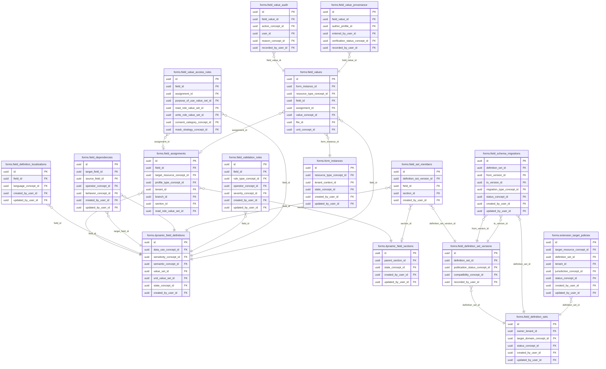

<!-- AUTOGENERADO por tools/inventario/catalogo.mjs. No editar manualmente. -->

# Catálogo del schema `forms`

- **Tablas:** 16 · **Columnas:** 247 (53 con descripción: 21.5 %) · **Índices:** 113
- **Dominio:** Clínico y Diagnóstico
- Método y límites del catálogo: [README del inventario](../README.md)

## Tablas

| Tabla | Propósito | Columnas | Índices | Operaciones | ORM |
|---|---|---|---|---|---|
| [dynamic_field_definitions](#dynamic_field_definitions) | Define campos configurables con tipo y semántica para extender formularios sin alterar cada tabla de negocio. | 31 | 9 | 20 | DIVERGE |
| [dynamic_field_sections](#dynamic_field_sections) | Agrupa campos dinámicos en secciones para configurar formularios usados por módulos del sistema médico. | 11 | 5 | 6 | COINCIDE |
| [extension_target_policies](#extension_target_policies) | Restringe qué entidades pueden extenderse con campos dinámicos para mantener control sobre el modelo de datos. | 15 | 8 | 4 | COINCIDE |
| [field_assignments](#field_assignments) | Asigna definiciones de campo a formularios, entidades o contextos donde deben capturarse. | 21 | 13 | 16 | COINCIDE |
| [field_definition_localizations](#field_definition_localizations) | Conserva etiquetas y textos localizados de campos para presentar formularios en idiomas y regiones distintos. | 12 | 4 | 4 | COINCIDE |
| [field_definition_set_versions](#field_definition_set_versions) | Versiona conjuntos de campos para reproducir qué estructura estaba vigente al completar un formulario. | 11 | 5 | 5 | COINCIDE |
| [field_definition_sets](#field_definition_sets) | Agrupa definiciones de campo reutilizables para compartir estructuras entre formularios y módulos. | 13 | 6 | 9 | COINCIDE |
| [field_dependencies](#field_dependencies) | Modela dependencias entre campos para mostrar, exigir o habilitar entradas según respuestas previas. | 13 | 6 | 3 | COINCIDE |
| [field_schema_migrations](#field_schema_migrations) | Traza migraciones de estructuras dinámicas para conservar compatibilidad al evolucionar definiciones de formularios. | 14 | 7 | 2 | COINCIDE |
| [field_set_members](#field_set_members) | Relaciona campos con conjuntos y su orden para establecer la composición de cada versión. | 8 | 4 | 2 | COINCIDE |
| [field_validation_rules](#field_validation_rules) | Define validaciones aplicables a campos para controlar formato, rango y consistencia de información capturada. | 14 | 6 | 2 | COINCIDE |
| [field_value_access_rules](#field_value_access_rules) | Define reglas de acceso a valores de campos para proteger información según usuario, rol o finalidad. | 15 | 10 | 3 | COINCIDE |
| [field_value_audit](#field_value_audit) | Preserva cambios de valores dinámicos para atribuir quién los modificó y reconstruir respuestas previas. | 9 | 6 | 3 | COINCIDE |
| [field_value_provenance](#field_value_provenance) | Registra procedencia de valores dinámicos para conocer origen, actor o proceso de captura. | 14 | 7 | 1 | COINCIDE |
| [field_values](#field_values) | Conserva valores capturados en campos dinámicos para mantener respuestas estructuradas fuera de los esquemas fijos. | 34 | 12 | 10 | DIVERGE |
| [form_instances](#form_instances) | Representa instancias concretas de formularios completadas o en curso por pacientes y usuarios. | 12 | 5 | 16 | COINCIDE |

## Diagrama entidad-relación

Las tablas se agrupan en familias por sus claves foráneas dentro del schema (máximo 40 por diagrama). Las FK hacia otros schemas se listan en la ficha de cada tabla.

### Familia 1 de 1 — 16 tablas

## Fichas

### dynamic_field_definitions

#### Vista general

Define campos configurables con tipo y semántica para extender formularios sin alterar cada tabla de negocio.

- **Estado del propósito:** DOMAIN_CURATED_DRAFT · fuente: `Mantra Core Health Context/modules/diagram_09_forms.puml: dynamic_field_definitions`
- **Dominio:** Clínico y Diagnóstico · **Diagrama:** `Mantra Core Health Context/modules/diagram_09_forms.puml` · **DDL:** `SQL/09_forms/02_tables.sql`
- **Entidad del ORM:** `DynamicFieldDefinitions` — `src/modules/forms/entities/dynamic_field_definitions.entity.ts`
- **Resumen:** 31 columnas · 9 índices · 8 FK salientes · 8 entrantes · 20 operaciones

#### Columnas

| # | Columna | Tipo | Rol estructural | Descripción | ORM |
|---|---|---|---|---|---|
| 1 | `id` | `uuid` | Clave primaria; Obligatoria | Identificador único de la instancia. _(JSDOC_ESTANDAR, `src/modules/forms/entities/dynamic_field_definitions.entity.ts:12`)_ | coincide |
| 2 | `code` | `varchar` | Obligatoria | _sin dato_ | coincide |
| 3 | `name` | `varchar` | Obligatoria | _sin dato_ | coincide |
| 4 | `data_type` | `"terminology"."technical_data_type"` | Obligatoria | _sin dato_ | coincide |
| 5 | `data_use_concept_id` | `uuid` | Clave foránea → terminology.catalog_concepts.id; Opcional | _sin dato_ | coincide |
| 6 | `sensitivity_concept_id` | `uuid` | Clave foránea → terminology.catalog_concepts.id; Opcional | _sin dato_ | coincide |
| 7 | `semantic_concept_id` | `uuid` | Clave foránea → terminology.catalog_concepts.id; Opcional | _sin dato_ | coincide |
| 8 | `value_set_id` | `uuid` | Clave foránea → terminology.value_sets.id; Opcional | _sin dato_ | coincide |
| 9 | `unit_value_set_id` | `uuid` | Clave foránea → terminology.value_sets.id; Opcional | _sin dato_ | coincide |
| 10 | `cardinality_min` | `integer` | Opcional | _sin dato_ | coincide |
| 11 | `cardinality_max` | `integer` | Opcional | _sin dato_ | coincide |
| 12 | `length_min` | `integer` | Opcional | _sin dato_ | coincide |
| 13 | `length_max` | `integer` | Opcional | _sin dato_ | coincide |
| 14 | `num_precision` | `integer` | Opcional | _sin dato_ | coincide |
| 15 | `num_scale` | `integer` | Opcional | _sin dato_ | coincide |
| 16 | `min_value_decimal` | `numeric` | Opcional | _sin dato_ | coincide |
| 17 | `max_value_decimal` | `numeric` | Opcional | _sin dato_ | coincide |
| 18 | `regex` | `text` | Opcional | _sin dato_ | coincide |
| 19 | `default_value_json` | `jsonb` | Opcional | _sin dato_ | coincide |
| 20 | `keeps_history` | `boolean` | Opcional | _sin dato_ | coincide |
| 21 | `computed` | `boolean` | Opcional | _sin dato_ | coincide |
| 22 | `computation_expression` | `text` | Opcional | _sin dato_ | coincide |
| 23 | `fhir_path` | `varchar` | Opcional | _sin dato_ | coincide |
| 24 | `fhir_extension_url` | `text` | Opcional | _sin dato_ | coincide |
| 25 | `schema_version` | `integer` | Opcional | _sin dato_ | coincide |
| 26 | `state_concept_id` | `uuid` | Clave foránea → terminology.catalog_concepts.id; Opcional | _sin dato_ | coincide |
| 27 | `created_at` | `timestamptz` | Obligatoria | Fecha y hora en que se creó el registro. _(JSDOC_ESTANDAR, `src/modules/forms/entities/dynamic_field_definitions.entity.ts:238`)_ | coincide |
| 28 | `updated_at` | `timestamptz` | Obligatoria | Fecha y hora de la última actualización. _(JSDOC_ESTANDAR, `src/modules/forms/entities/dynamic_field_definitions.entity.ts:244`)_ | coincide |
| 29 | `created_by_user_id` | `uuid` | Clave foránea → iam.users.id; Opcional | _sin dato_ | coincide |
| 30 | `updated_by_user_id` | `uuid` | Clave foránea → iam.users.id; Opcional | _sin dato_ | coincide |
| 31 | `row_version` | `integer = 1` | Obligatoria | Versión usada para controlar actualizaciones concurrentes. _(JSDOC_ENTIDAD, `src/modules/forms/entities/dynamic_field_definitions.entity.ts:262`)_ | coincide |

#### Relaciones

| Sentido | Columnas | Tabla | Restricción |
|---|---|---|---|
| hacia | data_use_concept_id | terminology.catalog_concepts (id) | fk_dynamic_field_definitions_data_use_concept_id |
| hacia | sensitivity_concept_id | terminology.catalog_concepts (id) | fk_dynamic_field_definitions_sensitivity_concept_id |
| hacia | semantic_concept_id | terminology.catalog_concepts (id) | fk_dynamic_field_definitions_semantic_concept_id |
| hacia | value_set_id | terminology.value_sets (id) | fk_dynamic_field_definitions_value_set_id |
| hacia | unit_value_set_id | terminology.value_sets (id) | fk_dynamic_field_definitions_unit_value_set_id |
| hacia | state_concept_id | terminology.catalog_concepts (id) | fk_dynamic_field_definitions_state_concept_id |
| hacia | created_by_user_id | iam.users (id) | fk_dynamic_field_definitions_created_by_user_id |
| hacia | updated_by_user_id | iam.users (id) | fk_dynamic_field_definitions_updated_by_user_id |
| desde | id | forms.field_assignments (field_id) | fk_field_assignments_field_id |
| desde | id | forms.field_validation_rules (field_id) | fk_field_validation_rules_field_id |
| desde | id | forms.field_dependencies (target_field_id) | fk_field_dependencies_target_field_id |
| desde | id | forms.field_dependencies (source_field_id) | fk_field_dependencies_source_field_id |
| desde | id | forms.field_values (field_id) | fk_field_values_field_id |
| desde | id | forms.field_set_members (field_id) | fk_field_set_members_field_id |
| desde | id | forms.field_definition_localizations (field_id) | fk_field_definition_localizations_field_id |
| desde | id | forms.field_value_access_rules (field_id) | fk_field_value_access_rules_field_id |

#### Índices

| Índice | Único | Columnas | Para qué |
|---|---|---|---|
| `uq_dynamic_field_definitions_code` | sí | code | Garantiza que no se repita la combinación (code) _(DOCUMENTO)_; 1 consulta(s) de repositorio filtran u ordenan por «code», la primera columna del índice _(CONSULTA)_ |
| `ix_dynamic_field_definitions_data_use_concept_id` | no | data_use_concept_id | Soporta la clave foránea fk_dynamic_field_definitions_data_use_concept_id: PostgreSQL no indexa las FK por sí mismo _(DOCUMENTO)_ |
| `ix_dynamic_field_definitions_sensitivity_concept_id` | no | sensitivity_concept_id | Soporta la clave foránea fk_dynamic_field_definitions_sensitivity_concept_id: PostgreSQL no indexa las FK por sí mismo _(DOCUMENTO)_ |
| `ix_dynamic_field_definitions_semantic_concept_id` | no | semantic_concept_id | Soporta la clave foránea fk_dynamic_field_definitions_semantic_concept_id: PostgreSQL no indexa las FK por sí mismo _(DOCUMENTO)_ |
| `ix_dynamic_field_definitions_value_set_id` | no | value_set_id | Soporta la clave foránea fk_dynamic_field_definitions_value_set_id: PostgreSQL no indexa las FK por sí mismo _(DOCUMENTO)_ |
| `ix_dynamic_field_definitions_unit_value_set_id` | no | unit_value_set_id | Soporta la clave foránea fk_dynamic_field_definitions_unit_value_set_id: PostgreSQL no indexa las FK por sí mismo _(DOCUMENTO)_ |
| `ix_dynamic_field_definitions_state_concept_id` | no | state_concept_id | Soporta la clave foránea fk_dynamic_field_definitions_state_concept_id: PostgreSQL no indexa las FK por sí mismo _(DOCUMENTO)_ |
| `ix_dynamic_field_definitions_created_by_user_id` | no | created_by_user_id | Soporta la clave foránea fk_dynamic_field_definitions_created_by_user_id: PostgreSQL no indexa las FK por sí mismo _(DOCUMENTO)_ |
| `ix_dynamic_field_definitions_updated_by_user_id` | no | updated_by_user_id | Soporta la clave foránea fk_dynamic_field_definitions_updated_by_user_id: PostgreSQL no indexa las FK por sí mismo _(DOCUMENTO)_ |

#### Restricciones

| Restricción | Tipo | Definición |
|---|---|---|
| `uq_dynamic_field_definitions_code` | UNIQUE INDEX | UNIQUE INDEX ("code") |

#### Operaciones que la tocan

| Operación | Efecto | Confianza |
|---|---|---|
| GET /charts/templates | LEE | DIRECTA |
| POST /charts/templates | CREA | DIRECTA |
| GET /charts/templates/{id} | LEE | DIRECTA |
| POST /admin/content-packs/{code}/apply | ACTUALIZA | DIRECTA |
| POST /admin/content-packs/{code}/apply | CREA | DIRECTA |
| POST /admin/content-packs/{code}/apply | LEE | DIRECTA |
| POST /forms/assignments | LEE | DIRECTA |
| GET /forms/definition-sets/{id} | LEE | DIRECTA |
| POST /forms/field-definitions | CREA | DIRECTA |
| POST /forms/field-definitions | LEE | DIRECTA |
| PATCH /forms/field-definitions/{id} | ACTUALIZA | POR_TIPO |
| PATCH /forms/field-definitions/{id} | LEE | DIRECTA |
| POST /forms/fields/{id}/access-rules | LEE | DIRECTA |
| POST /forms/fields/{id}/dependencies | LEE | DIRECTA |
| PUT /forms/fields/{id}/localizations/{lang} | LEE | DIRECTA |
| GET /forms/instances/{id} | LEE | DIRECTA |
| POST /forms/instances/{id}/values | LEE | DIRECTA |
| GET /forms/me/instances/{id} | LEE | DIRECTA |
| PATCH /forms/values/{id} | LEE | DIRECTA |
| POST /forms/values/import | LEE | DIRECTA |

#### Gobierno

| Atributo | Valor | Fuente |
|---|---|---|
| Append-only | no declarado | — |
| Datos personales | sin fuente | — |
| Financiera | sin fuente | — |
| Crítica para auditoría | sin fuente | — |
| Retención | sin fuente | — |
| Responsable | sin fuente | — |
| Revisión | AUTO_DETECTADA | — |

---

### dynamic_field_sections

#### Vista general

Agrupa campos dinámicos en secciones para configurar formularios usados por módulos del sistema médico.

- **Estado del propósito:** DOMAIN_CURATED_DRAFT · fuente: `Mantra Core Health Context/modules/diagram_09_forms.puml: dynamic_field_sections`
- **Dominio:** Clínico y Diagnóstico · **Diagrama:** `Mantra Core Health Context/modules/diagram_09_forms.puml` · **DDL:** `SQL/09_forms/02_tables.sql`
- **Entidad del ORM:** `DynamicFieldSections` — `src/modules/forms/entities/dynamic_field_sections.entity.ts`
- **Resumen:** 11 columnas · 5 índices · 4 FK salientes · 4 entrantes · 6 operaciones

#### Columnas

| # | Columna | Tipo | Rol estructural | Descripción | ORM |
|---|---|---|---|---|---|
| 1 | `id` | `uuid` | Clave primaria; Obligatoria | Identificador único de la instancia. _(JSDOC_ESTANDAR, `src/modules/forms/entities/dynamic_field_sections.entity.ts:12`)_ | coincide |
| 2 | `code` | `varchar` | Obligatoria | _sin dato_ | coincide |
| 3 | `name` | `varchar` | Obligatoria | _sin dato_ | coincide |
| 4 | `parent_section_id` | `uuid` | Clave foránea → forms.dynamic_field_sections.id; Opcional | _sin dato_ | coincide |
| 5 | `ordinal` | `integer` | Opcional | _sin dato_ | coincide |
| 6 | `state_concept_id` | `uuid` | Clave foránea → terminology.catalog_concepts.id; Opcional | _sin dato_ | coincide |
| 7 | `created_at` | `timestamptz` | Obligatoria | Fecha y hora en que se creó el registro. _(JSDOC_ESTANDAR, `src/modules/forms/entities/dynamic_field_sections.entity.ts:48`)_ | coincide |
| 8 | `updated_at` | `timestamptz` | Obligatoria | Fecha y hora de la última actualización. _(JSDOC_ESTANDAR, `src/modules/forms/entities/dynamic_field_sections.entity.ts:54`)_ | coincide |
| 9 | `created_by_user_id` | `uuid` | Clave foránea → iam.users.id; Opcional | _sin dato_ | coincide |
| 10 | `updated_by_user_id` | `uuid` | Clave foránea → iam.users.id; Opcional | _sin dato_ | coincide |
| 11 | `row_version` | `integer = 1` | Obligatoria | Versión usada para controlar actualizaciones concurrentes. _(JSDOC_ENTIDAD, `src/modules/forms/entities/dynamic_field_sections.entity.ts:72`)_ | coincide |

#### Relaciones

| Sentido | Columnas | Tabla | Restricción |
|---|---|---|---|
| hacia | parent_section_id | forms.dynamic_field_sections (id) | fk_dynamic_field_sections_parent_section_id |
| hacia | state_concept_id | terminology.catalog_concepts (id) | fk_dynamic_field_sections_state_concept_id |
| hacia | created_by_user_id | iam.users (id) | fk_dynamic_field_sections_created_by_user_id |
| hacia | updated_by_user_id | iam.users (id) | fk_dynamic_field_sections_updated_by_user_id |
| desde | id | forms.dynamic_field_sections (parent_section_id) | fk_dynamic_field_sections_parent_section_id |
| desde | id | forms.field_assignments (section_id) | fk_field_assignments_section_id |
| desde | id | forms.field_set_members (section_id) | fk_field_set_members_section_id |
| desde | id | chart.specialty_chart_templates (section_id) | fk_specialty_chart_templates_section_id |

#### Índices

| Índice | Único | Columnas | Para qué |
|---|---|---|---|
| `uq_dynamic_field_sections_code` | sí | code | Garantiza que no se repita la combinación (code) _(DOCUMENTO)_ |
| `ix_dynamic_field_sections_parent_section_id` | no | parent_section_id | Soporta la clave foránea fk_dynamic_field_sections_parent_section_id: PostgreSQL no indexa las FK por sí mismo _(DOCUMENTO)_ |
| `ix_dynamic_field_sections_state_concept_id` | no | state_concept_id | Soporta la clave foránea fk_dynamic_field_sections_state_concept_id: PostgreSQL no indexa las FK por sí mismo _(DOCUMENTO)_ |
| `ix_dynamic_field_sections_created_by_user_id` | no | created_by_user_id | Soporta la clave foránea fk_dynamic_field_sections_created_by_user_id: PostgreSQL no indexa las FK por sí mismo _(DOCUMENTO)_ |
| `ix_dynamic_field_sections_updated_by_user_id` | no | updated_by_user_id | Soporta la clave foránea fk_dynamic_field_sections_updated_by_user_id: PostgreSQL no indexa las FK por sí mismo _(DOCUMENTO)_ |

#### Restricciones

| Restricción | Tipo | Definición |
|---|---|---|
| `uq_dynamic_field_sections_code` | UNIQUE INDEX | UNIQUE INDEX ("code") |

#### Operaciones que la tocan

| Operación | Efecto | Confianza |
|---|---|---|
| POST /charts/templates | CREA | DIRECTA |
| POST /admin/content-packs/{code}/apply | CREA | DIRECTA |
| POST /admin/content-packs/{code}/apply | LEE | DIRECTA |
| GET /forms/assignments | LEE | DIRECTA |
| POST /forms/assignments | CREA | DIRECTA |
| GET /forms/definition-sets/{id} | LEE | DIRECTA |

#### Gobierno

| Atributo | Valor | Fuente |
|---|---|---|
| Append-only | no declarado | — |
| Datos personales | sin fuente | — |
| Financiera | sin fuente | — |
| Crítica para auditoría | sin fuente | — |
| Retención | sin fuente | — |
| Responsable | sin fuente | — |
| Revisión | AUTO_DETECTADA | — |

---

### extension_target_policies

#### Vista general

Restringe qué entidades pueden extenderse con campos dinámicos para mantener control sobre el modelo de datos.

- **Estado del propósito:** DOMAIN_CURATED_DRAFT · fuente: `Mantra Core Health Context/modules/diagram_09_forms.puml: extension_target_policies`
- **Dominio:** Clínico y Diagnóstico · **Diagrama:** `Mantra Core Health Context/modules/diagram_09_forms.puml` · **DDL:** `SQL/09_forms/02_tables.sql`
- **Entidad del ORM:** `ExtensionTargetPolicies` — `src/modules/forms/entities/extension_target_policies.entity.ts`
- **Resumen:** 15 columnas · 8 índices · 7 FK salientes · 0 entrantes · 4 operaciones

#### Columnas

| # | Columna | Tipo | Rol estructural | Descripción | ORM |
|---|---|---|---|---|---|
| 1 | `id` | `uuid` | Clave primaria; Obligatoria | Identificador único de la instancia. _(JSDOC_ESTANDAR, `src/modules/forms/entities/extension_target_policies.entity.ts:12`)_ | coincide |
| 2 | `target_resource_concept_id` | `uuid` | Clave foránea → terminology.catalog_concepts.id; Obligatoria | _sin dato_ | coincide |
| 3 | `definition_set_id` | `uuid` | Clave foránea → forms.field_definition_sets.id; Obligatoria | _sin dato_ | coincide |
| 4 | `tenant_id` | `uuid` | Clave foránea → directory.tenants.id; Opcional | _sin dato_ | coincide |
| 5 | `jurisdiction_concept_id` | `uuid` | Clave foránea → terminology.catalog_concepts.id; Opcional | _sin dato_ | coincide |
| 6 | `allow_tenant_fields` | `boolean` | Opcional | _sin dato_ | coincide |
| 7 | `allow_vendor_fields` | `boolean` | Opcional | _sin dato_ | coincide |
| 8 | `maximum_fields` | `integer` | Opcional | _sin dato_ | coincide |
| 9 | `maximum_payload_bytes` | `integer` | Opcional | _sin dato_ | coincide |
| 10 | `status_concept_id` | `uuid` | Clave foránea → terminology.catalog_concepts.id; Obligatoria | _sin dato_ | coincide |
| 11 | `created_at` | `timestamptz` | Obligatoria | Fecha y hora en que se creó el registro. _(JSDOC_ESTANDAR, `src/modules/forms/entities/extension_target_policies.entity.ts:88`)_ | coincide |
| 12 | `updated_at` | `timestamptz` | Obligatoria | Fecha y hora de la última actualización. _(JSDOC_ESTANDAR, `src/modules/forms/entities/extension_target_policies.entity.ts:94`)_ | coincide |
| 13 | `created_by_user_id` | `uuid` | Clave foránea → iam.users.id; Opcional | _sin dato_ | coincide |
| 14 | `updated_by_user_id` | `uuid` | Clave foránea → iam.users.id; Opcional | _sin dato_ | coincide |
| 15 | `row_version` | `integer = 1` | Obligatoria | Versión usada para controlar actualizaciones concurrentes. _(JSDOC_ENTIDAD, `src/modules/forms/entities/extension_target_policies.entity.ts:112`)_ | coincide |

#### Relaciones

| Sentido | Columnas | Tabla | Restricción |
|---|---|---|---|
| hacia | definition_set_id | forms.field_definition_sets (id) | fk_extension_target_policies_definition_set_id |
| hacia | target_resource_concept_id | terminology.catalog_concepts (id) | fk_extension_target_policies_target_resource_concept_id |
| hacia | tenant_id | directory.tenants (id) | fk_extension_target_policies_tenant_id |
| hacia | jurisdiction_concept_id | terminology.catalog_concepts (id) | fk_extension_target_policies_jurisdiction_concept_id |
| hacia | status_concept_id | terminology.catalog_concepts (id) | fk_extension_target_policies_status_concept_id |
| hacia | created_by_user_id | iam.users (id) | fk_extension_target_policies_created_by_user_id |
| hacia | updated_by_user_id | iam.users (id) | fk_extension_target_policies_updated_by_user_id |

#### Índices

| Índice | Único | Columnas | Para qué |
|---|---|---|---|
| `ix_extension_target_policies_target_resource_concept_id` | no | target_resource_concept_id | Soporta la clave foránea fk_extension_target_policies_target_resource_concept_id: PostgreSQL no indexa las FK por sí mismo _(DOCUMENTO)_; 1 consulta(s) de repositorio filtran u ordenan por «target_resource_concept_id», la primera columna del índice _(CONSULTA)_ |
| `ix_extension_target_policies_definition_set_id` | no | definition_set_id | Soporta la clave foránea fk_extension_target_policies_definition_set_id: PostgreSQL no indexa las FK por sí mismo _(DOCUMENTO)_ |
| `ix_extension_target_policies_tenant_id` | no | tenant_id | Soporta la clave foránea fk_extension_target_policies_tenant_id: PostgreSQL no indexa las FK por sí mismo _(DOCUMENTO)_; 1 consulta(s) de repositorio filtran u ordenan por «tenant_id», la primera columna del índice _(CONSULTA)_ |
| `ix_extension_target_policies_jurisdiction_concept_id` | no | jurisdiction_concept_id | Soporta la clave foránea fk_extension_target_policies_jurisdiction_concept_id: PostgreSQL no indexa las FK por sí mismo _(DOCUMENTO)_ |
| `ix_extension_target_policies_status_concept_id` | no | status_concept_id | Soporta la clave foránea fk_extension_target_policies_status_concept_id: PostgreSQL no indexa las FK por sí mismo _(DOCUMENTO)_; 1 consulta(s) de repositorio filtran u ordenan por «status_concept_id», la primera columna del índice _(CONSULTA)_ |
| `ix_extension_target_policies_created_by_user_id` | no | created_by_user_id | Soporta la clave foránea fk_extension_target_policies_created_by_user_id: PostgreSQL no indexa las FK por sí mismo _(DOCUMENTO)_ |
| `ix_extension_target_policies_updated_by_user_id` | no | updated_by_user_id | Soporta la clave foránea fk_extension_target_policies_updated_by_user_id: PostgreSQL no indexa las FK por sí mismo _(DOCUMENTO)_ |
| `ix_extension_target_policies_tenant_id_status_concept_id` | no | tenant_id, status_concept_id, ("updated_at" DESC) | _sin uso detectado estáticamente_ |

#### Operaciones que la tocan

| Operación | Efecto | Confianza |
|---|---|---|
| POST /admin/content-packs/{code}/apply | CREA | DIRECTA |
| POST /admin/content-packs/{code}/apply | LEE | DIRECTA |
| POST /forms/assignments | LEE | DIRECTA |
| GET /forms/assignments/budget | LEE | DIRECTA |

#### Gobierno

| Atributo | Valor | Fuente |
|---|---|---|
| Append-only | no declarado | — |
| Datos personales | sin fuente | — |
| Financiera | sin fuente | — |
| Crítica para auditoría | sin fuente | — |
| Retención | sin fuente | — |
| Responsable | sin fuente | — |
| Revisión | AUTO_DETECTADA | — |

---

### field_assignments

#### Vista general

Asigna definiciones de campo a formularios, entidades o contextos donde deben capturarse.

- **Estado del propósito:** DOMAIN_CURATED_DRAFT · fuente: `Mantra Core Health Context/modules/diagram_09_forms.puml: field_assignments`
- **Dominio:** Clínico y Diagnóstico · **Diagrama:** `Mantra Core Health Context/modules/diagram_09_forms.puml` · **DDL:** `SQL/09_forms/02_tables.sql`
- **Entidad del ORM:** `FieldAssignments` — `src/modules/forms/entities/field_assignments.entity.ts`
- **Resumen:** 21 columnas · 13 índices · 11 FK salientes · 2 entrantes · 16 operaciones

#### Columnas

| # | Columna | Tipo | Rol estructural | Descripción | ORM |
|---|---|---|---|---|---|
| 1 | `id` | `uuid` | Clave primaria; Obligatoria | Identificador único de la instancia. _(JSDOC_ESTANDAR, `src/modules/forms/entities/field_assignments.entity.ts:12`)_ | coincide |
| 2 | `field_id` | `uuid` | Clave foránea → forms.dynamic_field_definitions.id; Obligatoria | _sin dato_ | coincide |
| 3 | `target_resource_concept_id` | `uuid` | Clave foránea → terminology.catalog_concepts.id; Obligatoria | _sin dato_ | coincide |
| 4 | `profile_type_concept_id` | `uuid` | Clave foránea → terminology.catalog_concepts.id; Opcional | _sin dato_ | coincide |
| 5 | `tenant_id` | `uuid` | Clave foránea → directory.tenants.id; Opcional | _sin dato_ | coincide |
| 6 | `branch_id` | `uuid` | Clave foránea → directory.branches.id; Opcional | _sin dato_ | coincide |
| 7 | `section_id` | `uuid` | Clave foránea → forms.dynamic_field_sections.id; Obligatoria | _sin dato_ | coincide |
| 8 | `required` | `boolean` | Obligatoria | _sin dato_ | coincide |
| 9 | `visible` | `boolean` | Obligatoria | _sin dato_ | coincide |
| 10 | `editable` | `boolean` | Obligatoria | _sin dato_ | coincide |
| 11 | `ordinal` | `integer` | Opcional | _sin dato_ | coincide |
| 12 | `read_role_value_set_id` | `uuid` | Clave foránea → terminology.value_sets.id; Opcional | _sin dato_ | coincide |
| 13 | `write_role_value_set_id` | `uuid` | Clave foránea → terminology.value_sets.id; Opcional | _sin dato_ | coincide |
| 14 | `valid_from` | `timestamptz` | Opcional | _sin dato_ | coincide |
| 15 | `valid_to` | `timestamptz` | Opcional | _sin dato_ | coincide |
| 16 | `state_concept_id` | `uuid` | Clave foránea → terminology.catalog_concepts.id; Opcional | _sin dato_ | coincide |
| 17 | `created_at` | `timestamptz` | Obligatoria | Fecha y hora en que se creó el registro. _(JSDOC_ESTANDAR, `src/modules/forms/entities/field_assignments.entity.ts:128`)_ | coincide |
| 18 | `updated_at` | `timestamptz` | Obligatoria | Fecha y hora de la última actualización. _(JSDOC_ESTANDAR, `src/modules/forms/entities/field_assignments.entity.ts:134`)_ | coincide |
| 19 | `created_by_user_id` | `uuid` | Clave foránea → iam.users.id; Opcional | _sin dato_ | coincide |
| 20 | `updated_by_user_id` | `uuid` | Clave foránea → iam.users.id; Opcional | _sin dato_ | coincide |
| 21 | `row_version` | `integer = 1` | Obligatoria | Versión usada para controlar actualizaciones concurrentes. _(JSDOC_ENTIDAD, `src/modules/forms/entities/field_assignments.entity.ts:152`)_ | coincide |

#### Relaciones

| Sentido | Columnas | Tabla | Restricción |
|---|---|---|---|
| hacia | field_id | forms.dynamic_field_definitions (id) | fk_field_assignments_field_id |
| hacia | section_id | forms.dynamic_field_sections (id) | fk_field_assignments_section_id |
| hacia | target_resource_concept_id | terminology.catalog_concepts (id) | fk_field_assignments_target_resource_concept_id |
| hacia | profile_type_concept_id | terminology.catalog_concepts (id) | fk_field_assignments_profile_type_concept_id |
| hacia | tenant_id | directory.tenants (id) | fk_field_assignments_tenant_id |
| hacia | branch_id | directory.branches (id) | fk_field_assignments_branch_id |
| hacia | read_role_value_set_id | terminology.value_sets (id) | fk_field_assignments_read_role_value_set_id |
| hacia | write_role_value_set_id | terminology.value_sets (id) | fk_field_assignments_write_role_value_set_id |
| hacia | state_concept_id | terminology.catalog_concepts (id) | fk_field_assignments_state_concept_id |
| hacia | created_by_user_id | iam.users (id) | fk_field_assignments_created_by_user_id |
| hacia | updated_by_user_id | iam.users (id) | fk_field_assignments_updated_by_user_id |
| desde | id | forms.field_values (assignment_id) | fk_field_values_assignment_id |
| desde | id | forms.field_value_access_rules (assignment_id) | fk_field_value_access_rules_assignment_id |

#### Índices

| Índice | Único | Columnas | Para qué |
|---|---|---|---|
| `ix_field_assignments_field_id` | no | field_id | Soporta la clave foránea fk_field_assignments_field_id: PostgreSQL no indexa las FK por sí mismo _(DOCUMENTO)_; 2 consulta(s) de repositorio filtran u ordenan por «field_id», la primera columna del índice _(CONSULTA)_ |
| `ix_field_assignments_target_resource_concept_id` | no | target_resource_concept_id | Soporta la clave foránea fk_field_assignments_target_resource_concept_id: PostgreSQL no indexa las FK por sí mismo _(DOCUMENTO)_; 2 consulta(s) de repositorio filtran u ordenan por «target_resource_concept_id», la primera columna del índice _(CONSULTA)_ |
| `ix_field_assignments_profile_type_concept_id` | no | profile_type_concept_id | Soporta la clave foránea fk_field_assignments_profile_type_concept_id: PostgreSQL no indexa las FK por sí mismo _(DOCUMENTO)_ |
| `ix_field_assignments_tenant_id` | no | tenant_id | Soporta la clave foránea fk_field_assignments_tenant_id: PostgreSQL no indexa las FK por sí mismo _(DOCUMENTO)_; 3 consulta(s) de repositorio filtran u ordenan por «tenant_id», la primera columna del índice _(CONSULTA)_ |
| `ix_field_assignments_branch_id` | no | branch_id | Soporta la clave foránea fk_field_assignments_branch_id: PostgreSQL no indexa las FK por sí mismo _(DOCUMENTO)_ |
| `ix_field_assignments_section_id` | no | section_id | Soporta la clave foránea fk_field_assignments_section_id: PostgreSQL no indexa las FK por sí mismo _(DOCUMENTO)_; 2 consulta(s) de repositorio filtran u ordenan por «section_id», la primera columna del índice _(CONSULTA)_ |
| `ix_field_assignments_read_role_value_set_id` | no | read_role_value_set_id | Soporta la clave foránea fk_field_assignments_read_role_value_set_id: PostgreSQL no indexa las FK por sí mismo _(DOCUMENTO)_ |
| `ix_field_assignments_write_role_value_set_id` | no | write_role_value_set_id | Soporta la clave foránea fk_field_assignments_write_role_value_set_id: PostgreSQL no indexa las FK por sí mismo _(DOCUMENTO)_ |
| `ix_field_assignments_state_concept_id` | no | state_concept_id | Soporta la clave foránea fk_field_assignments_state_concept_id: PostgreSQL no indexa las FK por sí mismo _(DOCUMENTO)_; 3 consulta(s) de repositorio filtran u ordenan por «state_concept_id», la primera columna del índice _(CONSULTA)_ |
| `ix_field_assignments_created_by_user_id` | no | created_by_user_id | Soporta la clave foránea fk_field_assignments_created_by_user_id: PostgreSQL no indexa las FK por sí mismo _(DOCUMENTO)_ |
| `ix_field_assignments_updated_by_user_id` | no | updated_by_user_id | Soporta la clave foránea fk_field_assignments_updated_by_user_id: PostgreSQL no indexa las FK por sí mismo _(DOCUMENTO)_ |
| `ix_field_assignments_tenant_id_state_concept_id` | no | tenant_id, state_concept_id, ("updated_at" DESC) | _sin uso detectado estáticamente_ |
| `gist_field_assignments_effective_period` | no | (tstzrange(valid_from, valid_to, '[)')) | GiST para periodos, no solapamiento y geografía _(DOCUMENTO)_ |

#### Operaciones que la tocan

| Operación | Efecto | Confianza |
|---|---|---|
| GET /charts/templates | LEE | DIRECTA |
| POST /charts/templates | CREA | DIRECTA |
| GET /charts/templates/{id} | LEE | DIRECTA |
| POST /admin/content-packs/{code}/apply | ACTUALIZA | DIRECTA |
| POST /admin/content-packs/{code}/apply | CREA | DIRECTA |
| POST /admin/content-packs/{code}/apply | LEE | DIRECTA |
| GET /forms/assignments | LEE | DIRECTA |
| POST /forms/assignments | CREA | DIRECTA |
| POST /forms/assignments | LEE | DIRECTA |
| DELETE /forms/assignments/{id} | ACTUALIZA | POR_TIPO |
| DELETE /forms/assignments/{id} | LEE | DIRECTA |
| PATCH /forms/assignments/{id} | ACTUALIZA | POR_TIPO |
| PATCH /forms/assignments/{id} | LEE | DIRECTA |
| GET /forms/assignments/budget | LEE | DIRECTA |
| PUT /forms/assignments/order | LEE | DIRECTA |
| PATCH /forms/field-definitions/{id} | LEE | DIRECTA |

#### Gobierno

| Atributo | Valor | Fuente |
|---|---|---|
| Append-only | no declarado | — |
| Datos personales | sin fuente | — |
| Financiera | sin fuente | — |
| Crítica para auditoría | sin fuente | — |
| Retención | sin fuente | — |
| Responsable | sin fuente | — |
| Revisión | AUTO_DETECTADA | — |

---

### field_definition_localizations

#### Vista general

Conserva etiquetas y textos localizados de campos para presentar formularios en idiomas y regiones distintos.

- **Estado del propósito:** DOMAIN_CURATED_DRAFT · fuente: `Mantra Core Health Context/modules/diagram_09_forms.puml: field_definition_localizations`
- **Dominio:** Clínico y Diagnóstico · **Diagrama:** `Mantra Core Health Context/modules/diagram_09_forms.puml` · **DDL:** `SQL/09_forms/02_tables.sql`
- **Entidad del ORM:** `FieldDefinitionLocalizations` — `src/modules/forms/entities/field_definition_localizations.entity.ts`
- **Resumen:** 12 columnas · 4 índices · 4 FK salientes · 0 entrantes · 4 operaciones

#### Columnas

| # | Columna | Tipo | Rol estructural | Descripción | ORM |
|---|---|---|---|---|---|
| 1 | `id` | `uuid` | Clave primaria; Obligatoria | Identificador único de la instancia. _(JSDOC_ESTANDAR, `src/modules/forms/entities/field_definition_localizations.entity.ts:12`)_ | coincide |
| 2 | `field_id` | `uuid` | Clave foránea → forms.dynamic_field_definitions.id; Obligatoria | _sin dato_ | coincide |
| 3 | `language_concept_id` | `uuid` | Clave foránea → terminology.catalog_concepts.id; Obligatoria | _sin dato_ | coincide |
| 4 | `label` | `varchar` | Opcional | _sin dato_ | coincide |
| 5 | `help_text` | `text` | Opcional | _sin dato_ | coincide |
| 6 | `placeholder` | `varchar` | Opcional | _sin dato_ | coincide |
| 7 | `validation_message` | `varchar` | Opcional | _sin dato_ | coincide |
| 8 | `created_at` | `timestamptz` | Obligatoria | Fecha y hora en que se creó el registro. _(JSDOC_ESTANDAR, `src/modules/forms/entities/field_definition_localizations.entity.ts:58`)_ | coincide |
| 9 | `updated_at` | `timestamptz` | Obligatoria | Fecha y hora de la última actualización. _(JSDOC_ESTANDAR, `src/modules/forms/entities/field_definition_localizations.entity.ts:64`)_ | coincide |
| 10 | `created_by_user_id` | `uuid` | Clave foránea → iam.users.id; Opcional | _sin dato_ | coincide |
| 11 | `updated_by_user_id` | `uuid` | Clave foránea → iam.users.id; Opcional | _sin dato_ | coincide |
| 12 | `row_version` | `integer = 1` | Obligatoria | Versión usada para controlar actualizaciones concurrentes. _(JSDOC_ENTIDAD, `src/modules/forms/entities/field_definition_localizations.entity.ts:82`)_ | coincide |

#### Relaciones

| Sentido | Columnas | Tabla | Restricción |
|---|---|---|---|
| hacia | field_id | forms.dynamic_field_definitions (id) | fk_field_definition_localizations_field_id |
| hacia | language_concept_id | terminology.catalog_concepts (id) | fk_field_definition_localizations_language_concept_id |
| hacia | created_by_user_id | iam.users (id) | fk_field_definition_localizations_created_by_user_id |
| hacia | updated_by_user_id | iam.users (id) | fk_field_definition_localizations_updated_by_user_id |

#### Índices

| Índice | Único | Columnas | Para qué |
|---|---|---|---|
| `ix_field_definition_localizations_field_id` | no | field_id | Soporta la clave foránea fk_field_definition_localizations_field_id: PostgreSQL no indexa las FK por sí mismo _(DOCUMENTO)_; 2 consulta(s) de repositorio filtran u ordenan por «field_id», la primera columna del índice _(CONSULTA)_ |
| `ix_field_definition_localizations_language_concept_id` | no | language_concept_id | Soporta la clave foránea fk_field_definition_localizations_language_concept_id: PostgreSQL no indexa las FK por sí mismo _(DOCUMENTO)_; 1 consulta(s) de repositorio filtran u ordenan por «language_concept_id», la primera columna del índice _(CONSULTA)_ |
| `ix_field_definition_localizations_created_by_user_id` | no | created_by_user_id | Soporta la clave foránea fk_field_definition_localizations_created_by_user_id: PostgreSQL no indexa las FK por sí mismo _(DOCUMENTO)_ |
| `ix_field_definition_localizations_updated_by_user_id` | no | updated_by_user_id | Soporta la clave foránea fk_field_definition_localizations_updated_by_user_id: PostgreSQL no indexa las FK por sí mismo _(DOCUMENTO)_ |

#### Operaciones que la tocan

| Operación | Efecto | Confianza |
|---|---|---|
| GET /forms/definition-sets/{id} | LEE | DIRECTA |
| PUT /forms/fields/{id}/localizations/{lang} | ACTUALIZA | POR_TIPO |
| PUT /forms/fields/{id}/localizations/{lang} | CREA | DIRECTA |
| PUT /forms/fields/{id}/localizations/{lang} | LEE | DIRECTA |

#### Gobierno

| Atributo | Valor | Fuente |
|---|---|---|
| Append-only | no declarado | — |
| Datos personales | sin fuente | — |
| Financiera | sin fuente | — |
| Crítica para auditoría | sin fuente | — |
| Retención | sin fuente | — |
| Responsable | sin fuente | — |
| Revisión | AUTO_DETECTADA | — |

---

### field_definition_set_versions

#### Vista general

Versiona conjuntos de campos para reproducir qué estructura estaba vigente al completar un formulario.

- **Estado del propósito:** DOMAIN_CURATED_DRAFT · fuente: `Mantra Core Health Context/modules/diagram_09_forms.puml: field_definition_set_versions`
- **Dominio:** Clínico y Diagnóstico · **Diagrama:** `Mantra Core Health Context/modules/diagram_09_forms.puml` · **DDL:** `SQL/09_forms/02_tables.sql`
- **Entidad del ORM:** `FieldDefinitionSetVersions` — `src/modules/forms/entities/field_definition_set_versions.entity.ts`
- **Resumen:** 11 columnas · 5 índices · 4 FK salientes · 3 entrantes · 5 operaciones

#### Columnas

| # | Columna | Tipo | Rol estructural | Descripción | ORM |
|---|---|---|---|---|---|
| 1 | `id` | `uuid` | Clave primaria; Obligatoria | Identificador único de la instancia. _(JSDOC_ESTANDAR, `src/modules/forms/entities/field_definition_set_versions.entity.ts:12`)_ | coincide |
| 2 | `definition_set_id` | `uuid` | Clave foránea → forms.field_definition_sets.id; Obligatoria | _sin dato_ | coincide |
| 3 | `semantic_version` | `varchar` | Obligatoria | _sin dato_ | coincide |
| 4 | `schema_hash` | `varchar` | Obligatoria | _sin dato_ | coincide |
| 5 | `effective_from` | `timestamptz` | Opcional | _sin dato_ | coincide |
| 6 | `effective_to` | `timestamptz` | Opcional | _sin dato_ | coincide |
| 7 | `publication_status_concept_id` | `uuid` | Clave foránea → terminology.catalog_concepts.id; Opcional | _sin dato_ | coincide |
| 8 | `compatibility_concept_id` | `uuid` | Clave foránea → terminology.catalog_concepts.id; Opcional | _sin dato_ | coincide |
| 9 | `fhir_structure_definition_url` | `text` | Opcional | _sin dato_ | coincide |
| 10 | `recorded_at` | `timestamptz` | Obligatoria | _sin dato_ | coincide |
| 11 | `recorded_by_user_id` | `uuid` | Clave foránea → iam.users.id; Opcional | _sin dato_ | coincide |

#### Relaciones

| Sentido | Columnas | Tabla | Restricción |
|---|---|---|---|
| hacia | definition_set_id | forms.field_definition_sets (id) | fk_field_definition_set_versions_definition_set_id |
| hacia | publication_status_concept_id | terminology.catalog_concepts (id) | fk_field_definition_set_versions_publication_status_concept_id |
| hacia | compatibility_concept_id | terminology.catalog_concepts (id) | fk_field_definition_set_versions_compatibility_concept_id |
| hacia | recorded_by_user_id | iam.users (id) | fk_field_definition_set_versions_recorded_by_user_id |
| desde | id | forms.field_set_members (definition_set_version_id) | fk_field_set_members_definition_set_version_id |
| desde | id | forms.field_schema_migrations (from_version_id) | fk_field_schema_migrations_from_version_id |
| desde | id | forms.field_schema_migrations (to_version_id) | fk_field_schema_migrations_to_version_id |

#### Índices

| Índice | Único | Columnas | Para qué |
|---|---|---|---|
| `ix_field_definition_set_versions_definition_set_id` | no | definition_set_id | Soporta la clave foránea fk_field_definition_set_versions_definition_set_id: PostgreSQL no indexa las FK por sí mismo _(DOCUMENTO)_; 1 consulta(s) de repositorio filtran u ordenan por «definition_set_id», la primera columna del índice _(CONSULTA)_ |
| `ix_field_definition_set_versions_publication_status_concept_id` | no | publication_status_concept_id | Soporta la clave foránea fk_field_definition_set_versions_publication_status_concept_id: PostgreSQL no indexa las FK por sí mismo _(DOCUMENTO)_ |
| `ix_field_definition_set_versions_compatibility_concept_id` | no | compatibility_concept_id | Soporta la clave foránea fk_field_definition_set_versions_compatibility_concept_id: PostgreSQL no indexa las FK por sí mismo _(DOCUMENTO)_ |
| `ix_field_definition_set_versions_recorded_by_user_id` | no | recorded_by_user_id | Soporta la clave foránea fk_field_definition_set_versions_recorded_by_user_id: PostgreSQL no indexa las FK por sí mismo _(DOCUMENTO)_ |
| `brin_field_definition_set_versions_recorded_at` | no | recorded_at | BRIN para logs e historiales append-only de gran volumen _(DOCUMENTO)_; 1 consulta(s) de repositorio filtran u ordenan por «recorded_at», la primera columna del índice _(CONSULTA)_ |

#### Operaciones que la tocan

| Operación | Efecto | Confianza |
|---|---|---|
| POST /forms/definition-sets | CREA | DIRECTA |
| GET /forms/definition-sets/{id} | LEE | DIRECTA |
| POST /forms/definition-sets/{id}/migrations/{migrationId}/run | LEE | DIRECTA |
| POST /forms/definition-sets/{id}/versions/{ver}/publish | ACTUALIZA | POR_TIPO |
| POST /forms/definition-sets/{id}/versions/{ver}/publish | LEE | DIRECTA |

#### Gobierno

| Atributo | Valor | Fuente |
|---|---|---|
| Append-only | no declarado | — |
| Datos personales | sin fuente | — |
| Financiera | sin fuente | — |
| Crítica para auditoría | sin fuente | — |
| Retención | sin fuente | — |
| Responsable | sin fuente | — |
| Revisión | AUTO_DETECTADA | — |

---

### field_definition_sets

#### Vista general

Agrupa definiciones de campo reutilizables para compartir estructuras entre formularios y módulos.

- **Estado del propósito:** DOMAIN_CURATED_DRAFT · fuente: `Mantra Core Health Context/modules/diagram_09_forms.puml: field_definition_sets`
- **Dominio:** Clínico y Diagnóstico · **Diagrama:** `Mantra Core Health Context/modules/diagram_09_forms.puml` · **DDL:** `SQL/09_forms/02_tables.sql`
- **Entidad del ORM:** `FieldDefinitionSets` — `src/modules/forms/entities/field_definition_sets.entity.ts`
- **Resumen:** 13 columnas · 6 índices · 5 FK salientes · 3 entrantes · 9 operaciones

#### Columnas

| # | Columna | Tipo | Rol estructural | Descripción | ORM |
|---|---|---|---|---|---|
| 1 | `id` | `uuid` | Clave primaria; Obligatoria | Identificador único de la instancia. _(JSDOC_ESTANDAR, `src/modules/forms/entities/field_definition_sets.entity.ts:12`)_ | coincide |
| 2 | `namespace_uri` | `text` | Obligatoria | _sin dato_ | coincide |
| 3 | `code` | `varchar` | Obligatoria | _sin dato_ | coincide |
| 4 | `name` | `varchar` | Obligatoria | _sin dato_ | coincide |
| 5 | `owner_tenant_id` | `uuid` | Clave foránea → directory.tenants.id; Opcional | _sin dato_ | coincide |
| 6 | `owner_organization_text` | `varchar` | Opcional | _sin dato_ | coincide |
| 7 | `target_domain_concept_id` | `uuid` | Clave foránea → terminology.catalog_concepts.id; Opcional | _sin dato_ | coincide |
| 8 | `status_concept_id` | `uuid` | Clave foránea → terminology.catalog_concepts.id; Obligatoria | _sin dato_ | coincide |
| 9 | `created_at` | `timestamptz` | Obligatoria | Fecha y hora en que se creó el registro. _(JSDOC_ESTANDAR, `src/modules/forms/entities/field_definition_sets.entity.ts:68`)_ | coincide |
| 10 | `updated_at` | `timestamptz` | Obligatoria | Fecha y hora de la última actualización. _(JSDOC_ESTANDAR, `src/modules/forms/entities/field_definition_sets.entity.ts:74`)_ | coincide |
| 11 | `created_by_user_id` | `uuid` | Clave foránea → iam.users.id; Opcional | _sin dato_ | coincide |
| 12 | `updated_by_user_id` | `uuid` | Clave foránea → iam.users.id; Opcional | _sin dato_ | coincide |
| 13 | `row_version` | `integer = 1` | Obligatoria | Versión usada para controlar actualizaciones concurrentes. _(JSDOC_ENTIDAD, `src/modules/forms/entities/field_definition_sets.entity.ts:92`)_ | coincide |

#### Relaciones

| Sentido | Columnas | Tabla | Restricción |
|---|---|---|---|
| hacia | owner_tenant_id | directory.tenants (id) | fk_field_definition_sets_owner_tenant_id |
| hacia | target_domain_concept_id | terminology.catalog_concepts (id) | fk_field_definition_sets_target_domain_concept_id |
| hacia | status_concept_id | terminology.catalog_concepts (id) | fk_field_definition_sets_status_concept_id |
| hacia | created_by_user_id | iam.users (id) | fk_field_definition_sets_created_by_user_id |
| hacia | updated_by_user_id | iam.users (id) | fk_field_definition_sets_updated_by_user_id |
| desde | id | forms.field_definition_set_versions (definition_set_id) | fk_field_definition_set_versions_definition_set_id |
| desde | id | forms.field_schema_migrations (definition_set_id) | fk_field_schema_migrations_definition_set_id |
| desde | id | forms.extension_target_policies (definition_set_id) | fk_extension_target_policies_definition_set_id |

#### Índices

| Índice | Único | Columnas | Para qué |
|---|---|---|---|
| `uq_field_definition_sets_namespace_uri` | sí | namespace_uri | Garantiza que no se repita la combinación (namespace_uri) _(DOCUMENTO)_; 1 consulta(s) de repositorio filtran u ordenan por «namespace_uri», la primera columna del índice _(CONSULTA)_ |
| `ix_field_definition_sets_owner_tenant_id` | no | owner_tenant_id | Soporta la clave foránea fk_field_definition_sets_owner_tenant_id: PostgreSQL no indexa las FK por sí mismo _(DOCUMENTO)_ |
| `ix_field_definition_sets_target_domain_concept_id` | no | target_domain_concept_id | Soporta la clave foránea fk_field_definition_sets_target_domain_concept_id: PostgreSQL no indexa las FK por sí mismo _(DOCUMENTO)_ |
| `ix_field_definition_sets_status_concept_id` | no | status_concept_id | Soporta la clave foránea fk_field_definition_sets_status_concept_id: PostgreSQL no indexa las FK por sí mismo _(DOCUMENTO)_ |
| `ix_field_definition_sets_created_by_user_id` | no | created_by_user_id | Soporta la clave foránea fk_field_definition_sets_created_by_user_id: PostgreSQL no indexa las FK por sí mismo _(DOCUMENTO)_ |
| `ix_field_definition_sets_updated_by_user_id` | no | updated_by_user_id | Soporta la clave foránea fk_field_definition_sets_updated_by_user_id: PostgreSQL no indexa las FK por sí mismo _(DOCUMENTO)_ |

#### Restricciones

| Restricción | Tipo | Definición |
|---|---|---|
| `uq_field_definition_sets_namespace_uri` | UNIQUE INDEX | UNIQUE INDEX ("namespace_uri") |

#### Operaciones que la tocan

| Operación | Efecto | Confianza |
|---|---|---|
| POST /admin/content-packs/{code}/apply | CREA | DIRECTA |
| POST /admin/content-packs/{code}/apply | LEE | DIRECTA |
| GET /forms/definition-sets | LEE | DIRECTA |
| POST /forms/definition-sets | CREA | DIRECTA |
| POST /forms/definition-sets | LEE | DIRECTA |
| GET /forms/definition-sets/{id} | LEE | DIRECTA |
| POST /forms/definition-sets/{id}/migrations/{migrationId}/run | LEE | DIRECTA |
| POST /forms/definition-sets/{id}/versions/{ver}/publish | ACTUALIZA | POR_TIPO |
| POST /forms/definition-sets/{id}/versions/{ver}/publish | LEE | DIRECTA |

#### Gobierno

| Atributo | Valor | Fuente |
|---|---|---|
| Append-only | no declarado | — |
| Datos personales | sin fuente | — |
| Financiera | sin fuente | — |
| Crítica para auditoría | sin fuente | — |
| Retención | sin fuente | — |
| Responsable | sin fuente | — |
| Revisión | AUTO_DETECTADA | — |

---

### field_dependencies

#### Vista general

Modela dependencias entre campos para mostrar, exigir o habilitar entradas según respuestas previas.

- **Estado del propósito:** DOMAIN_CURATED_DRAFT · fuente: `Mantra Core Health Context/modules/diagram_09_forms.puml: field_dependencies`
- **Dominio:** Clínico y Diagnóstico · **Diagrama:** `Mantra Core Health Context/modules/diagram_09_forms.puml` · **DDL:** `SQL/09_forms/02_tables.sql`
- **Entidad del ORM:** `FieldDependencies` — `src/modules/forms/entities/field_dependencies.entity.ts`
- **Resumen:** 13 columnas · 6 índices · 6 FK salientes · 0 entrantes · 3 operaciones

#### Columnas

| # | Columna | Tipo | Rol estructural | Descripción | ORM |
|---|---|---|---|---|---|
| 1 | `id` | `uuid` | Clave primaria; Obligatoria | Identificador único de la instancia. _(JSDOC_ESTANDAR, `src/modules/forms/entities/field_dependencies.entity.ts:12`)_ | coincide |
| 2 | `target_field_id` | `uuid` | Clave foránea → forms.dynamic_field_definitions.id; Obligatoria | _sin dato_ | coincide |
| 3 | `source_field_id` | `uuid` | Clave foránea → forms.dynamic_field_definitions.id; Obligatoria | _sin dato_ | coincide |
| 4 | `operator_concept_id` | `uuid` | Clave foránea → terminology.catalog_concepts.id; Obligatoria | _sin dato_ | coincide |
| 5 | `comparison_value_json` | `jsonb` | Opcional | _sin dato_ | coincide |
| 6 | `behavior_concept_id` | `uuid` | Clave foránea → terminology.catalog_concepts.id; Obligatoria | _sin dato_ | coincide |
| 7 | `logical_group` | `varchar` | Opcional | _sin dato_ | coincide |
| 8 | `ordinal` | `integer` | Opcional | _sin dato_ | coincide |
| 9 | `created_at` | `timestamptz` | Obligatoria | Fecha y hora en que se creó el registro. _(JSDOC_ESTANDAR, `src/modules/forms/entities/field_dependencies.entity.ts:69`)_ | coincide |
| 10 | `updated_at` | `timestamptz` | Obligatoria | Fecha y hora de la última actualización. _(JSDOC_ESTANDAR, `src/modules/forms/entities/field_dependencies.entity.ts:75`)_ | coincide |
| 11 | `created_by_user_id` | `uuid` | Clave foránea → iam.users.id; Opcional | _sin dato_ | coincide |
| 12 | `updated_by_user_id` | `uuid` | Clave foránea → iam.users.id; Opcional | _sin dato_ | coincide |
| 13 | `row_version` | `integer = 1` | Obligatoria | Versión usada para controlar actualizaciones concurrentes. _(JSDOC_ENTIDAD, `src/modules/forms/entities/field_dependencies.entity.ts:93`)_ | coincide |

#### Relaciones

| Sentido | Columnas | Tabla | Restricción |
|---|---|---|---|
| hacia | target_field_id | forms.dynamic_field_definitions (id) | fk_field_dependencies_target_field_id |
| hacia | source_field_id | forms.dynamic_field_definitions (id) | fk_field_dependencies_source_field_id |
| hacia | operator_concept_id | terminology.catalog_concepts (id) | fk_field_dependencies_operator_concept_id |
| hacia | behavior_concept_id | terminology.catalog_concepts (id) | fk_field_dependencies_behavior_concept_id |
| hacia | created_by_user_id | iam.users (id) | fk_field_dependencies_created_by_user_id |
| hacia | updated_by_user_id | iam.users (id) | fk_field_dependencies_updated_by_user_id |

#### Índices

| Índice | Único | Columnas | Para qué |
|---|---|---|---|
| `ix_field_dependencies_target_field_id` | no | target_field_id | Soporta la clave foránea fk_field_dependencies_target_field_id: PostgreSQL no indexa las FK por sí mismo _(DOCUMENTO)_; 2 consulta(s) de repositorio filtran u ordenan por «target_field_id», la primera columna del índice _(CONSULTA)_ |
| `ix_field_dependencies_source_field_id` | no | source_field_id | Soporta la clave foránea fk_field_dependencies_source_field_id: PostgreSQL no indexa las FK por sí mismo _(DOCUMENTO)_; 1 consulta(s) de repositorio filtran u ordenan por «source_field_id», la primera columna del índice _(CONSULTA)_ |
| `ix_field_dependencies_operator_concept_id` | no | operator_concept_id | Soporta la clave foránea fk_field_dependencies_operator_concept_id: PostgreSQL no indexa las FK por sí mismo _(DOCUMENTO)_ |
| `ix_field_dependencies_behavior_concept_id` | no | behavior_concept_id | Soporta la clave foránea fk_field_dependencies_behavior_concept_id: PostgreSQL no indexa las FK por sí mismo _(DOCUMENTO)_ |
| `ix_field_dependencies_created_by_user_id` | no | created_by_user_id | Soporta la clave foránea fk_field_dependencies_created_by_user_id: PostgreSQL no indexa las FK por sí mismo _(DOCUMENTO)_ |
| `ix_field_dependencies_updated_by_user_id` | no | updated_by_user_id | Soporta la clave foránea fk_field_dependencies_updated_by_user_id: PostgreSQL no indexa las FK por sí mismo _(DOCUMENTO)_ |

#### Operaciones que la tocan

| Operación | Efecto | Confianza |
|---|---|---|
| GET /forms/definition-sets/{id} | LEE | DIRECTA |
| POST /forms/fields/{id}/dependencies | CREA | DIRECTA |
| POST /forms/fields/{id}/dependencies | LEE | DIRECTA |

#### Gobierno

| Atributo | Valor | Fuente |
|---|---|---|
| Append-only | no declarado | — |
| Datos personales | sin fuente | — |
| Financiera | sin fuente | — |
| Crítica para auditoría | sin fuente | — |
| Retención | sin fuente | — |
| Responsable | sin fuente | — |
| Revisión | AUTO_DETECTADA | — |

---

### field_schema_migrations

#### Vista general

Traza migraciones de estructuras dinámicas para conservar compatibilidad al evolucionar definiciones de formularios.

- **Estado del propósito:** DOMAIN_CURATED_DRAFT · fuente: `Mantra Core Health Context/modules/diagram_09_forms.puml: field_schema_migrations`
- **Dominio:** Clínico y Diagnóstico · **Diagrama:** `Mantra Core Health Context/modules/diagram_09_forms.puml` · **DDL:** `SQL/09_forms/02_tables.sql`
- **Entidad del ORM:** `FieldSchemaMigrations` — `src/modules/forms/entities/field_schema_migrations.entity.ts`
- **Resumen:** 14 columnas · 7 índices · 7 FK salientes · 0 entrantes · 2 operaciones

#### Columnas

| # | Columna | Tipo | Rol estructural | Descripción | ORM |
|---|---|---|---|---|---|
| 1 | `id` | `uuid` | Clave primaria; Obligatoria | Identificador único de la instancia. _(JSDOC_ESTANDAR, `src/modules/forms/entities/field_schema_migrations.entity.ts:12`)_ | coincide |
| 2 | `definition_set_id` | `uuid` | Clave foránea → forms.field_definition_sets.id; Obligatoria | _sin dato_ | coincide |
| 3 | `from_version_id` | `uuid` | Clave foránea → forms.field_definition_set_versions.id; Obligatoria | _sin dato_ | coincide |
| 4 | `to_version_id` | `uuid` | Clave foránea → forms.field_definition_set_versions.id; Obligatoria | _sin dato_ | coincide |
| 5 | `migration_type_concept_id` | `uuid` | Clave foránea → terminology.catalog_concepts.id; Obligatoria | _sin dato_ | coincide |
| 6 | `transformation_expression` | `text` | Opcional | _sin dato_ | coincide |
| 7 | `validation_expression` | `text` | Opcional | _sin dato_ | coincide |
| 8 | `rollback_expression` | `text` | Opcional | _sin dato_ | coincide |
| 9 | `status_concept_id` | `uuid` | Clave foránea → terminology.catalog_concepts.id; Obligatoria | _sin dato_ | coincide |
| 10 | `created_at` | `timestamptz` | Obligatoria | Fecha y hora en que se creó el registro. _(JSDOC_ESTANDAR, `src/modules/forms/entities/field_schema_migrations.entity.ts:78`)_ | coincide |
| 11 | `updated_at` | `timestamptz` | Obligatoria | Fecha y hora de la última actualización. _(JSDOC_ESTANDAR, `src/modules/forms/entities/field_schema_migrations.entity.ts:84`)_ | coincide |
| 12 | `created_by_user_id` | `uuid` | Clave foránea → iam.users.id; Opcional | _sin dato_ | coincide |
| 13 | `updated_by_user_id` | `uuid` | Clave foránea → iam.users.id; Opcional | _sin dato_ | coincide |
| 14 | `row_version` | `integer = 1` | Obligatoria | Versión usada para controlar actualizaciones concurrentes. _(JSDOC_ENTIDAD, `src/modules/forms/entities/field_schema_migrations.entity.ts:102`)_ | coincide |

#### Relaciones

| Sentido | Columnas | Tabla | Restricción |
|---|---|---|---|
| hacia | definition_set_id | forms.field_definition_sets (id) | fk_field_schema_migrations_definition_set_id |
| hacia | from_version_id | forms.field_definition_set_versions (id) | fk_field_schema_migrations_from_version_id |
| hacia | to_version_id | forms.field_definition_set_versions (id) | fk_field_schema_migrations_to_version_id |
| hacia | migration_type_concept_id | terminology.catalog_concepts (id) | fk_field_schema_migrations_migration_type_concept_id |
| hacia | status_concept_id | terminology.catalog_concepts (id) | fk_field_schema_migrations_status_concept_id |
| hacia | created_by_user_id | iam.users (id) | fk_field_schema_migrations_created_by_user_id |
| hacia | updated_by_user_id | iam.users (id) | fk_field_schema_migrations_updated_by_user_id |

#### Índices

| Índice | Único | Columnas | Para qué |
|---|---|---|---|
| `ix_field_schema_migrations_definition_set_id` | no | definition_set_id | Soporta la clave foránea fk_field_schema_migrations_definition_set_id: PostgreSQL no indexa las FK por sí mismo _(DOCUMENTO)_ |
| `ix_field_schema_migrations_from_version_id` | no | from_version_id | Soporta la clave foránea fk_field_schema_migrations_from_version_id: PostgreSQL no indexa las FK por sí mismo _(DOCUMENTO)_ |
| `ix_field_schema_migrations_to_version_id` | no | to_version_id | Soporta la clave foránea fk_field_schema_migrations_to_version_id: PostgreSQL no indexa las FK por sí mismo _(DOCUMENTO)_ |
| `ix_field_schema_migrations_migration_type_concept_id` | no | migration_type_concept_id | Soporta la clave foránea fk_field_schema_migrations_migration_type_concept_id: PostgreSQL no indexa las FK por sí mismo _(DOCUMENTO)_ |
| `ix_field_schema_migrations_status_concept_id` | no | status_concept_id | Soporta la clave foránea fk_field_schema_migrations_status_concept_id: PostgreSQL no indexa las FK por sí mismo _(DOCUMENTO)_ |
| `ix_field_schema_migrations_created_by_user_id` | no | created_by_user_id | Soporta la clave foránea fk_field_schema_migrations_created_by_user_id: PostgreSQL no indexa las FK por sí mismo _(DOCUMENTO)_ |
| `ix_field_schema_migrations_updated_by_user_id` | no | updated_by_user_id | Soporta la clave foránea fk_field_schema_migrations_updated_by_user_id: PostgreSQL no indexa las FK por sí mismo _(DOCUMENTO)_ |

#### Operaciones que la tocan

| Operación | Efecto | Confianza |
|---|---|---|
| POST /forms/definition-sets/{id}/migrations/{migrationId}/run | CREA | DIRECTA |
| POST /forms/definition-sets/{id}/migrations/{migrationId}/run | LEE | DIRECTA |

#### Gobierno

| Atributo | Valor | Fuente |
|---|---|---|
| Append-only | no declarado | — |
| Datos personales | sin fuente | — |
| Financiera | sin fuente | — |
| Crítica para auditoría | sin fuente | — |
| Retención | sin fuente | — |
| Responsable | sin fuente | — |
| Revisión | AUTO_DETECTADA | — |

---

### field_set_members

#### Vista general

Relaciona campos con conjuntos y su orden para establecer la composición de cada versión.

- **Estado del propósito:** DOMAIN_CURATED_DRAFT · fuente: `Mantra Core Health Context/modules/diagram_09_forms.puml: field_set_members`
- **Dominio:** Clínico y Diagnóstico · **Diagrama:** `Mantra Core Health Context/modules/diagram_09_forms.puml` · **DDL:** `SQL/09_forms/02_tables.sql`
- **Entidad del ORM:** `FieldSetMembers` — `src/modules/forms/entities/field_set_members.entity.ts`
- **Resumen:** 8 columnas · 4 índices · 4 FK salientes · 0 entrantes · 2 operaciones

#### Columnas

| # | Columna | Tipo | Rol estructural | Descripción | ORM |
|---|---|---|---|---|---|
| 1 | `id` | `uuid` | Clave primaria; Obligatoria | Identificador único de la instancia. _(JSDOC_ESTANDAR, `src/modules/forms/entities/field_set_members.entity.ts:12`)_ | coincide |
| 2 | `definition_set_version_id` | `uuid` | Clave foránea → forms.field_definition_set_versions.id; Obligatoria | _sin dato_ | coincide |
| 3 | `field_id` | `uuid` | Clave foránea → forms.dynamic_field_definitions.id; Obligatoria | _sin dato_ | coincide |
| 4 | `section_id` | `uuid` | Clave foránea → forms.dynamic_field_sections.id; Opcional | _sin dato_ | coincide |
| 5 | `required` | `boolean` | Opcional | _sin dato_ | coincide |
| 6 | `ordinal` | `integer` | Opcional | _sin dato_ | coincide |
| 7 | `created_at` | `timestamptz` | Obligatoria | Fecha y hora en que se creó el registro. _(JSDOC_ESTANDAR, `src/modules/forms/entities/field_set_members.entity.ts:48`)_ | coincide |
| 8 | `created_by_user_id` | `uuid` | Clave foránea → iam.users.id; Opcional | _sin dato_ | coincide |

#### Relaciones

| Sentido | Columnas | Tabla | Restricción |
|---|---|---|---|
| hacia | definition_set_version_id | forms.field_definition_set_versions (id) | fk_field_set_members_definition_set_version_id |
| hacia | field_id | forms.dynamic_field_definitions (id) | fk_field_set_members_field_id |
| hacia | section_id | forms.dynamic_field_sections (id) | fk_field_set_members_section_id |
| hacia | created_by_user_id | iam.users (id) | fk_field_set_members_created_by_user_id |

#### Índices

| Índice | Único | Columnas | Para qué |
|---|---|---|---|
| `ix_field_set_members_definition_set_version_id` | no | definition_set_version_id | Soporta la clave foránea fk_field_set_members_definition_set_version_id: PostgreSQL no indexa las FK por sí mismo _(DOCUMENTO)_; 1 consulta(s) de repositorio filtran u ordenan por «definition_set_version_id», la primera columna del índice _(CONSULTA)_ |
| `ix_field_set_members_field_id` | no | field_id | Soporta la clave foránea fk_field_set_members_field_id: PostgreSQL no indexa las FK por sí mismo _(DOCUMENTO)_ |
| `ix_field_set_members_section_id` | no | section_id | Soporta la clave foránea fk_field_set_members_section_id: PostgreSQL no indexa las FK por sí mismo _(DOCUMENTO)_ |
| `ix_field_set_members_created_by_user_id` | no | created_by_user_id | Soporta la clave foránea fk_field_set_members_created_by_user_id: PostgreSQL no indexa las FK por sí mismo _(DOCUMENTO)_ |

#### Operaciones que la tocan

| Operación | Efecto | Confianza |
|---|---|---|
| GET /forms/definition-sets/{id} | LEE | DIRECTA |
| POST /forms/definition-sets/{id}/versions/{ver}/publish | CREA | DIRECTA |

#### Gobierno

| Atributo | Valor | Fuente |
|---|---|---|
| Append-only | no declarado | — |
| Datos personales | sin fuente | — |
| Financiera | sin fuente | — |
| Crítica para auditoría | sin fuente | — |
| Retención | sin fuente | — |
| Responsable | sin fuente | — |
| Revisión | AUTO_DETECTADA | — |

---

### field_validation_rules

#### Vista general

Define validaciones aplicables a campos para controlar formato, rango y consistencia de información capturada.

- **Estado del propósito:** DOMAIN_CURATED_DRAFT · fuente: `Mantra Core Health Context/modules/diagram_09_forms.puml: field_validation_rules`
- **Dominio:** Clínico y Diagnóstico · **Diagrama:** `Mantra Core Health Context/modules/diagram_09_forms.puml` · **DDL:** `SQL/09_forms/02_tables.sql`
- **Entidad del ORM:** `FieldValidationRules` — `src/modules/forms/entities/field_validation_rules.entity.ts`
- **Resumen:** 14 columnas · 6 índices · 6 FK salientes · 0 entrantes · 2 operaciones

#### Columnas

| # | Columna | Tipo | Rol estructural | Descripción | ORM |
|---|---|---|---|---|---|
| 1 | `id` | `uuid` | Clave primaria; Obligatoria | Identificador único de la instancia. _(JSDOC_ESTANDAR, `src/modules/forms/entities/field_validation_rules.entity.ts:12`)_ | coincide |
| 2 | `field_id` | `uuid` | Clave foránea → forms.dynamic_field_definitions.id; Obligatoria | _sin dato_ | coincide |
| 3 | `rule_type_concept_id` | `uuid` | Clave foránea → terminology.catalog_concepts.id; Obligatoria | _sin dato_ | coincide |
| 4 | `operator_concept_id` | `uuid` | Clave foránea → terminology.catalog_concepts.id; Opcional | _sin dato_ | coincide |
| 5 | `parameters_json` | `jsonb` | Obligatoria | _sin dato_ | coincide |
| 6 | `error_message` | `varchar` | Opcional | _sin dato_ | coincide |
| 7 | `severity_concept_id` | `uuid` | Clave foránea → terminology.catalog_concepts.id; Opcional | _sin dato_ | coincide |
| 8 | `ordinal` | `integer` | Opcional | _sin dato_ | coincide |
| 9 | `active` | `boolean` | Opcional | _sin dato_ | coincide |
| 10 | `created_at` | `timestamptz` | Obligatoria | Fecha y hora en que se creó el registro. _(JSDOC_ESTANDAR, `src/modules/forms/entities/field_validation_rules.entity.ts:70`)_ | coincide |
| 11 | `updated_at` | `timestamptz` | Obligatoria | Fecha y hora de la última actualización. _(JSDOC_ESTANDAR, `src/modules/forms/entities/field_validation_rules.entity.ts:76`)_ | coincide |
| 12 | `created_by_user_id` | `uuid` | Clave foránea → iam.users.id; Opcional | _sin dato_ | coincide |
| 13 | `updated_by_user_id` | `uuid` | Clave foránea → iam.users.id; Opcional | _sin dato_ | coincide |
| 14 | `row_version` | `integer = 1` | Obligatoria | Versión usada para controlar actualizaciones concurrentes. _(JSDOC_ENTIDAD, `src/modules/forms/entities/field_validation_rules.entity.ts:94`)_ | coincide |

#### Relaciones

| Sentido | Columnas | Tabla | Restricción |
|---|---|---|---|
| hacia | field_id | forms.dynamic_field_definitions (id) | fk_field_validation_rules_field_id |
| hacia | rule_type_concept_id | terminology.catalog_concepts (id) | fk_field_validation_rules_rule_type_concept_id |
| hacia | operator_concept_id | terminology.catalog_concepts (id) | fk_field_validation_rules_operator_concept_id |
| hacia | severity_concept_id | terminology.catalog_concepts (id) | fk_field_validation_rules_severity_concept_id |
| hacia | created_by_user_id | iam.users (id) | fk_field_validation_rules_created_by_user_id |
| hacia | updated_by_user_id | iam.users (id) | fk_field_validation_rules_updated_by_user_id |

#### Índices

| Índice | Único | Columnas | Para qué |
|---|---|---|---|
| `ix_field_validation_rules_field_id` | no | field_id | Soporta la clave foránea fk_field_validation_rules_field_id: PostgreSQL no indexa las FK por sí mismo _(DOCUMENTO)_; 1 consulta(s) de repositorio filtran u ordenan por «field_id», la primera columna del índice _(CONSULTA)_ |
| `ix_field_validation_rules_rule_type_concept_id` | no | rule_type_concept_id | Soporta la clave foránea fk_field_validation_rules_rule_type_concept_id: PostgreSQL no indexa las FK por sí mismo _(DOCUMENTO)_ |
| `ix_field_validation_rules_operator_concept_id` | no | operator_concept_id | Soporta la clave foránea fk_field_validation_rules_operator_concept_id: PostgreSQL no indexa las FK por sí mismo _(DOCUMENTO)_ |
| `ix_field_validation_rules_severity_concept_id` | no | severity_concept_id | Soporta la clave foránea fk_field_validation_rules_severity_concept_id: PostgreSQL no indexa las FK por sí mismo _(DOCUMENTO)_ |
| `ix_field_validation_rules_created_by_user_id` | no | created_by_user_id | Soporta la clave foránea fk_field_validation_rules_created_by_user_id: PostgreSQL no indexa las FK por sí mismo _(DOCUMENTO)_ |
| `ix_field_validation_rules_updated_by_user_id` | no | updated_by_user_id | Soporta la clave foránea fk_field_validation_rules_updated_by_user_id: PostgreSQL no indexa las FK por sí mismo _(DOCUMENTO)_ |

#### Operaciones que la tocan

| Operación | Efecto | Confianza |
|---|---|---|
| GET /forms/definition-sets/{id} | LEE | DIRECTA |
| POST /forms/field-definitions | CREA | DIRECTA |

#### Gobierno

| Atributo | Valor | Fuente |
|---|---|---|
| Append-only | no declarado | — |
| Datos personales | sin fuente | — |
| Financiera | sin fuente | — |
| Crítica para auditoría | sin fuente | — |
| Retención | sin fuente | — |
| Responsable | sin fuente | — |
| Revisión | AUTO_DETECTADA | — |

---

### field_value_access_rules

#### Vista general

Define reglas de acceso a valores de campos para proteger información según usuario, rol o finalidad.

- **Estado del propósito:** DOMAIN_CURATED_DRAFT · fuente: `Mantra Core Health Context/modules/diagram_09_forms.puml: field_value_access_rules`
- **Dominio:** Clínico y Diagnóstico · **Diagrama:** `Mantra Core Health Context/modules/diagram_09_forms.puml` · **DDL:** `SQL/09_forms/02_tables.sql`
- **Entidad del ORM:** `FieldValueAccessRules` — `src/modules/forms/entities/field_value_access_rules.entity.ts`
- **Resumen:** 15 columnas · 10 índices · 10 FK salientes · 0 entrantes · 3 operaciones

#### Columnas

| # | Columna | Tipo | Rol estructural | Descripción | ORM |
|---|---|---|---|---|---|
| 1 | `id` | `uuid` | Clave primaria; Obligatoria | Identificador único de la instancia. _(JSDOC_ESTANDAR, `src/modules/forms/entities/field_value_access_rules.entity.ts:12`)_ | coincide |
| 2 | `field_id` | `uuid` | Clave foránea → forms.dynamic_field_definitions.id; Obligatoria | _sin dato_ | coincide |
| 3 | `assignment_id` | `uuid` | Clave foránea → forms.field_assignments.id; Opcional | _sin dato_ | coincide |
| 4 | `purpose_of_use_value_set_id` | `uuid` | Clave foránea → terminology.value_sets.id; Obligatoria | _sin dato_ | coincide |
| 5 | `read_role_value_set_id` | `uuid` | Clave foránea → terminology.value_sets.id; Opcional | _sin dato_ | coincide |
| 6 | `write_role_value_set_id` | `uuid` | Clave foránea → terminology.value_sets.id; Opcional | _sin dato_ | coincide |
| 7 | `consent_category_concept_id` | `uuid` | Clave foránea → terminology.catalog_concepts.id; Opcional | _sin dato_ | coincide |
| 8 | `mask_strategy_concept_id` | `uuid` | Clave foránea → terminology.catalog_concepts.id; Opcional | _sin dato_ | coincide |
| 9 | `break_glass_allowed` | `boolean` | Opcional | _sin dato_ | coincide |
| 10 | `status_concept_id` | `uuid` | Clave foránea → terminology.catalog_concepts.id; Obligatoria | _sin dato_ | coincide |
| 11 | `created_at` | `timestamptz` | Obligatoria | Fecha y hora en que se creó el registro. _(JSDOC_ESTANDAR, `src/modules/forms/entities/field_value_access_rules.entity.ts:92`)_ | coincide |
| 12 | `updated_at` | `timestamptz` | Obligatoria | Fecha y hora de la última actualización. _(JSDOC_ESTANDAR, `src/modules/forms/entities/field_value_access_rules.entity.ts:98`)_ | coincide |
| 13 | `created_by_user_id` | `uuid` | Clave foránea → iam.users.id; Opcional | _sin dato_ | coincide |
| 14 | `updated_by_user_id` | `uuid` | Clave foránea → iam.users.id; Opcional | _sin dato_ | coincide |
| 15 | `row_version` | `integer = 1` | Obligatoria | Versión usada para controlar actualizaciones concurrentes. _(JSDOC_ENTIDAD, `src/modules/forms/entities/field_value_access_rules.entity.ts:116`)_ | coincide |

#### Relaciones

| Sentido | Columnas | Tabla | Restricción |
|---|---|---|---|
| hacia | field_id | forms.dynamic_field_definitions (id) | fk_field_value_access_rules_field_id |
| hacia | assignment_id | forms.field_assignments (id) | fk_field_value_access_rules_assignment_id |
| hacia | purpose_of_use_value_set_id | terminology.value_sets (id) | fk_field_value_access_rules_purpose_of_use_value_set_id |
| hacia | read_role_value_set_id | terminology.value_sets (id) | fk_field_value_access_rules_read_role_value_set_id |
| hacia | write_role_value_set_id | terminology.value_sets (id) | fk_field_value_access_rules_write_role_value_set_id |
| hacia | consent_category_concept_id | terminology.catalog_concepts (id) | fk_field_value_access_rules_consent_category_concept_id |
| hacia | mask_strategy_concept_id | terminology.catalog_concepts (id) | fk_field_value_access_rules_mask_strategy_concept_id |
| hacia | status_concept_id | terminology.catalog_concepts (id) | fk_field_value_access_rules_status_concept_id |
| hacia | created_by_user_id | iam.users (id) | fk_field_value_access_rules_created_by_user_id |
| hacia | updated_by_user_id | iam.users (id) | fk_field_value_access_rules_updated_by_user_id |

#### Índices

| Índice | Único | Columnas | Para qué |
|---|---|---|---|
| `ix_field_value_access_rules_field_id` | no | field_id | Soporta la clave foránea fk_field_value_access_rules_field_id: PostgreSQL no indexa las FK por sí mismo _(DOCUMENTO)_; 1 consulta(s) de repositorio filtran u ordenan por «field_id», la primera columna del índice _(CONSULTA)_ |
| `ix_field_value_access_rules_assignment_id` | no | assignment_id | Soporta la clave foránea fk_field_value_access_rules_assignment_id: PostgreSQL no indexa las FK por sí mismo _(DOCUMENTO)_ |
| `ix_field_value_access_rules_purpose_of_use_value_set_id` | no | purpose_of_use_value_set_id | Soporta la clave foránea fk_field_value_access_rules_purpose_of_use_value_set_id: PostgreSQL no indexa las FK por sí mismo _(DOCUMENTO)_ |
| `ix_field_value_access_rules_read_role_value_set_id` | no | read_role_value_set_id | Soporta la clave foránea fk_field_value_access_rules_read_role_value_set_id: PostgreSQL no indexa las FK por sí mismo _(DOCUMENTO)_ |
| `ix_field_value_access_rules_write_role_value_set_id` | no | write_role_value_set_id | Soporta la clave foránea fk_field_value_access_rules_write_role_value_set_id: PostgreSQL no indexa las FK por sí mismo _(DOCUMENTO)_ |
| `ix_field_value_access_rules_consent_category_concept_id` | no | consent_category_concept_id | Soporta la clave foránea fk_field_value_access_rules_consent_category_concept_id: PostgreSQL no indexa las FK por sí mismo _(DOCUMENTO)_ |
| `ix_field_value_access_rules_mask_strategy_concept_id` | no | mask_strategy_concept_id | Soporta la clave foránea fk_field_value_access_rules_mask_strategy_concept_id: PostgreSQL no indexa las FK por sí mismo _(DOCUMENTO)_ |
| `ix_field_value_access_rules_status_concept_id` | no | status_concept_id | Soporta la clave foránea fk_field_value_access_rules_status_concept_id: PostgreSQL no indexa las FK por sí mismo _(DOCUMENTO)_; 1 consulta(s) de repositorio filtran u ordenan por «status_concept_id», la primera columna del índice _(CONSULTA)_ |
| `ix_field_value_access_rules_created_by_user_id` | no | created_by_user_id | Soporta la clave foránea fk_field_value_access_rules_created_by_user_id: PostgreSQL no indexa las FK por sí mismo _(DOCUMENTO)_ |
| `ix_field_value_access_rules_updated_by_user_id` | no | updated_by_user_id | Soporta la clave foránea fk_field_value_access_rules_updated_by_user_id: PostgreSQL no indexa las FK por sí mismo _(DOCUMENTO)_ |

#### Operaciones que la tocan

| Operación | Efecto | Confianza |
|---|---|---|
| POST /forms/fields/{id}/access-rules | CREA | DIRECTA |
| GET /forms/instances/{id} | LEE | DIRECTA |
| GET /forms/me/instances/{id} | LEE | DIRECTA |

#### Gobierno

| Atributo | Valor | Fuente |
|---|---|---|
| Append-only | no declarado | — |
| Datos personales | sin fuente | — |
| Financiera | sin fuente | — |
| Crítica para auditoría | sin fuente | — |
| Retención | sin fuente | — |
| Responsable | sin fuente | — |
| Revisión | AUTO_DETECTADA | — |

---

### field_value_audit

#### Vista general

Preserva cambios de valores dinámicos para atribuir quién los modificó y reconstruir respuestas previas.

- **Estado del propósito:** DOMAIN_CURATED_DRAFT · fuente: `Mantra Core Health Context/modules/diagram_09_forms.puml: field_value_audit`
- **Dominio:** Clínico y Diagnóstico · **Diagrama:** `Mantra Core Health Context/modules/diagram_09_forms.puml` · **DDL:** `SQL/09_forms/02_tables.sql`
- **Entidad del ORM:** `FieldValueAudit` — `src/modules/forms/entities/field_value_audit.entity.ts`
- **Resumen:** 9 columnas · 6 índices · 5 FK salientes · 0 entrantes · 3 operaciones

#### Columnas

| # | Columna | Tipo | Rol estructural | Descripción | ORM |
|---|---|---|---|---|---|
| 1 | `id` | `uuid` | Clave primaria; Obligatoria | Identificador único de la instancia. _(JSDOC_ESTANDAR, `src/modules/forms/entities/field_value_audit.entity.ts:12`)_ | coincide |
| 2 | `field_value_id` | `uuid` | Clave foránea → forms.field_values.id; Obligatoria | _sin dato_ | coincide |
| 3 | `action_concept_id` | `uuid` | Clave foránea → terminology.catalog_concepts.id; Obligatoria | _sin dato_ | coincide |
| 4 | `user_id` | `uuid` | Clave foránea → iam.users.id; Obligatoria | _sin dato_ | coincide |
| 5 | `reason_concept_id` | `uuid` | Clave foránea → terminology.catalog_concepts.id; Opcional | _sin dato_ | coincide |
| 6 | `previous_snapshot_json` | `jsonb` | Opcional | _sin dato_ | coincide |
| 7 | `new_snapshot_json` | `jsonb` | Opcional | _sin dato_ | coincide |
| 8 | `recorded_at` | `timestamptz` | Obligatoria | _sin dato_ | coincide |
| 9 | `recorded_by_user_id` | `uuid` | Clave foránea → iam.users.id; Opcional | _sin dato_ | coincide |

#### Relaciones

| Sentido | Columnas | Tabla | Restricción |
|---|---|---|---|
| hacia | field_value_id | forms.field_values (id) | fk_field_value_audit_field_value_id |
| hacia | action_concept_id | terminology.catalog_concepts (id) | fk_field_value_audit_action_concept_id |
| hacia | user_id | iam.users (id) | fk_field_value_audit_user_id |
| hacia | reason_concept_id | terminology.catalog_concepts (id) | fk_field_value_audit_reason_concept_id |
| hacia | recorded_by_user_id | iam.users (id) | fk_field_value_audit_recorded_by_user_id |

#### Índices

| Índice | Único | Columnas | Para qué |
|---|---|---|---|
| `ix_field_value_audit_field_value_id` | no | field_value_id | Soporta la clave foránea fk_field_value_audit_field_value_id: PostgreSQL no indexa las FK por sí mismo _(DOCUMENTO)_ |
| `ix_field_value_audit_action_concept_id` | no | action_concept_id | Soporta la clave foránea fk_field_value_audit_action_concept_id: PostgreSQL no indexa las FK por sí mismo _(DOCUMENTO)_ |
| `ix_field_value_audit_user_id` | no | user_id | Soporta la clave foránea fk_field_value_audit_user_id: PostgreSQL no indexa las FK por sí mismo _(DOCUMENTO)_ |
| `ix_field_value_audit_reason_concept_id` | no | reason_concept_id | Soporta la clave foránea fk_field_value_audit_reason_concept_id: PostgreSQL no indexa las FK por sí mismo _(DOCUMENTO)_ |
| `ix_field_value_audit_recorded_by_user_id` | no | recorded_by_user_id | Soporta la clave foránea fk_field_value_audit_recorded_by_user_id: PostgreSQL no indexa las FK por sí mismo _(DOCUMENTO)_ |
| `brin_field_value_audit_recorded_at` | no | recorded_at | BRIN para logs e historiales append-only de gran volumen _(DOCUMENTO)_ |

#### Operaciones que la tocan

| Operación | Efecto | Confianza |
|---|---|---|
| POST /forms/instances/{id}/values | CREA | DIRECTA |
| PATCH /forms/values/{id} | CREA | DIRECTA |
| POST /forms/values/import | CREA | DIRECTA |

#### Gobierno

| Atributo | Valor | Fuente |
|---|---|---|
| Append-only | no declarado | — |
| Datos personales | sin fuente | — |
| Financiera | sin fuente | — |
| Crítica para auditoría | sin fuente | — |
| Retención | sin fuente | — |
| Responsable | sin fuente | — |
| Revisión | AUTO_DETECTADA | — |

---

### field_value_provenance

#### Vista general

Registra procedencia de valores dinámicos para conocer origen, actor o proceso de captura.

- **Estado del propósito:** DOMAIN_CURATED_DRAFT · fuente: `Mantra Core Health Context/modules/diagram_09_forms.puml: field_value_provenance`
- **Dominio:** Clínico y Diagnóstico · **Diagrama:** `Mantra Core Health Context/modules/diagram_09_forms.puml` · **DDL:** `SQL/09_forms/02_tables.sql`
- **Entidad del ORM:** `FieldValueProvenance` — `src/modules/forms/entities/field_value_provenance.entity.ts`
- **Resumen:** 14 columnas · 7 índices · 5 FK salientes · 0 entrantes · 1 operaciones

#### Columnas

| # | Columna | Tipo | Rol estructural | Descripción | ORM |
|---|---|---|---|---|---|
| 1 | `id` | `uuid` | Clave primaria; Obligatoria | Identificador único de la instancia. _(JSDOC_ESTANDAR, `src/modules/forms/entities/field_value_provenance.entity.ts:12`)_ | coincide |
| 2 | `field_value_id` | `uuid` | Clave foránea → forms.field_values.id; Obligatoria | _sin dato_ | coincide |
| 3 | `source_system_uri` | `text` | Opcional | _sin dato_ | coincide |
| 4 | `source_resource_type` | `varchar` | Opcional | _sin dato_ | coincide |
| 5 | `source_resource_id` | `varchar` | Opcional | _sin dato_ | coincide |
| 6 | `source_version` | `varchar` | Opcional | _sin dato_ | coincide |
| 7 | `import_batch_id` | `uuid` | Opcional | _sin dato_ | coincide |
| 8 | `author_profile_id` | `uuid` | Clave foránea → profiles.health_practitioner_profiles.profile_id; Opcional | _sin dato_ | coincide |
| 9 | `entered_by_user_id` | `uuid` | Clave foránea → iam.users.id; Opcional | _sin dato_ | coincide |
| 10 | `verification_status_concept_id` | `uuid` | Clave foránea → terminology.catalog_concepts.id; Opcional | _sin dato_ | coincide |
| 11 | `confidence_score` | `numeric` | Opcional | _sin dato_ | coincide |
| 12 | `content_hash` | `varchar` | Opcional | _sin dato_ | coincide |
| 13 | `recorded_at` | `timestamptz` | Obligatoria | _sin dato_ | coincide |
| 14 | `recorded_by_user_id` | `uuid` | Clave foránea → iam.users.id; Opcional | _sin dato_ | coincide |

#### Relaciones

| Sentido | Columnas | Tabla | Restricción |
|---|---|---|---|
| hacia | field_value_id | forms.field_values (id) | fk_field_value_provenance_field_value_id |
| hacia | author_profile_id | profiles.health_practitioner_profiles (profile_id) | fk_field_value_provenance_author_profile_id |
| hacia | entered_by_user_id | iam.users (id) | fk_field_value_provenance_entered_by_user_id |
| hacia | verification_status_concept_id | terminology.catalog_concepts (id) | fk_field_value_provenance_verification_status_concept_id |
| hacia | recorded_by_user_id | iam.users (id) | fk_field_value_provenance_recorded_by_user_id |

#### Índices

| Índice | Único | Columnas | Para qué |
|---|---|---|---|
| `ix_field_value_provenance_field_value_id` | no | field_value_id | Soporta la clave foránea fk_field_value_provenance_field_value_id: PostgreSQL no indexa las FK por sí mismo _(DOCUMENTO)_ |
| `ix_field_value_provenance_import_batch_id` | no | import_batch_id | _sin uso detectado estáticamente_ |
| `ix_field_value_provenance_author_profile_id` | no | author_profile_id | Soporta la clave foránea fk_field_value_provenance_author_profile_id: PostgreSQL no indexa las FK por sí mismo _(DOCUMENTO)_ |
| `ix_field_value_provenance_entered_by_user_id` | no | entered_by_user_id | Soporta la clave foránea fk_field_value_provenance_entered_by_user_id: PostgreSQL no indexa las FK por sí mismo _(DOCUMENTO)_ |
| `ix_field_value_provenance_verification_status_concept_id` | no | verification_status_concept_id | Soporta la clave foránea fk_field_value_provenance_verification_status_concept_id: PostgreSQL no indexa las FK por sí mismo _(DOCUMENTO)_ |
| `ix_field_value_provenance_recorded_by_user_id` | no | recorded_by_user_id | Soporta la clave foránea fk_field_value_provenance_recorded_by_user_id: PostgreSQL no indexa las FK por sí mismo _(DOCUMENTO)_ |
| `brin_field_value_provenance_recorded_at` | no | recorded_at | BRIN para logs e historiales append-only de gran volumen _(DOCUMENTO)_ |

#### Operaciones que la tocan

| Operación | Efecto | Confianza |
|---|---|---|
| POST /forms/values/import | CREA | DIRECTA |

#### Gobierno

| Atributo | Valor | Fuente |
|---|---|---|
| Append-only | no declarado | — |
| Datos personales | sin fuente | — |
| Financiera | sin fuente | — |
| Crítica para auditoría | sin fuente | — |
| Retención | sin fuente | — |
| Responsable | sin fuente | — |
| Revisión | AUTO_DETECTADA | — |

---

### field_values

#### Vista general

Conserva valores capturados en campos dinámicos para mantener respuestas estructuradas fuera de los esquemas fijos.

- **Estado del propósito:** DOMAIN_CURATED_DRAFT · fuente: `Mantra Core Health Context/modules/diagram_09_forms.puml: field_values`
- **Dominio:** Clínico y Diagnóstico · **Diagrama:** `Mantra Core Health Context/modules/diagram_09_forms.puml` · **DDL:** `SQL/09_forms/02_tables.sql`
- **Entidad del ORM:** `FieldValues` — `src/modules/forms/entities/field_values.entity.ts`
- **Resumen:** 34 columnas · 12 índices · 12 FK salientes · 3 entrantes · 10 operaciones

#### Columnas

| # | Columna | Tipo | Rol estructural | Descripción | ORM |
|---|---|---|---|---|---|
| 1 | `id` | `uuid` | Clave primaria; Obligatoria | Identificador único de la instancia. _(JSDOC_ESTANDAR, `src/modules/forms/entities/field_values.entity.ts:12`)_ | coincide |
| 2 | `form_instance_id` | `uuid` | Clave foránea → forms.form_instances.id; Obligatoria | _sin dato_ | coincide |
| 3 | `resource_type_concept_id` | `uuid` | Clave foránea → terminology.catalog_concepts.id; Obligatoria | _sin dato_ | coincide |
| 4 | `resource_id` | `uuid` | Obligatoria | _sin dato_ | coincide |
| 5 | `field_id` | `uuid` | Clave foránea → forms.dynamic_field_definitions.id; Obligatoria | _sin dato_ | coincide |
| 6 | `assignment_id` | `uuid` | Clave foránea → forms.field_assignments.id; Opcional | _sin dato_ | coincide |
| 7 | `instance_group_id` | `uuid` | Opcional | _sin dato_ | coincide |
| 8 | `ordinal` | `integer` | Obligatoria | _sin dato_ | coincide |
| 9 | `value_string` | `varchar` | Opcional | _sin dato_ | coincide |
| 10 | `value_text` | `text` | Opcional | _sin dato_ | coincide |
| 11 | `value_integer` | `bigint` | Opcional | _sin dato_ | coincide |
| 12 | `value_decimal` | `numeric` | Opcional | _sin dato_ | coincide |
| 13 | `value_boolean` | `boolean` | Opcional | _sin dato_ | coincide |
| 14 | `value_date` | `date` | Opcional | _sin dato_ | coincide |
| 15 | `value_datetime` | `timestamptz` | Opcional | _sin dato_ | coincide |
| 16 | `value_time` | `time` | Opcional | _sin dato_ | coincide |
| 17 | `value_url` | `text` | Opcional | _sin dato_ | coincide |
| 18 | `value_json` | `jsonb` | Opcional | _sin dato_ | coincide |
| 19 | `value_concept_id` | `uuid` | Clave foránea → terminology.catalog_concepts.id; Opcional | _sin dato_ | coincide |
| 20 | `value_reference_type` | `varchar` | Opcional | _sin dato_ | coincide |
| 21 | `value_reference_id` | `uuid` | Opcional | _sin dato_ | coincide |
| 22 | `file_id` | `uuid` | Clave foránea → common.files.id; Opcional | _sin dato_ | coincide |
| 23 | `unit_concept_id` | `uuid` | Clave foránea → terminology.catalog_concepts.id; Opcional | _sin dato_ | coincide |
| 24 | `data_source_concept_id` | `uuid` | Clave foránea → terminology.catalog_concepts.id; Opcional | _sin dato_ | coincide |
| 25 | `value_status_concept_id` | `uuid` | Clave foránea → terminology.catalog_concepts.id; Opcional | _sin dato_ | coincide |
| 26 | `effective_from` | `timestamptz` | Opcional | _sin dato_ | coincide |
| 27 | `effective_to` | `timestamptz` | Opcional | _sin dato_ | coincide |
| 28 | `value_version` | `integer` | Opcional | _sin dato_ | coincide |
| 29 | `supersedes_value_id` | `uuid` | Clave foránea → forms.field_values.id; Opcional | _sin dato_ | coincide |
| 30 | `created_at` | `timestamptz` | Obligatoria | Fecha y hora en que se creó el registro. _(JSDOC_ESTANDAR, `src/modules/forms/entities/field_values.entity.ts:241`)_ | coincide |
| 31 | `updated_at` | `timestamptz` | Obligatoria | Fecha y hora de la última actualización. _(JSDOC_ESTANDAR, `src/modules/forms/entities/field_values.entity.ts:247`)_ | coincide |
| 32 | `created_by_user_id` | `uuid` | Clave foránea → iam.users.id; Opcional | _sin dato_ | coincide |
| 33 | `updated_by_user_id` | `uuid` | Clave foránea → iam.users.id; Opcional | _sin dato_ | coincide |
| 34 | `row_version` | `integer = 1` | Obligatoria | Versión usada para controlar actualizaciones concurrentes. _(JSDOC_ENTIDAD, `src/modules/forms/entities/field_values.entity.ts:265`)_ | coincide |

#### Relaciones

| Sentido | Columnas | Tabla | Restricción |
|---|---|---|---|
| hacia | form_instance_id | forms.form_instances (id) | fk_field_values_form_instance_id |
| hacia | field_id | forms.dynamic_field_definitions (id) | fk_field_values_field_id |
| hacia | assignment_id | forms.field_assignments (id) | fk_field_values_assignment_id |
| hacia | supersedes_value_id | forms.field_values (id) | fk_field_values_supersedes_value_id |
| hacia | resource_type_concept_id | terminology.catalog_concepts (id) | fk_field_values_resource_type_concept_id |
| hacia | value_concept_id | terminology.catalog_concepts (id) | fk_field_values_value_concept_id |
| hacia | file_id | common.files (id) | fk_field_values_file_id |
| hacia | unit_concept_id | terminology.catalog_concepts (id) | fk_field_values_unit_concept_id |
| hacia | data_source_concept_id | terminology.catalog_concepts (id) | fk_field_values_data_source_concept_id |
| hacia | value_status_concept_id | terminology.catalog_concepts (id) | fk_field_values_value_status_concept_id |
| hacia | created_by_user_id | iam.users (id) | fk_field_values_created_by_user_id |
| hacia | updated_by_user_id | iam.users (id) | fk_field_values_updated_by_user_id |
| desde | id | forms.field_values (supersedes_value_id) | fk_field_values_supersedes_value_id |
| desde | id | forms.field_value_audit (field_value_id) | fk_field_value_audit_field_value_id |
| desde | id | forms.field_value_provenance (field_value_id) | fk_field_value_provenance_field_value_id |

#### Índices

| Índice | Único | Columnas | Para qué |
|---|---|---|---|
| `ix_field_values_form_instance_id` | no | form_instance_id | Soporta la clave foránea fk_field_values_form_instance_id: PostgreSQL no indexa las FK por sí mismo _(DOCUMENTO)_; 2 consulta(s) de repositorio filtran u ordenan por «form_instance_id», la primera columna del índice _(CONSULTA)_ |
| `ix_field_values_resource_type_concept_id` | no | resource_type_concept_id | Soporta la clave foránea fk_field_values_resource_type_concept_id: PostgreSQL no indexa las FK por sí mismo _(DOCUMENTO)_ |
| `ix_field_values_field_id` | no | field_id | Soporta la clave foránea fk_field_values_field_id: PostgreSQL no indexa las FK por sí mismo _(DOCUMENTO)_; 2 consulta(s) de repositorio filtran u ordenan por «field_id», la primera columna del índice _(CONSULTA)_ |
| `ix_field_values_assignment_id` | no | assignment_id | Soporta la clave foránea fk_field_values_assignment_id: PostgreSQL no indexa las FK por sí mismo _(DOCUMENTO)_ |
| `ix_field_values_value_concept_id` | no | value_concept_id | Soporta la clave foránea fk_field_values_value_concept_id: PostgreSQL no indexa las FK por sí mismo _(DOCUMENTO)_ |
| `ix_field_values_file_id` | no | file_id | Soporta la clave foránea fk_field_values_file_id: PostgreSQL no indexa las FK por sí mismo _(DOCUMENTO)_ |
| `ix_field_values_unit_concept_id` | no | unit_concept_id | Soporta la clave foránea fk_field_values_unit_concept_id: PostgreSQL no indexa las FK por sí mismo _(DOCUMENTO)_ |
| `ix_field_values_data_source_concept_id` | no | data_source_concept_id | Soporta la clave foránea fk_field_values_data_source_concept_id: PostgreSQL no indexa las FK por sí mismo _(DOCUMENTO)_ |
| `ix_field_values_value_status_concept_id` | no | value_status_concept_id | Soporta la clave foránea fk_field_values_value_status_concept_id: PostgreSQL no indexa las FK por sí mismo _(DOCUMENTO)_; 1 consulta(s) de repositorio filtran u ordenan por «value_status_concept_id», la primera columna del índice _(CONSULTA)_ |
| `ix_field_values_supersedes_value_id` | no | supersedes_value_id | Soporta la clave foránea fk_field_values_supersedes_value_id: PostgreSQL no indexa las FK por sí mismo _(DOCUMENTO)_ |
| `ix_field_values_created_by_user_id` | no | created_by_user_id | Soporta la clave foránea fk_field_values_created_by_user_id: PostgreSQL no indexa las FK por sí mismo _(DOCUMENTO)_ |
| `ix_field_values_updated_by_user_id` | no | updated_by_user_id | Soporta la clave foránea fk_field_values_updated_by_user_id: PostgreSQL no indexa las FK por sí mismo _(DOCUMENTO)_ |

#### Operaciones que la tocan

| Operación | Efecto | Confianza |
|---|---|---|
| PATCH /forms/field-definitions/{id} | LEE | DIRECTA |
| GET /forms/instances/{id} | LEE | DIRECTA |
| POST /forms/instances/{id}/close | ACTUALIZA | POR_TIPO |
| POST /forms/instances/{id}/close | LEE | DIRECTA |
| POST /forms/instances/{id}/values | CREA | DIRECTA |
| GET /forms/me/instances/{id} | LEE | DIRECTA |
| PATCH /forms/values/{id} | ACTUALIZA | POR_TIPO |
| PATCH /forms/values/{id} | CREA | DIRECTA |
| PATCH /forms/values/{id} | LEE | DIRECTA |
| POST /forms/values/import | CREA | DIRECTA |

#### Gobierno

| Atributo | Valor | Fuente |
|---|---|---|
| Append-only | no declarado | — |
| Datos personales | sin fuente | — |
| Financiera | sin fuente | — |
| Crítica para auditoría | sin fuente | — |
| Retención | sin fuente | — |
| Responsable | sin fuente | — |
| Revisión | AUTO_DETECTADA | — |

---

### form_instances

#### Vista general

Representa instancias concretas de formularios completadas o en curso por pacientes y usuarios.

- **Estado del propósito:** DOMAIN_CURATED_DRAFT · fuente: `Mantra Core Health Context/modules/diagram_09_forms.puml: form_instances`
- **Dominio:** Clínico y Diagnóstico · **Diagrama:** `Mantra Core Health Context/modules/diagram_09_forms.puml` · **DDL:** `SQL/09_forms/02_tables.sql`
- **Entidad del ORM:** `FormInstances` — `src/modules/forms/entities/form_instances.entity.ts`
- **Resumen:** 12 columnas · 5 índices · 5 FK salientes · 1 entrantes · 16 operaciones

#### Columnas

| # | Columna | Tipo | Rol estructural | Descripción | ORM |
|---|---|---|---|---|---|
| 1 | `id` | `uuid` | Clave primaria; Obligatoria | Identificador único de la instancia. _(JSDOC_ESTANDAR, `src/modules/forms/entities/form_instances.entity.ts:12`)_ | coincide |
| 2 | `resource_type_concept_id` | `uuid` | Clave foránea → terminology.catalog_concepts.id; Obligatoria | _sin dato_ | coincide |
| 3 | `resource_id` | `uuid` | Obligatoria | _sin dato_ | coincide |
| 4 | `tenant_context_id` | `uuid` | Clave foránea → system_context.system_contexts.id; Opcional | _sin dato_ | coincide |
| 5 | `schema_version` | `integer` | Obligatoria | _sin dato_ | coincide |
| 6 | `state_concept_id` | `uuid` | Clave foránea → terminology.catalog_concepts.id; Opcional | _sin dato_ | coincide |
| 7 | `closed_at` | `timestamptz` | Opcional | _sin dato_ | coincide |
| 8 | `created_at` | `timestamptz` | Obligatoria | Fecha y hora en que se creó el registro. _(JSDOC_ESTANDAR, `src/modules/forms/entities/form_instances.entity.ts:58`)_ | coincide |
| 9 | `updated_at` | `timestamptz` | Obligatoria | Fecha y hora de la última actualización. _(JSDOC_ESTANDAR, `src/modules/forms/entities/form_instances.entity.ts:64`)_ | coincide |
| 10 | `created_by_user_id` | `uuid` | Clave foránea → iam.users.id; Opcional | _sin dato_ | coincide |
| 11 | `updated_by_user_id` | `uuid` | Clave foránea → iam.users.id; Opcional | _sin dato_ | coincide |
| 12 | `row_version` | `integer = 1` | Obligatoria | Versión usada para controlar actualizaciones concurrentes. _(JSDOC_ENTIDAD, `src/modules/forms/entities/form_instances.entity.ts:82`)_ | coincide |

#### Relaciones

| Sentido | Columnas | Tabla | Restricción |
|---|---|---|---|
| hacia | resource_type_concept_id | terminology.catalog_concepts (id) | fk_form_instances_resource_type_concept_id |
| hacia | tenant_context_id | system_context.system_contexts (id) | fk_form_instances_tenant_context_id |
| hacia | state_concept_id | terminology.catalog_concepts (id) | fk_form_instances_state_concept_id |
| hacia | created_by_user_id | iam.users (id) | fk_form_instances_created_by_user_id |
| hacia | updated_by_user_id | iam.users (id) | fk_form_instances_updated_by_user_id |
| desde | id | forms.field_values (form_instance_id) | fk_field_values_form_instance_id |

#### Índices

| Índice | Único | Columnas | Para qué |
|---|---|---|---|
| `ix_form_instances_resource_type_concept_id` | no | resource_type_concept_id | Soporta la clave foránea fk_form_instances_resource_type_concept_id: PostgreSQL no indexa las FK por sí mismo _(DOCUMENTO)_ |
| `ix_form_instances_tenant_context_id` | no | tenant_context_id | Soporta la clave foránea fk_form_instances_tenant_context_id: PostgreSQL no indexa las FK por sí mismo _(DOCUMENTO)_ |
| `ix_form_instances_state_concept_id` | no | state_concept_id | Soporta la clave foránea fk_form_instances_state_concept_id: PostgreSQL no indexa las FK por sí mismo _(DOCUMENTO)_ |
| `ix_form_instances_created_by_user_id` | no | created_by_user_id | Soporta la clave foránea fk_form_instances_created_by_user_id: PostgreSQL no indexa las FK por sí mismo _(DOCUMENTO)_ |
| `ix_form_instances_updated_by_user_id` | no | updated_by_user_id | Soporta la clave foránea fk_form_instances_updated_by_user_id: PostgreSQL no indexa las FK por sí mismo _(DOCUMENTO)_ |

#### Operaciones que la tocan

| Operación | Efecto | Confianza |
|---|---|---|
| POST /charts/care-plans | LEE | DIRECTA |
| POST /clinical/medication-requests | LEE | DIRECTA |
| POST /clinical/service-requests | LEE | DIRECTA |
| GET /forms/instances | LEE | DIRECTA |
| POST /forms/instances | CREA | DIRECTA |
| POST /forms/instances | LEE | DIRECTA |
| GET /forms/instances/{id} | LEE | DIRECTA |
| POST /forms/instances/{id}/close | ACTUALIZA | POR_TIPO |
| POST /forms/instances/{id}/close | LEE | DIRECTA |
| POST /forms/instances/{id}/values | LEE | DIRECTA |
| GET /forms/me/instances | LEE | DIRECTA |
| GET /forms/me/instances/{id} | LEE | DIRECTA |
| POST /forms/values/import | LEE | DIRECTA |
| POST /procedure-cases/{id}/preoperative-orders | LEE | DIRECTA |
| POST /scheduling/appointments/direct | LEE | DIRECTA |
| POST /scheduling/appointments/walk-in | LEE | DIRECTA |

#### Gobierno

| Atributo | Valor | Fuente |
|---|---|---|
| Append-only | no declarado | — |
| Datos personales | sin fuente | — |
| Financiera | sin fuente | — |
| Crítica para auditoría | sin fuente | — |
| Retención | sin fuente | — |
| Responsable | sin fuente | — |
| Revisión | AUTO_DETECTADA | — |

---

