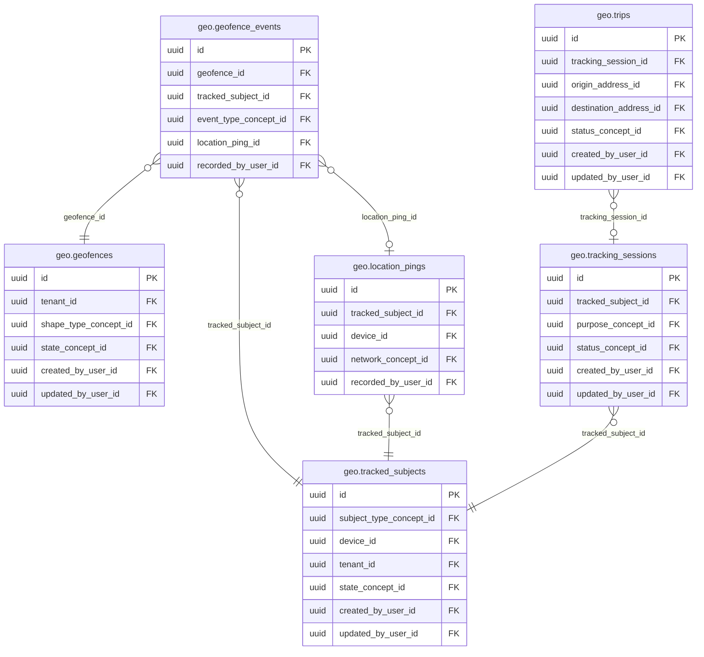

<!-- AUTOGENERADO por tools/inventario/catalogo.mjs. No editar manualmente. -->

# Catálogo del schema `geo`

- **Tablas:** 6 · **Columnas:** 74 (18 con descripción: 24.3 %) · **Índices:** 35
- **Dominio:** Núcleo y Terminología
- Método y límites del catálogo: [README del inventario](../README.md)

## Tablas

| Tabla | Propósito | Columnas | Índices | Operaciones | ORM |
|---|---|---|---|---|---|
| [geofence_events](#geofence_events) | Registra entradas y salidas de geocercas para activar seguimiento logístico o de seguridad. | 8 | 6 | 2 | COINCIDE |
| [geofences](#geofences) | Define límites geográficos usados para detectar proximidad o entrada a zonas operativas. | 14 | 6 | 3 | COINCIDE |
| [location_pings](#location_pings) | Conserva puntos de ubicación recibidos de sujetos rastreables para reconstruir movimiento y contexto temporal. | 14 | 5 | 2 | COINCIDE |
| [tracked_subjects](#tracked_subjects) | Cataloga personas, vehículos o activos cuyo movimiento necesita seguimiento geográfico autorizado. | 11 | 7 | 10 | COINCIDE |
| [tracking_sessions](#tracking_sessions) | Agrupa observaciones de ubicación en sesiones para limitar su continuidad temporal y propósito. | 13 | 5 | 8 | COINCIDE |
| [trips](#trips) | Representa recorridos entre puntos para resumir desplazamientos de sujetos o entregas. | 14 | 6 | 4 | COINCIDE |

## Diagrama entidad-relación

Las tablas se agrupan en familias por sus claves foráneas dentro del schema (máximo 40 por diagrama). Las FK hacia otros schemas se listan en la ficha de cada tabla.

### Familia 1 de 1 — 6 tablas

## Fichas

### geofence_events

#### Vista general

Registra entradas y salidas de geocercas para activar seguimiento logístico o de seguridad.

- **Estado del propósito:** DOMAIN_CURATED_DRAFT · fuente: `Mantra Core Health Context/modules/diagram_13_geo.puml: geofence_events`
- **Dominio:** Núcleo y Terminología · **Diagrama:** `Mantra Core Health Context/modules/diagram_13_geo.puml` · **DDL:** `SQL/13_geo/02_tables.sql`
- **Entidad del ORM:** `GeofenceEvents` — `src/modules/geo/entities/geofence_events.entity.ts`
- **Resumen:** 8 columnas · 6 índices · 5 FK salientes · 0 entrantes · 2 operaciones

#### Columnas

| # | Columna | Tipo | Rol estructural | Descripción | ORM |
|---|---|---|---|---|---|
| 1 | `id` | `uuid` | Clave primaria; Obligatoria | Identificador único de la instancia. _(JSDOC_ESTANDAR, `src/modules/geo/entities/geofence_events.entity.ts:12`)_ | coincide |
| 2 | `geofence_id` | `uuid` | Clave foránea → geo.geofences.id; Obligatoria | _sin dato_ | coincide |
| 3 | `tracked_subject_id` | `uuid` | Clave foránea → geo.tracked_subjects.id; Obligatoria | _sin dato_ | coincide |
| 4 | `event_type_concept_id` | `uuid` | Clave foránea → terminology.catalog_concepts.id; Obligatoria | _sin dato_ | coincide |
| 5 | `location_ping_id` | `uuid` | Clave foránea → geo.location_pings.id; Opcional | _sin dato_ | coincide |
| 6 | `occurred_at` | `timestamptz` | Opcional | _sin dato_ | coincide |
| 7 | `recorded_at` | `timestamptz` | Obligatoria | _sin dato_ | coincide |
| 8 | `recorded_by_user_id` | `uuid` | Clave foránea → iam.users.id; Opcional | _sin dato_ | coincide |

#### Relaciones

| Sentido | Columnas | Tabla | Restricción |
|---|---|---|---|
| hacia | geofence_id | geo.geofences (id) | fk_geofence_events_geofence_id |
| hacia | tracked_subject_id | geo.tracked_subjects (id) | fk_geofence_events_tracked_subject_id |
| hacia | location_ping_id | geo.location_pings (id) | fk_geofence_events_location_ping_id |
| hacia | event_type_concept_id | terminology.catalog_concepts (id) | fk_geofence_events_event_type_concept_id |
| hacia | recorded_by_user_id | iam.users (id) | fk_geofence_events_recorded_by_user_id |

#### Índices

| Índice | Único | Columnas | Para qué |
|---|---|---|---|
| `ix_geofence_events_geofence_id` | no | geofence_id | Soporta la clave foránea fk_geofence_events_geofence_id: PostgreSQL no indexa las FK por sí mismo _(DOCUMENTO)_; 1 consulta(s) de repositorio filtran u ordenan por «geofence_id», la primera columna del índice _(CONSULTA)_ |
| `ix_geofence_events_tracked_subject_id` | no | tracked_subject_id | Soporta la clave foránea fk_geofence_events_tracked_subject_id: PostgreSQL no indexa las FK por sí mismo _(DOCUMENTO)_; 1 consulta(s) de repositorio filtran u ordenan por «tracked_subject_id», la primera columna del índice _(CONSULTA)_ |
| `ix_geofence_events_event_type_concept_id` | no | event_type_concept_id | Soporta la clave foránea fk_geofence_events_event_type_concept_id: PostgreSQL no indexa las FK por sí mismo _(DOCUMENTO)_ |
| `ix_geofence_events_location_ping_id` | no | location_ping_id | Soporta la clave foránea fk_geofence_events_location_ping_id: PostgreSQL no indexa las FK por sí mismo _(DOCUMENTO)_ |
| `ix_geofence_events_recorded_by_user_id` | no | recorded_by_user_id | Soporta la clave foránea fk_geofence_events_recorded_by_user_id: PostgreSQL no indexa las FK por sí mismo _(DOCUMENTO)_ |
| `brin_geofence_events_recorded_at` | no | recorded_at | BRIN para logs e historiales append-only de gran volumen _(DOCUMENTO)_; 1 consulta(s) de repositorio filtran u ordenan por «recorded_at», la primera columna del índice _(CONSULTA)_ |

#### Operaciones que la tocan

| Operación | Efecto | Confianza |
|---|---|---|
| POST /geo/geofence-events | CREA | DIRECTA |
| POST /geo/geofence-events | LEE | DIRECTA |

#### Gobierno

| Atributo | Valor | Fuente |
|---|---|---|
| Append-only | sí (declarado) | `src/modules/geo/README.md:57` |
| Datos personales | sin fuente | — |
| Financiera | sin fuente | — |
| Crítica para auditoría | sin fuente | — |
| Retención | sin fuente | — |
| Responsable | sin fuente | — |
| Revisión | AUTO_DETECTADA | — |

---

### geofences

#### Vista general

Define límites geográficos usados para detectar proximidad o entrada a zonas operativas.

- **Estado del propósito:** DOMAIN_CURATED_DRAFT · fuente: `Mantra Core Health Context/modules/diagram_13_geo.puml: geofences`
- **Dominio:** Núcleo y Terminología · **Diagrama:** `Mantra Core Health Context/modules/diagram_13_geo.puml` · **DDL:** `SQL/13_geo/02_tables.sql`
- **Entidad del ORM:** `Geofences` — `src/modules/geo/entities/geofences.entity.ts`
- **Resumen:** 14 columnas · 6 índices · 5 FK salientes · 1 entrantes · 3 operaciones

#### Columnas

| # | Columna | Tipo | Rol estructural | Descripción | ORM |
|---|---|---|---|---|---|
| 1 | `id` | `uuid` | Clave primaria; Obligatoria | Identificador único de la instancia. _(JSDOC_ESTANDAR, `src/modules/geo/entities/geofences.entity.ts:12`)_ | coincide |
| 2 | `tenant_id` | `uuid` | Clave foránea → directory.tenants.id; Obligatoria | _sin dato_ | coincide |
| 3 | `name` | `varchar` | Obligatoria | _sin dato_ | coincide |
| 4 | `shape_type_concept_id` | `uuid` | Clave foránea → terminology.catalog_concepts.id; Obligatoria | _sin dato_ | coincide |
| 5 | `geometry_json` | `jsonb` | Opcional | _sin dato_ | coincide |
| 6 | `radius_m` | `numeric` | Opcional | _sin dato_ | coincide |
| 7 | `center_lat` | `numeric` | Opcional | _sin dato_ | coincide |
| 8 | `center_lng` | `numeric` | Opcional | _sin dato_ | coincide |
| 9 | `state_concept_id` | `uuid` | Clave foránea → terminology.catalog_concepts.id; Obligatoria | _sin dato_ | coincide |
| 10 | `created_at` | `timestamptz` | Obligatoria | Fecha y hora en que se creó el registro. _(JSDOC_ESTANDAR, `src/modules/geo/entities/geofences.entity.ts:71`)_ | coincide |
| 11 | `updated_at` | `timestamptz` | Obligatoria | Fecha y hora de la última actualización. _(JSDOC_ESTANDAR, `src/modules/geo/entities/geofences.entity.ts:77`)_ | coincide |
| 12 | `created_by_user_id` | `uuid` | Clave foránea → iam.users.id; Opcional | _sin dato_ | coincide |
| 13 | `updated_by_user_id` | `uuid` | Clave foránea → iam.users.id; Opcional | _sin dato_ | coincide |
| 14 | `row_version` | `integer = 1` | Obligatoria | Versión usada para controlar actualizaciones concurrentes. _(JSDOC_ENTIDAD, `src/modules/geo/entities/geofences.entity.ts:95`)_ | coincide |

#### Relaciones

| Sentido | Columnas | Tabla | Restricción |
|---|---|---|---|
| hacia | tenant_id | directory.tenants (id) | fk_geofences_tenant_id |
| hacia | shape_type_concept_id | terminology.catalog_concepts (id) | fk_geofences_shape_type_concept_id |
| hacia | state_concept_id | terminology.catalog_concepts (id) | fk_geofences_state_concept_id |
| hacia | created_by_user_id | iam.users (id) | fk_geofences_created_by_user_id |
| hacia | updated_by_user_id | iam.users (id) | fk_geofences_updated_by_user_id |
| desde | id | geo.geofence_events (geofence_id) | fk_geofence_events_geofence_id |

#### Índices

| Índice | Único | Columnas | Para qué |
|---|---|---|---|
| `ix_geofences_tenant_id` | no | tenant_id | Soporta la clave foránea fk_geofences_tenant_id: PostgreSQL no indexa las FK por sí mismo _(DOCUMENTO)_; 1 consulta(s) de repositorio filtran u ordenan por «tenant_id», la primera columna del índice _(CONSULTA)_ |
| `ix_geofences_shape_type_concept_id` | no | shape_type_concept_id | Soporta la clave foránea fk_geofences_shape_type_concept_id: PostgreSQL no indexa las FK por sí mismo _(DOCUMENTO)_ |
| `ix_geofences_state_concept_id` | no | state_concept_id | Soporta la clave foránea fk_geofences_state_concept_id: PostgreSQL no indexa las FK por sí mismo _(DOCUMENTO)_ |
| `ix_geofences_created_by_user_id` | no | created_by_user_id | Soporta la clave foránea fk_geofences_created_by_user_id: PostgreSQL no indexa las FK por sí mismo _(DOCUMENTO)_ |
| `ix_geofences_updated_by_user_id` | no | updated_by_user_id | Soporta la clave foránea fk_geofences_updated_by_user_id: PostgreSQL no indexa las FK por sí mismo _(DOCUMENTO)_ |
| `ix_geofences_tenant_id_state_concept_id` | no | tenant_id, state_concept_id, ("updated_at" DESC) | _sin uso detectado estáticamente_ |

#### Operaciones que la tocan

| Operación | Efecto | Confianza |
|---|---|---|
| POST /geo/geofence-events | LEE | DIRECTA |
| POST /geo/geofences | CREA | DIRECTA |
| POST /geo/geofences | LEE | DIRECTA |

#### Gobierno

| Atributo | Valor | Fuente |
|---|---|---|
| Append-only | no declarado | — |
| Datos personales | sin fuente | — |
| Financiera | sin fuente | — |
| Crítica para auditoría | sin fuente | — |
| Retención | sin fuente | — |
| Responsable | sin fuente | — |
| Revisión | AUTO_DETECTADA | — |

---

### location_pings

#### Vista general

Conserva puntos de ubicación recibidos de sujetos rastreables para reconstruir movimiento y contexto temporal.

- **Estado del propósito:** DOMAIN_CURATED_DRAFT · fuente: `Mantra Core Health Context/modules/diagram_13_geo.puml: location_pings`
- **Dominio:** Núcleo y Terminología · **Diagrama:** `Mantra Core Health Context/modules/diagram_13_geo.puml` · **DDL:** `SQL/13_geo/02_tables.sql`
- **Entidad del ORM:** `LocationPings` — `src/modules/geo/entities/location_pings.entity.ts`
- **Resumen:** 14 columnas · 5 índices · 4 FK salientes · 2 entrantes · 2 operaciones

#### Columnas

| # | Columna | Tipo | Rol estructural | Descripción | ORM |
|---|---|---|---|---|---|
| 1 | `id` | `uuid` | Clave primaria; Obligatoria | Identificador único de la instancia. _(JSDOC_ESTANDAR, `src/modules/geo/entities/location_pings.entity.ts:12`)_ | coincide |
| 2 | `tracked_subject_id` | `uuid` | Clave foránea → geo.tracked_subjects.id; Obligatoria | _sin dato_ | coincide |
| 3 | `device_id` | `uuid` | Clave foránea → iam.devices.id; Opcional | _sin dato_ | coincide |
| 4 | `latitude` | `numeric` | Obligatoria | _sin dato_ | coincide |
| 5 | `longitude` | `numeric` | Obligatoria | _sin dato_ | coincide |
| 6 | `accuracy_m` | `numeric` | Opcional | _sin dato_ | coincide |
| 7 | `altitude_m` | `numeric` | Opcional | _sin dato_ | coincide |
| 8 | `speed_mps` | `numeric` | Opcional | _sin dato_ | coincide |
| 9 | `heading_deg` | `numeric` | Opcional | _sin dato_ | coincide |
| 10 | `battery_pct` | `integer` | Opcional | _sin dato_ | coincide |
| 11 | `network_concept_id` | `uuid` | Clave foránea → terminology.catalog_concepts.id; Opcional | _sin dato_ | coincide |
| 12 | `captured_at` | `timestamptz` | Opcional | _sin dato_ | coincide |
| 13 | `recorded_at` | `timestamptz` | Obligatoria | _sin dato_ | coincide |
| 14 | `recorded_by_user_id` | `uuid` | Clave foránea → iam.users.id; Opcional | _sin dato_ | coincide |

#### Relaciones

| Sentido | Columnas | Tabla | Restricción |
|---|---|---|---|
| hacia | tracked_subject_id | geo.tracked_subjects (id) | fk_location_pings_tracked_subject_id |
| hacia | device_id | iam.devices (id) | fk_location_pings_device_id |
| hacia | network_concept_id | terminology.catalog_concepts (id) | fk_location_pings_network_concept_id |
| hacia | recorded_by_user_id | iam.users (id) | fk_location_pings_recorded_by_user_id |
| desde | id | geo.geofence_events (location_ping_id) | fk_geofence_events_location_ping_id |
| desde | id | tracking.tracking_events (location_ping_id) | fk_tracking_events_location_ping_id |

#### Índices

| Índice | Único | Columnas | Para qué |
|---|---|---|---|
| `ix_location_pings_tracked_subject_id` | no | tracked_subject_id | Soporta la clave foránea fk_location_pings_tracked_subject_id: PostgreSQL no indexa las FK por sí mismo _(DOCUMENTO)_; 1 consulta(s) de repositorio filtran u ordenan por «tracked_subject_id», la primera columna del índice _(CONSULTA)_ |
| `ix_location_pings_device_id` | no | device_id | Soporta la clave foránea fk_location_pings_device_id: PostgreSQL no indexa las FK por sí mismo _(DOCUMENTO)_ |
| `ix_location_pings_network_concept_id` | no | network_concept_id | Soporta la clave foránea fk_location_pings_network_concept_id: PostgreSQL no indexa las FK por sí mismo _(DOCUMENTO)_ |
| `ix_location_pings_recorded_by_user_id` | no | recorded_by_user_id | Soporta la clave foránea fk_location_pings_recorded_by_user_id: PostgreSQL no indexa las FK por sí mismo _(DOCUMENTO)_ |
| `brin_location_pings_recorded_at` | no | recorded_at | BRIN para logs e historiales append-only de gran volumen _(DOCUMENTO)_; 1 consulta(s) de repositorio filtran u ordenan por «recorded_at», la primera columna del índice _(CONSULTA)_ |

#### Operaciones que la tocan

| Operación | Efecto | Confianza |
|---|---|---|
| GET /geo/tracked-subjects/{id}/last-position | LEE | DIRECTA |
| POST /geo/tracked-subjects/{id}/pings | CREA | DIRECTA |

#### Gobierno

| Atributo | Valor | Fuente |
|---|---|---|
| Append-only | sí (declarado) | `src/modules/geo/README.md:55` |
| Datos personales | sin fuente | — |
| Financiera | sin fuente | — |
| Crítica para auditoría | sin fuente | — |
| Retención | sin fuente | — |
| Responsable | sin fuente | — |
| Revisión | AUTO_DETECTADA | — |

---

### tracked_subjects

#### Vista general

Cataloga personas, vehículos o activos cuyo movimiento necesita seguimiento geográfico autorizado.

- **Estado del propósito:** DOMAIN_CURATED_DRAFT · fuente: `Mantra Core Health Context/modules/diagram_13_geo.puml: tracked_subjects`
- **Dominio:** Núcleo y Terminología · **Diagrama:** `Mantra Core Health Context/modules/diagram_13_geo.puml` · **DDL:** `SQL/13_geo/02_tables.sql`
- **Entidad del ORM:** `TrackedSubjects` — `src/modules/geo/entities/tracked_subjects.entity.ts`
- **Resumen:** 11 columnas · 7 índices · 6 FK salientes · 4 entrantes · 10 operaciones

#### Columnas

| # | Columna | Tipo | Rol estructural | Descripción | ORM |
|---|---|---|---|---|---|
| 1 | `id` | `uuid` | Clave primaria; Obligatoria | Identificador único de la instancia. _(JSDOC_ESTANDAR, `src/modules/geo/entities/tracked_subjects.entity.ts:12`)_ | coincide |
| 2 | `subject_type_concept_id` | `uuid` | Clave foránea → terminology.catalog_concepts.id; Obligatoria | _sin dato_ | coincide |
| 3 | `subject_id` | `uuid` | Obligatoria | _sin dato_ | coincide |
| 4 | `device_id` | `uuid` | Clave foránea → iam.devices.id; Opcional | _sin dato_ | coincide |
| 5 | `tenant_id` | `uuid` | Clave foránea → directory.tenants.id; Opcional | _sin dato_ | coincide |
| 6 | `state_concept_id` | `uuid` | Clave foránea → terminology.catalog_concepts.id; Obligatoria | _sin dato_ | coincide |
| 7 | `created_at` | `timestamptz` | Obligatoria | Fecha y hora en que se creó el registro. _(JSDOC_ESTANDAR, `src/modules/geo/entities/tracked_subjects.entity.ts:48`)_ | coincide |
| 8 | `updated_at` | `timestamptz` | Obligatoria | Fecha y hora de la última actualización. _(JSDOC_ESTANDAR, `src/modules/geo/entities/tracked_subjects.entity.ts:54`)_ | coincide |
| 9 | `created_by_user_id` | `uuid` | Clave foránea → iam.users.id; Opcional | _sin dato_ | coincide |
| 10 | `updated_by_user_id` | `uuid` | Clave foránea → iam.users.id; Opcional | _sin dato_ | coincide |
| 11 | `row_version` | `integer = 1` | Obligatoria | Versión usada para controlar actualizaciones concurrentes. _(JSDOC_ENTIDAD, `src/modules/geo/entities/tracked_subjects.entity.ts:72`)_ | coincide |

#### Relaciones

| Sentido | Columnas | Tabla | Restricción |
|---|---|---|---|
| hacia | subject_type_concept_id | terminology.catalog_concepts (id) | fk_tracked_subjects_subject_type_concept_id |
| hacia | device_id | iam.devices (id) | fk_tracked_subjects_device_id |
| hacia | tenant_id | directory.tenants (id) | fk_tracked_subjects_tenant_id |
| hacia | state_concept_id | terminology.catalog_concepts (id) | fk_tracked_subjects_state_concept_id |
| hacia | created_by_user_id | iam.users (id) | fk_tracked_subjects_created_by_user_id |
| hacia | updated_by_user_id | iam.users (id) | fk_tracked_subjects_updated_by_user_id |
| desde | id | geo.location_pings (tracked_subject_id) | fk_location_pings_tracked_subject_id |
| desde | id | geo.tracking_sessions (tracked_subject_id) | fk_tracking_sessions_tracked_subject_id |
| desde | id | geo.geofence_events (tracked_subject_id) | fk_geofence_events_tracked_subject_id |
| desde | id | tracking.shipments (tracked_subject_id) | fk_shipments_tracked_subject_id |

#### Índices

| Índice | Único | Columnas | Para qué |
|---|---|---|---|
| `ix_tracked_subjects_subject_type_concept_id` | no | subject_type_concept_id | Soporta la clave foránea fk_tracked_subjects_subject_type_concept_id: PostgreSQL no indexa las FK por sí mismo _(DOCUMENTO)_; 1 consulta(s) de repositorio filtran u ordenan por «subject_type_concept_id», la primera columna del índice _(CONSULTA)_ |
| `ix_tracked_subjects_device_id` | no | device_id | Soporta la clave foránea fk_tracked_subjects_device_id: PostgreSQL no indexa las FK por sí mismo _(DOCUMENTO)_ |
| `ix_tracked_subjects_tenant_id` | no | tenant_id | Soporta la clave foránea fk_tracked_subjects_tenant_id: PostgreSQL no indexa las FK por sí mismo _(DOCUMENTO)_ |
| `ix_tracked_subjects_state_concept_id` | no | state_concept_id | Soporta la clave foránea fk_tracked_subjects_state_concept_id: PostgreSQL no indexa las FK por sí mismo _(DOCUMENTO)_; 1 consulta(s) de repositorio filtran u ordenan por «state_concept_id», la primera columna del índice _(CONSULTA)_ |
| `ix_tracked_subjects_created_by_user_id` | no | created_by_user_id | Soporta la clave foránea fk_tracked_subjects_created_by_user_id: PostgreSQL no indexa las FK por sí mismo _(DOCUMENTO)_ |
| `ix_tracked_subjects_updated_by_user_id` | no | updated_by_user_id | Soporta la clave foránea fk_tracked_subjects_updated_by_user_id: PostgreSQL no indexa las FK por sí mismo _(DOCUMENTO)_ |
| `ix_tracked_subjects_tenant_id_state_concept_id` | no | tenant_id, state_concept_id, ("updated_at" DESC) | _sin uso detectado estáticamente_ |

#### Operaciones que la tocan

| Operación | Efecto | Confianza |
|---|---|---|
| POST /geo/geofence-events | LEE | DIRECTA |
| POST /geo/tracked-subjects | CREA | DIRECTA |
| POST /geo/tracked-subjects | LEE | DIRECTA |
| GET /geo/tracked-subjects/{id}/last-position | LEE | DIRECTA |
| POST /geo/tracked-subjects/{id}/pings | LEE | DIRECTA |
| POST /geo/tracked-subjects/{id}/revoke-consent | LEE | DIRECTA |
| POST /geo/tracking-sessions | LEE | DIRECTA |
| POST /geo/tracking-sessions/{id}/close | LEE | DIRECTA |
| POST /geo/trips | LEE | DIRECTA |
| POST /geo/trips/{id}/close | LEE | DIRECTA |

#### Gobierno

| Atributo | Valor | Fuente |
|---|---|---|
| Append-only | no declarado | — |
| Datos personales | sin fuente | — |
| Financiera | sin fuente | — |
| Crítica para auditoría | sin fuente | — |
| Retención | sin fuente | — |
| Responsable | sin fuente | — |
| Revisión | AUTO_DETECTADA | — |

---

### tracking_sessions

#### Vista general

Agrupa observaciones de ubicación en sesiones para limitar su continuidad temporal y propósito.

- **Estado del propósito:** DOMAIN_CURATED_DRAFT · fuente: `Mantra Core Health Context/modules/diagram_13_geo.puml: tracking_sessions`
- **Dominio:** Núcleo y Terminología · **Diagrama:** `Mantra Core Health Context/modules/diagram_13_geo.puml` · **DDL:** `SQL/13_geo/02_tables.sql`
- **Entidad del ORM:** `TrackingSessions` — `src/modules/geo/entities/tracking_sessions.entity.ts`
- **Resumen:** 13 columnas · 5 índices · 5 FK salientes · 1 entrantes · 8 operaciones

#### Columnas

| # | Columna | Tipo | Rol estructural | Descripción | ORM |
|---|---|---|---|---|---|
| 1 | `id` | `uuid` | Clave primaria; Obligatoria | Identificador único de la instancia. _(JSDOC_ESTANDAR, `src/modules/geo/entities/tracking_sessions.entity.ts:12`)_ | coincide |
| 2 | `tracked_subject_id` | `uuid` | Clave foránea → geo.tracked_subjects.id; Obligatoria | _sin dato_ | coincide |
| 3 | `purpose_concept_id` | `uuid` | Clave foránea → terminology.catalog_concepts.id; Opcional | _sin dato_ | coincide |
| 4 | `related_resource_type` | `varchar` | Opcional | _sin dato_ | coincide |
| 5 | `related_resource_id` | `uuid` | Opcional | _sin dato_ | coincide |
| 6 | `status_concept_id` | `uuid` | Clave foránea → terminology.catalog_concepts.id; Obligatoria | _sin dato_ | coincide |
| 7 | `started_at` | `timestamptz` | Opcional | _sin dato_ | coincide |
| 8 | `ended_at` | `timestamptz` | Opcional | _sin dato_ | coincide |
| 9 | `created_at` | `timestamptz` | Obligatoria | Fecha y hora en que se creó el registro. _(JSDOC_ESTANDAR, `src/modules/geo/entities/tracking_sessions.entity.ts:72`)_ | coincide |
| 10 | `updated_at` | `timestamptz` | Obligatoria | Fecha y hora de la última actualización. _(JSDOC_ESTANDAR, `src/modules/geo/entities/tracking_sessions.entity.ts:78`)_ | coincide |
| 11 | `created_by_user_id` | `uuid` | Clave foránea → iam.users.id; Opcional | _sin dato_ | coincide |
| 12 | `updated_by_user_id` | `uuid` | Clave foránea → iam.users.id; Opcional | _sin dato_ | coincide |
| 13 | `row_version` | `integer = 1` | Obligatoria | Versión usada para controlar actualizaciones concurrentes. _(JSDOC_ENTIDAD, `src/modules/geo/entities/tracking_sessions.entity.ts:96`)_ | coincide |

#### Relaciones

| Sentido | Columnas | Tabla | Restricción |
|---|---|---|---|
| hacia | tracked_subject_id | geo.tracked_subjects (id) | fk_tracking_sessions_tracked_subject_id |
| hacia | purpose_concept_id | terminology.catalog_concepts (id) | fk_tracking_sessions_purpose_concept_id |
| hacia | status_concept_id | terminology.catalog_concepts (id) | fk_tracking_sessions_status_concept_id |
| hacia | created_by_user_id | iam.users (id) | fk_tracking_sessions_created_by_user_id |
| hacia | updated_by_user_id | iam.users (id) | fk_tracking_sessions_updated_by_user_id |
| desde | id | geo.trips (tracking_session_id) | fk_trips_tracking_session_id |

#### Índices

| Índice | Único | Columnas | Para qué |
|---|---|---|---|
| `ix_tracking_sessions_tracked_subject_id` | no | tracked_subject_id | Soporta la clave foránea fk_tracking_sessions_tracked_subject_id: PostgreSQL no indexa las FK por sí mismo _(DOCUMENTO)_; 2 consulta(s) de repositorio filtran u ordenan por «tracked_subject_id», la primera columna del índice _(CONSULTA)_ |
| `ix_tracking_sessions_purpose_concept_id` | no | purpose_concept_id | Soporta la clave foránea fk_tracking_sessions_purpose_concept_id: PostgreSQL no indexa las FK por sí mismo _(DOCUMENTO)_ |
| `ix_tracking_sessions_status_concept_id` | no | status_concept_id | Soporta la clave foránea fk_tracking_sessions_status_concept_id: PostgreSQL no indexa las FK por sí mismo _(DOCUMENTO)_; 2 consulta(s) de repositorio filtran u ordenan por «status_concept_id», la primera columna del índice _(CONSULTA)_ |
| `ix_tracking_sessions_created_by_user_id` | no | created_by_user_id | Soporta la clave foránea fk_tracking_sessions_created_by_user_id: PostgreSQL no indexa las FK por sí mismo _(DOCUMENTO)_ |
| `ix_tracking_sessions_updated_by_user_id` | no | updated_by_user_id | Soporta la clave foránea fk_tracking_sessions_updated_by_user_id: PostgreSQL no indexa las FK por sí mismo _(DOCUMENTO)_ |

#### Operaciones que la tocan

| Operación | Efecto | Confianza |
|---|---|---|
| POST /geo/tracked-subjects/{id}/pings | LEE | DIRECTA |
| POST /geo/tracked-subjects/{id}/revoke-consent | ACTUALIZA | POR_TIPO |
| POST /geo/tracked-subjects/{id}/revoke-consent | LEE | DIRECTA |
| POST /geo/tracking-sessions | CREA | DIRECTA |
| POST /geo/tracking-sessions | LEE | DIRECTA |
| POST /geo/tracking-sessions/{id}/close | LEE | DIRECTA |
| POST /geo/trips | LEE | DIRECTA |
| POST /geo/trips/{id}/close | LEE | DIRECTA |

#### Gobierno

| Atributo | Valor | Fuente |
|---|---|---|
| Append-only | no declarado | — |
| Datos personales | sin fuente | — |
| Financiera | sin fuente | — |
| Crítica para auditoría | sin fuente | — |
| Retención | sin fuente | — |
| Responsable | sin fuente | — |
| Revisión | AUTO_DETECTADA | — |

---

### trips

#### Vista general

Representa recorridos entre puntos para resumir desplazamientos de sujetos o entregas.

- **Estado del propósito:** DOMAIN_CURATED_DRAFT · fuente: `Mantra Core Health Context/modules/diagram_13_geo.puml: trips`
- **Dominio:** Núcleo y Terminología · **Diagrama:** `Mantra Core Health Context/modules/diagram_13_geo.puml` · **DDL:** `SQL/13_geo/02_tables.sql`
- **Entidad del ORM:** `Trips` — `src/modules/geo/entities/trips.entity.ts`
- **Resumen:** 14 columnas · 6 índices · 6 FK salientes · 0 entrantes · 4 operaciones

#### Columnas

| # | Columna | Tipo | Rol estructural | Descripción | ORM |
|---|---|---|---|---|---|
| 1 | `id` | `uuid` | Clave primaria; Obligatoria | Identificador único de la instancia. _(JSDOC_ESTANDAR, `src/modules/geo/entities/trips.entity.ts:12`)_ | coincide |
| 2 | `tracking_session_id` | `uuid` | Clave foránea → geo.tracking_sessions.id; Opcional | _sin dato_ | coincide |
| 3 | `origin_address_id` | `uuid` | Clave foránea → common.addresses.id; Opcional | _sin dato_ | coincide |
| 4 | `destination_address_id` | `uuid` | Clave foránea → common.addresses.id; Opcional | _sin dato_ | coincide |
| 5 | `distance_m` | `numeric` | Opcional | _sin dato_ | coincide |
| 6 | `duration_s` | `integer` | Opcional | _sin dato_ | coincide |
| 7 | `status_concept_id` | `uuid` | Clave foránea → terminology.catalog_concepts.id; Obligatoria | _sin dato_ | coincide |
| 8 | `started_at` | `timestamptz` | Opcional | _sin dato_ | coincide |
| 9 | `ended_at` | `timestamptz` | Opcional | _sin dato_ | coincide |
| 10 | `created_at` | `timestamptz` | Obligatoria | Fecha y hora en que se creó el registro. _(JSDOC_ESTANDAR, `src/modules/geo/entities/trips.entity.ts:78`)_ | coincide |
| 11 | `updated_at` | `timestamptz` | Obligatoria | Fecha y hora de la última actualización. _(JSDOC_ESTANDAR, `src/modules/geo/entities/trips.entity.ts:84`)_ | coincide |
| 12 | `created_by_user_id` | `uuid` | Clave foránea → iam.users.id; Opcional | _sin dato_ | coincide |
| 13 | `updated_by_user_id` | `uuid` | Clave foránea → iam.users.id; Opcional | _sin dato_ | coincide |
| 14 | `row_version` | `integer = 1` | Obligatoria | Versión usada para controlar actualizaciones concurrentes. _(JSDOC_ENTIDAD, `src/modules/geo/entities/trips.entity.ts:102`)_ | coincide |

#### Relaciones

| Sentido | Columnas | Tabla | Restricción |
|---|---|---|---|
| hacia | tracking_session_id | geo.tracking_sessions (id) | fk_trips_tracking_session_id |
| hacia | origin_address_id | common.addresses (id) | fk_trips_origin_address_id |
| hacia | destination_address_id | common.addresses (id) | fk_trips_destination_address_id |
| hacia | status_concept_id | terminology.catalog_concepts (id) | fk_trips_status_concept_id |
| hacia | created_by_user_id | iam.users (id) | fk_trips_created_by_user_id |
| hacia | updated_by_user_id | iam.users (id) | fk_trips_updated_by_user_id |

#### Índices

| Índice | Único | Columnas | Para qué |
|---|---|---|---|
| `ix_trips_tracking_session_id` | no | tracking_session_id | Soporta la clave foránea fk_trips_tracking_session_id: PostgreSQL no indexa las FK por sí mismo _(DOCUMENTO)_; 2 consulta(s) de repositorio filtran u ordenan por «tracking_session_id», la primera columna del índice _(CONSULTA)_ |
| `ix_trips_origin_address_id` | no | origin_address_id | Soporta la clave foránea fk_trips_origin_address_id: PostgreSQL no indexa las FK por sí mismo _(DOCUMENTO)_ |
| `ix_trips_destination_address_id` | no | destination_address_id | Soporta la clave foránea fk_trips_destination_address_id: PostgreSQL no indexa las FK por sí mismo _(DOCUMENTO)_ |
| `ix_trips_status_concept_id` | no | status_concept_id | Soporta la clave foránea fk_trips_status_concept_id: PostgreSQL no indexa las FK por sí mismo _(DOCUMENTO)_; 2 consulta(s) de repositorio filtran u ordenan por «status_concept_id», la primera columna del índice _(CONSULTA)_ |
| `ix_trips_created_by_user_id` | no | created_by_user_id | Soporta la clave foránea fk_trips_created_by_user_id: PostgreSQL no indexa las FK por sí mismo _(DOCUMENTO)_ |
| `ix_trips_updated_by_user_id` | no | updated_by_user_id | Soporta la clave foránea fk_trips_updated_by_user_id: PostgreSQL no indexa las FK por sí mismo _(DOCUMENTO)_ |

#### Operaciones que la tocan

| Operación | Efecto | Confianza |
|---|---|---|
| POST /geo/tracking-sessions/{id}/close | LEE | DIRECTA |
| POST /geo/trips | CREA | DIRECTA |
| POST /geo/trips | LEE | DIRECTA |
| POST /geo/trips/{id}/close | LEE | DIRECTA |

#### Gobierno

| Atributo | Valor | Fuente |
|---|---|---|
| Append-only | no declarado | — |
| Datos personales | sin fuente | — |
| Financiera | sin fuente | — |
| Crítica para auditoría | sin fuente | — |
| Retención | sin fuente | — |
| Responsable | sin fuente | — |
| Revisión | AUTO_DETECTADA | — |

---

