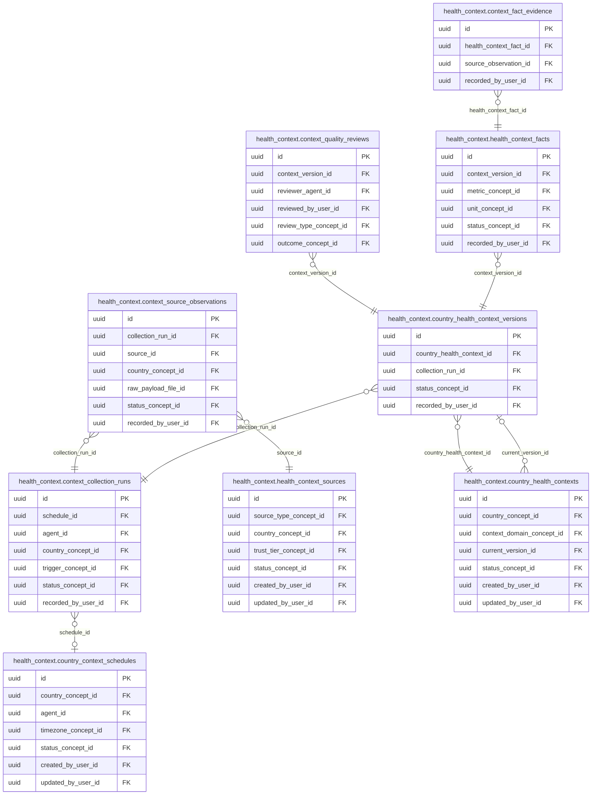

<!-- AUTOGENERADO por tools/inventario/catalogo.mjs. No editar manualmente. -->

# Catálogo del schema `health_context`

- **Tablas:** 10 · **Columnas:** 134 (22 con descripción: 16.4 %) · **Índices:** 62
- **Dominio:** Núcleo y Terminología
- Método y límites del catálogo: [README del inventario](../README.md)

## Tablas

| Tabla | Propósito | Columnas | Índices | Operaciones | ORM |
|---|---|---|---|---|---|
| [context_agents](#context_agents) | Cataloga agentes gobernados que recopilan información del entorno sanitario por país. | 14 | 7 | 5 | COINCIDE |
| [context_collection_runs](#context_collection_runs) | Conserva ejecuciones de recopilación para vincular observaciones y hechos con su agente y momento de captura. | 17 | 8 | 9 | COINCIDE |
| [context_fact_evidence](#context_fact_evidence) | Asocia evidencia y fuentes a hechos de contexto para justificar su inclusión en resúmenes. | 8 | 4 | 2 | COINCIDE |
| [context_quality_reviews](#context_quality_reviews) | Registra revisiones de calidad de contexto sanitario antes de aprobar su uso por consumidores. | 9 | 6 | 1 | COINCIDE |
| [context_source_observations](#context_source_observations) | Preserva observaciones originales de fuentes de contexto sanitario antes de su estructuración o aprobación. | 14 | 7 | 4 | COINCIDE |
| [country_context_schedules](#country_context_schedules) | Programa recopilaciones periódicas de contexto sanitario nacional para mantener actualizada la información por país. | 15 | 6 | 7 | COINCIDE |
| [country_health_context_versions](#country_health_context_versions) | Versiona resúmenes nacionales para reconstruir qué contexto se ofrecía en cada período. | 16 | 5 | 9 | COINCIDE |
| [country_health_contexts](#country_health_contexts) | Mantiene resúmenes versionados de contexto sanitario por país para informar procesos que requieren entorno de salud local. | 13 | 6 | 8 | COINCIDE |
| [health_context_facts](#health_context_facts) | Almacena hechos estructurados extraídos del contexto sanitario para hacerlos consultables y trazables. | 13 | 6 | 2 | COINCIDE |
| [health_context_sources](#health_context_sources) | Registra fuentes externas de información de salud por país para mantener procedencia y confianza. | 15 | 7 | 3 | COINCIDE |

## Diagrama entidad-relación

Las tablas se agrupan en familias por sus claves foráneas dentro del schema (máximo 40 por diagrama). Las FK hacia otros schemas se listan en la ficha de cada tabla.

### Familia 1 de 1 — 9 tablas

### Tablas sin relaciones dentro del schema

`health_context.context_agents`

## Fichas

### context_agents

#### Vista general

Cataloga agentes gobernados que recopilan información del entorno sanitario por país.

- **Estado del propósito:** DOMAIN_CURATED_DRAFT · fuente: `Mantra Core Health Context/modules/diagram_44_health_context.puml: context_agents; BIZ note`
- **Dominio:** Núcleo y Terminología · **Diagrama:** `Mantra Core Health Context/modules/diagram_44_health_context.puml` · **DDL:** `SQL/44_health_context/02_tables.sql`
- **Entidad del ORM:** `ContextAgents` — `src/modules/health_context/entities/context_agents.entity.ts`
- **Resumen:** 14 columnas · 7 índices · 6 FK salientes · 0 entrantes · 5 operaciones

#### Columnas

| # | Columna | Tipo | Rol estructural | Descripción | ORM |
|---|---|---|---|---|---|
| 1 | `id` | `uuid` | Clave primaria; Obligatoria | Identificador único de la instancia. _(JSDOC_ESTANDAR, `src/modules/health_context/entities/context_agents.entity.ts:12`)_ | coincide |
| 2 | `code` | `varchar` | Obligatoria | _sin dato_ | coincide |
| 3 | `name` | `varchar` | Obligatoria | _sin dato_ | coincide |
| 4 | `agent_type_concept_id` | `uuid` | Clave foránea → terminology.catalog_concepts.id; Obligatoria | _sin dato_ | coincide |
| 5 | `provider_id` | `uuid` | Clave foránea → integrations.external_providers.id; Opcional | _sin dato_ | coincide |
| 6 | `implementation_ref` | `varchar` | Opcional | _sin dato_ | coincide |
| 7 | `owner_tenant_id` | `uuid` | Clave foránea → directory.tenants.id; Opcional | _sin dato_ | coincide |
| 8 | `last_heartbeat_at` | `timestamptz` | Opcional | _sin dato_ | coincide |
| 9 | `status_concept_id` | `uuid` | Clave foránea → terminology.catalog_concepts.id; Obligatoria | _sin dato_ | coincide |
| 10 | `created_at` | `timestamptz` | Obligatoria | Fecha y hora en que se creó el registro. _(JSDOC_ESTANDAR, `src/modules/health_context/entities/context_agents.entity.ts:74`)_ | coincide |
| 11 | `updated_at` | `timestamptz` | Obligatoria | Fecha y hora de la última actualización. _(JSDOC_ESTANDAR, `src/modules/health_context/entities/context_agents.entity.ts:80`)_ | coincide |
| 12 | `created_by_user_id` | `uuid` | Clave foránea → iam.users.id; Opcional | _sin dato_ | coincide |
| 13 | `updated_by_user_id` | `uuid` | Clave foránea → iam.users.id; Opcional | _sin dato_ | coincide |
| 14 | `row_version` | `integer = 1` | Obligatoria | Versión usada para controlar actualizaciones concurrentes. _(JSDOC_ENTIDAD, `src/modules/health_context/entities/context_agents.entity.ts:98`)_ | coincide |

#### Relaciones

| Sentido | Columnas | Tabla | Restricción |
|---|---|---|---|
| hacia | agent_type_concept_id | terminology.catalog_concepts (id) | fk_context_agents_agent_type_concept_id |
| hacia | provider_id | integrations.external_providers (id) | fk_context_agents_provider_id |
| hacia | owner_tenant_id | directory.tenants (id) | fk_context_agents_owner_tenant_id |
| hacia | status_concept_id | terminology.catalog_concepts (id) | fk_context_agents_status_concept_id |
| hacia | created_by_user_id | iam.users (id) | fk_context_agents_created_by_user_id |
| hacia | updated_by_user_id | iam.users (id) | fk_context_agents_updated_by_user_id |

#### Índices

| Índice | Único | Columnas | Para qué |
|---|---|---|---|
| `uq_context_agents_code` | sí | code | Garantiza que no se repita la combinación (code) _(DOCUMENTO)_; 1 consulta(s) de repositorio filtran u ordenan por «code», la primera columna del índice _(CONSULTA)_ |
| `ix_context_agents_agent_type_concept_id` | no | agent_type_concept_id | Soporta la clave foránea fk_context_agents_agent_type_concept_id: PostgreSQL no indexa las FK por sí mismo _(DOCUMENTO)_ |
| `ix_context_agents_provider_id` | no | provider_id | Soporta la clave foránea fk_context_agents_provider_id: PostgreSQL no indexa las FK por sí mismo _(DOCUMENTO)_ |
| `ix_context_agents_owner_tenant_id` | no | owner_tenant_id | Soporta la clave foránea fk_context_agents_owner_tenant_id: PostgreSQL no indexa las FK por sí mismo _(DOCUMENTO)_ |
| `ix_context_agents_status_concept_id` | no | status_concept_id | Soporta la clave foránea fk_context_agents_status_concept_id: PostgreSQL no indexa las FK por sí mismo _(DOCUMENTO)_ |
| `ix_context_agents_created_by_user_id` | no | created_by_user_id | Soporta la clave foránea fk_context_agents_created_by_user_id: PostgreSQL no indexa las FK por sí mismo _(DOCUMENTO)_ |
| `ix_context_agents_updated_by_user_id` | no | updated_by_user_id | Soporta la clave foránea fk_context_agents_updated_by_user_id: PostgreSQL no indexa las FK por sí mismo _(DOCUMENTO)_ |

#### Restricciones

| Restricción | Tipo | Definición |
|---|---|---|
| `uq_context_agents_code` | UNIQUE INDEX | UNIQUE INDEX ("code") |

#### Operaciones que la tocan

| Operación | Efecto | Confianza |
|---|---|---|
| POST /health-context/agents | CREA | DIRECTA |
| POST /health-context/agents | LEE | DIRECTA |
| POST /health-context/collection-runs | LEE | DIRECTA |
| POST /health-context/internal/schedules/run-due | LEE | DIRECTA |
| POST /health-context/schedules | LEE | DIRECTA |

#### Gobierno

| Atributo | Valor | Fuente |
|---|---|---|
| Append-only | no declarado | — |
| Datos personales | sin fuente | — |
| Financiera | sin fuente | — |
| Crítica para auditoría | sin fuente | — |
| Retención | sin fuente | — |
| Responsable | sin fuente | — |
| Revisión | AUTO_DETECTADA | — |

---

### context_collection_runs

#### Vista general

Conserva ejecuciones de recopilación para vincular observaciones y hechos con su agente y momento de captura.

- **Estado del propósito:** DOMAIN_CURATED_DRAFT · fuente: `Mantra Core Health Context/modules/diagram_44_health_context.puml: context_collection_runs`
- **Dominio:** Núcleo y Terminología · **Diagrama:** `Mantra Core Health Context/modules/diagram_44_health_context.puml` · **DDL:** `SQL/44_health_context/02_tables.sql`
- **Entidad del ORM:** `ContextCollectionRuns` — `src/modules/health_context/entities/context_collection_runs.entity.ts`
- **Resumen:** 17 columnas · 8 índices · 6 FK salientes · 2 entrantes · 9 operaciones

#### Columnas

| # | Columna | Tipo | Rol estructural | Descripción | ORM |
|---|---|---|---|---|---|
| 1 | `id` | `uuid` | Clave primaria; Obligatoria | Identificador único de la instancia. _(JSDOC_ESTANDAR, `src/modules/health_context/entities/context_collection_runs.entity.ts:12`)_ | coincide |
| 2 | `schedule_id` | `uuid` | Clave foránea → health_context.country_context_schedules.id; Opcional | _sin dato_ | coincide |
| 3 | `agent_id` | `uuid` | Clave foránea → automation.agents.id; Obligatoria | _sin dato_ | coincide |
| 4 | `country_concept_id` | `uuid` | Clave foránea → terminology.catalog_concepts.id; Obligatoria | _sin dato_ | coincide |
| 5 | `idempotency_key` | `varchar` | Obligatoria | _sin dato_ | coincide |
| 6 | `trigger_concept_id` | `uuid` | Clave foránea → terminology.catalog_concepts.id; Obligatoria | _sin dato_ | coincide |
| 7 | `status_concept_id` | `uuid` | Clave foránea → terminology.catalog_concepts.id; Obligatoria | _sin dato_ | coincide |
| 8 | `started_at` | `timestamptz` | Obligatoria | _sin dato_ | coincide |
| 9 | `finished_at` | `timestamptz` | Opcional | _sin dato_ | coincide |
| 10 | `source_count` | `integer` | Opcional | _sin dato_ | coincide |
| 11 | `observations_read` | `bigint` | Opcional | _sin dato_ | coincide |
| 12 | `observations_accepted` | `bigint` | Opcional | _sin dato_ | coincide |
| 13 | `observations_rejected` | `bigint` | Opcional | _sin dato_ | coincide |
| 14 | `continuation_cursor_json` | `jsonb` | Opcional | _sin dato_ | coincide |
| 15 | `error_summary` | `text` | Opcional | _sin dato_ | coincide |
| 16 | `recorded_at` | `timestamptz` | Obligatoria | _sin dato_ | coincide |
| 17 | `recorded_by_user_id` | `uuid` | Clave foránea → iam.users.id; Opcional | _sin dato_ | coincide |

#### Relaciones

| Sentido | Columnas | Tabla | Restricción |
|---|---|---|---|
| hacia | schedule_id | health_context.country_context_schedules (id) | fk_context_collection_runs_schedule_id |
| hacia | agent_id | automation.agents (id) | fk_context_collection_runs_agent_id |
| hacia | country_concept_id | terminology.catalog_concepts (id) | fk_context_collection_runs_country_concept_id |
| hacia | trigger_concept_id | terminology.catalog_concepts (id) | fk_context_collection_runs_trigger_concept_id |
| hacia | status_concept_id | terminology.catalog_concepts (id) | fk_context_collection_runs_status_concept_id |
| hacia | recorded_by_user_id | iam.users (id) | fk_context_collection_runs_recorded_by_user_id |
| desde | id | health_context.context_source_observations (collection_run_id) | fk_context_source_observations_collection_run_id |
| desde | id | health_context.country_health_context_versions (collection_run_id) | fk_country_health_context_versions_collection_run_id |

#### Índices

| Índice | Único | Columnas | Para qué |
|---|---|---|---|
| `uq_context_collection_runs_idempotency_key` | sí | idempotency_key | Garantiza que no se repita la combinación (idempotency_key) _(DOCUMENTO)_; 1 consulta(s) de repositorio filtran u ordenan por «idempotency_key», la primera columna del índice _(CONSULTA)_ |
| `ix_context_collection_runs_schedule_id` | no | schedule_id | Soporta la clave foránea fk_context_collection_runs_schedule_id: PostgreSQL no indexa las FK por sí mismo _(DOCUMENTO)_ |
| `ix_context_collection_runs_agent_id` | no | agent_id | Soporta la clave foránea fk_context_collection_runs_agent_id: PostgreSQL no indexa las FK por sí mismo _(DOCUMENTO)_ |
| `ix_context_collection_runs_country_concept_id` | no | country_concept_id | Soporta la clave foránea fk_context_collection_runs_country_concept_id: PostgreSQL no indexa las FK por sí mismo _(DOCUMENTO)_ |
| `ix_context_collection_runs_trigger_concept_id` | no | trigger_concept_id | Soporta la clave foránea fk_context_collection_runs_trigger_concept_id: PostgreSQL no indexa las FK por sí mismo _(DOCUMENTO)_ |
| `ix_context_collection_runs_status_concept_id` | no | status_concept_id | Soporta la clave foránea fk_context_collection_runs_status_concept_id: PostgreSQL no indexa las FK por sí mismo _(DOCUMENTO)_ |
| `ix_context_collection_runs_recorded_by_user_id` | no | recorded_by_user_id | Soporta la clave foránea fk_context_collection_runs_recorded_by_user_id: PostgreSQL no indexa las FK por sí mismo _(DOCUMENTO)_ |
| `brin_context_collection_runs_recorded_at` | no | recorded_at | BRIN para logs e historiales append-only de gran volumen _(DOCUMENTO)_ |

#### Restricciones

| Restricción | Tipo | Definición |
|---|---|---|
| `uq_context_collection_runs_idempotency_key` | UNIQUE INDEX | UNIQUE INDEX ("idempotency_key") |

#### Operaciones que la tocan

| Operación | Efecto | Confianza |
|---|---|---|
| POST /health-context/collection-runs | CREA | DIRECTA |
| POST /health-context/collection-runs | LEE | DIRECTA |
| POST /health-context/collection-runs/{id}/finish | ACTUALIZA | POR_TIPO |
| POST /health-context/collection-runs/{id}/finish | LEE | DIRECTA |
| POST /health-context/collection-runs/{id}/observations | ACTUALIZA | POR_TIPO |
| POST /health-context/collection-runs/{id}/observations | LEE | DIRECTA |
| POST /health-context/contexts/{id}/versions | LEE | DIRECTA |
| POST /health-context/internal/schedules/run-due | CREA | DIRECTA |
| POST /health-context/internal/schedules/run-due | LEE | DIRECTA |

#### Gobierno

| Atributo | Valor | Fuente |
|---|---|---|
| Append-only | no declarado | — |
| Datos personales | sin fuente | — |
| Financiera | sin fuente | — |
| Crítica para auditoría | sin fuente | — |
| Retención | sin fuente | — |
| Responsable | sin fuente | — |
| Revisión | AUTO_DETECTADA | — |

---

### context_fact_evidence

#### Vista general

Asocia evidencia y fuentes a hechos de contexto para justificar su inclusión en resúmenes.

- **Estado del propósito:** DOMAIN_CURATED_DRAFT · fuente: `Mantra Core Health Context/modules/diagram_44_health_context.puml: context_fact_evidence`
- **Dominio:** Núcleo y Terminología · **Diagrama:** `Mantra Core Health Context/modules/diagram_44_health_context.puml` · **DDL:** `SQL/44_health_context/02_tables.sql`
- **Entidad del ORM:** `ContextFactEvidence` — `src/modules/health_context/entities/context_fact_evidence.entity.ts`
- **Resumen:** 8 columnas · 4 índices · 3 FK salientes · 0 entrantes · 2 operaciones

#### Columnas

| # | Columna | Tipo | Rol estructural | Descripción | ORM |
|---|---|---|---|---|---|
| 1 | `id` | `uuid` | Clave primaria; Obligatoria | Identificador único de la instancia. _(JSDOC_ESTANDAR, `src/modules/health_context/entities/context_fact_evidence.entity.ts:12`)_ | coincide |
| 2 | `health_context_fact_id` | `uuid` | Clave foránea → health_context.health_context_facts.id; Obligatoria | _sin dato_ | coincide |
| 3 | `source_observation_id` | `uuid` | Clave foránea → clinical.observations.id; Obligatoria | _sin dato_ | coincide |
| 4 | `evidence_locator_json` | `jsonb` | Opcional | _sin dato_ | coincide |
| 5 | `relevance_score` | `numeric` | Opcional | _sin dato_ | coincide |
| 6 | `evidence_hash` | `varchar` | Opcional | _sin dato_ | coincide |
| 7 | `recorded_at` | `timestamptz` | Obligatoria | _sin dato_ | coincide |
| 8 | `recorded_by_user_id` | `uuid` | Clave foránea → iam.users.id; Opcional | _sin dato_ | coincide |

#### Relaciones

| Sentido | Columnas | Tabla | Restricción |
|---|---|---|---|
| hacia | health_context_fact_id | health_context.health_context_facts (id) | fk_context_fact_evidence_health_context_fact_id |
| hacia | source_observation_id | clinical.observations (id) | fk_context_fact_evidence_source_observation_id |
| hacia | recorded_by_user_id | iam.users (id) | fk_context_fact_evidence_recorded_by_user_id |

#### Índices

| Índice | Único | Columnas | Para qué |
|---|---|---|---|
| `ix_context_fact_evidence_health_context_fact_id` | no | health_context_fact_id | Soporta la clave foránea fk_context_fact_evidence_health_context_fact_id: PostgreSQL no indexa las FK por sí mismo _(DOCUMENTO)_; 1 consulta(s) de repositorio filtran u ordenan por «health_context_fact_id», la primera columna del índice _(CONSULTA)_ |
| `ix_context_fact_evidence_source_observation_id` | no | source_observation_id | Soporta la clave foránea fk_context_fact_evidence_source_observation_id: PostgreSQL no indexa las FK por sí mismo _(DOCUMENTO)_ |
| `ix_context_fact_evidence_recorded_by_user_id` | no | recorded_by_user_id | Soporta la clave foránea fk_context_fact_evidence_recorded_by_user_id: PostgreSQL no indexa las FK por sí mismo _(DOCUMENTO)_ |
| `brin_context_fact_evidence_recorded_at` | no | recorded_at | BRIN para logs e historiales append-only de gran volumen _(DOCUMENTO)_ |

#### Operaciones que la tocan

| Operación | Efecto | Confianza |
|---|---|---|
| POST /health-context/contexts/{id}/versions | CREA | DIRECTA |
| GET /health-context/contexts/resolve | LEE | DIRECTA |

#### Gobierno

| Atributo | Valor | Fuente |
|---|---|---|
| Append-only | no declarado | — |
| Datos personales | sin fuente | — |
| Financiera | sin fuente | — |
| Crítica para auditoría | sin fuente | — |
| Retención | sin fuente | — |
| Responsable | sin fuente | — |
| Revisión | AUTO_DETECTADA | — |

---

### context_quality_reviews

#### Vista general

Registra revisiones de calidad de contexto sanitario antes de aprobar su uso por consumidores.

- **Estado del propósito:** DOMAIN_CURATED_DRAFT · fuente: `Mantra Core Health Context/modules/diagram_44_health_context.puml: context_quality_reviews`
- **Dominio:** Núcleo y Terminología · **Diagrama:** `Mantra Core Health Context/modules/diagram_44_health_context.puml` · **DDL:** `SQL/44_health_context/02_tables.sql`
- **Entidad del ORM:** `ContextQualityReviews` — `src/modules/health_context/entities/context_quality_reviews.entity.ts`
- **Resumen:** 9 columnas · 6 índices · 5 FK salientes · 0 entrantes · 1 operaciones

#### Columnas

| # | Columna | Tipo | Rol estructural | Descripción | ORM |
|---|---|---|---|---|---|
| 1 | `id` | `uuid` | Clave primaria; Obligatoria | Identificador único de la instancia. _(JSDOC_ESTANDAR, `src/modules/health_context/entities/context_quality_reviews.entity.ts:12`)_ | coincide |
| 2 | `context_version_id` | `uuid` | Clave foránea → health_context.country_health_context_versions.id; Obligatoria | _sin dato_ | coincide |
| 3 | `reviewer_agent_id` | `uuid` | Clave foránea → automation.agents.id; Opcional | _sin dato_ | coincide |
| 4 | `reviewed_by_user_id` | `uuid` | Clave foránea → iam.users.id; Opcional | _sin dato_ | coincide |
| 5 | `review_type_concept_id` | `uuid` | Clave foránea → terminology.catalog_concepts.id; Obligatoria | _sin dato_ | coincide |
| 6 | `outcome_concept_id` | `uuid` | Clave foránea → terminology.catalog_concepts.id; Obligatoria | _sin dato_ | coincide |
| 7 | `issues_json` | `jsonb` | Opcional | _sin dato_ | coincide |
| 8 | `notes` | `text` | Opcional | _sin dato_ | coincide |
| 9 | `recorded_at` | `timestamptz` | Obligatoria | _sin dato_ | coincide |

#### Relaciones

| Sentido | Columnas | Tabla | Restricción |
|---|---|---|---|
| hacia | context_version_id | health_context.country_health_context_versions (id) | fk_context_quality_reviews_context_version_id |
| hacia | reviewer_agent_id | automation.agents (id) | fk_context_quality_reviews_reviewer_agent_id |
| hacia | reviewed_by_user_id | iam.users (id) | fk_context_quality_reviews_reviewed_by_user_id |
| hacia | review_type_concept_id | terminology.catalog_concepts (id) | fk_context_quality_reviews_review_type_concept_id |
| hacia | outcome_concept_id | terminology.catalog_concepts (id) | fk_context_quality_reviews_outcome_concept_id |

#### Índices

| Índice | Único | Columnas | Para qué |
|---|---|---|---|
| `ix_context_quality_reviews_context_version_id` | no | context_version_id | Soporta la clave foránea fk_context_quality_reviews_context_version_id: PostgreSQL no indexa las FK por sí mismo _(DOCUMENTO)_ |
| `ix_context_quality_reviews_reviewer_agent_id` | no | reviewer_agent_id | Soporta la clave foránea fk_context_quality_reviews_reviewer_agent_id: PostgreSQL no indexa las FK por sí mismo _(DOCUMENTO)_ |
| `ix_context_quality_reviews_reviewed_by_user_id` | no | reviewed_by_user_id | Soporta la clave foránea fk_context_quality_reviews_reviewed_by_user_id: PostgreSQL no indexa las FK por sí mismo _(DOCUMENTO)_ |
| `ix_context_quality_reviews_review_type_concept_id` | no | review_type_concept_id | Soporta la clave foránea fk_context_quality_reviews_review_type_concept_id: PostgreSQL no indexa las FK por sí mismo _(DOCUMENTO)_ |
| `ix_context_quality_reviews_outcome_concept_id` | no | outcome_concept_id | Soporta la clave foránea fk_context_quality_reviews_outcome_concept_id: PostgreSQL no indexa las FK por sí mismo _(DOCUMENTO)_ |
| `brin_context_quality_reviews_recorded_at` | no | recorded_at | BRIN para logs e historiales append-only de gran volumen _(DOCUMENTO)_ |

#### Operaciones que la tocan

| Operación | Efecto | Confianza |
|---|---|---|
| POST /health-context/versions/{id}/quality-reviews | CREA | DIRECTA |

#### Gobierno

| Atributo | Valor | Fuente |
|---|---|---|
| Append-only | no declarado | — |
| Datos personales | sin fuente | — |
| Financiera | sin fuente | — |
| Crítica para auditoría | sin fuente | — |
| Retención | sin fuente | — |
| Responsable | sin fuente | — |
| Revisión | AUTO_DETECTADA | — |

---

### context_source_observations

#### Vista general

Preserva observaciones originales de fuentes de contexto sanitario antes de su estructuración o aprobación.

- **Estado del propósito:** DOMAIN_CURATED_DRAFT · fuente: `Mantra Core Health Context/modules/diagram_44_health_context.puml: context_source_observations`
- **Dominio:** Núcleo y Terminología · **Diagrama:** `Mantra Core Health Context/modules/diagram_44_health_context.puml` · **DDL:** `SQL/44_health_context/02_tables.sql`
- **Entidad del ORM:** `ContextSourceObservations` — `src/modules/health_context/entities/context_source_observations.entity.ts`
- **Resumen:** 14 columnas · 7 índices · 6 FK salientes · 0 entrantes · 4 operaciones

#### Columnas

| # | Columna | Tipo | Rol estructural | Descripción | ORM |
|---|---|---|---|---|---|
| 1 | `id` | `uuid` | Clave primaria; Obligatoria | Identificador único de la instancia. _(JSDOC_ESTANDAR, `src/modules/health_context/entities/context_source_observations.entity.ts:12`)_ | coincide |
| 2 | `collection_run_id` | `uuid` | Clave foránea → health_context.context_collection_runs.id; Obligatoria | _sin dato_ | coincide |
| 3 | `source_id` | `uuid` | Clave foránea → health_context.health_context_sources.id; Obligatoria | _sin dato_ | coincide |
| 4 | `country_concept_id` | `uuid` | Clave foránea → terminology.catalog_concepts.id; Obligatoria | _sin dato_ | coincide |
| 5 | `source_locator` | `text` | Obligatoria | _sin dato_ | coincide |
| 6 | `published_at` | `timestamptz` | Opcional | _sin dato_ | coincide |
| 7 | `retrieved_at` | `timestamptz` | Obligatoria | _sin dato_ | coincide |
| 8 | `media_type` | `varchar` | Opcional | _sin dato_ | coincide |
| 9 | `raw_payload_file_id` | `uuid` | Clave foránea → common.files.id; Opcional | _sin dato_ | coincide |
| 10 | `extracted_payload_json` | `jsonb` | Opcional | _sin dato_ | coincide |
| 11 | `content_hash` | `varchar` | Obligatoria | _sin dato_ | coincide |
| 12 | `status_concept_id` | `uuid` | Clave foránea → terminology.catalog_concepts.id; Obligatoria | _sin dato_ | coincide |
| 13 | `recorded_at` | `timestamptz` | Obligatoria | _sin dato_ | coincide |
| 14 | `recorded_by_user_id` | `uuid` | Clave foránea → iam.users.id; Opcional | _sin dato_ | coincide |

#### Relaciones

| Sentido | Columnas | Tabla | Restricción |
|---|---|---|---|
| hacia | collection_run_id | health_context.context_collection_runs (id) | fk_context_source_observations_collection_run_id |
| hacia | source_id | health_context.health_context_sources (id) | fk_context_source_observations_source_id |
| hacia | country_concept_id | terminology.catalog_concepts (id) | fk_context_source_observations_country_concept_id |
| hacia | raw_payload_file_id | common.files (id) | fk_context_source_observations_raw_payload_file_id |
| hacia | status_concept_id | terminology.catalog_concepts (id) | fk_context_source_observations_status_concept_id |
| hacia | recorded_by_user_id | iam.users (id) | fk_context_source_observations_recorded_by_user_id |

#### Índices

| Índice | Único | Columnas | Para qué |
|---|---|---|---|
| `ix_context_source_observations_collection_run_id` | no | collection_run_id | Soporta la clave foránea fk_context_source_observations_collection_run_id: PostgreSQL no indexa las FK por sí mismo _(DOCUMENTO)_; 2 consulta(s) de repositorio filtran u ordenan por «collection_run_id», la primera columna del índice _(CONSULTA)_ |
| `ix_context_source_observations_source_id` | no | source_id | Soporta la clave foránea fk_context_source_observations_source_id: PostgreSQL no indexa las FK por sí mismo _(DOCUMENTO)_ |
| `ix_context_source_observations_country_concept_id` | no | country_concept_id | Soporta la clave foránea fk_context_source_observations_country_concept_id: PostgreSQL no indexa las FK por sí mismo _(DOCUMENTO)_ |
| `ix_context_source_observations_raw_payload_file_id` | no | raw_payload_file_id | Soporta la clave foránea fk_context_source_observations_raw_payload_file_id: PostgreSQL no indexa las FK por sí mismo _(DOCUMENTO)_ |
| `ix_context_source_observations_status_concept_id` | no | status_concept_id | Soporta la clave foránea fk_context_source_observations_status_concept_id: PostgreSQL no indexa las FK por sí mismo _(DOCUMENTO)_ |
| `ix_context_source_observations_recorded_by_user_id` | no | recorded_by_user_id | Soporta la clave foránea fk_context_source_observations_recorded_by_user_id: PostgreSQL no indexa las FK por sí mismo _(DOCUMENTO)_ |
| `brin_context_source_observations_recorded_at` | no | recorded_at | BRIN para logs e historiales append-only de gran volumen _(DOCUMENTO)_ |

#### Operaciones que la tocan

| Operación | Efecto | Confianza |
|---|---|---|
| POST /health-context/collection-runs/{id}/finish | LEE | DIRECTA |
| POST /health-context/collection-runs/{id}/observations | CREA | DIRECTA |
| POST /health-context/collection-runs/{id}/observations | LEE | DIRECTA |
| POST /health-context/contexts/{id}/versions | LEE | DIRECTA |

#### Gobierno

| Atributo | Valor | Fuente |
|---|---|---|
| Append-only | no declarado | — |
| Datos personales | sin fuente | — |
| Financiera | sin fuente | — |
| Crítica para auditoría | sin fuente | — |
| Retención | sin fuente | — |
| Responsable | sin fuente | — |
| Revisión | AUTO_DETECTADA | — |

---

### country_context_schedules

#### Vista general

Programa recopilaciones periódicas de contexto sanitario nacional para mantener actualizada la información por país.

- **Estado del propósito:** DOMAIN_CURATED_DRAFT · fuente: `Mantra Core Health Context/modules/diagram_44_health_context.puml: country_context_schedules`
- **Dominio:** Núcleo y Terminología · **Diagrama:** `Mantra Core Health Context/modules/diagram_44_health_context.puml` · **DDL:** `SQL/44_health_context/02_tables.sql`
- **Entidad del ORM:** `CountryContextSchedules` — `src/modules/health_context/entities/country_context_schedules.entity.ts`
- **Resumen:** 15 columnas · 6 índices · 6 FK salientes · 1 entrantes · 7 operaciones

#### Columnas

| # | Columna | Tipo | Rol estructural | Descripción | ORM |
|---|---|---|---|---|---|
| 1 | `id` | `uuid` | Clave primaria; Obligatoria | Identificador único de la instancia. _(JSDOC_ESTANDAR, `src/modules/health_context/entities/country_context_schedules.entity.ts:12`)_ | coincide |
| 2 | `country_concept_id` | `uuid` | Clave foránea → terminology.catalog_concepts.id; Obligatoria | _sin dato_ | coincide |
| 3 | `agent_id` | `uuid` | Clave foránea → automation.agents.id; Obligatoria | _sin dato_ | coincide |
| 4 | `schedule_expression` | `varchar` | Obligatoria | _sin dato_ | coincide |
| 5 | `timezone_concept_id` | `uuid` | Clave foránea → terminology.catalog_concepts.id; Opcional | _sin dato_ | coincide |
| 6 | `lookback_days` | `integer` | Opcional | _sin dato_ | coincide |
| 7 | `freshness_ttl_seconds` | `integer` | Opcional | _sin dato_ | coincide |
| 8 | `next_run_at` | `timestamptz` | Opcional | _sin dato_ | coincide |
| 9 | `last_success_at` | `timestamptz` | Opcional | _sin dato_ | coincide |
| 10 | `status_concept_id` | `uuid` | Clave foránea → terminology.catalog_concepts.id; Obligatoria | _sin dato_ | coincide |
| 11 | `created_at` | `timestamptz` | Obligatoria | Fecha y hora en que se creó el registro. _(JSDOC_ESTANDAR, `src/modules/health_context/entities/country_context_schedules.entity.ts:84`)_ | coincide |
| 12 | `updated_at` | `timestamptz` | Obligatoria | Fecha y hora de la última actualización. _(JSDOC_ESTANDAR, `src/modules/health_context/entities/country_context_schedules.entity.ts:90`)_ | coincide |
| 13 | `created_by_user_id` | `uuid` | Clave foránea → iam.users.id; Opcional | _sin dato_ | coincide |
| 14 | `updated_by_user_id` | `uuid` | Clave foránea → iam.users.id; Opcional | _sin dato_ | coincide |
| 15 | `row_version` | `integer = 1` | Obligatoria | Versión usada para controlar actualizaciones concurrentes. _(JSDOC_ENTIDAD, `src/modules/health_context/entities/country_context_schedules.entity.ts:108`)_ | coincide |

#### Relaciones

| Sentido | Columnas | Tabla | Restricción |
|---|---|---|---|
| hacia | country_concept_id | terminology.catalog_concepts (id) | fk_country_context_schedules_country_concept_id |
| hacia | agent_id | automation.agents (id) | fk_country_context_schedules_agent_id |
| hacia | timezone_concept_id | terminology.catalog_concepts (id) | fk_country_context_schedules_timezone_concept_id |
| hacia | status_concept_id | terminology.catalog_concepts (id) | fk_country_context_schedules_status_concept_id |
| hacia | created_by_user_id | iam.users (id) | fk_country_context_schedules_created_by_user_id |
| hacia | updated_by_user_id | iam.users (id) | fk_country_context_schedules_updated_by_user_id |
| desde | id | health_context.context_collection_runs (schedule_id) | fk_context_collection_runs_schedule_id |

#### Índices

| Índice | Único | Columnas | Para qué |
|---|---|---|---|
| `ix_country_context_schedules_country_concept_id` | no | country_concept_id | Soporta la clave foránea fk_country_context_schedules_country_concept_id: PostgreSQL no indexa las FK por sí mismo _(DOCUMENTO)_ |
| `ix_country_context_schedules_agent_id` | no | agent_id | Soporta la clave foránea fk_country_context_schedules_agent_id: PostgreSQL no indexa las FK por sí mismo _(DOCUMENTO)_ |
| `ix_country_context_schedules_timezone_concept_id` | no | timezone_concept_id | Soporta la clave foránea fk_country_context_schedules_timezone_concept_id: PostgreSQL no indexa las FK por sí mismo _(DOCUMENTO)_ |
| `ix_country_context_schedules_status_concept_id` | no | status_concept_id | Soporta la clave foránea fk_country_context_schedules_status_concept_id: PostgreSQL no indexa las FK por sí mismo _(DOCUMENTO)_; 1 consulta(s) de repositorio filtran u ordenan por «status_concept_id», la primera columna del índice _(CONSULTA)_ |
| `ix_country_context_schedules_created_by_user_id` | no | created_by_user_id | Soporta la clave foránea fk_country_context_schedules_created_by_user_id: PostgreSQL no indexa las FK por sí mismo _(DOCUMENTO)_ |
| `ix_country_context_schedules_updated_by_user_id` | no | updated_by_user_id | Soporta la clave foránea fk_country_context_schedules_updated_by_user_id: PostgreSQL no indexa las FK por sí mismo _(DOCUMENTO)_ |

#### Operaciones que la tocan

| Operación | Efecto | Confianza |
|---|---|---|
| POST /health-context/collection-runs | ACTUALIZA | POR_TIPO |
| POST /health-context/collection-runs | LEE | DIRECTA |
| POST /health-context/collection-runs/{id}/finish | ACTUALIZA | POR_TIPO |
| POST /health-context/collection-runs/{id}/finish | LEE | DIRECTA |
| POST /health-context/internal/schedules/run-due | ACTUALIZA | POR_TIPO |
| POST /health-context/internal/schedules/run-due | LEE | DIRECTA |
| POST /health-context/schedules | CREA | DIRECTA |

#### Gobierno

| Atributo | Valor | Fuente |
|---|---|---|
| Append-only | no declarado | — |
| Datos personales | sin fuente | — |
| Financiera | sin fuente | — |
| Crítica para auditoría | sin fuente | — |
| Retención | sin fuente | — |
| Responsable | sin fuente | — |
| Revisión | AUTO_DETECTADA | — |

---

### country_health_context_versions

#### Vista general

Versiona resúmenes nacionales para reconstruir qué contexto se ofrecía en cada período.

- **Estado del propósito:** DOMAIN_CURATED_DRAFT · fuente: `Mantra Core Health Context/modules/diagram_44_health_context.puml: country_health_context_versions`
- **Dominio:** Núcleo y Terminología · **Diagrama:** `Mantra Core Health Context/modules/diagram_44_health_context.puml` · **DDL:** `SQL/44_health_context/02_tables.sql`
- **Entidad del ORM:** `CountryHealthContextVersions` — `src/modules/health_context/entities/country_health_context_versions.entity.ts`
- **Resumen:** 16 columnas · 5 índices · 4 FK salientes · 3 entrantes · 9 operaciones

#### Columnas

| # | Columna | Tipo | Rol estructural | Descripción | ORM |
|---|---|---|---|---|---|
| 1 | `id` | `uuid` | Clave primaria; Obligatoria | Identificador único de la instancia. _(JSDOC_ESTANDAR, `src/modules/health_context/entities/country_health_context_versions.entity.ts:15`)_ | coincide |
| 2 | `country_health_context_id` | `uuid` | Clave foránea → health_context.country_health_contexts.id; Obligatoria | _sin dato_ | coincide |
| 3 | `version_number` | `integer` | Obligatoria | _sin dato_ | coincide |
| 4 | `collection_run_id` | `uuid` | Clave foránea → health_context.context_collection_runs.id; Obligatoria | _sin dato_ | coincide |
| 5 | `schema_version` | `varchar` | Obligatoria | _sin dato_ | coincide |
| 6 | `summary` | `text` | Opcional | _sin dato_ | coincide |
| 7 | `context_payload_json` | `jsonb` | Obligatoria | _sin dato_ | coincide |
| 8 | `observed_at` | `timestamptz` | Obligatoria | _sin dato_ | coincide |
| 9 | `effective_from` | `timestamptz` | Obligatoria | _sin dato_ | coincide |
| 10 | `effective_to` | `timestamptz` | Opcional | _sin dato_ | coincide |
| 11 | `expires_at` | `timestamptz` | Opcional | _sin dato_ | coincide |
| 12 | `confidence_score` | `numeric` | Opcional | _sin dato_ | coincide |
| 13 | `content_hash` | `varchar` | Obligatoria | _sin dato_ | coincide |
| 14 | `status_concept_id` | `uuid` | Clave foránea → terminology.catalog_concepts.id; Obligatoria | _sin dato_ | coincide |
| 15 | `recorded_at` | `timestamptz` | Obligatoria | _sin dato_ | coincide |
| 16 | `recorded_by_user_id` | `uuid` | Clave foránea → iam.users.id; Opcional | _sin dato_ | coincide |

#### Relaciones

| Sentido | Columnas | Tabla | Restricción |
|---|---|---|---|
| hacia | country_health_context_id | health_context.country_health_contexts (id) | fk_country_health_context_versions_country_health_context_id |
| hacia | collection_run_id | health_context.context_collection_runs (id) | fk_country_health_context_versions_collection_run_id |
| hacia | status_concept_id | terminology.catalog_concepts (id) | fk_country_health_context_versions_status_concept_id |
| hacia | recorded_by_user_id | iam.users (id) | fk_country_health_context_versions_recorded_by_user_id |
| desde | id | health_context.country_health_contexts (current_version_id) | fk_country_health_contexts_current_version_id |
| desde | id | health_context.health_context_facts (context_version_id) | fk_health_context_facts_context_version_id |
| desde | id | health_context.context_quality_reviews (context_version_id) | fk_context_quality_reviews_context_version_id |

#### Índices

| Índice | Único | Columnas | Para qué |
|---|---|---|---|
| `ix_country_health_context_versions_country_health_context_id` | no | country_health_context_id | Soporta la clave foránea fk_country_health_context_versions_country_health_context_id: PostgreSQL no indexa las FK por sí mismo _(DOCUMENTO)_; 2 consulta(s) de repositorio filtran u ordenan por «country_health_context_id», la primera columna del índice _(CONSULTA)_ |
| `ix_country_health_context_versions_collection_run_id` | no | collection_run_id | Soporta la clave foránea fk_country_health_context_versions_collection_run_id: PostgreSQL no indexa las FK por sí mismo _(DOCUMENTO)_ |
| `ix_country_health_context_versions_status_concept_id` | no | status_concept_id | Soporta la clave foránea fk_country_health_context_versions_status_concept_id: PostgreSQL no indexa las FK por sí mismo _(DOCUMENTO)_; 1 consulta(s) de repositorio filtran u ordenan por «status_concept_id», la primera columna del índice _(CONSULTA)_ |
| `ix_country_health_context_versions_recorded_by_user_id` | no | recorded_by_user_id | Soporta la clave foránea fk_country_health_context_versions_recorded_by_user_id: PostgreSQL no indexa las FK por sí mismo _(DOCUMENTO)_ |
| `uq_country_health_context_versions_country_health_cont_2ef6a520` | sí | country_health_context_id, version_number | Garantiza que no se repita la combinación (country_health_context_id, version_number) _(DOCUMENTO)_; Soporta la clave foránea fk_country_health_context_versions_country_health_context_id: PostgreSQL no indexa las FK por sí mismo _(DOCUMENTO)_; 2 consulta(s) de repositorio filtran u ordenan por «country_health_context_id», la primera columna del índice _(CONSULTA)_ |

#### Restricciones

| Restricción | Tipo | Definición |
|---|---|---|
| `uq_country_health_context_versions_country_health_cont_2ef6a520` | UNIQUE INDEX | UNIQUE INDEX ("country_health_context_id", "version_number") |

#### Operaciones que la tocan

| Operación | Efecto | Confianza |
|---|---|---|
| POST /health-context/contexts/{id}/versions | CREA | DIRECTA |
| POST /health-context/contexts/{id}/versions | LEE | DIRECTA |
| GET /health-context/contexts/resolve | LEE | DIRECTA |
| POST /health-context/versions/{id}/publish | ACTUALIZA | POR_TIPO |
| POST /health-context/versions/{id}/publish | LEE | DIRECTA |
| POST /health-context/versions/{id}/quality-reviews | ACTUALIZA | POR_TIPO |
| POST /health-context/versions/{id}/quality-reviews | LEE | DIRECTA |
| POST /health-context/versions/{id}/supersede | ACTUALIZA | POR_TIPO |
| POST /health-context/versions/{id}/supersede | LEE | DIRECTA |

#### Gobierno

| Atributo | Valor | Fuente |
|---|---|---|
| Append-only | no declarado | — |
| Datos personales | sin fuente | — |
| Financiera | sin fuente | — |
| Crítica para auditoría | sin fuente | — |
| Retención | sin fuente | — |
| Responsable | sin fuente | — |
| Revisión | AUTO_DETECTADA | — |

---

### country_health_contexts

#### Vista general

Mantiene resúmenes versionados de contexto sanitario por país para informar procesos que requieren entorno de salud local.

- **Estado del propósito:** DOMAIN_CURATED_DRAFT · fuente: `Mantra Core Health Context/modules/diagram_44_health_context.puml: country_health_contexts`
- **Dominio:** Núcleo y Terminología · **Diagrama:** `Mantra Core Health Context/modules/diagram_44_health_context.puml` · **DDL:** `SQL/44_health_context/02_tables.sql`
- **Entidad del ORM:** `CountryHealthContexts` — `src/modules/health_context/entities/country_health_contexts.entity.ts`
- **Resumen:** 13 columnas · 6 índices · 6 FK salientes · 1 entrantes · 8 operaciones

#### Columnas

| # | Columna | Tipo | Rol estructural | Descripción | ORM |
|---|---|---|---|---|---|
| 1 | `id` | `uuid` | Clave primaria; Obligatoria | Identificador único de la instancia. _(JSDOC_ESTANDAR, `src/modules/health_context/entities/country_health_contexts.entity.ts:12`)_ | coincide |
| 2 | `country_concept_id` | `uuid` | Clave foránea → terminology.catalog_concepts.id; Obligatoria | _sin dato_ | coincide |
| 3 | `context_domain_concept_id` | `uuid` | Clave foránea → terminology.catalog_concepts.id; Obligatoria | _sin dato_ | coincide |
| 4 | `context_key` | `varchar` | Obligatoria | _sin dato_ | coincide |
| 5 | `title` | `varchar` | Obligatoria | _sin dato_ | coincide |
| 6 | `description` | `text` | Opcional | _sin dato_ | coincide |
| 7 | `current_version_id` | `uuid` | Clave foránea → health_context.country_health_context_versions.id; Opcional | _sin dato_ | coincide |
| 8 | `status_concept_id` | `uuid` | Clave foránea → terminology.catalog_concepts.id; Obligatoria | _sin dato_ | coincide |
| 9 | `created_at` | `timestamptz` | Obligatoria | Fecha y hora en que se creó el registro. _(JSDOC_ESTANDAR, `src/modules/health_context/entities/country_health_contexts.entity.ts:60`)_ | coincide |
| 10 | `updated_at` | `timestamptz` | Obligatoria | Fecha y hora de la última actualización. _(JSDOC_ESTANDAR, `src/modules/health_context/entities/country_health_contexts.entity.ts:66`)_ | coincide |
| 11 | `created_by_user_id` | `uuid` | Clave foránea → iam.users.id; Opcional | _sin dato_ | coincide |
| 12 | `updated_by_user_id` | `uuid` | Clave foránea → iam.users.id; Opcional | _sin dato_ | coincide |
| 13 | `row_version` | `integer = 1` | Obligatoria | Versión usada para controlar actualizaciones concurrentes. _(JSDOC_ENTIDAD, `src/modules/health_context/entities/country_health_contexts.entity.ts:84`)_ | coincide |

#### Relaciones

| Sentido | Columnas | Tabla | Restricción |
|---|---|---|---|
| hacia | current_version_id | health_context.country_health_context_versions (id) | fk_country_health_contexts_current_version_id |
| hacia | country_concept_id | terminology.catalog_concepts (id) | fk_country_health_contexts_country_concept_id |
| hacia | context_domain_concept_id | terminology.catalog_concepts (id) | fk_country_health_contexts_context_domain_concept_id |
| hacia | status_concept_id | terminology.catalog_concepts (id) | fk_country_health_contexts_status_concept_id |
| hacia | created_by_user_id | iam.users (id) | fk_country_health_contexts_created_by_user_id |
| hacia | updated_by_user_id | iam.users (id) | fk_country_health_contexts_updated_by_user_id |
| desde | id | health_context.country_health_context_versions (country_health_context_id) | fk_country_health_context_versions_country_health_context_id |

#### Índices

| Índice | Único | Columnas | Para qué |
|---|---|---|---|
| `ix_country_health_contexts_country_concept_id` | no | country_concept_id | Soporta la clave foránea fk_country_health_contexts_country_concept_id: PostgreSQL no indexa las FK por sí mismo _(DOCUMENTO)_; 1 consulta(s) de repositorio filtran u ordenan por «country_concept_id», la primera columna del índice _(CONSULTA)_ |
| `ix_country_health_contexts_context_domain_concept_id` | no | context_domain_concept_id | Soporta la clave foránea fk_country_health_contexts_context_domain_concept_id: PostgreSQL no indexa las FK por sí mismo _(DOCUMENTO)_; 1 consulta(s) de repositorio filtran u ordenan por «context_domain_concept_id», la primera columna del índice _(CONSULTA)_ |
| `ix_country_health_contexts_current_version_id` | no | current_version_id | Soporta la clave foránea fk_country_health_contexts_current_version_id: PostgreSQL no indexa las FK por sí mismo _(DOCUMENTO)_ |
| `ix_country_health_contexts_status_concept_id` | no | status_concept_id | Soporta la clave foránea fk_country_health_contexts_status_concept_id: PostgreSQL no indexa las FK por sí mismo _(DOCUMENTO)_ |
| `ix_country_health_contexts_created_by_user_id` | no | created_by_user_id | Soporta la clave foránea fk_country_health_contexts_created_by_user_id: PostgreSQL no indexa las FK por sí mismo _(DOCUMENTO)_ |
| `ix_country_health_contexts_updated_by_user_id` | no | updated_by_user_id | Soporta la clave foránea fk_country_health_contexts_updated_by_user_id: PostgreSQL no indexa las FK por sí mismo _(DOCUMENTO)_ |

#### Operaciones que la tocan

| Operación | Efecto | Confianza |
|---|---|---|
| POST /health-context/contexts | CREA | DIRECTA |
| POST /health-context/contexts | LEE | DIRECTA |
| POST /health-context/contexts/{id}/versions | LEE | DIRECTA |
| GET /health-context/contexts/resolve | LEE | DIRECTA |
| POST /health-context/versions/{id}/publish | ACTUALIZA | POR_TIPO |
| POST /health-context/versions/{id}/publish | LEE | DIRECTA |
| POST /health-context/versions/{id}/supersede | ACTUALIZA | POR_TIPO |
| POST /health-context/versions/{id}/supersede | LEE | DIRECTA |

#### Gobierno

| Atributo | Valor | Fuente |
|---|---|---|
| Append-only | no declarado | — |
| Datos personales | sin fuente | — |
| Financiera | sin fuente | — |
| Crítica para auditoría | sin fuente | — |
| Retención | sin fuente | — |
| Responsable | sin fuente | — |
| Revisión | AUTO_DETECTADA | — |

---

### health_context_facts

#### Vista general

Almacena hechos estructurados extraídos del contexto sanitario para hacerlos consultables y trazables.

- **Estado del propósito:** DOMAIN_CURATED_DRAFT · fuente: `Mantra Core Health Context/modules/diagram_44_health_context.puml: health_context_facts`
- **Dominio:** Núcleo y Terminología · **Diagrama:** `Mantra Core Health Context/modules/diagram_44_health_context.puml` · **DDL:** `SQL/44_health_context/02_tables.sql`
- **Entidad del ORM:** `HealthContextFacts` — `src/modules/health_context/entities/health_context_facts.entity.ts`
- **Resumen:** 13 columnas · 6 índices · 5 FK salientes · 1 entrantes · 2 operaciones

#### Columnas

| # | Columna | Tipo | Rol estructural | Descripción | ORM |
|---|---|---|---|---|---|
| 1 | `id` | `uuid` | Clave primaria; Obligatoria | Identificador único de la instancia. _(JSDOC_ESTANDAR, `src/modules/health_context/entities/health_context_facts.entity.ts:12`)_ | coincide |
| 2 | `context_version_id` | `uuid` | Clave foránea → health_context.country_health_context_versions.id; Obligatoria | _sin dato_ | coincide |
| 3 | `fact_key` | `varchar` | Obligatoria | _sin dato_ | coincide |
| 4 | `metric_concept_id` | `uuid` | Clave foránea → terminology.catalog_concepts.id; Obligatoria | _sin dato_ | coincide |
| 5 | `value_type` | `"terminology"."technical_data_type"` | Obligatoria | _sin dato_ | coincide |
| 6 | `value_json` | `jsonb` | Obligatoria | _sin dato_ | coincide |
| 7 | `unit_concept_id` | `uuid` | Clave foránea → terminology.catalog_concepts.id; Opcional | _sin dato_ | coincide |
| 8 | `period_start` | `date` | Opcional | _sin dato_ | coincide |
| 9 | `period_end` | `date` | Opcional | _sin dato_ | coincide |
| 10 | `confidence_score` | `numeric` | Opcional | _sin dato_ | coincide |
| 11 | `status_concept_id` | `uuid` | Clave foránea → terminology.catalog_concepts.id; Obligatoria | _sin dato_ | coincide |
| 12 | `recorded_at` | `timestamptz` | Obligatoria | _sin dato_ | coincide |
| 13 | `recorded_by_user_id` | `uuid` | Clave foránea → iam.users.id; Opcional | _sin dato_ | coincide |

#### Relaciones

| Sentido | Columnas | Tabla | Restricción |
|---|---|---|---|
| hacia | context_version_id | health_context.country_health_context_versions (id) | fk_health_context_facts_context_version_id |
| hacia | metric_concept_id | terminology.catalog_concepts (id) | fk_health_context_facts_metric_concept_id |
| hacia | unit_concept_id | terminology.catalog_concepts (id) | fk_health_context_facts_unit_concept_id |
| hacia | status_concept_id | terminology.catalog_concepts (id) | fk_health_context_facts_status_concept_id |
| hacia | recorded_by_user_id | iam.users (id) | fk_health_context_facts_recorded_by_user_id |
| desde | id | health_context.context_fact_evidence (health_context_fact_id) | fk_context_fact_evidence_health_context_fact_id |

#### Índices

| Índice | Único | Columnas | Para qué |
|---|---|---|---|
| `ix_health_context_facts_context_version_id` | no | context_version_id | Soporta la clave foránea fk_health_context_facts_context_version_id: PostgreSQL no indexa las FK por sí mismo _(DOCUMENTO)_; 1 consulta(s) de repositorio filtran u ordenan por «context_version_id», la primera columna del índice _(CONSULTA)_ |
| `ix_health_context_facts_metric_concept_id` | no | metric_concept_id | Soporta la clave foránea fk_health_context_facts_metric_concept_id: PostgreSQL no indexa las FK por sí mismo _(DOCUMENTO)_ |
| `ix_health_context_facts_unit_concept_id` | no | unit_concept_id | Soporta la clave foránea fk_health_context_facts_unit_concept_id: PostgreSQL no indexa las FK por sí mismo _(DOCUMENTO)_ |
| `ix_health_context_facts_status_concept_id` | no | status_concept_id | Soporta la clave foránea fk_health_context_facts_status_concept_id: PostgreSQL no indexa las FK por sí mismo _(DOCUMENTO)_ |
| `ix_health_context_facts_recorded_by_user_id` | no | recorded_by_user_id | Soporta la clave foránea fk_health_context_facts_recorded_by_user_id: PostgreSQL no indexa las FK por sí mismo _(DOCUMENTO)_ |
| `brin_health_context_facts_recorded_at` | no | recorded_at | BRIN para logs e historiales append-only de gran volumen _(DOCUMENTO)_ |

#### Operaciones que la tocan

| Operación | Efecto | Confianza |
|---|---|---|
| POST /health-context/contexts/{id}/versions | CREA | DIRECTA |
| GET /health-context/contexts/resolve | LEE | DIRECTA |

#### Gobierno

| Atributo | Valor | Fuente |
|---|---|---|
| Append-only | no declarado | — |
| Datos personales | sin fuente | — |
| Financiera | sin fuente | — |
| Crítica para auditoría | sin fuente | — |
| Retención | sin fuente | — |
| Responsable | sin fuente | — |
| Revisión | AUTO_DETECTADA | — |

---

### health_context_sources

#### Vista general

Registra fuentes externas de información de salud por país para mantener procedencia y confianza.

- **Estado del propósito:** DOMAIN_CURATED_DRAFT · fuente: `Mantra Core Health Context/modules/diagram_44_health_context.puml: health_context_sources`
- **Dominio:** Núcleo y Terminología · **Diagrama:** `Mantra Core Health Context/modules/diagram_44_health_context.puml` · **DDL:** `SQL/44_health_context/02_tables.sql`
- **Entidad del ORM:** `HealthContextSources` — `src/modules/health_context/entities/health_context_sources.entity.ts`
- **Resumen:** 15 columnas · 7 índices · 6 FK salientes · 1 entrantes · 3 operaciones

#### Columnas

| # | Columna | Tipo | Rol estructural | Descripción | ORM |
|---|---|---|---|---|---|
| 1 | `id` | `uuid` | Clave primaria; Obligatoria | Identificador único de la instancia. _(JSDOC_ESTANDAR, `src/modules/health_context/entities/health_context_sources.entity.ts:12`)_ | coincide |
| 2 | `code` | `varchar` | Obligatoria | _sin dato_ | coincide |
| 3 | `name` | `varchar` | Obligatoria | _sin dato_ | coincide |
| 4 | `source_type_concept_id` | `uuid` | Clave foránea → terminology.catalog_concepts.id; Obligatoria | _sin dato_ | coincide |
| 5 | `owner_name` | `varchar` | Opcional | _sin dato_ | coincide |
| 6 | `canonical_url` | `text` | Opcional | _sin dato_ | coincide |
| 7 | `country_concept_id` | `uuid` | Clave foránea → terminology.catalog_concepts.id; Opcional | _sin dato_ | coincide |
| 8 | `license_text` | `text` | Opcional | _sin dato_ | coincide |
| 9 | `trust_tier_concept_id` | `uuid` | Clave foránea → terminology.catalog_concepts.id; Opcional | _sin dato_ | coincide |
| 10 | `status_concept_id` | `uuid` | Clave foránea → terminology.catalog_concepts.id; Obligatoria | _sin dato_ | coincide |
| 11 | `created_at` | `timestamptz` | Obligatoria | Fecha y hora en que se creó el registro. _(JSDOC_ESTANDAR, `src/modules/health_context/entities/health_context_sources.entity.ts:76`)_ | coincide |
| 12 | `updated_at` | `timestamptz` | Obligatoria | Fecha y hora de la última actualización. _(JSDOC_ESTANDAR, `src/modules/health_context/entities/health_context_sources.entity.ts:82`)_ | coincide |
| 13 | `created_by_user_id` | `uuid` | Clave foránea → iam.users.id; Opcional | _sin dato_ | coincide |
| 14 | `updated_by_user_id` | `uuid` | Clave foránea → iam.users.id; Opcional | _sin dato_ | coincide |
| 15 | `row_version` | `integer = 1` | Obligatoria | Versión usada para controlar actualizaciones concurrentes. _(JSDOC_ENTIDAD, `src/modules/health_context/entities/health_context_sources.entity.ts:100`)_ | coincide |

#### Relaciones

| Sentido | Columnas | Tabla | Restricción |
|---|---|---|---|
| hacia | source_type_concept_id | terminology.catalog_concepts (id) | fk_health_context_sources_source_type_concept_id |
| hacia | country_concept_id | terminology.catalog_concepts (id) | fk_health_context_sources_country_concept_id |
| hacia | trust_tier_concept_id | terminology.catalog_concepts (id) | fk_health_context_sources_trust_tier_concept_id |
| hacia | status_concept_id | terminology.catalog_concepts (id) | fk_health_context_sources_status_concept_id |
| hacia | created_by_user_id | iam.users (id) | fk_health_context_sources_created_by_user_id |
| hacia | updated_by_user_id | iam.users (id) | fk_health_context_sources_updated_by_user_id |
| desde | id | health_context.context_source_observations (source_id) | fk_context_source_observations_source_id |

#### Índices

| Índice | Único | Columnas | Para qué |
|---|---|---|---|
| `uq_health_context_sources_code` | sí | code | Garantiza que no se repita la combinación (code) _(DOCUMENTO)_; 1 consulta(s) de repositorio filtran u ordenan por «code», la primera columna del índice _(CONSULTA)_ |
| `ix_health_context_sources_source_type_concept_id` | no | source_type_concept_id | Soporta la clave foránea fk_health_context_sources_source_type_concept_id: PostgreSQL no indexa las FK por sí mismo _(DOCUMENTO)_ |
| `ix_health_context_sources_country_concept_id` | no | country_concept_id | Soporta la clave foránea fk_health_context_sources_country_concept_id: PostgreSQL no indexa las FK por sí mismo _(DOCUMENTO)_ |
| `ix_health_context_sources_trust_tier_concept_id` | no | trust_tier_concept_id | Soporta la clave foránea fk_health_context_sources_trust_tier_concept_id: PostgreSQL no indexa las FK por sí mismo _(DOCUMENTO)_ |
| `ix_health_context_sources_status_concept_id` | no | status_concept_id | Soporta la clave foránea fk_health_context_sources_status_concept_id: PostgreSQL no indexa las FK por sí mismo _(DOCUMENTO)_ |
| `ix_health_context_sources_created_by_user_id` | no | created_by_user_id | Soporta la clave foránea fk_health_context_sources_created_by_user_id: PostgreSQL no indexa las FK por sí mismo _(DOCUMENTO)_ |
| `ix_health_context_sources_updated_by_user_id` | no | updated_by_user_id | Soporta la clave foránea fk_health_context_sources_updated_by_user_id: PostgreSQL no indexa las FK por sí mismo _(DOCUMENTO)_ |

#### Restricciones

| Restricción | Tipo | Definición |
|---|---|---|
| `uq_health_context_sources_code` | UNIQUE INDEX | UNIQUE INDEX ("code") |

#### Operaciones que la tocan

| Operación | Efecto | Confianza |
|---|---|---|
| POST /health-context/collection-runs/{id}/observations | LEE | DIRECTA |
| POST /health-context/sources | CREA | DIRECTA |
| POST /health-context/sources | LEE | DIRECTA |

#### Gobierno

| Atributo | Valor | Fuente |
|---|---|---|
| Append-only | no declarado | — |
| Datos personales | sin fuente | — |
| Financiera | sin fuente | — |
| Crítica para auditoría | sin fuente | — |
| Retención | sin fuente | — |
| Responsable | sin fuente | — |
| Revisión | AUTO_DETECTADA | — |

---

