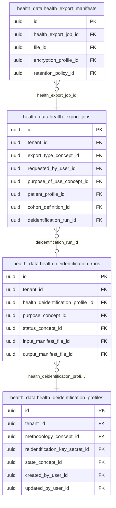
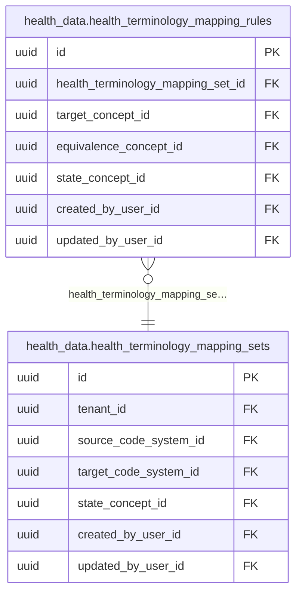

<!-- AUTOGENERADO por tools/inventario/catalogo.mjs. No editar manualmente. -->

# Catálogo del schema `health_data`

- **Tablas:** 34 · **Columnas:** 431 (94 con descripción: 21.8 %) · **Índices:** 255
- **Dominio:** Datos y NoSQL
- Método y límites del catálogo: [README del inventario](../README.md)

## Tablas

| Tabla | Propósito | Columnas | Índices | Operaciones | ORM |
|---|---|---|---|---|---|
| [canonical_health_resource_versions](#canonical_health_resource_versions) | Preserva versiones de recursos canónicos para reconstruir cambios y mantener contexto temporal de la historia longitudinal. | 15 | 10 | 5 | COINCIDE |
| [canonical_health_resources](#canonical_health_resources) | Almacena recursos de salud normalizados que integran información longitudinal proveniente de distintos sistemas. | 15 | 10 | 15 | COINCIDE |
| [canonical_resource_bindings](#canonical_resource_bindings) | Vincula recursos canónicos con sujetos o ámbitos de gestión que controlan su uso dentro de la plataforma de datos de salud. | 9 | 8 | 4 | COINCIDE |
| [canonical_resource_identifiers](#canonical_resource_identifiers) | Asocia identificadores externos y canónicos a recursos de salud para facilitar interoperabilidad y resolución de referencias. | 10 | 3 | 3 | COINCIDE |
| [canonical_resource_relationships](#canonical_resource_relationships) | Expresa relaciones entre recursos canónicos para mantener conexiones semánticas de la información longitudinal integrada. | 9 | 5 | 5 | COINCIDE |
| [fhir_profile_definitions](#fhir_profile_definitions) | Define perfiles FHIR adoptados por el sistema para expresar restricciones de interoperabilidad de recursos de salud. | 12 | 6 | 0 | COINCIDE |
| [fhir_profile_versions](#fhir_profile_versions) | Versiona perfiles FHIR para conservar qué reglas de interoperabilidad se aplicaban a cada validación. | 16 | 6 | 1 | COINCIDE |
| [fhir_validation_issues](#fhir_validation_issues) | Detalla errores o advertencias encontrados en validaciones FHIR para orientar correcciones de interoperabilidad. | 8 | 3 | 1 | COINCIDE |
| [fhir_validation_runs](#fhir_validation_runs) | Registra ejecuciones de validación FHIR sobre datos recibidos o transformados para evaluar conformidad con perfiles definidos. | 11 | 6 | 2 | COINCIDE |
| [health_data_quality_issues](#health_data_quality_issues) | Conserva hallazgos de calidad detectados en datos de salud para su análisis, resolución y seguimiento. | 12 | 7 | 2 | COINCIDE |
| [health_data_quality_rule_sets](#health_data_quality_rule_sets) | Agrupa reglas de calidad aplicables a datos sanitarios para evaluar su aptitud y consistencia de manera gobernada. | 13 | 8 | 1 | COINCIDE |
| [health_data_quality_rules](#health_data_quality_rules) | Define verificaciones concretas sobre datos de salud para detectar problemas antes de usarlos en atención, intercambio o análisis. | 15 | 8 | 1 | COINCIDE |
| [health_data_quality_runs](#health_data_quality_runs) | Registra ejecuciones de controles de calidad para seguir qué reglas se aplicaron y cuándo. | 12 | 7 | 2 | COINCIDE |
| [health_deidentification_profiles](#health_deidentification_profiles) | Configura perfiles de desidentificación para preparar datos de salud para usos autorizados que no requieren identificación directa. | 17 | 8 | 5 | COINCIDE |
| [health_deidentification_runs](#health_deidentification_runs) | Traza ejecuciones de desidentificación para vincular los datos procesados con el perfil y resultado de la operación. | 14 | 9 | 4 | COINCIDE |
| [health_export_jobs](#health_export_jobs) | Representa trabajos de exportación de datos de salud para controlar sus solicitudes, ejecución y destino previsto. | 15 | 11 | 5 | COINCIDE |
| [health_export_manifests](#health_export_manifests) | Enumera los recursos incluidos en exportaciones para hacer verificable el contenido entregado. | 10 | 7 | 5 | COINCIDE |
| [health_ingestion_batches](#health_ingestion_batches) | Agrupa cargas de información sanitaria para seguir su recepción y resultado como unidades operativas. | 16 | 8 | 5 | COINCIDE |
| [health_ingestion_records](#health_ingestion_records) | Conserva registros individuales recibidos durante ingestiones para reconciliar datos originales con su procesamiento canónico. | 13 | 8 | 4 | COINCIDE |
| [health_lineage_edges](#health_lineage_edges) | Representa vínculos de linaje entre datos de salud y transformaciones para reconstruir dependencias y recorrido de la información. | 12 | 11 | 3 | COINCIDE |
| [health_provenance_records](#health_provenance_records) | Registra procedencia de recursos de salud para establecer fuente, proceso y contexto de generación o transformación. | 14 | 8 | 5 | COINCIDE |
| [health_provenance_targets](#health_provenance_targets) | Vincula evidencia de procedencia con los recursos afectados para mostrar a qué datos aplica cada registro de origen. | 6 | 6 | 5 | COINCIDE |
| [health_source_connections](#health_source_connections) | Define conexiones técnicas a sistemas de origen para permitir intercambios de datos de salud autorizados y trazables. | 16 | 10 | 3 | COINCIDE |
| [health_source_systems](#health_source_systems) | Registra sistemas de origen de datos de salud y su nivel de confianza para gobernar la incorporación de información clínica externa. | 17 | 9 | 4 | COINCIDE |
| [health_terminology_mapping_rules](#health_terminology_mapping_rules) | Define correspondencias entre conceptos de origen y destino para normalizar terminología en procesos de interoperabilidad. | 14 | 7 | 0 | COINCIDE |
| [health_terminology_mapping_sets](#health_terminology_mapping_sets) | Agrupa mapeos terminológicos sanitarios utilizados para traducir códigos y conceptos entre catálogos. | 13 | 8 | 0 | COINCIDE |
| [omop_mapping_rules](#omop_mapping_rules) | Define transformaciones entre recursos canónicos y conceptos o estructuras OMOP para preparar datos de investigación. | 14 | 7 | 0 | COINCIDE |
| [omop_mapping_sets](#omop_mapping_sets) | Agrupa reglas de transformación hacia el modelo analítico OMOP utilizado para estudios y análisis de salud. | 12 | 6 | 0 | COINCIDE |
| [omop_transformation_runs](#omop_transformation_runs) | Registra ejecuciones de transformación OMOP para trazar cuándo y con qué resultado se preparó un conjunto de datos. | 13 | 7 | 0 | COINCIDE |
| [patient_identity_clusters](#patient_identity_clusters) | Agrupa identidades que pueden corresponder a un mismo paciente para apoyar la resolución de identidad a escala longitudinal. | 12 | 7 | 5 | COINCIDE |
| [patient_identity_members](#patient_identity_members) | Asocia perfiles o identificadores a clústeres de identidad para dejar explícita la composición de cada agrupación candidata. | 11 | 6 | 4 | COINCIDE |
| [patient_match_candidates](#patient_match_candidates) | Registra candidatos a coincidencia entre identidades de pacientes para revisión o evaluación de vinculación. | 11 | 7 | 2 | COINCIDE |
| [patient_match_decisions](#patient_match_decisions) | Preserva decisiones tomadas sobre coincidencias de pacientes para hacer trazable la resolución de identidad. | 9 | 6 | 2 | COINCIDE |
| [patient_timeline_entries](#patient_timeline_entries) | Proyecta recursos relevantes en una línea de tiempo longitudinal para facilitar la revisión histórica de la atención del paciente. | 15 | 12 | 2 | COINCIDE |

## Diagrama entidad-relación

Las tablas se agrupan en familias por sus claves foráneas dentro del schema (máximo 40 por diagrama). Las FK hacia otros schemas se listan en la ficha de cada tabla.

### Familia 1 de 3 — 26 tablas

```mermaid
erDiagram
  health_data_canonical_health_resource_versions["health_data.canonical_health_resource_versions"] {
    uuid id PK
    uuid canonical_health_resource_id FK
    uuid health_ingestion_record_id FK
    uuid change_type_concept_id FK
    uuid payload_format_concept_id FK
    uuid original_payload_file_id FK
    uuid provenance_record_id FK
    uuid supersedes_version_id FK
  }
  health_data_canonical_health_resources["health_data.canonical_health_resources"] {
    uuid id PK
    uuid custodian_tenant_id FK
    uuid resource_type_concept_id FK
    uuid patient_profile_id FK
    uuid encounter_id FK
    uuid source_system_id FK
    uuid current_version_id FK
    uuid lifecycle_status_concept_id FK
  }
  health_data_canonical_resource_bindings["health_data.canonical_resource_bindings"] {
    uuid id PK
    uuid canonical_health_resource_id FK
    uuid domain_entity_type_concept_id FK
    uuid binding_role_concept_id FK
    uuid binding_status_concept_id FK
    uuid mapping_version_id FK
  }
  health_data_fhir_validation_runs["health_data.fhir_validation_runs"] {
    uuid id PK
    uuid tenant_id FK
    uuid canonical_health_resource_version_id FK
    uuid fhir_profile_version_id FK
    uuid result_concept_id FK
  }
  health_data_health_data_quality_issues["health_data.health_data_quality_issues"] {
    uuid id PK
    uuid health_data_quality_run_id FK
    uuid health_data_quality_rule_id FK
    uuid canonical_health_resource_id FK
    uuid canonical_resource_version_id FK
    uuid status_concept_id FK
    uuid assigned_user_id FK
  }
  health_data_health_ingestion_records["health_data.health_ingestion_records"] {
    uuid id PK
    uuid health_ingestion_batch_id FK
    uuid resource_type_concept_id FK
    uuid payload_file_id FK
    uuid validation_status_concept_id FK
    uuid processing_status_concept_id FK
    uuid canonical_resource_id FK
  }
  health_data_health_provenance_records["health_data.health_provenance_records"] {
    uuid id PK
    uuid custodian_tenant_id FK
    uuid activity_concept_id FK
    uuid source_system_id FK
    uuid responsible_agent_type_concept_id FK
    uuid signature_id FK
  }
  health_data_canonical_resource_identifiers["health_data.canonical_resource_identifiers"] {
    uuid id PK
    uuid canonical_health_resource_id FK
    uuid identifier_type_concept_id FK
  }
  health_data_canonical_resource_relationships["health_data.canonical_resource_relationships"] {
    uuid id PK
    uuid source_resource_id FK
    uuid target_resource_id FK
    uuid relationship_type_concept_id FK
    uuid relationship_role_concept_id FK
  }
  health_data_health_data_quality_runs["health_data.health_data_quality_runs"] {
    uuid id PK
    uuid tenant_id FK
    uuid health_data_quality_rule_set_id FK
    uuid health_ingestion_batch_id FK
    uuid canonical_resource_id FK
    uuid result_concept_id FK
  }
  health_data_health_source_systems["health_data.health_source_systems"] {
    uuid id PK
    uuid tenant_id FK
    uuid source_type_concept_id FK
    uuid trust_level_concept_id FK
    uuid state_concept_id FK
    uuid created_by_user_id FK
    uuid updated_by_user_id FK
  }
  health_data_fhir_profile_versions["health_data.fhir_profile_versions"] {
    uuid id PK
    uuid fhir_profile_definition_id FK
    uuid fhir_release_concept_id FK
    uuid state_concept_id FK
    uuid created_by_user_id FK
    uuid updated_by_user_id FK
  }
  health_data_fhir_validation_issues["health_data.fhir_validation_issues"] {
    uuid id PK
    uuid fhir_validation_run_id FK
    uuid severity_concept_id FK
  }
  health_data_health_data_quality_rules["health_data.health_data_quality_rules"] {
    uuid id PK
    uuid health_data_quality_rule_set_id FK
    uuid dimension_concept_id FK
    uuid severity_concept_id FK
    uuid expression_language_concept_id FK
    uuid state_concept_id FK
    uuid created_by_user_id FK
    uuid updated_by_user_id FK
  }
  health_data_health_ingestion_batches["health_data.health_ingestion_batches"] {
    uuid id PK
    uuid tenant_id FK
    uuid health_source_connection_id FK
    uuid ingestion_mode_concept_id FK
    uuid status_concept_id FK
    uuid payload_manifest_file_id FK
  }
  health_data_health_provenance_targets["health_data.health_provenance_targets"] {
    uuid id PK
    uuid health_provenance_record_id FK
    uuid target_type_concept_id FK
    uuid role_concept_id FK
  }
  health_data_health_data_quality_rule_sets["health_data.health_data_quality_rule_sets"] {
    uuid id PK
    uuid tenant_id FK
    uuid scope_concept_id FK
    uuid resource_type_concept_id FK
    uuid state_concept_id FK
    uuid created_by_user_id FK
    uuid updated_by_user_id FK
  }
  health_data_health_source_connections["health_data.health_source_connections"] {
    uuid id PK
    uuid health_source_system_id FK
    uuid connection_type_concept_id FK
    uuid credential_id FK
    uuid format_concept_id FK
    uuid cursor_strategy_concept_id FK
    uuid status_concept_id FK
    uuid created_by_user_id FK
  }
  health_data_patient_identity_members["health_data.patient_identity_members"] {
    uuid id PK
    uuid patient_identity_cluster_id FK
    uuid patient_profile_id FK
    uuid source_system_id FK
    uuid member_role_concept_id FK
    uuid match_status_concept_id FK
  }
  health_data_fhir_profile_definitions["health_data.fhir_profile_definitions"] {
    uuid id PK
    uuid resource_type_concept_id FK
    uuid jurisdiction_concept_id FK
    uuid state_concept_id FK
    uuid created_by_user_id FK
    uuid updated_by_user_id FK
  }
  health_data_omop_transformation_runs["health_data.omop_transformation_runs"] {
    uuid id PK
    uuid tenant_id FK
    uuid omop_mapping_set_id FK
    uuid health_ingestion_batch_id FK
    uuid status_concept_id FK
  }
  health_data_patient_identity_clusters["health_data.patient_identity_clusters"] {
    uuid id PK
    uuid tenant_id FK
    uuid master_patient_profile_id FK
    uuid status_concept_id FK
    uuid created_by_user_id FK
    uuid updated_by_user_id FK
  }
  health_data_omop_mapping_sets["health_data.omop_mapping_sets"] {
    uuid id PK
    uuid tenant_id FK
    uuid state_concept_id FK
    uuid created_by_user_id FK
    uuid updated_by_user_id FK
  }
  health_data_patient_match_decisions["health_data.patient_match_decisions"] {
    uuid id PK
    uuid patient_match_candidate_id FK
    uuid decision_concept_id FK
    uuid decided_by_user_id FK
    uuid resulting_cluster_id FK
  }
  health_data_omop_mapping_rules["health_data.omop_mapping_rules"] {
    uuid id PK
    uuid omop_mapping_set_id FK
    uuid source_resource_type_concept_id FK
    uuid vocabulary_mapping_set_id FK
    uuid state_concept_id FK
    uuid created_by_user_id FK
    uuid updated_by_user_id FK
  }
  health_data_patient_match_candidates["health_data.patient_match_candidates"] {
    uuid id PK
    uuid tenant_id FK
    uuid left_patient_profile_id FK
    uuid right_patient_profile_id FK
    uuid status_concept_id FK
  }
  health_data_canonical_health_resource_versions }o--|| health_data_canonical_health_resources : "canonical_health_resource_id"
  health_data_canonical_health_resource_versions }o--o| health_data_health_ingestion_records : "health_ingestion_record_id"
  health_data_canonical_health_resource_versions }o--o| health_data_health_provenance_records : "provenance_record_id"
  health_data_canonical_health_resources }o--o| health_data_health_source_systems : "source_system_id"
  health_data_canonical_health_resources }o--o| health_data_canonical_health_resource_versions : "current_version_id"
  health_data_canonical_resource_bindings }o--|| health_data_canonical_health_resources : "canonical_health_resource_id"
  health_data_canonical_resource_bindings }o--o| health_data_canonical_health_resource_versions : "mapping_version_id"
  health_data_fhir_validation_runs }o--|| health_data_canonical_health_resource_versions : "canonical_health_resource_ver…"
  health_data_fhir_validation_runs }o--|| health_data_fhir_profile_versions : "fhir_profile_version_id"
  health_data_health_data_quality_issues }o--|| health_data_health_data_quality_runs : "health_data_quality_run_id"
  health_data_health_data_quality_issues }o--|| health_data_health_data_quality_rules : "health_data_quality_rule_id"
  health_data_health_data_quality_issues }o--o| health_data_canonical_health_resources : "canonical_health_resource_id"
  health_data_health_data_quality_issues }o--o| health_data_canonical_health_resource_versions : "canonical_resource_version_id"
  health_data_health_ingestion_records }o--|| health_data_health_ingestion_batches : "health_ingestion_batch_id"
  health_data_health_ingestion_records }o--o| health_data_canonical_health_resources : "canonical_resource_id"
  health_data_health_provenance_records }o--o| health_data_health_source_systems : "source_system_id"
  health_data_canonical_resource_identifiers }o--|| health_data_canonical_health_resources : "canonical_health_resource_id"
  health_data_canonical_resource_relationships }o--|| health_data_canonical_health_resources : "source_resource_id"
  health_data_canonical_resource_relationships }o--|| health_data_canonical_health_resources : "target_resource_id"
  health_data_health_data_quality_runs }o--|| health_data_health_data_quality_rule_sets : "health_data_quality_rule_set_…"
  health_data_health_data_quality_runs }o--o| health_data_health_ingestion_batches : "health_ingestion_batch_id"
  health_data_health_data_quality_runs }o--o| health_data_canonical_health_resources : "canonical_resource_id"
  health_data_fhir_profile_versions }o--|| health_data_fhir_profile_definitions : "fhir_profile_definition_id"
  health_data_fhir_validation_issues }o--|| health_data_fhir_validation_runs : "fhir_validation_run_id"
  health_data_health_data_quality_rules }o--|| health_data_health_data_quality_rule_sets : "health_data_quality_rule_set_…"
  health_data_health_ingestion_batches }o--|| health_data_health_source_connections : "health_source_connection_id"
  health_data_health_provenance_targets }o--|| health_data_health_provenance_records : "health_provenance_record_id"
  health_data_health_source_connections }o--|| health_data_health_source_systems : "health_source_system_id"
  health_data_patient_identity_members }o--|| health_data_patient_identity_clusters : "patient_identity_cluster_id"
  health_data_patient_identity_members }o--o| health_data_health_source_systems : "source_system_id"
  health_data_omop_transformation_runs }o--|| health_data_omop_mapping_sets : "omop_mapping_set_id"
  health_data_omop_transformation_runs }o--o| health_data_health_ingestion_batches : "health_ingestion_batch_id"
  health_data_patient_match_decisions }o--|| health_data_patient_match_candidates : "patient_match_candidate_id"
  health_data_patient_match_decisions }o--o| health_data_patient_identity_clusters : "resulting_cluster_id"
  health_data_omop_mapping_rules }o--|| health_data_omop_mapping_sets : "omop_mapping_set_id"
  health_data_omop_mapping_rules }o--o| health_data_omop_mapping_sets : "vocabulary_mapping_set_id"
```

### Familia 2 de 3 — 4 tablas

### Familia 3 de 3 — 2 tablas

### Tablas sin relaciones dentro del schema

`health_data.health_lineage_edges` · `health_data.patient_timeline_entries`

## Fichas

### canonical_health_resource_versions

#### Vista general

Preserva versiones de recursos canónicos para reconstruir cambios y mantener contexto temporal de la historia longitudinal.

- **Estado del propósito:** DOMAIN_CURATED_DRAFT · fuente: `Mantra Core Health Context/modules/diagram_52_health_data_platform.puml: canonical_health_resource_versions`
- **Dominio:** Datos y NoSQL · **Diagrama:** `Mantra Core Health Context/modules/diagram_52_health_data_platform.puml` · **DDL:** `SQL/52_health_data/02_tables.sql`
- **Entidad del ORM:** `CanonicalHealthResourceVersions` — `src/modules/health_data/entities/canonical_health_resource_versions.entity.ts`
- **Resumen:** 15 columnas · 10 índices · 7 FK salientes · 5 entrantes · 5 operaciones

#### Columnas

| # | Columna | Tipo | Rol estructural | Descripción | ORM |
|---|---|---|---|---|---|
| 1 | `id` | `uuid` | Clave primaria; Obligatoria | Identificador único de la instancia. _(JSDOC_ESTANDAR, `src/modules/health_data/entities/canonical_health_resource_versions.entity.ts:15`)_ | coincide |
| 2 | `canonical_health_resource_id` | `uuid` | Clave foránea → health_data.canonical_health_resources.id; Obligatoria | _sin dato_ | coincide |
| 3 | `version_number` | `integer` | Obligatoria | _sin dato_ | coincide |
| 4 | `health_ingestion_record_id` | `uuid` | Clave foránea → health_data.health_ingestion_records.id; Opcional | _sin dato_ | coincide |
| 5 | `recorded_at` | `timestamptz` | Obligatoria | _sin dato_ | coincide |
| 6 | `effective_start_at` | `timestamptz` | Opcional | _sin dato_ | coincide |
| 7 | `effective_end_at` | `timestamptz` | Opcional | _sin dato_ | coincide |
| 8 | `change_type_concept_id` | `uuid` | Clave foránea → terminology.catalog_concepts.id; Obligatoria | _sin dato_ | coincide |
| 9 | `payload_format_concept_id` | `uuid` | Clave foránea → terminology.catalog_concepts.id; Obligatoria | _sin dato_ | coincide |
| 10 | `normalized_payload_json` | `jsonb` | Obligatoria | _sin dato_ | coincide |
| 11 | `original_payload_file_id` | `uuid` | Clave foránea → common.files.id; Opcional | _sin dato_ | coincide |
| 12 | `content_hash` | `varchar` | Obligatoria | _sin dato_ | coincide |
| 13 | `provenance_record_id` | `uuid` | Clave foránea → health_data.health_provenance_records.id; Opcional | _sin dato_ | coincide |
| 14 | `supersedes_version_id` | `uuid` | Clave foránea → health_data.canonical_health_resource_versions.id; Opcional | _sin dato_ | coincide |
| 15 | `created_at` | `timestamptz` | Obligatoria | Fecha y hora en que se creó el registro. _(JSDOC_ESTANDAR, `src/modules/health_data/entities/canonical_health_resource_versions.entity.ts:123`)_ | coincide |

#### Relaciones

| Sentido | Columnas | Tabla | Restricción |
|---|---|---|---|
| hacia | canonical_health_resource_id | health_data.canonical_health_resources (id) | fk_canonical_health_resource_versions_canonical_health_97ff4d77 |
| hacia | health_ingestion_record_id | health_data.health_ingestion_records (id) | fk_canonical_health_resource_versions_health_ingestion_196b9e10 |
| hacia | provenance_record_id | health_data.health_provenance_records (id) | fk_canonical_health_resource_versions_provenance_record_id |
| hacia | supersedes_version_id | health_data.canonical_health_resource_versions (id) | fk_canonical_health_resource_versions_supersedes_version_id |
| hacia | change_type_concept_id | terminology.catalog_concepts (id) | fk_canonical_health_resource_versions_change_type_concept_id |
| hacia | payload_format_concept_id | terminology.catalog_concepts (id) | fk_canonical_health_resource_versions_payload_format_concept_id |
| hacia | original_payload_file_id | common.files (id) | fk_canonical_health_resource_versions_original_payload_file_id |
| desde | id | health_data.canonical_health_resources (current_version_id) | fk_canonical_health_resources_current_version_id |
| desde | id | health_data.canonical_health_resource_versions (supersedes_version_id) | fk_canonical_health_resource_versions_supersedes_version_id |
| desde | id | health_data.canonical_resource_bindings (mapping_version_id) | fk_canonical_resource_bindings_mapping_version_id |
| desde | id | health_data.fhir_validation_runs (canonical_health_resource_version_id) | fk_fhir_validation_runs_canonical_health_resource_version_id |
| desde | id | health_data.health_data_quality_issues (canonical_resource_version_id) | fk_health_data_quality_issues_canonical_resource_version_id |

#### Índices

| Índice | Único | Columnas | Para qué |
|---|---|---|---|
| `ix_canonical_health_resource_versions_canonical_health_e81f83a5` | no | canonical_health_resource_id | Soporta la clave foránea fk_canonical_health_resource_versions_canonical_health_97ff4d77: PostgreSQL no indexa las FK por sí mismo _(DOCUMENTO)_; 1 consulta(s) de repositorio filtran u ordenan por «canonical_health_resource_id», la primera columna del índice _(CONSULTA)_ |
| `ix_canonical_health_resource_versions_health_ingestion_d6d6039b` | no | health_ingestion_record_id | Soporta la clave foránea fk_canonical_health_resource_versions_health_ingestion_196b9e10: PostgreSQL no indexa las FK por sí mismo _(DOCUMENTO)_ |
| `ix_canonical_health_resource_versions_change_type_concept_id` | no | change_type_concept_id | Soporta la clave foránea fk_canonical_health_resource_versions_change_type_concept_id: PostgreSQL no indexa las FK por sí mismo _(DOCUMENTO)_ |
| `ix_canonical_health_resource_versions_payload_format_concept_id` | no | payload_format_concept_id | Soporta la clave foránea fk_canonical_health_resource_versions_payload_format_concept_id: PostgreSQL no indexa las FK por sí mismo _(DOCUMENTO)_ |
| `ix_canonical_health_resource_versions_original_payload_file_id` | no | original_payload_file_id | Soporta la clave foránea fk_canonical_health_resource_versions_original_payload_file_id: PostgreSQL no indexa las FK por sí mismo _(DOCUMENTO)_ |
| `ix_canonical_health_resource_versions_provenance_record_id` | no | provenance_record_id | Soporta la clave foránea fk_canonical_health_resource_versions_provenance_record_id: PostgreSQL no indexa las FK por sí mismo _(DOCUMENTO)_ |
| `ix_canonical_health_resource_versions_supersedes_version_id` | no | supersedes_version_id | Soporta la clave foránea fk_canonical_health_resource_versions_supersedes_version_id: PostgreSQL no indexa las FK por sí mismo _(DOCUMENTO)_ |
| `uk_canonical_health_resource_versions_resource_version` | sí | canonical_health_resource_id, version_number | Garantiza que no se repita la combinación (canonical_health_resource_id, version_number) _(DOCUMENTO)_; Soporta la clave foránea fk_canonical_health_resource_versions_canonical_health_97ff4d77: PostgreSQL no indexa las FK por sí mismo _(DOCUMENTO)_; 1 consulta(s) de repositorio filtran u ordenan por «canonical_health_resource_id», la primera columna del índice _(CONSULTA)_ |
| `brin_canonical_health_resource_versions_recorded_at` | no | recorded_at | BRIN para logs e historiales append-only de gran volumen _(DOCUMENTO)_ |
| `gin_canonical_health_versions_payload` | no | normalized_payload_json | GIN para búsqueda textual gobernada _(DOCUMENTO)_ |

#### Restricciones

| Restricción | Tipo | Definición |
|---|---|---|
| `uk_canonical_health_resource_versions_resource_version` | UNIQUE INDEX | UNIQUE INDEX ("canonical_health_resource_id", "version_number") |

#### Operaciones que la tocan

| Operación | Efecto | Confianza |
|---|---|---|
| GET /fhir/r5/Patient/{id}/$everything | LEE | DIRECTA |
| POST /health-data/canonical-resources/project | CREA | DIRECTA |
| POST /health-data/canonical-resources/project | LEE | DIRECTA |
| POST /health-data/deidentification-runs | LEE | DIRECTA |
| POST /health-data/versions/{id}/validate | LEE | DIRECTA |

#### Gobierno

| Atributo | Valor | Fuente |
|---|---|---|
| Append-only | no declarado | — |
| Datos personales | sin fuente | — |
| Financiera | sin fuente | — |
| Crítica para auditoría | sin fuente | — |
| Retención | sin fuente | — |
| Responsable | sin fuente | — |
| Revisión | AUTO_DETECTADA | — |

---

### canonical_health_resources

#### Vista general

Almacena recursos de salud normalizados que integran información longitudinal proveniente de distintos sistemas.

- **Estado del propósito:** DOMAIN_CURATED_DRAFT · fuente: `Mantra Core Health Context/modules/diagram_52_health_data_platform.puml: canonical_health_resources`
- **Dominio:** Datos y NoSQL · **Diagrama:** `Mantra Core Health Context/modules/diagram_52_health_data_platform.puml` · **DDL:** `SQL/52_health_data/02_tables.sql`
- **Entidad del ORM:** `CanonicalHealthResources` — `src/modules/health_data/entities/canonical_health_resources.entity.ts`
- **Resumen:** 15 columnas · 10 índices · 8 FK salientes · 8 entrantes · 15 operaciones

#### Columnas

| # | Columna | Tipo | Rol estructural | Descripción | ORM |
|---|---|---|---|---|---|
| 1 | `id` | `uuid` | Clave primaria; Obligatoria | Identificador único de la instancia. _(JSDOC_ESTANDAR, `src/modules/health_data/entities/canonical_health_resources.entity.ts:12`)_ | coincide |
| 2 | `custodian_tenant_id` | `uuid` | Clave foránea → directory.tenants.id; Obligatoria | _sin dato_ | coincide |
| 3 | `resource_type_concept_id` | `uuid` | Clave foránea → terminology.catalog_concepts.id; Obligatoria | _sin dato_ | coincide |
| 4 | `logical_identifier` | `varchar` | Obligatoria | _sin dato_ | coincide |
| 5 | `patient_profile_id` | `uuid` | Clave foránea → profiles.patient_profiles.profile_id; Opcional | _sin dato_ | coincide |
| 6 | `encounter_id` | `uuid` | Clave foránea → clinical.encounters.id; Opcional | _sin dato_ | coincide |
| 7 | `source_system_id` | `uuid` | Clave foránea → health_data.health_source_systems.id; Opcional | _sin dato_ | coincide |
| 8 | `current_version_id` | `uuid` | Clave foránea → health_data.canonical_health_resource_versions.id; Opcional | _sin dato_ | coincide |
| 9 | `lifecycle_status_concept_id` | `uuid` | Clave foránea → terminology.catalog_concepts.id; Obligatoria | _sin dato_ | coincide |
| 10 | `security_labels_json` | `jsonb` | Opcional | _sin dato_ | coincide |
| 11 | `purpose_restrictions_json` | `jsonb` | Opcional | _sin dato_ | coincide |
| 12 | `retention_policy_id` | `uuid` | Clave foránea → system_ops.retention_policies.id; Opcional | _sin dato_ | coincide |
| 13 | `created_at` | `timestamptz` | Obligatoria | Fecha y hora en que se creó el registro. _(JSDOC_ESTANDAR, `src/modules/health_data/entities/canonical_health_resources.entity.ts:94`)_ | coincide |
| 14 | `updated_at` | `timestamptz` | Obligatoria | Fecha y hora de la última actualización. _(JSDOC_ESTANDAR, `src/modules/health_data/entities/canonical_health_resources.entity.ts:100`)_ | coincide |
| 15 | `row_version` | `integer = 1` | Obligatoria | Versión usada para controlar actualizaciones concurrentes. _(JSDOC_ENTIDAD, `src/modules/health_data/entities/canonical_health_resources.entity.ts:106`)_ | coincide |

#### Relaciones

| Sentido | Columnas | Tabla | Restricción |
|---|---|---|---|
| hacia | source_system_id | health_data.health_source_systems (id) | fk_canonical_health_resources_source_system_id |
| hacia | current_version_id | health_data.canonical_health_resource_versions (id) | fk_canonical_health_resources_current_version_id |
| hacia | custodian_tenant_id | directory.tenants (id) | fk_canonical_health_resources_custodian_tenant_id |
| hacia | resource_type_concept_id | terminology.catalog_concepts (id) | fk_canonical_health_resources_resource_type_concept_id |
| hacia | patient_profile_id | profiles.patient_profiles (profile_id) | fk_canonical_health_resources_patient_profile_id |
| hacia | encounter_id | clinical.encounters (id) | fk_canonical_health_resources_encounter_id |
| hacia | lifecycle_status_concept_id | terminology.catalog_concepts (id) | fk_canonical_health_resources_lifecycle_status_concept_id |
| hacia | retention_policy_id | system_ops.retention_policies (id) | fk_canonical_health_resources_retention_policy_id |
| desde | id | health_data.health_ingestion_records (canonical_resource_id) | fk_health_ingestion_records_canonical_resource_id |
| desde | id | health_data.canonical_health_resource_versions (canonical_health_resource_id) | fk_canonical_health_resource_versions_canonical_health_97ff4d77 |
| desde | id | health_data.canonical_resource_identifiers (canonical_health_resource_id) | fk_canonical_resource_identifiers_canonical_health_resource_id |
| desde | id | health_data.canonical_resource_relationships (source_resource_id) | fk_canonical_resource_relationships_source_resource_id |
| desde | id | health_data.canonical_resource_relationships (target_resource_id) | fk_canonical_resource_relationships_target_resource_id |
| desde | id | health_data.canonical_resource_bindings (canonical_health_resource_id) | fk_canonical_resource_bindings_canonical_health_resource_id |
| desde | id | health_data.health_data_quality_runs (canonical_resource_id) | fk_health_data_quality_runs_canonical_resource_id |
| desde | id | health_data.health_data_quality_issues (canonical_health_resource_id) | fk_health_data_quality_issues_canonical_health_resource_id |

#### Índices

| Índice | Único | Columnas | Para qué |
|---|---|---|---|
| `ix_canonical_health_resources_custodian_tenant_id` | no | custodian_tenant_id | Soporta la clave foránea fk_canonical_health_resources_custodian_tenant_id: PostgreSQL no indexa las FK por sí mismo _(DOCUMENTO)_; 3 consulta(s) de repositorio filtran u ordenan por «custodian_tenant_id», la primera columna del índice _(CONSULTA)_ |
| `ix_canonical_health_resources_resource_type_concept_id` | no | resource_type_concept_id | Soporta la clave foránea fk_canonical_health_resources_resource_type_concept_id: PostgreSQL no indexa las FK por sí mismo _(DOCUMENTO)_; 1 consulta(s) de repositorio filtran u ordenan por «resource_type_concept_id», la primera columna del índice _(CONSULTA)_ |
| `ix_canonical_health_resources_patient_profile_id` | no | patient_profile_id | Soporta la clave foránea fk_canonical_health_resources_patient_profile_id: PostgreSQL no indexa las FK por sí mismo _(DOCUMENTO)_; 2 consulta(s) de repositorio filtran u ordenan por «patient_profile_id», la primera columna del índice _(CONSULTA)_ |
| `ix_canonical_health_resources_encounter_id` | no | encounter_id | Soporta la clave foránea fk_canonical_health_resources_encounter_id: PostgreSQL no indexa las FK por sí mismo _(DOCUMENTO)_ |
| `ix_canonical_health_resources_source_system_id` | no | source_system_id | Soporta la clave foránea fk_canonical_health_resources_source_system_id: PostgreSQL no indexa las FK por sí mismo _(DOCUMENTO)_ |
| `ix_canonical_health_resources_current_version_id` | no | current_version_id | Soporta la clave foránea fk_canonical_health_resources_current_version_id: PostgreSQL no indexa las FK por sí mismo _(DOCUMENTO)_ |
| `ix_canonical_health_resources_lifecycle_status_concept_id` | no | lifecycle_status_concept_id | Soporta la clave foránea fk_canonical_health_resources_lifecycle_status_concept_id: PostgreSQL no indexa las FK por sí mismo _(DOCUMENTO)_; 1 consulta(s) de repositorio filtran u ordenan por «lifecycle_status_concept_id», la primera columna del índice _(CONSULTA)_ |
| `ix_canonical_health_resources_retention_policy_id` | no | retention_policy_id | Soporta la clave foránea fk_canonical_health_resources_retention_policy_id: PostgreSQL no indexa las FK por sí mismo _(DOCUMENTO)_ |
| `uk_canonical_health_resources_tenant_type_logical` | sí | custodian_tenant_id, resource_type_concept_id, logical_identifier | Garantiza que no se repita la combinación (custodian_tenant_id, resource_type_concept_id, logical_identifier) _(DOCUMENTO)_; Soporta la clave foránea fk_canonical_health_resources_custodian_tenant_id: PostgreSQL no indexa las FK por sí mismo _(DOCUMENTO)_; 3 consulta(s) de repositorio filtran u ordenan por «custodian_tenant_id», la primera columna del índice _(CONSULTA)_ |
| `ix_canonical_health_resources_patient_type` | no | custodian_tenant_id, patient_profile_id, resource_type_concept_id, ("updated_at" DESC) | _sin uso detectado estáticamente_ |

#### Restricciones

| Restricción | Tipo | Definición |
|---|---|---|
| `uk_canonical_health_resources_tenant_type_logical` | UNIQUE INDEX | UNIQUE INDEX ("custodian_tenant_id", "resource_type_concept_id", "logical_identifier") |

#### Operaciones que la tocan

| Operación | Efecto | Confianza |
|---|---|---|
| POST /fhir/r5/$export | LEE | DIRECTA |
| GET /fhir/r5/Patient/{id}/$everything | LEE | DIRECTA |
| POST /health-data/canonical-resources/{id}/bindings | ACTUALIZA | POR_TIPO |
| POST /health-data/canonical-resources/{id}/bindings | LEE | DIRECTA |
| POST /health-data/canonical-resources/{id}/identifiers | ACTUALIZA | POR_TIPO |
| POST /health-data/canonical-resources/{id}/identifiers | LEE | DIRECTA |
| POST /health-data/canonical-resources/{id}/relationships | LEE | DIRECTA |
| POST /health-data/canonical-resources/{id}/retire | ACTUALIZA | POR_TIPO |
| POST /health-data/canonical-resources/{id}/retire | LEE | DIRECTA |
| POST /health-data/canonical-resources/project | ACTUALIZA | POR_TIPO |
| POST /health-data/canonical-resources/project | CREA | DIRECTA |
| POST /health-data/canonical-resources/project | LEE | DIRECTA |
| POST /health-data/deidentification-runs | LEE | DIRECTA |
| POST /health-data/versions/{id}/validate | ACTUALIZA | POR_TIPO |
| POST /health-data/versions/{id}/validate | LEE | DIRECTA |

#### Gobierno

| Atributo | Valor | Fuente |
|---|---|---|
| Append-only | no declarado | — |
| Datos personales | sin fuente | — |
| Financiera | sin fuente | — |
| Crítica para auditoría | sin fuente | — |
| Retención | sin fuente | — |
| Responsable | sin fuente | — |
| Revisión | AUTO_DETECTADA | — |

---

### canonical_resource_bindings

#### Vista general

Vincula recursos canónicos con sujetos o ámbitos de gestión que controlan su uso dentro de la plataforma de datos de salud.

- **Estado del propósito:** DOMAIN_CURATED_DRAFT · fuente: `Mantra Core Health Context/modules/diagram_52_health_data_platform.puml: canonical_resource_bindings`
- **Dominio:** Datos y NoSQL · **Diagrama:** `Mantra Core Health Context/modules/diagram_52_health_data_platform.puml` · **DDL:** `SQL/52_health_data/02_tables.sql`
- **Entidad del ORM:** `CanonicalResourceBindings` — `src/modules/health_data/entities/canonical_resource_bindings.entity.ts`
- **Resumen:** 9 columnas · 8 índices · 5 FK salientes · 0 entrantes · 4 operaciones

#### Columnas

| # | Columna | Tipo | Rol estructural | Descripción | ORM |
|---|---|---|---|---|---|
| 1 | `id` | `uuid` | Clave primaria; Obligatoria | Identificador único de la instancia. _(JSDOC_ESTANDAR, `src/modules/health_data/entities/canonical_resource_bindings.entity.ts:12`)_ | coincide |
| 2 | `canonical_health_resource_id` | `uuid` | Clave foránea → health_data.canonical_health_resources.id; Obligatoria | _sin dato_ | coincide |
| 3 | `domain_entity_type_concept_id` | `uuid` | Clave foránea → terminology.catalog_concepts.id; Obligatoria | _sin dato_ | coincide |
| 4 | `domain_entity_id` | `uuid` | Obligatoria | _sin dato_ | coincide |
| 5 | `binding_role_concept_id` | `uuid` | Clave foránea → terminology.catalog_concepts.id; Obligatoria | _sin dato_ | coincide |
| 6 | `binding_status_concept_id` | `uuid` | Clave foránea → terminology.catalog_concepts.id; Obligatoria | _sin dato_ | coincide |
| 7 | `mapping_version_id` | `uuid` | Clave foránea → health_data.canonical_health_resource_versions.id; Opcional | _sin dato_ | coincide |
| 8 | `created_at` | `timestamptz` | Obligatoria | Fecha y hora en que se creó el registro. _(JSDOC_ESTANDAR, `src/modules/health_data/entities/canonical_resource_bindings.entity.ts:54`)_ | coincide |
| 9 | `ended_at` | `timestamptz` | Opcional | _sin dato_ | coincide |

#### Relaciones

| Sentido | Columnas | Tabla | Restricción |
|---|---|---|---|
| hacia | canonical_health_resource_id | health_data.canonical_health_resources (id) | fk_canonical_resource_bindings_canonical_health_resource_id |
| hacia | mapping_version_id | health_data.canonical_health_resource_versions (id) | fk_canonical_resource_bindings_mapping_version_id |
| hacia | domain_entity_type_concept_id | terminology.catalog_concepts (id) | fk_canonical_resource_bindings_domain_entity_type_concept_id |
| hacia | binding_role_concept_id | terminology.catalog_concepts (id) | fk_canonical_resource_bindings_binding_role_concept_id |
| hacia | binding_status_concept_id | terminology.catalog_concepts (id) | fk_canonical_resource_bindings_binding_status_concept_id |

#### Índices

| Índice | Único | Columnas | Para qué |
|---|---|---|---|
| `ix_canonical_resource_bindings_canonical_health_resource_id` | no | canonical_health_resource_id | Soporta la clave foránea fk_canonical_resource_bindings_canonical_health_resource_id: PostgreSQL no indexa las FK por sí mismo _(DOCUMENTO)_; 2 consulta(s) de repositorio filtran u ordenan por «canonical_health_resource_id», la primera columna del índice _(CONSULTA)_ |
| `ix_canonical_resource_bindings_domain_entity_type_concept_id` | no | domain_entity_type_concept_id | Soporta la clave foránea fk_canonical_resource_bindings_domain_entity_type_concept_id: PostgreSQL no indexa las FK por sí mismo _(DOCUMENTO)_; 1 consulta(s) de repositorio filtran u ordenan por «domain_entity_type_concept_id», la primera columna del índice _(CONSULTA)_ |
| `ix_canonical_resource_bindings_domain_entity_id` | no | domain_entity_id | 1 consulta(s) de repositorio filtran u ordenan por «domain_entity_id», la primera columna del índice _(CONSULTA)_ |
| `ix_canonical_resource_bindings_binding_role_concept_id` | no | binding_role_concept_id | Soporta la clave foránea fk_canonical_resource_bindings_binding_role_concept_id: PostgreSQL no indexa las FK por sí mismo _(DOCUMENTO)_; 1 consulta(s) de repositorio filtran u ordenan por «binding_role_concept_id», la primera columna del índice _(CONSULTA)_ |
| `ix_canonical_resource_bindings_binding_status_concept_id` | no | binding_status_concept_id | Soporta la clave foránea fk_canonical_resource_bindings_binding_status_concept_id: PostgreSQL no indexa las FK por sí mismo _(DOCUMENTO)_ |
| `ix_canonical_resource_bindings_mapping_version_id` | no | mapping_version_id | Soporta la clave foránea fk_canonical_resource_bindings_mapping_version_id: PostgreSQL no indexa las FK por sí mismo _(DOCUMENTO)_ |
| `uk_canonical_resource_bindings_resource_target` | sí | canonical_health_resource_id, domain_entity_type_concept_id, domain_entity_id, binding_role_concept_id | Garantiza que no se repita la combinación (canonical_health_resource_id, domain_entity_type_concept_id, domain_entity_id, binding_role_concept_id) _(DOCUMENTO)_; Soporta la clave foránea fk_canonical_resource_bindings_canonical_health_resource_id: PostgreSQL no indexa las FK por sí mismo _(DOCUMENTO)_; 2 consulta(s) de repositorio filtran u ordenan por «canonical_health_resource_id», la primera columna del índice _(CONSULTA)_ |
| `ix_canonical_resource_bindings_target` | no | domain_entity_type_concept_id, domain_entity_id | Soporta la clave foránea fk_canonical_resource_bindings_domain_entity_type_concept_id: PostgreSQL no indexa las FK por sí mismo _(DOCUMENTO)_; 1 consulta(s) de repositorio filtran u ordenan por «domain_entity_type_concept_id», la primera columna del índice _(CONSULTA)_ |

#### Restricciones

| Restricción | Tipo | Definición |
|---|---|---|
| `uk_canonical_resource_bindings_resource_target` | UNIQUE INDEX | UNIQUE INDEX ("canonical_health_resource_id", "domain_entity_type_concept_id", "domain_entity_id", "binding_role_concept_id") |

#### Operaciones que la tocan

| Operación | Efecto | Confianza |
|---|---|---|
| POST /health-data/canonical-resources/{id}/bindings | CREA | DIRECTA |
| POST /health-data/canonical-resources/{id}/bindings | LEE | DIRECTA |
| POST /health-data/canonical-resources/{id}/retire | ACTUALIZA | POR_TIPO |
| POST /health-data/canonical-resources/{id}/retire | LEE | DIRECTA |

#### Gobierno

| Atributo | Valor | Fuente |
|---|---|---|
| Append-only | no declarado | — |
| Datos personales | sin fuente | — |
| Financiera | sin fuente | — |
| Crítica para auditoría | sin fuente | — |
| Retención | sin fuente | — |
| Responsable | sin fuente | — |
| Revisión | AUTO_DETECTADA | — |

---

### canonical_resource_identifiers

#### Vista general

Asocia identificadores externos y canónicos a recursos de salud para facilitar interoperabilidad y resolución de referencias.

- **Estado del propósito:** DOMAIN_CURATED_DRAFT · fuente: `Mantra Core Health Context/modules/diagram_52_health_data_platform.puml: canonical_resource_identifiers`
- **Dominio:** Datos y NoSQL · **Diagrama:** `Mantra Core Health Context/modules/diagram_52_health_data_platform.puml` · **DDL:** `SQL/52_health_data/02_tables.sql`
- **Entidad del ORM:** `CanonicalResourceIdentifiers` — `src/modules/health_data/entities/canonical_resource_identifiers.entity.ts`
- **Resumen:** 10 columnas · 3 índices · 2 FK salientes · 0 entrantes · 3 operaciones

#### Columnas

| # | Columna | Tipo | Rol estructural | Descripción | ORM |
|---|---|---|---|---|---|
| 1 | `id` | `uuid` | Clave primaria; Obligatoria | Identificador único de la instancia. _(JSDOC_ESTANDAR, `src/modules/health_data/entities/canonical_resource_identifiers.entity.ts:12`)_ | coincide |
| 2 | `canonical_health_resource_id` | `uuid` | Clave foránea → health_data.canonical_health_resources.id; Obligatoria | _sin dato_ | coincide |
| 3 | `identifier_system` | `varchar` | Obligatoria | _sin dato_ | coincide |
| 4 | `identifier_value` | `varchar` | Obligatoria | _sin dato_ | coincide |
| 5 | `identifier_type_concept_id` | `uuid` | Clave foránea → terminology.catalog_concepts.id; Obligatoria | _sin dato_ | coincide |
| 6 | `assigning_authority` | `varchar` | Opcional | _sin dato_ | coincide |
| 7 | `is_primary` | `boolean` | Obligatoria | _sin dato_ | coincide |
| 8 | `effective_from` | `timestamptz` | Obligatoria | _sin dato_ | coincide |
| 9 | `effective_to` | `timestamptz` | Opcional | _sin dato_ | coincide |
| 10 | `created_at` | `timestamptz` | Obligatoria | Fecha y hora en que se creó el registro. _(JSDOC_ESTANDAR, `src/modules/health_data/entities/canonical_resource_identifiers.entity.ts:74`)_ | coincide |

#### Relaciones

| Sentido | Columnas | Tabla | Restricción |
|---|---|---|---|
| hacia | canonical_health_resource_id | health_data.canonical_health_resources (id) | fk_canonical_resource_identifiers_canonical_health_resource_id |
| hacia | identifier_type_concept_id | terminology.catalog_concepts (id) | fk_canonical_resource_identifiers_identifier_type_concept_id |

#### Índices

| Índice | Único | Columnas | Para qué |
|---|---|---|---|
| `ix_canonical_resource_identifiers_canonical_health_resource_id` | no | canonical_health_resource_id | Soporta la clave foránea fk_canonical_resource_identifiers_canonical_health_resource_id: PostgreSQL no indexa las FK por sí mismo _(DOCUMENTO)_; 2 consulta(s) de repositorio filtran u ordenan por «canonical_health_resource_id», la primera columna del índice _(CONSULTA)_ |
| `ix_canonical_resource_identifiers_identifier_type_concept_id` | no | identifier_type_concept_id | Soporta la clave foránea fk_canonical_resource_identifiers_identifier_type_concept_id: PostgreSQL no indexa las FK por sí mismo _(DOCUMENTO)_ |
| `uk_canonical_resource_identifiers_system_value` | sí | identifier_system, identifier_value, canonical_health_resource_id | Garantiza que no se repita la combinación (identifier_system, identifier_value, canonical_health_resource_id) _(DOCUMENTO)_; 2 consulta(s) de repositorio filtran u ordenan por «identifier_system», la primera columna del índice _(CONSULTA)_ |

#### Restricciones

| Restricción | Tipo | Definición |
|---|---|---|
| `uk_canonical_resource_identifiers_system_value` | UNIQUE INDEX | UNIQUE INDEX ("identifier_system", "identifier_value", "canonical_health_resource_id") |

#### Operaciones que la tocan

| Operación | Efecto | Confianza |
|---|---|---|
| POST /health-data/canonical-resources/{id}/identifiers | ACTUALIZA | POR_TIPO |
| POST /health-data/canonical-resources/{id}/identifiers | CREA | DIRECTA |
| POST /health-data/canonical-resources/{id}/identifiers | LEE | DIRECTA |

#### Gobierno

| Atributo | Valor | Fuente |
|---|---|---|
| Append-only | no declarado | — |
| Datos personales | sin fuente | — |
| Financiera | sin fuente | — |
| Crítica para auditoría | sin fuente | — |
| Retención | sin fuente | — |
| Responsable | sin fuente | — |
| Revisión | AUTO_DETECTADA | — |

---

### canonical_resource_relationships

#### Vista general

Expresa relaciones entre recursos canónicos para mantener conexiones semánticas de la información longitudinal integrada.

- **Estado del propósito:** DOMAIN_CURATED_DRAFT · fuente: `Mantra Core Health Context/modules/diagram_52_health_data_platform.puml: canonical_resource_relationships`
- **Dominio:** Datos y NoSQL · **Diagrama:** `Mantra Core Health Context/modules/diagram_52_health_data_platform.puml` · **DDL:** `SQL/52_health_data/02_tables.sql`
- **Entidad del ORM:** `CanonicalResourceRelationships` — `src/modules/health_data/entities/canonical_resource_relationships.entity.ts`
- **Resumen:** 9 columnas · 5 índices · 4 FK salientes · 0 entrantes · 5 operaciones

#### Columnas

| # | Columna | Tipo | Rol estructural | Descripción | ORM |
|---|---|---|---|---|---|
| 1 | `id` | `uuid` | Clave primaria; Obligatoria | Identificador único de la instancia. _(JSDOC_ESTANDAR, `src/modules/health_data/entities/canonical_resource_relationships.entity.ts:15`)_ | coincide |
| 2 | `source_resource_id` | `uuid` | Clave foránea → health_data.canonical_health_resources.id; Obligatoria | _sin dato_ | coincide |
| 3 | `target_resource_id` | `uuid` | Clave foránea → health_data.canonical_health_resources.id; Obligatoria | _sin dato_ | coincide |
| 4 | `relationship_type_concept_id` | `uuid` | Clave foránea → terminology.catalog_concepts.id; Obligatoria | _sin dato_ | coincide |
| 5 | `relationship_role_concept_id` | `uuid` | Clave foránea → terminology.catalog_concepts.id; Opcional | _sin dato_ | coincide |
| 6 | `effective_from` | `timestamptz` | Obligatoria | _sin dato_ | coincide |
| 7 | `effective_to` | `timestamptz` | Opcional | _sin dato_ | coincide |
| 8 | `confidence_score` | `numeric(8,5)` | Opcional | _sin dato_ | coincide |
| 9 | `created_at` | `timestamptz` | Obligatoria | Fecha y hora en que se creó el registro. _(JSDOC_ESTANDAR, `src/modules/health_data/entities/canonical_resource_relationships.entity.ts:75`)_ | coincide |

#### Relaciones

| Sentido | Columnas | Tabla | Restricción |
|---|---|---|---|
| hacia | source_resource_id | health_data.canonical_health_resources (id) | fk_canonical_resource_relationships_source_resource_id |
| hacia | target_resource_id | health_data.canonical_health_resources (id) | fk_canonical_resource_relationships_target_resource_id |
| hacia | relationship_type_concept_id | terminology.catalog_concepts (id) | fk_canonical_resource_relationships_relationship_type__919725f6 |
| hacia | relationship_role_concept_id | terminology.catalog_concepts (id) | fk_canonical_resource_relationships_relationship_role__a1ad800f |

#### Índices

| Índice | Único | Columnas | Para qué |
|---|---|---|---|
| `ix_canonical_resource_relationships_source_resource_id` | no | source_resource_id | Soporta la clave foránea fk_canonical_resource_relationships_source_resource_id: PostgreSQL no indexa las FK por sí mismo _(DOCUMENTO)_; 3 consulta(s) de repositorio filtran u ordenan por «source_resource_id», la primera columna del índice _(CONSULTA)_ |
| `ix_canonical_resource_relationships_target_resource_id` | no | target_resource_id | Soporta la clave foránea fk_canonical_resource_relationships_target_resource_id: PostgreSQL no indexa las FK por sí mismo _(DOCUMENTO)_; 1 consulta(s) de repositorio filtran u ordenan por «target_resource_id», la primera columna del índice _(CONSULTA)_ |
| `ix_canonical_resource_relationships_relationship_type__429279b9` | no | relationship_type_concept_id | Soporta la clave foránea fk_canonical_resource_relationships_relationship_type__919725f6: PostgreSQL no indexa las FK por sí mismo _(DOCUMENTO)_; 1 consulta(s) de repositorio filtran u ordenan por «relationship_type_concept_id», la primera columna del índice _(CONSULTA)_ |
| `ix_canonical_resource_relationships_relationship_role__312b7dc1` | no | relationship_role_concept_id | Soporta la clave foránea fk_canonical_resource_relationships_relationship_role__a1ad800f: PostgreSQL no indexa las FK por sí mismo _(DOCUMENTO)_ |
| `uk_canonical_resource_relationships_pair_type` | sí | source_resource_id, target_resource_id, relationship_type_concept_id, effective_from | Garantiza que no se repita la combinación (source_resource_id, target_resource_id, relationship_type_concept_id, effective_from) _(DOCUMENTO)_; Soporta la clave foránea fk_canonical_resource_relationships_source_resource_id: PostgreSQL no indexa las FK por sí mismo _(DOCUMENTO)_; 3 consulta(s) de repositorio filtran u ordenan por «source_resource_id», la primera columna del índice _(CONSULTA)_ |

#### Restricciones

| Restricción | Tipo | Definición |
|---|---|---|
| `uk_canonical_resource_relationships_pair_type` | UNIQUE INDEX | UNIQUE INDEX ("source_resource_id", "target_resource_id", "relationship_type_concept_id", "effective_from") |

#### Operaciones que la tocan

| Operación | Efecto | Confianza |
|---|---|---|
| POST /health-data/canonical-resources/{id}/relationships | ACTUALIZA | POR_TIPO |
| POST /health-data/canonical-resources/{id}/relationships | CREA | DIRECTA |
| POST /health-data/canonical-resources/{id}/relationships | LEE | DIRECTA |
| POST /health-data/canonical-resources/{id}/retire | ACTUALIZA | POR_TIPO |
| POST /health-data/canonical-resources/{id}/retire | LEE | DIRECTA |

#### Gobierno

| Atributo | Valor | Fuente |
|---|---|---|
| Append-only | no declarado | — |
| Datos personales | sin fuente | — |
| Financiera | sin fuente | — |
| Crítica para auditoría | sin fuente | — |
| Retención | sin fuente | — |
| Responsable | sin fuente | — |
| Revisión | AUTO_DETECTADA | — |

---

### fhir_profile_definitions

#### Vista general

Define perfiles FHIR adoptados por el sistema para expresar restricciones de interoperabilidad de recursos de salud.

- **Estado del propósito:** DOMAIN_CURATED_DRAFT · fuente: `Mantra Core Health Context/modules/diagram_52_health_data_platform.puml: fhir_profile_definitions`
- **Dominio:** Datos y NoSQL · **Diagrama:** `Mantra Core Health Context/modules/diagram_52_health_data_platform.puml` · **DDL:** `SQL/52_health_data/02_tables.sql`
- **Entidad del ORM:** `FhirProfileDefinitions` — `src/modules/health_data/entities/fhir_profile_definitions.entity.ts`
- **Resumen:** 12 columnas · 6 índices · 5 FK salientes · 1 entrantes · 0 operaciones

#### Columnas

| # | Columna | Tipo | Rol estructural | Descripción | ORM |
|---|---|---|---|---|---|
| 1 | `id` | `uuid` | Clave primaria; Obligatoria | Identificador único de la instancia. _(JSDOC_ESTANDAR, `src/modules/health_data/entities/fhir_profile_definitions.entity.ts:12`)_ | coincide |
| 2 | `canonical_url` | `varchar` | Obligatoria | _sin dato_ | coincide |
| 3 | `name` | `varchar` | Obligatoria | _sin dato_ | coincide |
| 4 | `resource_type_concept_id` | `uuid` | Clave foránea → terminology.catalog_concepts.id; Obligatoria | _sin dato_ | coincide |
| 5 | `jurisdiction_concept_id` | `uuid` | Clave foránea → terminology.catalog_concepts.id; Opcional | _sin dato_ | coincide |
| 6 | `publisher` | `varchar` | Opcional | _sin dato_ | coincide |
| 7 | `state_concept_id` | `uuid` | Clave foránea → terminology.catalog_concepts.id; Obligatoria | _sin dato_ | coincide |
| 8 | `created_at` | `timestamptz` | Obligatoria | Fecha y hora en que se creó el registro. _(JSDOC_ESTANDAR, `src/modules/health_data/entities/fhir_profile_definitions.entity.ts:58`)_ | coincide |
| 9 | `updated_at` | `timestamptz` | Obligatoria | Fecha y hora de la última actualización. _(JSDOC_ESTANDAR, `src/modules/health_data/entities/fhir_profile_definitions.entity.ts:64`)_ | coincide |
| 10 | `created_by_user_id` | `uuid` | Clave foránea → iam.users.id; Opcional | _sin dato_ | coincide |
| 11 | `updated_by_user_id` | `uuid` | Clave foránea → iam.users.id; Opcional | _sin dato_ | coincide |
| 12 | `row_version` | `integer = 1` | Obligatoria | Versión usada para controlar actualizaciones concurrentes. _(JSDOC_ENTIDAD, `src/modules/health_data/entities/fhir_profile_definitions.entity.ts:82`)_ | coincide |

#### Relaciones

| Sentido | Columnas | Tabla | Restricción |
|---|---|---|---|
| hacia | resource_type_concept_id | terminology.catalog_concepts (id) | fk_fhir_profile_definitions_resource_type_concept_id |
| hacia | jurisdiction_concept_id | terminology.catalog_concepts (id) | fk_fhir_profile_definitions_jurisdiction_concept_id |
| hacia | state_concept_id | terminology.catalog_concepts (id) | fk_fhir_profile_definitions_state_concept_id |
| hacia | created_by_user_id | iam.users (id) | fk_fhir_profile_definitions_created_by_user_id |
| hacia | updated_by_user_id | iam.users (id) | fk_fhir_profile_definitions_updated_by_user_id |
| desde | id | health_data.fhir_profile_versions (fhir_profile_definition_id) | fk_fhir_profile_versions_fhir_profile_definition_id |

#### Índices

| Índice | Único | Columnas | Para qué |
|---|---|---|---|
| `ix_fhir_profile_definitions_resource_type_concept_id` | no | resource_type_concept_id | Soporta la clave foránea fk_fhir_profile_definitions_resource_type_concept_id: PostgreSQL no indexa las FK por sí mismo _(DOCUMENTO)_ |
| `ix_fhir_profile_definitions_jurisdiction_concept_id` | no | jurisdiction_concept_id | Soporta la clave foránea fk_fhir_profile_definitions_jurisdiction_concept_id: PostgreSQL no indexa las FK por sí mismo _(DOCUMENTO)_ |
| `ix_fhir_profile_definitions_state_concept_id` | no | state_concept_id | Soporta la clave foránea fk_fhir_profile_definitions_state_concept_id: PostgreSQL no indexa las FK por sí mismo _(DOCUMENTO)_ |
| `ix_fhir_profile_definitions_created_by_user_id` | no | created_by_user_id | Soporta la clave foránea fk_fhir_profile_definitions_created_by_user_id: PostgreSQL no indexa las FK por sí mismo _(DOCUMENTO)_ |
| `ix_fhir_profile_definitions_updated_by_user_id` | no | updated_by_user_id | Soporta la clave foránea fk_fhir_profile_definitions_updated_by_user_id: PostgreSQL no indexa las FK por sí mismo _(DOCUMENTO)_ |
| `uk_fhir_profile_definitions_url` | sí | canonical_url | Garantiza que no se repita la combinación (canonical_url) _(DOCUMENTO)_ |

#### Restricciones

| Restricción | Tipo | Definición |
|---|---|---|
| `uk_fhir_profile_definitions_url` | UNIQUE INDEX | UNIQUE INDEX ("canonical_url") |

#### Operaciones que la tocan

_Ninguna operación HTTP la toca según el análisis estático (puede usarla un worker, un trigger o una migración)._

#### Gobierno

| Atributo | Valor | Fuente |
|---|---|---|
| Append-only | no declarado | — |
| Datos personales | sin fuente | — |
| Financiera | sin fuente | — |
| Crítica para auditoría | sin fuente | — |
| Retención | sin fuente | — |
| Responsable | sin fuente | — |
| Revisión | AUTO_DETECTADA | — |

---

### fhir_profile_versions

#### Vista general

Versiona perfiles FHIR para conservar qué reglas de interoperabilidad se aplicaban a cada validación.

- **Estado del propósito:** DOMAIN_CURATED_DRAFT · fuente: `Mantra Core Health Context/modules/diagram_52_health_data_platform.puml: fhir_profile_versions`
- **Dominio:** Datos y NoSQL · **Diagrama:** `Mantra Core Health Context/modules/diagram_52_health_data_platform.puml` · **DDL:** `SQL/52_health_data/02_tables.sql`
- **Entidad del ORM:** `FhirProfileVersions` — `src/modules/health_data/entities/fhir_profile_versions.entity.ts`
- **Resumen:** 16 columnas · 6 índices · 5 FK salientes · 1 entrantes · 1 operaciones

#### Columnas

| # | Columna | Tipo | Rol estructural | Descripción | ORM |
|---|---|---|---|---|---|
| 1 | `id` | `uuid` | Clave primaria; Obligatoria | Identificador único de la instancia. _(JSDOC_ESTANDAR, `src/modules/health_data/entities/fhir_profile_versions.entity.ts:12`)_ | coincide |
| 2 | `fhir_profile_definition_id` | `uuid` | Clave foránea → health_data.fhir_profile_definitions.id; Obligatoria | _sin dato_ | coincide |
| 3 | `version` | `varchar` | Obligatoria | _sin dato_ | coincide |
| 4 | `fhir_release_concept_id` | `uuid` | Clave foránea → terminology.catalog_concepts.id; Obligatoria | _sin dato_ | coincide |
| 5 | `structure_definition_json` | `jsonb` | Obligatoria | _sin dato_ | coincide |
| 6 | `package_name` | `varchar` | Opcional | _sin dato_ | coincide |
| 7 | `package_version` | `varchar` | Opcional | _sin dato_ | coincide |
| 8 | `checksum_sha256` | `varchar` | Opcional | _sin dato_ | coincide |
| 9 | `effective_from` | `timestamptz` | Obligatoria | _sin dato_ | coincide |
| 10 | `effective_to` | `timestamptz` | Opcional | _sin dato_ | coincide |
| 11 | `state_concept_id` | `uuid` | Clave foránea → terminology.catalog_concepts.id; Obligatoria | _sin dato_ | coincide |
| 12 | `created_at` | `timestamptz` | Obligatoria | Fecha y hora en que se creó el registro. _(JSDOC_ESTANDAR, `src/modules/health_data/entities/fhir_profile_versions.entity.ts:98`)_ | coincide |
| 13 | `updated_at` | `timestamptz` | Obligatoria | Fecha y hora de la última actualización. _(JSDOC_ESTANDAR, `src/modules/health_data/entities/fhir_profile_versions.entity.ts:104`)_ | coincide |
| 14 | `created_by_user_id` | `uuid` | Clave foránea → iam.users.id; Opcional | _sin dato_ | coincide |
| 15 | `updated_by_user_id` | `uuid` | Clave foránea → iam.users.id; Opcional | _sin dato_ | coincide |
| 16 | `row_version` | `integer = 1` | Obligatoria | Versión usada para controlar actualizaciones concurrentes. _(JSDOC_ENTIDAD, `src/modules/health_data/entities/fhir_profile_versions.entity.ts:122`)_ | coincide |

#### Relaciones

| Sentido | Columnas | Tabla | Restricción |
|---|---|---|---|
| hacia | fhir_profile_definition_id | health_data.fhir_profile_definitions (id) | fk_fhir_profile_versions_fhir_profile_definition_id |
| hacia | fhir_release_concept_id | terminology.catalog_concepts (id) | fk_fhir_profile_versions_fhir_release_concept_id |
| hacia | state_concept_id | terminology.catalog_concepts (id) | fk_fhir_profile_versions_state_concept_id |
| hacia | created_by_user_id | iam.users (id) | fk_fhir_profile_versions_created_by_user_id |
| hacia | updated_by_user_id | iam.users (id) | fk_fhir_profile_versions_updated_by_user_id |
| desde | id | health_data.fhir_validation_runs (fhir_profile_version_id) | fk_fhir_validation_runs_fhir_profile_version_id |

#### Índices

| Índice | Único | Columnas | Para qué |
|---|---|---|---|
| `ix_fhir_profile_versions_fhir_profile_definition_id` | no | fhir_profile_definition_id | Soporta la clave foránea fk_fhir_profile_versions_fhir_profile_definition_id: PostgreSQL no indexa las FK por sí mismo _(DOCUMENTO)_ |
| `ix_fhir_profile_versions_fhir_release_concept_id` | no | fhir_release_concept_id | Soporta la clave foránea fk_fhir_profile_versions_fhir_release_concept_id: PostgreSQL no indexa las FK por sí mismo _(DOCUMENTO)_ |
| `ix_fhir_profile_versions_state_concept_id` | no | state_concept_id | Soporta la clave foránea fk_fhir_profile_versions_state_concept_id: PostgreSQL no indexa las FK por sí mismo _(DOCUMENTO)_ |
| `ix_fhir_profile_versions_created_by_user_id` | no | created_by_user_id | Soporta la clave foránea fk_fhir_profile_versions_created_by_user_id: PostgreSQL no indexa las FK por sí mismo _(DOCUMENTO)_ |
| `ix_fhir_profile_versions_updated_by_user_id` | no | updated_by_user_id | Soporta la clave foránea fk_fhir_profile_versions_updated_by_user_id: PostgreSQL no indexa las FK por sí mismo _(DOCUMENTO)_ |
| `uk_fhir_profile_versions_profile_version` | sí | fhir_profile_definition_id, version | Garantiza que no se repita la combinación (fhir_profile_definition_id, version) _(DOCUMENTO)_; Soporta la clave foránea fk_fhir_profile_versions_fhir_profile_definition_id: PostgreSQL no indexa las FK por sí mismo _(DOCUMENTO)_ |

#### Restricciones

| Restricción | Tipo | Definición |
|---|---|---|
| `uk_fhir_profile_versions_profile_version` | UNIQUE INDEX | UNIQUE INDEX ("fhir_profile_definition_id", "version") |

#### Operaciones que la tocan

| Operación | Efecto | Confianza |
|---|---|---|
| POST /health-data/versions/{id}/validate | LEE | DIRECTA |

#### Gobierno

| Atributo | Valor | Fuente |
|---|---|---|
| Append-only | no declarado | — |
| Datos personales | sin fuente | — |
| Financiera | sin fuente | — |
| Crítica para auditoría | sin fuente | — |
| Retención | sin fuente | — |
| Responsable | sin fuente | — |
| Revisión | AUTO_DETECTADA | — |

---

### fhir_validation_issues

#### Vista general

Detalla errores o advertencias encontrados en validaciones FHIR para orientar correcciones de interoperabilidad.

- **Estado del propósito:** DOMAIN_CURATED_DRAFT · fuente: `Mantra Core Health Context/modules/diagram_52_health_data_platform.puml: fhir_validation_issues`
- **Dominio:** Datos y NoSQL · **Diagrama:** `Mantra Core Health Context/modules/diagram_52_health_data_platform.puml` · **DDL:** `SQL/52_health_data/02_tables.sql`
- **Entidad del ORM:** `FhirValidationIssues` — `src/modules/health_data/entities/fhir_validation_issues.entity.ts`
- **Resumen:** 8 columnas · 3 índices · 2 FK salientes · 0 entrantes · 1 operaciones

#### Columnas

| # | Columna | Tipo | Rol estructural | Descripción | ORM |
|---|---|---|---|---|---|
| 1 | `id` | `uuid` | Clave primaria; Obligatoria | Identificador único de la instancia. _(JSDOC_ESTANDAR, `src/modules/health_data/entities/fhir_validation_issues.entity.ts:12`)_ | coincide |
| 2 | `fhir_validation_run_id` | `uuid` | Clave foránea → health_data.fhir_validation_runs.id; Obligatoria | _sin dato_ | coincide |
| 3 | `severity_concept_id` | `uuid` | Clave foránea → terminology.catalog_concepts.id; Obligatoria | _sin dato_ | coincide |
| 4 | `issue_code` | `varchar` | Obligatoria | _sin dato_ | coincide |
| 5 | `expression_path` | `varchar` | Opcional | _sin dato_ | coincide |
| 6 | `diagnostics_text` | `text` | Opcional | _sin dato_ | coincide |
| 7 | `location_json` | `jsonb` | Opcional | _sin dato_ | coincide |
| 8 | `created_at` | `timestamptz` | Obligatoria | Fecha y hora en que se creó el registro. _(JSDOC_ESTANDAR, `src/modules/health_data/entities/fhir_validation_issues.entity.ts:67`)_ | coincide |

#### Relaciones

| Sentido | Columnas | Tabla | Restricción |
|---|---|---|---|
| hacia | fhir_validation_run_id | health_data.fhir_validation_runs (id) | fk_fhir_validation_issues_fhir_validation_run_id |
| hacia | severity_concept_id | terminology.catalog_concepts (id) | fk_fhir_validation_issues_severity_concept_id |

#### Índices

| Índice | Único | Columnas | Para qué |
|---|---|---|---|
| `ix_fhir_validation_issues_fhir_validation_run_id` | no | fhir_validation_run_id | Soporta la clave foránea fk_fhir_validation_issues_fhir_validation_run_id: PostgreSQL no indexa las FK por sí mismo _(DOCUMENTO)_ |
| `ix_fhir_validation_issues_severity_concept_id` | no | severity_concept_id | Soporta la clave foránea fk_fhir_validation_issues_severity_concept_id: PostgreSQL no indexa las FK por sí mismo _(DOCUMENTO)_ |
| `brin_fhir_validation_issues_created_at` | no | created_at | BRIN para logs e historiales append-only de gran volumen _(DOCUMENTO)_ |

#### Operaciones que la tocan

| Operación | Efecto | Confianza |
|---|---|---|
| POST /health-data/versions/{id}/validate | CREA | DIRECTA |

#### Gobierno

| Atributo | Valor | Fuente |
|---|---|---|
| Append-only | no declarado | — |
| Datos personales | sin fuente | — |
| Financiera | sin fuente | — |
| Crítica para auditoría | sin fuente | — |
| Retención | sin fuente | — |
| Responsable | sin fuente | — |
| Revisión | AUTO_DETECTADA | — |

---

### fhir_validation_runs

#### Vista general

Registra ejecuciones de validación FHIR sobre datos recibidos o transformados para evaluar conformidad con perfiles definidos.

- **Estado del propósito:** DOMAIN_CURATED_DRAFT · fuente: `Mantra Core Health Context/modules/diagram_52_health_data_platform.puml: fhir_validation_runs`
- **Dominio:** Datos y NoSQL · **Diagrama:** `Mantra Core Health Context/modules/diagram_52_health_data_platform.puml` · **DDL:** `SQL/52_health_data/02_tables.sql`
- **Entidad del ORM:** `FhirValidationRuns` — `src/modules/health_data/entities/fhir_validation_runs.entity.ts`
- **Resumen:** 11 columnas · 6 índices · 4 FK salientes · 1 entrantes · 2 operaciones

#### Columnas

| # | Columna | Tipo | Rol estructural | Descripción | ORM |
|---|---|---|---|---|---|
| 1 | `id` | `uuid` | Clave primaria; Obligatoria | Identificador único de la instancia. _(JSDOC_ESTANDAR, `src/modules/health_data/entities/fhir_validation_runs.entity.ts:12`)_ | coincide |
| 2 | `tenant_id` | `uuid` | Clave foránea → directory.tenants.id; Obligatoria | _sin dato_ | coincide |
| 3 | `canonical_health_resource_version_id` | `uuid` | Clave foránea → health_data.canonical_health_resource_versions.id; Obligatoria | _sin dato_ | coincide |
| 4 | `fhir_profile_version_id` | `uuid` | Clave foránea → health_data.fhir_profile_versions.id; Obligatoria | _sin dato_ | coincide |
| 5 | `validator_version` | `varchar` | Obligatoria | _sin dato_ | coincide |
| 6 | `started_at` | `timestamptz` | Obligatoria | _sin dato_ | coincide |
| 7 | `completed_at` | `timestamptz` | Opcional | _sin dato_ | coincide |
| 8 | `result_concept_id` | `uuid` | Clave foránea → terminology.catalog_concepts.id; Obligatoria | _sin dato_ | coincide |
| 9 | `issue_count` | `integer` | Opcional | _sin dato_ | coincide |
| 10 | `summary_json` | `jsonb` | Opcional | _sin dato_ | coincide |
| 11 | `created_at` | `timestamptz` | Obligatoria | Fecha y hora en que se creó el registro. _(JSDOC_ESTANDAR, `src/modules/health_data/entities/fhir_validation_runs.entity.ts:81`)_ | coincide |

#### Relaciones

| Sentido | Columnas | Tabla | Restricción |
|---|---|---|---|
| hacia | canonical_health_resource_version_id | health_data.canonical_health_resource_versions (id) | fk_fhir_validation_runs_canonical_health_resource_version_id |
| hacia | fhir_profile_version_id | health_data.fhir_profile_versions (id) | fk_fhir_validation_runs_fhir_profile_version_id |
| hacia | tenant_id | directory.tenants (id) | fk_fhir_validation_runs_tenant_id |
| hacia | result_concept_id | terminology.catalog_concepts (id) | fk_fhir_validation_runs_result_concept_id |
| desde | id | health_data.fhir_validation_issues (fhir_validation_run_id) | fk_fhir_validation_issues_fhir_validation_run_id |

#### Índices

| Índice | Único | Columnas | Para qué |
|---|---|---|---|
| `ix_fhir_validation_runs_tenant_id` | no | tenant_id | Soporta la clave foránea fk_fhir_validation_runs_tenant_id: PostgreSQL no indexa las FK por sí mismo _(DOCUMENTO)_ |
| `ix_fhir_validation_runs_canonical_health_resource_version_id` | no | canonical_health_resource_version_id | Soporta la clave foránea fk_fhir_validation_runs_canonical_health_resource_version_id: PostgreSQL no indexa las FK por sí mismo _(DOCUMENTO)_; 1 consulta(s) de repositorio filtran u ordenan por «canonical_health_resource_version_id», la primera columna del índice _(CONSULTA)_ |
| `ix_fhir_validation_runs_fhir_profile_version_id` | no | fhir_profile_version_id | Soporta la clave foránea fk_fhir_validation_runs_fhir_profile_version_id: PostgreSQL no indexa las FK por sí mismo _(DOCUMENTO)_; 1 consulta(s) de repositorio filtran u ordenan por «fhir_profile_version_id», la primera columna del índice _(CONSULTA)_ |
| `ix_fhir_validation_runs_result_concept_id` | no | result_concept_id | Soporta la clave foránea fk_fhir_validation_runs_result_concept_id: PostgreSQL no indexa las FK por sí mismo _(DOCUMENTO)_ |
| `ix_fhir_validation_runs_tenant_created` | no | tenant_id, ("created_at" DESC) | _sin uso detectado estáticamente_ |
| `brin_fhir_validation_runs_created_at` | no | created_at | BRIN para logs e historiales append-only de gran volumen _(DOCUMENTO)_ |

#### Operaciones que la tocan

| Operación | Efecto | Confianza |
|---|---|---|
| POST /health-data/versions/{id}/validate | CREA | DIRECTA |
| POST /health-data/versions/{id}/validate | LEE | DIRECTA |

#### Gobierno

| Atributo | Valor | Fuente |
|---|---|---|
| Append-only | no declarado | — |
| Datos personales | sin fuente | — |
| Financiera | sin fuente | — |
| Crítica para auditoría | sin fuente | — |
| Retención | sin fuente | — |
| Responsable | sin fuente | — |
| Revisión | AUTO_DETECTADA | — |

---

### health_data_quality_issues

#### Vista general

Conserva hallazgos de calidad detectados en datos de salud para su análisis, resolución y seguimiento.

- **Estado del propósito:** DOMAIN_CURATED_DRAFT · fuente: `Mantra Core Health Context/modules/diagram_52_health_data_platform.puml: health_data_quality_issues`
- **Dominio:** Datos y NoSQL · **Diagrama:** `Mantra Core Health Context/modules/diagram_52_health_data_platform.puml` · **DDL:** `SQL/52_health_data/02_tables.sql`
- **Entidad del ORM:** `HealthDataQualityIssues` — `src/modules/health_data/entities/health_data_quality_issues.entity.ts`
- **Resumen:** 12 columnas · 7 índices · 6 FK salientes · 0 entrantes · 2 operaciones

#### Columnas

| # | Columna | Tipo | Rol estructural | Descripción | ORM |
|---|---|---|---|---|---|
| 1 | `id` | `uuid` | Clave primaria; Obligatoria | Identificador único de la instancia. _(JSDOC_ESTANDAR, `src/modules/health_data/entities/health_data_quality_issues.entity.ts:12`)_ | coincide |
| 2 | `health_data_quality_run_id` | `uuid` | Clave foránea → health_data.health_data_quality_runs.id; Obligatoria | _sin dato_ | coincide |
| 3 | `health_data_quality_rule_id` | `uuid` | Clave foránea → health_data.health_data_quality_rules.id; Obligatoria | _sin dato_ | coincide |
| 4 | `canonical_health_resource_id` | `uuid` | Clave foránea → health_data.canonical_health_resources.id; Opcional | _sin dato_ | coincide |
| 5 | `canonical_resource_version_id` | `uuid` | Clave foránea → health_data.canonical_health_resource_versions.id; Opcional | _sin dato_ | coincide |
| 6 | `field_path` | `varchar` | Obligatoria | _sin dato_ | coincide |
| 7 | `observed_value_hash` | `varchar` | Obligatoria | _sin dato_ | coincide |
| 8 | `status_concept_id` | `uuid` | Clave foránea → terminology.catalog_concepts.id; Obligatoria | _sin dato_ | coincide |
| 9 | `assigned_user_id` | `uuid` | Clave foránea → iam.users.id; Opcional | _sin dato_ | coincide |
| 10 | `resolution_text` | `text` | Opcional | _sin dato_ | coincide |
| 11 | `resolved_at` | `timestamptz` | Opcional | _sin dato_ | coincide |
| 12 | `created_at` | `timestamptz` | Obligatoria | Fecha y hora en que se creó el registro. _(JSDOC_ESTANDAR, `src/modules/health_data/entities/health_data_quality_issues.entity.ts:94`)_ | coincide |

#### Relaciones

| Sentido | Columnas | Tabla | Restricción |
|---|---|---|---|
| hacia | health_data_quality_run_id | health_data.health_data_quality_runs (id) | fk_health_data_quality_issues_health_data_quality_run_id |
| hacia | health_data_quality_rule_id | health_data.health_data_quality_rules (id) | fk_health_data_quality_issues_health_data_quality_rule_id |
| hacia | canonical_health_resource_id | health_data.canonical_health_resources (id) | fk_health_data_quality_issues_canonical_health_resource_id |
| hacia | canonical_resource_version_id | health_data.canonical_health_resource_versions (id) | fk_health_data_quality_issues_canonical_resource_version_id |
| hacia | status_concept_id | terminology.catalog_concepts (id) | fk_health_data_quality_issues_status_concept_id |
| hacia | assigned_user_id | iam.users (id) | fk_health_data_quality_issues_assigned_user_id |

#### Índices

| Índice | Único | Columnas | Para qué |
|---|---|---|---|
| `ix_health_data_quality_issues_health_data_quality_run_id` | no | health_data_quality_run_id | Soporta la clave foránea fk_health_data_quality_issues_health_data_quality_run_id: PostgreSQL no indexa las FK por sí mismo _(DOCUMENTO)_ |
| `ix_health_data_quality_issues_health_data_quality_rule_id` | no | health_data_quality_rule_id | Soporta la clave foránea fk_health_data_quality_issues_health_data_quality_rule_id: PostgreSQL no indexa las FK por sí mismo _(DOCUMENTO)_; 1 consulta(s) de repositorio filtran u ordenan por «health_data_quality_rule_id», la primera columna del índice _(CONSULTA)_ |
| `ix_health_data_quality_issues_canonical_health_resource_id` | no | canonical_health_resource_id | Soporta la clave foránea fk_health_data_quality_issues_canonical_health_resource_id: PostgreSQL no indexa las FK por sí mismo _(DOCUMENTO)_; 1 consulta(s) de repositorio filtran u ordenan por «canonical_health_resource_id», la primera columna del índice _(CONSULTA)_ |
| `ix_health_data_quality_issues_canonical_resource_version_id` | no | canonical_resource_version_id | Soporta la clave foránea fk_health_data_quality_issues_canonical_resource_version_id: PostgreSQL no indexa las FK por sí mismo _(DOCUMENTO)_ |
| `ix_health_data_quality_issues_status_concept_id` | no | status_concept_id | Soporta la clave foránea fk_health_data_quality_issues_status_concept_id: PostgreSQL no indexa las FK por sí mismo _(DOCUMENTO)_; 1 consulta(s) de repositorio filtran u ordenan por «status_concept_id», la primera columna del índice _(CONSULTA)_ |
| `ix_health_data_quality_issues_assigned_user_id` | no | assigned_user_id | Soporta la clave foránea fk_health_data_quality_issues_assigned_user_id: PostgreSQL no indexa las FK por sí mismo _(DOCUMENTO)_ |
| `brin_health_data_quality_issues_created_at` | no | created_at | BRIN para logs e historiales append-only de gran volumen _(DOCUMENTO)_ |

#### Operaciones que la tocan

| Operación | Efecto | Confianza |
|---|---|---|
| POST /health-data/quality-runs | CREA | DIRECTA |
| POST /health-data/quality-runs | LEE | DIRECTA |

#### Gobierno

| Atributo | Valor | Fuente |
|---|---|---|
| Append-only | no declarado | — |
| Datos personales | sin fuente | — |
| Financiera | sin fuente | — |
| Crítica para auditoría | sin fuente | — |
| Retención | sin fuente | — |
| Responsable | sin fuente | — |
| Revisión | AUTO_DETECTADA | — |

---

### health_data_quality_rule_sets

#### Vista general

Agrupa reglas de calidad aplicables a datos sanitarios para evaluar su aptitud y consistencia de manera gobernada.

- **Estado del propósito:** DOMAIN_CURATED_DRAFT · fuente: `Mantra Core Health Context/modules/diagram_52_health_data_platform.puml: health_data_quality_rule_sets`
- **Dominio:** Datos y NoSQL · **Diagrama:** `Mantra Core Health Context/modules/diagram_52_health_data_platform.puml` · **DDL:** `SQL/52_health_data/02_tables.sql`
- **Entidad del ORM:** `HealthDataQualityRuleSets` — `src/modules/health_data/entities/health_data_quality_rule_sets.entity.ts`
- **Resumen:** 13 columnas · 8 índices · 6 FK salientes · 2 entrantes · 1 operaciones

#### Columnas

| # | Columna | Tipo | Rol estructural | Descripción | ORM |
|---|---|---|---|---|---|
| 1 | `id` | `uuid` | Clave primaria; Obligatoria | Identificador único de la instancia. _(JSDOC_ESTANDAR, `src/modules/health_data/entities/health_data_quality_rule_sets.entity.ts:12`)_ | coincide |
| 2 | `tenant_id` | `uuid` | Clave foránea → directory.tenants.id; Obligatoria | _sin dato_ | coincide |
| 3 | `code` | `varchar` | Obligatoria | _sin dato_ | coincide |
| 4 | `name` | `varchar` | Obligatoria | _sin dato_ | coincide |
| 5 | `scope_concept_id` | `uuid` | Clave foránea → terminology.catalog_concepts.id; Obligatoria | _sin dato_ | coincide |
| 6 | `resource_type_concept_id` | `uuid` | Clave foránea → terminology.catalog_concepts.id; Opcional | _sin dato_ | coincide |
| 7 | `version` | `varchar` | Obligatoria | _sin dato_ | coincide |
| 8 | `state_concept_id` | `uuid` | Clave foránea → terminology.catalog_concepts.id; Obligatoria | _sin dato_ | coincide |
| 9 | `created_at` | `timestamptz` | Obligatoria | Fecha y hora en que se creó el registro. _(JSDOC_ESTANDAR, `src/modules/health_data/entities/health_data_quality_rule_sets.entity.ts:64`)_ | coincide |
| 10 | `updated_at` | `timestamptz` | Obligatoria | Fecha y hora de la última actualización. _(JSDOC_ESTANDAR, `src/modules/health_data/entities/health_data_quality_rule_sets.entity.ts:70`)_ | coincide |
| 11 | `created_by_user_id` | `uuid` | Clave foránea → iam.users.id; Opcional | _sin dato_ | coincide |
| 12 | `updated_by_user_id` | `uuid` | Clave foránea → iam.users.id; Opcional | _sin dato_ | coincide |
| 13 | `row_version` | `integer = 1` | Obligatoria | Versión usada para controlar actualizaciones concurrentes. _(JSDOC_ENTIDAD, `src/modules/health_data/entities/health_data_quality_rule_sets.entity.ts:88`)_ | coincide |

#### Relaciones

| Sentido | Columnas | Tabla | Restricción |
|---|---|---|---|
| hacia | tenant_id | directory.tenants (id) | fk_health_data_quality_rule_sets_tenant_id |
| hacia | scope_concept_id | terminology.catalog_concepts (id) | fk_health_data_quality_rule_sets_scope_concept_id |
| hacia | resource_type_concept_id | terminology.catalog_concepts (id) | fk_health_data_quality_rule_sets_resource_type_concept_id |
| hacia | state_concept_id | terminology.catalog_concepts (id) | fk_health_data_quality_rule_sets_state_concept_id |
| hacia | created_by_user_id | iam.users (id) | fk_health_data_quality_rule_sets_created_by_user_id |
| hacia | updated_by_user_id | iam.users (id) | fk_health_data_quality_rule_sets_updated_by_user_id |
| desde | id | health_data.health_data_quality_rules (health_data_quality_rule_set_id) | fk_health_data_quality_rules_health_data_quality_rule_set_id |
| desde | id | health_data.health_data_quality_runs (health_data_quality_rule_set_id) | fk_health_data_quality_runs_health_data_quality_rule_set_id |

#### Índices

| Índice | Único | Columnas | Para qué |
|---|---|---|---|
| `ix_health_data_quality_rule_sets_tenant_id` | no | tenant_id | Soporta la clave foránea fk_health_data_quality_rule_sets_tenant_id: PostgreSQL no indexa las FK por sí mismo _(DOCUMENTO)_ |
| `ix_health_data_quality_rule_sets_scope_concept_id` | no | scope_concept_id | Soporta la clave foránea fk_health_data_quality_rule_sets_scope_concept_id: PostgreSQL no indexa las FK por sí mismo _(DOCUMENTO)_ |
| `ix_health_data_quality_rule_sets_resource_type_concept_id` | no | resource_type_concept_id | Soporta la clave foránea fk_health_data_quality_rule_sets_resource_type_concept_id: PostgreSQL no indexa las FK por sí mismo _(DOCUMENTO)_ |
| `ix_health_data_quality_rule_sets_state_concept_id` | no | state_concept_id | Soporta la clave foránea fk_health_data_quality_rule_sets_state_concept_id: PostgreSQL no indexa las FK por sí mismo _(DOCUMENTO)_ |
| `ix_health_data_quality_rule_sets_created_by_user_id` | no | created_by_user_id | Soporta la clave foránea fk_health_data_quality_rule_sets_created_by_user_id: PostgreSQL no indexa las FK por sí mismo _(DOCUMENTO)_ |
| `ix_health_data_quality_rule_sets_updated_by_user_id` | no | updated_by_user_id | Soporta la clave foránea fk_health_data_quality_rule_sets_updated_by_user_id: PostgreSQL no indexa las FK por sí mismo _(DOCUMENTO)_ |
| `ix_health_data_quality_rule_sets_tenant_created` | no | tenant_id, ("created_at" DESC) | _sin uso detectado estáticamente_ |
| `uk_health_data_quality_rule_sets_tenant_code_version` | sí | tenant_id, code, version | Garantiza que no se repita la combinación (tenant_id, code, version) _(DOCUMENTO)_; Soporta la clave foránea fk_health_data_quality_rule_sets_tenant_id: PostgreSQL no indexa las FK por sí mismo _(DOCUMENTO)_ |

#### Restricciones

| Restricción | Tipo | Definición |
|---|---|---|
| `uk_health_data_quality_rule_sets_tenant_code_version` | UNIQUE INDEX | UNIQUE INDEX ("tenant_id", "code", "version") |

#### Operaciones que la tocan

| Operación | Efecto | Confianza |
|---|---|---|
| POST /health-data/quality-runs | LEE | DIRECTA |

#### Gobierno

| Atributo | Valor | Fuente |
|---|---|---|
| Append-only | no declarado | — |
| Datos personales | sin fuente | — |
| Financiera | sin fuente | — |
| Crítica para auditoría | sin fuente | — |
| Retención | sin fuente | — |
| Responsable | sin fuente | — |
| Revisión | AUTO_DETECTADA | — |

---

### health_data_quality_rules

#### Vista general

Define verificaciones concretas sobre datos de salud para detectar problemas antes de usarlos en atención, intercambio o análisis.

- **Estado del propósito:** DOMAIN_CURATED_DRAFT · fuente: `Mantra Core Health Context/modules/diagram_52_health_data_platform.puml: health_data_quality_rules`
- **Dominio:** Datos y NoSQL · **Diagrama:** `Mantra Core Health Context/modules/diagram_52_health_data_platform.puml` · **DDL:** `SQL/52_health_data/02_tables.sql`
- **Entidad del ORM:** `HealthDataQualityRules` — `src/modules/health_data/entities/health_data_quality_rules.entity.ts`
- **Resumen:** 15 columnas · 8 índices · 7 FK salientes · 1 entrantes · 1 operaciones

#### Columnas

| # | Columna | Tipo | Rol estructural | Descripción | ORM |
|---|---|---|---|---|---|
| 1 | `id` | `uuid` | Clave primaria; Obligatoria | Identificador único de la instancia. _(JSDOC_ESTANDAR, `src/modules/health_data/entities/health_data_quality_rules.entity.ts:12`)_ | coincide |
| 2 | `health_data_quality_rule_set_id` | `uuid` | Clave foránea → health_data.health_data_quality_rule_sets.id; Obligatoria | _sin dato_ | coincide |
| 3 | `rule_code` | `varchar` | Obligatoria | _sin dato_ | coincide |
| 4 | `name` | `varchar` | Obligatoria | _sin dato_ | coincide |
| 5 | `dimension_concept_id` | `uuid` | Clave foránea → terminology.catalog_concepts.id; Obligatoria | _sin dato_ | coincide |
| 6 | `severity_concept_id` | `uuid` | Clave foránea → terminology.catalog_concepts.id; Obligatoria | _sin dato_ | coincide |
| 7 | `expression_language_concept_id` | `uuid` | Clave foránea → terminology.catalog_concepts.id; Obligatoria | _sin dato_ | coincide |
| 8 | `rule_expression` | `text` | Obligatoria | _sin dato_ | coincide |
| 9 | `remediation_guidance` | `text` | Opcional | _sin dato_ | coincide |
| 10 | `state_concept_id` | `uuid` | Clave foránea → terminology.catalog_concepts.id; Obligatoria | _sin dato_ | coincide |
| 11 | `created_at` | `timestamptz` | Obligatoria | Fecha y hora en que se creó el registro. _(JSDOC_ESTANDAR, `src/modules/health_data/entities/health_data_quality_rules.entity.ts:76`)_ | coincide |
| 12 | `updated_at` | `timestamptz` | Obligatoria | Fecha y hora de la última actualización. _(JSDOC_ESTANDAR, `src/modules/health_data/entities/health_data_quality_rules.entity.ts:82`)_ | coincide |
| 13 | `created_by_user_id` | `uuid` | Clave foránea → iam.users.id; Opcional | _sin dato_ | coincide |
| 14 | `updated_by_user_id` | `uuid` | Clave foránea → iam.users.id; Opcional | _sin dato_ | coincide |
| 15 | `row_version` | `integer = 1` | Obligatoria | Versión usada para controlar actualizaciones concurrentes. _(JSDOC_ENTIDAD, `src/modules/health_data/entities/health_data_quality_rules.entity.ts:100`)_ | coincide |

#### Relaciones

| Sentido | Columnas | Tabla | Restricción |
|---|---|---|---|
| hacia | health_data_quality_rule_set_id | health_data.health_data_quality_rule_sets (id) | fk_health_data_quality_rules_health_data_quality_rule_set_id |
| hacia | dimension_concept_id | terminology.catalog_concepts (id) | fk_health_data_quality_rules_dimension_concept_id |
| hacia | severity_concept_id | terminology.catalog_concepts (id) | fk_health_data_quality_rules_severity_concept_id |
| hacia | expression_language_concept_id | terminology.catalog_concepts (id) | fk_health_data_quality_rules_expression_language_concept_id |
| hacia | state_concept_id | terminology.catalog_concepts (id) | fk_health_data_quality_rules_state_concept_id |
| hacia | created_by_user_id | iam.users (id) | fk_health_data_quality_rules_created_by_user_id |
| hacia | updated_by_user_id | iam.users (id) | fk_health_data_quality_rules_updated_by_user_id |
| desde | id | health_data.health_data_quality_issues (health_data_quality_rule_id) | fk_health_data_quality_issues_health_data_quality_rule_id |

#### Índices

| Índice | Único | Columnas | Para qué |
|---|---|---|---|
| `ix_health_data_quality_rules_health_data_quality_rule_set_id` | no | health_data_quality_rule_set_id | Soporta la clave foránea fk_health_data_quality_rules_health_data_quality_rule_set_id: PostgreSQL no indexa las FK por sí mismo _(DOCUMENTO)_; 1 consulta(s) de repositorio filtran u ordenan por «health_data_quality_rule_set_id», la primera columna del índice _(CONSULTA)_ |
| `ix_health_data_quality_rules_dimension_concept_id` | no | dimension_concept_id | Soporta la clave foránea fk_health_data_quality_rules_dimension_concept_id: PostgreSQL no indexa las FK por sí mismo _(DOCUMENTO)_ |
| `ix_health_data_quality_rules_severity_concept_id` | no | severity_concept_id | Soporta la clave foránea fk_health_data_quality_rules_severity_concept_id: PostgreSQL no indexa las FK por sí mismo _(DOCUMENTO)_ |
| `ix_health_data_quality_rules_expression_language_concept_id` | no | expression_language_concept_id | Soporta la clave foránea fk_health_data_quality_rules_expression_language_concept_id: PostgreSQL no indexa las FK por sí mismo _(DOCUMENTO)_ |
| `ix_health_data_quality_rules_state_concept_id` | no | state_concept_id | Soporta la clave foránea fk_health_data_quality_rules_state_concept_id: PostgreSQL no indexa las FK por sí mismo _(DOCUMENTO)_; 1 consulta(s) de repositorio filtran u ordenan por «state_concept_id», la primera columna del índice _(CONSULTA)_ |
| `ix_health_data_quality_rules_created_by_user_id` | no | created_by_user_id | Soporta la clave foránea fk_health_data_quality_rules_created_by_user_id: PostgreSQL no indexa las FK por sí mismo _(DOCUMENTO)_ |
| `ix_health_data_quality_rules_updated_by_user_id` | no | updated_by_user_id | Soporta la clave foránea fk_health_data_quality_rules_updated_by_user_id: PostgreSQL no indexa las FK por sí mismo _(DOCUMENTO)_ |
| `uk_health_data_quality_rules_set_code` | sí | health_data_quality_rule_set_id, rule_code | Garantiza que no se repita la combinación (health_data_quality_rule_set_id, rule_code) _(DOCUMENTO)_; Soporta la clave foránea fk_health_data_quality_rules_health_data_quality_rule_set_id: PostgreSQL no indexa las FK por sí mismo _(DOCUMENTO)_; 1 consulta(s) de repositorio filtran u ordenan por «health_data_quality_rule_set_id», la primera columna del índice _(CONSULTA)_ |

#### Restricciones

| Restricción | Tipo | Definición |
|---|---|---|
| `uk_health_data_quality_rules_set_code` | UNIQUE INDEX | UNIQUE INDEX ("health_data_quality_rule_set_id", "rule_code") |

#### Operaciones que la tocan

| Operación | Efecto | Confianza |
|---|---|---|
| POST /health-data/quality-runs | LEE | DIRECTA |

#### Gobierno

| Atributo | Valor | Fuente |
|---|---|---|
| Append-only | no declarado | — |
| Datos personales | sin fuente | — |
| Financiera | sin fuente | — |
| Crítica para auditoría | sin fuente | — |
| Retención | sin fuente | — |
| Responsable | sin fuente | — |
| Revisión | AUTO_DETECTADA | — |

---

### health_data_quality_runs

#### Vista general

Registra ejecuciones de controles de calidad para seguir qué reglas se aplicaron y cuándo.

- **Estado del propósito:** DOMAIN_CURATED_DRAFT · fuente: `Mantra Core Health Context/modules/diagram_52_health_data_platform.puml: health_data_quality_runs`
- **Dominio:** Datos y NoSQL · **Diagrama:** `Mantra Core Health Context/modules/diagram_52_health_data_platform.puml` · **DDL:** `SQL/52_health_data/02_tables.sql`
- **Entidad del ORM:** `HealthDataQualityRuns` — `src/modules/health_data/entities/health_data_quality_runs.entity.ts`
- **Resumen:** 12 columnas · 7 índices · 5 FK salientes · 1 entrantes · 2 operaciones

#### Columnas

| # | Columna | Tipo | Rol estructural | Descripción | ORM |
|---|---|---|---|---|---|
| 1 | `id` | `uuid` | Clave primaria; Obligatoria | Identificador único de la instancia. _(JSDOC_ESTANDAR, `src/modules/health_data/entities/health_data_quality_runs.entity.ts:12`)_ | coincide |
| 2 | `tenant_id` | `uuid` | Clave foránea → directory.tenants.id; Obligatoria | _sin dato_ | coincide |
| 3 | `health_data_quality_rule_set_id` | `uuid` | Clave foránea → health_data.health_data_quality_rule_sets.id; Obligatoria | _sin dato_ | coincide |
| 4 | `health_ingestion_batch_id` | `uuid` | Clave foránea → health_data.health_ingestion_batches.id; Opcional | _sin dato_ | coincide |
| 5 | `canonical_resource_id` | `uuid` | Clave foránea → health_data.canonical_health_resources.id; Opcional | _sin dato_ | coincide |
| 6 | `started_at` | `timestamptz` | Obligatoria | _sin dato_ | coincide |
| 7 | `completed_at` | `timestamptz` | Opcional | _sin dato_ | coincide |
| 8 | `result_concept_id` | `uuid` | Clave foránea → terminology.catalog_concepts.id; Obligatoria | _sin dato_ | coincide |
| 9 | `records_evaluated` | `bigint` | Opcional | _sin dato_ | coincide |
| 10 | `issues_detected` | `bigint` | Opcional | _sin dato_ | coincide |
| 11 | `summary_json` | `jsonb` | Opcional | _sin dato_ | coincide |
| 12 | `created_at` | `timestamptz` | Obligatoria | Fecha y hora en que se creó el registro. _(JSDOC_ESTANDAR, `src/modules/health_data/entities/health_data_quality_runs.entity.ts:95`)_ | coincide |

#### Relaciones

| Sentido | Columnas | Tabla | Restricción |
|---|---|---|---|
| hacia | health_data_quality_rule_set_id | health_data.health_data_quality_rule_sets (id) | fk_health_data_quality_runs_health_data_quality_rule_set_id |
| hacia | health_ingestion_batch_id | health_data.health_ingestion_batches (id) | fk_health_data_quality_runs_health_ingestion_batch_id |
| hacia | canonical_resource_id | health_data.canonical_health_resources (id) | fk_health_data_quality_runs_canonical_resource_id |
| hacia | tenant_id | directory.tenants (id) | fk_health_data_quality_runs_tenant_id |
| hacia | result_concept_id | terminology.catalog_concepts (id) | fk_health_data_quality_runs_result_concept_id |
| desde | id | health_data.health_data_quality_issues (health_data_quality_run_id) | fk_health_data_quality_issues_health_data_quality_run_id |

#### Índices

| Índice | Único | Columnas | Para qué |
|---|---|---|---|
| `ix_health_data_quality_runs_tenant_id` | no | tenant_id | Soporta la clave foránea fk_health_data_quality_runs_tenant_id: PostgreSQL no indexa las FK por sí mismo _(DOCUMENTO)_ |
| `ix_health_data_quality_runs_health_data_quality_rule_set_id` | no | health_data_quality_rule_set_id | Soporta la clave foránea fk_health_data_quality_runs_health_data_quality_rule_set_id: PostgreSQL no indexa las FK por sí mismo _(DOCUMENTO)_ |
| `ix_health_data_quality_runs_health_ingestion_batch_id` | no | health_ingestion_batch_id | Soporta la clave foránea fk_health_data_quality_runs_health_ingestion_batch_id: PostgreSQL no indexa las FK por sí mismo _(DOCUMENTO)_ |
| `ix_health_data_quality_runs_canonical_resource_id` | no | canonical_resource_id | Soporta la clave foránea fk_health_data_quality_runs_canonical_resource_id: PostgreSQL no indexa las FK por sí mismo _(DOCUMENTO)_ |
| `ix_health_data_quality_runs_result_concept_id` | no | result_concept_id | Soporta la clave foránea fk_health_data_quality_runs_result_concept_id: PostgreSQL no indexa las FK por sí mismo _(DOCUMENTO)_ |
| `ix_health_data_quality_runs_tenant_created` | no | tenant_id, ("created_at" DESC) | _sin uso detectado estáticamente_ |
| `brin_health_data_quality_runs_created_at` | no | created_at | BRIN para logs e historiales append-only de gran volumen _(DOCUMENTO)_ |

#### Operaciones que la tocan

| Operación | Efecto | Confianza |
|---|---|---|
| POST /health-data/quality-runs | ACTUALIZA | POR_TIPO |
| POST /health-data/quality-runs | CREA | DIRECTA |

#### Gobierno

| Atributo | Valor | Fuente |
|---|---|---|
| Append-only | no declarado | — |
| Datos personales | sin fuente | — |
| Financiera | sin fuente | — |
| Crítica para auditoría | sin fuente | — |
| Retención | sin fuente | — |
| Responsable | sin fuente | — |
| Revisión | AUTO_DETECTADA | — |

---

### health_deidentification_profiles

#### Vista general

Configura perfiles de desidentificación para preparar datos de salud para usos autorizados que no requieren identificación directa.

- **Estado del propósito:** DOMAIN_CURATED_DRAFT · fuente: `Mantra Core Health Context/modules/diagram_52_health_data_platform.puml: health_deidentification_profiles`
- **Dominio:** Datos y NoSQL · **Diagrama:** `Mantra Core Health Context/modules/diagram_52_health_data_platform.puml` · **DDL:** `SQL/52_health_data/02_tables.sql`
- **Entidad del ORM:** `HealthDeidentificationProfiles` — `src/modules/health_data/entities/health_deidentification_profiles.entity.ts`
- **Resumen:** 17 columnas · 8 índices · 6 FK salientes · 1 entrantes · 5 operaciones

#### Columnas

| # | Columna | Tipo | Rol estructural | Descripción | ORM |
|---|---|---|---|---|---|
| 1 | `id` | `uuid` | Clave primaria; Obligatoria | Identificador único de la instancia. _(JSDOC_ESTANDAR, `src/modules/health_data/entities/health_deidentification_profiles.entity.ts:15`)_ | coincide |
| 2 | `tenant_id` | `uuid` | Clave foránea → directory.tenants.id; Obligatoria | _sin dato_ | coincide |
| 3 | `code` | `varchar` | Obligatoria | _sin dato_ | coincide |
| 4 | `name` | `varchar` | Obligatoria | _sin dato_ | coincide |
| 5 | `methodology_concept_id` | `uuid` | Clave foránea → terminology.catalog_concepts.id; Obligatoria | _sin dato_ | coincide |
| 6 | `version` | `varchar` | Obligatoria | _sin dato_ | coincide |
| 7 | `direct_identifier_rules_json` | `jsonb` | Opcional | _sin dato_ | coincide |
| 8 | `quasi_identifier_rules_json` | `jsonb` | Opcional | _sin dato_ | coincide |
| 9 | `date_shift_policy_json` | `jsonb` | Opcional | _sin dato_ | coincide |
| 10 | `free_text_policy_json` | `jsonb` | Opcional | _sin dato_ | coincide |
| 11 | `reidentification_key_secret_id` | `uuid` | Clave foránea → system_ops.encryption_keys.id; Opcional | _sin dato_ | coincide |
| 12 | `state_concept_id` | `uuid` | Clave foránea → terminology.catalog_concepts.id; Obligatoria | _sin dato_ | coincide |
| 13 | `created_at` | `timestamptz` | Obligatoria | Fecha y hora en que se creó el registro. _(JSDOC_ESTANDAR, `src/modules/health_data/entities/health_deidentification_profiles.entity.ts:111`)_ | coincide |
| 14 | `updated_at` | `timestamptz` | Obligatoria | Fecha y hora de la última actualización. _(JSDOC_ESTANDAR, `src/modules/health_data/entities/health_deidentification_profiles.entity.ts:117`)_ | coincide |
| 15 | `created_by_user_id` | `uuid` | Clave foránea → iam.users.id; Opcional | _sin dato_ | coincide |
| 16 | `updated_by_user_id` | `uuid` | Clave foránea → iam.users.id; Opcional | _sin dato_ | coincide |
| 17 | `row_version` | `integer = 1` | Obligatoria | Versión usada para controlar actualizaciones concurrentes. _(JSDOC_ENTIDAD, `src/modules/health_data/entities/health_deidentification_profiles.entity.ts:135`)_ | coincide |

#### Relaciones

| Sentido | Columnas | Tabla | Restricción |
|---|---|---|---|
| hacia | tenant_id | directory.tenants (id) | fk_health_deidentification_profiles_tenant_id |
| hacia | methodology_concept_id | terminology.catalog_concepts (id) | fk_health_deidentification_profiles_methodology_concept_id |
| hacia | reidentification_key_secret_id | system_ops.encryption_keys (id) | fk_health_deidentification_profiles_reidentification_k_76ae9fd3 |
| hacia | state_concept_id | terminology.catalog_concepts (id) | fk_health_deidentification_profiles_state_concept_id |
| hacia | created_by_user_id | iam.users (id) | fk_health_deidentification_profiles_created_by_user_id |
| hacia | updated_by_user_id | iam.users (id) | fk_health_deidentification_profiles_updated_by_user_id |
| desde | id | health_data.health_deidentification_runs (health_deidentification_profile_id) | fk_health_deidentification_runs_health_deidentificatio_32e15d81 |

#### Índices

| Índice | Único | Columnas | Para qué |
|---|---|---|---|
| `ix_health_deidentification_profiles_tenant_id` | no | tenant_id | Soporta la clave foránea fk_health_deidentification_profiles_tenant_id: PostgreSQL no indexa las FK por sí mismo _(DOCUMENTO)_ |
| `ix_health_deidentification_profiles_methodology_concept_id` | no | methodology_concept_id | Soporta la clave foránea fk_health_deidentification_profiles_methodology_concept_id: PostgreSQL no indexa las FK por sí mismo _(DOCUMENTO)_ |
| `ix_health_deidentification_profiles_reidentification_k_57e6e028` | no | reidentification_key_secret_id | Soporta la clave foránea fk_health_deidentification_profiles_reidentification_k_76ae9fd3: PostgreSQL no indexa las FK por sí mismo _(DOCUMENTO)_ |
| `ix_health_deidentification_profiles_state_concept_id` | no | state_concept_id | Soporta la clave foránea fk_health_deidentification_profiles_state_concept_id: PostgreSQL no indexa las FK por sí mismo _(DOCUMENTO)_ |
| `ix_health_deidentification_profiles_created_by_user_id` | no | created_by_user_id | Soporta la clave foránea fk_health_deidentification_profiles_created_by_user_id: PostgreSQL no indexa las FK por sí mismo _(DOCUMENTO)_ |
| `ix_health_deidentification_profiles_updated_by_user_id` | no | updated_by_user_id | Soporta la clave foránea fk_health_deidentification_profiles_updated_by_user_id: PostgreSQL no indexa las FK por sí mismo _(DOCUMENTO)_ |
| `ix_health_deidentification_profiles_tenant_created` | no | tenant_id, ("created_at" DESC) | _sin uso detectado estáticamente_ |
| `uk_health_deidentification_profiles_tenant_code_version` | sí | tenant_id, code, version | Garantiza que no se repita la combinación (tenant_id, code, version) _(DOCUMENTO)_; Soporta la clave foránea fk_health_deidentification_profiles_tenant_id: PostgreSQL no indexa las FK por sí mismo _(DOCUMENTO)_ |

#### Restricciones

| Restricción | Tipo | Definición |
|---|---|---|
| `uk_health_deidentification_profiles_tenant_code_version` | UNIQUE INDEX | UNIQUE INDEX ("tenant_id", "code", "version") |

#### Operaciones que la tocan

| Operación | Efecto | Confianza |
|---|---|---|
| POST /fhir/r5/$export | LEE | DIRECTA |
| POST /health-data/deidentification-runs | LEE | DIRECTA |
| POST /lakehouse/ingestion/curated-runs | LEE | DIRECTA |
| POST /research/deidentification-profiles | CREA | DIRECTA |
| POST /research/projects/{id}/cohorts | LEE | DIRECTA |

#### Gobierno

| Atributo | Valor | Fuente |
|---|---|---|
| Append-only | no declarado | — |
| Datos personales | sin fuente | — |
| Financiera | sin fuente | — |
| Crítica para auditoría | sin fuente | — |
| Retención | sin fuente | — |
| Responsable | sin fuente | — |
| Revisión | AUTO_DETECTADA | — |

---

### health_deidentification_runs

#### Vista general

Traza ejecuciones de desidentificación para vincular los datos procesados con el perfil y resultado de la operación.

- **Estado del propósito:** DOMAIN_CURATED_DRAFT · fuente: `Mantra Core Health Context/modules/diagram_52_health_data_platform.puml: health_deidentification_runs`
- **Dominio:** Datos y NoSQL · **Diagrama:** `Mantra Core Health Context/modules/diagram_52_health_data_platform.puml` · **DDL:** `SQL/52_health_data/02_tables.sql`
- **Entidad del ORM:** `HealthDeidentificationRuns` — `src/modules/health_data/entities/health_deidentification_runs.entity.ts`
- **Resumen:** 14 columnas · 9 índices · 6 FK salientes · 1 entrantes · 4 operaciones

#### Columnas

| # | Columna | Tipo | Rol estructural | Descripción | ORM |
|---|---|---|---|---|---|
| 1 | `id` | `uuid` | Clave primaria; Obligatoria | Identificador único de la instancia. _(JSDOC_ESTANDAR, `src/modules/health_data/entities/health_deidentification_runs.entity.ts:12`)_ | coincide |
| 2 | `tenant_id` | `uuid` | Clave foránea → directory.tenants.id; Obligatoria | _sin dato_ | coincide |
| 3 | `health_deidentification_profile_id` | `uuid` | Clave foránea → health_data.health_deidentification_profiles.id; Obligatoria | _sin dato_ | coincide |
| 4 | `purpose_concept_id` | `uuid` | Clave foránea → terminology.catalog_concepts.id; Obligatoria | _sin dato_ | coincide |
| 5 | `consent_directive_id` | `uuid` | Opcional | _sin dato_ | coincide |
| 6 | `started_at` | `timestamptz` | Obligatoria | _sin dato_ | coincide |
| 7 | `completed_at` | `timestamptz` | Opcional | _sin dato_ | coincide |
| 8 | `status_concept_id` | `uuid` | Clave foránea → terminology.catalog_concepts.id; Obligatoria | _sin dato_ | coincide |
| 9 | `input_manifest_file_id` | `uuid` | Clave foránea → common.files.id; Opcional | _sin dato_ | coincide |
| 10 | `output_manifest_file_id` | `uuid` | Clave foránea → common.files.id; Opcional | _sin dato_ | coincide |
| 11 | `records_processed` | `bigint` | Opcional | _sin dato_ | coincide |
| 12 | `records_rejected` | `bigint` | Opcional | _sin dato_ | coincide |
| 13 | `verification_summary_json` | `jsonb` | Opcional | _sin dato_ | coincide |
| 14 | `created_at` | `timestamptz` | Obligatoria | Fecha y hora en que se creó el registro. _(JSDOC_ESTANDAR, `src/modules/health_data/entities/health_deidentification_runs.entity.ts:107`)_ | coincide |

#### Relaciones

| Sentido | Columnas | Tabla | Restricción |
|---|---|---|---|
| hacia | health_deidentification_profile_id | health_data.health_deidentification_profiles (id) | fk_health_deidentification_runs_health_deidentificatio_32e15d81 |
| hacia | tenant_id | directory.tenants (id) | fk_health_deidentification_runs_tenant_id |
| hacia | purpose_concept_id | terminology.catalog_concepts (id) | fk_health_deidentification_runs_purpose_concept_id |
| hacia | status_concept_id | terminology.catalog_concepts (id) | fk_health_deidentification_runs_status_concept_id |
| hacia | input_manifest_file_id | common.files (id) | fk_health_deidentification_runs_input_manifest_file_id |
| hacia | output_manifest_file_id | common.files (id) | fk_health_deidentification_runs_output_manifest_file_id |
| desde | id | health_data.health_export_jobs (deidentification_run_id) | fk_health_export_jobs_deidentification_run_id |

#### Índices

| Índice | Único | Columnas | Para qué |
|---|---|---|---|
| `ix_health_deidentification_runs_tenant_id` | no | tenant_id | Soporta la clave foránea fk_health_deidentification_runs_tenant_id: PostgreSQL no indexa las FK por sí mismo _(DOCUMENTO)_ |
| `ix_health_deidentification_runs_health_deidentificatio_06745a39` | no | health_deidentification_profile_id | Soporta la clave foránea fk_health_deidentification_runs_health_deidentificatio_32e15d81: PostgreSQL no indexa las FK por sí mismo _(DOCUMENTO)_ |
| `ix_health_deidentification_runs_purpose_concept_id` | no | purpose_concept_id | Soporta la clave foránea fk_health_deidentification_runs_purpose_concept_id: PostgreSQL no indexa las FK por sí mismo _(DOCUMENTO)_ |
| `ix_health_deidentification_runs_consent_directive_id` | no | consent_directive_id | _sin uso detectado estáticamente_ |
| `ix_health_deidentification_runs_status_concept_id` | no | status_concept_id | Soporta la clave foránea fk_health_deidentification_runs_status_concept_id: PostgreSQL no indexa las FK por sí mismo _(DOCUMENTO)_ |
| `ix_health_deidentification_runs_input_manifest_file_id` | no | input_manifest_file_id | Soporta la clave foránea fk_health_deidentification_runs_input_manifest_file_id: PostgreSQL no indexa las FK por sí mismo _(DOCUMENTO)_ |
| `ix_health_deidentification_runs_output_manifest_file_id` | no | output_manifest_file_id | Soporta la clave foránea fk_health_deidentification_runs_output_manifest_file_id: PostgreSQL no indexa las FK por sí mismo _(DOCUMENTO)_ |
| `ix_health_deidentification_runs_tenant_status` | no | tenant_id, status_concept_id, ("created_at" DESC) | _sin uso detectado estáticamente_ |
| `brin_health_deidentification_runs_created_at` | no | created_at | BRIN para logs e historiales append-only de gran volumen _(DOCUMENTO)_ |

#### Operaciones que la tocan

| Operación | Efecto | Confianza |
|---|---|---|
| POST /fhir/r5/$export | LEE | DIRECTA |
| POST /health-data/deidentification-runs | CREA | DIRECTA |
| POST /lakehouse/ingestion/curated-runs | CREA | DIRECTA |
| POST /research/dataset-releases/{id}/approve | CREA | DIRECTA |

#### Gobierno

| Atributo | Valor | Fuente |
|---|---|---|
| Append-only | no declarado | — |
| Datos personales | sin fuente | — |
| Financiera | sin fuente | — |
| Crítica para auditoría | sin fuente | — |
| Retención | sin fuente | — |
| Responsable | sin fuente | — |
| Revisión | AUTO_DETECTADA | — |

---

### health_export_jobs

#### Vista general

Representa trabajos de exportación de datos de salud para controlar sus solicitudes, ejecución y destino previsto.

- **Estado del propósito:** DOMAIN_CURATED_DRAFT · fuente: `Mantra Core Health Context/modules/diagram_52_health_data_platform.puml: health_export_jobs`
- **Dominio:** Datos y NoSQL · **Diagrama:** `Mantra Core Health Context/modules/diagram_52_health_data_platform.puml` · **DDL:** `SQL/52_health_data/02_tables.sql`
- **Entidad del ORM:** `HealthExportJobs` — `src/modules/health_data/entities/health_export_jobs.entity.ts`
- **Resumen:** 15 columnas · 11 índices · 8 FK salientes · 1 entrantes · 5 operaciones

#### Columnas

| # | Columna | Tipo | Rol estructural | Descripción | ORM |
|---|---|---|---|---|---|
| 1 | `id` | `uuid` | Clave primaria; Obligatoria | Identificador único de la instancia. _(JSDOC_ESTANDAR, `src/modules/health_data/entities/health_export_jobs.entity.ts:12`)_ | coincide |
| 2 | `tenant_id` | `uuid` | Clave foránea → directory.tenants.id; Obligatoria | _sin dato_ | coincide |
| 3 | `export_type_concept_id` | `uuid` | Clave foránea → terminology.catalog_concepts.id; Obligatoria | _sin dato_ | coincide |
| 4 | `requested_by_user_id` | `uuid` | Clave foránea → iam.users.id; Obligatoria | _sin dato_ | coincide |
| 5 | `purpose_of_use_concept_id` | `uuid` | Clave foránea → terminology.catalog_concepts.id; Obligatoria | _sin dato_ | coincide |
| 6 | `patient_profile_id` | `uuid` | Clave foránea → profiles.patient_profiles.profile_id; Opcional | _sin dato_ | coincide |
| 7 | `cohort_definition_id` | `uuid` | Clave foránea → lakehouse.cohort_definitions.id; Opcional | _sin dato_ | coincide |
| 8 | `consent_directive_id` | `uuid` | Opcional | _sin dato_ | coincide |
| 9 | `deidentification_run_id` | `uuid` | Clave foránea → health_data.health_deidentification_runs.id; Opcional | _sin dato_ | coincide |
| 10 | `requested_at` | `timestamptz` | Obligatoria | _sin dato_ | coincide |
| 11 | `status_concept_id` | `uuid` | Clave foránea → terminology.catalog_concepts.id; Obligatoria | _sin dato_ | coincide |
| 12 | `completed_at` | `timestamptz` | Opcional | _sin dato_ | coincide |
| 13 | `expires_at` | `timestamptz` | Opcional | _sin dato_ | coincide |
| 14 | `delivery_destination_json` | `jsonb` | Opcional | _sin dato_ | coincide |
| 15 | `created_at` | `timestamptz` | Obligatoria | Fecha y hora en que se creó el registro. _(JSDOC_ESTANDAR, `src/modules/health_data/entities/health_export_jobs.entity.ts:113`)_ | coincide |

#### Relaciones

| Sentido | Columnas | Tabla | Restricción |
|---|---|---|---|
| hacia | deidentification_run_id | health_data.health_deidentification_runs (id) | fk_health_export_jobs_deidentification_run_id |
| hacia | tenant_id | directory.tenants (id) | fk_health_export_jobs_tenant_id |
| hacia | export_type_concept_id | terminology.catalog_concepts (id) | fk_health_export_jobs_export_type_concept_id |
| hacia | requested_by_user_id | iam.users (id) | fk_health_export_jobs_requested_by_user_id |
| hacia | purpose_of_use_concept_id | terminology.catalog_concepts (id) | fk_health_export_jobs_purpose_of_use_concept_id |
| hacia | patient_profile_id | profiles.patient_profiles (profile_id) | fk_health_export_jobs_patient_profile_id |
| hacia | cohort_definition_id | lakehouse.cohort_definitions (id) | fk_health_export_jobs_cohort_definition_id |
| hacia | status_concept_id | terminology.catalog_concepts (id) | fk_health_export_jobs_status_concept_id |
| desde | id | health_data.health_export_manifests (health_export_job_id) | fk_health_export_manifests_health_export_job_id |

#### Índices

| Índice | Único | Columnas | Para qué |
|---|---|---|---|
| `ix_health_export_jobs_tenant_id` | no | tenant_id | Soporta la clave foránea fk_health_export_jobs_tenant_id: PostgreSQL no indexa las FK por sí mismo _(DOCUMENTO)_ |
| `ix_health_export_jobs_export_type_concept_id` | no | export_type_concept_id | Soporta la clave foránea fk_health_export_jobs_export_type_concept_id: PostgreSQL no indexa las FK por sí mismo _(DOCUMENTO)_ |
| `ix_health_export_jobs_requested_by_user_id` | no | requested_by_user_id | Soporta la clave foránea fk_health_export_jobs_requested_by_user_id: PostgreSQL no indexa las FK por sí mismo _(DOCUMENTO)_ |
| `ix_health_export_jobs_purpose_of_use_concept_id` | no | purpose_of_use_concept_id | Soporta la clave foránea fk_health_export_jobs_purpose_of_use_concept_id: PostgreSQL no indexa las FK por sí mismo _(DOCUMENTO)_ |
| `ix_health_export_jobs_patient_profile_id` | no | patient_profile_id | Soporta la clave foránea fk_health_export_jobs_patient_profile_id: PostgreSQL no indexa las FK por sí mismo _(DOCUMENTO)_ |
| `ix_health_export_jobs_cohort_definition_id` | no | cohort_definition_id | Soporta la clave foránea fk_health_export_jobs_cohort_definition_id: PostgreSQL no indexa las FK por sí mismo _(DOCUMENTO)_ |
| `ix_health_export_jobs_consent_directive_id` | no | consent_directive_id | _sin uso detectado estáticamente_ |
| `ix_health_export_jobs_deidentification_run_id` | no | deidentification_run_id | Soporta la clave foránea fk_health_export_jobs_deidentification_run_id: PostgreSQL no indexa las FK por sí mismo _(DOCUMENTO)_ |
| `ix_health_export_jobs_status_concept_id` | no | status_concept_id | Soporta la clave foránea fk_health_export_jobs_status_concept_id: PostgreSQL no indexa las FK por sí mismo _(DOCUMENTO)_ |
| `ix_health_export_jobs_tenant_status` | no | tenant_id, status_concept_id, ("created_at" DESC) | _sin uso detectado estáticamente_ |
| `brin_health_export_jobs_created_at` | no | created_at | BRIN para logs e historiales append-only de gran volumen _(DOCUMENTO)_ |

#### Operaciones que la tocan

| Operación | Efecto | Confianza |
|---|---|---|
| POST /fhir/r5/$export | CREA | DIRECTA |
| GET /insurance/portability/certificates/{certificateId}/json | LEE | DIRECTA |
| GET /insurance/portability/certificates/{certificateId}/pdf | LEE | DIRECTA |
| POST /insurance/portability/export | CREA | DIRECTA |
| GET /public/portability/verify/{manifestHash} | LEE | DIRECTA |

#### Gobierno

| Atributo | Valor | Fuente |
|---|---|---|
| Append-only | no declarado | — |
| Datos personales | sin fuente | — |
| Financiera | sin fuente | — |
| Crítica para auditoría | sin fuente | — |
| Retención | sin fuente | — |
| Responsable | sin fuente | — |
| Revisión | AUTO_DETECTADA | — |

---

### health_export_manifests

#### Vista general

Enumera los recursos incluidos en exportaciones para hacer verificable el contenido entregado.

- **Estado del propósito:** DOMAIN_CURATED_DRAFT · fuente: `Mantra Core Health Context/modules/diagram_52_health_data_platform.puml: health_export_manifests`
- **Dominio:** Datos y NoSQL · **Diagrama:** `Mantra Core Health Context/modules/diagram_52_health_data_platform.puml` · **DDL:** `SQL/52_health_data/02_tables.sql`
- **Entidad del ORM:** `HealthExportManifests` — `src/modules/health_data/entities/health_export_manifests.entity.ts`
- **Resumen:** 10 columnas · 7 índices · 4 FK salientes · 0 entrantes · 5 operaciones

#### Columnas

| # | Columna | Tipo | Rol estructural | Descripción | ORM |
|---|---|---|---|---|---|
| 1 | `id` | `uuid` | Clave primaria; Obligatoria | Identificador único de la instancia. _(JSDOC_ESTANDAR, `src/modules/health_data/entities/health_export_manifests.entity.ts:12`)_ | coincide |
| 2 | `health_export_job_id` | `uuid` | Clave foránea → health_data.health_export_jobs.id; Obligatoria | _sin dato_ | coincide |
| 3 | `manifest_version` | `integer` | Obligatoria | _sin dato_ | coincide |
| 4 | `file_id` | `uuid` | Clave foránea → common.files.id; Obligatoria | _sin dato_ | coincide |
| 5 | `content_hash` | `varchar` | Obligatoria | _sin dato_ | coincide |
| 6 | `record_count` | `bigint` | Obligatoria | _sin dato_ | coincide |
| 7 | `size_bytes` | `bigint` | Obligatoria | _sin dato_ | coincide |
| 8 | `encryption_profile_id` | `uuid` | Clave foránea → polyglot_storage.encryption_profiles.id; Opcional | _sin dato_ | coincide |
| 9 | `retention_policy_id` | `uuid` | Clave foránea → system_ops.retention_policies.id; Opcional | _sin dato_ | coincide |
| 10 | `created_at` | `timestamptz` | Obligatoria | Fecha y hora en que se creó el registro. _(JSDOC_ESTANDAR, `src/modules/health_data/entities/health_export_manifests.entity.ts:70`)_ | coincide |

#### Relaciones

| Sentido | Columnas | Tabla | Restricción |
|---|---|---|---|
| hacia | health_export_job_id | health_data.health_export_jobs (id) | fk_health_export_manifests_health_export_job_id |
| hacia | file_id | common.files (id) | fk_health_export_manifests_file_id |
| hacia | encryption_profile_id | polyglot_storage.encryption_profiles (id) | fk_health_export_manifests_encryption_profile_id |
| hacia | retention_policy_id | system_ops.retention_policies (id) | fk_health_export_manifests_retention_policy_id |

#### Índices

| Índice | Único | Columnas | Para qué |
|---|---|---|---|
| `ix_health_export_manifests_health_export_job_id` | no | health_export_job_id | Soporta la clave foránea fk_health_export_manifests_health_export_job_id: PostgreSQL no indexa las FK por sí mismo _(DOCUMENTO)_; 1 consulta(s) de repositorio filtran u ordenan por «health_export_job_id», la primera columna del índice _(CONSULTA)_ |
| `ix_health_export_manifests_file_id` | no | file_id | Soporta la clave foránea fk_health_export_manifests_file_id: PostgreSQL no indexa las FK por sí mismo _(DOCUMENTO)_ |
| `ix_health_export_manifests_encryption_profile_id` | no | encryption_profile_id | Soporta la clave foránea fk_health_export_manifests_encryption_profile_id: PostgreSQL no indexa las FK por sí mismo _(DOCUMENTO)_ |
| `ix_health_export_manifests_retention_policy_id` | no | retention_policy_id | Soporta la clave foránea fk_health_export_manifests_retention_policy_id: PostgreSQL no indexa las FK por sí mismo _(DOCUMENTO)_ |
| `ix_health_export_manifests_content_hash` | no | content_hash | 1 consulta(s) de repositorio filtran u ordenan por «content_hash», la primera columna del índice _(CONSULTA)_ |
| `uk_health_export_manifests_job_version` | sí | health_export_job_id, manifest_version | Garantiza que no se repita la combinación (health_export_job_id, manifest_version) _(DOCUMENTO)_; Soporta la clave foránea fk_health_export_manifests_health_export_job_id: PostgreSQL no indexa las FK por sí mismo _(DOCUMENTO)_; 1 consulta(s) de repositorio filtran u ordenan por «health_export_job_id», la primera columna del índice _(CONSULTA)_ |
| `brin_health_export_manifests_created_at` | no | created_at | BRIN para logs e historiales append-only de gran volumen _(DOCUMENTO)_; 1 consulta(s) de repositorio filtran u ordenan por «created_at», la primera columna del índice _(CONSULTA)_ |

#### Restricciones

| Restricción | Tipo | Definición |
|---|---|---|
| `uk_health_export_manifests_job_version` | UNIQUE INDEX | UNIQUE INDEX ("health_export_job_id", "manifest_version") |

#### Operaciones que la tocan

| Operación | Efecto | Confianza |
|---|---|---|
| POST /fhir/r5/$export | CREA | DIRECTA |
| GET /insurance/portability/certificates/{certificateId}/json | LEE | DIRECTA |
| GET /insurance/portability/certificates/{certificateId}/pdf | LEE | DIRECTA |
| POST /insurance/portability/export | CREA | DIRECTA |
| GET /public/portability/verify/{manifestHash} | LEE | DIRECTA |

#### Gobierno

| Atributo | Valor | Fuente |
|---|---|---|
| Append-only | no declarado | — |
| Datos personales | sin fuente | — |
| Financiera | sin fuente | — |
| Crítica para auditoría | sin fuente | — |
| Retención | sin fuente | — |
| Responsable | sin fuente | — |
| Revisión | AUTO_DETECTADA | — |

---

### health_ingestion_batches

#### Vista general

Agrupa cargas de información sanitaria para seguir su recepción y resultado como unidades operativas.

- **Estado del propósito:** DOMAIN_CURATED_DRAFT · fuente: `Mantra Core Health Context/modules/diagram_52_health_data_platform.puml: health_ingestion_batches`
- **Dominio:** Datos y NoSQL · **Diagrama:** `Mantra Core Health Context/modules/diagram_52_health_data_platform.puml` · **DDL:** `SQL/52_health_data/02_tables.sql`
- **Entidad del ORM:** `HealthIngestionBatches` — `src/modules/health_data/entities/health_ingestion_batches.entity.ts`
- **Resumen:** 16 columnas · 8 índices · 5 FK salientes · 3 entrantes · 5 operaciones

#### Columnas

| # | Columna | Tipo | Rol estructural | Descripción | ORM |
|---|---|---|---|---|---|
| 1 | `id` | `uuid` | Clave primaria; Obligatoria | Identificador único de la instancia. _(JSDOC_ESTANDAR, `src/modules/health_data/entities/health_ingestion_batches.entity.ts:12`)_ | coincide |
| 2 | `tenant_id` | `uuid` | Clave foránea → directory.tenants.id; Obligatoria | _sin dato_ | coincide |
| 3 | `health_source_connection_id` | `uuid` | Clave foránea → health_data.health_source_connections.id; Obligatoria | _sin dato_ | coincide |
| 4 | `batch_identifier` | `varchar` | Obligatoria | _sin dato_ | coincide |
| 5 | `ingestion_mode_concept_id` | `uuid` | Clave foránea → terminology.catalog_concepts.id; Obligatoria | _sin dato_ | coincide |
| 6 | `received_at` | `timestamptz` | Obligatoria | _sin dato_ | coincide |
| 7 | `source_period_start` | `timestamptz` | Opcional | _sin dato_ | coincide |
| 8 | `source_period_end` | `timestamptz` | Opcional | _sin dato_ | coincide |
| 9 | `status_concept_id` | `uuid` | Clave foránea → terminology.catalog_concepts.id; Obligatoria | _sin dato_ | coincide |
| 10 | `records_received` | `bigint` | Opcional | _sin dato_ | coincide |
| 11 | `records_accepted` | `bigint` | Opcional | _sin dato_ | coincide |
| 12 | `records_rejected` | `bigint` | Opcional | _sin dato_ | coincide |
| 13 | `payload_manifest_file_id` | `uuid` | Clave foránea → common.files.id; Opcional | _sin dato_ | coincide |
| 14 | `content_hash` | `varchar` | Opcional | _sin dato_ | coincide |
| 15 | `completed_at` | `timestamptz` | Opcional | _sin dato_ | coincide |
| 16 | `created_at` | `timestamptz` | Obligatoria | Fecha y hora en que se creó el registro. _(JSDOC_ESTANDAR, `src/modules/health_data/entities/health_ingestion_batches.entity.ts:122`)_ | coincide |

#### Relaciones

| Sentido | Columnas | Tabla | Restricción |
|---|---|---|---|
| hacia | health_source_connection_id | health_data.health_source_connections (id) | fk_health_ingestion_batches_health_source_connection_id |
| hacia | tenant_id | directory.tenants (id) | fk_health_ingestion_batches_tenant_id |
| hacia | ingestion_mode_concept_id | terminology.catalog_concepts (id) | fk_health_ingestion_batches_ingestion_mode_concept_id |
| hacia | status_concept_id | terminology.catalog_concepts (id) | fk_health_ingestion_batches_status_concept_id |
| hacia | payload_manifest_file_id | common.files (id) | fk_health_ingestion_batches_payload_manifest_file_id |
| desde | id | health_data.health_ingestion_records (health_ingestion_batch_id) | fk_health_ingestion_records_health_ingestion_batch_id |
| desde | id | health_data.health_data_quality_runs (health_ingestion_batch_id) | fk_health_data_quality_runs_health_ingestion_batch_id |
| desde | id | health_data.omop_transformation_runs (health_ingestion_batch_id) | fk_omop_transformation_runs_health_ingestion_batch_id |

#### Índices

| Índice | Único | Columnas | Para qué |
|---|---|---|---|
| `ix_health_ingestion_batches_tenant_id` | no | tenant_id | Soporta la clave foránea fk_health_ingestion_batches_tenant_id: PostgreSQL no indexa las FK por sí mismo _(DOCUMENTO)_ |
| `ix_health_ingestion_batches_health_source_connection_id` | no | health_source_connection_id | Soporta la clave foránea fk_health_ingestion_batches_health_source_connection_id: PostgreSQL no indexa las FK por sí mismo _(DOCUMENTO)_; 1 consulta(s) de repositorio filtran u ordenan por «health_source_connection_id», la primera columna del índice _(CONSULTA)_ |
| `ix_health_ingestion_batches_ingestion_mode_concept_id` | no | ingestion_mode_concept_id | Soporta la clave foránea fk_health_ingestion_batches_ingestion_mode_concept_id: PostgreSQL no indexa las FK por sí mismo _(DOCUMENTO)_ |
| `ix_health_ingestion_batches_status_concept_id` | no | status_concept_id | Soporta la clave foránea fk_health_ingestion_batches_status_concept_id: PostgreSQL no indexa las FK por sí mismo _(DOCUMENTO)_ |
| `ix_health_ingestion_batches_payload_manifest_file_id` | no | payload_manifest_file_id | Soporta la clave foránea fk_health_ingestion_batches_payload_manifest_file_id: PostgreSQL no indexa las FK por sí mismo _(DOCUMENTO)_ |
| `ix_health_ingestion_batches_tenant_status` | no | tenant_id, status_concept_id, ("created_at" DESC) | _sin uso detectado estáticamente_ |
| `uk_health_ingestion_batches_connection_identifier` | sí | health_source_connection_id, batch_identifier | Garantiza que no se repita la combinación (health_source_connection_id, batch_identifier) _(DOCUMENTO)_; Soporta la clave foránea fk_health_ingestion_batches_health_source_connection_id: PostgreSQL no indexa las FK por sí mismo _(DOCUMENTO)_; 1 consulta(s) de repositorio filtran u ordenan por «health_source_connection_id», la primera columna del índice _(CONSULTA)_ |
| `brin_health_ingestion_batches_created_at` | no | created_at | BRIN para logs e historiales append-only de gran volumen _(DOCUMENTO)_ |

#### Restricciones

| Restricción | Tipo | Definición |
|---|---|---|
| `uk_health_ingestion_batches_connection_identifier` | UNIQUE INDEX | UNIQUE INDEX ("health_source_connection_id", "batch_identifier") |

#### Operaciones que la tocan

| Operación | Efecto | Confianza |
|---|---|---|
| POST /health-data/canonical-resources/project | LEE | DIRECTA |
| POST /health-data/ingestion-batches | CREA | DIRECTA |
| POST /health-data/ingestion-batches | LEE | DIRECTA |
| POST /health-data/ingestion-batches/{id}/close | LEE | DIRECTA |
| POST /health-data/ingestion-batches/{id}/records | LEE | DIRECTA |

#### Gobierno

| Atributo | Valor | Fuente |
|---|---|---|
| Append-only | no declarado | — |
| Datos personales | sin fuente | — |
| Financiera | sin fuente | — |
| Crítica para auditoría | sin fuente | — |
| Retención | sin fuente | — |
| Responsable | sin fuente | — |
| Revisión | AUTO_DETECTADA | — |

---

### health_ingestion_records

#### Vista general

Conserva registros individuales recibidos durante ingestiones para reconciliar datos originales con su procesamiento canónico.

- **Estado del propósito:** DOMAIN_CURATED_DRAFT · fuente: `Mantra Core Health Context/modules/diagram_52_health_data_platform.puml: health_ingestion_records`
- **Dominio:** Datos y NoSQL · **Diagrama:** `Mantra Core Health Context/modules/diagram_52_health_data_platform.puml` · **DDL:** `SQL/52_health_data/02_tables.sql`
- **Entidad del ORM:** `HealthIngestionRecords` — `src/modules/health_data/entities/health_ingestion_records.entity.ts`
- **Resumen:** 13 columnas · 8 índices · 6 FK salientes · 1 entrantes · 4 operaciones

#### Columnas

| # | Columna | Tipo | Rol estructural | Descripción | ORM |
|---|---|---|---|---|---|
| 1 | `id` | `uuid` | Clave primaria; Obligatoria | Identificador único de la instancia. _(JSDOC_ESTANDAR, `src/modules/health_data/entities/health_ingestion_records.entity.ts:12`)_ | coincide |
| 2 | `health_ingestion_batch_id` | `uuid` | Clave foránea → health_data.health_ingestion_batches.id; Obligatoria | _sin dato_ | coincide |
| 3 | `source_record_identifier` | `varchar` | Obligatoria | _sin dato_ | coincide |
| 4 | `resource_type_concept_id` | `uuid` | Clave foránea → terminology.catalog_concepts.id; Obligatoria | _sin dato_ | coincide |
| 5 | `source_version` | `varchar` | Opcional | _sin dato_ | coincide |
| 6 | `source_last_updated_at` | `timestamptz` | Opcional | _sin dato_ | coincide |
| 7 | `payload_hash` | `varchar` | Obligatoria | _sin dato_ | coincide |
| 8 | `payload_file_id` | `uuid` | Clave foránea → common.files.id; Opcional | _sin dato_ | coincide |
| 9 | `validation_status_concept_id` | `uuid` | Clave foránea → terminology.catalog_concepts.id; Obligatoria | _sin dato_ | coincide |
| 10 | `processing_status_concept_id` | `uuid` | Clave foránea → terminology.catalog_concepts.id; Obligatoria | _sin dato_ | coincide |
| 11 | `canonical_resource_id` | `uuid` | Clave foránea → health_data.canonical_health_resources.id; Opcional | _sin dato_ | coincide |
| 12 | `error_summary_json` | `jsonb` | Opcional | _sin dato_ | coincide |
| 13 | `created_at` | `timestamptz` | Obligatoria | Fecha y hora en que se creó el registro. _(JSDOC_ESTANDAR, `src/modules/health_data/entities/health_ingestion_records.entity.ts:101`)_ | coincide |

#### Relaciones

| Sentido | Columnas | Tabla | Restricción |
|---|---|---|---|
| hacia | health_ingestion_batch_id | health_data.health_ingestion_batches (id) | fk_health_ingestion_records_health_ingestion_batch_id |
| hacia | canonical_resource_id | health_data.canonical_health_resources (id) | fk_health_ingestion_records_canonical_resource_id |
| hacia | resource_type_concept_id | terminology.catalog_concepts (id) | fk_health_ingestion_records_resource_type_concept_id |
| hacia | payload_file_id | common.files (id) | fk_health_ingestion_records_payload_file_id |
| hacia | validation_status_concept_id | terminology.catalog_concepts (id) | fk_health_ingestion_records_validation_status_concept_id |
| hacia | processing_status_concept_id | terminology.catalog_concepts (id) | fk_health_ingestion_records_processing_status_concept_id |
| desde | id | health_data.canonical_health_resource_versions (health_ingestion_record_id) | fk_canonical_health_resource_versions_health_ingestion_196b9e10 |

#### Índices

| Índice | Único | Columnas | Para qué |
|---|---|---|---|
| `ix_health_ingestion_records_health_ingestion_batch_id` | no | health_ingestion_batch_id | Soporta la clave foránea fk_health_ingestion_records_health_ingestion_batch_id: PostgreSQL no indexa las FK por sí mismo _(DOCUMENTO)_; 2 consulta(s) de repositorio filtran u ordenan por «health_ingestion_batch_id», la primera columna del índice _(CONSULTA)_ |
| `ix_health_ingestion_records_resource_type_concept_id` | no | resource_type_concept_id | Soporta la clave foránea fk_health_ingestion_records_resource_type_concept_id: PostgreSQL no indexa las FK por sí mismo _(DOCUMENTO)_ |
| `ix_health_ingestion_records_payload_file_id` | no | payload_file_id | Soporta la clave foránea fk_health_ingestion_records_payload_file_id: PostgreSQL no indexa las FK por sí mismo _(DOCUMENTO)_ |
| `ix_health_ingestion_records_validation_status_concept_id` | no | validation_status_concept_id | Soporta la clave foránea fk_health_ingestion_records_validation_status_concept_id: PostgreSQL no indexa las FK por sí mismo _(DOCUMENTO)_ |
| `ix_health_ingestion_records_processing_status_concept_id` | no | processing_status_concept_id | Soporta la clave foránea fk_health_ingestion_records_processing_status_concept_id: PostgreSQL no indexa las FK por sí mismo _(DOCUMENTO)_ |
| `ix_health_ingestion_records_canonical_resource_id` | no | canonical_resource_id | Soporta la clave foránea fk_health_ingestion_records_canonical_resource_id: PostgreSQL no indexa las FK por sí mismo _(DOCUMENTO)_ |
| `uk_health_ingestion_records_batch_source` | sí | health_ingestion_batch_id, source_record_identifier, source_version | Garantiza que no se repita la combinación (health_ingestion_batch_id, source_record_identifier, source_version) _(DOCUMENTO)_; Soporta la clave foránea fk_health_ingestion_records_health_ingestion_batch_id: PostgreSQL no indexa las FK por sí mismo _(DOCUMENTO)_; 2 consulta(s) de repositorio filtran u ordenan por «health_ingestion_batch_id», la primera columna del índice _(CONSULTA)_ |
| `brin_health_ingestion_records_created_at` | no | created_at | BRIN para logs e historiales append-only de gran volumen _(DOCUMENTO)_ |

#### Restricciones

| Restricción | Tipo | Definición |
|---|---|---|
| `uk_health_ingestion_records_batch_source` | UNIQUE INDEX | UNIQUE INDEX ("health_ingestion_batch_id", "source_record_identifier", "source_version") |

#### Operaciones que la tocan

| Operación | Efecto | Confianza |
|---|---|---|
| POST /health-data/canonical-resources/project | LEE | DIRECTA |
| POST /health-data/ingestion-batches/{id}/close | LEE | DIRECTA |
| POST /health-data/ingestion-batches/{id}/records | CREA | DIRECTA |
| POST /health-data/ingestion-batches/{id}/records | LEE | DIRECTA |

#### Gobierno

| Atributo | Valor | Fuente |
|---|---|---|
| Append-only | no declarado | — |
| Datos personales | sin fuente | — |
| Financiera | sin fuente | — |
| Crítica para auditoría | sin fuente | — |
| Retención | sin fuente | — |
| Responsable | sin fuente | — |
| Revisión | AUTO_DETECTADA | — |

---

### health_lineage_edges

#### Vista general

Representa vínculos de linaje entre datos de salud y transformaciones para reconstruir dependencias y recorrido de la información.

- **Estado del propósito:** DOMAIN_CURATED_DRAFT · fuente: `Mantra Core Health Context/modules/diagram_52_health_data_platform.puml: health_lineage_edges`
- **Dominio:** Datos y NoSQL · **Diagrama:** `Mantra Core Health Context/modules/diagram_52_health_data_platform.puml` · **DDL:** `SQL/52_health_data/02_tables.sql`
- **Entidad del ORM:** `HealthLineageEdges` — `src/modules/health_data/entities/health_lineage_edges.entity.ts`
- **Resumen:** 12 columnas · 11 índices · 4 FK salientes · 0 entrantes · 3 operaciones

#### Columnas

| # | Columna | Tipo | Rol estructural | Descripción | ORM |
|---|---|---|---|---|---|
| 1 | `id` | `uuid` | Clave primaria; Obligatoria | Identificador único de la instancia. _(JSDOC_ESTANDAR, `src/modules/health_data/entities/health_lineage_edges.entity.ts:12`)_ | coincide |
| 2 | `tenant_id` | `uuid` | Clave foránea → directory.tenants.id; Obligatoria | _sin dato_ | coincide |
| 3 | `source_type_concept_id` | `uuid` | Clave foránea → terminology.catalog_concepts.id; Obligatoria | _sin dato_ | coincide |
| 4 | `source_id` | `uuid` | Obligatoria | _sin dato_ | coincide |
| 5 | `target_type_concept_id` | `uuid` | Clave foránea → terminology.catalog_concepts.id; Obligatoria | _sin dato_ | coincide |
| 6 | `target_id` | `uuid` | Obligatoria | _sin dato_ | coincide |
| 7 | `transformation_type_concept_id` | `uuid` | Clave foránea → terminology.catalog_concepts.id; Obligatoria | _sin dato_ | coincide |
| 8 | `transformation_version` | `varchar` | Opcional | _sin dato_ | coincide |
| 9 | `job_run_id` | `uuid` | Opcional | _sin dato_ | coincide |
| 10 | `recorded_at` | `timestamptz` | Obligatoria | _sin dato_ | coincide |
| 11 | `content_hash` | `varchar` | Obligatoria | _sin dato_ | coincide |
| 12 | `created_at` | `timestamptz` | Obligatoria | Fecha y hora en que se creó el registro. _(JSDOC_ESTANDAR, `src/modules/health_data/entities/health_lineage_edges.entity.ts:82`)_ | coincide |

#### Relaciones

| Sentido | Columnas | Tabla | Restricción |
|---|---|---|---|
| hacia | tenant_id | directory.tenants (id) | fk_health_lineage_edges_tenant_id |
| hacia | source_type_concept_id | terminology.catalog_concepts (id) | fk_health_lineage_edges_source_type_concept_id |
| hacia | target_type_concept_id | terminology.catalog_concepts (id) | fk_health_lineage_edges_target_type_concept_id |
| hacia | transformation_type_concept_id | terminology.catalog_concepts (id) | fk_health_lineage_edges_transformation_type_concept_id |

#### Índices

| Índice | Único | Columnas | Para qué |
|---|---|---|---|
| `ix_health_lineage_edges_tenant_id` | no | tenant_id | Soporta la clave foránea fk_health_lineage_edges_tenant_id: PostgreSQL no indexa las FK por sí mismo _(DOCUMENTO)_ |
| `ix_health_lineage_edges_source_type_concept_id` | no | source_type_concept_id | Soporta la clave foránea fk_health_lineage_edges_source_type_concept_id: PostgreSQL no indexa las FK por sí mismo _(DOCUMENTO)_ |
| `ix_health_lineage_edges_source_id` | no | source_id | _sin uso detectado estáticamente_ |
| `ix_health_lineage_edges_target_type_concept_id` | no | target_type_concept_id | Soporta la clave foránea fk_health_lineage_edges_target_type_concept_id: PostgreSQL no indexa las FK por sí mismo _(DOCUMENTO)_ |
| `ix_health_lineage_edges_target_id` | no | target_id | _sin uso detectado estáticamente_ |
| `ix_health_lineage_edges_transformation_type_concept_id` | no | transformation_type_concept_id | Soporta la clave foránea fk_health_lineage_edges_transformation_type_concept_id: PostgreSQL no indexa las FK por sí mismo _(DOCUMENTO)_ |
| `ix_health_lineage_edges_job_run_id` | no | job_run_id | _sin uso detectado estáticamente_ |
| `ix_health_lineage_edges_tenant_created` | no | tenant_id, ("created_at" DESC) | _sin uso detectado estáticamente_ |
| `ix_health_lineage_edges_source` | no | source_type_concept_id, source_id, ("recorded_at" DESC) | _sin uso detectado estáticamente_ |
| `ix_health_lineage_edges_target` | no | target_type_concept_id, target_id, ("recorded_at" DESC) | _sin uso detectado estáticamente_ |
| `brin_health_lineage_edges_recorded_at` | no | recorded_at | BRIN para logs e historiales append-only de gran volumen _(DOCUMENTO)_ |

#### Operaciones que la tocan

| Operación | Efecto | Confianza |
|---|---|---|
| POST /health-data/canonical-resources/{id}/bindings | CREA | DIRECTA |
| POST /health-data/canonical-resources/project | CREA | DIRECTA |
| POST /health-data/deidentification-runs | CREA | DIRECTA |

#### Gobierno

| Atributo | Valor | Fuente |
|---|---|---|
| Append-only | no declarado | — |
| Datos personales | sin fuente | — |
| Financiera | sin fuente | — |
| Crítica para auditoría | sin fuente | — |
| Retención | sin fuente | — |
| Responsable | sin fuente | — |
| Revisión | AUTO_DETECTADA | — |

---

### health_provenance_records

#### Vista general

Registra procedencia de recursos de salud para establecer fuente, proceso y contexto de generación o transformación.

- **Estado del propósito:** DOMAIN_CURATED_DRAFT · fuente: `Mantra Core Health Context/modules/diagram_52_health_data_platform.puml: health_provenance_records`
- **Dominio:** Datos y NoSQL · **Diagrama:** `Mantra Core Health Context/modules/diagram_52_health_data_platform.puml` · **DDL:** `SQL/52_health_data/02_tables.sql`
- **Entidad del ORM:** `HealthProvenanceRecords` — `src/modules/health_data/entities/health_provenance_records.entity.ts`
- **Resumen:** 14 columnas · 8 índices · 5 FK salientes · 3 entrantes · 5 operaciones

#### Columnas

| # | Columna | Tipo | Rol estructural | Descripción | ORM |
|---|---|---|---|---|---|
| 1 | `id` | `uuid` | Clave primaria; Obligatoria | Identificador único de la instancia. _(JSDOC_ESTANDAR, `src/modules/health_data/entities/health_provenance_records.entity.ts:12`)_ | coincide |
| 2 | `custodian_tenant_id` | `uuid` | Clave foránea → directory.tenants.id; Obligatoria | _sin dato_ | coincide |
| 3 | `activity_concept_id` | `uuid` | Clave foránea → terminology.catalog_concepts.id; Obligatoria | _sin dato_ | coincide |
| 4 | `recorded_at` | `timestamptz` | Obligatoria | _sin dato_ | coincide |
| 5 | `occurred_start_at` | `timestamptz` | Opcional | _sin dato_ | coincide |
| 6 | `occurred_end_at` | `timestamptz` | Opcional | _sin dato_ | coincide |
| 7 | `source_system_id` | `uuid` | Clave foránea → health_data.health_source_systems.id; Opcional | _sin dato_ | coincide |
| 8 | `responsible_agent_type_concept_id` | `uuid` | Clave foránea → terminology.catalog_concepts.id; Opcional | _sin dato_ | coincide |
| 9 | `responsible_agent_id` | `uuid` | Opcional | _sin dato_ | coincide |
| 10 | `on_behalf_of_organization_id` | `uuid` | Opcional | _sin dato_ | coincide |
| 11 | `policy_uris_json` | `jsonb` | Opcional | _sin dato_ | coincide |
| 12 | `signature_id` | `uuid` | Clave foránea → chart.clinical_note_signatures.id; Opcional | _sin dato_ | coincide |
| 13 | `content_hash` | `varchar` | Obligatoria | _sin dato_ | coincide |
| 14 | `created_at` | `timestamptz` | Obligatoria | Fecha y hora en que se creó el registro. _(JSDOC_ESTANDAR, `src/modules/health_data/entities/health_provenance_records.entity.ts:111`)_ | coincide |

#### Relaciones

| Sentido | Columnas | Tabla | Restricción |
|---|---|---|---|
| hacia | source_system_id | health_data.health_source_systems (id) | fk_health_provenance_records_source_system_id |
| hacia | custodian_tenant_id | directory.tenants (id) | fk_health_provenance_records_custodian_tenant_id |
| hacia | activity_concept_id | terminology.catalog_concepts (id) | fk_health_provenance_records_activity_concept_id |
| hacia | responsible_agent_type_concept_id | terminology.catalog_concepts (id) | fk_health_provenance_records_responsible_agent_type_concept_id |
| hacia | signature_id | chart.clinical_note_signatures (id) | fk_health_provenance_records_signature_id |
| desde | id | health_data.canonical_health_resource_versions (provenance_record_id) | fk_canonical_health_resource_versions_provenance_record_id |
| desde | id | health_data.health_provenance_targets (health_provenance_record_id) | fk_health_provenance_targets_health_provenance_record_id |
| desde | id | diagnostics.diagnostic_report_versions (provenance_record_id) | fk_diagnostic_report_versions_provenance_record_id |

#### Índices

| Índice | Único | Columnas | Para qué |
|---|---|---|---|
| `ix_health_provenance_records_custodian_tenant_id` | no | custodian_tenant_id | Soporta la clave foránea fk_health_provenance_records_custodian_tenant_id: PostgreSQL no indexa las FK por sí mismo _(DOCUMENTO)_ |
| `ix_health_provenance_records_activity_concept_id` | no | activity_concept_id | Soporta la clave foránea fk_health_provenance_records_activity_concept_id: PostgreSQL no indexa las FK por sí mismo _(DOCUMENTO)_ |
| `ix_health_provenance_records_source_system_id` | no | source_system_id | Soporta la clave foránea fk_health_provenance_records_source_system_id: PostgreSQL no indexa las FK por sí mismo _(DOCUMENTO)_ |
| `ix_health_provenance_records_responsible_agent_type_concept_id` | no | responsible_agent_type_concept_id | Soporta la clave foránea fk_health_provenance_records_responsible_agent_type_concept_id: PostgreSQL no indexa las FK por sí mismo _(DOCUMENTO)_ |
| `ix_health_provenance_records_responsible_agent_id` | no | responsible_agent_id | _sin uso detectado estáticamente_ |
| `ix_health_provenance_records_on_behalf_of_organization_id` | no | on_behalf_of_organization_id | _sin uso detectado estáticamente_ |
| `ix_health_provenance_records_signature_id` | no | signature_id | Soporta la clave foránea fk_health_provenance_records_signature_id: PostgreSQL no indexa las FK por sí mismo _(DOCUMENTO)_ |
| `brin_health_provenance_records_recorded_at` | no | recorded_at | BRIN para logs e historiales append-only de gran volumen _(DOCUMENTO)_ |

#### Operaciones que la tocan

| Operación | Efecto | Confianza |
|---|---|---|
| POST /fhir/r5/$export | CREA | DIRECTA |
| POST /health-data/canonical-resources/{id}/retire | CREA | DIRECTA |
| POST /health-data/canonical-resources/project | CREA | DIRECTA |
| POST /health-data/deidentification-runs | CREA | DIRECTA |
| POST /insurance/portability/export | CREA | DIRECTA |

#### Gobierno

| Atributo | Valor | Fuente |
|---|---|---|
| Append-only | no declarado | — |
| Datos personales | sin fuente | — |
| Financiera | sin fuente | — |
| Crítica para auditoría | sin fuente | — |
| Retención | sin fuente | — |
| Responsable | sin fuente | — |
| Revisión | AUTO_DETECTADA | — |

---

### health_provenance_targets

#### Vista general

Vincula evidencia de procedencia con los recursos afectados para mostrar a qué datos aplica cada registro de origen.

- **Estado del propósito:** DOMAIN_CURATED_DRAFT · fuente: `Mantra Core Health Context/modules/diagram_52_health_data_platform.puml: health_provenance_targets`
- **Dominio:** Datos y NoSQL · **Diagrama:** `Mantra Core Health Context/modules/diagram_52_health_data_platform.puml` · **DDL:** `SQL/52_health_data/02_tables.sql`
- **Entidad del ORM:** `HealthProvenanceTargets` — `src/modules/health_data/entities/health_provenance_targets.entity.ts`
- **Resumen:** 6 columnas · 6 índices · 3 FK salientes · 0 entrantes · 5 operaciones

#### Columnas

| # | Columna | Tipo | Rol estructural | Descripción | ORM |
|---|---|---|---|---|---|
| 1 | `id` | `uuid` | Clave primaria; Obligatoria | Identificador único de la instancia. _(JSDOC_ESTANDAR, `src/modules/health_data/entities/health_provenance_targets.entity.ts:12`)_ | coincide |
| 2 | `health_provenance_record_id` | `uuid` | Clave foránea → health_data.health_provenance_records.id; Obligatoria | _sin dato_ | coincide |
| 3 | `target_type_concept_id` | `uuid` | Clave foránea → terminology.catalog_concepts.id; Obligatoria | _sin dato_ | coincide |
| 4 | `target_id` | `uuid` | Obligatoria | _sin dato_ | coincide |
| 5 | `role_concept_id` | `uuid` | Clave foránea → terminology.catalog_concepts.id; Obligatoria | _sin dato_ | coincide |
| 6 | `created_at` | `timestamptz` | Obligatoria | Fecha y hora en que se creó el registro. _(JSDOC_ESTANDAR, `src/modules/health_data/entities/health_provenance_targets.entity.ts:42`)_ | coincide |

#### Relaciones

| Sentido | Columnas | Tabla | Restricción |
|---|---|---|---|
| hacia | health_provenance_record_id | health_data.health_provenance_records (id) | fk_health_provenance_targets_health_provenance_record_id |
| hacia | target_type_concept_id | terminology.catalog_concepts (id) | fk_health_provenance_targets_target_type_concept_id |
| hacia | role_concept_id | terminology.catalog_concepts (id) | fk_health_provenance_targets_role_concept_id |

#### Índices

| Índice | Único | Columnas | Para qué |
|---|---|---|---|
| `ix_health_provenance_targets_health_provenance_record_id` | no | health_provenance_record_id | Soporta la clave foránea fk_health_provenance_targets_health_provenance_record_id: PostgreSQL no indexa las FK por sí mismo _(DOCUMENTO)_ |
| `ix_health_provenance_targets_target_type_concept_id` | no | target_type_concept_id | Soporta la clave foránea fk_health_provenance_targets_target_type_concept_id: PostgreSQL no indexa las FK por sí mismo _(DOCUMENTO)_ |
| `ix_health_provenance_targets_target_id` | no | target_id | _sin uso detectado estáticamente_ |
| `ix_health_provenance_targets_role_concept_id` | no | role_concept_id | Soporta la clave foránea fk_health_provenance_targets_role_concept_id: PostgreSQL no indexa las FK por sí mismo _(DOCUMENTO)_ |
| `uk_health_provenance_targets_record_target` | sí | health_provenance_record_id, target_type_concept_id, target_id, role_concept_id | Garantiza que no se repita la combinación (health_provenance_record_id, target_type_concept_id, target_id, role_concept_id) _(DOCUMENTO)_; Soporta la clave foránea fk_health_provenance_targets_health_provenance_record_id: PostgreSQL no indexa las FK por sí mismo _(DOCUMENTO)_ |
| `ix_health_provenance_targets_target` | no | target_type_concept_id, target_id | Soporta la clave foránea fk_health_provenance_targets_target_type_concept_id: PostgreSQL no indexa las FK por sí mismo _(DOCUMENTO)_ |

#### Restricciones

| Restricción | Tipo | Definición |
|---|---|---|
| `uk_health_provenance_targets_record_target` | UNIQUE INDEX | UNIQUE INDEX ("health_provenance_record_id", "target_type_concept_id", "target_id", "role_concept_id") |

#### Operaciones que la tocan

| Operación | Efecto | Confianza |
|---|---|---|
| POST /fhir/r5/$export | CREA | DIRECTA |
| POST /health-data/canonical-resources/{id}/retire | CREA | DIRECTA |
| POST /health-data/canonical-resources/project | CREA | DIRECTA |
| POST /health-data/deidentification-runs | CREA | DIRECTA |
| POST /insurance/portability/export | CREA | DIRECTA |

#### Gobierno

| Atributo | Valor | Fuente |
|---|---|---|
| Append-only | no declarado | — |
| Datos personales | sin fuente | — |
| Financiera | sin fuente | — |
| Crítica para auditoría | sin fuente | — |
| Retención | sin fuente | — |
| Responsable | sin fuente | — |
| Revisión | AUTO_DETECTADA | — |

---

### health_source_connections

#### Vista general

Define conexiones técnicas a sistemas de origen para permitir intercambios de datos de salud autorizados y trazables.

- **Estado del propósito:** DOMAIN_CURATED_DRAFT · fuente: `Mantra Core Health Context/modules/diagram_52_health_data_platform.puml: health_source_connections`
- **Dominio:** Datos y NoSQL · **Diagrama:** `Mantra Core Health Context/modules/diagram_52_health_data_platform.puml` · **DDL:** `SQL/52_health_data/02_tables.sql`
- **Entidad del ORM:** `HealthSourceConnections` — `src/modules/health_data/entities/health_source_connections.entity.ts`
- **Resumen:** 16 columnas · 10 índices · 8 FK salientes · 1 entrantes · 3 operaciones

#### Columnas

| # | Columna | Tipo | Rol estructural | Descripción | ORM |
|---|---|---|---|---|---|
| 1 | `id` | `uuid` | Clave primaria; Obligatoria | Identificador único de la instancia. _(JSDOC_ESTANDAR, `src/modules/health_data/entities/health_source_connections.entity.ts:12`)_ | coincide |
| 2 | `health_source_system_id` | `uuid` | Clave foránea → health_data.health_source_systems.id; Obligatoria | _sin dato_ | coincide |
| 3 | `connection_type_concept_id` | `uuid` | Clave foránea → terminology.catalog_concepts.id; Obligatoria | _sin dato_ | coincide |
| 4 | `endpoint_uri` | `varchar` | Obligatoria | _sin dato_ | coincide |
| 5 | `credential_id` | `uuid` | Clave foránea → integrations.provider_credentials.id; Opcional | _sin dato_ | coincide |
| 6 | `network_policy_id` | `uuid` | Opcional | _sin dato_ | coincide |
| 7 | `format_concept_id` | `uuid` | Clave foránea → terminology.catalog_concepts.id; Opcional | _sin dato_ | coincide |
| 8 | `poll_schedule` | `varchar` | Opcional | _sin dato_ | coincide |
| 9 | `cursor_strategy_concept_id` | `uuid` | Clave foránea → terminology.catalog_concepts.id; Opcional | _sin dato_ | coincide |
| 10 | `last_success_at` | `timestamptz` | Opcional | _sin dato_ | coincide |
| 11 | `status_concept_id` | `uuid` | Clave foránea → terminology.catalog_concepts.id; Obligatoria | _sin dato_ | coincide |
| 12 | `created_at` | `timestamptz` | Obligatoria | Fecha y hora en que se creó el registro. _(JSDOC_ESTANDAR, `src/modules/health_data/entities/health_source_connections.entity.ts:90`)_ | coincide |
| 13 | `updated_at` | `timestamptz` | Obligatoria | Fecha y hora de la última actualización. _(JSDOC_ESTANDAR, `src/modules/health_data/entities/health_source_connections.entity.ts:96`)_ | coincide |
| 14 | `created_by_user_id` | `uuid` | Clave foránea → iam.users.id; Opcional | _sin dato_ | coincide |
| 15 | `updated_by_user_id` | `uuid` | Clave foránea → iam.users.id; Opcional | _sin dato_ | coincide |
| 16 | `row_version` | `integer = 1` | Obligatoria | Versión usada para controlar actualizaciones concurrentes. _(JSDOC_ENTIDAD, `src/modules/health_data/entities/health_source_connections.entity.ts:114`)_ | coincide |

#### Relaciones

| Sentido | Columnas | Tabla | Restricción |
|---|---|---|---|
| hacia | health_source_system_id | health_data.health_source_systems (id) | fk_health_source_connections_health_source_system_id |
| hacia | connection_type_concept_id | terminology.catalog_concepts (id) | fk_health_source_connections_connection_type_concept_id |
| hacia | credential_id | integrations.provider_credentials (id) | fk_health_source_connections_credential_id |
| hacia | format_concept_id | terminology.catalog_concepts (id) | fk_health_source_connections_format_concept_id |
| hacia | cursor_strategy_concept_id | terminology.catalog_concepts (id) | fk_health_source_connections_cursor_strategy_concept_id |
| hacia | status_concept_id | terminology.catalog_concepts (id) | fk_health_source_connections_status_concept_id |
| hacia | created_by_user_id | iam.users (id) | fk_health_source_connections_created_by_user_id |
| hacia | updated_by_user_id | iam.users (id) | fk_health_source_connections_updated_by_user_id |
| desde | id | health_data.health_ingestion_batches (health_source_connection_id) | fk_health_ingestion_batches_health_source_connection_id |

#### Índices

| Índice | Único | Columnas | Para qué |
|---|---|---|---|
| `ix_health_source_connections_health_source_system_id` | no | health_source_system_id | Soporta la clave foránea fk_health_source_connections_health_source_system_id: PostgreSQL no indexa las FK por sí mismo _(DOCUMENTO)_ |
| `ix_health_source_connections_connection_type_concept_id` | no | connection_type_concept_id | Soporta la clave foránea fk_health_source_connections_connection_type_concept_id: PostgreSQL no indexa las FK por sí mismo _(DOCUMENTO)_ |
| `ix_health_source_connections_credential_id` | no | credential_id | Soporta la clave foránea fk_health_source_connections_credential_id: PostgreSQL no indexa las FK por sí mismo _(DOCUMENTO)_ |
| `ix_health_source_connections_network_policy_id` | no | network_policy_id | _sin uso detectado estáticamente_ |
| `ix_health_source_connections_format_concept_id` | no | format_concept_id | Soporta la clave foránea fk_health_source_connections_format_concept_id: PostgreSQL no indexa las FK por sí mismo _(DOCUMENTO)_ |
| `ix_health_source_connections_cursor_strategy_concept_id` | no | cursor_strategy_concept_id | Soporta la clave foránea fk_health_source_connections_cursor_strategy_concept_id: PostgreSQL no indexa las FK por sí mismo _(DOCUMENTO)_ |
| `ix_health_source_connections_status_concept_id` | no | status_concept_id | Soporta la clave foránea fk_health_source_connections_status_concept_id: PostgreSQL no indexa las FK por sí mismo _(DOCUMENTO)_ |
| `ix_health_source_connections_created_by_user_id` | no | created_by_user_id | Soporta la clave foránea fk_health_source_connections_created_by_user_id: PostgreSQL no indexa las FK por sí mismo _(DOCUMENTO)_ |
| `ix_health_source_connections_updated_by_user_id` | no | updated_by_user_id | Soporta la clave foránea fk_health_source_connections_updated_by_user_id: PostgreSQL no indexa las FK por sí mismo _(DOCUMENTO)_ |
| `uk_health_source_connections_system_type_endpoint` | sí | health_source_system_id, connection_type_concept_id, endpoint_uri | Garantiza que no se repita la combinación (health_source_system_id, connection_type_concept_id, endpoint_uri) _(DOCUMENTO)_; Soporta la clave foránea fk_health_source_connections_health_source_system_id: PostgreSQL no indexa las FK por sí mismo _(DOCUMENTO)_ |

#### Restricciones

| Restricción | Tipo | Definición |
|---|---|---|
| `uk_health_source_connections_system_type_endpoint` | UNIQUE INDEX | UNIQUE INDEX ("health_source_system_id", "connection_type_concept_id", "endpoint_uri") |

#### Operaciones que la tocan

| Operación | Efecto | Confianza |
|---|---|---|
| POST /health-data/canonical-resources/project | LEE | DIRECTA |
| POST /health-data/ingestion-batches | LEE | DIRECTA |
| POST /health-data/source-connections | CREA | DIRECTA |

#### Gobierno

| Atributo | Valor | Fuente |
|---|---|---|
| Append-only | no declarado | — |
| Datos personales | sin fuente | — |
| Financiera | sin fuente | — |
| Crítica para auditoría | sin fuente | — |
| Retención | sin fuente | — |
| Responsable | sin fuente | — |
| Revisión | AUTO_DETECTADA | — |

---

### health_source_systems

#### Vista general

Registra sistemas de origen de datos de salud y su nivel de confianza para gobernar la incorporación de información clínica externa.

- **Estado del propósito:** DOMAIN_CURATED_DRAFT · fuente: `Mantra Core Health Context/modules/diagram_52_health_data_platform.puml: health_source_systems`
- **Dominio:** Datos y NoSQL · **Diagrama:** `Mantra Core Health Context/modules/diagram_52_health_data_platform.puml` · **DDL:** `SQL/52_health_data/02_tables.sql`
- **Entidad del ORM:** `HealthSourceSystems` — `src/modules/health_data/entities/health_source_systems.entity.ts`
- **Resumen:** 17 columnas · 9 índices · 6 FK salientes · 7 entrantes · 4 operaciones

#### Columnas

| # | Columna | Tipo | Rol estructural | Descripción | ORM |
|---|---|---|---|---|---|
| 1 | `id` | `uuid` | Clave primaria; Obligatoria | Identificador único de la instancia. _(JSDOC_ESTANDAR, `src/modules/health_data/entities/health_source_systems.entity.ts:12`)_ | coincide |
| 2 | `tenant_id` | `uuid` | Clave foránea → directory.tenants.id; Obligatoria | _sin dato_ | coincide |
| 3 | `code` | `varchar` | Obligatoria | _sin dato_ | coincide |
| 4 | `name` | `varchar` | Obligatoria | _sin dato_ | coincide |
| 5 | `source_type_concept_id` | `uuid` | Clave foránea → terminology.catalog_concepts.id; Obligatoria | _sin dato_ | coincide |
| 6 | `organization_id` | `uuid` | Opcional | _sin dato_ | coincide |
| 7 | `vendor_name` | `varchar` | Opcional | _sin dato_ | coincide |
| 8 | `product_name` | `varchar` | Opcional | _sin dato_ | coincide |
| 9 | `version` | `varchar` | Opcional | _sin dato_ | coincide |
| 10 | `base_url` | `varchar` | Opcional | _sin dato_ | coincide |
| 11 | `trust_level_concept_id` | `uuid` | Clave foránea → terminology.catalog_concepts.id; Obligatoria | _sin dato_ | coincide |
| 12 | `state_concept_id` | `uuid` | Clave foránea → terminology.catalog_concepts.id; Obligatoria | _sin dato_ | coincide |
| 13 | `created_at` | `timestamptz` | Obligatoria | Fecha y hora en que se creó el registro. _(JSDOC_ESTANDAR, `src/modules/health_data/entities/health_source_systems.entity.ts:88`)_ | coincide |
| 14 | `updated_at` | `timestamptz` | Obligatoria | Fecha y hora de la última actualización. _(JSDOC_ESTANDAR, `src/modules/health_data/entities/health_source_systems.entity.ts:94`)_ | coincide |
| 15 | `created_by_user_id` | `uuid` | Clave foránea → iam.users.id; Opcional | _sin dato_ | coincide |
| 16 | `updated_by_user_id` | `uuid` | Clave foránea → iam.users.id; Opcional | _sin dato_ | coincide |
| 17 | `row_version` | `integer = 1` | Obligatoria | Versión usada para controlar actualizaciones concurrentes. _(JSDOC_ENTIDAD, `src/modules/health_data/entities/health_source_systems.entity.ts:112`)_ | coincide |

#### Relaciones

| Sentido | Columnas | Tabla | Restricción |
|---|---|---|---|
| hacia | tenant_id | directory.tenants (id) | fk_health_source_systems_tenant_id |
| hacia | source_type_concept_id | terminology.catalog_concepts (id) | fk_health_source_systems_source_type_concept_id |
| hacia | trust_level_concept_id | terminology.catalog_concepts (id) | fk_health_source_systems_trust_level_concept_id |
| hacia | state_concept_id | terminology.catalog_concepts (id) | fk_health_source_systems_state_concept_id |
| hacia | created_by_user_id | iam.users (id) | fk_health_source_systems_created_by_user_id |
| hacia | updated_by_user_id | iam.users (id) | fk_health_source_systems_updated_by_user_id |
| desde | id | health_data.health_source_connections (health_source_system_id) | fk_health_source_connections_health_source_system_id |
| desde | id | health_data.canonical_health_resources (source_system_id) | fk_canonical_health_resources_source_system_id |
| desde | id | health_data.patient_identity_members (source_system_id) | fk_patient_identity_members_source_system_id |
| desde | id | health_data.health_provenance_records (source_system_id) | fk_health_provenance_records_source_system_id |
| desde | id | diagnostics.diagnostic_report_versions (source_system_id) | fk_diagnostic_report_versions_source_system_id |
| desde | id | diagnostics.laboratory_accessions (source_system_id) | fk_laboratory_accessions_source_system_id |
| desde | id | diagnostics.diagnostic_provenance_links (source_system_id) | fk_diagnostic_provenance_links_source_system_id |

#### Índices

| Índice | Único | Columnas | Para qué |
|---|---|---|---|
| `ix_health_source_systems_tenant_id` | no | tenant_id | Soporta la clave foránea fk_health_source_systems_tenant_id: PostgreSQL no indexa las FK por sí mismo _(DOCUMENTO)_; 1 consulta(s) de repositorio filtran u ordenan por «tenant_id», la primera columna del índice _(CONSULTA)_ |
| `ix_health_source_systems_source_type_concept_id` | no | source_type_concept_id | Soporta la clave foránea fk_health_source_systems_source_type_concept_id: PostgreSQL no indexa las FK por sí mismo _(DOCUMENTO)_ |
| `ix_health_source_systems_organization_id` | no | organization_id | _sin uso detectado estáticamente_ |
| `ix_health_source_systems_trust_level_concept_id` | no | trust_level_concept_id | Soporta la clave foránea fk_health_source_systems_trust_level_concept_id: PostgreSQL no indexa las FK por sí mismo _(DOCUMENTO)_ |
| `ix_health_source_systems_state_concept_id` | no | state_concept_id | Soporta la clave foránea fk_health_source_systems_state_concept_id: PostgreSQL no indexa las FK por sí mismo _(DOCUMENTO)_ |
| `ix_health_source_systems_created_by_user_id` | no | created_by_user_id | Soporta la clave foránea fk_health_source_systems_created_by_user_id: PostgreSQL no indexa las FK por sí mismo _(DOCUMENTO)_ |
| `ix_health_source_systems_updated_by_user_id` | no | updated_by_user_id | Soporta la clave foránea fk_health_source_systems_updated_by_user_id: PostgreSQL no indexa las FK por sí mismo _(DOCUMENTO)_ |
| `ix_health_source_systems_tenant_created` | no | tenant_id, ("created_at" DESC) | _sin uso detectado estáticamente_ |
| `uk_health_source_systems_tenant_code` | sí | tenant_id, code | Garantiza que no se repita la combinación (tenant_id, code) _(DOCUMENTO)_; Soporta la clave foránea fk_health_source_systems_tenant_id: PostgreSQL no indexa las FK por sí mismo _(DOCUMENTO)_; 1 consulta(s) de repositorio filtran u ordenan por «tenant_id», la primera columna del índice _(CONSULTA)_ |

#### Restricciones

| Restricción | Tipo | Definición |
|---|---|---|
| `uk_health_source_systems_tenant_code` | UNIQUE INDEX | UNIQUE INDEX ("tenant_id", "code") |

#### Operaciones que la tocan

| Operación | Efecto | Confianza |
|---|---|---|
| POST /health-data/canonical-resources/project | LEE | DIRECTA |
| POST /health-data/ingestion-batches | LEE | DIRECTA |
| POST /health-data/source-connections | CREA | DIRECTA |
| POST /health-data/source-connections | LEE | DIRECTA |

#### Gobierno

| Atributo | Valor | Fuente |
|---|---|---|
| Append-only | no declarado | — |
| Datos personales | sin fuente | — |
| Financiera | sin fuente | — |
| Crítica para auditoría | sin fuente | — |
| Retención | sin fuente | — |
| Responsable | sin fuente | — |
| Revisión | AUTO_DETECTADA | — |

---

### health_terminology_mapping_rules

#### Vista general

Define correspondencias entre conceptos de origen y destino para normalizar terminología en procesos de interoperabilidad.

- **Estado del propósito:** DOMAIN_CURATED_DRAFT · fuente: `Mantra Core Health Context/modules/diagram_52_health_data_platform.puml: health_terminology_mapping_rules`
- **Dominio:** Datos y NoSQL · **Diagrama:** `Mantra Core Health Context/modules/diagram_52_health_data_platform.puml` · **DDL:** `SQL/52_health_data/02_tables.sql`
- **Entidad del ORM:** `HealthTerminologyMappingRules` — `src/modules/health_data/entities/health_terminology_mapping_rules.entity.ts`
- **Resumen:** 14 columnas · 7 índices · 6 FK salientes · 0 entrantes · 0 operaciones

#### Columnas

| # | Columna | Tipo | Rol estructural | Descripción | ORM |
|---|---|---|---|---|---|
| 1 | `id` | `uuid` | Clave primaria; Obligatoria | Identificador único de la instancia. _(JSDOC_ESTANDAR, `src/modules/health_data/entities/health_terminology_mapping_rules.entity.ts:15`)_ | coincide |
| 2 | `health_terminology_mapping_set_id` | `uuid` | Clave foránea → health_data.health_terminology_mapping_sets.id; Obligatoria | _sin dato_ | coincide |
| 3 | `source_code` | `varchar` | Obligatoria | _sin dato_ | coincide |
| 4 | `target_concept_id` | `uuid` | Clave foránea → terminology.catalog_concepts.id; Obligatoria | _sin dato_ | coincide |
| 5 | `equivalence_concept_id` | `uuid` | Clave foránea → terminology.catalog_concepts.id; Obligatoria | _sin dato_ | coincide |
| 6 | `context_expression` | `text` | Opcional | _sin dato_ | coincide |
| 7 | `confidence_score` | `numeric(8,5)` | Opcional | _sin dato_ | coincide |
| 8 | `mapping_comment` | `text` | Opcional | _sin dato_ | coincide |
| 9 | `state_concept_id` | `uuid` | Clave foránea → terminology.catalog_concepts.id; Obligatoria | _sin dato_ | coincide |
| 10 | `created_at` | `timestamptz` | Obligatoria | Fecha y hora en que se creó el registro. _(JSDOC_ESTANDAR, `src/modules/health_data/entities/health_terminology_mapping_rules.entity.ts:81`)_ | coincide |
| 11 | `updated_at` | `timestamptz` | Obligatoria | Fecha y hora de la última actualización. _(JSDOC_ESTANDAR, `src/modules/health_data/entities/health_terminology_mapping_rules.entity.ts:87`)_ | coincide |
| 12 | `created_by_user_id` | `uuid` | Clave foránea → iam.users.id; Opcional | _sin dato_ | coincide |
| 13 | `updated_by_user_id` | `uuid` | Clave foránea → iam.users.id; Opcional | _sin dato_ | coincide |
| 14 | `row_version` | `integer = 1` | Obligatoria | Versión usada para controlar actualizaciones concurrentes. _(JSDOC_ENTIDAD, `src/modules/health_data/entities/health_terminology_mapping_rules.entity.ts:105`)_ | coincide |

#### Relaciones

| Sentido | Columnas | Tabla | Restricción |
|---|---|---|---|
| hacia | health_terminology_mapping_set_id | health_data.health_terminology_mapping_sets (id) | fk_health_terminology_mapping_rules_health_terminology_8892ed0e |
| hacia | target_concept_id | terminology.catalog_concepts (id) | fk_health_terminology_mapping_rules_target_concept_id |
| hacia | equivalence_concept_id | terminology.catalog_concepts (id) | fk_health_terminology_mapping_rules_equivalence_concept_id |
| hacia | state_concept_id | terminology.catalog_concepts (id) | fk_health_terminology_mapping_rules_state_concept_id |
| hacia | created_by_user_id | iam.users (id) | fk_health_terminology_mapping_rules_created_by_user_id |
| hacia | updated_by_user_id | iam.users (id) | fk_health_terminology_mapping_rules_updated_by_user_id |

#### Índices

| Índice | Único | Columnas | Para qué |
|---|---|---|---|
| `ix_health_terminology_mapping_rules_health_terminology_f5718527` | no | health_terminology_mapping_set_id | Soporta la clave foránea fk_health_terminology_mapping_rules_health_terminology_8892ed0e: PostgreSQL no indexa las FK por sí mismo _(DOCUMENTO)_; 1 consulta(s) de repositorio filtran u ordenan por «health_terminology_mapping_set_id», la primera columna del índice _(CONSULTA)_ |
| `ix_health_terminology_mapping_rules_target_concept_id` | no | target_concept_id | Soporta la clave foránea fk_health_terminology_mapping_rules_target_concept_id: PostgreSQL no indexa las FK por sí mismo _(DOCUMENTO)_ |
| `ix_health_terminology_mapping_rules_equivalence_concept_id` | no | equivalence_concept_id | Soporta la clave foránea fk_health_terminology_mapping_rules_equivalence_concept_id: PostgreSQL no indexa las FK por sí mismo _(DOCUMENTO)_ |
| `ix_health_terminology_mapping_rules_state_concept_id` | no | state_concept_id | Soporta la clave foránea fk_health_terminology_mapping_rules_state_concept_id: PostgreSQL no indexa las FK por sí mismo _(DOCUMENTO)_ |
| `ix_health_terminology_mapping_rules_created_by_user_id` | no | created_by_user_id | Soporta la clave foránea fk_health_terminology_mapping_rules_created_by_user_id: PostgreSQL no indexa las FK por sí mismo _(DOCUMENTO)_ |
| `ix_health_terminology_mapping_rules_updated_by_user_id` | no | updated_by_user_id | Soporta la clave foránea fk_health_terminology_mapping_rules_updated_by_user_id: PostgreSQL no indexa las FK por sí mismo _(DOCUMENTO)_ |
| `uk_health_terminology_mapping_rules_set_source_context` | sí | health_terminology_mapping_set_id, source_code, context_expression | Garantiza que no se repita la combinación (health_terminology_mapping_set_id, source_code, context_expression) _(DOCUMENTO)_; Soporta la clave foránea fk_health_terminology_mapping_rules_health_terminology_8892ed0e: PostgreSQL no indexa las FK por sí mismo _(DOCUMENTO)_; 1 consulta(s) de repositorio filtran u ordenan por «health_terminology_mapping_set_id», la primera columna del índice _(CONSULTA)_ |

#### Restricciones

| Restricción | Tipo | Definición |
|---|---|---|
| `uk_health_terminology_mapping_rules_set_source_context` | UNIQUE INDEX | UNIQUE INDEX ("health_terminology_mapping_set_id", "source_code", "context_expression") |

#### Operaciones que la tocan

_Ninguna operación HTTP la toca según el análisis estático (puede usarla un worker, un trigger o una migración)._

#### Gobierno

| Atributo | Valor | Fuente |
|---|---|---|
| Append-only | no declarado | — |
| Datos personales | sin fuente | — |
| Financiera | sin fuente | — |
| Crítica para auditoría | sin fuente | — |
| Retención | sin fuente | — |
| Responsable | sin fuente | — |
| Revisión | AUTO_DETECTADA | — |

---

### health_terminology_mapping_sets

#### Vista general

Agrupa mapeos terminológicos sanitarios utilizados para traducir códigos y conceptos entre catálogos.

- **Estado del propósito:** DOMAIN_CURATED_DRAFT · fuente: `Mantra Core Health Context/modules/diagram_52_health_data_platform.puml: health_terminology_mapping_sets`
- **Dominio:** Datos y NoSQL · **Diagrama:** `Mantra Core Health Context/modules/diagram_52_health_data_platform.puml` · **DDL:** `SQL/52_health_data/02_tables.sql`
- **Entidad del ORM:** `HealthTerminologyMappingSets` — `src/modules/health_data/entities/health_terminology_mapping_sets.entity.ts`
- **Resumen:** 13 columnas · 8 índices · 6 FK salientes · 1 entrantes · 0 operaciones

#### Columnas

| # | Columna | Tipo | Rol estructural | Descripción | ORM |
|---|---|---|---|---|---|
| 1 | `id` | `uuid` | Clave primaria; Obligatoria | Identificador único de la instancia. _(JSDOC_ESTANDAR, `src/modules/health_data/entities/health_terminology_mapping_sets.entity.ts:12`)_ | coincide |
| 2 | `tenant_id` | `uuid` | Clave foránea → directory.tenants.id; Obligatoria | _sin dato_ | coincide |
| 3 | `code` | `varchar` | Obligatoria | _sin dato_ | coincide |
| 4 | `name` | `varchar` | Obligatoria | _sin dato_ | coincide |
| 5 | `source_code_system_id` | `uuid` | Clave foránea → terminology.code_systems.id; Obligatoria | _sin dato_ | coincide |
| 6 | `target_code_system_id` | `uuid` | Clave foránea → terminology.code_systems.id; Obligatoria | _sin dato_ | coincide |
| 7 | `version` | `varchar` | Obligatoria | _sin dato_ | coincide |
| 8 | `state_concept_id` | `uuid` | Clave foránea → terminology.catalog_concepts.id; Obligatoria | _sin dato_ | coincide |
| 9 | `created_at` | `timestamptz` | Obligatoria | Fecha y hora en que se creó el registro. _(JSDOC_ESTANDAR, `src/modules/health_data/entities/health_terminology_mapping_sets.entity.ts:60`)_ | coincide |
| 10 | `updated_at` | `timestamptz` | Obligatoria | Fecha y hora de la última actualización. _(JSDOC_ESTANDAR, `src/modules/health_data/entities/health_terminology_mapping_sets.entity.ts:66`)_ | coincide |
| 11 | `created_by_user_id` | `uuid` | Clave foránea → iam.users.id; Opcional | _sin dato_ | coincide |
| 12 | `updated_by_user_id` | `uuid` | Clave foránea → iam.users.id; Opcional | _sin dato_ | coincide |
| 13 | `row_version` | `integer = 1` | Obligatoria | Versión usada para controlar actualizaciones concurrentes. _(JSDOC_ENTIDAD, `src/modules/health_data/entities/health_terminology_mapping_sets.entity.ts:84`)_ | coincide |

#### Relaciones

| Sentido | Columnas | Tabla | Restricción |
|---|---|---|---|
| hacia | tenant_id | directory.tenants (id) | fk_health_terminology_mapping_sets_tenant_id |
| hacia | source_code_system_id | terminology.code_systems (id) | fk_health_terminology_mapping_sets_source_code_system_id |
| hacia | target_code_system_id | terminology.code_systems (id) | fk_health_terminology_mapping_sets_target_code_system_id |
| hacia | state_concept_id | terminology.catalog_concepts (id) | fk_health_terminology_mapping_sets_state_concept_id |
| hacia | created_by_user_id | iam.users (id) | fk_health_terminology_mapping_sets_created_by_user_id |
| hacia | updated_by_user_id | iam.users (id) | fk_health_terminology_mapping_sets_updated_by_user_id |
| desde | id | health_data.health_terminology_mapping_rules (health_terminology_mapping_set_id) | fk_health_terminology_mapping_rules_health_terminology_8892ed0e |

#### Índices

| Índice | Único | Columnas | Para qué |
|---|---|---|---|
| `ix_health_terminology_mapping_sets_tenant_id` | no | tenant_id | Soporta la clave foránea fk_health_terminology_mapping_sets_tenant_id: PostgreSQL no indexa las FK por sí mismo _(DOCUMENTO)_; 1 consulta(s) de repositorio filtran u ordenan por «tenant_id», la primera columna del índice _(CONSULTA)_ |
| `ix_health_terminology_mapping_sets_source_code_system_id` | no | source_code_system_id | Soporta la clave foránea fk_health_terminology_mapping_sets_source_code_system_id: PostgreSQL no indexa las FK por sí mismo _(DOCUMENTO)_ |
| `ix_health_terminology_mapping_sets_target_code_system_id` | no | target_code_system_id | Soporta la clave foránea fk_health_terminology_mapping_sets_target_code_system_id: PostgreSQL no indexa las FK por sí mismo _(DOCUMENTO)_ |
| `ix_health_terminology_mapping_sets_state_concept_id` | no | state_concept_id | Soporta la clave foránea fk_health_terminology_mapping_sets_state_concept_id: PostgreSQL no indexa las FK por sí mismo _(DOCUMENTO)_ |
| `ix_health_terminology_mapping_sets_created_by_user_id` | no | created_by_user_id | Soporta la clave foránea fk_health_terminology_mapping_sets_created_by_user_id: PostgreSQL no indexa las FK por sí mismo _(DOCUMENTO)_ |
| `ix_health_terminology_mapping_sets_updated_by_user_id` | no | updated_by_user_id | Soporta la clave foránea fk_health_terminology_mapping_sets_updated_by_user_id: PostgreSQL no indexa las FK por sí mismo _(DOCUMENTO)_ |
| `ix_health_terminology_mapping_sets_tenant_created` | no | tenant_id, ("created_at" DESC) | _sin uso detectado estáticamente_ |
| `uk_health_terminology_mapping_sets_tenant_code_version` | sí | tenant_id, code, version | Garantiza que no se repita la combinación (tenant_id, code, version) _(DOCUMENTO)_; Soporta la clave foránea fk_health_terminology_mapping_sets_tenant_id: PostgreSQL no indexa las FK por sí mismo _(DOCUMENTO)_; 1 consulta(s) de repositorio filtran u ordenan por «tenant_id», la primera columna del índice _(CONSULTA)_ |

#### Restricciones

| Restricción | Tipo | Definición |
|---|---|---|
| `uk_health_terminology_mapping_sets_tenant_code_version` | UNIQUE INDEX | UNIQUE INDEX ("tenant_id", "code", "version") |

#### Operaciones que la tocan

_Ninguna operación HTTP la toca según el análisis estático (puede usarla un worker, un trigger o una migración)._

#### Gobierno

| Atributo | Valor | Fuente |
|---|---|---|
| Append-only | no declarado | — |
| Datos personales | sin fuente | — |
| Financiera | sin fuente | — |
| Crítica para auditoría | sin fuente | — |
| Retención | sin fuente | — |
| Responsable | sin fuente | — |
| Revisión | AUTO_DETECTADA | — |

---

### omop_mapping_rules

#### Vista general

Define transformaciones entre recursos canónicos y conceptos o estructuras OMOP para preparar datos de investigación.

- **Estado del propósito:** DOMAIN_CURATED_DRAFT · fuente: `Mantra Core Health Context/modules/diagram_52_health_data_platform.puml: omop_mapping_rules`
- **Dominio:** Datos y NoSQL · **Diagrama:** `Mantra Core Health Context/modules/diagram_52_health_data_platform.puml` · **DDL:** `SQL/52_health_data/02_tables.sql`
- **Entidad del ORM:** `OmopMappingRules` — `src/modules/health_data/entities/omop_mapping_rules.entity.ts`
- **Resumen:** 14 columnas · 7 índices · 6 FK salientes · 0 entrantes · 0 operaciones

#### Columnas

| # | Columna | Tipo | Rol estructural | Descripción | ORM |
|---|---|---|---|---|---|
| 1 | `id` | `uuid` | Clave primaria; Obligatoria | Identificador único de la instancia. _(JSDOC_ESTANDAR, `src/modules/health_data/entities/omop_mapping_rules.entity.ts:12`)_ | coincide |
| 2 | `omop_mapping_set_id` | `uuid` | Clave foránea → health_data.omop_mapping_sets.id; Obligatoria | _sin dato_ | coincide |
| 3 | `source_resource_type_concept_id` | `uuid` | Clave foránea → terminology.catalog_concepts.id; Obligatoria | _sin dato_ | coincide |
| 4 | `target_table` | `varchar` | Obligatoria | _sin dato_ | coincide |
| 5 | `target_column` | `varchar` | Obligatoria | _sin dato_ | coincide |
| 6 | `mapping_expression` | `text` | Obligatoria | _sin dato_ | coincide |
| 7 | `vocabulary_mapping_set_id` | `uuid` | Clave foránea → health_data.omop_mapping_sets.id; Opcional | _sin dato_ | coincide |
| 8 | `required` | `boolean` | Opcional | _sin dato_ | coincide |
| 9 | `state_concept_id` | `uuid` | Clave foránea → terminology.catalog_concepts.id; Obligatoria | _sin dato_ | coincide |
| 10 | `created_at` | `timestamptz` | Obligatoria | Fecha y hora en que se creó el registro. _(JSDOC_ESTANDAR, `src/modules/health_data/entities/omop_mapping_rules.entity.ts:70`)_ | coincide |
| 11 | `updated_at` | `timestamptz` | Obligatoria | Fecha y hora de la última actualización. _(JSDOC_ESTANDAR, `src/modules/health_data/entities/omop_mapping_rules.entity.ts:76`)_ | coincide |
| 12 | `created_by_user_id` | `uuid` | Clave foránea → iam.users.id; Opcional | _sin dato_ | coincide |
| 13 | `updated_by_user_id` | `uuid` | Clave foránea → iam.users.id; Opcional | _sin dato_ | coincide |
| 14 | `row_version` | `integer = 1` | Obligatoria | Versión usada para controlar actualizaciones concurrentes. _(JSDOC_ENTIDAD, `src/modules/health_data/entities/omop_mapping_rules.entity.ts:94`)_ | coincide |

#### Relaciones

| Sentido | Columnas | Tabla | Restricción |
|---|---|---|---|
| hacia | omop_mapping_set_id | health_data.omop_mapping_sets (id) | fk_omop_mapping_rules_omop_mapping_set_id |
| hacia | vocabulary_mapping_set_id | health_data.omop_mapping_sets (id) | fk_omop_mapping_rules_vocabulary_mapping_set_id |
| hacia | source_resource_type_concept_id | terminology.catalog_concepts (id) | fk_omop_mapping_rules_source_resource_type_concept_id |
| hacia | state_concept_id | terminology.catalog_concepts (id) | fk_omop_mapping_rules_state_concept_id |
| hacia | created_by_user_id | iam.users (id) | fk_omop_mapping_rules_created_by_user_id |
| hacia | updated_by_user_id | iam.users (id) | fk_omop_mapping_rules_updated_by_user_id |

#### Índices

| Índice | Único | Columnas | Para qué |
|---|---|---|---|
| `ix_omop_mapping_rules_omop_mapping_set_id` | no | omop_mapping_set_id | Soporta la clave foránea fk_omop_mapping_rules_omop_mapping_set_id: PostgreSQL no indexa las FK por sí mismo _(DOCUMENTO)_; 1 consulta(s) de repositorio filtran u ordenan por «omop_mapping_set_id», la primera columna del índice _(CONSULTA)_ |
| `ix_omop_mapping_rules_source_resource_type_concept_id` | no | source_resource_type_concept_id | Soporta la clave foránea fk_omop_mapping_rules_source_resource_type_concept_id: PostgreSQL no indexa las FK por sí mismo _(DOCUMENTO)_ |
| `ix_omop_mapping_rules_vocabulary_mapping_set_id` | no | vocabulary_mapping_set_id | Soporta la clave foránea fk_omop_mapping_rules_vocabulary_mapping_set_id: PostgreSQL no indexa las FK por sí mismo _(DOCUMENTO)_ |
| `ix_omop_mapping_rules_state_concept_id` | no | state_concept_id | Soporta la clave foránea fk_omop_mapping_rules_state_concept_id: PostgreSQL no indexa las FK por sí mismo _(DOCUMENTO)_ |
| `ix_omop_mapping_rules_created_by_user_id` | no | created_by_user_id | Soporta la clave foránea fk_omop_mapping_rules_created_by_user_id: PostgreSQL no indexa las FK por sí mismo _(DOCUMENTO)_ |
| `ix_omop_mapping_rules_updated_by_user_id` | no | updated_by_user_id | Soporta la clave foránea fk_omop_mapping_rules_updated_by_user_id: PostgreSQL no indexa las FK por sí mismo _(DOCUMENTO)_ |
| `uk_omop_mapping_rules_set_target` | sí | omop_mapping_set_id, source_resource_type_concept_id, target_table, target_column | Garantiza que no se repita la combinación (omop_mapping_set_id, source_resource_type_concept_id, target_table, target_column) _(DOCUMENTO)_; Soporta la clave foránea fk_omop_mapping_rules_omop_mapping_set_id: PostgreSQL no indexa las FK por sí mismo _(DOCUMENTO)_; 1 consulta(s) de repositorio filtran u ordenan por «omop_mapping_set_id», la primera columna del índice _(CONSULTA)_ |

#### Restricciones

| Restricción | Tipo | Definición |
|---|---|---|
| `uk_omop_mapping_rules_set_target` | UNIQUE INDEX | UNIQUE INDEX ("omop_mapping_set_id", "source_resource_type_concept_id", "target_table", "target_column") |

#### Operaciones que la tocan

_Ninguna operación HTTP la toca según el análisis estático (puede usarla un worker, un trigger o una migración)._

#### Gobierno

| Atributo | Valor | Fuente |
|---|---|---|
| Append-only | no declarado | — |
| Datos personales | sin fuente | — |
| Financiera | sin fuente | — |
| Crítica para auditoría | sin fuente | — |
| Retención | sin fuente | — |
| Responsable | sin fuente | — |
| Revisión | AUTO_DETECTADA | — |

---

### omop_mapping_sets

#### Vista general

Agrupa reglas de transformación hacia el modelo analítico OMOP utilizado para estudios y análisis de salud.

- **Estado del propósito:** DOMAIN_CURATED_DRAFT · fuente: `Mantra Core Health Context/modules/diagram_52_health_data_platform.puml: omop_mapping_sets`
- **Dominio:** Datos y NoSQL · **Diagrama:** `Mantra Core Health Context/modules/diagram_52_health_data_platform.puml` · **DDL:** `SQL/52_health_data/02_tables.sql`
- **Entidad del ORM:** `OmopMappingSets` — `src/modules/health_data/entities/omop_mapping_sets.entity.ts`
- **Resumen:** 12 columnas · 6 índices · 4 FK salientes · 3 entrantes · 0 operaciones

#### Columnas

| # | Columna | Tipo | Rol estructural | Descripción | ORM |
|---|---|---|---|---|---|
| 1 | `id` | `uuid` | Clave primaria; Obligatoria | Identificador único de la instancia. _(JSDOC_ESTANDAR, `src/modules/health_data/entities/omop_mapping_sets.entity.ts:12`)_ | coincide |
| 2 | `tenant_id` | `uuid` | Clave foránea → directory.tenants.id; Obligatoria | _sin dato_ | coincide |
| 3 | `code` | `varchar` | Obligatoria | _sin dato_ | coincide |
| 4 | `name` | `varchar` | Obligatoria | _sin dato_ | coincide |
| 5 | `omop_cdm_version` | `varchar` | Obligatoria | _sin dato_ | coincide |
| 6 | `source_model_version` | `varchar` | Obligatoria | _sin dato_ | coincide |
| 7 | `state_concept_id` | `uuid` | Clave foránea → terminology.catalog_concepts.id; Obligatoria | _sin dato_ | coincide |
| 8 | `created_at` | `timestamptz` | Obligatoria | Fecha y hora en que se creó el registro. _(JSDOC_ESTANDAR, `src/modules/health_data/entities/omop_mapping_sets.entity.ts:54`)_ | coincide |
| 9 | `updated_at` | `timestamptz` | Obligatoria | Fecha y hora de la última actualización. _(JSDOC_ESTANDAR, `src/modules/health_data/entities/omop_mapping_sets.entity.ts:60`)_ | coincide |
| 10 | `created_by_user_id` | `uuid` | Clave foránea → iam.users.id; Opcional | _sin dato_ | coincide |
| 11 | `updated_by_user_id` | `uuid` | Clave foránea → iam.users.id; Opcional | _sin dato_ | coincide |
| 12 | `row_version` | `integer = 1` | Obligatoria | Versión usada para controlar actualizaciones concurrentes. _(JSDOC_ENTIDAD, `src/modules/health_data/entities/omop_mapping_sets.entity.ts:78`)_ | coincide |

#### Relaciones

| Sentido | Columnas | Tabla | Restricción |
|---|---|---|---|
| hacia | tenant_id | directory.tenants (id) | fk_omop_mapping_sets_tenant_id |
| hacia | state_concept_id | terminology.catalog_concepts (id) | fk_omop_mapping_sets_state_concept_id |
| hacia | created_by_user_id | iam.users (id) | fk_omop_mapping_sets_created_by_user_id |
| hacia | updated_by_user_id | iam.users (id) | fk_omop_mapping_sets_updated_by_user_id |
| desde | id | health_data.omop_mapping_rules (omop_mapping_set_id) | fk_omop_mapping_rules_omop_mapping_set_id |
| desde | id | health_data.omop_mapping_rules (vocabulary_mapping_set_id) | fk_omop_mapping_rules_vocabulary_mapping_set_id |
| desde | id | health_data.omop_transformation_runs (omop_mapping_set_id) | fk_omop_transformation_runs_omop_mapping_set_id |

#### Índices

| Índice | Único | Columnas | Para qué |
|---|---|---|---|
| `ix_omop_mapping_sets_tenant_id` | no | tenant_id | Soporta la clave foránea fk_omop_mapping_sets_tenant_id: PostgreSQL no indexa las FK por sí mismo _(DOCUMENTO)_; 1 consulta(s) de repositorio filtran u ordenan por «tenant_id», la primera columna del índice _(CONSULTA)_ |
| `ix_omop_mapping_sets_state_concept_id` | no | state_concept_id | Soporta la clave foránea fk_omop_mapping_sets_state_concept_id: PostgreSQL no indexa las FK por sí mismo _(DOCUMENTO)_ |
| `ix_omop_mapping_sets_created_by_user_id` | no | created_by_user_id | Soporta la clave foránea fk_omop_mapping_sets_created_by_user_id: PostgreSQL no indexa las FK por sí mismo _(DOCUMENTO)_ |
| `ix_omop_mapping_sets_updated_by_user_id` | no | updated_by_user_id | Soporta la clave foránea fk_omop_mapping_sets_updated_by_user_id: PostgreSQL no indexa las FK por sí mismo _(DOCUMENTO)_ |
| `ix_omop_mapping_sets_tenant_created` | no | tenant_id, ("created_at" DESC) | _sin uso detectado estáticamente_ |
| `uk_omop_mapping_sets_tenant_code_versions` | sí | tenant_id, code, omop_cdm_version, source_model_version | Garantiza que no se repita la combinación (tenant_id, code, omop_cdm_version, source_model_version) _(DOCUMENTO)_; Soporta la clave foránea fk_omop_mapping_sets_tenant_id: PostgreSQL no indexa las FK por sí mismo _(DOCUMENTO)_; 1 consulta(s) de repositorio filtran u ordenan por «tenant_id», la primera columna del índice _(CONSULTA)_ |

#### Restricciones

| Restricción | Tipo | Definición |
|---|---|---|
| `uk_omop_mapping_sets_tenant_code_versions` | UNIQUE INDEX | UNIQUE INDEX ("tenant_id", "code", "omop_cdm_version", "source_model_version") |

#### Operaciones que la tocan

_Ninguna operación HTTP la toca según el análisis estático (puede usarla un worker, un trigger o una migración)._

#### Gobierno

| Atributo | Valor | Fuente |
|---|---|---|
| Append-only | no declarado | — |
| Datos personales | sin fuente | — |
| Financiera | sin fuente | — |
| Crítica para auditoría | sin fuente | — |
| Retención | sin fuente | — |
| Responsable | sin fuente | — |
| Revisión | AUTO_DETECTADA | — |

---

### omop_transformation_runs

#### Vista general

Registra ejecuciones de transformación OMOP para trazar cuándo y con qué resultado se preparó un conjunto de datos.

- **Estado del propósito:** DOMAIN_CURATED_DRAFT · fuente: `Mantra Core Health Context/modules/diagram_52_health_data_platform.puml: omop_transformation_runs`
- **Dominio:** Datos y NoSQL · **Diagrama:** `Mantra Core Health Context/modules/diagram_52_health_data_platform.puml` · **DDL:** `SQL/52_health_data/02_tables.sql`
- **Entidad del ORM:** `OmopTransformationRuns` — `src/modules/health_data/entities/omop_transformation_runs.entity.ts`
- **Resumen:** 13 columnas · 7 índices · 4 FK salientes · 0 entrantes · 0 operaciones

#### Columnas

| # | Columna | Tipo | Rol estructural | Descripción | ORM |
|---|---|---|---|---|---|
| 1 | `id` | `uuid` | Clave primaria; Obligatoria | Identificador único de la instancia. _(JSDOC_ESTANDAR, `src/modules/health_data/entities/omop_transformation_runs.entity.ts:12`)_ | coincide |
| 2 | `tenant_id` | `uuid` | Clave foránea → directory.tenants.id; Obligatoria | _sin dato_ | coincide |
| 3 | `omop_mapping_set_id` | `uuid` | Clave foránea → health_data.omop_mapping_sets.id; Obligatoria | _sin dato_ | coincide |
| 4 | `health_ingestion_batch_id` | `uuid` | Clave foránea → health_data.health_ingestion_batches.id; Opcional | _sin dato_ | coincide |
| 5 | `started_at` | `timestamptz` | Obligatoria | _sin dato_ | coincide |
| 6 | `completed_at` | `timestamptz` | Opcional | _sin dato_ | coincide |
| 7 | `status_concept_id` | `uuid` | Clave foránea → terminology.catalog_concepts.id; Obligatoria | _sin dato_ | coincide |
| 8 | `records_read` | `bigint` | Opcional | _sin dato_ | coincide |
| 9 | `records_written` | `bigint` | Opcional | _sin dato_ | coincide |
| 10 | `records_rejected` | `bigint` | Opcional | _sin dato_ | coincide |
| 11 | `quality_summary_json` | `jsonb` | Opcional | _sin dato_ | coincide |
| 12 | `lineage_job_run_id` | `uuid` | Opcional | _sin dato_ | coincide |
| 13 | `created_at` | `timestamptz` | Obligatoria | Fecha y hora en que se creó el registro. _(JSDOC_ESTANDAR, `src/modules/health_data/entities/omop_transformation_runs.entity.ts:97`)_ | coincide |

#### Relaciones

| Sentido | Columnas | Tabla | Restricción |
|---|---|---|---|
| hacia | omop_mapping_set_id | health_data.omop_mapping_sets (id) | fk_omop_transformation_runs_omop_mapping_set_id |
| hacia | health_ingestion_batch_id | health_data.health_ingestion_batches (id) | fk_omop_transformation_runs_health_ingestion_batch_id |
| hacia | tenant_id | directory.tenants (id) | fk_omop_transformation_runs_tenant_id |
| hacia | status_concept_id | terminology.catalog_concepts (id) | fk_omop_transformation_runs_status_concept_id |

#### Índices

| Índice | Único | Columnas | Para qué |
|---|---|---|---|
| `ix_omop_transformation_runs_tenant_id` | no | tenant_id | Soporta la clave foránea fk_omop_transformation_runs_tenant_id: PostgreSQL no indexa las FK por sí mismo _(DOCUMENTO)_ |
| `ix_omop_transformation_runs_omop_mapping_set_id` | no | omop_mapping_set_id | Soporta la clave foránea fk_omop_transformation_runs_omop_mapping_set_id: PostgreSQL no indexa las FK por sí mismo _(DOCUMENTO)_ |
| `ix_omop_transformation_runs_health_ingestion_batch_id` | no | health_ingestion_batch_id | Soporta la clave foránea fk_omop_transformation_runs_health_ingestion_batch_id: PostgreSQL no indexa las FK por sí mismo _(DOCUMENTO)_ |
| `ix_omop_transformation_runs_status_concept_id` | no | status_concept_id | Soporta la clave foránea fk_omop_transformation_runs_status_concept_id: PostgreSQL no indexa las FK por sí mismo _(DOCUMENTO)_ |
| `ix_omop_transformation_runs_lineage_job_run_id` | no | lineage_job_run_id | _sin uso detectado estáticamente_ |
| `ix_omop_transformation_runs_tenant_status` | no | tenant_id, status_concept_id, ("created_at" DESC) | _sin uso detectado estáticamente_ |
| `brin_omop_transformation_runs_created_at` | no | created_at | BRIN para logs e historiales append-only de gran volumen _(DOCUMENTO)_ |

#### Operaciones que la tocan

_Ninguna operación HTTP la toca según el análisis estático (puede usarla un worker, un trigger o una migración)._

#### Gobierno

| Atributo | Valor | Fuente |
|---|---|---|
| Append-only | no declarado | — |
| Datos personales | sin fuente | — |
| Financiera | sin fuente | — |
| Crítica para auditoría | sin fuente | — |
| Retención | sin fuente | — |
| Responsable | sin fuente | — |
| Revisión | AUTO_DETECTADA | — |

---

### patient_identity_clusters

#### Vista general

Agrupa identidades que pueden corresponder a un mismo paciente para apoyar la resolución de identidad a escala longitudinal.

- **Estado del propósito:** DOMAIN_CURATED_DRAFT · fuente: `Mantra Core Health Context/modules/diagram_52_health_data_platform.puml: patient_identity_clusters`
- **Dominio:** Datos y NoSQL · **Diagrama:** `Mantra Core Health Context/modules/diagram_52_health_data_platform.puml` · **DDL:** `SQL/52_health_data/02_tables.sql`
- **Entidad del ORM:** `PatientIdentityClusters` — `src/modules/health_data/entities/patient_identity_clusters.entity.ts`
- **Resumen:** 12 columnas · 7 índices · 5 FK salientes · 2 entrantes · 5 operaciones

#### Columnas

| # | Columna | Tipo | Rol estructural | Descripción | ORM |
|---|---|---|---|---|---|
| 1 | `id` | `uuid` | Clave primaria; Obligatoria | Identificador único de la instancia. _(JSDOC_ESTANDAR, `src/modules/health_data/entities/patient_identity_clusters.entity.ts:12`)_ | coincide |
| 2 | `tenant_id` | `uuid` | Clave foránea → directory.tenants.id; Obligatoria | _sin dato_ | coincide |
| 3 | `cluster_identifier` | `varchar` | Obligatoria | _sin dato_ | coincide |
| 4 | `master_patient_profile_id` | `uuid` | Clave foránea → profiles.patient_profiles.profile_id; Obligatoria | _sin dato_ | coincide |
| 5 | `status_concept_id` | `uuid` | Clave foránea → terminology.catalog_concepts.id; Obligatoria | _sin dato_ | coincide |
| 6 | `confidence_score` | `numeric(8,5)` | Opcional | _sin dato_ | coincide |
| 7 | `last_resolved_at` | `timestamptz` | Opcional | _sin dato_ | coincide |
| 8 | `created_at` | `timestamptz` | Obligatoria | Fecha y hora en que se creó el registro. _(JSDOC_ESTANDAR, `src/modules/health_data/entities/patient_identity_clusters.entity.ts:62`)_ | coincide |
| 9 | `updated_at` | `timestamptz` | Obligatoria | Fecha y hora de la última actualización. _(JSDOC_ESTANDAR, `src/modules/health_data/entities/patient_identity_clusters.entity.ts:68`)_ | coincide |
| 10 | `created_by_user_id` | `uuid` | Clave foránea → iam.users.id; Opcional | _sin dato_ | coincide |
| 11 | `updated_by_user_id` | `uuid` | Clave foránea → iam.users.id; Opcional | _sin dato_ | coincide |
| 12 | `row_version` | `integer = 1` | Obligatoria | Versión usada para controlar actualizaciones concurrentes. _(JSDOC_ENTIDAD, `src/modules/health_data/entities/patient_identity_clusters.entity.ts:86`)_ | coincide |

#### Relaciones

| Sentido | Columnas | Tabla | Restricción |
|---|---|---|---|
| hacia | tenant_id | directory.tenants (id) | fk_patient_identity_clusters_tenant_id |
| hacia | master_patient_profile_id | profiles.patient_profiles (profile_id) | fk_patient_identity_clusters_master_patient_profile_id |
| hacia | status_concept_id | terminology.catalog_concepts (id) | fk_patient_identity_clusters_status_concept_id |
| hacia | created_by_user_id | iam.users (id) | fk_patient_identity_clusters_created_by_user_id |
| hacia | updated_by_user_id | iam.users (id) | fk_patient_identity_clusters_updated_by_user_id |
| desde | id | health_data.patient_identity_members (patient_identity_cluster_id) | fk_patient_identity_members_patient_identity_cluster_id |
| desde | id | health_data.patient_match_decisions (resulting_cluster_id) | fk_patient_match_decisions_resulting_cluster_id |

#### Índices

| Índice | Único | Columnas | Para qué |
|---|---|---|---|
| `ix_patient_identity_clusters_tenant_id` | no | tenant_id | Soporta la clave foránea fk_patient_identity_clusters_tenant_id: PostgreSQL no indexa las FK por sí mismo _(DOCUMENTO)_; 1 consulta(s) de repositorio filtran u ordenan por «tenant_id», la primera columna del índice _(CONSULTA)_ |
| `ix_patient_identity_clusters_master_patient_profile_id` | no | master_patient_profile_id | Soporta la clave foránea fk_patient_identity_clusters_master_patient_profile_id: PostgreSQL no indexa las FK por sí mismo _(DOCUMENTO)_ |
| `ix_patient_identity_clusters_status_concept_id` | no | status_concept_id | Soporta la clave foránea fk_patient_identity_clusters_status_concept_id: PostgreSQL no indexa las FK por sí mismo _(DOCUMENTO)_; 1 consulta(s) de repositorio filtran u ordenan por «status_concept_id», la primera columna del índice _(CONSULTA)_ |
| `ix_patient_identity_clusters_created_by_user_id` | no | created_by_user_id | Soporta la clave foránea fk_patient_identity_clusters_created_by_user_id: PostgreSQL no indexa las FK por sí mismo _(DOCUMENTO)_ |
| `ix_patient_identity_clusters_updated_by_user_id` | no | updated_by_user_id | Soporta la clave foránea fk_patient_identity_clusters_updated_by_user_id: PostgreSQL no indexa las FK por sí mismo _(DOCUMENTO)_ |
| `ix_patient_identity_clusters_tenant_status` | no | tenant_id, status_concept_id, ("updated_at" DESC) | _sin uso detectado estáticamente_ |
| `uk_patient_identity_clusters_tenant_identifier` | sí | tenant_id, cluster_identifier | Garantiza que no se repita la combinación (tenant_id, cluster_identifier) _(DOCUMENTO)_; Soporta la clave foránea fk_patient_identity_clusters_tenant_id: PostgreSQL no indexa las FK por sí mismo _(DOCUMENTO)_; 1 consulta(s) de repositorio filtran u ordenan por «tenant_id», la primera columna del índice _(CONSULTA)_ |

#### Restricciones

| Restricción | Tipo | Definición |
|---|---|---|
| `uk_patient_identity_clusters_tenant_identifier` | UNIQUE INDEX | UNIQUE INDEX ("tenant_id", "cluster_identifier") |

#### Operaciones que la tocan

| Operación | Efecto | Confianza |
|---|---|---|
| POST /fhir/r5/$export | LEE | DIRECTA |
| GET /fhir/r5/Patient/{id}/$everything | LEE | DIRECTA |
| POST /health-data/identity/candidates/{id}/decision | ACTUALIZA | POR_TIPO |
| POST /health-data/identity/candidates/{id}/decision | CREA | DIRECTA |
| POST /health-data/identity/candidates/{id}/decision | LEE | DIRECTA |

#### Gobierno

| Atributo | Valor | Fuente |
|---|---|---|
| Append-only | no declarado | — |
| Datos personales | sin fuente | — |
| Financiera | sin fuente | — |
| Crítica para auditoría | sin fuente | — |
| Retención | sin fuente | — |
| Responsable | sin fuente | — |
| Revisión | AUTO_DETECTADA | — |

---

### patient_identity_members

#### Vista general

Asocia perfiles o identificadores a clústeres de identidad para dejar explícita la composición de cada agrupación candidata.

- **Estado del propósito:** DOMAIN_CURATED_DRAFT · fuente: `Mantra Core Health Context/modules/diagram_52_health_data_platform.puml: patient_identity_members`
- **Dominio:** Datos y NoSQL · **Diagrama:** `Mantra Core Health Context/modules/diagram_52_health_data_platform.puml` · **DDL:** `SQL/52_health_data/02_tables.sql`
- **Entidad del ORM:** `PatientIdentityMembers` — `src/modules/health_data/entities/patient_identity_members.entity.ts`
- **Resumen:** 11 columnas · 6 índices · 5 FK salientes · 0 entrantes · 4 operaciones

#### Columnas

| # | Columna | Tipo | Rol estructural | Descripción | ORM |
|---|---|---|---|---|---|
| 1 | `id` | `uuid` | Clave primaria; Obligatoria | Identificador único de la instancia. _(JSDOC_ESTANDAR, `src/modules/health_data/entities/patient_identity_members.entity.ts:12`)_ | coincide |
| 2 | `patient_identity_cluster_id` | `uuid` | Clave foránea → health_data.patient_identity_clusters.id; Obligatoria | _sin dato_ | coincide |
| 3 | `patient_profile_id` | `uuid` | Clave foránea → profiles.patient_profiles.profile_id; Obligatoria | _sin dato_ | coincide |
| 4 | `source_system_id` | `uuid` | Clave foránea → health_data.health_source_systems.id; Opcional | _sin dato_ | coincide |
| 5 | `source_patient_identifier` | `varchar` | Opcional | _sin dato_ | coincide |
| 6 | `member_role_concept_id` | `uuid` | Clave foránea → terminology.catalog_concepts.id; Obligatoria | _sin dato_ | coincide |
| 7 | `match_status_concept_id` | `uuid` | Clave foránea → terminology.catalog_concepts.id; Obligatoria | _sin dato_ | coincide |
| 8 | `confidence_score` | `numeric(8,5)` | Opcional | _sin dato_ | coincide |
| 9 | `effective_from` | `timestamptz` | Obligatoria | _sin dato_ | coincide |
| 10 | `effective_to` | `timestamptz` | Opcional | _sin dato_ | coincide |
| 11 | `created_at` | `timestamptz` | Obligatoria | Fecha y hora en que se creó el registro. _(JSDOC_ESTANDAR, `src/modules/health_data/entities/patient_identity_members.entity.ts:84`)_ | coincide |

#### Relaciones

| Sentido | Columnas | Tabla | Restricción |
|---|---|---|---|
| hacia | patient_identity_cluster_id | health_data.patient_identity_clusters (id) | fk_patient_identity_members_patient_identity_cluster_id |
| hacia | source_system_id | health_data.health_source_systems (id) | fk_patient_identity_members_source_system_id |
| hacia | patient_profile_id | profiles.patient_profiles (profile_id) | fk_patient_identity_members_patient_profile_id |
| hacia | member_role_concept_id | terminology.catalog_concepts (id) | fk_patient_identity_members_member_role_concept_id |
| hacia | match_status_concept_id | terminology.catalog_concepts (id) | fk_patient_identity_members_match_status_concept_id |

#### Índices

| Índice | Único | Columnas | Para qué |
|---|---|---|---|
| `ix_patient_identity_members_patient_identity_cluster_id` | no | patient_identity_cluster_id | Soporta la clave foránea fk_patient_identity_members_patient_identity_cluster_id: PostgreSQL no indexa las FK por sí mismo _(DOCUMENTO)_; 2 consulta(s) de repositorio filtran u ordenan por «patient_identity_cluster_id», la primera columna del índice _(CONSULTA)_ |
| `ix_patient_identity_members_patient_profile_id` | no | patient_profile_id | Soporta la clave foránea fk_patient_identity_members_patient_profile_id: PostgreSQL no indexa las FK por sí mismo _(DOCUMENTO)_; 4 consulta(s) de repositorio filtran u ordenan por «patient_profile_id», la primera columna del índice _(CONSULTA)_ |
| `ix_patient_identity_members_source_system_id` | no | source_system_id | Soporta la clave foránea fk_patient_identity_members_source_system_id: PostgreSQL no indexa las FK por sí mismo _(DOCUMENTO)_ |
| `ix_patient_identity_members_member_role_concept_id` | no | member_role_concept_id | Soporta la clave foránea fk_patient_identity_members_member_role_concept_id: PostgreSQL no indexa las FK por sí mismo _(DOCUMENTO)_ |
| `ix_patient_identity_members_match_status_concept_id` | no | match_status_concept_id | Soporta la clave foránea fk_patient_identity_members_match_status_concept_id: PostgreSQL no indexa las FK por sí mismo _(DOCUMENTO)_ |
| `uk_patient_identity_members_cluster_patient` | sí | patient_identity_cluster_id, patient_profile_id, effective_from | Garantiza que no se repita la combinación (patient_identity_cluster_id, patient_profile_id, effective_from) _(DOCUMENTO)_; Soporta la clave foránea fk_patient_identity_members_patient_identity_cluster_id: PostgreSQL no indexa las FK por sí mismo _(DOCUMENTO)_; 2 consulta(s) de repositorio filtran u ordenan por «patient_identity_cluster_id», la primera columna del índice _(CONSULTA)_ |

#### Restricciones

| Restricción | Tipo | Definición |
|---|---|---|
| `uk_patient_identity_members_cluster_patient` | UNIQUE INDEX | UNIQUE INDEX ("patient_identity_cluster_id", "patient_profile_id", "effective_from") |

#### Operaciones que la tocan

| Operación | Efecto | Confianza |
|---|---|---|
| POST /fhir/r5/$export | LEE | DIRECTA |
| GET /fhir/r5/Patient/{id}/$everything | LEE | DIRECTA |
| POST /health-data/identity/candidates/{id}/decision | CREA | DIRECTA |
| POST /health-data/identity/candidates/{id}/decision | LEE | DIRECTA |

#### Gobierno

| Atributo | Valor | Fuente |
|---|---|---|
| Append-only | no declarado | — |
| Datos personales | sin fuente | — |
| Financiera | sin fuente | — |
| Crítica para auditoría | sin fuente | — |
| Retención | sin fuente | — |
| Responsable | sin fuente | — |
| Revisión | AUTO_DETECTADA | — |

---

### patient_match_candidates

#### Vista general

Registra candidatos a coincidencia entre identidades de pacientes para revisión o evaluación de vinculación.

- **Estado del propósito:** DOMAIN_CURATED_DRAFT · fuente: `Mantra Core Health Context/modules/diagram_52_health_data_platform.puml: patient_match_candidates`
- **Dominio:** Datos y NoSQL · **Diagrama:** `Mantra Core Health Context/modules/diagram_52_health_data_platform.puml` · **DDL:** `SQL/52_health_data/02_tables.sql`
- **Entidad del ORM:** `PatientMatchCandidates` — `src/modules/health_data/entities/patient_match_candidates.entity.ts`
- **Resumen:** 11 columnas · 7 índices · 4 FK salientes · 1 entrantes · 2 operaciones

#### Columnas

| # | Columna | Tipo | Rol estructural | Descripción | ORM |
|---|---|---|---|---|---|
| 1 | `id` | `uuid` | Clave primaria; Obligatoria | Identificador único de la instancia. _(JSDOC_ESTANDAR, `src/modules/health_data/entities/patient_match_candidates.entity.ts:12`)_ | coincide |
| 2 | `tenant_id` | `uuid` | Clave foránea → directory.tenants.id; Obligatoria | _sin dato_ | coincide |
| 3 | `left_patient_profile_id` | `uuid` | Clave foránea → profiles.patient_profiles.profile_id; Obligatoria | _sin dato_ | coincide |
| 4 | `right_patient_profile_id` | `uuid` | Clave foránea → profiles.patient_profiles.profile_id; Obligatoria | _sin dato_ | coincide |
| 5 | `algorithm_version` | `varchar` | Obligatoria | _sin dato_ | coincide |
| 6 | `match_score` | `numeric(8,5)` | Obligatoria | _sin dato_ | coincide |
| 7 | `matching_features_json` | `jsonb` | Opcional | _sin dato_ | coincide |
| 8 | `conflicting_features_json` | `jsonb` | Opcional | _sin dato_ | coincide |
| 9 | `status_concept_id` | `uuid` | Clave foránea → terminology.catalog_concepts.id; Obligatoria | _sin dato_ | coincide |
| 10 | `generated_at` | `timestamptz` | Obligatoria | _sin dato_ | coincide |
| 11 | `created_at` | `timestamptz` | Obligatoria | Fecha y hora en que se creó el registro. _(JSDOC_ESTANDAR, `src/modules/health_data/entities/patient_match_candidates.entity.ts:82`)_ | coincide |

#### Relaciones

| Sentido | Columnas | Tabla | Restricción |
|---|---|---|---|
| hacia | tenant_id | directory.tenants (id) | fk_patient_match_candidates_tenant_id |
| hacia | left_patient_profile_id | profiles.patient_profiles (profile_id) | fk_patient_match_candidates_left_patient_profile_id |
| hacia | right_patient_profile_id | profiles.patient_profiles (profile_id) | fk_patient_match_candidates_right_patient_profile_id |
| hacia | status_concept_id | terminology.catalog_concepts (id) | fk_patient_match_candidates_status_concept_id |
| desde | id | health_data.patient_match_decisions (patient_match_candidate_id) | fk_patient_match_decisions_patient_match_candidate_id |

#### Índices

| Índice | Único | Columnas | Para qué |
|---|---|---|---|
| `ix_patient_match_candidates_tenant_id` | no | tenant_id | Soporta la clave foránea fk_patient_match_candidates_tenant_id: PostgreSQL no indexa las FK por sí mismo _(DOCUMENTO)_ |
| `ix_patient_match_candidates_left_patient_profile_id` | no | left_patient_profile_id | Soporta la clave foránea fk_patient_match_candidates_left_patient_profile_id: PostgreSQL no indexa las FK por sí mismo _(DOCUMENTO)_ |
| `ix_patient_match_candidates_right_patient_profile_id` | no | right_patient_profile_id | Soporta la clave foránea fk_patient_match_candidates_right_patient_profile_id: PostgreSQL no indexa las FK por sí mismo _(DOCUMENTO)_ |
| `ix_patient_match_candidates_status_concept_id` | no | status_concept_id | Soporta la clave foránea fk_patient_match_candidates_status_concept_id: PostgreSQL no indexa las FK por sí mismo _(DOCUMENTO)_ |
| `ix_patient_match_candidates_tenant_status` | no | tenant_id, status_concept_id, ("created_at" DESC) | _sin uso detectado estáticamente_ |
| `uk_patient_match_candidates_pair_algorithm` | sí | tenant_id, left_patient_profile_id, right_patient_profile_id, algorithm_version | Garantiza que no se repita la combinación (tenant_id, left_patient_profile_id, right_patient_profile_id, algorithm_version) _(DOCUMENTO)_; Soporta la clave foránea fk_patient_match_candidates_tenant_id: PostgreSQL no indexa las FK por sí mismo _(DOCUMENTO)_ |
| `brin_patient_match_candidates_created_at` | no | created_at | BRIN para logs e historiales append-only de gran volumen _(DOCUMENTO)_ |

#### Restricciones

| Restricción | Tipo | Definición |
|---|---|---|
| `uk_patient_match_candidates_pair_algorithm` | UNIQUE INDEX | UNIQUE INDEX ("tenant_id", "left_patient_profile_id", "right_patient_profile_id", "algorithm_version") |

#### Operaciones que la tocan

| Operación | Efecto | Confianza |
|---|---|---|
| POST /health-data/identity/candidates/{id}/decision | ACTUALIZA | POR_TIPO |
| POST /health-data/identity/candidates/{id}/decision | LEE | DIRECTA |

#### Gobierno

| Atributo | Valor | Fuente |
|---|---|---|
| Append-only | no declarado | — |
| Datos personales | sin fuente | — |
| Financiera | sin fuente | — |
| Crítica para auditoría | sin fuente | — |
| Retención | sin fuente | — |
| Responsable | sin fuente | — |
| Revisión | AUTO_DETECTADA | — |

---

### patient_match_decisions

#### Vista general

Preserva decisiones tomadas sobre coincidencias de pacientes para hacer trazable la resolución de identidad.

- **Estado del propósito:** DOMAIN_CURATED_DRAFT · fuente: `Mantra Core Health Context/modules/diagram_52_health_data_platform.puml: patient_match_decisions`
- **Dominio:** Datos y NoSQL · **Diagrama:** `Mantra Core Health Context/modules/diagram_52_health_data_platform.puml` · **DDL:** `SQL/52_health_data/02_tables.sql`
- **Entidad del ORM:** `PatientMatchDecisions` — `src/modules/health_data/entities/patient_match_decisions.entity.ts`
- **Resumen:** 9 columnas · 6 índices · 4 FK salientes · 0 entrantes · 2 operaciones

#### Columnas

| # | Columna | Tipo | Rol estructural | Descripción | ORM |
|---|---|---|---|---|---|
| 1 | `id` | `uuid` | Clave primaria; Obligatoria | Identificador único de la instancia. _(JSDOC_ESTANDAR, `src/modules/health_data/entities/patient_match_decisions.entity.ts:12`)_ | coincide |
| 2 | `patient_match_candidate_id` | `uuid` | Clave foránea → health_data.patient_match_candidates.id; Obligatoria | _sin dato_ | coincide |
| 3 | `decision_concept_id` | `uuid` | Clave foránea → terminology.catalog_concepts.id; Obligatoria | _sin dato_ | coincide |
| 4 | `decided_by_user_id` | `uuid` | Clave foránea → iam.users.id; Obligatoria | _sin dato_ | coincide |
| 5 | `decided_at` | `timestamptz` | Obligatoria | _sin dato_ | coincide |
| 6 | `reason_text` | `text` | Opcional | _sin dato_ | coincide |
| 7 | `resulting_cluster_id` | `uuid` | Clave foránea → health_data.patient_identity_clusters.id; Opcional | _sin dato_ | coincide |
| 8 | `evidence_json` | `jsonb` | Opcional | _sin dato_ | coincide |
| 9 | `created_at` | `timestamptz` | Obligatoria | Fecha y hora en que se creó el registro. _(JSDOC_ESTANDAR, `src/modules/health_data/entities/patient_match_decisions.entity.ts:65`)_ | coincide |

#### Relaciones

| Sentido | Columnas | Tabla | Restricción |
|---|---|---|---|
| hacia | patient_match_candidate_id | health_data.patient_match_candidates (id) | fk_patient_match_decisions_patient_match_candidate_id |
| hacia | resulting_cluster_id | health_data.patient_identity_clusters (id) | fk_patient_match_decisions_resulting_cluster_id |
| hacia | decision_concept_id | terminology.catalog_concepts (id) | fk_patient_match_decisions_decision_concept_id |
| hacia | decided_by_user_id | iam.users (id) | fk_patient_match_decisions_decided_by_user_id |

#### Índices

| Índice | Único | Columnas | Para qué |
|---|---|---|---|
| `ix_patient_match_decisions_patient_match_candidate_id` | no | patient_match_candidate_id | Soporta la clave foránea fk_patient_match_decisions_patient_match_candidate_id: PostgreSQL no indexa las FK por sí mismo _(DOCUMENTO)_; 1 consulta(s) de repositorio filtran u ordenan por «patient_match_candidate_id», la primera columna del índice _(CONSULTA)_ |
| `ix_patient_match_decisions_decision_concept_id` | no | decision_concept_id | Soporta la clave foránea fk_patient_match_decisions_decision_concept_id: PostgreSQL no indexa las FK por sí mismo _(DOCUMENTO)_ |
| `ix_patient_match_decisions_decided_by_user_id` | no | decided_by_user_id | Soporta la clave foránea fk_patient_match_decisions_decided_by_user_id: PostgreSQL no indexa las FK por sí mismo _(DOCUMENTO)_ |
| `ix_patient_match_decisions_resulting_cluster_id` | no | resulting_cluster_id | Soporta la clave foránea fk_patient_match_decisions_resulting_cluster_id: PostgreSQL no indexa las FK por sí mismo _(DOCUMENTO)_ |
| `uk_patient_match_decisions_candidate` | sí | patient_match_candidate_id | Garantiza que no se repita la combinación (patient_match_candidate_id) _(DOCUMENTO)_; Soporta la clave foránea fk_patient_match_decisions_patient_match_candidate_id: PostgreSQL no indexa las FK por sí mismo _(DOCUMENTO)_; 1 consulta(s) de repositorio filtran u ordenan por «patient_match_candidate_id», la primera columna del índice _(CONSULTA)_ |
| `brin_patient_match_decisions_created_at` | no | created_at | BRIN para logs e historiales append-only de gran volumen _(DOCUMENTO)_ |

#### Restricciones

| Restricción | Tipo | Definición |
|---|---|---|
| `uk_patient_match_decisions_candidate` | UNIQUE INDEX | UNIQUE INDEX ("patient_match_candidate_id") |

#### Operaciones que la tocan

| Operación | Efecto | Confianza |
|---|---|---|
| POST /health-data/identity/candidates/{id}/decision | CREA | DIRECTA |
| POST /health-data/identity/candidates/{id}/decision | LEE | DIRECTA |

#### Gobierno

| Atributo | Valor | Fuente |
|---|---|---|
| Append-only | no declarado | — |
| Datos personales | sin fuente | — |
| Financiera | sin fuente | — |
| Crítica para auditoría | sin fuente | — |
| Retención | sin fuente | — |
| Responsable | sin fuente | — |
| Revisión | AUTO_DETECTADA | — |

---

### patient_timeline_entries

#### Vista general

Proyecta recursos relevantes en una línea de tiempo longitudinal para facilitar la revisión histórica de la atención del paciente.

- **Estado del propósito:** DOMAIN_CURATED_DRAFT · fuente: `Mantra Core Health Context/modules/diagram_52_health_data_platform.puml: patient_timeline_entries`
- **Dominio:** Datos y NoSQL · **Diagrama:** `Mantra Core Health Context/modules/diagram_52_health_data_platform.puml` · **DDL:** `SQL/52_health_data/02_tables.sql`
- **Entidad del ORM:** `PatientTimelineEntries` — `src/modules/health_data/entities/patient_timeline_entries.entity.ts`
- **Resumen:** 15 columnas · 12 índices · 7 FK salientes · 0 entrantes · 2 operaciones

#### Columnas

| # | Columna | Tipo | Rol estructural | Descripción | ORM |
|---|---|---|---|---|---|
| 1 | `id` | `uuid` | Clave primaria; Obligatoria | Identificador único de la instancia. _(JSDOC_ESTANDAR, `src/modules/health_data/entities/patient_timeline_entries.entity.ts:12`)_ | coincide |
| 2 | `custodian_tenant_id` | `uuid` | Clave foránea → directory.tenants.id; Obligatoria | _sin dato_ | coincide |
| 3 | `patient_profile_id` | `uuid` | Clave foránea → profiles.patient_profiles.profile_id; Obligatoria | _sin dato_ | coincide |
| 4 | `event_time` | `timestamptz` | Obligatoria | _sin dato_ | coincide |
| 5 | `event_type_concept_id` | `uuid` | Clave foránea → terminology.catalog_concepts.id; Obligatoria | _sin dato_ | coincide |
| 6 | `source_entity_type_concept_id` | `uuid` | Clave foránea → terminology.catalog_concepts.id; Obligatoria | _sin dato_ | coincide |
| 7 | `source_entity_id` | `uuid` | Obligatoria | _sin dato_ | coincide |
| 8 | `encounter_id` | `uuid` | Clave foránea → clinical.encounters.id; Opcional | _sin dato_ | coincide |
| 9 | `organization_id` | `uuid` | Opcional | _sin dato_ | coincide |
| 10 | `title` | `varchar` | Opcional | _sin dato_ | coincide |
| 11 | `summary_redacted` | `text` | Opcional | _sin dato_ | coincide |
| 12 | `clinical_priority_concept_id` | `uuid` | Clave foránea → terminology.catalog_concepts.id; Opcional | _sin dato_ | coincide |
| 13 | `patient_visibility_concept_id` | `uuid` | Clave foránea → terminology.catalog_concepts.id; Opcional | _sin dato_ | coincide |
| 14 | `security_labels_json` | `jsonb` | Opcional | _sin dato_ | coincide |
| 15 | `created_at` | `timestamptz` | Obligatoria | Fecha y hora en que se creó el registro. _(JSDOC_ESTANDAR, `src/modules/health_data/entities/patient_timeline_entries.entity.ts:113`)_ | coincide |

#### Relaciones

| Sentido | Columnas | Tabla | Restricción |
|---|---|---|---|
| hacia | custodian_tenant_id | directory.tenants (id) | fk_patient_timeline_entries_custodian_tenant_id |
| hacia | patient_profile_id | profiles.patient_profiles (profile_id) | fk_patient_timeline_entries_patient_profile_id |
| hacia | event_type_concept_id | terminology.catalog_concepts (id) | fk_patient_timeline_entries_event_type_concept_id |
| hacia | source_entity_type_concept_id | terminology.catalog_concepts (id) | fk_patient_timeline_entries_source_entity_type_concept_id |
| hacia | encounter_id | clinical.encounters (id) | fk_patient_timeline_entries_encounter_id |
| hacia | clinical_priority_concept_id | terminology.catalog_concepts (id) | fk_patient_timeline_entries_clinical_priority_concept_id |
| hacia | patient_visibility_concept_id | terminology.catalog_concepts (id) | fk_patient_timeline_entries_patient_visibility_concept_id |

#### Índices

| Índice | Único | Columnas | Para qué |
|---|---|---|---|
| `ix_patient_timeline_entries_custodian_tenant_id` | no | custodian_tenant_id | Soporta la clave foránea fk_patient_timeline_entries_custodian_tenant_id: PostgreSQL no indexa las FK por sí mismo _(DOCUMENTO)_ |
| `ix_patient_timeline_entries_patient_profile_id` | no | patient_profile_id | Soporta la clave foránea fk_patient_timeline_entries_patient_profile_id: PostgreSQL no indexa las FK por sí mismo _(DOCUMENTO)_ |
| `ix_patient_timeline_entries_event_type_concept_id` | no | event_type_concept_id | Soporta la clave foránea fk_patient_timeline_entries_event_type_concept_id: PostgreSQL no indexa las FK por sí mismo _(DOCUMENTO)_; 1 consulta(s) de repositorio filtran u ordenan por «event_type_concept_id», la primera columna del índice _(CONSULTA)_ |
| `ix_patient_timeline_entries_source_entity_type_concept_id` | no | source_entity_type_concept_id | Soporta la clave foránea fk_patient_timeline_entries_source_entity_type_concept_id: PostgreSQL no indexa las FK por sí mismo _(DOCUMENTO)_; 1 consulta(s) de repositorio filtran u ordenan por «source_entity_type_concept_id», la primera columna del índice _(CONSULTA)_ |
| `ix_patient_timeline_entries_source_entity_id` | no | source_entity_id | 1 consulta(s) de repositorio filtran u ordenan por «source_entity_id», la primera columna del índice _(CONSULTA)_ |
| `ix_patient_timeline_entries_encounter_id` | no | encounter_id | Soporta la clave foránea fk_patient_timeline_entries_encounter_id: PostgreSQL no indexa las FK por sí mismo _(DOCUMENTO)_ |
| `ix_patient_timeline_entries_organization_id` | no | organization_id | _sin uso detectado estáticamente_ |
| `ix_patient_timeline_entries_clinical_priority_concept_id` | no | clinical_priority_concept_id | Soporta la clave foránea fk_patient_timeline_entries_clinical_priority_concept_id: PostgreSQL no indexa las FK por sí mismo _(DOCUMENTO)_ |
| `ix_patient_timeline_entries_patient_visibility_concept_id` | no | patient_visibility_concept_id | Soporta la clave foránea fk_patient_timeline_entries_patient_visibility_concept_id: PostgreSQL no indexa las FK por sí mismo _(DOCUMENTO)_ |
| `uk_patient_timeline_entries_source` | sí | source_entity_type_concept_id, source_entity_id, event_type_concept_id | Garantiza que no se repita la combinación (source_entity_type_concept_id, source_entity_id, event_type_concept_id) _(DOCUMENTO)_; Soporta la clave foránea fk_patient_timeline_entries_source_entity_type_concept_id: PostgreSQL no indexa las FK por sí mismo _(DOCUMENTO)_; 1 consulta(s) de repositorio filtran u ordenan por «source_entity_type_concept_id», la primera columna del índice _(CONSULTA)_ |
| `ix_patient_timeline_entries_patient_time` | no | custodian_tenant_id, patient_profile_id, ("event_time" DESC) | _sin uso detectado estáticamente_ |
| `brin_patient_timeline_entries_created_at` | no | created_at | BRIN para logs e historiales append-only de gran volumen _(DOCUMENTO)_ |

#### Restricciones

| Restricción | Tipo | Definición |
|---|---|---|
| `uk_patient_timeline_entries_source` | UNIQUE INDEX | UNIQUE INDEX ("source_entity_type_concept_id", "source_entity_id", "event_type_concept_id") |

#### Operaciones que la tocan

| Operación | Efecto | Confianza |
|---|---|---|
| POST /health-data/timeline-entries | CREA | DIRECTA |
| POST /health-data/timeline-entries | LEE | DIRECTA |

#### Gobierno

| Atributo | Valor | Fuente |
|---|---|---|
| Append-only | sí (declarado) | `src/modules/health_data/README.md:81` |
| Datos personales | sin fuente | — |
| Financiera | sin fuente | — |
| Crítica para auditoría | sin fuente | — |
| Retención | sin fuente | — |
| Responsable | sin fuente | — |
| Revisión | AUTO_DETECTADA | — |

---

