<!-- AUTOGENERADO por tools/inventario/catalogo.mjs. No editar manualmente. -->

# Catálogo del schema `iam`

- **Tablas:** 14 · **Columnas:** 186 (64 con descripción: 34.4 %) · **Índices:** 65
- **Dominio:** Identidad y Seguridad
- Método y límites del catálogo: [README del inventario](../README.md)

## Tablas

| Tabla | Propósito | Columnas | Índices | Operaciones | ORM |
|---|---|---|---|---|---|
| [account_activations](#account_activations) | Controla activaciones de cuentas para habilitar el acceso después de completar el proceso requerido. | 14 | 2 | 5 | COINCIDE |
| [account_lockouts](#account_lockouts) | Registra bloqueos de cuentas para aplicar controles ante intentos de acceso fallidos o riesgos de seguridad. | 16 | 3 | 4 | COINCIDE |
| [api_key_scopes](#api_key_scopes) | Delimita permisos y ámbitos de claves API para restringir integraciones a operaciones autorizadas. | 7 | 2 | 0 | COINCIDE |
| [api_keys](#api_keys) | Administra credenciales de integración por API para autenticar sistemas que intercambian datos con la plataforma médica. | 21 | 5 | 0 | COINCIDE |
| [authentication_credentials](#authentication_credentials) | Almacena referencias y estados de credenciales usados para autenticar usuarios sin mezclar identidad personal y acceso. | 16 | 7 | 45 | COINCIDE |
| [devices](#devices) | Identifica dispositivos asociados a usuarios para gestionar sesiones y controles de acceso. | 13 | 5 | 94 | COINCIDE |
| [email_verifications](#email_verifications) | Registra verificaciones de correo asociadas a cuentas para confirmar canales de identidad y comunicación. | 12 | 2 | 24 | COINCIDE |
| [mfa_factors](#mfa_factors) | Registra factores de autenticación adicional para reforzar la protección de cuentas que acceden a datos médicos. | 12 | 5 | 5 | COINCIDE |
| [password_resets](#password_resets) | Gestiona solicitudes de restablecimiento de credenciales para recuperar acceso de forma controlada. | 13 | 2 | 4 | COINCIDE |
| [refresh_tokens](#refresh_tokens) | Gestiona tokens de renovación de sesión para mantener autenticación continua con trazabilidad y revocación. | 11 | 7 | 15 | COINCIDE |
| [security_events](#security_events) | Conserva eventos de seguridad de identidad para investigar autenticaciones y cambios relevantes de cuenta. | 8 | 5 | 25 | COINCIDE |
| [sessions](#sessions) | Mantiene sesiones autenticadas para controlar su vigencia y vínculo con usuario y dispositivo. | 13 | 7 | 131 | COINCIDE |
| [user_global_roles](#user_global_roles) | Asocia roles de alcance global a usuarios para resolver privilegios transversales de la plataforma. | 9 | 5 | 15 | COINCIDE |
| [users](#users) | Representa cuentas de usuario autenticadas que operan en la plataforma médica. | 21 | 8 | 54 | COINCIDE |

## Diagrama entidad-relación

Las tablas se agrupan en familias por sus claves foráneas dentro del schema (máximo 40 por diagrama). Las FK hacia otros schemas se listan en la ficha de cada tabla.

### Familia 1 de 1 — 14 tablas

```mermaid
erDiagram
  iam_account_activations["iam.account_activations"] {
    uuid id PK
    uuid user_id FK
    uuid state_concept_id FK
    uuid legal_representation_id FK
    uuid legal_representative_user_id FK
    uuid created_by_user_id FK
    uuid updated_by_user_id FK
  }
  iam_users["iam.users"] {
    uuid id PK
    uuid status_concept_id FK
    uuid preferred_language_concept_id FK
    uuid residence_country_concept_id FK
    uuid data_residency_region_concept_id FK
    uuid mfa_status_concept_id FK
    uuid legal_basis_concept_id FK
    uuid created_by_user_id FK
  }
  iam_account_lockouts["iam.account_lockouts"] {
    uuid id PK
    uuid user_id FK
    uuid tenant_id FK
    uuid reason_concept_id FK
    uuid unlocked_by_user_id FK
    uuid status_concept_id FK
    uuid created_by_user_id FK
    uuid updated_by_user_id FK
  }
  iam_api_key_scopes["iam.api_key_scopes"] {
    uuid id PK
    uuid api_key_id FK
    uuid scope_concept_id FK
    uuid created_by_user_id FK
  }
  iam_api_keys["iam.api_keys"] {
    uuid id PK
    uuid tenant_id FK
    uuid hash_algorithm_concept_id FK
    uuid owner_user_id FK
    uuid service_principal_id FK
    uuid ip_access_rule_id FK
    uuid revoked_by_user_id FK
    uuid status_concept_id FK
  }
  iam_authentication_credentials["iam.authentication_credentials"] {
    uuid id PK
    uuid user_id FK
    uuid method_concept_id FK
    uuid hash_algorithm_concept_id FK
    uuid state_concept_id FK
    uuid created_by_user_id FK
    uuid updated_by_user_id FK
  }
  iam_devices["iam.devices"] {
    uuid id PK
    uuid user_id FK
    uuid platform_concept_id FK
    uuid created_by_user_id FK
    uuid updated_by_user_id FK
  }
  iam_email_verifications["iam.email_verifications"] {
    uuid id PK
    uuid user_id FK
    uuid state_concept_id FK
    uuid created_by_user_id FK
    uuid updated_by_user_id FK
  }
  iam_mfa_factors["iam.mfa_factors"] {
    uuid id PK
    uuid user_id FK
    uuid factor_type_concept_id FK
    uuid state_concept_id FK
    uuid created_by_user_id FK
    uuid updated_by_user_id FK
  }
  iam_password_resets["iam.password_resets"] {
    uuid id PK
    uuid user_id FK
    uuid state_concept_id FK
    uuid created_by_user_id FK
    uuid updated_by_user_id FK
  }
  iam_refresh_tokens["iam.refresh_tokens"] {
    uuid id PK
    uuid session_id FK
    uuid state_concept_id FK
    uuid replaced_by_id FK
    uuid created_by_user_id FK
    uuid updated_by_user_id FK
  }
  iam_security_events["iam.security_events"] {
    uuid id PK
    uuid user_id FK
    uuid event_type_concept_id FK
    uuid outcome_concept_id FK
    uuid recorded_by_user_id FK
  }
  iam_sessions["iam.sessions"] {
    uuid id PK
    uuid user_id FK
    uuid device_id FK
    uuid state_concept_id FK
    uuid created_by_user_id FK
    uuid updated_by_user_id FK
  }
  iam_user_global_roles["iam.user_global_roles"] {
    uuid id PK
    uuid user_id FK
    uuid role_concept_id FK
    uuid state_concept_id FK
    uuid created_by_user_id FK
    uuid updated_by_user_id FK
  }
  iam_account_activations }o--|| iam_users : "user_id"
  iam_account_activations }o--o| iam_users : "legal_representative_user_id"
  iam_account_activations }o--o| iam_users : "created_by_user_id"
  iam_account_activations }o--o| iam_users : "updated_by_user_id"
  iam_account_lockouts }o--|| iam_users : "user_id"
  iam_account_lockouts }o--o| iam_users : "unlocked_by_user_id"
  iam_account_lockouts }o--o| iam_users : "created_by_user_id"
  iam_account_lockouts }o--o| iam_users : "updated_by_user_id"
  iam_api_key_scopes }o--|| iam_api_keys : "api_key_id"
  iam_api_key_scopes }o--o| iam_users : "created_by_user_id"
  iam_api_keys }o--o| iam_users : "owner_user_id"
  iam_api_keys }o--o| iam_users : "revoked_by_user_id"
  iam_api_keys }o--o| iam_users : "created_by_user_id"
  iam_api_keys }o--o| iam_users : "updated_by_user_id"
  iam_authentication_credentials }o--|| iam_users : "user_id"
  iam_authentication_credentials }o--o| iam_users : "created_by_user_id"
  iam_authentication_credentials }o--o| iam_users : "updated_by_user_id"
  iam_devices }o--|| iam_users : "user_id"
  iam_devices }o--o| iam_users : "created_by_user_id"
  iam_devices }o--o| iam_users : "updated_by_user_id"
  iam_email_verifications }o--|| iam_users : "user_id"
  iam_email_verifications }o--o| iam_users : "created_by_user_id"
  iam_email_verifications }o--o| iam_users : "updated_by_user_id"
  iam_mfa_factors }o--|| iam_users : "user_id"
  iam_mfa_factors }o--o| iam_users : "created_by_user_id"
  iam_mfa_factors }o--o| iam_users : "updated_by_user_id"
  iam_password_resets }o--|| iam_users : "user_id"
  iam_password_resets }o--o| iam_users : "created_by_user_id"
  iam_password_resets }o--o| iam_users : "updated_by_user_id"
  iam_refresh_tokens }o--|| iam_sessions : "session_id"
  iam_refresh_tokens }o--o| iam_users : "created_by_user_id"
  iam_refresh_tokens }o--o| iam_users : "updated_by_user_id"
  iam_security_events }o--o| iam_users : "user_id"
  iam_security_events }o--o| iam_users : "recorded_by_user_id"
  iam_sessions }o--|| iam_users : "user_id"
  iam_sessions }o--o| iam_devices : "device_id"
  iam_sessions }o--o| iam_users : "created_by_user_id"
  iam_sessions }o--o| iam_users : "updated_by_user_id"
  iam_user_global_roles }o--|| iam_users : "user_id"
  iam_user_global_roles }o--o| iam_users : "created_by_user_id"
  iam_user_global_roles }o--o| iam_users : "updated_by_user_id"
```

## Fichas

### account_activations

#### Vista general

Controla activaciones de cuentas para habilitar el acceso después de completar el proceso requerido.

- **Estado del propósito:** DOMAIN_CURATED_DRAFT · fuente: `Mantra Core Health Context/modules/diagram_01_iam.puml: account_activations`
- **Dominio:** Identidad y Seguridad · **Diagrama:** `Mantra Core Health Context/modules/diagram_01_iam.puml` · **DDL:** `SQL/01_iam/02_tables.sql`
- **Entidad del ORM:** `AccountActivations` — `src/modules/iam/entities/account_activations.entity.ts`
- **Resumen:** 14 columnas · 2 índices · 6 FK salientes · 0 entrantes · 5 operaciones

#### Columnas

| # | Columna | Tipo | Rol estructural | Descripción | ORM |
|---|---|---|---|---|---|
| 1 | `id` | `uuid` | Clave primaria; Obligatoria | Identificador único de la instancia. _(JSDOC_ESTANDAR, `src/modules/iam/entities/account_activations.entity.ts:22`)_ | coincide |
| 2 | `user_id` | `uuid` | Clave foránea → iam.users.id; Obligatoria | _sin dato_ | coincide |
| 3 | `token_hash` | `varchar` | Obligatoria | SHA-256 (hex) del token; el token en claro no se guarda en ninguna parte. _(MODELO_PUML, `Mantra Core Health Context/modules/diagram_01_iam.puml:56`)_ | coincide |
| 4 | `state_concept_id` | `uuid` | Clave foránea → terminology.catalog_concepts.id; Obligatoria | _sin dato_ | coincide |
| 5 | `reason` | `varchar` | Opcional | Motivo del registro asistido, exigido por C-18 para la trazabilidad. _(MODELO_PUML, `Mantra Core Health Context/modules/diagram_01_iam.puml:59`)_ | coincide |
| 6 | `legal_representation_id` | `uuid` | Clave foránea → authz.patient_legal_representations.id; Opcional | Representación legal que ampara el registro, si la hay. El nombre de la columna no resuelve el destino por convención, así que authz.patient_legal_representations se declara en su nota del vault. _(MODELO_PUML, `Mantra Core Health Context/modules/diagram_01_iam.puml:61`)_ | coincide |
| 7 | `legal_representative_user_id` | `uuid` | Clave foránea → iam.users.id; Opcional | _sin dato_ | coincide |
| 8 | `expires_at` | `timestamptz` | Obligatoria | _sin dato_ | coincide |
| 9 | `consumed_at` | `timestamptz` | Opcional | _sin dato_ | coincide |
| 10 | `created_at` | `timestamptz` | Obligatoria | Fecha y hora en que se creó el registro. _(JSDOC_ESTANDAR, `src/modules/iam/entities/account_activations.entity.ts:86`)_ | coincide |
| 11 | `updated_at` | `timestamptz` | Obligatoria | Fecha y hora de la última actualización. _(JSDOC_ESTANDAR, `src/modules/iam/entities/account_activations.entity.ts:92`)_ | coincide |
| 12 | `created_by_user_id` | `uuid` | Clave foránea → iam.users.id; Opcional | El clínico o administrativo que creó la cuenta. _(MODELO_PUML, `Mantra Core Health Context/modules/diagram_01_iam.puml:70`)_ | coincide |
| 13 | `updated_by_user_id` | `uuid` | Clave foránea → iam.users.id; Opcional | _sin dato_ | coincide |
| 14 | `row_version` | `integer = 1` | Obligatoria | Versión usada para controlar actualizaciones concurrentes. _(JSDOC_ENTIDAD, `src/modules/iam/entities/account_activations.entity.ts:110`)_ | coincide |

#### Relaciones

| Sentido | Columnas | Tabla | Restricción |
|---|---|---|---|
| hacia | user_id | iam.users (id) | fk_account_activations_user_id |
| hacia | legal_representative_user_id | iam.users (id) | fk_account_activations_legal_representative_user_id |
| hacia | created_by_user_id | iam.users (id) | fk_account_activations_created_by_user_id |
| hacia | updated_by_user_id | iam.users (id) | fk_account_activations_updated_by_user_id |
| hacia | state_concept_id | terminology.catalog_concepts (id) | fk_account_activations_state_concept_id |
| hacia | legal_representation_id | authz.patient_legal_representations (id) | fk_account_activations_legal_representation_id |

#### Índices

| Índice | Único | Columnas | Para qué |
|---|---|---|---|
| `ux_account_activations_token_hash` | sí | token_hash | Garantiza que no se repita la combinación (token_hash) _(DOCUMENTO)_; 1 consulta(s) de repositorio filtran u ordenan por «token_hash», la primera columna del índice _(CONSULTA)_ |
| `ix_account_activations_user` | no | user_id, state_concept_id | Soporta la clave foránea fk_account_activations_user_id: PostgreSQL no indexa las FK por sí mismo _(DOCUMENTO)_ |

#### Restricciones

| Restricción | Tipo | Definición |
|---|---|---|
| `ux_account_activations_token_hash` | UNIQUE INDEX | UNIQUE INDEX ("token_hash") |

#### Operaciones que la tocan

| Operación | Efecto | Confianza |
|---|---|---|
| POST /iam/auth/activate | ACTUALIZA | POR_TIPO |
| POST /iam/auth/activate | LEE | DIRECTA |
| POST /iam/auth/register-practitioner | CREA | DIRECTA |
| POST /iam/users/assisted-practitioner-registration | CREA | DIRECTA |
| POST /iam/users/assisted-registration | CREA | DIRECTA |

#### Gobierno

| Atributo | Valor | Fuente |
|---|---|---|
| Append-only | no declarado | — |
| Datos personales | sin fuente | — |
| Financiera | sin fuente | — |
| Crítica para auditoría | sin fuente | — |
| Retención | sin fuente | — |
| Responsable | sin fuente | — |
| Revisión | AUTO_DETECTADA | — |

---

### account_lockouts

#### Vista general

Registra bloqueos de cuentas para aplicar controles ante intentos de acceso fallidos o riesgos de seguridad.

- **Estado del propósito:** DOMAIN_CURATED_DRAFT · fuente: `Mantra Core Health Context/modules/diagram_01_iam.puml: account_lockouts`
- **Dominio:** Identidad y Seguridad · **Diagrama:** `Mantra Core Health Context/modules/diagram_01_iam.puml` · **DDL:** `SQL/01_iam/02_tables.sql`
- **Entidad del ORM:** `AccountLockouts` — `src/modules/iam/entities/account_lockouts.entity.ts`
- **Resumen:** 16 columnas · 3 índices · 7 FK salientes · 0 entrantes · 4 operaciones

#### Columnas

| # | Columna | Tipo | Rol estructural | Descripción | ORM |
|---|---|---|---|---|---|
| 1 | `id` | `uuid` | Clave primaria; Obligatoria | Identificador único de la instancia. _(JSDOC_ESTANDAR, `src/modules/iam/entities/account_lockouts.entity.ts:12`)_ | coincide |
| 2 | `user_id` | `uuid` | Clave foránea → iam.users.id; Obligatoria | _sin dato_ | coincide |
| 3 | `tenant_id` | `uuid` | Clave foránea → directory.tenants.id; Opcional | _sin dato_ | coincide |
| 4 | `reason_concept_id` | `uuid` | Clave foránea → terminology.catalog_concepts.id; Obligatoria | _sin dato_ | coincide |
| 5 | `failed_attempts` | `integer` | Opcional | _sin dato_ | coincide |
| 6 | `locked_at` | `timestamptz` | Opcional | _sin dato_ | coincide |
| 7 | `locked_until` | `timestamptz` | Opcional | _sin dato_ | coincide |
| 8 | `unlocked_at` | `timestamptz` | Opcional | _sin dato_ | coincide |
| 9 | `unlocked_by_user_id` | `uuid` | Clave foránea → iam.users.id; Opcional | _sin dato_ | coincide |
| 10 | `source_ip` | `varchar` | Opcional | _sin dato_ | coincide |
| 11 | `status_concept_id` | `uuid` | Clave foránea → terminology.catalog_concepts.id; Obligatoria | _sin dato_ | coincide |
| 12 | `created_at` | `timestamptz` | Obligatoria | Fecha y hora en que se creó el registro. _(JSDOC_ESTANDAR, `src/modules/iam/entities/account_lockouts.entity.ts:90`)_ | coincide |
| 13 | `updated_at` | `timestamptz` | Obligatoria | Fecha y hora de la última actualización. _(JSDOC_ESTANDAR, `src/modules/iam/entities/account_lockouts.entity.ts:96`)_ | coincide |
| 14 | `created_by_user_id` | `uuid` | Clave foránea → iam.users.id; Opcional | _sin dato_ | coincide |
| 15 | `updated_by_user_id` | `uuid` | Clave foránea → iam.users.id; Opcional | _sin dato_ | coincide |
| 16 | `row_version` | `integer = 1` | Obligatoria | Versión usada para controlar actualizaciones concurrentes. _(JSDOC_ENTIDAD, `src/modules/iam/entities/account_lockouts.entity.ts:114`)_ | coincide |

#### Relaciones

| Sentido | Columnas | Tabla | Restricción |
|---|---|---|---|
| hacia | user_id | iam.users (id) | fk_account_lockouts_user_id |
| hacia | unlocked_by_user_id | iam.users (id) | fk_account_lockouts_unlocked_by_user_id |
| hacia | created_by_user_id | iam.users (id) | fk_account_lockouts_created_by_user_id |
| hacia | updated_by_user_id | iam.users (id) | fk_account_lockouts_updated_by_user_id |
| hacia | tenant_id | directory.tenants (id) | fk_account_lockouts_tenant_id |
| hacia | reason_concept_id | terminology.catalog_concepts (id) | fk_account_lockouts_reason_concept_id |
| hacia | status_concept_id | terminology.catalog_concepts (id) | fk_account_lockouts_status_concept_id |

#### Índices

| Índice | Único | Columnas | Para qué |
|---|---|---|---|
| `ix_account_lockouts_user_id` | no | user_id | Soporta la clave foránea fk_account_lockouts_user_id: PostgreSQL no indexa las FK por sí mismo _(DOCUMENTO)_; 1 consulta(s) de repositorio filtran u ordenan por «user_id», la primera columna del índice _(CONSULTA)_ |
| `ix_account_lockouts_status_concept_id` | no | status_concept_id | Soporta la clave foránea fk_account_lockouts_status_concept_id: PostgreSQL no indexa las FK por sí mismo _(DOCUMENTO)_; 1 consulta(s) de repositorio filtran u ordenan por «status_concept_id», la primera columna del índice _(CONSULTA)_ |
| `ix_account_lockouts_locked_until` | no | locked_until | _sin uso detectado estáticamente_ |

#### Operaciones que la tocan

| Operación | Efecto | Confianza |
|---|---|---|
| POST /iam/auth/login | ACTUALIZA | POR_TIPO |
| POST /iam/auth/login | CREA | DIRECTA |
| POST /iam/auth/login | LEE | DIRECTA |
| POST /iam/users/{id}/lock | CREA | DIRECTA |

#### Gobierno

| Atributo | Valor | Fuente |
|---|---|---|
| Append-only | no declarado | — |
| Datos personales | sin fuente | — |
| Financiera | sin fuente | — |
| Crítica para auditoría | sin fuente | — |
| Retención | sin fuente | — |
| Responsable | sin fuente | — |
| Revisión | AUTO_DETECTADA | — |

---

### api_key_scopes

#### Vista general

Delimita permisos y ámbitos de claves API para restringir integraciones a operaciones autorizadas.

- **Estado del propósito:** DOMAIN_CURATED_DRAFT · fuente: `Mantra Core Health Context/modules/diagram_01_iam.puml: api_key_scopes`
- **Dominio:** Identidad y Seguridad · **Diagrama:** `Mantra Core Health Context/modules/diagram_01_iam.puml` · **DDL:** `SQL/01_iam/02_tables.sql`
- **Entidad del ORM:** `ApiKeyScopes` — `src/modules/iam/entities/api_key_scopes.entity.ts`
- **Resumen:** 7 columnas · 2 índices · 3 FK salientes · 0 entrantes · 0 operaciones

#### Columnas

| # | Columna | Tipo | Rol estructural | Descripción | ORM |
|---|---|---|---|---|---|
| 1 | `id` | `uuid` | Clave primaria; Obligatoria | Identificador único de la instancia. _(JSDOC_ESTANDAR, `src/modules/iam/entities/api_key_scopes.entity.ts:12`)_ | coincide |
| 2 | `api_key_id` | `uuid` | Clave foránea → iam.api_keys.id; Obligatoria | _sin dato_ | coincide |
| 3 | `scope_concept_id` | `uuid` | Clave foránea → terminology.catalog_concepts.id; Obligatoria | _sin dato_ | coincide |
| 4 | `resource` | `varchar` | Opcional | _sin dato_ | coincide |
| 5 | `created_at` | `timestamptz` | Obligatoria | Fecha y hora en que se creó el registro. _(JSDOC_ESTANDAR, `src/modules/iam/entities/api_key_scopes.entity.ts:36`)_ | coincide |
| 6 | `created_by_user_id` | `uuid` | Clave foránea → iam.users.id; Opcional | _sin dato_ | coincide |
| 7 | `row_version` | `integer = 1` | Obligatoria | Versión usada para controlar actualizaciones concurrentes. _(JSDOC_ENTIDAD, `src/modules/iam/entities/api_key_scopes.entity.ts:48`)_ | coincide |

#### Relaciones

| Sentido | Columnas | Tabla | Restricción |
|---|---|---|---|
| hacia | api_key_id | iam.api_keys (id) | fk_api_key_scopes_api_key_id |
| hacia | created_by_user_id | iam.users (id) | fk_api_key_scopes_created_by_user_id |
| hacia | scope_concept_id | terminology.catalog_concepts (id) | fk_api_key_scopes_scope_concept_id |

#### Índices

| Índice | Único | Columnas | Para qué |
|---|---|---|---|
| `ix_api_key_scopes_api_key_id` | no | api_key_id | Soporta la clave foránea fk_api_key_scopes_api_key_id: PostgreSQL no indexa las FK por sí mismo _(DOCUMENTO)_; 1 consulta(s) de repositorio filtran u ordenan por «api_key_id», la primera columna del índice _(CONSULTA)_ |
| `uk_api_key_scopes_key_scope` | sí | api_key_id, scope_concept_id, resource | Garantiza que no se repita la combinación (api_key_id, scope_concept_id, resource) _(DOCUMENTO)_; Soporta la clave foránea fk_api_key_scopes_api_key_id: PostgreSQL no indexa las FK por sí mismo _(DOCUMENTO)_; 1 consulta(s) de repositorio filtran u ordenan por «api_key_id», la primera columna del índice _(CONSULTA)_ |

#### Restricciones

| Restricción | Tipo | Definición |
|---|---|---|
| `uk_api_key_scopes_key_scope` | UNIQUE INDEX | UNIQUE INDEX ("api_key_id", "scope_concept_id", "resource") |

#### Operaciones que la tocan

_Ninguna operación HTTP la toca según el análisis estático (puede usarla un worker, un trigger o una migración)._

#### Gobierno

| Atributo | Valor | Fuente |
|---|---|---|
| Append-only | no declarado | — |
| Datos personales | sin fuente | — |
| Financiera | sin fuente | — |
| Crítica para auditoría | sin fuente | — |
| Retención | sin fuente | — |
| Responsable | sin fuente | — |
| Revisión | AUTO_DETECTADA | — |

---

### api_keys

#### Vista general

Administra credenciales de integración por API para autenticar sistemas que intercambian datos con la plataforma médica.

- **Estado del propósito:** DOMAIN_CURATED_DRAFT · fuente: `Mantra Core Health Context/modules/diagram_01_iam.puml: api_keys`
- **Dominio:** Identidad y Seguridad · **Diagrama:** `Mantra Core Health Context/modules/diagram_01_iam.puml` · **DDL:** `SQL/01_iam/02_tables.sql`
- **Entidad del ORM:** `ApiKeys` — `src/modules/iam/entities/api_keys.entity.ts`
- **Resumen:** 21 columnas · 5 índices · 9 FK salientes · 1 entrantes · 0 operaciones

#### Columnas

| # | Columna | Tipo | Rol estructural | Descripción | ORM |
|---|---|---|---|---|---|
| 1 | `id` | `uuid` | Clave primaria; Obligatoria | Identificador único de la instancia. _(JSDOC_ESTANDAR, `src/modules/iam/entities/api_keys.entity.ts:12`)_ | coincide |
| 2 | `tenant_id` | `uuid` | Clave foránea → directory.tenants.id; Obligatoria | _sin dato_ | coincide |
| 3 | `name` | `varchar` | Obligatoria | _sin dato_ | coincide |
| 4 | `key_prefix` | `varchar` | Obligatoria | _sin dato_ | coincide |
| 5 | `key_hash` | `varchar` | Obligatoria | _sin dato_ | coincide |
| 6 | `hash_algorithm_concept_id` | `uuid` | Clave foránea → terminology.catalog_concepts.id; Obligatoria | _sin dato_ | coincide |
| 7 | `owner_user_id` | `uuid` | Clave foránea → iam.users.id; Opcional | _sin dato_ | coincide |
| 8 | `service_principal_id` | `uuid` | Clave foránea → authz.service_principals.id; Opcional | _sin dato_ | coincide |
| 9 | `expires_at` | `timestamptz` | Opcional | _sin dato_ | coincide |
| 10 | `last_used_at` | `timestamptz` | Opcional | _sin dato_ | coincide |
| 11 | `last_used_ip` | `varchar` | Opcional | _sin dato_ | coincide |
| 12 | `rate_limit_per_min` | `integer` | Opcional | _sin dato_ | coincide |
| 13 | `ip_access_rule_id` | `uuid` | Clave foránea → authz.ip_access_rules.id; Opcional | _sin dato_ | coincide |
| 14 | `revoked_at` | `timestamptz` | Opcional | _sin dato_ | coincide |
| 15 | `revoked_by_user_id` | `uuid` | Clave foránea → iam.users.id; Opcional | _sin dato_ | coincide |
| 16 | `status_concept_id` | `uuid` | Clave foránea → terminology.catalog_concepts.id; Obligatoria | _sin dato_ | coincide |
| 17 | `created_at` | `timestamptz` | Obligatoria | Fecha y hora en que se creó el registro. _(JSDOC_ESTANDAR, `src/modules/iam/entities/api_keys.entity.ts:128`)_ | coincide |
| 18 | `updated_at` | `timestamptz` | Obligatoria | Fecha y hora de la última actualización. _(JSDOC_ESTANDAR, `src/modules/iam/entities/api_keys.entity.ts:134`)_ | coincide |
| 19 | `created_by_user_id` | `uuid` | Clave foránea → iam.users.id; Opcional | _sin dato_ | coincide |
| 20 | `updated_by_user_id` | `uuid` | Clave foránea → iam.users.id; Opcional | _sin dato_ | coincide |
| 21 | `row_version` | `integer = 1` | Obligatoria | Versión usada para controlar actualizaciones concurrentes. _(JSDOC_ENTIDAD, `src/modules/iam/entities/api_keys.entity.ts:152`)_ | coincide |

#### Relaciones

| Sentido | Columnas | Tabla | Restricción |
|---|---|---|---|
| hacia | owner_user_id | iam.users (id) | fk_api_keys_owner_user_id |
| hacia | revoked_by_user_id | iam.users (id) | fk_api_keys_revoked_by_user_id |
| hacia | created_by_user_id | iam.users (id) | fk_api_keys_created_by_user_id |
| hacia | updated_by_user_id | iam.users (id) | fk_api_keys_updated_by_user_id |
| hacia | tenant_id | directory.tenants (id) | fk_api_keys_tenant_id |
| hacia | hash_algorithm_concept_id | terminology.catalog_concepts (id) | fk_api_keys_hash_algorithm_concept_id |
| hacia | service_principal_id | authz.service_principals (id) | fk_api_keys_service_principal_id |
| hacia | ip_access_rule_id | authz.ip_access_rules (id) | fk_api_keys_ip_access_rule_id |
| hacia | status_concept_id | terminology.catalog_concepts (id) | fk_api_keys_status_concept_id |
| desde | id | iam.api_key_scopes (api_key_id) | fk_api_key_scopes_api_key_id |

#### Índices

| Índice | Único | Columnas | Para qué |
|---|---|---|---|
| `uk_api_keys_key_prefix` | sí | key_prefix | Garantiza que no se repita la combinación (key_prefix) _(DOCUMENTO)_ |
| `ix_api_keys_tenant_id` | no | tenant_id | Soporta la clave foránea fk_api_keys_tenant_id: PostgreSQL no indexa las FK por sí mismo _(DOCUMENTO)_; 2 consulta(s) de repositorio filtran u ordenan por «tenant_id», la primera columna del índice _(CONSULTA)_ |
| `ix_api_keys_owner_user_id` | no | owner_user_id | Soporta la clave foránea fk_api_keys_owner_user_id: PostgreSQL no indexa las FK por sí mismo _(DOCUMENTO)_; 1 consulta(s) de repositorio filtran u ordenan por «owner_user_id», la primera columna del índice _(CONSULTA)_ |
| `ix_api_keys_service_principal_id` | no | service_principal_id | Soporta la clave foránea fk_api_keys_service_principal_id: PostgreSQL no indexa las FK por sí mismo _(DOCUMENTO)_ |
| `ix_api_keys_status_concept_id` | no | status_concept_id | Soporta la clave foránea fk_api_keys_status_concept_id: PostgreSQL no indexa las FK por sí mismo _(DOCUMENTO)_ |

#### Restricciones

| Restricción | Tipo | Definición |
|---|---|---|
| `uk_api_keys_key_prefix` | UNIQUE INDEX | UNIQUE INDEX ("key_prefix") |

#### Operaciones que la tocan

_Ninguna operación HTTP la toca según el análisis estático (puede usarla un worker, un trigger o una migración)._

#### Gobierno

| Atributo | Valor | Fuente |
|---|---|---|
| Append-only | no declarado | — |
| Datos personales | sin fuente | — |
| Financiera | sin fuente | — |
| Crítica para auditoría | sin fuente | — |
| Retención | sin fuente | — |
| Responsable | sin fuente | — |
| Revisión | AUTO_DETECTADA | — |

---

### authentication_credentials

#### Vista general

Almacena referencias y estados de credenciales usados para autenticar usuarios sin mezclar identidad personal y acceso.

- **Estado del propósito:** DOMAIN_CURATED_DRAFT · fuente: `Mantra Core Health Context/modules/diagram_01_iam.puml: authentication_credentials`
- **Dominio:** Identidad y Seguridad · **Diagrama:** `Mantra Core Health Context/modules/diagram_01_iam.puml` · **DDL:** `SQL/01_iam/02_tables.sql`
- **Entidad del ORM:** `AuthenticationCredentials` — `src/modules/iam/entities/authentication_credentials.entity.ts`
- **Resumen:** 16 columnas · 7 índices · 6 FK salientes · 0 entrantes · 45 operaciones

#### Columnas

| # | Columna | Tipo | Rol estructural | Descripción | ORM |
|---|---|---|---|---|---|
| 1 | `id` | `uuid` | Clave primaria; Obligatoria | Identificador único de la instancia. _(JSDOC_ESTANDAR, `src/modules/iam/entities/authentication_credentials.entity.ts:12`)_ | coincide |
| 2 | `user_id` | `uuid` | Clave foránea → iam.users.id; Obligatoria | _sin dato_ | coincide |
| 3 | `method_concept_id` | `uuid` | Clave foránea → terminology.catalog_concepts.id; Obligatoria | _sin dato_ | coincide |
| 4 | `external_subject` | `varchar` | Opcional | _sin dato_ | coincide |
| 5 | `secret_hash` | `varchar` | Opcional | _sin dato_ | coincide |
| 6 | `hash_algorithm_concept_id` | `uuid` | Clave foránea → terminology.catalog_concepts.id; Opcional | _sin dato_ | coincide |
| 7 | `public_key` | `text` | Opcional | _sin dato_ | coincide |
| 8 | `identity_provider` | `varchar` | Opcional | _sin dato_ | coincide |
| 9 | `state_concept_id` | `uuid` | Clave foránea → terminology.catalog_concepts.id; Obligatoria | _sin dato_ | coincide |
| 10 | `last_used_at` | `timestamptz` | Opcional | _sin dato_ | coincide |
| 11 | `expires_at` | `timestamptz` | Opcional | _sin dato_ | coincide |
| 12 | `created_at` | `timestamptz` | Obligatoria | Fecha y hora en que se creó el registro. _(JSDOC_ESTANDAR, `src/modules/iam/entities/authentication_credentials.entity.ts:98`)_ | coincide |
| 13 | `updated_at` | `timestamptz` | Obligatoria | Fecha y hora de la última actualización. _(JSDOC_ESTANDAR, `src/modules/iam/entities/authentication_credentials.entity.ts:104`)_ | coincide |
| 14 | `created_by_user_id` | `uuid` | Clave foránea → iam.users.id; Opcional | _sin dato_ | coincide |
| 15 | `updated_by_user_id` | `uuid` | Clave foránea → iam.users.id; Opcional | _sin dato_ | coincide |
| 16 | `row_version` | `integer = 1` | Obligatoria | Versión usada para controlar actualizaciones concurrentes. _(JSDOC_ENTIDAD, `src/modules/iam/entities/authentication_credentials.entity.ts:122`)_ | coincide |

#### Relaciones

| Sentido | Columnas | Tabla | Restricción |
|---|---|---|---|
| hacia | user_id | iam.users (id) | fk_authentication_credentials_user_id |
| hacia | created_by_user_id | iam.users (id) | fk_authentication_credentials_created_by_user_id |
| hacia | updated_by_user_id | iam.users (id) | fk_authentication_credentials_updated_by_user_id |
| hacia | method_concept_id | terminology.catalog_concepts (id) | fk_authentication_credentials_method_concept_id |
| hacia | hash_algorithm_concept_id | terminology.catalog_concepts (id) | fk_authentication_credentials_hash_algorithm_concept_id |
| hacia | state_concept_id | terminology.catalog_concepts (id) | fk_authentication_credentials_state_concept_id |

#### Índices

| Índice | Único | Columnas | Para qué |
|---|---|---|---|
| `ix_authentication_credentials_user_id` | no | user_id | Soporta la clave foránea fk_authentication_credentials_user_id: PostgreSQL no indexa las FK por sí mismo _(DOCUMENTO)_; 9 consulta(s) de repositorio filtran u ordenan por «user_id», la primera columna del índice _(CONSULTA)_ |
| `ix_authentication_credentials_method_concept_id` | no | method_concept_id | Soporta la clave foránea fk_authentication_credentials_method_concept_id: PostgreSQL no indexa las FK por sí mismo _(DOCUMENTO)_; 6 consulta(s) de repositorio filtran u ordenan por «method_concept_id», la primera columna del índice _(CONSULTA)_ |
| `ix_authentication_credentials_hash_algorithm_concept_id` | no | hash_algorithm_concept_id | Soporta la clave foránea fk_authentication_credentials_hash_algorithm_concept_id: PostgreSQL no indexa las FK por sí mismo _(DOCUMENTO)_ |
| `ix_authentication_credentials_state_concept_id` | no | state_concept_id | Soporta la clave foránea fk_authentication_credentials_state_concept_id: PostgreSQL no indexa las FK por sí mismo _(DOCUMENTO)_; 6 consulta(s) de repositorio filtran u ordenan por «state_concept_id», la primera columna del índice _(CONSULTA)_ |
| `ix_authentication_credentials_created_by_user_id` | no | created_by_user_id | Soporta la clave foránea fk_authentication_credentials_created_by_user_id: PostgreSQL no indexa las FK por sí mismo _(DOCUMENTO)_ |
| `ix_authentication_credentials_updated_by_user_id` | no | updated_by_user_id | Soporta la clave foránea fk_authentication_credentials_updated_by_user_id: PostgreSQL no indexa las FK por sí mismo _(DOCUMENTO)_ |
| `ux_authentication_credentials_live_password_subject` | sí | ("external_subject") WHERE method_concept_id = '37da1281-cc62-5032-b598-1eb39dc46060' AND external_subject IS NOT NULL AND state_concept_id IN ('38a1d301-f40d-5b17-a695-5e6d605f8b19'), ('2e38dae4-c0c2-52ff-b1c9-a954ff880a38') | Garantiza que no se repita la combinación ("external_subject") WHERE method_concept_id = '37da1281-cc62-5032-b598-1eb39dc46060' AND external_subject IS NOT NULL AND state_concept_id IN ('38a1d301-f40d-5b17-a695-5e6d605f8b19', '2e38dae4-c0c2-52ff-b1c9-a954ff880a38') _(DOCUMENTO)_ |

#### Restricciones

| Restricción | Tipo | Definición |
|---|---|---|
| `ux_authentication_credentials_live_password_subject` | UNIQUE INDEX | UNIQUE INDEX ("external_subject") WHERE method_concept_id = '37da1281-cc62-5032-b598-1eb39dc46060' AND external_subject IS NOT NULL AND state_concept_id IN ('38a1d301-f40d-5b17-a695-5e6d605f8b19', '2e38dae4-c0c2-52ff-b1c9-a954ff880a38') |

#### Operaciones que la tocan

| Operación | Efecto | Confianza |
|---|---|---|
| POST /admin/content-packs/{code}/apply | CREA | DIRECTA |
| POST /admin/content-packs/{code}/apply | LEE | DIRECTA |
| POST /iam/auth/activate | ACTUALIZA | POR_TIPO |
| POST /iam/auth/activate | LEE | DIRECTA |
| POST /iam/auth/change-password | ACTUALIZA | POR_TIPO |
| POST /iam/auth/change-password | LEE | DIRECTA |
| POST /iam/auth/forgot-password | LEE | DIRECTA |
| POST /iam/auth/login | LEE | DIRECTA |
| POST /iam/auth/register-organization | CREA | DIRECTA |
| POST /iam/auth/register-organization | LEE | DIRECTA |
| POST /iam/auth/register-patient | CREA | DIRECTA |
| POST /iam/auth/register-patient | LEE | DIRECTA |
| POST /iam/auth/register-practitioner | CREA | DIRECTA |
| POST /iam/auth/register-practitioner | LEE | DIRECTA |
| POST /iam/auth/resend-verification | LEE | DIRECTA |
| POST /iam/auth/reset-password | ACTUALIZA | POR_TIPO |
| POST /iam/auth/reset-password | LEE | DIRECTA |
| GET /iam/users | LEE | DIRECTA |
| POST /iam/users | CREA | DIRECTA |
| POST /iam/users | LEE | DIRECTA |
| POST /iam/users/{id}/anonymize | ACTUALIZA | DIRECTA |
| GET /iam/users/{id}/credentials | LEE | DIRECTA |
| POST /iam/users/{id}/credentials/{cid}/revoke | ACTUALIZA | POR_TIPO |
| POST /iam/users/{id}/credentials/{cid}/revoke | LEE | DIRECTA |
| POST /iam/users/{id}/credentials/federated | CREA | DIRECTA |
| POST /iam/users/{id}/credentials/federated | LEE | DIRECTA |
| POST /iam/users/assisted-practitioner-registration | CREA | DIRECTA |
| POST /iam/users/assisted-practitioner-registration | LEE | DIRECTA |
| POST /iam/users/assisted-registration | CREA | DIRECTA |
| POST /iam/users/assisted-registration | LEE | DIRECTA |
| POST /identity/me/identity-verification | LEE | DIRECTA |
| POST /identity/me/practitioner/identity-verification | LEE | DIRECTA |
| POST /identity/me/practitioner/license-verification | LEE | DIRECTA |
| POST /identity/me/tenants/{tenantId}/verification | LEE | DIRECTA |
| POST /scheduling/appointments/direct | LEE | DIRECTA |
| POST /scheduling/bookings/{id}/accept | LEE | DIRECTA |
| POST /scheduling/bookings/{id}/cancel | LEE | DIRECTA |
| POST /scheduling/bookings/{id}/delay | LEE | DIRECTA |
| POST /scheduling/bookings/{id}/reject | LEE | DIRECTA |
| POST /scheduling/bookings/{id}/reschedule | LEE | DIRECTA |
| POST /scheduling/holds/{holdToken}/request | LEE | DIRECTA |
| POST /scheduling/internal/dispatch-reminders | LEE | DIRECTA |
| POST /scheduling/internal/promote-waitlist/{slotId} | LEE | DIRECTA |
| POST /scheduling/resources/{id}/delay | LEE | DIRECTA |
| POST /scheduling/resources/{id}/shift-slots | LEE | DIRECTA |

#### Gobierno

| Atributo | Valor | Fuente |
|---|---|---|
| Append-only | no declarado | — |
| Datos personales | sin fuente | — |
| Financiera | sin fuente | — |
| Crítica para auditoría | sin fuente | — |
| Retención | sin fuente | — |
| Responsable | sin fuente | — |
| Revisión | AUTO_DETECTADA | — |

---

### devices

#### Vista general

Identifica dispositivos asociados a usuarios para gestionar sesiones y controles de acceso.

- **Estado del propósito:** DOMAIN_CURATED_DRAFT · fuente: `Mantra Core Health Context/modules/diagram_01_iam.puml: devices`
- **Dominio:** Identidad y Seguridad · **Diagrama:** `Mantra Core Health Context/modules/diagram_01_iam.puml` · **DDL:** `SQL/01_iam/02_tables.sql`
- **Entidad del ORM:** `Devices` — `src/modules/iam/entities/devices.entity.ts`
- **Resumen:** 13 columnas · 5 índices · 4 FK salientes · 13 entrantes · 94 operaciones

#### Columnas

| # | Columna | Tipo | Rol estructural | Descripción | ORM |
|---|---|---|---|---|---|
| 1 | `id` | `uuid` | Clave primaria; Obligatoria | Identificador único de la instancia. _(JSDOC_ESTANDAR, `src/modules/iam/entities/devices.entity.ts:12`)_ | coincide |
| 2 | `user_id` | `uuid` | Clave foránea → iam.users.id; Obligatoria | _sin dato_ | coincide |
| 3 | `device_fingerprint` | `varchar` | Opcional | _sin dato_ | coincide |
| 4 | `platform_concept_id` | `uuid` | Clave foránea → terminology.catalog_concepts.id; Opcional | _sin dato_ | coincide |
| 5 | `name` | `varchar` | Opcional | _sin dato_ | coincide |
| 6 | `push_token_encrypted` | `text` | Opcional | _sin dato_ | coincide |
| 7 | `trusted` | `boolean` | Opcional | _sin dato_ | coincide |
| 8 | `last_seen_at` | `timestamptz` | Opcional | _sin dato_ | coincide |
| 9 | `created_at` | `timestamptz` | Obligatoria | Fecha y hora en que se creó el registro. _(JSDOC_ESTANDAR, `src/modules/iam/entities/devices.entity.ts:72`)_ | coincide |
| 10 | `updated_at` | `timestamptz` | Obligatoria | Fecha y hora de la última actualización. _(JSDOC_ESTANDAR, `src/modules/iam/entities/devices.entity.ts:78`)_ | coincide |
| 11 | `created_by_user_id` | `uuid` | Clave foránea → iam.users.id; Opcional | _sin dato_ | coincide |
| 12 | `updated_by_user_id` | `uuid` | Clave foránea → iam.users.id; Opcional | _sin dato_ | coincide |
| 13 | `row_version` | `integer = 1` | Obligatoria | Versión usada para controlar actualizaciones concurrentes. _(JSDOC_ENTIDAD, `src/modules/iam/entities/devices.entity.ts:96`)_ | coincide |

#### Relaciones

| Sentido | Columnas | Tabla | Restricción |
|---|---|---|---|
| hacia | user_id | iam.users (id) | fk_devices_user_id |
| hacia | created_by_user_id | iam.users (id) | fk_devices_created_by_user_id |
| hacia | updated_by_user_id | iam.users (id) | fk_devices_updated_by_user_id |
| hacia | platform_concept_id | terminology.catalog_concepts (id) | fk_devices_platform_concept_id |
| desde | id | iam.sessions (device_id) | fk_sessions_device_id |
| desde | id | clinical.observations (source_device_id) | fk_observations_source_device_id |
| desde | id | audit.audit_log (device_id) | fk_audit_log_device_id |
| desde | id | geo.tracked_subjects (device_id) | fk_tracked_subjects_device_id |
| desde | id | geo.location_pings (device_id) | fk_location_pings_device_id |
| desde | id | diagnostics.clinical_media (device_id) | fk_clinical_media_device_id |
| desde | id | diagnostics.laboratory_work_order_tests (analyzer_device_id) | fk_laboratory_work_order_tests_analyzer_device_id |
| desde | id | diagnostics.analyzer_runs (analyzer_device_id) | fk_analyzer_runs_analyzer_device_id |
| desde | id | diagnostics.radiation_dose_events (device_id) | fk_radiation_dose_events_device_id |
| desde | id | telemetry.user_activity_events (device_id) | fk_user_activity_events_device_id |
| desde | id | procedures_perioperative.anesthesia_events (device_id) | fk_anesthesia_events_device_id |
| desde | id | procedures_perioperative.procedure_devices (device_id) | fk_procedure_devices_device_id |
| desde | id | procedures_perioperative.procedure_implants (implant_device_id) | fk_procedure_implants_implant_device_id |

#### Índices

| Índice | Único | Columnas | Para qué |
|---|---|---|---|
| `uq_devices_device_fingerprint` | sí | device_fingerprint | Garantiza que no se repita la combinación (device_fingerprint) _(DOCUMENTO)_; 2 consulta(s) de repositorio filtran u ordenan por «device_fingerprint», la primera columna del índice _(CONSULTA)_ |
| `ix_devices_user_id` | no | user_id | Soporta la clave foránea fk_devices_user_id: PostgreSQL no indexa las FK por sí mismo _(DOCUMENTO)_; 4 consulta(s) de repositorio filtran u ordenan por «user_id», la primera columna del índice _(CONSULTA)_ |
| `ix_devices_platform_concept_id` | no | platform_concept_id | Soporta la clave foránea fk_devices_platform_concept_id: PostgreSQL no indexa las FK por sí mismo _(DOCUMENTO)_ |
| `ix_devices_created_by_user_id` | no | created_by_user_id | Soporta la clave foránea fk_devices_created_by_user_id: PostgreSQL no indexa las FK por sí mismo _(DOCUMENTO)_ |
| `ix_devices_updated_by_user_id` | no | updated_by_user_id | Soporta la clave foránea fk_devices_updated_by_user_id: PostgreSQL no indexa las FK por sí mismo _(DOCUMENTO)_ |

#### Restricciones

| Restricción | Tipo | Definición |
|---|---|---|
| `uq_devices_device_fingerprint` | UNIQUE INDEX | UNIQUE INDEX ("device_fingerprint") |

#### Operaciones que la tocan

| Operación | Efecto | Confianza |
|---|---|---|
| POST /authz/care-relationships/request | ACTUALIZA | POR_TIPO |
| POST /authz/care-relationships/request | LEE | DIRECTA |
| POST /clinical/encounters/{id}/close | ACTUALIZA | POR_TIPO |
| POST /clinical/encounters/{id}/close | LEE | DIRECTA |
| POST /clinical/internal/prescription-expiry-notices | ACTUALIZA | POR_TIPO |
| POST /clinical/internal/prescription-expiry-notices | LEE | DIRECTA |
| POST /clinical/medication-requests/{id}/issue | ACTUALIZA | POR_TIPO |
| POST /clinical/medication-requests/{id}/issue | LEE | DIRECTA |
| POST /clinical/service-requests | ACTUALIZA | POR_TIPO |
| POST /clinical/service-requests | LEE | DIRECTA |
| POST /referrals | ACTUALIZA | POR_TIPO |
| POST /referrals | LEE | DIRECTA |
| POST /community/conversations/{conversationId}/messages | ACTUALIZA | POR_TIPO |
| POST /community/conversations/{conversationId}/messages | LEE | DIRECTA |
| POST /consent/practitioner-access-requests | ACTUALIZA | POR_TIPO |
| POST /consent/practitioner-access-requests | LEE | DIRECTA |
| POST /consent/practitioner-access-requests/{id}/decision | ACTUALIZA | POR_TIPO |
| POST /consent/practitioner-access-requests/{id}/decision | LEE | DIRECTA |
| GET /iam/users/{id}/devices | LEE | DIRECTA |
| POST /iam/users/{id}/devices | CREA | DIRECTA |
| POST /insurance-claims/{id}/patient-invoice | ACTUALIZA | POR_TIPO |
| POST /insurance-claims/{id}/patient-invoice | LEE | DIRECTA |
| POST /internal/notifications/{requestId}/deliver | ACTUALIZA | POR_TIPO |
| POST /internal/notifications/{requestId}/deliver | LEE | DIRECTA |
| DELETE /notifications/web-push/subscription | ACTUALIZA | POR_TIPO |
| DELETE /notifications/web-push/subscription | LEE | DIRECTA |
| PUT /notifications/web-push/subscription | ACTUALIZA | POR_TIPO |
| PUT /notifications/web-push/subscription | CREA | DIRECTA |
| PUT /notifications/web-push/subscription | LEE | DIRECTA |
| POST /internal/reservations/expire | ACTUALIZA | POR_TIPO |
| POST /internal/reservations/expire | LEE | DIRECTA |
| GET /pharmacy/orders | ACTUALIZA | POR_TIPO |
| GET /pharmacy/orders | LEE | DIRECTA |
| GET /pharmacy/orders/{id} | ACTUALIZA | POR_TIPO |
| GET /pharmacy/orders/{id} | LEE | DIRECTA |
| POST /pharmacy/orders/{id}/confirm | ACTUALIZA | POR_TIPO |
| POST /pharmacy/orders/{id}/confirm | LEE | DIRECTA |
| POST /pharmacy/orders/{id}/dispense | ACTUALIZA | POR_TIPO |
| POST /pharmacy/orders/{id}/dispense | LEE | DIRECTA |
| POST /pharmacy/orders/{id}/ready | ACTUALIZA | POR_TIPO |
| POST /pharmacy/orders/{id}/ready | LEE | DIRECTA |
| POST /pharmacy/orders/{id}/reject | ACTUALIZA | POR_TIPO |
| POST /pharmacy/orders/{id}/reject | LEE | DIRECTA |
| POST /pharmacy/orders/{id}/review | ACTUALIZA | POR_TIPO |
| POST /pharmacy/orders/{id}/review | LEE | DIRECTA |
| GET /pharmacy/orders/me | ACTUALIZA | POR_TIPO |
| GET /pharmacy/orders/me | LEE | DIRECTA |
| POST /procedure-cases/{id}/preoperative-orders | ACTUALIZA | POR_TIPO |
| POST /procedure-cases/{id}/preoperative-orders | LEE | DIRECTA |
| POST /profiles/patients/me/dependent-requests | ACTUALIZA | POR_TIPO |
| POST /profiles/patients/me/dependent-requests | LEE | DIRECTA |
| POST /profiles/patients/me/dependent-requests/{id}/accept | ACTUALIZA | POR_TIPO |
| POST /profiles/patients/me/dependent-requests/{id}/accept | LEE | DIRECTA |
| POST /profiles/patients/me/dependent-requests/{id}/reject | ACTUALIZA | POR_TIPO |
| POST /profiles/patients/me/dependent-requests/{id}/reject | LEE | DIRECTA |
| POST /profiles/practitioners/{profileId}/affiliations | ACTUALIZA | POR_TIPO |
| POST /profiles/practitioners/{profileId}/affiliations | LEE | DIRECTA |
| POST /profiles/practitioners/me/affiliations | ACTUALIZA | POR_TIPO |
| POST /profiles/practitioners/me/affiliations | LEE | DIRECTA |
| POST /tenants/{tenantId}/practitioner-requests/{affiliationId}/approve | ACTUALIZA | POR_TIPO |
| POST /tenants/{tenantId}/practitioner-requests/{affiliationId}/approve | LEE | DIRECTA |
| POST /tenants/{tenantId}/practitioner-requests/{affiliationId}/reject | ACTUALIZA | POR_TIPO |
| POST /tenants/{tenantId}/practitioner-requests/{affiliationId}/reject | LEE | DIRECTA |
| POST /tenants/{tenantId}/practitioner-requests/{affiliationId}/revoke | ACTUALIZA | POR_TIPO |
| POST /tenants/{tenantId}/practitioner-requests/{affiliationId}/revoke | LEE | DIRECTA |
| POST /scheduling/appointments/direct | ACTUALIZA | POR_TIPO |
| POST /scheduling/appointments/direct | LEE | DIRECTA |
| POST /scheduling/bookings/{id}/accept | ACTUALIZA | POR_TIPO |
| POST /scheduling/bookings/{id}/accept | LEE | DIRECTA |
| POST /scheduling/bookings/{id}/cancel | ACTUALIZA | POR_TIPO |
| POST /scheduling/bookings/{id}/cancel | LEE | DIRECTA |
| POST /scheduling/bookings/{id}/delay | ACTUALIZA | POR_TIPO |
| POST /scheduling/bookings/{id}/delay | LEE | DIRECTA |
| POST /scheduling/bookings/{id}/reject | ACTUALIZA | POR_TIPO |
| POST /scheduling/bookings/{id}/reject | LEE | DIRECTA |
| POST /scheduling/bookings/{id}/reschedule | ACTUALIZA | POR_TIPO |
| POST /scheduling/bookings/{id}/reschedule | LEE | DIRECTA |
| POST /scheduling/holds/{holdToken}/request | ACTUALIZA | POR_TIPO |
| POST /scheduling/holds/{holdToken}/request | LEE | DIRECTA |
| POST /scheduling/internal/dispatch-reminders | ACTUALIZA | POR_TIPO |
| POST /scheduling/internal/dispatch-reminders | LEE | DIRECTA |
| POST /scheduling/internal/promote-waitlist/{slotId} | ACTUALIZA | POR_TIPO |
| POST /scheduling/internal/promote-waitlist/{slotId} | LEE | DIRECTA |
| POST /scheduling/resources/{id}/close-slots | ACTUALIZA | POR_TIPO |
| POST /scheduling/resources/{id}/close-slots | LEE | DIRECTA |
| POST /scheduling/resources/{id}/delay | ACTUALIZA | POR_TIPO |
| POST /scheduling/resources/{id}/delay | LEE | DIRECTA |
| POST /scheduling/resources/{id}/exceptions | ACTUALIZA | POR_TIPO |
| POST /scheduling/resources/{id}/exceptions | LEE | DIRECTA |
| POST /scheduling/resources/{id}/shift-slots | ACTUALIZA | POR_TIPO |
| POST /scheduling/resources/{id}/shift-slots | LEE | DIRECTA |
| DELETE /scheduling/templates/{id} | ACTUALIZA | POR_TIPO |
| DELETE /scheduling/templates/{id} | LEE | DIRECTA |
| POST /ts/location/pings/batch-ingest | LEE | DIRECTA |

#### Gobierno

| Atributo | Valor | Fuente |
|---|---|---|
| Append-only | no declarado | — |
| Datos personales | sin fuente | — |
| Financiera | sin fuente | — |
| Crítica para auditoría | sin fuente | — |
| Retención | sin fuente | — |
| Responsable | sin fuente | — |
| Revisión | AUTO_DETECTADA | — |

---

### email_verifications

#### Vista general

Registra verificaciones de correo asociadas a cuentas para confirmar canales de identidad y comunicación.

- **Estado del propósito:** DOMAIN_CURATED_DRAFT · fuente: `Mantra Core Health Context/modules/diagram_01_iam.puml: email_verifications`
- **Dominio:** Identidad y Seguridad · **Diagrama:** `Mantra Core Health Context/modules/diagram_01_iam.puml` · **DDL:** `SQL/01_iam/02_tables.sql`
- **Entidad del ORM:** `EmailVerifications` — `src/modules/iam/entities/email_verifications.entity.ts`
- **Resumen:** 12 columnas · 2 índices · 4 FK salientes · 0 entrantes · 24 operaciones

#### Columnas

| # | Columna | Tipo | Rol estructural | Descripción | ORM |
|---|---|---|---|---|---|
| 1 | `id` | `uuid` | Clave primaria; Obligatoria | Identificador único de la instancia. _(JSDOC_ESTANDAR, `src/modules/iam/entities/email_verifications.entity.ts:24`)_ | coincide |
| 2 | `user_id` | `uuid` | Clave foránea → iam.users.id; Obligatoria | _sin dato_ | coincide |
| 3 | `email` | `varchar` | Obligatoria | Dirección que se está verificando; se guarda acá porque la verificación prueba ESA dirección, aunque después el usuario cambie la suya. _(MODELO_PUML, `Mantra Core Health Context/modules/diagram_01_iam.puml:92`)_ | coincide |
| 4 | `token_hash` | `varchar` | Obligatoria | SHA-256 (hex) del token; el token en claro no se guarda en ninguna parte. _(MODELO_PUML, `Mantra Core Health Context/modules/diagram_01_iam.puml:95`)_ | coincide |
| 5 | `state_concept_id` | `uuid` | Clave foránea → terminology.catalog_concepts.id; Obligatoria | _sin dato_ | coincide |
| 6 | `expires_at` | `timestamptz` | Obligatoria | _sin dato_ | coincide |
| 7 | `consumed_at` | `timestamptz` | Opcional | Sella el uso único: un token consumido no vuelve a servir. _(MODELO_PUML, `Mantra Core Health Context/modules/diagram_01_iam.puml:99`)_ | coincide |
| 8 | `created_at` | `timestamptz` | Obligatoria | Fecha y hora en que se creó el registro. _(JSDOC_ESTANDAR, `src/modules/iam/entities/email_verifications.entity.ts:66`)_ | coincide |
| 9 | `updated_at` | `timestamptz` | Obligatoria | Fecha y hora de la última actualización. _(JSDOC_ESTANDAR, `src/modules/iam/entities/email_verifications.entity.ts:72`)_ | coincide |
| 10 | `created_by_user_id` | `uuid` | Clave foránea → iam.users.id; Opcional | _sin dato_ | coincide |
| 11 | `updated_by_user_id` | `uuid` | Clave foránea → iam.users.id; Opcional | _sin dato_ | coincide |
| 12 | `row_version` | `integer = 1` | Obligatoria | Versión usada para controlar actualizaciones concurrentes. _(JSDOC_ENTIDAD, `src/modules/iam/entities/email_verifications.entity.ts:90`)_ | coincide |

#### Relaciones

| Sentido | Columnas | Tabla | Restricción |
|---|---|---|---|
| hacia | user_id | iam.users (id) | fk_email_verifications_user_id |
| hacia | created_by_user_id | iam.users (id) | fk_email_verifications_created_by_user_id |
| hacia | updated_by_user_id | iam.users (id) | fk_email_verifications_updated_by_user_id |
| hacia | state_concept_id | terminology.catalog_concepts (id) | fk_email_verifications_state_concept_id |

#### Índices

| Índice | Único | Columnas | Para qué |
|---|---|---|---|
| `ux_email_verifications_token_hash` | sí | token_hash | Garantiza que no se repita la combinación (token_hash) _(DOCUMENTO)_; 1 consulta(s) de repositorio filtran u ordenan por «token_hash», la primera columna del índice _(CONSULTA)_ |
| `ix_email_verifications_user` | no | user_id, state_concept_id | Soporta la clave foránea fk_email_verifications_user_id: PostgreSQL no indexa las FK por sí mismo _(DOCUMENTO)_; 3 consulta(s) de repositorio filtran u ordenan por «user_id», la primera columna del índice _(CONSULTA)_ |

#### Restricciones

| Restricción | Tipo | Definición |
|---|---|---|
| `ux_email_verifications_token_hash` | UNIQUE INDEX | UNIQUE INDEX ("token_hash") |

#### Operaciones que la tocan

| Operación | Efecto | Confianza |
|---|---|---|
| POST /iam/auth/forgot-password | LEE | DIRECTA |
| POST /iam/auth/register-organization | CREA | DIRECTA |
| POST /iam/auth/register-patient | CREA | DIRECTA |
| POST /iam/auth/register-practitioner | CREA | DIRECTA |
| POST /iam/auth/resend-verification | CREA | DIRECTA |
| POST /iam/auth/resend-verification | LEE | DIRECTA |
| POST /iam/auth/verify-email | ACTUALIZA | POR_TIPO |
| POST /iam/auth/verify-email | LEE | DIRECTA |
| POST /iam/users/assisted-practitioner-registration | CREA | DIRECTA |
| POST /identity/me/identity-verification | LEE | DIRECTA |
| POST /identity/me/practitioner/identity-verification | LEE | DIRECTA |
| POST /identity/me/practitioner/license-verification | LEE | DIRECTA |
| POST /identity/me/tenants/{tenantId}/verification | LEE | DIRECTA |
| POST /scheduling/appointments/direct | LEE | DIRECTA |
| POST /scheduling/bookings/{id}/accept | LEE | DIRECTA |
| POST /scheduling/bookings/{id}/cancel | LEE | DIRECTA |
| POST /scheduling/bookings/{id}/delay | LEE | DIRECTA |
| POST /scheduling/bookings/{id}/reject | LEE | DIRECTA |
| POST /scheduling/bookings/{id}/reschedule | LEE | DIRECTA |
| POST /scheduling/holds/{holdToken}/request | LEE | DIRECTA |
| POST /scheduling/internal/dispatch-reminders | LEE | DIRECTA |
| POST /scheduling/internal/promote-waitlist/{slotId} | LEE | DIRECTA |
| POST /scheduling/resources/{id}/delay | LEE | DIRECTA |
| POST /scheduling/resources/{id}/shift-slots | LEE | DIRECTA |

#### Gobierno

| Atributo | Valor | Fuente |
|---|---|---|
| Append-only | no declarado | — |
| Datos personales | sin fuente | — |
| Financiera | sin fuente | — |
| Crítica para auditoría | sin fuente | — |
| Retención | sin fuente | — |
| Responsable | sin fuente | — |
| Revisión | AUTO_DETECTADA | — |

---

### mfa_factors

#### Vista general

Registra factores de autenticación adicional para reforzar la protección de cuentas que acceden a datos médicos.

- **Estado del propósito:** DOMAIN_CURATED_DRAFT · fuente: `Mantra Core Health Context/modules/diagram_01_iam.puml: mfa_factors`
- **Dominio:** Identidad y Seguridad · **Diagrama:** `Mantra Core Health Context/modules/diagram_01_iam.puml` · **DDL:** `SQL/01_iam/02_tables.sql`
- **Entidad del ORM:** `MfaFactors` — `src/modules/iam/entities/mfa_factors.entity.ts`
- **Resumen:** 12 columnas · 5 índices · 5 FK salientes · 0 entrantes · 5 operaciones

#### Columnas

| # | Columna | Tipo | Rol estructural | Descripción | ORM |
|---|---|---|---|---|---|
| 1 | `id` | `uuid` | Clave primaria; Obligatoria | Identificador único de la instancia. _(JSDOC_ESTANDAR, `src/modules/iam/entities/mfa_factors.entity.ts:12`)_ | coincide |
| 2 | `user_id` | `uuid` | Clave foránea → iam.users.id; Obligatoria | _sin dato_ | coincide |
| 3 | `factor_type_concept_id` | `uuid` | Clave foránea → terminology.catalog_concepts.id; Obligatoria | _sin dato_ | coincide |
| 4 | `label` | `varchar` | Opcional | _sin dato_ | coincide |
| 5 | `secret_encrypted` | `text` | Opcional | _sin dato_ | coincide |
| 6 | `state_concept_id` | `uuid` | Clave foránea → terminology.catalog_concepts.id; Obligatoria | _sin dato_ | coincide |
| 7 | `verified_at` | `timestamptz` | Opcional | _sin dato_ | coincide |
| 8 | `created_at` | `timestamptz` | Obligatoria | Fecha y hora en que se creó el registro. _(JSDOC_ESTANDAR, `src/modules/iam/entities/mfa_factors.entity.ts:62`)_ | coincide |
| 9 | `updated_at` | `timestamptz` | Obligatoria | Fecha y hora de la última actualización. _(JSDOC_ESTANDAR, `src/modules/iam/entities/mfa_factors.entity.ts:68`)_ | coincide |
| 10 | `created_by_user_id` | `uuid` | Clave foránea → iam.users.id; Opcional | _sin dato_ | coincide |
| 11 | `updated_by_user_id` | `uuid` | Clave foránea → iam.users.id; Opcional | _sin dato_ | coincide |
| 12 | `row_version` | `integer = 1` | Obligatoria | Versión usada para controlar actualizaciones concurrentes. _(JSDOC_ENTIDAD, `src/modules/iam/entities/mfa_factors.entity.ts:86`)_ | coincide |

#### Relaciones

| Sentido | Columnas | Tabla | Restricción |
|---|---|---|---|
| hacia | user_id | iam.users (id) | fk_mfa_factors_user_id |
| hacia | created_by_user_id | iam.users (id) | fk_mfa_factors_created_by_user_id |
| hacia | updated_by_user_id | iam.users (id) | fk_mfa_factors_updated_by_user_id |
| hacia | factor_type_concept_id | terminology.catalog_concepts (id) | fk_mfa_factors_factor_type_concept_id |
| hacia | state_concept_id | terminology.catalog_concepts (id) | fk_mfa_factors_state_concept_id |

#### Índices

| Índice | Único | Columnas | Para qué |
|---|---|---|---|
| `ix_mfa_factors_user_id` | no | user_id | Soporta la clave foránea fk_mfa_factors_user_id: PostgreSQL no indexa las FK por sí mismo _(DOCUMENTO)_; 3 consulta(s) de repositorio filtran u ordenan por «user_id», la primera columna del índice _(CONSULTA)_ |
| `ix_mfa_factors_factor_type_concept_id` | no | factor_type_concept_id | Soporta la clave foránea fk_mfa_factors_factor_type_concept_id: PostgreSQL no indexa las FK por sí mismo _(DOCUMENTO)_ |
| `ix_mfa_factors_state_concept_id` | no | state_concept_id | Soporta la clave foránea fk_mfa_factors_state_concept_id: PostgreSQL no indexa las FK por sí mismo _(DOCUMENTO)_; 1 consulta(s) de repositorio filtran u ordenan por «state_concept_id», la primera columna del índice _(CONSULTA)_ |
| `ix_mfa_factors_created_by_user_id` | no | created_by_user_id | Soporta la clave foránea fk_mfa_factors_created_by_user_id: PostgreSQL no indexa las FK por sí mismo _(DOCUMENTO)_ |
| `ix_mfa_factors_updated_by_user_id` | no | updated_by_user_id | Soporta la clave foránea fk_mfa_factors_updated_by_user_id: PostgreSQL no indexa las FK por sí mismo _(DOCUMENTO)_ |

#### Operaciones que la tocan

| Operación | Efecto | Confianza |
|---|---|---|
| POST /iam/auth/login | LEE | DIRECTA |
| GET /iam/users/{id}/mfa-factors | LEE | DIRECTA |
| POST /iam/users/{id}/mfa-factors | ACTUALIZA | POR_TIPO |
| POST /iam/users/{id}/mfa-factors | CREA | DIRECTA |
| POST /iam/users/{id}/mfa-factors | LEE | DIRECTA |

#### Gobierno

| Atributo | Valor | Fuente |
|---|---|---|
| Append-only | no declarado | — |
| Datos personales | sin fuente | — |
| Financiera | sin fuente | — |
| Crítica para auditoría | sin fuente | — |
| Retención | sin fuente | — |
| Responsable | sin fuente | — |
| Revisión | AUTO_DETECTADA | — |

---

### password_resets

#### Vista general

Gestiona solicitudes de restablecimiento de credenciales para recuperar acceso de forma controlada.

- **Estado del propósito:** DOMAIN_CURATED_DRAFT · fuente: `Mantra Core Health Context/modules/diagram_01_iam.puml: password_resets`
- **Dominio:** Identidad y Seguridad · **Diagrama:** `Mantra Core Health Context/modules/diagram_01_iam.puml` · **DDL:** `SQL/01_iam/02_tables.sql`
- **Entidad del ORM:** `PasswordResets` — `src/modules/iam/entities/password_resets.entity.ts`
- **Resumen:** 13 columnas · 2 índices · 4 FK salientes · 0 entrantes · 4 operaciones

#### Columnas

| # | Columna | Tipo | Rol estructural | Descripción | ORM |
|---|---|---|---|---|---|
| 1 | `id` | `uuid` | Clave primaria; Obligatoria | Identificador único de la instancia. _(JSDOC_ESTANDAR, `src/modules/iam/entities/password_resets.entity.ts:23`)_ | coincide |
| 2 | `user_id` | `uuid` | Clave foránea → iam.users.id; Obligatoria | _sin dato_ | coincide |
| 3 | `external_subject` | `varchar` | Obligatoria | Identificador con el que se pidió el restablecimiento: correo o documento, según por cuál se autentique el titular. _(MODELO_PUML, `Mantra Core Health Context/modules/diagram_01_iam.puml:125`)_ | coincide |
| 4 | `token_hash` | `varchar` | Obligatoria | SHA-256 (hex) del token; el token en claro no se guarda en ninguna parte. _(MODELO_PUML, `Mantra Core Health Context/modules/diagram_01_iam.puml:128`)_ | coincide |
| 5 | `state_concept_id` | `uuid` | Clave foránea → terminology.catalog_concepts.id; Obligatoria | _sin dato_ | coincide |
| 6 | `expires_at` | `timestamptz` | Obligatoria | _sin dato_ | coincide |
| 7 | `consumed_at` | `timestamptz` | Opcional | Instante en que se consumió; queda fijo tras el primer uso. _(JSDOC_ENTIDAD, `src/modules/iam/entities/password_resets.entity.ts:57`)_ | coincide |
| 8 | `requested_ip` | `varchar` | Opcional | Origen de la solicitud, para auditar abuso del formulario público. _(MODELO_PUML, `Mantra Core Health Context/modules/diagram_01_iam.puml:133`)_ | coincide |
| 9 | `created_at` | `timestamptz` | Obligatoria | Fecha y hora en que se creó el registro. _(JSDOC_ESTANDAR, `src/modules/iam/entities/password_resets.entity.ts:77`)_ | coincide |
| 10 | `updated_at` | `timestamptz` | Obligatoria | Fecha y hora de la última actualización. _(JSDOC_ESTANDAR, `src/modules/iam/entities/password_resets.entity.ts:83`)_ | coincide |
| 11 | `created_by_user_id` | `uuid` | Clave foránea → iam.users.id; Opcional | _sin dato_ | coincide |
| 12 | `updated_by_user_id` | `uuid` | Clave foránea → iam.users.id; Opcional | _sin dato_ | coincide |
| 13 | `row_version` | `integer = 1` | Obligatoria | Versión usada para controlar actualizaciones concurrentes. _(JSDOC_ENTIDAD, `src/modules/iam/entities/password_resets.entity.ts:101`)_ | coincide |

#### Relaciones

| Sentido | Columnas | Tabla | Restricción |
|---|---|---|---|
| hacia | user_id | iam.users (id) | fk_password_resets_user_id |
| hacia | created_by_user_id | iam.users (id) | fk_password_resets_created_by_user_id |
| hacia | updated_by_user_id | iam.users (id) | fk_password_resets_updated_by_user_id |
| hacia | state_concept_id | terminology.catalog_concepts (id) | fk_password_resets_state_concept_id |

#### Índices

| Índice | Único | Columnas | Para qué |
|---|---|---|---|
| `ux_password_resets_token_hash` | sí | token_hash | Garantiza que no se repita la combinación (token_hash) _(DOCUMENTO)_; 1 consulta(s) de repositorio filtran u ordenan por «token_hash», la primera columna del índice _(CONSULTA)_ |
| `ix_password_resets_user_state` | no | user_id, state_concept_id | Soporta la clave foránea fk_password_resets_user_id: PostgreSQL no indexa las FK por sí mismo _(DOCUMENTO)_; 1 consulta(s) de repositorio filtran u ordenan por «user_id», la primera columna del índice _(CONSULTA)_ |

#### Restricciones

| Restricción | Tipo | Definición |
|---|---|---|
| `ux_password_resets_token_hash` | UNIQUE INDEX | UNIQUE INDEX ("token_hash") |

#### Operaciones que la tocan

| Operación | Efecto | Confianza |
|---|---|---|
| POST /iam/auth/forgot-password | ACTUALIZA | DIRECTA |
| POST /iam/auth/forgot-password | CREA | DIRECTA |
| POST /iam/auth/reset-password | ACTUALIZA | POR_TIPO |
| POST /iam/auth/reset-password | LEE | DIRECTA |

#### Gobierno

| Atributo | Valor | Fuente |
|---|---|---|
| Append-only | no declarado | — |
| Datos personales | sin fuente | — |
| Financiera | sin fuente | — |
| Crítica para auditoría | sin fuente | — |
| Retención | sin fuente | — |
| Responsable | sin fuente | — |
| Revisión | AUTO_DETECTADA | — |

---

### refresh_tokens

#### Vista general

Gestiona tokens de renovación de sesión para mantener autenticación continua con trazabilidad y revocación.

- **Estado del propósito:** DOMAIN_CURATED_DRAFT · fuente: `Mantra Core Health Context/modules/diagram_01_iam.puml: refresh_tokens`
- **Dominio:** Identidad y Seguridad · **Diagrama:** `Mantra Core Health Context/modules/diagram_01_iam.puml` · **DDL:** `SQL/01_iam/02_tables.sql`
- **Entidad del ORM:** `RefreshTokens` — `src/modules/iam/entities/refresh_tokens.entity.ts`
- **Resumen:** 11 columnas · 7 índices · 5 FK salientes · 1 entrantes · 15 operaciones

#### Columnas

| # | Columna | Tipo | Rol estructural | Descripción | ORM |
|---|---|---|---|---|---|
| 1 | `id` | `uuid` | Clave primaria; Obligatoria | Identificador único de la instancia. _(JSDOC_ESTANDAR, `src/modules/iam/entities/refresh_tokens.entity.ts:12`)_ | coincide |
| 2 | `session_id` | `uuid` | Clave foránea → iam.sessions.id; Obligatoria | _sin dato_ | coincide |
| 3 | `token_hash` | `varchar` | Obligatoria | _sin dato_ | coincide |
| 4 | `state_concept_id` | `uuid` | Clave foránea → terminology.catalog_concepts.id; Obligatoria | _sin dato_ | coincide |
| 5 | `replaced_by_id` | `uuid` | Clave foránea → iam.refresh_tokens.id; Opcional | _sin dato_ | coincide |
| 6 | `expires_at` | `timestamptz` | Obligatoria | _sin dato_ | coincide |
| 7 | `created_at` | `timestamptz` | Obligatoria | Fecha y hora en que se creó el registro. _(JSDOC_ESTANDAR, `src/modules/iam/entities/refresh_tokens.entity.ts:48`)_ | coincide |
| 8 | `updated_at` | `timestamptz` | Obligatoria | Fecha y hora de la última actualización. _(JSDOC_ESTANDAR, `src/modules/iam/entities/refresh_tokens.entity.ts:54`)_ | coincide |
| 9 | `created_by_user_id` | `uuid` | Clave foránea → iam.users.id; Opcional | _sin dato_ | coincide |
| 10 | `updated_by_user_id` | `uuid` | Clave foránea → iam.users.id; Opcional | _sin dato_ | coincide |
| 11 | `row_version` | `integer = 1` | Obligatoria | Versión usada para controlar actualizaciones concurrentes. _(JSDOC_ENTIDAD, `src/modules/iam/entities/refresh_tokens.entity.ts:72`)_ | coincide |

#### Relaciones

| Sentido | Columnas | Tabla | Restricción |
|---|---|---|---|
| hacia | session_id | iam.sessions (id) | fk_refresh_tokens_session_id |
| hacia | replaced_by_id | iam.refresh_tokens (id) | fk_refresh_tokens_replaced_by_id |
| hacia | created_by_user_id | iam.users (id) | fk_refresh_tokens_created_by_user_id |
| hacia | updated_by_user_id | iam.users (id) | fk_refresh_tokens_updated_by_user_id |
| hacia | state_concept_id | terminology.catalog_concepts (id) | fk_refresh_tokens_state_concept_id |
| desde | id | iam.refresh_tokens (replaced_by_id) | fk_refresh_tokens_replaced_by_id |

#### Índices

| Índice | Único | Columnas | Para qué |
|---|---|---|---|
| `uq_refresh_tokens_token_hash` | sí | token_hash | Garantiza que no se repita la combinación (token_hash) _(DOCUMENTO)_; 2 consulta(s) de repositorio filtran u ordenan por «token_hash», la primera columna del índice _(CONSULTA)_ |
| `ix_refresh_tokens_session_id` | no | session_id | Soporta la clave foránea fk_refresh_tokens_session_id: PostgreSQL no indexa las FK por sí mismo _(DOCUMENTO)_; 3 consulta(s) de repositorio filtran u ordenan por «session_id», la primera columna del índice _(CONSULTA)_ |
| `ix_refresh_tokens_state_concept_id` | no | state_concept_id | Soporta la clave foránea fk_refresh_tokens_state_concept_id: PostgreSQL no indexa las FK por sí mismo _(DOCUMENTO)_; 3 consulta(s) de repositorio filtran u ordenan por «state_concept_id», la primera columna del índice _(CONSULTA)_ |
| `ix_refresh_tokens_replaced_by_id` | no | replaced_by_id | Soporta la clave foránea fk_refresh_tokens_replaced_by_id: PostgreSQL no indexa las FK por sí mismo _(DOCUMENTO)_ |
| `ix_refresh_tokens_created_by_user_id` | no | created_by_user_id | Soporta la clave foránea fk_refresh_tokens_created_by_user_id: PostgreSQL no indexa las FK por sí mismo _(DOCUMENTO)_ |
| `ix_refresh_tokens_updated_by_user_id` | no | updated_by_user_id | Soporta la clave foránea fk_refresh_tokens_updated_by_user_id: PostgreSQL no indexa las FK por sí mismo _(DOCUMENTO)_ |
| `ix_refresh_tokens_session_state` | no | session_id, state_concept_id, expires_at | Soporta la clave foránea fk_refresh_tokens_session_id: PostgreSQL no indexa las FK por sí mismo _(DOCUMENTO)_; 3 consulta(s) de repositorio filtran u ordenan por «session_id», la primera columna del índice _(CONSULTA)_ |

#### Restricciones

| Restricción | Tipo | Definición |
|---|---|---|
| `uq_refresh_tokens_token_hash` | UNIQUE INDEX | UNIQUE INDEX ("token_hash") |

#### Operaciones que la tocan

| Operación | Efecto | Confianza |
|---|---|---|
| POST /iam/auth/change-password | ACTUALIZA | DIRECTA |
| POST /iam/auth/login | ACTUALIZA | DIRECTA |
| POST /iam/auth/login | CREA | DIRECTA |
| POST /iam/auth/logout | ACTUALIZA | DIRECTA |
| POST /iam/auth/logout-all | ACTUALIZA | DIRECTA |
| POST /iam/auth/reset-password | ACTUALIZA | DIRECTA |
| POST /iam/auth/sessions/purge | ACTUALIZA | DIRECTA |
| POST /iam/auth/token/refresh | ACTUALIZA | DIRECTA |
| POST /iam/auth/token/refresh | CREA | DIRECTA |
| POST /iam/auth/token/refresh | LEE | DIRECTA |
| POST /iam/me/sessions/{id}/revoke | ACTUALIZA | DIRECTA |
| POST /iam/users/{id}/anonymize | ACTUALIZA | DIRECTA |
| POST /iam/users/{id}/global-roles | ACTUALIZA | DIRECTA |
| POST /iam/users/{id}/lock | ACTUALIZA | DIRECTA |
| POST /pharma-labs/{pharmaLabId}/medical-visitors/{medicalVisitorId}/unlink | ACTUALIZA | DIRECTA |

#### Gobierno

| Atributo | Valor | Fuente |
|---|---|---|
| Append-only | no declarado | — |
| Datos personales | sin fuente | — |
| Financiera | sin fuente | — |
| Crítica para auditoría | sin fuente | — |
| Retención | sin fuente | — |
| Responsable | sin fuente | — |
| Revisión | AUTO_DETECTADA | — |

---

### security_events

#### Vista general

Conserva eventos de seguridad de identidad para investigar autenticaciones y cambios relevantes de cuenta.

- **Estado del propósito:** DOMAIN_CURATED_DRAFT · fuente: `Mantra Core Health Context/modules/diagram_01_iam.puml: security_events`
- **Dominio:** Identidad y Seguridad · **Diagrama:** `Mantra Core Health Context/modules/diagram_01_iam.puml` · **DDL:** `SQL/01_iam/02_tables.sql`
- **Entidad del ORM:** `SecurityEvents` — `src/modules/iam/entities/security_events.entity.ts`
- **Resumen:** 8 columnas · 5 índices · 4 FK salientes · 1 entrantes · 25 operaciones

#### Columnas

| # | Columna | Tipo | Rol estructural | Descripción | ORM |
|---|---|---|---|---|---|
| 1 | `id` | `uuid` | Clave primaria; Obligatoria | Identificador único de la instancia. _(JSDOC_ESTANDAR, `src/modules/iam/entities/security_events.entity.ts:12`)_ | coincide |
| 2 | `user_id` | `uuid` | Clave foránea → iam.users.id; Opcional | _sin dato_ | coincide |
| 3 | `event_type_concept_id` | `uuid` | Clave foránea → terminology.catalog_concepts.id; Obligatoria | _sin dato_ | coincide |
| 4 | `outcome_concept_id` | `uuid` | Clave foránea → terminology.catalog_concepts.id; Obligatoria | _sin dato_ | coincide |
| 5 | `ip` | `inet` | Opcional | _sin dato_ | coincide |
| 6 | `detail_json` | `jsonb` | Opcional | _sin dato_ | coincide |
| 7 | `recorded_at` | `timestamptz` | Obligatoria | _sin dato_ | coincide |
| 8 | `recorded_by_user_id` | `uuid` | Clave foránea → iam.users.id; Opcional | _sin dato_ | coincide |

#### Relaciones

| Sentido | Columnas | Tabla | Restricción |
|---|---|---|---|
| hacia | user_id | iam.users (id) | fk_security_events_user_id |
| hacia | recorded_by_user_id | iam.users (id) | fk_security_events_recorded_by_user_id |
| hacia | event_type_concept_id | terminology.catalog_concepts (id) | fk_security_events_event_type_concept_id |
| hacia | outcome_concept_id | terminology.catalog_concepts (id) | fk_security_events_outcome_concept_id |
| desde | id | telemetry.user_activity_events (security_audit_event_id) | fk_user_activity_events_security_audit_event_id |

#### Índices

| Índice | Único | Columnas | Para qué |
|---|---|---|---|
| `ix_security_events_user_id` | no | user_id | Soporta la clave foránea fk_security_events_user_id: PostgreSQL no indexa las FK por sí mismo _(DOCUMENTO)_; 1 consulta(s) de repositorio filtran u ordenan por «user_id», la primera columna del índice _(CONSULTA)_ |
| `ix_security_events_event_type_concept_id` | no | event_type_concept_id | Soporta la clave foránea fk_security_events_event_type_concept_id: PostgreSQL no indexa las FK por sí mismo _(DOCUMENTO)_; 1 consulta(s) de repositorio filtran u ordenan por «event_type_concept_id», la primera columna del índice _(CONSULTA)_ |
| `ix_security_events_outcome_concept_id` | no | outcome_concept_id | Soporta la clave foránea fk_security_events_outcome_concept_id: PostgreSQL no indexa las FK por sí mismo _(DOCUMENTO)_ |
| `ix_security_events_recorded_by_user_id` | no | recorded_by_user_id | Soporta la clave foránea fk_security_events_recorded_by_user_id: PostgreSQL no indexa las FK por sí mismo _(DOCUMENTO)_ |
| `brin_security_events_recorded_at` | no | recorded_at | BRIN para logs e historiales append-only de gran volumen _(DOCUMENTO)_ |

#### Operaciones que la tocan

| Operación | Efecto | Confianza |
|---|---|---|
| POST /admin/content-packs/{code}/apply | CREA | DIRECTA |
| POST /iam/auth/activate | CREA | DIRECTA |
| POST /iam/auth/change-password | CREA | DIRECTA |
| POST /iam/auth/forgot-password | CREA | DIRECTA |
| POST /iam/auth/login | CREA | DIRECTA |
| POST /iam/auth/login | LEE | DIRECTA |
| POST /iam/auth/logout | CREA | DIRECTA |
| POST /iam/auth/logout-all | CREA | DIRECTA |
| POST /iam/auth/register-organization | CREA | DIRECTA |
| POST /iam/auth/register-patient | CREA | DIRECTA |
| POST /iam/auth/register-practitioner | CREA | DIRECTA |
| POST /iam/auth/reset-password | CREA | DIRECTA |
| POST /iam/auth/sessions/purge | CREA | DIRECTA |
| POST /iam/auth/token/refresh | CREA | DIRECTA |
| POST /iam/me/sessions/{id}/revoke | CREA | DIRECTA |
| POST /iam/users | CREA | DIRECTA |
| POST /iam/users/{id}/anonymize | CREA | DIRECTA |
| POST /iam/users/{id}/credentials/{cid}/revoke | CREA | DIRECTA |
| POST /iam/users/{id}/credentials/federated | CREA | DIRECTA |
| POST /iam/users/{id}/devices | CREA | DIRECTA |
| POST /iam/users/{id}/global-roles | CREA | DIRECTA |
| POST /iam/users/{id}/lock | CREA | DIRECTA |
| POST /iam/users/{id}/mfa-factors | CREA | DIRECTA |
| POST /iam/users/assisted-practitioner-registration | CREA | DIRECTA |
| POST /iam/users/assisted-registration | CREA | DIRECTA |

#### Gobierno

| Atributo | Valor | Fuente |
|---|---|---|
| Append-only | no declarado | — |
| Datos personales | sin fuente | — |
| Financiera | sin fuente | — |
| Crítica para auditoría | sin fuente | — |
| Retención | sin fuente | — |
| Responsable | sin fuente | — |
| Revisión | AUTO_DETECTADA | — |

---

### sessions

#### Vista general

Mantiene sesiones autenticadas para controlar su vigencia y vínculo con usuario y dispositivo.

- **Estado del propósito:** DOMAIN_CURATED_DRAFT · fuente: `Mantra Core Health Context/modules/diagram_01_iam.puml: sessions`
- **Dominio:** Identidad y Seguridad · **Diagrama:** `Mantra Core Health Context/modules/diagram_01_iam.puml` · **DDL:** `SQL/01_iam/02_tables.sql`
- **Entidad del ORM:** `Sessions` — `src/modules/iam/entities/sessions.entity.ts`
- **Resumen:** 13 columnas · 7 índices · 5 FK salientes · 5 entrantes · 131 operaciones

#### Columnas

| # | Columna | Tipo | Rol estructural | Descripción | ORM |
|---|---|---|---|---|---|
| 1 | `id` | `uuid` | Clave primaria; Obligatoria | Identificador único de la instancia. _(JSDOC_ESTANDAR, `src/modules/iam/entities/sessions.entity.ts:12`)_ | coincide |
| 2 | `user_id` | `uuid` | Clave foránea → iam.users.id; Obligatoria | _sin dato_ | coincide |
| 3 | `device_id` | `uuid` | Clave foránea → iam.devices.id; Opcional | _sin dato_ | coincide |
| 4 | `token_id` | `varchar` | Obligatoria | _sin dato_ | coincide |
| 5 | `ip` | `inet` | Opcional | _sin dato_ | coincide |
| 6 | `geo_location` | `varchar` | Opcional | _sin dato_ | coincide |
| 7 | `state_concept_id` | `uuid` | Clave foránea → terminology.catalog_concepts.id; Obligatoria | _sin dato_ | coincide |
| 8 | `expires_at` | `timestamptz` | Obligatoria | _sin dato_ | coincide |
| 9 | `created_at` | `timestamptz` | Obligatoria | Fecha y hora en que se creó el registro. _(JSDOC_ESTANDAR, `src/modules/iam/entities/sessions.entity.ts:64`)_ | coincide |
| 10 | `updated_at` | `timestamptz` | Obligatoria | Fecha y hora de la última actualización. _(JSDOC_ESTANDAR, `src/modules/iam/entities/sessions.entity.ts:70`)_ | coincide |
| 11 | `created_by_user_id` | `uuid` | Clave foránea → iam.users.id; Opcional | _sin dato_ | coincide |
| 12 | `updated_by_user_id` | `uuid` | Clave foránea → iam.users.id; Opcional | _sin dato_ | coincide |
| 13 | `row_version` | `integer = 1` | Obligatoria | Versión usada para controlar actualizaciones concurrentes. _(JSDOC_ENTIDAD, `src/modules/iam/entities/sessions.entity.ts:88`)_ | coincide |

#### Relaciones

| Sentido | Columnas | Tabla | Restricción |
|---|---|---|---|
| hacia | user_id | iam.users (id) | fk_sessions_user_id |
| hacia | device_id | iam.devices (id) | fk_sessions_device_id |
| hacia | created_by_user_id | iam.users (id) | fk_sessions_created_by_user_id |
| hacia | updated_by_user_id | iam.users (id) | fk_sessions_updated_by_user_id |
| hacia | state_concept_id | terminology.catalog_concepts (id) | fk_sessions_state_concept_id |
| desde | id | iam.refresh_tokens (session_id) | fk_refresh_tokens_session_id |
| desde | id | telemetry.tracking_disclosure_acceptances (session_id) | fk_tracking_disclosure_acceptances_session_id |
| desde | id | telemetry.user_activity_events (session_id) | fk_user_activity_events_session_id |
| desde | id | telemetry.session_journeys (session_id) | fk_session_journeys_session_id |
| desde | id | telemetry.client_contexts (session_id) | fk_client_contexts_session_id |

#### Índices

| Índice | Único | Columnas | Para qué |
|---|---|---|---|
| `uq_sessions_token_id` | sí | token_id | Garantiza que no se repita la combinación (token_id) _(DOCUMENTO)_; 2 consulta(s) de repositorio filtran u ordenan por «token_id», la primera columna del índice _(CONSULTA)_ |
| `ix_sessions_user_id` | no | user_id | Soporta la clave foránea fk_sessions_user_id: PostgreSQL no indexa las FK por sí mismo _(DOCUMENTO)_; 8 consulta(s) de repositorio filtran u ordenan por «user_id», la primera columna del índice _(CONSULTA)_ |
| `ix_sessions_device_id` | no | device_id | Soporta la clave foránea fk_sessions_device_id: PostgreSQL no indexa las FK por sí mismo _(DOCUMENTO)_ |
| `ix_sessions_state_concept_id` | no | state_concept_id | Soporta la clave foránea fk_sessions_state_concept_id: PostgreSQL no indexa las FK por sí mismo _(DOCUMENTO)_; 7 consulta(s) de repositorio filtran u ordenan por «state_concept_id», la primera columna del índice _(CONSULTA)_ |
| `ix_sessions_created_by_user_id` | no | created_by_user_id | Soporta la clave foránea fk_sessions_created_by_user_id: PostgreSQL no indexa las FK por sí mismo _(DOCUMENTO)_ |
| `ix_sessions_updated_by_user_id` | no | updated_by_user_id | Soporta la clave foránea fk_sessions_updated_by_user_id: PostgreSQL no indexa las FK por sí mismo _(DOCUMENTO)_ |
| `ix_sessions_user_state_expiry` | no | user_id, state_concept_id, expires_at | Soporta la clave foránea fk_sessions_user_id: PostgreSQL no indexa las FK por sí mismo _(DOCUMENTO)_; 8 consulta(s) de repositorio filtran u ordenan por «user_id», la primera columna del índice _(CONSULTA)_ |

#### Restricciones

| Restricción | Tipo | Definición |
|---|---|---|
| `uq_sessions_token_id` | UNIQUE INDEX | UNIQUE INDEX ("token_id") |

#### Operaciones que la tocan

| Operación | Efecto | Confianza |
|---|---|---|
| POST /accounting/journal-transactions | LEE | POR_SQL |
| POST /accounting/journal-transactions/{id}/classify | LEE | POR_SQL |
| POST /accounting/journal-transactions/{id}/post | LEE | POR_SQL |
| POST /accounting/journal-transactions/{id}/reverse | LEE | POR_SQL |
| PATCH /accounting/practitioner/assets/{id}/automation | LEE | POR_SQL |
| PATCH /accounting/practitioner/liabilities/{id}/automation | LEE | POR_SQL |
| POST /audit/anomaly/scan | LEE | POR_SQL |
| POST /audit/data-access | LEE | POR_SQL |
| POST /audit/events | LEE | POR_SQL |
| GET /audit/history/{entity}/{id} | LEE | POR_SQL |
| POST /audit/integrity/verify | LEE | POR_SQL |
| POST /audit/retention/apply | LEE | POR_SQL |
| POST /audit/third-party-access | LEE | POR_SQL |
| POST /compliance/audit-export | LEE | POR_SQL |
| POST /moderation/decisions | LEE | POR_SQL |
| POST /privacy/dsar | LEE | POR_SQL |
| PATCH /privacy/dsar/{id} | LEE | POR_SQL |
| POST /authz/care-relationships/{id}/respond | LEE | POR_SQL |
| POST /authz/care-relationships/request | LEE | POR_SQL |
| DELETE /authz/clinical-access-grants/{grantId} | LEE | POR_SQL |
| POST /authz/me/clinical-access-grants/{grantId}/revoke | LEE | POR_SQL |
| POST /authz/patients/{patientProfileId}/break-the-glass | LEE | POR_SQL |
| POST /authz/patients/{patientProfileId}/clinical-access-grants | LEE | POR_SQL |
| POST /clinical/conditions | LEE | POR_SQL |
| POST /clinical/conditions/{id}/change-status | LEE | POR_SQL |
| POST /clinical/conditions/{id}/verification | LEE | POR_SQL |
| POST /clinical/medication-requests/{id}/invalidate | LEE | POR_SQL |
| POST /clinical/medication-requests/{id}/issue | LEE | POR_SQL |
| POST /clinical/medication-requests/{id}/renew | LEE | POR_SQL |
| POST /clinical/medication-requests/{id}/replace | LEE | POR_SQL |
| POST /clinical/medication-requests/{id}/sign | LEE | POR_SQL |
| POST /consent/consents/{id}/withdraw | LEE | POR_SQL |
| POST /consent/me/consents/{id}/withdraw | LEE | POR_SQL |
| POST /consent/practitioner-access-requests | LEE | POR_SQL |
| POST /consent/practitioner-access-requests/{id}/decision | LEE | POR_SQL |
| POST /iam/auth/change-password | ACTUALIZA | DIRECTA |
| POST /iam/auth/change-password | LEE | DIRECTA |
| POST /iam/auth/login | ACTUALIZA | DIRECTA |
| POST /iam/auth/login | CREA | DIRECTA |
| POST /iam/auth/login | LEE | DIRECTA |
| POST /iam/auth/logout | ACTUALIZA | DIRECTA |
| POST /iam/auth/logout | LEE | DIRECTA |
| POST /iam/auth/logout-all | ACTUALIZA | DIRECTA |
| POST /iam/auth/logout-all | LEE | DIRECTA |
| POST /iam/auth/reset-password | ACTUALIZA | DIRECTA |
| POST /iam/auth/reset-password | LEE | DIRECTA |
| POST /iam/auth/sessions/purge | ACTUALIZA | DIRECTA |
| POST /iam/auth/token/refresh | ACTUALIZA | DIRECTA |
| POST /iam/auth/token/refresh | LEE | DIRECTA |
| GET /iam/me/sessions | LEE | DIRECTA |
| POST /iam/me/sessions/{id}/revoke | ACTUALIZA | DIRECTA |
| POST /iam/me/sessions/{id}/revoke | LEE | DIRECTA |
| POST /iam/users/{id}/anonymize | ACTUALIZA | DIRECTA |
| POST /iam/users/{id}/anonymize | LEE | DIRECTA |
| POST /iam/users/{id}/global-roles | ACTUALIZA | DIRECTA |
| POST /iam/users/{id}/global-roles | LEE | DIRECTA |
| POST /iam/users/{id}/lock | ACTUALIZA | DIRECTA |
| POST /iam/users/{id}/lock | LEE | DIRECTA |
| GET /iam/users/{id}/sessions | LEE | DIRECTA |
| GET /insurance-campaigns | LEE | POR_SQL |
| POST /insurance-campaigns | LEE | POR_SQL |
| GET /insurance-campaigns/{id} | LEE | POR_SQL |
| PATCH /insurance-campaigns/{id} | LEE | POR_SQL |
| PATCH /insurance-campaigns/{id}/status | LEE | POR_SQL |
| GET /insurance-campaigns/my-benefits | LEE | POR_SQL |
| GET /insurance-campaigns/patient/{patientProfileId} | LEE | POR_SQL |
| GET /insurance/campaigns | LEE | POR_SQL |
| POST /insurance/campaigns | LEE | POR_SQL |
| GET /insurance/campaigns/{id} | LEE | POR_SQL |
| PATCH /insurance/campaigns/{id} | LEE | POR_SQL |
| PATCH /insurance/campaigns/{id}/status | LEE | POR_SQL |
| GET /insurance/campaigns/my-benefits | LEE | POR_SQL |
| GET /insurance/campaigns/patient/{patientProfileId} | LEE | POR_SQL |
| GET /insurance/portability/certificates/{certificateId}/json | LEE | POR_SQL |
| GET /insurance/portability/certificates/{certificateId}/pdf | LEE | POR_SQL |
| POST /insurance/portability/export | LEE | POR_SQL |
| GET /object-storage/versions/{versionId}/content/{token} | LEE | POR_SQL |
| POST /object-storage/versions/{versionId}/signed-url | LEE | POR_SQL |
| GET /admin/ops/traffic | LEE | POR_SQL |
| POST /pharma-labs | LEE | POR_SQL |
| PATCH /pharma-labs/{pharmaLabId} | LEE | POR_SQL |
| POST /pharma-labs/{pharmaLabId}/cost-allocations | LEE | POR_SQL |
| POST /pharma-labs/{pharmaLabId}/materials | LEE | POR_SQL |
| POST /pharma-labs/{pharmaLabId}/materials/{materialId}/decision | LEE | POR_SQL |
| POST /pharma-labs/{pharmaLabId}/materials/{materialId}/submit | LEE | POR_SQL |
| POST /pharma-labs/{pharmaLabId}/medical-visitors | LEE | POR_SQL |
| PUT /pharma-labs/{pharmaLabId}/medical-visitors/{medicalVisitorId}/products | LEE | POR_SQL |
| POST /pharma-labs/{pharmaLabId}/medical-visitors/{medicalVisitorId}/relink | LEE | POR_SQL |
| PUT /pharma-labs/{pharmaLabId}/medical-visitors/{medicalVisitorId}/specialties | LEE | POR_SQL |
| POST /pharma-labs/{pharmaLabId}/medical-visitors/{medicalVisitorId}/unlink | ACTUALIZA | DIRECTA |
| POST /pharma-labs/{pharmaLabId}/medical-visitors/{medicalVisitorId}/unlink | LEE | DIRECTA |
| POST /pharma-labs/{pharmaLabId}/medical-visitors/{medicalVisitorId}/verifications | LEE | POR_SQL |
| POST /pharma-labs/{pharmaLabId}/pharmacovigilance/reports | LEE | POR_SQL |
| POST /pharma-labs/{pharmaLabId}/pharmacovigilance/reports/{reportId}/actions | LEE | POR_SQL |
| POST /pharma-labs/{pharmaLabId}/products | LEE | POR_SQL |
| PATCH /pharma-labs/{pharmaLabId}/products/{productId} | LEE | POR_SQL |
| POST /pharma-labs/{pharmaLabId}/products/{productId}/status | LEE | POR_SQL |
| POST /pharma-labs/{pharmaLabId}/regulatory-documents | LEE | POR_SQL |
| POST /pharma-labs/{pharmaLabId}/regulatory-documents/{documentId}/invalidate | LEE | POR_SQL |
| POST /pharma-labs/{pharmaLabId}/regulatory-documents/{documentId}/versions | LEE | POR_SQL |
| POST /pharma-labs/{pharmaLabId}/regulatory-documents/{documentId}/versions/{versionId}/download | LEE | POR_SQL |
| POST /pharma-labs/{pharmaLabId}/staff | LEE | POR_SQL |
| PATCH /pharma-labs/{pharmaLabId}/staff/{staffId}/permissions | LEE | POR_SQL |
| POST /pharma-labs/{pharmaLabId}/staff/{staffId}/unlink | LEE | POR_SQL |
| POST /pharma-labs/{pharmaLabId}/visitor-posts/{submissionId}/decision | LEE | POR_SQL |
| POST /pharma-labs/visitor-posts | LEE | POR_SQL |
| POST /visit-agenda/blocks | LEE | POR_SQL |
| POST /visit-agenda/blocks/{blockId}/lift | LEE | POR_SQL |
| PUT /visit-agenda/me | LEE | POR_SQL |
| POST /visit-records | LEE | POR_SQL |
| POST /visit-records/{visitRecordId}/confirm | LEE | POR_SQL |
| POST /visit-records/{visitRecordId}/rating | LEE | POR_SQL |
| POST /visit-requests | LEE | POR_SQL |
| POST /visit-requests/{visitRequestId}/accept | LEE | POR_SQL |
| POST /visit-requests/{visitRequestId}/cancel | LEE | POR_SQL |
| POST /visit-requests/{visitRequestId}/propose-time | LEE | POR_SQL |
| POST /visit-requests/{visitRequestId}/reject | LEE | POR_SQL |
| POST /visit-requests/{visitRequestId}/request-info | LEE | POR_SQL |
| POST /visit-requests/{visitRequestId}/reschedule | LEE | POR_SQL |
| POST /visit-surveys/labs/{pharmaLabId} | LEE | POR_SQL |
| POST /visit-surveys/labs/{pharmaLabId}/{surveyId}/close | LEE | POR_SQL |
| POST /visit-surveys/responses/{responseId} | LEE | POR_SQL |
| POST /dental-procedures | LEE | POR_SQL |
| POST /procedure-cases/{id}/confirm | LEE | POR_SQL |
| POST /procedure-cases/{id}/diagnoses | LEE | POR_SQL |
| POST /procedure-cases/{id}/team-members/{memberId}/respond | LEE | POR_SQL |
| POST /telemetry/activity-events | LEE | DIRECTA |
| POST /telemetry/client-contexts | LEE | DIRECTA |
| POST /telemetry/conversion-events | LEE | DIRECTA |
| POST /telemetry/session-journeys/{id}/close | LEE | DIRECTA |
| POST /telemetry/web-vitals | LEE | DIRECTA |

#### Gobierno

| Atributo | Valor | Fuente |
|---|---|---|
| Append-only | no declarado | — |
| Datos personales | sin fuente | — |
| Financiera | sin fuente | — |
| Crítica para auditoría | sin fuente | — |
| Retención | sin fuente | — |
| Responsable | sin fuente | — |
| Revisión | AUTO_DETECTADA | — |

---

### user_global_roles

#### Vista general

Asocia roles de alcance global a usuarios para resolver privilegios transversales de la plataforma.

- **Estado del propósito:** DOMAIN_CURATED_DRAFT · fuente: `Mantra Core Health Context/modules/diagram_01_iam.puml: user_global_roles`
- **Dominio:** Identidad y Seguridad · **Diagrama:** `Mantra Core Health Context/modules/diagram_01_iam.puml` · **DDL:** `SQL/01_iam/02_tables.sql`
- **Entidad del ORM:** `UserGlobalRoles` — `src/modules/iam/entities/user_global_roles.entity.ts`
- **Resumen:** 9 columnas · 5 índices · 5 FK salientes · 0 entrantes · 15 operaciones

#### Columnas

| # | Columna | Tipo | Rol estructural | Descripción | ORM |
|---|---|---|---|---|---|
| 1 | `id` | `uuid` | Clave primaria; Obligatoria | Identificador único de la instancia. _(JSDOC_ESTANDAR, `src/modules/iam/entities/user_global_roles.entity.ts:12`)_ | coincide |
| 2 | `user_id` | `uuid` | Clave foránea → iam.users.id; Obligatoria | _sin dato_ | coincide |
| 3 | `role_concept_id` | `uuid` | Clave foránea → terminology.catalog_concepts.id; Obligatoria | _sin dato_ | coincide |
| 4 | `state_concept_id` | `uuid` | Clave foránea → terminology.catalog_concepts.id; Obligatoria | _sin dato_ | coincide |
| 5 | `created_at` | `timestamptz` | Obligatoria | Fecha y hora en que se creó el registro. _(JSDOC_ESTANDAR, `src/modules/iam/entities/user_global_roles.entity.ts:36`)_ | coincide |
| 6 | `updated_at` | `timestamptz` | Obligatoria | Fecha y hora de la última actualización. _(JSDOC_ESTANDAR, `src/modules/iam/entities/user_global_roles.entity.ts:42`)_ | coincide |
| 7 | `created_by_user_id` | `uuid` | Clave foránea → iam.users.id; Opcional | _sin dato_ | coincide |
| 8 | `updated_by_user_id` | `uuid` | Clave foránea → iam.users.id; Opcional | _sin dato_ | coincide |
| 9 | `row_version` | `integer = 1` | Obligatoria | Versión usada para controlar actualizaciones concurrentes. _(JSDOC_ENTIDAD, `src/modules/iam/entities/user_global_roles.entity.ts:60`)_ | coincide |

#### Relaciones

| Sentido | Columnas | Tabla | Restricción |
|---|---|---|---|
| hacia | user_id | iam.users (id) | fk_user_global_roles_user_id |
| hacia | created_by_user_id | iam.users (id) | fk_user_global_roles_created_by_user_id |
| hacia | updated_by_user_id | iam.users (id) | fk_user_global_roles_updated_by_user_id |
| hacia | role_concept_id | terminology.catalog_concepts (id) | fk_user_global_roles_role_concept_id |
| hacia | state_concept_id | terminology.catalog_concepts (id) | fk_user_global_roles_state_concept_id |

#### Índices

| Índice | Único | Columnas | Para qué |
|---|---|---|---|
| `ix_user_global_roles_user_id` | no | user_id | Soporta la clave foránea fk_user_global_roles_user_id: PostgreSQL no indexa las FK por sí mismo _(DOCUMENTO)_; 5 consulta(s) de repositorio filtran u ordenan por «user_id», la primera columna del índice _(CONSULTA)_ |
| `ix_user_global_roles_role_concept_id` | no | role_concept_id | Soporta la clave foránea fk_user_global_roles_role_concept_id: PostgreSQL no indexa las FK por sí mismo _(DOCUMENTO)_; 2 consulta(s) de repositorio filtran u ordenan por «role_concept_id», la primera columna del índice _(CONSULTA)_ |
| `ix_user_global_roles_state_concept_id` | no | state_concept_id | Soporta la clave foránea fk_user_global_roles_state_concept_id: PostgreSQL no indexa las FK por sí mismo _(DOCUMENTO)_; 3 consulta(s) de repositorio filtran u ordenan por «state_concept_id», la primera columna del índice _(CONSULTA)_ |
| `ix_user_global_roles_created_by_user_id` | no | created_by_user_id | Soporta la clave foránea fk_user_global_roles_created_by_user_id: PostgreSQL no indexa las FK por sí mismo _(DOCUMENTO)_ |
| `ix_user_global_roles_updated_by_user_id` | no | updated_by_user_id | Soporta la clave foránea fk_user_global_roles_updated_by_user_id: PostgreSQL no indexa las FK por sí mismo _(DOCUMENTO)_ |

#### Operaciones que la tocan

| Operación | Efecto | Confianza |
|---|---|---|
| GET /authz/internal-users | LEE | POR_SQL |
| POST /admin/content-packs/{code}/apply | CREA | DIRECTA |
| POST /iam/auth/login | LEE | DIRECTA |
| POST /iam/auth/register-organization | CREA | DIRECTA |
| POST /iam/auth/register-patient | CREA | DIRECTA |
| POST /iam/auth/register-practitioner | CREA | DIRECTA |
| POST /iam/auth/token/refresh | LEE | DIRECTA |
| POST /iam/users | CREA | DIRECTA |
| POST /iam/users/{id}/anonymize | ACTUALIZA | DIRECTA |
| GET /iam/users/{id}/global-roles | LEE | DIRECTA |
| POST /iam/users/{id}/global-roles | ACTUALIZA | POR_TIPO |
| POST /iam/users/{id}/global-roles | CREA | DIRECTA |
| POST /iam/users/{id}/global-roles | LEE | DIRECTA |
| POST /iam/users/assisted-practitioner-registration | CREA | DIRECTA |
| POST /iam/users/assisted-registration | CREA | DIRECTA |

#### Gobierno

| Atributo | Valor | Fuente |
|---|---|---|
| Append-only | no declarado | — |
| Datos personales | sin fuente | — |
| Financiera | sin fuente | — |
| Crítica para auditoría | sin fuente | — |
| Retención | sin fuente | — |
| Responsable | sin fuente | — |
| Revisión | AUTO_DETECTADA | — |

---

### users

#### Vista general

Representa cuentas de usuario autenticadas que operan en la plataforma médica.

- **Estado del propósito:** DOMAIN_CURATED_DRAFT · fuente: `Mantra Core Health Context/modules/diagram_01_iam.puml: users`
- **Dominio:** Identidad y Seguridad · **Diagrama:** `Mantra Core Health Context/modules/diagram_01_iam.puml` · **DDL:** `SQL/01_iam/02_tables.sql`
- **Entidad del ORM:** `Users` — `src/modules/iam/entities/users.entity.ts`
- **Resumen:** 21 columnas · 8 índices · 8 FK salientes · 1928 entrantes · 54 operaciones

#### Columnas

| # | Columna | Tipo | Rol estructural | Descripción | ORM |
|---|---|---|---|---|---|
| 1 | `id` | `uuid` | Clave primaria; Obligatoria | Identificador único de la instancia. _(JSDOC_ESTANDAR, `src/modules/iam/entities/users.entity.ts:12`)_ | coincide |
| 2 | `status_concept_id` | `uuid` | Clave foránea → terminology.catalog_concepts.id; Obligatoria | _sin dato_ | coincide |
| 3 | `display_name` | `varchar` | Obligatoria | _sin dato_ | coincide |
| 4 | `preferred_language_concept_id` | `uuid` | Clave foránea → terminology.catalog_concepts.id; Opcional | _sin dato_ | coincide |
| 5 | `time_zone` | `varchar` | Opcional | _sin dato_ | coincide |
| 6 | `residence_country_concept_id` | `uuid` | Clave foránea → terminology.catalog_concepts.id; Opcional | _sin dato_ | coincide |
| 7 | `data_residency_region_concept_id` | `uuid` | Clave foránea → terminology.catalog_concepts.id; Opcional | _sin dato_ | coincide |
| 8 | `email_verified` | `boolean` | Opcional | _sin dato_ | coincide |
| 9 | `phone_verified` | `boolean` | Opcional | _sin dato_ | coincide |
| 10 | `mfa_status_concept_id` | `uuid` | Clave foránea → terminology.catalog_concepts.id; Opcional | _sin dato_ | coincide |
| 11 | `legal_basis_concept_id` | `uuid` | Clave foránea → terminology.catalog_concepts.id; Opcional | _sin dato_ | coincide |
| 12 | `privacy_accepted_at` | `timestamptz` | Opcional | _sin dato_ | coincide |
| 13 | `privacy_policy_version` | `varchar` | Opcional | _sin dato_ | coincide |
| 14 | `anonymized_at` | `timestamptz` | Opcional | _sin dato_ | coincide |
| 15 | `last_login_at` | `timestamptz` | Opcional | _sin dato_ | coincide |
| 16 | `created_at` | `timestamptz` | Obligatoria | Fecha y hora en que se creó el registro. _(JSDOC_ESTANDAR, `src/modules/iam/entities/users.entity.ts:138`)_ | coincide |
| 17 | `updated_at` | `timestamptz` | Obligatoria | Fecha y hora de la última actualización. _(JSDOC_ESTANDAR, `src/modules/iam/entities/users.entity.ts:144`)_ | coincide |
| 18 | `created_by_user_id` | `uuid` | Clave foránea → iam.users.id; Opcional | _sin dato_ | coincide |
| 19 | `updated_by_user_id` | `uuid` | Clave foránea → iam.users.id; Opcional | _sin dato_ | coincide |
| 20 | `row_version` | `integer = 1` | Obligatoria | Versión usada para controlar actualizaciones concurrentes. _(JSDOC_ENTIDAD, `src/modules/iam/entities/users.entity.ts:162`)_ | coincide |
| 21 | `must_change_password` | `boolean` | Opcional | + v4.0.8 (ALOVIDA C-18): la cuenta creada por registro asistido queda obligada a fijar su propia contraseña en el primer ingreso. _(MODELO_PUML, `Mantra Core Health Context/modules/diagram_01_iam.puml:42`)_ | coincide |

#### Relaciones

| Sentido | Columnas | Tabla | Restricción |
|---|---|---|---|
| hacia | created_by_user_id | iam.users (id) | fk_users_created_by_user_id |
| hacia | updated_by_user_id | iam.users (id) | fk_users_updated_by_user_id |
| hacia | status_concept_id | terminology.catalog_concepts (id) | fk_users_status_concept_id |
| hacia | preferred_language_concept_id | terminology.catalog_concepts (id) | fk_users_preferred_language_concept_id |
| hacia | residence_country_concept_id | terminology.catalog_concepts (id) | fk_users_residence_country_concept_id |
| hacia | data_residency_region_concept_id | terminology.catalog_concepts (id) | fk_users_data_residency_region_concept_id |
| hacia | mfa_status_concept_id | terminology.catalog_concepts (id) | fk_users_mfa_status_concept_id |
| hacia | legal_basis_concept_id | terminology.catalog_concepts (id) | fk_users_legal_basis_concept_id |
| desde | id | iam.users (created_by_user_id) | fk_users_created_by_user_id |
| desde | id | iam.users (updated_by_user_id) | fk_users_updated_by_user_id |
| desde | id | iam.account_activations (user_id) | fk_account_activations_user_id |
| desde | id | iam.account_activations (legal_representative_user_id) | fk_account_activations_legal_representative_user_id |
| desde | id | iam.account_activations (created_by_user_id) | fk_account_activations_created_by_user_id |
| desde | id | iam.account_activations (updated_by_user_id) | fk_account_activations_updated_by_user_id |
| desde | id | iam.email_verifications (user_id) | fk_email_verifications_user_id |
| desde | id | iam.email_verifications (created_by_user_id) | fk_email_verifications_created_by_user_id |
| desde | id | iam.email_verifications (updated_by_user_id) | fk_email_verifications_updated_by_user_id |
| desde | id | iam.password_resets (user_id) | fk_password_resets_user_id |
| desde | id | iam.password_resets (created_by_user_id) | fk_password_resets_created_by_user_id |
| desde | id | iam.password_resets (updated_by_user_id) | fk_password_resets_updated_by_user_id |
| desde | id | iam.authentication_credentials (user_id) | fk_authentication_credentials_user_id |
| desde | id | iam.authentication_credentials (created_by_user_id) | fk_authentication_credentials_created_by_user_id |
| desde | id | iam.authentication_credentials (updated_by_user_id) | fk_authentication_credentials_updated_by_user_id |
| desde | id | iam.mfa_factors (user_id) | fk_mfa_factors_user_id |
| desde | id | iam.mfa_factors (created_by_user_id) | fk_mfa_factors_created_by_user_id |
| desde | id | iam.mfa_factors (updated_by_user_id) | fk_mfa_factors_updated_by_user_id |
| desde | id | iam.devices (user_id) | fk_devices_user_id |
| desde | id | iam.devices (created_by_user_id) | fk_devices_created_by_user_id |
| desde | id | iam.devices (updated_by_user_id) | fk_devices_updated_by_user_id |
| desde | id | iam.sessions (user_id) | fk_sessions_user_id |
| desde | id | iam.sessions (created_by_user_id) | fk_sessions_created_by_user_id |
| desde | id | iam.sessions (updated_by_user_id) | fk_sessions_updated_by_user_id |
| desde | id | iam.refresh_tokens (created_by_user_id) | fk_refresh_tokens_created_by_user_id |
| desde | id | iam.refresh_tokens (updated_by_user_id) | fk_refresh_tokens_updated_by_user_id |
| desde | id | iam.user_global_roles (user_id) | fk_user_global_roles_user_id |
| desde | id | iam.user_global_roles (created_by_user_id) | fk_user_global_roles_created_by_user_id |
| desde | id | iam.user_global_roles (updated_by_user_id) | fk_user_global_roles_updated_by_user_id |
| desde | id | iam.security_events (user_id) | fk_security_events_user_id |
| desde | id | iam.security_events (recorded_by_user_id) | fk_security_events_recorded_by_user_id |
| desde | id | iam.api_keys (owner_user_id) | fk_api_keys_owner_user_id |
| desde | id | iam.api_keys (revoked_by_user_id) | fk_api_keys_revoked_by_user_id |
| desde | id | iam.api_keys (created_by_user_id) | fk_api_keys_created_by_user_id |
| desde | id | iam.api_keys (updated_by_user_id) | fk_api_keys_updated_by_user_id |
| desde | id | iam.api_key_scopes (created_by_user_id) | fk_api_key_scopes_created_by_user_id |
| desde | id | iam.account_lockouts (user_id) | fk_account_lockouts_user_id |
| desde | id | iam.account_lockouts (unlocked_by_user_id) | fk_account_lockouts_unlocked_by_user_id |
| desde | id | iam.account_lockouts (created_by_user_id) | fk_account_lockouts_created_by_user_id |
| desde | id | iam.account_lockouts (updated_by_user_id) | fk_account_lockouts_updated_by_user_id |
| desde | id | common.identifiers (created_by_user_id) | fk_identifiers_created_by_user_id |
| desde | id | common.identifiers (updated_by_user_id) | fk_identifiers_updated_by_user_id |
| desde | id | common.contact_points (created_by_user_id) | fk_contact_points_created_by_user_id |
| desde | id | common.contact_points (updated_by_user_id) | fk_contact_points_updated_by_user_id |
| desde | id | common.addresses (created_by_user_id) | fk_addresses_created_by_user_id |
| desde | id | common.addresses (updated_by_user_id) | fk_addresses_updated_by_user_id |
| desde | id | common.files (created_by_user_id) | fk_files_created_by_user_id |
| desde | id | common.files (updated_by_user_id) | fk_files_updated_by_user_id |
| desde | id | common.file_versions (recorded_by_user_id) | fk_file_versions_recorded_by_user_id |
| desde | id | common.file_links (created_by_user_id) | fk_file_links_created_by_user_id |
| desde | id | common.file_links (updated_by_user_id) | fk_file_links_updated_by_user_id |
| desde | id | common.file_derivatives (created_by_user_id) | fk_file_derivatives_created_by_user_id |
| desde | id | terminology.terminology_sources (created_by_user_id) | fk_terminology_sources_created_by_user_id |
| desde | id | terminology.terminology_sources (updated_by_user_id) | fk_terminology_sources_updated_by_user_id |
| desde | id | terminology.code_systems (created_by_user_id) | fk_code_systems_created_by_user_id |
| desde | id | terminology.code_systems (updated_by_user_id) | fk_code_systems_updated_by_user_id |
| desde | id | terminology.code_system_versions (created_by_user_id) | fk_code_system_versions_created_by_user_id |
| desde | id | terminology.code_system_versions (updated_by_user_id) | fk_code_system_versions_updated_by_user_id |
| desde | id | terminology.catalog_concepts (created_by_user_id) | fk_catalog_concepts_created_by_user_id |
| desde | id | terminology.catalog_concepts (updated_by_user_id) | fk_catalog_concepts_updated_by_user_id |
| desde | id | terminology.concept_designations (created_by_user_id) | fk_concept_designations_created_by_user_id |
| desde | id | terminology.concept_designations (updated_by_user_id) | fk_concept_designations_updated_by_user_id |
| desde | id | terminology.concept_properties (created_by_user_id) | fk_concept_properties_created_by_user_id |
| desde | id | terminology.concept_properties (updated_by_user_id) | fk_concept_properties_updated_by_user_id |
| desde | id | terminology.concept_relationships (created_by_user_id) | fk_concept_relationships_created_by_user_id |
| desde | id | terminology.concept_relationships (updated_by_user_id) | fk_concept_relationships_updated_by_user_id |
| desde | id | terminology.value_sets (created_by_user_id) | fk_value_sets_created_by_user_id |
| desde | id | terminology.value_sets (updated_by_user_id) | fk_value_sets_updated_by_user_id |
| desde | id | terminology.value_set_versions (created_by_user_id) | fk_value_set_versions_created_by_user_id |
| desde | id | terminology.value_set_versions (updated_by_user_id) | fk_value_set_versions_updated_by_user_id |
| desde | id | terminology.value_set_members (created_by_user_id) | fk_value_set_members_created_by_user_id |
| desde | id | terminology.value_set_members (updated_by_user_id) | fk_value_set_members_updated_by_user_id |
| desde | id | terminology.value_set_rules (created_by_user_id) | fk_value_set_rules_created_by_user_id |
| desde | id | terminology.value_set_rules (updated_by_user_id) | fk_value_set_rules_updated_by_user_id |
| desde | id | terminology.concept_maps (created_by_user_id) | fk_concept_maps_created_by_user_id |
| desde | id | terminology.concept_maps (updated_by_user_id) | fk_concept_maps_updated_by_user_id |
| desde | id | terminology.catalog_import_batches (recorded_by_user_id) | fk_catalog_import_batches_recorded_by_user_id |
| desde | id | terminology.tenant_catalog_policies (created_by_user_id) | fk_tenant_catalog_policies_created_by_user_id |
| desde | id | terminology.tenant_catalog_policies (updated_by_user_id) | fk_tenant_catalog_policies_updated_by_user_id |
| desde | id | terminology.tenant_concept_config (created_by_user_id) | fk_tenant_concept_config_created_by_user_id |
| desde | id | terminology.tenant_concept_config (updated_by_user_id) | fk_tenant_concept_config_updated_by_user_id |
| desde | id | directory.tenants (created_by_user_id) | fk_tenants_created_by_user_id |
| desde | id | directory.tenants (updated_by_user_id) | fk_tenants_updated_by_user_id |
| desde | id | directory.branches (created_by_user_id) | fk_branches_created_by_user_id |
| desde | id | directory.branches (updated_by_user_id) | fk_branches_updated_by_user_id |
| desde | id | directory.tenant_memberships (user_id) | fk_tenant_memberships_user_id |
| desde | id | directory.tenant_memberships (invited_by_user_id) | fk_tenant_memberships_invited_by_user_id |
| desde | id | directory.tenant_memberships (created_by_user_id) | fk_tenant_memberships_created_by_user_id |
| desde | id | directory.tenant_memberships (updated_by_user_id) | fk_tenant_memberships_updated_by_user_id |
| desde | id | directory.branch_memberships (created_by_user_id) | fk_branch_memberships_created_by_user_id |
| desde | id | directory.branch_memberships (updated_by_user_id) | fk_branch_memberships_updated_by_user_id |
| desde | id | directory.tenant_affiliation_documents (verified_by_user_id) | fk_tenant_affiliation_documents_verified_by_user_id |
| desde | id | directory.tenant_affiliation_documents (created_by_user_id) | fk_tenant_affiliation_documents_created_by_user_id |
| desde | id | directory.tenant_affiliation_documents (updated_by_user_id) | fk_tenant_affiliation_documents_updated_by_user_id |
| desde | id | directory.tenant_legal_representatives (created_by_user_id) | fk_tenant_legal_representatives_created_by_user_id |
| desde | id | directory.tenant_legal_representatives (updated_by_user_id) | fk_tenant_legal_representatives_updated_by_user_id |
| desde | id | directory.tenant_web_configs (created_by_user_id) | fk_tenant_web_configs_created_by_user_id |
| desde | id | directory.tenant_web_configs (updated_by_user_id) | fk_tenant_web_configs_updated_by_user_id |
| desde | id | profiles.persons (created_by_user_id) | fk_persons_created_by_user_id |
| desde | id | profiles.persons (updated_by_user_id) | fk_persons_updated_by_user_id |
| desde | id | profiles.person_account_links (user_id) | fk_person_account_links_user_id |
| desde | id | profiles.person_account_links (created_by_user_id) | fk_person_account_links_created_by_user_id |
| desde | id | profiles.person_account_links (updated_by_user_id) | fk_person_account_links_updated_by_user_id |
| desde | id | profiles.person_profiles (created_by_user_id) | fk_person_profiles_created_by_user_id |
| desde | id | profiles.person_profiles (updated_by_user_id) | fk_person_profiles_updated_by_user_id |
| desde | id | profiles.patient_profiles (created_by_user_id) | fk_patient_profiles_created_by_user_id |
| desde | id | profiles.patient_profiles (updated_by_user_id) | fk_patient_profiles_updated_by_user_id |
| desde | id | profiles.patient_identity_links (verified_by_user_id) | fk_patient_identity_links_verified_by_user_id |
| desde | id | profiles.patient_identity_links (created_by_user_id) | fk_patient_identity_links_created_by_user_id |
| desde | id | profiles.patient_identity_links (updated_by_user_id) | fk_patient_identity_links_updated_by_user_id |
| desde | id | profiles.patient_merge_events (approved_by_user_id) | fk_patient_merge_events_approved_by_user_id |
| desde | id | profiles.patient_merge_events (recorded_by_user_id) | fk_patient_merge_events_recorded_by_user_id |
| desde | id | profiles.health_practitioner_profiles (created_by_user_id) | fk_health_practitioner_profiles_created_by_user_id |
| desde | id | profiles.health_practitioner_profiles (updated_by_user_id) | fk_health_practitioner_profiles_updated_by_user_id |
| desde | id | profiles.professional_credentials (verified_by_user_id) | fk_professional_credentials_verified_by_user_id |
| desde | id | profiles.professional_credentials (created_by_user_id) | fk_professional_credentials_created_by_user_id |
| desde | id | profiles.professional_credentials (updated_by_user_id) | fk_professional_credentials_updated_by_user_id |
| desde | id | profiles.practitioner_specialties (created_by_user_id) | fk_practitioner_specialties_created_by_user_id |
| desde | id | profiles.practitioner_specialties (updated_by_user_id) | fk_practitioner_specialties_updated_by_user_id |
| desde | id | profiles.practitioner_languages (created_by_user_id) | fk_practitioner_languages_created_by_user_id |
| desde | id | profiles.practitioner_languages (updated_by_user_id) | fk_practitioner_languages_updated_by_user_id |
| desde | id | profiles.jurisdiction_authorizations (created_by_user_id) | fk_jurisdiction_authorizations_created_by_user_id |
| desde | id | profiles.jurisdiction_authorizations (updated_by_user_id) | fk_jurisdiction_authorizations_updated_by_user_id |
| desde | id | profiles.practitioner_affiliations (created_by_user_id) | fk_practitioner_affiliations_created_by_user_id |
| desde | id | profiles.practitioner_affiliations (updated_by_user_id) | fk_practitioner_affiliations_updated_by_user_id |
| desde | id | profiles.related_persons (created_by_user_id) | fk_related_persons_created_by_user_id |
| desde | id | profiles.related_persons (updated_by_user_id) | fk_related_persons_updated_by_user_id |
| desde | id | profiles.patient_portal_proxies (proxy_user_id) | fk_patient_portal_proxies_proxy_user_id |
| desde | id | profiles.patient_portal_proxies (created_by_user_id) | fk_patient_portal_proxies_created_by_user_id |
| desde | id | profiles.patient_portal_proxies (updated_by_user_id) | fk_patient_portal_proxies_updated_by_user_id |
| desde | id | profiles.insurance_representative_profiles (created_by_user_id) | fk_insurance_representative_profiles_created_by_user_id |
| desde | id | profiles.insurance_representative_profiles (updated_by_user_id) | fk_insurance_representative_profiles_updated_by_user_id |
| desde | id | profiles.provider_operator_profiles (created_by_user_id) | fk_provider_operator_profiles_created_by_user_id |
| desde | id | profiles.provider_operator_profiles (updated_by_user_id) | fk_provider_operator_profiles_updated_by_user_id |
| desde | id | profiles.emergency_staff_profiles (created_by_user_id) | fk_emergency_staff_profiles_created_by_user_id |
| desde | id | profiles.emergency_staff_profiles (updated_by_user_id) | fk_emergency_staff_profiles_updated_by_user_id |
| desde | id | profiles.administrator_profiles (created_by_user_id) | fk_administrator_profiles_created_by_user_id |
| desde | id | profiles.administrator_profiles (updated_by_user_id) | fk_administrator_profiles_updated_by_user_id |
| desde | id | profiles.secretary_profiles (created_by_user_id) | fk_secretary_profiles_created_by_user_id |
| desde | id | profiles.secretary_profiles (updated_by_user_id) | fk_secretary_profiles_updated_by_user_id |
| desde | id | authz.permission_categories (created_by_user_id) | fk_permission_categories_created_by_user_id |
| desde | id | authz.permission_categories (updated_by_user_id) | fk_permission_categories_updated_by_user_id |
| desde | id | authz.permissions (created_by_user_id) | fk_permissions_created_by_user_id |
| desde | id | authz.permissions (updated_by_user_id) | fk_permissions_updated_by_user_id |
| desde | id | authz.roles (created_by_user_id) | fk_roles_created_by_user_id |
| desde | id | authz.roles (updated_by_user_id) | fk_roles_updated_by_user_id |
| desde | id | authz.role_permissions (created_by_user_id) | fk_role_permissions_created_by_user_id |
| desde | id | authz.role_permissions (updated_by_user_id) | fk_role_permissions_updated_by_user_id |
| desde | id | authz.user_role_assignments (user_id) | fk_user_role_assignments_user_id |
| desde | id | authz.user_role_assignments (assigned_by_user_id) | fk_user_role_assignments_assigned_by_user_id |
| desde | id | authz.user_role_assignments (created_by_user_id) | fk_user_role_assignments_created_by_user_id |
| desde | id | authz.user_role_assignments (updated_by_user_id) | fk_user_role_assignments_updated_by_user_id |
| desde | id | authz.user_permission_grants (user_id) | fk_user_permission_grants_user_id |
| desde | id | authz.user_permission_grants (created_by_user_id) | fk_user_permission_grants_created_by_user_id |
| desde | id | authz.user_permission_grants (updated_by_user_id) | fk_user_permission_grants_updated_by_user_id |
| desde | id | authz.field_permissions (created_by_user_id) | fk_field_permissions_created_by_user_id |
| desde | id | authz.field_permissions (updated_by_user_id) | fk_field_permissions_updated_by_user_id |
| desde | id | authz.resource_scope_grants (created_by_user_id) | fk_resource_scope_grants_created_by_user_id |
| desde | id | authz.resource_scope_grants (updated_by_user_id) | fk_resource_scope_grants_updated_by_user_id |
| desde | id | authz.access_policies (created_by_user_id) | fk_access_policies_created_by_user_id |
| desde | id | authz.access_policies (updated_by_user_id) | fk_access_policies_updated_by_user_id |
| desde | id | authz.clinical_access_grants (granted_user_id) | fk_clinical_access_grants_granted_user_id |
| desde | id | authz.clinical_access_grants (created_by_user_id) | fk_clinical_access_grants_created_by_user_id |
| desde | id | authz.clinical_access_grants (updated_by_user_id) | fk_clinical_access_grants_updated_by_user_id |
| desde | id | authz.break_glass_sessions (user_id) | fk_break_glass_sessions_user_id |
| desde | id | authz.break_glass_sessions (reviewed_by_user_id) | fk_break_glass_sessions_reviewed_by_user_id |
| desde | id | authz.break_glass_sessions (created_by_user_id) | fk_break_glass_sessions_created_by_user_id |
| desde | id | authz.break_glass_sessions (updated_by_user_id) | fk_break_glass_sessions_updated_by_user_id |
| desde | id | authz.ip_access_rules (created_by_user_id) | fk_ip_access_rules_created_by_user_id |
| desde | id | authz.ip_access_rules (updated_by_user_id) | fk_ip_access_rules_updated_by_user_id |
| desde | id | authz.care_relationships (established_by_user_id) | fk_care_relationships_established_by_user_id |
| desde | id | authz.care_relationships (created_by_user_id) | fk_care_relationships_created_by_user_id |
| desde | id | authz.care_relationships (updated_by_user_id) | fk_care_relationships_updated_by_user_id |
| desde | id | authz.patient_legal_representations (representative_user_id) | fk_patient_legal_representations_representative_user_id |
| desde | id | authz.patient_legal_representations (created_by_user_id) | fk_patient_legal_representations_created_by_user_id |
| desde | id | authz.patient_legal_representations (updated_by_user_id) | fk_patient_legal_representations_updated_by_user_id |
| desde | id | consent.processing_purposes (created_by_user_id) | fk_processing_purposes_created_by_user_id |
| desde | id | consent.processing_purposes (updated_by_user_id) | fk_processing_purposes_updated_by_user_id |
| desde | id | consent.processing_legal_bases (created_by_user_id) | fk_processing_legal_bases_created_by_user_id |
| desde | id | consent.processing_legal_bases (updated_by_user_id) | fk_processing_legal_bases_updated_by_user_id |
| desde | id | consent.consents (granted_by_user_id) | fk_consents_granted_by_user_id |
| desde | id | consent.consents (created_by_user_id) | fk_consents_created_by_user_id |
| desde | id | consent.consents (updated_by_user_id) | fk_consents_updated_by_user_id |
| desde | id | consent.consent_provisions (actor_user_id) | fk_consent_provisions_actor_user_id |
| desde | id | consent.consent_provisions (created_by_user_id) | fk_consent_provisions_created_by_user_id |
| desde | id | consent.consent_provisions (updated_by_user_id) | fk_consent_provisions_updated_by_user_id |
| desde | id | consent.hipaa_authorizations (created_by_user_id) | fk_hipaa_authorizations_created_by_user_id |
| desde | id | consent.hipaa_authorizations (updated_by_user_id) | fk_hipaa_authorizations_updated_by_user_id |
| desde | id | consent.treatment_informed_consents (interpreter_user_id) | fk_treatment_informed_consents_interpreter_user_id |
| desde | id | consent.treatment_informed_consents (witness_user_id) | fk_treatment_informed_consents_witness_user_id |
| desde | id | consent.treatment_informed_consents (created_by_user_id) | fk_treatment_informed_consents_created_by_user_id |
| desde | id | consent.treatment_informed_consents (updated_by_user_id) | fk_treatment_informed_consents_updated_by_user_id |
| desde | id | consent.privacy_restrictions (created_by_user_id) | fk_privacy_restrictions_created_by_user_id |
| desde | id | consent.privacy_restrictions (updated_by_user_id) | fk_privacy_restrictions_updated_by_user_id |
| desde | id | consent.patient_objections (created_by_user_id) | fk_patient_objections_created_by_user_id |
| desde | id | consent.patient_objections (updated_by_user_id) | fk_patient_objections_updated_by_user_id |
| desde | id | consent.consent_evidence (recorded_by_user_id) | fk_consent_evidence_recorded_by_user_id |
| desde | id | consent.consent_events (recorded_by_user_id) | fk_consent_events_recorded_by_user_id |
| desde | id | clinical.family_member_history (recorded_by_user_id) | fk_family_member_history_recorded_by_user_id |
| desde | id | clinical.family_member_history (created_by_user_id) | fk_family_member_history_created_by_user_id |
| desde | id | clinical.family_member_history (updated_by_user_id) | fk_family_member_history_updated_by_user_id |
| desde | id | clinical.social_history (recorded_by_user_id) | fk_social_history_recorded_by_user_id |
| desde | id | clinical.social_history (created_by_user_id) | fk_social_history_created_by_user_id |
| desde | id | clinical.social_history (updated_by_user_id) | fk_social_history_updated_by_user_id |
| desde | id | clinical.care_episodes (created_by_user_id) | fk_care_episodes_created_by_user_id |
| desde | id | clinical.care_episodes (updated_by_user_id) | fk_care_episodes_updated_by_user_id |
| desde | id | clinical.encounters (created_by_user_id) | fk_encounters_created_by_user_id |
| desde | id | clinical.encounters (updated_by_user_id) | fk_encounters_updated_by_user_id |
| desde | id | clinical.observations (recorded_by_user_id) | fk_observations_recorded_by_user_id |
| desde | id | clinical.observations (created_by_user_id) | fk_observations_created_by_user_id |
| desde | id | clinical.observations (updated_by_user_id) | fk_observations_updated_by_user_id |
| desde | id | clinical.observation_components (created_by_user_id) | fk_observation_components_created_by_user_id |
| desde | id | clinical.observation_components (updated_by_user_id) | fk_observation_components_updated_by_user_id |
| desde | id | clinical.conditions (recorded_by_user_id) | fk_conditions_recorded_by_user_id |
| desde | id | clinical.conditions (created_by_user_id) | fk_conditions_created_by_user_id |
| desde | id | clinical.conditions (updated_by_user_id) | fk_conditions_updated_by_user_id |
| desde | id | clinical.allergy_intolerances (recorded_by_user_id) | fk_allergy_intolerances_recorded_by_user_id |
| desde | id | clinical.allergy_intolerances (created_by_user_id) | fk_allergy_intolerances_created_by_user_id |
| desde | id | clinical.allergy_intolerances (updated_by_user_id) | fk_allergy_intolerances_updated_by_user_id |
| desde | id | clinical.allergy_reactions (created_by_user_id) | fk_allergy_reactions_created_by_user_id |
| desde | id | clinical.allergy_reactions (updated_by_user_id) | fk_allergy_reactions_updated_by_user_id |
| desde | id | clinical.service_requests (created_by_user_id) | fk_service_requests_created_by_user_id |
| desde | id | clinical.service_requests (updated_by_user_id) | fk_service_requests_updated_by_user_id |
| desde | id | clinical.diagnostic_reports (created_by_user_id) | fk_diagnostic_reports_created_by_user_id |
| desde | id | clinical.diagnostic_reports (updated_by_user_id) | fk_diagnostic_reports_updated_by_user_id |
| desde | id | clinical.medication_requests (created_by_user_id) | fk_medication_requests_created_by_user_id |
| desde | id | clinical.medication_requests (updated_by_user_id) | fk_medication_requests_updated_by_user_id |
| desde | id | clinical.medication_requests (signed_by_user_id) | fk_medication_requests_signed_by_user_id |
| desde | id | clinical.prescription_signature_policies (created_by_user_id) | fk_prescription_signature_policies_created_by_user_id |
| desde | id | clinical.prescription_signature_policies (updated_by_user_id) | fk_prescription_signature_policies_updated_by_user_id |
| desde | id | clinical.medication_records (recorded_by_user_id) | fk_medication_records_recorded_by_user_id |
| desde | id | clinical.medication_records (created_by_user_id) | fk_medication_records_created_by_user_id |
| desde | id | clinical.medication_records (updated_by_user_id) | fk_medication_records_updated_by_user_id |
| desde | id | clinical.procedures (created_by_user_id) | fk_procedures_created_by_user_id |
| desde | id | clinical.procedures (updated_by_user_id) | fk_procedures_updated_by_user_id |
| desde | id | clinical.immunizations (created_by_user_id) | fk_immunizations_created_by_user_id |
| desde | id | clinical.immunizations (updated_by_user_id) | fk_immunizations_updated_by_user_id |
| desde | id | clinical.appointments (created_by_user_id) | fk_appointments_created_by_user_id |
| desde | id | clinical.appointments (updated_by_user_id) | fk_appointments_updated_by_user_id |
| desde | id | clinical.encounter_participants (created_by_user_id) | fk_encounter_participants_created_by_user_id |
| desde | id | clinical.encounter_participants (updated_by_user_id) | fk_encounter_participants_updated_by_user_id |
| desde | id | clinical.encounter_locations (created_by_user_id) | fk_encounter_locations_created_by_user_id |
| desde | id | clinical.encounter_locations (updated_by_user_id) | fk_encounter_locations_updated_by_user_id |
| desde | id | clinical.observation_performers (created_by_user_id) | fk_observation_performers_created_by_user_id |
| desde | id | clinical.observation_reference_ranges (created_by_user_id) | fk_observation_reference_ranges_created_by_user_id |
| desde | id | clinical.observation_notes (author_user_id) | fk_observation_notes_author_user_id |
| desde | id | forms.dynamic_field_sections (created_by_user_id) | fk_dynamic_field_sections_created_by_user_id |
| desde | id | forms.dynamic_field_sections (updated_by_user_id) | fk_dynamic_field_sections_updated_by_user_id |
| desde | id | forms.dynamic_field_definitions (created_by_user_id) | fk_dynamic_field_definitions_created_by_user_id |
| desde | id | forms.dynamic_field_definitions (updated_by_user_id) | fk_dynamic_field_definitions_updated_by_user_id |
| desde | id | forms.field_assignments (created_by_user_id) | fk_field_assignments_created_by_user_id |
| desde | id | forms.field_assignments (updated_by_user_id) | fk_field_assignments_updated_by_user_id |
| desde | id | forms.field_validation_rules (created_by_user_id) | fk_field_validation_rules_created_by_user_id |
| desde | id | forms.field_validation_rules (updated_by_user_id) | fk_field_validation_rules_updated_by_user_id |
| desde | id | forms.field_dependencies (created_by_user_id) | fk_field_dependencies_created_by_user_id |
| desde | id | forms.field_dependencies (updated_by_user_id) | fk_field_dependencies_updated_by_user_id |
| desde | id | forms.form_instances (created_by_user_id) | fk_form_instances_created_by_user_id |
| desde | id | forms.form_instances (updated_by_user_id) | fk_form_instances_updated_by_user_id |
| desde | id | forms.field_values (created_by_user_id) | fk_field_values_created_by_user_id |
| desde | id | forms.field_values (updated_by_user_id) | fk_field_values_updated_by_user_id |
| desde | id | forms.field_value_audit (user_id) | fk_field_value_audit_user_id |
| desde | id | forms.field_value_audit (recorded_by_user_id) | fk_field_value_audit_recorded_by_user_id |
| desde | id | forms.field_definition_sets (created_by_user_id) | fk_field_definition_sets_created_by_user_id |
| desde | id | forms.field_definition_sets (updated_by_user_id) | fk_field_definition_sets_updated_by_user_id |
| desde | id | forms.field_definition_set_versions (recorded_by_user_id) | fk_field_definition_set_versions_recorded_by_user_id |
| desde | id | forms.field_set_members (created_by_user_id) | fk_field_set_members_created_by_user_id |
| desde | id | forms.field_definition_localizations (created_by_user_id) | fk_field_definition_localizations_created_by_user_id |
| desde | id | forms.field_definition_localizations (updated_by_user_id) | fk_field_definition_localizations_updated_by_user_id |
| desde | id | forms.field_value_provenance (entered_by_user_id) | fk_field_value_provenance_entered_by_user_id |
| desde | id | forms.field_value_provenance (recorded_by_user_id) | fk_field_value_provenance_recorded_by_user_id |
| desde | id | forms.field_value_access_rules (created_by_user_id) | fk_field_value_access_rules_created_by_user_id |
| desde | id | forms.field_value_access_rules (updated_by_user_id) | fk_field_value_access_rules_updated_by_user_id |
| desde | id | forms.field_schema_migrations (created_by_user_id) | fk_field_schema_migrations_created_by_user_id |
| desde | id | forms.field_schema_migrations (updated_by_user_id) | fk_field_schema_migrations_updated_by_user_id |
| desde | id | forms.extension_target_policies (created_by_user_id) | fk_extension_target_policies_created_by_user_id |
| desde | id | forms.extension_target_policies (updated_by_user_id) | fk_extension_target_policies_updated_by_user_id |
| desde | id | audit.audit_log (user_id) | fk_audit_log_user_id |
| desde | id | audit.audit_log (recorded_by_user_id) | fk_audit_log_recorded_by_user_id |
| desde | id | audit.data_access_log (user_id) | fk_data_access_log_user_id |
| desde | id | audit.data_access_log (recorded_by_user_id) | fk_data_access_log_recorded_by_user_id |
| desde | id | audit.dsar_requests (user_id) | fk_dsar_requests_user_id |
| desde | id | audit.dsar_requests (created_by_user_id) | fk_dsar_requests_created_by_user_id |
| desde | id | audit.dsar_requests (updated_by_user_id) | fk_dsar_requests_updated_by_user_id |
| desde | id | audit.users_history (user_id) | fk_users_history_user_id |
| desde | id | audit.users_history (changed_by_user_id) | fk_users_history_changed_by_user_id |
| desde | id | audit.tenants_history (changed_by_user_id) | fk_tenants_history_changed_by_user_id |
| desde | id | audit.patient_profiles_history (changed_by_user_id) | fk_patient_profiles_history_changed_by_user_id |
| desde | id | audit.health_practitioner_profiles_history (changed_by_user_id) | fk_health_practitioner_profiles_history_changed_by_user_id |
| desde | id | audit.professional_credentials_history (changed_by_user_id) | fk_professional_credentials_history_changed_by_user_id |
| desde | id | audit.jurisdiction_authorizations_history (changed_by_user_id) | fk_jurisdiction_authorizations_history_changed_by_user_id |
| desde | id | audit.consents_history (changed_by_user_id) | fk_consents_history_changed_by_user_id |
| desde | id | audit.patient_identity_links_history (changed_by_user_id) | fk_patient_identity_links_history_changed_by_user_id |
| desde | id | audit.practitioner_role_assignments_history (changed_by_user_id) | fk_practitioner_role_assignments_history_changed_by_user_id |
| desde | id | audit.practice_sites_history (changed_by_user_id) | fk_practice_sites_history_changed_by_user_id |
| desde | id | audit.clinical_units_history (changed_by_user_id) | fk_clinical_units_history_changed_by_user_id |
| desde | id | audit.care_spaces_history (changed_by_user_id) | fk_care_spaces_history_changed_by_user_id |
| desde | id | audit.diagnostic_reports_history (changed_by_user_id) | fk_diagnostic_reports_history_changed_by_user_id |
| desde | id | audit.imaging_studies_history (changed_by_user_id) | fk_imaging_studies_history_changed_by_user_id |
| desde | id | audit.public_profiles_history (changed_by_user_id) | fk_public_profiles_history_changed_by_user_id |
| desde | id | audit.social_posts_history (changed_by_user_id) | fk_social_posts_history_changed_by_user_id |
| desde | id | audit.service_reviews_history (changed_by_user_id) | fk_service_reviews_history_changed_by_user_id |
| desde | id | audit.moderation_events (recorded_by_user_id) | fk_moderation_events_recorded_by_user_id |
| desde | id | audit.patient_content_access_log (recorded_by_user_id) | fk_patient_content_access_log_recorded_by_user_id |
| desde | id | audit.organization_affiliations_history (changed_by_user_id) | fk_organization_affiliations_history_changed_by_user_id |
| desde | id | audit.diagnostic_study_prices_history (changed_by_user_id) | fk_diagnostic_study_prices_history_changed_by_user_id |
| desde | id | audit.pharmacy_product_prices_history (changed_by_user_id) | fk_pharmacy_product_prices_history_changed_by_user_id |
| desde | id | audit.pharmacy_inventory_access_log (actor_user_id) | fk_pharmacy_inventory_access_log_actor_user_id |
| desde | id | audit.insurance_decision_access_log (actor_user_id) | fk_insurance_decision_access_log_actor_user_id |
| desde | id | audit.identity_verification_access_log (actor_user_id) | fk_identity_verification_access_log_actor_user_id |
| desde | id | audit.delegated_access_audit_log (delegate_user_id) | fk_delegated_access_audit_log_delegate_user_id |
| desde | id | audit.analytics_governance_log (actor_user_id) | fk_analytics_governance_log_actor_user_id |
| desde | id | audit.conditions_history (changed_by_user_id) | fk_conditions_history_changed_by_user_id |
| desde | id | audit.allergy_intolerances_history (changed_by_user_id) | fk_allergy_intolerances_history_changed_by_user_id |
| desde | id | audit.medication_requests_history (changed_by_user_id) | fk_medication_requests_history_changed_by_user_id |
| desde | id | audit.practices_history (changed_by_user_id) | fk_practices_history_changed_by_user_id |
| desde | id | audit.clinical_note_headers_history (changed_by_user_id) | fk_clinical_note_headers_history_changed_by_user_id |
| desde | id | audit.care_plans_history (changed_by_user_id) | fk_care_plans_history_changed_by_user_id |
| desde | id | audit.document_records_history (changed_by_user_id) | fk_document_records_history_changed_by_user_id |
| desde | id | audit.care_teams_history (changed_by_user_id) | fk_care_teams_history_changed_by_user_id |
| desde | id | audit.referrals_history (changed_by_user_id) | fk_referrals_history_changed_by_user_id |
| desde | id | audit.clinical_alerts_history (changed_by_user_id) | fk_clinical_alerts_history_changed_by_user_id |
| desde | id | audit.cds_rules_history (changed_by_user_id) | fk_cds_rules_history_changed_by_user_id |
| desde | id | audit.order_sets_history (changed_by_user_id) | fk_order_sets_history_changed_by_user_id |
| desde | id | audit.provider_connections_history (changed_by_user_id) | fk_provider_connections_history_changed_by_user_id |
| desde | id | audit.integration_endpoints_history (changed_by_user_id) | fk_integration_endpoints_history_changed_by_user_id |
| desde | id | audit.outbound_messages_history (changed_by_user_id) | fk_outbound_messages_history_changed_by_user_id |
| desde | id | audit.inbound_messages_history (changed_by_user_id) | fk_inbound_messages_history_changed_by_user_id |
| desde | id | audit.message_retries_history (changed_by_user_id) | fk_message_retries_history_changed_by_user_id |
| desde | id | audit.accounts_history (changed_by_user_id) | fk_accounts_history_changed_by_user_id |
| desde | id | audit.journal_transactions_history (changed_by_user_id) | fk_journal_transactions_history_changed_by_user_id |
| desde | id | audit.assets_history (changed_by_user_id) | fk_assets_history_changed_by_user_id |
| desde | id | audit.liabilities_history (changed_by_user_id) | fk_liabilities_history_changed_by_user_id |
| desde | id | audit.invoices_history (changed_by_user_id) | fk_invoices_history_changed_by_user_id |
| desde | id | audit.bills_history (changed_by_user_id) | fk_bills_history_changed_by_user_id |
| desde | id | audit.insurance_claims_history (changed_by_user_id) | fk_insurance_claims_history_changed_by_user_id |
| desde | id | audit.message_templates_history (changed_by_user_id) | fk_message_templates_history_changed_by_user_id |
| desde | id | audit.provider_channel_configs_history (changed_by_user_id) | fk_provider_channel_configs_history_changed_by_user_id |
| desde | id | audit.event_subscriptions_history (changed_by_user_id) | fk_event_subscriptions_history_changed_by_user_id |
| desde | id | audit.test_suites_history (changed_by_user_id) | fk_test_suites_history_changed_by_user_id |
| desde | id | audit.test_cases_history (changed_by_user_id) | fk_test_cases_history_changed_by_user_id |
| desde | id | audit.trackable_subjects_history (changed_by_user_id) | fk_trackable_subjects_history_changed_by_user_id |
| desde | id | audit.shipments_history (changed_by_user_id) | fk_shipments_history_changed_by_user_id |
| desde | id | audit.contracts_history (changed_by_user_id) | fk_contracts_history_changed_by_user_id |
| desde | id | audit.employment_records_history (changed_by_user_id) | fk_employment_records_history_changed_by_user_id |
| desde | id | audit.departments_history (changed_by_user_id) | fk_departments_history_changed_by_user_id |
| desde | id | audit.positions_history (changed_by_user_id) | fk_positions_history_changed_by_user_id |
| desde | id | audit.report_definitions_history (changed_by_user_id) | fk_report_definitions_history_changed_by_user_id |
| desde | id | audit.report_schedules_history (changed_by_user_id) | fk_report_schedules_history_changed_by_user_id |
| desde | id | audit.identity_providers_history (changed_by_user_id) | fk_identity_providers_history_changed_by_user_id |
| desde | id | audit.provider_protocol_configs_history (changed_by_user_id) | fk_provider_protocol_configs_history_changed_by_user_id |
| desde | id | audit.provider_tenant_bindings_history (changed_by_user_id) | fk_provider_tenant_bindings_history_changed_by_user_id |
| desde | id | audit.federated_identities_history (changed_by_user_id) | fk_federated_identities_history_changed_by_user_id |
| desde | id | audit.schedule_templates_history (changed_by_user_id) | fk_schedule_templates_history_changed_by_user_id |
| desde | id | audit.booking_policies_history (changed_by_user_id) | fk_booking_policies_history_changed_by_user_id |
| desde | id | audit.appointment_bookings_history (changed_by_user_id) | fk_appointment_bookings_history_changed_by_user_id |
| desde | id | audit.payment_methods_history (changed_by_user_id) | fk_payment_methods_history_changed_by_user_id |
| desde | id | audit.payment_intents_history (changed_by_user_id) | fk_payment_intents_history_changed_by_user_id |
| desde | id | audit.payment_transactions_history (changed_by_user_id) | fk_payment_transactions_history_changed_by_user_id |
| desde | id | audit.payouts_history (changed_by_user_id) | fk_payouts_history_changed_by_user_id |
| desde | id | audit.ad_accounts_history (changed_by_user_id) | fk_ad_accounts_history_changed_by_user_id |
| desde | id | audit.campaigns_history (changed_by_user_id) | fk_campaigns_history_changed_by_user_id |
| desde | id | audit.ad_sets_history (changed_by_user_id) | fk_ad_sets_history_changed_by_user_id |
| desde | id | audit.ads_history (changed_by_user_id) | fk_ads_history_changed_by_user_id |
| desde | id | audit.ad_creatives_history (changed_by_user_id) | fk_ad_creatives_history_changed_by_user_id |
| desde | id | audit.custom_audiences_history (changed_by_user_id) | fk_custom_audiences_history_changed_by_user_id |
| desde | id | audit.wallets_history (changed_by_user_id) | fk_wallets_history_changed_by_user_id |
| desde | id | audit.subscription_plans_history (changed_by_user_id) | fk_subscription_plans_history_changed_by_user_id |
| desde | id | audit.subscriptions_history (changed_by_user_id) | fk_subscriptions_history_changed_by_user_id |
| desde | id | audit.connected_accounts_history (changed_by_user_id) | fk_connected_accounts_history_changed_by_user_id |
| desde | id | audit.payment_mandates_history (changed_by_user_id) | fk_payment_mandates_history_changed_by_user_id |
| desde | id | audit.product_catalogs_history (changed_by_user_id) | fk_product_catalogs_history_changed_by_user_id |
| desde | id | audit.catalog_products_history (changed_by_user_id) | fk_catalog_products_history_changed_by_user_id |
| desde | id | audit.product_sets_history (changed_by_user_id) | fk_product_sets_history_changed_by_user_id |
| desde | id | audit.automated_rules_history (changed_by_user_id) | fk_automated_rules_history_changed_by_user_id |
| desde | id | audit.custom_conversions_history (changed_by_user_id) | fk_custom_conversions_history_changed_by_user_id |
| desde | id | audit.ad_experiments_history (changed_by_user_id) | fk_ad_experiments_history_changed_by_user_id |
| desde | id | audit.comments_history (changed_by_user_id) | fk_comments_history_changed_by_user_id |
| desde | id | audit.groups_history (changed_by_user_id) | fk_groups_history_changed_by_user_id |
| desde | id | audit.topics_history (changed_by_user_id) | fk_topics_history_changed_by_user_id |
| desde | id | audit.conversations_history (changed_by_user_id) | fk_conversations_history_changed_by_user_id |
| desde | id | audit.verified_badges_history (changed_by_user_id) | fk_verified_badges_history_changed_by_user_id |
| desde | id | audit.moderation_decisions_history (changed_by_user_id) | fk_moderation_decisions_history_changed_by_user_id |
| desde | id | audit.courses_history (changed_by_user_id) | fk_courses_history_changed_by_user_id |
| desde | id | audit.course_versions_history (changed_by_user_id) | fk_course_versions_history_changed_by_user_id |
| desde | id | audit.enrollments_history (changed_by_user_id) | fk_enrollments_history_changed_by_user_id |
| desde | id | audit.certificates_history (changed_by_user_id) | fk_certificates_history_changed_by_user_id |
| desde | id | audit.agents_history (changed_by_user_id) | fk_agents_history_changed_by_user_id |
| desde | id | audit.agent_versions_history (changed_by_user_id) | fk_agent_versions_history_changed_by_user_id |
| desde | id | audit.workflows_history (changed_by_user_id) | fk_workflows_history_changed_by_user_id |
| desde | id | audit.guardrail_policies_history (changed_by_user_id) | fk_guardrail_policies_history_changed_by_user_id |
| desde | id | audit.record_automations_history (changed_by_user_id) | fk_record_automations_history_changed_by_user_id |
| desde | id | audit.crm_accounts_history (changed_by_user_id) | fk_crm_accounts_history_changed_by_user_id |
| desde | id | audit.contacts_history (changed_by_user_id) | fk_contacts_history_changed_by_user_id |
| desde | id | audit.opportunities_history (changed_by_user_id) | fk_opportunities_history_changed_by_user_id |
| desde | id | audit.partnerships_history (changed_by_user_id) | fk_partnerships_history_changed_by_user_id |
| desde | id | audit.partnership_agreements_history (changed_by_user_id) | fk_partnership_agreements_history_changed_by_user_id |
| desde | id | audit.segments_history (changed_by_user_id) | fk_segments_history_changed_by_user_id |
| desde | id | audit.marketing_campaigns_history (changed_by_user_id) | fk_marketing_campaigns_history_changed_by_user_id |
| desde | id | audit.journeys_history (changed_by_user_id) | fk_journeys_history_changed_by_user_id |
| desde | id | audit.loyalty_programs_history (changed_by_user_id) | fk_loyalty_programs_history_changed_by_user_id |
| desde | id | audit.loyalty_memberships_history (changed_by_user_id) | fk_loyalty_memberships_history_changed_by_user_id |
| desde | id | audit.promotions_history (changed_by_user_id) | fk_promotions_history_changed_by_user_id |
| desde | id | audit.coupons_history (changed_by_user_id) | fk_coupons_history_changed_by_user_id |
| desde | id | audit.referral_programs_history (changed_by_user_id) | fk_referral_programs_history_changed_by_user_id |
| desde | id | audit.informational_materials_history (changed_by_user_id) | fk_informational_materials_history_changed_by_user_id |
| desde | id | audit.medical_visitors_history (changed_by_user_id) | fk_medical_visitors_history_changed_by_user_id |
| desde | id | audit.pharmacovigilance_reports_history (changed_by_user_id) | fk_pharmacovigilance_reports_history_changed_by_user_id |
| desde | id | audit.pharma_labs_history (changed_by_user_id) | fk_pharma_labs_history_changed_by_user_id |
| desde | id | audit.pharma_lab_staff_history (changed_by_user_id) | fk_pharma_lab_staff_history_changed_by_user_id |
| desde | id | audit.pharma_products_history (changed_by_user_id) | fk_pharma_products_history_changed_by_user_id |
| desde | id | audit.regulatory_documents_history (changed_by_user_id) | fk_regulatory_documents_history_changed_by_user_id |
| desde | id | audit.visit_requests_history (changed_by_user_id) | fk_visit_requests_history_changed_by_user_id |
| desde | id | system_ops.data_classifications (created_by_user_id) | fk_data_classifications_created_by_user_id |
| desde | id | system_ops.data_classifications (updated_by_user_id) | fk_data_classifications_updated_by_user_id |
| desde | id | system_ops.data_domains (created_by_user_id) | fk_data_domains_created_by_user_id |
| desde | id | system_ops.data_domains (updated_by_user_id) | fk_data_domains_updated_by_user_id |
| desde | id | system_ops.entity_registry (created_by_user_id) | fk_entity_registry_created_by_user_id |
| desde | id | system_ops.entity_registry (updated_by_user_id) | fk_entity_registry_updated_by_user_id |
| desde | id | system_ops.field_registry (created_by_user_id) | fk_field_registry_created_by_user_id |
| desde | id | system_ops.field_registry (updated_by_user_id) | fk_field_registry_updated_by_user_id |
| desde | id | system_ops.write_policies (created_by_user_id) | fk_write_policies_created_by_user_id |
| desde | id | system_ops.write_policies (updated_by_user_id) | fk_write_policies_updated_by_user_id |
| desde | id | system_ops.retention_policies (created_by_user_id) | fk_retention_policies_created_by_user_id |
| desde | id | system_ops.retention_policies (updated_by_user_id) | fk_retention_policies_updated_by_user_id |
| desde | id | system_ops.anonymization_rules (created_by_user_id) | fk_anonymization_rules_created_by_user_id |
| desde | id | system_ops.anonymization_rules (updated_by_user_id) | fk_anonymization_rules_updated_by_user_id |
| desde | id | system_ops.retention_executions (recorded_by_user_id) | fk_retention_executions_recorded_by_user_id |
| desde | id | system_ops.governance_change_log (changed_by_user_id) | fk_governance_change_log_changed_by_user_id |
| desde | id | system_ops.governance_change_log (recorded_by_user_id) | fk_governance_change_log_recorded_by_user_id |
| desde | id | system_ops.record_revisions (changed_by_user_id) | fk_record_revisions_changed_by_user_id |
| desde | id | system_ops.record_revisions (recorded_by_user_id) | fk_record_revisions_recorded_by_user_id |
| desde | id | system_ops.draft_records (owner_user_id) | fk_draft_records_owner_user_id |
| desde | id | system_ops.draft_records (created_by_user_id) | fk_draft_records_created_by_user_id |
| desde | id | system_ops.draft_records (updated_by_user_id) | fk_draft_records_updated_by_user_id |
| desde | id | system_ops.data_residency_policies (created_by_user_id) | fk_data_residency_policies_created_by_user_id |
| desde | id | system_ops.data_residency_policies (updated_by_user_id) | fk_data_residency_policies_updated_by_user_id |
| desde | id | system_ops.tenant_residency_bindings (created_by_user_id) | fk_tenant_residency_bindings_created_by_user_id |
| desde | id | system_ops.tenant_residency_bindings (updated_by_user_id) | fk_tenant_residency_bindings_updated_by_user_id |
| desde | id | system_ops.legal_holds (created_by_user_id) | fk_legal_holds_created_by_user_id |
| desde | id | system_ops.legal_holds (updated_by_user_id) | fk_legal_holds_updated_by_user_id |
| desde | id | system_ops.backup_policies (created_by_user_id) | fk_backup_policies_created_by_user_id |
| desde | id | system_ops.backup_policies (updated_by_user_id) | fk_backup_policies_updated_by_user_id |
| desde | id | system_ops.restore_test_runs (recorded_by_user_id) | fk_restore_test_runs_recorded_by_user_id |
| desde | id | system_ops.cross_border_transfer_events (approved_by_user_id) | fk_cross_border_transfer_events_approved_by_user_id |
| desde | id | system_ops.operational_frameworks (created_by_user_id) | fk_operational_frameworks_created_by_user_id |
| desde | id | system_ops.operational_frameworks (updated_by_user_id) | fk_operational_frameworks_updated_by_user_id |
| desde | id | system_ops.operational_framework_controls (created_by_user_id) | fk_operational_framework_controls_created_by_user_id |
| desde | id | system_ops.operational_framework_controls (updated_by_user_id) | fk_operational_framework_controls_updated_by_user_id |
| desde | id | system_ops.workload_assessments (facilitator_user_id) | fk_workload_assessments_facilitator_user_id |
| desde | id | system_ops.workload_assessments (approved_by_user_id) | fk_workload_assessments_approved_by_user_id |
| desde | id | system_ops.workload_assessments (created_by_user_id) | fk_workload_assessments_created_by_user_id |
| desde | id | system_ops.workload_assessments (updated_by_user_id) | fk_workload_assessments_updated_by_user_id |
| desde | id | system_ops.assessment_control_results (assessor_user_id) | fk_assessment_control_results_assessor_user_id |
| desde | id | system_ops.assessment_control_results (created_by_user_id) | fk_assessment_control_results_created_by_user_id |
| desde | id | system_ops.assessment_control_results (updated_by_user_id) | fk_assessment_control_results_updated_by_user_id |
| desde | id | system_ops.assessment_findings (created_by_user_id) | fk_assessment_findings_created_by_user_id |
| desde | id | system_ops.assessment_findings (updated_by_user_id) | fk_assessment_findings_updated_by_user_id |
| desde | id | system_ops.remediation_plans (owner_user_id) | fk_remediation_plans_owner_user_id |
| desde | id | system_ops.remediation_plans (approved_by_user_id) | fk_remediation_plans_approved_by_user_id |
| desde | id | system_ops.remediation_plans (created_by_user_id) | fk_remediation_plans_created_by_user_id |
| desde | id | system_ops.remediation_plans (updated_by_user_id) | fk_remediation_plans_updated_by_user_id |
| desde | id | system_ops.remediation_actions (assigned_user_id) | fk_remediation_actions_assigned_user_id |
| desde | id | system_ops.remediation_actions (verification_user_id) | fk_remediation_actions_verification_user_id |
| desde | id | system_ops.remediation_actions (created_by_user_id) | fk_remediation_actions_created_by_user_id |
| desde | id | system_ops.remediation_actions (updated_by_user_id) | fk_remediation_actions_updated_by_user_id |
| desde | id | system_ops.partition_specs (created_by_user_id) | fk_partition_specs_created_by_user_id |
| desde | id | system_ops.partition_specs (updated_by_user_id) | fk_partition_specs_updated_by_user_id |
| desde | id | system_ops.encryption_keys (created_by_user_id) | fk_encryption_keys_created_by_user_id |
| desde | id | system_ops.encryption_keys (updated_by_user_id) | fk_encryption_keys_updated_by_user_id |
| desde | id | system_ops.key_rotation_events (performed_by_user_id) | fk_key_rotation_events_performed_by_user_id |
| desde | id | system_ops.security_incidents (assigned_to_user_id) | fk_security_incidents_assigned_to_user_id |
| desde | id | system_ops.security_incidents (created_by_user_id) | fk_security_incidents_created_by_user_id |
| desde | id | system_ops.security_incidents (updated_by_user_id) | fk_security_incidents_updated_by_user_id |
| desde | id | system_ops.breach_notifications (created_by_user_id) | fk_breach_notifications_created_by_user_id |
| desde | id | system_ops.breach_notifications (updated_by_user_id) | fk_breach_notifications_updated_by_user_id |
| desde | id | integrations.external_providers (created_by_user_id) | fk_external_providers_created_by_user_id |
| desde | id | integrations.external_providers (updated_by_user_id) | fk_external_providers_updated_by_user_id |
| desde | id | integrations.provider_connections (created_by_user_id) | fk_provider_connections_created_by_user_id |
| desde | id | integrations.provider_connections (updated_by_user_id) | fk_provider_connections_updated_by_user_id |
| desde | id | integrations.provider_credentials (created_by_user_id) | fk_provider_credentials_created_by_user_id |
| desde | id | integrations.provider_credentials (updated_by_user_id) | fk_provider_credentials_updated_by_user_id |
| desde | id | integrations.integration_endpoints (created_by_user_id) | fk_integration_endpoints_created_by_user_id |
| desde | id | integrations.integration_endpoints (updated_by_user_id) | fk_integration_endpoints_updated_by_user_id |
| desde | id | integrations.outbound_messages (created_by_user_id) | fk_outbound_messages_created_by_user_id |
| desde | id | integrations.outbound_messages (updated_by_user_id) | fk_outbound_messages_updated_by_user_id |
| desde | id | integrations.inbound_messages (created_by_user_id) | fk_inbound_messages_created_by_user_id |
| desde | id | integrations.inbound_messages (updated_by_user_id) | fk_inbound_messages_updated_by_user_id |
| desde | id | integrations.message_responses (created_by_user_id) | fk_message_responses_created_by_user_id |
| desde | id | integrations.message_responses (updated_by_user_id) | fk_message_responses_updated_by_user_id |
| desde | id | integrations.message_retries (created_by_user_id) | fk_message_retries_created_by_user_id |
| desde | id | integrations.message_retries (updated_by_user_id) | fk_message_retries_updated_by_user_id |
| desde | id | integrations.webhook_subscriptions (created_by_user_id) | fk_webhook_subscriptions_created_by_user_id |
| desde | id | integrations.webhook_subscriptions (updated_by_user_id) | fk_webhook_subscriptions_updated_by_user_id |
| desde | id | integrations.integration_field_mappings (created_by_user_id) | fk_integration_field_mappings_created_by_user_id |
| desde | id | integrations.integration_field_mappings (updated_by_user_id) | fk_integration_field_mappings_updated_by_user_id |
| desde | id | geo.tracked_subjects (created_by_user_id) | fk_tracked_subjects_created_by_user_id |
| desde | id | geo.tracked_subjects (updated_by_user_id) | fk_tracked_subjects_updated_by_user_id |
| desde | id | geo.location_pings (recorded_by_user_id) | fk_location_pings_recorded_by_user_id |
| desde | id | geo.tracking_sessions (created_by_user_id) | fk_tracking_sessions_created_by_user_id |
| desde | id | geo.tracking_sessions (updated_by_user_id) | fk_tracking_sessions_updated_by_user_id |
| desde | id | geo.geofences (created_by_user_id) | fk_geofences_created_by_user_id |
| desde | id | geo.geofences (updated_by_user_id) | fk_geofences_updated_by_user_id |
| desde | id | geo.geofence_events (recorded_by_user_id) | fk_geofence_events_recorded_by_user_id |
| desde | id | geo.trips (created_by_user_id) | fk_trips_created_by_user_id |
| desde | id | geo.trips (updated_by_user_id) | fk_trips_updated_by_user_id |
| desde | id | practice.inventory_items (created_by_user_id) | fk_inventory_items_created_by_user_id |
| desde | id | practice.inventory_items (updated_by_user_id) | fk_inventory_items_updated_by_user_id |
| desde | id | practice.inventory_movements (recorded_by_user_id) | fk_inventory_movements_recorded_by_user_id |
| desde | id | practice.practices (admin_user_id) | fk_practices_admin_user_id |
| desde | id | practice.practices (created_by_user_id) | fk_practices_created_by_user_id |
| desde | id | practice.practices (updated_by_user_id) | fk_practices_updated_by_user_id |
| desde | id | practice.practice_sites (created_by_user_id) | fk_practice_sites_created_by_user_id |
| desde | id | practice.practice_sites (updated_by_user_id) | fk_practice_sites_updated_by_user_id |
| desde | id | practice.clinical_units (created_by_user_id) | fk_clinical_units_created_by_user_id |
| desde | id | practice.clinical_units (updated_by_user_id) | fk_clinical_units_updated_by_user_id |
| desde | id | practice.care_spaces (created_by_user_id) | fk_care_spaces_created_by_user_id |
| desde | id | practice.care_spaces (updated_by_user_id) | fk_care_spaces_updated_by_user_id |
| desde | id | practice.healthcare_services (created_by_user_id) | fk_healthcare_services_created_by_user_id |
| desde | id | practice.healthcare_services (updated_by_user_id) | fk_healthcare_services_updated_by_user_id |
| desde | id | practice.practitioner_role_assignments (created_by_user_id) | fk_practitioner_role_assignments_created_by_user_id |
| desde | id | practice.practitioner_role_assignments (updated_by_user_id) | fk_practitioner_role_assignments_updated_by_user_id |
| desde | id | practice.practitioner_support_assignments (created_by_user_id) | fk_practitioner_support_assignments_created_by_user_id |
| desde | id | practice.practitioner_support_assignments (updated_by_user_id) | fk_practitioner_support_assignments_updated_by_user_id |
| desde | id | practice.practice_accreditations (created_by_user_id) | fk_practice_accreditations_created_by_user_id |
| desde | id | practice.practice_accreditations (updated_by_user_id) | fk_practice_accreditations_updated_by_user_id |
| desde | id | practice.practice_settings (created_by_user_id) | fk_practice_settings_created_by_user_id |
| desde | id | practice.practice_settings (updated_by_user_id) | fk_practice_settings_updated_by_user_id |
| desde | id | chart.clinical_note_headers (created_by_user_id) | fk_clinical_note_headers_created_by_user_id |
| desde | id | chart.clinical_note_headers (updated_by_user_id) | fk_clinical_note_headers_updated_by_user_id |
| desde | id | chart.clinical_note_versions (recorded_by_user_id) | fk_clinical_note_versions_recorded_by_user_id |
| desde | id | chart.note_release_events (recorded_by_user_id) | fk_note_release_events_recorded_by_user_id |
| desde | id | chart.physical_exam_findings (created_by_user_id) | fk_physical_exam_findings_created_by_user_id |
| desde | id | chart.care_plans (created_by_user_id) | fk_care_plans_created_by_user_id |
| desde | id | chart.care_plans (updated_by_user_id) | fk_care_plans_updated_by_user_id |
| desde | id | chart.care_plan_activities (created_by_user_id) | fk_care_plan_activities_created_by_user_id |
| desde | id | chart.care_plan_activities (updated_by_user_id) | fk_care_plan_activities_updated_by_user_id |
| desde | id | chart.document_records (created_by_user_id) | fk_document_records_created_by_user_id |
| desde | id | chart.document_records (updated_by_user_id) | fk_document_records_updated_by_user_id |
| desde | id | chart.document_record_files (created_by_user_id) | fk_document_record_files_created_by_user_id |
| desde | id | chart.specialty_chart_templates (created_by_user_id) | fk_specialty_chart_templates_created_by_user_id |
| desde | id | chart.specialty_chart_templates (updated_by_user_id) | fk_specialty_chart_templates_updated_by_user_id |
| desde | id | chart.chart_template_assignments (created_by_user_id) | fk_chart_template_assignments_created_by_user_id |
| desde | id | chart.chart_template_assignments (updated_by_user_id) | fk_chart_template_assignments_updated_by_user_id |
| desde | id | accounting.exchange_rates (created_by_user_id) | fk_exchange_rates_created_by_user_id |
| desde | id | accounting.exchange_rates (updated_by_user_id) | fk_exchange_rates_updated_by_user_id |
| desde | id | accounting.fiscal_years (created_by_user_id) | fk_fiscal_years_created_by_user_id |
| desde | id | accounting.fiscal_years (updated_by_user_id) | fk_fiscal_years_updated_by_user_id |
| desde | id | accounting.fiscal_periods (created_by_user_id) | fk_fiscal_periods_created_by_user_id |
| desde | id | accounting.fiscal_periods (updated_by_user_id) | fk_fiscal_periods_updated_by_user_id |
| desde | id | accounting.account_groups (created_by_user_id) | fk_account_groups_created_by_user_id |
| desde | id | accounting.account_groups (updated_by_user_id) | fk_account_groups_updated_by_user_id |
| desde | id | accounting.accounts (created_by_user_id) | fk_accounts_created_by_user_id |
| desde | id | accounting.accounts (updated_by_user_id) | fk_accounts_updated_by_user_id |
| desde | id | accounting.cost_centers (created_by_user_id) | fk_cost_centers_created_by_user_id |
| desde | id | accounting.cost_centers (updated_by_user_id) | fk_cost_centers_updated_by_user_id |
| desde | id | accounting.cost_center_maps (created_by_user_id) | fk_cost_center_maps_created_by_user_id |
| desde | id | accounting.cost_center_maps (updated_by_user_id) | fk_cost_center_maps_updated_by_user_id |
| desde | id | accounting.journal_transactions (posted_by_user_id) | fk_journal_transactions_posted_by_user_id |
| desde | id | accounting.journal_transactions (created_by_user_id) | fk_journal_transactions_created_by_user_id |
| desde | id | accounting.journal_transactions (updated_by_user_id) | fk_journal_transactions_updated_by_user_id |
| desde | id | accounting.journal_transactions (approved_by_user_id) | fk_journal_transactions_approved_by_user_id |
| desde | id | accounting.ledger_entries (created_by_user_id) | fk_ledger_entries_created_by_user_id |
| desde | id | accounting.ledger_entries (updated_by_user_id) | fk_ledger_entries_updated_by_user_id |
| desde | id | accounting.transaction_files (created_by_user_id) | fk_transaction_files_created_by_user_id |
| desde | id | accounting.transaction_files (updated_by_user_id) | fk_transaction_files_updated_by_user_id |
| desde | id | accounting.sales (created_by_user_id) | fk_sales_created_by_user_id |
| desde | id | accounting.sales (updated_by_user_id) | fk_sales_updated_by_user_id |
| desde | id | accounting.purchases (created_by_user_id) | fk_purchases_created_by_user_id |
| desde | id | accounting.purchases (updated_by_user_id) | fk_purchases_updated_by_user_id |
| desde | id | accounting.assets (created_by_user_id) | fk_assets_created_by_user_id |
| desde | id | accounting.assets (updated_by_user_id) | fk_assets_updated_by_user_id |
| desde | id | accounting.asset_depreciations (created_by_user_id) | fk_asset_depreciations_created_by_user_id |
| desde | id | accounting.asset_depreciations (updated_by_user_id) | fk_asset_depreciations_updated_by_user_id |
| desde | id | accounting.liabilities (created_by_user_id) | fk_liabilities_created_by_user_id |
| desde | id | accounting.liabilities (updated_by_user_id) | fk_liabilities_updated_by_user_id |
| desde | id | accounting.liability_payments (created_by_user_id) | fk_liability_payments_created_by_user_id |
| desde | id | accounting.liability_payments (updated_by_user_id) | fk_liability_payments_updated_by_user_id |
| desde | id | accounting.infrastructure_items (created_by_user_id) | fk_infrastructure_items_created_by_user_id |
| desde | id | accounting.infrastructure_items (updated_by_user_id) | fk_infrastructure_items_updated_by_user_id |
| desde | id | accounting.employee_payments (created_by_user_id) | fk_employee_payments_created_by_user_id |
| desde | id | accounting.employee_payments (updated_by_user_id) | fk_employee_payments_updated_by_user_id |
| desde | id | accounting.controlling_areas (created_by_user_id) | fk_controlling_areas_created_by_user_id |
| desde | id | accounting.controlling_areas (updated_by_user_id) | fk_controlling_areas_updated_by_user_id |
| desde | id | accounting.segments (created_by_user_id) | fk_segments_created_by_user_id |
| desde | id | accounting.segments (updated_by_user_id) | fk_segments_updated_by_user_id |
| desde | id | accounting.functional_areas (created_by_user_id) | fk_functional_areas_created_by_user_id |
| desde | id | accounting.functional_areas (updated_by_user_id) | fk_functional_areas_updated_by_user_id |
| desde | id | accounting.profit_centers (created_by_user_id) | fk_profit_centers_created_by_user_id |
| desde | id | accounting.profit_centers (updated_by_user_id) | fk_profit_centers_updated_by_user_id |
| desde | id | accounting.internal_orders (created_by_user_id) | fk_internal_orders_created_by_user_id |
| desde | id | accounting.internal_orders (updated_by_user_id) | fk_internal_orders_updated_by_user_id |
| desde | id | accounting.company_bank_accounts (created_by_user_id) | fk_company_bank_accounts_created_by_user_id |
| desde | id | accounting.company_bank_accounts (updated_by_user_id) | fk_company_bank_accounts_updated_by_user_id |
| desde | id | accounting.subledger_accounts (created_by_user_id) | fk_subledger_accounts_created_by_user_id |
| desde | id | accounting.subledger_accounts (updated_by_user_id) | fk_subledger_accounts_updated_by_user_id |
| desde | id | accounting.journal_entry_assignments (created_by_user_id) | fk_journal_entry_assignments_created_by_user_id |
| desde | id | accounting.account_determination_rules (created_by_user_id) | fk_account_determination_rules_created_by_user_id |
| desde | id | accounting.account_determination_rules (updated_by_user_id) | fk_account_determination_rules_updated_by_user_id |
| desde | id | accounting.accounting_document_links (created_by_user_id) | fk_accounting_document_links_created_by_user_id |
| desde | id | accounting.open_items (created_by_user_id) | fk_open_items_created_by_user_id |
| desde | id | accounting.open_items (updated_by_user_id) | fk_open_items_updated_by_user_id |
| desde | id | accounting.clearing_documents (created_by_user_id) | fk_clearing_documents_created_by_user_id |
| desde | id | accounting.clearing_items (created_by_user_id) | fk_clearing_items_created_by_user_id |
| desde | id | accounting.asset_classes (created_by_user_id) | fk_asset_classes_created_by_user_id |
| desde | id | accounting.asset_classes (updated_by_user_id) | fk_asset_classes_updated_by_user_id |
| desde | id | accounting.asset_components (created_by_user_id) | fk_asset_components_created_by_user_id |
| desde | id | accounting.asset_components (updated_by_user_id) | fk_asset_components_updated_by_user_id |
| desde | id | accounting.depreciation_areas (created_by_user_id) | fk_depreciation_areas_created_by_user_id |
| desde | id | accounting.depreciation_areas (updated_by_user_id) | fk_depreciation_areas_updated_by_user_id |
| desde | id | accounting.asset_valuations (created_by_user_id) | fk_asset_valuations_created_by_user_id |
| desde | id | accounting.asset_valuations (updated_by_user_id) | fk_asset_valuations_updated_by_user_id |
| desde | id | accounting.asset_postings (created_by_user_id) | fk_asset_postings_created_by_user_id |
| desde | id | accounting.asset_assignments (created_by_user_id) | fk_asset_assignments_created_by_user_id |
| desde | id | accounting.asset_assignments (updated_by_user_id) | fk_asset_assignments_updated_by_user_id |
| desde | id | accounting.liability_schedules (created_by_user_id) | fk_liability_schedules_created_by_user_id |
| desde | id | accounting.liability_schedules (updated_by_user_id) | fk_liability_schedules_updated_by_user_id |
| desde | id | accounting.liability_postings (created_by_user_id) | fk_liability_postings_created_by_user_id |
| desde | id | accounting.accrual_objects (created_by_user_id) | fk_accrual_objects_created_by_user_id |
| desde | id | accounting.accrual_objects (updated_by_user_id) | fk_accrual_objects_updated_by_user_id |
| desde | id | accounting.accrual_schedule_lines (created_by_user_id) | fk_accrual_schedule_lines_created_by_user_id |
| desde | id | accounting.accrual_schedule_lines (updated_by_user_id) | fk_accrual_schedule_lines_updated_by_user_id |
| desde | id | accounting.accrual_postings (created_by_user_id) | fk_accrual_postings_created_by_user_id |
| desde | id | billing.service_catalog (created_by_user_id) | fk_service_catalog_created_by_user_id |
| desde | id | billing.service_catalog (updated_by_user_id) | fk_service_catalog_updated_by_user_id |
| desde | id | billing.invoices (created_by_user_id) | fk_invoices_created_by_user_id |
| desde | id | billing.invoices (updated_by_user_id) | fk_invoices_updated_by_user_id |
| desde | id | billing.invoice_lines (created_by_user_id) | fk_invoice_lines_created_by_user_id |
| desde | id | billing.invoice_lines (updated_by_user_id) | fk_invoice_lines_updated_by_user_id |
| desde | id | billing.payments_received (created_by_user_id) | fk_payments_received_created_by_user_id |
| desde | id | billing.payments_received (updated_by_user_id) | fk_payments_received_updated_by_user_id |
| desde | id | billing.patient_statements (created_by_user_id) | fk_patient_statements_created_by_user_id |
| desde | id | billing.patient_statements (updated_by_user_id) | fk_patient_statements_updated_by_user_id |
| desde | id | billing.vendors (created_by_user_id) | fk_vendors_created_by_user_id |
| desde | id | billing.vendors (updated_by_user_id) | fk_vendors_updated_by_user_id |
| desde | id | billing.bills (created_by_user_id) | fk_bills_created_by_user_id |
| desde | id | billing.bills (updated_by_user_id) | fk_bills_updated_by_user_id |
| desde | id | billing.bill_lines (created_by_user_id) | fk_bill_lines_created_by_user_id |
| desde | id | billing.bill_lines (updated_by_user_id) | fk_bill_lines_updated_by_user_id |
| desde | id | billing.payments_made (created_by_user_id) | fk_payments_made_created_by_user_id |
| desde | id | billing.payments_made (updated_by_user_id) | fk_payments_made_updated_by_user_id |
| desde | id | billing.reimbursements (created_by_user_id) | fk_reimbursements_created_by_user_id |
| desde | id | billing.reimbursements (updated_by_user_id) | fk_reimbursements_updated_by_user_id |
| desde | id | billing.tax_codes (created_by_user_id) | fk_tax_codes_created_by_user_id |
| desde | id | billing.tax_codes (updated_by_user_id) | fk_tax_codes_updated_by_user_id |
| desde | id | billing.tax_periods (created_by_user_id) | fk_tax_periods_created_by_user_id |
| desde | id | billing.tax_periods (updated_by_user_id) | fk_tax_periods_updated_by_user_id |
| desde | id | billing.budgets (created_by_user_id) | fk_budgets_created_by_user_id |
| desde | id | billing.budgets (updated_by_user_id) | fk_budgets_updated_by_user_id |
| desde | id | billing.budget_lines (created_by_user_id) | fk_budget_lines_created_by_user_id |
| desde | id | billing.budget_lines (updated_by_user_id) | fk_budget_lines_updated_by_user_id |
| desde | id | billing.financial_kpi_snapshots (recorded_by_user_id) | fk_financial_kpi_snapshots_recorded_by_user_id |
| desde | id | billing.receivable_payment_allocations (created_by_user_id) | fk_receivable_payment_allocations_created_by_user_id |
| desde | id | billing.payable_payment_allocations (created_by_user_id) | fk_payable_payment_allocations_created_by_user_id |
| desde | id | billing.billing_document_links (created_by_user_id) | fk_billing_document_links_created_by_user_id |
| desde | id | billing.dunning_runs (created_by_user_id) | fk_dunning_runs_created_by_user_id |
| desde | id | billing.quotations (created_by_user_id) | fk_quotations_created_by_user_id |
| desde | id | billing.quotations (updated_by_user_id) | fk_quotations_updated_by_user_id |
| desde | id | clinical_ext.care_teams (created_by_user_id) | fk_care_teams_created_by_user_id |
| desde | id | clinical_ext.care_teams (updated_by_user_id) | fk_care_teams_updated_by_user_id |
| desde | id | clinical_ext.care_team_members (created_by_user_id) | fk_care_team_members_created_by_user_id |
| desde | id | clinical_ext.care_team_members (updated_by_user_id) | fk_care_team_members_updated_by_user_id |
| desde | id | clinical_ext.referrals (created_by_user_id) | fk_referrals_created_by_user_id |
| desde | id | clinical_ext.referrals (updated_by_user_id) | fk_referrals_updated_by_user_id |
| desde | id | clinical_ext.clinical_alerts (overridden_by_user_id) | fk_clinical_alerts_overridden_by_user_id |
| desde | id | clinical_ext.clinical_alerts (created_by_user_id) | fk_clinical_alerts_created_by_user_id |
| desde | id | clinical_ext.clinical_alerts (updated_by_user_id) | fk_clinical_alerts_updated_by_user_id |
| desde | id | clinical_ext.virtual_encounters (created_by_user_id) | fk_virtual_encounters_created_by_user_id |
| desde | id | clinical_ext.virtual_encounters (updated_by_user_id) | fk_virtual_encounters_updated_by_user_id |
| desde | id | clinical_ext.cds_rules (created_by_user_id) | fk_cds_rules_created_by_user_id |
| desde | id | clinical_ext.cds_rules (updated_by_user_id) | fk_cds_rules_updated_by_user_id |
| desde | id | clinical_ext.drug_interactions (created_by_user_id) | fk_drug_interactions_created_by_user_id |
| desde | id | clinical_ext.drug_interactions (updated_by_user_id) | fk_drug_interactions_updated_by_user_id |
| desde | id | clinical_ext.reference_ranges (created_by_user_id) | fk_reference_ranges_created_by_user_id |
| desde | id | clinical_ext.reference_ranges (updated_by_user_id) | fk_reference_ranges_updated_by_user_id |
| desde | id | clinical_ext.order_sets (created_by_user_id) | fk_order_sets_created_by_user_id |
| desde | id | clinical_ext.order_sets (updated_by_user_id) | fk_order_sets_updated_by_user_id |
| desde | id | clinical_ext.order_set_items (created_by_user_id) | fk_order_set_items_created_by_user_id |
| desde | id | clinical_ext.order_set_items (updated_by_user_id) | fk_order_set_items_updated_by_user_id |
| desde | id | clinical_ext.prescription_favorites (created_by_user_id) | fk_prescription_favorites_created_by_user_id |
| desde | id | clinical_ext.prescription_favorites (updated_by_user_id) | fk_prescription_favorites_updated_by_user_id |
| desde | id | clinical_ext.immunization_schedules (created_by_user_id) | fk_immunization_schedules_created_by_user_id |
| desde | id | clinical_ext.immunization_schedules (updated_by_user_id) | fk_immunization_schedules_updated_by_user_id |
| desde | id | clinical_ext.care_gaps (created_by_user_id) | fk_care_gaps_created_by_user_id |
| desde | id | clinical_ext.care_gaps (updated_by_user_id) | fk_care_gaps_updated_by_user_id |
| desde | id | community.public_profiles (created_by_user_id) | fk_public_profiles_created_by_user_id |
| desde | id | community.public_profiles (updated_by_user_id) | fk_public_profiles_updated_by_user_id |
| desde | id | community.social_posts (created_by_user_id) | fk_social_posts_created_by_user_id |
| desde | id | community.social_posts (updated_by_user_id) | fk_social_posts_updated_by_user_id |
| desde | id | community.post_media (created_by_user_id) | fk_post_media_created_by_user_id |
| desde | id | community.service_reviews (created_by_user_id) | fk_service_reviews_created_by_user_id |
| desde | id | community.service_reviews (updated_by_user_id) | fk_service_reviews_updated_by_user_id |
| desde | id | community.review_responses (created_by_user_id) | fk_review_responses_created_by_user_id |
| desde | id | community.review_responses (updated_by_user_id) | fk_review_responses_updated_by_user_id |
| desde | id | community.party_ratings (created_by_user_id) | fk_party_ratings_created_by_user_id |
| desde | id | community.party_ratings (updated_by_user_id) | fk_party_ratings_updated_by_user_id |
| desde | id | community.content_reports (reporter_user_id) | fk_content_reports_reporter_user_id |
| desde | id | community.content_reports (assigned_moderator_user_id) | fk_content_reports_assigned_moderator_user_id |
| desde | id | community.comments (created_by_user_id) | fk_comments_created_by_user_id |
| desde | id | community.comments (updated_by_user_id) | fk_comments_updated_by_user_id |
| desde | id | community.reactions (created_by_user_id) | fk_reactions_created_by_user_id |
| desde | id | community.reactions (updated_by_user_id) | fk_reactions_updated_by_user_id |
| desde | id | community.mentions (created_by_user_id) | fk_mentions_created_by_user_id |
| desde | id | community.mentions (updated_by_user_id) | fk_mentions_updated_by_user_id |
| desde | id | community.hashtags (created_by_user_id) | fk_hashtags_created_by_user_id |
| desde | id | community.hashtags (updated_by_user_id) | fk_hashtags_updated_by_user_id |
| desde | id | community.topics (created_by_user_id) | fk_topics_created_by_user_id |
| desde | id | community.topics (updated_by_user_id) | fk_topics_updated_by_user_id |
| desde | id | community.content_hashtags (created_by_user_id) | fk_content_hashtags_created_by_user_id |
| desde | id | community.content_hashtags (updated_by_user_id) | fk_content_hashtags_updated_by_user_id |
| desde | id | community.groups (created_by_user_id) | fk_groups_created_by_user_id |
| desde | id | community.groups (updated_by_user_id) | fk_groups_updated_by_user_id |
| desde | id | community.group_members (created_by_user_id) | fk_group_members_created_by_user_id |
| desde | id | community.group_members (updated_by_user_id) | fk_group_members_updated_by_user_id |
| desde | id | community.post_shares (created_by_user_id) | fk_post_shares_created_by_user_id |
| desde | id | community.post_shares (updated_by_user_id) | fk_post_shares_updated_by_user_id |
| desde | id | community.bookmarks (created_by_user_id) | fk_bookmarks_created_by_user_id |
| desde | id | community.bookmarks (updated_by_user_id) | fk_bookmarks_updated_by_user_id |
| desde | id | community.feed_items (created_by_user_id) | fk_feed_items_created_by_user_id |
| desde | id | community.feed_items (updated_by_user_id) | fk_feed_items_updated_by_user_id |
| desde | id | community.polls (created_by_user_id) | fk_polls_created_by_user_id |
| desde | id | community.polls (updated_by_user_id) | fk_polls_updated_by_user_id |
| desde | id | community.poll_options (created_by_user_id) | fk_poll_options_created_by_user_id |
| desde | id | community.poll_options (updated_by_user_id) | fk_poll_options_updated_by_user_id |
| desde | id | community.poll_votes (created_by_user_id) | fk_poll_votes_created_by_user_id |
| desde | id | community.poll_votes (updated_by_user_id) | fk_poll_votes_updated_by_user_id |
| desde | id | community.conversations (created_by_user_id) | fk_conversations_created_by_user_id |
| desde | id | community.conversations (updated_by_user_id) | fk_conversations_updated_by_user_id |
| desde | id | community.conversation_participants (created_by_user_id) | fk_conversation_participants_created_by_user_id |
| desde | id | community.conversation_participants (updated_by_user_id) | fk_conversation_participants_updated_by_user_id |
| desde | id | community.chat_auto_replies (created_by_user_id) | fk_chat_auto_replies_created_by_user_id |
| desde | id | community.chat_auto_replies (updated_by_user_id) | fk_chat_auto_replies_updated_by_user_id |
| desde | id | community.direct_messages (created_by_user_id) | fk_direct_messages_created_by_user_id |
| desde | id | community.direct_messages (updated_by_user_id) | fk_direct_messages_updated_by_user_id |
| desde | id | community.message_receipts (recorded_by_user_id) | fk_message_receipts_recorded_by_user_id |
| desde | id | community.social_notifications (created_by_user_id) | fk_social_notifications_created_by_user_id |
| desde | id | community.social_notifications (updated_by_user_id) | fk_social_notifications_updated_by_user_id |
| desde | id | community.verified_badges (verified_by_user_id) | fk_verified_badges_verified_by_user_id |
| desde | id | community.verified_badges (created_by_user_id) | fk_verified_badges_created_by_user_id |
| desde | id | community.verified_badges (updated_by_user_id) | fk_verified_badges_updated_by_user_id |
| desde | id | community.user_blocks (created_by_user_id) | fk_user_blocks_created_by_user_id |
| desde | id | community.user_blocks (updated_by_user_id) | fk_user_blocks_updated_by_user_id |
| desde | id | community.moderation_queue (assigned_to_user_id) | fk_moderation_queue_assigned_to_user_id |
| desde | id | community.moderation_queue (created_by_user_id) | fk_moderation_queue_created_by_user_id |
| desde | id | community.moderation_queue (updated_by_user_id) | fk_moderation_queue_updated_by_user_id |
| desde | id | community.moderation_decisions (decided_by_user_id) | fk_moderation_decisions_decided_by_user_id |
| desde | id | community.moderation_decisions (created_by_user_id) | fk_moderation_decisions_created_by_user_id |
| desde | id | community.moderation_decisions (updated_by_user_id) | fk_moderation_decisions_updated_by_user_id |
| desde | id | community.moderation_strikes (created_by_user_id) | fk_moderation_strikes_created_by_user_id |
| desde | id | community.moderation_strikes (updated_by_user_id) | fk_moderation_strikes_updated_by_user_id |
| desde | id | community.moderation_appeals (reviewed_by_user_id) | fk_moderation_appeals_reviewed_by_user_id |
| desde | id | community.moderation_appeals (created_by_user_id) | fk_moderation_appeals_created_by_user_id |
| desde | id | community.moderation_appeals (updated_by_user_id) | fk_moderation_appeals_updated_by_user_id |
| desde | id | community.social_follows (created_by_user_id) | fk_social_follows_created_by_user_id |
| desde | id | community.social_follows (updated_by_user_id) | fk_social_follows_updated_by_user_id |
| desde | id | community.prestige_scores (created_by_user_id) | fk_prestige_scores_created_by_user_id |
| desde | id | community.prestige_scores (updated_by_user_id) | fk_prestige_scores_updated_by_user_id |
| desde | id | community.prestige_awards (awarded_by_user_id) | fk_prestige_awards_awarded_by_user_id |
| desde | id | community.prestige_awards (recorded_by_user_id) | fk_prestige_awards_recorded_by_user_id |
| desde | id | community.feedback_tickets (reporter_user_id) | fk_feedback_tickets_reporter_user_id |
| desde | id | community.feedback_tickets (assigned_to_user_id) | fk_feedback_tickets_assigned_to_user_id |
| desde | id | community.feedback_tickets (created_by_user_id) | fk_feedback_tickets_created_by_user_id |
| desde | id | community.feedback_tickets (updated_by_user_id) | fk_feedback_tickets_updated_by_user_id |
| desde | id | community.feedback_ticket_comments (author_user_id) | fk_feedback_ticket_comments_author_user_id |
| desde | id | community.feedback_ticket_comments (created_by_user_id) | fk_feedback_ticket_comments_created_by_user_id |
| desde | id | community.feedback_ticket_comments (updated_by_user_id) | fk_feedback_ticket_comments_updated_by_user_id |
| desde | id | community.feedback_ticket_events (changed_by_user_id) | fk_feedback_ticket_events_changed_by_user_id |
| desde | id | community.comment_media (created_by_user_id) | fk_comment_media_created_by_user_id |
| desde | id | diagnostics.specimens (created_by_user_id) | fk_specimens_created_by_user_id |
| desde | id | diagnostics.specimens (updated_by_user_id) | fk_specimens_updated_by_user_id |
| desde | id | diagnostics.specimen_processing_steps (created_by_user_id) | fk_specimen_processing_steps_created_by_user_id |
| desde | id | diagnostics.diagnostic_report_versions (recorded_by_user_id) | fk_diagnostic_report_versions_recorded_by_user_id |
| desde | id | diagnostics.diagnostic_report_files (created_by_user_id) | fk_diagnostic_report_files_created_by_user_id |
| desde | id | diagnostics.imaging_endpoints (created_by_user_id) | fk_imaging_endpoints_created_by_user_id |
| desde | id | diagnostics.imaging_endpoints (updated_by_user_id) | fk_imaging_endpoints_updated_by_user_id |
| desde | id | diagnostics.imaging_studies (created_by_user_id) | fk_imaging_studies_created_by_user_id |
| desde | id | diagnostics.imaging_studies (updated_by_user_id) | fk_imaging_studies_updated_by_user_id |
| desde | id | diagnostics.clinical_media (created_by_user_id) | fk_clinical_media_created_by_user_id |
| desde | id | diagnostics.clinical_media (updated_by_user_id) | fk_clinical_media_updated_by_user_id |
| desde | id | diagnostics.media_annotations (created_by_user_id) | fk_media_annotations_created_by_user_id |
| desde | id | diagnostics.media_annotations (updated_by_user_id) | fk_media_annotations_updated_by_user_id |
| desde | id | diagnostics.diagnostic_release_events (recorded_by_user_id) | fk_diagnostic_release_events_recorded_by_user_id |
| desde | id | diagnostics.specimen_identifiers (created_by_user_id) | fk_specimen_identifiers_created_by_user_id |
| desde | id | diagnostics.specimen_identifiers (updated_by_user_id) | fk_specimen_identifiers_updated_by_user_id |
| desde | id | diagnostics.specimen_containers (created_by_user_id) | fk_specimen_containers_created_by_user_id |
| desde | id | diagnostics.specimen_containers (updated_by_user_id) | fk_specimen_containers_updated_by_user_id |
| desde | id | diagnostics.specimen_chain_of_custody_events (signed_by_user_id) | fk_specimen_chain_of_custody_events_signed_by_user_id |
| desde | id | diagnostics.laboratory_accessions (created_by_user_id) | fk_laboratory_accessions_created_by_user_id |
| desde | id | diagnostics.laboratory_accessions (updated_by_user_id) | fk_laboratory_accessions_updated_by_user_id |
| desde | id | diagnostics.laboratory_work_orders (created_by_user_id) | fk_laboratory_work_orders_created_by_user_id |
| desde | id | diagnostics.laboratory_work_orders (updated_by_user_id) | fk_laboratory_work_orders_updated_by_user_id |
| desde | id | diagnostics.laboratory_work_order_tests (created_by_user_id) | fk_laboratory_work_order_tests_created_by_user_id |
| desde | id | diagnostics.laboratory_work_order_tests (updated_by_user_id) | fk_laboratory_work_order_tests_updated_by_user_id |
| desde | id | diagnostics.critical_result_notifications (created_by_user_id) | fk_critical_result_notifications_created_by_user_id |
| desde | id | diagnostics.critical_result_notifications (updated_by_user_id) | fk_critical_result_notifications_updated_by_user_id |
| desde | id | diagnostics.imaging_procedure_steps (created_by_user_id) | fk_imaging_procedure_steps_created_by_user_id |
| desde | id | diagnostics.imaging_procedure_steps (updated_by_user_id) | fk_imaging_procedure_steps_updated_by_user_id |
| desde | id | diagnostics.imaging_selections (created_by_user_id) | fk_imaging_selections_created_by_user_id |
| desde | id | diagnostics.imaging_selections (updated_by_user_id) | fk_imaging_selections_updated_by_user_id |
| desde | id | diagnostics.dicom_object_locations (created_by_user_id) | fk_dicom_object_locations_created_by_user_id |
| desde | id | diagnostics.dicom_object_locations (updated_by_user_id) | fk_dicom_object_locations_updated_by_user_id |
| desde | id | diagnostics.dicom_structured_reports (created_by_user_id) | fk_dicom_structured_reports_created_by_user_id |
| desde | id | diagnostics.dicom_structured_reports (updated_by_user_id) | fk_dicom_structured_reports_updated_by_user_id |
| desde | id | diagnostics.diagnostic_data_quality_events (resolved_by_user_id) | fk_diagnostic_data_quality_events_resolved_by_user_id |
| desde | id | organization_extensions.hospitals (created_by_user_id) | fk_hospitals_created_by_user_id |
| desde | id | organization_extensions.hospitals (updated_by_user_id) | fk_hospitals_updated_by_user_id |
| desde | id | organization_extensions.hospital_service_lines (created_by_user_id) | fk_hospital_service_lines_created_by_user_id |
| desde | id | organization_extensions.hospital_service_lines (updated_by_user_id) | fk_hospital_service_lines_updated_by_user_id |
| desde | id | organization_extensions.facility_licenses (created_by_user_id) | fk_facility_licenses_created_by_user_id |
| desde | id | organization_extensions.facility_licenses (updated_by_user_id) | fk_facility_licenses_updated_by_user_id |
| desde | id | organization_extensions.organization_affiliations (created_by_user_id) | fk_organization_affiliations_created_by_user_id |
| desde | id | organization_extensions.organization_affiliations (updated_by_user_id) | fk_organization_affiliations_updated_by_user_id |
| desde | id | organization_extensions.organization_data_boundaries (created_by_user_id) | fk_organization_data_boundaries_created_by_user_id |
| desde | id | organization_extensions.organization_data_boundaries (updated_by_user_id) | fk_organization_data_boundaries_updated_by_user_id |
| desde | id | diagnostic_units.diagnostic_units (created_by_user_id) | fk_diagnostic_units_created_by_user_id |
| desde | id | diagnostic_units.diagnostic_units (updated_by_user_id) | fk_diagnostic_units_updated_by_user_id |
| desde | id | diagnostic_units.diagnostic_unit_sites (created_by_user_id) | fk_diagnostic_unit_sites_created_by_user_id |
| desde | id | diagnostic_units.diagnostic_unit_sites (updated_by_user_id) | fk_diagnostic_unit_sites_updated_by_user_id |
| desde | id | diagnostic_units.diagnostic_unit_specialties (created_by_user_id) | fk_diagnostic_unit_specialties_created_by_user_id |
| desde | id | diagnostic_units.diagnostic_unit_specialties (updated_by_user_id) | fk_diagnostic_unit_specialties_updated_by_user_id |
| desde | id | diagnostic_units.diagnostic_unit_practitioner_assignments (created_by_user_id) | fk_diagnostic_unit_practitioner_assignments_created_by_user_id |
| desde | id | diagnostic_units.diagnostic_unit_practitioner_assignments (updated_by_user_id) | fk_diagnostic_unit_practitioner_assignments_updated_by_user_id |
| desde | id | diagnostic_units.diagnostic_study_offerings (created_by_user_id) | fk_diagnostic_study_offerings_created_by_user_id |
| desde | id | diagnostic_units.diagnostic_study_offerings (updated_by_user_id) | fk_diagnostic_study_offerings_updated_by_user_id |
| desde | id | diagnostic_units.diagnostic_study_components (created_by_user_id) | fk_diagnostic_study_components_created_by_user_id |
| desde | id | diagnostic_units.diagnostic_price_schedules (created_by_user_id) | fk_diagnostic_price_schedules_created_by_user_id |
| desde | id | diagnostic_units.diagnostic_price_schedules (updated_by_user_id) | fk_diagnostic_price_schedules_updated_by_user_id |
| desde | id | diagnostic_units.diagnostic_study_prices (recorded_by_user_id) | fk_diagnostic_study_prices_recorded_by_user_id |
| desde | id | diagnostic_units.diagnostic_equipment (created_by_user_id) | fk_diagnostic_equipment_created_by_user_id |
| desde | id | diagnostic_units.diagnostic_equipment (updated_by_user_id) | fk_diagnostic_equipment_updated_by_user_id |
| desde | id | diagnostic_units.diagnostic_unit_accreditations (created_by_user_id) | fk_diagnostic_unit_accreditations_created_by_user_id |
| desde | id | diagnostic_units.diagnostic_unit_accreditations (updated_by_user_id) | fk_diagnostic_unit_accreditations_updated_by_user_id |
| desde | id | pharmacy.pharmacies (created_by_user_id) | fk_pharmacies_created_by_user_id |
| desde | id | pharmacy.pharmacies (updated_by_user_id) | fk_pharmacies_updated_by_user_id |
| desde | id | pharmacy.pharmacy_sites (created_by_user_id) | fk_pharmacy_sites_created_by_user_id |
| desde | id | pharmacy.pharmacy_sites (updated_by_user_id) | fk_pharmacy_sites_updated_by_user_id |
| desde | id | pharmacy.pharmacy_licenses (created_by_user_id) | fk_pharmacy_licenses_created_by_user_id |
| desde | id | pharmacy.pharmacy_licenses (updated_by_user_id) | fk_pharmacy_licenses_updated_by_user_id |
| desde | id | pharmacy.pharmacy_products (created_by_user_id) | fk_pharmacy_products_created_by_user_id |
| desde | id | pharmacy.pharmacy_products (updated_by_user_id) | fk_pharmacy_products_updated_by_user_id |
| desde | id | pharmacy.pharmacy_product_identifiers (created_by_user_id) | fk_pharmacy_product_identifiers_created_by_user_id |
| desde | id | pharmacy.pharmacy_price_lists (created_by_user_id) | fk_pharmacy_price_lists_created_by_user_id |
| desde | id | pharmacy.pharmacy_price_lists (updated_by_user_id) | fk_pharmacy_price_lists_updated_by_user_id |
| desde | id | pharmacy.pharmacy_product_prices (recorded_by_user_id) | fk_pharmacy_product_prices_recorded_by_user_id |
| desde | id | pharmacy.pharmacy_integration_connections (created_by_user_id) | fk_pharmacy_integration_connections_created_by_user_id |
| desde | id | pharmacy.pharmacy_integration_connections (updated_by_user_id) | fk_pharmacy_integration_connections_updated_by_user_id |
| desde | id | pharmacy.pharmacy_external_product_mappings (created_by_user_id) | fk_pharmacy_external_product_mappings_created_by_user_id |
| desde | id | pharmacy.pharmacy_external_product_mappings (updated_by_user_id) | fk_pharmacy_external_product_mappings_updated_by_user_id |
| desde | id | pharmacy_inventory.inventory_locations (created_by_user_id) | fk_inventory_locations_created_by_user_id |
| desde | id | pharmacy_inventory.inventory_locations (updated_by_user_id) | fk_inventory_locations_updated_by_user_id |
| desde | id | pharmacy_inventory.inventory_lots (created_by_user_id) | fk_inventory_lots_created_by_user_id |
| desde | id | pharmacy_inventory.inventory_lots (updated_by_user_id) | fk_inventory_lots_updated_by_user_id |
| desde | id | pharmacy_inventory.inventory_serials (created_by_user_id) | fk_inventory_serials_created_by_user_id |
| desde | id | pharmacy_inventory.inventory_serials (updated_by_user_id) | fk_inventory_serials_updated_by_user_id |
| desde | id | pharmacy_inventory.inventory_ledger_entries (recorded_by_user_id) | fk_inventory_ledger_entries_recorded_by_user_id |
| desde | id | pharmacy_inventory.inventory_reservations (created_by_user_id) | fk_inventory_reservations_created_by_user_id |
| desde | id | pharmacy_inventory.inventory_reservations (updated_by_user_id) | fk_inventory_reservations_updated_by_user_id |
| desde | id | pharmacy_inventory.inventory_reservation_lines (created_by_user_id) | fk_inventory_reservation_lines_created_by_user_id |
| desde | id | pharmacy_inventory.inventory_reservation_lines (updated_by_user_id) | fk_inventory_reservation_lines_updated_by_user_id |
| desde | id | pharmacy_inventory.pharmacy_order_substitutions (created_by_user_id) | fk_pharmacy_order_substitutions_created_by_user_id |
| desde | id | pharmacy_inventory.pharmacy_order_substitutions (updated_by_user_id) | fk_pharmacy_order_substitutions_updated_by_user_id |
| desde | id | pharmacy_inventory.inventory_count_sessions (approved_by_user_id) | fk_inventory_count_sessions_approved_by_user_id |
| desde | id | pharmacy_inventory.inventory_count_sessions (created_by_user_id) | fk_inventory_count_sessions_created_by_user_id |
| desde | id | pharmacy_inventory.inventory_count_sessions (updated_by_user_id) | fk_inventory_count_sessions_updated_by_user_id |
| desde | id | pharmacy_inventory.inventory_count_lines (created_by_user_id) | fk_inventory_count_lines_created_by_user_id |
| desde | id | pharmacy_inventory.inventory_recall_holds (created_by_user_id) | fk_inventory_recall_holds_created_by_user_id |
| desde | id | pharmacy_inventory.inventory_recall_holds (updated_by_user_id) | fk_inventory_recall_holds_updated_by_user_id |
| desde | id | pharmacy_inventory.pharmacy_suppliers (created_by_user_id) | fk_pharmacy_suppliers_created_by_user_id |
| desde | id | pharmacy_inventory.pharmacy_suppliers (updated_by_user_id) | fk_pharmacy_suppliers_updated_by_user_id |
| desde | id | pharmacy_inventory.pharmacy_purchase_orders (created_by_user_id) | fk_pharmacy_purchase_orders_created_by_user_id |
| desde | id | pharmacy_inventory.pharmacy_purchase_orders (updated_by_user_id) | fk_pharmacy_purchase_orders_updated_by_user_id |
| desde | id | pharmacy_inventory.pharmacy_purchase_order_lines (created_by_user_id) | fk_pharmacy_purchase_order_lines_created_by_user_id |
| desde | id | pharmacy_inventory.pharmacy_purchase_order_lines (updated_by_user_id) | fk_pharmacy_purchase_order_lines_updated_by_user_id |
| desde | id | pharmacy_inventory.pharmacy_goods_receipts (created_by_user_id) | fk_pharmacy_goods_receipts_created_by_user_id |
| desde | id | pharmacy_inventory.pharmacy_goods_receipts (updated_by_user_id) | fk_pharmacy_goods_receipts_updated_by_user_id |
| desde | id | pharmacy_inventory.pharmacy_goods_receipt_lines (created_by_user_id) | fk_pharmacy_goods_receipt_lines_created_by_user_id |
| desde | id | pharmacy_inventory.medication_dispensations (created_by_user_id) | fk_medication_dispensations_created_by_user_id |
| desde | id | pharmacy_inventory.medication_dispensations (updated_by_user_id) | fk_medication_dispensations_updated_by_user_id |
| desde | id | pharmacy_inventory.medication_dispensation_lines (created_by_user_id) | fk_medication_dispensation_lines_created_by_user_id |
| desde | id | pharmacy_inventory.pharmacy_inventory_sync_batches (created_by_user_id) | fk_pharmacy_inventory_sync_batches_created_by_user_id |
| desde | id | pharmacy_inventory.pharmacy_inventory_sync_batches (updated_by_user_id) | fk_pharmacy_inventory_sync_batches_updated_by_user_id |
| desde | id | insurance.insurance_carriers (created_by_user_id) | fk_insurance_carriers_created_by_user_id |
| desde | id | insurance.insurance_carriers (updated_by_user_id) | fk_insurance_carriers_updated_by_user_id |
| desde | id | insurance.insurance_brokers (created_by_user_id) | fk_insurance_brokers_created_by_user_id |
| desde | id | insurance.insurance_brokers (updated_by_user_id) | fk_insurance_brokers_updated_by_user_id |
| desde | id | insurance.broker_carrier_agreements (created_by_user_id) | fk_broker_carrier_agreements_created_by_user_id |
| desde | id | insurance.broker_carrier_agreements (updated_by_user_id) | fk_broker_carrier_agreements_updated_by_user_id |
| desde | id | insurance.employer_groups (created_by_user_id) | fk_employer_groups_created_by_user_id |
| desde | id | insurance.employer_groups (updated_by_user_id) | fk_employer_groups_updated_by_user_id |
| desde | id | insurance.insurance_products (created_by_user_id) | fk_insurance_products_created_by_user_id |
| desde | id | insurance.insurance_products (updated_by_user_id) | fk_insurance_products_updated_by_user_id |
| desde | id | insurance.insurance_plans (created_by_user_id) | fk_insurance_plans_created_by_user_id |
| desde | id | insurance.insurance_plans (updated_by_user_id) | fk_insurance_plans_updated_by_user_id |
| desde | id | insurance.insurance_plan_benefits (created_by_user_id) | fk_insurance_plan_benefits_created_by_user_id |
| desde | id | insurance.insurance_plan_benefits (updated_by_user_id) | fk_insurance_plan_benefits_updated_by_user_id |
| desde | id | insurance.provider_networks (created_by_user_id) | fk_provider_networks_created_by_user_id |
| desde | id | insurance.provider_networks (updated_by_user_id) | fk_provider_networks_updated_by_user_id |
| desde | id | insurance.network_provider_memberships (created_by_user_id) | fk_network_provider_memberships_created_by_user_id |
| desde | id | insurance.network_provider_memberships (updated_by_user_id) | fk_network_provider_memberships_updated_by_user_id |
| desde | id | insurance.insurance_campaigns (created_by_user_id) | fk_insurance_campaigns_created_by_user_id |
| desde | id | insurance.insurance_campaigns (updated_by_user_id) | fk_insurance_campaigns_updated_by_user_id |
| desde | id | insurance.insurance_campaign_partners (created_by_user_id) | fk_insurance_campaign_partners_created_by_user_id |
| desde | id | insurance.insurance_campaign_partners (updated_by_user_id) | fk_insurance_campaign_partners_updated_by_user_id |
| desde | id | insurance.patient_coverages (created_by_user_id) | fk_patient_coverages_created_by_user_id |
| desde | id | insurance.patient_coverages (updated_by_user_id) | fk_patient_coverages_updated_by_user_id |
| desde | id | insurance.coverage_dependents (created_by_user_id) | fk_coverage_dependents_created_by_user_id |
| desde | id | insurance.coverage_dependents (updated_by_user_id) | fk_coverage_dependents_updated_by_user_id |
| desde | id | insurance.broker_clients (assigned_broker_user_id) | fk_broker_clients_assigned_broker_user_id |
| desde | id | insurance.broker_clients (created_by_user_id) | fk_broker_clients_created_by_user_id |
| desde | id | insurance.broker_clients (updated_by_user_id) | fk_broker_clients_updated_by_user_id |
| desde | id | insurance.coverage_eligibility_requests (created_by_user_id) | fk_coverage_eligibility_requests_created_by_user_id |
| desde | id | insurance.coverage_eligibility_responses (responded_by_user_id) | fk_coverage_eligibility_responses_responded_by_user_id |
| desde | id | insurance.prior_authorization_requests (created_by_user_id) | fk_prior_authorization_requests_created_by_user_id |
| desde | id | insurance.prior_authorization_requests (updated_by_user_id) | fk_prior_authorization_requests_updated_by_user_id |
| desde | id | insurance.prior_authorization_determinations (decided_by_user_id) | fk_prior_authorization_determinations_decided_by_user_id |
| desde | id | insurance.insurance_claims (created_by_user_id) | fk_insurance_claims_created_by_user_id |
| desde | id | insurance.insurance_claims (updated_by_user_id) | fk_insurance_claims_updated_by_user_id |
| desde | id | insurance.claim_adjudication_versions (adjudicated_by_user_id) | fk_claim_adjudication_versions_adjudicated_by_user_id |
| desde | id | insurance.patient_explanations_of_benefit (created_by_user_id) | fk_patient_explanations_of_benefit_created_by_user_id |
| desde | id | insurance.insurance_reconciliation_batches (created_by_user_id) | fk_insurance_reconciliation_batches_created_by_user_id |
| desde | id | insurance.insurance_reconciliation_batches (updated_by_user_id) | fk_insurance_reconciliation_batches_updated_by_user_id |
| desde | id | insurance.insurance_reconciliation_items (created_by_user_id) | fk_insurance_reconciliation_items_created_by_user_id |
| desde | id | insurance.insurance_reconciliation_items (updated_by_user_id) | fk_insurance_reconciliation_items_updated_by_user_id |
| desde | id | insurance.broker_commission_statements (created_by_user_id) | fk_broker_commission_statements_created_by_user_id |
| desde | id | insurance.broker_commission_statements (updated_by_user_id) | fk_broker_commission_statements_updated_by_user_id |
| desde | id | insurance.coordination_of_benefits (created_by_user_id) | fk_coordination_of_benefits_created_by_user_id |
| desde | id | insurance.claim_disputes (created_by_user_id) | fk_claim_disputes_created_by_user_id |
| desde | id | insurance.claim_disputes (updated_by_user_id) | fk_claim_disputes_updated_by_user_id |
| desde | id | insurance.claim_appeal_decisions (decided_by_reviewer_user_id) | fk_claim_appeal_decisions_decided_by_reviewer_user_id |
| desde | id | insurance.claim_reversals (recorded_by_user_id) | fk_claim_reversals_recorded_by_user_id |
| desde | id | identity_assurance.identity_authorities (created_by_user_id) | fk_identity_authorities_created_by_user_id |
| desde | id | identity_assurance.identity_authorities (updated_by_user_id) | fk_identity_authorities_updated_by_user_id |
| desde | id | identity_assurance.identity_authority_endpoints (created_by_user_id) | fk_identity_authority_endpoints_created_by_user_id |
| desde | id | identity_assurance.identity_authority_endpoints (updated_by_user_id) | fk_identity_authority_endpoints_updated_by_user_id |
| desde | id | identity_assurance.identity_verification_policies (created_by_user_id) | fk_identity_verification_policies_created_by_user_id |
| desde | id | identity_assurance.identity_verification_cases (created_by_user_id) | fk_identity_verification_cases_created_by_user_id |
| desde | id | identity_assurance.identity_verification_cases (updated_by_user_id) | fk_identity_verification_cases_updated_by_user_id |
| desde | id | identity_assurance.identity_evidence_records (created_by_user_id) | fk_identity_evidence_records_created_by_user_id |
| desde | id | identity_assurance.identity_checks (created_by_user_id) | fk_identity_checks_created_by_user_id |
| desde | id | identity_assurance.identity_checks (updated_by_user_id) | fk_identity_checks_updated_by_user_id |
| desde | id | identity_assurance.identity_manual_review_cases (assigned_to_user_id) | fk_identity_manual_review_cases_assigned_to_user_id |
| desde | id | identity_assurance.identity_manual_review_cases (created_by_user_id) | fk_identity_manual_review_cases_created_by_user_id |
| desde | id | identity_assurance.identity_manual_review_cases (updated_by_user_id) | fk_identity_manual_review_cases_updated_by_user_id |
| desde | id | telemetry.tracking_purpose_definitions (created_by_user_id) | fk_tracking_purpose_definitions_created_by_user_id |
| desde | id | telemetry.activity_event_schema_definitions (created_by_user_id) | fk_activity_event_schema_definitions_created_by_user_id |
| desde | id | telemetry.analytics_subjects (user_id) | fk_analytics_subjects_user_id |
| desde | id | telemetry.tracking_consents (user_id) | fk_tracking_consents_user_id |
| desde | id | telemetry.tracking_consents (created_by_user_id) | fk_tracking_consents_created_by_user_id |
| desde | id | telemetry.tracking_disclosure_versions (created_by_user_id) | fk_tracking_disclosure_versions_created_by_user_id |
| desde | id | telemetry.tracking_disclosure_acceptances (user_id) | fk_tracking_disclosure_acceptances_user_id |
| desde | id | telemetry.user_activity_events (user_id) | fk_user_activity_events_user_id |
| desde | id | telemetry.funnel_definitions (created_by_user_id) | fk_funnel_definitions_created_by_user_id |
| desde | id | telemetry.funnel_definitions (updated_by_user_id) | fk_funnel_definitions_updated_by_user_id |
| desde | id | delegated_access.organization_user_assignments (supervisor_user_id) | fk_organization_user_assignments_supervisor_user_id |
| desde | id | delegated_access.organization_user_assignments (created_by_user_id) | fk_organization_user_assignments_created_by_user_id |
| desde | id | delegated_access.organization_user_assignments (updated_by_user_id) | fk_organization_user_assignments_updated_by_user_id |
| desde | id | delegated_access.delegated_permission_sets (created_by_user_id) | fk_delegated_permission_sets_created_by_user_id |
| desde | id | delegated_access.delegated_permission_sets (updated_by_user_id) | fk_delegated_permission_sets_updated_by_user_id |
| desde | id | delegated_access.practitioner_delegate_assignments (created_by_user_id) | fk_practitioner_delegate_assignments_created_by_user_id |
| desde | id | delegated_access.practitioner_delegate_assignments (updated_by_user_id) | fk_practitioner_delegate_assignments_updated_by_user_id |
| desde | id | delegated_access.delegated_access_grants (approved_by_user_id) | fk_delegated_access_grants_approved_by_user_id |
| desde | id | delegated_access.delegated_access_grants (created_by_user_id) | fk_delegated_access_grants_created_by_user_id |
| desde | id | delegated_access.delegated_access_grants (updated_by_user_id) | fk_delegated_access_grants_updated_by_user_id |
| desde | id | delegated_access.delegated_access_approval_requests (decided_by_user_id) | fk_delegated_access_approval_requests_decided_by_user_id |
| desde | id | delegated_access.delegation_events (actor_user_id) | fk_delegation_events_actor_user_id |
| desde | id | delegated_access.delegation_events (target_user_id) | fk_delegation_events_target_user_id |
| desde | id | read_models.portal_surfaces (created_by_user_id) | fk_portal_surfaces_created_by_user_id |
| desde | id | read_models.portal_surfaces (updated_by_user_id) | fk_portal_surfaces_updated_by_user_id |
| desde | id | read_models.frontend_routes (created_by_user_id) | fk_frontend_routes_created_by_user_id |
| desde | id | read_models.frontend_routes (updated_by_user_id) | fk_frontend_routes_updated_by_user_id |
| desde | id | read_models.read_model_definitions (created_by_user_id) | fk_read_model_definitions_created_by_user_id |
| desde | id | read_models.read_model_definitions (updated_by_user_id) | fk_read_model_definitions_updated_by_user_id |
| desde | id | read_models.frontend_page_views (created_by_user_id) | fk_frontend_page_views_created_by_user_id |
| desde | id | read_models.frontend_page_views (updated_by_user_id) | fk_frontend_page_views_updated_by_user_id |
| desde | id | read_models.frontend_view_fields (created_by_user_id) | fk_frontend_view_fields_created_by_user_id |
| desde | id | read_models.frontend_view_fields (updated_by_user_id) | fk_frontend_view_fields_updated_by_user_id |
| desde | id | read_models.frontend_view_filters (created_by_user_id) | fk_frontend_view_filters_created_by_user_id |
| desde | id | read_models.frontend_view_filters (updated_by_user_id) | fk_frontend_view_filters_updated_by_user_id |
| desde | id | read_models.frontend_view_sort_options (created_by_user_id) | fk_frontend_view_sort_options_created_by_user_id |
| desde | id | read_models.frontend_view_sort_options (updated_by_user_id) | fk_frontend_view_sort_options_updated_by_user_id |
| desde | id | read_models.frontend_view_actions (created_by_user_id) | fk_frontend_view_actions_created_by_user_id |
| desde | id | read_models.frontend_view_actions (updated_by_user_id) | fk_frontend_view_actions_updated_by_user_id |
| desde | id | read_models.frontend_view_kpis (created_by_user_id) | fk_frontend_view_kpis_created_by_user_id |
| desde | id | read_models.frontend_view_kpis (updated_by_user_id) | fk_frontend_view_kpis_updated_by_user_id |
| desde | id | read_models.frontend_view_states (created_by_user_id) | fk_frontend_view_states_created_by_user_id |
| desde | id | read_models.frontend_view_states (updated_by_user_id) | fk_frontend_view_states_updated_by_user_id |
| desde | id | read_models.user_view_preferences (user_id) | fk_user_view_preferences_user_id |
| desde | id | read_models.user_view_preferences (created_by_user_id) | fk_user_view_preferences_created_by_user_id |
| desde | id | read_models.user_view_preferences (updated_by_user_id) | fk_user_view_preferences_updated_by_user_id |
| desde | id | integration_contracts.integration_contracts (created_by_user_id) | fk_integration_contracts_created_by_user_id |
| desde | id | integration_contracts.integration_contracts (updated_by_user_id) | fk_integration_contracts_updated_by_user_id |
| desde | id | integration_contracts.integration_contract_versions (created_by_user_id) | fk_integration_contract_versions_created_by_user_id |
| desde | id | integration_contracts.integration_auth_profiles (created_by_user_id) | fk_integration_auth_profiles_created_by_user_id |
| desde | id | integration_contracts.integration_auth_profiles (updated_by_user_id) | fk_integration_auth_profiles_updated_by_user_id |
| desde | id | integration_contracts.contract_webhook_subscriptions (created_by_user_id) | fk_contract_webhook_subscriptions_created_by_user_id |
| desde | id | integration_contracts.contract_webhook_subscriptions (updated_by_user_id) | fk_contract_webhook_subscriptions_updated_by_user_id |
| desde | id | workflow.state_machine_definitions (created_by_user_id) | fk_state_machine_definitions_created_by_user_id |
| desde | id | workflow.state_machine_definitions (updated_by_user_id) | fk_state_machine_definitions_updated_by_user_id |
| desde | id | workflow.state_definitions (created_by_user_id) | fk_state_definitions_created_by_user_id |
| desde | id | workflow.state_definitions (updated_by_user_id) | fk_state_definitions_updated_by_user_id |
| desde | id | workflow.state_transition_definitions (created_by_user_id) | fk_state_transition_definitions_created_by_user_id |
| desde | id | workflow.state_transition_definitions (updated_by_user_id) | fk_state_transition_definitions_updated_by_user_id |
| desde | id | workflow.transition_guards (created_by_user_id) | fk_transition_guards_created_by_user_id |
| desde | id | workflow.transition_guards (updated_by_user_id) | fk_transition_guards_updated_by_user_id |
| desde | id | workflow.transition_side_effects (created_by_user_id) | fk_transition_side_effects_created_by_user_id |
| desde | id | workflow.transition_side_effects (updated_by_user_id) | fk_transition_side_effects_updated_by_user_id |
| desde | id | workflow.state_transition_events (actor_user_id) | fk_state_transition_events_actor_user_id |
| desde | id | workflow.workflow_instances (created_by_user_id) | fk_workflow_instances_created_by_user_id |
| desde | id | workflow.workflow_instances (updated_by_user_id) | fk_workflow_instances_updated_by_user_id |
| desde | id | workflow.workflow_tasks (assigned_user_id) | fk_workflow_tasks_assigned_user_id |
| desde | id | workflow.workflow_tasks (created_by_user_id) | fk_workflow_tasks_created_by_user_id |
| desde | id | workflow.workflow_tasks (updated_by_user_id) | fk_workflow_tasks_updated_by_user_id |
| desde | id | messaging.domain_events (recorded_by_user_id) | fk_domain_events_recorded_by_user_id |
| desde | id | messaging.outbox_messages (created_by_user_id) | fk_outbox_messages_created_by_user_id |
| desde | id | messaging.outbox_messages (updated_by_user_id) | fk_outbox_messages_updated_by_user_id |
| desde | id | messaging.event_subscriptions (created_by_user_id) | fk_event_subscriptions_created_by_user_id |
| desde | id | messaging.event_subscriptions (updated_by_user_id) | fk_event_subscriptions_updated_by_user_id |
| desde | id | messaging.event_deliveries (recorded_by_user_id) | fk_event_deliveries_recorded_by_user_id |
| desde | id | messaging.message_queues (created_by_user_id) | fk_message_queues_created_by_user_id |
| desde | id | messaging.message_queues (updated_by_user_id) | fk_message_queues_updated_by_user_id |
| desde | id | messaging.queued_jobs (created_by_user_id) | fk_queued_jobs_created_by_user_id |
| desde | id | messaging.queued_jobs (updated_by_user_id) | fk_queued_jobs_updated_by_user_id |
| desde | id | messaging.dead_letter_jobs (recorded_by_user_id) | fk_dead_letter_jobs_recorded_by_user_id |
| desde | id | messaging.in_app_notifications (recipient_user_id) | fk_in_app_notifications_recipient_user_id |
| desde | id | messaging.in_app_notifications (created_by_user_id) | fk_in_app_notifications_created_by_user_id |
| desde | id | messaging.in_app_notifications (updated_by_user_id) | fk_in_app_notifications_updated_by_user_id |
| desde | id | messaging.message_channels (created_by_user_id) | fk_message_channels_created_by_user_id |
| desde | id | messaging.message_channels (updated_by_user_id) | fk_message_channels_updated_by_user_id |
| desde | id | messaging.messaging_providers (created_by_user_id) | fk_messaging_providers_created_by_user_id |
| desde | id | messaging.messaging_providers (updated_by_user_id) | fk_messaging_providers_updated_by_user_id |
| desde | id | messaging.provider_channel_configs (created_by_user_id) | fk_provider_channel_configs_created_by_user_id |
| desde | id | messaging.provider_channel_configs (updated_by_user_id) | fk_provider_channel_configs_updated_by_user_id |
| desde | id | messaging.provider_channel_configs (enabled_by_user_id) | fk_provider_channel_configs_enabled_by_user_id |
| desde | id | messaging.provider_channel_configs (disabled_by_user_id) | fk_provider_channel_configs_disabled_by_user_id |
| desde | id | messaging.message_templates (created_by_user_id) | fk_message_templates_created_by_user_id |
| desde | id | messaging.message_templates (updated_by_user_id) | fk_message_templates_updated_by_user_id |
| desde | id | messaging.notification_requests (recipient_user_id) | fk_notification_requests_recipient_user_id |
| desde | id | messaging.notification_requests (created_by_user_id) | fk_notification_requests_created_by_user_id |
| desde | id | messaging.notification_requests (updated_by_user_id) | fk_notification_requests_updated_by_user_id |
| desde | id | messaging.notification_requests (authorized_by_user_id) | fk_notification_requests_authorized_by_user_id |
| desde | id | messaging.notification_deliveries (created_by_user_id) | fk_notification_deliveries_created_by_user_id |
| desde | id | messaging.notification_deliveries (updated_by_user_id) | fk_notification_deliveries_updated_by_user_id |
| desde | id | messaging.delivery_receipts (recorded_by_user_id) | fk_delivery_receipts_recorded_by_user_id |
| desde | id | messaging.recipient_preferences (user_id) | fk_recipient_preferences_user_id |
| desde | id | messaging.recipient_preferences (created_by_user_id) | fk_recipient_preferences_created_by_user_id |
| desde | id | messaging.recipient_preferences (updated_by_user_id) | fk_recipient_preferences_updated_by_user_id |
| desde | id | messaging.adapter_event_mappings (created_by_user_id) | fk_adapter_event_mappings_created_by_user_id |
| desde | id | messaging.adapter_event_mappings (updated_by_user_id) | fk_adapter_event_mappings_updated_by_user_id |
| desde | id | messaging.adapter_tracking_capabilities (created_by_user_id) | fk_adapter_tracking_capabilities_created_by_user_id |
| desde | id | messaging.adapter_tracking_capabilities (updated_by_user_id) | fk_adapter_tracking_capabilities_updated_by_user_id |
| desde | id | messaging.delivery_reconciliation_runs (created_by_user_id) | fk_delivery_reconciliation_runs_created_by_user_id |
| desde | id | messaging.delivery_tracking_events (recorded_by_user_id) | fk_delivery_tracking_events_recorded_by_user_id |
| desde | id | qa_lab.test_environments (created_by_user_id) | fk_test_environments_created_by_user_id |
| desde | id | qa_lab.test_environments (updated_by_user_id) | fk_test_environments_updated_by_user_id |
| desde | id | qa_lab.test_suites (created_by_user_id) | fk_test_suites_created_by_user_id |
| desde | id | qa_lab.test_suites (updated_by_user_id) | fk_test_suites_updated_by_user_id |
| desde | id | qa_lab.test_cases (created_by_user_id) | fk_test_cases_created_by_user_id |
| desde | id | qa_lab.test_cases (updated_by_user_id) | fk_test_cases_updated_by_user_id |
| desde | id | qa_lab.test_assertions (created_by_user_id) | fk_test_assertions_created_by_user_id |
| desde | id | qa_lab.test_assertions (updated_by_user_id) | fk_test_assertions_updated_by_user_id |
| desde | id | qa_lab.test_fixtures (created_by_user_id) | fk_test_fixtures_created_by_user_id |
| desde | id | qa_lab.test_fixtures (updated_by_user_id) | fk_test_fixtures_updated_by_user_id |
| desde | id | qa_lab.test_runs (triggered_by_user_id) | fk_test_runs_triggered_by_user_id |
| desde | id | qa_lab.test_runs (created_by_user_id) | fk_test_runs_created_by_user_id |
| desde | id | qa_lab.test_runs (updated_by_user_id) | fk_test_runs_updated_by_user_id |
| desde | id | qa_lab.test_case_results (created_by_user_id) | fk_test_case_results_created_by_user_id |
| desde | id | qa_lab.test_case_results (updated_by_user_id) | fk_test_case_results_updated_by_user_id |
| desde | id | qa_lab.assertion_results (recorded_by_user_id) | fk_assertion_results_recorded_by_user_id |
| desde | id | qa_lab.request_payloads (recorded_by_user_id) | fk_request_payloads_recorded_by_user_id |
| desde | id | qa_lab.response_payloads (recorded_by_user_id) | fk_response_payloads_recorded_by_user_id |
| desde | id | qa_lab.run_artifacts (created_by_user_id) | fk_run_artifacts_created_by_user_id |
| desde | id | qa_lab.run_artifacts (updated_by_user_id) | fk_run_artifacts_updated_by_user_id |
| desde | id | qa_lab.test_schedules (created_by_user_id) | fk_test_schedules_created_by_user_id |
| desde | id | qa_lab.test_schedules (updated_by_user_id) | fk_test_schedules_updated_by_user_id |
| desde | id | qa_lab.test_defects (assigned_to_user_id) | fk_test_defects_assigned_to_user_id |
| desde | id | qa_lab.test_defects (created_by_user_id) | fk_test_defects_created_by_user_id |
| desde | id | qa_lab.test_defects (updated_by_user_id) | fk_test_defects_updated_by_user_id |
| desde | id | tracking.trackable_subjects (created_by_user_id) | fk_trackable_subjects_created_by_user_id |
| desde | id | tracking.trackable_subjects (updated_by_user_id) | fk_trackable_subjects_updated_by_user_id |
| desde | id | tracking.milestone_definitions (created_by_user_id) | fk_milestone_definitions_created_by_user_id |
| desde | id | tracking.milestone_definitions (updated_by_user_id) | fk_milestone_definitions_updated_by_user_id |
| desde | id | tracking.tracking_events (actor_user_id) | fk_tracking_events_actor_user_id |
| desde | id | tracking.tracking_events (recorded_by_user_id) | fk_tracking_events_recorded_by_user_id |
| desde | id | tracking.tracking_carriers (created_by_user_id) | fk_tracking_carriers_created_by_user_id |
| desde | id | tracking.tracking_carriers (updated_by_user_id) | fk_tracking_carriers_updated_by_user_id |
| desde | id | tracking.shipments (assigned_courier_user_id) | fk_shipments_assigned_courier_user_id |
| desde | id | tracking.shipments (created_by_user_id) | fk_shipments_created_by_user_id |
| desde | id | tracking.shipments (updated_by_user_id) | fk_shipments_updated_by_user_id |
| desde | id | tracking.shipment_handoffs (recorded_by_user_id) | fk_shipment_handoffs_recorded_by_user_id |
| desde | id | tracking.eta_estimates (recorded_by_user_id) | fk_eta_estimates_recorded_by_user_id |
| desde | id | tracking.delivery_proofs (created_by_user_id) | fk_delivery_proofs_created_by_user_id |
| desde | id | tracking.delivery_proofs (updated_by_user_id) | fk_delivery_proofs_updated_by_user_id |
| desde | id | erp.employees (person_user_id) | fk_employees_person_user_id |
| desde | id | erp.employees (created_by_user_id) | fk_employees_created_by_user_id |
| desde | id | erp.employees (updated_by_user_id) | fk_employees_updated_by_user_id |
| desde | id | erp.departments (created_by_user_id) | fk_departments_created_by_user_id |
| desde | id | erp.departments (updated_by_user_id) | fk_departments_updated_by_user_id |
| desde | id | erp.positions (created_by_user_id) | fk_positions_created_by_user_id |
| desde | id | erp.positions (updated_by_user_id) | fk_positions_updated_by_user_id |
| desde | id | erp.employment_records (created_by_user_id) | fk_employment_records_created_by_user_id |
| desde | id | erp.employment_records (updated_by_user_id) | fk_employment_records_updated_by_user_id |
| desde | id | erp.employee_assignments (created_by_user_id) | fk_employee_assignments_created_by_user_id |
| desde | id | erp.employee_assignments (updated_by_user_id) | fk_employee_assignments_updated_by_user_id |
| desde | id | erp.time_off_requests (approver_user_id) | fk_time_off_requests_approver_user_id |
| desde | id | erp.time_off_requests (created_by_user_id) | fk_time_off_requests_created_by_user_id |
| desde | id | erp.time_off_requests (updated_by_user_id) | fk_time_off_requests_updated_by_user_id |
| desde | id | erp.performance_reviews (created_by_user_id) | fk_performance_reviews_created_by_user_id |
| desde | id | erp.performance_reviews (updated_by_user_id) | fk_performance_reviews_updated_by_user_id |
| desde | id | erp.contracts (owner_user_id) | fk_contracts_owner_user_id |
| desde | id | erp.contracts (created_by_user_id) | fk_contracts_created_by_user_id |
| desde | id | erp.contracts (updated_by_user_id) | fk_contracts_updated_by_user_id |
| desde | id | erp.contract_parties (signatory_user_id) | fk_contract_parties_signatory_user_id |
| desde | id | erp.contract_parties (created_by_user_id) | fk_contract_parties_created_by_user_id |
| desde | id | erp.contract_parties (updated_by_user_id) | fk_contract_parties_updated_by_user_id |
| desde | id | erp.contract_line_items (created_by_user_id) | fk_contract_line_items_created_by_user_id |
| desde | id | erp.contract_line_items (updated_by_user_id) | fk_contract_line_items_updated_by_user_id |
| desde | id | erp.contract_milestones (created_by_user_id) | fk_contract_milestones_created_by_user_id |
| desde | id | erp.contract_milestones (updated_by_user_id) | fk_contract_milestones_updated_by_user_id |
| desde | id | erp.contract_documents (created_by_user_id) | fk_contract_documents_created_by_user_id |
| desde | id | erp.contract_documents (updated_by_user_id) | fk_contract_documents_updated_by_user_id |
| desde | id | erp.business_partners (created_by_user_id) | fk_business_partners_created_by_user_id |
| desde | id | erp.business_partners (updated_by_user_id) | fk_business_partners_updated_by_user_id |
| desde | id | erp.business_partner_roles (created_by_user_id) | fk_business_partner_roles_created_by_user_id |
| desde | id | erp.business_partner_roles (updated_by_user_id) | fk_business_partner_roles_updated_by_user_id |
| desde | id | erp.business_partner_relationships (created_by_user_id) | fk_business_partner_relationships_created_by_user_id |
| desde | id | erp.business_partner_relationships (updated_by_user_id) | fk_business_partner_relationships_updated_by_user_id |
| desde | id | erp.business_partner_tax_registrations (created_by_user_id) | fk_business_partner_tax_registrations_created_by_user_id |
| desde | id | erp.business_partner_tax_registrations (updated_by_user_id) | fk_business_partner_tax_registrations_updated_by_user_id |
| desde | id | erp.business_partner_bank_accounts (created_by_user_id) | fk_business_partner_bank_accounts_created_by_user_id |
| desde | id | erp.business_partner_bank_accounts (updated_by_user_id) | fk_business_partner_bank_accounts_updated_by_user_id |
| desde | id | erp.projects (created_by_user_id) | fk_projects_created_by_user_id |
| desde | id | erp.projects (updated_by_user_id) | fk_projects_updated_by_user_id |
| desde | id | erp.wbs_elements (created_by_user_id) | fk_wbs_elements_created_by_user_id |
| desde | id | erp.wbs_elements (updated_by_user_id) | fk_wbs_elements_updated_by_user_id |
| desde | id | erp.purchase_requisitions (created_by_user_id) | fk_purchase_requisitions_created_by_user_id |
| desde | id | erp.purchase_requisitions (updated_by_user_id) | fk_purchase_requisitions_updated_by_user_id |
| desde | id | erp.purchase_requisition_items (created_by_user_id) | fk_purchase_requisition_items_created_by_user_id |
| desde | id | erp.purchase_requisition_items (updated_by_user_id) | fk_purchase_requisition_items_updated_by_user_id |
| desde | id | erp.purchase_orders (created_by_user_id) | fk_purchase_orders_created_by_user_id |
| desde | id | erp.purchase_orders (updated_by_user_id) | fk_purchase_orders_updated_by_user_id |
| desde | id | erp.purchase_order_items (created_by_user_id) | fk_purchase_order_items_created_by_user_id |
| desde | id | erp.purchase_order_items (updated_by_user_id) | fk_purchase_order_items_updated_by_user_id |
| desde | id | erp.goods_receipts (created_by_user_id) | fk_goods_receipts_created_by_user_id |
| desde | id | erp.goods_receipts (updated_by_user_id) | fk_goods_receipts_updated_by_user_id |
| desde | id | erp.goods_receipt_items (created_by_user_id) | fk_goods_receipt_items_created_by_user_id |
| desde | id | erp.goods_receipt_items (updated_by_user_id) | fk_goods_receipt_items_updated_by_user_id |
| desde | id | erp.service_entry_sheets (created_by_user_id) | fk_service_entry_sheets_created_by_user_id |
| desde | id | erp.service_entry_sheets (updated_by_user_id) | fk_service_entry_sheets_updated_by_user_id |
| desde | id | erp.service_entry_items (created_by_user_id) | fk_service_entry_items_created_by_user_id |
| desde | id | erp.service_entry_items (updated_by_user_id) | fk_service_entry_items_updated_by_user_id |
| desde | id | erp.invoice_match_runs (created_by_user_id) | fk_invoice_match_runs_created_by_user_id |
| desde | id | erp.invoice_match_items (created_by_user_id) | fk_invoice_match_items_created_by_user_id |
| desde | id | erp.sales_orders (created_by_user_id) | fk_sales_orders_created_by_user_id |
| desde | id | erp.sales_orders (updated_by_user_id) | fk_sales_orders_updated_by_user_id |
| desde | id | erp.sales_order_items (created_by_user_id) | fk_sales_order_items_created_by_user_id |
| desde | id | erp.sales_order_items (updated_by_user_id) | fk_sales_order_items_updated_by_user_id |
| desde | id | erp.enterprise_document_flow (created_by_user_id) | fk_enterprise_document_flow_created_by_user_id |
| desde | id | erp.contract_versions (approved_by_user_id) | fk_contract_versions_approved_by_user_id |
| desde | id | erp.contract_versions (created_by_user_id) | fk_contract_versions_created_by_user_id |
| desde | id | erp.contract_amendments (requested_by_user_id) | fk_contract_amendments_requested_by_user_id |
| desde | id | erp.contract_amendments (approved_by_user_id) | fk_contract_amendments_approved_by_user_id |
| desde | id | erp.contract_amendments (created_by_user_id) | fk_contract_amendments_created_by_user_id |
| desde | id | erp.contract_amendments (updated_by_user_id) | fk_contract_amendments_updated_by_user_id |
| desde | id | erp.contract_clauses (created_by_user_id) | fk_contract_clauses_created_by_user_id |
| desde | id | erp.contract_clauses (updated_by_user_id) | fk_contract_clauses_updated_by_user_id |
| desde | id | erp.contract_clause_instances (approved_by_user_id) | fk_contract_clause_instances_approved_by_user_id |
| desde | id | erp.contract_clause_instances (created_by_user_id) | fk_contract_clause_instances_created_by_user_id |
| desde | id | erp.contract_clause_instances (updated_by_user_id) | fk_contract_clause_instances_updated_by_user_id |
| desde | id | erp.contract_obligations (responsible_user_id) | fk_contract_obligations_responsible_user_id |
| desde | id | erp.contract_obligations (created_by_user_id) | fk_contract_obligations_created_by_user_id |
| desde | id | erp.contract_obligations (updated_by_user_id) | fk_contract_obligations_updated_by_user_id |
| desde | id | erp.contract_obligation_events (recorded_by_user_id) | fk_contract_obligation_events_recorded_by_user_id |
| desde | id | erp.contract_renewals (initiated_by_user_id) | fk_contract_renewals_initiated_by_user_id |
| desde | id | erp.contract_renewals (decision_by_user_id) | fk_contract_renewals_decision_by_user_id |
| desde | id | erp.contract_renewals (created_by_user_id) | fk_contract_renewals_created_by_user_id |
| desde | id | erp.contract_renewals (updated_by_user_id) | fk_contract_renewals_updated_by_user_id |
| desde | id | erp.contract_terminations (initiated_by_user_id) | fk_contract_terminations_initiated_by_user_id |
| desde | id | erp.contract_terminations (approved_by_user_id) | fk_contract_terminations_approved_by_user_id |
| desde | id | erp.contract_terminations (created_by_user_id) | fk_contract_terminations_created_by_user_id |
| desde | id | erp.contract_terminations (updated_by_user_id) | fk_contract_terminations_updated_by_user_id |
| desde | id | erp.contract_team_members (user_id) | fk_contract_team_members_user_id |
| desde | id | erp.contract_team_members (created_by_user_id) | fk_contract_team_members_created_by_user_id |
| desde | id | erp.contract_approval_requests (requested_by_user_id) | fk_contract_approval_requests_requested_by_user_id |
| desde | id | erp.contract_approval_steps (approver_user_id) | fk_contract_approval_steps_approver_user_id |
| desde | id | erp.contract_object_assignments (created_by_user_id) | fk_contract_object_assignments_created_by_user_id |
| desde | id | erp.contract_object_assignments (updated_by_user_id) | fk_contract_object_assignments_updated_by_user_id |
| desde | id | erp.contract_accounting_terms (created_by_user_id) | fk_contract_accounting_terms_created_by_user_id |
| desde | id | erp.contract_accounting_terms (updated_by_user_id) | fk_contract_accounting_terms_updated_by_user_id |
| desde | id | erp.contract_payment_schedules (created_by_user_id) | fk_contract_payment_schedules_created_by_user_id |
| desde | id | erp.contract_payment_schedules (updated_by_user_id) | fk_contract_payment_schedules_updated_by_user_id |
| desde | id | erp.lease_contracts (created_by_user_id) | fk_lease_contracts_created_by_user_id |
| desde | id | erp.lease_contracts (updated_by_user_id) | fk_lease_contracts_updated_by_user_id |
| desde | id | erp.lease_objects (created_by_user_id) | fk_lease_objects_created_by_user_id |
| desde | id | erp.lease_objects (updated_by_user_id) | fk_lease_objects_updated_by_user_id |
| desde | id | erp.lease_cash_flows (created_by_user_id) | fk_lease_cash_flows_created_by_user_id |
| desde | id | erp.lease_cash_flows (updated_by_user_id) | fk_lease_cash_flows_updated_by_user_id |
| desde | id | erp.lease_valuations (created_by_user_id) | fk_lease_valuations_created_by_user_id |
| desde | id | erp.lease_accounting_links (created_by_user_id) | fk_lease_accounting_links_created_by_user_id |
| desde | id | erp.lease_accounting_links (updated_by_user_id) | fk_lease_accounting_links_updated_by_user_id |
| desde | id | reporting.report_data_sources (created_by_user_id) | fk_report_data_sources_created_by_user_id |
| desde | id | reporting.report_data_sources (updated_by_user_id) | fk_report_data_sources_updated_by_user_id |
| desde | id | reporting.report_definitions (created_by_user_id) | fk_report_definitions_created_by_user_id |
| desde | id | reporting.report_definitions (updated_by_user_id) | fk_report_definitions_updated_by_user_id |
| desde | id | reporting.report_versions (created_by_user_id) | fk_report_versions_created_by_user_id |
| desde | id | reporting.report_versions (updated_by_user_id) | fk_report_versions_updated_by_user_id |
| desde | id | reporting.report_parameters (created_by_user_id) | fk_report_parameters_created_by_user_id |
| desde | id | reporting.report_parameters (updated_by_user_id) | fk_report_parameters_updated_by_user_id |
| desde | id | reporting.report_columns (created_by_user_id) | fk_report_columns_created_by_user_id |
| desde | id | reporting.report_columns (updated_by_user_id) | fk_report_columns_updated_by_user_id |
| desde | id | reporting.report_schedules (created_by_user_id) | fk_report_schedules_created_by_user_id |
| desde | id | reporting.report_schedules (updated_by_user_id) | fk_report_schedules_updated_by_user_id |
| desde | id | reporting.report_executions (requested_by_user_id) | fk_report_executions_requested_by_user_id |
| desde | id | reporting.report_executions (created_by_user_id) | fk_report_executions_created_by_user_id |
| desde | id | reporting.report_executions (updated_by_user_id) | fk_report_executions_updated_by_user_id |
| desde | id | reporting.report_snapshots (created_by_user_id) | fk_report_snapshots_created_by_user_id |
| desde | id | reporting.report_snapshots (updated_by_user_id) | fk_report_snapshots_updated_by_user_id |
| desde | id | reporting.report_distributions (recipient_user_id) | fk_report_distributions_recipient_user_id |
| desde | id | reporting.report_distributions (created_by_user_id) | fk_report_distributions_created_by_user_id |
| desde | id | reporting.report_distributions (updated_by_user_id) | fk_report_distributions_updated_by_user_id |
| desde | id | reporting.report_subscriptions (subscriber_user_id) | fk_report_subscriptions_subscriber_user_id |
| desde | id | reporting.report_subscriptions (created_by_user_id) | fk_report_subscriptions_created_by_user_id |
| desde | id | reporting.report_subscriptions (updated_by_user_id) | fk_report_subscriptions_updated_by_user_id |
| desde | id | reporting.dashboards (created_by_user_id) | fk_dashboards_created_by_user_id |
| desde | id | reporting.dashboards (updated_by_user_id) | fk_dashboards_updated_by_user_id |
| desde | id | reporting.dashboard_widgets (created_by_user_id) | fk_dashboard_widgets_created_by_user_id |
| desde | id | reporting.dashboard_widgets (updated_by_user_id) | fk_dashboard_widgets_updated_by_user_id |
| desde | id | auth_providers.identity_providers (created_by_user_id) | fk_identity_providers_created_by_user_id |
| desde | id | auth_providers.identity_providers (updated_by_user_id) | fk_identity_providers_updated_by_user_id |
| desde | id | auth_providers.provider_protocol_configs (created_by_user_id) | fk_provider_protocol_configs_created_by_user_id |
| desde | id | auth_providers.provider_protocol_configs (updated_by_user_id) | fk_provider_protocol_configs_updated_by_user_id |
| desde | id | auth_providers.provider_signing_keys (created_by_user_id) | fk_provider_signing_keys_created_by_user_id |
| desde | id | auth_providers.provider_signing_keys (updated_by_user_id) | fk_provider_signing_keys_updated_by_user_id |
| desde | id | auth_providers.provider_tenant_bindings (created_by_user_id) | fk_provider_tenant_bindings_created_by_user_id |
| desde | id | auth_providers.provider_tenant_bindings (updated_by_user_id) | fk_provider_tenant_bindings_updated_by_user_id |
| desde | id | auth_providers.provider_attribute_mappings (created_by_user_id) | fk_provider_attribute_mappings_created_by_user_id |
| desde | id | auth_providers.provider_attribute_mappings (updated_by_user_id) | fk_provider_attribute_mappings_updated_by_user_id |
| desde | id | auth_providers.provisioning_rules (created_by_user_id) | fk_provisioning_rules_created_by_user_id |
| desde | id | auth_providers.provisioning_rules (updated_by_user_id) | fk_provisioning_rules_updated_by_user_id |
| desde | id | auth_providers.federated_identities (user_id) | fk_federated_identities_user_id |
| desde | id | auth_providers.federated_identities (created_by_user_id) | fk_federated_identities_created_by_user_id |
| desde | id | auth_providers.federated_identities (updated_by_user_id) | fk_federated_identities_updated_by_user_id |
| desde | id | auth_providers.account_link_requests (user_id) | fk_account_link_requests_user_id |
| desde | id | auth_providers.account_link_requests (created_by_user_id) | fk_account_link_requests_created_by_user_id |
| desde | id | auth_providers.account_link_requests (updated_by_user_id) | fk_account_link_requests_updated_by_user_id |
| desde | id | auth_providers.federated_login_attempts (user_id) | fk_federated_login_attempts_user_id |
| desde | id | auth_providers.federated_login_attempts (recorded_by_user_id) | fk_federated_login_attempts_recorded_by_user_id |
| desde | id | scheduling.practitioner_schedules (created_by_user_id) | fk_practitioner_schedules_created_by_user_id |
| desde | id | scheduling.practitioner_schedules (updated_by_user_id) | fk_practitioner_schedules_updated_by_user_id |
| desde | id | scheduling.availability_slots (created_by_user_id) | fk_availability_slots_created_by_user_id |
| desde | id | scheduling.availability_slots (updated_by_user_id) | fk_availability_slots_updated_by_user_id |
| desde | id | scheduling.schedulable_resources (created_by_user_id) | fk_schedulable_resources_created_by_user_id |
| desde | id | scheduling.schedulable_resources (updated_by_user_id) | fk_schedulable_resources_updated_by_user_id |
| desde | id | scheduling.schedule_templates (created_by_user_id) | fk_schedule_templates_created_by_user_id |
| desde | id | scheduling.schedule_templates (updated_by_user_id) | fk_schedule_templates_updated_by_user_id |
| desde | id | scheduling.schedule_rules (created_by_user_id) | fk_schedule_rules_created_by_user_id |
| desde | id | scheduling.schedule_rules (updated_by_user_id) | fk_schedule_rules_updated_by_user_id |
| desde | id | scheduling.availability_exceptions (created_by_user_id) | fk_availability_exceptions_created_by_user_id |
| desde | id | scheduling.availability_exceptions (updated_by_user_id) | fk_availability_exceptions_updated_by_user_id |
| desde | id | scheduling.bookable_slots (created_by_user_id) | fk_bookable_slots_created_by_user_id |
| desde | id | scheduling.bookable_slots (updated_by_user_id) | fk_bookable_slots_updated_by_user_id |
| desde | id | scheduling.slot_holds (held_by_user_id) | fk_slot_holds_held_by_user_id |
| desde | id | scheduling.slot_holds (created_by_user_id) | fk_slot_holds_created_by_user_id |
| desde | id | scheduling.slot_holds (updated_by_user_id) | fk_slot_holds_updated_by_user_id |
| desde | id | scheduling.booking_policies (created_by_user_id) | fk_booking_policies_created_by_user_id |
| desde | id | scheduling.booking_policies (updated_by_user_id) | fk_booking_policies_updated_by_user_id |
| desde | id | scheduling.appointment_bookings (booked_by_user_id) | fk_appointment_bookings_booked_by_user_id |
| desde | id | scheduling.appointment_bookings (created_by_user_id) | fk_appointment_bookings_created_by_user_id |
| desde | id | scheduling.appointment_bookings (updated_by_user_id) | fk_appointment_bookings_updated_by_user_id |
| desde | id | scheduling.practitioner_service_offerings (created_by_user_id) | fk_practitioner_service_offerings_created_by_user_id |
| desde | id | scheduling.practitioner_service_offerings (updated_by_user_id) | fk_practitioner_service_offerings_updated_by_user_id |
| desde | id | scheduling.booking_confirmation_rules (created_by_user_id) | fk_booking_confirmation_rules_created_by_user_id |
| desde | id | scheduling.booking_confirmation_rules (updated_by_user_id) | fk_booking_confirmation_rules_updated_by_user_id |
| desde | id | scheduling.booking_reschedules (rescheduled_by_user_id) | fk_booking_reschedules_rescheduled_by_user_id |
| desde | id | scheduling.booking_reschedules (recorded_by_user_id) | fk_booking_reschedules_recorded_by_user_id |
| desde | id | scheduling.booking_cancellations (cancelled_by_user_id) | fk_booking_cancellations_cancelled_by_user_id |
| desde | id | scheduling.booking_cancellations (created_by_user_id) | fk_booking_cancellations_created_by_user_id |
| desde | id | scheduling.booking_cancellations (updated_by_user_id) | fk_booking_cancellations_updated_by_user_id |
| desde | id | scheduling.waitlist_entries (created_by_user_id) | fk_waitlist_entries_created_by_user_id |
| desde | id | scheduling.waitlist_entries (updated_by_user_id) | fk_waitlist_entries_updated_by_user_id |
| desde | id | scheduling.appointment_reminders (created_by_user_id) | fk_appointment_reminders_created_by_user_id |
| desde | id | scheduling.appointment_reminders (updated_by_user_id) | fk_appointment_reminders_updated_by_user_id |
| desde | id | scheduling.calendar_absences (user_id) | fk_calendar_absences_user_id |
| desde | id | scheduling.calendar_absences (approved_by_user_id) | fk_calendar_absences_approved_by_user_id |
| desde | id | scheduling.calendar_absences (created_by_user_id) | fk_calendar_absences_created_by_user_id |
| desde | id | scheduling.calendar_absences (updated_by_user_id) | fk_calendar_absences_updated_by_user_id |
| desde | id | scheduling.appointment_payment_states (marked_by_user_id) | fk_appointment_payment_states_marked_by_user_id |
| desde | id | scheduling.appointment_payment_states (created_by_user_id) | fk_appointment_payment_states_created_by_user_id |
| desde | id | scheduling.appointment_payment_states (updated_by_user_id) | fk_appointment_payment_states_updated_by_user_id |
| desde | id | payments.payment_gateways (created_by_user_id) | fk_payment_gateways_created_by_user_id |
| desde | id | payments.payment_gateways (updated_by_user_id) | fk_payment_gateways_updated_by_user_id |
| desde | id | payments.gateway_connections (created_by_user_id) | fk_gateway_connections_created_by_user_id |
| desde | id | payments.gateway_connections (updated_by_user_id) | fk_gateway_connections_updated_by_user_id |
| desde | id | payments.payment_methods (created_by_user_id) | fk_payment_methods_created_by_user_id |
| desde | id | payments.payment_methods (updated_by_user_id) | fk_payment_methods_updated_by_user_id |
| desde | id | payments.payment_intents (created_by_user_id) | fk_payment_intents_created_by_user_id |
| desde | id | payments.payment_intents (updated_by_user_id) | fk_payment_intents_updated_by_user_id |
| desde | id | payments.payment_transactions (created_by_user_id) | fk_payment_transactions_created_by_user_id |
| desde | id | payments.payment_transactions (updated_by_user_id) | fk_payment_transactions_updated_by_user_id |
| desde | id | payments.refunds (created_by_user_id) | fk_refunds_created_by_user_id |
| desde | id | payments.refunds (updated_by_user_id) | fk_refunds_updated_by_user_id |
| desde | id | payments.payment_disputes (created_by_user_id) | fk_payment_disputes_created_by_user_id |
| desde | id | payments.payment_disputes (updated_by_user_id) | fk_payment_disputes_updated_by_user_id |
| desde | id | payments.payouts (created_by_user_id) | fk_payouts_created_by_user_id |
| desde | id | payments.payouts (updated_by_user_id) | fk_payouts_updated_by_user_id |
| desde | id | payments.payout_items (created_by_user_id) | fk_payout_items_created_by_user_id |
| desde | id | payments.payout_items (updated_by_user_id) | fk_payout_items_updated_by_user_id |
| desde | id | payments.gateway_settlements (created_by_user_id) | fk_gateway_settlements_created_by_user_id |
| desde | id | payments.gateway_settlements (updated_by_user_id) | fk_gateway_settlements_updated_by_user_id |
| desde | id | payments.settlement_lines (created_by_user_id) | fk_settlement_lines_created_by_user_id |
| desde | id | payments.settlement_lines (updated_by_user_id) | fk_settlement_lines_updated_by_user_id |
| desde | id | payments.payment_webhook_events (recorded_by_user_id) | fk_payment_webhook_events_recorded_by_user_id |
| desde | id | payments.wallets (created_by_user_id) | fk_wallets_created_by_user_id |
| desde | id | payments.wallets (updated_by_user_id) | fk_wallets_updated_by_user_id |
| desde | id | payments.wallet_ledger_entries (recorded_by_user_id) | fk_wallet_ledger_entries_recorded_by_user_id |
| desde | id | payments.connected_accounts (created_by_user_id) | fk_connected_accounts_created_by_user_id |
| desde | id | payments.connected_accounts (updated_by_user_id) | fk_connected_accounts_updated_by_user_id |
| desde | id | payments.kyc_verifications (created_by_user_id) | fk_kyc_verifications_created_by_user_id |
| desde | id | payments.kyc_verifications (updated_by_user_id) | fk_kyc_verifications_updated_by_user_id |
| desde | id | payments.payment_splits (created_by_user_id) | fk_payment_splits_created_by_user_id |
| desde | id | payments.payment_splits (updated_by_user_id) | fk_payment_splits_updated_by_user_id |
| desde | id | payments.fee_schedules (created_by_user_id) | fk_fee_schedules_created_by_user_id |
| desde | id | payments.fee_schedules (updated_by_user_id) | fk_fee_schedules_updated_by_user_id |
| desde | id | payments.transaction_fees (created_by_user_id) | fk_transaction_fees_created_by_user_id |
| desde | id | payments.transaction_fees (updated_by_user_id) | fk_transaction_fees_updated_by_user_id |
| desde | id | payments.tips (created_by_user_id) | fk_tips_created_by_user_id |
| desde | id | payments.tips (updated_by_user_id) | fk_tips_updated_by_user_id |
| desde | id | payments.subscription_plans (created_by_user_id) | fk_subscription_plans_created_by_user_id |
| desde | id | payments.subscription_plans (updated_by_user_id) | fk_subscription_plans_updated_by_user_id |
| desde | id | payments.subscriptions (created_by_user_id) | fk_subscriptions_created_by_user_id |
| desde | id | payments.subscriptions (updated_by_user_id) | fk_subscriptions_updated_by_user_id |
| desde | id | payments.installment_plans (created_by_user_id) | fk_installment_plans_created_by_user_id |
| desde | id | payments.installment_plans (updated_by_user_id) | fk_installment_plans_updated_by_user_id |
| desde | id | payments.installment_schedules (created_by_user_id) | fk_installment_schedules_created_by_user_id |
| desde | id | payments.installment_schedules (updated_by_user_id) | fk_installment_schedules_updated_by_user_id |
| desde | id | payments.payment_mandates (created_by_user_id) | fk_payment_mandates_created_by_user_id |
| desde | id | payments.payment_mandates (updated_by_user_id) | fk_payment_mandates_updated_by_user_id |
| desde | id | payments.fx_rate_locks (created_by_user_id) | fk_fx_rate_locks_created_by_user_id |
| desde | id | payments.fx_rate_locks (updated_by_user_id) | fk_fx_rate_locks_updated_by_user_id |
| desde | id | payments.risk_assessments (reviewed_by_user_id) | fk_risk_assessments_reviewed_by_user_id |
| desde | id | payments.risk_assessments (created_by_user_id) | fk_risk_assessments_created_by_user_id |
| desde | id | payments.risk_assessments (updated_by_user_id) | fk_risk_assessments_updated_by_user_id |
| desde | id | payments.reconciliation_runs (created_by_user_id) | fk_reconciliation_runs_created_by_user_id |
| desde | id | payments.reconciliation_runs (updated_by_user_id) | fk_reconciliation_runs_updated_by_user_id |
| desde | id | payments.reconciliation_exceptions (resolved_by_user_id) | fk_reconciliation_exceptions_resolved_by_user_id |
| desde | id | payments.reconciliation_exceptions (created_by_user_id) | fk_reconciliation_exceptions_created_by_user_id |
| desde | id | payments.reconciliation_exceptions (updated_by_user_id) | fk_reconciliation_exceptions_updated_by_user_id |
| desde | id | payments.payment_channel_catalog (created_by_user_id) | fk_payment_channel_catalog_created_by_user_id |
| desde | id | payments.payment_channel_catalog (updated_by_user_id) | fk_payment_channel_catalog_updated_by_user_id |
| desde | id | payments.gateway_payment_channel_mappings (created_by_user_id) | fk_gateway_payment_channel_mappings_created_by_user_id |
| desde | id | payments.gateway_payment_channel_mappings (updated_by_user_id) | fk_gateway_payment_channel_mappings_updated_by_user_id |
| desde | id | payments.payment_debts (created_by_user_id) | fk_payment_debts_created_by_user_id |
| desde | id | payments.payment_debts (updated_by_user_id) | fk_payment_debts_updated_by_user_id |
| desde | id | payments.payment_debt_lines (created_by_user_id) | fk_payment_debt_lines_created_by_user_id |
| desde | id | payments.payment_debt_lines (updated_by_user_id) | fk_payment_debt_lines_updated_by_user_id |
| desde | id | payments.payment_debt_invoice_requests (requested_by_user_id) | fk_payment_debt_invoice_requests_requested_by_user_id |
| desde | id | payments.payment_checkout_sessions (created_by_user_id) | fk_payment_checkout_sessions_created_by_user_id |
| desde | id | payments.payment_checkout_sessions (updated_by_user_id) | fk_payment_checkout_sessions_updated_by_user_id |
| desde | id | payments.provider_api_operations (created_by_user_id) | fk_provider_api_operations_created_by_user_id |
| desde | id | payments.provider_api_operations (updated_by_user_id) | fk_provider_api_operations_updated_by_user_id |
| desde | id | payments.provider_callback_endpoints (created_by_user_id) | fk_provider_callback_endpoints_created_by_user_id |
| desde | id | payments.provider_callback_endpoints (updated_by_user_id) | fk_provider_callback_endpoints_updated_by_user_id |
| desde | id | payments.cashier_payment_contexts (cashier_user_id) | fk_cashier_payment_contexts_cashier_user_id |
| desde | id | payments.payment_cancellation_requests (requested_by_user_id) | fk_payment_cancellation_requests_requested_by_user_id |
| desde | id | payments.payment_cancellation_requests (created_by_user_id) | fk_payment_cancellation_requests_created_by_user_id |
| desde | id | payments.payment_cancellation_requests (updated_by_user_id) | fk_payment_cancellation_requests_updated_by_user_id |
| desde | id | payments.invoice_regeneration_requests (requested_by_user_id) | fk_invoice_regeneration_requests_requested_by_user_id |
| desde | id | payments.invoice_regeneration_requests (created_by_user_id) | fk_invoice_regeneration_requests_created_by_user_id |
| desde | id | payments.invoice_regeneration_requests (updated_by_user_id) | fk_invoice_regeneration_requests_updated_by_user_id |
| desde | id | payments.provider_invoice_artifacts (created_by_user_id) | fk_provider_invoice_artifacts_created_by_user_id |
| desde | id | payments.provider_invoice_artifacts (updated_by_user_id) | fk_provider_invoice_artifacts_updated_by_user_id |
| desde | id | payments.payment_receipts (created_by_user_id) | fk_payment_receipts_created_by_user_id |
| desde | id | payments.payment_receipts (updated_by_user_id) | fk_payment_receipts_updated_by_user_id |
| desde | id | payments.plan_prices (created_by_user_id) | fk_plan_prices_created_by_user_id |
| desde | id | payments.plan_prices (updated_by_user_id) | fk_plan_prices_updated_by_user_id |
| desde | id | payments.plan_features (created_by_user_id) | fk_plan_features_created_by_user_id |
| desde | id | payments.plan_features (updated_by_user_id) | fk_plan_features_updated_by_user_id |
| desde | id | payments.plan_quotas (created_by_user_id) | fk_plan_quotas_created_by_user_id |
| desde | id | payments.plan_quotas (updated_by_user_id) | fk_plan_quotas_updated_by_user_id |
| desde | id | payments.plan_eligibility_rules (created_by_user_id) | fk_plan_eligibility_rules_created_by_user_id |
| desde | id | payments.plan_eligibility_rules (updated_by_user_id) | fk_plan_eligibility_rules_updated_by_user_id |
| desde | id | payments.subscription_usage_counters (created_by_user_id) | fk_subscription_usage_counters_created_by_user_id |
| desde | id | payments.subscription_usage_counters (updated_by_user_id) | fk_subscription_usage_counters_updated_by_user_id |
| desde | id | ads.business_managers (owner_user_id) | fk_business_managers_owner_user_id |
| desde | id | ads.business_managers (created_by_user_id) | fk_business_managers_created_by_user_id |
| desde | id | ads.business_managers (updated_by_user_id) | fk_business_managers_updated_by_user_id |
| desde | id | ads.ad_partners (created_by_user_id) | fk_ad_partners_created_by_user_id |
| desde | id | ads.ad_partners (updated_by_user_id) | fk_ad_partners_updated_by_user_id |
| desde | id | ads.partner_relationships (created_by_user_id) | fk_partner_relationships_created_by_user_id |
| desde | id | ads.partner_relationships (updated_by_user_id) | fk_partner_relationships_updated_by_user_id |
| desde | id | ads.ad_accounts (created_by_user_id) | fk_ad_accounts_created_by_user_id |
| desde | id | ads.ad_accounts (updated_by_user_id) | fk_ad_accounts_updated_by_user_id |
| desde | id | ads.ad_account_users (user_id) | fk_ad_account_users_user_id |
| desde | id | ads.ad_account_users (created_by_user_id) | fk_ad_account_users_created_by_user_id |
| desde | id | ads.ad_account_users (updated_by_user_id) | fk_ad_account_users_updated_by_user_id |
| desde | id | ads.campaigns (created_by_user_id) | fk_campaigns_created_by_user_id |
| desde | id | ads.campaigns (updated_by_user_id) | fk_campaigns_updated_by_user_id |
| desde | id | ads.ad_sets (created_by_user_id) | fk_ad_sets_created_by_user_id |
| desde | id | ads.ad_sets (updated_by_user_id) | fk_ad_sets_updated_by_user_id |
| desde | id | ads.ads (created_by_user_id) | fk_ads_created_by_user_id |
| desde | id | ads.ads (updated_by_user_id) | fk_ads_updated_by_user_id |
| desde | id | ads.ad_creatives (created_by_user_id) | fk_ad_creatives_created_by_user_id |
| desde | id | ads.ad_creatives (updated_by_user_id) | fk_ad_creatives_updated_by_user_id |
| desde | id | ads.creative_assets (created_by_user_id) | fk_creative_assets_created_by_user_id |
| desde | id | ads.creative_assets (updated_by_user_id) | fk_creative_assets_updated_by_user_id |
| desde | id | ads.custom_audiences (created_by_user_id) | fk_custom_audiences_created_by_user_id |
| desde | id | ads.custom_audiences (updated_by_user_id) | fk_custom_audiences_updated_by_user_id |
| desde | id | ads.targeting_specs (created_by_user_id) | fk_targeting_specs_created_by_user_id |
| desde | id | ads.targeting_specs (updated_by_user_id) | fk_targeting_specs_updated_by_user_id |
| desde | id | ads.ad_placements (created_by_user_id) | fk_ad_placements_created_by_user_id |
| desde | id | ads.ad_placements (updated_by_user_id) | fk_ad_placements_updated_by_user_id |
| desde | id | ads.tracking_pixels (created_by_user_id) | fk_tracking_pixels_created_by_user_id |
| desde | id | ads.tracking_pixels (updated_by_user_id) | fk_tracking_pixels_updated_by_user_id |
| desde | id | ads.delivery_status_snapshots (recorded_by_user_id) | fk_delivery_status_snapshots_recorded_by_user_id |
| desde | id | ads.insights_daily (recorded_by_user_id) | fk_insights_daily_recorded_by_user_id |
| desde | id | ads.attribution_settings (created_by_user_id) | fk_attribution_settings_created_by_user_id |
| desde | id | ads.attribution_settings (updated_by_user_id) | fk_attribution_settings_updated_by_user_id |
| desde | id | ads.pixel_events (recorded_by_user_id) | fk_pixel_events_recorded_by_user_id |
| desde | id | ads.conversion_attributions (recorded_by_user_id) | fk_conversion_attributions_recorded_by_user_id |
| desde | id | ads.budget_schedules (created_by_user_id) | fk_budget_schedules_created_by_user_id |
| desde | id | ads.budget_schedules (updated_by_user_id) | fk_budget_schedules_updated_by_user_id |
| desde | id | ads.ad_billing_events (recorded_by_user_id) | fk_ad_billing_events_recorded_by_user_id |
| desde | id | ads.ad_invoices (created_by_user_id) | fk_ad_invoices_created_by_user_id |
| desde | id | ads.ad_invoices (updated_by_user_id) | fk_ad_invoices_updated_by_user_id |
| desde | id | ads.ad_invoice_lines (created_by_user_id) | fk_ad_invoice_lines_created_by_user_id |
| desde | id | ads.ad_invoice_lines (updated_by_user_id) | fk_ad_invoice_lines_updated_by_user_id |
| desde | id | ads.product_catalogs (created_by_user_id) | fk_product_catalogs_created_by_user_id |
| desde | id | ads.product_catalogs (updated_by_user_id) | fk_product_catalogs_updated_by_user_id |
| desde | id | ads.catalog_feeds (created_by_user_id) | fk_catalog_feeds_created_by_user_id |
| desde | id | ads.catalog_feeds (updated_by_user_id) | fk_catalog_feeds_updated_by_user_id |
| desde | id | ads.catalog_products (created_by_user_id) | fk_catalog_products_created_by_user_id |
| desde | id | ads.catalog_products (updated_by_user_id) | fk_catalog_products_updated_by_user_id |
| desde | id | ads.product_localizations (created_by_user_id) | fk_product_localizations_created_by_user_id |
| desde | id | ads.product_localizations (updated_by_user_id) | fk_product_localizations_updated_by_user_id |
| desde | id | ads.product_sets (created_by_user_id) | fk_product_sets_created_by_user_id |
| desde | id | ads.product_sets (updated_by_user_id) | fk_product_sets_updated_by_user_id |
| desde | id | ads.product_set_members (created_by_user_id) | fk_product_set_members_created_by_user_id |
| desde | id | ads.product_set_members (updated_by_user_id) | fk_product_set_members_updated_by_user_id |
| desde | id | ads.dynamic_ad_templates (created_by_user_id) | fk_dynamic_ad_templates_created_by_user_id |
| desde | id | ads.dynamic_ad_templates (updated_by_user_id) | fk_dynamic_ad_templates_updated_by_user_id |
| desde | id | ads.collection_ads (created_by_user_id) | fk_collection_ads_created_by_user_id |
| desde | id | ads.collection_ads (updated_by_user_id) | fk_collection_ads_updated_by_user_id |
| desde | id | ads.feed_run_logs (recorded_by_user_id) | fk_feed_run_logs_recorded_by_user_id |
| desde | id | ads.saved_audiences (created_by_user_id) | fk_saved_audiences_created_by_user_id |
| desde | id | ads.saved_audiences (updated_by_user_id) | fk_saved_audiences_updated_by_user_id |
| desde | id | ads.lookalike_specs (created_by_user_id) | fk_lookalike_specs_created_by_user_id |
| desde | id | ads.lookalike_specs (updated_by_user_id) | fk_lookalike_specs_updated_by_user_id |
| desde | id | ads.automated_rules (created_by_user_id) | fk_automated_rules_created_by_user_id |
| desde | id | ads.automated_rules (updated_by_user_id) | fk_automated_rules_updated_by_user_id |
| desde | id | ads.rule_executions (recorded_by_user_id) | fk_rule_executions_recorded_by_user_id |
| desde | id | ads.ad_experiments (created_by_user_id) | fk_ad_experiments_created_by_user_id |
| desde | id | ads.ad_experiments (updated_by_user_id) | fk_ad_experiments_updated_by_user_id |
| desde | id | ads.experiment_variants (created_by_user_id) | fk_experiment_variants_created_by_user_id |
| desde | id | ads.experiment_variants (updated_by_user_id) | fk_experiment_variants_updated_by_user_id |
| desde | id | ads.custom_conversions (created_by_user_id) | fk_custom_conversions_created_by_user_id |
| desde | id | ads.custom_conversions (updated_by_user_id) | fk_custom_conversions_updated_by_user_id |
| desde | id | ads.offline_conversion_sets (created_by_user_id) | fk_offline_conversion_sets_created_by_user_id |
| desde | id | ads.offline_conversion_sets (updated_by_user_id) | fk_offline_conversion_sets_updated_by_user_id |
| desde | id | ads.offline_conversion_events (recorded_by_user_id) | fk_offline_conversion_events_recorded_by_user_id |
| desde | id | ads.frequency_caps (created_by_user_id) | fk_frequency_caps_created_by_user_id |
| desde | id | ads.frequency_caps (updated_by_user_id) | fk_frequency_caps_updated_by_user_id |
| desde | id | ads.brand_lift_studies (created_by_user_id) | fk_brand_lift_studies_created_by_user_id |
| desde | id | ads.brand_lift_studies (updated_by_user_id) | fk_brand_lift_studies_updated_by_user_id |
| desde | id | ads.ad_platform_connections (created_by_user_id) | fk_ad_platform_connections_created_by_user_id |
| desde | id | ads.ad_platform_connections (updated_by_user_id) | fk_ad_platform_connections_updated_by_user_id |
| desde | id | ads.ad_identity_assets (created_by_user_id) | fk_ad_identity_assets_created_by_user_id |
| desde | id | ads.ad_identity_assets (updated_by_user_id) | fk_ad_identity_assets_updated_by_user_id |
| desde | id | ads.ad_identity_asset_assignments (created_by_user_id) | fk_ad_identity_asset_assignments_created_by_user_id |
| desde | id | ads.ad_identity_asset_assignments (updated_by_user_id) | fk_ad_identity_asset_assignments_updated_by_user_id |
| desde | id | ads.conversion_datasets (created_by_user_id) | fk_conversion_datasets_created_by_user_id |
| desde | id | ads.conversion_datasets (updated_by_user_id) | fk_conversion_datasets_updated_by_user_id |
| desde | id | ads.dataset_connections (created_by_user_id) | fk_dataset_connections_created_by_user_id |
| desde | id | ads.dataset_connections (updated_by_user_id) | fk_dataset_connections_updated_by_user_id |
| desde | id | ads.lead_forms (created_by_user_id) | fk_lead_forms_created_by_user_id |
| desde | id | ads.lead_forms (updated_by_user_id) | fk_lead_forms_updated_by_user_id |
| desde | id | ads.lead_form_questions (created_by_user_id) | fk_lead_form_questions_created_by_user_id |
| desde | id | ads.lead_form_questions (updated_by_user_id) | fk_lead_form_questions_updated_by_user_id |
| desde | id | ads.insight_metric_definitions (created_by_user_id) | fk_insight_metric_definitions_created_by_user_id |
| desde | id | ads.insight_metric_definitions (updated_by_user_id) | fk_insight_metric_definitions_updated_by_user_id |
| desde | id | ads.insight_breakdown_definitions (created_by_user_id) | fk_insight_breakdown_definitions_created_by_user_id |
| desde | id | ads.insight_breakdown_definitions (updated_by_user_id) | fk_insight_breakdown_definitions_updated_by_user_id |
| desde | id | ads.ad_policy_violations (created_by_user_id) | fk_ad_policy_violations_created_by_user_id |
| desde | id | ads.ad_policy_violations (updated_by_user_id) | fk_ad_policy_violations_updated_by_user_id |
| desde | id | ads.ad_policy_appeals (submitted_by_user_id) | fk_ad_policy_appeals_submitted_by_user_id |
| desde | id | ads.ad_policy_appeals (created_by_user_id) | fk_ad_policy_appeals_created_by_user_id |
| desde | id | ads.ad_policy_appeals (updated_by_user_id) | fk_ad_policy_appeals_updated_by_user_id |
| desde | id | ads.ad_event_data_policies (created_by_user_id) | fk_ad_event_data_policies_created_by_user_id |
| desde | id | ads.ad_event_data_policies (updated_by_user_id) | fk_ad_event_data_policies_updated_by_user_id |
| desde | id | ads.ad_event_field_rules (created_by_user_id) | fk_ad_event_field_rules_created_by_user_id |
| desde | id | ads.ad_event_field_rules (updated_by_user_id) | fk_ad_event_field_rules_updated_by_user_id |
| desde | id | health_context.context_agents (created_by_user_id) | fk_context_agents_created_by_user_id |
| desde | id | health_context.context_agents (updated_by_user_id) | fk_context_agents_updated_by_user_id |
| desde | id | health_context.country_context_schedules (created_by_user_id) | fk_country_context_schedules_created_by_user_id |
| desde | id | health_context.country_context_schedules (updated_by_user_id) | fk_country_context_schedules_updated_by_user_id |
| desde | id | health_context.health_context_sources (created_by_user_id) | fk_health_context_sources_created_by_user_id |
| desde | id | health_context.health_context_sources (updated_by_user_id) | fk_health_context_sources_updated_by_user_id |
| desde | id | health_context.context_collection_runs (recorded_by_user_id) | fk_context_collection_runs_recorded_by_user_id |
| desde | id | health_context.context_source_observations (recorded_by_user_id) | fk_context_source_observations_recorded_by_user_id |
| desde | id | health_context.country_health_contexts (created_by_user_id) | fk_country_health_contexts_created_by_user_id |
| desde | id | health_context.country_health_contexts (updated_by_user_id) | fk_country_health_contexts_updated_by_user_id |
| desde | id | health_context.country_health_context_versions (recorded_by_user_id) | fk_country_health_context_versions_recorded_by_user_id |
| desde | id | health_context.health_context_facts (recorded_by_user_id) | fk_health_context_facts_recorded_by_user_id |
| desde | id | health_context.context_fact_evidence (recorded_by_user_id) | fk_context_fact_evidence_recorded_by_user_id |
| desde | id | health_context.context_quality_reviews (reviewed_by_user_id) | fk_context_quality_reviews_reviewed_by_user_id |
| desde | id | system_context.system_contexts (created_by_user_id) | fk_system_contexts_created_by_user_id |
| desde | id | system_context.system_contexts (updated_by_user_id) | fk_system_contexts_updated_by_user_id |
| desde | id | system_context.system_context_refresh_runs (recorded_by_user_id) | fk_system_context_refresh_runs_recorded_by_user_id |
| desde | id | system_context.system_context_versions (recorded_by_user_id) | fk_system_context_versions_recorded_by_user_id |
| desde | id | system_context.system_context_inputs (recorded_by_user_id) | fk_system_context_inputs_recorded_by_user_id |
| desde | id | system_context.system_context_bindings (created_by_user_id) | fk_system_context_bindings_created_by_user_id |
| desde | id | system_context.system_context_bindings (updated_by_user_id) | fk_system_context_bindings_updated_by_user_id |
| desde | id | system_context.dynamic_enum_definitions (created_by_user_id) | fk_dynamic_enum_definitions_created_by_user_id |
| desde | id | system_context.dynamic_enum_definitions (updated_by_user_id) | fk_dynamic_enum_definitions_updated_by_user_id |
| desde | id | system_context.dynamic_enum_versions (recorded_by_user_id) | fk_dynamic_enum_versions_recorded_by_user_id |
| desde | id | system_context.dynamic_enum_options (recorded_by_user_id) | fk_dynamic_enum_options_recorded_by_user_id |
| desde | id | system_context.dynamic_enum_bindings (created_by_user_id) | fk_dynamic_enum_bindings_created_by_user_id |
| desde | id | system_context.dynamic_enum_bindings (updated_by_user_id) | fk_dynamic_enum_bindings_updated_by_user_id |
| desde | id | platform_ops.service_components (created_by_user_id) | fk_service_components_created_by_user_id |
| desde | id | platform_ops.service_components (updated_by_user_id) | fk_service_components_updated_by_user_id |
| desde | id | platform_ops.tool_registry (approved_by_user_id) | fk_tool_registry_approved_by_user_id |
| desde | id | platform_ops.tool_registry (created_by_user_id) | fk_tool_registry_created_by_user_id |
| desde | id | platform_ops.tool_registry (updated_by_user_id) | fk_tool_registry_updated_by_user_id |
| desde | id | platform_ops.component_tools (created_by_user_id) | fk_component_tools_created_by_user_id |
| desde | id | platform_ops.component_tools (updated_by_user_id) | fk_component_tools_updated_by_user_id |
| desde | id | platform_ops.artifacts (created_by_user_id) | fk_artifacts_created_by_user_id |
| desde | id | platform_ops.artifacts (updated_by_user_id) | fk_artifacts_updated_by_user_id |
| desde | id | platform_ops.deployments (deployed_by_user_id) | fk_deployments_deployed_by_user_id |
| desde | id | platform_ops.deployments (created_by_user_id) | fk_deployments_created_by_user_id |
| desde | id | platform_ops.deployments (updated_by_user_id) | fk_deployments_updated_by_user_id |
| desde | id | platform_ops.health_checks (created_by_user_id) | fk_health_checks_created_by_user_id |
| desde | id | platform_ops.health_checks (updated_by_user_id) | fk_health_checks_updated_by_user_id |
| desde | id | platform_ops.health_check_runs (recorded_by_user_id) | fk_health_check_runs_recorded_by_user_id |
| desde | id | platform_ops.health_incidents (created_by_user_id) | fk_health_incidents_created_by_user_id |
| desde | id | platform_ops.health_incidents (updated_by_user_id) | fk_health_incidents_updated_by_user_id |
| desde | id | platform_ops.operational_teams (manager_user_id) | fk_operational_teams_manager_user_id |
| desde | id | platform_ops.operational_teams (created_by_user_id) | fk_operational_teams_created_by_user_id |
| desde | id | platform_ops.operational_teams (updated_by_user_id) | fk_operational_teams_updated_by_user_id |
| desde | id | platform_ops.service_ownerships (created_by_user_id) | fk_service_ownerships_created_by_user_id |
| desde | id | platform_ops.service_ownerships (updated_by_user_id) | fk_service_ownerships_updated_by_user_id |
| desde | id | platform_ops.service_dependencies (created_by_user_id) | fk_service_dependencies_created_by_user_id |
| desde | id | platform_ops.service_dependencies (updated_by_user_id) | fk_service_dependencies_updated_by_user_id |
| desde | id | platform_ops.on_call_schedules (created_by_user_id) | fk_on_call_schedules_created_by_user_id |
| desde | id | platform_ops.on_call_schedules (updated_by_user_id) | fk_on_call_schedules_updated_by_user_id |
| desde | id | platform_ops.on_call_shifts (user_id) | fk_on_call_shifts_user_id |
| desde | id | platform_ops.on_call_shifts (created_by_user_id) | fk_on_call_shifts_created_by_user_id |
| desde | id | platform_ops.on_call_shifts (updated_by_user_id) | fk_on_call_shifts_updated_by_user_id |
| desde | id | platform_ops.escalation_policies (created_by_user_id) | fk_escalation_policies_created_by_user_id |
| desde | id | platform_ops.escalation_policies (updated_by_user_id) | fk_escalation_policies_updated_by_user_id |
| desde | id | platform_ops.escalation_policy_steps (target_user_id) | fk_escalation_policy_steps_target_user_id |
| desde | id | platform_ops.escalation_policy_steps (created_by_user_id) | fk_escalation_policy_steps_created_by_user_id |
| desde | id | platform_ops.escalation_policy_steps (updated_by_user_id) | fk_escalation_policy_steps_updated_by_user_id |
| desde | id | platform_ops.operational_readiness_reviews (facilitator_user_id) | fk_operational_readiness_reviews_facilitator_user_id |
| desde | id | platform_ops.operational_readiness_reviews (created_by_user_id) | fk_operational_readiness_reviews_created_by_user_id |
| desde | id | platform_ops.operational_readiness_reviews (updated_by_user_id) | fk_operational_readiness_reviews_updated_by_user_id |
| desde | id | platform_ops.readiness_review_findings (owner_user_id) | fk_readiness_review_findings_owner_user_id |
| desde | id | platform_ops.readiness_review_findings (created_by_user_id) | fk_readiness_review_findings_created_by_user_id |
| desde | id | platform_ops.readiness_review_findings (updated_by_user_id) | fk_readiness_review_findings_updated_by_user_id |
| desde | id | platform_ops.service_level_indicators (created_by_user_id) | fk_service_level_indicators_created_by_user_id |
| desde | id | platform_ops.service_level_indicators (updated_by_user_id) | fk_service_level_indicators_updated_by_user_id |
| desde | id | platform_ops.service_level_objectives (created_by_user_id) | fk_service_level_objectives_created_by_user_id |
| desde | id | platform_ops.service_level_objectives (updated_by_user_id) | fk_service_level_objectives_updated_by_user_id |
| desde | id | platform_ops.error_budget_policies (created_by_user_id) | fk_error_budget_policies_created_by_user_id |
| desde | id | platform_ops.error_budget_policies (updated_by_user_id) | fk_error_budget_policies_updated_by_user_id |
| desde | id | platform_ops.runbooks (created_by_user_id) | fk_runbooks_created_by_user_id |
| desde | id | platform_ops.runbooks (updated_by_user_id) | fk_runbooks_updated_by_user_id |
| desde | id | platform_ops.runbook_versions (approved_by_user_id) | fk_runbook_versions_approved_by_user_id |
| desde | id | platform_ops.runbook_executions (initiated_by_user_id) | fk_runbook_executions_initiated_by_user_id |
| desde | id | platform_ops.change_requests (requested_by_user_id) | fk_change_requests_requested_by_user_id |
| desde | id | platform_ops.change_requests (created_by_user_id) | fk_change_requests_created_by_user_id |
| desde | id | platform_ops.change_requests (updated_by_user_id) | fk_change_requests_updated_by_user_id |
| desde | id | platform_ops.change_approvals (approver_user_id) | fk_change_approvals_approver_user_id |
| desde | id | platform_ops.maintenance_windows (created_by_user_id) | fk_maintenance_windows_created_by_user_id |
| desde | id | platform_ops.maintenance_windows (updated_by_user_id) | fk_maintenance_windows_updated_by_user_id |
| desde | id | platform_ops.incident_responders (user_id) | fk_incident_responders_user_id |
| desde | id | platform_ops.incident_timeline_events (actor_user_id) | fk_incident_timeline_events_actor_user_id |
| desde | id | platform_ops.incident_communications (published_by_user_id) | fk_incident_communications_published_by_user_id |
| desde | id | platform_ops.postmortems (owner_user_id) | fk_postmortems_owner_user_id |
| desde | id | platform_ops.postmortems (reviewed_by_user_id) | fk_postmortems_reviewed_by_user_id |
| desde | id | platform_ops.postmortems (created_by_user_id) | fk_postmortems_created_by_user_id |
| desde | id | platform_ops.postmortems (updated_by_user_id) | fk_postmortems_updated_by_user_id |
| desde | id | platform_ops.postmortem_action_items (owner_user_id) | fk_postmortem_action_items_owner_user_id |
| desde | id | platform_ops.postmortem_action_items (created_by_user_id) | fk_postmortem_action_items_created_by_user_id |
| desde | id | platform_ops.postmortem_action_items (updated_by_user_id) | fk_postmortem_action_items_updated_by_user_id |
| desde | id | platform_ops.recovery_objectives (created_by_user_id) | fk_recovery_objectives_created_by_user_id |
| desde | id | platform_ops.recovery_objectives (updated_by_user_id) | fk_recovery_objectives_updated_by_user_id |
| desde | id | platform_ops.resilience_exercises (created_by_user_id) | fk_resilience_exercises_created_by_user_id |
| desde | id | platform_ops.resilience_exercises (updated_by_user_id) | fk_resilience_exercises_updated_by_user_id |
| desde | id | platform_ops.capacity_plans (created_by_user_id) | fk_capacity_plans_created_by_user_id |
| desde | id | platform_ops.capacity_plans (updated_by_user_id) | fk_capacity_plans_updated_by_user_id |
| desde | id | platform_ops.operational_improvement_items (owner_user_id) | fk_operational_improvement_items_owner_user_id |
| desde | id | platform_ops.operational_improvement_items (created_by_user_id) | fk_operational_improvement_items_created_by_user_id |
| desde | id | platform_ops.operational_improvement_items (updated_by_user_id) | fk_operational_improvement_items_updated_by_user_id |
| desde | id | education.courses (created_by_user_id) | fk_courses_created_by_user_id |
| desde | id | education.courses (updated_by_user_id) | fk_courses_updated_by_user_id |
| desde | id | education.course_versions (created_by_user_id) | fk_course_versions_created_by_user_id |
| desde | id | education.course_versions (updated_by_user_id) | fk_course_versions_updated_by_user_id |
| desde | id | education.course_modules (created_by_user_id) | fk_course_modules_created_by_user_id |
| desde | id | education.course_modules (updated_by_user_id) | fk_course_modules_updated_by_user_id |
| desde | id | education.lessons (created_by_user_id) | fk_lessons_created_by_user_id |
| desde | id | education.lessons (updated_by_user_id) | fk_lessons_updated_by_user_id |
| desde | id | education.instructors (user_id) | fk_instructors_user_id |
| desde | id | education.instructors (created_by_user_id) | fk_instructors_created_by_user_id |
| desde | id | education.instructors (updated_by_user_id) | fk_instructors_updated_by_user_id |
| desde | id | education.course_instructors (created_by_user_id) | fk_course_instructors_created_by_user_id |
| desde | id | education.course_instructors (updated_by_user_id) | fk_course_instructors_updated_by_user_id |
| desde | id | education.course_cohorts (created_by_user_id) | fk_course_cohorts_created_by_user_id |
| desde | id | education.course_cohorts (updated_by_user_id) | fk_course_cohorts_updated_by_user_id |
| desde | id | education.enrollments (created_by_user_id) | fk_enrollments_created_by_user_id |
| desde | id | education.enrollments (updated_by_user_id) | fk_enrollments_updated_by_user_id |
| desde | id | education.lesson_progress (recorded_by_user_id) | fk_lesson_progress_recorded_by_user_id |
| desde | id | education.assessments (created_by_user_id) | fk_assessments_created_by_user_id |
| desde | id | education.assessments (updated_by_user_id) | fk_assessments_updated_by_user_id |
| desde | id | education.assessment_questions (created_by_user_id) | fk_assessment_questions_created_by_user_id |
| desde | id | education.assessment_questions (updated_by_user_id) | fk_assessment_questions_updated_by_user_id |
| desde | id | education.assessment_attempts (graded_by_user_id) | fk_assessment_attempts_graded_by_user_id |
| desde | id | education.assessment_attempts (created_by_user_id) | fk_assessment_attempts_created_by_user_id |
| desde | id | education.assessment_attempts (updated_by_user_id) | fk_assessment_attempts_updated_by_user_id |
| desde | id | education.certificates (created_by_user_id) | fk_certificates_created_by_user_id |
| desde | id | education.certificates (updated_by_user_id) | fk_certificates_updated_by_user_id |
| desde | id | education.cme_credit_records (created_by_user_id) | fk_cme_credit_records_created_by_user_id |
| desde | id | education.cme_credit_records (updated_by_user_id) | fk_cme_credit_records_updated_by_user_id |
| desde | id | education.course_reviews (created_by_user_id) | fk_course_reviews_created_by_user_id |
| desde | id | education.course_reviews (updated_by_user_id) | fk_course_reviews_updated_by_user_id |
| desde | id | automation.agents (acts_as_user_id) | fk_agents_acts_as_user_id |
| desde | id | automation.agents (created_by_user_id) | fk_agents_created_by_user_id |
| desde | id | automation.agents (updated_by_user_id) | fk_agents_updated_by_user_id |
| desde | id | automation.agent_versions (created_by_user_id) | fk_agent_versions_created_by_user_id |
| desde | id | automation.agent_versions (updated_by_user_id) | fk_agent_versions_updated_by_user_id |
| desde | id | automation.agent_tools (created_by_user_id) | fk_agent_tools_created_by_user_id |
| desde | id | automation.agent_tools (updated_by_user_id) | fk_agent_tools_updated_by_user_id |
| desde | id | automation.agent_tool_bindings (created_by_user_id) | fk_agent_tool_bindings_created_by_user_id |
| desde | id | automation.agent_tool_bindings (updated_by_user_id) | fk_agent_tool_bindings_updated_by_user_id |
| desde | id | automation.guardrail_policies (created_by_user_id) | fk_guardrail_policies_created_by_user_id |
| desde | id | automation.guardrail_policies (updated_by_user_id) | fk_guardrail_policies_updated_by_user_id |
| desde | id | automation.agent_guardrails (created_by_user_id) | fk_agent_guardrails_created_by_user_id |
| desde | id | automation.agent_guardrails (updated_by_user_id) | fk_agent_guardrails_updated_by_user_id |
| desde | id | automation.workflows (created_by_user_id) | fk_workflows_created_by_user_id |
| desde | id | automation.workflows (updated_by_user_id) | fk_workflows_updated_by_user_id |
| desde | id | automation.workflow_steps (created_by_user_id) | fk_workflow_steps_created_by_user_id |
| desde | id | automation.workflow_steps (updated_by_user_id) | fk_workflow_steps_updated_by_user_id |
| desde | id | automation.automation_triggers (created_by_user_id) | fk_automation_triggers_created_by_user_id |
| desde | id | automation.automation_triggers (updated_by_user_id) | fk_automation_triggers_updated_by_user_id |
| desde | id | automation.record_automations (created_by_user_id) | fk_record_automations_created_by_user_id |
| desde | id | automation.record_automations (updated_by_user_id) | fk_record_automations_updated_by_user_id |
| desde | id | automation.workflow_runs (created_by_user_id) | fk_workflow_runs_created_by_user_id |
| desde | id | automation.workflow_runs (updated_by_user_id) | fk_workflow_runs_updated_by_user_id |
| desde | id | automation.agent_runs (created_by_user_id) | fk_agent_runs_created_by_user_id |
| desde | id | automation.agent_runs (updated_by_user_id) | fk_agent_runs_updated_by_user_id |
| desde | id | automation.agent_run_steps (recorded_by_user_id) | fk_agent_run_steps_recorded_by_user_id |
| desde | id | automation.automation_approvals (decided_by_user_id) | fk_automation_approvals_decided_by_user_id |
| desde | id | automation.automation_approvals (created_by_user_id) | fk_automation_approvals_created_by_user_id |
| desde | id | automation.automation_approvals (updated_by_user_id) | fk_automation_approvals_updated_by_user_id |
| desde | id | automation.agent_memory (created_by_user_id) | fk_agent_memory_created_by_user_id |
| desde | id | automation.agent_memory (updated_by_user_id) | fk_agent_memory_updated_by_user_id |
| desde | id | automation.knowledge_sources (created_by_user_id) | fk_knowledge_sources_created_by_user_id |
| desde | id | automation.knowledge_sources (updated_by_user_id) | fk_knowledge_sources_updated_by_user_id |
| desde | id | crm.crm_accounts (owner_user_id) | fk_crm_accounts_owner_user_id |
| desde | id | crm.crm_accounts (created_by_user_id) | fk_crm_accounts_created_by_user_id |
| desde | id | crm.crm_accounts (updated_by_user_id) | fk_crm_accounts_updated_by_user_id |
| desde | id | crm.contacts (linked_user_id) | fk_contacts_linked_user_id |
| desde | id | crm.contacts (owner_user_id) | fk_contacts_owner_user_id |
| desde | id | crm.contacts (created_by_user_id) | fk_contacts_created_by_user_id |
| desde | id | crm.contacts (updated_by_user_id) | fk_contacts_updated_by_user_id |
| desde | id | crm.contact_channels (created_by_user_id) | fk_contact_channels_created_by_user_id |
| desde | id | crm.contact_channels (updated_by_user_id) | fk_contact_channels_updated_by_user_id |
| desde | id | crm.leads (owner_user_id) | fk_leads_owner_user_id |
| desde | id | crm.leads (created_by_user_id) | fk_leads_created_by_user_id |
| desde | id | crm.leads (updated_by_user_id) | fk_leads_updated_by_user_id |
| desde | id | crm.pipelines (created_by_user_id) | fk_pipelines_created_by_user_id |
| desde | id | crm.pipelines (updated_by_user_id) | fk_pipelines_updated_by_user_id |
| desde | id | crm.pipeline_stages (created_by_user_id) | fk_pipeline_stages_created_by_user_id |
| desde | id | crm.pipeline_stages (updated_by_user_id) | fk_pipeline_stages_updated_by_user_id |
| desde | id | crm.opportunities (owner_user_id) | fk_opportunities_owner_user_id |
| desde | id | crm.opportunities (created_by_user_id) | fk_opportunities_created_by_user_id |
| desde | id | crm.opportunities (updated_by_user_id) | fk_opportunities_updated_by_user_id |
| desde | id | crm.crm_activities (owner_user_id) | fk_crm_activities_owner_user_id |
| desde | id | crm.crm_activities (created_by_user_id) | fk_crm_activities_created_by_user_id |
| desde | id | crm.crm_activities (updated_by_user_id) | fk_crm_activities_updated_by_user_id |
| desde | id | crm.partnerships (owner_user_id) | fk_partnerships_owner_user_id |
| desde | id | crm.partnerships (created_by_user_id) | fk_partnerships_created_by_user_id |
| desde | id | crm.partnerships (updated_by_user_id) | fk_partnerships_updated_by_user_id |
| desde | id | crm.partnership_agreements (created_by_user_id) | fk_partnership_agreements_created_by_user_id |
| desde | id | crm.partnership_agreements (updated_by_user_id) | fk_partnership_agreements_updated_by_user_id |
| desde | id | crm.account_contact_relations (created_by_user_id) | fk_account_contact_relations_created_by_user_id |
| desde | id | crm.account_contact_relations (updated_by_user_id) | fk_account_contact_relations_updated_by_user_id |
| desde | id | crm.account_team_members (user_id) | fk_account_team_members_user_id |
| desde | id | crm.account_team_members (created_by_user_id) | fk_account_team_members_created_by_user_id |
| desde | id | crm.opportunity_contact_roles (created_by_user_id) | fk_opportunity_contact_roles_created_by_user_id |
| desde | id | crm.opportunity_contact_roles (updated_by_user_id) | fk_opportunity_contact_roles_updated_by_user_id |
| desde | id | crm.opportunity_line_items (created_by_user_id) | fk_opportunity_line_items_created_by_user_id |
| desde | id | crm.opportunity_line_items (updated_by_user_id) | fk_opportunity_line_items_updated_by_user_id |
| desde | id | crm.opportunity_stage_history (changed_by_user_id) | fk_opportunity_stage_history_changed_by_user_id |
| desde | id | crm.crm_activity_relations (related_user_id) | fk_crm_activity_relations_related_user_id |
| desde | id | crm.crm_activity_relations (created_by_user_id) | fk_crm_activity_relations_created_by_user_id |
| desde | id | crm.crm_activity_assignments (assignee_user_id) | fk_crm_activity_assignments_assignee_user_id |
| desde | id | crm.crm_activity_assignments (created_by_user_id) | fk_crm_activity_assignments_created_by_user_id |
| desde | id | crm.crm_tasks (created_by_user_id) | fk_crm_tasks_created_by_user_id |
| desde | id | crm.crm_tasks (updated_by_user_id) | fk_crm_tasks_updated_by_user_id |
| desde | id | crm.crm_events (organizer_user_id) | fk_crm_events_organizer_user_id |
| desde | id | crm.crm_events (created_by_user_id) | fk_crm_events_created_by_user_id |
| desde | id | crm.crm_events (updated_by_user_id) | fk_crm_events_updated_by_user_id |
| desde | id | crm.crm_recurrence_rules (created_by_user_id) | fk_crm_recurrence_rules_created_by_user_id |
| desde | id | crm.crm_recurrence_rules (updated_by_user_id) | fk_crm_recurrence_rules_updated_by_user_id |
| desde | id | crm.crm_activity_reminders (recipient_user_id) | fk_crm_activity_reminders_recipient_user_id |
| desde | id | crm.crm_activity_reminders (created_by_user_id) | fk_crm_activity_reminders_created_by_user_id |
| desde | id | crm.crm_email_messages (created_by_user_id) | fk_crm_email_messages_created_by_user_id |
| desde | id | crm.crm_email_recipients (user_id) | fk_crm_email_recipients_user_id |
| desde | id | crm.crm_call_logs (created_by_user_id) | fk_crm_call_logs_created_by_user_id |
| desde | id | crm.crm_notes (created_by_user_id) | fk_crm_notes_created_by_user_id |
| desde | id | crm.crm_notes (updated_by_user_id) | fk_crm_notes_updated_by_user_id |
| desde | id | crm.crm_cases (owner_user_id) | fk_crm_cases_owner_user_id |
| desde | id | crm.crm_cases (created_by_user_id) | fk_crm_cases_created_by_user_id |
| desde | id | crm.crm_cases (updated_by_user_id) | fk_crm_cases_updated_by_user_id |
| desde | id | crm.crm_case_contacts (created_by_user_id) | fk_crm_case_contacts_created_by_user_id |
| desde | id | crm.crm_case_comments (author_user_id) | fk_crm_case_comments_author_user_id |
| desde | id | crm.crm_case_status_history (changed_by_user_id) | fk_crm_case_status_history_changed_by_user_id |
| desde | id | crm.crm_entitlements (created_by_user_id) | fk_crm_entitlements_created_by_user_id |
| desde | id | crm.crm_entitlements (updated_by_user_id) | fk_crm_entitlements_updated_by_user_id |
| desde | id | crm.crm_case_milestones (created_by_user_id) | fk_crm_case_milestones_created_by_user_id |
| desde | id | crm.crm_case_milestones (updated_by_user_id) | fk_crm_case_milestones_updated_by_user_id |
| desde | id | crm.contact_channel_endpoints (user_id) | fk_contact_channel_endpoints_user_id |
| desde | id | crm.contact_channel_endpoints (created_by_user_id) | fk_contact_channel_endpoints_created_by_user_id |
| desde | id | crm.contact_channel_endpoints (updated_by_user_id) | fk_contact_channel_endpoints_updated_by_user_id |
| desde | id | marketing.segments (created_by_user_id) | fk_segments_created_by_user_id |
| desde | id | marketing.segments (updated_by_user_id) | fk_segments_updated_by_user_id |
| desde | id | marketing.segment_members (created_by_user_id) | fk_segment_members_created_by_user_id |
| desde | id | marketing.segment_members (updated_by_user_id) | fk_segment_members_updated_by_user_id |
| desde | id | marketing.marketing_campaigns (owner_user_id) | fk_marketing_campaigns_owner_user_id |
| desde | id | marketing.marketing_campaigns (created_by_user_id) | fk_marketing_campaigns_created_by_user_id |
| desde | id | marketing.marketing_campaigns (updated_by_user_id) | fk_marketing_campaigns_updated_by_user_id |
| desde | id | marketing.marketing_campaigns (published_by_user_id) | fk_marketing_campaigns_published_by_user_id |
| desde | id | marketing.marketing_campaigns (cancelled_by_user_id) | fk_marketing_campaigns_cancelled_by_user_id |
| desde | id | marketing.campaign_members (created_by_user_id) | fk_campaign_members_created_by_user_id |
| desde | id | marketing.campaign_members (updated_by_user_id) | fk_campaign_members_updated_by_user_id |
| desde | id | marketing.content_templates (created_by_user_id) | fk_content_templates_created_by_user_id |
| desde | id | marketing.content_templates (updated_by_user_id) | fk_content_templates_updated_by_user_id |
| desde | id | marketing.journeys (created_by_user_id) | fk_journeys_created_by_user_id |
| desde | id | marketing.journeys (updated_by_user_id) | fk_journeys_updated_by_user_id |
| desde | id | marketing.journey_steps (created_by_user_id) | fk_journey_steps_created_by_user_id |
| desde | id | marketing.journey_steps (updated_by_user_id) | fk_journey_steps_updated_by_user_id |
| desde | id | marketing.journey_enrollments (created_by_user_id) | fk_journey_enrollments_created_by_user_id |
| desde | id | marketing.journey_enrollments (updated_by_user_id) | fk_journey_enrollments_updated_by_user_id |
| desde | id | marketing.tracked_links (created_by_user_id) | fk_tracked_links_created_by_user_id |
| desde | id | marketing.tracked_links (updated_by_user_id) | fk_tracked_links_updated_by_user_id |
| desde | id | marketing.marketing_touchpoints (recorded_by_user_id) | fk_marketing_touchpoints_recorded_by_user_id |
| desde | id | marketing.attribution_touches (created_by_user_id) | fk_attribution_touches_created_by_user_id |
| desde | id | marketing.attribution_touches (updated_by_user_id) | fk_attribution_touches_updated_by_user_id |
| desde | id | marketing.campaign_dispatches (authorized_by_user_id) | fk_campaign_dispatches_authorized_by_user_id |
| desde | id | marketing.campaign_dispatches (created_by_user_id) | fk_campaign_dispatches_created_by_user_id |
| desde | id | marketing.campaign_dispatches (updated_by_user_id) | fk_campaign_dispatches_updated_by_user_id |
| desde | id | marketing.campaign_dispatch_recipients (recipient_user_id) | fk_campaign_dispatch_recipients_recipient_user_id |
| desde | id | marketing.campaign_dispatch_recipients (created_by_user_id) | fk_campaign_dispatch_recipients_created_by_user_id |
| desde | id | marketing.campaign_dispatch_recipients (updated_by_user_id) | fk_campaign_dispatch_recipients_updated_by_user_id |
| desde | id | marketing.campaign_schedules (authorized_by_user_id) | fk_campaign_schedules_authorized_by_user_id |
| desde | id | marketing.campaign_schedules (created_by_user_id) | fk_campaign_schedules_created_by_user_id |
| desde | id | marketing.campaign_schedules (updated_by_user_id) | fk_campaign_schedules_updated_by_user_id |
| desde | id | promotions.loyalty_programs (created_by_user_id) | fk_loyalty_programs_created_by_user_id |
| desde | id | promotions.loyalty_programs (updated_by_user_id) | fk_loyalty_programs_updated_by_user_id |
| desde | id | promotions.loyalty_tiers (created_by_user_id) | fk_loyalty_tiers_created_by_user_id |
| desde | id | promotions.loyalty_tiers (updated_by_user_id) | fk_loyalty_tiers_updated_by_user_id |
| desde | id | promotions.loyalty_memberships (created_by_user_id) | fk_loyalty_memberships_created_by_user_id |
| desde | id | promotions.loyalty_memberships (updated_by_user_id) | fk_loyalty_memberships_updated_by_user_id |
| desde | id | promotions.points_ledger_entries (recorded_by_user_id) | fk_points_ledger_entries_recorded_by_user_id |
| desde | id | promotions.earning_rules (created_by_user_id) | fk_earning_rules_created_by_user_id |
| desde | id | promotions.earning_rules (updated_by_user_id) | fk_earning_rules_updated_by_user_id |
| desde | id | promotions.promotions (created_by_user_id) | fk_promotions_created_by_user_id |
| desde | id | promotions.promotions (updated_by_user_id) | fk_promotions_updated_by_user_id |
| desde | id | promotions.discount_rules (created_by_user_id) | fk_discount_rules_created_by_user_id |
| desde | id | promotions.discount_rules (updated_by_user_id) | fk_discount_rules_updated_by_user_id |
| desde | id | promotions.coupons (created_by_user_id) | fk_coupons_created_by_user_id |
| desde | id | promotions.coupons (updated_by_user_id) | fk_coupons_updated_by_user_id |
| desde | id | promotions.redemptions (created_by_user_id) | fk_redemptions_created_by_user_id |
| desde | id | promotions.redemptions (updated_by_user_id) | fk_redemptions_updated_by_user_id |
| desde | id | promotions.referral_programs (created_by_user_id) | fk_referral_programs_created_by_user_id |
| desde | id | promotions.referral_programs (updated_by_user_id) | fk_referral_programs_updated_by_user_id |
| desde | id | promotions.member_referrals (referrer_user_id) | fk_member_referrals_referrer_user_id |
| desde | id | promotions.member_referrals (referee_user_id) | fk_member_referrals_referee_user_id |
| desde | id | promotions.member_referrals (created_by_user_id) | fk_member_referrals_created_by_user_id |
| desde | id | promotions.member_referrals (updated_by_user_id) | fk_member_referrals_updated_by_user_id |
| desde | id | health_data.health_source_systems (created_by_user_id) | fk_health_source_systems_created_by_user_id |
| desde | id | health_data.health_source_systems (updated_by_user_id) | fk_health_source_systems_updated_by_user_id |
| desde | id | health_data.health_source_connections (created_by_user_id) | fk_health_source_connections_created_by_user_id |
| desde | id | health_data.health_source_connections (updated_by_user_id) | fk_health_source_connections_updated_by_user_id |
| desde | id | health_data.fhir_profile_definitions (created_by_user_id) | fk_fhir_profile_definitions_created_by_user_id |
| desde | id | health_data.fhir_profile_definitions (updated_by_user_id) | fk_fhir_profile_definitions_updated_by_user_id |
| desde | id | health_data.fhir_profile_versions (created_by_user_id) | fk_fhir_profile_versions_created_by_user_id |
| desde | id | health_data.fhir_profile_versions (updated_by_user_id) | fk_fhir_profile_versions_updated_by_user_id |
| desde | id | health_data.patient_identity_clusters (created_by_user_id) | fk_patient_identity_clusters_created_by_user_id |
| desde | id | health_data.patient_identity_clusters (updated_by_user_id) | fk_patient_identity_clusters_updated_by_user_id |
| desde | id | health_data.patient_match_decisions (decided_by_user_id) | fk_patient_match_decisions_decided_by_user_id |
| desde | id | health_data.health_data_quality_rule_sets (created_by_user_id) | fk_health_data_quality_rule_sets_created_by_user_id |
| desde | id | health_data.health_data_quality_rule_sets (updated_by_user_id) | fk_health_data_quality_rule_sets_updated_by_user_id |
| desde | id | health_data.health_data_quality_rules (created_by_user_id) | fk_health_data_quality_rules_created_by_user_id |
| desde | id | health_data.health_data_quality_rules (updated_by_user_id) | fk_health_data_quality_rules_updated_by_user_id |
| desde | id | health_data.health_data_quality_issues (assigned_user_id) | fk_health_data_quality_issues_assigned_user_id |
| desde | id | health_data.health_terminology_mapping_sets (created_by_user_id) | fk_health_terminology_mapping_sets_created_by_user_id |
| desde | id | health_data.health_terminology_mapping_sets (updated_by_user_id) | fk_health_terminology_mapping_sets_updated_by_user_id |
| desde | id | health_data.health_terminology_mapping_rules (created_by_user_id) | fk_health_terminology_mapping_rules_created_by_user_id |
| desde | id | health_data.health_terminology_mapping_rules (updated_by_user_id) | fk_health_terminology_mapping_rules_updated_by_user_id |
| desde | id | health_data.health_deidentification_profiles (created_by_user_id) | fk_health_deidentification_profiles_created_by_user_id |
| desde | id | health_data.health_deidentification_profiles (updated_by_user_id) | fk_health_deidentification_profiles_updated_by_user_id |
| desde | id | health_data.health_export_jobs (requested_by_user_id) | fk_health_export_jobs_requested_by_user_id |
| desde | id | health_data.omop_mapping_sets (created_by_user_id) | fk_omop_mapping_sets_created_by_user_id |
| desde | id | health_data.omop_mapping_sets (updated_by_user_id) | fk_omop_mapping_sets_updated_by_user_id |
| desde | id | health_data.omop_mapping_rules (created_by_user_id) | fk_omop_mapping_rules_created_by_user_id |
| desde | id | health_data.omop_mapping_rules (updated_by_user_id) | fk_omop_mapping_rules_updated_by_user_id |
| desde | id | procedures_perioperative.procedure_cases (created_by_user_id) | fk_procedure_cases_created_by_user_id |
| desde | id | procedures_perioperative.procedure_cases (updated_by_user_id) | fk_procedure_cases_updated_by_user_id |
| desde | id | procedures_perioperative.procedure_case_team_members (created_by_user_id) | fk_procedure_case_team_members_created_by_user_id |
| desde | id | procedures_perioperative.procedure_case_team_members (updated_by_user_id) | fk_procedure_case_team_members_updated_by_user_id |
| desde | id | procedures_perioperative.procedure_case_status_history (changed_by_user_id) | fk_procedure_case_status_history_changed_by_user_id |
| desde | id | procedures_perioperative.preoperative_assessments (created_by_user_id) | fk_preoperative_assessments_created_by_user_id |
| desde | id | procedures_perioperative.preoperative_assessments (updated_by_user_id) | fk_preoperative_assessments_updated_by_user_id |
| desde | id | procedures_perioperative.surgical_safety_items (created_by_user_id) | fk_surgical_safety_items_created_by_user_id |
| desde | id | procedures_perioperative.surgical_safety_items (updated_by_user_id) | fk_surgical_safety_items_updated_by_user_id |
| desde | id | procedures_perioperative.anesthesia_plans (created_by_user_id) | fk_anesthesia_plans_created_by_user_id |
| desde | id | procedures_perioperative.anesthesia_plans (updated_by_user_id) | fk_anesthesia_plans_updated_by_user_id |
| desde | id | procedures_perioperative.operative_steps (created_by_user_id) | fk_operative_steps_created_by_user_id |
| desde | id | procedures_perioperative.operative_steps (updated_by_user_id) | fk_operative_steps_updated_by_user_id |
| desde | id | procedures_perioperative.procedure_implants (created_by_user_id) | fk_procedure_implants_created_by_user_id |
| desde | id | procedures_perioperative.procedure_implants (updated_by_user_id) | fk_procedure_implants_updated_by_user_id |
| desde | id | procedures_perioperative.pacu_stays (created_by_user_id) | fk_pacu_stays_created_by_user_id |
| desde | id | procedures_perioperative.pacu_stays (updated_by_user_id) | fk_pacu_stays_updated_by_user_id |
| desde | id | procedures_perioperative.postoperative_followups (created_by_user_id) | fk_postoperative_followups_created_by_user_id |
| desde | id | procedures_perioperative.postoperative_followups (updated_by_user_id) | fk_postoperative_followups_updated_by_user_id |
| desde | id | procedures_perioperative.procedure_cancellations (cancelled_by_user_id) | fk_procedure_cancellations_cancelled_by_user_id |
| desde | id | procedures_perioperative.procedure_charge_items (created_by_user_id) | fk_procedure_charge_items_created_by_user_id |
| desde | id | procedures_perioperative.procedure_charge_items (updated_by_user_id) | fk_procedure_charge_items_updated_by_user_id |
| desde | id | procedures_perioperative.operating_room_utilization_events (recorded_by_user_id) | fk_operating_room_utilization_events_recorded_by_user_id |
| desde | id | surveys.survey_templates (created_by_user_id) | fk_survey_templates_created_by_user_id |
| desde | id | surveys.survey_templates (updated_by_user_id) | fk_survey_templates_updated_by_user_id |
| desde | id | surveys.survey_versions (created_by_user_id) | fk_survey_versions_created_by_user_id |
| desde | id | surveys.survey_versions (updated_by_user_id) | fk_survey_versions_updated_by_user_id |
| desde | id | surveys.survey_questions (created_by_user_id) | fk_survey_questions_created_by_user_id |
| desde | id | surveys.survey_questions (updated_by_user_id) | fk_survey_questions_updated_by_user_id |
| desde | id | surveys.survey_assignments (created_by_user_id) | fk_survey_assignments_created_by_user_id |
| desde | id | surveys.survey_assignments (updated_by_user_id) | fk_survey_assignments_updated_by_user_id |
| desde | id | surveys.survey_invitations (created_by_user_id) | fk_survey_invitations_created_by_user_id |
| desde | id | surveys.survey_invitations (updated_by_user_id) | fk_survey_invitations_updated_by_user_id |
| desde | id | surveys.survey_responses (created_by_user_id) | fk_survey_responses_created_by_user_id |
| desde | id | surveys.survey_responses (updated_by_user_id) | fk_survey_responses_updated_by_user_id |
| desde | id | surveys.survey_answers (created_by_user_id) | fk_survey_answers_created_by_user_id |
| desde | id | surveys.survey_answers (updated_by_user_id) | fk_survey_answers_updated_by_user_id |
| desde | id | medical_groups.groups (created_by_user_id) | fk_groups_created_by_user_id |
| desde | id | medical_groups.groups (updated_by_user_id) | fk_groups_updated_by_user_id |
| desde | id | medical_groups.group_members (created_by_user_id) | fk_group_members_created_by_user_id |
| desde | id | medical_groups.group_members (updated_by_user_id) | fk_group_members_updated_by_user_id |
| desde | id | data_catalog.catalog_scan_runs (requested_by_user_id) | fk_catalog_scan_runs_requested_by_user_id |
| desde | id | data_catalog.catalog_scan_runs (created_by_user_id) | fk_catalog_scan_runs_created_by_user_id |
| desde | id | data_catalog.catalog_scan_runs (updated_by_user_id) | fk_catalog_scan_runs_updated_by_user_id |
| desde | id | data_catalog.catalog_objects (created_by_user_id) | fk_catalog_objects_created_by_user_id |
| desde | id | data_catalog.catalog_objects (updated_by_user_id) | fk_catalog_objects_updated_by_user_id |
| desde | id | data_catalog.catalog_columns (created_by_user_id) | fk_catalog_columns_created_by_user_id |
| desde | id | data_catalog.catalog_columns (updated_by_user_id) | fk_catalog_columns_updated_by_user_id |
| desde | id | data_catalog.catalog_annotations (approved_by_user_id) | fk_catalog_annotations_approved_by_user_id |
| desde | id | data_catalog.catalog_annotations (created_by_user_id) | fk_catalog_annotations_created_by_user_id |
| desde | id | data_catalog.catalog_annotations (updated_by_user_id) | fk_catalog_annotations_updated_by_user_id |
| desde | id | data_catalog.catalog_annotation_revisions (author_user_id) | fk_catalog_annotation_revisions_author_user_id |
| desde | id | data_catalog.catalog_review_decisions (reviewer_user_id) | fk_catalog_review_decisions_reviewer_user_id |
| desde | id | data_catalog.catalog_evidence_items (added_by_user_id) | fk_catalog_evidence_items_added_by_user_id |
| desde | id | qa_execution.execution_targets (created_by_user_id) | fk_execution_targets_created_by_user_id |
| desde | id | qa_execution.execution_targets (updated_by_user_id) | fk_execution_targets_updated_by_user_id |
| desde | id | qa_execution.execution_plans (requested_by_user_id) | fk_execution_plans_requested_by_user_id |
| desde | id | qa_execution.execution_plans (created_by_user_id) | fk_execution_plans_created_by_user_id |
| desde | id | qa_execution.execution_plans (updated_by_user_id) | fk_execution_plans_updated_by_user_id |
| desde | id | qa_execution.plan_approvals (approver_user_id) | fk_plan_approvals_approver_user_id |
| desde | id | pharma_lab.doctor_visit_blocks (doctor_user_id) | fk_doctor_visit_blocks_doctor_user_id |
| desde | id | pharma_lab.doctor_visit_blocks (created_by_user_id) | fk_doctor_visit_blocks_created_by_user_id |
| desde | id | pharma_lab.doctor_visit_blocks (updated_by_user_id) | fk_doctor_visit_blocks_updated_by_user_id |
| desde | id | pharma_lab.doctor_visit_policies (doctor_user_id) | fk_doctor_visit_policies_doctor_user_id |
| desde | id | pharma_lab.doctor_visit_policies (created_by_user_id) | fk_doctor_visit_policies_created_by_user_id |
| desde | id | pharma_lab.doctor_visit_policies (updated_by_user_id) | fk_doctor_visit_policies_updated_by_user_id |
| desde | id | pharma_lab.doctor_visit_windows (created_by_user_id) | fk_doctor_visit_windows_created_by_user_id |
| desde | id | pharma_lab.doctor_visit_windows (updated_by_user_id) | fk_doctor_visit_windows_updated_by_user_id |
| desde | id | pharma_lab.informational_materials (created_by_user_id) | fk_informational_materials_created_by_user_id |
| desde | id | pharma_lab.informational_materials (updated_by_user_id) | fk_informational_materials_updated_by_user_id |
| desde | id | pharma_lab.material_approvals (created_by_user_id) | fk_material_approvals_created_by_user_id |
| desde | id | pharma_lab.material_assets (created_by_user_id) | fk_material_assets_created_by_user_id |
| desde | id | pharma_lab.medical_visitor_products (created_by_user_id) | fk_medical_visitor_products_created_by_user_id |
| desde | id | pharma_lab.medical_visitor_specialties (created_by_user_id) | fk_medical_visitor_specialties_created_by_user_id |
| desde | id | pharma_lab.medical_visitors (user_id) | fk_medical_visitors_user_id |
| desde | id | pharma_lab.medical_visitors (created_by_user_id) | fk_medical_visitors_created_by_user_id |
| desde | id | pharma_lab.medical_visitors (updated_by_user_id) | fk_medical_visitors_updated_by_user_id |
| desde | id | pharma_lab.pharma_cost_allocations (created_by_user_id) | fk_pharma_cost_allocations_created_by_user_id |
| desde | id | pharma_lab.pharma_cost_allocations (updated_by_user_id) | fk_pharma_cost_allocations_updated_by_user_id |
| desde | id | pharma_lab.pharma_lab_link_events (subject_user_id) | fk_pharma_lab_link_events_subject_user_id |
| desde | id | pharma_lab.pharma_lab_link_events (created_by_user_id) | fk_pharma_lab_link_events_created_by_user_id |
| desde | id | pharma_lab.pharma_lab_notices (recipient_user_id) | fk_pharma_lab_notices_recipient_user_id |
| desde | id | pharma_lab.pharma_lab_notices (created_by_user_id) | fk_pharma_lab_notices_created_by_user_id |
| desde | id | pharma_lab.pharma_lab_notices (updated_by_user_id) | fk_pharma_lab_notices_updated_by_user_id |
| desde | id | pharma_lab.pharma_lab_staff (user_id) | fk_pharma_lab_staff_user_id |
| desde | id | pharma_lab.pharma_lab_staff (created_by_user_id) | fk_pharma_lab_staff_created_by_user_id |
| desde | id | pharma_lab.pharma_lab_staff (updated_by_user_id) | fk_pharma_lab_staff_updated_by_user_id |
| desde | id | pharma_lab.pharma_labs (created_by_user_id) | fk_pharma_labs_created_by_user_id |
| desde | id | pharma_lab.pharma_labs (updated_by_user_id) | fk_pharma_labs_updated_by_user_id |
| desde | id | pharma_lab.pharma_products (created_by_user_id) | fk_pharma_products_created_by_user_id |
| desde | id | pharma_lab.pharma_products (updated_by_user_id) | fk_pharma_products_updated_by_user_id |
| desde | id | pharma_lab.pharmacovigilance_actions (actor_user_id) | fk_pharmacovigilance_actions_actor_user_id |
| desde | id | pharma_lab.pharmacovigilance_actions (created_by_user_id) | fk_pharmacovigilance_actions_created_by_user_id |
| desde | id | pharma_lab.pharmacovigilance_reports (reporter_user_id) | fk_pharmacovigilance_reports_reporter_user_id |
| desde | id | pharma_lab.pharmacovigilance_reports (created_by_user_id) | fk_pharmacovigilance_reports_created_by_user_id |
| desde | id | pharma_lab.pharmacovigilance_reports (updated_by_user_id) | fk_pharmacovigilance_reports_updated_by_user_id |
| desde | id | pharma_lab.regulatory_document_access_log (actor_user_id) | fk_regulatory_document_access_log_actor_user_id |
| desde | id | pharma_lab.regulatory_document_versions (created_by_user_id) | fk_regulatory_document_versions_created_by_user_id |
| desde | id | pharma_lab.regulatory_document_versions (updated_by_user_id) | fk_regulatory_document_versions_updated_by_user_id |
| desde | id | pharma_lab.regulatory_documents (created_by_user_id) | fk_regulatory_documents_created_by_user_id |
| desde | id | pharma_lab.regulatory_documents (updated_by_user_id) | fk_regulatory_documents_updated_by_user_id |
| desde | id | pharma_lab.visit_ratings (doctor_user_id) | fk_visit_ratings_doctor_user_id |
| desde | id | pharma_lab.visit_ratings (created_by_user_id) | fk_visit_ratings_created_by_user_id |
| desde | id | pharma_lab.visit_ratings (updated_by_user_id) | fk_visit_ratings_updated_by_user_id |
| desde | id | pharma_lab.visit_record_materials (created_by_user_id) | fk_visit_record_materials_created_by_user_id |
| desde | id | pharma_lab.visit_records (doctor_user_id) | fk_visit_records_doctor_user_id |
| desde | id | pharma_lab.visit_records (created_by_user_id) | fk_visit_records_created_by_user_id |
| desde | id | pharma_lab.visit_records (updated_by_user_id) | fk_visit_records_updated_by_user_id |
| desde | id | pharma_lab.visit_request_events (actor_user_id) | fk_visit_request_events_actor_user_id |
| desde | id | pharma_lab.visit_request_events (created_by_user_id) | fk_visit_request_events_created_by_user_id |
| desde | id | pharma_lab.visit_request_topics (created_by_user_id) | fk_visit_request_topics_created_by_user_id |
| desde | id | pharma_lab.visit_requests (doctor_user_id) | fk_visit_requests_doctor_user_id |
| desde | id | pharma_lab.visit_requests (created_by_user_id) | fk_visit_requests_created_by_user_id |
| desde | id | pharma_lab.visit_requests (updated_by_user_id) | fk_visit_requests_updated_by_user_id |
| desde | id | pharma_lab.visit_survey_answers (created_by_user_id) | fk_visit_survey_answers_created_by_user_id |
| desde | id | pharma_lab.visit_survey_questions (created_by_user_id) | fk_visit_survey_questions_created_by_user_id |
| desde | id | pharma_lab.visit_survey_responses (doctor_user_id) | fk_visit_survey_responses_doctor_user_id |
| desde | id | pharma_lab.visit_survey_responses (created_by_user_id) | fk_visit_survey_responses_created_by_user_id |
| desde | id | pharma_lab.visit_survey_responses (updated_by_user_id) | fk_visit_survey_responses_updated_by_user_id |
| desde | id | pharma_lab.visit_surveys (created_by_user_id) | fk_visit_surveys_created_by_user_id |
| desde | id | pharma_lab.visit_surveys (updated_by_user_id) | fk_visit_surveys_updated_by_user_id |
| desde | id | pharma_lab.visitor_post_submissions (decided_by_user_id) | fk_visitor_post_submissions_decided_by_user_id |
| desde | id | pharma_lab.visitor_post_submissions (created_by_user_id) | fk_visitor_post_submissions_created_by_user_id |
| desde | id | pharma_lab.visitor_post_submissions (updated_by_user_id) | fk_visitor_post_submissions_updated_by_user_id |

#### Índices

| Índice | Único | Columnas | Para qué |
|---|---|---|---|
| `ix_users_status_concept_id` | no | status_concept_id | Soporta la clave foránea fk_users_status_concept_id: PostgreSQL no indexa las FK por sí mismo _(DOCUMENTO)_; 1 consulta(s) de repositorio filtran u ordenan por «status_concept_id», la primera columna del índice _(CONSULTA)_ |
| `ix_users_preferred_language_concept_id` | no | preferred_language_concept_id | Soporta la clave foránea fk_users_preferred_language_concept_id: PostgreSQL no indexa las FK por sí mismo _(DOCUMENTO)_ |
| `ix_users_residence_country_concept_id` | no | residence_country_concept_id | Soporta la clave foránea fk_users_residence_country_concept_id: PostgreSQL no indexa las FK por sí mismo _(DOCUMENTO)_ |
| `ix_users_data_residency_region_concept_id` | no | data_residency_region_concept_id | Soporta la clave foránea fk_users_data_residency_region_concept_id: PostgreSQL no indexa las FK por sí mismo _(DOCUMENTO)_ |
| `ix_users_mfa_status_concept_id` | no | mfa_status_concept_id | Soporta la clave foránea fk_users_mfa_status_concept_id: PostgreSQL no indexa las FK por sí mismo _(DOCUMENTO)_ |
| `ix_users_legal_basis_concept_id` | no | legal_basis_concept_id | Soporta la clave foránea fk_users_legal_basis_concept_id: PostgreSQL no indexa las FK por sí mismo _(DOCUMENTO)_ |
| `ix_users_created_by_user_id` | no | created_by_user_id | Soporta la clave foránea fk_users_created_by_user_id: PostgreSQL no indexa las FK por sí mismo _(DOCUMENTO)_ |
| `ix_users_updated_by_user_id` | no | updated_by_user_id | Soporta la clave foránea fk_users_updated_by_user_id: PostgreSQL no indexa las FK por sí mismo _(DOCUMENTO)_ |

#### Operaciones que la tocan

| Operación | Efecto | Confianza |
|---|---|---|
| GET /authz/internal-users | LEE | POR_SQL |
| GET /authz/users/{userId}/role-assignments | LEE | POR_SQL |
| POST /admin/content-packs/{code}/apply | CREA | DIRECTA |
| POST /iam/auth/activate | ACTUALIZA | POR_TIPO |
| POST /iam/auth/activate | LEE | DIRECTA |
| POST /iam/auth/forgot-password | LEE | DIRECTA |
| POST /iam/auth/login | ACTUALIZA | POR_TIPO |
| POST /iam/auth/login | LEE | DIRECTA |
| POST /iam/auth/register-organization | CREA | DIRECTA |
| POST /iam/auth/register-patient | CREA | DIRECTA |
| POST /iam/auth/register-practitioner | CREA | DIRECTA |
| POST /iam/auth/resend-verification | LEE | DIRECTA |
| POST /iam/auth/token/refresh | LEE | DIRECTA |
| POST /iam/auth/verify-email | ACTUALIZA | POR_TIPO |
| POST /iam/auth/verify-email | LEE | DIRECTA |
| GET /iam/users | LEE | DIRECTA |
| POST /iam/users | CREA | DIRECTA |
| GET /iam/users/{id} | LEE | DIRECTA |
| POST /iam/users/{id}/anonymize | ACTUALIZA | POR_TIPO |
| POST /iam/users/{id}/anonymize | LEE | DIRECTA |
| GET /iam/users/{id}/credentials | LEE | DIRECTA |
| POST /iam/users/{id}/credentials/federated | LEE | DIRECTA |
| GET /iam/users/{id}/devices | LEE | DIRECTA |
| POST /iam/users/{id}/devices | LEE | DIRECTA |
| GET /iam/users/{id}/global-roles | LEE | DIRECTA |
| POST /iam/users/{id}/global-roles | LEE | DIRECTA |
| POST /iam/users/{id}/lock | ACTUALIZA | POR_TIPO |
| POST /iam/users/{id}/lock | LEE | DIRECTA |
| GET /iam/users/{id}/mfa-factors | LEE | DIRECTA |
| POST /iam/users/{id}/mfa-factors | ACTUALIZA | POR_TIPO |
| POST /iam/users/{id}/mfa-factors | LEE | DIRECTA |
| GET /iam/users/{id}/sessions | LEE | DIRECTA |
| POST /iam/users/assisted-practitioner-registration | CREA | DIRECTA |
| POST /iam/users/assisted-registration | CREA | DIRECTA |
| GET /insurance/my-claims | LEE | DIRECTA |
| POST /insurance/patients/conversation | LEE | POR_SQL |
| POST /insurance/patients/search | LEE | POR_SQL |
| GET /insurance/received-claims | LEE | DIRECTA |
| POST /insurance/received-claims/{id}/decision | LEE | DIRECTA |
| POST /pharma-labs/{pharmaLabId}/medical-visitors | LEE | DIRECTA |
| POST /pharma-labs/{pharmaLabId}/medical-visitors/{medicalVisitorId}/relink | ACTUALIZA | POR_TIPO |
| POST /pharma-labs/{pharmaLabId}/medical-visitors/{medicalVisitorId}/relink | LEE | DIRECTA |
| POST /pharma-labs/{pharmaLabId}/medical-visitors/{medicalVisitorId}/unlink | ACTUALIZA | POR_TIPO |
| POST /pharma-labs/{pharmaLabId}/medical-visitors/{medicalVisitorId}/unlink | LEE | DIRECTA |
| POST /scheduling/appointments/direct | LEE | DIRECTA |
| POST /scheduling/bookings/{id}/accept | LEE | DIRECTA |
| POST /scheduling/bookings/{id}/cancel | LEE | DIRECTA |
| POST /scheduling/bookings/{id}/delay | LEE | DIRECTA |
| POST /scheduling/bookings/{id}/reschedule | LEE | DIRECTA |
| POST /scheduling/holds/{holdToken}/request | LEE | DIRECTA |
| POST /scheduling/internal/dispatch-reminders | LEE | DIRECTA |
| POST /scheduling/internal/promote-waitlist/{slotId} | LEE | DIRECTA |
| POST /scheduling/resources/{id}/delay | LEE | DIRECTA |
| POST /scheduling/resources/{id}/shift-slots | LEE | DIRECTA |

#### Gobierno

| Atributo | Valor | Fuente |
|---|---|---|
| Append-only | no declarado | — |
| Datos personales | sin fuente | — |
| Financiera | sin fuente | — |
| Crítica para auditoría | sin fuente | — |
| Retención | sin fuente | — |
| Responsable | sin fuente | — |
| Revisión | AUTO_DETECTADA | — |

---

