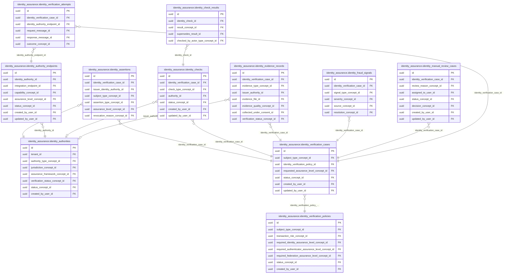

<!-- AUTOGENERADO por tools/inventario/catalogo.mjs. No editar manualmente. -->

# Catálogo del schema `identity_assurance`

- **Tablas:** 11 · **Columnas:** 147 (31 con descripción: 21.1 %) · **Índices:** 76
- **Dominio:** Identidad y Seguridad
- Método y límites del catálogo: [README del inventario](../README.md)

## Tablas

| Tabla | Propósito | Columnas | Índices | Operaciones | ORM |
|---|---|---|---|---|---|
| [identity_assertions](#identity_assertions) | Registra afirmaciones de identidad verificadas para que otros procesos puedan consumir evidencia confiable de atributos. | 14 | 7 | 6 | COINCIDE |
| [identity_authorities](#identity_authorities) | Cataloga autoridades que emiten identidades o credenciales usadas para verificar personas en procesos médicos. | 14 | 10 | 2 | COINCIDE |
| [identity_authority_endpoints](#identity_authority_endpoints) | Registra endpoints de autoridades de identidad para consultar o verificar atributos con fuentes autorizadas. | 13 | 7 | 4 | COINCIDE |
| [identity_check_results](#identity_check_results) | Conserva resultados de controles de identidad para explicar qué validaciones fueron satisfactorias o fallidas. | 11 | 4 | 6 | COINCIDE |
| [identity_checks](#identity_checks) | Representa verificaciones individuales ejecutadas dentro de un caso de identidad. | 12 | 6 | 19 | COINCIDE |
| [identity_evidence_records](#identity_evidence_records) | Cataloga evidencia presentada o consultada durante verificaciones para fundamentar sus resultados. | 14 | 8 | 5 | COINCIDE |
| [identity_fraud_signals](#identity_fraud_signals) | Documenta señales de posible fraude de identidad para apoyar revisión de riesgo y protección de cuentas. | 11 | 6 | 4 | COINCIDE |
| [identity_manual_review_cases](#identity_manual_review_cases) | Encola casos que requieren revisión humana cuando la verificación automática no resuelve la identidad con suficiente certeza. | 14 | 7 | 4 | COINCIDE |
| [identity_verification_attempts](#identity_verification_attempts) | Registra intentos de verificación para conservar métodos, tiempos y resultados parciales del proceso. | 13 | 7 | 10 | COINCIDE |
| [identity_verification_cases](#identity_verification_cases) | Agrupa procesos de verificación de identidad para seguir su estado, sujeto y resultado. | 16 | 6 | 27 | COINCIDE |
| [identity_verification_policies](#identity_verification_policies) | Define políticas que determinan requisitos y métodos de verificación de identidad para personas usuarias o pacientes. | 15 | 8 | 2 | COINCIDE |

## Diagrama entidad-relación

Las tablas se agrupan en familias por sus claves foráneas dentro del schema (máximo 40 por diagrama). Las FK hacia otros schemas se listan en la ficha de cada tabla.

### Familia 1 de 1 — 11 tablas

## Fichas

### identity_assertions

#### Vista general

Registra afirmaciones de identidad verificadas para que otros procesos puedan consumir evidencia confiable de atributos.

- **Estado del propósito:** DOMAIN_CURATED_DRAFT · fuente: `Mantra Core Health Context/modules/diagram_27_identity_assurance.puml: identity_assertions`
- **Dominio:** Identidad y Seguridad · **Diagrama:** `Mantra Core Health Context/modules/diagram_27_identity_assurance.puml` · **DDL:** `SQL/27_identity_assurance/02_tables.sql`
- **Entidad del ORM:** `IdentityAssertions` — `src/modules/identity_assurance/entities/identity_assertions.entity.ts`
- **Resumen:** 14 columnas · 7 índices · 6 FK salientes · 0 entrantes · 6 operaciones

#### Columnas

| # | Columna | Tipo | Rol estructural | Descripción | ORM |
|---|---|---|---|---|---|
| 1 | `id` | `uuid` | Clave primaria; Obligatoria | Identificador único de la instancia. _(JSDOC_ESTANDAR, `src/modules/identity_assurance/entities/identity_assertions.entity.ts:12`)_ | coincide |
| 2 | `identity_verification_case_id` | `uuid` | Clave foránea → identity_assurance.identity_verification_cases.id; Obligatoria | _sin dato_ | coincide |
| 3 | `issuer_identity_authority_id` | `uuid` | Clave foránea → identity_assurance.identity_authorities.id; Obligatoria | _sin dato_ | coincide |
| 4 | `subject_type_concept_id` | `uuid` | Clave foránea → terminology.catalog_concepts.id; Obligatoria | _sin dato_ | coincide |
| 5 | `subject_entity_id` | `uuid` | Obligatoria | _sin dato_ | coincide |
| 6 | `assertion_type_concept_id` | `uuid` | Clave foránea → terminology.catalog_concepts.id; Obligatoria | _sin dato_ | coincide |
| 7 | `assurance_level_concept_id` | `uuid` | Clave foránea → terminology.catalog_concepts.id; Obligatoria | _sin dato_ | coincide |
| 8 | `assertion_identifier` | `varchar` | Opcional | _sin dato_ | coincide |
| 9 | `assertion_hash` | `varchar` | Opcional | _sin dato_ | coincide |
| 10 | `issued_at` | `timestamptz` | Opcional | _sin dato_ | coincide |
| 11 | `expires_at` | `timestamptz` | Opcional | _sin dato_ | coincide |
| 12 | `revoked_at` | `timestamptz` | Opcional | _sin dato_ | coincide |
| 13 | `revocation_reason_concept_id` | `uuid` | Clave foránea → terminology.catalog_concepts.id; Opcional | _sin dato_ | coincide |
| 14 | `created_at` | `timestamptz` | Obligatoria | Fecha y hora en que se creó el registro. _(JSDOC_ESTANDAR, `src/modules/identity_assurance/entities/identity_assertions.entity.ts:114`)_ | coincide |

#### Relaciones

| Sentido | Columnas | Tabla | Restricción |
|---|---|---|---|
| hacia | identity_verification_case_id | identity_assurance.identity_verification_cases (id) | fk_identity_assertions_identity_verification_case_id |
| hacia | issuer_identity_authority_id | identity_assurance.identity_authorities (id) | fk_identity_assertions_issuer_identity_authority_id |
| hacia | subject_type_concept_id | terminology.catalog_concepts (id) | fk_identity_assertions_subject_type_concept_id |
| hacia | assertion_type_concept_id | terminology.catalog_concepts (id) | fk_identity_assertions_assertion_type_concept_id |
| hacia | assurance_level_concept_id | terminology.catalog_concepts (id) | fk_identity_assertions_assurance_level_concept_id |
| hacia | revocation_reason_concept_id | terminology.catalog_concepts (id) | fk_identity_assertions_revocation_reason_concept_id |

#### Índices

| Índice | Único | Columnas | Para qué |
|---|---|---|---|
| `ix_identity_assertions_identity_verification_case_id` | no | identity_verification_case_id | Soporta la clave foránea fk_identity_assertions_identity_verification_case_id: PostgreSQL no indexa las FK por sí mismo _(DOCUMENTO)_ |
| `ix_identity_assertions_issuer_identity_authority_id` | no | issuer_identity_authority_id | Soporta la clave foránea fk_identity_assertions_issuer_identity_authority_id: PostgreSQL no indexa las FK por sí mismo _(DOCUMENTO)_ |
| `ix_identity_assertions_subject_type_concept_id` | no | subject_type_concept_id | Soporta la clave foránea fk_identity_assertions_subject_type_concept_id: PostgreSQL no indexa las FK por sí mismo _(DOCUMENTO)_ |
| `ix_identity_assertions_assertion_type_concept_id` | no | assertion_type_concept_id | Soporta la clave foránea fk_identity_assertions_assertion_type_concept_id: PostgreSQL no indexa las FK por sí mismo _(DOCUMENTO)_ |
| `ix_identity_assertions_assurance_level_concept_id` | no | assurance_level_concept_id | Soporta la clave foránea fk_identity_assertions_assurance_level_concept_id: PostgreSQL no indexa las FK por sí mismo _(DOCUMENTO)_ |
| `ix_identity_assertions_revocation_reason_concept_id` | no | revocation_reason_concept_id | Soporta la clave foránea fk_identity_assertions_revocation_reason_concept_id: PostgreSQL no indexa las FK por sí mismo _(DOCUMENTO)_ |
| `brin_identity_assertions_created_at` | no | created_at | BRIN para logs e historiales append-only de gran volumen _(DOCUMENTO)_ |

#### Operaciones que la tocan

| Operación | Efecto | Confianza |
|---|---|---|
| POST /identity/assertions/{id}/revoke | ACTUALIZA | POR_TIPO |
| POST /identity/assertions/{id}/revoke | LEE | DIRECTA |
| POST /identity/checks/{id}/results | CREA | DIRECTA |
| POST /identity/manual-review/{id}/decision | CREA | DIRECTA |
| POST /identity/verification-cases/{id}/assertions | CREA | DIRECTA |
| POST /internal/identity/checks/{id}/results | CREA | DIRECTA |

#### Gobierno

| Atributo | Valor | Fuente |
|---|---|---|
| Append-only | no declarado | — |
| Datos personales | sin fuente | — |
| Financiera | sin fuente | — |
| Crítica para auditoría | sin fuente | — |
| Retención | sin fuente | — |
| Responsable | sin fuente | — |
| Revisión | AUTO_DETECTADA | — |

---

### identity_authorities

#### Vista general

Cataloga autoridades que emiten identidades o credenciales usadas para verificar personas en procesos médicos.

- **Estado del propósito:** DOMAIN_CURATED_DRAFT · fuente: `Mantra Core Health Context/modules/diagram_27_identity_assurance.puml: identity_authorities`
- **Dominio:** Identidad y Seguridad · **Diagrama:** `Mantra Core Health Context/modules/diagram_27_identity_assurance.puml` · **DDL:** `SQL/27_identity_assurance/02_tables.sql`
- **Entidad del ORM:** `IdentityAuthorities` — `src/modules/identity_assurance/entities/identity_authorities.entity.ts`
- **Resumen:** 14 columnas · 10 índices · 8 FK salientes · 4 entrantes · 2 operaciones

#### Columnas

| # | Columna | Tipo | Rol estructural | Descripción | ORM |
|---|---|---|---|---|---|
| 1 | `id` | `uuid` | Clave primaria; Obligatoria | Identificador único de la instancia. _(JSDOC_ESTANDAR, `src/modules/identity_assurance/entities/identity_authorities.entity.ts:12`)_ | coincide |
| 2 | `tenant_id` | `uuid` | Clave foránea → directory.tenants.id; Obligatoria | _sin dato_ | coincide |
| 3 | `authority_code` | `varchar` | Obligatoria | _sin dato_ | coincide |
| 4 | `name` | `varchar` | Obligatoria | _sin dato_ | coincide |
| 5 | `authority_type_concept_id` | `uuid` | Clave foránea → terminology.catalog_concepts.id; Obligatoria | _sin dato_ | coincide |
| 6 | `jurisdiction_concept_id` | `uuid` | Clave foránea → terminology.catalog_concepts.id; Opcional | _sin dato_ | coincide |
| 7 | `assurance_framework_concept_id` | `uuid` | Clave foránea → terminology.catalog_concepts.id; Opcional | _sin dato_ | coincide |
| 8 | `verification_status_concept_id` | `uuid` | Clave foránea → terminology.catalog_concepts.id; Obligatoria | _sin dato_ | coincide |
| 9 | `status_concept_id` | `uuid` | Clave foránea → terminology.catalog_concepts.id; Obligatoria | _sin dato_ | coincide |
| 10 | `created_at` | `timestamptz` | Obligatoria | Fecha y hora en que se creó el registro. _(JSDOC_ESTANDAR, `src/modules/identity_assurance/entities/identity_authorities.entity.ts:74`)_ | coincide |
| 11 | `updated_at` | `timestamptz` | Obligatoria | Fecha y hora de la última actualización. _(JSDOC_ESTANDAR, `src/modules/identity_assurance/entities/identity_authorities.entity.ts:80`)_ | coincide |
| 12 | `created_by_user_id` | `uuid` | Clave foránea → iam.users.id; Opcional | _sin dato_ | coincide |
| 13 | `updated_by_user_id` | `uuid` | Clave foránea → iam.users.id; Opcional | _sin dato_ | coincide |
| 14 | `row_version` | `integer = 1` | Obligatoria | Versión usada para controlar actualizaciones concurrentes. _(JSDOC_ENTIDAD, `src/modules/identity_assurance/entities/identity_authorities.entity.ts:98`)_ | coincide |

#### Relaciones

| Sentido | Columnas | Tabla | Restricción |
|---|---|---|---|
| hacia | tenant_id | directory.tenants (id) | fk_identity_authorities_tenant_id |
| hacia | authority_type_concept_id | terminology.catalog_concepts (id) | fk_identity_authorities_authority_type_concept_id |
| hacia | jurisdiction_concept_id | terminology.catalog_concepts (id) | fk_identity_authorities_jurisdiction_concept_id |
| hacia | assurance_framework_concept_id | terminology.catalog_concepts (id) | fk_identity_authorities_assurance_framework_concept_id |
| hacia | verification_status_concept_id | terminology.catalog_concepts (id) | fk_identity_authorities_verification_status_concept_id |
| hacia | status_concept_id | terminology.catalog_concepts (id) | fk_identity_authorities_status_concept_id |
| hacia | created_by_user_id | iam.users (id) | fk_identity_authorities_created_by_user_id |
| hacia | updated_by_user_id | iam.users (id) | fk_identity_authorities_updated_by_user_id |
| desde | id | identity_assurance.identity_authority_endpoints (identity_authority_id) | fk_identity_authority_endpoints_identity_authority_id |
| desde | id | identity_assurance.identity_evidence_records (issuer_authority_id) | fk_identity_evidence_records_issuer_authority_id |
| desde | id | identity_assurance.identity_checks (authority_id) | fk_identity_checks_authority_id |
| desde | id | identity_assurance.identity_assertions (issuer_identity_authority_id) | fk_identity_assertions_issuer_identity_authority_id |

#### Índices

| Índice | Único | Columnas | Para qué |
|---|---|---|---|
| `uq_identity_authorities_authority_code` | sí | authority_code | Garantiza que no se repita la combinación (authority_code) _(DOCUMENTO)_ |
| `ix_identity_authorities_tenant_id` | no | tenant_id | Soporta la clave foránea fk_identity_authorities_tenant_id: PostgreSQL no indexa las FK por sí mismo _(DOCUMENTO)_ |
| `ix_identity_authorities_authority_type_concept_id` | no | authority_type_concept_id | Soporta la clave foránea fk_identity_authorities_authority_type_concept_id: PostgreSQL no indexa las FK por sí mismo _(DOCUMENTO)_ |
| `ix_identity_authorities_jurisdiction_concept_id` | no | jurisdiction_concept_id | Soporta la clave foránea fk_identity_authorities_jurisdiction_concept_id: PostgreSQL no indexa las FK por sí mismo _(DOCUMENTO)_ |
| `ix_identity_authorities_assurance_framework_concept_id` | no | assurance_framework_concept_id | Soporta la clave foránea fk_identity_authorities_assurance_framework_concept_id: PostgreSQL no indexa las FK por sí mismo _(DOCUMENTO)_ |
| `ix_identity_authorities_verification_status_concept_id` | no | verification_status_concept_id | Soporta la clave foránea fk_identity_authorities_verification_status_concept_id: PostgreSQL no indexa las FK por sí mismo _(DOCUMENTO)_ |
| `ix_identity_authorities_status_concept_id` | no | status_concept_id | Soporta la clave foránea fk_identity_authorities_status_concept_id: PostgreSQL no indexa las FK por sí mismo _(DOCUMENTO)_ |
| `ix_identity_authorities_created_by_user_id` | no | created_by_user_id | Soporta la clave foránea fk_identity_authorities_created_by_user_id: PostgreSQL no indexa las FK por sí mismo _(DOCUMENTO)_ |
| `ix_identity_authorities_updated_by_user_id` | no | updated_by_user_id | Soporta la clave foránea fk_identity_authorities_updated_by_user_id: PostgreSQL no indexa las FK por sí mismo _(DOCUMENTO)_ |
| `ix_identity_authorities_tenant_id_status_concept_id` | no | tenant_id, status_concept_id, ("updated_at" DESC) | _sin uso detectado estáticamente_ |

#### Restricciones

| Restricción | Tipo | Definición |
|---|---|---|
| `uq_identity_authorities_authority_code` | UNIQUE INDEX | UNIQUE INDEX ("authority_code") |

#### Operaciones que la tocan

| Operación | Efecto | Confianza |
|---|---|---|
| POST /identity/authorities | CREA | DIRECTA |
| POST /identity/authorities/{id}/endpoints | LEE | DIRECTA |

#### Gobierno

| Atributo | Valor | Fuente |
|---|---|---|
| Append-only | no declarado | — |
| Datos personales | sin fuente | — |
| Financiera | sin fuente | — |
| Crítica para auditoría | sin fuente | — |
| Retención | sin fuente | — |
| Responsable | sin fuente | — |
| Revisión | AUTO_DETECTADA | — |

---

### identity_authority_endpoints

#### Vista general

Registra endpoints de autoridades de identidad para consultar o verificar atributos con fuentes autorizadas.

- **Estado del propósito:** DOMAIN_CURATED_DRAFT · fuente: `Mantra Core Health Context/modules/diagram_27_identity_assurance.puml: identity_authority_endpoints`
- **Dominio:** Identidad y Seguridad · **Diagrama:** `Mantra Core Health Context/modules/diagram_27_identity_assurance.puml` · **DDL:** `SQL/27_identity_assurance/02_tables.sql`
- **Entidad del ORM:** `IdentityAuthorityEndpoints` — `src/modules/identity_assurance/entities/identity_authority_endpoints.entity.ts`
- **Resumen:** 13 columnas · 7 índices · 7 FK salientes · 1 entrantes · 4 operaciones

#### Columnas

| # | Columna | Tipo | Rol estructural | Descripción | ORM |
|---|---|---|---|---|---|
| 1 | `id` | `uuid` | Clave primaria; Obligatoria | Identificador único de la instancia. _(JSDOC_ESTANDAR, `src/modules/identity_assurance/entities/identity_authority_endpoints.entity.ts:15`)_ | coincide |
| 2 | `identity_authority_id` | `uuid` | Clave foránea → identity_assurance.identity_authorities.id; Obligatoria | _sin dato_ | coincide |
| 3 | `integration_endpoint_id` | `uuid` | Clave foránea → integrations.integration_endpoints.id; Obligatoria | _sin dato_ | coincide |
| 4 | `capability_concept_id` | `uuid` | Clave foránea → terminology.catalog_concepts.id; Obligatoria | _sin dato_ | coincide |
| 5 | `assurance_level_concept_id` | `uuid` | Clave foránea → terminology.catalog_concepts.id; Opcional | _sin dato_ | coincide |
| 6 | `request_contract_version` | `varchar` | Opcional | _sin dato_ | coincide |
| 7 | `response_contract_version` | `varchar` | Opcional | _sin dato_ | coincide |
| 8 | `status_concept_id` | `uuid` | Clave foránea → terminology.catalog_concepts.id; Obligatoria | _sin dato_ | coincide |
| 9 | `created_at` | `timestamptz` | Obligatoria | Fecha y hora en que se creó el registro. _(JSDOC_ESTANDAR, `src/modules/identity_assurance/entities/identity_authority_endpoints.entity.ts:75`)_ | coincide |
| 10 | `updated_at` | `timestamptz` | Obligatoria | Fecha y hora de la última actualización. _(JSDOC_ESTANDAR, `src/modules/identity_assurance/entities/identity_authority_endpoints.entity.ts:81`)_ | coincide |
| 11 | `created_by_user_id` | `uuid` | Clave foránea → iam.users.id; Opcional | _sin dato_ | coincide |
| 12 | `updated_by_user_id` | `uuid` | Clave foránea → iam.users.id; Opcional | _sin dato_ | coincide |
| 13 | `row_version` | `integer = 1` | Obligatoria | Versión usada para controlar actualizaciones concurrentes. _(JSDOC_ENTIDAD, `src/modules/identity_assurance/entities/identity_authority_endpoints.entity.ts:99`)_ | coincide |

#### Relaciones

| Sentido | Columnas | Tabla | Restricción |
|---|---|---|---|
| hacia | identity_authority_id | identity_assurance.identity_authorities (id) | fk_identity_authority_endpoints_identity_authority_id |
| hacia | integration_endpoint_id | integrations.integration_endpoints (id) | fk_identity_authority_endpoints_integration_endpoint_id |
| hacia | capability_concept_id | terminology.catalog_concepts (id) | fk_identity_authority_endpoints_capability_concept_id |
| hacia | assurance_level_concept_id | terminology.catalog_concepts (id) | fk_identity_authority_endpoints_assurance_level_concept_id |
| hacia | status_concept_id | terminology.catalog_concepts (id) | fk_identity_authority_endpoints_status_concept_id |
| hacia | created_by_user_id | iam.users (id) | fk_identity_authority_endpoints_created_by_user_id |
| hacia | updated_by_user_id | iam.users (id) | fk_identity_authority_endpoints_updated_by_user_id |
| desde | id | identity_assurance.identity_verification_attempts (identity_authority_endpoint_id) | fk_identity_verification_attempts_identity_authority_e_91da2d59 |

#### Índices

| Índice | Único | Columnas | Para qué |
|---|---|---|---|
| `ix_identity_authority_endpoints_identity_authority_id` | no | identity_authority_id | Soporta la clave foránea fk_identity_authority_endpoints_identity_authority_id: PostgreSQL no indexa las FK por sí mismo _(DOCUMENTO)_ |
| `ix_identity_authority_endpoints_integration_endpoint_id` | no | integration_endpoint_id | Soporta la clave foránea fk_identity_authority_endpoints_integration_endpoint_id: PostgreSQL no indexa las FK por sí mismo _(DOCUMENTO)_ |
| `ix_identity_authority_endpoints_capability_concept_id` | no | capability_concept_id | Soporta la clave foránea fk_identity_authority_endpoints_capability_concept_id: PostgreSQL no indexa las FK por sí mismo _(DOCUMENTO)_ |
| `ix_identity_authority_endpoints_assurance_level_concept_id` | no | assurance_level_concept_id | Soporta la clave foránea fk_identity_authority_endpoints_assurance_level_concept_id: PostgreSQL no indexa las FK por sí mismo _(DOCUMENTO)_ |
| `ix_identity_authority_endpoints_status_concept_id` | no | status_concept_id | Soporta la clave foránea fk_identity_authority_endpoints_status_concept_id: PostgreSQL no indexa las FK por sí mismo _(DOCUMENTO)_ |
| `ix_identity_authority_endpoints_created_by_user_id` | no | created_by_user_id | Soporta la clave foránea fk_identity_authority_endpoints_created_by_user_id: PostgreSQL no indexa las FK por sí mismo _(DOCUMENTO)_ |
| `ix_identity_authority_endpoints_updated_by_user_id` | no | updated_by_user_id | Soporta la clave foránea fk_identity_authority_endpoints_updated_by_user_id: PostgreSQL no indexa las FK por sí mismo _(DOCUMENTO)_ |

#### Operaciones que la tocan

| Operación | Efecto | Confianza |
|---|---|---|
| POST /identity/authorities/{id}/endpoints | CREA | DIRECTA |
| POST /identity/checks/{id}/results | LEE | DIRECTA |
| POST /identity/manual-review/{id}/decision | LEE | DIRECTA |
| POST /internal/identity/checks/{id}/results | LEE | DIRECTA |

#### Gobierno

| Atributo | Valor | Fuente |
|---|---|---|
| Append-only | no declarado | — |
| Datos personales | sin fuente | — |
| Financiera | sin fuente | — |
| Crítica para auditoría | sin fuente | — |
| Retención | sin fuente | — |
| Responsable | sin fuente | — |
| Revisión | AUTO_DETECTADA | — |

---

### identity_check_results

#### Vista general

Conserva resultados de controles de identidad para explicar qué validaciones fueron satisfactorias o fallidas.

- **Estado del propósito:** DOMAIN_CURATED_DRAFT · fuente: `Mantra Core Health Context/modules/diagram_27_identity_assurance.puml: identity_check_results`
- **Dominio:** Identidad y Seguridad · **Diagrama:** `Mantra Core Health Context/modules/diagram_27_identity_assurance.puml` · **DDL:** `SQL/27_identity_assurance/02_tables.sql`
- **Entidad del ORM:** `IdentityCheckResults` — `src/modules/identity_assurance/entities/identity_check_results.entity.ts`
- **Resumen:** 11 columnas · 4 índices · 4 FK salientes · 1 entrantes · 6 operaciones

#### Columnas

| # | Columna | Tipo | Rol estructural | Descripción | ORM |
|---|---|---|---|---|---|
| 1 | `id` | `uuid` | Clave primaria; Obligatoria | Identificador único de la instancia. _(JSDOC_ESTANDAR, `src/modules/identity_assurance/entities/identity_check_results.entity.ts:12`)_ | coincide |
| 2 | `identity_check_id` | `uuid` | Clave foránea → identity_assurance.identity_checks.id; Obligatoria | _sin dato_ | coincide |
| 3 | `result_version` | `integer` | Obligatoria | _sin dato_ | coincide |
| 4 | `result_concept_id` | `uuid` | Clave foránea → terminology.catalog_concepts.id; Obligatoria | _sin dato_ | coincide |
| 5 | `match_score` | `numeric` | Opcional | _sin dato_ | coincide |
| 6 | `discrepancy_codes_json` | `jsonb` | Opcional | _sin dato_ | coincide |
| 7 | `source_response_hash` | `varchar` | Opcional | _sin dato_ | coincide |
| 8 | `supersedes_result_id` | `uuid` | Clave foránea → identity_assurance.identity_check_results.id; Opcional | _sin dato_ | coincide |
| 9 | `checked_at` | `timestamptz` | Obligatoria | _sin dato_ | coincide |
| 10 | `checked_by_actor_type_concept_id` | `uuid` | Clave foránea → terminology.catalog_concepts.id; Opcional | _sin dato_ | coincide |
| 11 | `checked_by_actor_id` | `uuid` | Opcional | _sin dato_ | coincide |

#### Relaciones

| Sentido | Columnas | Tabla | Restricción |
|---|---|---|---|
| hacia | identity_check_id | identity_assurance.identity_checks (id) | fk_identity_check_results_identity_check_id |
| hacia | supersedes_result_id | identity_assurance.identity_check_results (id) | fk_identity_check_results_supersedes_result_id |
| hacia | result_concept_id | terminology.catalog_concepts (id) | fk_identity_check_results_result_concept_id |
| hacia | checked_by_actor_type_concept_id | terminology.catalog_concepts (id) | fk_identity_check_results_checked_by_actor_type_concept_id |
| desde | id | identity_assurance.identity_check_results (supersedes_result_id) | fk_identity_check_results_supersedes_result_id |

#### Índices

| Índice | Único | Columnas | Para qué |
|---|---|---|---|
| `ix_identity_check_results_identity_check_id` | no | identity_check_id | Soporta la clave foránea fk_identity_check_results_identity_check_id: PostgreSQL no indexa las FK por sí mismo _(DOCUMENTO)_; 2 consulta(s) de repositorio filtran u ordenan por «identity_check_id», la primera columna del índice _(CONSULTA)_ |
| `ix_identity_check_results_result_concept_id` | no | result_concept_id | Soporta la clave foránea fk_identity_check_results_result_concept_id: PostgreSQL no indexa las FK por sí mismo _(DOCUMENTO)_ |
| `ix_identity_check_results_supersedes_result_id` | no | supersedes_result_id | Soporta la clave foránea fk_identity_check_results_supersedes_result_id: PostgreSQL no indexa las FK por sí mismo _(DOCUMENTO)_ |
| `ix_identity_check_results_checked_by_actor_type_concept_id` | no | checked_by_actor_type_concept_id | Soporta la clave foránea fk_identity_check_results_checked_by_actor_type_concept_id: PostgreSQL no indexa las FK por sí mismo _(DOCUMENTO)_ |

#### Operaciones que la tocan

| Operación | Efecto | Confianza |
|---|---|---|
| POST /identity/checks/{id}/results | CREA | DIRECTA |
| POST /identity/checks/{id}/results | LEE | DIRECTA |
| POST /identity/manual-review/{id}/decision | CREA | DIRECTA |
| POST /identity/manual-review/{id}/decision | LEE | DIRECTA |
| POST /internal/identity/checks/{id}/results | CREA | DIRECTA |
| POST /internal/identity/checks/{id}/results | LEE | DIRECTA |

#### Gobierno

| Atributo | Valor | Fuente |
|---|---|---|
| Append-only | no declarado | — |
| Datos personales | sin fuente | — |
| Financiera | sin fuente | — |
| Crítica para auditoría | sin fuente | — |
| Retención | sin fuente | — |
| Responsable | sin fuente | — |
| Revisión | AUTO_DETECTADA | — |

---

### identity_checks

#### Vista general

Representa verificaciones individuales ejecutadas dentro de un caso de identidad.

- **Estado del propósito:** DOMAIN_CURATED_DRAFT · fuente: `Mantra Core Health Context/modules/diagram_27_identity_assurance.puml: identity_checks`
- **Dominio:** Identidad y Seguridad · **Diagrama:** `Mantra Core Health Context/modules/diagram_27_identity_assurance.puml` · **DDL:** `SQL/27_identity_assurance/02_tables.sql`
- **Entidad del ORM:** `IdentityChecks` — `src/modules/identity_assurance/entities/identity_checks.entity.ts`
- **Resumen:** 12 columnas · 6 índices · 6 FK salientes · 1 entrantes · 19 operaciones

#### Columnas

| # | Columna | Tipo | Rol estructural | Descripción | ORM |
|---|---|---|---|---|---|
| 1 | `id` | `uuid` | Clave primaria; Obligatoria | Identificador único de la instancia. _(JSDOC_ESTANDAR, `src/modules/identity_assurance/entities/identity_checks.entity.ts:12`)_ | coincide |
| 2 | `identity_verification_case_id` | `uuid` | Clave foránea → identity_assurance.identity_verification_cases.id; Obligatoria | _sin dato_ | coincide |
| 3 | `check_type_concept_id` | `uuid` | Clave foránea → terminology.catalog_concepts.id; Obligatoria | _sin dato_ | coincide |
| 4 | `authority_id` | `uuid` | Clave foránea → identity_assurance.identity_authorities.id; Opcional | _sin dato_ | coincide |
| 5 | `required` | `boolean` | Opcional | _sin dato_ | coincide |
| 6 | `check_sequence` | `integer` | Opcional | _sin dato_ | coincide |
| 7 | `status_concept_id` | `uuid` | Clave foránea → terminology.catalog_concepts.id; Obligatoria | _sin dato_ | coincide |
| 8 | `created_at` | `timestamptz` | Obligatoria | Fecha y hora en que se creó el registro. _(JSDOC_ESTANDAR, `src/modules/identity_assurance/entities/identity_checks.entity.ts:54`)_ | coincide |
| 9 | `updated_at` | `timestamptz` | Obligatoria | Fecha y hora de la última actualización. _(JSDOC_ESTANDAR, `src/modules/identity_assurance/entities/identity_checks.entity.ts:60`)_ | coincide |
| 10 | `created_by_user_id` | `uuid` | Clave foránea → iam.users.id; Opcional | _sin dato_ | coincide |
| 11 | `updated_by_user_id` | `uuid` | Clave foránea → iam.users.id; Opcional | _sin dato_ | coincide |
| 12 | `row_version` | `integer = 1` | Obligatoria | Versión usada para controlar actualizaciones concurrentes. _(JSDOC_ENTIDAD, `src/modules/identity_assurance/entities/identity_checks.entity.ts:78`)_ | coincide |

#### Relaciones

| Sentido | Columnas | Tabla | Restricción |
|---|---|---|---|
| hacia | identity_verification_case_id | identity_assurance.identity_verification_cases (id) | fk_identity_checks_identity_verification_case_id |
| hacia | authority_id | identity_assurance.identity_authorities (id) | fk_identity_checks_authority_id |
| hacia | check_type_concept_id | terminology.catalog_concepts (id) | fk_identity_checks_check_type_concept_id |
| hacia | status_concept_id | terminology.catalog_concepts (id) | fk_identity_checks_status_concept_id |
| hacia | created_by_user_id | iam.users (id) | fk_identity_checks_created_by_user_id |
| hacia | updated_by_user_id | iam.users (id) | fk_identity_checks_updated_by_user_id |
| desde | id | identity_assurance.identity_check_results (identity_check_id) | fk_identity_check_results_identity_check_id |

#### Índices

| Índice | Único | Columnas | Para qué |
|---|---|---|---|
| `ix_identity_checks_identity_verification_case_id` | no | identity_verification_case_id | Soporta la clave foránea fk_identity_checks_identity_verification_case_id: PostgreSQL no indexa las FK por sí mismo _(DOCUMENTO)_; 4 consulta(s) de repositorio filtran u ordenan por «identity_verification_case_id», la primera columna del índice _(CONSULTA)_ |
| `ix_identity_checks_check_type_concept_id` | no | check_type_concept_id | Soporta la clave foránea fk_identity_checks_check_type_concept_id: PostgreSQL no indexa las FK por sí mismo _(DOCUMENTO)_ |
| `ix_identity_checks_authority_id` | no | authority_id | Soporta la clave foránea fk_identity_checks_authority_id: PostgreSQL no indexa las FK por sí mismo _(DOCUMENTO)_ |
| `ix_identity_checks_status_concept_id` | no | status_concept_id | Soporta la clave foránea fk_identity_checks_status_concept_id: PostgreSQL no indexa las FK por sí mismo _(DOCUMENTO)_; 4 consulta(s) de repositorio filtran u ordenan por «status_concept_id», la primera columna del índice _(CONSULTA)_ |
| `ix_identity_checks_created_by_user_id` | no | created_by_user_id | Soporta la clave foránea fk_identity_checks_created_by_user_id: PostgreSQL no indexa las FK por sí mismo _(DOCUMENTO)_ |
| `ix_identity_checks_updated_by_user_id` | no | updated_by_user_id | Soporta la clave foránea fk_identity_checks_updated_by_user_id: PostgreSQL no indexa las FK por sí mismo _(DOCUMENTO)_ |

#### Operaciones que la tocan

| Operación | Efecto | Confianza |
|---|---|---|
| POST /identity/checks/{id}/attempts | ACTUALIZA | POR_TIPO |
| POST /identity/checks/{id}/attempts | LEE | DIRECTA |
| POST /identity/checks/{id}/results | ACTUALIZA | POR_TIPO |
| POST /identity/checks/{id}/results | LEE | DIRECTA |
| POST /identity/manual-review/{id}/decision | ACTUALIZA | POR_TIPO |
| POST /identity/manual-review/{id}/decision | LEE | DIRECTA |
| POST /identity/me/identity-verification | CREA | DIRECTA |
| POST /identity/me/practitioner/identity-verification | CREA | DIRECTA |
| POST /identity/me/practitioner/license-verification | CREA | DIRECTA |
| POST /identity/me/tenants/{tenantId}/verification | CREA | DIRECTA |
| POST /identity/verification-cases/{id}/assertions | LEE | DIRECTA |
| POST /identity/verification-cases/{id}/checks:plan | CREA | DIRECTA |
| POST /identity/verification-cases/expire-sweep | ACTUALIZA | POR_TIPO |
| POST /identity/verification-cases/expire-sweep | LEE | DIRECTA |
| POST /internal/identity/checks/{id}/attempts | ACTUALIZA | POR_TIPO |
| POST /internal/identity/checks/{id}/attempts | LEE | DIRECTA |
| POST /internal/identity/checks/{id}/results | ACTUALIZA | POR_TIPO |
| POST /internal/identity/checks/{id}/results | LEE | DIRECTA |
| GET /internal/identity/checks/dispatchable | LEE | DIRECTA |

#### Gobierno

| Atributo | Valor | Fuente |
|---|---|---|
| Append-only | no declarado | — |
| Datos personales | sin fuente | — |
| Financiera | sin fuente | — |
| Crítica para auditoría | sin fuente | — |
| Retención | sin fuente | — |
| Responsable | sin fuente | — |
| Revisión | AUTO_DETECTADA | — |

---

### identity_evidence_records

#### Vista general

Cataloga evidencia presentada o consultada durante verificaciones para fundamentar sus resultados.

- **Estado del propósito:** DOMAIN_CURATED_DRAFT · fuente: `Mantra Core Health Context/modules/diagram_27_identity_assurance.puml: identity_evidence_records`
- **Dominio:** Identidad y Seguridad · **Diagrama:** `Mantra Core Health Context/modules/diagram_27_identity_assurance.puml` · **DDL:** `SQL/27_identity_assurance/02_tables.sql`
- **Entidad del ORM:** `IdentityEvidenceRecords` — `src/modules/identity_assurance/entities/identity_evidence_records.entity.ts`
- **Resumen:** 14 columnas · 8 índices · 8 FK salientes · 0 entrantes · 5 operaciones

#### Columnas

| # | Columna | Tipo | Rol estructural | Descripción | ORM |
|---|---|---|---|---|---|
| 1 | `id` | `uuid` | Clave primaria; Obligatoria | Identificador único de la instancia. _(JSDOC_ESTANDAR, `src/modules/identity_assurance/entities/identity_evidence_records.entity.ts:15`)_ | coincide |
| 2 | `identity_verification_case_id` | `uuid` | Clave foránea → identity_assurance.identity_verification_cases.id; Obligatoria | _sin dato_ | coincide |
| 3 | `evidence_type_concept_id` | `uuid` | Clave foránea → terminology.catalog_concepts.id; Obligatoria | _sin dato_ | coincide |
| 4 | `issuer_authority_id` | `uuid` | Clave foránea → identity_assurance.identity_authorities.id; Opcional | _sin dato_ | coincide |
| 5 | `evidence_identifier_hash` | `varchar` | Opcional | _sin dato_ | coincide |
| 6 | `evidence_file_id` | `uuid` | Clave foránea → common.files.id; Opcional | _sin dato_ | coincide |
| 7 | `encrypted_evidence_reference` | `text` | Opcional | _sin dato_ | coincide |
| 8 | `evidence_quality_concept_id` | `uuid` | Clave foránea → terminology.catalog_concepts.id; Opcional | _sin dato_ | coincide |
| 9 | `issued_at` | `timestamptz` | Opcional | _sin dato_ | coincide |
| 10 | `expires_at` | `timestamptz` | Opcional | _sin dato_ | coincide |
| 11 | `collected_under_consent_id` | `uuid` | Clave foránea → consent.consents.id; Opcional | _sin dato_ | coincide |
| 12 | `verification_status_concept_id` | `uuid` | Clave foránea → terminology.catalog_concepts.id; Obligatoria | _sin dato_ | coincide |
| 13 | `created_at` | `timestamptz` | Obligatoria | Fecha y hora en que se creó el registro. _(JSDOC_ESTANDAR, `src/modules/identity_assurance/entities/identity_evidence_records.entity.ts:111`)_ | coincide |
| 14 | `created_by_user_id` | `uuid` | Clave foránea → iam.users.id; Opcional | _sin dato_ | coincide |

#### Relaciones

| Sentido | Columnas | Tabla | Restricción |
|---|---|---|---|
| hacia | identity_verification_case_id | identity_assurance.identity_verification_cases (id) | fk_identity_evidence_records_identity_verification_case_id |
| hacia | issuer_authority_id | identity_assurance.identity_authorities (id) | fk_identity_evidence_records_issuer_authority_id |
| hacia | evidence_type_concept_id | terminology.catalog_concepts (id) | fk_identity_evidence_records_evidence_type_concept_id |
| hacia | evidence_file_id | common.files (id) | fk_identity_evidence_records_evidence_file_id |
| hacia | evidence_quality_concept_id | terminology.catalog_concepts (id) | fk_identity_evidence_records_evidence_quality_concept_id |
| hacia | collected_under_consent_id | consent.consents (id) | fk_identity_evidence_records_collected_under_consent_id |
| hacia | verification_status_concept_id | terminology.catalog_concepts (id) | fk_identity_evidence_records_verification_status_concept_id |
| hacia | created_by_user_id | iam.users (id) | fk_identity_evidence_records_created_by_user_id |

#### Índices

| Índice | Único | Columnas | Para qué |
|---|---|---|---|
| `ix_identity_evidence_records_identity_verification_case_id` | no | identity_verification_case_id | Soporta la clave foránea fk_identity_evidence_records_identity_verification_case_id: PostgreSQL no indexa las FK por sí mismo _(DOCUMENTO)_ |
| `ix_identity_evidence_records_evidence_type_concept_id` | no | evidence_type_concept_id | Soporta la clave foránea fk_identity_evidence_records_evidence_type_concept_id: PostgreSQL no indexa las FK por sí mismo _(DOCUMENTO)_ |
| `ix_identity_evidence_records_issuer_authority_id` | no | issuer_authority_id | Soporta la clave foránea fk_identity_evidence_records_issuer_authority_id: PostgreSQL no indexa las FK por sí mismo _(DOCUMENTO)_ |
| `ix_identity_evidence_records_evidence_file_id` | no | evidence_file_id | Soporta la clave foránea fk_identity_evidence_records_evidence_file_id: PostgreSQL no indexa las FK por sí mismo _(DOCUMENTO)_ |
| `ix_identity_evidence_records_evidence_quality_concept_id` | no | evidence_quality_concept_id | Soporta la clave foránea fk_identity_evidence_records_evidence_quality_concept_id: PostgreSQL no indexa las FK por sí mismo _(DOCUMENTO)_ |
| `ix_identity_evidence_records_collected_under_consent_id` | no | collected_under_consent_id | Soporta la clave foránea fk_identity_evidence_records_collected_under_consent_id: PostgreSQL no indexa las FK por sí mismo _(DOCUMENTO)_ |
| `ix_identity_evidence_records_verification_status_concept_id` | no | verification_status_concept_id | Soporta la clave foránea fk_identity_evidence_records_verification_status_concept_id: PostgreSQL no indexa las FK por sí mismo _(DOCUMENTO)_ |
| `ix_identity_evidence_records_created_by_user_id` | no | created_by_user_id | Soporta la clave foránea fk_identity_evidence_records_created_by_user_id: PostgreSQL no indexa las FK por sí mismo _(DOCUMENTO)_ |

#### Operaciones que la tocan

| Operación | Efecto | Confianza |
|---|---|---|
| POST /identity/me/identity-verification | CREA | DIRECTA |
| POST /identity/me/practitioner/identity-verification | CREA | DIRECTA |
| POST /identity/me/practitioner/license-verification | CREA | DIRECTA |
| POST /identity/me/tenants/{tenantId}/verification | CREA | DIRECTA |
| POST /identity/verification-cases/{id}/evidence | CREA | DIRECTA |

#### Gobierno

| Atributo | Valor | Fuente |
|---|---|---|
| Append-only | no declarado | — |
| Datos personales | sin fuente | — |
| Financiera | sin fuente | — |
| Crítica para auditoría | sin fuente | — |
| Retención | sin fuente | — |
| Responsable | sin fuente | — |
| Revisión | AUTO_DETECTADA | — |

---

### identity_fraud_signals

#### Vista general

Documenta señales de posible fraude de identidad para apoyar revisión de riesgo y protección de cuentas.

- **Estado del propósito:** DOMAIN_CURATED_DRAFT · fuente: `Mantra Core Health Context/modules/diagram_27_identity_assurance.puml: identity_fraud_signals`
- **Dominio:** Identidad y Seguridad · **Diagrama:** `Mantra Core Health Context/modules/diagram_27_identity_assurance.puml` · **DDL:** `SQL/27_identity_assurance/02_tables.sql`
- **Entidad del ORM:** `IdentityFraudSignals` — `src/modules/identity_assurance/entities/identity_fraud_signals.entity.ts`
- **Resumen:** 11 columnas · 6 índices · 5 FK salientes · 0 entrantes · 4 operaciones

#### Columnas

| # | Columna | Tipo | Rol estructural | Descripción | ORM |
|---|---|---|---|---|---|
| 1 | `id` | `uuid` | Clave primaria; Obligatoria | Identificador único de la instancia. _(JSDOC_ESTANDAR, `src/modules/identity_assurance/entities/identity_fraud_signals.entity.ts:12`)_ | coincide |
| 2 | `identity_verification_case_id` | `uuid` | Clave foránea → identity_assurance.identity_verification_cases.id; Obligatoria | _sin dato_ | coincide |
| 3 | `signal_type_concept_id` | `uuid` | Clave foránea → terminology.catalog_concepts.id; Obligatoria | _sin dato_ | coincide |
| 4 | `severity_concept_id` | `uuid` | Clave foránea → terminology.catalog_concepts.id; Obligatoria | _sin dato_ | coincide |
| 5 | `confidence_score` | `numeric` | Opcional | _sin dato_ | coincide |
| 6 | `source_concept_id` | `uuid` | Clave foránea → terminology.catalog_concepts.id; Opcional | _sin dato_ | coincide |
| 7 | `evidence_reference` | `varchar` | Opcional | _sin dato_ | coincide |
| 8 | `detected_at` | `timestamptz` | Opcional | _sin dato_ | coincide |
| 9 | `resolved_at` | `timestamptz` | Opcional | _sin dato_ | coincide |
| 10 | `resolution_concept_id` | `uuid` | Clave foránea → terminology.catalog_concepts.id; Obligatoria | _sin dato_ | coincide |
| 11 | `created_at` | `timestamptz` | Obligatoria | Fecha y hora en que se creó el registro. _(JSDOC_ESTANDAR, `src/modules/identity_assurance/entities/identity_fraud_signals.entity.ts:88`)_ | coincide |

#### Relaciones

| Sentido | Columnas | Tabla | Restricción |
|---|---|---|---|
| hacia | identity_verification_case_id | identity_assurance.identity_verification_cases (id) | fk_identity_fraud_signals_identity_verification_case_id |
| hacia | signal_type_concept_id | terminology.catalog_concepts (id) | fk_identity_fraud_signals_signal_type_concept_id |
| hacia | severity_concept_id | terminology.catalog_concepts (id) | fk_identity_fraud_signals_severity_concept_id |
| hacia | source_concept_id | terminology.catalog_concepts (id) | fk_identity_fraud_signals_source_concept_id |
| hacia | resolution_concept_id | terminology.catalog_concepts (id) | fk_identity_fraud_signals_resolution_concept_id |

#### Índices

| Índice | Único | Columnas | Para qué |
|---|---|---|---|
| `ix_identity_fraud_signals_identity_verification_case_id` | no | identity_verification_case_id | Soporta la clave foránea fk_identity_fraud_signals_identity_verification_case_id: PostgreSQL no indexa las FK por sí mismo _(DOCUMENTO)_; 1 consulta(s) de repositorio filtran u ordenan por «identity_verification_case_id», la primera columna del índice _(CONSULTA)_ |
| `ix_identity_fraud_signals_signal_type_concept_id` | no | signal_type_concept_id | Soporta la clave foránea fk_identity_fraud_signals_signal_type_concept_id: PostgreSQL no indexa las FK por sí mismo _(DOCUMENTO)_ |
| `ix_identity_fraud_signals_severity_concept_id` | no | severity_concept_id | Soporta la clave foránea fk_identity_fraud_signals_severity_concept_id: PostgreSQL no indexa las FK por sí mismo _(DOCUMENTO)_ |
| `ix_identity_fraud_signals_source_concept_id` | no | source_concept_id | Soporta la clave foránea fk_identity_fraud_signals_source_concept_id: PostgreSQL no indexa las FK por sí mismo _(DOCUMENTO)_ |
| `ix_identity_fraud_signals_resolution_concept_id` | no | resolution_concept_id | Soporta la clave foránea fk_identity_fraud_signals_resolution_concept_id: PostgreSQL no indexa las FK por sí mismo _(DOCUMENTO)_; 1 consulta(s) de repositorio filtran u ordenan por «resolution_concept_id», la primera columna del índice _(CONSULTA)_ |
| `brin_identity_fraud_signals_created_at` | no | created_at | BRIN para logs e historiales append-only de gran volumen _(DOCUMENTO)_ |

#### Operaciones que la tocan

| Operación | Efecto | Confianza |
|---|---|---|
| POST /identity/assertions/{id}/revoke | CREA | DIRECTA |
| POST /identity/manual-review/{id}/decision | ACTUALIZA | POR_TIPO |
| POST /identity/manual-review/{id}/decision | LEE | DIRECTA |
| POST /identity/verification-cases/{id}/fraud-signals | CREA | DIRECTA |

#### Gobierno

| Atributo | Valor | Fuente |
|---|---|---|
| Append-only | no declarado | — |
| Datos personales | sin fuente | — |
| Financiera | sin fuente | — |
| Crítica para auditoría | sin fuente | — |
| Retención | sin fuente | — |
| Responsable | sin fuente | — |
| Revisión | AUTO_DETECTADA | — |

---

### identity_manual_review_cases

#### Vista general

Encola casos que requieren revisión humana cuando la verificación automática no resuelve la identidad con suficiente certeza.

- **Estado del propósito:** DOMAIN_CURATED_DRAFT · fuente: `Mantra Core Health Context/modules/diagram_27_identity_assurance.puml: identity_manual_review_cases`
- **Dominio:** Identidad y Seguridad · **Diagrama:** `Mantra Core Health Context/modules/diagram_27_identity_assurance.puml` · **DDL:** `SQL/27_identity_assurance/02_tables.sql`
- **Entidad del ORM:** `IdentityManualReviewCases` — `src/modules/identity_assurance/entities/identity_manual_review_cases.entity.ts`
- **Resumen:** 14 columnas · 7 índices · 7 FK salientes · 0 entrantes · 4 operaciones

#### Columnas

| # | Columna | Tipo | Rol estructural | Descripción | ORM |
|---|---|---|---|---|---|
| 1 | `id` | `uuid` | Clave primaria; Obligatoria | Identificador único de la instancia. _(JSDOC_ESTANDAR, `src/modules/identity_assurance/entities/identity_manual_review_cases.entity.ts:15`)_ | coincide |
| 2 | `identity_verification_case_id` | `uuid` | Clave foránea → identity_assurance.identity_verification_cases.id; Obligatoria | _sin dato_ | coincide |
| 3 | `review_reason_concept_id` | `uuid` | Clave foránea → terminology.catalog_concepts.id; Obligatoria | _sin dato_ | coincide |
| 4 | `assigned_to_user_id` | `uuid` | Clave foránea → iam.users.id; Opcional | _sin dato_ | coincide |
| 5 | `status_concept_id` | `uuid` | Clave foránea → terminology.catalog_concepts.id; Obligatoria | _sin dato_ | coincide |
| 6 | `opened_at` | `timestamptz` | Opcional | _sin dato_ | coincide |
| 7 | `decided_at` | `timestamptz` | Opcional | _sin dato_ | coincide |
| 8 | `decision_concept_id` | `uuid` | Clave foránea → terminology.catalog_concepts.id; Opcional | _sin dato_ | coincide |
| 9 | `decision_reason` | `text` | Opcional | _sin dato_ | coincide |
| 10 | `created_at` | `timestamptz` | Obligatoria | Fecha y hora en que se creó el registro. _(JSDOC_ESTANDAR, `src/modules/identity_assurance/entities/identity_manual_review_cases.entity.ts:81`)_ | coincide |
| 11 | `updated_at` | `timestamptz` | Obligatoria | Fecha y hora de la última actualización. _(JSDOC_ESTANDAR, `src/modules/identity_assurance/entities/identity_manual_review_cases.entity.ts:87`)_ | coincide |
| 12 | `created_by_user_id` | `uuid` | Clave foránea → iam.users.id; Opcional | _sin dato_ | coincide |
| 13 | `updated_by_user_id` | `uuid` | Clave foránea → iam.users.id; Opcional | _sin dato_ | coincide |
| 14 | `row_version` | `integer = 1` | Obligatoria | Versión usada para controlar actualizaciones concurrentes. _(JSDOC_ENTIDAD, `src/modules/identity_assurance/entities/identity_manual_review_cases.entity.ts:105`)_ | coincide |

#### Relaciones

| Sentido | Columnas | Tabla | Restricción |
|---|---|---|---|
| hacia | identity_verification_case_id | identity_assurance.identity_verification_cases (id) | fk_identity_manual_review_cases_identity_verification_case_id |
| hacia | review_reason_concept_id | terminology.catalog_concepts (id) | fk_identity_manual_review_cases_review_reason_concept_id |
| hacia | assigned_to_user_id | iam.users (id) | fk_identity_manual_review_cases_assigned_to_user_id |
| hacia | status_concept_id | terminology.catalog_concepts (id) | fk_identity_manual_review_cases_status_concept_id |
| hacia | decision_concept_id | terminology.catalog_concepts (id) | fk_identity_manual_review_cases_decision_concept_id |
| hacia | created_by_user_id | iam.users (id) | fk_identity_manual_review_cases_created_by_user_id |
| hacia | updated_by_user_id | iam.users (id) | fk_identity_manual_review_cases_updated_by_user_id |

#### Índices

| Índice | Único | Columnas | Para qué |
|---|---|---|---|
| `ix_identity_manual_review_cases_identity_verification_case_id` | no | identity_verification_case_id | Soporta la clave foránea fk_identity_manual_review_cases_identity_verification_case_id: PostgreSQL no indexa las FK por sí mismo _(DOCUMENTO)_; 1 consulta(s) de repositorio filtran u ordenan por «identity_verification_case_id», la primera columna del índice _(CONSULTA)_ |
| `ix_identity_manual_review_cases_review_reason_concept_id` | no | review_reason_concept_id | Soporta la clave foránea fk_identity_manual_review_cases_review_reason_concept_id: PostgreSQL no indexa las FK por sí mismo _(DOCUMENTO)_ |
| `ix_identity_manual_review_cases_assigned_to_user_id` | no | assigned_to_user_id | Soporta la clave foránea fk_identity_manual_review_cases_assigned_to_user_id: PostgreSQL no indexa las FK por sí mismo _(DOCUMENTO)_ |
| `ix_identity_manual_review_cases_status_concept_id` | no | status_concept_id | Soporta la clave foránea fk_identity_manual_review_cases_status_concept_id: PostgreSQL no indexa las FK por sí mismo _(DOCUMENTO)_; 1 consulta(s) de repositorio filtran u ordenan por «status_concept_id», la primera columna del índice _(CONSULTA)_ |
| `ix_identity_manual_review_cases_decision_concept_id` | no | decision_concept_id | Soporta la clave foránea fk_identity_manual_review_cases_decision_concept_id: PostgreSQL no indexa las FK por sí mismo _(DOCUMENTO)_ |
| `ix_identity_manual_review_cases_created_by_user_id` | no | created_by_user_id | Soporta la clave foránea fk_identity_manual_review_cases_created_by_user_id: PostgreSQL no indexa las FK por sí mismo _(DOCUMENTO)_ |
| `ix_identity_manual_review_cases_updated_by_user_id` | no | updated_by_user_id | Soporta la clave foránea fk_identity_manual_review_cases_updated_by_user_id: PostgreSQL no indexa las FK por sí mismo _(DOCUMENTO)_ |

#### Operaciones que la tocan

| Operación | Efecto | Confianza |
|---|---|---|
| POST /identity/manual-review/{id}/decision | ACTUALIZA | POR_TIPO |
| POST /identity/manual-review/{id}/decision | LEE | DIRECTA |
| POST /identity/verification-cases/{id}/manual-review | CREA | DIRECTA |
| POST /identity/verification-cases/{id}/manual-review | LEE | DIRECTA |

#### Gobierno

| Atributo | Valor | Fuente |
|---|---|---|
| Append-only | no declarado | — |
| Datos personales | sin fuente | — |
| Financiera | sin fuente | — |
| Crítica para auditoría | sin fuente | — |
| Retención | sin fuente | — |
| Responsable | sin fuente | — |
| Revisión | AUTO_DETECTADA | — |

---

### identity_verification_attempts

#### Vista general

Registra intentos de verificación para conservar métodos, tiempos y resultados parciales del proceso.

- **Estado del propósito:** DOMAIN_CURATED_DRAFT · fuente: `Mantra Core Health Context/modules/diagram_27_identity_assurance.puml: identity_verification_attempts`
- **Dominio:** Identidad y Seguridad · **Diagrama:** `Mantra Core Health Context/modules/diagram_27_identity_assurance.puml` · **DDL:** `SQL/27_identity_assurance/02_tables.sql`
- **Entidad del ORM:** `IdentityVerificationAttempts` — `src/modules/identity_assurance/entities/identity_verification_attempts.entity.ts`
- **Resumen:** 13 columnas · 7 índices · 5 FK salientes · 0 entrantes · 10 operaciones

#### Columnas

| # | Columna | Tipo | Rol estructural | Descripción | ORM |
|---|---|---|---|---|---|
| 1 | `id` | `uuid` | Clave primaria; Obligatoria | Identificador único de la instancia. _(JSDOC_ESTANDAR, `src/modules/identity_assurance/entities/identity_verification_attempts.entity.ts:15`)_ | coincide |
| 2 | `identity_verification_case_id` | `uuid` | Clave foránea → identity_assurance.identity_verification_cases.id; Obligatoria | _sin dato_ | coincide |
| 3 | `identity_authority_endpoint_id` | `uuid` | Clave foránea → identity_assurance.identity_authority_endpoints.id; Obligatoria | _sin dato_ | coincide |
| 4 | `attempt_number` | `integer` | Obligatoria | _sin dato_ | coincide |
| 5 | `request_message_id` | `uuid` | Clave foránea → integrations.outbound_messages.id; Opcional | _sin dato_ | coincide |
| 6 | `response_message_id` | `uuid` | Clave foránea → integrations.inbound_messages.id; Opcional | _sin dato_ | coincide |
| 7 | `idempotency_key` | `varchar` | Opcional | _sin dato_ | coincide |
| 8 | `started_at` | `timestamptz` | Opcional | _sin dato_ | coincide |
| 9 | `completed_at` | `timestamptz` | Opcional | _sin dato_ | coincide |
| 10 | `outcome_concept_id` | `uuid` | Clave foránea → terminology.catalog_concepts.id; Obligatoria | _sin dato_ | coincide |
| 11 | `technical_error_code` | `varchar` | Opcional | _sin dato_ | coincide |
| 12 | `retry_eligible` | `boolean` | Opcional | _sin dato_ | coincide |
| 13 | `created_at` | `timestamptz` | Obligatoria | Fecha y hora en que se creó el registro. _(JSDOC_ESTANDAR, `src/modules/identity_assurance/entities/identity_verification_attempts.entity.ts:103`)_ | coincide |

#### Relaciones

| Sentido | Columnas | Tabla | Restricción |
|---|---|---|---|
| hacia | identity_verification_case_id | identity_assurance.identity_verification_cases (id) | fk_identity_verification_attempts_identity_verification_case_id |
| hacia | identity_authority_endpoint_id | identity_assurance.identity_authority_endpoints (id) | fk_identity_verification_attempts_identity_authority_e_91da2d59 |
| hacia | request_message_id | integrations.outbound_messages (id) | fk_identity_verification_attempts_request_message_id |
| hacia | response_message_id | integrations.inbound_messages (id) | fk_identity_verification_attempts_response_message_id |
| hacia | outcome_concept_id | terminology.catalog_concepts (id) | fk_identity_verification_attempts_outcome_concept_id |

#### Índices

| Índice | Único | Columnas | Para qué |
|---|---|---|---|
| `ix_identity_verification_attempts_identity_verification_case_id` | no | identity_verification_case_id | Soporta la clave foránea fk_identity_verification_attempts_identity_verification_case_id: PostgreSQL no indexa las FK por sí mismo _(DOCUMENTO)_; 4 consulta(s) de repositorio filtran u ordenan por «identity_verification_case_id», la primera columna del índice _(CONSULTA)_ |
| `ix_identity_verification_attempts_identity_authority_e_96e7ce47` | no | identity_authority_endpoint_id | Soporta la clave foránea fk_identity_verification_attempts_identity_authority_e_91da2d59: PostgreSQL no indexa las FK por sí mismo _(DOCUMENTO)_ |
| `ix_identity_verification_attempts_request_message_id` | no | request_message_id | Soporta la clave foránea fk_identity_verification_attempts_request_message_id: PostgreSQL no indexa las FK por sí mismo _(DOCUMENTO)_ |
| `ix_identity_verification_attempts_response_message_id` | no | response_message_id | Soporta la clave foránea fk_identity_verification_attempts_response_message_id: PostgreSQL no indexa las FK por sí mismo _(DOCUMENTO)_ |
| `ix_identity_verification_attempts_outcome_concept_id` | no | outcome_concept_id | Soporta la clave foránea fk_identity_verification_attempts_outcome_concept_id: PostgreSQL no indexa las FK por sí mismo _(DOCUMENTO)_ |
| `uq_identity_verification_attempts_identity_verificatio_905f086b` | sí | identity_verification_case_id, attempt_number | Garantiza que no se repita la combinación (identity_verification_case_id, attempt_number) _(DOCUMENTO)_; Soporta la clave foránea fk_identity_verification_attempts_identity_verification_case_id: PostgreSQL no indexa las FK por sí mismo _(DOCUMENTO)_; 4 consulta(s) de repositorio filtran u ordenan por «identity_verification_case_id», la primera columna del índice _(CONSULTA)_ |
| `uq_identity_verification_attempts_idempotency` | sí | idempotency_key | Garantiza que no se repita la combinación (idempotency_key) _(DOCUMENTO)_ |

#### Restricciones

| Restricción | Tipo | Definición |
|---|---|---|
| `uq_identity_verification_attempts_identity_verificatio_905f086b` | UNIQUE INDEX | UNIQUE INDEX ("identity_verification_case_id", "attempt_number") |
| `uq_identity_verification_attempts_idempotency` | UNIQUE INDEX | UNIQUE INDEX ("idempotency_key") |

#### Operaciones que la tocan

| Operación | Efecto | Confianza |
|---|---|---|
| POST /identity/checks/{id}/attempts | CREA | DIRECTA |
| POST /identity/checks/{id}/attempts | LEE | DIRECTA |
| POST /identity/checks/{id}/results | ACTUALIZA | POR_TIPO |
| POST /identity/checks/{id}/results | LEE | DIRECTA |
| POST /identity/manual-review/{id}/decision | LEE | DIRECTA |
| POST /internal/identity/checks/{id}/attempts | CREA | DIRECTA |
| POST /internal/identity/checks/{id}/attempts | LEE | DIRECTA |
| POST /internal/identity/checks/{id}/results | ACTUALIZA | POR_TIPO |
| POST /internal/identity/checks/{id}/results | LEE | DIRECTA |
| GET /internal/identity/checks/dispatchable | LEE | DIRECTA |

#### Gobierno

| Atributo | Valor | Fuente |
|---|---|---|
| Append-only | no declarado | — |
| Datos personales | sin fuente | — |
| Financiera | sin fuente | — |
| Crítica para auditoría | sin fuente | — |
| Retención | sin fuente | — |
| Responsable | sin fuente | — |
| Revisión | AUTO_DETECTADA | — |

---

### identity_verification_cases

#### Vista general

Agrupa procesos de verificación de identidad para seguir su estado, sujeto y resultado.

- **Estado del propósito:** DOMAIN_CURATED_DRAFT · fuente: `Mantra Core Health Context/modules/diagram_27_identity_assurance.puml: identity_verification_cases`
- **Dominio:** Identidad y Seguridad · **Diagrama:** `Mantra Core Health Context/modules/diagram_27_identity_assurance.puml` · **DDL:** `SQL/27_identity_assurance/02_tables.sql`
- **Entidad del ORM:** `IdentityVerificationCases` — `src/modules/identity_assurance/entities/identity_verification_cases.entity.ts`
- **Resumen:** 16 columnas · 6 índices · 6 FK salientes · 7 entrantes · 27 operaciones

#### Columnas

| # | Columna | Tipo | Rol estructural | Descripción | ORM |
|---|---|---|---|---|---|
| 1 | `id` | `uuid` | Clave primaria; Obligatoria | Identificador único de la instancia. _(JSDOC_ESTANDAR, `src/modules/identity_assurance/entities/identity_verification_cases.entity.ts:15`)_ | coincide |
| 2 | `subject_type_concept_id` | `uuid` | Clave foránea → terminology.catalog_concepts.id; Obligatoria | _sin dato_ | coincide |
| 3 | `subject_entity_id` | `uuid` | Obligatoria | _sin dato_ | coincide |
| 4 | `identity_verification_policy_id` | `uuid` | Clave foránea → identity_assurance.identity_verification_policies.id; Obligatoria | _sin dato_ | coincide |
| 5 | `requested_assurance_level_concept_id` | `uuid` | Clave foránea → terminology.catalog_concepts.id; Opcional | _sin dato_ | coincide |
| 6 | `status_concept_id` | `uuid` | Clave foránea → terminology.catalog_concepts.id; Obligatoria | _sin dato_ | coincide |
| 7 | `risk_score` | `numeric` | Opcional | _sin dato_ | coincide |
| 8 | `opened_at` | `timestamptz` | Opcional | _sin dato_ | coincide |
| 9 | `completed_at` | `timestamptz` | Opcional | _sin dato_ | coincide |
| 10 | `expires_at` | `timestamptz` | Opcional | _sin dato_ | coincide |
| 11 | `correlation_id` | `uuid` | Opcional | _sin dato_ | coincide |
| 12 | `created_at` | `timestamptz` | Obligatoria | Fecha y hora en que se creó el registro. _(JSDOC_ESTANDAR, `src/modules/identity_assurance/entities/identity_verification_cases.entity.ts:97`)_ | coincide |
| 13 | `updated_at` | `timestamptz` | Obligatoria | Fecha y hora de la última actualización. _(JSDOC_ESTANDAR, `src/modules/identity_assurance/entities/identity_verification_cases.entity.ts:103`)_ | coincide |
| 14 | `created_by_user_id` | `uuid` | Clave foránea → iam.users.id; Opcional | _sin dato_ | coincide |
| 15 | `updated_by_user_id` | `uuid` | Clave foránea → iam.users.id; Opcional | _sin dato_ | coincide |
| 16 | `row_version` | `integer = 1` | Obligatoria | Versión usada para controlar actualizaciones concurrentes. _(JSDOC_ENTIDAD, `src/modules/identity_assurance/entities/identity_verification_cases.entity.ts:121`)_ | coincide |

#### Relaciones

| Sentido | Columnas | Tabla | Restricción |
|---|---|---|---|
| hacia | identity_verification_policy_id | identity_assurance.identity_verification_policies (id) | fk_identity_verification_cases_identity_verification_policy_id |
| hacia | subject_type_concept_id | terminology.catalog_concepts (id) | fk_identity_verification_cases_subject_type_concept_id |
| hacia | requested_assurance_level_concept_id | terminology.catalog_concepts (id) | fk_identity_verification_cases_requested_assurance_lev_ee8e6b18 |
| hacia | status_concept_id | terminology.catalog_concepts (id) | fk_identity_verification_cases_status_concept_id |
| hacia | created_by_user_id | iam.users (id) | fk_identity_verification_cases_created_by_user_id |
| hacia | updated_by_user_id | iam.users (id) | fk_identity_verification_cases_updated_by_user_id |
| desde | id | identity_assurance.identity_evidence_records (identity_verification_case_id) | fk_identity_evidence_records_identity_verification_case_id |
| desde | id | identity_assurance.identity_verification_attempts (identity_verification_case_id) | fk_identity_verification_attempts_identity_verification_case_id |
| desde | id | identity_assurance.identity_checks (identity_verification_case_id) | fk_identity_checks_identity_verification_case_id |
| desde | id | identity_assurance.identity_assertions (identity_verification_case_id) | fk_identity_assertions_identity_verification_case_id |
| desde | id | identity_assurance.identity_fraud_signals (identity_verification_case_id) | fk_identity_fraud_signals_identity_verification_case_id |
| desde | id | identity_assurance.identity_manual_review_cases (identity_verification_case_id) | fk_identity_manual_review_cases_identity_verification_case_id |
| desde | id | audit.identity_verification_access_log (verification_case_id) | fk_identity_verification_access_log_verification_case_id |

#### Índices

| Índice | Único | Columnas | Para qué |
|---|---|---|---|
| `ix_identity_verification_cases_subject_type_concept_id` | no | subject_type_concept_id | Soporta la clave foránea fk_identity_verification_cases_subject_type_concept_id: PostgreSQL no indexa las FK por sí mismo _(DOCUMENTO)_; 1 consulta(s) de repositorio filtran u ordenan por «subject_type_concept_id», la primera columna del índice _(CONSULTA)_ |
| `ix_identity_verification_cases_identity_verification_policy_id` | no | identity_verification_policy_id | Soporta la clave foránea fk_identity_verification_cases_identity_verification_policy_id: PostgreSQL no indexa las FK por sí mismo _(DOCUMENTO)_ |
| `ix_identity_verification_cases_requested_assurance_lev_ebd923e4` | no | requested_assurance_level_concept_id | Soporta la clave foránea fk_identity_verification_cases_requested_assurance_lev_ee8e6b18: PostgreSQL no indexa las FK por sí mismo _(DOCUMENTO)_ |
| `ix_identity_verification_cases_status_concept_id` | no | status_concept_id | Soporta la clave foránea fk_identity_verification_cases_status_concept_id: PostgreSQL no indexa las FK por sí mismo _(DOCUMENTO)_; 3 consulta(s) de repositorio filtran u ordenan por «status_concept_id», la primera columna del índice _(CONSULTA)_ |
| `ix_identity_verification_cases_created_by_user_id` | no | created_by_user_id | Soporta la clave foránea fk_identity_verification_cases_created_by_user_id: PostgreSQL no indexa las FK por sí mismo _(DOCUMENTO)_ |
| `ix_identity_verification_cases_updated_by_user_id` | no | updated_by_user_id | Soporta la clave foránea fk_identity_verification_cases_updated_by_user_id: PostgreSQL no indexa las FK por sí mismo _(DOCUMENTO)_ |

#### Operaciones que la tocan

| Operación | Efecto | Confianza |
|---|---|---|
| POST /identity/assertions/{id}/revoke | ACTUALIZA | POR_TIPO |
| POST /identity/assertions/{id}/revoke | LEE | DIRECTA |
| POST /identity/checks/{id}/results | ACTUALIZA | POR_TIPO |
| POST /identity/checks/{id}/results | LEE | DIRECTA |
| POST /identity/manual-review/{id}/decision | ACTUALIZA | POR_TIPO |
| POST /identity/manual-review/{id}/decision | LEE | DIRECTA |
| POST /identity/me/identity-verification | CREA | DIRECTA |
| POST /identity/me/identity-verification | LEE | DIRECTA |
| POST /identity/me/practitioner/identity-verification | CREA | DIRECTA |
| POST /identity/me/practitioner/identity-verification | LEE | DIRECTA |
| POST /identity/me/practitioner/license-verification | CREA | DIRECTA |
| POST /identity/me/practitioner/license-verification | LEE | DIRECTA |
| POST /identity/me/tenants/{tenantId}/verification | CREA | DIRECTA |
| POST /identity/me/tenants/{tenantId}/verification | LEE | DIRECTA |
| GET /identity/me/verification-cases | LEE | DIRECTA |
| GET /identity/me/verification-cases/{caseId} | LEE | DIRECTA |
| GET /identity/verification-cases | LEE | DIRECTA |
| POST /identity/verification-cases | CREA | DIRECTA |
| POST /identity/verification-cases/{id}/assertions | LEE | DIRECTA |
| POST /identity/verification-cases/{id}/checks:plan | LEE | DIRECTA |
| POST /identity/verification-cases/{id}/evidence | LEE | DIRECTA |
| POST /identity/verification-cases/{id}/fraud-signals | LEE | DIRECTA |
| POST /identity/verification-cases/{id}/manual-review | LEE | DIRECTA |
| POST /identity/verification-cases/expire-sweep | ACTUALIZA | POR_TIPO |
| POST /identity/verification-cases/expire-sweep | LEE | DIRECTA |
| POST /internal/identity/checks/{id}/results | ACTUALIZA | POR_TIPO |
| POST /internal/identity/checks/{id}/results | LEE | DIRECTA |

#### Gobierno

| Atributo | Valor | Fuente |
|---|---|---|
| Append-only | no declarado | — |
| Datos personales | sin fuente | — |
| Financiera | sin fuente | — |
| Crítica para auditoría | sin fuente | — |
| Retención | sin fuente | — |
| Responsable | sin fuente | — |
| Revisión | AUTO_DETECTADA | — |

---

### identity_verification_policies

#### Vista general

Define políticas que determinan requisitos y métodos de verificación de identidad para personas usuarias o pacientes.

- **Estado del propósito:** DOMAIN_CURATED_DRAFT · fuente: `Mantra Core Health Context/modules/diagram_27_identity_assurance.puml: identity_verification_policies`
- **Dominio:** Identidad y Seguridad · **Diagrama:** `Mantra Core Health Context/modules/diagram_27_identity_assurance.puml` · **DDL:** `SQL/27_identity_assurance/02_tables.sql`
- **Entidad del ORM:** `IdentityVerificationPolicies` — `src/modules/identity_assurance/entities/identity_verification_policies.entity.ts`
- **Resumen:** 15 columnas · 8 índices · 7 FK salientes · 1 entrantes · 2 operaciones

#### Columnas

| # | Columna | Tipo | Rol estructural | Descripción | ORM |
|---|---|---|---|---|---|
| 1 | `id` | `uuid` | Clave primaria; Obligatoria | Identificador único de la instancia. _(JSDOC_ESTANDAR, `src/modules/identity_assurance/entities/identity_verification_policies.entity.ts:15`)_ | coincide |
| 2 | `policy_code` | `varchar` | Obligatoria | _sin dato_ | coincide |
| 3 | `subject_type_concept_id` | `uuid` | Clave foránea → terminology.catalog_concepts.id; Obligatoria | _sin dato_ | coincide |
| 4 | `transaction_risk_concept_id` | `uuid` | Clave foránea → terminology.catalog_concepts.id; Obligatoria | _sin dato_ | coincide |
| 5 | `required_identity_assurance_level_concept_id` | `uuid` | Clave foránea → terminology.catalog_concepts.id; Obligatoria | _sin dato_ | coincide |
| 6 | `required_authenticator_assurance_level_concept_id` | `uuid` | Clave foránea → terminology.catalog_concepts.id; Opcional | _sin dato_ | coincide |
| 7 | `required_federation_assurance_level_concept_id` | `uuid` | Clave foránea → terminology.catalog_concepts.id; Opcional | _sin dato_ | coincide |
| 8 | `evidence_requirements_json` | `jsonb` | Opcional | _sin dato_ | coincide |
| 9 | `fraud_controls_json` | `jsonb` | Opcional | _sin dato_ | coincide |
| 10 | `version_number` | `integer` | Obligatoria | _sin dato_ | coincide |
| 11 | `effective_from` | `timestamptz` | Obligatoria | _sin dato_ | coincide |
| 12 | `effective_to` | `timestamptz` | Opcional | _sin dato_ | coincide |
| 13 | `status_concept_id` | `uuid` | Clave foránea → terminology.catalog_concepts.id; Obligatoria | _sin dato_ | coincide |
| 14 | `created_at` | `timestamptz` | Obligatoria | Fecha y hora en que se creó el registro. _(JSDOC_ESTANDAR, `src/modules/identity_assurance/entities/identity_verification_policies.entity.ts:118`)_ | coincide |
| 15 | `created_by_user_id` | `uuid` | Clave foránea → iam.users.id; Opcional | _sin dato_ | coincide |

#### Relaciones

| Sentido | Columnas | Tabla | Restricción |
|---|---|---|---|
| hacia | subject_type_concept_id | terminology.catalog_concepts (id) | fk_identity_verification_policies_subject_type_concept_id |
| hacia | transaction_risk_concept_id | terminology.catalog_concepts (id) | fk_identity_verification_policies_transaction_risk_concept_id |
| hacia | required_identity_assurance_level_concept_id | terminology.catalog_concepts (id) | fk_identity_verification_policies_required_identity_as_75460293 |
| hacia | required_authenticator_assurance_level_concept_id | terminology.catalog_concepts (id) | fk_identity_verification_policies_required_authenticat_3b11417d |
| hacia | required_federation_assurance_level_concept_id | terminology.catalog_concepts (id) | fk_identity_verification_policies_required_federation__a77e7044 |
| hacia | status_concept_id | terminology.catalog_concepts (id) | fk_identity_verification_policies_status_concept_id |
| hacia | created_by_user_id | iam.users (id) | fk_identity_verification_policies_created_by_user_id |
| desde | id | identity_assurance.identity_verification_cases (identity_verification_policy_id) | fk_identity_verification_cases_identity_verification_policy_id |

#### Índices

| Índice | Único | Columnas | Para qué |
|---|---|---|---|
| `uq_identity_verification_policies_policy_code` | sí | policy_code | Garantiza que no se repita la combinación (policy_code) _(DOCUMENTO)_ |
| `ix_identity_verification_policies_subject_type_concept_id` | no | subject_type_concept_id | Soporta la clave foránea fk_identity_verification_policies_subject_type_concept_id: PostgreSQL no indexa las FK por sí mismo _(DOCUMENTO)_ |
| `ix_identity_verification_policies_transaction_risk_concept_id` | no | transaction_risk_concept_id | Soporta la clave foránea fk_identity_verification_policies_transaction_risk_concept_id: PostgreSQL no indexa las FK por sí mismo _(DOCUMENTO)_ |
| `ix_identity_verification_policies_required_identity_as_c2e6ce75` | no | required_identity_assurance_level_concept_id | Soporta la clave foránea fk_identity_verification_policies_required_identity_as_75460293: PostgreSQL no indexa las FK por sí mismo _(DOCUMENTO)_ |
| `ix_identity_verification_policies_required_authenticat_2f8a398a` | no | required_authenticator_assurance_level_concept_id | Soporta la clave foránea fk_identity_verification_policies_required_authenticat_3b11417d: PostgreSQL no indexa las FK por sí mismo _(DOCUMENTO)_ |
| `ix_identity_verification_policies_required_federation__a44c44f2` | no | required_federation_assurance_level_concept_id | Soporta la clave foránea fk_identity_verification_policies_required_federation__a77e7044: PostgreSQL no indexa las FK por sí mismo _(DOCUMENTO)_ |
| `ix_identity_verification_policies_status_concept_id` | no | status_concept_id | Soporta la clave foránea fk_identity_verification_policies_status_concept_id: PostgreSQL no indexa las FK por sí mismo _(DOCUMENTO)_ |
| `ix_identity_verification_policies_created_by_user_id` | no | created_by_user_id | Soporta la clave foránea fk_identity_verification_policies_created_by_user_id: PostgreSQL no indexa las FK por sí mismo _(DOCUMENTO)_ |

#### Restricciones

| Restricción | Tipo | Definición |
|---|---|---|
| `uq_identity_verification_policies_policy_code` | UNIQUE INDEX | UNIQUE INDEX ("policy_code") |

#### Operaciones que la tocan

| Operación | Efecto | Confianza |
|---|---|---|
| POST /identity/verification-cases | LEE | DIRECTA |
| POST /identity/verification-policies | CREA | DIRECTA |

#### Gobierno

| Atributo | Valor | Fuente |
|---|---|---|
| Append-only | no declarado | — |
| Datos personales | sin fuente | — |
| Financiera | sin fuente | — |
| Crítica para auditoría | sin fuente | — |
| Retención | sin fuente | — |
| Responsable | sin fuente | — |
| Revisión | AUTO_DETECTADA | — |

---

