<!-- AUTOGENERADO por tools/inventario/catalogo.mjs. No editar manualmente. -->

# Catálogo del schema `insurance`

- **Tablas:** 31 · **Columnas:** 432 (99 con descripción: 22.9 %) · **Índices:** 222
- **Dominio:** Financiero y ERP
- Método y límites del catálogo: [README del inventario](../README.md)

## Tablas

| Tabla | Propósito | Columnas | Índices | Operaciones | ORM |
|---|---|---|---|---|---|
| [broker_carrier_agreements](#broker_carrier_agreements) | Documenta acuerdos entre corredores y aseguradoras para definir el marco de distribución o servicio. | 14 | 7 | 4 | COINCIDE |
| [broker_clients](#broker_clients) | Vincula clientes con corredores para organizar la gestión de cobertura y relación de intermediación. | 14 | 9 | 2 | COINCIDE |
| [broker_commission_statements](#broker_commission_statements) | Conserva estados de comisiones de corredores relacionadas con productos o coberturas intermediadas. | 14 | 6 | 2 | COINCIDE |
| [claim_adjudication_versions](#claim_adjudication_versions) | Preserva versiones de adjudicación de reclamos para mantener el historial de decisiones del asegurador. | 11 | 4 | 19 | COINCIDE |
| [claim_appeal_decisions](#claim_appeal_decisions) | Preserva decisiones emitidas tras apelaciones de reclamos para cerrar el proceso de revisión de cobertura. | 12 | 7 | 2 | COINCIDE |
| [claim_disputes](#claim_disputes) | Representa disputas sobre reclamos para gestionar revisiones de decisiones de cobertura o pago. | 16 | 9 | 6 | COINCIDE |
| [claim_line_adjudications](#claim_line_adjudications) | Registra la resolución de cada línea de reclamo para distinguir servicios aprobados, ajustados o rechazados. | 11 | 5 | 9 | COINCIDE |
| [claim_reversals](#claim_reversals) | Registra reversiones de adjudicaciones o pagos para mantener consistencia entre el reclamo original y su corrección. | 11 | 8 | 7 | COINCIDE |
| [coordination_of_benefits](#coordination_of_benefits) | Registra coordinación entre múltiples coberturas para determinar el orden y alcance de pago de beneficios. | 13 | 9 | 3 | COINCIDE |
| [coverage_dependents](#coverage_dependents) | Asocia dependientes a coberturas para representar quiénes quedan protegidos por un titular o grupo asegurado. | 12 | 6 | 2 | COINCIDE |
| [coverage_eligibility_requests](#coverage_eligibility_requests) | Registra solicitudes de consulta de elegibilidad para confirmar si una persona puede usar una cobertura en un momento dado. | 11 | 6 | 3 | COINCIDE |
| [coverage_eligibility_responses](#coverage_eligibility_responses) | Conserva respuestas a consultas de elegibilidad para documentar decisiones recibidas de aseguradoras o administradores. | 10 | 3 | 1 | COINCIDE |
| [employer_groups](#employer_groups) | Representa grupos empleadores que patrocinan o administran planes de cobertura para sus integrantes. | 11 | 5 | 1 | COINCIDE |
| [insurance_brokers](#insurance_brokers) | Cataloga intermediarios de seguros que gestionan relaciones entre aseguradoras, empleadores, pacientes y productos. | 14 | 10 | 11 | COINCIDE |
| [insurance_campaign_partners](#insurance_campaign_partners) | Asocia prestadores de la red a campañas preventivas de una aseguradora, identificando los participantes que pueden brindar las acciones de salud de cada campaña. | 12 | 6 | 11 | COINCIDE |
| [insurance_campaigns](#insurance_campaigns) | Define campañas preventivas de una aseguradora para organizar acciones de promoción y cuidado de la salud destinadas a su población cubierta. | 17 | 6 | 11 | COINCIDE |
| [insurance_carriers](#insurance_carriers) | Representa aseguradoras que emiten o administran coberturas de salud utilizadas por pacientes y prestadores. | 19 | 10 | 60 | COINCIDE |
| [insurance_claim_lines](#insurance_claim_lines) | Detalla servicios, códigos y montos incluidos en reclamos para permitir adjudicación por prestación. | 12 | 5 | 15 | COINCIDE |
| [insurance_claims](#insurance_claims) | Representa reclamos presentados a aseguradoras por servicios prestados a pacientes para gestionar reembolso o adjudicación. | 20 | 12 | 23 | COINCIDE |
| [insurance_plan_benefits](#insurance_plan_benefits) | Detalla prestaciones o límites incluidos en cada plan para respaldar verificación de cobertura. | 18 | 6 | 11 | COINCIDE |
| [insurance_plans](#insurance_plans) | Define planes de cobertura y sus condiciones generales para determinar beneficios aplicables a pacientes asegurados. | 16 | 7 | 35 | COINCIDE |
| [insurance_products](#insurance_products) | Cataloga productos de seguro de salud disponibles para contratación y asociación con planes. | 13 | 7 | 31 | COINCIDE |
| [insurance_reconciliation_batches](#insurance_reconciliation_batches) | Agrupa conciliaciones con aseguradoras para comparar reclamos, pagos y registros administrativos. | 16 | 6 | 6 | COINCIDE |
| [insurance_reconciliation_items](#insurance_reconciliation_items) | Detalla discrepancias o coincidencias procesadas en conciliaciones de seguros. | 14 | 7 | 5 | COINCIDE |
| [network_provider_memberships](#network_provider_memberships) | Vincula prestadores con redes aseguradoras para resolver participación y vigencia de cobertura dentro de la red. | 20 | 12 | 5 | COINCIDE |
| [patient_coverages](#patient_coverages) | Registra coberturas de seguro asociadas a pacientes para apoyar elegibilidad, autorización y facturación de atención. | 18 | 10 | 31 | COINCIDE |
| [patient_explanations_of_benefit](#patient_explanations_of_benefit) | Conserva explicaciones de beneficios dirigidas al paciente para describir cómo se procesó una reclamación y qué cobertura aplicó. | 9 | 7 | 9 | COINCIDE |
| [prior_authorization_determinations](#prior_authorization_determinations) | Registra decisiones del asegurador sobre autorizaciones previas para hacer visible el resultado de cobertura. | 15 | 7 | 4 | COINCIDE |
| [prior_authorization_items](#prior_authorization_items) | Desglosa servicios o procedimientos incluidos en una solicitud de autorización previa. | 10 | 5 | 4 | COINCIDE |
| [prior_authorization_requests](#prior_authorization_requests) | Representa solicitudes de autorización previa para servicios que requieren aprobación del asegurador antes de prestarse o facturarse. | 16 | 10 | 6 | COINCIDE |
| [provider_networks](#provider_networks) | Representa redes de prestadores contratados para determinar qué profesionales e instituciones participan en una cobertura. | 13 | 5 | 7 | COINCIDE |

## Diagrama entidad-relación

Las tablas se agrupan en familias por sus claves foráneas dentro del schema (máximo 40 por diagrama). Las FK hacia otros schemas se listan en la ficha de cada tabla.

### Familia 1 de 1 — 31 tablas

```mermaid
erDiagram
  insurance_broker_carrier_agreements["insurance.broker_carrier_agreements"] {
    uuid id PK
    uuid insurance_broker_id FK
    uuid insurance_carrier_id FK
    uuid commission_model_concept_id FK
    uuid contract_file_id FK
    uuid status_concept_id FK
    uuid created_by_user_id FK
    uuid updated_by_user_id FK
  }
  insurance_broker_commission_statements["insurance.broker_commission_statements"] {
    uuid id PK
    uuid insurance_broker_id FK
    uuid broker_carrier_agreement_id FK
    uuid currency_concept_id FK
    uuid status_concept_id FK
    uuid created_by_user_id FK
    uuid updated_by_user_id FK
  }
  insurance_insurance_brokers["insurance.insurance_brokers"] {
    uuid id PK
    uuid tenant_id FK
    uuid jurisdiction_concept_id FK
    uuid public_profile_id FK
    uuid verification_status_concept_id FK
    uuid status_concept_id FK
    uuid created_by_user_id FK
    uuid updated_by_user_id FK
  }
  insurance_insurance_carriers["insurance.insurance_carriers"] {
    uuid id PK
    uuid tenant_id FK
    uuid jurisdiction_concept_id FK
    uuid public_profile_id FK
    uuid verification_status_concept_id FK
    uuid status_concept_id FK
    uuid created_by_user_id FK
    uuid updated_by_user_id FK
  }
  insurance_broker_clients["insurance.broker_clients"] {
    uuid id PK
    uuid insurance_broker_id FK
    uuid patient_profile_id FK
    uuid employer_group_id FK
    uuid client_type_concept_id FK
    uuid assigned_broker_user_id FK
    uuid status_concept_id FK
    uuid created_by_user_id FK
  }
  insurance_patient_coverages["insurance.patient_coverages"] {
    uuid id PK
    uuid patient_profile_id FK
    uuid insurance_plan_id FK
    uuid insurance_broker_id FK
    uuid employer_group_id FK
    uuid relationship_to_subscriber_concept_id FK
    uuid verification_status_concept_id FK
    uuid status_concept_id FK
  }
  insurance_insurance_campaigns["insurance.insurance_campaigns"] {
    uuid id PK
    uuid insurance_carrier_id FK
    uuid campaign_type_concept_id FK
    uuid target_condition_concept_id FK
    uuid status_concept_id FK
    uuid created_by_user_id FK
    uuid updated_by_user_id FK
  }
  insurance_insurance_claims["insurance.insurance_claims"] {
    uuid id PK
    uuid insurance_carrier_id FK
    uuid patient_coverage_id FK
    uuid billing_provider_type_concept_id FK
    uuid encounter_id FK
    uuid prior_authorization_request_id FK
    uuid inventory_reservation_id FK
    uuid service_request_id FK
  }
  insurance_insurance_products["insurance.insurance_products"] {
    uuid id PK
    uuid insurance_carrier_id FK
    uuid product_type_concept_id FK
    uuid market_segment_concept_id FK
    uuid jurisdiction_concept_id FK
    uuid status_concept_id FK
    uuid created_by_user_id FK
    uuid updated_by_user_id FK
  }
  insurance_insurance_reconciliation_batches["insurance.insurance_reconciliation_batches"] {
    uuid id PK
    uuid insurance_carrier_id FK
    uuid provider_type_concept_id FK
    uuid currency_concept_id FK
    uuid status_concept_id FK
    uuid created_by_user_id FK
    uuid updated_by_user_id FK
  }
  insurance_provider_networks["insurance.provider_networks"] {
    uuid id PK
    uuid insurance_carrier_id FK
    uuid network_type_concept_id FK
    uuid status_concept_id FK
    uuid created_by_user_id FK
    uuid updated_by_user_id FK
  }
  insurance_employer_groups["insurance.employer_groups"] {
    uuid id PK
    uuid tenant_id FK
    uuid status_concept_id FK
    uuid created_by_user_id FK
    uuid updated_by_user_id FK
  }
  insurance_coordination_of_benefits["insurance.coordination_of_benefits"] {
    uuid id PK
    uuid patient_profile_id FK
    uuid primary_patient_coverage_id FK
    uuid secondary_patient_coverage_id FK
    uuid tertiary_patient_coverage_id FK
    uuid cob_rule_concept_id FK
    uuid determined_by_authority_concept_id FK
    uuid status_concept_id FK
  }
  insurance_coverage_dependents["insurance.coverage_dependents"] {
    uuid id PK
    uuid patient_coverage_id FK
    uuid dependent_patient_profile_id FK
    uuid relationship_concept_id FK
    uuid status_concept_id FK
    uuid created_by_user_id FK
    uuid updated_by_user_id FK
  }
  insurance_coverage_eligibility_requests["insurance.coverage_eligibility_requests"] {
    uuid id PK
    uuid patient_coverage_id FK
    uuid requesting_provider_type_concept_id FK
    uuid purpose_value_set_id FK
    uuid status_concept_id FK
    uuid created_by_user_id FK
  }
  insurance_insurance_plans["insurance.insurance_plans"] {
    uuid id PK
    uuid insurance_product_id FK
    uuid plan_type_concept_id FK
    uuid currency_concept_id FK
    uuid policy_document_file_id FK
    uuid status_concept_id FK
    uuid created_by_user_id FK
    uuid updated_by_user_id FK
  }
  insurance_prior_authorization_requests["insurance.prior_authorization_requests"] {
    uuid id PK
    uuid patient_coverage_id FK
    uuid service_request_id FK
    uuid medication_request_id FK
    uuid inventory_reservation_id FK
    uuid requesting_provider_type_concept_id FK
    uuid status_concept_id FK
    uuid priority_concept_id FK
  }
  insurance_insurance_campaign_partners["insurance.insurance_campaign_partners"] {
    uuid id PK
    uuid insurance_campaign_id FK
    uuid partner_role_concept_id FK
    uuid partner_type_concept_id FK
    uuid network_provider_membership_id FK
    uuid created_by_user_id FK
    uuid updated_by_user_id FK
  }
  insurance_claim_adjudication_versions["insurance.claim_adjudication_versions"] {
    uuid id PK
    uuid insurance_claim_id FK
    uuid outcome_concept_id FK
    uuid supersedes_version_id FK
    uuid adjudicated_by_user_id FK
  }
  insurance_claim_disputes["insurance.claim_disputes"] {
    uuid id PK
    uuid insurance_claim_id FK
    uuid claim_adjudication_version_id FK
    uuid dispute_type_concept_id FK
    uuid dispute_reason_concept_id FK
    uuid initiated_by_party_type_concept_id FK
    uuid supporting_evidence_file_id FK
    uuid status_concept_id FK
  }
  insurance_claim_reversals["insurance.claim_reversals"] {
    uuid id PK
    uuid insurance_claim_id FK
    uuid reversed_adjudication_version_id FK
    uuid reversal_reason_concept_id FK
    uuid currency_concept_id FK
    uuid replacement_claim_id FK
    uuid recorded_by_user_id FK
  }
  insurance_insurance_claim_lines["insurance.insurance_claim_lines"] {
    uuid id PK
    uuid insurance_claim_id FK
    uuid service_concept_id FK
    uuid diagnostic_study_offering_id FK
    uuid medication_dispensation_line_id FK
    uuid inventory_reservation_line_id FK
  }
  insurance_insurance_reconciliation_items["insurance.insurance_reconciliation_items"] {
    uuid id PK
    uuid insurance_reconciliation_batch_id FK
    uuid insurance_claim_id FK
    uuid claim_adjudication_version_id FK
    uuid variance_reason_concept_id FK
    uuid status_concept_id FK
    uuid created_by_user_id FK
    uuid updated_by_user_id FK
  }
  insurance_patient_explanations_of_benefit["insurance.patient_explanations_of_benefit"] {
    uuid id PK
    uuid insurance_claim_id FK
    uuid claim_adjudication_version_id FK
    uuid patient_profile_id FK
    uuid document_record_id FK
    uuid status_concept_id FK
    uuid created_by_user_id FK
  }
  insurance_network_provider_memberships["insurance.network_provider_memberships"] {
    uuid id PK
    uuid provider_network_id FK
    uuid provider_type_concept_id FK
    uuid practitioner_role_assignment_id FK
    uuid practice_id FK
    uuid hospital_id FK
    uuid diagnostic_unit_id FK
    uuid pharmacy_id FK
  }
  insurance_coverage_eligibility_responses["insurance.coverage_eligibility_responses"] {
    uuid id PK
    uuid coverage_eligibility_request_id FK
    uuid outcome_concept_id FK
    uuid responded_by_user_id FK
  }
  insurance_insurance_plan_benefits["insurance.insurance_plan_benefits"] {
    uuid id PK
    uuid insurance_plan_id FK
    uuid benefit_category_concept_id FK
    uuid service_concept_id FK
    uuid status_concept_id FK
    uuid created_by_user_id FK
    uuid updated_by_user_id FK
  }
  insurance_prior_authorization_determinations["insurance.prior_authorization_determinations"] {
    uuid id PK
    uuid prior_authorization_request_id FK
    uuid prior_authorization_item_id FK
    uuid decision_concept_id FK
    uuid denial_reason_concept_id FK
    uuid supporting_file_id FK
    uuid decided_by_user_id FK
  }
  insurance_prior_authorization_items["insurance.prior_authorization_items"] {
    uuid id PK
    uuid prior_authorization_request_id FK
    uuid service_concept_id FK
    uuid diagnostic_study_offering_id FK
    uuid pharmacy_product_id FK
    uuid currency_concept_id FK
  }
  insurance_claim_line_adjudications["insurance.claim_line_adjudications"] {
    uuid id PK
    uuid claim_adjudication_version_id FK
    uuid insurance_claim_line_id FK
    uuid decision_concept_id FK
    uuid reason_concept_id FK
  }
  insurance_claim_appeal_decisions["insurance.claim_appeal_decisions"] {
    uuid id PK
    uuid claim_dispute_id FK
    uuid appeal_level_concept_id FK
    uuid decision_concept_id FK
    uuid currency_concept_id FK
    uuid supersedes_decision_id FK
    uuid decided_by_reviewer_user_id FK
  }
  insurance_broker_carrier_agreements }o--|| insurance_insurance_brokers : "insurance_broker_id"
  insurance_broker_carrier_agreements }o--|| insurance_insurance_carriers : "insurance_carrier_id"
  insurance_broker_commission_statements }o--|| insurance_insurance_brokers : "insurance_broker_id"
  insurance_broker_commission_statements }o--|| insurance_broker_carrier_agreements : "broker_carrier_agreement_id"
  insurance_broker_clients }o--|| insurance_insurance_brokers : "insurance_broker_id"
  insurance_broker_clients }o--o| insurance_employer_groups : "employer_group_id"
  insurance_patient_coverages }o--|| insurance_insurance_plans : "insurance_plan_id"
  insurance_patient_coverages }o--o| insurance_insurance_brokers : "insurance_broker_id"
  insurance_patient_coverages }o--o| insurance_employer_groups : "employer_group_id"
  insurance_insurance_campaigns }o--|| insurance_insurance_carriers : "insurance_carrier_id"
  insurance_insurance_claims }o--|| insurance_insurance_carriers : "insurance_carrier_id"
  insurance_insurance_claims }o--|| insurance_patient_coverages : "patient_coverage_id"
  insurance_insurance_claims }o--o| insurance_prior_authorization_requests : "prior_authorization_request_id"
  insurance_insurance_products }o--|| insurance_insurance_carriers : "insurance_carrier_id"
  insurance_insurance_reconciliation_batches }o--|| insurance_insurance_carriers : "insurance_carrier_id"
  insurance_provider_networks }o--|| insurance_insurance_carriers : "insurance_carrier_id"
  insurance_coordination_of_benefits }o--|| insurance_patient_coverages : "primary_patient_coverage_id"
  insurance_coordination_of_benefits }o--o| insurance_patient_coverages : "secondary_patient_coverage_id"
  insurance_coordination_of_benefits }o--o| insurance_patient_coverages : "tertiary_patient_coverage_id"
  insurance_coverage_dependents }o--|| insurance_patient_coverages : "patient_coverage_id"
  insurance_coverage_eligibility_requests }o--|| insurance_patient_coverages : "patient_coverage_id"
  insurance_insurance_plans }o--|| insurance_insurance_products : "insurance_product_id"
  insurance_prior_authorization_requests }o--|| insurance_patient_coverages : "patient_coverage_id"
  insurance_insurance_campaign_partners }o--|| insurance_insurance_campaigns : "insurance_campaign_id"
  insurance_insurance_campaign_partners }o--o| insurance_network_provider_memberships : "network_provider_membership_id"
  insurance_claim_adjudication_versions }o--|| insurance_insurance_claims : "insurance_claim_id"
  insurance_claim_disputes }o--|| insurance_insurance_claims : "insurance_claim_id"
  insurance_claim_disputes }o--o| insurance_claim_adjudication_versions : "claim_adjudication_version_id"
  insurance_claim_reversals }o--|| insurance_insurance_claims : "insurance_claim_id"
  insurance_claim_reversals }o--|| insurance_claim_adjudication_versions : "reversed_adjudication_version…"
  insurance_claim_reversals }o--o| insurance_insurance_claims : "replacement_claim_id"
  insurance_insurance_claim_lines }o--|| insurance_insurance_claims : "insurance_claim_id"
  insurance_insurance_reconciliation_items }o--|| insurance_insurance_reconciliation_batches : "insurance_reconciliation_batc…"
  insurance_insurance_reconciliation_items }o--|| insurance_insurance_claims : "insurance_claim_id"
  insurance_insurance_reconciliation_items }o--|| insurance_claim_adjudication_versions : "claim_adjudication_version_id"
  insurance_patient_explanations_of_benefit }o--|| insurance_insurance_claims : "insurance_claim_id"
  insurance_patient_explanations_of_benefit }o--|| insurance_claim_adjudication_versions : "claim_adjudication_version_id"
  insurance_network_provider_memberships }o--|| insurance_provider_networks : "provider_network_id"
  insurance_coverage_eligibility_responses }o--|| insurance_coverage_eligibility_requests : "coverage_eligibility_request_…"
  insurance_insurance_plan_benefits }o--|| insurance_insurance_plans : "insurance_plan_id"
  insurance_prior_authorization_determinations }o--|| insurance_prior_authorization_requests : "prior_authorization_request_id"
  insurance_prior_authorization_determinations }o--o| insurance_prior_authorization_items : "prior_authorization_item_id"
  insurance_prior_authorization_items }o--|| insurance_prior_authorization_requests : "prior_authorization_request_id"
  insurance_claim_line_adjudications }o--|| insurance_claim_adjudication_versions : "claim_adjudication_version_id"
  insurance_claim_line_adjudications }o--|| insurance_insurance_claim_lines : "insurance_claim_line_id"
  insurance_claim_appeal_decisions }o--|| insurance_claim_disputes : "claim_dispute_id"
```

## Fichas

### broker_carrier_agreements

#### Vista general

Documenta acuerdos entre corredores y aseguradoras para definir el marco de distribución o servicio.

- **Estado del propósito:** DOMAIN_CURATED_DRAFT · fuente: `Mantra Core Health Context/modules/diagram_26_insurance.puml: broker_carrier_agreements`
- **Dominio:** Financiero y ERP · **Diagrama:** `Mantra Core Health Context/modules/diagram_26_insurance.puml` · **DDL:** `SQL/26_insurance/02_tables.sql`
- **Entidad del ORM:** `BrokerCarrierAgreements` — `src/modules/insurance/entities/broker_carrier_agreements.entity.ts`
- **Resumen:** 14 columnas · 7 índices · 7 FK salientes · 1 entrantes · 4 operaciones

#### Columnas

| # | Columna | Tipo | Rol estructural | Descripción | ORM |
|---|---|---|---|---|---|
| 1 | `id` | `uuid` | Clave primaria; Obligatoria | Identificador único de la instancia. _(JSDOC_ESTANDAR, `src/modules/insurance/entities/broker_carrier_agreements.entity.ts:12`)_ | coincide |
| 2 | `insurance_broker_id` | `uuid` | Clave foránea → insurance.insurance_brokers.id; Obligatoria | _sin dato_ | coincide |
| 3 | `insurance_carrier_id` | `uuid` | Clave foránea → insurance.insurance_carriers.id; Obligatoria | _sin dato_ | coincide |
| 4 | `agreement_code` | `varchar` | Obligatoria | _sin dato_ | coincide |
| 5 | `commission_model_concept_id` | `uuid` | Clave foránea → terminology.catalog_concepts.id; Opcional | _sin dato_ | coincide |
| 6 | `effective_from` | `date` | Opcional | _sin dato_ | coincide |
| 7 | `effective_to` | `date` | Opcional | _sin dato_ | coincide |
| 8 | `contract_file_id` | `uuid` | Clave foránea → common.files.id; Opcional | _sin dato_ | coincide |
| 9 | `status_concept_id` | `uuid` | Clave foránea → terminology.catalog_concepts.id; Obligatoria | _sin dato_ | coincide |
| 10 | `created_at` | `timestamptz` | Obligatoria | Fecha y hora en que se creó el registro. _(JSDOC_ESTANDAR, `src/modules/insurance/entities/broker_carrier_agreements.entity.ts:70`)_ | coincide |
| 11 | `updated_at` | `timestamptz` | Obligatoria | Fecha y hora de la última actualización. _(JSDOC_ESTANDAR, `src/modules/insurance/entities/broker_carrier_agreements.entity.ts:76`)_ | coincide |
| 12 | `created_by_user_id` | `uuid` | Clave foránea → iam.users.id; Opcional | _sin dato_ | coincide |
| 13 | `updated_by_user_id` | `uuid` | Clave foránea → iam.users.id; Opcional | _sin dato_ | coincide |
| 14 | `row_version` | `integer = 1` | Obligatoria | Versión usada para controlar actualizaciones concurrentes. _(JSDOC_ENTIDAD, `src/modules/insurance/entities/broker_carrier_agreements.entity.ts:94`)_ | coincide |

#### Relaciones

| Sentido | Columnas | Tabla | Restricción |
|---|---|---|---|
| hacia | insurance_broker_id | insurance.insurance_brokers (id) | fk_broker_carrier_agreements_insurance_broker_id |
| hacia | insurance_carrier_id | insurance.insurance_carriers (id) | fk_broker_carrier_agreements_insurance_carrier_id |
| hacia | commission_model_concept_id | terminology.catalog_concepts (id) | fk_broker_carrier_agreements_commission_model_concept_id |
| hacia | contract_file_id | common.files (id) | fk_broker_carrier_agreements_contract_file_id |
| hacia | status_concept_id | terminology.catalog_concepts (id) | fk_broker_carrier_agreements_status_concept_id |
| hacia | created_by_user_id | iam.users (id) | fk_broker_carrier_agreements_created_by_user_id |
| hacia | updated_by_user_id | iam.users (id) | fk_broker_carrier_agreements_updated_by_user_id |
| desde | id | insurance.broker_commission_statements (broker_carrier_agreement_id) | fk_broker_commission_statements_broker_carrier_agreement_id |

#### Índices

| Índice | Único | Columnas | Para qué |
|---|---|---|---|
| `ix_broker_carrier_agreements_insurance_broker_id` | no | insurance_broker_id | Soporta la clave foránea fk_broker_carrier_agreements_insurance_broker_id: PostgreSQL no indexa las FK por sí mismo _(DOCUMENTO)_; 1 consulta(s) de repositorio filtran u ordenan por «insurance_broker_id», la primera columna del índice _(CONSULTA)_ |
| `ix_broker_carrier_agreements_insurance_carrier_id` | no | insurance_carrier_id | Soporta la clave foránea fk_broker_carrier_agreements_insurance_carrier_id: PostgreSQL no indexa las FK por sí mismo _(DOCUMENTO)_ |
| `ix_broker_carrier_agreements_commission_model_concept_id` | no | commission_model_concept_id | Soporta la clave foránea fk_broker_carrier_agreements_commission_model_concept_id: PostgreSQL no indexa las FK por sí mismo _(DOCUMENTO)_ |
| `ix_broker_carrier_agreements_contract_file_id` | no | contract_file_id | Soporta la clave foránea fk_broker_carrier_agreements_contract_file_id: PostgreSQL no indexa las FK por sí mismo _(DOCUMENTO)_ |
| `ix_broker_carrier_agreements_status_concept_id` | no | status_concept_id | Soporta la clave foránea fk_broker_carrier_agreements_status_concept_id: PostgreSQL no indexa las FK por sí mismo _(DOCUMENTO)_ |
| `ix_broker_carrier_agreements_created_by_user_id` | no | created_by_user_id | Soporta la clave foránea fk_broker_carrier_agreements_created_by_user_id: PostgreSQL no indexa las FK por sí mismo _(DOCUMENTO)_ |
| `ix_broker_carrier_agreements_updated_by_user_id` | no | updated_by_user_id | Soporta la clave foránea fk_broker_carrier_agreements_updated_by_user_id: PostgreSQL no indexa las FK por sí mismo _(DOCUMENTO)_ |

#### Operaciones que la tocan

| Operación | Efecto | Confianza |
|---|---|---|
| POST /broker-commission-statements | LEE | DIRECTA |
| GET /insurance-brokers | LEE | DIRECTA |
| GET /insurance-brokers/{id} | LEE | DIRECTA |
| POST /insurance-brokers/{id}/agreements | CREA | DIRECTA |

#### Gobierno

| Atributo | Valor | Fuente |
|---|---|---|
| Append-only | no declarado | — |
| Datos personales | sin fuente | — |
| Financiera | sin fuente | — |
| Crítica para auditoría | sin fuente | — |
| Retención | sin fuente | — |
| Responsable | sin fuente | — |
| Revisión | AUTO_DETECTADA | — |

---

### broker_clients

#### Vista general

Vincula clientes con corredores para organizar la gestión de cobertura y relación de intermediación.

- **Estado del propósito:** DOMAIN_CURATED_DRAFT · fuente: `Mantra Core Health Context/modules/diagram_26_insurance.puml: broker_clients`
- **Dominio:** Financiero y ERP · **Diagrama:** `Mantra Core Health Context/modules/diagram_26_insurance.puml` · **DDL:** `SQL/26_insurance/02_tables.sql`
- **Entidad del ORM:** `BrokerClients` — `src/modules/insurance/entities/broker_clients.entity.ts`
- **Resumen:** 14 columnas · 9 índices · 8 FK salientes · 0 entrantes · 2 operaciones

#### Columnas

| # | Columna | Tipo | Rol estructural | Descripción | ORM |
|---|---|---|---|---|---|
| 1 | `id` | `uuid` | Clave primaria; Obligatoria | Identificador único de la instancia. _(JSDOC_ESTANDAR, `src/modules/insurance/entities/broker_clients.entity.ts:12`)_ | coincide |
| 2 | `insurance_broker_id` | `uuid` | Clave foránea → insurance.insurance_brokers.id; Obligatoria | _sin dato_ | coincide |
| 3 | `patient_profile_id` | `uuid` | Clave foránea → profiles.patient_profiles.profile_id; Opcional | _sin dato_ | coincide |
| 4 | `employer_group_id` | `uuid` | Clave foránea → insurance.employer_groups.id; Opcional | _sin dato_ | coincide |
| 5 | `client_type_concept_id` | `uuid` | Clave foránea → terminology.catalog_concepts.id; Obligatoria | _sin dato_ | coincide |
| 6 | `assigned_broker_user_id` | `uuid` | Clave foránea → iam.users.id; Opcional | _sin dato_ | coincide |
| 7 | `effective_from` | `date` | Opcional | _sin dato_ | coincide |
| 8 | `effective_to` | `date` | Opcional | _sin dato_ | coincide |
| 9 | `status_concept_id` | `uuid` | Clave foránea → terminology.catalog_concepts.id; Obligatoria | _sin dato_ | coincide |
| 10 | `created_at` | `timestamptz` | Obligatoria | Fecha y hora en que se creó el registro. _(JSDOC_ESTANDAR, `src/modules/insurance/entities/broker_clients.entity.ts:70`)_ | coincide |
| 11 | `updated_at` | `timestamptz` | Obligatoria | Fecha y hora de la última actualización. _(JSDOC_ESTANDAR, `src/modules/insurance/entities/broker_clients.entity.ts:76`)_ | coincide |
| 12 | `created_by_user_id` | `uuid` | Clave foránea → iam.users.id; Opcional | _sin dato_ | coincide |
| 13 | `updated_by_user_id` | `uuid` | Clave foránea → iam.users.id; Opcional | _sin dato_ | coincide |
| 14 | `row_version` | `integer = 1` | Obligatoria | Versión usada para controlar actualizaciones concurrentes. _(JSDOC_ENTIDAD, `src/modules/insurance/entities/broker_clients.entity.ts:94`)_ | coincide |

#### Relaciones

| Sentido | Columnas | Tabla | Restricción |
|---|---|---|---|
| hacia | insurance_broker_id | insurance.insurance_brokers (id) | fk_broker_clients_insurance_broker_id |
| hacia | employer_group_id | insurance.employer_groups (id) | fk_broker_clients_employer_group_id |
| hacia | patient_profile_id | profiles.patient_profiles (profile_id) | fk_broker_clients_patient_profile_id |
| hacia | client_type_concept_id | terminology.catalog_concepts (id) | fk_broker_clients_client_type_concept_id |
| hacia | assigned_broker_user_id | iam.users (id) | fk_broker_clients_assigned_broker_user_id |
| hacia | status_concept_id | terminology.catalog_concepts (id) | fk_broker_clients_status_concept_id |
| hacia | created_by_user_id | iam.users (id) | fk_broker_clients_created_by_user_id |
| hacia | updated_by_user_id | iam.users (id) | fk_broker_clients_updated_by_user_id |

#### Índices

| Índice | Único | Columnas | Para qué |
|---|---|---|---|
| `ix_broker_clients_insurance_broker_id` | no | insurance_broker_id | Soporta la clave foránea fk_broker_clients_insurance_broker_id: PostgreSQL no indexa las FK por sí mismo _(DOCUMENTO)_; 1 consulta(s) de repositorio filtran u ordenan por «insurance_broker_id», la primera columna del índice _(CONSULTA)_ |
| `ix_broker_clients_patient_profile_id` | no | patient_profile_id | Soporta la clave foránea fk_broker_clients_patient_profile_id: PostgreSQL no indexa las FK por sí mismo _(DOCUMENTO)_ |
| `ix_broker_clients_employer_group_id` | no | employer_group_id | Soporta la clave foránea fk_broker_clients_employer_group_id: PostgreSQL no indexa las FK por sí mismo _(DOCUMENTO)_ |
| `ix_broker_clients_client_type_concept_id` | no | client_type_concept_id | Soporta la clave foránea fk_broker_clients_client_type_concept_id: PostgreSQL no indexa las FK por sí mismo _(DOCUMENTO)_ |
| `ix_broker_clients_assigned_broker_user_id` | no | assigned_broker_user_id | Soporta la clave foránea fk_broker_clients_assigned_broker_user_id: PostgreSQL no indexa las FK por sí mismo _(DOCUMENTO)_ |
| `ix_broker_clients_status_concept_id` | no | status_concept_id | Soporta la clave foránea fk_broker_clients_status_concept_id: PostgreSQL no indexa las FK por sí mismo _(DOCUMENTO)_ |
| `ix_broker_clients_created_by_user_id` | no | created_by_user_id | Soporta la clave foránea fk_broker_clients_created_by_user_id: PostgreSQL no indexa las FK por sí mismo _(DOCUMENTO)_ |
| `ix_broker_clients_updated_by_user_id` | no | updated_by_user_id | Soporta la clave foránea fk_broker_clients_updated_by_user_id: PostgreSQL no indexa las FK por sí mismo _(DOCUMENTO)_ |
| `ix_broker_clients_patient_profile_id_updated_at` | no | patient_profile_id, ("updated_at" DESC) | _sin uso detectado estáticamente_ |

#### Operaciones que la tocan

| Operación | Efecto | Confianza |
|---|---|---|
| GET /insurance-brokers/{id}/clients | LEE | DIRECTA |
| POST /patient-coverages | CREA | DIRECTA |

#### Gobierno

| Atributo | Valor | Fuente |
|---|---|---|
| Append-only | no declarado | — |
| Datos personales | sin fuente | — |
| Financiera | sin fuente | — |
| Crítica para auditoría | sin fuente | — |
| Retención | sin fuente | — |
| Responsable | sin fuente | — |
| Revisión | AUTO_DETECTADA | — |

---

### broker_commission_statements

#### Vista general

Conserva estados de comisiones de corredores relacionadas con productos o coberturas intermediadas.

- **Estado del propósito:** DOMAIN_CURATED_DRAFT · fuente: `Mantra Core Health Context/modules/diagram_26_insurance.puml: broker_commission_statements`
- **Dominio:** Financiero y ERP · **Diagrama:** `Mantra Core Health Context/modules/diagram_26_insurance.puml` · **DDL:** `SQL/26_insurance/02_tables.sql`
- **Entidad del ORM:** `BrokerCommissionStatements` — `src/modules/insurance/entities/broker_commission_statements.entity.ts`
- **Resumen:** 14 columnas · 6 índices · 6 FK salientes · 0 entrantes · 2 operaciones

#### Columnas

| # | Columna | Tipo | Rol estructural | Descripción | ORM |
|---|---|---|---|---|---|
| 1 | `id` | `uuid` | Clave primaria; Obligatoria | Identificador único de la instancia. _(JSDOC_ESTANDAR, `src/modules/insurance/entities/broker_commission_statements.entity.ts:12`)_ | coincide |
| 2 | `insurance_broker_id` | `uuid` | Clave foránea → insurance.insurance_brokers.id; Obligatoria | _sin dato_ | coincide |
| 3 | `broker_carrier_agreement_id` | `uuid` | Clave foránea → insurance.broker_carrier_agreements.id; Obligatoria | _sin dato_ | coincide |
| 4 | `period_start` | `date` | Obligatoria | _sin dato_ | coincide |
| 5 | `period_end` | `date` | Obligatoria | _sin dato_ | coincide |
| 6 | `gross_premium_amount` | `numeric` | Opcional | _sin dato_ | coincide |
| 7 | `commission_amount` | `numeric` | Opcional | _sin dato_ | coincide |
| 8 | `currency_concept_id` | `uuid` | Clave foránea → terminology.catalog_concepts.id; Opcional | _sin dato_ | coincide |
| 9 | `status_concept_id` | `uuid` | Clave foránea → terminology.catalog_concepts.id; Obligatoria | _sin dato_ | coincide |
| 10 | `created_at` | `timestamptz` | Obligatoria | Fecha y hora en que se creó el registro. _(JSDOC_ESTANDAR, `src/modules/insurance/entities/broker_commission_statements.entity.ts:74`)_ | coincide |
| 11 | `updated_at` | `timestamptz` | Obligatoria | Fecha y hora de la última actualización. _(JSDOC_ESTANDAR, `src/modules/insurance/entities/broker_commission_statements.entity.ts:80`)_ | coincide |
| 12 | `created_by_user_id` | `uuid` | Clave foránea → iam.users.id; Opcional | _sin dato_ | coincide |
| 13 | `updated_by_user_id` | `uuid` | Clave foránea → iam.users.id; Opcional | _sin dato_ | coincide |
| 14 | `row_version` | `integer = 1` | Obligatoria | Versión usada para controlar actualizaciones concurrentes. _(JSDOC_ENTIDAD, `src/modules/insurance/entities/broker_commission_statements.entity.ts:98`)_ | coincide |

#### Relaciones

| Sentido | Columnas | Tabla | Restricción |
|---|---|---|---|
| hacia | insurance_broker_id | insurance.insurance_brokers (id) | fk_broker_commission_statements_insurance_broker_id |
| hacia | broker_carrier_agreement_id | insurance.broker_carrier_agreements (id) | fk_broker_commission_statements_broker_carrier_agreement_id |
| hacia | currency_concept_id | terminology.catalog_concepts (id) | fk_broker_commission_statements_currency_concept_id |
| hacia | status_concept_id | terminology.catalog_concepts (id) | fk_broker_commission_statements_status_concept_id |
| hacia | created_by_user_id | iam.users (id) | fk_broker_commission_statements_created_by_user_id |
| hacia | updated_by_user_id | iam.users (id) | fk_broker_commission_statements_updated_by_user_id |

#### Índices

| Índice | Único | Columnas | Para qué |
|---|---|---|---|
| `ix_broker_commission_statements_insurance_broker_id` | no | insurance_broker_id | Soporta la clave foránea fk_broker_commission_statements_insurance_broker_id: PostgreSQL no indexa las FK por sí mismo _(DOCUMENTO)_; 1 consulta(s) de repositorio filtran u ordenan por «insurance_broker_id», la primera columna del índice _(CONSULTA)_ |
| `ix_broker_commission_statements_broker_carrier_agreement_id` | no | broker_carrier_agreement_id | Soporta la clave foránea fk_broker_commission_statements_broker_carrier_agreement_id: PostgreSQL no indexa las FK por sí mismo _(DOCUMENTO)_; 1 consulta(s) de repositorio filtran u ordenan por «broker_carrier_agreement_id», la primera columna del índice _(CONSULTA)_ |
| `ix_broker_commission_statements_currency_concept_id` | no | currency_concept_id | Soporta la clave foránea fk_broker_commission_statements_currency_concept_id: PostgreSQL no indexa las FK por sí mismo _(DOCUMENTO)_ |
| `ix_broker_commission_statements_status_concept_id` | no | status_concept_id | Soporta la clave foránea fk_broker_commission_statements_status_concept_id: PostgreSQL no indexa las FK por sí mismo _(DOCUMENTO)_ |
| `ix_broker_commission_statements_created_by_user_id` | no | created_by_user_id | Soporta la clave foránea fk_broker_commission_statements_created_by_user_id: PostgreSQL no indexa las FK por sí mismo _(DOCUMENTO)_ |
| `ix_broker_commission_statements_updated_by_user_id` | no | updated_by_user_id | Soporta la clave foránea fk_broker_commission_statements_updated_by_user_id: PostgreSQL no indexa las FK por sí mismo _(DOCUMENTO)_ |

#### Operaciones que la tocan

| Operación | Efecto | Confianza |
|---|---|---|
| POST /broker-commission-statements | CREA | DIRECTA |
| POST /broker-commission-statements | LEE | DIRECTA |

#### Gobierno

| Atributo | Valor | Fuente |
|---|---|---|
| Append-only | no declarado | — |
| Datos personales | sin fuente | — |
| Financiera | sin fuente | — |
| Crítica para auditoría | sin fuente | — |
| Retención | sin fuente | — |
| Responsable | sin fuente | — |
| Revisión | AUTO_DETECTADA | — |

---

### claim_adjudication_versions

#### Vista general

Preserva versiones de adjudicación de reclamos para mantener el historial de decisiones del asegurador.

- **Estado del propósito:** DOMAIN_CURATED_DRAFT · fuente: `Mantra Core Health Context/modules/diagram_26_insurance.puml: claim_adjudication_versions`
- **Dominio:** Financiero y ERP · **Diagrama:** `Mantra Core Health Context/modules/diagram_26_insurance.puml` · **DDL:** `SQL/26_insurance/02_tables.sql`
- **Entidad del ORM:** `ClaimAdjudicationVersions` — `src/modules/insurance/entities/claim_adjudication_versions.entity.ts`
- **Resumen:** 11 columnas · 4 índices · 4 FK salientes · 6 entrantes · 19 operaciones

#### Columnas

| # | Columna | Tipo | Rol estructural | Descripción | ORM |
|---|---|---|---|---|---|
| 1 | `id` | `uuid` | Clave primaria; Obligatoria | Identificador único de la instancia. _(JSDOC_ESTANDAR, `src/modules/insurance/entities/claim_adjudication_versions.entity.ts:12`)_ | coincide |
| 2 | `insurance_claim_id` | `uuid` | Clave foránea → insurance.insurance_claims.id; Obligatoria | _sin dato_ | coincide |
| 3 | `adjudication_version` | `integer` | Obligatoria | _sin dato_ | coincide |
| 4 | `outcome_concept_id` | `uuid` | Clave foránea → terminology.catalog_concepts.id; Obligatoria | _sin dato_ | coincide |
| 5 | `disposition_text` | `text` | Opcional | _sin dato_ | coincide |
| 6 | `total_approved_amount` | `numeric` | Opcional | _sin dato_ | coincide |
| 7 | `total_patient_amount` | `numeric` | Opcional | _sin dato_ | coincide |
| 8 | `total_denied_amount` | `numeric` | Opcional | _sin dato_ | coincide |
| 9 | `supersedes_version_id` | `uuid` | Clave foránea → insurance.claim_adjudication_versions.id; Opcional | _sin dato_ | coincide |
| 10 | `adjudicated_at` | `timestamptz` | Obligatoria | _sin dato_ | coincide |
| 11 | `adjudicated_by_user_id` | `uuid` | Clave foránea → iam.users.id; Opcional | _sin dato_ | coincide |

#### Relaciones

| Sentido | Columnas | Tabla | Restricción |
|---|---|---|---|
| hacia | insurance_claim_id | insurance.insurance_claims (id) | fk_claim_adjudication_versions_insurance_claim_id |
| hacia | supersedes_version_id | insurance.claim_adjudication_versions (id) | fk_claim_adjudication_versions_supersedes_version_id |
| hacia | outcome_concept_id | terminology.catalog_concepts (id) | fk_claim_adjudication_versions_outcome_concept_id |
| hacia | adjudicated_by_user_id | iam.users (id) | fk_claim_adjudication_versions_adjudicated_by_user_id |
| desde | id | insurance.claim_adjudication_versions (supersedes_version_id) | fk_claim_adjudication_versions_supersedes_version_id |
| desde | id | insurance.claim_line_adjudications (claim_adjudication_version_id) | fk_claim_line_adjudications_claim_adjudication_version_id |
| desde | id | insurance.patient_explanations_of_benefit (claim_adjudication_version_id) | fk_patient_explanations_of_benefit_claim_adjudication__6194b135 |
| desde | id | insurance.insurance_reconciliation_items (claim_adjudication_version_id) | fk_insurance_reconciliation_items_claim_adjudication_version_id |
| desde | id | insurance.claim_disputes (claim_adjudication_version_id) | fk_claim_disputes_claim_adjudication_version_id |
| desde | id | insurance.claim_reversals (reversed_adjudication_version_id) | fk_claim_reversals_reversed_adjudication_version_id |

#### Índices

| Índice | Único | Columnas | Para qué |
|---|---|---|---|
| `ix_claim_adjudication_versions_insurance_claim_id` | no | insurance_claim_id | Soporta la clave foránea fk_claim_adjudication_versions_insurance_claim_id: PostgreSQL no indexa las FK por sí mismo _(DOCUMENTO)_; 4 consulta(s) de repositorio filtran u ordenan por «insurance_claim_id», la primera columna del índice _(CONSULTA)_ |
| `ix_claim_adjudication_versions_outcome_concept_id` | no | outcome_concept_id | Soporta la clave foránea fk_claim_adjudication_versions_outcome_concept_id: PostgreSQL no indexa las FK por sí mismo _(DOCUMENTO)_ |
| `ix_claim_adjudication_versions_supersedes_version_id` | no | supersedes_version_id | Soporta la clave foránea fk_claim_adjudication_versions_supersedes_version_id: PostgreSQL no indexa las FK por sí mismo _(DOCUMENTO)_ |
| `ix_claim_adjudication_versions_adjudicated_by_user_id` | no | adjudicated_by_user_id | Soporta la clave foránea fk_claim_adjudication_versions_adjudicated_by_user_id: PostgreSQL no indexa las FK por sí mismo _(DOCUMENTO)_ |

#### Operaciones que la tocan

| Operación | Efecto | Confianza |
|---|---|---|
| GET /diagnostic-results/me/orders | LEE | DIRECTA |
| GET /insurance-claims | LEE | DIRECTA |
| GET /insurance-claims/{id} | LEE | DIRECTA |
| POST /insurance-claims/{id}/adjudications | CREA | DIRECTA |
| POST /insurance-claims/{id}/adjudications | LEE | DIRECTA |
| POST /insurance-claims/{id}/eob | LEE | DIRECTA |
| POST /insurance-claims/{id}/reversals | LEE | DIRECTA |
| GET /insurance/analytics/loss-ratio | LEE | POR_SQL |
| GET /insurance/my-claims | LEE | DIRECTA |
| POST /insurance/portability/export | LEE | POR_SQL |
| GET /insurance/received-claims | LEE | DIRECTA |
| POST /insurance/received-claims/{id}/decision | CREA | DIRECTA |
| POST /insurance/received-claims/{id}/decision | LEE | DIRECTA |
| GET /practitioner-settlement-batches | LEE | DIRECTA |
| POST /practitioner-settlement-batches | LEE | DIRECTA |
| GET /practitioner-settlement-batches/{id} | LEE | DIRECTA |
| POST /reconciliation-batches/{id}/items | LEE | DIRECTA |
| GET /pharmacy/orders/{id} | LEE | DIRECTA |
| GET /pharmacy/orders/me | LEE | DIRECTA |

#### Gobierno

| Atributo | Valor | Fuente |
|---|---|---|
| Append-only | no declarado | — |
| Datos personales | sin fuente | — |
| Financiera | sin fuente | — |
| Crítica para auditoría | sin fuente | — |
| Retención | sin fuente | — |
| Responsable | sin fuente | — |
| Revisión | AUTO_DETECTADA | — |

---

### claim_appeal_decisions

#### Vista general

Preserva decisiones emitidas tras apelaciones de reclamos para cerrar el proceso de revisión de cobertura.

- **Estado del propósito:** DOMAIN_CURATED_DRAFT · fuente: `Mantra Core Health Context/modules/diagram_26_insurance.puml: claim_appeal_decisions`
- **Dominio:** Financiero y ERP · **Diagrama:** `Mantra Core Health Context/modules/diagram_26_insurance.puml` · **DDL:** `SQL/26_insurance/02_tables.sql`
- **Entidad del ORM:** `ClaimAppealDecisions` — `src/modules/insurance/entities/claim_appeal_decisions.entity.ts`
- **Resumen:** 12 columnas · 7 índices · 6 FK salientes · 1 entrantes · 2 operaciones

#### Columnas

| # | Columna | Tipo | Rol estructural | Descripción | ORM |
|---|---|---|---|---|---|
| 1 | `id` | `uuid` | Clave primaria; Obligatoria | Identificador único de la instancia. _(JSDOC_ESTANDAR, `src/modules/insurance/entities/claim_appeal_decisions.entity.ts:12`)_ | coincide |
| 2 | `claim_dispute_id` | `uuid` | Clave foránea → insurance.claim_disputes.id; Obligatoria | _sin dato_ | coincide |
| 3 | `appeal_level_concept_id` | `uuid` | Clave foránea → terminology.catalog_concepts.id; Obligatoria | _sin dato_ | coincide |
| 4 | `decision_version` | `integer` | Obligatoria | _sin dato_ | coincide |
| 5 | `decision_concept_id` | `uuid` | Clave foránea → terminology.catalog_concepts.id; Obligatoria | _sin dato_ | coincide |
| 6 | `adjusted_amount` | `numeric` | Opcional | _sin dato_ | coincide |
| 7 | `currency_concept_id` | `uuid` | Clave foránea → terminology.catalog_concepts.id; Opcional | _sin dato_ | coincide |
| 8 | `rationale_text` | `text` | Opcional | _sin dato_ | coincide |
| 9 | `supersedes_decision_id` | `uuid` | Clave foránea → insurance.claim_appeal_decisions.id; Opcional | _sin dato_ | coincide |
| 10 | `decided_at` | `timestamptz` | Opcional | _sin dato_ | coincide |
| 11 | `decided_by_reviewer_user_id` | `uuid` | Clave foránea → iam.users.id; Opcional | _sin dato_ | coincide |
| 12 | `created_at` | `timestamptz` | Obligatoria | Fecha y hora en que se creó el registro. _(JSDOC_ESTANDAR, `src/modules/insurance/entities/claim_appeal_decisions.entity.ts:94`)_ | coincide |

#### Relaciones

| Sentido | Columnas | Tabla | Restricción |
|---|---|---|---|
| hacia | claim_dispute_id | insurance.claim_disputes (id) | fk_claim_appeal_decisions_claim_dispute_id |
| hacia | supersedes_decision_id | insurance.claim_appeal_decisions (id) | fk_claim_appeal_decisions_supersedes_decision_id |
| hacia | appeal_level_concept_id | terminology.catalog_concepts (id) | fk_claim_appeal_decisions_appeal_level_concept_id |
| hacia | decision_concept_id | terminology.catalog_concepts (id) | fk_claim_appeal_decisions_decision_concept_id |
| hacia | currency_concept_id | terminology.catalog_concepts (id) | fk_claim_appeal_decisions_currency_concept_id |
| hacia | decided_by_reviewer_user_id | iam.users (id) | fk_claim_appeal_decisions_decided_by_reviewer_user_id |
| desde | id | insurance.claim_appeal_decisions (supersedes_decision_id) | fk_claim_appeal_decisions_supersedes_decision_id |

#### Índices

| Índice | Único | Columnas | Para qué |
|---|---|---|---|
| `ix_claim_appeal_decisions_claim_dispute_id` | no | claim_dispute_id | Soporta la clave foránea fk_claim_appeal_decisions_claim_dispute_id: PostgreSQL no indexa las FK por sí mismo _(DOCUMENTO)_; 1 consulta(s) de repositorio filtran u ordenan por «claim_dispute_id», la primera columna del índice _(CONSULTA)_ |
| `ix_claim_appeal_decisions_appeal_level_concept_id` | no | appeal_level_concept_id | Soporta la clave foránea fk_claim_appeal_decisions_appeal_level_concept_id: PostgreSQL no indexa las FK por sí mismo _(DOCUMENTO)_ |
| `ix_claim_appeal_decisions_decision_concept_id` | no | decision_concept_id | Soporta la clave foránea fk_claim_appeal_decisions_decision_concept_id: PostgreSQL no indexa las FK por sí mismo _(DOCUMENTO)_ |
| `ix_claim_appeal_decisions_currency_concept_id` | no | currency_concept_id | Soporta la clave foránea fk_claim_appeal_decisions_currency_concept_id: PostgreSQL no indexa las FK por sí mismo _(DOCUMENTO)_ |
| `ix_claim_appeal_decisions_supersedes_decision_id` | no | supersedes_decision_id | Soporta la clave foránea fk_claim_appeal_decisions_supersedes_decision_id: PostgreSQL no indexa las FK por sí mismo _(DOCUMENTO)_ |
| `ix_claim_appeal_decisions_decided_by_reviewer_user_id` | no | decided_by_reviewer_user_id | Soporta la clave foránea fk_claim_appeal_decisions_decided_by_reviewer_user_id: PostgreSQL no indexa las FK por sí mismo _(DOCUMENTO)_ |
| `brin_claim_appeal_decisions_created_at` | no | created_at | BRIN para logs e historiales append-only de gran volumen _(DOCUMENTO)_ |

#### Operaciones que la tocan

| Operación | Efecto | Confianza |
|---|---|---|
| POST /claim-disputes/{id}/appeal-decisions | CREA | DIRECTA |
| POST /claim-disputes/{id}/appeal-decisions | LEE | DIRECTA |

#### Gobierno

| Atributo | Valor | Fuente |
|---|---|---|
| Append-only | no declarado | — |
| Datos personales | sin fuente | — |
| Financiera | sin fuente | — |
| Crítica para auditoría | sin fuente | — |
| Retención | sin fuente | — |
| Responsable | sin fuente | — |
| Revisión | AUTO_DETECTADA | — |

---

### claim_disputes

#### Vista general

Representa disputas sobre reclamos para gestionar revisiones de decisiones de cobertura o pago.

- **Estado del propósito:** DOMAIN_CURATED_DRAFT · fuente: `Mantra Core Health Context/modules/diagram_26_insurance.puml: claim_disputes`
- **Dominio:** Financiero y ERP · **Diagrama:** `Mantra Core Health Context/modules/diagram_26_insurance.puml` · **DDL:** `SQL/26_insurance/02_tables.sql`
- **Entidad del ORM:** `ClaimDisputes` — `src/modules/insurance/entities/claim_disputes.entity.ts`
- **Resumen:** 16 columnas · 9 índices · 9 FK salientes · 1 entrantes · 6 operaciones

#### Columnas

| # | Columna | Tipo | Rol estructural | Descripción | ORM |
|---|---|---|---|---|---|
| 1 | `id` | `uuid` | Clave primaria; Obligatoria | Identificador único de la instancia. _(JSDOC_ESTANDAR, `src/modules/insurance/entities/claim_disputes.entity.ts:12`)_ | coincide |
| 2 | `insurance_claim_id` | `uuid` | Clave foránea → insurance.insurance_claims.id; Obligatoria | _sin dato_ | coincide |
| 3 | `claim_adjudication_version_id` | `uuid` | Clave foránea → insurance.claim_adjudication_versions.id; Opcional | _sin dato_ | coincide |
| 4 | `dispute_type_concept_id` | `uuid` | Clave foránea → terminology.catalog_concepts.id; Obligatoria | _sin dato_ | coincide |
| 5 | `dispute_reason_concept_id` | `uuid` | Clave foránea → terminology.catalog_concepts.id; Obligatoria | _sin dato_ | coincide |
| 6 | `initiated_by_party_type_concept_id` | `uuid` | Clave foránea → terminology.catalog_concepts.id; Obligatoria | _sin dato_ | coincide |
| 7 | `initiated_by_entity_id` | `uuid` | Opcional | _sin dato_ | coincide |
| 8 | `supporting_evidence_file_id` | `uuid` | Clave foránea → common.files.id; Opcional | _sin dato_ | coincide |
| 9 | `filing_deadline` | `date` | Opcional | _sin dato_ | coincide |
| 10 | `submitted_at` | `timestamptz` | Opcional | _sin dato_ | coincide |
| 11 | `status_concept_id` | `uuid` | Clave foránea → terminology.catalog_concepts.id; Obligatoria | _sin dato_ | coincide |
| 12 | `created_at` | `timestamptz` | Obligatoria | Fecha y hora en que se creó el registro. _(JSDOC_ESTANDAR, `src/modules/insurance/entities/claim_disputes.entity.ts:98`)_ | coincide |
| 13 | `updated_at` | `timestamptz` | Obligatoria | Fecha y hora de la última actualización. _(JSDOC_ESTANDAR, `src/modules/insurance/entities/claim_disputes.entity.ts:104`)_ | coincide |
| 14 | `created_by_user_id` | `uuid` | Clave foránea → iam.users.id; Opcional | _sin dato_ | coincide |
| 15 | `updated_by_user_id` | `uuid` | Clave foránea → iam.users.id; Opcional | _sin dato_ | coincide |
| 16 | `row_version` | `integer = 1` | Obligatoria | Versión usada para controlar actualizaciones concurrentes. _(JSDOC_ENTIDAD, `src/modules/insurance/entities/claim_disputes.entity.ts:122`)_ | coincide |

#### Relaciones

| Sentido | Columnas | Tabla | Restricción |
|---|---|---|---|
| hacia | insurance_claim_id | insurance.insurance_claims (id) | fk_claim_disputes_insurance_claim_id |
| hacia | claim_adjudication_version_id | insurance.claim_adjudication_versions (id) | fk_claim_disputes_claim_adjudication_version_id |
| hacia | dispute_type_concept_id | terminology.catalog_concepts (id) | fk_claim_disputes_dispute_type_concept_id |
| hacia | dispute_reason_concept_id | terminology.catalog_concepts (id) | fk_claim_disputes_dispute_reason_concept_id |
| hacia | initiated_by_party_type_concept_id | terminology.catalog_concepts (id) | fk_claim_disputes_initiated_by_party_type_concept_id |
| hacia | supporting_evidence_file_id | common.files (id) | fk_claim_disputes_supporting_evidence_file_id |
| hacia | status_concept_id | terminology.catalog_concepts (id) | fk_claim_disputes_status_concept_id |
| hacia | created_by_user_id | iam.users (id) | fk_claim_disputes_created_by_user_id |
| hacia | updated_by_user_id | iam.users (id) | fk_claim_disputes_updated_by_user_id |
| desde | id | insurance.claim_appeal_decisions (claim_dispute_id) | fk_claim_appeal_decisions_claim_dispute_id |

#### Índices

| Índice | Único | Columnas | Para qué |
|---|---|---|---|
| `ix_claim_disputes_insurance_claim_id` | no | insurance_claim_id | Soporta la clave foránea fk_claim_disputes_insurance_claim_id: PostgreSQL no indexa las FK por sí mismo _(DOCUMENTO)_; 2 consulta(s) de repositorio filtran u ordenan por «insurance_claim_id», la primera columna del índice _(CONSULTA)_ |
| `ix_claim_disputes_claim_adjudication_version_id` | no | claim_adjudication_version_id | Soporta la clave foránea fk_claim_disputes_claim_adjudication_version_id: PostgreSQL no indexa las FK por sí mismo _(DOCUMENTO)_; 1 consulta(s) de repositorio filtran u ordenan por «claim_adjudication_version_id», la primera columna del índice _(CONSULTA)_ |
| `ix_claim_disputes_dispute_type_concept_id` | no | dispute_type_concept_id | Soporta la clave foránea fk_claim_disputes_dispute_type_concept_id: PostgreSQL no indexa las FK por sí mismo _(DOCUMENTO)_ |
| `ix_claim_disputes_dispute_reason_concept_id` | no | dispute_reason_concept_id | Soporta la clave foránea fk_claim_disputes_dispute_reason_concept_id: PostgreSQL no indexa las FK por sí mismo _(DOCUMENTO)_ |
| `ix_claim_disputes_initiated_by_party_type_concept_id` | no | initiated_by_party_type_concept_id | Soporta la clave foránea fk_claim_disputes_initiated_by_party_type_concept_id: PostgreSQL no indexa las FK por sí mismo _(DOCUMENTO)_ |
| `ix_claim_disputes_supporting_evidence_file_id` | no | supporting_evidence_file_id | Soporta la clave foránea fk_claim_disputes_supporting_evidence_file_id: PostgreSQL no indexa las FK por sí mismo _(DOCUMENTO)_ |
| `ix_claim_disputes_status_concept_id` | no | status_concept_id | Soporta la clave foránea fk_claim_disputes_status_concept_id: PostgreSQL no indexa las FK por sí mismo _(DOCUMENTO)_; 1 consulta(s) de repositorio filtran u ordenan por «status_concept_id», la primera columna del índice _(CONSULTA)_ |
| `ix_claim_disputes_created_by_user_id` | no | created_by_user_id | Soporta la clave foránea fk_claim_disputes_created_by_user_id: PostgreSQL no indexa las FK por sí mismo _(DOCUMENTO)_ |
| `ix_claim_disputes_updated_by_user_id` | no | updated_by_user_id | Soporta la clave foránea fk_claim_disputes_updated_by_user_id: PostgreSQL no indexa las FK por sí mismo _(DOCUMENTO)_ |

#### Operaciones que la tocan

| Operación | Efecto | Confianza |
|---|---|---|
| POST /claim-disputes/{id}/appeal-decisions | ACTUALIZA | POR_TIPO |
| POST /claim-disputes/{id}/appeal-decisions | LEE | DIRECTA |
| GET /insurance-claims | LEE | DIRECTA |
| GET /insurance-claims/{id} | LEE | DIRECTA |
| POST /insurance-claims/{id}/disputes | CREA | DIRECTA |
| POST /insurance-claims/{id}/disputes | LEE | DIRECTA |

#### Gobierno

| Atributo | Valor | Fuente |
|---|---|---|
| Append-only | no declarado | — |
| Datos personales | sin fuente | — |
| Financiera | sin fuente | — |
| Crítica para auditoría | sin fuente | — |
| Retención | sin fuente | — |
| Responsable | sin fuente | — |
| Revisión | AUTO_DETECTADA | — |

---

### claim_line_adjudications

#### Vista general

Registra la resolución de cada línea de reclamo para distinguir servicios aprobados, ajustados o rechazados.

- **Estado del propósito:** DOMAIN_CURATED_DRAFT · fuente: `Mantra Core Health Context/modules/diagram_26_insurance.puml: claim_line_adjudications`
- **Dominio:** Financiero y ERP · **Diagrama:** `Mantra Core Health Context/modules/diagram_26_insurance.puml` · **DDL:** `SQL/26_insurance/02_tables.sql`
- **Entidad del ORM:** `ClaimLineAdjudications` — `src/modules/insurance/entities/claim_line_adjudications.entity.ts`
- **Resumen:** 11 columnas · 5 índices · 4 FK salientes · 0 entrantes · 9 operaciones

#### Columnas

| # | Columna | Tipo | Rol estructural | Descripción | ORM |
|---|---|---|---|---|---|
| 1 | `id` | `uuid` | Clave primaria; Obligatoria | Identificador único de la instancia. _(JSDOC_ESTANDAR, `src/modules/insurance/entities/claim_line_adjudications.entity.ts:12`)_ | coincide |
| 2 | `claim_adjudication_version_id` | `uuid` | Clave foránea → insurance.claim_adjudication_versions.id; Obligatoria | _sin dato_ | coincide |
| 3 | `insurance_claim_line_id` | `uuid` | Clave foránea → insurance.insurance_claim_lines.id; Obligatoria | _sin dato_ | coincide |
| 4 | `decision_concept_id` | `uuid` | Clave foránea → terminology.catalog_concepts.id; Obligatoria | _sin dato_ | coincide |
| 5 | `approved_amount` | `numeric` | Opcional | _sin dato_ | coincide |
| 6 | `patient_amount` | `numeric` | Opcional | _sin dato_ | coincide |
| 7 | `denied_amount` | `numeric` | Opcional | _sin dato_ | coincide |
| 8 | `reason_concept_id` | `uuid` | Clave foránea → terminology.catalog_concepts.id; Opcional | _sin dato_ | coincide |
| 9 | `policy_clause_reference` | `varchar` | Opcional | Cita textual de la cláusula o artículo de la póliza contractual que fundamenta el rechazo (ej. "Cláusula 12.3: Medicamento no cubierto en plan ambulatorio"). Complementa a `reasonConceptId` — que sigue siendo el motivo TIPIFICADO — sin reemplazarlo: esta es la cita, no un código. `null` en toda adjudicación registrada antes de v4.2.9: la tabla es `<<IMMUTABLE>>` y no admite backfill. _(JSDOC_ENTIDAD, `src/modules/insurance/entities/claim_line_adjudications.entity.ts:78`)_ | coincide |
| 10 | `denial_rationale` | `text` | Opcional | Justificación circunstanciada del rechazo, redactada por quien adjudica la línea. A diferencia de `claim_adjudication_versions.dispositionText` (de la versión entera), esta es del ítem puntual. `null` en toda adjudicación registrada antes de v4.2.9. _(JSDOC_ENTIDAD, `src/modules/insurance/entities/claim_line_adjudications.entity.ts:92`)_ | coincide |
| 11 | `created_at` | `timestamptz` | Obligatoria | Fecha y hora en que se creó el registro. _(JSDOC_ESTANDAR, `src/modules/insurance/entities/claim_line_adjudications.entity.ts:102`)_ | coincide |

#### Relaciones

| Sentido | Columnas | Tabla | Restricción |
|---|---|---|---|
| hacia | claim_adjudication_version_id | insurance.claim_adjudication_versions (id) | fk_claim_line_adjudications_claim_adjudication_version_id |
| hacia | insurance_claim_line_id | insurance.insurance_claim_lines (id) | fk_claim_line_adjudications_insurance_claim_line_id |
| hacia | decision_concept_id | terminology.catalog_concepts (id) | fk_claim_line_adjudications_decision_concept_id |
| hacia | reason_concept_id | terminology.catalog_concepts (id) | fk_claim_line_adjudications_reason_concept_id |

#### Índices

| Índice | Único | Columnas | Para qué |
|---|---|---|---|
| `ix_claim_line_adjudications_claim_adjudication_version_id` | no | claim_adjudication_version_id | Soporta la clave foránea fk_claim_line_adjudications_claim_adjudication_version_id: PostgreSQL no indexa las FK por sí mismo _(DOCUMENTO)_; 4 consulta(s) de repositorio filtran u ordenan por «claim_adjudication_version_id», la primera columna del índice _(CONSULTA)_ |
| `ix_claim_line_adjudications_insurance_claim_line_id` | no | insurance_claim_line_id | Soporta la clave foránea fk_claim_line_adjudications_insurance_claim_line_id: PostgreSQL no indexa las FK por sí mismo _(DOCUMENTO)_ |
| `ix_claim_line_adjudications_decision_concept_id` | no | decision_concept_id | Soporta la clave foránea fk_claim_line_adjudications_decision_concept_id: PostgreSQL no indexa las FK por sí mismo _(DOCUMENTO)_ |
| `ix_claim_line_adjudications_reason_concept_id` | no | reason_concept_id | Soporta la clave foránea fk_claim_line_adjudications_reason_concept_id: PostgreSQL no indexa las FK por sí mismo _(DOCUMENTO)_ |
| `brin_claim_line_adjudications_created_at` | no | created_at | BRIN para logs e historiales append-only de gran volumen _(DOCUMENTO)_ |

#### Operaciones que la tocan

| Operación | Efecto | Confianza |
|---|---|---|
| GET /diagnostic-results/me/orders | LEE | DIRECTA |
| GET /insurance-claims/{id} | LEE | DIRECTA |
| POST /insurance-claims/{id}/adjudications | CREA | DIRECTA |
| POST /insurance-claims/{id}/eob | LEE | DIRECTA |
| POST /insurance/portability/export | LEE | POR_SQL |
| POST /insurance/received-claims/{id}/decision | CREA | DIRECTA |
| POST /practitioner-settlement-batches | LEE | DIRECTA |
| GET /pharmacy/orders/{id} | LEE | DIRECTA |
| GET /pharmacy/orders/me | LEE | DIRECTA |

#### Gobierno

| Atributo | Valor | Fuente |
|---|---|---|
| Append-only | no declarado | — |
| Datos personales | sin fuente | — |
| Financiera | sin fuente | — |
| Crítica para auditoría | sin fuente | — |
| Retención | sin fuente | — |
| Responsable | sin fuente | — |
| Revisión | AUTO_DETECTADA | — |

---

### claim_reversals

#### Vista general

Registra reversiones de adjudicaciones o pagos para mantener consistencia entre el reclamo original y su corrección.

- **Estado del propósito:** DOMAIN_CURATED_DRAFT · fuente: `Mantra Core Health Context/modules/diagram_26_insurance.puml: claim_reversals`
- **Dominio:** Financiero y ERP · **Diagrama:** `Mantra Core Health Context/modules/diagram_26_insurance.puml` · **DDL:** `SQL/26_insurance/02_tables.sql`
- **Entidad del ORM:** `ClaimReversals` — `src/modules/insurance/entities/claim_reversals.entity.ts`
- **Resumen:** 11 columnas · 8 índices · 6 FK salientes · 0 entrantes · 7 operaciones

#### Columnas

| # | Columna | Tipo | Rol estructural | Descripción | ORM |
|---|---|---|---|---|---|
| 1 | `id` | `uuid` | Clave primaria; Obligatoria | Identificador único de la instancia. _(JSDOC_ESTANDAR, `src/modules/insurance/entities/claim_reversals.entity.ts:12`)_ | coincide |
| 2 | `insurance_claim_id` | `uuid` | Clave foránea → insurance.insurance_claims.id; Obligatoria | _sin dato_ | coincide |
| 3 | `reversed_adjudication_version_id` | `uuid` | Clave foránea → insurance.claim_adjudication_versions.id; Obligatoria | _sin dato_ | coincide |
| 4 | `reversal_reason_concept_id` | `uuid` | Clave foránea → terminology.catalog_concepts.id; Obligatoria | _sin dato_ | coincide |
| 5 | `reversal_amount` | `numeric` | Opcional | _sin dato_ | coincide |
| 6 | `currency_concept_id` | `uuid` | Clave foránea → terminology.catalog_concepts.id; Opcional | _sin dato_ | coincide |
| 7 | `replacement_claim_id` | `uuid` | Clave foránea → insurance.insurance_claims.id; Opcional | _sin dato_ | coincide |
| 8 | `idempotency_key` | `varchar` | Opcional | _sin dato_ | coincide |
| 9 | `occurred_at` | `timestamptz` | Obligatoria | _sin dato_ | coincide |
| 10 | `recorded_at` | `timestamptz` | Obligatoria | _sin dato_ | coincide |
| 11 | `recorded_by_user_id` | `uuid` | Clave foránea → iam.users.id; Opcional | _sin dato_ | coincide |

#### Relaciones

| Sentido | Columnas | Tabla | Restricción |
|---|---|---|---|
| hacia | insurance_claim_id | insurance.insurance_claims (id) | fk_claim_reversals_insurance_claim_id |
| hacia | reversed_adjudication_version_id | insurance.claim_adjudication_versions (id) | fk_claim_reversals_reversed_adjudication_version_id |
| hacia | replacement_claim_id | insurance.insurance_claims (id) | fk_claim_reversals_replacement_claim_id |
| hacia | reversal_reason_concept_id | terminology.catalog_concepts (id) | fk_claim_reversals_reversal_reason_concept_id |
| hacia | currency_concept_id | terminology.catalog_concepts (id) | fk_claim_reversals_currency_concept_id |
| hacia | recorded_by_user_id | iam.users (id) | fk_claim_reversals_recorded_by_user_id |

#### Índices

| Índice | Único | Columnas | Para qué |
|---|---|---|---|
| `ix_claim_reversals_insurance_claim_id` | no | insurance_claim_id | Soporta la clave foránea fk_claim_reversals_insurance_claim_id: PostgreSQL no indexa las FK por sí mismo _(DOCUMENTO)_; 4 consulta(s) de repositorio filtran u ordenan por «insurance_claim_id», la primera columna del índice _(CONSULTA)_ |
| `ix_claim_reversals_reversed_adjudication_version_id` | no | reversed_adjudication_version_id | Soporta la clave foránea fk_claim_reversals_reversed_adjudication_version_id: PostgreSQL no indexa las FK por sí mismo _(DOCUMENTO)_ |
| `ix_claim_reversals_reversal_reason_concept_id` | no | reversal_reason_concept_id | Soporta la clave foránea fk_claim_reversals_reversal_reason_concept_id: PostgreSQL no indexa las FK por sí mismo _(DOCUMENTO)_ |
| `ix_claim_reversals_currency_concept_id` | no | currency_concept_id | Soporta la clave foránea fk_claim_reversals_currency_concept_id: PostgreSQL no indexa las FK por sí mismo _(DOCUMENTO)_ |
| `ix_claim_reversals_replacement_claim_id` | no | replacement_claim_id | Soporta la clave foránea fk_claim_reversals_replacement_claim_id: PostgreSQL no indexa las FK por sí mismo _(DOCUMENTO)_ |
| `ix_claim_reversals_recorded_by_user_id` | no | recorded_by_user_id | Soporta la clave foránea fk_claim_reversals_recorded_by_user_id: PostgreSQL no indexa las FK por sí mismo _(DOCUMENTO)_ |
| `uq_claim_reversals_idempotency` | sí | idempotency_key | Garantiza que no se repita la combinación (idempotency_key) _(DOCUMENTO)_ |
| `brin_claim_reversals_recorded_at` | no | recorded_at | BRIN para logs e historiales append-only de gran volumen _(DOCUMENTO)_ |

#### Restricciones

| Restricción | Tipo | Definición |
|---|---|---|
| `uq_claim_reversals_idempotency` | UNIQUE INDEX | UNIQUE INDEX ("idempotency_key") |

#### Operaciones que la tocan

| Operación | Efecto | Confianza |
|---|---|---|
| GET /diagnostic-results/me/orders | LEE | DIRECTA |
| GET /insurance-claims/{id} | LEE | DIRECTA |
| POST /insurance-claims/{id}/eob | LEE | DIRECTA |
| POST /insurance-claims/{id}/reversals | CREA | DIRECTA |
| POST /practitioner-settlement-batches | LEE | DIRECTA |
| GET /pharmacy/orders/{id} | LEE | DIRECTA |
| GET /pharmacy/orders/me | LEE | DIRECTA |

#### Gobierno

| Atributo | Valor | Fuente |
|---|---|---|
| Append-only | no declarado | — |
| Datos personales | sin fuente | — |
| Financiera | sin fuente | — |
| Crítica para auditoría | sin fuente | — |
| Retención | sin fuente | — |
| Responsable | sin fuente | — |
| Revisión | AUTO_DETECTADA | — |

---

### coordination_of_benefits

#### Vista general

Registra coordinación entre múltiples coberturas para determinar el orden y alcance de pago de beneficios.

- **Estado del propósito:** DOMAIN_CURATED_DRAFT · fuente: `Mantra Core Health Context/modules/diagram_26_insurance.puml: coordination_of_benefits`
- **Dominio:** Financiero y ERP · **Diagrama:** `Mantra Core Health Context/modules/diagram_26_insurance.puml` · **DDL:** `SQL/26_insurance/02_tables.sql`
- **Entidad del ORM:** `CoordinationOfBenefits` — `src/modules/insurance/entities/coordination_of_benefits.entity.ts`
- **Resumen:** 13 columnas · 9 índices · 8 FK salientes · 0 entrantes · 3 operaciones

#### Columnas

| # | Columna | Tipo | Rol estructural | Descripción | ORM |
|---|---|---|---|---|---|
| 1 | `id` | `uuid` | Clave primaria; Obligatoria | Identificador único de la instancia. _(JSDOC_ESTANDAR, `src/modules/insurance/entities/coordination_of_benefits.entity.ts:12`)_ | coincide |
| 2 | `patient_profile_id` | `uuid` | Clave foránea → profiles.patient_profiles.profile_id; Obligatoria | _sin dato_ | coincide |
| 3 | `primary_patient_coverage_id` | `uuid` | Clave foránea → insurance.patient_coverages.id; Obligatoria | _sin dato_ | coincide |
| 4 | `secondary_patient_coverage_id` | `uuid` | Clave foránea → insurance.patient_coverages.id; Opcional | _sin dato_ | coincide |
| 5 | `tertiary_patient_coverage_id` | `uuid` | Clave foránea → insurance.patient_coverages.id; Opcional | _sin dato_ | coincide |
| 6 | `cob_rule_concept_id` | `uuid` | Clave foránea → terminology.catalog_concepts.id; Obligatoria | _sin dato_ | coincide |
| 7 | `determination_version` | `integer` | Obligatoria | _sin dato_ | coincide |
| 8 | `determined_by_authority_concept_id` | `uuid` | Clave foránea → terminology.catalog_concepts.id; Opcional | _sin dato_ | coincide |
| 9 | `effective_from` | `date` | Obligatoria | _sin dato_ | coincide |
| 10 | `effective_to` | `date` | Opcional | _sin dato_ | coincide |
| 11 | `status_concept_id` | `uuid` | Clave foránea → terminology.catalog_concepts.id; Obligatoria | _sin dato_ | coincide |
| 12 | `created_at` | `timestamptz` | Obligatoria | Fecha y hora en que se creó el registro. _(JSDOC_ESTANDAR, `src/modules/insurance/entities/coordination_of_benefits.entity.ts:90`)_ | coincide |
| 13 | `created_by_user_id` | `uuid` | Clave foránea → iam.users.id; Opcional | _sin dato_ | coincide |

#### Relaciones

| Sentido | Columnas | Tabla | Restricción |
|---|---|---|---|
| hacia | primary_patient_coverage_id | insurance.patient_coverages (id) | fk_coordination_of_benefits_primary_patient_coverage_id |
| hacia | secondary_patient_coverage_id | insurance.patient_coverages (id) | fk_coordination_of_benefits_secondary_patient_coverage_id |
| hacia | tertiary_patient_coverage_id | insurance.patient_coverages (id) | fk_coordination_of_benefits_tertiary_patient_coverage_id |
| hacia | patient_profile_id | profiles.patient_profiles (profile_id) | fk_coordination_of_benefits_patient_profile_id |
| hacia | cob_rule_concept_id | terminology.catalog_concepts (id) | fk_coordination_of_benefits_cob_rule_concept_id |
| hacia | determined_by_authority_concept_id | terminology.catalog_concepts (id) | fk_coordination_of_benefits_determined_by_authority_concept_id |
| hacia | status_concept_id | terminology.catalog_concepts (id) | fk_coordination_of_benefits_status_concept_id |
| hacia | created_by_user_id | iam.users (id) | fk_coordination_of_benefits_created_by_user_id |

#### Índices

| Índice | Único | Columnas | Para qué |
|---|---|---|---|
| `ix_coordination_of_benefits_patient_profile_id` | no | patient_profile_id | Soporta la clave foránea fk_coordination_of_benefits_patient_profile_id: PostgreSQL no indexa las FK por sí mismo _(DOCUMENTO)_; 1 consulta(s) de repositorio filtran u ordenan por «patient_profile_id», la primera columna del índice _(CONSULTA)_ |
| `ix_coordination_of_benefits_primary_patient_coverage_id` | no | primary_patient_coverage_id | Soporta la clave foránea fk_coordination_of_benefits_primary_patient_coverage_id: PostgreSQL no indexa las FK por sí mismo _(DOCUMENTO)_ |
| `ix_coordination_of_benefits_secondary_patient_coverage_id` | no | secondary_patient_coverage_id | Soporta la clave foránea fk_coordination_of_benefits_secondary_patient_coverage_id: PostgreSQL no indexa las FK por sí mismo _(DOCUMENTO)_ |
| `ix_coordination_of_benefits_tertiary_patient_coverage_id` | no | tertiary_patient_coverage_id | Soporta la clave foránea fk_coordination_of_benefits_tertiary_patient_coverage_id: PostgreSQL no indexa las FK por sí mismo _(DOCUMENTO)_ |
| `ix_coordination_of_benefits_cob_rule_concept_id` | no | cob_rule_concept_id | Soporta la clave foránea fk_coordination_of_benefits_cob_rule_concept_id: PostgreSQL no indexa las FK por sí mismo _(DOCUMENTO)_ |
| `ix_coordination_of_benefits_determined_by_authority_concept_id` | no | determined_by_authority_concept_id | Soporta la clave foránea fk_coordination_of_benefits_determined_by_authority_concept_id: PostgreSQL no indexa las FK por sí mismo _(DOCUMENTO)_ |
| `ix_coordination_of_benefits_status_concept_id` | no | status_concept_id | Soporta la clave foránea fk_coordination_of_benefits_status_concept_id: PostgreSQL no indexa las FK por sí mismo _(DOCUMENTO)_ |
| `ix_coordination_of_benefits_created_by_user_id` | no | created_by_user_id | Soporta la clave foránea fk_coordination_of_benefits_created_by_user_id: PostgreSQL no indexa las FK por sí mismo _(DOCUMENTO)_ |
| `ix_coordination_of_benefits_patient_profile_id_created_at` | no | patient_profile_id, ("created_at" DESC) | _sin uso detectado estáticamente_ |

#### Operaciones que la tocan

| Operación | Efecto | Confianza |
|---|---|---|
| POST /coordination-of-benefits | ACTUALIZA | POR_TIPO |
| POST /coordination-of-benefits | CREA | DIRECTA |
| POST /coordination-of-benefits | LEE | DIRECTA |

#### Gobierno

| Atributo | Valor | Fuente |
|---|---|---|
| Append-only | no declarado | — |
| Datos personales | sin fuente | — |
| Financiera | sin fuente | — |
| Crítica para auditoría | sin fuente | — |
| Retención | sin fuente | — |
| Responsable | sin fuente | — |
| Revisión | AUTO_DETECTADA | — |

---

### coverage_dependents

#### Vista general

Asocia dependientes a coberturas para representar quiénes quedan protegidos por un titular o grupo asegurado.

- **Estado del propósito:** DOMAIN_CURATED_DRAFT · fuente: `Mantra Core Health Context/modules/diagram_26_insurance.puml: coverage_dependents`
- **Dominio:** Financiero y ERP · **Diagrama:** `Mantra Core Health Context/modules/diagram_26_insurance.puml` · **DDL:** `SQL/26_insurance/02_tables.sql`
- **Entidad del ORM:** `CoverageDependents` — `src/modules/insurance/entities/coverage_dependents.entity.ts`
- **Resumen:** 12 columnas · 6 índices · 6 FK salientes · 0 entrantes · 2 operaciones

#### Columnas

| # | Columna | Tipo | Rol estructural | Descripción | ORM |
|---|---|---|---|---|---|
| 1 | `id` | `uuid` | Clave primaria; Obligatoria | Identificador único de la instancia. _(JSDOC_ESTANDAR, `src/modules/insurance/entities/coverage_dependents.entity.ts:12`)_ | coincide |
| 2 | `patient_coverage_id` | `uuid` | Clave foránea → insurance.patient_coverages.id; Obligatoria | _sin dato_ | coincide |
| 3 | `dependent_patient_profile_id` | `uuid` | Clave foránea → profiles.patient_profiles.profile_id; Obligatoria | _sin dato_ | coincide |
| 4 | `relationship_concept_id` | `uuid` | Clave foránea → terminology.catalog_concepts.id; Obligatoria | _sin dato_ | coincide |
| 5 | `effective_from` | `date` | Opcional | _sin dato_ | coincide |
| 6 | `effective_to` | `date` | Opcional | _sin dato_ | coincide |
| 7 | `status_concept_id` | `uuid` | Clave foránea → terminology.catalog_concepts.id; Obligatoria | _sin dato_ | coincide |
| 8 | `created_at` | `timestamptz` | Obligatoria | Fecha y hora en que se creó el registro. _(JSDOC_ESTANDAR, `src/modules/insurance/entities/coverage_dependents.entity.ts:54`)_ | coincide |
| 9 | `updated_at` | `timestamptz` | Obligatoria | Fecha y hora de la última actualización. _(JSDOC_ESTANDAR, `src/modules/insurance/entities/coverage_dependents.entity.ts:60`)_ | coincide |
| 10 | `created_by_user_id` | `uuid` | Clave foránea → iam.users.id; Opcional | _sin dato_ | coincide |
| 11 | `updated_by_user_id` | `uuid` | Clave foránea → iam.users.id; Opcional | _sin dato_ | coincide |
| 12 | `row_version` | `integer = 1` | Obligatoria | Versión usada para controlar actualizaciones concurrentes. _(JSDOC_ENTIDAD, `src/modules/insurance/entities/coverage_dependents.entity.ts:78`)_ | coincide |

#### Relaciones

| Sentido | Columnas | Tabla | Restricción |
|---|---|---|---|
| hacia | patient_coverage_id | insurance.patient_coverages (id) | fk_coverage_dependents_patient_coverage_id |
| hacia | dependent_patient_profile_id | profiles.patient_profiles (profile_id) | fk_coverage_dependents_dependent_patient_profile_id |
| hacia | relationship_concept_id | terminology.catalog_concepts (id) | fk_coverage_dependents_relationship_concept_id |
| hacia | status_concept_id | terminology.catalog_concepts (id) | fk_coverage_dependents_status_concept_id |
| hacia | created_by_user_id | iam.users (id) | fk_coverage_dependents_created_by_user_id |
| hacia | updated_by_user_id | iam.users (id) | fk_coverage_dependents_updated_by_user_id |

#### Índices

| Índice | Único | Columnas | Para qué |
|---|---|---|---|
| `ix_coverage_dependents_patient_coverage_id` | no | patient_coverage_id | Soporta la clave foránea fk_coverage_dependents_patient_coverage_id: PostgreSQL no indexa las FK por sí mismo _(DOCUMENTO)_ |
| `ix_coverage_dependents_dependent_patient_profile_id` | no | dependent_patient_profile_id | Soporta la clave foránea fk_coverage_dependents_dependent_patient_profile_id: PostgreSQL no indexa las FK por sí mismo _(DOCUMENTO)_ |
| `ix_coverage_dependents_relationship_concept_id` | no | relationship_concept_id | Soporta la clave foránea fk_coverage_dependents_relationship_concept_id: PostgreSQL no indexa las FK por sí mismo _(DOCUMENTO)_ |
| `ix_coverage_dependents_status_concept_id` | no | status_concept_id | Soporta la clave foránea fk_coverage_dependents_status_concept_id: PostgreSQL no indexa las FK por sí mismo _(DOCUMENTO)_ |
| `ix_coverage_dependents_created_by_user_id` | no | created_by_user_id | Soporta la clave foránea fk_coverage_dependents_created_by_user_id: PostgreSQL no indexa las FK por sí mismo _(DOCUMENTO)_ |
| `ix_coverage_dependents_updated_by_user_id` | no | updated_by_user_id | Soporta la clave foránea fk_coverage_dependents_updated_by_user_id: PostgreSQL no indexa las FK por sí mismo _(DOCUMENTO)_ |

#### Operaciones que la tocan

| Operación | Efecto | Confianza |
|---|---|---|
| GET /insurance/analytics/loss-ratio | LEE | POR_SQL |
| POST /patient-coverages | CREA | DIRECTA |

#### Gobierno

| Atributo | Valor | Fuente |
|---|---|---|
| Append-only | no declarado | — |
| Datos personales | sin fuente | — |
| Financiera | sin fuente | — |
| Crítica para auditoría | sin fuente | — |
| Retención | sin fuente | — |
| Responsable | sin fuente | — |
| Revisión | AUTO_DETECTADA | — |

---

### coverage_eligibility_requests

#### Vista general

Registra solicitudes de consulta de elegibilidad para confirmar si una persona puede usar una cobertura en un momento dado.

- **Estado del propósito:** DOMAIN_CURATED_DRAFT · fuente: `Mantra Core Health Context/modules/diagram_26_insurance.puml: coverage_eligibility_requests`
- **Dominio:** Financiero y ERP · **Diagrama:** `Mantra Core Health Context/modules/diagram_26_insurance.puml` · **DDL:** `SQL/26_insurance/02_tables.sql`
- **Entidad del ORM:** `CoverageEligibilityRequests` — `src/modules/insurance/entities/coverage_eligibility_requests.entity.ts`
- **Resumen:** 11 columnas · 6 índices · 5 FK salientes · 1 entrantes · 3 operaciones

#### Columnas

| # | Columna | Tipo | Rol estructural | Descripción | ORM |
|---|---|---|---|---|---|
| 1 | `id` | `uuid` | Clave primaria; Obligatoria | Identificador único de la instancia. _(JSDOC_ESTANDAR, `src/modules/insurance/entities/coverage_eligibility_requests.entity.ts:12`)_ | coincide |
| 2 | `patient_coverage_id` | `uuid` | Clave foránea → insurance.patient_coverages.id; Obligatoria | _sin dato_ | coincide |
| 3 | `requesting_provider_type_concept_id` | `uuid` | Clave foránea → terminology.catalog_concepts.id; Obligatoria | _sin dato_ | coincide |
| 4 | `requesting_provider_entity_id` | `uuid` | Opcional | _sin dato_ | coincide |
| 5 | `service_date` | `date` | Opcional | _sin dato_ | coincide |
| 6 | `purpose_value_set_id` | `uuid` | Clave foránea → terminology.value_sets.id; Opcional | _sin dato_ | coincide |
| 7 | `idempotency_key` | `varchar` | Opcional | _sin dato_ | coincide |
| 8 | `status_concept_id` | `uuid` | Clave foránea → terminology.catalog_concepts.id; Obligatoria | _sin dato_ | coincide |
| 9 | `requested_at` | `timestamptz` | Obligatoria | _sin dato_ | coincide |
| 10 | `created_at` | `timestamptz` | Obligatoria | Fecha y hora en que se creó el registro. _(JSDOC_ESTANDAR, `src/modules/insurance/entities/coverage_eligibility_requests.entity.ts:74`)_ | coincide |
| 11 | `created_by_user_id` | `uuid` | Clave foránea → iam.users.id; Opcional | _sin dato_ | coincide |

#### Relaciones

| Sentido | Columnas | Tabla | Restricción |
|---|---|---|---|
| hacia | patient_coverage_id | insurance.patient_coverages (id) | fk_coverage_eligibility_requests_patient_coverage_id |
| hacia | requesting_provider_type_concept_id | terminology.catalog_concepts (id) | fk_coverage_eligibility_requests_requesting_provider_t_48adc63f |
| hacia | purpose_value_set_id | terminology.value_sets (id) | fk_coverage_eligibility_requests_purpose_value_set_id |
| hacia | status_concept_id | terminology.catalog_concepts (id) | fk_coverage_eligibility_requests_status_concept_id |
| hacia | created_by_user_id | iam.users (id) | fk_coverage_eligibility_requests_created_by_user_id |
| desde | id | insurance.coverage_eligibility_responses (coverage_eligibility_request_id) | fk_coverage_eligibility_responses_coverage_eligibility_13062047 |

#### Índices

| Índice | Único | Columnas | Para qué |
|---|---|---|---|
| `ix_coverage_eligibility_requests_patient_coverage_id` | no | patient_coverage_id | Soporta la clave foránea fk_coverage_eligibility_requests_patient_coverage_id: PostgreSQL no indexa las FK por sí mismo _(DOCUMENTO)_ |
| `ix_coverage_eligibility_requests_requesting_provider_t_ccab8dd1` | no | requesting_provider_type_concept_id | Soporta la clave foránea fk_coverage_eligibility_requests_requesting_provider_t_48adc63f: PostgreSQL no indexa las FK por sí mismo _(DOCUMENTO)_ |
| `ix_coverage_eligibility_requests_purpose_value_set_id` | no | purpose_value_set_id | Soporta la clave foránea fk_coverage_eligibility_requests_purpose_value_set_id: PostgreSQL no indexa las FK por sí mismo _(DOCUMENTO)_ |
| `ix_coverage_eligibility_requests_status_concept_id` | no | status_concept_id | Soporta la clave foránea fk_coverage_eligibility_requests_status_concept_id: PostgreSQL no indexa las FK por sí mismo _(DOCUMENTO)_ |
| `ix_coverage_eligibility_requests_created_by_user_id` | no | created_by_user_id | Soporta la clave foránea fk_coverage_eligibility_requests_created_by_user_id: PostgreSQL no indexa las FK por sí mismo _(DOCUMENTO)_ |
| `uq_coverage_eligibility_requests_idempotency` | sí | idempotency_key | Garantiza que no se repita la combinación (idempotency_key) _(DOCUMENTO)_; 1 consulta(s) de repositorio filtran u ordenan por «idempotency_key», la primera columna del índice _(CONSULTA)_ |

#### Restricciones

| Restricción | Tipo | Definición |
|---|---|---|
| `uq_coverage_eligibility_requests_idempotency` | UNIQUE INDEX | UNIQUE INDEX ("idempotency_key") |

#### Operaciones que la tocan

| Operación | Efecto | Confianza |
|---|---|---|
| POST /coverage-eligibility-requests | ACTUALIZA | POR_TIPO |
| POST /coverage-eligibility-requests | CREA | DIRECTA |
| POST /coverage-eligibility-requests | LEE | DIRECTA |

#### Gobierno

| Atributo | Valor | Fuente |
|---|---|---|
| Append-only | no declarado | — |
| Datos personales | sin fuente | — |
| Financiera | sin fuente | — |
| Crítica para auditoría | sin fuente | — |
| Retención | sin fuente | — |
| Responsable | sin fuente | — |
| Revisión | AUTO_DETECTADA | — |

---

### coverage_eligibility_responses

#### Vista general

Conserva respuestas a consultas de elegibilidad para documentar decisiones recibidas de aseguradoras o administradores.

- **Estado del propósito:** DOMAIN_CURATED_DRAFT · fuente: `Mantra Core Health Context/modules/diagram_26_insurance.puml: coverage_eligibility_responses`
- **Dominio:** Financiero y ERP · **Diagrama:** `Mantra Core Health Context/modules/diagram_26_insurance.puml` · **DDL:** `SQL/26_insurance/02_tables.sql`
- **Entidad del ORM:** `CoverageEligibilityResponses` — `src/modules/insurance/entities/coverage_eligibility_responses.entity.ts`
- **Resumen:** 10 columnas · 3 índices · 3 FK salientes · 0 entrantes · 1 operaciones

#### Columnas

| # | Columna | Tipo | Rol estructural | Descripción | ORM |
|---|---|---|---|---|---|
| 1 | `id` | `uuid` | Clave primaria; Obligatoria | Identificador único de la instancia. _(JSDOC_ESTANDAR, `src/modules/insurance/entities/coverage_eligibility_responses.entity.ts:12`)_ | coincide |
| 2 | `coverage_eligibility_request_id` | `uuid` | Clave foránea → insurance.coverage_eligibility_requests.id; Obligatoria | _sin dato_ | coincide |
| 3 | `response_version` | `integer` | Obligatoria | _sin dato_ | coincide |
| 4 | `in_force` | `boolean` | Obligatoria | _sin dato_ | coincide |
| 5 | `benefit_summary_json` | `jsonb` | Opcional | _sin dato_ | coincide |
| 6 | `authorization_requirements_json` | `jsonb` | Opcional | _sin dato_ | coincide |
| 7 | `response_reference` | `varchar` | Opcional | _sin dato_ | coincide |
| 8 | `outcome_concept_id` | `uuid` | Clave foránea → terminology.catalog_concepts.id; Obligatoria | _sin dato_ | coincide |
| 9 | `responded_at` | `timestamptz` | Obligatoria | _sin dato_ | coincide |
| 10 | `responded_by_user_id` | `uuid` | Clave foránea → iam.users.id; Opcional | _sin dato_ | coincide |

#### Relaciones

| Sentido | Columnas | Tabla | Restricción |
|---|---|---|---|
| hacia | coverage_eligibility_request_id | insurance.coverage_eligibility_requests (id) | fk_coverage_eligibility_responses_coverage_eligibility_13062047 |
| hacia | outcome_concept_id | terminology.catalog_concepts (id) | fk_coverage_eligibility_responses_outcome_concept_id |
| hacia | responded_by_user_id | iam.users (id) | fk_coverage_eligibility_responses_responded_by_user_id |

#### Índices

| Índice | Único | Columnas | Para qué |
|---|---|---|---|
| `ix_coverage_eligibility_responses_coverage_eligibility_44692f00` | no | coverage_eligibility_request_id | Soporta la clave foránea fk_coverage_eligibility_responses_coverage_eligibility_13062047: PostgreSQL no indexa las FK por sí mismo _(DOCUMENTO)_ |
| `ix_coverage_eligibility_responses_outcome_concept_id` | no | outcome_concept_id | Soporta la clave foránea fk_coverage_eligibility_responses_outcome_concept_id: PostgreSQL no indexa las FK por sí mismo _(DOCUMENTO)_ |
| `ix_coverage_eligibility_responses_responded_by_user_id` | no | responded_by_user_id | Soporta la clave foránea fk_coverage_eligibility_responses_responded_by_user_id: PostgreSQL no indexa las FK por sí mismo _(DOCUMENTO)_ |

#### Operaciones que la tocan

| Operación | Efecto | Confianza |
|---|---|---|
| POST /coverage-eligibility-requests | CREA | DIRECTA |

#### Gobierno

| Atributo | Valor | Fuente |
|---|---|---|
| Append-only | no declarado | — |
| Datos personales | sin fuente | — |
| Financiera | sin fuente | — |
| Crítica para auditoría | sin fuente | — |
| Retención | sin fuente | — |
| Responsable | sin fuente | — |
| Revisión | AUTO_DETECTADA | — |

---

### employer_groups

#### Vista general

Representa grupos empleadores que patrocinan o administran planes de cobertura para sus integrantes.

- **Estado del propósito:** DOMAIN_CURATED_DRAFT · fuente: `Mantra Core Health Context/modules/diagram_26_insurance.puml: employer_groups`
- **Dominio:** Financiero y ERP · **Diagrama:** `Mantra Core Health Context/modules/diagram_26_insurance.puml` · **DDL:** `SQL/26_insurance/02_tables.sql`
- **Entidad del ORM:** `EmployerGroups` — `src/modules/insurance/entities/employer_groups.entity.ts`
- **Resumen:** 11 columnas · 5 índices · 4 FK salientes · 2 entrantes · 1 operaciones

#### Columnas

| # | Columna | Tipo | Rol estructural | Descripción | ORM |
|---|---|---|---|---|---|
| 1 | `id` | `uuid` | Clave primaria; Obligatoria | Identificador único de la instancia. _(JSDOC_ESTANDAR, `src/modules/insurance/entities/employer_groups.entity.ts:12`)_ | coincide |
| 2 | `tenant_id` | `uuid` | Clave foránea → directory.tenants.id; Obligatoria | _sin dato_ | coincide |
| 3 | `group_code` | `varchar` | Obligatoria | _sin dato_ | coincide |
| 4 | `legal_name` | `varchar` | Obligatoria | _sin dato_ | coincide |
| 5 | `tax_identifier` | `varchar` | Opcional | _sin dato_ | coincide |
| 6 | `status_concept_id` | `uuid` | Clave foránea → terminology.catalog_concepts.id; Obligatoria | _sin dato_ | coincide |
| 7 | `created_at` | `timestamptz` | Obligatoria | Fecha y hora en que se creó el registro. _(JSDOC_ESTANDAR, `src/modules/insurance/entities/employer_groups.entity.ts:52`)_ | coincide |
| 8 | `updated_at` | `timestamptz` | Obligatoria | Fecha y hora de la última actualización. _(JSDOC_ESTANDAR, `src/modules/insurance/entities/employer_groups.entity.ts:58`)_ | coincide |
| 9 | `created_by_user_id` | `uuid` | Clave foránea → iam.users.id; Opcional | _sin dato_ | coincide |
| 10 | `updated_by_user_id` | `uuid` | Clave foránea → iam.users.id; Opcional | _sin dato_ | coincide |
| 11 | `row_version` | `integer = 1` | Obligatoria | Versión usada para controlar actualizaciones concurrentes. _(JSDOC_ENTIDAD, `src/modules/insurance/entities/employer_groups.entity.ts:76`)_ | coincide |

#### Relaciones

| Sentido | Columnas | Tabla | Restricción |
|---|---|---|---|
| hacia | tenant_id | directory.tenants (id) | fk_employer_groups_tenant_id |
| hacia | status_concept_id | terminology.catalog_concepts (id) | fk_employer_groups_status_concept_id |
| hacia | created_by_user_id | iam.users (id) | fk_employer_groups_created_by_user_id |
| hacia | updated_by_user_id | iam.users (id) | fk_employer_groups_updated_by_user_id |
| desde | id | insurance.patient_coverages (employer_group_id) | fk_patient_coverages_employer_group_id |
| desde | id | insurance.broker_clients (employer_group_id) | fk_broker_clients_employer_group_id |

#### Índices

| Índice | Único | Columnas | Para qué |
|---|---|---|---|
| `ix_employer_groups_tenant_id` | no | tenant_id | Soporta la clave foránea fk_employer_groups_tenant_id: PostgreSQL no indexa las FK por sí mismo _(DOCUMENTO)_ |
| `ix_employer_groups_status_concept_id` | no | status_concept_id | Soporta la clave foránea fk_employer_groups_status_concept_id: PostgreSQL no indexa las FK por sí mismo _(DOCUMENTO)_ |
| `ix_employer_groups_created_by_user_id` | no | created_by_user_id | Soporta la clave foránea fk_employer_groups_created_by_user_id: PostgreSQL no indexa las FK por sí mismo _(DOCUMENTO)_ |
| `ix_employer_groups_updated_by_user_id` | no | updated_by_user_id | Soporta la clave foránea fk_employer_groups_updated_by_user_id: PostgreSQL no indexa las FK por sí mismo _(DOCUMENTO)_ |
| `ix_employer_groups_tenant_id_status_concept_id` | no | tenant_id, status_concept_id, ("updated_at" DESC) | _sin uso detectado estáticamente_ |

#### Operaciones que la tocan

| Operación | Efecto | Confianza |
|---|---|---|
| POST /employer-groups | CREA | DIRECTA |

#### Gobierno

| Atributo | Valor | Fuente |
|---|---|---|
| Append-only | no declarado | — |
| Datos personales | sin fuente | — |
| Financiera | sin fuente | — |
| Crítica para auditoría | sin fuente | — |
| Retención | sin fuente | — |
| Responsable | sin fuente | — |
| Revisión | AUTO_DETECTADA | — |

---

### insurance_brokers

#### Vista general

Cataloga intermediarios de seguros que gestionan relaciones entre aseguradoras, empleadores, pacientes y productos.

- **Estado del propósito:** DOMAIN_CURATED_DRAFT · fuente: `Mantra Core Health Context/modules/diagram_26_insurance.puml: insurance_brokers`
- **Dominio:** Financiero y ERP · **Diagrama:** `Mantra Core Health Context/modules/diagram_26_insurance.puml` · **DDL:** `SQL/26_insurance/02_tables.sql`
- **Entidad del ORM:** `InsuranceBrokers` — `src/modules/insurance/entities/insurance_brokers.entity.ts`
- **Resumen:** 14 columnas · 10 índices · 7 FK salientes · 4 entrantes · 11 operaciones

#### Columnas

| # | Columna | Tipo | Rol estructural | Descripción | ORM |
|---|---|---|---|---|---|
| 1 | `id` | `uuid` | Clave primaria; Obligatoria | Identificador único de la instancia. _(JSDOC_ESTANDAR, `src/modules/insurance/entities/insurance_brokers.entity.ts:12`)_ | coincide |
| 2 | `tenant_id` | `uuid` | Clave foránea → directory.tenants.id; Obligatoria | _sin dato_ | coincide |
| 3 | `broker_code` | `varchar` | Obligatoria | _sin dato_ | coincide |
| 4 | `legal_name` | `varchar` | Obligatoria | _sin dato_ | coincide |
| 5 | `license_number` | `varchar` | Opcional | _sin dato_ | coincide |
| 6 | `jurisdiction_concept_id` | `uuid` | Clave foránea → terminology.catalog_concepts.id; Opcional | _sin dato_ | coincide |
| 7 | `public_profile_id` | `uuid` | Clave foránea → community.public_profiles.id; Opcional | _sin dato_ | coincide |
| 8 | `verification_status_concept_id` | `uuid` | Clave foránea → terminology.catalog_concepts.id; Obligatoria | _sin dato_ | coincide |
| 9 | `status_concept_id` | `uuid` | Clave foránea → terminology.catalog_concepts.id; Obligatoria | _sin dato_ | coincide |
| 10 | `created_at` | `timestamptz` | Obligatoria | Fecha y hora en que se creó el registro. _(JSDOC_ESTANDAR, `src/modules/insurance/entities/insurance_brokers.entity.ts:74`)_ | coincide |
| 11 | `updated_at` | `timestamptz` | Obligatoria | Fecha y hora de la última actualización. _(JSDOC_ESTANDAR, `src/modules/insurance/entities/insurance_brokers.entity.ts:80`)_ | coincide |
| 12 | `created_by_user_id` | `uuid` | Clave foránea → iam.users.id; Opcional | _sin dato_ | coincide |
| 13 | `updated_by_user_id` | `uuid` | Clave foránea → iam.users.id; Opcional | _sin dato_ | coincide |
| 14 | `row_version` | `integer = 1` | Obligatoria | Versión usada para controlar actualizaciones concurrentes. _(JSDOC_ENTIDAD, `src/modules/insurance/entities/insurance_brokers.entity.ts:98`)_ | coincide |

#### Relaciones

| Sentido | Columnas | Tabla | Restricción |
|---|---|---|---|
| hacia | tenant_id | directory.tenants (id) | fk_insurance_brokers_tenant_id |
| hacia | jurisdiction_concept_id | terminology.catalog_concepts (id) | fk_insurance_brokers_jurisdiction_concept_id |
| hacia | public_profile_id | community.public_profiles (id) | fk_insurance_brokers_public_profile_id |
| hacia | verification_status_concept_id | terminology.catalog_concepts (id) | fk_insurance_brokers_verification_status_concept_id |
| hacia | status_concept_id | terminology.catalog_concepts (id) | fk_insurance_brokers_status_concept_id |
| hacia | created_by_user_id | iam.users (id) | fk_insurance_brokers_created_by_user_id |
| hacia | updated_by_user_id | iam.users (id) | fk_insurance_brokers_updated_by_user_id |
| desde | id | insurance.broker_carrier_agreements (insurance_broker_id) | fk_broker_carrier_agreements_insurance_broker_id |
| desde | id | insurance.patient_coverages (insurance_broker_id) | fk_patient_coverages_insurance_broker_id |
| desde | id | insurance.broker_clients (insurance_broker_id) | fk_broker_clients_insurance_broker_id |
| desde | id | insurance.broker_commission_statements (insurance_broker_id) | fk_broker_commission_statements_insurance_broker_id |

#### Índices

| Índice | Único | Columnas | Para qué |
|---|---|---|---|
| `uq_insurance_brokers_tenant_id` | sí | tenant_id | Garantiza que no se repita la combinación (tenant_id) _(DOCUMENTO)_; Soporta la clave foránea fk_insurance_brokers_tenant_id: PostgreSQL no indexa las FK por sí mismo _(DOCUMENTO)_; 2 consulta(s) de repositorio filtran u ordenan por «tenant_id», la primera columna del índice _(CONSULTA)_ |
| `uq_insurance_brokers_broker_code` | sí | broker_code | Garantiza que no se repita la combinación (broker_code) _(DOCUMENTO)_ |
| `ix_insurance_brokers_tenant_id` | no | tenant_id | Soporta la clave foránea fk_insurance_brokers_tenant_id: PostgreSQL no indexa las FK por sí mismo _(DOCUMENTO)_; 2 consulta(s) de repositorio filtran u ordenan por «tenant_id», la primera columna del índice _(CONSULTA)_ |
| `ix_insurance_brokers_jurisdiction_concept_id` | no | jurisdiction_concept_id | Soporta la clave foránea fk_insurance_brokers_jurisdiction_concept_id: PostgreSQL no indexa las FK por sí mismo _(DOCUMENTO)_ |
| `ix_insurance_brokers_public_profile_id` | no | public_profile_id | Soporta la clave foránea fk_insurance_brokers_public_profile_id: PostgreSQL no indexa las FK por sí mismo _(DOCUMENTO)_ |
| `ix_insurance_brokers_verification_status_concept_id` | no | verification_status_concept_id | Soporta la clave foránea fk_insurance_brokers_verification_status_concept_id: PostgreSQL no indexa las FK por sí mismo _(DOCUMENTO)_ |
| `ix_insurance_brokers_status_concept_id` | no | status_concept_id | Soporta la clave foránea fk_insurance_brokers_status_concept_id: PostgreSQL no indexa las FK por sí mismo _(DOCUMENTO)_; 1 consulta(s) de repositorio filtran u ordenan por «status_concept_id», la primera columna del índice _(CONSULTA)_ |
| `ix_insurance_brokers_created_by_user_id` | no | created_by_user_id | Soporta la clave foránea fk_insurance_brokers_created_by_user_id: PostgreSQL no indexa las FK por sí mismo _(DOCUMENTO)_ |
| `ix_insurance_brokers_updated_by_user_id` | no | updated_by_user_id | Soporta la clave foránea fk_insurance_brokers_updated_by_user_id: PostgreSQL no indexa las FK por sí mismo _(DOCUMENTO)_ |
| `ix_insurance_brokers_tenant_id_status_concept_id` | no | tenant_id, status_concept_id, ("updated_at" DESC) | _sin uso detectado estáticamente_ |

#### Restricciones

| Restricción | Tipo | Definición |
|---|---|---|
| `uq_insurance_brokers_tenant_id` | UNIQUE INDEX | UNIQUE INDEX ("tenant_id") |
| `uq_insurance_brokers_broker_code` | UNIQUE INDEX | UNIQUE INDEX ("broker_code") |

#### Operaciones que la tocan

| Operación | Efecto | Confianza |
|---|---|---|
| POST /admin/tenants | CREA | DIRECTA |
| POST /tenants/{tenantId}/child-tenants | CREA | DIRECTA |
| POST /iam/auth/register-organization | CREA | DIRECTA |
| POST /broker-commission-statements | LEE | DIRECTA |
| GET /insurance-brokers | LEE | DIRECTA |
| POST /insurance-brokers | CREA | DIRECTA |
| GET /insurance-brokers/{id} | LEE | DIRECTA |
| POST /insurance-brokers/{id}/agreements | LEE | DIRECTA |
| GET /insurance-brokers/{id}/clients | LEE | DIRECTA |
| GET /insurance-claims | LEE | DIRECTA |
| GET /insurance-claims/{id} | LEE | DIRECTA |

#### Gobierno

| Atributo | Valor | Fuente |
|---|---|---|
| Append-only | no declarado | — |
| Datos personales | sin fuente | — |
| Financiera | sin fuente | — |
| Crítica para auditoría | sin fuente | — |
| Retención | sin fuente | — |
| Responsable | sin fuente | — |
| Revisión | AUTO_DETECTADA | — |

---

### insurance_campaign_partners

#### Vista general

Asocia prestadores de la red a campañas preventivas de una aseguradora, identificando los participantes que pueden brindar las acciones de salud de cada campaña.

- **Estado del propósito:** DOMAIN_CURATED_DRAFT · fuente: `Mantra Core Health Context/modules/diagram_26_insurance.puml:230: entity insurance_campaign_partners {`
- **Dominio:** Financiero y ERP · **Diagrama:** `Mantra Core Health Context/modules/diagram_26_insurance.puml` · **DDL:** `SQL/26_insurance/02_tables.sql`
- **Entidad del ORM:** `InsuranceCampaignPartners` — `src/modules/insurance/entities/insurance_campaign_partners.entity.ts`
- **Resumen:** 12 columnas · 6 índices · 6 FK salientes · 0 entrantes · 11 operaciones

#### Columnas

| # | Columna | Tipo | Rol estructural | Descripción | ORM |
|---|---|---|---|---|---|
| 1 | `id` | `uuid` | Clave primaria; Obligatoria | _sin dato_ | coincide |
| 2 | `insurance_campaign_id` | `uuid` | Clave foránea → insurance.insurance_campaigns.id; Obligatoria | _sin dato_ | coincide |
| 3 | `partner_role_concept_id` | `uuid` | Clave foránea → terminology.catalog_concepts.id; Obligatoria | _sin dato_ | coincide |
| 4 | `partner_type_concept_id` | `uuid` | Clave foránea → terminology.catalog_concepts.id; Obligatoria | _sin dato_ | coincide |
| 5 | `partner_name` | `varchar` | Obligatoria | _sin dato_ | coincide |
| 6 | `partner_tenant_id` | `uuid` | Opcional | _sin dato_ | coincide |
| 7 | `network_provider_membership_id` | `uuid` | Clave foránea → insurance.network_provider_memberships.id; Opcional | _sin dato_ | coincide |
| 8 | `created_at` | `timestamptz` | Obligatoria | _sin dato_ | coincide |
| 9 | `updated_at` | `timestamptz` | Obligatoria | _sin dato_ | coincide |
| 10 | `created_by_user_id` | `uuid` | Clave foránea → iam.users.id; Opcional | _sin dato_ | coincide |
| 11 | `updated_by_user_id` | `uuid` | Clave foránea → iam.users.id; Opcional | _sin dato_ | coincide |
| 12 | `row_version` | `integer = 1` | Obligatoria | _sin dato_ | coincide |

#### Relaciones

| Sentido | Columnas | Tabla | Restricción |
|---|---|---|---|
| hacia | insurance_campaign_id | insurance.insurance_campaigns (id) | fk_insurance_campaign_partners_insurance_campaign_id |
| hacia | network_provider_membership_id | insurance.network_provider_memberships (id) | fk_insurance_campaign_partners_network_provider_membership_id |
| hacia | partner_role_concept_id | terminology.catalog_concepts (id) | fk_insurance_campaign_partners_partner_role_concept_id |
| hacia | partner_type_concept_id | terminology.catalog_concepts (id) | fk_insurance_campaign_partners_partner_type_concept_id |
| hacia | created_by_user_id | iam.users (id) | fk_insurance_campaign_partners_created_by_user_id |
| hacia | updated_by_user_id | iam.users (id) | fk_insurance_campaign_partners_updated_by_user_id |

#### Índices

| Índice | Único | Columnas | Para qué |
|---|---|---|---|
| `ix_insurance_campaign_partners_insurance_campaign_id` | no | insurance_campaign_id | Soporta la clave foránea fk_insurance_campaign_partners_insurance_campaign_id: PostgreSQL no indexa las FK por sí mismo _(DOCUMENTO)_; 1 consulta(s) de repositorio filtran u ordenan por «insurance_campaign_id», la primera columna del índice _(CONSULTA)_ |
| `ix_insurance_campaign_partners_partner_role_concept_id` | no | partner_role_concept_id | Soporta la clave foránea fk_insurance_campaign_partners_partner_role_concept_id: PostgreSQL no indexa las FK por sí mismo _(DOCUMENTO)_ |
| `ix_insurance_campaign_partners_partner_type_concept_id` | no | partner_type_concept_id | Soporta la clave foránea fk_insurance_campaign_partners_partner_type_concept_id: PostgreSQL no indexa las FK por sí mismo _(DOCUMENTO)_ |
| `ix_insurance_campaign_partners_network_provider_membership_id` | no | network_provider_membership_id | Soporta la clave foránea fk_insurance_campaign_partners_network_provider_membership_id: PostgreSQL no indexa las FK por sí mismo _(DOCUMENTO)_ |
| `ix_insurance_campaign_partners_created_by_user_id` | no | created_by_user_id | Soporta la clave foránea fk_insurance_campaign_partners_created_by_user_id: PostgreSQL no indexa las FK por sí mismo _(DOCUMENTO)_ |
| `ix_insurance_campaign_partners_updated_by_user_id` | no | updated_by_user_id | Soporta la clave foránea fk_insurance_campaign_partners_updated_by_user_id: PostgreSQL no indexa las FK por sí mismo _(DOCUMENTO)_ |

#### Operaciones que la tocan

| Operación | Efecto | Confianza |
|---|---|---|
| GET /['insurance/campaigns', 'insurance-campaigns'] | LEE | POR_SQL |
| POST /['insurance/campaigns', 'insurance-campaigns'] | CREA | DIRECTA |
| POST /['insurance/campaigns', 'insurance-campaigns'] | LEE | POR_SQL |
| GET /['insurance/campaigns', 'insurance-campaigns']/{id} | LEE | POR_SQL |
| PATCH /['insurance/campaigns', 'insurance-campaigns']/{id} | BORRA | DIRECTA |
| PATCH /['insurance/campaigns', 'insurance-campaigns']/{id} | CREA | DIRECTA |
| PATCH /['insurance/campaigns', 'insurance-campaigns']/{id} | LEE | POR_SQL |
| PATCH /['insurance/campaigns', 'insurance-campaigns']/{id}/status | LEE | POR_SQL |
| GET /['insurance/campaigns', 'insurance-campaigns']/active | LEE | POR_SQL |
| GET /['insurance/campaigns', 'insurance-campaigns']/my-benefits | LEE | POR_SQL |
| GET /['insurance/campaigns', 'insurance-campaigns']/patient/{patientProfileId} | LEE | POR_SQL |

#### Gobierno

| Atributo | Valor | Fuente |
|---|---|---|
| Append-only | no declarado | — |
| Datos personales | sin fuente | — |
| Financiera | sin fuente | — |
| Crítica para auditoría | sin fuente | — |
| Retención | sin fuente | — |
| Responsable | sin fuente | — |
| Revisión | AUTO_DETECTADA | — |

---

### insurance_campaigns

#### Vista general

Define campañas preventivas de una aseguradora para organizar acciones de promoción y cuidado de la salud destinadas a su población cubierta.

- **Estado del propósito:** DOMAIN_CURATED_DRAFT · fuente: `Mantra Core Health Context/modules/diagram_33_integrity.puml:51: entity insurance_campaigns <<REFERENCE_ONLY>> {`
- **Dominio:** Financiero y ERP · **Diagrama:** `Mantra Core Health Context/modules/diagram_26_insurance.puml` · **DDL:** `SQL/26_insurance/02_tables.sql`
- **Entidad del ORM:** `InsuranceCampaigns` — `src/modules/insurance/entities/insurance_campaigns.entity.ts`
- **Resumen:** 17 columnas · 6 índices · 6 FK salientes · 1 entrantes · 11 operaciones

#### Columnas

| # | Columna | Tipo | Rol estructural | Descripción | ORM |
|---|---|---|---|---|---|
| 1 | `id` | `uuid` | Clave primaria; Obligatoria | _sin dato_ | coincide |
| 2 | `insurance_carrier_id` | `uuid` | Clave foránea → insurance.insurance_carriers.id; Obligatoria | _sin dato_ | coincide |
| 3 | `code` | `varchar` | Obligatoria | _sin dato_ | coincide |
| 4 | `title` | `varchar` | Obligatoria | _sin dato_ | coincide |
| 5 | `description` | `text` | Opcional | _sin dato_ | coincide |
| 6 | `campaign_type_concept_id` | `uuid` | Clave foránea → terminology.catalog_concepts.id; Obligatoria | _sin dato_ | coincide |
| 7 | `target_condition_concept_id` | `uuid` | Clave foránea → terminology.catalog_concepts.id; Opcional | _sin dato_ | coincide |
| 8 | `copay_bonus_percentage` | `numeric` | Obligatoria | _sin dato_ | coincide |
| 9 | `valid_from` | `date` | Obligatoria | _sin dato_ | coincide |
| 10 | `valid_to` | `date` | Obligatoria | _sin dato_ | coincide |
| 11 | `status_concept_id` | `uuid` | Clave foránea → terminology.catalog_concepts.id; Obligatoria | _sin dato_ | coincide |
| 12 | `activated_at` | `timestamptz` | Opcional | _sin dato_ | coincide |
| 13 | `created_at` | `timestamptz` | Obligatoria | _sin dato_ | coincide |
| 14 | `updated_at` | `timestamptz` | Obligatoria | _sin dato_ | coincide |
| 15 | `created_by_user_id` | `uuid` | Clave foránea → iam.users.id; Opcional | _sin dato_ | coincide |
| 16 | `updated_by_user_id` | `uuid` | Clave foránea → iam.users.id; Opcional | _sin dato_ | coincide |
| 17 | `row_version` | `integer = 1` | Obligatoria | _sin dato_ | coincide |

#### Relaciones

| Sentido | Columnas | Tabla | Restricción |
|---|---|---|---|
| hacia | insurance_carrier_id | insurance.insurance_carriers (id) | fk_insurance_campaigns_insurance_carrier_id |
| hacia | campaign_type_concept_id | terminology.catalog_concepts (id) | fk_insurance_campaigns_campaign_type_concept_id |
| hacia | target_condition_concept_id | terminology.catalog_concepts (id) | fk_insurance_campaigns_target_condition_concept_id |
| hacia | status_concept_id | terminology.catalog_concepts (id) | fk_insurance_campaigns_status_concept_id |
| hacia | created_by_user_id | iam.users (id) | fk_insurance_campaigns_created_by_user_id |
| hacia | updated_by_user_id | iam.users (id) | fk_insurance_campaigns_updated_by_user_id |
| desde | id | insurance.insurance_campaign_partners (insurance_campaign_id) | fk_insurance_campaign_partners_insurance_campaign_id |

#### Índices

| Índice | Único | Columnas | Para qué |
|---|---|---|---|
| `uq_insurance_campaigns_carrier_code` | sí | insurance_carrier_id, code | Garantiza que no se repita la combinación (insurance_carrier_id, code) _(DOCUMENTO)_; Soporta la clave foránea fk_insurance_campaigns_insurance_carrier_id: PostgreSQL no indexa las FK por sí mismo _(DOCUMENTO)_; 2 consulta(s) de repositorio filtran u ordenan por «insurance_carrier_id», la primera columna del índice _(CONSULTA)_ |
| `ix_insurance_campaigns_carrier_status_validity` | no | insurance_carrier_id, status_concept_id, valid_from, valid_to | Soporta la clave foránea fk_insurance_campaigns_insurance_carrier_id: PostgreSQL no indexa las FK por sí mismo _(DOCUMENTO)_; 2 consulta(s) de repositorio filtran u ordenan por «insurance_carrier_id», la primera columna del índice _(CONSULTA)_ |
| `ix_insurance_campaigns_campaign_type_concept_id` | no | campaign_type_concept_id | Soporta la clave foránea fk_insurance_campaigns_campaign_type_concept_id: PostgreSQL no indexa las FK por sí mismo _(DOCUMENTO)_ |
| `ix_insurance_campaigns_target_condition_concept_id` | no | target_condition_concept_id | Soporta la clave foránea fk_insurance_campaigns_target_condition_concept_id: PostgreSQL no indexa las FK por sí mismo _(DOCUMENTO)_ |
| `ix_insurance_campaigns_created_by_user_id` | no | created_by_user_id | Soporta la clave foránea fk_insurance_campaigns_created_by_user_id: PostgreSQL no indexa las FK por sí mismo _(DOCUMENTO)_ |
| `ix_insurance_campaigns_updated_by_user_id` | no | updated_by_user_id | Soporta la clave foránea fk_insurance_campaigns_updated_by_user_id: PostgreSQL no indexa las FK por sí mismo _(DOCUMENTO)_ |

#### Restricciones

| Restricción | Tipo | Definición |
|---|---|---|
| `uq_insurance_campaigns_carrier_code` | UNIQUE INDEX | UNIQUE INDEX ("insurance_carrier_id", "code") |
| `ck_insurance_campaigns_valid_period` | CHECK | CHECK (("valid_from" <= "valid_to")) |
| `ck_insurance_campaigns_copay_bonus_range` | CHECK | CHECK (("copay_bonus_percentage" >= 0 AND "copay_bonus_percentage" <= 100)) |

#### Operaciones que la tocan

| Operación | Efecto | Confianza |
|---|---|---|
| GET /['insurance/campaigns', 'insurance-campaigns'] | LEE | POR_SQL |
| POST /['insurance/campaigns', 'insurance-campaigns'] | CREA | DIRECTA |
| POST /['insurance/campaigns', 'insurance-campaigns'] | LEE | DIRECTA |
| GET /['insurance/campaigns', 'insurance-campaigns']/{id} | LEE | DIRECTA |
| PATCH /['insurance/campaigns', 'insurance-campaigns']/{id} | ACTUALIZA | POR_TIPO |
| PATCH /['insurance/campaigns', 'insurance-campaigns']/{id} | LEE | DIRECTA |
| PATCH /['insurance/campaigns', 'insurance-campaigns']/{id}/status | ACTUALIZA | POR_TIPO |
| PATCH /['insurance/campaigns', 'insurance-campaigns']/{id}/status | LEE | DIRECTA |
| GET /['insurance/campaigns', 'insurance-campaigns']/active | LEE | POR_SQL |
| GET /['insurance/campaigns', 'insurance-campaigns']/my-benefits | LEE | POR_SQL |
| GET /['insurance/campaigns', 'insurance-campaigns']/patient/{patientProfileId} | LEE | POR_SQL |

#### Gobierno

| Atributo | Valor | Fuente |
|---|---|---|
| Append-only | no declarado | — |
| Datos personales | sin fuente | — |
| Financiera | sin fuente | — |
| Crítica para auditoría | sin fuente | — |
| Retención | sin fuente | — |
| Responsable | sin fuente | — |
| Revisión | AUTO_DETECTADA | — |

---

### insurance_carriers

#### Vista general

Representa aseguradoras que emiten o administran coberturas de salud utilizadas por pacientes y prestadores.

- **Estado del propósito:** DOMAIN_CURATED_DRAFT · fuente: `Mantra Core Health Context/modules/diagram_26_insurance.puml: insurance_carriers`
- **Dominio:** Financiero y ERP · **Diagrama:** `Mantra Core Health Context/modules/diagram_26_insurance.puml` · **DDL:** `SQL/26_insurance/02_tables.sql`
- **Entidad del ORM:** `InsuranceCarriers` — `src/modules/insurance/entities/insurance_carriers.entity.ts`
- **Resumen:** 19 columnas · 10 índices · 7 FK salientes · 7 entrantes · 60 operaciones

#### Columnas

| # | Columna | Tipo | Rol estructural | Descripción | ORM |
|---|---|---|---|---|---|
| 1 | `id` | `uuid` | Clave primaria; Obligatoria | Identificador único de la instancia. _(JSDOC_ESTANDAR, `src/modules/insurance/entities/insurance_carriers.entity.ts:12`)_ | coincide |
| 2 | `tenant_id` | `uuid` | Clave foránea → directory.tenants.id; Obligatoria | _sin dato_ | coincide |
| 3 | `carrier_code` | `varchar` | Obligatoria | _sin dato_ | coincide |
| 4 | `legal_name` | `varchar` | Obligatoria | _sin dato_ | coincide |
| 5 | `sigla` | `varchar` | Opcional | + v4.1.8 — cómo se nombra a la compañía en el giro comercial («Alianza Vida»), que casi nunca es su razón social completa, y la dirección de su oficina principal. Nullable las dos: el alta real las declara, y las 9 aseguradoras bolivianas del paquete de seeds ya las traen. _(MODELO_PUML, `Mantra Core Health Context/modules/diagram_26_insurance.puml:24`)_ | coincide |
| 6 | `address` | `varchar` | Opcional | _sin dato_ | coincide |
| 7 | `whatsapp_number` | `varchar` | Opcional | + v4.2.10 — los canales que la propia compañía publica para atender reclamos y dudas de cobertura (registro de procesos, Aseguradora 6.2·5): WhatsApp (E.164), teléfono/línea gratuita de call center y correo de siniestros. Nullable las tres: las carga la aseguradora por `PUT /insurance-carriers/:id/contact-channels`, o llegan sembradas con fuente pública para las 9 aseguradoras bolivianas reales. _(MODELO_PUML, `Mantra Core Health Context/modules/diagram_26_insurance.puml:30`)_ | coincide |
| 8 | `call_center_phone` | `varchar` | Opcional | Telefono de call center / linea gratuita para reclamos y dudas de cobertura (subtarea 2.3, v4.2.10). Se persiste tal como la propia aseguradora lo publica -- las lineas gratuitas bolivianas son del tipo "800-10-xxxx" y no son E.164 -- por eso no comparte el patron de `whatsappNumber`. _(JSDOC_ENTIDAD, `src/modules/insurance/entities/insurance_carriers.entity.ts:66`)_ | coincide |
| 9 | `support_email` | `varchar` | Opcional | Correo del area de siniestros o atencion al cliente de la aseguradora (subtarea 2.3, v4.2.10). Ninguno de los tres canales reemplaza al motivo TIPIFICADO del rechazo (`claim_line_adjudications.reason_concept_id`) ni a la cita de la clausula contractual (`policy_clause_reference`, v4.2.9): son el como comunicarse, no el porque de un rechazo. _(JSDOC_ENTIDAD, `src/modules/insurance/entities/insurance_carriers.entity.ts:80`)_ | coincide |
| 10 | `regulator_identifier` | `varchar` | Opcional | _sin dato_ | coincide |
| 11 | `jurisdiction_concept_id` | `uuid` | Clave foránea → terminology.catalog_concepts.id; Opcional | _sin dato_ | coincide |
| 12 | `public_profile_id` | `uuid` | Clave foránea → community.public_profiles.id; Opcional | _sin dato_ | coincide |
| 13 | `verification_status_concept_id` | `uuid` | Clave foránea → terminology.catalog_concepts.id; Obligatoria | _sin dato_ | coincide |
| 14 | `status_concept_id` | `uuid` | Clave foránea → terminology.catalog_concepts.id; Obligatoria | _sin dato_ | coincide |
| 15 | `created_at` | `timestamptz` | Obligatoria | Fecha y hora en que se creó el registro. _(JSDOC_ESTANDAR, `src/modules/insurance/entities/insurance_carriers.entity.ts:128`)_ | coincide |
| 16 | `updated_at` | `timestamptz` | Obligatoria | Fecha y hora de la última actualización. _(JSDOC_ESTANDAR, `src/modules/insurance/entities/insurance_carriers.entity.ts:134`)_ | coincide |
| 17 | `created_by_user_id` | `uuid` | Clave foránea → iam.users.id; Opcional | _sin dato_ | coincide |
| 18 | `updated_by_user_id` | `uuid` | Clave foránea → iam.users.id; Opcional | _sin dato_ | coincide |
| 19 | `row_version` | `integer = 1` | Obligatoria | Versión usada para controlar actualizaciones concurrentes. _(JSDOC_ENTIDAD, `src/modules/insurance/entities/insurance_carriers.entity.ts:152`)_ | coincide |

#### Relaciones

| Sentido | Columnas | Tabla | Restricción |
|---|---|---|---|
| hacia | tenant_id | directory.tenants (id) | fk_insurance_carriers_tenant_id |
| hacia | jurisdiction_concept_id | terminology.catalog_concepts (id) | fk_insurance_carriers_jurisdiction_concept_id |
| hacia | public_profile_id | community.public_profiles (id) | fk_insurance_carriers_public_profile_id |
| hacia | verification_status_concept_id | terminology.catalog_concepts (id) | fk_insurance_carriers_verification_status_concept_id |
| hacia | status_concept_id | terminology.catalog_concepts (id) | fk_insurance_carriers_status_concept_id |
| hacia | created_by_user_id | iam.users (id) | fk_insurance_carriers_created_by_user_id |
| hacia | updated_by_user_id | iam.users (id) | fk_insurance_carriers_updated_by_user_id |
| desde | id | insurance.broker_carrier_agreements (insurance_carrier_id) | fk_broker_carrier_agreements_insurance_carrier_id |
| desde | id | insurance.insurance_products (insurance_carrier_id) | fk_insurance_products_insurance_carrier_id |
| desde | id | insurance.provider_networks (insurance_carrier_id) | fk_provider_networks_insurance_carrier_id |
| desde | id | insurance.insurance_campaigns (insurance_carrier_id) | fk_insurance_campaigns_insurance_carrier_id |
| desde | id | insurance.insurance_claims (insurance_carrier_id) | fk_insurance_claims_insurance_carrier_id |
| desde | id | insurance.insurance_reconciliation_batches (insurance_carrier_id) | fk_insurance_reconciliation_batches_insurance_carrier_id |
| desde | id | audit.insurance_decision_access_log (insurance_carrier_id) | fk_insurance_decision_access_log_insurance_carrier_id |

#### Índices

| Índice | Único | Columnas | Para qué |
|---|---|---|---|
| `uq_insurance_carriers_tenant_id` | sí | tenant_id | Garantiza que no se repita la combinación (tenant_id) _(DOCUMENTO)_; Soporta la clave foránea fk_insurance_carriers_tenant_id: PostgreSQL no indexa las FK por sí mismo _(DOCUMENTO)_; 3 consulta(s) de repositorio filtran u ordenan por «tenant_id», la primera columna del índice _(CONSULTA)_ |
| `uq_insurance_carriers_carrier_code` | sí | carrier_code | Garantiza que no se repita la combinación (carrier_code) _(DOCUMENTO)_; 1 consulta(s) de repositorio filtran u ordenan por «carrier_code», la primera columna del índice _(CONSULTA)_ |
| `ix_insurance_carriers_tenant_id` | no | tenant_id | Soporta la clave foránea fk_insurance_carriers_tenant_id: PostgreSQL no indexa las FK por sí mismo _(DOCUMENTO)_; 3 consulta(s) de repositorio filtran u ordenan por «tenant_id», la primera columna del índice _(CONSULTA)_ |
| `ix_insurance_carriers_jurisdiction_concept_id` | no | jurisdiction_concept_id | Soporta la clave foránea fk_insurance_carriers_jurisdiction_concept_id: PostgreSQL no indexa las FK por sí mismo _(DOCUMENTO)_ |
| `ix_insurance_carriers_public_profile_id` | no | public_profile_id | Soporta la clave foránea fk_insurance_carriers_public_profile_id: PostgreSQL no indexa las FK por sí mismo _(DOCUMENTO)_ |
| `ix_insurance_carriers_verification_status_concept_id` | no | verification_status_concept_id | Soporta la clave foránea fk_insurance_carriers_verification_status_concept_id: PostgreSQL no indexa las FK por sí mismo _(DOCUMENTO)_ |
| `ix_insurance_carriers_status_concept_id` | no | status_concept_id | Soporta la clave foránea fk_insurance_carriers_status_concept_id: PostgreSQL no indexa las FK por sí mismo _(DOCUMENTO)_; 2 consulta(s) de repositorio filtran u ordenan por «status_concept_id», la primera columna del índice _(CONSULTA)_ |
| `ix_insurance_carriers_created_by_user_id` | no | created_by_user_id | Soporta la clave foránea fk_insurance_carriers_created_by_user_id: PostgreSQL no indexa las FK por sí mismo _(DOCUMENTO)_ |
| `ix_insurance_carriers_updated_by_user_id` | no | updated_by_user_id | Soporta la clave foránea fk_insurance_carriers_updated_by_user_id: PostgreSQL no indexa las FK por sí mismo _(DOCUMENTO)_ |
| `ix_insurance_carriers_tenant_id_status_concept_id` | no | tenant_id, status_concept_id, ("updated_at" DESC) | _sin uso detectado estáticamente_ |

#### Restricciones

| Restricción | Tipo | Definición |
|---|---|---|
| `uq_insurance_carriers_tenant_id` | UNIQUE INDEX | UNIQUE INDEX ("tenant_id") |
| `uq_insurance_carriers_carrier_code` | UNIQUE INDEX | UNIQUE INDEX ("carrier_code") |

#### Operaciones que la tocan

| Operación | Efecto | Confianza |
|---|---|---|
| GET /clinical/prescriptions/{id}/pdf | LEE | POR_SQL |
| POST /admin/content-packs/{code}/apply | CREA | DIRECTA |
| GET /diagnostic-results/me/orders | LEE | DIRECTA |
| POST /admin/tenants | CREA | DIRECTA |
| PATCH /tenants/{tenantId} | ACTUALIZA | POR_TIPO |
| PATCH /tenants/{tenantId} | LEE | DIRECTA |
| POST /tenants/{tenantId}/child-tenants | CREA | DIRECTA |
| GET /tenants/me | LEE | DIRECTA |
| POST /iam/auth/register-organization | CREA | DIRECTA |
| GET /['insurance/campaigns', 'insurance-campaigns'] | LEE | DIRECTA |
| POST /['insurance/campaigns', 'insurance-campaigns'] | LEE | DIRECTA |
| GET /['insurance/campaigns', 'insurance-campaigns']/{id} | LEE | DIRECTA |
| PATCH /['insurance/campaigns', 'insurance-campaigns']/{id} | LEE | DIRECTA |
| PATCH /['insurance/campaigns', 'insurance-campaigns']/{id}/status | LEE | DIRECTA |
| GET /['insurance/campaigns', 'insurance-campaigns']/active | LEE | POR_SQL |
| GET /['insurance/campaigns', 'insurance-campaigns']/my-benefits | LEE | POR_SQL |
| GET /['insurance/campaigns', 'insurance-campaigns']/patient/{patientProfileId} | LEE | POR_SQL |
| GET /insurance-brokers/{id} | LEE | DIRECTA |
| POST /insurance-brokers/{id}/agreements | LEE | DIRECTA |
| GET /insurance-carrier-catalog | LEE | DIRECTA |
| GET /insurance-carriers | LEE | DIRECTA |
| POST /insurance-carriers | CREA | DIRECTA |
| GET /insurance-carriers/{id} | LEE | DIRECTA |
| PUT /insurance-carriers/{id}/contact-channels | ACTUALIZA | POR_TIPO |
| PUT /insurance-carriers/{id}/contact-channels | LEE | DIRECTA |
| POST /insurance-carriers/{id}/products | LEE | DIRECTA |
| GET /insurance-claims | LEE | DIRECTA |
| GET /insurance-claims/{id} | LEE | DIRECTA |
| POST /insurance-claims/{id}/adjudications | LEE | DIRECTA |
| POST /insurance-claims/{id}/eob | LEE | DIRECTA |
| POST /insurance-claims/{id}/reversals | LEE | DIRECTA |
| POST /insurance-plans/{planId}/benefits | LEE | DIRECTA |
| PUT /insurance-plans/{planId}/benefits/{benefitId} | LEE | DIRECTA |
| PUT /insurance-plans/{planId}/benefits/{benefitId}/rules | LEE | DIRECTA |
| PUT /insurance-plans/{planId}/premium | LEE | DIRECTA |
| POST /insurance-products/{productId}/plans | LEE | DIRECTA |
| GET /insurance/analytics/loss-ratio | LEE | DIRECTA |
| GET /insurance/my-claims | LEE | DIRECTA |
| POST /insurance/patients/conversation | LEE | DIRECTA |
| GET /insurance/patients/options | LEE | DIRECTA |
| POST /insurance/patients/search | LEE | DIRECTA |
| POST /insurance/portability/export | LEE | DIRECTA |
| GET /insurance/received-claims | LEE | DIRECTA |
| POST /insurance/received-claims/{id}/decision | LEE | DIRECTA |
| GET /practitioner-settlement-batches | LEE | DIRECTA |
| POST /practitioner-settlement-batches | LEE | DIRECTA |
| GET /practitioner-settlement-batches/{id} | LEE | DIRECTA |
| GET /practitioners/{profileId}/insurance-networks | LEE | POR_SQL |
| GET /prior-authorization-requests/{id} | LEE | DIRECTA |
| POST /prior-authorization-requests/{id}/determinations | LEE | DIRECTA |
| GET /prior-authorization-requests/inbox | LEE | DIRECTA |
| POST /provider-networks | LEE | DIRECTA |
| POST /reconciliation-batches | LEE | DIRECTA |
| GET /pharmacy/orders/{id} | LEE | DIRECTA |
| GET /pharmacy/orders/me | LEE | DIRECTA |
| GET /profiles/patients/me | LEE | POR_SQL |
| PATCH /profiles/patients/me | LEE | POR_SQL |
| DELETE /profiles/patients/me/photo | LEE | POR_SQL |
| PUT /profiles/patients/me/photo | LEE | POR_SQL |
| GET /scheduling/bookings | LEE | DIRECTA |

#### Gobierno

| Atributo | Valor | Fuente |
|---|---|---|
| Append-only | no declarado | — |
| Datos personales | sin fuente | — |
| Financiera | sin fuente | — |
| Crítica para auditoría | sin fuente | — |
| Retención | sin fuente | — |
| Responsable | sin fuente | — |
| Revisión | AUTO_DETECTADA | — |

---

### insurance_claim_lines

#### Vista general

Detalla servicios, códigos y montos incluidos en reclamos para permitir adjudicación por prestación.

- **Estado del propósito:** DOMAIN_CURATED_DRAFT · fuente: `Mantra Core Health Context/modules/diagram_26_insurance.puml: insurance_claim_lines`
- **Dominio:** Financiero y ERP · **Diagrama:** `Mantra Core Health Context/modules/diagram_26_insurance.puml` · **DDL:** `SQL/26_insurance/02_tables.sql`
- **Entidad del ORM:** `InsuranceClaimLines` — `src/modules/insurance/entities/insurance_claim_lines.entity.ts`
- **Resumen:** 12 columnas · 5 índices · 5 FK salientes · 2 entrantes · 15 operaciones

#### Columnas

| # | Columna | Tipo | Rol estructural | Descripción | ORM |
|---|---|---|---|---|---|
| 1 | `id` | `uuid` | Clave primaria; Obligatoria | Identificador único de la instancia. _(JSDOC_ESTANDAR, `src/modules/insurance/entities/insurance_claim_lines.entity.ts:12`)_ | coincide |
| 2 | `insurance_claim_id` | `uuid` | Clave foránea → insurance.insurance_claims.id; Obligatoria | _sin dato_ | coincide |
| 3 | `line_sequence` | `integer` | Obligatoria | _sin dato_ | coincide |
| 4 | `service_concept_id` | `uuid` | Clave foránea → terminology.catalog_concepts.id; Opcional | _sin dato_ | coincide |
| 5 | `diagnostic_study_offering_id` | `uuid` | Clave foránea → diagnostic_units.diagnostic_study_offerings.id; Opcional | _sin dato_ | coincide |
| 6 | `medication_dispensation_line_id` | `uuid` | Clave foránea → pharmacy_inventory.medication_dispensation_lines.id; Opcional | _sin dato_ | coincide |
| 7 | `inventory_reservation_line_id` | `uuid` | Clave foránea → pharmacy_inventory.inventory_reservation_lines.id; Opcional | _sin dato_ | coincide |
| 8 | `quantity` | `numeric` | Opcional | _sin dato_ | coincide |
| 9 | `billed_amount` | `numeric` | Opcional | _sin dato_ | coincide |
| 10 | `patient_responsibility_amount` | `numeric` | Opcional | _sin dato_ | coincide |
| 11 | `supporting_clinical_reference` | `varchar` | Opcional | _sin dato_ | coincide |
| 12 | `created_at` | `timestamptz` | Obligatoria | Fecha y hora en que se creó el registro. _(JSDOC_ESTANDAR, `src/modules/insurance/entities/insurance_claim_lines.entity.ts:99`)_ | coincide |

#### Relaciones

| Sentido | Columnas | Tabla | Restricción |
|---|---|---|---|
| hacia | insurance_claim_id | insurance.insurance_claims (id) | fk_insurance_claim_lines_insurance_claim_id |
| hacia | service_concept_id | terminology.catalog_concepts (id) | fk_insurance_claim_lines_service_concept_id |
| hacia | diagnostic_study_offering_id | diagnostic_units.diagnostic_study_offerings (id) | fk_insurance_claim_lines_diagnostic_study_offering_id |
| hacia | medication_dispensation_line_id | pharmacy_inventory.medication_dispensation_lines (id) | fk_insurance_claim_lines_medication_dispensation_line_id |
| hacia | inventory_reservation_line_id | pharmacy_inventory.inventory_reservation_lines (id) | fk_insurance_claim_lines_inventory_reservation_line_id |
| desde | id | insurance.claim_line_adjudications (insurance_claim_line_id) | fk_claim_line_adjudications_insurance_claim_line_id |
| desde | id | procedures_perioperative.procedure_charge_items (billing_claim_line_id) | fk_procedure_charge_items_billing_claim_line_id |

#### Índices

| Índice | Único | Columnas | Para qué |
|---|---|---|---|
| `ix_insurance_claim_lines_insurance_claim_id` | no | insurance_claim_id | Soporta la clave foránea fk_insurance_claim_lines_insurance_claim_id: PostgreSQL no indexa las FK por sí mismo _(DOCUMENTO)_; 6 consulta(s) de repositorio filtran u ordenan por «insurance_claim_id», la primera columna del índice _(CONSULTA)_ |
| `ix_insurance_claim_lines_service_concept_id` | no | service_concept_id | Soporta la clave foránea fk_insurance_claim_lines_service_concept_id: PostgreSQL no indexa las FK por sí mismo _(DOCUMENTO)_ |
| `ix_insurance_claim_lines_diagnostic_study_offering_id` | no | diagnostic_study_offering_id | Soporta la clave foránea fk_insurance_claim_lines_diagnostic_study_offering_id: PostgreSQL no indexa las FK por sí mismo _(DOCUMENTO)_ |
| `ix_insurance_claim_lines_medication_dispensation_line_id` | no | medication_dispensation_line_id | Soporta la clave foránea fk_insurance_claim_lines_medication_dispensation_line_id: PostgreSQL no indexa las FK por sí mismo _(DOCUMENTO)_ |
| `ix_insurance_claim_lines_inventory_reservation_line_id` | no | inventory_reservation_line_id | Soporta la clave foránea fk_insurance_claim_lines_inventory_reservation_line_id: PostgreSQL no indexa las FK por sí mismo _(DOCUMENTO)_ |

#### Operaciones que la tocan

| Operación | Efecto | Confianza |
|---|---|---|
| GET /diagnostic-results/me/orders | LEE | DIRECTA |
| POST /insurance-claims | CREA | DIRECTA |
| POST /insurance-claims | LEE | DIRECTA |
| GET /insurance-claims/{id} | LEE | DIRECTA |
| POST /insurance-claims/{id}/adjudications | LEE | DIRECTA |
| POST /insurance-claims/{id}/eob | LEE | DIRECTA |
| POST /insurance-claims/{id}/reversals | LEE | DIRECTA |
| GET /insurance/analytics/loss-ratio | LEE | POR_SQL |
| GET /insurance/my-claims | LEE | DIRECTA |
| POST /insurance/portability/export | LEE | POR_SQL |
| GET /insurance/received-claims | LEE | DIRECTA |
| POST /insurance/received-claims/{id}/decision | LEE | DIRECTA |
| POST /practitioner-settlement-batches | LEE | DIRECTA |
| GET /pharmacy/orders/{id} | LEE | DIRECTA |
| GET /pharmacy/orders/me | LEE | DIRECTA |

#### Gobierno

| Atributo | Valor | Fuente |
|---|---|---|
| Append-only | no declarado | — |
| Datos personales | sin fuente | — |
| Financiera | sin fuente | — |
| Crítica para auditoría | sin fuente | — |
| Retención | sin fuente | — |
| Responsable | sin fuente | — |
| Revisión | AUTO_DETECTADA | — |

---

### insurance_claims

#### Vista general

Representa reclamos presentados a aseguradoras por servicios prestados a pacientes para gestionar reembolso o adjudicación.

- **Estado del propósito:** DOMAIN_CURATED_DRAFT · fuente: `Mantra Core Health Context/modules/diagram_26_insurance.puml: insurance_claims`
- **Dominio:** Financiero y ERP · **Diagrama:** `Mantra Core Health Context/modules/diagram_26_insurance.puml` · **DDL:** `SQL/26_insurance/02_tables.sql`
- **Entidad del ORM:** `InsuranceClaims` — `src/modules/insurance/entities/insurance_claims.entity.ts`
- **Resumen:** 20 columnas · 12 índices · 11 FK salientes · 10 entrantes · 23 operaciones

#### Columnas

| # | Columna | Tipo | Rol estructural | Descripción | ORM |
|---|---|---|---|---|---|
| 1 | `id` | `uuid` | Clave primaria; Obligatoria | Identificador único de la instancia. _(JSDOC_ESTANDAR, `src/modules/insurance/entities/insurance_claims.entity.ts:12`)_ | coincide |
| 2 | `insurance_carrier_id` | `uuid` | Clave foránea → insurance.insurance_carriers.id; Obligatoria | _sin dato_ | coincide |
| 3 | `patient_coverage_id` | `uuid` | Clave foránea → insurance.patient_coverages.id; Obligatoria | _sin dato_ | coincide |
| 4 | `billing_provider_type_concept_id` | `uuid` | Clave foránea → terminology.catalog_concepts.id; Obligatoria | _sin dato_ | coincide |
| 5 | `billing_provider_entity_id` | `uuid` | Obligatoria | _sin dato_ | coincide |
| 6 | `encounter_id` | `uuid` | Clave foránea → clinical.encounters.id; Opcional | _sin dato_ | coincide |
| 7 | `prior_authorization_request_id` | `uuid` | Clave foránea → insurance.prior_authorization_requests.id; Opcional | _sin dato_ | coincide |
| 8 | `inventory_reservation_id` | `uuid` | Clave foránea → pharmacy_inventory.inventory_reservations.id; Opcional | _sin dato_ | coincide |
| 9 | `service_request_id` | `uuid` | Clave foránea → clinical.service_requests.id; Opcional | _sin dato_ | coincide |
| 10 | `claim_identifier` | `varchar` | Obligatoria | _sin dato_ | coincide |
| 11 | `status_concept_id` | `uuid` | Clave foránea → terminology.catalog_concepts.id; Obligatoria | _sin dato_ | coincide |
| 12 | `submitted_at` | `timestamptz` | Opcional | _sin dato_ | coincide |
| 13 | `total_amount` | `numeric` | Opcional | _sin dato_ | coincide |
| 14 | `currency_concept_id` | `uuid` | Clave foránea → terminology.catalog_concepts.id; Opcional | _sin dato_ | coincide |
| 15 | `idempotency_key` | `varchar` | Opcional | _sin dato_ | coincide |
| 16 | `created_at` | `timestamptz` | Obligatoria | Fecha y hora en que se creó el registro. _(JSDOC_ESTANDAR, `src/modules/insurance/entities/insurance_claims.entity.ts:116`)_ | coincide |
| 17 | `updated_at` | `timestamptz` | Obligatoria | Fecha y hora de la última actualización. _(JSDOC_ESTANDAR, `src/modules/insurance/entities/insurance_claims.entity.ts:122`)_ | coincide |
| 18 | `created_by_user_id` | `uuid` | Clave foránea → iam.users.id; Opcional | _sin dato_ | coincide |
| 19 | `updated_by_user_id` | `uuid` | Clave foránea → iam.users.id; Opcional | _sin dato_ | coincide |
| 20 | `row_version` | `integer = 1` | Obligatoria | Versión usada para controlar actualizaciones concurrentes. _(JSDOC_ENTIDAD, `src/modules/insurance/entities/insurance_claims.entity.ts:140`)_ | coincide |

#### Relaciones

| Sentido | Columnas | Tabla | Restricción |
|---|---|---|---|
| hacia | insurance_carrier_id | insurance.insurance_carriers (id) | fk_insurance_claims_insurance_carrier_id |
| hacia | patient_coverage_id | insurance.patient_coverages (id) | fk_insurance_claims_patient_coverage_id |
| hacia | prior_authorization_request_id | insurance.prior_authorization_requests (id) | fk_insurance_claims_prior_authorization_request_id |
| hacia | billing_provider_type_concept_id | terminology.catalog_concepts (id) | fk_insurance_claims_billing_provider_type_concept_id |
| hacia | encounter_id | clinical.encounters (id) | fk_insurance_claims_encounter_id |
| hacia | inventory_reservation_id | pharmacy_inventory.inventory_reservations (id) | fk_insurance_claims_inventory_reservation_id |
| hacia | service_request_id | clinical.service_requests (id) | fk_insurance_claims_service_request_id |
| hacia | status_concept_id | terminology.catalog_concepts (id) | fk_insurance_claims_status_concept_id |
| hacia | currency_concept_id | terminology.catalog_concepts (id) | fk_insurance_claims_currency_concept_id |
| hacia | created_by_user_id | iam.users (id) | fk_insurance_claims_created_by_user_id |
| hacia | updated_by_user_id | iam.users (id) | fk_insurance_claims_updated_by_user_id |
| desde | id | insurance.insurance_claim_lines (insurance_claim_id) | fk_insurance_claim_lines_insurance_claim_id |
| desde | id | insurance.claim_adjudication_versions (insurance_claim_id) | fk_claim_adjudication_versions_insurance_claim_id |
| desde | id | insurance.patient_explanations_of_benefit (insurance_claim_id) | fk_patient_explanations_of_benefit_insurance_claim_id |
| desde | id | insurance.insurance_reconciliation_items (insurance_claim_id) | fk_insurance_reconciliation_items_insurance_claim_id |
| desde | id | insurance.claim_disputes (insurance_claim_id) | fk_claim_disputes_insurance_claim_id |
| desde | id | insurance.claim_reversals (insurance_claim_id) | fk_claim_reversals_insurance_claim_id |
| desde | id | insurance.claim_reversals (replacement_claim_id) | fk_claim_reversals_replacement_claim_id |
| desde | id | audit.insurance_decision_access_log (claim_id) | fk_insurance_decision_access_log_claim_id |
| desde | id | audit.insurance_claims_history (insurance_claim_id) | fk_insurance_claims_history_insurance_claim_id |
| desde | id | pharmacy_inventory.medication_dispensations (insurance_claim_id) | fk_medication_dispensations_insurance_claim_id |

#### Índices

| Índice | Único | Columnas | Para qué |
|---|---|---|---|
| `ix_insurance_claims_insurance_carrier_id` | no | insurance_carrier_id | Soporta la clave foránea fk_insurance_claims_insurance_carrier_id: PostgreSQL no indexa las FK por sí mismo _(DOCUMENTO)_; 2 consulta(s) de repositorio filtran u ordenan por «insurance_carrier_id», la primera columna del índice _(CONSULTA)_ |
| `ix_insurance_claims_patient_coverage_id` | no | patient_coverage_id | Soporta la clave foránea fk_insurance_claims_patient_coverage_id: PostgreSQL no indexa las FK por sí mismo _(DOCUMENTO)_; 1 consulta(s) de repositorio filtran u ordenan por «patient_coverage_id», la primera columna del índice _(CONSULTA)_ |
| `ix_insurance_claims_billing_provider_type_concept_id` | no | billing_provider_type_concept_id | Soporta la clave foránea fk_insurance_claims_billing_provider_type_concept_id: PostgreSQL no indexa las FK por sí mismo _(DOCUMENTO)_ |
| `ix_insurance_claims_encounter_id` | no | encounter_id | Soporta la clave foránea fk_insurance_claims_encounter_id: PostgreSQL no indexa las FK por sí mismo _(DOCUMENTO)_; 1 consulta(s) de repositorio filtran u ordenan por «encounter_id», la primera columna del índice _(CONSULTA)_ |
| `ix_insurance_claims_prior_authorization_request_id` | no | prior_authorization_request_id | Soporta la clave foránea fk_insurance_claims_prior_authorization_request_id: PostgreSQL no indexa las FK por sí mismo _(DOCUMENTO)_ |
| `ix_insurance_claims_inventory_reservation_id` | no | inventory_reservation_id | Soporta la clave foránea fk_insurance_claims_inventory_reservation_id: PostgreSQL no indexa las FK por sí mismo _(DOCUMENTO)_; 1 consulta(s) de repositorio filtran u ordenan por «inventory_reservation_id», la primera columna del índice _(CONSULTA)_ |
| `ix_insurance_claims_service_request_id` | no | service_request_id | Soporta la clave foránea fk_insurance_claims_service_request_id: PostgreSQL no indexa las FK por sí mismo _(DOCUMENTO)_ |
| `ix_insurance_claims_status_concept_id` | no | status_concept_id | Soporta la clave foránea fk_insurance_claims_status_concept_id: PostgreSQL no indexa las FK por sí mismo _(DOCUMENTO)_; 2 consulta(s) de repositorio filtran u ordenan por «status_concept_id», la primera columna del índice _(CONSULTA)_ |
| `ix_insurance_claims_currency_concept_id` | no | currency_concept_id | Soporta la clave foránea fk_insurance_claims_currency_concept_id: PostgreSQL no indexa las FK por sí mismo _(DOCUMENTO)_ |
| `ix_insurance_claims_created_by_user_id` | no | created_by_user_id | Soporta la clave foránea fk_insurance_claims_created_by_user_id: PostgreSQL no indexa las FK por sí mismo _(DOCUMENTO)_ |
| `ix_insurance_claims_updated_by_user_id` | no | updated_by_user_id | Soporta la clave foránea fk_insurance_claims_updated_by_user_id: PostgreSQL no indexa las FK por sí mismo _(DOCUMENTO)_ |
| `uq_insurance_claims_idempotency` | sí | idempotency_key | Garantiza que no se repita la combinación (idempotency_key) _(DOCUMENTO)_; 1 consulta(s) de repositorio filtran u ordenan por «idempotency_key», la primera columna del índice _(CONSULTA)_ |

#### Restricciones

| Restricción | Tipo | Definición |
|---|---|---|
| `uq_insurance_claims_idempotency` | UNIQUE INDEX | UNIQUE INDEX ("idempotency_key") |
| `ck_insurance_claims_single_order_origin` | CHECK | CHECK (("inventory_reservation_id" IS NULL OR "service_request_id" IS NULL)) |

#### Operaciones que la tocan

| Operación | Efecto | Confianza |
|---|---|---|
| GET /diagnostic-results/me/orders | LEE | DIRECTA |
| GET /insurance-claims | LEE | DIRECTA |
| POST /insurance-claims | CREA | DIRECTA |
| POST /insurance-claims | LEE | DIRECTA |
| GET /insurance-claims/{id} | LEE | DIRECTA |
| POST /insurance-claims/{id}/adjudications | LEE | DIRECTA |
| POST /insurance-claims/{id}/disputes | LEE | DIRECTA |
| POST /insurance-claims/{id}/eob | LEE | DIRECTA |
| POST /insurance-claims/{id}/reversals | LEE | DIRECTA |
| GET /insurance/analytics/loss-ratio | LEE | POR_SQL |
| GET /insurance/my-claims | LEE | DIRECTA |
| POST /insurance/portability/export | LEE | POR_SQL |
| GET /insurance/received-claims | LEE | DIRECTA |
| POST /insurance/received-claims/{id}/decision | ACTUALIZA | POR_TIPO |
| POST /insurance/received-claims/{id}/decision | LEE | DIRECTA |
| GET /practitioner-settlement-batches | LEE | DIRECTA |
| POST /practitioner-settlement-batches | LEE | DIRECTA |
| GET /practitioner-settlement-batches/{id} | LEE | DIRECTA |
| POST /reconciliation-batches/{id}/items | LEE | DIRECTA |
| GET /pharmacy/orders/{id} | LEE | DIRECTA |
| POST /pharmacy/orders/{id}/dispense | LEE | DIRECTA |
| GET /pharmacy/orders/me | LEE | DIRECTA |
| GET /scheduling/bookings | LEE | DIRECTA |

#### Gobierno

| Atributo | Valor | Fuente |
|---|---|---|
| Append-only | no declarado | — |
| Datos personales | sin fuente | — |
| Financiera | sin fuente | — |
| Crítica para auditoría | sin fuente | — |
| Retención | sin fuente | — |
| Responsable | sin fuente | — |
| Revisión | AUTO_DETECTADA | — |

---

### insurance_plan_benefits

#### Vista general

Detalla prestaciones o límites incluidos en cada plan para respaldar verificación de cobertura.

- **Estado del propósito:** DOMAIN_CURATED_DRAFT · fuente: `Mantra Core Health Context/modules/diagram_26_insurance.puml: insurance_plan_benefits`
- **Dominio:** Financiero y ERP · **Diagrama:** `Mantra Core Health Context/modules/diagram_26_insurance.puml` · **DDL:** `SQL/26_insurance/02_tables.sql`
- **Entidad del ORM:** `InsurancePlanBenefits` — `src/modules/insurance/entities/insurance_plan_benefits.entity.ts`
- **Resumen:** 18 columnas · 6 índices · 6 FK salientes · 0 entrantes · 11 operaciones

#### Columnas

| # | Columna | Tipo | Rol estructural | Descripción | ORM |
|---|---|---|---|---|---|
| 1 | `id` | `uuid` | Clave primaria; Obligatoria | Identificador único de la instancia. _(JSDOC_ESTANDAR, `src/modules/insurance/entities/insurance_plan_benefits.entity.ts:12`)_ | coincide |
| 2 | `insurance_plan_id` | `uuid` | Clave foránea → insurance.insurance_plans.id; Obligatoria | _sin dato_ | coincide |
| 3 | `benefit_category_concept_id` | `uuid` | Clave foránea → terminology.catalog_concepts.id; Obligatoria | _sin dato_ | coincide |
| 4 | `service_concept_id` | `uuid` | Clave foránea → terminology.catalog_concepts.id; Opcional | _sin dato_ | coincide |
| 5 | `coverage_percent` | `numeric` | Opcional | _sin dato_ | coincide |
| 6 | `copay_amount` | `numeric` | Opcional | _sin dato_ | coincide |
| 7 | `deductible_amount` | `numeric` | Opcional | _sin dato_ | coincide |
| 8 | `annual_limit_amount` | `numeric` | Opcional | _sin dato_ | coincide |
| 9 | `requires_prior_authorization` | `boolean` | Opcional | _sin dato_ | coincide |
| 10 | `eligibility_rule_json` | `jsonb` | Opcional | _sin dato_ | coincide |
| 11 | `effective_from` | `date` | Obligatoria | _sin dato_ | coincide |
| 12 | `effective_to` | `date` | Opcional | _sin dato_ | coincide |
| 13 | `status_concept_id` | `uuid` | Clave foránea → terminology.catalog_concepts.id; Obligatoria | _sin dato_ | coincide |
| 14 | `created_at` | `timestamptz` | Obligatoria | Fecha y hora en que se creó el registro. _(JSDOC_ESTANDAR, `src/modules/insurance/entities/insurance_plan_benefits.entity.ts:115`)_ | coincide |
| 15 | `updated_at` | `timestamptz` | Obligatoria | Fecha y hora de la última actualización. _(JSDOC_ESTANDAR, `src/modules/insurance/entities/insurance_plan_benefits.entity.ts:121`)_ | coincide |
| 16 | `created_by_user_id` | `uuid` | Clave foránea → iam.users.id; Opcional | _sin dato_ | coincide |
| 17 | `updated_by_user_id` | `uuid` | Clave foránea → iam.users.id; Opcional | _sin dato_ | coincide |
| 18 | `row_version` | `integer = 1` | Obligatoria | Versión usada para controlar actualizaciones concurrentes. _(JSDOC_ENTIDAD, `src/modules/insurance/entities/insurance_plan_benefits.entity.ts:139`)_ | coincide |

#### Relaciones

| Sentido | Columnas | Tabla | Restricción |
|---|---|---|---|
| hacia | insurance_plan_id | insurance.insurance_plans (id) | fk_insurance_plan_benefits_insurance_plan_id |
| hacia | benefit_category_concept_id | terminology.catalog_concepts (id) | fk_insurance_plan_benefits_benefit_category_concept_id |
| hacia | service_concept_id | terminology.catalog_concepts (id) | fk_insurance_plan_benefits_service_concept_id |
| hacia | status_concept_id | terminology.catalog_concepts (id) | fk_insurance_plan_benefits_status_concept_id |
| hacia | created_by_user_id | iam.users (id) | fk_insurance_plan_benefits_created_by_user_id |
| hacia | updated_by_user_id | iam.users (id) | fk_insurance_plan_benefits_updated_by_user_id |

#### Índices

| Índice | Único | Columnas | Para qué |
|---|---|---|---|
| `ix_insurance_plan_benefits_insurance_plan_id` | no | insurance_plan_id | Soporta la clave foránea fk_insurance_plan_benefits_insurance_plan_id: PostgreSQL no indexa las FK por sí mismo _(DOCUMENTO)_; 2 consulta(s) de repositorio filtran u ordenan por «insurance_plan_id», la primera columna del índice _(CONSULTA)_ |
| `ix_insurance_plan_benefits_benefit_category_concept_id` | no | benefit_category_concept_id | Soporta la clave foránea fk_insurance_plan_benefits_benefit_category_concept_id: PostgreSQL no indexa las FK por sí mismo _(DOCUMENTO)_ |
| `ix_insurance_plan_benefits_service_concept_id` | no | service_concept_id | Soporta la clave foránea fk_insurance_plan_benefits_service_concept_id: PostgreSQL no indexa las FK por sí mismo _(DOCUMENTO)_ |
| `ix_insurance_plan_benefits_status_concept_id` | no | status_concept_id | Soporta la clave foránea fk_insurance_plan_benefits_status_concept_id: PostgreSQL no indexa las FK por sí mismo _(DOCUMENTO)_; 1 consulta(s) de repositorio filtran u ordenan por «status_concept_id», la primera columna del índice _(CONSULTA)_ |
| `ix_insurance_plan_benefits_created_by_user_id` | no | created_by_user_id | Soporta la clave foránea fk_insurance_plan_benefits_created_by_user_id: PostgreSQL no indexa las FK por sí mismo _(DOCUMENTO)_ |
| `ix_insurance_plan_benefits_updated_by_user_id` | no | updated_by_user_id | Soporta la clave foránea fk_insurance_plan_benefits_updated_by_user_id: PostgreSQL no indexa las FK por sí mismo _(DOCUMENTO)_ |

#### Operaciones que la tocan

| Operación | Efecto | Confianza |
|---|---|---|
| GET /clinical/prescriptions/{id}/pdf | LEE | POR_SQL |
| GET /insurance-carriers/{id} | LEE | DIRECTA |
| POST /insurance-plans/{planId}/benefits | CREA | DIRECTA |
| PUT /insurance-plans/{planId}/benefits/{benefitId} | ACTUALIZA | POR_TIPO |
| PUT /insurance-plans/{planId}/benefits/{benefitId} | LEE | DIRECTA |
| PUT /insurance-plans/{planId}/benefits/{benefitId}/rules | ACTUALIZA | POR_TIPO |
| PUT /insurance-plans/{planId}/benefits/{benefitId}/rules | LEE | DIRECTA |
| GET /profiles/patients/me | LEE | POR_SQL |
| PATCH /profiles/patients/me | LEE | POR_SQL |
| DELETE /profiles/patients/me/photo | LEE | POR_SQL |
| PUT /profiles/patients/me/photo | LEE | POR_SQL |

#### Gobierno

| Atributo | Valor | Fuente |
|---|---|---|
| Append-only | no declarado | — |
| Datos personales | sin fuente | — |
| Financiera | sin fuente | — |
| Crítica para auditoría | sin fuente | — |
| Retención | sin fuente | — |
| Responsable | sin fuente | — |
| Revisión | AUTO_DETECTADA | — |

---

### insurance_plans

#### Vista general

Define planes de cobertura y sus condiciones generales para determinar beneficios aplicables a pacientes asegurados.

- **Estado del propósito:** DOMAIN_CURATED_DRAFT · fuente: `Mantra Core Health Context/modules/diagram_26_insurance.puml: insurance_plans`
- **Dominio:** Financiero y ERP · **Diagrama:** `Mantra Core Health Context/modules/diagram_26_insurance.puml` · **DDL:** `SQL/26_insurance/02_tables.sql`
- **Entidad del ORM:** `InsurancePlans` — `src/modules/insurance/entities/insurance_plans.entity.ts`
- **Resumen:** 16 columnas · 7 índices · 7 FK salientes · 2 entrantes · 35 operaciones

#### Columnas

| # | Columna | Tipo | Rol estructural | Descripción | ORM |
|---|---|---|---|---|---|
| 1 | `id` | `uuid` | Clave primaria; Obligatoria | Identificador único de la instancia. _(JSDOC_ESTANDAR, `src/modules/insurance/entities/insurance_plans.entity.ts:12`)_ | coincide |
| 2 | `insurance_product_id` | `uuid` | Clave foránea → insurance.insurance_products.id; Obligatoria | _sin dato_ | coincide |
| 3 | `plan_code` | `varchar` | Obligatoria | _sin dato_ | coincide |
| 4 | `name` | `varchar` | Obligatoria | _sin dato_ | coincide |
| 5 | `plan_type_concept_id` | `uuid` | Clave foránea → terminology.catalog_concepts.id; Opcional | _sin dato_ | coincide |
| 6 | `currency_concept_id` | `uuid` | Clave foránea → terminology.catalog_concepts.id; Opcional | _sin dato_ | coincide |
| 7 | `monthly_premium_amount` | `numeric` | Opcional | + v4.2.14 — prima de lista mensual del plan, en la moneda del plan (`currency_concept_id`). Es el denominador ESTIMADO del loss ratio del tablero de siniestralidad (registro de procesos, Aseguradora 6.3; T-25): primas devengadas = coberturas vigentes × prima × meses prorrateados. No es la prima de cada póliza. Nullable: la carga la aseguradora por la consola de planes (`POST .../plans`, `PUT /insurance-plans/:id/premium`); nadie la inventa en seeds. _(MODELO_PUML, `Mantra Core Health Context/modules/diagram_26_insurance.puml:127`)_ | coincide |
| 8 | `effective_from` | `date` | Opcional | _sin dato_ | coincide |
| 9 | `effective_to` | `date` | Opcional | _sin dato_ | coincide |
| 10 | `policy_document_file_id` | `uuid` | Clave foránea → common.files.id; Opcional | _sin dato_ | coincide |
| 11 | `status_concept_id` | `uuid` | Clave foránea → terminology.catalog_concepts.id; Obligatoria | _sin dato_ | coincide |
| 12 | `created_at` | `timestamptz` | Obligatoria | Fecha y hora en que se creó el registro. _(JSDOC_ESTANDAR, `src/modules/insurance/entities/insurance_plans.entity.ts:94`)_ | coincide |
| 13 | `updated_at` | `timestamptz` | Obligatoria | Fecha y hora de la última actualización. _(JSDOC_ESTANDAR, `src/modules/insurance/entities/insurance_plans.entity.ts:100`)_ | coincide |
| 14 | `created_by_user_id` | `uuid` | Clave foránea → iam.users.id; Opcional | _sin dato_ | coincide |
| 15 | `updated_by_user_id` | `uuid` | Clave foránea → iam.users.id; Opcional | _sin dato_ | coincide |
| 16 | `row_version` | `integer = 1` | Obligatoria | Versión usada para controlar actualizaciones concurrentes. _(JSDOC_ENTIDAD, `src/modules/insurance/entities/insurance_plans.entity.ts:118`)_ | coincide |

#### Relaciones

| Sentido | Columnas | Tabla | Restricción |
|---|---|---|---|
| hacia | insurance_product_id | insurance.insurance_products (id) | fk_insurance_plans_insurance_product_id |
| hacia | plan_type_concept_id | terminology.catalog_concepts (id) | fk_insurance_plans_plan_type_concept_id |
| hacia | currency_concept_id | terminology.catalog_concepts (id) | fk_insurance_plans_currency_concept_id |
| hacia | policy_document_file_id | common.files (id) | fk_insurance_plans_policy_document_file_id |
| hacia | status_concept_id | terminology.catalog_concepts (id) | fk_insurance_plans_status_concept_id |
| hacia | created_by_user_id | iam.users (id) | fk_insurance_plans_created_by_user_id |
| hacia | updated_by_user_id | iam.users (id) | fk_insurance_plans_updated_by_user_id |
| desde | id | insurance.insurance_plan_benefits (insurance_plan_id) | fk_insurance_plan_benefits_insurance_plan_id |
| desde | id | insurance.patient_coverages (insurance_plan_id) | fk_patient_coverages_insurance_plan_id |

#### Índices

| Índice | Único | Columnas | Para qué |
|---|---|---|---|
| `ix_insurance_plans_insurance_product_id` | no | insurance_product_id | Soporta la clave foránea fk_insurance_plans_insurance_product_id: PostgreSQL no indexa las FK por sí mismo _(DOCUMENTO)_; 2 consulta(s) de repositorio filtran u ordenan por «insurance_product_id», la primera columna del índice _(CONSULTA)_ |
| `ix_insurance_plans_plan_type_concept_id` | no | plan_type_concept_id | Soporta la clave foránea fk_insurance_plans_plan_type_concept_id: PostgreSQL no indexa las FK por sí mismo _(DOCUMENTO)_ |
| `ix_insurance_plans_currency_concept_id` | no | currency_concept_id | Soporta la clave foránea fk_insurance_plans_currency_concept_id: PostgreSQL no indexa las FK por sí mismo _(DOCUMENTO)_ |
| `ix_insurance_plans_policy_document_file_id` | no | policy_document_file_id | Soporta la clave foránea fk_insurance_plans_policy_document_file_id: PostgreSQL no indexa las FK por sí mismo _(DOCUMENTO)_ |
| `ix_insurance_plans_status_concept_id` | no | status_concept_id | Soporta la clave foránea fk_insurance_plans_status_concept_id: PostgreSQL no indexa las FK por sí mismo _(DOCUMENTO)_; 2 consulta(s) de repositorio filtran u ordenan por «status_concept_id», la primera columna del índice _(CONSULTA)_ |
| `ix_insurance_plans_created_by_user_id` | no | created_by_user_id | Soporta la clave foránea fk_insurance_plans_created_by_user_id: PostgreSQL no indexa las FK por sí mismo _(DOCUMENTO)_ |
| `ix_insurance_plans_updated_by_user_id` | no | updated_by_user_id | Soporta la clave foránea fk_insurance_plans_updated_by_user_id: PostgreSQL no indexa las FK por sí mismo _(DOCUMENTO)_ |

#### Operaciones que la tocan

| Operación | Efecto | Confianza |
|---|---|---|
| GET /clinical/prescriptions/{id}/pdf | LEE | POR_SQL |
| POST /admin/content-packs/{code}/apply | CREA | DIRECTA |
| GET /diagnostic-results/me/orders | LEE | DIRECTA |
| GET /['insurance/campaigns', 'insurance-campaigns']/my-benefits | LEE | POR_SQL |
| GET /['insurance/campaigns', 'insurance-campaigns']/patient/{patientProfileId} | LEE | POR_SQL |
| GET /insurance-carrier-catalog | LEE | DIRECTA |
| GET /insurance-carriers | LEE | DIRECTA |
| GET /insurance-carriers/{id} | LEE | DIRECTA |
| POST /insurance-claims | LEE | DIRECTA |
| POST /insurance-claims/{id}/adjudications | LEE | DIRECTA |
| POST /insurance-claims/{id}/eob | LEE | DIRECTA |
| POST /insurance-plans/{planId}/benefits | LEE | DIRECTA |
| PUT /insurance-plans/{planId}/benefits/{benefitId} | LEE | DIRECTA |
| PUT /insurance-plans/{planId}/benefits/{benefitId}/rules | LEE | DIRECTA |
| PUT /insurance-plans/{planId}/premium | ACTUALIZA | POR_TIPO |
| PUT /insurance-plans/{planId}/premium | LEE | DIRECTA |
| POST /insurance-products/{productId}/plans | CREA | DIRECTA |
| GET /insurance/analytics/loss-ratio | LEE | DIRECTA |
| GET /insurance/my-claims | LEE | DIRECTA |
| POST /insurance/patients/search | LEE | POR_SQL |
| POST /insurance/portability/export | LEE | POR_SQL |
| GET /insurance/received-claims | LEE | DIRECTA |
| POST /insurance/received-claims/{id}/decision | LEE | DIRECTA |
| POST /patient-coverages | LEE | DIRECTA |
| POST /prior-authorization-requests | LEE | DIRECTA |
| GET /prior-authorization-requests/{id} | LEE | DIRECTA |
| POST /prior-authorization-requests/{id}/determinations | LEE | DIRECTA |
| GET /prior-authorization-requests/inbox | LEE | DIRECTA |
| GET /pharmacy/orders/{id} | LEE | DIRECTA |
| GET /pharmacy/orders/me | LEE | DIRECTA |
| GET /profiles/patients/me | LEE | POR_SQL |
| PATCH /profiles/patients/me | LEE | POR_SQL |
| DELETE /profiles/patients/me/photo | LEE | POR_SQL |
| PUT /profiles/patients/me/photo | LEE | POR_SQL |
| GET /scheduling/bookings | LEE | DIRECTA |

#### Gobierno

| Atributo | Valor | Fuente |
|---|---|---|
| Append-only | no declarado | — |
| Datos personales | sin fuente | — |
| Financiera | sin fuente | — |
| Crítica para auditoría | sin fuente | — |
| Retención | sin fuente | — |
| Responsable | sin fuente | — |
| Revisión | AUTO_DETECTADA | — |

---

### insurance_products

#### Vista general

Cataloga productos de seguro de salud disponibles para contratación y asociación con planes.

- **Estado del propósito:** DOMAIN_CURATED_DRAFT · fuente: `Mantra Core Health Context/modules/diagram_26_insurance.puml: insurance_products`
- **Dominio:** Financiero y ERP · **Diagrama:** `Mantra Core Health Context/modules/diagram_26_insurance.puml` · **DDL:** `SQL/26_insurance/02_tables.sql`
- **Entidad del ORM:** `InsuranceProducts` — `src/modules/insurance/entities/insurance_products.entity.ts`
- **Resumen:** 13 columnas · 7 índices · 7 FK salientes · 1 entrantes · 31 operaciones

#### Columnas

| # | Columna | Tipo | Rol estructural | Descripción | ORM |
|---|---|---|---|---|---|
| 1 | `id` | `uuid` | Clave primaria; Obligatoria | Identificador único de la instancia. _(JSDOC_ESTANDAR, `src/modules/insurance/entities/insurance_products.entity.ts:12`)_ | coincide |
| 2 | `insurance_carrier_id` | `uuid` | Clave foránea → insurance.insurance_carriers.id; Obligatoria | _sin dato_ | coincide |
| 3 | `product_code` | `varchar` | Obligatoria | _sin dato_ | coincide |
| 4 | `name` | `varchar` | Obligatoria | _sin dato_ | coincide |
| 5 | `product_type_concept_id` | `uuid` | Clave foránea → terminology.catalog_concepts.id; Obligatoria | _sin dato_ | coincide |
| 6 | `market_segment_concept_id` | `uuid` | Clave foránea → terminology.catalog_concepts.id; Opcional | _sin dato_ | coincide |
| 7 | `jurisdiction_concept_id` | `uuid` | Clave foránea → terminology.catalog_concepts.id; Opcional | _sin dato_ | coincide |
| 8 | `status_concept_id` | `uuid` | Clave foránea → terminology.catalog_concepts.id; Obligatoria | _sin dato_ | coincide |
| 9 | `created_at` | `timestamptz` | Obligatoria | Fecha y hora en que se creó el registro. _(JSDOC_ESTANDAR, `src/modules/insurance/entities/insurance_products.entity.ts:68`)_ | coincide |
| 10 | `updated_at` | `timestamptz` | Obligatoria | Fecha y hora de la última actualización. _(JSDOC_ESTANDAR, `src/modules/insurance/entities/insurance_products.entity.ts:74`)_ | coincide |
| 11 | `created_by_user_id` | `uuid` | Clave foránea → iam.users.id; Opcional | _sin dato_ | coincide |
| 12 | `updated_by_user_id` | `uuid` | Clave foránea → iam.users.id; Opcional | _sin dato_ | coincide |
| 13 | `row_version` | `integer = 1` | Obligatoria | Versión usada para controlar actualizaciones concurrentes. _(JSDOC_ENTIDAD, `src/modules/insurance/entities/insurance_products.entity.ts:92`)_ | coincide |

#### Relaciones

| Sentido | Columnas | Tabla | Restricción |
|---|---|---|---|
| hacia | insurance_carrier_id | insurance.insurance_carriers (id) | fk_insurance_products_insurance_carrier_id |
| hacia | product_type_concept_id | terminology.catalog_concepts (id) | fk_insurance_products_product_type_concept_id |
| hacia | market_segment_concept_id | terminology.catalog_concepts (id) | fk_insurance_products_market_segment_concept_id |
| hacia | jurisdiction_concept_id | terminology.catalog_concepts (id) | fk_insurance_products_jurisdiction_concept_id |
| hacia | status_concept_id | terminology.catalog_concepts (id) | fk_insurance_products_status_concept_id |
| hacia | created_by_user_id | iam.users (id) | fk_insurance_products_created_by_user_id |
| hacia | updated_by_user_id | iam.users (id) | fk_insurance_products_updated_by_user_id |
| desde | id | insurance.insurance_plans (insurance_product_id) | fk_insurance_plans_insurance_product_id |

#### Índices

| Índice | Único | Columnas | Para qué |
|---|---|---|---|
| `ix_insurance_products_insurance_carrier_id` | no | insurance_carrier_id | Soporta la clave foránea fk_insurance_products_insurance_carrier_id: PostgreSQL no indexa las FK por sí mismo _(DOCUMENTO)_; 3 consulta(s) de repositorio filtran u ordenan por «insurance_carrier_id», la primera columna del índice _(CONSULTA)_ |
| `ix_insurance_products_product_type_concept_id` | no | product_type_concept_id | Soporta la clave foránea fk_insurance_products_product_type_concept_id: PostgreSQL no indexa las FK por sí mismo _(DOCUMENTO)_ |
| `ix_insurance_products_market_segment_concept_id` | no | market_segment_concept_id | Soporta la clave foránea fk_insurance_products_market_segment_concept_id: PostgreSQL no indexa las FK por sí mismo _(DOCUMENTO)_ |
| `ix_insurance_products_jurisdiction_concept_id` | no | jurisdiction_concept_id | Soporta la clave foránea fk_insurance_products_jurisdiction_concept_id: PostgreSQL no indexa las FK por sí mismo _(DOCUMENTO)_ |
| `ix_insurance_products_status_concept_id` | no | status_concept_id | Soporta la clave foránea fk_insurance_products_status_concept_id: PostgreSQL no indexa las FK por sí mismo _(DOCUMENTO)_; 1 consulta(s) de repositorio filtran u ordenan por «status_concept_id», la primera columna del índice _(CONSULTA)_ |
| `ix_insurance_products_created_by_user_id` | no | created_by_user_id | Soporta la clave foránea fk_insurance_products_created_by_user_id: PostgreSQL no indexa las FK por sí mismo _(DOCUMENTO)_ |
| `ix_insurance_products_updated_by_user_id` | no | updated_by_user_id | Soporta la clave foránea fk_insurance_products_updated_by_user_id: PostgreSQL no indexa las FK por sí mismo _(DOCUMENTO)_ |

#### Operaciones que la tocan

| Operación | Efecto | Confianza |
|---|---|---|
| GET /clinical/prescriptions/{id}/pdf | LEE | POR_SQL |
| POST /admin/content-packs/{code}/apply | CREA | DIRECTA |
| GET /diagnostic-results/me/orders | LEE | DIRECTA |
| GET /['insurance/campaigns', 'insurance-campaigns']/my-benefits | LEE | POR_SQL |
| GET /['insurance/campaigns', 'insurance-campaigns']/patient/{patientProfileId} | LEE | POR_SQL |
| GET /insurance-carrier-catalog | LEE | DIRECTA |
| GET /insurance-carriers | LEE | DIRECTA |
| GET /insurance-carriers/{id} | LEE | DIRECTA |
| POST /insurance-carriers/{id}/products | CREA | DIRECTA |
| POST /insurance-claims | LEE | DIRECTA |
| POST /insurance-claims/{id}/adjudications | LEE | DIRECTA |
| POST /insurance-claims/{id}/eob | LEE | DIRECTA |
| POST /insurance-plans/{planId}/benefits | LEE | DIRECTA |
| PUT /insurance-plans/{planId}/benefits/{benefitId} | LEE | DIRECTA |
| PUT /insurance-plans/{planId}/benefits/{benefitId}/rules | LEE | DIRECTA |
| PUT /insurance-plans/{planId}/premium | LEE | DIRECTA |
| POST /insurance-products/{productId}/plans | LEE | DIRECTA |
| GET /insurance/analytics/loss-ratio | LEE | DIRECTA |
| POST /insurance/patients/search | LEE | POR_SQL |
| POST /insurance/portability/export | LEE | POR_SQL |
| POST /prior-authorization-requests | LEE | DIRECTA |
| GET /prior-authorization-requests/{id} | LEE | DIRECTA |
| POST /prior-authorization-requests/{id}/determinations | LEE | DIRECTA |
| GET /prior-authorization-requests/inbox | LEE | POR_SQL |
| GET /pharmacy/orders/{id} | LEE | DIRECTA |
| GET /pharmacy/orders/me | LEE | DIRECTA |
| GET /profiles/patients/me | LEE | POR_SQL |
| PATCH /profiles/patients/me | LEE | POR_SQL |
| DELETE /profiles/patients/me/photo | LEE | POR_SQL |
| PUT /profiles/patients/me/photo | LEE | POR_SQL |
| GET /scheduling/bookings | LEE | DIRECTA |

#### Gobierno

| Atributo | Valor | Fuente |
|---|---|---|
| Append-only | no declarado | — |
| Datos personales | sin fuente | — |
| Financiera | sin fuente | — |
| Crítica para auditoría | sin fuente | — |
| Retención | sin fuente | — |
| Responsable | sin fuente | — |
| Revisión | AUTO_DETECTADA | — |

---

### insurance_reconciliation_batches

#### Vista general

Agrupa conciliaciones con aseguradoras para comparar reclamos, pagos y registros administrativos.

- **Estado del propósito:** DOMAIN_CURATED_DRAFT · fuente: `Mantra Core Health Context/modules/diagram_26_insurance.puml: insurance_reconciliation_batches`
- **Dominio:** Financiero y ERP · **Diagrama:** `Mantra Core Health Context/modules/diagram_26_insurance.puml` · **DDL:** `SQL/26_insurance/02_tables.sql`
- **Entidad del ORM:** `InsuranceReconciliationBatches` — `src/modules/insurance/entities/insurance_reconciliation_batches.entity.ts`
- **Resumen:** 16 columnas · 6 índices · 6 FK salientes · 1 entrantes · 6 operaciones

#### Columnas

| # | Columna | Tipo | Rol estructural | Descripción | ORM |
|---|---|---|---|---|---|
| 1 | `id` | `uuid` | Clave primaria; Obligatoria | Identificador único de la instancia. _(JSDOC_ESTANDAR, `src/modules/insurance/entities/insurance_reconciliation_batches.entity.ts:12`)_ | coincide |
| 2 | `insurance_carrier_id` | `uuid` | Clave foránea → insurance.insurance_carriers.id; Obligatoria | _sin dato_ | coincide |
| 3 | `provider_type_concept_id` | `uuid` | Clave foránea → terminology.catalog_concepts.id; Obligatoria | _sin dato_ | coincide |
| 4 | `provider_entity_id` | `uuid` | Obligatoria | _sin dato_ | coincide |
| 5 | `period_start` | `date` | Obligatoria | _sin dato_ | coincide |
| 6 | `period_end` | `date` | Obligatoria | _sin dato_ | coincide |
| 7 | `total_claimed_amount` | `numeric` | Opcional | _sin dato_ | coincide |
| 8 | `total_approved_amount` | `numeric` | Opcional | _sin dato_ | coincide |
| 9 | `total_paid_amount` | `numeric` | Opcional | _sin dato_ | coincide |
| 10 | `currency_concept_id` | `uuid` | Clave foránea → terminology.catalog_concepts.id; Opcional | _sin dato_ | coincide |
| 11 | `status_concept_id` | `uuid` | Clave foránea → terminology.catalog_concepts.id; Obligatoria | _sin dato_ | coincide |
| 12 | `created_at` | `timestamptz` | Obligatoria | Fecha y hora en que se creó el registro. _(JSDOC_ESTANDAR, `src/modules/insurance/entities/insurance_reconciliation_batches.entity.ts:90`)_ | coincide |
| 13 | `updated_at` | `timestamptz` | Obligatoria | Fecha y hora de la última actualización. _(JSDOC_ESTANDAR, `src/modules/insurance/entities/insurance_reconciliation_batches.entity.ts:96`)_ | coincide |
| 14 | `created_by_user_id` | `uuid` | Clave foránea → iam.users.id; Opcional | _sin dato_ | coincide |
| 15 | `updated_by_user_id` | `uuid` | Clave foránea → iam.users.id; Opcional | _sin dato_ | coincide |
| 16 | `row_version` | `integer = 1` | Obligatoria | Versión usada para controlar actualizaciones concurrentes. _(JSDOC_ENTIDAD, `src/modules/insurance/entities/insurance_reconciliation_batches.entity.ts:114`)_ | coincide |

#### Relaciones

| Sentido | Columnas | Tabla | Restricción |
|---|---|---|---|
| hacia | insurance_carrier_id | insurance.insurance_carriers (id) | fk_insurance_reconciliation_batches_insurance_carrier_id |
| hacia | provider_type_concept_id | terminology.catalog_concepts (id) | fk_insurance_reconciliation_batches_provider_type_concept_id |
| hacia | currency_concept_id | terminology.catalog_concepts (id) | fk_insurance_reconciliation_batches_currency_concept_id |
| hacia | status_concept_id | terminology.catalog_concepts (id) | fk_insurance_reconciliation_batches_status_concept_id |
| hacia | created_by_user_id | iam.users (id) | fk_insurance_reconciliation_batches_created_by_user_id |
| hacia | updated_by_user_id | iam.users (id) | fk_insurance_reconciliation_batches_updated_by_user_id |
| desde | id | insurance.insurance_reconciliation_items (insurance_reconciliation_batch_id) | fk_insurance_reconciliation_items_insurance_reconcilia_c4896cd0 |

#### Índices

| Índice | Único | Columnas | Para qué |
|---|---|---|---|
| `ix_insurance_reconciliation_batches_insurance_carrier_id` | no | insurance_carrier_id | Soporta la clave foránea fk_insurance_reconciliation_batches_insurance_carrier_id: PostgreSQL no indexa las FK por sí mismo _(DOCUMENTO)_; 1 consulta(s) de repositorio filtran u ordenan por «insurance_carrier_id», la primera columna del índice _(CONSULTA)_ |
| `ix_insurance_reconciliation_batches_provider_type_concept_id` | no | provider_type_concept_id | Soporta la clave foránea fk_insurance_reconciliation_batches_provider_type_concept_id: PostgreSQL no indexa las FK por sí mismo _(DOCUMENTO)_ |
| `ix_insurance_reconciliation_batches_currency_concept_id` | no | currency_concept_id | Soporta la clave foránea fk_insurance_reconciliation_batches_currency_concept_id: PostgreSQL no indexa las FK por sí mismo _(DOCUMENTO)_ |
| `ix_insurance_reconciliation_batches_status_concept_id` | no | status_concept_id | Soporta la clave foránea fk_insurance_reconciliation_batches_status_concept_id: PostgreSQL no indexa las FK por sí mismo _(DOCUMENTO)_; 1 consulta(s) de repositorio filtran u ordenan por «status_concept_id», la primera columna del índice _(CONSULTA)_ |
| `ix_insurance_reconciliation_batches_created_by_user_id` | no | created_by_user_id | Soporta la clave foránea fk_insurance_reconciliation_batches_created_by_user_id: PostgreSQL no indexa las FK por sí mismo _(DOCUMENTO)_ |
| `ix_insurance_reconciliation_batches_updated_by_user_id` | no | updated_by_user_id | Soporta la clave foránea fk_insurance_reconciliation_batches_updated_by_user_id: PostgreSQL no indexa las FK por sí mismo _(DOCUMENTO)_ |

#### Operaciones que la tocan

| Operación | Efecto | Confianza |
|---|---|---|
| GET /practitioner-settlement-batches | LEE | DIRECTA |
| POST /practitioner-settlement-batches | CREA | DIRECTA |
| POST /practitioner-settlement-batches | LEE | DIRECTA |
| GET /practitioner-settlement-batches/{id} | LEE | DIRECTA |
| POST /reconciliation-batches | CREA | DIRECTA |
| POST /reconciliation-batches/{id}/items | LEE | DIRECTA |

#### Gobierno

| Atributo | Valor | Fuente |
|---|---|---|
| Append-only | no declarado | — |
| Datos personales | sin fuente | — |
| Financiera | sin fuente | — |
| Crítica para auditoría | sin fuente | — |
| Retención | sin fuente | — |
| Responsable | sin fuente | — |
| Revisión | AUTO_DETECTADA | — |

---

### insurance_reconciliation_items

#### Vista general

Detalla discrepancias o coincidencias procesadas en conciliaciones de seguros.

- **Estado del propósito:** DOMAIN_CURATED_DRAFT · fuente: `Mantra Core Health Context/modules/diagram_26_insurance.puml: insurance_reconciliation_items`
- **Dominio:** Financiero y ERP · **Diagrama:** `Mantra Core Health Context/modules/diagram_26_insurance.puml` · **DDL:** `SQL/26_insurance/02_tables.sql`
- **Entidad del ORM:** `InsuranceReconciliationItems` — `src/modules/insurance/entities/insurance_reconciliation_items.entity.ts`
- **Resumen:** 14 columnas · 7 índices · 7 FK salientes · 0 entrantes · 5 operaciones

#### Columnas

| # | Columna | Tipo | Rol estructural | Descripción | ORM |
|---|---|---|---|---|---|
| 1 | `id` | `uuid` | Clave primaria; Obligatoria | Identificador único de la instancia. _(JSDOC_ESTANDAR, `src/modules/insurance/entities/insurance_reconciliation_items.entity.ts:12`)_ | coincide |
| 2 | `insurance_reconciliation_batch_id` | `uuid` | Clave foránea → insurance.insurance_reconciliation_batches.id; Obligatoria | _sin dato_ | coincide |
| 3 | `insurance_claim_id` | `uuid` | Clave foránea → insurance.insurance_claims.id; Obligatoria | _sin dato_ | coincide |
| 4 | `claim_adjudication_version_id` | `uuid` | Clave foránea → insurance.claim_adjudication_versions.id; Obligatoria | _sin dato_ | coincide |
| 5 | `expected_amount` | `numeric` | Opcional | _sin dato_ | coincide |
| 6 | `accepted_amount` | `numeric` | Opcional | _sin dato_ | coincide |
| 7 | `variance_amount` | `numeric` | Opcional | _sin dato_ | coincide |
| 8 | `variance_reason_concept_id` | `uuid` | Clave foránea → terminology.catalog_concepts.id; Opcional | _sin dato_ | coincide |
| 9 | `status_concept_id` | `uuid` | Clave foránea → terminology.catalog_concepts.id; Obligatoria | _sin dato_ | coincide |
| 10 | `created_at` | `timestamptz` | Obligatoria | Fecha y hora en que se creó el registro. _(JSDOC_ESTANDAR, `src/modules/insurance/entities/insurance_reconciliation_items.entity.ts:82`)_ | coincide |
| 11 | `updated_at` | `timestamptz` | Obligatoria | Fecha y hora de la última actualización. _(JSDOC_ESTANDAR, `src/modules/insurance/entities/insurance_reconciliation_items.entity.ts:88`)_ | coincide |
| 12 | `created_by_user_id` | `uuid` | Clave foránea → iam.users.id; Opcional | _sin dato_ | coincide |
| 13 | `updated_by_user_id` | `uuid` | Clave foránea → iam.users.id; Opcional | _sin dato_ | coincide |
| 14 | `row_version` | `integer = 1` | Obligatoria | Versión usada para controlar actualizaciones concurrentes. _(JSDOC_ENTIDAD, `src/modules/insurance/entities/insurance_reconciliation_items.entity.ts:106`)_ | coincide |

#### Relaciones

| Sentido | Columnas | Tabla | Restricción |
|---|---|---|---|
| hacia | insurance_reconciliation_batch_id | insurance.insurance_reconciliation_batches (id) | fk_insurance_reconciliation_items_insurance_reconcilia_c4896cd0 |
| hacia | insurance_claim_id | insurance.insurance_claims (id) | fk_insurance_reconciliation_items_insurance_claim_id |
| hacia | claim_adjudication_version_id | insurance.claim_adjudication_versions (id) | fk_insurance_reconciliation_items_claim_adjudication_version_id |
| hacia | variance_reason_concept_id | terminology.catalog_concepts (id) | fk_insurance_reconciliation_items_variance_reason_concept_id |
| hacia | status_concept_id | terminology.catalog_concepts (id) | fk_insurance_reconciliation_items_status_concept_id |
| hacia | created_by_user_id | iam.users (id) | fk_insurance_reconciliation_items_created_by_user_id |
| hacia | updated_by_user_id | iam.users (id) | fk_insurance_reconciliation_items_updated_by_user_id |

#### Índices

| Índice | Único | Columnas | Para qué |
|---|---|---|---|
| `ix_insurance_reconciliation_items_insurance_reconcilia_4340c85a` | no | insurance_reconciliation_batch_id | Soporta la clave foránea fk_insurance_reconciliation_items_insurance_reconcilia_c4896cd0: PostgreSQL no indexa las FK por sí mismo _(DOCUMENTO)_; 1 consulta(s) de repositorio filtran u ordenan por «insurance_reconciliation_batch_id», la primera columna del índice _(CONSULTA)_ |
| `ix_insurance_reconciliation_items_insurance_claim_id` | no | insurance_claim_id | Soporta la clave foránea fk_insurance_reconciliation_items_insurance_claim_id: PostgreSQL no indexa las FK por sí mismo _(DOCUMENTO)_; 1 consulta(s) de repositorio filtran u ordenan por «insurance_claim_id», la primera columna del índice _(CONSULTA)_ |
| `ix_insurance_reconciliation_items_claim_adjudication_version_id` | no | claim_adjudication_version_id | Soporta la clave foránea fk_insurance_reconciliation_items_claim_adjudication_version_id: PostgreSQL no indexa las FK por sí mismo _(DOCUMENTO)_ |
| `ix_insurance_reconciliation_items_variance_reason_concept_id` | no | variance_reason_concept_id | Soporta la clave foránea fk_insurance_reconciliation_items_variance_reason_concept_id: PostgreSQL no indexa las FK por sí mismo _(DOCUMENTO)_ |
| `ix_insurance_reconciliation_items_status_concept_id` | no | status_concept_id | Soporta la clave foránea fk_insurance_reconciliation_items_status_concept_id: PostgreSQL no indexa las FK por sí mismo _(DOCUMENTO)_; 1 consulta(s) de repositorio filtran u ordenan por «status_concept_id», la primera columna del índice _(CONSULTA)_ |
| `ix_insurance_reconciliation_items_created_by_user_id` | no | created_by_user_id | Soporta la clave foránea fk_insurance_reconciliation_items_created_by_user_id: PostgreSQL no indexa las FK por sí mismo _(DOCUMENTO)_ |
| `ix_insurance_reconciliation_items_updated_by_user_id` | no | updated_by_user_id | Soporta la clave foránea fk_insurance_reconciliation_items_updated_by_user_id: PostgreSQL no indexa las FK por sí mismo _(DOCUMENTO)_ |

#### Operaciones que la tocan

| Operación | Efecto | Confianza |
|---|---|---|
| GET /practitioner-settlement-batches | LEE | DIRECTA |
| POST /practitioner-settlement-batches | CREA | DIRECTA |
| POST /practitioner-settlement-batches | LEE | DIRECTA |
| GET /practitioner-settlement-batches/{id} | LEE | DIRECTA |
| POST /reconciliation-batches/{id}/items | CREA | DIRECTA |

#### Gobierno

| Atributo | Valor | Fuente |
|---|---|---|
| Append-only | no declarado | — |
| Datos personales | sin fuente | — |
| Financiera | sin fuente | — |
| Crítica para auditoría | sin fuente | — |
| Retención | sin fuente | — |
| Responsable | sin fuente | — |
| Revisión | AUTO_DETECTADA | — |

---

### network_provider_memberships

#### Vista general

Vincula prestadores con redes aseguradoras para resolver participación y vigencia de cobertura dentro de la red.

- **Estado del propósito:** DOMAIN_CURATED_DRAFT · fuente: `Mantra Core Health Context/modules/diagram_26_insurance.puml: network_provider_memberships`
- **Dominio:** Financiero y ERP · **Diagrama:** `Mantra Core Health Context/modules/diagram_26_insurance.puml` · **DDL:** `SQL/26_insurance/02_tables.sql`
- **Entidad del ORM:** `NetworkProviderMemberships` — `src/modules/insurance/entities/network_provider_memberships.entity.ts`
- **Resumen:** 20 columnas · 12 índices · 12 FK salientes · 1 entrantes · 5 operaciones

#### Columnas

| # | Columna | Tipo | Rol estructural | Descripción | ORM |
|---|---|---|---|---|---|
| 1 | `id` | `uuid` | Clave primaria; Obligatoria | Identificador único de la instancia. _(JSDOC_ESTANDAR, `src/modules/insurance/entities/network_provider_memberships.entity.ts:12`)_ | coincide |
| 2 | `provider_network_id` | `uuid` | Clave foránea → insurance.provider_networks.id; Obligatoria | _sin dato_ | coincide |
| 3 | `provider_type_concept_id` | `uuid` | Clave foránea → terminology.catalog_concepts.id; Obligatoria | _sin dato_ | coincide |
| 4 | `provider_entity_id` | `uuid` | Obligatoria | _sin dato_ | coincide |
| 5 | `practitioner_role_assignment_id` | `uuid` | Clave foránea → practice.practitioner_role_assignments.id; Opcional | _sin dato_ | coincide |
| 6 | `practice_id` | `uuid` | Clave foránea → practice.practices.id; Opcional | _sin dato_ | coincide |
| 7 | `hospital_id` | `uuid` | Clave foránea → organization_extensions.hospitals.id; Opcional | _sin dato_ | coincide |
| 8 | `diagnostic_unit_id` | `uuid` | Clave foránea → diagnostic_units.diagnostic_units.id; Opcional | _sin dato_ | coincide |
| 9 | `pharmacy_id` | `uuid` | Clave foránea → pharmacy.pharmacies.id; Opcional | _sin dato_ | coincide |
| 10 | `participation_level_concept_id` | `uuid` | Clave foránea → terminology.catalog_concepts.id; Opcional | _sin dato_ | coincide |
| 11 | `contract_reference` | `varchar` | Opcional | _sin dato_ | coincide |
| 12 | `effective_from` | `date` | Opcional | _sin dato_ | coincide |
| 13 | `effective_to` | `date` | Opcional | _sin dato_ | coincide |
| 14 | `verification_status_concept_id` | `uuid` | Clave foránea → terminology.catalog_concepts.id; Obligatoria | _sin dato_ | coincide |
| 15 | `status_concept_id` | `uuid` | Clave foránea → terminology.catalog_concepts.id; Obligatoria | _sin dato_ | coincide |
| 16 | `created_at` | `timestamptz` | Obligatoria | Fecha y hora en que se creó el registro. _(JSDOC_ESTANDAR, `src/modules/insurance/entities/network_provider_memberships.entity.ts:114`)_ | coincide |
| 17 | `updated_at` | `timestamptz` | Obligatoria | Fecha y hora de la última actualización. _(JSDOC_ESTANDAR, `src/modules/insurance/entities/network_provider_memberships.entity.ts:120`)_ | coincide |
| 18 | `created_by_user_id` | `uuid` | Clave foránea → iam.users.id; Opcional | _sin dato_ | coincide |
| 19 | `updated_by_user_id` | `uuid` | Clave foránea → iam.users.id; Opcional | _sin dato_ | coincide |
| 20 | `row_version` | `integer = 1` | Obligatoria | Versión usada para controlar actualizaciones concurrentes. _(JSDOC_ENTIDAD, `src/modules/insurance/entities/network_provider_memberships.entity.ts:138`)_ | coincide |

#### Relaciones

| Sentido | Columnas | Tabla | Restricción |
|---|---|---|---|
| hacia | provider_network_id | insurance.provider_networks (id) | fk_network_provider_memberships_provider_network_id |
| hacia | provider_type_concept_id | terminology.catalog_concepts (id) | fk_network_provider_memberships_provider_type_concept_id |
| hacia | practitioner_role_assignment_id | practice.practitioner_role_assignments (id) | fk_network_provider_memberships_practitioner_role_assignment_id |
| hacia | practice_id | practice.practices (id) | fk_network_provider_memberships_practice_id |
| hacia | hospital_id | organization_extensions.hospitals (id) | fk_network_provider_memberships_hospital_id |
| hacia | diagnostic_unit_id | diagnostic_units.diagnostic_units (id) | fk_network_provider_memberships_diagnostic_unit_id |
| hacia | pharmacy_id | pharmacy.pharmacies (id) | fk_network_provider_memberships_pharmacy_id |
| hacia | participation_level_concept_id | terminology.catalog_concepts (id) | fk_network_provider_memberships_participation_level_concept_id |
| hacia | verification_status_concept_id | terminology.catalog_concepts (id) | fk_network_provider_memberships_verification_status_concept_id |
| hacia | status_concept_id | terminology.catalog_concepts (id) | fk_network_provider_memberships_status_concept_id |
| hacia | created_by_user_id | iam.users (id) | fk_network_provider_memberships_created_by_user_id |
| hacia | updated_by_user_id | iam.users (id) | fk_network_provider_memberships_updated_by_user_id |
| desde | id | insurance.insurance_campaign_partners (network_provider_membership_id) | fk_insurance_campaign_partners_network_provider_membership_id |

#### Índices

| Índice | Único | Columnas | Para qué |
|---|---|---|---|
| `ix_network_provider_memberships_provider_network_id` | no | provider_network_id | Soporta la clave foránea fk_network_provider_memberships_provider_network_id: PostgreSQL no indexa las FK por sí mismo _(DOCUMENTO)_; 2 consulta(s) de repositorio filtran u ordenan por «provider_network_id», la primera columna del índice _(CONSULTA)_ |
| `ix_network_provider_memberships_provider_type_concept_id` | no | provider_type_concept_id | Soporta la clave foránea fk_network_provider_memberships_provider_type_concept_id: PostgreSQL no indexa las FK por sí mismo _(DOCUMENTO)_ |
| `ix_network_provider_memberships_practitioner_role_assignment_id` | no | practitioner_role_assignment_id | Soporta la clave foránea fk_network_provider_memberships_practitioner_role_assignment_id: PostgreSQL no indexa las FK por sí mismo _(DOCUMENTO)_ |
| `ix_network_provider_memberships_practice_id` | no | practice_id | Soporta la clave foránea fk_network_provider_memberships_practice_id: PostgreSQL no indexa las FK por sí mismo _(DOCUMENTO)_; 1 consulta(s) de repositorio filtran u ordenan por «practice_id», la primera columna del índice _(CONSULTA)_ |
| `ix_network_provider_memberships_hospital_id` | no | hospital_id | Soporta la clave foránea fk_network_provider_memberships_hospital_id: PostgreSQL no indexa las FK por sí mismo _(DOCUMENTO)_ |
| `ix_network_provider_memberships_diagnostic_unit_id` | no | diagnostic_unit_id | Soporta la clave foránea fk_network_provider_memberships_diagnostic_unit_id: PostgreSQL no indexa las FK por sí mismo _(DOCUMENTO)_ |
| `ix_network_provider_memberships_pharmacy_id` | no | pharmacy_id | Soporta la clave foránea fk_network_provider_memberships_pharmacy_id: PostgreSQL no indexa las FK por sí mismo _(DOCUMENTO)_ |
| `ix_network_provider_memberships_participation_level_concept_id` | no | participation_level_concept_id | Soporta la clave foránea fk_network_provider_memberships_participation_level_concept_id: PostgreSQL no indexa las FK por sí mismo _(DOCUMENTO)_ |
| `ix_network_provider_memberships_verification_status_concept_id` | no | verification_status_concept_id | Soporta la clave foránea fk_network_provider_memberships_verification_status_concept_id: PostgreSQL no indexa las FK por sí mismo _(DOCUMENTO)_ |
| `ix_network_provider_memberships_status_concept_id` | no | status_concept_id | Soporta la clave foránea fk_network_provider_memberships_status_concept_id: PostgreSQL no indexa las FK por sí mismo _(DOCUMENTO)_; 1 consulta(s) de repositorio filtran u ordenan por «status_concept_id», la primera columna del índice _(CONSULTA)_ |
| `ix_network_provider_memberships_created_by_user_id` | no | created_by_user_id | Soporta la clave foránea fk_network_provider_memberships_created_by_user_id: PostgreSQL no indexa las FK por sí mismo _(DOCUMENTO)_ |
| `ix_network_provider_memberships_updated_by_user_id` | no | updated_by_user_id | Soporta la clave foránea fk_network_provider_memberships_updated_by_user_id: PostgreSQL no indexa las FK por sí mismo _(DOCUMENTO)_ |

#### Operaciones que la tocan

| Operación | Efecto | Confianza |
|---|---|---|
| POST /['insurance/campaigns', 'insurance-campaigns'] | LEE | POR_SQL |
| PATCH /['insurance/campaigns', 'insurance-campaigns']/{id} | LEE | POR_SQL |
| GET /insurance-carriers/{id} | LEE | DIRECTA |
| GET /practitioners/{profileId}/insurance-networks | LEE | POR_SQL |
| POST /provider-networks/{id}/memberships | CREA | DIRECTA |

#### Gobierno

| Atributo | Valor | Fuente |
|---|---|---|
| Append-only | no declarado | — |
| Datos personales | sin fuente | — |
| Financiera | sin fuente | — |
| Crítica para auditoría | sin fuente | — |
| Retención | sin fuente | — |
| Responsable | sin fuente | — |
| Revisión | AUTO_DETECTADA | — |

---

### patient_coverages

#### Vista general

Registra coberturas de seguro asociadas a pacientes para apoyar elegibilidad, autorización y facturación de atención.

- **Estado del propósito:** DOMAIN_CURATED_DRAFT · fuente: `Mantra Core Health Context/modules/diagram_26_insurance.puml: patient_coverages`
- **Dominio:** Financiero y ERP · **Diagrama:** `Mantra Core Health Context/modules/diagram_26_insurance.puml` · **DDL:** `SQL/26_insurance/02_tables.sql`
- **Entidad del ORM:** `PatientCoverages` — `src/modules/insurance/entities/patient_coverages.entity.ts`
- **Resumen:** 18 columnas · 10 índices · 9 FK salientes · 7 entrantes · 31 operaciones

#### Columnas

| # | Columna | Tipo | Rol estructural | Descripción | ORM |
|---|---|---|---|---|---|
| 1 | `id` | `uuid` | Clave primaria; Obligatoria | Identificador único de la instancia. _(JSDOC_ESTANDAR, `src/modules/insurance/entities/patient_coverages.entity.ts:12`)_ | coincide |
| 2 | `patient_profile_id` | `uuid` | Clave foránea → profiles.patient_profiles.profile_id; Obligatoria | _sin dato_ | coincide |
| 3 | `insurance_plan_id` | `uuid` | Clave foránea → insurance.insurance_plans.id; Obligatoria | _sin dato_ | coincide |
| 4 | `insurance_broker_id` | `uuid` | Clave foránea → insurance.insurance_brokers.id; Opcional | _sin dato_ | coincide |
| 5 | `employer_group_id` | `uuid` | Clave foránea → insurance.employer_groups.id; Opcional | _sin dato_ | coincide |
| 6 | `member_identifier` | `varchar` | Obligatoria | _sin dato_ | coincide |
| 7 | `policy_identifier` | `varchar` | Opcional | _sin dato_ | coincide |
| 8 | `coverage_order` | `integer` | Opcional | _sin dato_ | coincide |
| 9 | `relationship_to_subscriber_concept_id` | `uuid` | Clave foránea → terminology.catalog_concepts.id; Opcional | _sin dato_ | coincide |
| 10 | `effective_from` | `date` | Opcional | _sin dato_ | coincide |
| 11 | `effective_to` | `date` | Opcional | _sin dato_ | coincide |
| 12 | `verification_status_concept_id` | `uuid` | Clave foránea → terminology.catalog_concepts.id; Obligatoria | _sin dato_ | coincide |
| 13 | `status_concept_id` | `uuid` | Clave foránea → terminology.catalog_concepts.id; Obligatoria | _sin dato_ | coincide |
| 14 | `created_at` | `timestamptz` | Obligatoria | Fecha y hora en que se creó el registro. _(JSDOC_ESTANDAR, `src/modules/insurance/entities/patient_coverages.entity.ts:98`)_ | coincide |
| 15 | `updated_at` | `timestamptz` | Obligatoria | Fecha y hora de la última actualización. _(JSDOC_ESTANDAR, `src/modules/insurance/entities/patient_coverages.entity.ts:104`)_ | coincide |
| 16 | `created_by_user_id` | `uuid` | Clave foránea → iam.users.id; Opcional | _sin dato_ | coincide |
| 17 | `updated_by_user_id` | `uuid` | Clave foránea → iam.users.id; Opcional | _sin dato_ | coincide |
| 18 | `row_version` | `integer = 1` | Obligatoria | Versión usada para controlar actualizaciones concurrentes. _(JSDOC_ENTIDAD, `src/modules/insurance/entities/patient_coverages.entity.ts:122`)_ | coincide |

#### Relaciones

| Sentido | Columnas | Tabla | Restricción |
|---|---|---|---|
| hacia | insurance_plan_id | insurance.insurance_plans (id) | fk_patient_coverages_insurance_plan_id |
| hacia | insurance_broker_id | insurance.insurance_brokers (id) | fk_patient_coverages_insurance_broker_id |
| hacia | employer_group_id | insurance.employer_groups (id) | fk_patient_coverages_employer_group_id |
| hacia | patient_profile_id | profiles.patient_profiles (profile_id) | fk_patient_coverages_patient_profile_id |
| hacia | relationship_to_subscriber_concept_id | terminology.catalog_concepts (id) | fk_patient_coverages_relationship_to_subscriber_concept_id |
| hacia | verification_status_concept_id | terminology.catalog_concepts (id) | fk_patient_coverages_verification_status_concept_id |
| hacia | status_concept_id | terminology.catalog_concepts (id) | fk_patient_coverages_status_concept_id |
| hacia | created_by_user_id | iam.users (id) | fk_patient_coverages_created_by_user_id |
| hacia | updated_by_user_id | iam.users (id) | fk_patient_coverages_updated_by_user_id |
| desde | id | insurance.coverage_dependents (patient_coverage_id) | fk_coverage_dependents_patient_coverage_id |
| desde | id | insurance.coverage_eligibility_requests (patient_coverage_id) | fk_coverage_eligibility_requests_patient_coverage_id |
| desde | id | insurance.prior_authorization_requests (patient_coverage_id) | fk_prior_authorization_requests_patient_coverage_id |
| desde | id | insurance.insurance_claims (patient_coverage_id) | fk_insurance_claims_patient_coverage_id |
| desde | id | insurance.coordination_of_benefits (primary_patient_coverage_id) | fk_coordination_of_benefits_primary_patient_coverage_id |
| desde | id | insurance.coordination_of_benefits (secondary_patient_coverage_id) | fk_coordination_of_benefits_secondary_patient_coverage_id |
| desde | id | insurance.coordination_of_benefits (tertiary_patient_coverage_id) | fk_coordination_of_benefits_tertiary_patient_coverage_id |

#### Índices

| Índice | Único | Columnas | Para qué |
|---|---|---|---|
| `ix_patient_coverages_patient_profile_id` | no | patient_profile_id | Soporta la clave foránea fk_patient_coverages_patient_profile_id: PostgreSQL no indexa las FK por sí mismo _(DOCUMENTO)_; 6 consulta(s) de repositorio filtran u ordenan por «patient_profile_id», la primera columna del índice _(CONSULTA)_ |
| `ix_patient_coverages_insurance_plan_id` | no | insurance_plan_id | Soporta la clave foránea fk_patient_coverages_insurance_plan_id: PostgreSQL no indexa las FK por sí mismo _(DOCUMENTO)_; 1 consulta(s) de repositorio filtran u ordenan por «insurance_plan_id», la primera columna del índice _(CONSULTA)_ |
| `ix_patient_coverages_insurance_broker_id` | no | insurance_broker_id | Soporta la clave foránea fk_patient_coverages_insurance_broker_id: PostgreSQL no indexa las FK por sí mismo _(DOCUMENTO)_ |
| `ix_patient_coverages_employer_group_id` | no | employer_group_id | Soporta la clave foránea fk_patient_coverages_employer_group_id: PostgreSQL no indexa las FK por sí mismo _(DOCUMENTO)_ |
| `ix_patient_coverages_relationship_to_subscriber_concept_id` | no | relationship_to_subscriber_concept_id | Soporta la clave foránea fk_patient_coverages_relationship_to_subscriber_concept_id: PostgreSQL no indexa las FK por sí mismo _(DOCUMENTO)_ |
| `ix_patient_coverages_verification_status_concept_id` | no | verification_status_concept_id | Soporta la clave foránea fk_patient_coverages_verification_status_concept_id: PostgreSQL no indexa las FK por sí mismo _(DOCUMENTO)_ |
| `ix_patient_coverages_status_concept_id` | no | status_concept_id | Soporta la clave foránea fk_patient_coverages_status_concept_id: PostgreSQL no indexa las FK por sí mismo _(DOCUMENTO)_; 3 consulta(s) de repositorio filtran u ordenan por «status_concept_id», la primera columna del índice _(CONSULTA)_ |
| `ix_patient_coverages_created_by_user_id` | no | created_by_user_id | Soporta la clave foránea fk_patient_coverages_created_by_user_id: PostgreSQL no indexa las FK por sí mismo _(DOCUMENTO)_ |
| `ix_patient_coverages_updated_by_user_id` | no | updated_by_user_id | Soporta la clave foránea fk_patient_coverages_updated_by_user_id: PostgreSQL no indexa las FK por sí mismo _(DOCUMENTO)_ |
| `ix_patient_coverages_patient_profile_id_updated_at` | no | patient_profile_id, ("updated_at" DESC) | _sin uso detectado estáticamente_ |

#### Operaciones que la tocan

| Operación | Efecto | Confianza |
|---|---|---|
| GET /clinical/prescriptions/{id}/pdf | LEE | POR_SQL |
| GET /diagnostic-results/me/orders | LEE | DIRECTA |
| GET /['insurance/campaigns', 'insurance-campaigns']/my-benefits | LEE | POR_SQL |
| GET /['insurance/campaigns', 'insurance-campaigns']/patient/{patientProfileId} | LEE | POR_SQL |
| POST /coordination-of-benefits | LEE | DIRECTA |
| POST /coverage-eligibility-requests | LEE | DIRECTA |
| GET /insurance-claims | LEE | DIRECTA |
| POST /insurance-claims | LEE | DIRECTA |
| GET /insurance-claims/{id} | LEE | DIRECTA |
| POST /insurance-claims/{id}/adjudications | LEE | DIRECTA |
| POST /insurance-claims/{id}/eob | LEE | DIRECTA |
| GET /insurance/analytics/loss-ratio | LEE | POR_SQL |
| GET /insurance/my-claims | LEE | DIRECTA |
| POST /insurance/patients/search | LEE | POR_SQL |
| POST /insurance/portability/export | LEE | POR_SQL |
| GET /insurance/received-claims | LEE | DIRECTA |
| POST /insurance/received-claims/{id}/decision | LEE | DIRECTA |
| POST /patient-coverages | CREA | DIRECTA |
| POST /patient-coverages | LEE | DIRECTA |
| GET /patient-coverages/me | LEE | DIRECTA |
| POST /prior-authorization-requests | LEE | DIRECTA |
| GET /prior-authorization-requests/{id} | LEE | DIRECTA |
| POST /prior-authorization-requests/{id}/determinations | LEE | DIRECTA |
| GET /prior-authorization-requests/inbox | LEE | DIRECTA |
| GET /pharmacy/orders/{id} | LEE | DIRECTA |
| GET /pharmacy/orders/me | LEE | DIRECTA |
| GET /profiles/patients/me | LEE | POR_SQL |
| PATCH /profiles/patients/me | LEE | DIRECTA |
| DELETE /profiles/patients/me/photo | LEE | POR_SQL |
| PUT /profiles/patients/me/photo | LEE | POR_SQL |
| GET /scheduling/bookings | LEE | DIRECTA |

#### Gobierno

| Atributo | Valor | Fuente |
|---|---|---|
| Append-only | no declarado | — |
| Datos personales | sin fuente | — |
| Financiera | sin fuente | — |
| Crítica para auditoría | sin fuente | — |
| Retención | sin fuente | — |
| Responsable | sin fuente | — |
| Revisión | AUTO_DETECTADA | — |

---

### patient_explanations_of_benefit

#### Vista general

Conserva explicaciones de beneficios dirigidas al paciente para describir cómo se procesó una reclamación y qué cobertura aplicó.

- **Estado del propósito:** DOMAIN_CURATED_DRAFT · fuente: `Mantra Core Health Context/modules/diagram_26_insurance.puml: patient_explanations_of_benefit`
- **Dominio:** Financiero y ERP · **Diagrama:** `Mantra Core Health Context/modules/diagram_26_insurance.puml` · **DDL:** `SQL/26_insurance/02_tables.sql`
- **Entidad del ORM:** `PatientExplanationsOfBenefit` — `src/modules/insurance/entities/patient_explanations_of_benefit.entity.ts`
- **Resumen:** 9 columnas · 7 índices · 6 FK salientes · 0 entrantes · 9 operaciones

#### Columnas

| # | Columna | Tipo | Rol estructural | Descripción | ORM |
|---|---|---|---|---|---|
| 1 | `id` | `uuid` | Clave primaria; Obligatoria | Identificador único de la instancia. _(JSDOC_ESTANDAR, `src/modules/insurance/entities/patient_explanations_of_benefit.entity.ts:12`)_ | coincide |
| 2 | `insurance_claim_id` | `uuid` | Clave foránea → insurance.insurance_claims.id; Obligatoria | _sin dato_ | coincide |
| 3 | `claim_adjudication_version_id` | `uuid` | Clave foránea → insurance.claim_adjudication_versions.id; Obligatoria | _sin dato_ | coincide |
| 4 | `patient_profile_id` | `uuid` | Clave foránea → profiles.patient_profiles.profile_id; Obligatoria | _sin dato_ | coincide |
| 5 | `document_record_id` | `uuid` | Clave foránea → chart.document_records.id; Opcional | _sin dato_ | coincide |
| 6 | `published_at` | `timestamptz` | Opcional | _sin dato_ | coincide |
| 7 | `status_concept_id` | `uuid` | Clave foránea → terminology.catalog_concepts.id; Obligatoria | _sin dato_ | coincide |
| 8 | `created_at` | `timestamptz` | Obligatoria | Fecha y hora en que se creó el registro. _(JSDOC_ESTANDAR, `src/modules/insurance/entities/patient_explanations_of_benefit.entity.ts:58`)_ | coincide |
| 9 | `created_by_user_id` | `uuid` | Clave foránea → iam.users.id; Opcional | _sin dato_ | coincide |

#### Relaciones

| Sentido | Columnas | Tabla | Restricción |
|---|---|---|---|
| hacia | insurance_claim_id | insurance.insurance_claims (id) | fk_patient_explanations_of_benefit_insurance_claim_id |
| hacia | claim_adjudication_version_id | insurance.claim_adjudication_versions (id) | fk_patient_explanations_of_benefit_claim_adjudication__6194b135 |
| hacia | patient_profile_id | profiles.patient_profiles (profile_id) | fk_patient_explanations_of_benefit_patient_profile_id |
| hacia | document_record_id | chart.document_records (id) | fk_patient_explanations_of_benefit_document_record_id |
| hacia | status_concept_id | terminology.catalog_concepts (id) | fk_patient_explanations_of_benefit_status_concept_id |
| hacia | created_by_user_id | iam.users (id) | fk_patient_explanations_of_benefit_created_by_user_id |

#### Índices

| Índice | Único | Columnas | Para qué |
|---|---|---|---|
| `ix_patient_explanations_of_benefit_insurance_claim_id` | no | insurance_claim_id | Soporta la clave foránea fk_patient_explanations_of_benefit_insurance_claim_id: PostgreSQL no indexa las FK por sí mismo _(DOCUMENTO)_; 2 consulta(s) de repositorio filtran u ordenan por «insurance_claim_id», la primera columna del índice _(CONSULTA)_ |
| `ix_patient_explanations_of_benefit_claim_adjudication__441b4744` | no | claim_adjudication_version_id | Soporta la clave foránea fk_patient_explanations_of_benefit_claim_adjudication__6194b135: PostgreSQL no indexa las FK por sí mismo _(DOCUMENTO)_; 4 consulta(s) de repositorio filtran u ordenan por «claim_adjudication_version_id», la primera columna del índice _(CONSULTA)_ |
| `ix_patient_explanations_of_benefit_patient_profile_id` | no | patient_profile_id | Soporta la clave foránea fk_patient_explanations_of_benefit_patient_profile_id: PostgreSQL no indexa las FK por sí mismo _(DOCUMENTO)_; 1 consulta(s) de repositorio filtran u ordenan por «patient_profile_id», la primera columna del índice _(CONSULTA)_ |
| `ix_patient_explanations_of_benefit_document_record_id` | no | document_record_id | Soporta la clave foránea fk_patient_explanations_of_benefit_document_record_id: PostgreSQL no indexa las FK por sí mismo _(DOCUMENTO)_ |
| `ix_patient_explanations_of_benefit_status_concept_id` | no | status_concept_id | Soporta la clave foránea fk_patient_explanations_of_benefit_status_concept_id: PostgreSQL no indexa las FK por sí mismo _(DOCUMENTO)_; 1 consulta(s) de repositorio filtran u ordenan por «status_concept_id», la primera columna del índice _(CONSULTA)_ |
| `ix_patient_explanations_of_benefit_created_by_user_id` | no | created_by_user_id | Soporta la clave foránea fk_patient_explanations_of_benefit_created_by_user_id: PostgreSQL no indexa las FK por sí mismo _(DOCUMENTO)_ |
| `ix_patient_explanations_of_benefit_patient_profile_id__2239c1f8` | no | patient_profile_id, ("created_at" DESC) | _sin uso detectado estáticamente_ |

#### Operaciones que la tocan

| Operación | Efecto | Confianza |
|---|---|---|
| GET /diagnostic-results/me/orders | LEE | DIRECTA |
| GET /insurance-claims/{id} | LEE | DIRECTA |
| POST /insurance-claims/{id}/eob | CREA | DIRECTA |
| POST /insurance-claims/{id}/eob | LEE | DIRECTA |
| GET /practitioner-settlement-batches | LEE | DIRECTA |
| POST /practitioner-settlement-batches | LEE | DIRECTA |
| GET /practitioner-settlement-batches/{id} | LEE | DIRECTA |
| GET /pharmacy/orders/{id} | LEE | DIRECTA |
| GET /pharmacy/orders/me | LEE | DIRECTA |

#### Gobierno

| Atributo | Valor | Fuente |
|---|---|---|
| Append-only | no declarado | — |
| Datos personales | sin fuente | — |
| Financiera | sin fuente | — |
| Crítica para auditoría | sin fuente | — |
| Retención | sin fuente | — |
| Responsable | sin fuente | — |
| Revisión | AUTO_DETECTADA | — |

---

### prior_authorization_determinations

#### Vista general

Registra decisiones del asegurador sobre autorizaciones previas para hacer visible el resultado de cobertura.

- **Estado del propósito:** DOMAIN_CURATED_DRAFT · fuente: `Mantra Core Health Context/modules/diagram_26_insurance.puml: prior_authorization_determinations`
- **Dominio:** Financiero y ERP · **Diagrama:** `Mantra Core Health Context/modules/diagram_26_insurance.puml` · **DDL:** `SQL/26_insurance/02_tables.sql`
- **Entidad del ORM:** `PriorAuthorizationDeterminations` — `src/modules/insurance/entities/prior_authorization_determinations.entity.ts`
- **Resumen:** 15 columnas · 7 índices · 6 FK salientes · 0 entrantes · 4 operaciones

#### Columnas

| # | Columna | Tipo | Rol estructural | Descripción | ORM |
|---|---|---|---|---|---|
| 1 | `id` | `uuid` | Clave primaria; Obligatoria | Identificador único de la instancia. _(JSDOC_ESTANDAR, `src/modules/insurance/entities/prior_authorization_determinations.entity.ts:15`)_ | coincide |
| 2 | `prior_authorization_request_id` | `uuid` | Clave foránea → insurance.prior_authorization_requests.id; Obligatoria | _sin dato_ | coincide |
| 3 | `prior_authorization_item_id` | `uuid` | Clave foránea → insurance.prior_authorization_items.id; Opcional | _sin dato_ | coincide |
| 4 | `determination_version` | `integer` | Obligatoria | _sin dato_ | coincide |
| 5 | `decision_concept_id` | `uuid` | Clave foránea → terminology.catalog_concepts.id; Obligatoria | _sin dato_ | coincide |
| 6 | `approved_quantity` | `numeric` | Opcional | _sin dato_ | coincide |
| 7 | `approved_amount` | `numeric` | Opcional | _sin dato_ | coincide |
| 8 | `denial_reason_concept_id` | `uuid` | Clave foránea → terminology.catalog_concepts.id; Opcional | _sin dato_ | coincide |
| 9 | `policy_clause_reference` | `varchar` | Opcional | Cita de la cláusula contractual que fundamenta el NO APROBADO del ítem (patch v4.2.31). Nula en aprobaciones y en determinaciones anteriores. _(JSDOC_ENTIDAD, `src/modules/insurance/entities/prior_authorization_determinations.entity.ts:80`)_ | coincide |
| 10 | `denial_rationale` | `text` | Opcional | Justificación circunstanciada del rechazo (patch v4.2.31). _(JSDOC_ENTIDAD, `src/modules/insurance/entities/prior_authorization_determinations.entity.ts:88`)_ | coincide |
| 11 | `valid_from` | `date` | Opcional | _sin dato_ | coincide |
| 12 | `valid_to` | `date` | Opcional | _sin dato_ | coincide |
| 13 | `supporting_file_id` | `uuid` | Clave foránea → common.files.id; Opcional | _sin dato_ | coincide |
| 14 | `decided_at` | `timestamptz` | Obligatoria | _sin dato_ | coincide |
| 15 | `decided_by_user_id` | `uuid` | Clave foránea → iam.users.id; Opcional | _sin dato_ | coincide |

#### Relaciones

| Sentido | Columnas | Tabla | Restricción |
|---|---|---|---|
| hacia | prior_authorization_request_id | insurance.prior_authorization_requests (id) | fk_prior_authorization_determinations_prior_authorizat_e32a5f15 |
| hacia | prior_authorization_item_id | insurance.prior_authorization_items (id) | fk_prior_authorization_determinations_prior_authorizat_cbb60fad |
| hacia | decision_concept_id | terminology.catalog_concepts (id) | fk_prior_authorization_determinations_decision_concept_id |
| hacia | denial_reason_concept_id | terminology.catalog_concepts (id) | fk_prior_authorization_determinations_denial_reason_concept_id |
| hacia | supporting_file_id | common.files (id) | fk_prior_authorization_determinations_supporting_file_id |
| hacia | decided_by_user_id | iam.users (id) | fk_prior_authorization_determinations_decided_by_user_id |

#### Índices

| Índice | Único | Columnas | Para qué |
|---|---|---|---|
| `ix_prior_authorization_determinations_prior_authorizat_9b22376b` | no | prior_authorization_request_id | Soporta la clave foránea fk_prior_authorization_determinations_prior_authorizat_e32a5f15: PostgreSQL no indexa las FK por sí mismo _(DOCUMENTO)_; 2 consulta(s) de repositorio filtran u ordenan por «prior_authorization_request_id», la primera columna del índice _(CONSULTA)_ |
| `ix_prior_authorization_determinations_prior_authorizat_3c8c8cdf` | no | prior_authorization_item_id | Soporta la clave foránea fk_prior_authorization_determinations_prior_authorizat_cbb60fad: PostgreSQL no indexa las FK por sí mismo _(DOCUMENTO)_ |
| `ix_prior_authorization_determinations_decision_concept_id` | no | decision_concept_id | Soporta la clave foránea fk_prior_authorization_determinations_decision_concept_id: PostgreSQL no indexa las FK por sí mismo _(DOCUMENTO)_ |
| `ix_prior_authorization_determinations_denial_reason_concept_id` | no | denial_reason_concept_id | Soporta la clave foránea fk_prior_authorization_determinations_denial_reason_concept_id: PostgreSQL no indexa las FK por sí mismo _(DOCUMENTO)_ |
| `ix_prior_authorization_determinations_supporting_file_id` | no | supporting_file_id | Soporta la clave foránea fk_prior_authorization_determinations_supporting_file_id: PostgreSQL no indexa las FK por sí mismo _(DOCUMENTO)_ |
| `ix_prior_authorization_determinations_decided_by_user_id` | no | decided_by_user_id | Soporta la clave foránea fk_prior_authorization_determinations_decided_by_user_id: PostgreSQL no indexa las FK por sí mismo _(DOCUMENTO)_ |
| `gist_prior_authorization_determinations_effective_period` | no | (daterange(valid_from, valid_to, '[)')) | GiST para periodos, no solapamiento y geografía _(DOCUMENTO)_ |

#### Operaciones que la tocan

| Operación | Efecto | Confianza |
|---|---|---|
| GET /prior-authorization-requests/{id} | LEE | DIRECTA |
| POST /prior-authorization-requests/{id}/determinations | CREA | DIRECTA |
| POST /prior-authorization-requests/{id}/determinations | LEE | DIRECTA |
| GET /prior-authorization-requests/inbox | LEE | DIRECTA |

#### Gobierno

| Atributo | Valor | Fuente |
|---|---|---|
| Append-only | no declarado | — |
| Datos personales | sin fuente | — |
| Financiera | sin fuente | — |
| Crítica para auditoría | sin fuente | — |
| Retención | sin fuente | — |
| Responsable | sin fuente | — |
| Revisión | AUTO_DETECTADA | — |

---

### prior_authorization_items

#### Vista general

Desglosa servicios o procedimientos incluidos en una solicitud de autorización previa.

- **Estado del propósito:** DOMAIN_CURATED_DRAFT · fuente: `Mantra Core Health Context/modules/diagram_26_insurance.puml: prior_authorization_items`
- **Dominio:** Financiero y ERP · **Diagrama:** `Mantra Core Health Context/modules/diagram_26_insurance.puml` · **DDL:** `SQL/26_insurance/02_tables.sql`
- **Entidad del ORM:** `PriorAuthorizationItems` — `src/modules/insurance/entities/prior_authorization_items.entity.ts`
- **Resumen:** 10 columnas · 5 índices · 5 FK salientes · 1 entrantes · 4 operaciones

#### Columnas

| # | Columna | Tipo | Rol estructural | Descripción | ORM |
|---|---|---|---|---|---|
| 1 | `id` | `uuid` | Clave primaria; Obligatoria | Identificador único de la instancia. _(JSDOC_ESTANDAR, `src/modules/insurance/entities/prior_authorization_items.entity.ts:12`)_ | coincide |
| 2 | `prior_authorization_request_id` | `uuid` | Clave foránea → insurance.prior_authorization_requests.id; Obligatoria | _sin dato_ | coincide |
| 3 | `item_sequence` | `integer` | Obligatoria | _sin dato_ | coincide |
| 4 | `service_concept_id` | `uuid` | Clave foránea → terminology.catalog_concepts.id; Opcional | _sin dato_ | coincide |
| 5 | `diagnostic_study_offering_id` | `uuid` | Clave foránea → diagnostic_units.diagnostic_study_offerings.id; Opcional | _sin dato_ | coincide |
| 6 | `pharmacy_product_id` | `uuid` | Clave foránea → pharmacy.pharmacy_products.id; Opcional | _sin dato_ | coincide |
| 7 | `requested_quantity` | `numeric` | Opcional | _sin dato_ | coincide |
| 8 | `requested_amount` | `numeric` | Opcional | _sin dato_ | coincide |
| 9 | `currency_concept_id` | `uuid` | Clave foránea → terminology.catalog_concepts.id; Opcional | _sin dato_ | coincide |
| 10 | `created_at` | `timestamptz` | Obligatoria | Fecha y hora en que se creó el registro. _(JSDOC_ESTANDAR, `src/modules/insurance/entities/prior_authorization_items.entity.ts:78`)_ | coincide |

#### Relaciones

| Sentido | Columnas | Tabla | Restricción |
|---|---|---|---|
| hacia | prior_authorization_request_id | insurance.prior_authorization_requests (id) | fk_prior_authorization_items_prior_authorization_request_id |
| hacia | service_concept_id | terminology.catalog_concepts (id) | fk_prior_authorization_items_service_concept_id |
| hacia | diagnostic_study_offering_id | diagnostic_units.diagnostic_study_offerings (id) | fk_prior_authorization_items_diagnostic_study_offering_id |
| hacia | pharmacy_product_id | pharmacy.pharmacy_products (id) | fk_prior_authorization_items_pharmacy_product_id |
| hacia | currency_concept_id | terminology.catalog_concepts (id) | fk_prior_authorization_items_currency_concept_id |
| desde | id | insurance.prior_authorization_determinations (prior_authorization_item_id) | fk_prior_authorization_determinations_prior_authorizat_cbb60fad |

#### Índices

| Índice | Único | Columnas | Para qué |
|---|---|---|---|
| `ix_prior_authorization_items_prior_authorization_request_id` | no | prior_authorization_request_id | Soporta la clave foránea fk_prior_authorization_items_prior_authorization_request_id: PostgreSQL no indexa las FK por sí mismo _(DOCUMENTO)_; 1 consulta(s) de repositorio filtran u ordenan por «prior_authorization_request_id», la primera columna del índice _(CONSULTA)_ |
| `ix_prior_authorization_items_service_concept_id` | no | service_concept_id | Soporta la clave foránea fk_prior_authorization_items_service_concept_id: PostgreSQL no indexa las FK por sí mismo _(DOCUMENTO)_ |
| `ix_prior_authorization_items_diagnostic_study_offering_id` | no | diagnostic_study_offering_id | Soporta la clave foránea fk_prior_authorization_items_diagnostic_study_offering_id: PostgreSQL no indexa las FK por sí mismo _(DOCUMENTO)_ |
| `ix_prior_authorization_items_pharmacy_product_id` | no | pharmacy_product_id | Soporta la clave foránea fk_prior_authorization_items_pharmacy_product_id: PostgreSQL no indexa las FK por sí mismo _(DOCUMENTO)_ |
| `ix_prior_authorization_items_currency_concept_id` | no | currency_concept_id | Soporta la clave foránea fk_prior_authorization_items_currency_concept_id: PostgreSQL no indexa las FK por sí mismo _(DOCUMENTO)_ |

#### Operaciones que la tocan

| Operación | Efecto | Confianza |
|---|---|---|
| POST /prior-authorization-requests | CREA | DIRECTA |
| GET /prior-authorization-requests/{id} | LEE | DIRECTA |
| POST /prior-authorization-requests/{id}/determinations | LEE | DIRECTA |
| GET /prior-authorization-requests/inbox | LEE | DIRECTA |

#### Gobierno

| Atributo | Valor | Fuente |
|---|---|---|
| Append-only | no declarado | — |
| Datos personales | sin fuente | — |
| Financiera | sin fuente | — |
| Crítica para auditoría | sin fuente | — |
| Retención | sin fuente | — |
| Responsable | sin fuente | — |
| Revisión | AUTO_DETECTADA | — |

---

### prior_authorization_requests

#### Vista general

Representa solicitudes de autorización previa para servicios que requieren aprobación del asegurador antes de prestarse o facturarse.

- **Estado del propósito:** DOMAIN_CURATED_DRAFT · fuente: `Mantra Core Health Context/modules/diagram_26_insurance.puml: prior_authorization_requests`
- **Dominio:** Financiero y ERP · **Diagrama:** `Mantra Core Health Context/modules/diagram_26_insurance.puml` · **DDL:** `SQL/26_insurance/02_tables.sql`
- **Entidad del ORM:** `PriorAuthorizationRequests` — `src/modules/insurance/entities/prior_authorization_requests.entity.ts`
- **Resumen:** 16 columnas · 10 índices · 9 FK salientes · 4 entrantes · 6 operaciones

#### Columnas

| # | Columna | Tipo | Rol estructural | Descripción | ORM |
|---|---|---|---|---|---|
| 1 | `id` | `uuid` | Clave primaria; Obligatoria | Identificador único de la instancia. _(JSDOC_ESTANDAR, `src/modules/insurance/entities/prior_authorization_requests.entity.ts:12`)_ | coincide |
| 2 | `patient_coverage_id` | `uuid` | Clave foránea → insurance.patient_coverages.id; Obligatoria | _sin dato_ | coincide |
| 3 | `service_request_id` | `uuid` | Clave foránea → clinical.service_requests.id; Opcional | _sin dato_ | coincide |
| 4 | `medication_request_id` | `uuid` | Clave foránea → clinical.medication_requests.id; Opcional | _sin dato_ | coincide |
| 5 | `inventory_reservation_id` | `uuid` | Clave foránea → pharmacy_inventory.inventory_reservations.id; Opcional | _sin dato_ | coincide |
| 6 | `requesting_provider_type_concept_id` | `uuid` | Clave foránea → terminology.catalog_concepts.id; Obligatoria | _sin dato_ | coincide |
| 7 | `requesting_provider_entity_id` | `uuid` | Obligatoria | _sin dato_ | coincide |
| 8 | `status_concept_id` | `uuid` | Clave foránea → terminology.catalog_concepts.id; Obligatoria | _sin dato_ | coincide |
| 9 | `priority_concept_id` | `uuid` | Clave foránea → terminology.catalog_concepts.id; Opcional | _sin dato_ | coincide |
| 10 | `submitted_at` | `timestamptz` | Opcional | _sin dato_ | coincide |
| 11 | `idempotency_key` | `varchar` | Opcional | _sin dato_ | coincide |
| 12 | `created_at` | `timestamptz` | Obligatoria | Fecha y hora en que se creó el registro. _(JSDOC_ESTANDAR, `src/modules/insurance/entities/prior_authorization_requests.entity.ts:91`)_ | coincide |
| 13 | `updated_at` | `timestamptz` | Obligatoria | Fecha y hora de la última actualización. _(JSDOC_ESTANDAR, `src/modules/insurance/entities/prior_authorization_requests.entity.ts:97`)_ | coincide |
| 14 | `created_by_user_id` | `uuid` | Clave foránea → iam.users.id; Opcional | _sin dato_ | coincide |
| 15 | `updated_by_user_id` | `uuid` | Clave foránea → iam.users.id; Opcional | _sin dato_ | coincide |
| 16 | `row_version` | `integer = 1` | Obligatoria | Versión usada para controlar actualizaciones concurrentes. _(JSDOC_ENTIDAD, `src/modules/insurance/entities/prior_authorization_requests.entity.ts:115`)_ | coincide |

#### Relaciones

| Sentido | Columnas | Tabla | Restricción |
|---|---|---|---|
| hacia | patient_coverage_id | insurance.patient_coverages (id) | fk_prior_authorization_requests_patient_coverage_id |
| hacia | service_request_id | clinical.service_requests (id) | fk_prior_authorization_requests_service_request_id |
| hacia | medication_request_id | clinical.medication_requests (id) | fk_prior_authorization_requests_medication_request_id |
| hacia | inventory_reservation_id | pharmacy_inventory.inventory_reservations (id) | fk_prior_authorization_requests_inventory_reservation_id |
| hacia | requesting_provider_type_concept_id | terminology.catalog_concepts (id) | fk_prior_authorization_requests_requesting_provider_ty_cccf5fb5 |
| hacia | status_concept_id | terminology.catalog_concepts (id) | fk_prior_authorization_requests_status_concept_id |
| hacia | priority_concept_id | terminology.catalog_concepts (id) | fk_prior_authorization_requests_priority_concept_id |
| hacia | created_by_user_id | iam.users (id) | fk_prior_authorization_requests_created_by_user_id |
| hacia | updated_by_user_id | iam.users (id) | fk_prior_authorization_requests_updated_by_user_id |
| desde | id | insurance.prior_authorization_items (prior_authorization_request_id) | fk_prior_authorization_items_prior_authorization_request_id |
| desde | id | insurance.prior_authorization_determinations (prior_authorization_request_id) | fk_prior_authorization_determinations_prior_authorizat_e32a5f15 |
| desde | id | insurance.insurance_claims (prior_authorization_request_id) | fk_insurance_claims_prior_authorization_request_id |
| desde | id | audit.insurance_decision_access_log (authorization_request_id) | fk_insurance_decision_access_log_authorization_request_id |

#### Índices

| Índice | Único | Columnas | Para qué |
|---|---|---|---|
| `ix_prior_authorization_requests_patient_coverage_id` | no | patient_coverage_id | Soporta la clave foránea fk_prior_authorization_requests_patient_coverage_id: PostgreSQL no indexa las FK por sí mismo _(DOCUMENTO)_ |
| `ix_prior_authorization_requests_service_request_id` | no | service_request_id | Soporta la clave foránea fk_prior_authorization_requests_service_request_id: PostgreSQL no indexa las FK por sí mismo _(DOCUMENTO)_ |
| `ix_prior_authorization_requests_medication_request_id` | no | medication_request_id | Soporta la clave foránea fk_prior_authorization_requests_medication_request_id: PostgreSQL no indexa las FK por sí mismo _(DOCUMENTO)_ |
| `ix_prior_authorization_requests_inventory_reservation_id` | no | inventory_reservation_id | Soporta la clave foránea fk_prior_authorization_requests_inventory_reservation_id: PostgreSQL no indexa las FK por sí mismo _(DOCUMENTO)_ |
| `ix_prior_authorization_requests_requesting_provider_ty_ace534e5` | no | requesting_provider_type_concept_id | Soporta la clave foránea fk_prior_authorization_requests_requesting_provider_ty_cccf5fb5: PostgreSQL no indexa las FK por sí mismo _(DOCUMENTO)_ |
| `ix_prior_authorization_requests_status_concept_id` | no | status_concept_id | Soporta la clave foránea fk_prior_authorization_requests_status_concept_id: PostgreSQL no indexa las FK por sí mismo _(DOCUMENTO)_ |
| `ix_prior_authorization_requests_priority_concept_id` | no | priority_concept_id | Soporta la clave foránea fk_prior_authorization_requests_priority_concept_id: PostgreSQL no indexa las FK por sí mismo _(DOCUMENTO)_ |
| `ix_prior_authorization_requests_created_by_user_id` | no | created_by_user_id | Soporta la clave foránea fk_prior_authorization_requests_created_by_user_id: PostgreSQL no indexa las FK por sí mismo _(DOCUMENTO)_ |
| `ix_prior_authorization_requests_updated_by_user_id` | no | updated_by_user_id | Soporta la clave foránea fk_prior_authorization_requests_updated_by_user_id: PostgreSQL no indexa las FK por sí mismo _(DOCUMENTO)_ |
| `uq_prior_authorization_requests_idempotency` | sí | idempotency_key | Garantiza que no se repita la combinación (idempotency_key) _(DOCUMENTO)_ |

#### Restricciones

| Restricción | Tipo | Definición |
|---|---|---|
| `uq_prior_authorization_requests_idempotency` | UNIQUE INDEX | UNIQUE INDEX ("idempotency_key") |
| `ck_prior_authorizations_single_order_origin` | CHECK | CHECK (("inventory_reservation_id" IS NULL OR "service_request_id" IS NULL)) |

#### Operaciones que la tocan

| Operación | Efecto | Confianza |
|---|---|---|
| POST /insurance-claims | LEE | DIRECTA |
| POST /prior-authorization-requests | CREA | DIRECTA |
| GET /prior-authorization-requests/{id} | LEE | DIRECTA |
| POST /prior-authorization-requests/{id}/determinations | ACTUALIZA | POR_TIPO |
| POST /prior-authorization-requests/{id}/determinations | LEE | DIRECTA |
| GET /prior-authorization-requests/inbox | LEE | DIRECTA |

#### Gobierno

| Atributo | Valor | Fuente |
|---|---|---|
| Append-only | no declarado | — |
| Datos personales | sin fuente | — |
| Financiera | sin fuente | — |
| Crítica para auditoría | sin fuente | — |
| Retención | sin fuente | — |
| Responsable | sin fuente | — |
| Revisión | AUTO_DETECTADA | — |

---

### provider_networks

#### Vista general

Representa redes de prestadores contratados para determinar qué profesionales e instituciones participan en una cobertura.

- **Estado del propósito:** DOMAIN_CURATED_DRAFT · fuente: `Mantra Core Health Context/modules/diagram_26_insurance.puml: provider_networks`
- **Dominio:** Financiero y ERP · **Diagrama:** `Mantra Core Health Context/modules/diagram_26_insurance.puml` · **DDL:** `SQL/26_insurance/02_tables.sql`
- **Entidad del ORM:** `ProviderNetworks` — `src/modules/insurance/entities/provider_networks.entity.ts`
- **Resumen:** 13 columnas · 5 índices · 5 FK salientes · 1 entrantes · 7 operaciones

#### Columnas

| # | Columna | Tipo | Rol estructural | Descripción | ORM |
|---|---|---|---|---|---|
| 1 | `id` | `uuid` | Clave primaria; Obligatoria | Identificador único de la instancia. _(JSDOC_ESTANDAR, `src/modules/insurance/entities/provider_networks.entity.ts:12`)_ | coincide |
| 2 | `insurance_carrier_id` | `uuid` | Clave foránea → insurance.insurance_carriers.id; Obligatoria | _sin dato_ | coincide |
| 3 | `network_code` | `varchar` | Obligatoria | _sin dato_ | coincide |
| 4 | `name` | `varchar` | Obligatoria | _sin dato_ | coincide |
| 5 | `network_type_concept_id` | `uuid` | Clave foránea → terminology.catalog_concepts.id; Opcional | _sin dato_ | coincide |
| 6 | `effective_from` | `date` | Opcional | _sin dato_ | coincide |
| 7 | `effective_to` | `date` | Opcional | _sin dato_ | coincide |
| 8 | `status_concept_id` | `uuid` | Clave foránea → terminology.catalog_concepts.id; Obligatoria | _sin dato_ | coincide |
| 9 | `created_at` | `timestamptz` | Obligatoria | Fecha y hora en que se creó el registro. _(JSDOC_ESTANDAR, `src/modules/insurance/entities/provider_networks.entity.ts:64`)_ | coincide |
| 10 | `updated_at` | `timestamptz` | Obligatoria | Fecha y hora de la última actualización. _(JSDOC_ESTANDAR, `src/modules/insurance/entities/provider_networks.entity.ts:70`)_ | coincide |
| 11 | `created_by_user_id` | `uuid` | Clave foránea → iam.users.id; Opcional | _sin dato_ | coincide |
| 12 | `updated_by_user_id` | `uuid` | Clave foránea → iam.users.id; Opcional | _sin dato_ | coincide |
| 13 | `row_version` | `integer = 1` | Obligatoria | Versión usada para controlar actualizaciones concurrentes. _(JSDOC_ENTIDAD, `src/modules/insurance/entities/provider_networks.entity.ts:88`)_ | coincide |

#### Relaciones

| Sentido | Columnas | Tabla | Restricción |
|---|---|---|---|
| hacia | insurance_carrier_id | insurance.insurance_carriers (id) | fk_provider_networks_insurance_carrier_id |
| hacia | network_type_concept_id | terminology.catalog_concepts (id) | fk_provider_networks_network_type_concept_id |
| hacia | status_concept_id | terminology.catalog_concepts (id) | fk_provider_networks_status_concept_id |
| hacia | created_by_user_id | iam.users (id) | fk_provider_networks_created_by_user_id |
| hacia | updated_by_user_id | iam.users (id) | fk_provider_networks_updated_by_user_id |
| desde | id | insurance.network_provider_memberships (provider_network_id) | fk_network_provider_memberships_provider_network_id |

#### Índices

| Índice | Único | Columnas | Para qué |
|---|---|---|---|
| `ix_provider_networks_insurance_carrier_id` | no | insurance_carrier_id | Soporta la clave foránea fk_provider_networks_insurance_carrier_id: PostgreSQL no indexa las FK por sí mismo _(DOCUMENTO)_; 1 consulta(s) de repositorio filtran u ordenan por «insurance_carrier_id», la primera columna del índice _(CONSULTA)_ |
| `ix_provider_networks_network_type_concept_id` | no | network_type_concept_id | Soporta la clave foránea fk_provider_networks_network_type_concept_id: PostgreSQL no indexa las FK por sí mismo _(DOCUMENTO)_ |
| `ix_provider_networks_status_concept_id` | no | status_concept_id | Soporta la clave foránea fk_provider_networks_status_concept_id: PostgreSQL no indexa las FK por sí mismo _(DOCUMENTO)_; 1 consulta(s) de repositorio filtran u ordenan por «status_concept_id», la primera columna del índice _(CONSULTA)_ |
| `ix_provider_networks_created_by_user_id` | no | created_by_user_id | Soporta la clave foránea fk_provider_networks_created_by_user_id: PostgreSQL no indexa las FK por sí mismo _(DOCUMENTO)_ |
| `ix_provider_networks_updated_by_user_id` | no | updated_by_user_id | Soporta la clave foránea fk_provider_networks_updated_by_user_id: PostgreSQL no indexa las FK por sí mismo _(DOCUMENTO)_ |

#### Operaciones que la tocan

| Operación | Efecto | Confianza |
|---|---|---|
| POST /['insurance/campaigns', 'insurance-campaigns'] | LEE | POR_SQL |
| PATCH /['insurance/campaigns', 'insurance-campaigns']/{id} | LEE | POR_SQL |
| GET /insurance-carriers | LEE | DIRECTA |
| GET /insurance-carriers/{id} | LEE | DIRECTA |
| GET /practitioners/{profileId}/insurance-networks | LEE | POR_SQL |
| POST /provider-networks | CREA | DIRECTA |
| POST /provider-networks/{id}/memberships | LEE | DIRECTA |

#### Gobierno

| Atributo | Valor | Fuente |
|---|---|---|
| Append-only | no declarado | — |
| Datos personales | sin fuente | — |
| Financiera | sin fuente | — |
| Crítica para auditoría | sin fuente | — |
| Retención | sin fuente | — |
| Responsable | sin fuente | — |
| Revisión | AUTO_DETECTADA | — |

---

