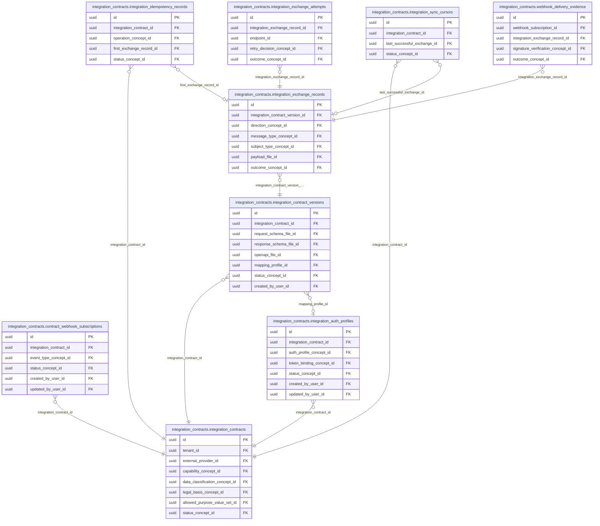

<!-- AUTOGENERADO por tools/inventario/catalogo.mjs. No editar manualmente. -->

# Catálogo del schema `integration_contracts`

- **Tablas:** 9 · **Columnas:** 117 (27 con descripción: 23.1 %) · **Índices:** 57
- **Dominio:** Integraciones y Contratos
- Método y límites del catálogo: [README del inventario](../README.md)

## Tablas

| Tabla | Propósito | Columnas | Índices | Operaciones | ORM |
|---|---|---|---|---|---|
| [contract_webhook_subscriptions](#contract_webhook_subscriptions) | Asocia suscripciones de webhook con contratos para definir qué eventos se notifican a cada consumidor. | 14 | 5 | 3 | COINCIDE |
| [integration_auth_profiles](#integration_auth_profiles) | Configura perfiles de autenticación exigidos por contratos para controlar identidad y seguridad de conexiones. | 17 | 6 | 3 | COINCIDE |
| [integration_contract_versions](#integration_contract_versions) | Preserva versiones de contratos para mantener compatibilidad y reproducibilidad de intercambios. | 13 | 8 | 10 | COINCIDE |
| [integration_contracts](#integration_contracts) | Define contratos de intercambio entre el sistema médico y sus socios técnicos para acordar estructura y comportamiento de datos. | 15 | 11 | 13 | COINCIDE |
| [integration_exchange_attempts](#integration_exchange_attempts) | Mantiene intentos de intercambio para conservar respuestas, fallos y reintentos técnicos. | 13 | 6 | 5 | COINCIDE |
| [integration_exchange_records](#integration_exchange_records) | Registra intercambios ejecutados bajo contratos para conocer qué operación se solicitó y su contexto. | 16 | 8 | 4 | COINCIDE |
| [integration_idempotency_records](#integration_idempotency_records) | Evita procesar dos veces la misma operación externa mediante claves y resultados de idempotencia. | 10 | 5 | 6 | COINCIDE |
| [integration_sync_cursors](#integration_sync_cursors) | Guarda cursores de sincronización para continuar intercambios incrementales desde el punto procesado. | 10 | 3 | 3 | COINCIDE |
| [webhook_delivery_evidence](#webhook_delivery_evidence) | Conserva evidencia de entrega de webhooks para verificar qué se notificó y qué respuesta recibió el sistema. | 9 | 5 | 1 | COINCIDE |

## Diagrama entidad-relación

Las tablas se agrupan en familias por sus claves foráneas dentro del schema (máximo 40 por diagrama). Las FK hacia otros schemas se listan en la ficha de cada tabla.

### Familia 1 de 1 — 9 tablas

## Fichas

### contract_webhook_subscriptions

#### Vista general

Asocia suscripciones de webhook con contratos para definir qué eventos se notifican a cada consumidor.

- **Estado del propósito:** DOMAIN_CURATED_DRAFT · fuente: `Mantra Core Health Context/modules/diagram_31_integration_contracts.puml: contract_webhook_subscriptions`
- **Dominio:** Integraciones y Contratos · **Diagrama:** `Mantra Core Health Context/modules/diagram_31_integration_contracts.puml` · **DDL:** `SQL/31_integration_contracts/02_tables.sql`
- **Entidad del ORM:** `ContractWebhookSubscriptions` — `src/modules/integration_contracts/entities/contract_webhook_subscriptions.entity.ts`
- **Resumen:** 14 columnas · 5 índices · 5 FK salientes · 0 entrantes · 3 operaciones

#### Columnas

| # | Columna | Tipo | Rol estructural | Descripción | ORM |
|---|---|---|---|---|---|
| 1 | `id` | `uuid` | Clave primaria; Obligatoria | Identificador único de la instancia. _(JSDOC_ESTANDAR, `src/modules/integration_contracts/entities/contract_webhook_subscriptions.entity.ts:15`)_ | coincide |
| 2 | `integration_contract_id` | `uuid` | Clave foránea → integration_contracts.integration_contracts.id; Obligatoria | _sin dato_ | coincide |
| 3 | `event_type_concept_id` | `uuid` | Clave foránea → terminology.catalog_concepts.id; Obligatoria | _sin dato_ | coincide |
| 4 | `callback_uri` | `text` | Opcional | _sin dato_ | coincide |
| 5 | `signing_key_reference` | `text` | Opcional | _sin dato_ | coincide |
| 6 | `secret_reference` | `text` | Opcional | _sin dato_ | coincide |
| 7 | `valid_from` | `timestamptz` | Opcional | _sin dato_ | coincide |
| 8 | `valid_to` | `timestamptz` | Opcional | _sin dato_ | coincide |
| 9 | `status_concept_id` | `uuid` | Clave foránea → terminology.catalog_concepts.id; Obligatoria | _sin dato_ | coincide |
| 10 | `created_at` | `timestamptz` | Obligatoria | Fecha y hora en que se creó el registro. _(JSDOC_ESTANDAR, `src/modules/integration_contracts/entities/contract_webhook_subscriptions.entity.ts:85`)_ | coincide |
| 11 | `updated_at` | `timestamptz` | Obligatoria | Fecha y hora de la última actualización. _(JSDOC_ESTANDAR, `src/modules/integration_contracts/entities/contract_webhook_subscriptions.entity.ts:91`)_ | coincide |
| 12 | `created_by_user_id` | `uuid` | Clave foránea → iam.users.id; Opcional | _sin dato_ | coincide |
| 13 | `updated_by_user_id` | `uuid` | Clave foránea → iam.users.id; Opcional | _sin dato_ | coincide |
| 14 | `row_version` | `integer = 1` | Obligatoria | Versión usada para controlar actualizaciones concurrentes. _(JSDOC_ENTIDAD, `src/modules/integration_contracts/entities/contract_webhook_subscriptions.entity.ts:109`)_ | coincide |

#### Relaciones

| Sentido | Columnas | Tabla | Restricción |
|---|---|---|---|
| hacia | integration_contract_id | integration_contracts.integration_contracts (id) | fk_contract_webhook_subscriptions_integration_contract_id |
| hacia | event_type_concept_id | terminology.catalog_concepts (id) | fk_contract_webhook_subscriptions_event_type_concept_id |
| hacia | status_concept_id | terminology.catalog_concepts (id) | fk_contract_webhook_subscriptions_status_concept_id |
| hacia | created_by_user_id | iam.users (id) | fk_contract_webhook_subscriptions_created_by_user_id |
| hacia | updated_by_user_id | iam.users (id) | fk_contract_webhook_subscriptions_updated_by_user_id |

#### Índices

| Índice | Único | Columnas | Para qué |
|---|---|---|---|
| `ix_contract_webhook_subscriptions_integration_contract_id` | no | integration_contract_id | Soporta la clave foránea fk_contract_webhook_subscriptions_integration_contract_id: PostgreSQL no indexa las FK por sí mismo _(DOCUMENTO)_; 2 consulta(s) de repositorio filtran u ordenan por «integration_contract_id», la primera columna del índice _(CONSULTA)_ |
| `ix_contract_webhook_subscriptions_event_type_concept_id` | no | event_type_concept_id | Soporta la clave foránea fk_contract_webhook_subscriptions_event_type_concept_id: PostgreSQL no indexa las FK por sí mismo _(DOCUMENTO)_; 1 consulta(s) de repositorio filtran u ordenan por «event_type_concept_id», la primera columna del índice _(CONSULTA)_ |
| `ix_contract_webhook_subscriptions_status_concept_id` | no | status_concept_id | Soporta la clave foránea fk_contract_webhook_subscriptions_status_concept_id: PostgreSQL no indexa las FK por sí mismo _(DOCUMENTO)_; 1 consulta(s) de repositorio filtran u ordenan por «status_concept_id», la primera columna del índice _(CONSULTA)_ |
| `ix_contract_webhook_subscriptions_created_by_user_id` | no | created_by_user_id | Soporta la clave foránea fk_contract_webhook_subscriptions_created_by_user_id: PostgreSQL no indexa las FK por sí mismo _(DOCUMENTO)_ |
| `ix_contract_webhook_subscriptions_updated_by_user_id` | no | updated_by_user_id | Soporta la clave foránea fk_contract_webhook_subscriptions_updated_by_user_id: PostgreSQL no indexa las FK por sí mismo _(DOCUMENTO)_ |

#### Operaciones que la tocan

| Operación | Efecto | Confianza |
|---|---|---|
| POST /integration/contracts/{id}/webhook-subscriptions | CREA | DIRECTA |
| POST /integration/contracts/{id}/webhook-subscriptions | LEE | DIRECTA |
| POST /integration/webhooks/{subscriptionId}/deliveries | LEE | DIRECTA |

#### Gobierno

| Atributo | Valor | Fuente |
|---|---|---|
| Append-only | no declarado | — |
| Datos personales | sin fuente | — |
| Financiera | sin fuente | — |
| Crítica para auditoría | sin fuente | — |
| Retención | sin fuente | — |
| Responsable | sin fuente | — |
| Revisión | AUTO_DETECTADA | — |

---

### integration_auth_profiles

#### Vista general

Configura perfiles de autenticación exigidos por contratos para controlar identidad y seguridad de conexiones.

- **Estado del propósito:** DOMAIN_CURATED_DRAFT · fuente: `Mantra Core Health Context/modules/diagram_31_integration_contracts.puml: integration_auth_profiles`
- **Dominio:** Integraciones y Contratos · **Diagrama:** `Mantra Core Health Context/modules/diagram_31_integration_contracts.puml` · **DDL:** `SQL/31_integration_contracts/02_tables.sql`
- **Entidad del ORM:** `IntegrationAuthProfiles` — `src/modules/integration_contracts/entities/integration_auth_profiles.entity.ts`
- **Resumen:** 17 columnas · 6 índices · 6 FK salientes · 1 entrantes · 3 operaciones

#### Columnas

| # | Columna | Tipo | Rol estructural | Descripción | ORM |
|---|---|---|---|---|---|
| 1 | `id` | `uuid` | Clave primaria; Obligatoria | Identificador único de la instancia. _(JSDOC_ESTANDAR, `src/modules/integration_contracts/entities/integration_auth_profiles.entity.ts:15`)_ | coincide |
| 2 | `integration_contract_id` | `uuid` | Clave foránea → integration_contracts.integration_contracts.id; Obligatoria | _sin dato_ | coincide |
| 3 | `auth_profile_concept_id` | `uuid` | Clave foránea → terminology.catalog_concepts.id; Obligatoria | _sin dato_ | coincide |
| 4 | `oauth_issuer_uri` | `text` | Opcional | _sin dato_ | coincide |
| 5 | `client_identifier` | `varchar` | Opcional | _sin dato_ | coincide |
| 6 | `credential_secret_reference` | `text` | Opcional | _sin dato_ | coincide |
| 7 | `token_binding_concept_id` | `uuid` | Clave foránea → terminology.catalog_concepts.id; Opcional | _sin dato_ | coincide |
| 8 | `mtls_certificate_reference` | `text` | Opcional | _sin dato_ | coincide |
| 9 | `dpop_key_reference` | `text` | Opcional | _sin dato_ | coincide |
| 10 | `scopes_json` | `jsonb` | Opcional | _sin dato_ | coincide |
| 11 | `audience` | `varchar` | Opcional | _sin dato_ | coincide |
| 12 | `status_concept_id` | `uuid` | Clave foránea → terminology.catalog_concepts.id; Obligatoria | _sin dato_ | coincide |
| 13 | `created_at` | `timestamptz` | Obligatoria | Fecha y hora en que se creó el registro. _(JSDOC_ESTANDAR, `src/modules/integration_contracts/entities/integration_auth_profiles.entity.ts:116`)_ | coincide |
| 14 | `updated_at` | `timestamptz` | Obligatoria | Fecha y hora de la última actualización. _(JSDOC_ESTANDAR, `src/modules/integration_contracts/entities/integration_auth_profiles.entity.ts:122`)_ | coincide |
| 15 | `created_by_user_id` | `uuid` | Clave foránea → iam.users.id; Opcional | _sin dato_ | coincide |
| 16 | `updated_by_user_id` | `uuid` | Clave foránea → iam.users.id; Opcional | _sin dato_ | coincide |
| 17 | `row_version` | `integer = 1` | Obligatoria | Versión usada para controlar actualizaciones concurrentes. _(JSDOC_ENTIDAD, `src/modules/integration_contracts/entities/integration_auth_profiles.entity.ts:140`)_ | coincide |

#### Relaciones

| Sentido | Columnas | Tabla | Restricción |
|---|---|---|---|
| hacia | integration_contract_id | integration_contracts.integration_contracts (id) | fk_integration_auth_profiles_integration_contract_id |
| hacia | auth_profile_concept_id | terminology.catalog_concepts (id) | fk_integration_auth_profiles_auth_profile_concept_id |
| hacia | token_binding_concept_id | terminology.catalog_concepts (id) | fk_integration_auth_profiles_token_binding_concept_id |
| hacia | status_concept_id | terminology.catalog_concepts (id) | fk_integration_auth_profiles_status_concept_id |
| hacia | created_by_user_id | iam.users (id) | fk_integration_auth_profiles_created_by_user_id |
| hacia | updated_by_user_id | iam.users (id) | fk_integration_auth_profiles_updated_by_user_id |
| desde | id | integration_contracts.integration_contract_versions (mapping_profile_id) | fk_integration_contract_versions_mapping_profile_id |

#### Índices

| Índice | Único | Columnas | Para qué |
|---|---|---|---|
| `ix_integration_auth_profiles_integration_contract_id` | no | integration_contract_id | Soporta la clave foránea fk_integration_auth_profiles_integration_contract_id: PostgreSQL no indexa las FK por sí mismo _(DOCUMENTO)_ |
| `ix_integration_auth_profiles_auth_profile_concept_id` | no | auth_profile_concept_id | Soporta la clave foránea fk_integration_auth_profiles_auth_profile_concept_id: PostgreSQL no indexa las FK por sí mismo _(DOCUMENTO)_ |
| `ix_integration_auth_profiles_token_binding_concept_id` | no | token_binding_concept_id | Soporta la clave foránea fk_integration_auth_profiles_token_binding_concept_id: PostgreSQL no indexa las FK por sí mismo _(DOCUMENTO)_ |
| `ix_integration_auth_profiles_status_concept_id` | no | status_concept_id | Soporta la clave foránea fk_integration_auth_profiles_status_concept_id: PostgreSQL no indexa las FK por sí mismo _(DOCUMENTO)_ |
| `ix_integration_auth_profiles_created_by_user_id` | no | created_by_user_id | Soporta la clave foránea fk_integration_auth_profiles_created_by_user_id: PostgreSQL no indexa las FK por sí mismo _(DOCUMENTO)_ |
| `ix_integration_auth_profiles_updated_by_user_id` | no | updated_by_user_id | Soporta la clave foránea fk_integration_auth_profiles_updated_by_user_id: PostgreSQL no indexa las FK por sí mismo _(DOCUMENTO)_ |

#### Operaciones que la tocan

| Operación | Efecto | Confianza |
|---|---|---|
| POST /integration/contracts/{id}/auth-profiles | CREA | DIRECTA |
| POST /integration/contracts/{id}/auth-profiles/{apId}/rotate | ACTUALIZA | POR_TIPO |
| POST /integration/contracts/{id}/auth-profiles/{apId}/rotate | LEE | DIRECTA |

#### Gobierno

| Atributo | Valor | Fuente |
|---|---|---|
| Append-only | no declarado | — |
| Datos personales | sin fuente | — |
| Financiera | sin fuente | — |
| Crítica para auditoría | sin fuente | — |
| Retención | sin fuente | — |
| Responsable | sin fuente | — |
| Revisión | AUTO_DETECTADA | — |

---

### integration_contract_versions

#### Vista general

Preserva versiones de contratos para mantener compatibilidad y reproducibilidad de intercambios.

- **Estado del propósito:** DOMAIN_CURATED_DRAFT · fuente: `Mantra Core Health Context/modules/diagram_31_integration_contracts.puml: integration_contract_versions`
- **Dominio:** Integraciones y Contratos · **Diagrama:** `Mantra Core Health Context/modules/diagram_31_integration_contracts.puml` · **DDL:** `SQL/31_integration_contracts/02_tables.sql`
- **Entidad del ORM:** `IntegrationContractVersions` — `src/modules/integration_contracts/entities/integration_contract_versions.entity.ts`
- **Resumen:** 13 columnas · 8 índices · 7 FK salientes · 1 entrantes · 10 operaciones

#### Columnas

| # | Columna | Tipo | Rol estructural | Descripción | ORM |
|---|---|---|---|---|---|
| 1 | `id` | `uuid` | Clave primaria; Obligatoria | Identificador único de la instancia. _(JSDOC_ESTANDAR, `src/modules/integration_contracts/entities/integration_contract_versions.entity.ts:15`)_ | coincide |
| 2 | `integration_contract_id` | `uuid` | Clave foránea → integration_contracts.integration_contracts.id; Obligatoria | _sin dato_ | coincide |
| 3 | `version_number` | `integer` | Obligatoria | _sin dato_ | coincide |
| 4 | `request_schema_file_id` | `uuid` | Clave foránea → common.files.id; Opcional | _sin dato_ | coincide |
| 5 | `response_schema_file_id` | `uuid` | Clave foránea → common.files.id; Opcional | _sin dato_ | coincide |
| 6 | `openapi_file_id` | `uuid` | Clave foránea → common.files.id; Opcional | _sin dato_ | coincide |
| 7 | `mapping_profile_id` | `uuid` | Clave foránea → integration_contracts.integration_auth_profiles.id; Opcional | _sin dato_ | coincide |
| 8 | `effective_from` | `timestamptz` | Opcional | _sin dato_ | coincide |
| 9 | `effective_to` | `timestamptz` | Opcional | _sin dato_ | coincide |
| 10 | `contract_hash` | `varchar` | Opcional | _sin dato_ | coincide |
| 11 | `status_concept_id` | `uuid` | Clave foránea → terminology.catalog_concepts.id; Obligatoria | _sin dato_ | coincide |
| 12 | `created_at` | `timestamptz` | Obligatoria | Fecha y hora en que se creó el registro. _(JSDOC_ESTANDAR, `src/modules/integration_contracts/entities/integration_contract_versions.entity.ts:101`)_ | coincide |
| 13 | `created_by_user_id` | `uuid` | Clave foránea → iam.users.id; Opcional | _sin dato_ | coincide |

#### Relaciones

| Sentido | Columnas | Tabla | Restricción |
|---|---|---|---|
| hacia | integration_contract_id | integration_contracts.integration_contracts (id) | fk_integration_contract_versions_integration_contract_id |
| hacia | mapping_profile_id | integration_contracts.integration_auth_profiles (id) | fk_integration_contract_versions_mapping_profile_id |
| hacia | request_schema_file_id | common.files (id) | fk_integration_contract_versions_request_schema_file_id |
| hacia | response_schema_file_id | common.files (id) | fk_integration_contract_versions_response_schema_file_id |
| hacia | openapi_file_id | common.files (id) | fk_integration_contract_versions_openapi_file_id |
| hacia | status_concept_id | terminology.catalog_concepts (id) | fk_integration_contract_versions_status_concept_id |
| hacia | created_by_user_id | iam.users (id) | fk_integration_contract_versions_created_by_user_id |
| desde | id | integration_contracts.integration_exchange_records (integration_contract_version_id) | fk_integration_exchange_records_integration_contract_version_id |

#### Índices

| Índice | Único | Columnas | Para qué |
|---|---|---|---|
| `ix_integration_contract_versions_integration_contract_id` | no | integration_contract_id | Soporta la clave foránea fk_integration_contract_versions_integration_contract_id: PostgreSQL no indexa las FK por sí mismo _(DOCUMENTO)_; 3 consulta(s) de repositorio filtran u ordenan por «integration_contract_id», la primera columna del índice _(CONSULTA)_ |
| `ix_integration_contract_versions_request_schema_file_id` | no | request_schema_file_id | Soporta la clave foránea fk_integration_contract_versions_request_schema_file_id: PostgreSQL no indexa las FK por sí mismo _(DOCUMENTO)_ |
| `ix_integration_contract_versions_response_schema_file_id` | no | response_schema_file_id | Soporta la clave foránea fk_integration_contract_versions_response_schema_file_id: PostgreSQL no indexa las FK por sí mismo _(DOCUMENTO)_ |
| `ix_integration_contract_versions_openapi_file_id` | no | openapi_file_id | Soporta la clave foránea fk_integration_contract_versions_openapi_file_id: PostgreSQL no indexa las FK por sí mismo _(DOCUMENTO)_ |
| `ix_integration_contract_versions_mapping_profile_id` | no | mapping_profile_id | Soporta la clave foránea fk_integration_contract_versions_mapping_profile_id: PostgreSQL no indexa las FK por sí mismo _(DOCUMENTO)_ |
| `ix_integration_contract_versions_status_concept_id` | no | status_concept_id | Soporta la clave foránea fk_integration_contract_versions_status_concept_id: PostgreSQL no indexa las FK por sí mismo _(DOCUMENTO)_; 2 consulta(s) de repositorio filtran u ordenan por «status_concept_id», la primera columna del índice _(CONSULTA)_ |
| `ix_integration_contract_versions_created_by_user_id` | no | created_by_user_id | Soporta la clave foránea fk_integration_contract_versions_created_by_user_id: PostgreSQL no indexa las FK por sí mismo _(DOCUMENTO)_ |
| `uq_integration_contract_versions_integration_contract__74f90c0c` | sí | integration_contract_id, version_number | Garantiza que no se repita la combinación (integration_contract_id, version_number) _(DOCUMENTO)_; Soporta la clave foránea fk_integration_contract_versions_integration_contract_id: PostgreSQL no indexa las FK por sí mismo _(DOCUMENTO)_; 3 consulta(s) de repositorio filtran u ordenan por «integration_contract_id», la primera columna del índice _(CONSULTA)_ |

#### Restricciones

| Restricción | Tipo | Definición |
|---|---|---|
| `uq_integration_contract_versions_integration_contract__74f90c0c` | UNIQUE INDEX | UNIQUE INDEX ("integration_contract_id", "version_number") |

#### Operaciones que la tocan

| Operación | Efecto | Confianza |
|---|---|---|
| POST /integration/contracts/{id}/exchanges | LEE | DIRECTA |
| POST /integration/contracts/{id}/exchanges/{recordId}/attempts | LEE | DIRECTA |
| POST /integration/contracts/{id}/retire | ACTUALIZA | POR_TIPO |
| POST /integration/contracts/{id}/retire | LEE | DIRECTA |
| POST /integration/contracts/{id}/versions | CREA | DIRECTA |
| POST /integration/contracts/{id}/versions | LEE | DIRECTA |
| POST /integration/contracts/{id}/versions/{versionId}/activate | ACTUALIZA | POR_TIPO |
| POST /integration/contracts/{id}/versions/{versionId}/activate | LEE | DIRECTA |
| POST /integration/exchanges/{recordId}/retry | LEE | DIRECTA |
| POST /integration/webhooks/{subscriptionId}/deliveries | LEE | DIRECTA |

#### Gobierno

| Atributo | Valor | Fuente |
|---|---|---|
| Append-only | no declarado | — |
| Datos personales | sin fuente | — |
| Financiera | sin fuente | — |
| Crítica para auditoría | sin fuente | — |
| Retención | sin fuente | — |
| Responsable | sin fuente | — |
| Revisión | AUTO_DETECTADA | — |

---

### integration_contracts

#### Vista general

Define contratos de intercambio entre el sistema médico y sus socios técnicos para acordar estructura y comportamiento de datos.

- **Estado del propósito:** DOMAIN_CURATED_DRAFT · fuente: `Mantra Core Health Context/modules/diagram_31_integration_contracts.puml: integration_contracts`
- **Dominio:** Integraciones y Contratos · **Diagrama:** `Mantra Core Health Context/modules/diagram_31_integration_contracts.puml` · **DDL:** `SQL/31_integration_contracts/02_tables.sql`
- **Entidad del ORM:** `IntegrationContracts` — `src/modules/integration_contracts/entities/integration_contracts.entity.ts`
- **Resumen:** 15 columnas · 11 índices · 9 FK salientes · 5 entrantes · 13 operaciones

#### Columnas

| # | Columna | Tipo | Rol estructural | Descripción | ORM |
|---|---|---|---|---|---|
| 1 | `id` | `uuid` | Clave primaria; Obligatoria | Identificador único de la instancia. _(JSDOC_ESTANDAR, `src/modules/integration_contracts/entities/integration_contracts.entity.ts:12`)_ | coincide |
| 2 | `tenant_id` | `uuid` | Clave foránea → directory.tenants.id; Opcional | Tenant propietario del contrato. Todo recurso hijo (versiones, perfiles, suscripciones, intercambios, cursores) hereda este tenant. Un contrato sin tenant (previo a la columna) no pertenece a ningún tenant y no es accesible hasta que se le asigne uno. _(JSDOC_ENTIDAD, `src/modules/integration_contracts/entities/integration_contracts.entity.ts:21`)_ | coincide |
| 3 | `external_provider_id` | `uuid` | Clave foránea → integrations.external_providers.id; Obligatoria | _sin dato_ | coincide |
| 4 | `contract_code` | `varchar` | Obligatoria | _sin dato_ | coincide |
| 5 | `capability_concept_id` | `uuid` | Clave foránea → terminology.catalog_concepts.id; Obligatoria | _sin dato_ | coincide |
| 6 | `data_classification_concept_id` | `uuid` | Clave foránea → terminology.catalog_concepts.id; Opcional | _sin dato_ | coincide |
| 7 | `legal_basis_concept_id` | `uuid` | Clave foránea → terminology.catalog_concepts.id; Opcional | _sin dato_ | coincide |
| 8 | `allowed_purpose_value_set_id` | `uuid` | Clave foránea → terminology.value_sets.id; Opcional | _sin dato_ | coincide |
| 9 | `data_use_agreement_id` | `uuid` | Opcional | _sin dato_ | coincide |
| 10 | `status_concept_id` | `uuid` | Clave foránea → terminology.catalog_concepts.id; Obligatoria | _sin dato_ | coincide |
| 11 | `created_at` | `timestamptz` | Obligatoria | Fecha y hora en que se creó el registro. _(JSDOC_ESTANDAR, `src/modules/integration_contracts/entities/integration_contracts.entity.ts:91`)_ | coincide |
| 12 | `updated_at` | `timestamptz` | Obligatoria | Fecha y hora de la última actualización. _(JSDOC_ESTANDAR, `src/modules/integration_contracts/entities/integration_contracts.entity.ts:97`)_ | coincide |
| 13 | `created_by_user_id` | `uuid` | Clave foránea → iam.users.id; Opcional | _sin dato_ | coincide |
| 14 | `updated_by_user_id` | `uuid` | Clave foránea → iam.users.id; Opcional | _sin dato_ | coincide |
| 15 | `row_version` | `integer = 1` | Obligatoria | Versión usada para controlar actualizaciones concurrentes. _(JSDOC_ENTIDAD, `src/modules/integration_contracts/entities/integration_contracts.entity.ts:115`)_ | coincide |

#### Relaciones

| Sentido | Columnas | Tabla | Restricción |
|---|---|---|---|
| hacia | tenant_id | directory.tenants (id) | fk_integration_contracts_tenant_id |
| hacia | external_provider_id | integrations.external_providers (id) | fk_integration_contracts_external_provider_id |
| hacia | capability_concept_id | terminology.catalog_concepts (id) | fk_integration_contracts_capability_concept_id |
| hacia | data_classification_concept_id | terminology.catalog_concepts (id) | fk_integration_contracts_data_classification_concept_id |
| hacia | legal_basis_concept_id | terminology.catalog_concepts (id) | fk_integration_contracts_legal_basis_concept_id |
| hacia | allowed_purpose_value_set_id | terminology.value_sets (id) | fk_integration_contracts_allowed_purpose_value_set_id |
| hacia | status_concept_id | terminology.catalog_concepts (id) | fk_integration_contracts_status_concept_id |
| hacia | created_by_user_id | iam.users (id) | fk_integration_contracts_created_by_user_id |
| hacia | updated_by_user_id | iam.users (id) | fk_integration_contracts_updated_by_user_id |
| desde | id | integration_contracts.integration_contract_versions (integration_contract_id) | fk_integration_contract_versions_integration_contract_id |
| desde | id | integration_contracts.integration_auth_profiles (integration_contract_id) | fk_integration_auth_profiles_integration_contract_id |
| desde | id | integration_contracts.integration_idempotency_records (integration_contract_id) | fk_integration_idempotency_records_integration_contract_id |
| desde | id | integration_contracts.integration_sync_cursors (integration_contract_id) | fk_integration_sync_cursors_integration_contract_id |
| desde | id | integration_contracts.contract_webhook_subscriptions (integration_contract_id) | fk_contract_webhook_subscriptions_integration_contract_id |

#### Índices

| Índice | Único | Columnas | Para qué |
|---|---|---|---|
| `ix_integration_contracts_tenant_id` | no | tenant_id | Soporta la clave foránea fk_integration_contracts_tenant_id: PostgreSQL no indexa las FK por sí mismo _(DOCUMENTO)_; 3 consulta(s) de repositorio filtran u ordenan por «tenant_id», la primera columna del índice _(CONSULTA)_ |
| `ix_integration_contracts_external_provider_id` | no | external_provider_id | Soporta la clave foránea fk_integration_contracts_external_provider_id: PostgreSQL no indexa las FK por sí mismo _(DOCUMENTO)_; 1 consulta(s) de repositorio filtran u ordenan por «external_provider_id», la primera columna del índice _(CONSULTA)_ |
| `uq_integration_contracts_tenant_provider_code` | sí | tenant_id, external_provider_id, contract_code donde WHERE tenant_id IS NOT NULL | Garantiza que no se repita la combinación (tenant_id, external_provider_id, contract_code) _(DOCUMENTO)_; Soporta la clave foránea fk_integration_contracts_tenant_id: PostgreSQL no indexa las FK por sí mismo _(DOCUMENTO)_; Índice parcial: sólo indexa las filas donde WHERE tenant_id IS NOT NULL _(ESTRUCTURAL)_; 3 consulta(s) de repositorio filtran u ordenan por «tenant_id», la primera columna del índice _(CONSULTA)_ |
| `ix_integration_contracts_capability_concept_id` | no | capability_concept_id | Soporta la clave foránea fk_integration_contracts_capability_concept_id: PostgreSQL no indexa las FK por sí mismo _(DOCUMENTO)_ |
| `ix_integration_contracts_data_classification_concept_id` | no | data_classification_concept_id | Soporta la clave foránea fk_integration_contracts_data_classification_concept_id: PostgreSQL no indexa las FK por sí mismo _(DOCUMENTO)_ |
| `ix_integration_contracts_legal_basis_concept_id` | no | legal_basis_concept_id | Soporta la clave foránea fk_integration_contracts_legal_basis_concept_id: PostgreSQL no indexa las FK por sí mismo _(DOCUMENTO)_ |
| `ix_integration_contracts_allowed_purpose_value_set_id` | no | allowed_purpose_value_set_id | Soporta la clave foránea fk_integration_contracts_allowed_purpose_value_set_id: PostgreSQL no indexa las FK por sí mismo _(DOCUMENTO)_ |
| `ix_integration_contracts_data_use_agreement_id` | no | data_use_agreement_id | _sin uso detectado estáticamente_ |
| `ix_integration_contracts_status_concept_id` | no | status_concept_id | Soporta la clave foránea fk_integration_contracts_status_concept_id: PostgreSQL no indexa las FK por sí mismo _(DOCUMENTO)_ |
| `ix_integration_contracts_created_by_user_id` | no | created_by_user_id | Soporta la clave foránea fk_integration_contracts_created_by_user_id: PostgreSQL no indexa las FK por sí mismo _(DOCUMENTO)_ |
| `ix_integration_contracts_updated_by_user_id` | no | updated_by_user_id | Soporta la clave foránea fk_integration_contracts_updated_by_user_id: PostgreSQL no indexa las FK por sí mismo _(DOCUMENTO)_ |

#### Restricciones

| Restricción | Tipo | Definición |
|---|---|---|
| `uq_integration_contracts_tenant_provider_code` | UNIQUE INDEX | UNIQUE INDEX ("tenant_id", "external_provider_id", "contract_code") WHERE tenant_id IS NOT NULL |

#### Operaciones que la tocan

| Operación | Efecto | Confianza |
|---|---|---|
| POST /integration/contracts | CREA | DIRECTA |
| POST /integration/contracts | LEE | DIRECTA |
| POST /integration/contracts/{id}/auth-profiles | LEE | DIRECTA |
| POST /integration/contracts/{id}/auth-profiles/{apId}/rotate | LEE | DIRECTA |
| POST /integration/contracts/{id}/exchanges | LEE | DIRECTA |
| POST /integration/contracts/{id}/exchanges/{recordId}/attempts | LEE | DIRECTA |
| POST /integration/contracts/{id}/retire | LEE | DIRECTA |
| POST /integration/contracts/{id}/sync-cursors/{scope}/advance | LEE | DIRECTA |
| POST /integration/contracts/{id}/versions | LEE | DIRECTA |
| POST /integration/contracts/{id}/versions/{versionId}/activate | LEE | DIRECTA |
| POST /integration/contracts/{id}/webhook-subscriptions | LEE | DIRECTA |
| POST /integration/exchanges/{recordId}/retry | LEE | DIRECTA |
| POST /integration/webhooks/{subscriptionId}/deliveries | LEE | DIRECTA |

#### Gobierno

| Atributo | Valor | Fuente |
|---|---|---|
| Append-only | no declarado | — |
| Datos personales | sin fuente | — |
| Financiera | sin fuente | — |
| Crítica para auditoría | sin fuente | — |
| Retención | sin fuente | — |
| Responsable | sin fuente | — |
| Revisión | AUTO_DETECTADA | — |

---

### integration_exchange_attempts

#### Vista general

Mantiene intentos de intercambio para conservar respuestas, fallos y reintentos técnicos.

- **Estado del propósito:** DOMAIN_CURATED_DRAFT · fuente: `Mantra Core Health Context/modules/diagram_31_integration_contracts.puml: integration_exchange_attempts`
- **Dominio:** Integraciones y Contratos · **Diagrama:** `Mantra Core Health Context/modules/diagram_31_integration_contracts.puml` · **DDL:** `SQL/31_integration_contracts/02_tables.sql`
- **Entidad del ORM:** `IntegrationExchangeAttempts` — `src/modules/integration_contracts/entities/integration_exchange_attempts.entity.ts`
- **Resumen:** 13 columnas · 6 índices · 4 FK salientes · 0 entrantes · 5 operaciones

#### Columnas

| # | Columna | Tipo | Rol estructural | Descripción | ORM |
|---|---|---|---|---|---|
| 1 | `id` | `uuid` | Clave primaria; Obligatoria | Identificador único de la instancia. _(JSDOC_ESTANDAR, `src/modules/integration_contracts/entities/integration_exchange_attempts.entity.ts:15`)_ | coincide |
| 2 | `integration_exchange_record_id` | `uuid` | Clave foránea → integration_contracts.integration_exchange_records.id; Obligatoria | _sin dato_ | coincide |
| 3 | `attempt_number` | `integer` | Obligatoria | _sin dato_ | coincide |
| 4 | `endpoint_id` | `uuid` | Clave foránea → integrations.integration_endpoints.id; Opcional | _sin dato_ | coincide |
| 5 | `started_at` | `timestamptz` | Opcional | _sin dato_ | coincide |
| 6 | `completed_at` | `timestamptz` | Opcional | _sin dato_ | coincide |
| 7 | `http_status` | `integer` | Opcional | _sin dato_ | coincide |
| 8 | `provider_error_code` | `varchar` | Opcional | _sin dato_ | coincide |
| 9 | `retry_decision_concept_id` | `uuid` | Clave foránea → terminology.catalog_concepts.id; Opcional | _sin dato_ | coincide |
| 10 | `next_retry_at` | `timestamptz` | Opcional | _sin dato_ | coincide |
| 11 | `trace_id` | `varchar` | Opcional | _sin dato_ | coincide |
| 12 | `outcome_concept_id` | `uuid` | Clave foránea → terminology.catalog_concepts.id; Obligatoria | _sin dato_ | coincide |
| 13 | `created_at` | `timestamptz` | Obligatoria | Fecha y hora en que se creó el registro. _(JSDOC_ESTANDAR, `src/modules/integration_contracts/entities/integration_exchange_attempts.entity.ts:107`)_ | coincide |

#### Relaciones

| Sentido | Columnas | Tabla | Restricción |
|---|---|---|---|
| hacia | integration_exchange_record_id | integration_contracts.integration_exchange_records (id) | fk_integration_exchange_attempts_integration_exchange_record_id |
| hacia | endpoint_id | integrations.integration_endpoints (id) | fk_integration_exchange_attempts_endpoint_id |
| hacia | retry_decision_concept_id | terminology.catalog_concepts (id) | fk_integration_exchange_attempts_retry_decision_concept_id |
| hacia | outcome_concept_id | terminology.catalog_concepts (id) | fk_integration_exchange_attempts_outcome_concept_id |

#### Índices

| Índice | Único | Columnas | Para qué |
|---|---|---|---|
| `ix_integration_exchange_attempts_integration_exchange_record_id` | no | integration_exchange_record_id | Soporta la clave foránea fk_integration_exchange_attempts_integration_exchange_record_id: PostgreSQL no indexa las FK por sí mismo _(DOCUMENTO)_; 2 consulta(s) de repositorio filtran u ordenan por «integration_exchange_record_id», la primera columna del índice _(CONSULTA)_ |
| `ix_integration_exchange_attempts_endpoint_id` | no | endpoint_id | Soporta la clave foránea fk_integration_exchange_attempts_endpoint_id: PostgreSQL no indexa las FK por sí mismo _(DOCUMENTO)_ |
| `ix_integration_exchange_attempts_retry_decision_concept_id` | no | retry_decision_concept_id | Soporta la clave foránea fk_integration_exchange_attempts_retry_decision_concept_id: PostgreSQL no indexa las FK por sí mismo _(DOCUMENTO)_ |
| `ix_integration_exchange_attempts_outcome_concept_id` | no | outcome_concept_id | Soporta la clave foránea fk_integration_exchange_attempts_outcome_concept_id: PostgreSQL no indexa las FK por sí mismo _(DOCUMENTO)_ |
| `uq_integration_exchange_attempts_integration_exchange__2d126a36` | sí | integration_exchange_record_id, attempt_number | Garantiza que no se repita la combinación (integration_exchange_record_id, attempt_number) _(DOCUMENTO)_; Soporta la clave foránea fk_integration_exchange_attempts_integration_exchange_record_id: PostgreSQL no indexa las FK por sí mismo _(DOCUMENTO)_; 2 consulta(s) de repositorio filtran u ordenan por «integration_exchange_record_id», la primera columna del índice _(CONSULTA)_ |
| `brin_integration_exchange_attempts_created_at` | no | created_at | BRIN para logs e historiales append-only de gran volumen _(DOCUMENTO)_ |

#### Restricciones

| Restricción | Tipo | Definición |
|---|---|---|
| `uq_integration_exchange_attempts_integration_exchange__2d126a36` | UNIQUE INDEX | UNIQUE INDEX ("integration_exchange_record_id", "attempt_number") |

#### Operaciones que la tocan

| Operación | Efecto | Confianza |
|---|---|---|
| POST /integration/contracts/{id}/exchanges | CREA | DIRECTA |
| POST /integration/contracts/{id}/exchanges/{recordId}/attempts | CREA | DIRECTA |
| POST /integration/contracts/{id}/exchanges/{recordId}/attempts | LEE | DIRECTA |
| POST /integration/exchanges/{recordId}/retry | CREA | DIRECTA |
| POST /integration/exchanges/{recordId}/retry | LEE | DIRECTA |

#### Gobierno

| Atributo | Valor | Fuente |
|---|---|---|
| Append-only | no declarado | — |
| Datos personales | sin fuente | — |
| Financiera | sin fuente | — |
| Crítica para auditoría | sin fuente | — |
| Retención | sin fuente | — |
| Responsable | sin fuente | — |
| Revisión | AUTO_DETECTADA | — |

---

### integration_exchange_records

#### Vista general

Registra intercambios ejecutados bajo contratos para conocer qué operación se solicitó y su contexto.

- **Estado del propósito:** DOMAIN_CURATED_DRAFT · fuente: `Mantra Core Health Context/modules/diagram_31_integration_contracts.puml: integration_exchange_records`
- **Dominio:** Integraciones y Contratos · **Diagrama:** `Mantra Core Health Context/modules/diagram_31_integration_contracts.puml` · **DDL:** `SQL/31_integration_contracts/02_tables.sql`
- **Entidad del ORM:** `IntegrationExchangeRecords` — `src/modules/integration_contracts/entities/integration_exchange_records.entity.ts`
- **Resumen:** 16 columnas · 8 índices · 6 FK salientes · 4 entrantes · 4 operaciones

#### Columnas

| # | Columna | Tipo | Rol estructural | Descripción | ORM |
|---|---|---|---|---|---|
| 1 | `id` | `uuid` | Clave primaria; Obligatoria | Identificador único de la instancia. _(JSDOC_ESTANDAR, `src/modules/integration_contracts/entities/integration_exchange_records.entity.ts:15`)_ | coincide |
| 2 | `integration_contract_version_id` | `uuid` | Clave foránea → integration_contracts.integration_contract_versions.id; Obligatoria | _sin dato_ | coincide |
| 3 | `direction_concept_id` | `uuid` | Clave foránea → terminology.catalog_concepts.id; Obligatoria | _sin dato_ | coincide |
| 4 | `message_type_concept_id` | `uuid` | Clave foránea → terminology.catalog_concepts.id; Obligatoria | _sin dato_ | coincide |
| 5 | `business_identifier` | `varchar` | Opcional | _sin dato_ | coincide |
| 6 | `idempotency_key` | `varchar` | Opcional | _sin dato_ | coincide |
| 7 | `correlation_id` | `uuid` | Opcional | _sin dato_ | coincide |
| 8 | `subject_type_concept_id` | `uuid` | Clave foránea → terminology.catalog_concepts.id; Opcional | _sin dato_ | coincide |
| 9 | `subject_entity_id` | `uuid` | Opcional | _sin dato_ | coincide |
| 10 | `request_hash` | `varchar` | Opcional | _sin dato_ | coincide |
| 11 | `response_hash` | `varchar` | Opcional | _sin dato_ | coincide |
| 12 | `payload_file_id` | `uuid` | Clave foránea → common.files.id; Opcional | _sin dato_ | coincide |
| 13 | `received_at` | `timestamptz` | Opcional | _sin dato_ | coincide |
| 14 | `completed_at` | `timestamptz` | Opcional | _sin dato_ | coincide |
| 15 | `outcome_concept_id` | `uuid` | Clave foránea → terminology.catalog_concepts.id; Obligatoria | _sin dato_ | coincide |
| 16 | `created_at` | `timestamptz` | Obligatoria | Fecha y hora en que se creó el registro. _(JSDOC_ESTANDAR, `src/modules/integration_contracts/entities/integration_exchange_records.entity.ts:133`)_ | coincide |

#### Relaciones

| Sentido | Columnas | Tabla | Restricción |
|---|---|---|---|
| hacia | integration_contract_version_id | integration_contracts.integration_contract_versions (id) | fk_integration_exchange_records_integration_contract_version_id |
| hacia | direction_concept_id | terminology.catalog_concepts (id) | fk_integration_exchange_records_direction_concept_id |
| hacia | message_type_concept_id | terminology.catalog_concepts (id) | fk_integration_exchange_records_message_type_concept_id |
| hacia | subject_type_concept_id | terminology.catalog_concepts (id) | fk_integration_exchange_records_subject_type_concept_id |
| hacia | payload_file_id | common.files (id) | fk_integration_exchange_records_payload_file_id |
| hacia | outcome_concept_id | terminology.catalog_concepts (id) | fk_integration_exchange_records_outcome_concept_id |
| desde | id | integration_contracts.integration_exchange_attempts (integration_exchange_record_id) | fk_integration_exchange_attempts_integration_exchange_record_id |
| desde | id | integration_contracts.integration_idempotency_records (first_exchange_record_id) | fk_integration_idempotency_records_first_exchange_record_id |
| desde | id | integration_contracts.integration_sync_cursors (last_successful_exchange_id) | fk_integration_sync_cursors_last_successful_exchange_id |
| desde | id | integration_contracts.webhook_delivery_evidence (integration_exchange_record_id) | fk_webhook_delivery_evidence_integration_exchange_record_id |

#### Índices

| Índice | Único | Columnas | Para qué |
|---|---|---|---|
| `ix_integration_exchange_records_integration_contract_version_id` | no | integration_contract_version_id | Soporta la clave foránea fk_integration_exchange_records_integration_contract_version_id: PostgreSQL no indexa las FK por sí mismo _(DOCUMENTO)_ |
| `ix_integration_exchange_records_direction_concept_id` | no | direction_concept_id | Soporta la clave foránea fk_integration_exchange_records_direction_concept_id: PostgreSQL no indexa las FK por sí mismo _(DOCUMENTO)_ |
| `ix_integration_exchange_records_message_type_concept_id` | no | message_type_concept_id | Soporta la clave foránea fk_integration_exchange_records_message_type_concept_id: PostgreSQL no indexa las FK por sí mismo _(DOCUMENTO)_ |
| `ix_integration_exchange_records_subject_type_concept_id` | no | subject_type_concept_id | Soporta la clave foránea fk_integration_exchange_records_subject_type_concept_id: PostgreSQL no indexa las FK por sí mismo _(DOCUMENTO)_ |
| `ix_integration_exchange_records_payload_file_id` | no | payload_file_id | Soporta la clave foránea fk_integration_exchange_records_payload_file_id: PostgreSQL no indexa las FK por sí mismo _(DOCUMENTO)_ |
| `ix_integration_exchange_records_outcome_concept_id` | no | outcome_concept_id | Soporta la clave foránea fk_integration_exchange_records_outcome_concept_id: PostgreSQL no indexa las FK por sí mismo _(DOCUMENTO)_ |
| `uq_integration_exchange_records_idempotency` | sí | idempotency_key | Garantiza que no se repita la combinación (idempotency_key) _(DOCUMENTO)_ |
| `brin_integration_exchange_records_created_at` | no | created_at | BRIN para logs e historiales append-only de gran volumen _(DOCUMENTO)_ |

#### Restricciones

| Restricción | Tipo | Definición |
|---|---|---|
| `uq_integration_exchange_records_idempotency` | UNIQUE INDEX | UNIQUE INDEX ("idempotency_key") |

#### Operaciones que la tocan

| Operación | Efecto | Confianza |
|---|---|---|
| POST /integration/contracts/{id}/exchanges | CREA | DIRECTA |
| POST /integration/contracts/{id}/exchanges/{recordId}/attempts | LEE | DIRECTA |
| POST /integration/exchanges/{recordId}/retry | LEE | DIRECTA |
| POST /integration/webhooks/{subscriptionId}/deliveries | CREA | DIRECTA |

#### Gobierno

| Atributo | Valor | Fuente |
|---|---|---|
| Append-only | no declarado | — |
| Datos personales | sin fuente | — |
| Financiera | sin fuente | — |
| Crítica para auditoría | sin fuente | — |
| Retención | sin fuente | — |
| Responsable | sin fuente | — |
| Revisión | AUTO_DETECTADA | — |

---

### integration_idempotency_records

#### Vista general

Evita procesar dos veces la misma operación externa mediante claves y resultados de idempotencia.

- **Estado del propósito:** DOMAIN_CURATED_DRAFT · fuente: `Mantra Core Health Context/modules/diagram_31_integration_contracts.puml: integration_idempotency_records`
- **Dominio:** Integraciones y Contratos · **Diagrama:** `Mantra Core Health Context/modules/diagram_31_integration_contracts.puml` · **DDL:** `SQL/31_integration_contracts/02_tables.sql`
- **Entidad del ORM:** `IntegrationIdempotencyRecords` — `src/modules/integration_contracts/entities/integration_idempotency_records.entity.ts`
- **Resumen:** 10 columnas · 5 índices · 4 FK salientes · 0 entrantes · 6 operaciones

#### Columnas

| # | Columna | Tipo | Rol estructural | Descripción | ORM |
|---|---|---|---|---|---|
| 1 | `id` | `uuid` | Clave primaria; Obligatoria | Identificador único de la instancia. _(JSDOC_ESTANDAR, `src/modules/integration_contracts/entities/integration_idempotency_records.entity.ts:15`)_ | coincide |
| 2 | `integration_contract_id` | `uuid` | Clave foránea → integration_contracts.integration_contracts.id; Obligatoria | _sin dato_ | coincide |
| 3 | `idempotency_key` | `varchar` | Obligatoria | _sin dato_ | coincide |
| 4 | `operation_concept_id` | `uuid` | Clave foránea → terminology.catalog_concepts.id; Obligatoria | _sin dato_ | coincide |
| 5 | `request_hash` | `varchar` | Opcional | _sin dato_ | coincide |
| 6 | `first_exchange_record_id` | `uuid` | Clave foránea → integration_contracts.integration_exchange_records.id; Opcional | _sin dato_ | coincide |
| 7 | `response_reference` | `varchar` | Opcional | _sin dato_ | coincide |
| 8 | `expires_at` | `timestamptz` | Opcional | _sin dato_ | coincide |
| 9 | `status_concept_id` | `uuid` | Clave foránea → terminology.catalog_concepts.id; Obligatoria | _sin dato_ | coincide |
| 10 | `created_at` | `timestamptz` | Obligatoria | Fecha y hora en que se creó el registro. _(JSDOC_ESTANDAR, `src/modules/integration_contracts/entities/integration_idempotency_records.entity.ts:85`)_ | coincide |

#### Relaciones

| Sentido | Columnas | Tabla | Restricción |
|---|---|---|---|
| hacia | integration_contract_id | integration_contracts.integration_contracts (id) | fk_integration_idempotency_records_integration_contract_id |
| hacia | first_exchange_record_id | integration_contracts.integration_exchange_records (id) | fk_integration_idempotency_records_first_exchange_record_id |
| hacia | operation_concept_id | terminology.catalog_concepts (id) | fk_integration_idempotency_records_operation_concept_id |
| hacia | status_concept_id | terminology.catalog_concepts (id) | fk_integration_idempotency_records_status_concept_id |

#### Índices

| Índice | Único | Columnas | Para qué |
|---|---|---|---|
| `ix_integration_idempotency_records_integration_contract_id` | no | integration_contract_id | Soporta la clave foránea fk_integration_idempotency_records_integration_contract_id: PostgreSQL no indexa las FK por sí mismo _(DOCUMENTO)_; 1 consulta(s) de repositorio filtran u ordenan por «integration_contract_id», la primera columna del índice _(CONSULTA)_ |
| `ix_integration_idempotency_records_operation_concept_id` | no | operation_concept_id | Soporta la clave foránea fk_integration_idempotency_records_operation_concept_id: PostgreSQL no indexa las FK por sí mismo _(DOCUMENTO)_ |
| `ix_integration_idempotency_records_first_exchange_record_id` | no | first_exchange_record_id | Soporta la clave foránea fk_integration_idempotency_records_first_exchange_record_id: PostgreSQL no indexa las FK por sí mismo _(DOCUMENTO)_ |
| `ix_integration_idempotency_records_status_concept_id` | no | status_concept_id | Soporta la clave foránea fk_integration_idempotency_records_status_concept_id: PostgreSQL no indexa las FK por sí mismo _(DOCUMENTO)_ |
| `uq_integration_idempotency_records_idempotency` | sí | idempotency_key | Garantiza que no se repita la combinación (idempotency_key) _(DOCUMENTO)_; 1 consulta(s) de repositorio filtran u ordenan por «idempotency_key», la primera columna del índice _(CONSULTA)_ |

#### Restricciones

| Restricción | Tipo | Definición |
|---|---|---|
| `uq_integration_idempotency_records_idempotency` | UNIQUE INDEX | UNIQUE INDEX ("idempotency_key") |

#### Operaciones que la tocan

| Operación | Efecto | Confianza |
|---|---|---|
| POST /integration/contracts/{id}/exchanges | CREA | DIRECTA |
| POST /integration/contracts/{id}/exchanges | LEE | DIRECTA |
| POST /integration/contracts/{id}/exchanges/{recordId}/attempts | ACTUALIZA | POR_TIPO |
| POST /integration/contracts/{id}/exchanges/{recordId}/attempts | LEE | DIRECTA |
| POST /integration/exchanges/{recordId}/retry | ACTUALIZA | POR_TIPO |
| POST /integration/exchanges/{recordId}/retry | LEE | DIRECTA |

#### Gobierno

| Atributo | Valor | Fuente |
|---|---|---|
| Append-only | no declarado | — |
| Datos personales | sin fuente | — |
| Financiera | sin fuente | — |
| Crítica para auditoría | sin fuente | — |
| Retención | sin fuente | — |
| Responsable | sin fuente | — |
| Revisión | AUTO_DETECTADA | — |

---

### integration_sync_cursors

#### Vista general

Guarda cursores de sincronización para continuar intercambios incrementales desde el punto procesado.

- **Estado del propósito:** DOMAIN_CURATED_DRAFT · fuente: `Mantra Core Health Context/modules/diagram_31_integration_contracts.puml: integration_sync_cursors`
- **Dominio:** Integraciones y Contratos · **Diagrama:** `Mantra Core Health Context/modules/diagram_31_integration_contracts.puml` · **DDL:** `SQL/31_integration_contracts/02_tables.sql`
- **Entidad del ORM:** `IntegrationSyncCursors` — `src/modules/integration_contracts/entities/integration_sync_cursors.entity.ts`
- **Resumen:** 10 columnas · 3 índices · 3 FK salientes · 0 entrantes · 3 operaciones

#### Columnas

| # | Columna | Tipo | Rol estructural | Descripción | ORM |
|---|---|---|---|---|---|
| 1 | `id` | `uuid` | Clave primaria; Obligatoria | Identificador único de la instancia. _(JSDOC_ESTANDAR, `src/modules/integration_contracts/entities/integration_sync_cursors.entity.ts:15`)_ | coincide |
| 2 | `integration_contract_id` | `uuid` | Clave foránea → integration_contracts.integration_contracts.id; Obligatoria | _sin dato_ | coincide |
| 3 | `cursor_scope` | `varchar` | Obligatoria | _sin dato_ | coincide |
| 4 | `cursor_value` | `text` | Obligatoria | _sin dato_ | coincide |
| 5 | `watermark_at` | `timestamptz` | Opcional | _sin dato_ | coincide |
| 6 | `last_successful_exchange_id` | `uuid` | Clave foránea → integration_contracts.integration_exchange_records.id; Opcional | _sin dato_ | coincide |
| 7 | `status_concept_id` | `uuid` | Clave foránea → terminology.catalog_concepts.id; Obligatoria | _sin dato_ | coincide |
| 8 | `created_at` | `timestamptz` | Obligatoria | Fecha y hora en que se creó el registro. _(JSDOC_ESTANDAR, `src/modules/integration_contracts/entities/integration_sync_cursors.entity.ts:65`)_ | coincide |
| 9 | `updated_at` | `timestamptz` | Obligatoria | Fecha y hora de la última actualización. _(JSDOC_ESTANDAR, `src/modules/integration_contracts/entities/integration_sync_cursors.entity.ts:71`)_ | coincide |
| 10 | `row_version` | `integer = 1` | Obligatoria | Versión usada para controlar actualizaciones concurrentes. _(JSDOC_ENTIDAD, `src/modules/integration_contracts/entities/integration_sync_cursors.entity.ts:77`)_ | coincide |

#### Relaciones

| Sentido | Columnas | Tabla | Restricción |
|---|---|---|---|
| hacia | integration_contract_id | integration_contracts.integration_contracts (id) | fk_integration_sync_cursors_integration_contract_id |
| hacia | last_successful_exchange_id | integration_contracts.integration_exchange_records (id) | fk_integration_sync_cursors_last_successful_exchange_id |
| hacia | status_concept_id | terminology.catalog_concepts (id) | fk_integration_sync_cursors_status_concept_id |

#### Índices

| Índice | Único | Columnas | Para qué |
|---|---|---|---|
| `ix_integration_sync_cursors_integration_contract_id` | no | integration_contract_id | Soporta la clave foránea fk_integration_sync_cursors_integration_contract_id: PostgreSQL no indexa las FK por sí mismo _(DOCUMENTO)_; 1 consulta(s) de repositorio filtran u ordenan por «integration_contract_id», la primera columna del índice _(CONSULTA)_ |
| `ix_integration_sync_cursors_last_successful_exchange_id` | no | last_successful_exchange_id | Soporta la clave foránea fk_integration_sync_cursors_last_successful_exchange_id: PostgreSQL no indexa las FK por sí mismo _(DOCUMENTO)_ |
| `ix_integration_sync_cursors_status_concept_id` | no | status_concept_id | Soporta la clave foránea fk_integration_sync_cursors_status_concept_id: PostgreSQL no indexa las FK por sí mismo _(DOCUMENTO)_ |

#### Operaciones que la tocan

| Operación | Efecto | Confianza |
|---|---|---|
| POST /integration/contracts/{id}/sync-cursors/{scope}/advance | ACTUALIZA | POR_TIPO |
| POST /integration/contracts/{id}/sync-cursors/{scope}/advance | CREA | DIRECTA |
| POST /integration/contracts/{id}/sync-cursors/{scope}/advance | LEE | DIRECTA |

#### Gobierno

| Atributo | Valor | Fuente |
|---|---|---|
| Append-only | no declarado | — |
| Datos personales | sin fuente | — |
| Financiera | sin fuente | — |
| Crítica para auditoría | sin fuente | — |
| Retención | sin fuente | — |
| Responsable | sin fuente | — |
| Revisión | AUTO_DETECTADA | — |

---

### webhook_delivery_evidence

#### Vista general

Conserva evidencia de entrega de webhooks para verificar qué se notificó y qué respuesta recibió el sistema.

- **Estado del propósito:** DOMAIN_CURATED_DRAFT · fuente: `Mantra Core Health Context/modules/diagram_31_integration_contracts.puml: webhook_delivery_evidence`
- **Dominio:** Integraciones y Contratos · **Diagrama:** `Mantra Core Health Context/modules/diagram_31_integration_contracts.puml` · **DDL:** `SQL/31_integration_contracts/02_tables.sql`
- **Entidad del ORM:** `WebhookDeliveryEvidence` — `src/modules/integration_contracts/entities/webhook_delivery_evidence.entity.ts`
- **Resumen:** 9 columnas · 5 índices · 4 FK salientes · 0 entrantes · 1 operaciones

#### Columnas

| # | Columna | Tipo | Rol estructural | Descripción | ORM |
|---|---|---|---|---|---|
| 1 | `id` | `uuid` | Clave primaria; Obligatoria | Identificador único de la instancia. _(JSDOC_ESTANDAR, `src/modules/integration_contracts/entities/webhook_delivery_evidence.entity.ts:15`)_ | coincide |
| 2 | `webhook_subscription_id` | `uuid` | Clave foránea → integrations.webhook_subscriptions.id; Obligatoria | _sin dato_ | coincide |
| 3 | `integration_exchange_record_id` | `uuid` | Clave foránea → integration_contracts.integration_exchange_records.id; Obligatoria | _sin dato_ | coincide |
| 4 | `signature_algorithm` | `varchar` | Opcional | _sin dato_ | coincide |
| 5 | `signature_verification_concept_id` | `uuid` | Clave foránea → terminology.catalog_concepts.id; Opcional | _sin dato_ | coincide |
| 6 | `delivered_at` | `timestamptz` | Opcional | _sin dato_ | coincide |
| 7 | `acknowledged_at` | `timestamptz` | Opcional | _sin dato_ | coincide |
| 8 | `outcome_concept_id` | `uuid` | Clave foránea → terminology.catalog_concepts.id; Obligatoria | _sin dato_ | coincide |
| 9 | `created_at` | `timestamptz` | Obligatoria | Fecha y hora en que se creó el registro. _(JSDOC_ESTANDAR, `src/modules/integration_contracts/entities/webhook_delivery_evidence.entity.ts:79`)_ | coincide |

#### Relaciones

| Sentido | Columnas | Tabla | Restricción |
|---|---|---|---|
| hacia | integration_exchange_record_id | integration_contracts.integration_exchange_records (id) | fk_webhook_delivery_evidence_integration_exchange_record_id |
| hacia | webhook_subscription_id | integrations.webhook_subscriptions (id) | fk_webhook_delivery_evidence_webhook_subscription_id |
| hacia | signature_verification_concept_id | terminology.catalog_concepts (id) | fk_webhook_delivery_evidence_signature_verification_concept_id |
| hacia | outcome_concept_id | terminology.catalog_concepts (id) | fk_webhook_delivery_evidence_outcome_concept_id |

#### Índices

| Índice | Único | Columnas | Para qué |
|---|---|---|---|
| `ix_webhook_delivery_evidence_webhook_subscription_id` | no | webhook_subscription_id | Soporta la clave foránea fk_webhook_delivery_evidence_webhook_subscription_id: PostgreSQL no indexa las FK por sí mismo _(DOCUMENTO)_ |
| `ix_webhook_delivery_evidence_integration_exchange_record_id` | no | integration_exchange_record_id | Soporta la clave foránea fk_webhook_delivery_evidence_integration_exchange_record_id: PostgreSQL no indexa las FK por sí mismo _(DOCUMENTO)_ |
| `ix_webhook_delivery_evidence_signature_verification_concept_id` | no | signature_verification_concept_id | Soporta la clave foránea fk_webhook_delivery_evidence_signature_verification_concept_id: PostgreSQL no indexa las FK por sí mismo _(DOCUMENTO)_ |
| `ix_webhook_delivery_evidence_outcome_concept_id` | no | outcome_concept_id | Soporta la clave foránea fk_webhook_delivery_evidence_outcome_concept_id: PostgreSQL no indexa las FK por sí mismo _(DOCUMENTO)_ |
| `brin_webhook_delivery_evidence_created_at` | no | created_at | BRIN para logs e historiales append-only de gran volumen _(DOCUMENTO)_ |

#### Operaciones que la tocan

| Operación | Efecto | Confianza |
|---|---|---|
| POST /integration/webhooks/{subscriptionId}/deliveries | CREA | DIRECTA |

#### Gobierno

| Atributo | Valor | Fuente |
|---|---|---|
| Append-only | no declarado | — |
| Datos personales | sin fuente | — |
| Financiera | sin fuente | — |
| Crítica para auditoría | sin fuente | — |
| Retención | sin fuente | — |
| Responsable | sin fuente | — |
| Revisión | AUTO_DETECTADA | — |

---

