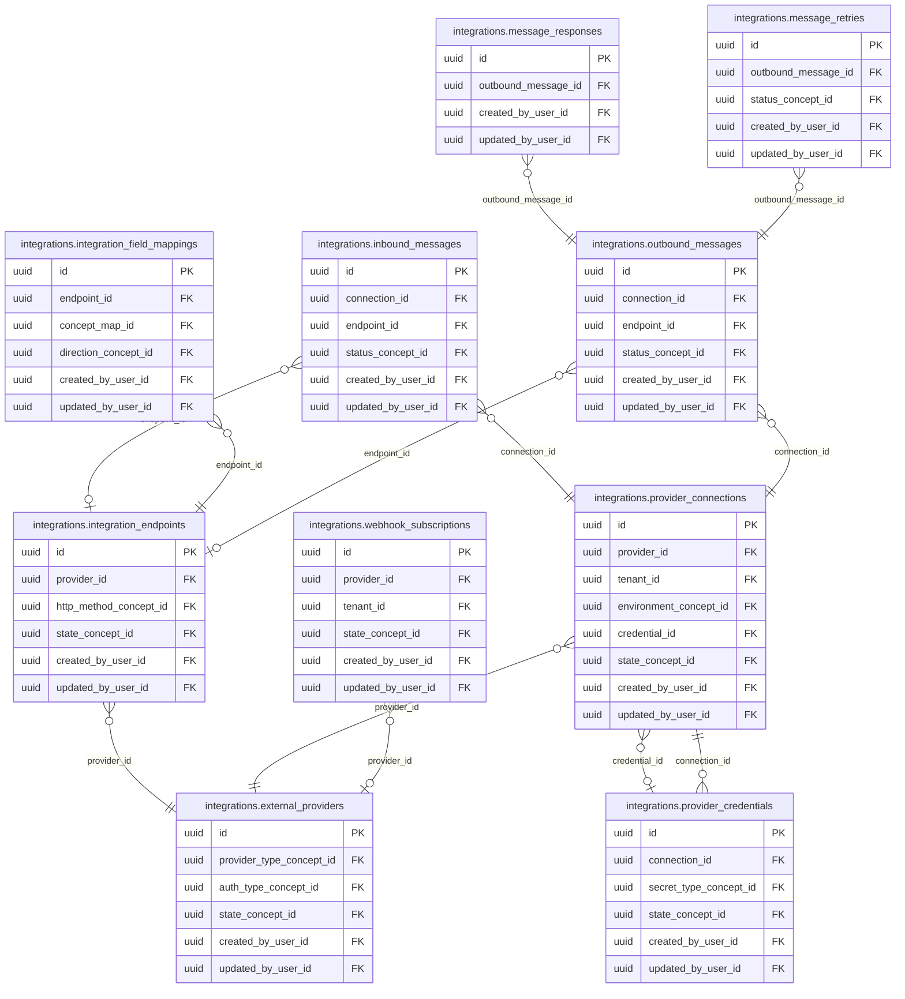

<!-- AUTOGENERADO por tools/inventario/catalogo.mjs. No editar manualmente. -->

# Catálogo del schema `integrations`

- **Tablas:** 10 · **Columnas:** 138 (40 con descripción: 29.0 %) · **Índices:** 55
- **Dominio:** Integraciones y Contratos
- Método y límites del catálogo: [README del inventario](../README.md)

## Tablas

| Tabla | Propósito | Columnas | Índices | Operaciones | ORM |
|---|---|---|---|---|---|
| [external_providers](#external_providers) | Cataloga proveedores externos que intercambian datos o servicios con la plataforma médica. | 13 | 6 | 6 | COINCIDE |
| [inbound_messages](#inbound_messages) | Registra mensajes recibidos desde integraciones externas para procesarlos y conservar su procedencia. | 14 | 5 | 5 | COINCIDE |
| [integration_endpoints](#integration_endpoints) | Registra endpoints externos disponibles para intercambios de datos y operaciones de integración. | 16 | 6 | 3 | COINCIDE |
| [integration_field_mappings](#integration_field_mappings) | Mapea campos entre contratos externos y estructuras internas para intercambiar datos con significado consistente. | 12 | 5 | 1 | COINCIDE |
| [message_responses](#message_responses) | Conserva respuestas asociadas a mensajes intercambiados para conocer el resultado informado por sistemas externos. | 12 | 3 | 2 | COINCIDE |
| [message_retries](#message_retries) | Traza reintentos de mensajes fallidos para sostener entrega confiable sin perder historial operativo. | 14 | 5 | 5 | COINCIDE |
| [outbound_messages](#outbound_messages) | Mantiene mensajes salientes hacia proveedores o sistemas conectados para rastrear entregas e interoperabilidad. | 18 | 6 | 14 | COINCIDE |
| [provider_connections](#provider_connections) | Configura vínculos operativos con proveedores externos para mantener su contexto y estado de integración. | 14 | 8 | 8 | COINCIDE |
| [provider_credentials](#provider_credentials) | Gestiona referencias protegidas a credenciales usadas para autenticar conexiones con proveedores. | 13 | 5 | 4 | COINCIDE |
| [webhook_subscriptions](#webhook_subscriptions) | Define suscripciones a webhooks para comunicar eventos del sistema a consumidores externos autorizados. | 12 | 6 | 3 | COINCIDE |

## Diagrama entidad-relación

Las tablas se agrupan en familias por sus claves foráneas dentro del schema (máximo 40 por diagrama). Las FK hacia otros schemas se listan en la ficha de cada tabla.

### Familia 1 de 1 — 10 tablas

## Fichas

### external_providers

#### Vista general

Cataloga proveedores externos que intercambian datos o servicios con la plataforma médica.

- **Estado del propósito:** DOMAIN_CURATED_DRAFT · fuente: `Mantra Core Health Context/modules/diagram_12_integrations.puml: external_providers`
- **Dominio:** Integraciones y Contratos · **Diagrama:** `Mantra Core Health Context/modules/diagram_12_integrations.puml` · **DDL:** `SQL/12_integrations/02_tables.sql`
- **Entidad del ORM:** `ExternalProviders` — `src/modules/integrations/entities/external_providers.entity.ts`
- **Resumen:** 13 columnas · 6 índices · 5 FK salientes · 8 entrantes · 6 operaciones

#### Columnas

| # | Columna | Tipo | Rol estructural | Descripción | ORM |
|---|---|---|---|---|---|
| 1 | `id` | `uuid` | Clave primaria; Obligatoria | Identificador único de la instancia. _(JSDOC_ESTANDAR, `src/modules/integrations/entities/external_providers.entity.ts:12`)_ | coincide |
| 2 | `code` | `varchar` | Obligatoria | _sin dato_ | coincide |
| 3 | `name` | `varchar` | Obligatoria | _sin dato_ | coincide |
| 4 | `provider_type_concept_id` | `uuid` | Clave foránea → terminology.catalog_concepts.id; Obligatoria | _sin dato_ | coincide |
| 5 | `base_url` | `text` | Opcional | _sin dato_ | coincide |
| 6 | `auth_type_concept_id` | `uuid` | Clave foránea → terminology.catalog_concepts.id; Opcional | _sin dato_ | coincide |
| 7 | `doc_url` | `text` | Opcional | _sin dato_ | coincide |
| 8 | `state_concept_id` | `uuid` | Clave foránea → terminology.catalog_concepts.id; Obligatoria | _sin dato_ | coincide |
| 9 | `created_at` | `timestamptz` | Obligatoria | Fecha y hora en que se creó el registro. _(JSDOC_ESTANDAR, `src/modules/integrations/entities/external_providers.entity.ts:60`)_ | coincide |
| 10 | `updated_at` | `timestamptz` | Obligatoria | Fecha y hora de la última actualización. _(JSDOC_ESTANDAR, `src/modules/integrations/entities/external_providers.entity.ts:66`)_ | coincide |
| 11 | `created_by_user_id` | `uuid` | Clave foránea → iam.users.id; Opcional | _sin dato_ | coincide |
| 12 | `updated_by_user_id` | `uuid` | Clave foránea → iam.users.id; Opcional | _sin dato_ | coincide |
| 13 | `row_version` | `integer = 1` | Obligatoria | Versión usada para controlar actualizaciones concurrentes. _(JSDOC_ENTIDAD, `src/modules/integrations/entities/external_providers.entity.ts:84`)_ | coincide |

#### Relaciones

| Sentido | Columnas | Tabla | Restricción |
|---|---|---|---|
| hacia | provider_type_concept_id | terminology.catalog_concepts (id) | fk_external_providers_provider_type_concept_id |
| hacia | auth_type_concept_id | terminology.catalog_concepts (id) | fk_external_providers_auth_type_concept_id |
| hacia | state_concept_id | terminology.catalog_concepts (id) | fk_external_providers_state_concept_id |
| hacia | created_by_user_id | iam.users (id) | fk_external_providers_created_by_user_id |
| hacia | updated_by_user_id | iam.users (id) | fk_external_providers_updated_by_user_id |
| desde | id | integrations.provider_connections (provider_id) | fk_provider_connections_provider_id |
| desde | id | integrations.integration_endpoints (provider_id) | fk_integration_endpoints_provider_id |
| desde | id | integrations.webhook_subscriptions (provider_id) | fk_webhook_subscriptions_provider_id |
| desde | id | integration_contracts.integration_contracts (external_provider_id) | fk_integration_contracts_external_provider_id |
| desde | id | messaging.messaging_providers (external_provider_id) | fk_messaging_providers_external_provider_id |
| desde | id | tracking.tracking_carriers (external_provider_id) | fk_tracking_carriers_external_provider_id |
| desde | id | payments.payment_gateways (external_provider_id) | fk_payment_gateways_external_provider_id |
| desde | id | health_context.context_agents (provider_id) | fk_context_agents_provider_id |

#### Índices

| Índice | Único | Columnas | Para qué |
|---|---|---|---|
| `uq_external_providers_code` | sí | code | Garantiza que no se repita la combinación (code) _(DOCUMENTO)_; 1 consulta(s) de repositorio filtran u ordenan por «code», la primera columna del índice _(CONSULTA)_ |
| `ix_external_providers_provider_type_concept_id` | no | provider_type_concept_id | Soporta la clave foránea fk_external_providers_provider_type_concept_id: PostgreSQL no indexa las FK por sí mismo _(DOCUMENTO)_ |
| `ix_external_providers_auth_type_concept_id` | no | auth_type_concept_id | Soporta la clave foránea fk_external_providers_auth_type_concept_id: PostgreSQL no indexa las FK por sí mismo _(DOCUMENTO)_ |
| `ix_external_providers_state_concept_id` | no | state_concept_id | Soporta la clave foránea fk_external_providers_state_concept_id: PostgreSQL no indexa las FK por sí mismo _(DOCUMENTO)_ |
| `ix_external_providers_created_by_user_id` | no | created_by_user_id | Soporta la clave foránea fk_external_providers_created_by_user_id: PostgreSQL no indexa las FK por sí mismo _(DOCUMENTO)_ |
| `ix_external_providers_updated_by_user_id` | no | updated_by_user_id | Soporta la clave foránea fk_external_providers_updated_by_user_id: PostgreSQL no indexa las FK por sí mismo _(DOCUMENTO)_ |

#### Restricciones

| Restricción | Tipo | Definición |
|---|---|---|
| `uq_external_providers_code` | UNIQUE INDEX | UNIQUE INDEX ("code") |

#### Operaciones que la tocan

| Operación | Efecto | Confianza |
|---|---|---|
| POST /integrations/messages/{id}:dispatch | LEE | DIRECTA |
| POST /integrations/providers | CREA | DIRECTA |
| POST /integrations/providers | LEE | DIRECTA |
| POST /integrations/providers/{id}/connections | LEE | DIRECTA |
| POST /integrations/providers/{id}/endpoints | LEE | DIRECTA |
| POST /integrations/providers/{id}/webhook-subscriptions | LEE | DIRECTA |

#### Gobierno

| Atributo | Valor | Fuente |
|---|---|---|
| Append-only | no declarado | — |
| Datos personales | sin fuente | — |
| Financiera | sin fuente | — |
| Crítica para auditoría | sin fuente | — |
| Retención | sin fuente | — |
| Responsable | sin fuente | — |
| Revisión | AUTO_DETECTADA | — |

---

### inbound_messages

#### Vista general

Registra mensajes recibidos desde integraciones externas para procesarlos y conservar su procedencia.

- **Estado del propósito:** DOMAIN_CURATED_DRAFT · fuente: `Mantra Core Health Context/modules/diagram_12_integrations.puml: inbound_messages`
- **Dominio:** Integraciones y Contratos · **Diagrama:** `Mantra Core Health Context/modules/diagram_12_integrations.puml` · **DDL:** `SQL/12_integrations/02_tables.sql`
- **Entidad del ORM:** `InboundMessages` — `src/modules/integrations/entities/inbound_messages.entity.ts`
- **Resumen:** 14 columnas · 5 índices · 5 FK salientes · 2 entrantes · 5 operaciones

#### Columnas

| # | Columna | Tipo | Rol estructural | Descripción | ORM |
|---|---|---|---|---|---|
| 1 | `id` | `uuid` | Clave primaria; Obligatoria | Identificador único de la instancia. _(JSDOC_ESTANDAR, `src/modules/integrations/entities/inbound_messages.entity.ts:12`)_ | coincide |
| 2 | `connection_id` | `uuid` | Clave foránea → integrations.provider_connections.id; Obligatoria | _sin dato_ | coincide |
| 3 | `endpoint_id` | `uuid` | Clave foránea → integrations.integration_endpoints.id; Opcional | _sin dato_ | coincide |
| 4 | `correlation_id` | `varchar` | Opcional | _sin dato_ | coincide |
| 5 | `payload_json` | `jsonb` | Obligatoria | _sin dato_ | coincide |
| 6 | `signature` | `varchar` | Opcional | _sin dato_ | coincide |
| 7 | `payload_version` | `integer` | Obligatoria | _sin dato_ | coincide |
| 8 | `status_concept_id` | `uuid` | Clave foránea → terminology.catalog_concepts.id; Obligatoria | _sin dato_ | coincide |
| 9 | `received_at` | `timestamptz` | Opcional | _sin dato_ | coincide |
| 10 | `created_at` | `timestamptz` | Obligatoria | Fecha y hora en que se creó el registro. _(JSDOC_ESTANDAR, `src/modules/integrations/entities/inbound_messages.entity.ts:74`)_ | coincide |
| 11 | `updated_at` | `timestamptz` | Obligatoria | Fecha y hora de la última actualización. _(JSDOC_ESTANDAR, `src/modules/integrations/entities/inbound_messages.entity.ts:80`)_ | coincide |
| 12 | `created_by_user_id` | `uuid` | Clave foránea → iam.users.id; Opcional | _sin dato_ | coincide |
| 13 | `updated_by_user_id` | `uuid` | Clave foránea → iam.users.id; Opcional | _sin dato_ | coincide |
| 14 | `row_version` | `integer = 1` | Obligatoria | Versión usada para controlar actualizaciones concurrentes. _(JSDOC_ENTIDAD, `src/modules/integrations/entities/inbound_messages.entity.ts:98`)_ | coincide |

#### Relaciones

| Sentido | Columnas | Tabla | Restricción |
|---|---|---|---|
| hacia | connection_id | integrations.provider_connections (id) | fk_inbound_messages_connection_id |
| hacia | endpoint_id | integrations.integration_endpoints (id) | fk_inbound_messages_endpoint_id |
| hacia | status_concept_id | terminology.catalog_concepts (id) | fk_inbound_messages_status_concept_id |
| hacia | created_by_user_id | iam.users (id) | fk_inbound_messages_created_by_user_id |
| hacia | updated_by_user_id | iam.users (id) | fk_inbound_messages_updated_by_user_id |
| desde | id | audit.inbound_messages_history (inbound_message_id) | fk_inbound_messages_history_inbound_message_id |
| desde | id | identity_assurance.identity_verification_attempts (response_message_id) | fk_identity_verification_attempts_response_message_id |

#### Índices

| Índice | Único | Columnas | Para qué |
|---|---|---|---|
| `ix_inbound_messages_connection_id` | no | connection_id | Soporta la clave foránea fk_inbound_messages_connection_id: PostgreSQL no indexa las FK por sí mismo _(DOCUMENTO)_; 1 consulta(s) de repositorio filtran u ordenan por «connection_id», la primera columna del índice _(CONSULTA)_ |
| `ix_inbound_messages_endpoint_id` | no | endpoint_id | Soporta la clave foránea fk_inbound_messages_endpoint_id: PostgreSQL no indexa las FK por sí mismo _(DOCUMENTO)_ |
| `ix_inbound_messages_status_concept_id` | no | status_concept_id | Soporta la clave foránea fk_inbound_messages_status_concept_id: PostgreSQL no indexa las FK por sí mismo _(DOCUMENTO)_; 1 consulta(s) de repositorio filtran u ordenan por «status_concept_id», la primera columna del índice _(CONSULTA)_ |
| `ix_inbound_messages_created_by_user_id` | no | created_by_user_id | Soporta la clave foránea fk_inbound_messages_created_by_user_id: PostgreSQL no indexa las FK por sí mismo _(DOCUMENTO)_ |
| `ix_inbound_messages_updated_by_user_id` | no | updated_by_user_id | Soporta la clave foránea fk_inbound_messages_updated_by_user_id: PostgreSQL no indexa las FK por sí mismo _(DOCUMENTO)_ |

#### Operaciones que la tocan

| Operación | Efecto | Confianza |
|---|---|---|
| POST /integrations/messages/{id}:correlate | ACTUALIZA | POR_TIPO |
| POST /integrations/messages/{id}:correlate | LEE | DIRECTA |
| GET /integrations/messages/pending-correlation | LEE | DIRECTA |
| POST /integrations/webhooks/inbound | CREA | DIRECTA |
| POST /integrations/webhooks/inbound | LEE | DIRECTA |

#### Gobierno

| Atributo | Valor | Fuente |
|---|---|---|
| Append-only | no declarado | — |
| Datos personales | sin fuente | — |
| Financiera | sin fuente | — |
| Crítica para auditoría | sin fuente | — |
| Retención | sin fuente | — |
| Responsable | sin fuente | — |
| Revisión | AUTO_DETECTADA | — |

---

### integration_endpoints

#### Vista general

Registra endpoints externos disponibles para intercambios de datos y operaciones de integración.

- **Estado del propósito:** DOMAIN_CURATED_DRAFT · fuente: `Mantra Core Health Context/modules/diagram_12_integrations.puml: integration_endpoints`
- **Dominio:** Integraciones y Contratos · **Diagrama:** `Mantra Core Health Context/modules/diagram_12_integrations.puml` · **DDL:** `SQL/12_integrations/02_tables.sql`
- **Entidad del ORM:** `IntegrationEndpoints` — `src/modules/integrations/entities/integration_endpoints.entity.ts`
- **Resumen:** 16 columnas · 6 índices · 5 FK salientes · 8 entrantes · 3 operaciones

#### Columnas

| # | Columna | Tipo | Rol estructural | Descripción | ORM |
|---|---|---|---|---|---|
| 1 | `id` | `uuid` | Clave primaria; Obligatoria | Identificador único de la instancia. _(JSDOC_ESTANDAR, `src/modules/integrations/entities/integration_endpoints.entity.ts:12`)_ | coincide |
| 2 | `provider_id` | `uuid` | Clave foránea → integrations.external_providers.id; Obligatoria | _sin dato_ | coincide |
| 3 | `code` | `varchar` | Obligatoria | _sin dato_ | coincide |
| 4 | `operation` | `varchar` | Obligatoria | _sin dato_ | coincide |
| 5 | `http_method_concept_id` | `uuid` | Clave foránea → terminology.catalog_concepts.id; Opcional | _sin dato_ | coincide |
| 6 | `path` | `text` | Opcional | _sin dato_ | coincide |
| 7 | `request_schema_json` | `jsonb` | Opcional | _sin dato_ | coincide |
| 8 | `response_schema_json` | `jsonb` | Opcional | _sin dato_ | coincide |
| 9 | `version` | `varchar` | Obligatoria | _sin dato_ | coincide |
| 10 | `timeout_ms` | `integer` | Opcional | _sin dato_ | coincide |
| 11 | `state_concept_id` | `uuid` | Clave foránea → terminology.catalog_concepts.id; Obligatoria | _sin dato_ | coincide |
| 12 | `created_at` | `timestamptz` | Obligatoria | Fecha y hora en que se creó el registro. _(JSDOC_ESTANDAR, `src/modules/integrations/entities/integration_endpoints.entity.ts:92`)_ | coincide |
| 13 | `updated_at` | `timestamptz` | Obligatoria | Fecha y hora de la última actualización. _(JSDOC_ESTANDAR, `src/modules/integrations/entities/integration_endpoints.entity.ts:98`)_ | coincide |
| 14 | `created_by_user_id` | `uuid` | Clave foránea → iam.users.id; Opcional | _sin dato_ | coincide |
| 15 | `updated_by_user_id` | `uuid` | Clave foránea → iam.users.id; Opcional | _sin dato_ | coincide |
| 16 | `row_version` | `integer = 1` | Obligatoria | Versión usada para controlar actualizaciones concurrentes. _(JSDOC_ENTIDAD, `src/modules/integrations/entities/integration_endpoints.entity.ts:116`)_ | coincide |

#### Relaciones

| Sentido | Columnas | Tabla | Restricción |
|---|---|---|---|
| hacia | provider_id | integrations.external_providers (id) | fk_integration_endpoints_provider_id |
| hacia | http_method_concept_id | terminology.catalog_concepts (id) | fk_integration_endpoints_http_method_concept_id |
| hacia | state_concept_id | terminology.catalog_concepts (id) | fk_integration_endpoints_state_concept_id |
| hacia | created_by_user_id | iam.users (id) | fk_integration_endpoints_created_by_user_id |
| hacia | updated_by_user_id | iam.users (id) | fk_integration_endpoints_updated_by_user_id |
| desde | id | integrations.outbound_messages (endpoint_id) | fk_outbound_messages_endpoint_id |
| desde | id | integrations.inbound_messages (endpoint_id) | fk_inbound_messages_endpoint_id |
| desde | id | integrations.integration_field_mappings (endpoint_id) | fk_integration_field_mappings_endpoint_id |
| desde | id | audit.integration_endpoints_history (integration_endpoint_id) | fk_integration_endpoints_history_integration_endpoint_id |
| desde | id | identity_assurance.identity_authority_endpoints (integration_endpoint_id) | fk_identity_authority_endpoints_integration_endpoint_id |
| desde | id | integration_contracts.integration_exchange_attempts (endpoint_id) | fk_integration_exchange_attempts_endpoint_id |
| desde | id | qa_lab.test_cases (endpoint_id) | fk_test_cases_endpoint_id |
| desde | id | automation.agent_tools (integration_endpoint_id) | fk_agent_tools_integration_endpoint_id |

#### Índices

| Índice | Único | Columnas | Para qué |
|---|---|---|---|
| `ix_integration_endpoints_provider_id` | no | provider_id | Soporta la clave foránea fk_integration_endpoints_provider_id: PostgreSQL no indexa las FK por sí mismo _(DOCUMENTO)_; 1 consulta(s) de repositorio filtran u ordenan por «provider_id», la primera columna del índice _(CONSULTA)_ |
| `ix_integration_endpoints_http_method_concept_id` | no | http_method_concept_id | Soporta la clave foránea fk_integration_endpoints_http_method_concept_id: PostgreSQL no indexa las FK por sí mismo _(DOCUMENTO)_ |
| `ix_integration_endpoints_state_concept_id` | no | state_concept_id | Soporta la clave foránea fk_integration_endpoints_state_concept_id: PostgreSQL no indexa las FK por sí mismo _(DOCUMENTO)_ |
| `ix_integration_endpoints_created_by_user_id` | no | created_by_user_id | Soporta la clave foránea fk_integration_endpoints_created_by_user_id: PostgreSQL no indexa las FK por sí mismo _(DOCUMENTO)_ |
| `ix_integration_endpoints_updated_by_user_id` | no | updated_by_user_id | Soporta la clave foránea fk_integration_endpoints_updated_by_user_id: PostgreSQL no indexa las FK por sí mismo _(DOCUMENTO)_ |
| `uq_integration_endpoints_provider_id_version` | sí | provider_id, version | Garantiza que no se repita la combinación (provider_id, version) _(DOCUMENTO)_; Soporta la clave foránea fk_integration_endpoints_provider_id: PostgreSQL no indexa las FK por sí mismo _(DOCUMENTO)_; 1 consulta(s) de repositorio filtran u ordenan por «provider_id», la primera columna del índice _(CONSULTA)_ |

#### Restricciones

| Restricción | Tipo | Definición |
|---|---|---|
| `uq_integration_endpoints_provider_id_version` | UNIQUE INDEX | UNIQUE INDEX ("provider_id", "version") |

#### Operaciones que la tocan

| Operación | Efecto | Confianza |
|---|---|---|
| POST /integrations/messages/{id}:dispatch | LEE | DIRECTA |
| POST /integrations/providers/{id}/endpoints | CREA | DIRECTA |
| POST /integrations/providers/{id}/endpoints | LEE | DIRECTA |

#### Gobierno

| Atributo | Valor | Fuente |
|---|---|---|
| Append-only | no declarado | — |
| Datos personales | sin fuente | — |
| Financiera | sin fuente | — |
| Crítica para auditoría | sin fuente | — |
| Retención | sin fuente | — |
| Responsable | sin fuente | — |
| Revisión | AUTO_DETECTADA | — |

---

### integration_field_mappings

#### Vista general

Mapea campos entre contratos externos y estructuras internas para intercambiar datos con significado consistente.

- **Estado del propósito:** DOMAIN_CURATED_DRAFT · fuente: `Mantra Core Health Context/modules/diagram_12_integrations.puml: integration_field_mappings`
- **Dominio:** Integraciones y Contratos · **Diagrama:** `Mantra Core Health Context/modules/diagram_12_integrations.puml` · **DDL:** `SQL/12_integrations/02_tables.sql`
- **Entidad del ORM:** `IntegrationFieldMappings` — `src/modules/integrations/entities/integration_field_mappings.entity.ts`
- **Resumen:** 12 columnas · 5 índices · 5 FK salientes · 0 entrantes · 1 operaciones

#### Columnas

| # | Columna | Tipo | Rol estructural | Descripción | ORM |
|---|---|---|---|---|---|
| 1 | `id` | `uuid` | Clave primaria; Obligatoria | Identificador único de la instancia. _(JSDOC_ESTANDAR, `src/modules/integrations/entities/integration_field_mappings.entity.ts:12`)_ | coincide |
| 2 | `endpoint_id` | `uuid` | Clave foránea → integrations.integration_endpoints.id; Obligatoria | _sin dato_ | coincide |
| 3 | `source_path` | `varchar` | Obligatoria | _sin dato_ | coincide |
| 4 | `target_field` | `varchar` | Obligatoria | _sin dato_ | coincide |
| 5 | `concept_map_id` | `uuid` | Clave foránea → terminology.concept_maps.id; Opcional | _sin dato_ | coincide |
| 6 | `transform_json` | `jsonb` | Opcional | _sin dato_ | coincide |
| 7 | `direction_concept_id` | `uuid` | Clave foránea → terminology.catalog_concepts.id; Opcional | _sin dato_ | coincide |
| 8 | `created_at` | `timestamptz` | Obligatoria | Fecha y hora en que se creó el registro. _(JSDOC_ESTANDAR, `src/modules/integrations/entities/integration_field_mappings.entity.ts:59`)_ | coincide |
| 9 | `updated_at` | `timestamptz` | Obligatoria | Fecha y hora de la última actualización. _(JSDOC_ESTANDAR, `src/modules/integrations/entities/integration_field_mappings.entity.ts:65`)_ | coincide |
| 10 | `created_by_user_id` | `uuid` | Clave foránea → iam.users.id; Opcional | _sin dato_ | coincide |
| 11 | `updated_by_user_id` | `uuid` | Clave foránea → iam.users.id; Opcional | _sin dato_ | coincide |
| 12 | `row_version` | `integer = 1` | Obligatoria | Versión usada para controlar actualizaciones concurrentes. _(JSDOC_ENTIDAD, `src/modules/integrations/entities/integration_field_mappings.entity.ts:83`)_ | coincide |

#### Relaciones

| Sentido | Columnas | Tabla | Restricción |
|---|---|---|---|
| hacia | endpoint_id | integrations.integration_endpoints (id) | fk_integration_field_mappings_endpoint_id |
| hacia | concept_map_id | terminology.concept_maps (id) | fk_integration_field_mappings_concept_map_id |
| hacia | direction_concept_id | terminology.catalog_concepts (id) | fk_integration_field_mappings_direction_concept_id |
| hacia | created_by_user_id | iam.users (id) | fk_integration_field_mappings_created_by_user_id |
| hacia | updated_by_user_id | iam.users (id) | fk_integration_field_mappings_updated_by_user_id |

#### Índices

| Índice | Único | Columnas | Para qué |
|---|---|---|---|
| `ix_integration_field_mappings_endpoint_id` | no | endpoint_id | Soporta la clave foránea fk_integration_field_mappings_endpoint_id: PostgreSQL no indexa las FK por sí mismo _(DOCUMENTO)_ |
| `ix_integration_field_mappings_concept_map_id` | no | concept_map_id | Soporta la clave foránea fk_integration_field_mappings_concept_map_id: PostgreSQL no indexa las FK por sí mismo _(DOCUMENTO)_ |
| `ix_integration_field_mappings_direction_concept_id` | no | direction_concept_id | Soporta la clave foránea fk_integration_field_mappings_direction_concept_id: PostgreSQL no indexa las FK por sí mismo _(DOCUMENTO)_ |
| `ix_integration_field_mappings_created_by_user_id` | no | created_by_user_id | Soporta la clave foránea fk_integration_field_mappings_created_by_user_id: PostgreSQL no indexa las FK por sí mismo _(DOCUMENTO)_ |
| `ix_integration_field_mappings_updated_by_user_id` | no | updated_by_user_id | Soporta la clave foránea fk_integration_field_mappings_updated_by_user_id: PostgreSQL no indexa las FK por sí mismo _(DOCUMENTO)_ |

#### Operaciones que la tocan

| Operación | Efecto | Confianza |
|---|---|---|
| POST /integrations/providers/{id}/endpoints | CREA | DIRECTA |

#### Gobierno

| Atributo | Valor | Fuente |
|---|---|---|
| Append-only | no declarado | — |
| Datos personales | sin fuente | — |
| Financiera | sin fuente | — |
| Crítica para auditoría | sin fuente | — |
| Retención | sin fuente | — |
| Responsable | sin fuente | — |
| Revisión | AUTO_DETECTADA | — |

---

### message_responses

#### Vista general

Conserva respuestas asociadas a mensajes intercambiados para conocer el resultado informado por sistemas externos.

- **Estado del propósito:** DOMAIN_CURATED_DRAFT · fuente: `Mantra Core Health Context/modules/diagram_12_integrations.puml: message_responses`
- **Dominio:** Integraciones y Contratos · **Diagrama:** `Mantra Core Health Context/modules/diagram_12_integrations.puml` · **DDL:** `SQL/12_integrations/02_tables.sql`
- **Entidad del ORM:** `MessageResponses` — `src/modules/integrations/entities/message_responses.entity.ts`
- **Resumen:** 12 columnas · 3 índices · 3 FK salientes · 0 entrantes · 2 operaciones

#### Columnas

| # | Columna | Tipo | Rol estructural | Descripción | ORM |
|---|---|---|---|---|---|
| 1 | `id` | `uuid` | Clave primaria; Obligatoria | Identificador único de la instancia. _(JSDOC_ESTANDAR, `src/modules/integrations/entities/message_responses.entity.ts:12`)_ | coincide |
| 2 | `outbound_message_id` | `uuid` | Clave foránea → integrations.outbound_messages.id; Obligatoria | _sin dato_ | coincide |
| 3 | `http_status` | `integer` | Opcional | _sin dato_ | coincide |
| 4 | `response_payload_json` | `jsonb` | Obligatoria | _sin dato_ | coincide |
| 5 | `latency_ms` | `integer` | Opcional | _sin dato_ | coincide |
| 6 | `is_success` | `boolean` | Opcional | _sin dato_ | coincide |
| 7 | `received_at` | `timestamptz` | Opcional | _sin dato_ | coincide |
| 8 | `created_at` | `timestamptz` | Obligatoria | Fecha y hora en que se creó el registro. _(JSDOC_ESTANDAR, `src/modules/integrations/entities/message_responses.entity.ts:62`)_ | coincide |
| 9 | `updated_at` | `timestamptz` | Obligatoria | Fecha y hora de la última actualización. _(JSDOC_ESTANDAR, `src/modules/integrations/entities/message_responses.entity.ts:68`)_ | coincide |
| 10 | `created_by_user_id` | `uuid` | Clave foránea → iam.users.id; Opcional | _sin dato_ | coincide |
| 11 | `updated_by_user_id` | `uuid` | Clave foránea → iam.users.id; Opcional | _sin dato_ | coincide |
| 12 | `row_version` | `integer = 1` | Obligatoria | Versión usada para controlar actualizaciones concurrentes. _(JSDOC_ENTIDAD, `src/modules/integrations/entities/message_responses.entity.ts:86`)_ | coincide |

#### Relaciones

| Sentido | Columnas | Tabla | Restricción |
|---|---|---|---|
| hacia | outbound_message_id | integrations.outbound_messages (id) | fk_message_responses_outbound_message_id |
| hacia | created_by_user_id | iam.users (id) | fk_message_responses_created_by_user_id |
| hacia | updated_by_user_id | iam.users (id) | fk_message_responses_updated_by_user_id |

#### Índices

| Índice | Único | Columnas | Para qué |
|---|---|---|---|
| `ix_message_responses_outbound_message_id` | no | outbound_message_id | Soporta la clave foránea fk_message_responses_outbound_message_id: PostgreSQL no indexa las FK por sí mismo _(DOCUMENTO)_ |
| `ix_message_responses_created_by_user_id` | no | created_by_user_id | Soporta la clave foránea fk_message_responses_created_by_user_id: PostgreSQL no indexa las FK por sí mismo _(DOCUMENTO)_ |
| `ix_message_responses_updated_by_user_id` | no | updated_by_user_id | Soporta la clave foránea fk_message_responses_updated_by_user_id: PostgreSQL no indexa las FK por sí mismo _(DOCUMENTO)_ |

#### Operaciones que la tocan

| Operación | Efecto | Confianza |
|---|---|---|
| POST /integrations/messages/{id}:correlate | CREA | DIRECTA |
| POST /integrations/messages/{id}:dispatch | CREA | DIRECTA |

#### Gobierno

| Atributo | Valor | Fuente |
|---|---|---|
| Append-only | no declarado | — |
| Datos personales | sin fuente | — |
| Financiera | sin fuente | — |
| Crítica para auditoría | sin fuente | — |
| Retención | sin fuente | — |
| Responsable | sin fuente | — |
| Revisión | AUTO_DETECTADA | — |

---

### message_retries

#### Vista general

Traza reintentos de mensajes fallidos para sostener entrega confiable sin perder historial operativo.

- **Estado del propósito:** DOMAIN_CURATED_DRAFT · fuente: `Mantra Core Health Context/modules/diagram_12_integrations.puml: message_retries`
- **Dominio:** Integraciones y Contratos · **Diagrama:** `Mantra Core Health Context/modules/diagram_12_integrations.puml` · **DDL:** `SQL/12_integrations/02_tables.sql`
- **Entidad del ORM:** `MessageRetries` — `src/modules/integrations/entities/message_retries.entity.ts`
- **Resumen:** 14 columnas · 5 índices · 4 FK salientes · 1 entrantes · 5 operaciones

#### Columnas

| # | Columna | Tipo | Rol estructural | Descripción | ORM |
|---|---|---|---|---|---|
| 1 | `id` | `uuid` | Clave primaria; Obligatoria | Identificador único de la instancia. _(JSDOC_ESTANDAR, `src/modules/integrations/entities/message_retries.entity.ts:12`)_ | coincide |
| 2 | `outbound_message_id` | `uuid` | Clave foránea → integrations.outbound_messages.id; Obligatoria | _sin dato_ | coincide |
| 3 | `attempt_number` | `integer` | Obligatoria | _sin dato_ | coincide |
| 4 | `status_concept_id` | `uuid` | Clave foránea → terminology.catalog_concepts.id; Obligatoria | _sin dato_ | coincide |
| 5 | `error_text` | `text` | Opcional | _sin dato_ | coincide |
| 6 | `request_snapshot_json` | `jsonb` | Opcional | _sin dato_ | coincide |
| 7 | `payload_version` | `integer` | Obligatoria | _sin dato_ | coincide |
| 8 | `attempted_at` | `timestamptz` | Opcional | _sin dato_ | coincide |
| 9 | `next_retry_at` | `timestamptz` | Opcional | _sin dato_ | coincide |
| 10 | `created_at` | `timestamptz` | Obligatoria | Fecha y hora en que se creó el registro. _(JSDOC_ESTANDAR, `src/modules/integrations/entities/message_retries.entity.ts:79`)_ | coincide |
| 11 | `updated_at` | `timestamptz` | Obligatoria | Fecha y hora de la última actualización. _(JSDOC_ESTANDAR, `src/modules/integrations/entities/message_retries.entity.ts:85`)_ | coincide |
| 12 | `created_by_user_id` | `uuid` | Clave foránea → iam.users.id; Opcional | _sin dato_ | coincide |
| 13 | `updated_by_user_id` | `uuid` | Clave foránea → iam.users.id; Opcional | _sin dato_ | coincide |
| 14 | `row_version` | `integer = 1` | Obligatoria | Versión usada para controlar actualizaciones concurrentes. _(JSDOC_ENTIDAD, `src/modules/integrations/entities/message_retries.entity.ts:103`)_ | coincide |

#### Relaciones

| Sentido | Columnas | Tabla | Restricción |
|---|---|---|---|
| hacia | outbound_message_id | integrations.outbound_messages (id) | fk_message_retries_outbound_message_id |
| hacia | status_concept_id | terminology.catalog_concepts (id) | fk_message_retries_status_concept_id |
| hacia | created_by_user_id | iam.users (id) | fk_message_retries_created_by_user_id |
| hacia | updated_by_user_id | iam.users (id) | fk_message_retries_updated_by_user_id |
| desde | id | audit.message_retries_history (message_retry_id) | fk_message_retries_history_message_retry_id |

#### Índices

| Índice | Único | Columnas | Para qué |
|---|---|---|---|
| `ix_message_retries_outbound_message_id` | no | outbound_message_id | Soporta la clave foránea fk_message_retries_outbound_message_id: PostgreSQL no indexa las FK por sí mismo _(DOCUMENTO)_; 1 consulta(s) de repositorio filtran u ordenan por «outbound_message_id», la primera columna del índice _(CONSULTA)_ |
| `ix_message_retries_status_concept_id` | no | status_concept_id | Soporta la clave foránea fk_message_retries_status_concept_id: PostgreSQL no indexa las FK por sí mismo _(DOCUMENTO)_ |
| `ix_message_retries_created_by_user_id` | no | created_by_user_id | Soporta la clave foránea fk_message_retries_created_by_user_id: PostgreSQL no indexa las FK por sí mismo _(DOCUMENTO)_ |
| `ix_message_retries_updated_by_user_id` | no | updated_by_user_id | Soporta la clave foránea fk_message_retries_updated_by_user_id: PostgreSQL no indexa las FK por sí mismo _(DOCUMENTO)_ |
| `uq_message_retries_outbound_message_id_attempt_number` | sí | outbound_message_id, attempt_number | Garantiza que no se repita la combinación (outbound_message_id, attempt_number) _(DOCUMENTO)_; Soporta la clave foránea fk_message_retries_outbound_message_id: PostgreSQL no indexa las FK por sí mismo _(DOCUMENTO)_; 1 consulta(s) de repositorio filtran u ordenan por «outbound_message_id», la primera columna del índice _(CONSULTA)_ |

#### Restricciones

| Restricción | Tipo | Definición |
|---|---|---|
| `uq_message_retries_outbound_message_id_attempt_number` | UNIQUE INDEX | UNIQUE INDEX ("outbound_message_id", "attempt_number") |

#### Operaciones que la tocan

| Operación | Efecto | Confianza |
|---|---|---|
| POST /integrations/messages/{id}:dead-letter | CREA | DIRECTA |
| POST /integrations/messages/{id}:dead-letter | LEE | DIRECTA |
| POST /integrations/messages/{id}:retry | CREA | DIRECTA |
| POST /integrations/messages/{id}:retry | LEE | DIRECTA |
| GET /integrations/messages/pending-retry | LEE | DIRECTA |

#### Gobierno

| Atributo | Valor | Fuente |
|---|---|---|
| Append-only | no declarado | — |
| Datos personales | sin fuente | — |
| Financiera | sin fuente | — |
| Crítica para auditoría | sin fuente | — |
| Retención | sin fuente | — |
| Responsable | sin fuente | — |
| Revisión | AUTO_DETECTADA | — |

---

### outbound_messages

#### Vista general

Mantiene mensajes salientes hacia proveedores o sistemas conectados para rastrear entregas e interoperabilidad.

- **Estado del propósito:** DOMAIN_CURATED_DRAFT · fuente: `Mantra Core Health Context/modules/diagram_12_integrations.puml: outbound_messages`
- **Dominio:** Integraciones y Contratos · **Diagrama:** `Mantra Core Health Context/modules/diagram_12_integrations.puml` · **DDL:** `SQL/12_integrations/02_tables.sql`
- **Entidad del ORM:** `OutboundMessages` — `src/modules/integrations/entities/outbound_messages.entity.ts`
- **Resumen:** 18 columnas · 6 índices · 5 FK salientes · 4 entrantes · 14 operaciones

#### Columnas

| # | Columna | Tipo | Rol estructural | Descripción | ORM |
|---|---|---|---|---|---|
| 1 | `id` | `uuid` | Clave primaria; Obligatoria | Identificador único de la instancia. _(JSDOC_ESTANDAR, `src/modules/integrations/entities/outbound_messages.entity.ts:12`)_ | coincide |
| 2 | `connection_id` | `uuid` | Clave foránea → integrations.provider_connections.id; Obligatoria | _sin dato_ | coincide |
| 3 | `endpoint_id` | `uuid` | Clave foránea → integrations.integration_endpoints.id; Opcional | _sin dato_ | coincide |
| 4 | `correlation_id` | `varchar` | Obligatoria | _sin dato_ | coincide |
| 5 | `idempotency_key` | `varchar` | Opcional | _sin dato_ | coincide |
| 6 | `request_payload_json` | `jsonb` | Obligatoria | _sin dato_ | coincide |
| 7 | `headers_json` | `jsonb` | Opcional | _sin dato_ | coincide |
| 8 | `payload_version` | `integer` | Obligatoria | _sin dato_ | coincide |
| 9 | `status_concept_id` | `uuid` | Clave foránea → terminology.catalog_concepts.id; Obligatoria | _sin dato_ | coincide |
| 10 | `scheduled_at` | `timestamptz` | Opcional | _sin dato_ | coincide |
| 11 | `sent_at` | `timestamptz` | Opcional | _sin dato_ | coincide |
| 12 | `source_resource_type` | `varchar` | Opcional | _sin dato_ | coincide |
| 13 | `source_resource_id` | `uuid` | Opcional | _sin dato_ | coincide |
| 14 | `created_at` | `timestamptz` | Obligatoria | Fecha y hora en que se creó el registro. _(JSDOC_ESTANDAR, `src/modules/integrations/entities/outbound_messages.entity.ts:111`)_ | coincide |
| 15 | `updated_at` | `timestamptz` | Obligatoria | Fecha y hora de la última actualización. _(JSDOC_ESTANDAR, `src/modules/integrations/entities/outbound_messages.entity.ts:117`)_ | coincide |
| 16 | `created_by_user_id` | `uuid` | Clave foránea → iam.users.id; Opcional | _sin dato_ | coincide |
| 17 | `updated_by_user_id` | `uuid` | Clave foránea → iam.users.id; Opcional | _sin dato_ | coincide |
| 18 | `row_version` | `integer = 1` | Obligatoria | Versión usada para controlar actualizaciones concurrentes. _(JSDOC_ENTIDAD, `src/modules/integrations/entities/outbound_messages.entity.ts:135`)_ | coincide |

#### Relaciones

| Sentido | Columnas | Tabla | Restricción |
|---|---|---|---|
| hacia | connection_id | integrations.provider_connections (id) | fk_outbound_messages_connection_id |
| hacia | endpoint_id | integrations.integration_endpoints (id) | fk_outbound_messages_endpoint_id |
| hacia | status_concept_id | terminology.catalog_concepts (id) | fk_outbound_messages_status_concept_id |
| hacia | created_by_user_id | iam.users (id) | fk_outbound_messages_created_by_user_id |
| hacia | updated_by_user_id | iam.users (id) | fk_outbound_messages_updated_by_user_id |
| desde | id | integrations.message_responses (outbound_message_id) | fk_message_responses_outbound_message_id |
| desde | id | integrations.message_retries (outbound_message_id) | fk_message_retries_outbound_message_id |
| desde | id | audit.outbound_messages_history (outbound_message_id) | fk_outbound_messages_history_outbound_message_id |
| desde | id | identity_assurance.identity_verification_attempts (request_message_id) | fk_identity_verification_attempts_request_message_id |

#### Índices

| Índice | Único | Columnas | Para qué |
|---|---|---|---|
| `uq_outbound_messages_idempotency_key` | sí | idempotency_key | Garantiza que no se repita la combinación (idempotency_key) _(DOCUMENTO)_; 1 consulta(s) de repositorio filtran u ordenan por «idempotency_key», la primera columna del índice _(CONSULTA)_ |
| `ix_outbound_messages_connection_id` | no | connection_id | Soporta la clave foránea fk_outbound_messages_connection_id: PostgreSQL no indexa las FK por sí mismo _(DOCUMENTO)_; 1 consulta(s) de repositorio filtran u ordenan por «connection_id», la primera columna del índice _(CONSULTA)_ |
| `ix_outbound_messages_endpoint_id` | no | endpoint_id | Soporta la clave foránea fk_outbound_messages_endpoint_id: PostgreSQL no indexa las FK por sí mismo _(DOCUMENTO)_ |
| `ix_outbound_messages_status_concept_id` | no | status_concept_id | Soporta la clave foránea fk_outbound_messages_status_concept_id: PostgreSQL no indexa las FK por sí mismo _(DOCUMENTO)_; 3 consulta(s) de repositorio filtran u ordenan por «status_concept_id», la primera columna del índice _(CONSULTA)_ |
| `ix_outbound_messages_created_by_user_id` | no | created_by_user_id | Soporta la clave foránea fk_outbound_messages_created_by_user_id: PostgreSQL no indexa las FK por sí mismo _(DOCUMENTO)_ |
| `ix_outbound_messages_updated_by_user_id` | no | updated_by_user_id | Soporta la clave foránea fk_outbound_messages_updated_by_user_id: PostgreSQL no indexa las FK por sí mismo _(DOCUMENTO)_ |

#### Restricciones

| Restricción | Tipo | Definición |
|---|---|---|
| `uq_outbound_messages_idempotency_key` | UNIQUE INDEX | UNIQUE INDEX ("idempotency_key") |

#### Operaciones que la tocan

| Operación | Efecto | Confianza |
|---|---|---|
| POST /integrations/connections/{id}:pause | ACTUALIZA | POR_TIPO |
| POST /integrations/connections/{id}:pause | LEE | DIRECTA |
| POST /integrations/messages:outbound | CREA | DIRECTA |
| POST /integrations/messages:outbound | LEE | DIRECTA |
| POST /integrations/messages/{id}:correlate | ACTUALIZA | POR_TIPO |
| POST /integrations/messages/{id}:correlate | LEE | DIRECTA |
| POST /integrations/messages/{id}:dead-letter | ACTUALIZA | POR_TIPO |
| POST /integrations/messages/{id}:dead-letter | LEE | DIRECTA |
| POST /integrations/messages/{id}:dispatch | ACTUALIZA | POR_TIPO |
| POST /integrations/messages/{id}:dispatch | LEE | DIRECTA |
| POST /integrations/messages/{id}:retry | ACTUALIZA | POR_TIPO |
| POST /integrations/messages/{id}:retry | LEE | DIRECTA |
| GET /integrations/messages/pending-dispatch | LEE | DIRECTA |
| GET /integrations/messages/pending-retry | LEE | DIRECTA |

#### Gobierno

| Atributo | Valor | Fuente |
|---|---|---|
| Append-only | no declarado | — |
| Datos personales | sin fuente | — |
| Financiera | sin fuente | — |
| Crítica para auditoría | sin fuente | — |
| Retención | sin fuente | — |
| Responsable | sin fuente | — |
| Revisión | AUTO_DETECTADA | — |

---

### provider_connections

#### Vista general

Configura vínculos operativos con proveedores externos para mantener su contexto y estado de integración.

- **Estado del propósito:** DOMAIN_CURATED_DRAFT · fuente: `Mantra Core Health Context/modules/diagram_12_integrations.puml: provider_connections`
- **Dominio:** Integraciones y Contratos · **Diagrama:** `Mantra Core Health Context/modules/diagram_12_integrations.puml` · **DDL:** `SQL/12_integrations/02_tables.sql`
- **Entidad del ORM:** `ProviderConnections` — `src/modules/integrations/entities/provider_connections.entity.ts`
- **Resumen:** 14 columnas · 8 índices · 7 FK salientes · 5 entrantes · 8 operaciones

#### Columnas

| # | Columna | Tipo | Rol estructural | Descripción | ORM |
|---|---|---|---|---|---|
| 1 | `id` | `uuid` | Clave primaria; Obligatoria | Identificador único de la instancia. _(JSDOC_ESTANDAR, `src/modules/integrations/entities/provider_connections.entity.ts:12`)_ | coincide |
| 2 | `provider_id` | `uuid` | Clave foránea → integrations.external_providers.id; Obligatoria | _sin dato_ | coincide |
| 3 | `tenant_id` | `uuid` | Clave foránea → directory.tenants.id; Obligatoria | _sin dato_ | coincide |
| 4 | `environment_concept_id` | `uuid` | Clave foránea → terminology.catalog_concepts.id; Opcional | _sin dato_ | coincide |
| 5 | `config_json` | `jsonb` | Opcional | _sin dato_ | coincide |
| 6 | `credential_id` | `uuid` | Clave foránea → integrations.provider_credentials.id; Opcional | _sin dato_ | coincide |
| 7 | `state_concept_id` | `uuid` | Clave foránea → terminology.catalog_concepts.id; Obligatoria | _sin dato_ | coincide |
| 8 | `valid_from` | `timestamptz` | Opcional | _sin dato_ | coincide |
| 9 | `valid_to` | `timestamptz` | Opcional | _sin dato_ | coincide |
| 10 | `created_at` | `timestamptz` | Obligatoria | Fecha y hora en que se creó el registro. _(JSDOC_ESTANDAR, `src/modules/integrations/entities/provider_connections.entity.ts:83`)_ | coincide |
| 11 | `updated_at` | `timestamptz` | Obligatoria | Fecha y hora de la última actualización. _(JSDOC_ESTANDAR, `src/modules/integrations/entities/provider_connections.entity.ts:89`)_ | coincide |
| 12 | `created_by_user_id` | `uuid` | Clave foránea → iam.users.id; Opcional | _sin dato_ | coincide |
| 13 | `updated_by_user_id` | `uuid` | Clave foránea → iam.users.id; Opcional | _sin dato_ | coincide |
| 14 | `row_version` | `integer = 1` | Obligatoria | Versión usada para controlar actualizaciones concurrentes. _(JSDOC_ENTIDAD, `src/modules/integrations/entities/provider_connections.entity.ts:107`)_ | coincide |

#### Relaciones

| Sentido | Columnas | Tabla | Restricción |
|---|---|---|---|
| hacia | provider_id | integrations.external_providers (id) | fk_provider_connections_provider_id |
| hacia | credential_id | integrations.provider_credentials (id) | fk_provider_connections_credential_id |
| hacia | tenant_id | directory.tenants (id) | fk_provider_connections_tenant_id |
| hacia | environment_concept_id | terminology.catalog_concepts (id) | fk_provider_connections_environment_concept_id |
| hacia | state_concept_id | terminology.catalog_concepts (id) | fk_provider_connections_state_concept_id |
| hacia | created_by_user_id | iam.users (id) | fk_provider_connections_created_by_user_id |
| hacia | updated_by_user_id | iam.users (id) | fk_provider_connections_updated_by_user_id |
| desde | id | integrations.provider_credentials (connection_id) | fk_provider_credentials_connection_id |
| desde | id | integrations.outbound_messages (connection_id) | fk_outbound_messages_connection_id |
| desde | id | integrations.inbound_messages (connection_id) | fk_inbound_messages_connection_id |
| desde | id | audit.provider_connections_history (provider_connection_id) | fk_provider_connections_history_provider_connection_id |
| desde | id | diagnostics.imaging_endpoints (connection_id) | fk_imaging_endpoints_connection_id |

#### Índices

| Índice | Único | Columnas | Para qué |
|---|---|---|---|
| `ix_provider_connections_provider_id` | no | provider_id | Soporta la clave foránea fk_provider_connections_provider_id: PostgreSQL no indexa las FK por sí mismo _(DOCUMENTO)_ |
| `ix_provider_connections_tenant_id` | no | tenant_id | Soporta la clave foránea fk_provider_connections_tenant_id: PostgreSQL no indexa las FK por sí mismo _(DOCUMENTO)_ |
| `ix_provider_connections_environment_concept_id` | no | environment_concept_id | Soporta la clave foránea fk_provider_connections_environment_concept_id: PostgreSQL no indexa las FK por sí mismo _(DOCUMENTO)_ |
| `ix_provider_connections_credential_id` | no | credential_id | Soporta la clave foránea fk_provider_connections_credential_id: PostgreSQL no indexa las FK por sí mismo _(DOCUMENTO)_ |
| `ix_provider_connections_state_concept_id` | no | state_concept_id | Soporta la clave foránea fk_provider_connections_state_concept_id: PostgreSQL no indexa las FK por sí mismo _(DOCUMENTO)_ |
| `ix_provider_connections_created_by_user_id` | no | created_by_user_id | Soporta la clave foránea fk_provider_connections_created_by_user_id: PostgreSQL no indexa las FK por sí mismo _(DOCUMENTO)_ |
| `ix_provider_connections_updated_by_user_id` | no | updated_by_user_id | Soporta la clave foránea fk_provider_connections_updated_by_user_id: PostgreSQL no indexa las FK por sí mismo _(DOCUMENTO)_ |
| `ix_provider_connections_tenant_id_state_concept_id` | no | tenant_id, state_concept_id, ("updated_at" DESC) | _sin uso detectado estáticamente_ |

#### Operaciones que la tocan

| Operación | Efecto | Confianza |
|---|---|---|
| POST /integrations/connections/{id}:pause | ACTUALIZA | POR_TIPO |
| POST /integrations/connections/{id}:pause | LEE | DIRECTA |
| POST /integrations/connections/{id}/credentials:rotate | ACTUALIZA | POR_TIPO |
| POST /integrations/connections/{id}/credentials:rotate | LEE | DIRECTA |
| POST /integrations/messages:outbound | LEE | DIRECTA |
| POST /integrations/messages/{id}:dispatch | LEE | DIRECTA |
| POST /integrations/providers/{id}/connections | CREA | DIRECTA |
| POST /integrations/webhooks/inbound | LEE | DIRECTA |

#### Gobierno

| Atributo | Valor | Fuente |
|---|---|---|
| Append-only | no declarado | — |
| Datos personales | sin fuente | — |
| Financiera | sin fuente | — |
| Crítica para auditoría | sin fuente | — |
| Retención | sin fuente | — |
| Responsable | sin fuente | — |
| Revisión | AUTO_DETECTADA | — |

---

### provider_credentials

#### Vista general

Gestiona referencias protegidas a credenciales usadas para autenticar conexiones con proveedores.

- **Estado del propósito:** DOMAIN_CURATED_DRAFT · fuente: `Mantra Core Health Context/modules/diagram_12_integrations.puml: provider_credentials`
- **Dominio:** Integraciones y Contratos · **Diagrama:** `Mantra Core Health Context/modules/diagram_12_integrations.puml` · **DDL:** `SQL/12_integrations/02_tables.sql`
- **Entidad del ORM:** `ProviderCredentials` — `src/modules/integrations/entities/provider_credentials.entity.ts`
- **Resumen:** 13 columnas · 5 índices · 5 FK salientes · 6 entrantes · 4 operaciones

#### Columnas

| # | Columna | Tipo | Rol estructural | Descripción | ORM |
|---|---|---|---|---|---|
| 1 | `id` | `uuid` | Clave primaria; Obligatoria | Identificador único de la instancia. _(JSDOC_ESTANDAR, `src/modules/integrations/entities/provider_credentials.entity.ts:12`)_ | coincide |
| 2 | `connection_id` | `uuid` | Clave foránea → integrations.provider_connections.id; Obligatoria | _sin dato_ | coincide |
| 3 | `secret_type_concept_id` | `uuid` | Clave foránea → terminology.catalog_concepts.id; Obligatoria | _sin dato_ | coincide |
| 4 | `secret_ref` | `varchar` | Opcional | _sin dato_ | coincide |
| 5 | `encrypted` | `boolean` | Opcional | _sin dato_ | coincide |
| 6 | `rotated_at` | `timestamptz` | Opcional | _sin dato_ | coincide |
| 7 | `expires_at` | `timestamptz` | Opcional | _sin dato_ | coincide |
| 8 | `state_concept_id` | `uuid` | Clave foránea → terminology.catalog_concepts.id; Obligatoria | _sin dato_ | coincide |
| 9 | `created_at` | `timestamptz` | Obligatoria | Fecha y hora en que se creó el registro. _(JSDOC_ESTANDAR, `src/modules/integrations/entities/provider_credentials.entity.ts:68`)_ | coincide |
| 10 | `updated_at` | `timestamptz` | Obligatoria | Fecha y hora de la última actualización. _(JSDOC_ESTANDAR, `src/modules/integrations/entities/provider_credentials.entity.ts:74`)_ | coincide |
| 11 | `created_by_user_id` | `uuid` | Clave foránea → iam.users.id; Opcional | _sin dato_ | coincide |
| 12 | `updated_by_user_id` | `uuid` | Clave foránea → iam.users.id; Opcional | _sin dato_ | coincide |
| 13 | `row_version` | `integer = 1` | Obligatoria | Versión usada para controlar actualizaciones concurrentes. _(JSDOC_ENTIDAD, `src/modules/integrations/entities/provider_credentials.entity.ts:92`)_ | coincide |

#### Relaciones

| Sentido | Columnas | Tabla | Restricción |
|---|---|---|---|
| hacia | connection_id | integrations.provider_connections (id) | fk_provider_credentials_connection_id |
| hacia | secret_type_concept_id | terminology.catalog_concepts (id) | fk_provider_credentials_secret_type_concept_id |
| hacia | state_concept_id | terminology.catalog_concepts (id) | fk_provider_credentials_state_concept_id |
| hacia | created_by_user_id | iam.users (id) | fk_provider_credentials_created_by_user_id |
| hacia | updated_by_user_id | iam.users (id) | fk_provider_credentials_updated_by_user_id |
| desde | id | integrations.provider_connections (credential_id) | fk_provider_connections_credential_id |
| desde | id | messaging.provider_channel_configs (credential_id) | fk_provider_channel_configs_credential_id |
| desde | id | messaging.provider_channel_configs (webhook_secret_credential_id) | fk_provider_channel_configs_webhook_secret_credential_id |
| desde | id | payments.gateway_connections (credential_id) | fk_gateway_connections_credential_id |
| desde | id | ads.ad_platform_connections (credential_id) | fk_ad_platform_connections_credential_id |
| desde | id | health_data.health_source_connections (credential_id) | fk_health_source_connections_credential_id |

#### Índices

| Índice | Único | Columnas | Para qué |
|---|---|---|---|
| `ix_provider_credentials_connection_id` | no | connection_id | Soporta la clave foránea fk_provider_credentials_connection_id: PostgreSQL no indexa las FK por sí mismo _(DOCUMENTO)_; 1 consulta(s) de repositorio filtran u ordenan por «connection_id», la primera columna del índice _(CONSULTA)_ |
| `ix_provider_credentials_secret_type_concept_id` | no | secret_type_concept_id | Soporta la clave foránea fk_provider_credentials_secret_type_concept_id: PostgreSQL no indexa las FK por sí mismo _(DOCUMENTO)_ |
| `ix_provider_credentials_state_concept_id` | no | state_concept_id | Soporta la clave foránea fk_provider_credentials_state_concept_id: PostgreSQL no indexa las FK por sí mismo _(DOCUMENTO)_; 1 consulta(s) de repositorio filtran u ordenan por «state_concept_id», la primera columna del índice _(CONSULTA)_ |
| `ix_provider_credentials_created_by_user_id` | no | created_by_user_id | Soporta la clave foránea fk_provider_credentials_created_by_user_id: PostgreSQL no indexa las FK por sí mismo _(DOCUMENTO)_ |
| `ix_provider_credentials_updated_by_user_id` | no | updated_by_user_id | Soporta la clave foránea fk_provider_credentials_updated_by_user_id: PostgreSQL no indexa las FK por sí mismo _(DOCUMENTO)_ |

#### Operaciones que la tocan

| Operación | Efecto | Confianza |
|---|---|---|
| POST /integrations/connections/{id}/credentials:rotate | ACTUALIZA | POR_TIPO |
| POST /integrations/connections/{id}/credentials:rotate | CREA | DIRECTA |
| POST /integrations/connections/{id}/credentials:rotate | LEE | DIRECTA |
| POST /integrations/providers/{id}/connections | CREA | DIRECTA |

#### Gobierno

| Atributo | Valor | Fuente |
|---|---|---|
| Append-only | no declarado | — |
| Datos personales | sin fuente | — |
| Financiera | sin fuente | — |
| Crítica para auditoría | sin fuente | — |
| Retención | sin fuente | — |
| Responsable | sin fuente | — |
| Revisión | AUTO_DETECTADA | — |

---

### webhook_subscriptions

#### Vista general

Define suscripciones a webhooks para comunicar eventos del sistema a consumidores externos autorizados.

- **Estado del propósito:** DOMAIN_CURATED_DRAFT · fuente: `Mantra Core Health Context/modules/diagram_12_integrations.puml: webhook_subscriptions`
- **Dominio:** Integraciones y Contratos · **Diagrama:** `Mantra Core Health Context/modules/diagram_12_integrations.puml` · **DDL:** `SQL/12_integrations/02_tables.sql`
- **Entidad del ORM:** `WebhookSubscriptions` — `src/modules/integrations/entities/webhook_subscriptions.entity.ts`
- **Resumen:** 12 columnas · 6 índices · 5 FK salientes · 1 entrantes · 3 operaciones

#### Columnas

| # | Columna | Tipo | Rol estructural | Descripción | ORM |
|---|---|---|---|---|---|
| 1 | `id` | `uuid` | Clave primaria; Obligatoria | Identificador único de la instancia. _(JSDOC_ESTANDAR, `src/modules/integrations/entities/webhook_subscriptions.entity.ts:12`)_ | coincide |
| 2 | `provider_id` | `uuid` | Clave foránea → integrations.external_providers.id; Opcional | _sin dato_ | coincide |
| 3 | `tenant_id` | `uuid` | Clave foránea → directory.tenants.id; Opcional | _sin dato_ | coincide |
| 4 | `event_type` | `varchar` | Obligatoria | _sin dato_ | coincide |
| 5 | `callback_url` | `text` | Obligatoria | _sin dato_ | coincide |
| 6 | `secret_ref` | `varchar` | Opcional | _sin dato_ | coincide |
| 7 | `state_concept_id` | `uuid` | Clave foránea → terminology.catalog_concepts.id; Obligatoria | _sin dato_ | coincide |
| 8 | `created_at` | `timestamptz` | Obligatoria | Fecha y hora en que se creó el registro. _(JSDOC_ESTANDAR, `src/modules/integrations/entities/webhook_subscriptions.entity.ts:54`)_ | coincide |
| 9 | `updated_at` | `timestamptz` | Obligatoria | Fecha y hora de la última actualización. _(JSDOC_ESTANDAR, `src/modules/integrations/entities/webhook_subscriptions.entity.ts:60`)_ | coincide |
| 10 | `created_by_user_id` | `uuid` | Clave foránea → iam.users.id; Opcional | _sin dato_ | coincide |
| 11 | `updated_by_user_id` | `uuid` | Clave foránea → iam.users.id; Opcional | _sin dato_ | coincide |
| 12 | `row_version` | `integer = 1` | Obligatoria | Versión usada para controlar actualizaciones concurrentes. _(JSDOC_ENTIDAD, `src/modules/integrations/entities/webhook_subscriptions.entity.ts:78`)_ | coincide |

#### Relaciones

| Sentido | Columnas | Tabla | Restricción |
|---|---|---|---|
| hacia | provider_id | integrations.external_providers (id) | fk_webhook_subscriptions_provider_id |
| hacia | tenant_id | directory.tenants (id) | fk_webhook_subscriptions_tenant_id |
| hacia | state_concept_id | terminology.catalog_concepts (id) | fk_webhook_subscriptions_state_concept_id |
| hacia | created_by_user_id | iam.users (id) | fk_webhook_subscriptions_created_by_user_id |
| hacia | updated_by_user_id | iam.users (id) | fk_webhook_subscriptions_updated_by_user_id |
| desde | id | integration_contracts.webhook_delivery_evidence (webhook_subscription_id) | fk_webhook_delivery_evidence_webhook_subscription_id |

#### Índices

| Índice | Único | Columnas | Para qué |
|---|---|---|---|
| `ix_webhook_subscriptions_provider_id` | no | provider_id | Soporta la clave foránea fk_webhook_subscriptions_provider_id: PostgreSQL no indexa las FK por sí mismo _(DOCUMENTO)_; 1 consulta(s) de repositorio filtran u ordenan por «provider_id», la primera columna del índice _(CONSULTA)_ |
| `ix_webhook_subscriptions_tenant_id` | no | tenant_id | Soporta la clave foránea fk_webhook_subscriptions_tenant_id: PostgreSQL no indexa las FK por sí mismo _(DOCUMENTO)_; 1 consulta(s) de repositorio filtran u ordenan por «tenant_id», la primera columna del índice _(CONSULTA)_ |
| `ix_webhook_subscriptions_state_concept_id` | no | state_concept_id | Soporta la clave foránea fk_webhook_subscriptions_state_concept_id: PostgreSQL no indexa las FK por sí mismo _(DOCUMENTO)_ |
| `ix_webhook_subscriptions_created_by_user_id` | no | created_by_user_id | Soporta la clave foránea fk_webhook_subscriptions_created_by_user_id: PostgreSQL no indexa las FK por sí mismo _(DOCUMENTO)_ |
| `ix_webhook_subscriptions_updated_by_user_id` | no | updated_by_user_id | Soporta la clave foránea fk_webhook_subscriptions_updated_by_user_id: PostgreSQL no indexa las FK por sí mismo _(DOCUMENTO)_ |
| `ix_webhook_subscriptions_tenant_id_state_concept_id` | no | tenant_id, state_concept_id, ("updated_at" DESC) | _sin uso detectado estáticamente_ |

#### Operaciones que la tocan

| Operación | Efecto | Confianza |
|---|---|---|
| POST /integrations/providers/{id}/webhook-subscriptions | ACTUALIZA | POR_TIPO |
| POST /integrations/providers/{id}/webhook-subscriptions | CREA | DIRECTA |
| POST /integrations/providers/{id}/webhook-subscriptions | LEE | DIRECTA |

#### Gobierno

| Atributo | Valor | Fuente |
|---|---|---|
| Append-only | no declarado | — |
| Datos personales | sin fuente | — |
| Financiera | sin fuente | — |
| Crítica para auditoría | sin fuente | — |
| Retención | sin fuente | — |
| Responsable | sin fuente | — |
| Revisión | AUTO_DETECTADA | — |

---

