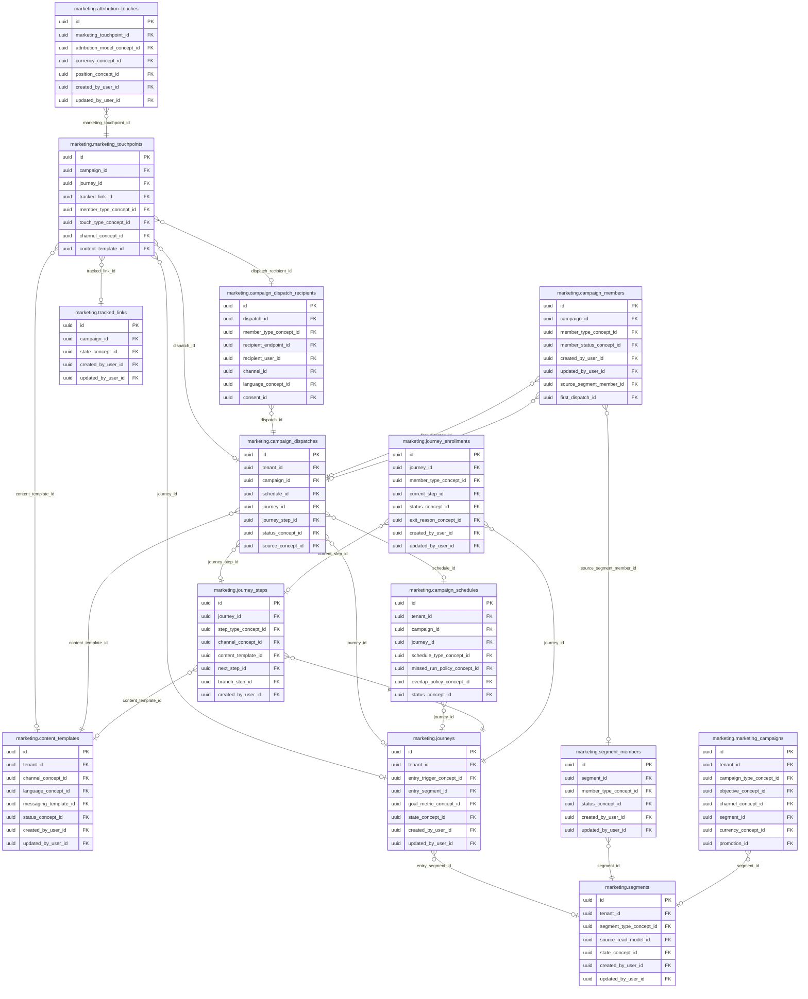

<!-- AUTOGENERADO por tools/inventario/catalogo.mjs. No editar manualmente. -->

# Catálogo del schema `marketing`

- **Tablas:** 14 · **Columnas:** 276 (53 con descripción: 19.2 %) · **Índices:** 130
- **Dominio:** Marketing y Crecimiento
- Método y límites del catálogo: [README del inventario](../README.md)

## Tablas

| Tabla | Propósito | Columnas | Índices | Operaciones | ORM |
|---|---|---|---|---|---|
| [attribution_touches](#attribution_touches) | Asocia puntos de contacto a conversiones para analizar contribución de canales y campañas. | 14 | 6 | 3 | COINCIDE |
| [campaign_dispatch_recipients](#campaign_dispatch_recipients) | Detalla destinatarios incluidos en cada envío para auditar alcance y resultado de campaña. | 26 | 17 | 0 | COINCIDE |
| [campaign_dispatches](#campaign_dispatches) | Representa envíos planificados o ejecutados de campañas a través de canales de comunicación. | 37 | 13 | 0 | COINCIDE |
| [campaign_members](#campaign_members) | Relaciona personas o cuentas con campañas para seguir participación y elegibilidad de comunicación. | 16 | 5 | 7 | COINCIDE |
| [campaign_schedules](#campaign_schedules) | Programa campañas y establece cuándo se ejecutan sus envíos. | 31 | 11 | 0 | COINCIDE |
| [content_templates](#content_templates) | Define contenidos reutilizables para mensajes y piezas incluidas en campañas o recorridos. | 17 | 10 | 5 | COINCIDE |
| [journey_enrollments](#journey_enrollments) | Registra participantes incorporados a recorridos para seguir su progreso y elegibilidad. | 14 | 7 | 4 | COINCIDE |
| [journey_steps](#journey_steps) | Detalla pasos, esperas y decisiones de cada recorrido automatizado. | 16 | 8 | 5 | COINCIDE |
| [journeys](#journeys) | Representa recorridos automatizados que organizan interacciones de marketing por etapas y condiciones. | 14 | 10 | 8 | COINCIDE |
| [marketing_campaigns](#marketing_campaigns) | Representa campañas multicanal dirigidas a audiencias permitidas, sin usar PHI clínica para targeting. | 31 | 14 | 8 | COINCIDE |
| [marketing_touchpoints](#marketing_touchpoints) | Registra interacciones de marketing observadas para conocer contactos entre audiencias y campañas. | 18 | 9 | 4 | COINCIDE |
| [segment_members](#segment_members) | Asocia miembros a segmentos para medir alcance y preparar campañas sujetas a consentimiento. | 12 | 5 | 3 | COINCIDE |
| [segments](#segments) | Define audiencias segmentadas a partir de fuentes y reglas autorizadas para comunicación no clínica. | 15 | 9 | 5 | COINCIDE |
| [tracked_links](#tracked_links) | Cataloga enlaces con parámetros de seguimiento para medir respuesta a campañas y canales. | 15 | 6 | 6 | COINCIDE |

## Diagrama entidad-relación

Las tablas se agrupan en familias por sus claves foráneas dentro del schema (máximo 40 por diagrama). Las FK hacia otros schemas se listan en la ficha de cada tabla.

### Familia 1 de 1 — 14 tablas

## Fichas

### attribution_touches

#### Vista general

Asocia puntos de contacto a conversiones para analizar contribución de canales y campañas.

- **Estado del propósito:** DOMAIN_CURATED_DRAFT · fuente: `Mantra Core Health Context/modules/diagram_50_marketing.puml: attribution_touches`
- **Dominio:** Marketing y Crecimiento · **Diagrama:** `Mantra Core Health Context/modules/diagram_50_marketing.puml` · **DDL:** `SQL/50_marketing/02_tables.sql`
- **Entidad del ORM:** `AttributionTouches` — `src/modules/marketing/entities/attribution_touches.entity.ts`
- **Resumen:** 14 columnas · 6 índices · 6 FK salientes · 0 entrantes · 3 operaciones

#### Columnas

| # | Columna | Tipo | Rol estructural | Descripción | ORM |
|---|---|---|---|---|---|
| 1 | `id` | `uuid` | Clave primaria; Obligatoria | Identificador único de la instancia. _(JSDOC_ESTANDAR, `src/modules/marketing/entities/attribution_touches.entity.ts:12`)_ | coincide |
| 2 | `conversion_ref_type` | `varchar` | Obligatoria | _sin dato_ | coincide |
| 3 | `conversion_ref_id` | `uuid` | Obligatoria | _sin dato_ | coincide |
| 4 | `marketing_touchpoint_id` | `uuid` | Clave foránea → marketing.marketing_touchpoints.id; Obligatoria | _sin dato_ | coincide |
| 5 | `attribution_model_concept_id` | `uuid` | Clave foránea → terminology.catalog_concepts.id; Obligatoria | _sin dato_ | coincide |
| 6 | `weight` | `numeric` | Obligatoria | _sin dato_ | coincide |
| 7 | `attributed_value` | `numeric` | Opcional | _sin dato_ | coincide |
| 8 | `currency_concept_id` | `uuid` | Clave foránea → terminology.catalog_concepts.id; Opcional | _sin dato_ | coincide |
| 9 | `position_concept_id` | `uuid` | Clave foránea → terminology.catalog_concepts.id; Opcional | _sin dato_ | coincide |
| 10 | `created_at` | `timestamptz` | Obligatoria | Fecha y hora en que se creó el registro. _(JSDOC_ESTANDAR, `src/modules/marketing/entities/attribution_touches.entity.ts:70`)_ | coincide |
| 11 | `updated_at` | `timestamptz` | Obligatoria | Fecha y hora de la última actualización. _(JSDOC_ESTANDAR, `src/modules/marketing/entities/attribution_touches.entity.ts:76`)_ | coincide |
| 12 | `created_by_user_id` | `uuid` | Clave foránea → iam.users.id; Opcional | _sin dato_ | coincide |
| 13 | `updated_by_user_id` | `uuid` | Clave foránea → iam.users.id; Opcional | _sin dato_ | coincide |
| 14 | `row_version` | `integer = 1` | Obligatoria | Versión usada para controlar actualizaciones concurrentes. _(JSDOC_ENTIDAD, `src/modules/marketing/entities/attribution_touches.entity.ts:94`)_ | coincide |

#### Relaciones

| Sentido | Columnas | Tabla | Restricción |
|---|---|---|---|
| hacia | marketing_touchpoint_id | marketing.marketing_touchpoints (id) | fk_attribution_touches_marketing_touchpoint_id |
| hacia | attribution_model_concept_id | terminology.catalog_concepts (id) | fk_attribution_touches_attribution_model_concept_id |
| hacia | currency_concept_id | terminology.catalog_concepts (id) | fk_attribution_touches_currency_concept_id |
| hacia | position_concept_id | terminology.catalog_concepts (id) | fk_attribution_touches_position_concept_id |
| hacia | created_by_user_id | iam.users (id) | fk_attribution_touches_created_by_user_id |
| hacia | updated_by_user_id | iam.users (id) | fk_attribution_touches_updated_by_user_id |

#### Índices

| Índice | Único | Columnas | Para qué |
|---|---|---|---|
| `ix_attribution_touches_marketing_touchpoint_id` | no | marketing_touchpoint_id | Soporta la clave foránea fk_attribution_touches_marketing_touchpoint_id: PostgreSQL no indexa las FK por sí mismo _(DOCUMENTO)_ |
| `ix_attribution_touches_attribution_model_concept_id` | no | attribution_model_concept_id | Soporta la clave foránea fk_attribution_touches_attribution_model_concept_id: PostgreSQL no indexa las FK por sí mismo _(DOCUMENTO)_; 1 consulta(s) de repositorio filtran u ordenan por «attribution_model_concept_id», la primera columna del índice _(CONSULTA)_ |
| `ix_attribution_touches_currency_concept_id` | no | currency_concept_id | Soporta la clave foránea fk_attribution_touches_currency_concept_id: PostgreSQL no indexa las FK por sí mismo _(DOCUMENTO)_ |
| `ix_attribution_touches_position_concept_id` | no | position_concept_id | Soporta la clave foránea fk_attribution_touches_position_concept_id: PostgreSQL no indexa las FK por sí mismo _(DOCUMENTO)_ |
| `ix_attribution_touches_created_by_user_id` | no | created_by_user_id | Soporta la clave foránea fk_attribution_touches_created_by_user_id: PostgreSQL no indexa las FK por sí mismo _(DOCUMENTO)_ |
| `ix_attribution_touches_updated_by_user_id` | no | updated_by_user_id | Soporta la clave foránea fk_attribution_touches_updated_by_user_id: PostgreSQL no indexa las FK por sí mismo _(DOCUMENTO)_ |

#### Operaciones que la tocan

| Operación | Efecto | Confianza |
|---|---|---|
| POST /marketing/attribution/compute | BORRA | POR_TIPO |
| POST /marketing/attribution/compute | CREA | DIRECTA |
| POST /marketing/attribution/compute | LEE | DIRECTA |

#### Gobierno

| Atributo | Valor | Fuente |
|---|---|---|
| Append-only | no declarado | — |
| Datos personales | sin fuente | — |
| Financiera | sin fuente | — |
| Crítica para auditoría | sin fuente | — |
| Retención | sin fuente | — |
| Responsable | sin fuente | — |
| Revisión | AUTO_DETECTADA | — |

---

### campaign_dispatch_recipients

#### Vista general

Detalla destinatarios incluidos en cada envío para auditar alcance y resultado de campaña.

- **Estado del propósito:** DOMAIN_CURATED_DRAFT · fuente: `Mantra Core Health Context/modules/diagram_50_marketing.puml: campaign_dispatch_recipients`
- **Dominio:** Marketing y Crecimiento · **Diagrama:** `Mantra Core Health Context/modules/diagram_50_marketing.puml` · **DDL:** `SQL/50_marketing/02_tables.sql`
- **Entidad del ORM:** `CampaignDispatchRecipients` — `src/modules/marketing/entities/campaign_dispatch_recipients.entity.ts`
- **Resumen:** 26 columnas · 17 índices · 15 FK salientes · 4 entrantes · 0 operaciones

#### Columnas

| # | Columna | Tipo | Rol estructural | Descripción | ORM |
|---|---|---|---|---|---|
| 1 | `id` | `uuid` | Clave primaria; Obligatoria | Identificador único de la instancia. _(JSDOC_ESTANDAR, `src/modules/marketing/entities/campaign_dispatch_recipients.entity.ts:12`)_ | coincide |
| 2 | `dispatch_id` | `uuid` | Clave foránea → marketing.campaign_dispatches.id; Obligatoria | _sin dato_ | coincide |
| 3 | `member_type_concept_id` | `uuid` | Clave foránea → terminology.catalog_concepts.id; Obligatoria | _sin dato_ | coincide |
| 4 | `member_ref_id` | `uuid` | Obligatoria | _sin dato_ | coincide |
| 5 | `recipient_endpoint_id` | `uuid` | Clave foránea → crm.contact_channel_endpoints.id; Opcional | _sin dato_ | coincide |
| 6 | `recipient_user_id` | `uuid` | Clave foránea → iam.users.id; Opcional | _sin dato_ | coincide |
| 7 | `channel_id` | `uuid` | Clave foránea → messaging.message_channels.id; Obligatoria | _sin dato_ | coincide |
| 8 | `language_concept_id` | `uuid` | Clave foránea → terminology.catalog_concepts.id; Opcional | _sin dato_ | coincide |
| 9 | `timezone_name` | `varchar` | Opcional | _sin dato_ | coincide |
| 10 | `consent_id` | `uuid` | Clave foránea → consent.consents.id; Opcional | _sin dato_ | coincide |
| 11 | `consent_status_concept_id` | `uuid` | Clave foránea → terminology.catalog_concepts.id; Obligatoria | _sin dato_ | coincide |
| 12 | `preference_snapshot_json` | `jsonb` | Opcional | _sin dato_ | coincide |
| 13 | `eligibility_status_concept_id` | `uuid` | Clave foránea → terminology.catalog_concepts.id; Obligatoria | _sin dato_ | coincide |
| 14 | `suppression_reason_concept_id` | `uuid` | Clave foránea → terminology.catalog_concepts.id; Opcional | _sin dato_ | coincide |
| 15 | `suppression_detail` | `varchar` | Opcional | _sin dato_ | coincide |
| 16 | `scheduled_at` | `timestamptz` | Obligatoria | _sin dato_ | coincide |
| 17 | `notification_request_id` | `uuid` | Clave foránea → messaging.notification_requests.id; Opcional | _sin dato_ | coincide |
| 18 | `current_delivery_id` | `uuid` | Clave foránea → messaging.notification_deliveries.id; Opcional | _sin dato_ | coincide |
| 19 | `current_status_concept_id` | `uuid` | Clave foránea → terminology.catalog_concepts.id; Obligatoria | _sin dato_ | coincide |
| 20 | `idempotency_key` | `varchar` | Obligatoria | _sin dato_ | coincide |
| 21 | `snapshot_json` | `jsonb` | Obligatoria | _sin dato_ | coincide |
| 22 | `created_at` | `timestamptz` | Obligatoria | Fecha y hora en que se creó el registro. _(JSDOC_ESTANDAR, `src/modules/marketing/entities/campaign_dispatch_recipients.entity.ts:163`)_ | coincide |
| 23 | `updated_at` | `timestamptz` | Obligatoria | Fecha y hora de la última actualización. _(JSDOC_ESTANDAR, `src/modules/marketing/entities/campaign_dispatch_recipients.entity.ts:169`)_ | coincide |
| 24 | `created_by_user_id` | `uuid` | Clave foránea → iam.users.id; Obligatoria | _sin dato_ | coincide |
| 25 | `updated_by_user_id` | `uuid` | Clave foránea → iam.users.id; Obligatoria | _sin dato_ | coincide |
| 26 | `row_version` | `integer = 1` | Obligatoria | Versión usada para controlar actualizaciones concurrentes. _(JSDOC_ENTIDAD, `src/modules/marketing/entities/campaign_dispatch_recipients.entity.ts:187`)_ | coincide |

#### Relaciones

| Sentido | Columnas | Tabla | Restricción |
|---|---|---|---|
| hacia | dispatch_id | marketing.campaign_dispatches (id) | fk_campaign_dispatch_recipients_dispatch_id |
| hacia | member_type_concept_id | terminology.catalog_concepts (id) | fk_campaign_dispatch_recipients_member_type_concept_id |
| hacia | recipient_endpoint_id | crm.contact_channel_endpoints (id) | fk_campaign_dispatch_recipients_recipient_endpoint_id |
| hacia | recipient_user_id | iam.users (id) | fk_campaign_dispatch_recipients_recipient_user_id |
| hacia | channel_id | messaging.message_channels (id) | fk_campaign_dispatch_recipients_channel_id |
| hacia | language_concept_id | terminology.catalog_concepts (id) | fk_campaign_dispatch_recipients_language_concept_id |
| hacia | consent_id | consent.consents (id) | fk_campaign_dispatch_recipients_consent_id |
| hacia | consent_status_concept_id | terminology.catalog_concepts (id) | fk_campaign_dispatch_recipients_consent_status_concept_id |
| hacia | eligibility_status_concept_id | terminology.catalog_concepts (id) | fk_campaign_dispatch_recipients_eligibility_status_concept_id |
| hacia | suppression_reason_concept_id | terminology.catalog_concepts (id) | fk_campaign_dispatch_recipients_suppression_reason_concept_id |
| hacia | notification_request_id | messaging.notification_requests (id) | fk_campaign_dispatch_recipients_notification_request_id |
| hacia | current_delivery_id | messaging.notification_deliveries (id) | fk_campaign_dispatch_recipients_current_delivery_id |
| hacia | current_status_concept_id | terminology.catalog_concepts (id) | fk_campaign_dispatch_recipients_current_status_concept_id |
| hacia | created_by_user_id | iam.users (id) | fk_campaign_dispatch_recipients_created_by_user_id |
| hacia | updated_by_user_id | iam.users (id) | fk_campaign_dispatch_recipients_updated_by_user_id |
| desde | id | marketing.marketing_touchpoints (dispatch_recipient_id) | fk_marketing_touchpoints_dispatch_recipient_id |
| desde | id | messaging.in_app_notifications (dispatch_recipient_id) | fk_in_app_notifications_dispatch_recipient_id |
| desde | id | messaging.notification_requests (dispatch_recipient_id) | fk_notification_requests_dispatch_recipient_id |
| desde | id | messaging.delivery_tracking_events (dispatch_recipient_id) | fk_delivery_tracking_events_dispatch_recipient_id |

#### Índices

| Índice | Único | Columnas | Para qué |
|---|---|---|---|
| `uq_campaign_dispatch_recipients_dispatch_id` | sí | dispatch_id, member_type_concept_id, member_ref_id, channel_id | Garantiza que no se repita la combinación (dispatch_id, member_type_concept_id, member_ref_id, channel_id) _(DOCUMENTO)_; Soporta la clave foránea fk_campaign_dispatch_recipients_dispatch_id: PostgreSQL no indexa las FK por sí mismo _(DOCUMENTO)_ |
| `uq_campaign_dispatch_recipients_idempotency_key` | sí | idempotency_key | Garantiza que no se repita la combinación (idempotency_key) _(DOCUMENTO)_ |
| `ix_campaign_dispatch_recipients_dispatch_id` | no | dispatch_id | Soporta la clave foránea fk_campaign_dispatch_recipients_dispatch_id: PostgreSQL no indexa las FK por sí mismo _(DOCUMENTO)_ |
| `ix_campaign_dispatch_recipients_member_type_concept_id` | no | member_type_concept_id | Soporta la clave foránea fk_campaign_dispatch_recipients_member_type_concept_id: PostgreSQL no indexa las FK por sí mismo _(DOCUMENTO)_ |
| `ix_campaign_dispatch_recipients_recipient_endpoint_id` | no | recipient_endpoint_id | Soporta la clave foránea fk_campaign_dispatch_recipients_recipient_endpoint_id: PostgreSQL no indexa las FK por sí mismo _(DOCUMENTO)_ |
| `ix_campaign_dispatch_recipients_recipient_user_id` | no | recipient_user_id | Soporta la clave foránea fk_campaign_dispatch_recipients_recipient_user_id: PostgreSQL no indexa las FK por sí mismo _(DOCUMENTO)_ |
| `ix_campaign_dispatch_recipients_channel_id` | no | channel_id | Soporta la clave foránea fk_campaign_dispatch_recipients_channel_id: PostgreSQL no indexa las FK por sí mismo _(DOCUMENTO)_ |
| `ix_campaign_dispatch_recipients_language_concept_id` | no | language_concept_id | Soporta la clave foránea fk_campaign_dispatch_recipients_language_concept_id: PostgreSQL no indexa las FK por sí mismo _(DOCUMENTO)_ |
| `ix_campaign_dispatch_recipients_consent_id` | no | consent_id | Soporta la clave foránea fk_campaign_dispatch_recipients_consent_id: PostgreSQL no indexa las FK por sí mismo _(DOCUMENTO)_ |
| `ix_campaign_dispatch_recipients_consent_status_concept_id` | no | consent_status_concept_id | Soporta la clave foránea fk_campaign_dispatch_recipients_consent_status_concept_id: PostgreSQL no indexa las FK por sí mismo _(DOCUMENTO)_ |
| `ix_campaign_dispatch_recipients_eligibility_status_concept_id` | no | eligibility_status_concept_id | Soporta la clave foránea fk_campaign_dispatch_recipients_eligibility_status_concept_id: PostgreSQL no indexa las FK por sí mismo _(DOCUMENTO)_ |
| `ix_campaign_dispatch_recipients_suppression_reason_concept_id` | no | suppression_reason_concept_id | Soporta la clave foránea fk_campaign_dispatch_recipients_suppression_reason_concept_id: PostgreSQL no indexa las FK por sí mismo _(DOCUMENTO)_ |
| `ix_campaign_dispatch_recipients_notification_request_id` | no | notification_request_id | Soporta la clave foránea fk_campaign_dispatch_recipients_notification_request_id: PostgreSQL no indexa las FK por sí mismo _(DOCUMENTO)_ |
| `ix_campaign_dispatch_recipients_current_delivery_id` | no | current_delivery_id | Soporta la clave foránea fk_campaign_dispatch_recipients_current_delivery_id: PostgreSQL no indexa las FK por sí mismo _(DOCUMENTO)_ |
| `ix_campaign_dispatch_recipients_current_status_concept_id` | no | current_status_concept_id | Soporta la clave foránea fk_campaign_dispatch_recipients_current_status_concept_id: PostgreSQL no indexa las FK por sí mismo _(DOCUMENTO)_ |
| `ix_campaign_dispatch_recipients_created_by_user_id` | no | created_by_user_id | Soporta la clave foránea fk_campaign_dispatch_recipients_created_by_user_id: PostgreSQL no indexa las FK por sí mismo _(DOCUMENTO)_ |
| `ix_campaign_dispatch_recipients_updated_by_user_id` | no | updated_by_user_id | Soporta la clave foránea fk_campaign_dispatch_recipients_updated_by_user_id: PostgreSQL no indexa las FK por sí mismo _(DOCUMENTO)_ |

#### Restricciones

| Restricción | Tipo | Definición |
|---|---|---|
| `uq_campaign_dispatch_recipients_dispatch_id` | UNIQUE INDEX | UNIQUE INDEX ("dispatch_id", "member_type_concept_id", "member_ref_id", "channel_id") |
| `uq_campaign_dispatch_recipients_idempotency_key` | UNIQUE INDEX | UNIQUE INDEX ("idempotency_key") |

#### Operaciones que la tocan

_Ninguna operación HTTP la toca según el análisis estático (puede usarla un worker, un trigger o una migración)._

#### Gobierno

| Atributo | Valor | Fuente |
|---|---|---|
| Append-only | no declarado | — |
| Datos personales | sin fuente | — |
| Financiera | sin fuente | — |
| Crítica para auditoría | sin fuente | — |
| Retención | sin fuente | — |
| Responsable | sin fuente | — |
| Revisión | AUTO_DETECTADA | — |

---

### campaign_dispatches

#### Vista general

Representa envíos planificados o ejecutados de campañas a través de canales de comunicación.

- **Estado del propósito:** DOMAIN_CURATED_DRAFT · fuente: `Mantra Core Health Context/modules/diagram_50_marketing.puml: campaign_dispatches`
- **Dominio:** Marketing y Crecimiento · **Diagrama:** `Mantra Core Health Context/modules/diagram_50_marketing.puml` · **DDL:** `SQL/50_marketing/02_tables.sql`
- **Entidad del ORM:** `CampaignDispatches` — `src/modules/marketing/entities/campaign_dispatches.entity.ts`
- **Resumen:** 37 columnas · 13 índices · 11 FK salientes · 6 entrantes · 0 operaciones

#### Columnas

| # | Columna | Tipo | Rol estructural | Descripción | ORM |
|---|---|---|---|---|---|
| 1 | `id` | `uuid` | Clave primaria; Obligatoria | Identificador único de la instancia. _(JSDOC_ESTANDAR, `src/modules/marketing/entities/campaign_dispatches.entity.ts:12`)_ | coincide |
| 2 | `tenant_id` | `uuid` | Clave foránea → directory.tenants.id; Opcional | _sin dato_ | coincide |
| 3 | `campaign_id` | `uuid` | Clave foránea → ads.campaigns.id; Obligatoria | _sin dato_ | coincide |
| 4 | `schedule_id` | `uuid` | Clave foránea → marketing.campaign_schedules.id; Opcional | _sin dato_ | coincide |
| 5 | `journey_id` | `uuid` | Clave foránea → marketing.journeys.id; Opcional | _sin dato_ | coincide |
| 6 | `journey_step_id` | `uuid` | Clave foránea → marketing.journey_steps.id; Opcional | _sin dato_ | coincide |
| 7 | `occurrence_key` | `varchar` | Obligatoria | _sin dato_ | coincide |
| 8 | `planned_at` | `timestamptz` | Obligatoria | _sin dato_ | coincide |
| 9 | `audience_snapshot_at` | `timestamptz` | Opcional | _sin dato_ | coincide |
| 10 | `started_at` | `timestamptz` | Opcional | _sin dato_ | coincide |
| 11 | `finished_at` | `timestamptz` | Opcional | _sin dato_ | coincide |
| 12 | `status_concept_id` | `uuid` | Clave foránea → terminology.catalog_concepts.id; Obligatoria | _sin dato_ | coincide |
| 13 | `source_concept_id` | `uuid` | Clave foránea → terminology.catalog_concepts.id; Obligatoria | _sin dato_ | coincide |
| 14 | `content_template_id` | `uuid` | Clave foránea → marketing.content_templates.id; Obligatoria | _sin dato_ | coincide |
| 15 | `content_template_version` | `integer` | Obligatoria | _sin dato_ | coincide |
| 16 | `content_hash` | `varchar` | Obligatoria | _sin dato_ | coincide |
| 17 | `audience_definition_hash` | `varchar` | Obligatoria | _sin dato_ | coincide |
| 18 | `total_candidates` | `bigint` | Obligatoria | _sin dato_ | coincide |
| 19 | `total_eligible` | `bigint` | Obligatoria | _sin dato_ | coincide |
| 20 | `total_suppressed` | `bigint` | Obligatoria | _sin dato_ | coincide |
| 21 | `total_requests` | `bigint` | Obligatoria | _sin dato_ | coincide |
| 22 | `total_accepted` | `bigint` | Obligatoria | _sin dato_ | coincide |
| 23 | `total_delivered` | `bigint` | Obligatoria | _sin dato_ | coincide |
| 24 | `total_seen` | `bigint` | Obligatoria | _sin dato_ | coincide |
| 25 | `total_read` | `bigint` | Obligatoria | _sin dato_ | coincide |
| 26 | `total_failed` | `bigint` | Obligatoria | _sin dato_ | coincide |
| 27 | `total_cancelled` | `bigint` | Obligatoria | _sin dato_ | coincide |
| 28 | `idempotency_key` | `varchar` | Obligatoria | _sin dato_ | coincide |
| 29 | `authorized_by_user_id` | `uuid` | Clave foránea → iam.users.id; Obligatoria | _sin dato_ | coincide |
| 30 | `authorization_snapshot_json` | `jsonb` | Obligatoria | _sin dato_ | coincide |
| 31 | `failure_code` | `varchar` | Opcional | _sin dato_ | coincide |
| 32 | `failure_detail` | `text` | Opcional | _sin dato_ | coincide |
| 33 | `created_at` | `timestamptz` | Obligatoria | Fecha y hora en que se creó el registro. _(JSDOC_ESTANDAR, `src/modules/marketing/entities/campaign_dispatches.entity.ts:224`)_ | coincide |
| 34 | `updated_at` | `timestamptz` | Obligatoria | Fecha y hora de la última actualización. _(JSDOC_ESTANDAR, `src/modules/marketing/entities/campaign_dispatches.entity.ts:230`)_ | coincide |
| 35 | `created_by_user_id` | `uuid` | Clave foránea → iam.users.id; Obligatoria | _sin dato_ | coincide |
| 36 | `updated_by_user_id` | `uuid` | Clave foránea → iam.users.id; Obligatoria | _sin dato_ | coincide |
| 37 | `row_version` | `integer = 1` | Obligatoria | Versión usada para controlar actualizaciones concurrentes. _(JSDOC_ENTIDAD, `src/modules/marketing/entities/campaign_dispatches.entity.ts:248`)_ | coincide |

#### Relaciones

| Sentido | Columnas | Tabla | Restricción |
|---|---|---|---|
| hacia | schedule_id | marketing.campaign_schedules (id) | fk_campaign_dispatches_schedule_id |
| hacia | journey_id | marketing.journeys (id) | fk_campaign_dispatches_journey_id |
| hacia | journey_step_id | marketing.journey_steps (id) | fk_campaign_dispatches_journey_step_id |
| hacia | content_template_id | marketing.content_templates (id) | fk_campaign_dispatches_content_template_id |
| hacia | tenant_id | directory.tenants (id) | fk_campaign_dispatches_tenant_id |
| hacia | campaign_id | ads.campaigns (id) | fk_campaign_dispatches_campaign_id |
| hacia | status_concept_id | terminology.catalog_concepts (id) | fk_campaign_dispatches_status_concept_id |
| hacia | source_concept_id | terminology.catalog_concepts (id) | fk_campaign_dispatches_source_concept_id |
| hacia | authorized_by_user_id | iam.users (id) | fk_campaign_dispatches_authorized_by_user_id |
| hacia | created_by_user_id | iam.users (id) | fk_campaign_dispatches_created_by_user_id |
| hacia | updated_by_user_id | iam.users (id) | fk_campaign_dispatches_updated_by_user_id |
| desde | id | marketing.campaign_members (first_dispatch_id) | fk_campaign_members_first_dispatch_id |
| desde | id | marketing.campaign_members (last_dispatch_id) | fk_campaign_members_last_dispatch_id |
| desde | id | marketing.marketing_touchpoints (dispatch_id) | fk_marketing_touchpoints_dispatch_id |
| desde | id | marketing.campaign_dispatch_recipients (dispatch_id) | fk_campaign_dispatch_recipients_dispatch_id |
| desde | id | messaging.notification_requests (dispatch_id) | fk_notification_requests_dispatch_id |
| desde | id | messaging.delivery_tracking_events (dispatch_id) | fk_delivery_tracking_events_dispatch_id |

#### Índices

| Índice | Único | Columnas | Para qué |
|---|---|---|---|
| `uq_campaign_dispatches_idempotency_key` | sí | idempotency_key | Garantiza que no se repita la combinación (idempotency_key) _(DOCUMENTO)_ |
| `uq_campaign_dispatches_schedule_id` | sí | schedule_id, occurrence_key | Garantiza que no se repita la combinación (schedule_id, occurrence_key) _(DOCUMENTO)_; Soporta la clave foránea fk_campaign_dispatches_schedule_id: PostgreSQL no indexa las FK por sí mismo _(DOCUMENTO)_ |
| `ix_campaign_dispatches_tenant_id` | no | tenant_id | Soporta la clave foránea fk_campaign_dispatches_tenant_id: PostgreSQL no indexa las FK por sí mismo _(DOCUMENTO)_ |
| `ix_campaign_dispatches_campaign_id` | no | campaign_id | Soporta la clave foránea fk_campaign_dispatches_campaign_id: PostgreSQL no indexa las FK por sí mismo _(DOCUMENTO)_ |
| `ix_campaign_dispatches_schedule_id` | no | schedule_id | Soporta la clave foránea fk_campaign_dispatches_schedule_id: PostgreSQL no indexa las FK por sí mismo _(DOCUMENTO)_ |
| `ix_campaign_dispatches_journey_id` | no | journey_id | Soporta la clave foránea fk_campaign_dispatches_journey_id: PostgreSQL no indexa las FK por sí mismo _(DOCUMENTO)_ |
| `ix_campaign_dispatches_journey_step_id` | no | journey_step_id | Soporta la clave foránea fk_campaign_dispatches_journey_step_id: PostgreSQL no indexa las FK por sí mismo _(DOCUMENTO)_ |
| `ix_campaign_dispatches_status_concept_id` | no | status_concept_id | Soporta la clave foránea fk_campaign_dispatches_status_concept_id: PostgreSQL no indexa las FK por sí mismo _(DOCUMENTO)_ |
| `ix_campaign_dispatches_source_concept_id` | no | source_concept_id | Soporta la clave foránea fk_campaign_dispatches_source_concept_id: PostgreSQL no indexa las FK por sí mismo _(DOCUMENTO)_ |
| `ix_campaign_dispatches_content_template_id` | no | content_template_id | Soporta la clave foránea fk_campaign_dispatches_content_template_id: PostgreSQL no indexa las FK por sí mismo _(DOCUMENTO)_ |
| `ix_campaign_dispatches_authorized_by_user_id` | no | authorized_by_user_id | Soporta la clave foránea fk_campaign_dispatches_authorized_by_user_id: PostgreSQL no indexa las FK por sí mismo _(DOCUMENTO)_ |
| `ix_campaign_dispatches_created_by_user_id` | no | created_by_user_id | Soporta la clave foránea fk_campaign_dispatches_created_by_user_id: PostgreSQL no indexa las FK por sí mismo _(DOCUMENTO)_ |
| `ix_campaign_dispatches_updated_by_user_id` | no | updated_by_user_id | Soporta la clave foránea fk_campaign_dispatches_updated_by_user_id: PostgreSQL no indexa las FK por sí mismo _(DOCUMENTO)_ |

#### Restricciones

| Restricción | Tipo | Definición |
|---|---|---|
| `uq_campaign_dispatches_idempotency_key` | UNIQUE INDEX | UNIQUE INDEX ("idempotency_key") |
| `uq_campaign_dispatches_schedule_id` | UNIQUE INDEX | UNIQUE INDEX ("schedule_id", "occurrence_key") |

#### Operaciones que la tocan

_Ninguna operación HTTP la toca según el análisis estático (puede usarla un worker, un trigger o una migración)._

#### Gobierno

| Atributo | Valor | Fuente |
|---|---|---|
| Append-only | no declarado | — |
| Datos personales | sin fuente | — |
| Financiera | sin fuente | — |
| Crítica para auditoría | sin fuente | — |
| Retención | sin fuente | — |
| Responsable | sin fuente | — |
| Revisión | AUTO_DETECTADA | — |

---

### campaign_members

#### Vista general

Relaciona personas o cuentas con campañas para seguir participación y elegibilidad de comunicación.

- **Estado del propósito:** DOMAIN_CURATED_DRAFT · fuente: `Mantra Core Health Context/modules/diagram_50_marketing.puml: campaign_members`
- **Dominio:** Marketing y Crecimiento · **Diagrama:** `Mantra Core Health Context/modules/diagram_50_marketing.puml` · **DDL:** `SQL/50_marketing/02_tables.sql`
- **Entidad del ORM:** `CampaignMembers` — `src/modules/marketing/entities/campaign_members.entity.ts`
- **Resumen:** 16 columnas · 5 índices · 8 FK salientes · 0 entrantes · 7 operaciones

#### Columnas

| # | Columna | Tipo | Rol estructural | Descripción | ORM |
|---|---|---|---|---|---|
| 1 | `id` | `uuid` | Clave primaria; Obligatoria | Identificador único de la instancia. _(JSDOC_ESTANDAR, `src/modules/marketing/entities/campaign_members.entity.ts:12`)_ | coincide |
| 2 | `campaign_id` | `uuid` | Clave foránea → ads.campaigns.id; Obligatoria | _sin dato_ | coincide |
| 3 | `member_type_concept_id` | `uuid` | Clave foránea → terminology.catalog_concepts.id; Obligatoria | _sin dato_ | coincide |
| 4 | `member_ref_id` | `uuid` | Obligatoria | _sin dato_ | coincide |
| 5 | `member_status_concept_id` | `uuid` | Clave foránea → terminology.catalog_concepts.id; Obligatoria | _sin dato_ | coincide |
| 6 | `added_at` | `timestamptz` | Opcional | _sin dato_ | coincide |
| 7 | `responded_at` | `timestamptz` | Opcional | _sin dato_ | coincide |
| 8 | `created_at` | `timestamptz` | Obligatoria | Fecha y hora en que se creó el registro. _(JSDOC_ESTANDAR, `src/modules/marketing/entities/campaign_members.entity.ts:62`)_ | coincide |
| 9 | `updated_at` | `timestamptz` | Obligatoria | Fecha y hora de la última actualización. _(JSDOC_ESTANDAR, `src/modules/marketing/entities/campaign_members.entity.ts:68`)_ | coincide |
| 10 | `created_by_user_id` | `uuid` | Clave foránea → iam.users.id; Opcional | _sin dato_ | coincide |
| 11 | `updated_by_user_id` | `uuid` | Clave foránea → iam.users.id; Opcional | _sin dato_ | coincide |
| 12 | `row_version` | `integer = 1` | Obligatoria | Versión usada para controlar actualizaciones concurrentes. _(JSDOC_ENTIDAD, `src/modules/marketing/entities/campaign_members.entity.ts:86`)_ | coincide |
| 13 | `source_segment_member_id` | `uuid` | Clave foránea → marketing.segment_members.id; Opcional | _sin dato_ | coincide |
| 14 | `first_dispatch_id` | `uuid` | Clave foránea → marketing.campaign_dispatches.id; Opcional | _sin dato_ | coincide |
| 15 | `last_dispatch_id` | `uuid` | Clave foránea → marketing.campaign_dispatches.id; Opcional | _sin dato_ | coincide |
| 16 | `total_dispatches` | `integer` | Opcional | _sin dato_ | coincide |

#### Relaciones

| Sentido | Columnas | Tabla | Restricción |
|---|---|---|---|
| hacia | source_segment_member_id | marketing.segment_members (id) | fk_campaign_members_source_segment_member_id |
| hacia | first_dispatch_id | marketing.campaign_dispatches (id) | fk_campaign_members_first_dispatch_id |
| hacia | last_dispatch_id | marketing.campaign_dispatches (id) | fk_campaign_members_last_dispatch_id |
| hacia | campaign_id | ads.campaigns (id) | fk_campaign_members_campaign_id |
| hacia | member_type_concept_id | terminology.catalog_concepts (id) | fk_campaign_members_member_type_concept_id |
| hacia | member_status_concept_id | terminology.catalog_concepts (id) | fk_campaign_members_member_status_concept_id |
| hacia | created_by_user_id | iam.users (id) | fk_campaign_members_created_by_user_id |
| hacia | updated_by_user_id | iam.users (id) | fk_campaign_members_updated_by_user_id |

#### Índices

| Índice | Único | Columnas | Para qué |
|---|---|---|---|
| `ix_campaign_members_campaign_id` | no | campaign_id | Soporta la clave foránea fk_campaign_members_campaign_id: PostgreSQL no indexa las FK por sí mismo _(DOCUMENTO)_; 3 consulta(s) de repositorio filtran u ordenan por «campaign_id», la primera columna del índice _(CONSULTA)_ |
| `ix_campaign_members_member_type_concept_id` | no | member_type_concept_id | Soporta la clave foránea fk_campaign_members_member_type_concept_id: PostgreSQL no indexa las FK por sí mismo _(DOCUMENTO)_; 2 consulta(s) de repositorio filtran u ordenan por «member_type_concept_id», la primera columna del índice _(CONSULTA)_ |
| `ix_campaign_members_member_status_concept_id` | no | member_status_concept_id | Soporta la clave foránea fk_campaign_members_member_status_concept_id: PostgreSQL no indexa las FK por sí mismo _(DOCUMENTO)_ |
| `ix_campaign_members_created_by_user_id` | no | created_by_user_id | Soporta la clave foránea fk_campaign_members_created_by_user_id: PostgreSQL no indexa las FK por sí mismo _(DOCUMENTO)_ |
| `ix_campaign_members_updated_by_user_id` | no | updated_by_user_id | Soporta la clave foránea fk_campaign_members_updated_by_user_id: PostgreSQL no indexa las FK por sí mismo _(DOCUMENTO)_ |

#### Operaciones que la tocan

| Operación | Efecto | Confianza |
|---|---|---|
| POST /marketing/campaigns/{id}/members/materialize | CREA | DIRECTA |
| POST /marketing/campaigns/{id}/members/materialize | LEE | DIRECTA |
| POST /marketing/enrollments/{id}/exit | ACTUALIZA | POR_TIPO |
| POST /marketing/enrollments/{id}/exit | LEE | DIRECTA |
| POST /marketing/touchpoints | ACTUALIZA | POR_TIPO |
| POST /marketing/touchpoints | LEE | DIRECTA |
| POST /marketing/tracked-links/{id}/recipient-tokens | LEE | DIRECTA |

#### Gobierno

| Atributo | Valor | Fuente |
|---|---|---|
| Append-only | no declarado | — |
| Datos personales | sin fuente | — |
| Financiera | sin fuente | — |
| Crítica para auditoría | sin fuente | — |
| Retención | sin fuente | — |
| Responsable | sin fuente | — |
| Revisión | AUTO_DETECTADA | — |

---

### campaign_schedules

#### Vista general

Programa campañas y establece cuándo se ejecutan sus envíos.

- **Estado del propósito:** DOMAIN_CURATED_DRAFT · fuente: `Mantra Core Health Context/modules/diagram_50_marketing.puml: campaign_schedules`
- **Dominio:** Marketing y Crecimiento · **Diagrama:** `Mantra Core Health Context/modules/diagram_50_marketing.puml` · **DDL:** `SQL/50_marketing/02_tables.sql`
- **Entidad del ORM:** `CampaignSchedules` — `src/modules/marketing/entities/campaign_schedules.entity.ts`
- **Resumen:** 31 columnas · 11 índices · 10 FK salientes · 2 entrantes · 0 operaciones

#### Columnas

| # | Columna | Tipo | Rol estructural | Descripción | ORM |
|---|---|---|---|---|---|
| 1 | `id` | `uuid` | Clave primaria; Obligatoria | Identificador único de la instancia. _(JSDOC_ESTANDAR, `src/modules/marketing/entities/campaign_schedules.entity.ts:12`)_ | coincide |
| 2 | `tenant_id` | `uuid` | Clave foránea → directory.tenants.id; Opcional | _sin dato_ | coincide |
| 3 | `campaign_id` | `uuid` | Clave foránea → ads.campaigns.id; Opcional | _sin dato_ | coincide |
| 4 | `journey_id` | `uuid` | Clave foránea → marketing.journeys.id; Opcional | _sin dato_ | coincide |
| 5 | `schedule_type_concept_id` | `uuid` | Clave foránea → terminology.catalog_concepts.id; Obligatoria | _sin dato_ | coincide |
| 6 | `timezone_name` | `varchar` | Obligatoria | _sin dato_ | coincide |
| 7 | `scheduled_once_at` | `timestamptz` | Opcional | _sin dato_ | coincide |
| 8 | `cron_expression` | `varchar` | Opcional | _sin dato_ | coincide |
| 9 | `recurrence_rule_json` | `jsonb` | Opcional | _sin dato_ | coincide |
| 10 | `valid_from` | `timestamptz` | Obligatoria | _sin dato_ | coincide |
| 11 | `valid_until` | `timestamptz` | Opcional | _sin dato_ | coincide |
| 12 | `allowed_weekdays_json` | `jsonb` | Opcional | _sin dato_ | coincide |
| 13 | `allowed_time_window_json` | `jsonb` | Opcional | _sin dato_ | coincide |
| 14 | `missed_run_policy_concept_id` | `uuid` | Clave foránea → terminology.catalog_concepts.id; Obligatoria | _sin dato_ | coincide |
| 15 | `overlap_policy_concept_id` | `uuid` | Clave foránea → terminology.catalog_concepts.id; Obligatoria | _sin dato_ | coincide |
| 16 | `next_run_at` | `timestamptz` | Opcional | _sin dato_ | coincide |
| 17 | `last_run_at` | `timestamptz` | Opcional | _sin dato_ | coincide |
| 18 | `max_occurrences` | `integer` | Opcional | _sin dato_ | coincide |
| 19 | `completed_occurrences` | `integer` | Obligatoria | _sin dato_ | coincide |
| 20 | `status_concept_id` | `uuid` | Clave foránea → terminology.catalog_concepts.id; Obligatoria | _sin dato_ | coincide |
| 21 | `schedule_version` | `integer` | Obligatoria | _sin dato_ | coincide |
| 22 | `published_content_hash` | `varchar` | Obligatoria | _sin dato_ | coincide |
| 23 | `published_audience_hash` | `varchar` | Obligatoria | _sin dato_ | coincide |
| 24 | `authorized_by_user_id` | `uuid` | Clave foránea → iam.users.id; Obligatoria | _sin dato_ | coincide |
| 25 | `authorized_at` | `timestamptz` | Obligatoria | _sin dato_ | coincide |
| 26 | `authorization_snapshot_json` | `jsonb` | Obligatoria | _sin dato_ | coincide |
| 27 | `created_at` | `timestamptz` | Obligatoria | Fecha y hora en que se creó el registro. _(JSDOC_ESTANDAR, `src/modules/marketing/entities/campaign_schedules.entity.ts:207`)_ | coincide |
| 28 | `updated_at` | `timestamptz` | Obligatoria | Fecha y hora de la última actualización. _(JSDOC_ESTANDAR, `src/modules/marketing/entities/campaign_schedules.entity.ts:213`)_ | coincide |
| 29 | `created_by_user_id` | `uuid` | Clave foránea → iam.users.id; Obligatoria | _sin dato_ | coincide |
| 30 | `updated_by_user_id` | `uuid` | Clave foránea → iam.users.id; Obligatoria | _sin dato_ | coincide |
| 31 | `row_version` | `integer = 1` | Obligatoria | Versión usada para controlar actualizaciones concurrentes. _(JSDOC_ENTIDAD, `src/modules/marketing/entities/campaign_schedules.entity.ts:231`)_ | coincide |

#### Relaciones

| Sentido | Columnas | Tabla | Restricción |
|---|---|---|---|
| hacia | journey_id | marketing.journeys (id) | fk_campaign_schedules_journey_id |
| hacia | tenant_id | directory.tenants (id) | fk_campaign_schedules_tenant_id |
| hacia | campaign_id | ads.campaigns (id) | fk_campaign_schedules_campaign_id |
| hacia | schedule_type_concept_id | terminology.catalog_concepts (id) | fk_campaign_schedules_schedule_type_concept_id |
| hacia | missed_run_policy_concept_id | terminology.catalog_concepts (id) | fk_campaign_schedules_missed_run_policy_concept_id |
| hacia | overlap_policy_concept_id | terminology.catalog_concepts (id) | fk_campaign_schedules_overlap_policy_concept_id |
| hacia | status_concept_id | terminology.catalog_concepts (id) | fk_campaign_schedules_status_concept_id |
| hacia | authorized_by_user_id | iam.users (id) | fk_campaign_schedules_authorized_by_user_id |
| hacia | created_by_user_id | iam.users (id) | fk_campaign_schedules_created_by_user_id |
| hacia | updated_by_user_id | iam.users (id) | fk_campaign_schedules_updated_by_user_id |
| desde | id | marketing.campaign_dispatches (schedule_id) | fk_campaign_dispatches_schedule_id |
| desde | id | automation.automation_triggers (campaign_schedule_id) | fk_automation_triggers_campaign_schedule_id |

#### Índices

| Índice | Único | Columnas | Para qué |
|---|---|---|---|
| `uq_campaign_schedules_campaign_id` | sí | campaign_id, schedule_version | Garantiza que no se repita la combinación (campaign_id, schedule_version) _(DOCUMENTO)_; Soporta la clave foránea fk_campaign_schedules_campaign_id: PostgreSQL no indexa las FK por sí mismo _(DOCUMENTO)_ |
| `ix_campaign_schedules_tenant_id` | no | tenant_id | Soporta la clave foránea fk_campaign_schedules_tenant_id: PostgreSQL no indexa las FK por sí mismo _(DOCUMENTO)_ |
| `ix_campaign_schedules_campaign_id` | no | campaign_id | Soporta la clave foránea fk_campaign_schedules_campaign_id: PostgreSQL no indexa las FK por sí mismo _(DOCUMENTO)_ |
| `ix_campaign_schedules_journey_id` | no | journey_id | Soporta la clave foránea fk_campaign_schedules_journey_id: PostgreSQL no indexa las FK por sí mismo _(DOCUMENTO)_ |
| `ix_campaign_schedules_schedule_type_concept_id` | no | schedule_type_concept_id | Soporta la clave foránea fk_campaign_schedules_schedule_type_concept_id: PostgreSQL no indexa las FK por sí mismo _(DOCUMENTO)_ |
| `ix_campaign_schedules_missed_run_policy_concept_id` | no | missed_run_policy_concept_id | Soporta la clave foránea fk_campaign_schedules_missed_run_policy_concept_id: PostgreSQL no indexa las FK por sí mismo _(DOCUMENTO)_ |
| `ix_campaign_schedules_overlap_policy_concept_id` | no | overlap_policy_concept_id | Soporta la clave foránea fk_campaign_schedules_overlap_policy_concept_id: PostgreSQL no indexa las FK por sí mismo _(DOCUMENTO)_ |
| `ix_campaign_schedules_status_concept_id` | no | status_concept_id | Soporta la clave foránea fk_campaign_schedules_status_concept_id: PostgreSQL no indexa las FK por sí mismo _(DOCUMENTO)_ |
| `ix_campaign_schedules_authorized_by_user_id` | no | authorized_by_user_id | Soporta la clave foránea fk_campaign_schedules_authorized_by_user_id: PostgreSQL no indexa las FK por sí mismo _(DOCUMENTO)_ |
| `ix_campaign_schedules_created_by_user_id` | no | created_by_user_id | Soporta la clave foránea fk_campaign_schedules_created_by_user_id: PostgreSQL no indexa las FK por sí mismo _(DOCUMENTO)_ |
| `ix_campaign_schedules_updated_by_user_id` | no | updated_by_user_id | Soporta la clave foránea fk_campaign_schedules_updated_by_user_id: PostgreSQL no indexa las FK por sí mismo _(DOCUMENTO)_ |

#### Restricciones

| Restricción | Tipo | Definición |
|---|---|---|
| `uq_campaign_schedules_campaign_id` | UNIQUE INDEX | UNIQUE INDEX ("campaign_id", "schedule_version") |

#### Operaciones que la tocan

_Ninguna operación HTTP la toca según el análisis estático (puede usarla un worker, un trigger o una migración)._

#### Gobierno

| Atributo | Valor | Fuente |
|---|---|---|
| Append-only | no declarado | — |
| Datos personales | sin fuente | — |
| Financiera | sin fuente | — |
| Crítica para auditoría | sin fuente | — |
| Retención | sin fuente | — |
| Responsable | sin fuente | — |
| Revisión | AUTO_DETECTADA | — |

---

### content_templates

#### Vista general

Define contenidos reutilizables para mensajes y piezas incluidas en campañas o recorridos.

- **Estado del propósito:** DOMAIN_CURATED_DRAFT · fuente: `Mantra Core Health Context/modules/diagram_50_marketing.puml: content_templates`
- **Dominio:** Marketing y Crecimiento · **Diagrama:** `Mantra Core Health Context/modules/diagram_50_marketing.puml` · **DDL:** `SQL/50_marketing/02_tables.sql`
- **Entidad del ORM:** `ContentTemplates` — `src/modules/marketing/entities/content_templates.entity.ts`
- **Resumen:** 17 columnas · 10 índices · 7 FK salientes · 3 entrantes · 5 operaciones

#### Columnas

| # | Columna | Tipo | Rol estructural | Descripción | ORM |
|---|---|---|---|---|---|
| 1 | `id` | `uuid` | Clave primaria; Obligatoria | Identificador único de la instancia. _(JSDOC_ESTANDAR, `src/modules/marketing/entities/content_templates.entity.ts:12`)_ | coincide |
| 2 | `tenant_id` | `uuid` | Clave foránea → directory.tenants.id; Obligatoria | _sin dato_ | coincide |
| 3 | `code` | `varchar` | Obligatoria | _sin dato_ | coincide |
| 4 | `name` | `varchar` | Obligatoria | _sin dato_ | coincide |
| 5 | `channel_concept_id` | `uuid` | Clave foránea → terminology.catalog_concepts.id; Obligatoria | _sin dato_ | coincide |
| 6 | `language_concept_id` | `uuid` | Clave foránea → terminology.catalog_concepts.id; Opcional | _sin dato_ | coincide |
| 7 | `subject` | `varchar` | Opcional | _sin dato_ | coincide |
| 8 | `body_template` | `text` | Opcional | _sin dato_ | coincide |
| 9 | `variables_json` | `jsonb` | Opcional | _sin dato_ | coincide |
| 10 | `messaging_template_id` | `uuid` | Clave foránea → messaging.message_templates.id; Opcional | _sin dato_ | coincide |
| 11 | `version` | `integer` | Obligatoria | _sin dato_ | coincide |
| 12 | `status_concept_id` | `uuid` | Clave foránea → terminology.catalog_concepts.id; Obligatoria | _sin dato_ | coincide |
| 13 | `created_at` | `timestamptz` | Obligatoria | Fecha y hora en que se creó el registro. _(JSDOC_ESTANDAR, `src/modules/marketing/entities/content_templates.entity.ts:93`)_ | coincide |
| 14 | `updated_at` | `timestamptz` | Obligatoria | Fecha y hora de la última actualización. _(JSDOC_ESTANDAR, `src/modules/marketing/entities/content_templates.entity.ts:99`)_ | coincide |
| 15 | `created_by_user_id` | `uuid` | Clave foránea → iam.users.id; Opcional | _sin dato_ | coincide |
| 16 | `updated_by_user_id` | `uuid` | Clave foránea → iam.users.id; Opcional | _sin dato_ | coincide |
| 17 | `row_version` | `integer = 1` | Obligatoria | Versión usada para controlar actualizaciones concurrentes. _(JSDOC_ENTIDAD, `src/modules/marketing/entities/content_templates.entity.ts:117`)_ | coincide |

#### Relaciones

| Sentido | Columnas | Tabla | Restricción |
|---|---|---|---|
| hacia | tenant_id | directory.tenants (id) | fk_content_templates_tenant_id |
| hacia | channel_concept_id | terminology.catalog_concepts (id) | fk_content_templates_channel_concept_id |
| hacia | language_concept_id | terminology.catalog_concepts (id) | fk_content_templates_language_concept_id |
| hacia | messaging_template_id | messaging.message_templates (id) | fk_content_templates_messaging_template_id |
| hacia | status_concept_id | terminology.catalog_concepts (id) | fk_content_templates_status_concept_id |
| hacia | created_by_user_id | iam.users (id) | fk_content_templates_created_by_user_id |
| hacia | updated_by_user_id | iam.users (id) | fk_content_templates_updated_by_user_id |
| desde | id | marketing.journey_steps (content_template_id) | fk_journey_steps_content_template_id |
| desde | id | marketing.marketing_touchpoints (content_template_id) | fk_marketing_touchpoints_content_template_id |
| desde | id | marketing.campaign_dispatches (content_template_id) | fk_campaign_dispatches_content_template_id |

#### Índices

| Índice | Único | Columnas | Para qué |
|---|---|---|---|
| `ix_content_templates_tenant_id` | no | tenant_id | Soporta la clave foránea fk_content_templates_tenant_id: PostgreSQL no indexa las FK por sí mismo _(DOCUMENTO)_; 3 consulta(s) de repositorio filtran u ordenan por «tenant_id», la primera columna del índice _(CONSULTA)_ |
| `ix_content_templates_channel_concept_id` | no | channel_concept_id | Soporta la clave foránea fk_content_templates_channel_concept_id: PostgreSQL no indexa las FK por sí mismo _(DOCUMENTO)_ |
| `ix_content_templates_language_concept_id` | no | language_concept_id | Soporta la clave foránea fk_content_templates_language_concept_id: PostgreSQL no indexa las FK por sí mismo _(DOCUMENTO)_ |
| `ix_content_templates_messaging_template_id` | no | messaging_template_id | Soporta la clave foránea fk_content_templates_messaging_template_id: PostgreSQL no indexa las FK por sí mismo _(DOCUMENTO)_ |
| `ix_content_templates_status_concept_id` | no | status_concept_id | Soporta la clave foránea fk_content_templates_status_concept_id: PostgreSQL no indexa las FK por sí mismo _(DOCUMENTO)_; 1 consulta(s) de repositorio filtran u ordenan por «status_concept_id», la primera columna del índice _(CONSULTA)_ |
| `ix_content_templates_created_by_user_id` | no | created_by_user_id | Soporta la clave foránea fk_content_templates_created_by_user_id: PostgreSQL no indexa las FK por sí mismo _(DOCUMENTO)_ |
| `ix_content_templates_updated_by_user_id` | no | updated_by_user_id | Soporta la clave foránea fk_content_templates_updated_by_user_id: PostgreSQL no indexa las FK por sí mismo _(DOCUMENTO)_ |
| `ix_content_templates_tenant_id_status_concept_id` | no | tenant_id, status_concept_id, ("updated_at" DESC) | _sin uso detectado estáticamente_ |
| `uq_content_templates_messaging_template_id_version` | sí | messaging_template_id, version | Garantiza que no se repita la combinación (messaging_template_id, version) _(DOCUMENTO)_; Soporta la clave foránea fk_content_templates_messaging_template_id: PostgreSQL no indexa las FK por sí mismo _(DOCUMENTO)_ |
| `gin_content_templates_search` | no | (to_tsvector('simple', (coalesce(name, '') ¦¦ ' ' ¦¦ coalesce(code, '')))) | GIN para búsqueda textual gobernada _(DOCUMENTO)_ |

#### Restricciones

| Restricción | Tipo | Definición |
|---|---|---|
| `uq_content_templates_messaging_template_id_version` | UNIQUE INDEX | UNIQUE INDEX ("messaging_template_id", "version") |

#### Operaciones que la tocan

| Operación | Efecto | Confianza |
|---|---|---|
| POST /marketing/content-templates/{code}/versions | ACTUALIZA | POR_TIPO |
| POST /marketing/content-templates/{code}/versions | CREA | DIRECTA |
| POST /marketing/content-templates/{code}/versions | LEE | DIRECTA |
| POST /marketing/journeys/{id}/steps | LEE | DIRECTA |
| POST /marketing/touchpoints | LEE | DIRECTA |

#### Gobierno

| Atributo | Valor | Fuente |
|---|---|---|
| Append-only | no declarado | — |
| Datos personales | sin fuente | — |
| Financiera | sin fuente | — |
| Crítica para auditoría | sin fuente | — |
| Retención | sin fuente | — |
| Responsable | sin fuente | — |
| Revisión | AUTO_DETECTADA | — |

---

### journey_enrollments

#### Vista general

Registra participantes incorporados a recorridos para seguir su progreso y elegibilidad.

- **Estado del propósito:** DOMAIN_CURATED_DRAFT · fuente: `Mantra Core Health Context/modules/diagram_50_marketing.puml: journey_enrollments`
- **Dominio:** Marketing y Crecimiento · **Diagrama:** `Mantra Core Health Context/modules/diagram_50_marketing.puml` · **DDL:** `SQL/50_marketing/02_tables.sql`
- **Entidad del ORM:** `JourneyEnrollments` — `src/modules/marketing/entities/journey_enrollments.entity.ts`
- **Resumen:** 14 columnas · 7 índices · 7 FK salientes · 0 entrantes · 4 operaciones

#### Columnas

| # | Columna | Tipo | Rol estructural | Descripción | ORM |
|---|---|---|---|---|---|
| 1 | `id` | `uuid` | Clave primaria; Obligatoria | Identificador único de la instancia. _(JSDOC_ESTANDAR, `src/modules/marketing/entities/journey_enrollments.entity.ts:12`)_ | coincide |
| 2 | `journey_id` | `uuid` | Clave foránea → marketing.journeys.id; Obligatoria | _sin dato_ | coincide |
| 3 | `member_type_concept_id` | `uuid` | Clave foránea → terminology.catalog_concepts.id; Obligatoria | _sin dato_ | coincide |
| 4 | `member_ref_id` | `uuid` | Obligatoria | _sin dato_ | coincide |
| 5 | `current_step_id` | `uuid` | Clave foránea → marketing.journey_steps.id; Opcional | _sin dato_ | coincide |
| 6 | `status_concept_id` | `uuid` | Clave foránea → terminology.catalog_concepts.id; Obligatoria | _sin dato_ | coincide |
| 7 | `entered_at` | `timestamptz` | Opcional | _sin dato_ | coincide |
| 8 | `exited_at` | `timestamptz` | Opcional | _sin dato_ | coincide |
| 9 | `exit_reason_concept_id` | `uuid` | Clave foránea → terminology.catalog_concepts.id; Opcional | _sin dato_ | coincide |
| 10 | `created_at` | `timestamptz` | Obligatoria | Fecha y hora en que se creó el registro. _(JSDOC_ESTANDAR, `src/modules/marketing/entities/journey_enrollments.entity.ts:78`)_ | coincide |
| 11 | `updated_at` | `timestamptz` | Obligatoria | Fecha y hora de la última actualización. _(JSDOC_ESTANDAR, `src/modules/marketing/entities/journey_enrollments.entity.ts:84`)_ | coincide |
| 12 | `created_by_user_id` | `uuid` | Clave foránea → iam.users.id; Opcional | _sin dato_ | coincide |
| 13 | `updated_by_user_id` | `uuid` | Clave foránea → iam.users.id; Opcional | _sin dato_ | coincide |
| 14 | `row_version` | `integer = 1` | Obligatoria | Versión usada para controlar actualizaciones concurrentes. _(JSDOC_ENTIDAD, `src/modules/marketing/entities/journey_enrollments.entity.ts:102`)_ | coincide |

#### Relaciones

| Sentido | Columnas | Tabla | Restricción |
|---|---|---|---|
| hacia | journey_id | marketing.journeys (id) | fk_journey_enrollments_journey_id |
| hacia | current_step_id | marketing.journey_steps (id) | fk_journey_enrollments_current_step_id |
| hacia | member_type_concept_id | terminology.catalog_concepts (id) | fk_journey_enrollments_member_type_concept_id |
| hacia | status_concept_id | terminology.catalog_concepts (id) | fk_journey_enrollments_status_concept_id |
| hacia | exit_reason_concept_id | terminology.catalog_concepts (id) | fk_journey_enrollments_exit_reason_concept_id |
| hacia | created_by_user_id | iam.users (id) | fk_journey_enrollments_created_by_user_id |
| hacia | updated_by_user_id | iam.users (id) | fk_journey_enrollments_updated_by_user_id |

#### Índices

| Índice | Único | Columnas | Para qué |
|---|---|---|---|
| `ix_journey_enrollments_journey_id` | no | journey_id | Soporta la clave foránea fk_journey_enrollments_journey_id: PostgreSQL no indexa las FK por sí mismo _(DOCUMENTO)_; 1 consulta(s) de repositorio filtran u ordenan por «journey_id», la primera columna del índice _(CONSULTA)_ |
| `ix_journey_enrollments_member_type_concept_id` | no | member_type_concept_id | Soporta la clave foránea fk_journey_enrollments_member_type_concept_id: PostgreSQL no indexa las FK por sí mismo _(DOCUMENTO)_; 1 consulta(s) de repositorio filtran u ordenan por «member_type_concept_id», la primera columna del índice _(CONSULTA)_ |
| `ix_journey_enrollments_current_step_id` | no | current_step_id | Soporta la clave foránea fk_journey_enrollments_current_step_id: PostgreSQL no indexa las FK por sí mismo _(DOCUMENTO)_ |
| `ix_journey_enrollments_status_concept_id` | no | status_concept_id | Soporta la clave foránea fk_journey_enrollments_status_concept_id: PostgreSQL no indexa las FK por sí mismo _(DOCUMENTO)_; 1 consulta(s) de repositorio filtran u ordenan por «status_concept_id», la primera columna del índice _(CONSULTA)_ |
| `ix_journey_enrollments_exit_reason_concept_id` | no | exit_reason_concept_id | Soporta la clave foránea fk_journey_enrollments_exit_reason_concept_id: PostgreSQL no indexa las FK por sí mismo _(DOCUMENTO)_ |
| `ix_journey_enrollments_created_by_user_id` | no | created_by_user_id | Soporta la clave foránea fk_journey_enrollments_created_by_user_id: PostgreSQL no indexa las FK por sí mismo _(DOCUMENTO)_ |
| `ix_journey_enrollments_updated_by_user_id` | no | updated_by_user_id | Soporta la clave foránea fk_journey_enrollments_updated_by_user_id: PostgreSQL no indexa las FK por sí mismo _(DOCUMENTO)_ |

#### Operaciones que la tocan

| Operación | Efecto | Confianza |
|---|---|---|
| POST /marketing/enrollments/{id}/advance | LEE | DIRECTA |
| POST /marketing/enrollments/{id}/exit | LEE | DIRECTA |
| POST /marketing/journeys/{id}/activate | CREA | DIRECTA |
| POST /marketing/journeys/{id}/activate | LEE | DIRECTA |

#### Gobierno

| Atributo | Valor | Fuente |
|---|---|---|
| Append-only | no declarado | — |
| Datos personales | sin fuente | — |
| Financiera | sin fuente | — |
| Crítica para auditoría | sin fuente | — |
| Retención | sin fuente | — |
| Responsable | sin fuente | — |
| Revisión | AUTO_DETECTADA | — |

---

### journey_steps

#### Vista general

Detalla pasos, esperas y decisiones de cada recorrido automatizado.

- **Estado del propósito:** DOMAIN_CURATED_DRAFT · fuente: `Mantra Core Health Context/modules/diagram_50_marketing.puml: journey_steps`
- **Dominio:** Marketing y Crecimiento · **Diagrama:** `Mantra Core Health Context/modules/diagram_50_marketing.puml` · **DDL:** `SQL/50_marketing/02_tables.sql`
- **Entidad del ORM:** `JourneySteps` — `src/modules/marketing/entities/journey_steps.entity.ts`
- **Resumen:** 16 columnas · 8 índices · 8 FK salientes · 4 entrantes · 5 operaciones

#### Columnas

| # | Columna | Tipo | Rol estructural | Descripción | ORM |
|---|---|---|---|---|---|
| 1 | `id` | `uuid` | Clave primaria; Obligatoria | Identificador único de la instancia. _(JSDOC_ESTANDAR, `src/modules/marketing/entities/journey_steps.entity.ts:12`)_ | coincide |
| 2 | `journey_id` | `uuid` | Clave foránea → marketing.journeys.id; Obligatoria | _sin dato_ | coincide |
| 3 | `step_code` | `varchar` | Obligatoria | _sin dato_ | coincide |
| 4 | `step_type_concept_id` | `uuid` | Clave foránea → terminology.catalog_concepts.id; Obligatoria | _sin dato_ | coincide |
| 5 | `channel_concept_id` | `uuid` | Clave foránea → terminology.catalog_concepts.id; Opcional | _sin dato_ | coincide |
| 6 | `content_template_id` | `uuid` | Clave foránea → marketing.content_templates.id; Opcional | _sin dato_ | coincide |
| 7 | `wait_duration_minutes` | `integer` | Opcional | _sin dato_ | coincide |
| 8 | `condition_json` | `jsonb` | Opcional | _sin dato_ | coincide |
| 9 | `next_step_id` | `uuid` | Clave foránea → marketing.journey_steps.id; Opcional | _sin dato_ | coincide |
| 10 | `branch_step_id` | `uuid` | Clave foránea → marketing.journey_steps.id; Opcional | _sin dato_ | coincide |
| 11 | `ordinal` | `integer` | Opcional | _sin dato_ | coincide |
| 12 | `created_at` | `timestamptz` | Obligatoria | Fecha y hora en que se creó el registro. _(JSDOC_ESTANDAR, `src/modules/marketing/entities/journey_steps.entity.ts:87`)_ | coincide |
| 13 | `updated_at` | `timestamptz` | Obligatoria | Fecha y hora de la última actualización. _(JSDOC_ESTANDAR, `src/modules/marketing/entities/journey_steps.entity.ts:93`)_ | coincide |
| 14 | `created_by_user_id` | `uuid` | Clave foránea → iam.users.id; Opcional | _sin dato_ | coincide |
| 15 | `updated_by_user_id` | `uuid` | Clave foránea → iam.users.id; Opcional | _sin dato_ | coincide |
| 16 | `row_version` | `integer = 1` | Obligatoria | Versión usada para controlar actualizaciones concurrentes. _(JSDOC_ENTIDAD, `src/modules/marketing/entities/journey_steps.entity.ts:111`)_ | coincide |

#### Relaciones

| Sentido | Columnas | Tabla | Restricción |
|---|---|---|---|
| hacia | journey_id | marketing.journeys (id) | fk_journey_steps_journey_id |
| hacia | content_template_id | marketing.content_templates (id) | fk_journey_steps_content_template_id |
| hacia | next_step_id | marketing.journey_steps (id) | fk_journey_steps_next_step_id |
| hacia | branch_step_id | marketing.journey_steps (id) | fk_journey_steps_branch_step_id |
| hacia | step_type_concept_id | terminology.catalog_concepts (id) | fk_journey_steps_step_type_concept_id |
| hacia | channel_concept_id | terminology.catalog_concepts (id) | fk_journey_steps_channel_concept_id |
| hacia | created_by_user_id | iam.users (id) | fk_journey_steps_created_by_user_id |
| hacia | updated_by_user_id | iam.users (id) | fk_journey_steps_updated_by_user_id |
| desde | id | marketing.journey_steps (next_step_id) | fk_journey_steps_next_step_id |
| desde | id | marketing.journey_steps (branch_step_id) | fk_journey_steps_branch_step_id |
| desde | id | marketing.journey_enrollments (current_step_id) | fk_journey_enrollments_current_step_id |
| desde | id | marketing.campaign_dispatches (journey_step_id) | fk_campaign_dispatches_journey_step_id |

#### Índices

| Índice | Único | Columnas | Para qué |
|---|---|---|---|
| `ix_journey_steps_journey_id` | no | journey_id | Soporta la clave foránea fk_journey_steps_journey_id: PostgreSQL no indexa las FK por sí mismo _(DOCUMENTO)_; 2 consulta(s) de repositorio filtran u ordenan por «journey_id», la primera columna del índice _(CONSULTA)_ |
| `ix_journey_steps_step_type_concept_id` | no | step_type_concept_id | Soporta la clave foránea fk_journey_steps_step_type_concept_id: PostgreSQL no indexa las FK por sí mismo _(DOCUMENTO)_ |
| `ix_journey_steps_channel_concept_id` | no | channel_concept_id | Soporta la clave foránea fk_journey_steps_channel_concept_id: PostgreSQL no indexa las FK por sí mismo _(DOCUMENTO)_ |
| `ix_journey_steps_content_template_id` | no | content_template_id | Soporta la clave foránea fk_journey_steps_content_template_id: PostgreSQL no indexa las FK por sí mismo _(DOCUMENTO)_ |
| `ix_journey_steps_next_step_id` | no | next_step_id | Soporta la clave foránea fk_journey_steps_next_step_id: PostgreSQL no indexa las FK por sí mismo _(DOCUMENTO)_ |
| `ix_journey_steps_branch_step_id` | no | branch_step_id | Soporta la clave foránea fk_journey_steps_branch_step_id: PostgreSQL no indexa las FK por sí mismo _(DOCUMENTO)_ |
| `ix_journey_steps_created_by_user_id` | no | created_by_user_id | Soporta la clave foránea fk_journey_steps_created_by_user_id: PostgreSQL no indexa las FK por sí mismo _(DOCUMENTO)_ |
| `ix_journey_steps_updated_by_user_id` | no | updated_by_user_id | Soporta la clave foránea fk_journey_steps_updated_by_user_id: PostgreSQL no indexa las FK por sí mismo _(DOCUMENTO)_ |

#### Operaciones que la tocan

| Operación | Efecto | Confianza |
|---|---|---|
| POST /marketing/enrollments/{id}/advance | LEE | DIRECTA |
| POST /marketing/journeys/{id}/activate | LEE | DIRECTA |
| POST /marketing/journeys/{id}/steps | ACTUALIZA | POR_TIPO |
| POST /marketing/journeys/{id}/steps | CREA | DIRECTA |
| POST /marketing/journeys/{id}/steps | LEE | DIRECTA |

#### Gobierno

| Atributo | Valor | Fuente |
|---|---|---|
| Append-only | no declarado | — |
| Datos personales | sin fuente | — |
| Financiera | sin fuente | — |
| Crítica para auditoría | sin fuente | — |
| Retención | sin fuente | — |
| Responsable | sin fuente | — |
| Revisión | AUTO_DETECTADA | — |

---

### journeys

#### Vista general

Representa recorridos automatizados que organizan interacciones de marketing por etapas y condiciones.

- **Estado del propósito:** DOMAIN_CURATED_DRAFT · fuente: `Mantra Core Health Context/modules/diagram_50_marketing.puml: journeys`
- **Dominio:** Marketing y Crecimiento · **Diagrama:** `Mantra Core Health Context/modules/diagram_50_marketing.puml` · **DDL:** `SQL/50_marketing/02_tables.sql`
- **Entidad del ORM:** `Journeys` — `src/modules/marketing/entities/journeys.entity.ts`
- **Resumen:** 14 columnas · 10 índices · 7 FK salientes · 6 entrantes · 8 operaciones

#### Columnas

| # | Columna | Tipo | Rol estructural | Descripción | ORM |
|---|---|---|---|---|---|
| 1 | `id` | `uuid` | Clave primaria; Obligatoria | Identificador único de la instancia. _(JSDOC_ESTANDAR, `src/modules/marketing/entities/journeys.entity.ts:12`)_ | coincide |
| 2 | `tenant_id` | `uuid` | Clave foránea → directory.tenants.id; Obligatoria | _sin dato_ | coincide |
| 3 | `code` | `varchar` | Obligatoria | _sin dato_ | coincide |
| 4 | `name` | `varchar` | Obligatoria | _sin dato_ | coincide |
| 5 | `entry_trigger_concept_id` | `uuid` | Clave foránea → terminology.catalog_concepts.id; Obligatoria | _sin dato_ | coincide |
| 6 | `entry_segment_id` | `uuid` | Clave foránea → marketing.segments.id; Opcional | _sin dato_ | coincide |
| 7 | `goal_metric_concept_id` | `uuid` | Clave foránea → terminology.catalog_concepts.id; Opcional | _sin dato_ | coincide |
| 8 | `definition_json` | `jsonb` | Opcional | _sin dato_ | coincide |
| 9 | `state_concept_id` | `uuid` | Clave foránea → terminology.catalog_concepts.id; Obligatoria | _sin dato_ | coincide |
| 10 | `created_at` | `timestamptz` | Obligatoria | Fecha y hora en que se creó el registro. _(JSDOC_ESTANDAR, `src/modules/marketing/entities/journeys.entity.ts:75`)_ | coincide |
| 11 | `updated_at` | `timestamptz` | Obligatoria | Fecha y hora de la última actualización. _(JSDOC_ESTANDAR, `src/modules/marketing/entities/journeys.entity.ts:81`)_ | coincide |
| 12 | `created_by_user_id` | `uuid` | Clave foránea → iam.users.id; Opcional | _sin dato_ | coincide |
| 13 | `updated_by_user_id` | `uuid` | Clave foránea → iam.users.id; Opcional | _sin dato_ | coincide |
| 14 | `row_version` | `integer = 1` | Obligatoria | Versión usada para controlar actualizaciones concurrentes. _(JSDOC_ENTIDAD, `src/modules/marketing/entities/journeys.entity.ts:99`)_ | coincide |

#### Relaciones

| Sentido | Columnas | Tabla | Restricción |
|---|---|---|---|
| hacia | entry_segment_id | marketing.segments (id) | fk_journeys_entry_segment_id |
| hacia | tenant_id | directory.tenants (id) | fk_journeys_tenant_id |
| hacia | entry_trigger_concept_id | terminology.catalog_concepts (id) | fk_journeys_entry_trigger_concept_id |
| hacia | goal_metric_concept_id | terminology.catalog_concepts (id) | fk_journeys_goal_metric_concept_id |
| hacia | state_concept_id | terminology.catalog_concepts (id) | fk_journeys_state_concept_id |
| hacia | created_by_user_id | iam.users (id) | fk_journeys_created_by_user_id |
| hacia | updated_by_user_id | iam.users (id) | fk_journeys_updated_by_user_id |
| desde | id | marketing.journey_steps (journey_id) | fk_journey_steps_journey_id |
| desde | id | marketing.journey_enrollments (journey_id) | fk_journey_enrollments_journey_id |
| desde | id | marketing.marketing_touchpoints (journey_id) | fk_marketing_touchpoints_journey_id |
| desde | id | marketing.campaign_dispatches (journey_id) | fk_campaign_dispatches_journey_id |
| desde | id | marketing.campaign_schedules (journey_id) | fk_campaign_schedules_journey_id |
| desde | id | audit.journeys_history (journeys_id) | fk_journeys_history_journeys_id |

#### Índices

| Índice | Único | Columnas | Para qué |
|---|---|---|---|
| `uq_journeys_code` | sí | code | Garantiza que no se repita la combinación (code) _(DOCUMENTO)_; 1 consulta(s) de repositorio filtran u ordenan por «code», la primera columna del índice _(CONSULTA)_ |
| `ix_journeys_tenant_id` | no | tenant_id | Soporta la clave foránea fk_journeys_tenant_id: PostgreSQL no indexa las FK por sí mismo _(DOCUMENTO)_; 4 consulta(s) de repositorio filtran u ordenan por «tenant_id», la primera columna del índice _(CONSULTA)_ |
| `ix_journeys_entry_trigger_concept_id` | no | entry_trigger_concept_id | Soporta la clave foránea fk_journeys_entry_trigger_concept_id: PostgreSQL no indexa las FK por sí mismo _(DOCUMENTO)_ |
| `ix_journeys_entry_segment_id` | no | entry_segment_id | Soporta la clave foránea fk_journeys_entry_segment_id: PostgreSQL no indexa las FK por sí mismo _(DOCUMENTO)_ |
| `ix_journeys_goal_metric_concept_id` | no | goal_metric_concept_id | Soporta la clave foránea fk_journeys_goal_metric_concept_id: PostgreSQL no indexa las FK por sí mismo _(DOCUMENTO)_ |
| `ix_journeys_state_concept_id` | no | state_concept_id | Soporta la clave foránea fk_journeys_state_concept_id: PostgreSQL no indexa las FK por sí mismo _(DOCUMENTO)_ |
| `ix_journeys_created_by_user_id` | no | created_by_user_id | Soporta la clave foránea fk_journeys_created_by_user_id: PostgreSQL no indexa las FK por sí mismo _(DOCUMENTO)_ |
| `ix_journeys_updated_by_user_id` | no | updated_by_user_id | Soporta la clave foránea fk_journeys_updated_by_user_id: PostgreSQL no indexa las FK por sí mismo _(DOCUMENTO)_ |
| `ix_journeys_tenant_id_state_concept_id` | no | tenant_id, state_concept_id, ("updated_at" DESC) | _sin uso detectado estáticamente_ |
| `gin_journeys_search` | no | (to_tsvector('simple', (coalesce(name, '') ¦¦ ' ' ¦¦ coalesce(code, '')))) | GIN para búsqueda textual gobernada _(DOCUMENTO)_ |

#### Restricciones

| Restricción | Tipo | Definición |
|---|---|---|
| `uq_journeys_code` | UNIQUE INDEX | UNIQUE INDEX ("code") |

#### Operaciones que la tocan

| Operación | Efecto | Confianza |
|---|---|---|
| POST /marketing/attribution/compute | LEE | DIRECTA |
| POST /marketing/enrollments/{id}/advance | LEE | DIRECTA |
| POST /marketing/enrollments/{id}/exit | LEE | DIRECTA |
| POST /marketing/journeys | CREA | DIRECTA |
| POST /marketing/journeys | LEE | DIRECTA |
| POST /marketing/journeys/{id}/activate | LEE | DIRECTA |
| POST /marketing/journeys/{id}/steps | LEE | DIRECTA |
| POST /marketing/touchpoints | LEE | DIRECTA |

#### Gobierno

| Atributo | Valor | Fuente |
|---|---|---|
| Append-only | no declarado | — |
| Datos personales | sin fuente | — |
| Financiera | sin fuente | — |
| Crítica para auditoría | sin fuente | — |
| Retención | sin fuente | — |
| Responsable | sin fuente | — |
| Revisión | AUTO_DETECTADA | — |

---

### marketing_campaigns

#### Vista general

Representa campañas multicanal dirigidas a audiencias permitidas, sin usar PHI clínica para targeting.

- **Estado del propósito:** DOMAIN_CURATED_DRAFT · fuente: `Mantra Core Health Context/modules/diagram_50_marketing.puml: marketing_campaigns; BIZ note`
- **Dominio:** Marketing y Crecimiento · **Diagrama:** `Mantra Core Health Context/modules/diagram_50_marketing.puml` · **DDL:** `SQL/50_marketing/02_tables.sql`
- **Entidad del ORM:** `MarketingCampaigns` — `src/modules/marketing/entities/marketing_campaigns.entity.ts`
- **Resumen:** 31 columnas · 14 índices · 14 FK salientes · 1 entrantes · 8 operaciones

#### Columnas

| # | Columna | Tipo | Rol estructural | Descripción | ORM |
|---|---|---|---|---|---|
| 1 | `id` | `uuid` | Clave primaria; Obligatoria | Identificador único de la instancia. _(JSDOC_ESTANDAR, `src/modules/marketing/entities/marketing_campaigns.entity.ts:12`)_ | coincide |
| 2 | `tenant_id` | `uuid` | Clave foránea → directory.tenants.id; Obligatoria | _sin dato_ | coincide |
| 3 | `code` | `varchar` | Obligatoria | _sin dato_ | coincide |
| 4 | `name` | `varchar` | Obligatoria | _sin dato_ | coincide |
| 5 | `campaign_type_concept_id` | `uuid` | Clave foránea → terminology.catalog_concepts.id; Obligatoria | _sin dato_ | coincide |
| 6 | `objective_concept_id` | `uuid` | Clave foránea → terminology.catalog_concepts.id; Obligatoria | _sin dato_ | coincide |
| 7 | `channel_concept_id` | `uuid` | Clave foránea → terminology.catalog_concepts.id; Opcional | _sin dato_ | coincide |
| 8 | `segment_id` | `uuid` | Clave foránea → marketing.segments.id; Opcional | _sin dato_ | coincide |
| 9 | `budget_amount` | `numeric` | Opcional | _sin dato_ | coincide |
| 10 | `currency_concept_id` | `uuid` | Clave foránea → terminology.catalog_concepts.id; Opcional | _sin dato_ | coincide |
| 11 | `ad_campaign_ref_id` | `uuid` | Opcional | _sin dato_ | coincide |
| 12 | `promotion_id` | `uuid` | Clave foránea → promotions.promotions.id; Opcional | _sin dato_ | coincide |
| 13 | `start_at` | `timestamptz` | Opcional | _sin dato_ | coincide |
| 14 | `end_at` | `timestamptz` | Opcional | _sin dato_ | coincide |
| 15 | `owner_user_id` | `uuid` | Clave foránea → iam.users.id; Opcional | _sin dato_ | coincide |
| 16 | `status_concept_id` | `uuid` | Clave foránea → terminology.catalog_concepts.id; Obligatoria | _sin dato_ | coincide |
| 17 | `created_at` | `timestamptz` | Obligatoria | Fecha y hora en que se creó el registro. _(JSDOC_ESTANDAR, `src/modules/marketing/entities/marketing_campaigns.entity.ts:116`)_ | coincide |
| 18 | `updated_at` | `timestamptz` | Obligatoria | Fecha y hora de la última actualización. _(JSDOC_ESTANDAR, `src/modules/marketing/entities/marketing_campaigns.entity.ts:122`)_ | coincide |
| 19 | `created_by_user_id` | `uuid` | Clave foránea → iam.users.id; Opcional | _sin dato_ | coincide |
| 20 | `updated_by_user_id` | `uuid` | Clave foránea → iam.users.id; Opcional | _sin dato_ | coincide |
| 21 | `row_version` | `integer = 1` | Obligatoria | Versión usada para controlar actualizaciones concurrentes. _(JSDOC_ENTIDAD, `src/modules/marketing/entities/marketing_campaigns.entity.ts:140`)_ | coincide |
| 22 | `governance_scope_concept_id` | `uuid` | Clave foránea → terminology.catalog_concepts.id; Opcional | _sin dato_ | coincide |
| 23 | `requires_explicit_publish` | `boolean` | Opcional | _sin dato_ | coincide |
| 24 | `published_version` | `integer` | Opcional | _sin dato_ | coincide |
| 25 | `published_at` | `timestamptz` | Opcional | _sin dato_ | coincide |
| 26 | `published_by_user_id` | `uuid` | Clave foránea → iam.users.id; Opcional | _sin dato_ | coincide |
| 27 | `approved_content_hash` | `varchar` | Opcional | _sin dato_ | coincide |
| 28 | `approved_audience_hash` | `varchar` | Opcional | _sin dato_ | coincide |
| 29 | `cancellation_reason` | `varchar` | Opcional | _sin dato_ | coincide |
| 30 | `cancelled_at` | `timestamptz` | Opcional | _sin dato_ | coincide |
| 31 | `cancelled_by_user_id` | `uuid` | Clave foránea → iam.users.id; Opcional | _sin dato_ | coincide |

#### Relaciones

| Sentido | Columnas | Tabla | Restricción |
|---|---|---|---|
| hacia | segment_id | marketing.segments (id) | fk_marketing_campaigns_segment_id |
| hacia | tenant_id | directory.tenants (id) | fk_marketing_campaigns_tenant_id |
| hacia | campaign_type_concept_id | terminology.catalog_concepts (id) | fk_marketing_campaigns_campaign_type_concept_id |
| hacia | objective_concept_id | terminology.catalog_concepts (id) | fk_marketing_campaigns_objective_concept_id |
| hacia | channel_concept_id | terminology.catalog_concepts (id) | fk_marketing_campaigns_channel_concept_id |
| hacia | currency_concept_id | terminology.catalog_concepts (id) | fk_marketing_campaigns_currency_concept_id |
| hacia | promotion_id | promotions.promotions (id) | fk_marketing_campaigns_promotion_id |
| hacia | owner_user_id | iam.users (id) | fk_marketing_campaigns_owner_user_id |
| hacia | status_concept_id | terminology.catalog_concepts (id) | fk_marketing_campaigns_status_concept_id |
| hacia | created_by_user_id | iam.users (id) | fk_marketing_campaigns_created_by_user_id |
| hacia | updated_by_user_id | iam.users (id) | fk_marketing_campaigns_updated_by_user_id |
| hacia | governance_scope_concept_id | terminology.catalog_concepts (id) | fk_marketing_campaigns_governance_scope_concept_id |
| hacia | published_by_user_id | iam.users (id) | fk_marketing_campaigns_published_by_user_id |
| hacia | cancelled_by_user_id | iam.users (id) | fk_marketing_campaigns_cancelled_by_user_id |
| desde | id | audit.marketing_campaigns_history (marketing_campaigns_id) | fk_marketing_campaigns_history_marketing_campaigns_id |

#### Índices

| Índice | Único | Columnas | Para qué |
|---|---|---|---|
| `uq_marketing_campaigns_code` | sí | code | Garantiza que no se repita la combinación (code) _(DOCUMENTO)_; 1 consulta(s) de repositorio filtran u ordenan por «code», la primera columna del índice _(CONSULTA)_ |
| `ix_marketing_campaigns_tenant_id` | no | tenant_id | Soporta la clave foránea fk_marketing_campaigns_tenant_id: PostgreSQL no indexa las FK por sí mismo _(DOCUMENTO)_; 5 consulta(s) de repositorio filtran u ordenan por «tenant_id», la primera columna del índice _(CONSULTA)_ |
| `ix_marketing_campaigns_campaign_type_concept_id` | no | campaign_type_concept_id | Soporta la clave foránea fk_marketing_campaigns_campaign_type_concept_id: PostgreSQL no indexa las FK por sí mismo _(DOCUMENTO)_ |
| `ix_marketing_campaigns_objective_concept_id` | no | objective_concept_id | Soporta la clave foránea fk_marketing_campaigns_objective_concept_id: PostgreSQL no indexa las FK por sí mismo _(DOCUMENTO)_ |
| `ix_marketing_campaigns_channel_concept_id` | no | channel_concept_id | Soporta la clave foránea fk_marketing_campaigns_channel_concept_id: PostgreSQL no indexa las FK por sí mismo _(DOCUMENTO)_ |
| `ix_marketing_campaigns_segment_id` | no | segment_id | Soporta la clave foránea fk_marketing_campaigns_segment_id: PostgreSQL no indexa las FK por sí mismo _(DOCUMENTO)_ |
| `ix_marketing_campaigns_currency_concept_id` | no | currency_concept_id | Soporta la clave foránea fk_marketing_campaigns_currency_concept_id: PostgreSQL no indexa las FK por sí mismo _(DOCUMENTO)_ |
| `ix_marketing_campaigns_promotion_id` | no | promotion_id | Soporta la clave foránea fk_marketing_campaigns_promotion_id: PostgreSQL no indexa las FK por sí mismo _(DOCUMENTO)_ |
| `ix_marketing_campaigns_owner_user_id` | no | owner_user_id | Soporta la clave foránea fk_marketing_campaigns_owner_user_id: PostgreSQL no indexa las FK por sí mismo _(DOCUMENTO)_ |
| `ix_marketing_campaigns_status_concept_id` | no | status_concept_id | Soporta la clave foránea fk_marketing_campaigns_status_concept_id: PostgreSQL no indexa las FK por sí mismo _(DOCUMENTO)_ |
| `ix_marketing_campaigns_created_by_user_id` | no | created_by_user_id | Soporta la clave foránea fk_marketing_campaigns_created_by_user_id: PostgreSQL no indexa las FK por sí mismo _(DOCUMENTO)_ |
| `ix_marketing_campaigns_updated_by_user_id` | no | updated_by_user_id | Soporta la clave foránea fk_marketing_campaigns_updated_by_user_id: PostgreSQL no indexa las FK por sí mismo _(DOCUMENTO)_ |
| `ix_marketing_campaigns_tenant_id_status_concept_id` | no | tenant_id, status_concept_id, ("updated_at" DESC) | _sin uso detectado estáticamente_ |
| `gin_marketing_campaigns_search` | no | (to_tsvector('simple', (coalesce(name, '') ¦¦ ' ' ¦¦ coalesce(code, '')))) | GIN para búsqueda textual gobernada _(DOCUMENTO)_ |

#### Restricciones

| Restricción | Tipo | Definición |
|---|---|---|
| `uq_marketing_campaigns_code` | UNIQUE INDEX | UNIQUE INDEX ("code") |

#### Operaciones que la tocan

| Operación | Efecto | Confianza |
|---|---|---|
| POST /marketing/attribution/compute | LEE | DIRECTA |
| POST /marketing/campaigns | CREA | DIRECTA |
| POST /marketing/campaigns | LEE | DIRECTA |
| POST /marketing/campaigns/{id}/members/materialize | LEE | DIRECTA |
| POST /marketing/enrollments/{id}/exit | LEE | DIRECTA |
| POST /marketing/touchpoints | LEE | DIRECTA |
| POST /marketing/tracked-links | LEE | DIRECTA |
| POST /marketing/tracked-links/{id}/recipient-tokens | LEE | DIRECTA |

#### Gobierno

| Atributo | Valor | Fuente |
|---|---|---|
| Append-only | no declarado | — |
| Datos personales | sin fuente | — |
| Financiera | sin fuente | — |
| Crítica para auditoría | sin fuente | — |
| Retención | sin fuente | — |
| Responsable | sin fuente | — |
| Revisión | AUTO_DETECTADA | — |

---

### marketing_touchpoints

#### Vista general

Registra interacciones de marketing observadas para conocer contactos entre audiencias y campañas.

- **Estado del propósito:** DOMAIN_CURATED_DRAFT · fuente: `Mantra Core Health Context/modules/diagram_50_marketing.puml: marketing_touchpoints`
- **Dominio:** Marketing y Crecimiento · **Diagrama:** `Mantra Core Health Context/modules/diagram_50_marketing.puml` · **DDL:** `SQL/50_marketing/02_tables.sql`
- **Entidad del ORM:** `MarketingTouchpoints` — `src/modules/marketing/entities/marketing_touchpoints.entity.ts`
- **Resumen:** 18 columnas · 9 índices · 13 FK salientes · 1 entrantes · 4 operaciones

#### Columnas

| # | Columna | Tipo | Rol estructural | Descripción | ORM |
|---|---|---|---|---|---|
| 1 | `id` | `uuid` | Clave primaria; Obligatoria | Identificador único de la instancia. _(JSDOC_ESTANDAR, `src/modules/marketing/entities/marketing_touchpoints.entity.ts:12`)_ | coincide |
| 2 | `campaign_id` | `uuid` | Clave foránea → ads.campaigns.id; Opcional | _sin dato_ | coincide |
| 3 | `journey_id` | `uuid` | Clave foránea → marketing.journeys.id; Opcional | _sin dato_ | coincide |
| 4 | `tracked_link_id` | `uuid` | Clave foránea → marketing.tracked_links.id; Opcional | _sin dato_ | coincide |
| 5 | `member_type_concept_id` | `uuid` | Clave foránea → terminology.catalog_concepts.id; Obligatoria | _sin dato_ | coincide |
| 6 | `member_ref_id` | `uuid` | Obligatoria | _sin dato_ | coincide |
| 7 | `touch_type_concept_id` | `uuid` | Clave foránea → terminology.catalog_concepts.id; Obligatoria | _sin dato_ | coincide |
| 8 | `channel_concept_id` | `uuid` | Clave foránea → terminology.catalog_concepts.id; Obligatoria | _sin dato_ | coincide |
| 9 | `content_template_id` | `uuid` | Clave foránea → marketing.content_templates.id; Opcional | _sin dato_ | coincide |
| 10 | `metadata_json` | `jsonb` | Opcional | _sin dato_ | coincide |
| 11 | `occurred_at` | `timestamptz` | Opcional | _sin dato_ | coincide |
| 12 | `recorded_at` | `timestamptz` | Obligatoria | _sin dato_ | coincide |
| 13 | `recorded_by_user_id` | `uuid` | Clave foránea → iam.users.id; Opcional | _sin dato_ | coincide |
| 14 | `dispatch_id` | `uuid` | Clave foránea → marketing.campaign_dispatches.id; Opcional | _sin dato_ | coincide |
| 15 | `dispatch_recipient_id` | `uuid` | Clave foránea → marketing.campaign_dispatch_recipients.id; Opcional | _sin dato_ | coincide |
| 16 | `notification_request_id` | `uuid` | Clave foránea → messaging.notification_requests.id; Opcional | _sin dato_ | coincide |
| 17 | `notification_delivery_id` | `uuid` | Clave foránea → messaging.notification_deliveries.id; Opcional | _sin dato_ | coincide |
| 18 | `tracking_event_id` | `uuid` | Clave foránea → tracking.tracking_events.id; Opcional | _sin dato_ | coincide |

#### Relaciones

| Sentido | Columnas | Tabla | Restricción |
|---|---|---|---|
| hacia | journey_id | marketing.journeys (id) | fk_marketing_touchpoints_journey_id |
| hacia | tracked_link_id | marketing.tracked_links (id) | fk_marketing_touchpoints_tracked_link_id |
| hacia | content_template_id | marketing.content_templates (id) | fk_marketing_touchpoints_content_template_id |
| hacia | dispatch_id | marketing.campaign_dispatches (id) | fk_marketing_touchpoints_dispatch_id |
| hacia | dispatch_recipient_id | marketing.campaign_dispatch_recipients (id) | fk_marketing_touchpoints_dispatch_recipient_id |
| hacia | campaign_id | ads.campaigns (id) | fk_marketing_touchpoints_campaign_id |
| hacia | member_type_concept_id | terminology.catalog_concepts (id) | fk_marketing_touchpoints_member_type_concept_id |
| hacia | touch_type_concept_id | terminology.catalog_concepts (id) | fk_marketing_touchpoints_touch_type_concept_id |
| hacia | channel_concept_id | terminology.catalog_concepts (id) | fk_marketing_touchpoints_channel_concept_id |
| hacia | recorded_by_user_id | iam.users (id) | fk_marketing_touchpoints_recorded_by_user_id |
| hacia | notification_request_id | messaging.notification_requests (id) | fk_marketing_touchpoints_notification_request_id |
| hacia | notification_delivery_id | messaging.notification_deliveries (id) | fk_marketing_touchpoints_notification_delivery_id |
| hacia | tracking_event_id | tracking.tracking_events (id) | fk_marketing_touchpoints_tracking_event_id |
| desde | id | marketing.attribution_touches (marketing_touchpoint_id) | fk_attribution_touches_marketing_touchpoint_id |

#### Índices

| Índice | Único | Columnas | Para qué |
|---|---|---|---|
| `ix_marketing_touchpoints_campaign_id` | no | campaign_id | Soporta la clave foránea fk_marketing_touchpoints_campaign_id: PostgreSQL no indexa las FK por sí mismo _(DOCUMENTO)_ |
| `ix_marketing_touchpoints_journey_id` | no | journey_id | Soporta la clave foránea fk_marketing_touchpoints_journey_id: PostgreSQL no indexa las FK por sí mismo _(DOCUMENTO)_ |
| `ix_marketing_touchpoints_tracked_link_id` | no | tracked_link_id | Soporta la clave foránea fk_marketing_touchpoints_tracked_link_id: PostgreSQL no indexa las FK por sí mismo _(DOCUMENTO)_ |
| `ix_marketing_touchpoints_member_type_concept_id` | no | member_type_concept_id | Soporta la clave foránea fk_marketing_touchpoints_member_type_concept_id: PostgreSQL no indexa las FK por sí mismo _(DOCUMENTO)_; 1 consulta(s) de repositorio filtran u ordenan por «member_type_concept_id», la primera columna del índice _(CONSULTA)_ |
| `ix_marketing_touchpoints_touch_type_concept_id` | no | touch_type_concept_id | Soporta la clave foránea fk_marketing_touchpoints_touch_type_concept_id: PostgreSQL no indexa las FK por sí mismo _(DOCUMENTO)_ |
| `ix_marketing_touchpoints_channel_concept_id` | no | channel_concept_id | Soporta la clave foránea fk_marketing_touchpoints_channel_concept_id: PostgreSQL no indexa las FK por sí mismo _(DOCUMENTO)_ |
| `ix_marketing_touchpoints_content_template_id` | no | content_template_id | Soporta la clave foránea fk_marketing_touchpoints_content_template_id: PostgreSQL no indexa las FK por sí mismo _(DOCUMENTO)_ |
| `ix_marketing_touchpoints_recorded_by_user_id` | no | recorded_by_user_id | Soporta la clave foránea fk_marketing_touchpoints_recorded_by_user_id: PostgreSQL no indexa las FK por sí mismo _(DOCUMENTO)_ |
| `brin_marketing_touchpoints_recorded_at` | no | recorded_at | BRIN para logs e historiales append-only de gran volumen _(DOCUMENTO)_ |

#### Operaciones que la tocan

| Operación | Efecto | Confianza |
|---|---|---|
| POST /marketing/attribution/compute | LEE | DIRECTA |
| POST /marketing/enrollments/{id}/advance | CREA | DIRECTA |
| POST /marketing/touchpoints | CREA | DIRECTA |
| GET /r/{code} | CREA | DIRECTA |

#### Gobierno

| Atributo | Valor | Fuente |
|---|---|---|
| Append-only | no declarado | — |
| Datos personales | sin fuente | — |
| Financiera | sin fuente | — |
| Crítica para auditoría | sin fuente | — |
| Retención | sin fuente | — |
| Responsable | sin fuente | — |
| Revisión | AUTO_DETECTADA | — |

---

### segment_members

#### Vista general

Asocia miembros a segmentos para medir alcance y preparar campañas sujetas a consentimiento.

- **Estado del propósito:** DOMAIN_CURATED_DRAFT · fuente: `Mantra Core Health Context/modules/diagram_50_marketing.puml: segment_members`
- **Dominio:** Marketing y Crecimiento · **Diagrama:** `Mantra Core Health Context/modules/diagram_50_marketing.puml` · **DDL:** `SQL/50_marketing/02_tables.sql`
- **Entidad del ORM:** `SegmentMembers` — `src/modules/marketing/entities/segment_members.entity.ts`
- **Resumen:** 12 columnas · 5 índices · 5 FK salientes · 1 entrantes · 3 operaciones

#### Columnas

| # | Columna | Tipo | Rol estructural | Descripción | ORM |
|---|---|---|---|---|---|
| 1 | `id` | `uuid` | Clave primaria; Obligatoria | Identificador único de la instancia. _(JSDOC_ESTANDAR, `src/modules/marketing/entities/segment_members.entity.ts:12`)_ | coincide |
| 2 | `segment_id` | `uuid` | Clave foránea → marketing.segments.id; Obligatoria | _sin dato_ | coincide |
| 3 | `member_type_concept_id` | `uuid` | Clave foránea → terminology.catalog_concepts.id; Obligatoria | _sin dato_ | coincide |
| 4 | `member_ref_id` | `uuid` | Obligatoria | _sin dato_ | coincide |
| 5 | `score` | `numeric` | Opcional | _sin dato_ | coincide |
| 6 | `added_at` | `timestamptz` | Opcional | _sin dato_ | coincide |
| 7 | `status_concept_id` | `uuid` | Clave foránea → terminology.catalog_concepts.id; Obligatoria | _sin dato_ | coincide |
| 8 | `created_at` | `timestamptz` | Obligatoria | Fecha y hora en que se creó el registro. _(JSDOC_ESTANDAR, `src/modules/marketing/entities/segment_members.entity.ts:58`)_ | coincide |
| 9 | `updated_at` | `timestamptz` | Obligatoria | Fecha y hora de la última actualización. _(JSDOC_ESTANDAR, `src/modules/marketing/entities/segment_members.entity.ts:64`)_ | coincide |
| 10 | `created_by_user_id` | `uuid` | Clave foránea → iam.users.id; Opcional | _sin dato_ | coincide |
| 11 | `updated_by_user_id` | `uuid` | Clave foránea → iam.users.id; Opcional | _sin dato_ | coincide |
| 12 | `row_version` | `integer = 1` | Obligatoria | Versión usada para controlar actualizaciones concurrentes. _(JSDOC_ENTIDAD, `src/modules/marketing/entities/segment_members.entity.ts:82`)_ | coincide |

#### Relaciones

| Sentido | Columnas | Tabla | Restricción |
|---|---|---|---|
| hacia | segment_id | marketing.segments (id) | fk_segment_members_segment_id |
| hacia | member_type_concept_id | terminology.catalog_concepts (id) | fk_segment_members_member_type_concept_id |
| hacia | status_concept_id | terminology.catalog_concepts (id) | fk_segment_members_status_concept_id |
| hacia | created_by_user_id | iam.users (id) | fk_segment_members_created_by_user_id |
| hacia | updated_by_user_id | iam.users (id) | fk_segment_members_updated_by_user_id |
| desde | id | marketing.campaign_members (source_segment_member_id) | fk_campaign_members_source_segment_member_id |

#### Índices

| Índice | Único | Columnas | Para qué |
|---|---|---|---|
| `ix_segment_members_segment_id` | no | segment_id | Soporta la clave foránea fk_segment_members_segment_id: PostgreSQL no indexa las FK por sí mismo _(DOCUMENTO)_; 2 consulta(s) de repositorio filtran u ordenan por «segment_id», la primera columna del índice _(CONSULTA)_ |
| `ix_segment_members_member_type_concept_id` | no | member_type_concept_id | Soporta la clave foránea fk_segment_members_member_type_concept_id: PostgreSQL no indexa las FK por sí mismo _(DOCUMENTO)_ |
| `ix_segment_members_status_concept_id` | no | status_concept_id | Soporta la clave foránea fk_segment_members_status_concept_id: PostgreSQL no indexa las FK por sí mismo _(DOCUMENTO)_; 1 consulta(s) de repositorio filtran u ordenan por «status_concept_id», la primera columna del índice _(CONSULTA)_ |
| `ix_segment_members_created_by_user_id` | no | created_by_user_id | Soporta la clave foránea fk_segment_members_created_by_user_id: PostgreSQL no indexa las FK por sí mismo _(DOCUMENTO)_ |
| `ix_segment_members_updated_by_user_id` | no | updated_by_user_id | Soporta la clave foránea fk_segment_members_updated_by_user_id: PostgreSQL no indexa las FK por sí mismo _(DOCUMENTO)_ |

#### Operaciones que la tocan

| Operación | Efecto | Confianza |
|---|---|---|
| POST /marketing/campaigns/{id}/members/materialize | LEE | DIRECTA |
| POST /marketing/segments/{id}/refresh | CREA | DIRECTA |
| POST /marketing/segments/{id}/refresh | LEE | DIRECTA |

#### Gobierno

| Atributo | Valor | Fuente |
|---|---|---|
| Append-only | no declarado | — |
| Datos personales | sin fuente | — |
| Financiera | sin fuente | — |
| Crítica para auditoría | sin fuente | — |
| Retención | sin fuente | — |
| Responsable | sin fuente | — |
| Revisión | AUTO_DETECTADA | — |

---

### segments

#### Vista general

Define audiencias segmentadas a partir de fuentes y reglas autorizadas para comunicación no clínica.

- **Estado del propósito:** DOMAIN_CURATED_DRAFT · fuente: `Mantra Core Health Context/modules/diagram_50_marketing.puml: segments; BIZ note`
- **Dominio:** Marketing y Crecimiento · **Diagrama:** `Mantra Core Health Context/modules/diagram_50_marketing.puml` · **DDL:** `SQL/50_marketing/02_tables.sql`
- **Entidad del ORM:** `MarketingSegments` — `src/modules/marketing/entities/segments.entity.ts`
- **Resumen:** 15 columnas · 9 índices · 6 FK salientes · 3 entrantes · 5 operaciones

#### Columnas

| # | Columna | Tipo | Rol estructural | Descripción | ORM |
|---|---|---|---|---|---|
| 1 | `id` | `uuid` | Clave primaria; Obligatoria | Identificador único de la instancia. _(JSDOC_ESTANDAR, `src/modules/marketing/entities/segments.entity.ts:12`)_ | coincide |
| 2 | `tenant_id` | `uuid` | Clave foránea → directory.tenants.id; Obligatoria | _sin dato_ | coincide |
| 3 | `code` | `varchar` | Obligatoria | _sin dato_ | coincide |
| 4 | `name` | `varchar` | Obligatoria | _sin dato_ | coincide |
| 5 | `segment_type_concept_id` | `uuid` | Clave foránea → terminology.catalog_concepts.id; Obligatoria | _sin dato_ | coincide |
| 6 | `definition_json` | `jsonb` | Opcional | _sin dato_ | coincide |
| 7 | `source_read_model_id` | `uuid` | Clave foránea → read_models.read_model_definitions.id; Opcional | _sin dato_ | coincide |
| 8 | `estimated_size` | `bigint` | Opcional | _sin dato_ | coincide |
| 9 | `last_refreshed_at` | `timestamptz` | Opcional | _sin dato_ | coincide |
| 10 | `state_concept_id` | `uuid` | Clave foránea → terminology.catalog_concepts.id; Obligatoria | _sin dato_ | coincide |
| 11 | `created_at` | `timestamptz` | Obligatoria | Fecha y hora en que se creó el registro. _(JSDOC_ESTANDAR, `src/modules/marketing/entities/segments.entity.ts:81`)_ | coincide |
| 12 | `updated_at` | `timestamptz` | Obligatoria | Fecha y hora de la última actualización. _(JSDOC_ESTANDAR, `src/modules/marketing/entities/segments.entity.ts:87`)_ | coincide |
| 13 | `created_by_user_id` | `uuid` | Clave foránea → iam.users.id; Opcional | _sin dato_ | coincide |
| 14 | `updated_by_user_id` | `uuid` | Clave foránea → iam.users.id; Opcional | _sin dato_ | coincide |
| 15 | `row_version` | `integer = 1` | Obligatoria | Versión usada para controlar actualizaciones concurrentes. _(JSDOC_ENTIDAD, `src/modules/marketing/entities/segments.entity.ts:105`)_ | coincide |

#### Relaciones

| Sentido | Columnas | Tabla | Restricción |
|---|---|---|---|
| hacia | tenant_id | directory.tenants (id) | fk_segments_tenant_id |
| hacia | segment_type_concept_id | terminology.catalog_concepts (id) | fk_segments_segment_type_concept_id |
| hacia | source_read_model_id | read_models.read_model_definitions (id) | fk_segments_source_read_model_id |
| hacia | state_concept_id | terminology.catalog_concepts (id) | fk_segments_state_concept_id |
| hacia | created_by_user_id | iam.users (id) | fk_segments_created_by_user_id |
| hacia | updated_by_user_id | iam.users (id) | fk_segments_updated_by_user_id |
| desde | id | marketing.segment_members (segment_id) | fk_segment_members_segment_id |
| desde | id | marketing.marketing_campaigns (segment_id) | fk_marketing_campaigns_segment_id |
| desde | id | marketing.journeys (entry_segment_id) | fk_journeys_entry_segment_id |

#### Índices

| Índice | Único | Columnas | Para qué |
|---|---|---|---|
| `uq_segments_code` | sí | code | Garantiza que no se repita la combinación (code) _(DOCUMENTO)_; 1 consulta(s) de repositorio filtran u ordenan por «code», la primera columna del índice _(CONSULTA)_ |
| `ix_segments_tenant_id` | no | tenant_id | Soporta la clave foránea fk_segments_tenant_id: PostgreSQL no indexa las FK por sí mismo _(DOCUMENTO)_; 3 consulta(s) de repositorio filtran u ordenan por «tenant_id», la primera columna del índice _(CONSULTA)_ |
| `ix_segments_segment_type_concept_id` | no | segment_type_concept_id | Soporta la clave foránea fk_segments_segment_type_concept_id: PostgreSQL no indexa las FK por sí mismo _(DOCUMENTO)_ |
| `ix_segments_source_read_model_id` | no | source_read_model_id | Soporta la clave foránea fk_segments_source_read_model_id: PostgreSQL no indexa las FK por sí mismo _(DOCUMENTO)_ |
| `ix_segments_state_concept_id` | no | state_concept_id | Soporta la clave foránea fk_segments_state_concept_id: PostgreSQL no indexa las FK por sí mismo _(DOCUMENTO)_ |
| `ix_segments_created_by_user_id` | no | created_by_user_id | Soporta la clave foránea fk_segments_created_by_user_id: PostgreSQL no indexa las FK por sí mismo _(DOCUMENTO)_ |
| `ix_segments_updated_by_user_id` | no | updated_by_user_id | Soporta la clave foránea fk_segments_updated_by_user_id: PostgreSQL no indexa las FK por sí mismo _(DOCUMENTO)_ |
| `ix_segments_tenant_id_state_concept_id` | no | tenant_id, state_concept_id, ("updated_at" DESC) | _sin uso detectado estáticamente_ |
| `gin_segments_search` | no | (to_tsvector('simple', (coalesce(name, '') ¦¦ ' ' ¦¦ coalesce(code, '')))) | GIN para búsqueda textual gobernada _(DOCUMENTO)_ |

#### Restricciones

| Restricción | Tipo | Definición |
|---|---|---|
| `uq_segments_code` | UNIQUE INDEX | UNIQUE INDEX ("code") |

#### Operaciones que la tocan

| Operación | Efecto | Confianza |
|---|---|---|
| POST /marketing/campaigns | LEE | DIRECTA |
| POST /marketing/journeys | LEE | DIRECTA |
| POST /marketing/segments | CREA | DIRECTA |
| POST /marketing/segments | LEE | DIRECTA |
| POST /marketing/segments/{id}/refresh | LEE | DIRECTA |

#### Gobierno

| Atributo | Valor | Fuente |
|---|---|---|
| Append-only | no declarado | — |
| Datos personales | sin fuente | — |
| Financiera | sin fuente | — |
| Crítica para auditoría | sin fuente | — |
| Retención | sin fuente | — |
| Responsable | sin fuente | — |
| Revisión | AUTO_DETECTADA | — |

---

### tracked_links

#### Vista general

Cataloga enlaces con parámetros de seguimiento para medir respuesta a campañas y canales.

- **Estado del propósito:** DOMAIN_CURATED_DRAFT · fuente: `Mantra Core Health Context/modules/diagram_50_marketing.puml: tracked_links`
- **Dominio:** Marketing y Crecimiento · **Diagrama:** `Mantra Core Health Context/modules/diagram_50_marketing.puml` · **DDL:** `SQL/50_marketing/02_tables.sql`
- **Entidad del ORM:** `TrackedLinks` — `src/modules/marketing/entities/tracked_links.entity.ts`
- **Resumen:** 15 columnas · 6 índices · 4 FK salientes · 1 entrantes · 6 operaciones

#### Columnas

| # | Columna | Tipo | Rol estructural | Descripción | ORM |
|---|---|---|---|---|---|
| 1 | `id` | `uuid` | Clave primaria; Obligatoria | Identificador único de la instancia. _(JSDOC_ESTANDAR, `src/modules/marketing/entities/tracked_links.entity.ts:12`)_ | coincide |
| 2 | `campaign_id` | `uuid` | Clave foránea → ads.campaigns.id; Opcional | _sin dato_ | coincide |
| 3 | `code` | `varchar` | Obligatoria | _sin dato_ | coincide |
| 4 | `target_url` | `text` | Obligatoria | _sin dato_ | coincide |
| 5 | `utm_source` | `varchar` | Opcional | _sin dato_ | coincide |
| 6 | `utm_medium` | `varchar` | Opcional | _sin dato_ | coincide |
| 7 | `utm_campaign` | `varchar` | Opcional | _sin dato_ | coincide |
| 8 | `utm_content` | `varchar` | Opcional | _sin dato_ | coincide |
| 9 | `click_count` | `bigint` | Opcional | _sin dato_ | coincide |
| 10 | `state_concept_id` | `uuid` | Clave foránea → terminology.catalog_concepts.id; Obligatoria | _sin dato_ | coincide |
| 11 | `created_at` | `timestamptz` | Obligatoria | Fecha y hora en que se creó el registro. _(JSDOC_ESTANDAR, `src/modules/marketing/entities/tracked_links.entity.ts:76`)_ | coincide |
| 12 | `updated_at` | `timestamptz` | Obligatoria | Fecha y hora de la última actualización. _(JSDOC_ESTANDAR, `src/modules/marketing/entities/tracked_links.entity.ts:82`)_ | coincide |
| 13 | `created_by_user_id` | `uuid` | Clave foránea → iam.users.id; Opcional | _sin dato_ | coincide |
| 14 | `updated_by_user_id` | `uuid` | Clave foránea → iam.users.id; Opcional | _sin dato_ | coincide |
| 15 | `row_version` | `integer = 1` | Obligatoria | Versión usada para controlar actualizaciones concurrentes. _(JSDOC_ENTIDAD, `src/modules/marketing/entities/tracked_links.entity.ts:100`)_ | coincide |

#### Relaciones

| Sentido | Columnas | Tabla | Restricción |
|---|---|---|---|
| hacia | campaign_id | ads.campaigns (id) | fk_tracked_links_campaign_id |
| hacia | state_concept_id | terminology.catalog_concepts (id) | fk_tracked_links_state_concept_id |
| hacia | created_by_user_id | iam.users (id) | fk_tracked_links_created_by_user_id |
| hacia | updated_by_user_id | iam.users (id) | fk_tracked_links_updated_by_user_id |
| desde | id | marketing.marketing_touchpoints (tracked_link_id) | fk_marketing_touchpoints_tracked_link_id |

#### Índices

| Índice | Único | Columnas | Para qué |
|---|---|---|---|
| `uq_tracked_links_code` | sí | code | Garantiza que no se repita la combinación (code) _(DOCUMENTO)_; 2 consulta(s) de repositorio filtran u ordenan por «code», la primera columna del índice _(CONSULTA)_ |
| `ix_tracked_links_campaign_id` | no | campaign_id | Soporta la clave foránea fk_tracked_links_campaign_id: PostgreSQL no indexa las FK por sí mismo _(DOCUMENTO)_ |
| `ix_tracked_links_state_concept_id` | no | state_concept_id | Soporta la clave foránea fk_tracked_links_state_concept_id: PostgreSQL no indexa las FK por sí mismo _(DOCUMENTO)_ |
| `ix_tracked_links_created_by_user_id` | no | created_by_user_id | Soporta la clave foránea fk_tracked_links_created_by_user_id: PostgreSQL no indexa las FK por sí mismo _(DOCUMENTO)_ |
| `ix_tracked_links_updated_by_user_id` | no | updated_by_user_id | Soporta la clave foránea fk_tracked_links_updated_by_user_id: PostgreSQL no indexa las FK por sí mismo _(DOCUMENTO)_ |
| `gin_tracked_links_search` | no | (to_tsvector('simple', (coalesce(code, '')))) | GIN para búsqueda textual gobernada _(DOCUMENTO)_ |

#### Restricciones

| Restricción | Tipo | Definición |
|---|---|---|
| `uq_tracked_links_code` | UNIQUE INDEX | UNIQUE INDEX ("code") |

#### Operaciones que la tocan

| Operación | Efecto | Confianza |
|---|---|---|
| POST /marketing/touchpoints | LEE | DIRECTA |
| POST /marketing/tracked-links | CREA | DIRECTA |
| POST /marketing/tracked-links | LEE | DIRECTA |
| POST /marketing/tracked-links/{id}/recipient-tokens | LEE | DIRECTA |
| GET /r/{code} | ACTUALIZA | POR_TIPO |
| GET /r/{code} | LEE | DIRECTA |

#### Gobierno

| Atributo | Valor | Fuente |
|---|---|---|
| Append-only | no declarado | — |
| Datos personales | sin fuente | — |
| Financiera | sin fuente | — |
| Crítica para auditoría | sin fuente | — |
| Retención | sin fuente | — |
| Responsable | sin fuente | — |
| Revisión | AUTO_DETECTADA | — |

---

