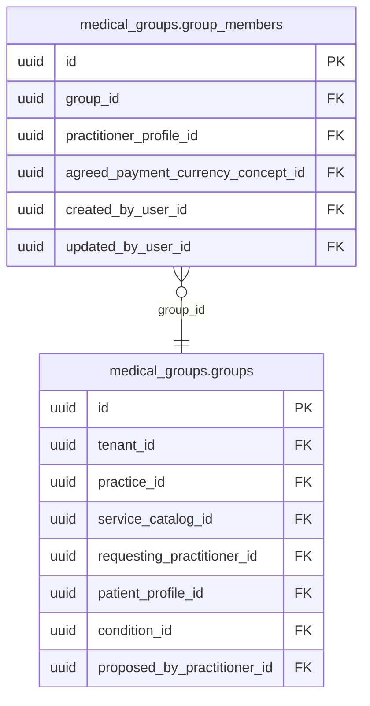

<!-- AUTOGENERADO por tools/inventario/catalogo.mjs. No editar manualmente. -->

# Catálogo del schema `medical_groups`

- **Tablas:** 2 · **Columnas:** 37 (9 con descripción: 24.3 %) · **Índices:** 10
- **Dominio:** sin dato
- Método y límites del catálogo: [README del inventario](../README.md)

## Tablas

| Tabla | Propósito | Columnas | Índices | Operaciones | ORM |
|---|---|---|---|---|---|
| [group_members](#group_members) | Relaciona perfiles de profesionales o integrantes con un grupo médico, permitiendo representar equipos asistenciales y su composición. | 15 | 4 | 17 | COINCIDE |
| [groups](#groups) | Representa grupos médicos para organizar equipos de profesionales y vincular a sus integrantes con una estructura de atención. | 22 | 6 | 23 | COINCIDE |

## Diagrama entidad-relación

Las tablas se agrupan en familias por sus claves foráneas dentro del schema (máximo 40 por diagrama). Las FK hacia otros schemas se listan en la ficha de cada tabla.

### Familia 1 de 1 — 2 tablas

## Fichas

### group_members

#### Vista general

Relaciona perfiles de profesionales o integrantes con un grupo médico, permitiendo representar equipos asistenciales y su composición.

- **Estado del propósito:** DOMAIN_CURATED_DRAFT · fuente: `Mantra Core Health Context/modules/diagram_66_medical_groups.puml:43: entity group_members {`
- **Dominio:** sin dato · **Diagrama:** `Mantra Core Health Context/modules/diagram_66_medical_groups.puml` · **DDL:** `SQL/66_medical_groups/02_tables.sql`
- **Entidad del ORM:** `MedicalGroupMembers` — `src/modules/medical_groups/entities/medical_group_members.entity.ts`
- **Resumen:** 15 columnas · 4 índices · 5 FK salientes · 0 entrantes · 17 operaciones

#### Columnas

| # | Columna | Tipo | Rol estructural | Descripción | ORM |
|---|---|---|---|---|---|
| 1 | `id` | `uuid` | Clave primaria; Obligatoria | _sin dato_ | coincide |
| 2 | `group_id` | `uuid` | Clave foránea → medical_groups.groups.id; Obligatoria | _sin dato_ | coincide |
| 3 | `practitioner_profile_id` | `uuid` | Clave foránea → profiles.health_practitioner_profiles.profile_id; Obligatoria | _sin dato_ | coincide |
| 4 | `role_title` | `varchar` | Obligatoria | Cargo/función dentro del grupo (texto libre — ver known_gaps del carril). _(JSDOC_ENTIDAD, `src/modules/medical_groups/entities/medical_group_members.entity.ts:31`)_ | coincide |
| 5 | `agreed_payment_amount` | `numeric` | Obligatoria | _sin dato_ | coincide |
| 6 | `agreed_payment_currency_concept_id` | `uuid` | Clave foránea → terminology.catalog_concepts.id; Opcional | _sin dato_ | coincide |
| 7 | `additional_terms_text` | `text` | Opcional | Adicionales de términos y condiciones opcionales para este cargo (AC-21-14). _(JSDOC_ENTIDAD, `src/modules/medical_groups/entities/medical_group_members.entity.ts:45`)_ | coincide |
| 8 | `is_creator` | `boolean` | Obligatoria | El creador del grupo también es un miembro (siempre `ACCEPTED`). _(JSDOC_ENTIDAD, `src/modules/medical_groups/entities/medical_group_members.entity.ts:53`)_ | coincide |
| 9 | `invitation_status` | `varchar` | Obligatoria | _sin dato_ | coincide |
| 10 | `responded_at` | `timestamptz` | Opcional | _sin dato_ | coincide |
| 11 | `created_at` | `timestamptz` | Obligatoria | _sin dato_ | coincide |
| 12 | `updated_at` | `timestamptz` | Obligatoria | _sin dato_ | coincide |
| 13 | `created_by_user_id` | `uuid` | Clave foránea → iam.users.id; Opcional | _sin dato_ | coincide |
| 14 | `updated_by_user_id` | `uuid` | Clave foránea → iam.users.id; Opcional | _sin dato_ | coincide |
| 15 | `row_version` | `integer = 1` | Obligatoria | _sin dato_ | coincide |

#### Relaciones

| Sentido | Columnas | Tabla | Restricción |
|---|---|---|---|
| hacia | group_id | medical_groups.groups (id) | fk_group_members_group_id |
| hacia | practitioner_profile_id | profiles.health_practitioner_profiles (profile_id) | fk_group_members_practitioner_profile_id |
| hacia | agreed_payment_currency_concept_id | terminology.catalog_concepts (id) | fk_group_members_agreed_payment_currency_concept_id |
| hacia | created_by_user_id | iam.users (id) | fk_group_members_created_by_user_id |
| hacia | updated_by_user_id | iam.users (id) | fk_group_members_updated_by_user_id |

#### Índices

| Índice | Único | Columnas | Para qué |
|---|---|---|---|
| `ix_medical_groups_group_members_group_id` | no | group_id | Soporta la clave foránea fk_group_members_group_id: PostgreSQL no indexa las FK por sí mismo _(DOCUMENTO)_; 5 consulta(s) de repositorio filtran u ordenan por «group_id», la primera columna del índice _(CONSULTA)_ |
| `ix_medical_groups_group_members_practitioner_profile_id` | no | practitioner_profile_id | Soporta la clave foránea fk_group_members_practitioner_profile_id: PostgreSQL no indexa las FK por sí mismo _(DOCUMENTO)_; 1 consulta(s) de repositorio filtran u ordenan por «practitioner_profile_id», la primera columna del índice _(CONSULTA)_ |
| `ix_medical_groups_group_members_invitation_status` | no | invitation_status | 3 consulta(s) de repositorio filtran u ordenan por «invitation_status», la primera columna del índice _(CONSULTA)_ |
| `ux_medical_groups_group_members_group_practitioner` | sí | group_id, practitioner_profile_id | Garantiza que no se repita la combinación (group_id, practitioner_profile_id) _(DOCUMENTO)_; Soporta la clave foránea fk_group_members_group_id: PostgreSQL no indexa las FK por sí mismo _(DOCUMENTO)_; 5 consulta(s) de repositorio filtran u ordenan por «group_id», la primera columna del índice _(CONSULTA)_ |

#### Restricciones

| Restricción | Tipo | Definición |
|---|---|---|
| `ux_medical_groups_group_members_group_practitioner` | UNIQUE INDEX | UNIQUE INDEX ("group_id", "practitioner_profile_id") |
| `ck_medical_groups_group_members_invitation_status` | CHECK | CHECK ("invitation_status" IN ('PENDING', 'ACCEPTED', 'REJECTED')) |

#### Operaciones que la tocan

| Operación | Efecto | Confianza |
|---|---|---|
| GET /medical-groups | LEE | DIRECTA |
| POST /medical-groups | CREA | DIRECTA |
| POST /medical-groups | LEE | DIRECTA |
| DELETE /medical-groups/{id} | BORRA | DIRECTA |
| DELETE /medical-groups/{id} | LEE | DIRECTA |
| GET /medical-groups/{id} | LEE | DIRECTA |
| PATCH /medical-groups/{id} | LEE | DIRECTA |
| PATCH /medical-groups/{id}/exercise-notes | LEE | DIRECTA |
| POST /medical-groups/{id}/members | CREA | DIRECTA |
| POST /medical-groups/{id}/members | LEE | DIRECTA |
| DELETE /medical-groups/{id}/members/{memberId} | BORRA | POR_TIPO |
| DELETE /medical-groups/{id}/members/{memberId} | LEE | DIRECTA |
| PATCH /medical-groups/{id}/members/{memberId} | LEE | DIRECTA |
| POST /medical-groups/{id}/members/{memberId}/respond | ACTUALIZA | POR_TIPO |
| POST /medical-groups/{id}/members/{memberId}/respond | LEE | DIRECTA |
| POST /medical-groups/{id}/reschedule-requests | LEE | DIRECTA |
| POST /medical-groups/{id}/reschedule-requests/respond | LEE | DIRECTA |

#### Gobierno

| Atributo | Valor | Fuente |
|---|---|---|
| Append-only | no declarado | — |
| Datos personales | sin fuente | — |
| Financiera | sin fuente | — |
| Crítica para auditoría | sin fuente | — |
| Retención | sin fuente | — |
| Responsable | sin fuente | — |
| Revisión | AUTO_DETECTADA | — |

---

### groups

#### Vista general

Representa grupos médicos para organizar equipos de profesionales y vincular a sus integrantes con una estructura de atención.

- **Estado del propósito:** DOMAIN_CURATED_DRAFT · fuente: `Mantra Core Health Context/modules/diagram_66_medical_groups.puml:7: entity groups {`
- **Dominio:** sin dato · **Diagrama:** `Mantra Core Health Context/modules/diagram_66_medical_groups.puml` · **DDL:** `SQL/66_medical_groups/02_tables.sql`
- **Entidad del ORM:** `MedicalGroups` — `src/modules/medical_groups/entities/medical_groups.entity.ts`
- **Resumen:** 22 columnas · 6 índices · 9 FK salientes · 1 entrantes · 23 operaciones

#### Columnas

| # | Columna | Tipo | Rol estructural | Descripción | ORM |
|---|---|---|---|---|---|
| 1 | `id` | `uuid` | Clave primaria; Obligatoria | _sin dato_ | coincide |
| 2 | `tenant_id` | `uuid` | Clave foránea → directory.tenants.id; Obligatoria | _sin dato_ | coincide |
| 3 | `practice_id` | `uuid` | Clave foránea → practice.practices.id; Obligatoria | _sin dato_ | coincide |
| 4 | `service_catalog_id` | `uuid` | Clave foránea → billing.service_catalog.id; Obligatoria | _sin dato_ | coincide |
| 5 | `requesting_practitioner_id` | `uuid` | Clave foránea → profiles.health_practitioner_profiles.profile_id; Obligatoria | Doctor que crea la solicitud y arma el grupo. _(JSDOC_ENTIDAD, `src/modules/medical_groups/entities/medical_groups.entity.ts:42`)_ | coincide |
| 6 | `patient_profile_id` | `uuid` | Clave foránea → profiles.patient_profiles.profile_id; Opcional | _sin dato_ | coincide |
| 7 | `condition_id` | `uuid` | Clave foránea → clinical.conditions.id; Opcional | Diagnóstico observado del paciente (`clinical.conditions`), opcional. _(JSDOC_ENTIDAD, `src/modules/medical_groups/entities/medical_groups.entity.ts:49`)_ | coincide |
| 8 | `scheduled_at` | `timestamptz` | Obligatoria | _sin dato_ | coincide |
| 9 | `location_text` | `varchar` | Obligatoria | _sin dato_ | coincide |
| 10 | `notes_text` | `text` | Opcional | Notas adicionales cargadas por el creador al armar el grupo. _(JSDOC_ENTIDAD, `src/modules/medical_groups/entities/medical_groups.entity.ts:59`)_ | coincide |
| 11 | `terms_text` | `text` | Obligatoria | Términos y condiciones vigentes del grupo: default del servicio + adicionales del solicitante (AC-21-10/11/12/13). Se congela como texto al crear — no es un puntero al servicio, que puede cambiar después. _(JSDOC_ENTIDAD, `src/modules/medical_groups/entities/medical_groups.entity.ts:67`)_ | coincide |
| 12 | `status` | `varchar` | Obligatoria | _sin dato_ | coincide |
| 13 | `exercise_notes_text` | `text` | Opcional | "NOTAS DEL EJERCICIO" — arriba a la izquierda en la consulta (AC-21-14). _(JSDOC_ENTIDAD, `src/modules/medical_groups/entities/medical_groups.entity.ts:74`)_ | coincide |
| 14 | `exercise_notes_updated_at` | `timestamptz` | Opcional | _sin dato_ | coincide |
| 15 | `proposed_reschedule_at` | `timestamptz` | Opcional | _sin dato_ | coincide |
| 16 | `proposed_by_practitioner_id` | `uuid` | Clave foránea → profiles.health_practitioner_profiles.profile_id; Opcional | _sin dato_ | coincide |
| 17 | `closed_at` | `timestamptz` | Opcional | Se fija la primera vez que se observa el expediente vencido (AC-21-19). _(JSDOC_ENTIDAD, `src/modules/medical_groups/entities/medical_groups.entity.ts:103`)_ | coincide |
| 18 | `created_at` | `timestamptz` | Obligatoria | _sin dato_ | coincide |
| 19 | `updated_at` | `timestamptz` | Obligatoria | _sin dato_ | coincide |
| 20 | `created_by_user_id` | `uuid` | Clave foránea → iam.users.id; Opcional | _sin dato_ | coincide |
| 21 | `updated_by_user_id` | `uuid` | Clave foránea → iam.users.id; Opcional | _sin dato_ | coincide |
| 22 | `row_version` | `integer = 1` | Obligatoria | _sin dato_ | coincide |

#### Relaciones

| Sentido | Columnas | Tabla | Restricción |
|---|---|---|---|
| hacia | tenant_id | directory.tenants (id) | fk_groups_tenant_id |
| hacia | practice_id | practice.practices (id) | fk_groups_practice_id |
| hacia | service_catalog_id | billing.service_catalog (id) | fk_groups_service_catalog_id |
| hacia | requesting_practitioner_id | profiles.health_practitioner_profiles (profile_id) | fk_groups_requesting_practitioner_id |
| hacia | patient_profile_id | profiles.patient_profiles (profile_id) | fk_groups_patient_profile_id |
| hacia | condition_id | clinical.conditions (id) | fk_groups_condition_id |
| hacia | proposed_by_practitioner_id | profiles.health_practitioner_profiles (profile_id) | fk_groups_proposed_by_practitioner_id |
| hacia | created_by_user_id | iam.users (id) | fk_groups_created_by_user_id |
| hacia | updated_by_user_id | iam.users (id) | fk_groups_updated_by_user_id |
| desde | id | medical_groups.group_members (group_id) | fk_group_members_group_id |

#### Índices

| Índice | Único | Columnas | Para qué |
|---|---|---|---|
| `ix_medical_groups_groups_tenant_id` | no | tenant_id | Soporta la clave foránea fk_groups_tenant_id: PostgreSQL no indexa las FK por sí mismo _(DOCUMENTO)_ |
| `ix_medical_groups_groups_requesting_practitioner_id` | no | requesting_practitioner_id | Soporta la clave foránea fk_groups_requesting_practitioner_id: PostgreSQL no indexa las FK por sí mismo _(DOCUMENTO)_; 1 consulta(s) de repositorio filtran u ordenan por «requesting_practitioner_id», la primera columna del índice _(CONSULTA)_ |
| `ix_medical_groups_groups_patient_profile_id` | no | patient_profile_id | Soporta la clave foránea fk_groups_patient_profile_id: PostgreSQL no indexa las FK por sí mismo _(DOCUMENTO)_ |
| `ix_medical_groups_groups_service_catalog_id` | no | service_catalog_id | Soporta la clave foránea fk_groups_service_catalog_id: PostgreSQL no indexa las FK por sí mismo _(DOCUMENTO)_ |
| `ix_medical_groups_groups_status` | no | status | _sin uso detectado estáticamente_ |
| `ix_medical_groups_groups_scheduled_at` | no | scheduled_at | _sin uso detectado estáticamente_ |

#### Restricciones

| Restricción | Tipo | Definición |
|---|---|---|
| `ck_medical_groups_groups_status` | CHECK | CHECK ("status" IN ('PENDING_TEAM', 'SCHEDULED', 'RESCHEDULE_PENDING', 'CLOSED')) |

#### Operaciones que la tocan

| Operación | Efecto | Confianza |
|---|---|---|
| GET /medical-groups | LEE | DIRECTA |
| POST /medical-groups | CREA | DIRECTA |
| DELETE /medical-groups/{id} | BORRA | POR_TIPO |
| DELETE /medical-groups/{id} | ACTUALIZA | POR_TIPO |
| DELETE /medical-groups/{id} | LEE | DIRECTA |
| GET /medical-groups/{id} | ACTUALIZA | POR_TIPO |
| GET /medical-groups/{id} | LEE | DIRECTA |
| PATCH /medical-groups/{id} | ACTUALIZA | POR_TIPO |
| PATCH /medical-groups/{id} | LEE | DIRECTA |
| PATCH /medical-groups/{id}/exercise-notes | ACTUALIZA | POR_TIPO |
| PATCH /medical-groups/{id}/exercise-notes | LEE | DIRECTA |
| POST /medical-groups/{id}/members | ACTUALIZA | POR_TIPO |
| POST /medical-groups/{id}/members | LEE | DIRECTA |
| DELETE /medical-groups/{id}/members/{memberId} | ACTUALIZA | POR_TIPO |
| DELETE /medical-groups/{id}/members/{memberId} | LEE | DIRECTA |
| PATCH /medical-groups/{id}/members/{memberId} | ACTUALIZA | POR_TIPO |
| PATCH /medical-groups/{id}/members/{memberId} | LEE | DIRECTA |
| POST /medical-groups/{id}/members/{memberId}/respond | ACTUALIZA | POR_TIPO |
| POST /medical-groups/{id}/members/{memberId}/respond | LEE | DIRECTA |
| POST /medical-groups/{id}/reschedule-requests | ACTUALIZA | POR_TIPO |
| POST /medical-groups/{id}/reschedule-requests | LEE | DIRECTA |
| POST /medical-groups/{id}/reschedule-requests/respond | ACTUALIZA | POR_TIPO |
| POST /medical-groups/{id}/reschedule-requests/respond | LEE | DIRECTA |

#### Gobierno

| Atributo | Valor | Fuente |
|---|---|---|
| Append-only | no declarado | — |
| Datos personales | sin fuente | — |
| Financiera | sin fuente | — |
| Crítica para auditoría | sin fuente | — |
| Retención | sin fuente | — |
| Responsable | sin fuente | — |
| Revisión | AUTO_DETECTADA | — |

---

