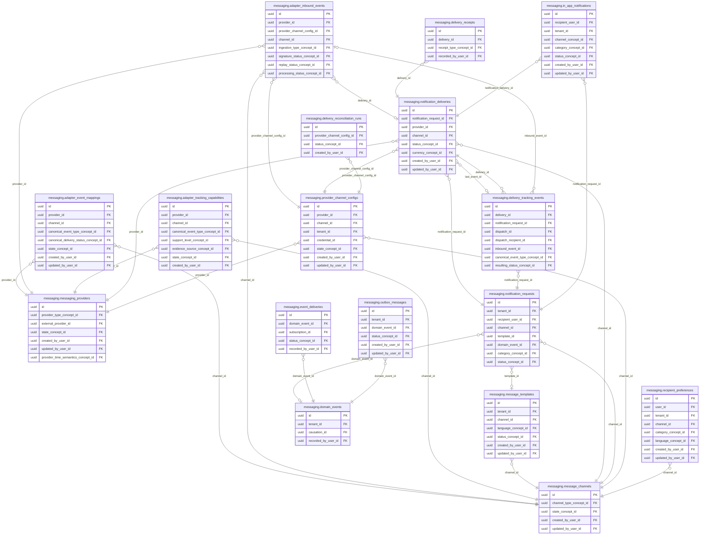
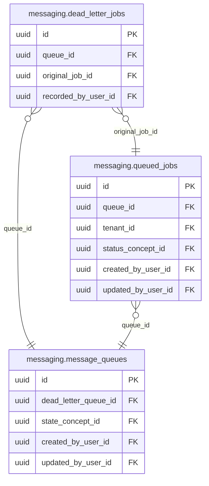

<!-- AUTOGENERADO por tools/inventario/catalogo.mjs. No editar manualmente. -->

# Catálogo del schema `messaging`

- **Tablas:** 22 · **Columnas:** 400 (65 con descripción: 16.3 %) · **Índices:** 150
- **Dominio:** Integraciones y Contratos
- Método y límites del catálogo: [README del inventario](../README.md)

## Tablas

| Tabla | Propósito | Columnas | Índices | Operaciones | ORM |
|---|---|---|---|---|---|
| [adapter_event_mappings](#adapter_event_mappings) | Mapea eventos del dominio a eventos específicos de adaptadores o proveedores de comunicación. | 19 | 8 | 0 | COINCIDE |
| [adapter_inbound_events](#adapter_inbound_events) | Conserva eventos entrantes normalizados desde proveedores o adaptadores para integrar respuestas y actualizaciones. | 23 | 9 | 0 | COINCIDE |
| [adapter_tracking_capabilities](#adapter_tracking_capabilities) | Describe qué estados de entrega puede reportar cada adaptador para interpretar correctamente señales del proveedor. | 13 | 8 | 0 | COINCIDE |
| [dead_letter_jobs](#dead_letter_jobs) | Preserva trabajos que agotaron su procesamiento normal para permitir inspección, corrección y eventual recuperación. | 9 | 4 | 2 | COINCIDE |
| [delivery_receipts](#delivery_receipts) | Conserva recibos emitidos por proveedores para documentar aceptación, entrega o lectura de mensajes. | 8 | 4 | 2 | COINCIDE |
| [delivery_reconciliation_runs](#delivery_reconciliation_runs) | Registra conciliaciones entre entregas internas y estados reportados por proveedores para detectar discrepancias. | 13 | 3 | 0 | COINCIDE |
| [delivery_status_transitions](#delivery_status_transitions) | Preserva transiciones de estado de entregas para reconstruir su evolución hasta el resultado final. | 9 | 5 | 0 | COINCIDE |
| [delivery_tracking_events](#delivery_tracking_events) | Mantiene eventos de seguimiento de mensajes recibidos desde canales y proveedores de comunicación. | 24 | 11 | 0 | COINCIDE |
| [domain_events](#domain_events) | Conserva eventos de dominio que comunican cambios relevantes entre módulos del sistema médico. | 13 | 5 | 103 | COINCIDE |
| [event_deliveries](#event_deliveries) | Registra entregas de eventos a suscriptores para conocer estado, reintentos y resultado de publicación. | 9 | 6 | 4 | COINCIDE |
| [event_subscriptions](#event_subscriptions) | Define suscripciones de consumidores a eventos de dominio para dirigir actualizaciones a módulos interesados. | 15 | 6 | 1 | COINCIDE |
| [in_app_notifications](#in_app_notifications) | Registra notificaciones visibles dentro de la aplicación para comunicar eventos a pacientes y profesionales. | 31 | 8 | 69 | COINCIDE |
| [message_channels](#message_channels) | Cataloga canales de comunicación disponibles para enviar mensajes transaccionales y asistenciales. | 11 | 5 | 61 | COINCIDE |
| [message_queues](#message_queues) | Cataloga colas usadas para desacoplar procesos y administrar entregas asíncronas. | 13 | 5 | 16 | COINCIDE |
| [message_templates](#message_templates) | Define plantillas reutilizables para comunicaciones con pacientes, profesionales y organizaciones. | 16 | 8 | 37 | COINCIDE |
| [messaging_providers](#messaging_providers) | Identifica proveedores que transportan mensajes por los canales habilitados. | 22 | 6 | 44 | COINCIDE |
| [notification_deliveries](#notification_deliveries) | Mantiene intentos y resultados de entrega de notificaciones para verificar comunicaciones enviadas. | 36 | 8 | 68 | COINCIDE |
| [notification_requests](#notification_requests) | Registra solicitudes de notificación y su contexto antes de seleccionar canal y proveedor de entrega. | 35 | 11 | 123 | COINCIDE |
| [outbox_messages](#outbox_messages) | Mantiene mensajes salientes en la misma frontera transaccional que cambios de negocio para publicarlos sin perder eventos. | 20 | 7 | 207 | COINCIDE |
| [provider_channel_configs](#provider_channel_configs) | Configura la relación entre un proveedor de mensajería y un canal para dirigir entregas. | 26 | 8 | 43 | COINCIDE |
| [queued_jobs](#queued_jobs) | Representa trabajos encolados para ejecutar operaciones diferidas del sistema médico. | 22 | 7 | 64 | COINCIDE |
| [recipient_preferences](#recipient_preferences) | Registra preferencias de destinatarios para respetar canales, horarios y elecciones de comunicación. | 13 | 8 | 60 | COINCIDE |

## Diagrama entidad-relación

Las tablas se agrupan en familias por sus claves foráneas dentro del schema (máximo 40 por diagrama). Las FK hacia otros schemas se listan en la ficha de cada tabla.

### Familia 1 de 2 — 17 tablas

### Familia 2 de 2 — 3 tablas

### Tablas sin relaciones dentro del schema

`messaging.delivery_status_transitions` · `messaging.event_subscriptions`

## Fichas

### adapter_event_mappings

#### Vista general

Mapea eventos del dominio a eventos específicos de adaptadores o proveedores de comunicación.

- **Estado del propósito:** DOMAIN_CURATED_DRAFT · fuente: `Mantra Core Health Context/modules/diagram_35_messaging.puml: adapter_event_mappings`
- **Dominio:** Integraciones y Contratos · **Diagrama:** `Mantra Core Health Context/modules/diagram_35_messaging.puml` · **DDL:** `SQL/35_messaging/02_tables.sql`
- **Entidad del ORM:** `AdapterEventMappings` — `src/modules/messaging/entities/adapter_event_mappings.entity.ts`
- **Resumen:** 19 columnas · 8 índices · 7 FK salientes · 0 entrantes · 0 operaciones

#### Columnas

| # | Columna | Tipo | Rol estructural | Descripción | ORM |
|---|---|---|---|---|---|
| 1 | `id` | `uuid` | Clave primaria; Obligatoria | Identificador único de la instancia. _(JSDOC_ESTANDAR, `src/modules/messaging/entities/adapter_event_mappings.entity.ts:12`)_ | coincide |
| 2 | `provider_id` | `uuid` | Clave foránea → messaging.messaging_providers.id; Obligatoria | _sin dato_ | coincide |
| 3 | `channel_id` | `uuid` | Clave foránea → messaging.message_channels.id; Obligatoria | _sin dato_ | coincide |
| 4 | `mapping_version` | `integer` | Obligatoria | _sin dato_ | coincide |
| 5 | `external_event_code` | `varchar` | Obligatoria | _sin dato_ | coincide |
| 6 | `canonical_event_type_concept_id` | `uuid` | Clave foránea → terminology.catalog_concepts.id; Obligatoria | _sin dato_ | coincide |
| 7 | `canonical_delivery_status_concept_id` | `uuid` | Clave foránea → terminology.catalog_concepts.id; Obligatoria | _sin dato_ | coincide |
| 8 | `terminal` | `boolean` | Obligatoria | _sin dato_ | coincide |
| 9 | `success` | `boolean` | Opcional | _sin dato_ | coincide |
| 10 | `precedence` | `integer` | Obligatoria | _sin dato_ | coincide |
| 11 | `condition_json` | `jsonb` | Opcional | _sin dato_ | coincide |
| 12 | `effective_from` | `timestamptz` | Obligatoria | _sin dato_ | coincide |
| 13 | `effective_to` | `timestamptz` | Opcional | _sin dato_ | coincide |
| 14 | `state_concept_id` | `uuid` | Clave foránea → terminology.catalog_concepts.id; Obligatoria | _sin dato_ | coincide |
| 15 | `created_at` | `timestamptz` | Obligatoria | Fecha y hora en que se creó el registro. _(JSDOC_ESTANDAR, `src/modules/messaging/entities/adapter_event_mappings.entity.ts:105`)_ | coincide |
| 16 | `updated_at` | `timestamptz` | Obligatoria | Fecha y hora de la última actualización. _(JSDOC_ESTANDAR, `src/modules/messaging/entities/adapter_event_mappings.entity.ts:111`)_ | coincide |
| 17 | `created_by_user_id` | `uuid` | Clave foránea → iam.users.id; Obligatoria | _sin dato_ | coincide |
| 18 | `updated_by_user_id` | `uuid` | Clave foránea → iam.users.id; Obligatoria | _sin dato_ | coincide |
| 19 | `row_version` | `integer = 1` | Obligatoria | Versión usada para controlar actualizaciones concurrentes. _(JSDOC_ENTIDAD, `src/modules/messaging/entities/adapter_event_mappings.entity.ts:129`)_ | coincide |

#### Relaciones

| Sentido | Columnas | Tabla | Restricción |
|---|---|---|---|
| hacia | provider_id | messaging.messaging_providers (id) | fk_adapter_event_mappings_provider_id |
| hacia | channel_id | messaging.message_channels (id) | fk_adapter_event_mappings_channel_id |
| hacia | canonical_event_type_concept_id | terminology.catalog_concepts (id) | fk_adapter_event_mappings_canonical_event_type_concept_id |
| hacia | canonical_delivery_status_concept_id | terminology.catalog_concepts (id) | fk_adapter_event_mappings_canonical_delivery_status_concept_id |
| hacia | state_concept_id | terminology.catalog_concepts (id) | fk_adapter_event_mappings_state_concept_id |
| hacia | created_by_user_id | iam.users (id) | fk_adapter_event_mappings_created_by_user_id |
| hacia | updated_by_user_id | iam.users (id) | fk_adapter_event_mappings_updated_by_user_id |

#### Índices

| Índice | Único | Columnas | Para qué |
|---|---|---|---|
| `uq_adapter_event_mappings_provider_id` | sí | provider_id, channel_id, mapping_version, external_event_code | Garantiza que no se repita la combinación (provider_id, channel_id, mapping_version, external_event_code) _(DOCUMENTO)_; Soporta la clave foránea fk_adapter_event_mappings_provider_id: PostgreSQL no indexa las FK por sí mismo _(DOCUMENTO)_ |
| `ix_adapter_event_mappings_provider_id` | no | provider_id | Soporta la clave foránea fk_adapter_event_mappings_provider_id: PostgreSQL no indexa las FK por sí mismo _(DOCUMENTO)_ |
| `ix_adapter_event_mappings_channel_id` | no | channel_id | Soporta la clave foránea fk_adapter_event_mappings_channel_id: PostgreSQL no indexa las FK por sí mismo _(DOCUMENTO)_ |
| `ix_adapter_event_mappings_canonical_event_type_concept_id` | no | canonical_event_type_concept_id | Soporta la clave foránea fk_adapter_event_mappings_canonical_event_type_concept_id: PostgreSQL no indexa las FK por sí mismo _(DOCUMENTO)_ |
| `ix_adapter_event_mappings_canonical_delivery_status_concept_id` | no | canonical_delivery_status_concept_id | Soporta la clave foránea fk_adapter_event_mappings_canonical_delivery_status_concept_id: PostgreSQL no indexa las FK por sí mismo _(DOCUMENTO)_ |
| `ix_adapter_event_mappings_state_concept_id` | no | state_concept_id | Soporta la clave foránea fk_adapter_event_mappings_state_concept_id: PostgreSQL no indexa las FK por sí mismo _(DOCUMENTO)_ |
| `ix_adapter_event_mappings_created_by_user_id` | no | created_by_user_id | Soporta la clave foránea fk_adapter_event_mappings_created_by_user_id: PostgreSQL no indexa las FK por sí mismo _(DOCUMENTO)_ |
| `ix_adapter_event_mappings_updated_by_user_id` | no | updated_by_user_id | Soporta la clave foránea fk_adapter_event_mappings_updated_by_user_id: PostgreSQL no indexa las FK por sí mismo _(DOCUMENTO)_ |

#### Restricciones

| Restricción | Tipo | Definición |
|---|---|---|
| `uq_adapter_event_mappings_provider_id` | UNIQUE INDEX | UNIQUE INDEX ("provider_id", "channel_id", "mapping_version", "external_event_code") |

#### Operaciones que la tocan

_Ninguna operación HTTP la toca según el análisis estático (puede usarla un worker, un trigger o una migración)._

#### Gobierno

| Atributo | Valor | Fuente |
|---|---|---|
| Append-only | no declarado | — |
| Datos personales | sin fuente | — |
| Financiera | sin fuente | — |
| Crítica para auditoría | sin fuente | — |
| Retención | sin fuente | — |
| Responsable | sin fuente | — |
| Revisión | AUTO_DETECTADA | — |

---

### adapter_inbound_events

#### Vista general

Conserva eventos entrantes normalizados desde proveedores o adaptadores para integrar respuestas y actualizaciones.

- **Estado del propósito:** DOMAIN_CURATED_DRAFT · fuente: `Mantra Core Health Context/modules/diagram_35_messaging.puml: adapter_inbound_events`
- **Dominio:** Integraciones y Contratos · **Diagrama:** `Mantra Core Health Context/modules/diagram_35_messaging.puml` · **DDL:** `SQL/35_messaging/02_tables.sql`
- **Entidad del ORM:** `AdapterInboundEvents` — `src/modules/messaging/entities/adapter_inbound_events.entity.ts`
- **Resumen:** 23 columnas · 9 índices · 8 FK salientes · 1 entrantes · 0 operaciones

#### Columnas

| # | Columna | Tipo | Rol estructural | Descripción | ORM |
|---|---|---|---|---|---|
| 1 | `id` | `uuid` | Clave primaria; Obligatoria | Identificador único de la instancia. _(JSDOC_ESTANDAR, `src/modules/messaging/entities/adapter_inbound_events.entity.ts:12`)_ | coincide |
| 2 | `provider_id` | `uuid` | Clave foránea → messaging.messaging_providers.id; Obligatoria | _sin dato_ | coincide |
| 3 | `provider_channel_config_id` | `uuid` | Clave foránea → messaging.provider_channel_configs.id; Obligatoria | _sin dato_ | coincide |
| 4 | `channel_id` | `uuid` | Clave foránea → messaging.message_channels.id; Obligatoria | _sin dato_ | coincide |
| 5 | `ingestion_type_concept_id` | `uuid` | Clave foránea → terminology.catalog_concepts.id; Obligatoria | _sin dato_ | coincide |
| 6 | `external_event_id` | `varchar` | Opcional | _sin dato_ | coincide |
| 7 | `external_event_code` | `varchar` | Obligatoria | _sin dato_ | coincide |
| 8 | `provider_message_ref` | `varchar` | Opcional | _sin dato_ | coincide |
| 9 | `payload_json_encrypted` | `jsonb` | Opcional | _sin dato_ | coincide |
| 10 | `payload_storage_ref` | `varchar` | Opcional | _sin dato_ | coincide |
| 11 | `payload_sha256` | `varchar` | Obligatoria | _sin dato_ | coincide |
| 12 | `headers_redacted_json` | `jsonb` | Opcional | _sin dato_ | coincide |
| 13 | `signature_status_concept_id` | `uuid` | Clave foránea → terminology.catalog_concepts.id; Obligatoria | _sin dato_ | coincide |
| 14 | `replay_status_concept_id` | `uuid` | Clave foránea → terminology.catalog_concepts.id; Obligatoria | _sin dato_ | coincide |
| 15 | `received_at` | `timestamptz` | Obligatoria | _sin dato_ | coincide |
| 16 | `provider_occurred_at` | `timestamptz` | Opcional | _sin dato_ | coincide |
| 17 | `processing_status_concept_id` | `uuid` | Clave foránea → terminology.catalog_concepts.id; Obligatoria | _sin dato_ | coincide |
| 18 | `processing_attempts` | `integer` | Obligatoria | _sin dato_ | coincide |
| 19 | `mapping_version` | `integer` | Opcional | _sin dato_ | coincide |
| 20 | `delivery_id` | `uuid` | Clave foránea → messaging.notification_deliveries.id; Opcional | _sin dato_ | coincide |
| 21 | `normalization_error_code` | `varchar` | Opcional | _sin dato_ | coincide |
| 22 | `normalization_error_detail` | `text` | Opcional | _sin dato_ | coincide |
| 23 | `recorded_at` | `timestamptz` | Obligatoria | _sin dato_ | coincide |

#### Relaciones

| Sentido | Columnas | Tabla | Restricción |
|---|---|---|---|
| hacia | provider_id | messaging.messaging_providers (id) | fk_adapter_inbound_events_provider_id |
| hacia | provider_channel_config_id | messaging.provider_channel_configs (id) | fk_adapter_inbound_events_provider_channel_config_id |
| hacia | channel_id | messaging.message_channels (id) | fk_adapter_inbound_events_channel_id |
| hacia | delivery_id | messaging.notification_deliveries (id) | fk_adapter_inbound_events_delivery_id |
| hacia | ingestion_type_concept_id | terminology.catalog_concepts (id) | fk_adapter_inbound_events_ingestion_type_concept_id |
| hacia | signature_status_concept_id | terminology.catalog_concepts (id) | fk_adapter_inbound_events_signature_status_concept_id |
| hacia | replay_status_concept_id | terminology.catalog_concepts (id) | fk_adapter_inbound_events_replay_status_concept_id |
| hacia | processing_status_concept_id | terminology.catalog_concepts (id) | fk_adapter_inbound_events_processing_status_concept_id |
| desde | id | messaging.delivery_tracking_events (inbound_event_id) | fk_delivery_tracking_events_inbound_event_id |

#### Índices

| Índice | Único | Columnas | Para qué |
|---|---|---|---|
| `uq_adapter_inbound_events_provider_id` | sí | provider_id, external_event_id | Garantiza que no se repita la combinación (provider_id, external_event_id) _(DOCUMENTO)_; Soporta la clave foránea fk_adapter_inbound_events_provider_id: PostgreSQL no indexa las FK por sí mismo _(DOCUMENTO)_ |
| `ix_adapter_inbound_events_provider_id` | no | provider_id | Soporta la clave foránea fk_adapter_inbound_events_provider_id: PostgreSQL no indexa las FK por sí mismo _(DOCUMENTO)_ |
| `ix_adapter_inbound_events_provider_channel_config_id` | no | provider_channel_config_id | Soporta la clave foránea fk_adapter_inbound_events_provider_channel_config_id: PostgreSQL no indexa las FK por sí mismo _(DOCUMENTO)_ |
| `ix_adapter_inbound_events_channel_id` | no | channel_id | Soporta la clave foránea fk_adapter_inbound_events_channel_id: PostgreSQL no indexa las FK por sí mismo _(DOCUMENTO)_ |
| `ix_adapter_inbound_events_ingestion_type_concept_id` | no | ingestion_type_concept_id | Soporta la clave foránea fk_adapter_inbound_events_ingestion_type_concept_id: PostgreSQL no indexa las FK por sí mismo _(DOCUMENTO)_ |
| `ix_adapter_inbound_events_signature_status_concept_id` | no | signature_status_concept_id | Soporta la clave foránea fk_adapter_inbound_events_signature_status_concept_id: PostgreSQL no indexa las FK por sí mismo _(DOCUMENTO)_ |
| `ix_adapter_inbound_events_replay_status_concept_id` | no | replay_status_concept_id | Soporta la clave foránea fk_adapter_inbound_events_replay_status_concept_id: PostgreSQL no indexa las FK por sí mismo _(DOCUMENTO)_ |
| `ix_adapter_inbound_events_processing_status_concept_id` | no | processing_status_concept_id | Soporta la clave foránea fk_adapter_inbound_events_processing_status_concept_id: PostgreSQL no indexa las FK por sí mismo _(DOCUMENTO)_ |
| `ix_adapter_inbound_events_delivery_id` | no | delivery_id | Soporta la clave foránea fk_adapter_inbound_events_delivery_id: PostgreSQL no indexa las FK por sí mismo _(DOCUMENTO)_ |

#### Restricciones

| Restricción | Tipo | Definición |
|---|---|---|
| `uq_adapter_inbound_events_provider_id` | UNIQUE INDEX | UNIQUE INDEX ("provider_id", "external_event_id") |

#### Operaciones que la tocan

_Ninguna operación HTTP la toca según el análisis estático (puede usarla un worker, un trigger o una migración)._

#### Gobierno

| Atributo | Valor | Fuente |
|---|---|---|
| Append-only | no declarado | — |
| Datos personales | sin fuente | — |
| Financiera | sin fuente | — |
| Crítica para auditoría | sin fuente | — |
| Retención | sin fuente | — |
| Responsable | sin fuente | — |
| Revisión | AUTO_DETECTADA | — |

---

### adapter_tracking_capabilities

#### Vista general

Describe qué estados de entrega puede reportar cada adaptador para interpretar correctamente señales del proveedor.

- **Estado del propósito:** DOMAIN_CURATED_DRAFT · fuente: `Mantra Core Health Context/modules/diagram_35_messaging.puml: adapter_tracking_capabilities`
- **Dominio:** Integraciones y Contratos · **Diagrama:** `Mantra Core Health Context/modules/diagram_35_messaging.puml` · **DDL:** `SQL/35_messaging/02_tables.sql`
- **Entidad del ORM:** `AdapterTrackingCapabilities` — `src/modules/messaging/entities/adapter_tracking_capabilities.entity.ts`
- **Resumen:** 13 columnas · 8 índices · 8 FK salientes · 0 entrantes · 0 operaciones

#### Columnas

| # | Columna | Tipo | Rol estructural | Descripción | ORM |
|---|---|---|---|---|---|
| 1 | `id` | `uuid` | Clave primaria; Obligatoria | Identificador único de la instancia. _(JSDOC_ESTANDAR, `src/modules/messaging/entities/adapter_tracking_capabilities.entity.ts:12`)_ | coincide |
| 2 | `provider_id` | `uuid` | Clave foránea → messaging.messaging_providers.id; Obligatoria | _sin dato_ | coincide |
| 3 | `channel_id` | `uuid` | Clave foránea → messaging.message_channels.id; Obligatoria | _sin dato_ | coincide |
| 4 | `canonical_event_type_concept_id` | `uuid` | Clave foránea → terminology.catalog_concepts.id; Obligatoria | _sin dato_ | coincide |
| 5 | `support_level_concept_id` | `uuid` | Clave foránea → terminology.catalog_concepts.id; Obligatoria | _sin dato_ | coincide |
| 6 | `evidence_source_concept_id` | `uuid` | Clave foránea → terminology.catalog_concepts.id; Obligatoria | _sin dato_ | coincide |
| 7 | `notes` | `text` | Opcional | _sin dato_ | coincide |
| 8 | `state_concept_id` | `uuid` | Clave foránea → terminology.catalog_concepts.id; Obligatoria | _sin dato_ | coincide |
| 9 | `created_at` | `timestamptz` | Obligatoria | Fecha y hora en que se creó el registro. _(JSDOC_ESTANDAR, `src/modules/messaging/entities/adapter_tracking_capabilities.entity.ts:60`)_ | coincide |
| 10 | `updated_at` | `timestamptz` | Obligatoria | Fecha y hora de la última actualización. _(JSDOC_ESTANDAR, `src/modules/messaging/entities/adapter_tracking_capabilities.entity.ts:66`)_ | coincide |
| 11 | `created_by_user_id` | `uuid` | Clave foránea → iam.users.id; Obligatoria | _sin dato_ | coincide |
| 12 | `updated_by_user_id` | `uuid` | Clave foránea → iam.users.id; Obligatoria | _sin dato_ | coincide |
| 13 | `row_version` | `integer = 1` | Obligatoria | Versión usada para controlar actualizaciones concurrentes. _(JSDOC_ENTIDAD, `src/modules/messaging/entities/adapter_tracking_capabilities.entity.ts:84`)_ | coincide |

#### Relaciones

| Sentido | Columnas | Tabla | Restricción |
|---|---|---|---|
| hacia | provider_id | messaging.messaging_providers (id) | fk_adapter_tracking_capabilities_provider_id |
| hacia | channel_id | messaging.message_channels (id) | fk_adapter_tracking_capabilities_channel_id |
| hacia | canonical_event_type_concept_id | terminology.catalog_concepts (id) | fk_adapter_tracking_capabilities_canonical_event_type__d17e0ee5 |
| hacia | support_level_concept_id | terminology.catalog_concepts (id) | fk_adapter_tracking_capabilities_support_level_concept_id |
| hacia | evidence_source_concept_id | terminology.catalog_concepts (id) | fk_adapter_tracking_capabilities_evidence_source_concept_id |
| hacia | state_concept_id | terminology.catalog_concepts (id) | fk_adapter_tracking_capabilities_state_concept_id |
| hacia | created_by_user_id | iam.users (id) | fk_adapter_tracking_capabilities_created_by_user_id |
| hacia | updated_by_user_id | iam.users (id) | fk_adapter_tracking_capabilities_updated_by_user_id |

#### Índices

| Índice | Único | Columnas | Para qué |
|---|---|---|---|
| `ix_adapter_tracking_capabilities_provider_id` | no | provider_id | Soporta la clave foránea fk_adapter_tracking_capabilities_provider_id: PostgreSQL no indexa las FK por sí mismo _(DOCUMENTO)_ |
| `ix_adapter_tracking_capabilities_channel_id` | no | channel_id | Soporta la clave foránea fk_adapter_tracking_capabilities_channel_id: PostgreSQL no indexa las FK por sí mismo _(DOCUMENTO)_ |
| `ix_adapter_tracking_capabilities_canonical_event_type__3130fd8b` | no | canonical_event_type_concept_id | Soporta la clave foránea fk_adapter_tracking_capabilities_canonical_event_type__d17e0ee5: PostgreSQL no indexa las FK por sí mismo _(DOCUMENTO)_ |
| `ix_adapter_tracking_capabilities_support_level_concept_id` | no | support_level_concept_id | Soporta la clave foránea fk_adapter_tracking_capabilities_support_level_concept_id: PostgreSQL no indexa las FK por sí mismo _(DOCUMENTO)_ |
| `ix_adapter_tracking_capabilities_evidence_source_concept_id` | no | evidence_source_concept_id | Soporta la clave foránea fk_adapter_tracking_capabilities_evidence_source_concept_id: PostgreSQL no indexa las FK por sí mismo _(DOCUMENTO)_ |
| `ix_adapter_tracking_capabilities_state_concept_id` | no | state_concept_id | Soporta la clave foránea fk_adapter_tracking_capabilities_state_concept_id: PostgreSQL no indexa las FK por sí mismo _(DOCUMENTO)_ |
| `ix_adapter_tracking_capabilities_created_by_user_id` | no | created_by_user_id | Soporta la clave foránea fk_adapter_tracking_capabilities_created_by_user_id: PostgreSQL no indexa las FK por sí mismo _(DOCUMENTO)_ |
| `ix_adapter_tracking_capabilities_updated_by_user_id` | no | updated_by_user_id | Soporta la clave foránea fk_adapter_tracking_capabilities_updated_by_user_id: PostgreSQL no indexa las FK por sí mismo _(DOCUMENTO)_ |

#### Operaciones que la tocan

_Ninguna operación HTTP la toca según el análisis estático (puede usarla un worker, un trigger o una migración)._

#### Gobierno

| Atributo | Valor | Fuente |
|---|---|---|
| Append-only | no declarado | — |
| Datos personales | sin fuente | — |
| Financiera | sin fuente | — |
| Crítica para auditoría | sin fuente | — |
| Retención | sin fuente | — |
| Responsable | sin fuente | — |
| Revisión | AUTO_DETECTADA | — |

---

### dead_letter_jobs

#### Vista general

Preserva trabajos que agotaron su procesamiento normal para permitir inspección, corrección y eventual recuperación.

- **Estado del propósito:** DOMAIN_CURATED_DRAFT · fuente: `Mantra Core Health Context/modules/diagram_35_messaging.puml: dead_letter_jobs`
- **Dominio:** Integraciones y Contratos · **Diagrama:** `Mantra Core Health Context/modules/diagram_35_messaging.puml` · **DDL:** `SQL/35_messaging/02_tables.sql`
- **Entidad del ORM:** `DeadLetterJobs` — `src/modules/messaging/entities/dead_letter_jobs.entity.ts`
- **Resumen:** 9 columnas · 4 índices · 3 FK salientes · 0 entrantes · 2 operaciones

#### Columnas

| # | Columna | Tipo | Rol estructural | Descripción | ORM |
|---|---|---|---|---|---|
| 1 | `id` | `uuid` | Clave primaria; Obligatoria | Identificador único de la instancia. _(JSDOC_ESTANDAR, `src/modules/messaging/entities/dead_letter_jobs.entity.ts:12`)_ | coincide |
| 2 | `queue_id` | `uuid` | Clave foránea → messaging.message_queues.id; Obligatoria | _sin dato_ | coincide |
| 3 | `original_job_id` | `uuid` | Clave foránea → messaging.queued_jobs.id; Obligatoria | _sin dato_ | coincide |
| 4 | `failure_reason_text` | `text` | Obligatoria | _sin dato_ | coincide |
| 5 | `payload_json` | `jsonb` | Obligatoria | _sin dato_ | coincide |
| 6 | `attempts` | `integer` | Obligatoria | _sin dato_ | coincide |
| 7 | `failed_at` | `timestamptz` | Opcional | _sin dato_ | coincide |
| 8 | `recorded_at` | `timestamptz` | Obligatoria | _sin dato_ | coincide |
| 9 | `recorded_by_user_id` | `uuid` | Clave foránea → iam.users.id; Opcional | _sin dato_ | coincide |

#### Relaciones

| Sentido | Columnas | Tabla | Restricción |
|---|---|---|---|
| hacia | queue_id | messaging.message_queues (id) | fk_dead_letter_jobs_queue_id |
| hacia | original_job_id | messaging.queued_jobs (id) | fk_dead_letter_jobs_original_job_id |
| hacia | recorded_by_user_id | iam.users (id) | fk_dead_letter_jobs_recorded_by_user_id |

#### Índices

| Índice | Único | Columnas | Para qué |
|---|---|---|---|
| `ix_dead_letter_jobs_queue_id` | no | queue_id | Soporta la clave foránea fk_dead_letter_jobs_queue_id: PostgreSQL no indexa las FK por sí mismo _(DOCUMENTO)_ |
| `ix_dead_letter_jobs_original_job_id` | no | original_job_id | Soporta la clave foránea fk_dead_letter_jobs_original_job_id: PostgreSQL no indexa las FK por sí mismo _(DOCUMENTO)_ |
| `ix_dead_letter_jobs_recorded_by_user_id` | no | recorded_by_user_id | Soporta la clave foránea fk_dead_letter_jobs_recorded_by_user_id: PostgreSQL no indexa las FK por sí mismo _(DOCUMENTO)_ |
| `brin_dead_letter_jobs_recorded_at` | no | recorded_at | BRIN para logs e historiales append-only de gran volumen _(DOCUMENTO)_ |

#### Operaciones que la tocan

| Operación | Efecto | Confianza |
|---|---|---|
| POST /internal/jobs/{id}/fail | CREA | DIRECTA |
| POST /queues/dead-letter/{deadLetterJobId}/redrive | LEE | DIRECTA |

#### Gobierno

| Atributo | Valor | Fuente |
|---|---|---|
| Append-only | sí (declarado) | `src/modules/messaging/README.md:99` |
| Datos personales | sin fuente | — |
| Financiera | sin fuente | — |
| Crítica para auditoría | sin fuente | — |
| Retención | sin fuente | — |
| Responsable | sin fuente | — |
| Revisión | AUTO_DETECTADA | — |

---

### delivery_receipts

#### Vista general

Conserva recibos emitidos por proveedores para documentar aceptación, entrega o lectura de mensajes.

- **Estado del propósito:** DOMAIN_CURATED_DRAFT · fuente: `Mantra Core Health Context/modules/diagram_35_messaging.puml: delivery_receipts`
- **Dominio:** Integraciones y Contratos · **Diagrama:** `Mantra Core Health Context/modules/diagram_35_messaging.puml` · **DDL:** `SQL/35_messaging/02_tables.sql`
- **Entidad del ORM:** `DeliveryReceipts` — `src/modules/messaging/entities/delivery_receipts.entity.ts`
- **Resumen:** 8 columnas · 4 índices · 3 FK salientes · 0 entrantes · 2 operaciones

#### Columnas

| # | Columna | Tipo | Rol estructural | Descripción | ORM |
|---|---|---|---|---|---|
| 1 | `id` | `uuid` | Clave primaria; Obligatoria | Identificador único de la instancia. _(JSDOC_ESTANDAR, `src/modules/messaging/entities/delivery_receipts.entity.ts:12`)_ | coincide |
| 2 | `delivery_id` | `uuid` | Clave foránea → messaging.notification_deliveries.id; Obligatoria | _sin dato_ | coincide |
| 3 | `receipt_type_concept_id` | `uuid` | Clave foránea → terminology.catalog_concepts.id; Obligatoria | _sin dato_ | coincide |
| 4 | `provider_status` | `varchar` | Opcional | _sin dato_ | coincide |
| 5 | `raw_payload_json` | `jsonb` | Opcional | _sin dato_ | coincide |
| 6 | `occurred_at` | `timestamptz` | Opcional | _sin dato_ | coincide |
| 7 | `recorded_at` | `timestamptz` | Obligatoria | _sin dato_ | coincide |
| 8 | `recorded_by_user_id` | `uuid` | Clave foránea → iam.users.id; Opcional | _sin dato_ | coincide |

#### Relaciones

| Sentido | Columnas | Tabla | Restricción |
|---|---|---|---|
| hacia | delivery_id | messaging.notification_deliveries (id) | fk_delivery_receipts_delivery_id |
| hacia | receipt_type_concept_id | terminology.catalog_concepts (id) | fk_delivery_receipts_receipt_type_concept_id |
| hacia | recorded_by_user_id | iam.users (id) | fk_delivery_receipts_recorded_by_user_id |

#### Índices

| Índice | Único | Columnas | Para qué |
|---|---|---|---|
| `ix_delivery_receipts_delivery_id` | no | delivery_id | Soporta la clave foránea fk_delivery_receipts_delivery_id: PostgreSQL no indexa las FK por sí mismo _(DOCUMENTO)_; 1 consulta(s) de repositorio filtran u ordenan por «delivery_id», la primera columna del índice _(CONSULTA)_ |
| `ix_delivery_receipts_receipt_type_concept_id` | no | receipt_type_concept_id | Soporta la clave foránea fk_delivery_receipts_receipt_type_concept_id: PostgreSQL no indexa las FK por sí mismo _(DOCUMENTO)_; 1 consulta(s) de repositorio filtran u ordenan por «receipt_type_concept_id», la primera columna del índice _(CONSULTA)_ |
| `ix_delivery_receipts_recorded_by_user_id` | no | recorded_by_user_id | Soporta la clave foránea fk_delivery_receipts_recorded_by_user_id: PostgreSQL no indexa las FK por sí mismo _(DOCUMENTO)_ |
| `brin_delivery_receipts_recorded_at` | no | recorded_at | BRIN para logs e historiales append-only de gran volumen _(DOCUMENTO)_ |

#### Operaciones que la tocan

| Operación | Efecto | Confianza |
|---|---|---|
| POST /webhooks/providers/{providerCode}/receipts | CREA | DIRECTA |
| POST /webhooks/providers/{providerCode}/receipts | LEE | DIRECTA |

#### Gobierno

| Atributo | Valor | Fuente |
|---|---|---|
| Append-only | sí (declarado) | `src/modules/messaging/README.md:100` |
| Datos personales | sin fuente | — |
| Financiera | sin fuente | — |
| Crítica para auditoría | sin fuente | — |
| Retención | sin fuente | — |
| Responsable | sin fuente | — |
| Revisión | AUTO_DETECTADA | — |

---

### delivery_reconciliation_runs

#### Vista general

Registra conciliaciones entre entregas internas y estados reportados por proveedores para detectar discrepancias.

- **Estado del propósito:** DOMAIN_CURATED_DRAFT · fuente: `Mantra Core Health Context/modules/diagram_35_messaging.puml: delivery_reconciliation_runs`
- **Dominio:** Integraciones y Contratos · **Diagrama:** `Mantra Core Health Context/modules/diagram_35_messaging.puml` · **DDL:** `SQL/35_messaging/02_tables.sql`
- **Entidad del ORM:** `DeliveryReconciliationRuns` — `src/modules/messaging/entities/delivery_reconciliation_runs.entity.ts`
- **Resumen:** 13 columnas · 3 índices · 3 FK salientes · 0 entrantes · 0 operaciones

#### Columnas

| # | Columna | Tipo | Rol estructural | Descripción | ORM |
|---|---|---|---|---|---|
| 1 | `id` | `uuid` | Clave primaria; Obligatoria | Identificador único de la instancia. _(JSDOC_ESTANDAR, `src/modules/messaging/entities/delivery_reconciliation_runs.entity.ts:12`)_ | coincide |
| 2 | `provider_channel_config_id` | `uuid` | Clave foránea → messaging.provider_channel_configs.id; Obligatoria | _sin dato_ | coincide |
| 3 | `started_at` | `timestamptz` | Obligatoria | _sin dato_ | coincide |
| 4 | `finished_at` | `timestamptz` | Opcional | _sin dato_ | coincide |
| 5 | `status_concept_id` | `uuid` | Clave foránea → terminology.catalog_concepts.id; Obligatoria | _sin dato_ | coincide |
| 6 | `query_window_from` | `timestamptz` | Obligatoria | _sin dato_ | coincide |
| 7 | `query_window_to` | `timestamptz` | Obligatoria | _sin dato_ | coincide |
| 8 | `deliveries_checked` | `bigint` | Obligatoria | _sin dato_ | coincide |
| 9 | `events_imported` | `bigint` | Obligatoria | _sin dato_ | coincide |
| 10 | `inconsistencies_found` | `bigint` | Obligatoria | _sin dato_ | coincide |
| 11 | `error_detail` | `text` | Opcional | _sin dato_ | coincide |
| 12 | `created_by_user_id` | `uuid` | Clave foránea → iam.users.id; Obligatoria | _sin dato_ | coincide |
| 13 | `created_at` | `timestamptz` | Obligatoria | Fecha y hora en que se creó el registro. _(JSDOC_ESTANDAR, `src/modules/messaging/entities/delivery_reconciliation_runs.entity.ts:88`)_ | coincide |

#### Relaciones

| Sentido | Columnas | Tabla | Restricción |
|---|---|---|---|
| hacia | provider_channel_config_id | messaging.provider_channel_configs (id) | fk_delivery_reconciliation_runs_provider_channel_config_id |
| hacia | status_concept_id | terminology.catalog_concepts (id) | fk_delivery_reconciliation_runs_status_concept_id |
| hacia | created_by_user_id | iam.users (id) | fk_delivery_reconciliation_runs_created_by_user_id |

#### Índices

| Índice | Único | Columnas | Para qué |
|---|---|---|---|
| `ix_delivery_reconciliation_runs_provider_channel_config_id` | no | provider_channel_config_id | Soporta la clave foránea fk_delivery_reconciliation_runs_provider_channel_config_id: PostgreSQL no indexa las FK por sí mismo _(DOCUMENTO)_ |
| `ix_delivery_reconciliation_runs_status_concept_id` | no | status_concept_id | Soporta la clave foránea fk_delivery_reconciliation_runs_status_concept_id: PostgreSQL no indexa las FK por sí mismo _(DOCUMENTO)_ |
| `ix_delivery_reconciliation_runs_created_by_user_id` | no | created_by_user_id | Soporta la clave foránea fk_delivery_reconciliation_runs_created_by_user_id: PostgreSQL no indexa las FK por sí mismo _(DOCUMENTO)_ |

#### Operaciones que la tocan

_Ninguna operación HTTP la toca según el análisis estático (puede usarla un worker, un trigger o una migración)._

#### Gobierno

| Atributo | Valor | Fuente |
|---|---|---|
| Append-only | no declarado | — |
| Datos personales | sin fuente | — |
| Financiera | sin fuente | — |
| Crítica para auditoría | sin fuente | — |
| Retención | sin fuente | — |
| Responsable | sin fuente | — |
| Revisión | AUTO_DETECTADA | — |

---

### delivery_status_transitions

#### Vista general

Preserva transiciones de estado de entregas para reconstruir su evolución hasta el resultado final.

- **Estado del propósito:** DOMAIN_CURATED_DRAFT · fuente: `Mantra Core Health Context/modules/diagram_35_messaging.puml: delivery_status_transitions`
- **Dominio:** Integraciones y Contratos · **Diagrama:** `Mantra Core Health Context/modules/diagram_35_messaging.puml` · **DDL:** `SQL/35_messaging/02_tables.sql`
- **Entidad del ORM:** `DeliveryStatusTransitions` — `src/modules/messaging/entities/delivery_status_transitions.entity.ts`
- **Resumen:** 9 columnas · 5 índices · 5 FK salientes · 0 entrantes · 0 operaciones

#### Columnas

| # | Columna | Tipo | Rol estructural | Descripción | ORM |
|---|---|---|---|---|---|
| 1 | `id` | `uuid` | Clave primaria; Obligatoria | Identificador único de la instancia. _(JSDOC_ESTANDAR, `src/modules/messaging/entities/delivery_status_transitions.entity.ts:12`)_ | coincide |
| 2 | `from_status_concept_id` | `uuid` | Clave foránea → terminology.catalog_concepts.id; Opcional | _sin dato_ | coincide |
| 3 | `event_type_concept_id` | `uuid` | Clave foránea → terminology.catalog_concepts.id; Obligatoria | _sin dato_ | coincide |
| 4 | `to_status_concept_id` | `uuid` | Clave foránea → terminology.catalog_concepts.id; Obligatoria | _sin dato_ | coincide |
| 5 | `channel_type_concept_id` | `uuid` | Clave foránea → terminology.catalog_concepts.id; Opcional | _sin dato_ | coincide |
| 6 | `allow_late_event` | `boolean` | Obligatoria | _sin dato_ | coincide |
| 7 | `allow_after_terminal` | `boolean` | Obligatoria | _sin dato_ | coincide |
| 8 | `precedence` | `integer` | Obligatoria | _sin dato_ | coincide |
| 9 | `state_concept_id` | `uuid` | Clave foránea → terminology.catalog_concepts.id; Obligatoria | _sin dato_ | coincide |

#### Relaciones

| Sentido | Columnas | Tabla | Restricción |
|---|---|---|---|
| hacia | from_status_concept_id | terminology.catalog_concepts (id) | fk_delivery_status_transitions_from_status_concept_id |
| hacia | event_type_concept_id | terminology.catalog_concepts (id) | fk_delivery_status_transitions_event_type_concept_id |
| hacia | to_status_concept_id | terminology.catalog_concepts (id) | fk_delivery_status_transitions_to_status_concept_id |
| hacia | channel_type_concept_id | terminology.catalog_concepts (id) | fk_delivery_status_transitions_channel_type_concept_id |
| hacia | state_concept_id | terminology.catalog_concepts (id) | fk_delivery_status_transitions_state_concept_id |

#### Índices

| Índice | Único | Columnas | Para qué |
|---|---|---|---|
| `ix_delivery_status_transitions_from_status_concept_id` | no | from_status_concept_id | Soporta la clave foránea fk_delivery_status_transitions_from_status_concept_id: PostgreSQL no indexa las FK por sí mismo _(DOCUMENTO)_; 1 consulta(s) de repositorio filtran u ordenan por «from_status_concept_id», la primera columna del índice _(CONSULTA)_ |
| `ix_delivery_status_transitions_event_type_concept_id` | no | event_type_concept_id | Soporta la clave foránea fk_delivery_status_transitions_event_type_concept_id: PostgreSQL no indexa las FK por sí mismo _(DOCUMENTO)_; 1 consulta(s) de repositorio filtran u ordenan por «event_type_concept_id», la primera columna del índice _(CONSULTA)_ |
| `ix_delivery_status_transitions_to_status_concept_id` | no | to_status_concept_id | Soporta la clave foránea fk_delivery_status_transitions_to_status_concept_id: PostgreSQL no indexa las FK por sí mismo _(DOCUMENTO)_; 1 consulta(s) de repositorio filtran u ordenan por «to_status_concept_id», la primera columna del índice _(CONSULTA)_ |
| `ix_delivery_status_transitions_channel_type_concept_id` | no | channel_type_concept_id | Soporta la clave foránea fk_delivery_status_transitions_channel_type_concept_id: PostgreSQL no indexa las FK por sí mismo _(DOCUMENTO)_; 1 consulta(s) de repositorio filtran u ordenan por «channel_type_concept_id», la primera columna del índice _(CONSULTA)_ |
| `ix_delivery_status_transitions_state_concept_id` | no | state_concept_id | Soporta la clave foránea fk_delivery_status_transitions_state_concept_id: PostgreSQL no indexa las FK por sí mismo _(DOCUMENTO)_ |

#### Operaciones que la tocan

_Ninguna operación HTTP la toca según el análisis estático (puede usarla un worker, un trigger o una migración)._

#### Gobierno

| Atributo | Valor | Fuente |
|---|---|---|
| Append-only | no declarado | — |
| Datos personales | sin fuente | — |
| Financiera | sin fuente | — |
| Crítica para auditoría | sin fuente | — |
| Retención | sin fuente | — |
| Responsable | sin fuente | — |
| Revisión | AUTO_DETECTADA | — |

---

### delivery_tracking_events

#### Vista general

Mantiene eventos de seguimiento de mensajes recibidos desde canales y proveedores de comunicación.

- **Estado del propósito:** DOMAIN_CURATED_DRAFT · fuente: `Mantra Core Health Context/modules/diagram_35_messaging.puml: delivery_tracking_events`
- **Dominio:** Integraciones y Contratos · **Diagrama:** `Mantra Core Health Context/modules/diagram_35_messaging.puml` · **DDL:** `SQL/35_messaging/02_tables.sql`
- **Entidad del ORM:** `DeliveryTrackingEvents` — `src/modules/messaging/entities/delivery_tracking_events.entity.ts`
- **Resumen:** 24 columnas · 11 índices · 9 FK salientes · 1 entrantes · 0 operaciones

#### Columnas

| # | Columna | Tipo | Rol estructural | Descripción | ORM |
|---|---|---|---|---|---|
| 1 | `id` | `uuid` | Clave primaria; Obligatoria | Identificador único de la instancia. _(JSDOC_ESTANDAR, `src/modules/messaging/entities/delivery_tracking_events.entity.ts:12`)_ | coincide |
| 2 | `delivery_id` | `uuid` | Clave foránea → messaging.notification_deliveries.id; Obligatoria | _sin dato_ | coincide |
| 3 | `notification_request_id` | `uuid` | Clave foránea → messaging.notification_requests.id; Obligatoria | _sin dato_ | coincide |
| 4 | `dispatch_id` | `uuid` | Clave foránea → marketing.campaign_dispatches.id; Opcional | _sin dato_ | coincide |
| 5 | `dispatch_recipient_id` | `uuid` | Clave foránea → marketing.campaign_dispatch_recipients.id; Opcional | _sin dato_ | coincide |
| 6 | `inbound_event_id` | `uuid` | Clave foránea → messaging.adapter_inbound_events.id; Opcional | _sin dato_ | coincide |
| 7 | `canonical_event_type_concept_id` | `uuid` | Clave foránea → terminology.catalog_concepts.id; Obligatoria | _sin dato_ | coincide |
| 8 | `resulting_status_concept_id` | `uuid` | Clave foránea → terminology.catalog_concepts.id; Obligatoria | _sin dato_ | coincide |
| 9 | `source_concept_id` | `uuid` | Clave foránea → terminology.catalog_concepts.id; Obligatoria | _sin dato_ | coincide |
| 10 | `provider_event_code` | `varchar` | Opcional | _sin dato_ | coincide |
| 11 | `provider_event_id` | `varchar` | Opcional | _sin dato_ | coincide |
| 12 | `provider_message_ref` | `varchar` | Opcional | _sin dato_ | coincide |
| 13 | `sequence_number` | `bigint` | Opcional | _sin dato_ | coincide |
| 14 | `occurred_at` | `timestamptz` | Obligatoria | _sin dato_ | coincide |
| 15 | `received_at` | `timestamptz` | Obligatoria | _sin dato_ | coincide |
| 16 | `effective_at` | `timestamptz` | Obligatoria | _sin dato_ | coincide |
| 17 | `precedence` | `integer` | Obligatoria | _sin dato_ | coincide |
| 18 | `is_terminal` | `boolean` | Obligatoria | _sin dato_ | coincide |
| 19 | `is_success` | `boolean` | Opcional | _sin dato_ | coincide |
| 20 | `is_late` | `boolean` | Obligatoria | _sin dato_ | coincide |
| 21 | `is_duplicate` | `boolean` | Obligatoria | _sin dato_ | coincide |
| 22 | `metadata_json` | `jsonb` | Opcional | _sin dato_ | coincide |
| 23 | `recorded_at` | `timestamptz` | Obligatoria | _sin dato_ | coincide |
| 24 | `recorded_by_user_id` | `uuid` | Clave foránea → iam.users.id; Opcional | _sin dato_ | coincide |

#### Relaciones

| Sentido | Columnas | Tabla | Restricción |
|---|---|---|---|
| hacia | delivery_id | messaging.notification_deliveries (id) | fk_delivery_tracking_events_delivery_id |
| hacia | notification_request_id | messaging.notification_requests (id) | fk_delivery_tracking_events_notification_request_id |
| hacia | inbound_event_id | messaging.adapter_inbound_events (id) | fk_delivery_tracking_events_inbound_event_id |
| hacia | dispatch_id | marketing.campaign_dispatches (id) | fk_delivery_tracking_events_dispatch_id |
| hacia | dispatch_recipient_id | marketing.campaign_dispatch_recipients (id) | fk_delivery_tracking_events_dispatch_recipient_id |
| hacia | canonical_event_type_concept_id | terminology.catalog_concepts (id) | fk_delivery_tracking_events_canonical_event_type_concept_id |
| hacia | resulting_status_concept_id | terminology.catalog_concepts (id) | fk_delivery_tracking_events_resulting_status_concept_id |
| hacia | source_concept_id | terminology.catalog_concepts (id) | fk_delivery_tracking_events_source_concept_id |
| hacia | recorded_by_user_id | iam.users (id) | fk_delivery_tracking_events_recorded_by_user_id |
| desde | id | messaging.notification_deliveries (last_event_id) | fk_notification_deliveries_last_event_id |

#### Índices

| Índice | Único | Columnas | Para qué |
|---|---|---|---|
| `uq_delivery_tracking_events_delivery_id` | sí | delivery_id, source_concept_id, provider_event_id | Garantiza que no se repita la combinación (delivery_id, source_concept_id, provider_event_id) _(DOCUMENTO)_; Soporta la clave foránea fk_delivery_tracking_events_delivery_id: PostgreSQL no indexa las FK por sí mismo _(DOCUMENTO)_ |
| `uq_delivery_tracking_events_delivery_id` | sí | delivery_id, canonical_event_type_concept_id, sequence_number | Garantiza que no se repita la combinación (delivery_id, canonical_event_type_concept_id, sequence_number) _(DOCUMENTO)_; Soporta la clave foránea fk_delivery_tracking_events_delivery_id: PostgreSQL no indexa las FK por sí mismo _(DOCUMENTO)_ |
| `ix_delivery_tracking_events_delivery_id` | no | delivery_id | Soporta la clave foránea fk_delivery_tracking_events_delivery_id: PostgreSQL no indexa las FK por sí mismo _(DOCUMENTO)_ |
| `ix_delivery_tracking_events_notification_request_id` | no | notification_request_id | Soporta la clave foránea fk_delivery_tracking_events_notification_request_id: PostgreSQL no indexa las FK por sí mismo _(DOCUMENTO)_ |
| `ix_delivery_tracking_events_dispatch_id` | no | dispatch_id | Soporta la clave foránea fk_delivery_tracking_events_dispatch_id: PostgreSQL no indexa las FK por sí mismo _(DOCUMENTO)_ |
| `ix_delivery_tracking_events_dispatch_recipient_id` | no | dispatch_recipient_id | Soporta la clave foránea fk_delivery_tracking_events_dispatch_recipient_id: PostgreSQL no indexa las FK por sí mismo _(DOCUMENTO)_ |
| `ix_delivery_tracking_events_inbound_event_id` | no | inbound_event_id | Soporta la clave foránea fk_delivery_tracking_events_inbound_event_id: PostgreSQL no indexa las FK por sí mismo _(DOCUMENTO)_ |
| `ix_delivery_tracking_events_canonical_event_type_concept_id` | no | canonical_event_type_concept_id | Soporta la clave foránea fk_delivery_tracking_events_canonical_event_type_concept_id: PostgreSQL no indexa las FK por sí mismo _(DOCUMENTO)_ |
| `ix_delivery_tracking_events_resulting_status_concept_id` | no | resulting_status_concept_id | Soporta la clave foránea fk_delivery_tracking_events_resulting_status_concept_id: PostgreSQL no indexa las FK por sí mismo _(DOCUMENTO)_ |
| `ix_delivery_tracking_events_source_concept_id` | no | source_concept_id | Soporta la clave foránea fk_delivery_tracking_events_source_concept_id: PostgreSQL no indexa las FK por sí mismo _(DOCUMENTO)_ |
| `ix_delivery_tracking_events_recorded_by_user_id` | no | recorded_by_user_id | Soporta la clave foránea fk_delivery_tracking_events_recorded_by_user_id: PostgreSQL no indexa las FK por sí mismo _(DOCUMENTO)_ |

#### Restricciones

| Restricción | Tipo | Definición |
|---|---|---|
| `uq_delivery_tracking_events_delivery_id` | UNIQUE INDEX | UNIQUE INDEX ("delivery_id", "source_concept_id", "provider_event_id") |
| `uq_delivery_tracking_events_delivery_id` | UNIQUE INDEX | UNIQUE INDEX ("delivery_id", "canonical_event_type_concept_id", "sequence_number") |

#### Operaciones que la tocan

_Ninguna operación HTTP la toca según el análisis estático (puede usarla un worker, un trigger o una migración)._

#### Gobierno

| Atributo | Valor | Fuente |
|---|---|---|
| Append-only | no declarado | — |
| Datos personales | sin fuente | — |
| Financiera | sin fuente | — |
| Crítica para auditoría | sin fuente | — |
| Retención | sin fuente | — |
| Responsable | sin fuente | — |
| Revisión | AUTO_DETECTADA | — |

---

### domain_events

#### Vista general

Conserva eventos de dominio que comunican cambios relevantes entre módulos del sistema médico.

- **Estado del propósito:** DOMAIN_CURATED_DRAFT · fuente: `Mantra Core Health Context/modules/diagram_35_messaging.puml: domain_events`
- **Dominio:** Integraciones y Contratos · **Diagrama:** `Mantra Core Health Context/modules/diagram_35_messaging.puml` · **DDL:** `SQL/35_messaging/02_tables.sql`
- **Entidad del ORM:** `DomainEvents` — `src/modules/messaging/entities/domain_events.entity.ts`
- **Resumen:** 13 columnas · 5 índices · 3 FK salientes · 4 entrantes · 103 operaciones

#### Columnas

| # | Columna | Tipo | Rol estructural | Descripción | ORM |
|---|---|---|---|---|---|
| 1 | `id` | `uuid` | Clave primaria; Obligatoria | Identificador único de la instancia. _(JSDOC_ESTANDAR, `src/modules/messaging/entities/domain_events.entity.ts:12`)_ | coincide |
| 2 | `tenant_id` | `uuid` | Clave foránea → directory.tenants.id; Opcional | _sin dato_ | coincide |
| 3 | `event_type` | `varchar` | Obligatoria | _sin dato_ | coincide |
| 4 | `event_version` | `integer` | Obligatoria | _sin dato_ | coincide |
| 5 | `aggregate_type` | `varchar` | Obligatoria | _sin dato_ | coincide |
| 6 | `aggregate_id` | `uuid` | Obligatoria | _sin dato_ | coincide |
| 7 | `payload_json` | `jsonb` | Obligatoria | _sin dato_ | coincide |
| 8 | `metadata_json` | `jsonb` | Opcional | _sin dato_ | coincide |
| 9 | `correlation_id` | `varchar` | Obligatoria | _sin dato_ | coincide |
| 10 | `causation_id` | `uuid` | Clave foránea → messaging.domain_events.id; Opcional | _sin dato_ | coincide |
| 11 | `occurred_at` | `timestamptz` | Opcional | _sin dato_ | coincide |
| 12 | `recorded_at` | `timestamptz` | Obligatoria | _sin dato_ | coincide |
| 13 | `recorded_by_user_id` | `uuid` | Clave foránea → iam.users.id; Opcional | _sin dato_ | coincide |

#### Relaciones

| Sentido | Columnas | Tabla | Restricción |
|---|---|---|---|
| hacia | causation_id | messaging.domain_events (id) | fk_domain_events_causation_id |
| hacia | tenant_id | directory.tenants (id) | fk_domain_events_tenant_id |
| hacia | recorded_by_user_id | iam.users (id) | fk_domain_events_recorded_by_user_id |
| desde | id | messaging.domain_events (causation_id) | fk_domain_events_causation_id |
| desde | id | messaging.outbox_messages (domain_event_id) | fk_outbox_messages_domain_event_id |
| desde | id | messaging.event_deliveries (domain_event_id) | fk_event_deliveries_domain_event_id |
| desde | id | messaging.notification_requests (domain_event_id) | fk_notification_requests_domain_event_id |

#### Índices

| Índice | Único | Columnas | Para qué |
|---|---|---|---|
| `ix_domain_events_tenant_id` | no | tenant_id | Soporta la clave foránea fk_domain_events_tenant_id: PostgreSQL no indexa las FK por sí mismo _(DOCUMENTO)_ |
| `ix_domain_events_causation_id` | no | causation_id | Soporta la clave foránea fk_domain_events_causation_id: PostgreSQL no indexa las FK por sí mismo _(DOCUMENTO)_ |
| `ix_domain_events_recorded_by_user_id` | no | recorded_by_user_id | Soporta la clave foránea fk_domain_events_recorded_by_user_id: PostgreSQL no indexa las FK por sí mismo _(DOCUMENTO)_ |
| `ix_domain_events_tenant_id_recorded_at` | no | tenant_id, ("recorded_at" DESC) | _sin uso detectado estáticamente_ |
| `brin_domain_events_recorded_at` | no | recorded_at | BRIN para logs e historiales append-only de gran volumen _(DOCUMENTO)_ |

#### Operaciones que la tocan

| Operación | Efecto | Confianza |
|---|---|---|
| POST /authz/care-relationships/{id}/respond | CREA | DIRECTA |
| POST /authz/patients/{patientProfileId}/break-the-glass | CREA | DIRECTA |
| POST /automation/agent-runs/{id}/approvals | CREA | DIRECTA |
| POST /automation/agent-runs/{id}/record-automations/{recordAutomationId}/execute | CREA | DIRECTA |
| POST /automation/agent-runs/{id}/steps | CREA | DIRECTA |
| POST /automation/agents | CREA | DIRECTA |
| POST /automation/agents/{id}/guardrails | CREA | DIRECTA |
| POST /automation/agents/{id}/memory | CREA | DIRECTA |
| POST /automation/agents/{id}/versions/{versionId}/tool-bindings | CREA | DIRECTA |
| POST /automation/agents/{id}/versions/publish | CREA | DIRECTA |
| POST /automation/approvals/{id}/decide | CREA | DIRECTA |
| POST /automation/runs/{workflowRunId}/finalize | CREA | DIRECTA |
| POST /automation/tools | CREA | DIRECTA |
| POST /automation/triggers | CREA | DIRECTA |
| POST /automation/triggers/calendar/tick | CREA | DIRECTA |
| POST /automation/workflows | CREA | DIRECTA |
| POST /automation/workflows/{id}/runs | CREA | DIRECTA |
| POST /clinical/service-requests | CREA | DIRECTA |
| POST /admin/archive-jobs | CREA | DIRECTA |
| POST /admin/data-movement-jobs | CREA | DIRECTA |
| POST /admin/deletion-requests | CREA | DIRECTA |
| PATCH /admin/deletion-requests/{id} | CREA | DIRECTA |
| POST /admin/projections/drift/{id}/repair-jobs | CREA | DIRECTA |
| POST /admin/reconciliation/runs | CREA | DIRECTA |
| POST /workers/cache/invalidations | CREA | DIRECTA |
| POST /workers/projections/dead-letters | CREA | DIRECTA |
| POST /graph/access-scopes | CREA | DIRECTA |
| PATCH /graph/access-scopes/{id} | CREA | DIRECTA |
| POST /graph/analytics/community-detection | CREA | DIRECTA |
| POST /graph/analytics/risk-scoring | CREA | DIRECTA |
| POST /graph/deletion-jobs | CREA | DIRECTA |
| POST /graph/edges/{id}/expire | CREA | DIRECTA |
| POST /graph/projection-runs/{id}/advance | CREA | DIRECTA |
| POST /graph/projections/edges/upsert | CREA | DIRECTA |
| PATCH /graph/rule-hits/{id} | CREA | DIRECTA |
| POST /graph/rules/{id}/evaluate | CREA | DIRECTA |
| POST /insurance-claims/{id}/disputes | CREA | DIRECTA |
| POST /insurance-claims/{id}/patient-invoice | CREA | DIRECTA |
| POST /insurance/received-claims/{id}/decision | CREA | DIRECTA |
| POST /lakehouse/catalogs | CREA | DIRECTA |
| POST /lakehouse/data-products/{id}/versions | CREA | DIRECTA |
| POST /lakehouse/datasets | CREA | DIRECTA |
| POST /lakehouse/datasets/{id}/quality-runs | CREA | DIRECTA |
| POST /lakehouse/ingestion/curated-runs | CREA | DIRECTA |
| POST /lakehouse/transformations/{defId}/runs | CREA | DIRECTA |
| POST /lakehouse/zones | CREA | DIRECTA |
| POST /research/dataset-releases | CREA | DIRECTA |
| POST /research/dataset-releases/{id}/approve | CREA | DIRECTA |
| POST /research/dataset-releases/{id}/revoke | CREA | DIRECTA |
| POST /research/projects/{id}/cohorts | CREA | DIRECTA |
| POST /internal/events/{domainEventId}/dispatch | LEE | DIRECTA |
| POST /internal/reservations/expire | CREA | DIRECTA |
| GET /pharmacy/orders | CREA | DIRECTA |
| POST /pharmacy/orders | CREA | DIRECTA |
| GET /pharmacy/orders/{id} | CREA | DIRECTA |
| POST /pharmacy/orders/{id}/accept-substitutions | CREA | DIRECTA |
| POST /pharmacy/orders/{id}/cancel | CREA | DIRECTA |
| POST /pharmacy/orders/{id}/confirm | CREA | DIRECTA |
| POST /pharmacy/orders/{id}/dispense | CREA | DIRECTA |
| POST /pharmacy/orders/{id}/prefer-original | CREA | DIRECTA |
| POST /pharmacy/orders/{id}/ready | CREA | DIRECTA |
| POST /pharmacy/orders/{id}/reject | CREA | DIRECTA |
| POST /pharmacy/orders/{id}/review | CREA | DIRECTA |
| GET /pharmacy/orders/me | CREA | DIRECTA |
| PATCH /procedure-cases/{id} | CREA | DIRECTA |
| POST /procedure-cases/{id}/confirm | CREA | DIRECTA |
| POST /procedure-cases/{id}/preoperative-assessments | CREA | DIRECTA |
| POST /procedure-cases/{id}/preoperative-orders | CREA | DIRECTA |
| POST /procedure-cases/{id}/team-members | CREA | DIRECTA |
| POST /procedure-cases/{id}/team-members/{memberId}/respond | CREA | DIRECTA |
| POST /ts/admin/compression/run | CREA | DIRECTA |
| POST /ts/admin/retention/policies | CREA | DIRECTA |
| POST /ts/admin/rollups/{name}/refresh | CREA | DIRECTA |
| POST /ts/admin/rollups/audit-daily/refresh | CREA | DIRECTA |
| POST /ts/ads/events/batch-ingest | CREA | DIRECTA |
| POST /ts/devices/{deviceId}/readings/ingest | CREA | DIRECTA |
| POST /ts/location/pings/batch-ingest | CREA | DIRECTA |
| POST /ts/metrics/{dataset}/batch-ingest | CREA | DIRECTA |
| POST /ts/normalize/run | CREA | DIRECTA |
| POST /ts/series/{seriesId}/backfill/governed | CREA | DIRECTA |
| POST /ts/series/{seriesId}/points/batch-ingest | CREA | DIRECTA |
| POST /vector-rag/collections | CREA | DIRECTA |
| POST /vector-rag/collections/{id}/embedding-jobs | CREA | DIRECTA |
| PUT /vector-rag/collections/{id}/lifecycle | CREA | DIRECTA |
| POST /vector-rag/collections/{id}/re-embed | CREA | DIRECTA |
| POST /vector-rag/collections/{id}/reconciliation | CREA | DIRECTA |
| POST /vector-rag/deletion-jobs | CREA | DIRECTA |
| POST /vector-rag/embedding-jobs/{id}/run | CREA | DIRECTA |
| POST /vector-rag/embedding-model-versions | CREA | DIRECTA |
| POST /vector-rag/embedding-model-versions/{id}/retire | CREA | DIRECTA |
| PUT /vector-rag/rag-access-policies/{id}/publish | CREA | DIRECTA |
| POST /vector-rag/retrieval-sessions | CREA | DIRECTA |
| POST /vector-rag/retrieval-sessions/{id}/evidence | CREA | DIRECTA |
| POST /vector-rag/retrieval-sessions/{id}/feedback | CREA | DIRECTA |
| POST /vector-rag/retrieval-sessions/{id}/search | CREA | DIRECTA |
| POST /workflow/aggregates/{aggregateId}/transitions/{commandCode} | CREA | DIRECTA |
| POST /workflow/aggregates/{aggregateId}/transitions/{eventId}/compensate | CREA | DIRECTA |
| POST /workflow/aggregates/{aggregateId}/transitions/{eventId}/retry | CREA | DIRECTA |
| POST /workflow/instances | CREA | DIRECTA |
| POST /workflow/instances/sweep-timeouts | CREA | DIRECTA |
| POST /workflow/state-machines | CREA | DIRECTA |
| POST /workflow/state-machines/{id}/publish | CREA | DIRECTA |
| POST /workflow/tasks/{id}/complete | CREA | DIRECTA |

#### Gobierno

| Atributo | Valor | Fuente |
|---|---|---|
| Append-only | no declarado | — |
| Datos personales | sin fuente | — |
| Financiera | sin fuente | — |
| Crítica para auditoría | sin fuente | — |
| Retención | sin fuente | — |
| Responsable | sin fuente | — |
| Revisión | AUTO_DETECTADA | — |

---

### event_deliveries

#### Vista general

Registra entregas de eventos a suscriptores para conocer estado, reintentos y resultado de publicación.

- **Estado del propósito:** DOMAIN_CURATED_DRAFT · fuente: `Mantra Core Health Context/modules/diagram_35_messaging.puml: event_deliveries`
- **Dominio:** Integraciones y Contratos · **Diagrama:** `Mantra Core Health Context/modules/diagram_35_messaging.puml` · **DDL:** `SQL/35_messaging/02_tables.sql`
- **Entidad del ORM:** `EventDeliveries` — `src/modules/messaging/entities/event_deliveries.entity.ts`
- **Resumen:** 9 columnas · 6 índices · 4 FK salientes · 0 entrantes · 4 operaciones

#### Columnas

| # | Columna | Tipo | Rol estructural | Descripción | ORM |
|---|---|---|---|---|---|
| 1 | `id` | `uuid` | Clave primaria; Obligatoria | Identificador único de la instancia. _(JSDOC_ESTANDAR, `src/modules/messaging/entities/event_deliveries.entity.ts:12`)_ | coincide |
| 2 | `domain_event_id` | `uuid` | Clave foránea → messaging.domain_events.id; Obligatoria | _sin dato_ | coincide |
| 3 | `subscription_id` | `uuid` | Clave foránea → payments.subscriptions.id; Obligatoria | _sin dato_ | coincide |
| 4 | `status_concept_id` | `uuid` | Clave foránea → terminology.catalog_concepts.id; Obligatoria | _sin dato_ | coincide |
| 5 | `attempt_number` | `integer` | Obligatoria | _sin dato_ | coincide |
| 6 | `error_text` | `text` | Opcional | _sin dato_ | coincide |
| 7 | `handled_at` | `timestamptz` | Opcional | _sin dato_ | coincide |
| 8 | `recorded_at` | `timestamptz` | Obligatoria | _sin dato_ | coincide |
| 9 | `recorded_by_user_id` | `uuid` | Clave foránea → iam.users.id; Opcional | _sin dato_ | coincide |

#### Relaciones

| Sentido | Columnas | Tabla | Restricción |
|---|---|---|---|
| hacia | domain_event_id | messaging.domain_events (id) | fk_event_deliveries_domain_event_id |
| hacia | subscription_id | payments.subscriptions (id) | fk_event_deliveries_subscription_id |
| hacia | status_concept_id | terminology.catalog_concepts (id) | fk_event_deliveries_status_concept_id |
| hacia | recorded_by_user_id | iam.users (id) | fk_event_deliveries_recorded_by_user_id |

#### Índices

| Índice | Único | Columnas | Para qué |
|---|---|---|---|
| `ix_event_deliveries_domain_event_id` | no | domain_event_id | Soporta la clave foránea fk_event_deliveries_domain_event_id: PostgreSQL no indexa las FK por sí mismo _(DOCUMENTO)_; 1 consulta(s) de repositorio filtran u ordenan por «domain_event_id», la primera columna del índice _(CONSULTA)_ |
| `ix_event_deliveries_subscription_id` | no | subscription_id | Soporta la clave foránea fk_event_deliveries_subscription_id: PostgreSQL no indexa las FK por sí mismo _(DOCUMENTO)_; 1 consulta(s) de repositorio filtran u ordenan por «subscription_id», la primera columna del índice _(CONSULTA)_ |
| `ix_event_deliveries_status_concept_id` | no | status_concept_id | Soporta la clave foránea fk_event_deliveries_status_concept_id: PostgreSQL no indexa las FK por sí mismo _(DOCUMENTO)_ |
| `ix_event_deliveries_recorded_by_user_id` | no | recorded_by_user_id | Soporta la clave foránea fk_event_deliveries_recorded_by_user_id: PostgreSQL no indexa las FK por sí mismo _(DOCUMENTO)_ |
| `uq_event_deliveries_domain_event_id_attempt_number` | sí | domain_event_id, attempt_number | Garantiza que no se repita la combinación (domain_event_id, attempt_number) _(DOCUMENTO)_; Soporta la clave foránea fk_event_deliveries_domain_event_id: PostgreSQL no indexa las FK por sí mismo _(DOCUMENTO)_; 1 consulta(s) de repositorio filtran u ordenan por «domain_event_id», la primera columna del índice _(CONSULTA)_ |
| `brin_event_deliveries_recorded_at` | no | recorded_at | BRIN para logs e historiales append-only de gran volumen _(DOCUMENTO)_ |

#### Restricciones

| Restricción | Tipo | Definición |
|---|---|---|
| `uq_event_deliveries_domain_event_id_attempt_number` | UNIQUE INDEX | UNIQUE INDEX ("domain_event_id", "attempt_number") |

#### Operaciones que la tocan

| Operación | Efecto | Confianza |
|---|---|---|
| POST /internal/event-deliveries/{id}/ack | ACTUALIZA | POR_TIPO |
| POST /internal/event-deliveries/{id}/ack | LEE | DIRECTA |
| POST /internal/events/{domainEventId}/dispatch | CREA | DIRECTA |
| POST /internal/events/{domainEventId}/dispatch | LEE | DIRECTA |

#### Gobierno

| Atributo | Valor | Fuente |
|---|---|---|
| Append-only | no declarado | — |
| Datos personales | sin fuente | — |
| Financiera | sin fuente | — |
| Crítica para auditoría | sin fuente | — |
| Retención | sin fuente | — |
| Responsable | sin fuente | — |
| Revisión | AUTO_DETECTADA | — |

---

### event_subscriptions

#### Vista general

Define suscripciones de consumidores a eventos de dominio para dirigir actualizaciones a módulos interesados.

- **Estado del propósito:** DOMAIN_CURATED_DRAFT · fuente: `Mantra Core Health Context/modules/diagram_35_messaging.puml: event_subscriptions`
- **Dominio:** Integraciones y Contratos · **Diagrama:** `Mantra Core Health Context/modules/diagram_35_messaging.puml` · **DDL:** `SQL/35_messaging/02_tables.sql`
- **Entidad del ORM:** `EventSubscriptions` — `src/modules/messaging/entities/event_subscriptions.entity.ts`
- **Resumen:** 15 columnas · 6 índices · 5 FK salientes · 1 entrantes · 1 operaciones

#### Columnas

| # | Columna | Tipo | Rol estructural | Descripción | ORM |
|---|---|---|---|---|---|
| 1 | `id` | `uuid` | Clave primaria; Obligatoria | Identificador único de la instancia. _(JSDOC_ESTANDAR, `src/modules/messaging/entities/event_subscriptions.entity.ts:12`)_ | coincide |
| 2 | `tenant_id` | `uuid` | Clave foránea → directory.tenants.id; Opcional | _sin dato_ | coincide |
| 3 | `subscriber_code` | `varchar` | Obligatoria | _sin dato_ | coincide |
| 4 | `event_type` | `varchar` | Obligatoria | _sin dato_ | coincide |
| 5 | `event_version` | `integer` | Opcional | _sin dato_ | coincide |
| 6 | `delivery_mode_concept_id` | `uuid` | Clave foránea → terminology.catalog_concepts.id; Obligatoria | _sin dato_ | coincide |
| 7 | `target_queue` | `varchar` | Opcional | _sin dato_ | coincide |
| 8 | `filter_json` | `jsonb` | Opcional | _sin dato_ | coincide |
| 9 | `is_active` | `boolean` | Obligatoria | _sin dato_ | coincide |
| 10 | `state_concept_id` | `uuid` | Clave foránea → terminology.catalog_concepts.id; Obligatoria | _sin dato_ | coincide |
| 11 | `created_at` | `timestamptz` | Obligatoria | Fecha y hora en que se creó el registro. _(JSDOC_ESTANDAR, `src/modules/messaging/entities/event_subscriptions.entity.ts:81`)_ | coincide |
| 12 | `updated_at` | `timestamptz` | Obligatoria | Fecha y hora de la última actualización. _(JSDOC_ESTANDAR, `src/modules/messaging/entities/event_subscriptions.entity.ts:87`)_ | coincide |
| 13 | `created_by_user_id` | `uuid` | Clave foránea → iam.users.id; Opcional | _sin dato_ | coincide |
| 14 | `updated_by_user_id` | `uuid` | Clave foránea → iam.users.id; Opcional | _sin dato_ | coincide |
| 15 | `row_version` | `integer = 1` | Obligatoria | Versión usada para controlar actualizaciones concurrentes. _(JSDOC_ENTIDAD, `src/modules/messaging/entities/event_subscriptions.entity.ts:105`)_ | coincide |

#### Relaciones

| Sentido | Columnas | Tabla | Restricción |
|---|---|---|---|
| hacia | tenant_id | directory.tenants (id) | fk_event_subscriptions_tenant_id |
| hacia | delivery_mode_concept_id | terminology.catalog_concepts (id) | fk_event_subscriptions_delivery_mode_concept_id |
| hacia | state_concept_id | terminology.catalog_concepts (id) | fk_event_subscriptions_state_concept_id |
| hacia | created_by_user_id | iam.users (id) | fk_event_subscriptions_created_by_user_id |
| hacia | updated_by_user_id | iam.users (id) | fk_event_subscriptions_updated_by_user_id |
| desde | id | audit.event_subscriptions_history (event_subscription_id) | fk_event_subscriptions_history_event_subscription_id |

#### Índices

| Índice | Único | Columnas | Para qué |
|---|---|---|---|
| `ix_event_subscriptions_tenant_id` | no | tenant_id | Soporta la clave foránea fk_event_subscriptions_tenant_id: PostgreSQL no indexa las FK por sí mismo _(DOCUMENTO)_ |
| `ix_event_subscriptions_delivery_mode_concept_id` | no | delivery_mode_concept_id | Soporta la clave foránea fk_event_subscriptions_delivery_mode_concept_id: PostgreSQL no indexa las FK por sí mismo _(DOCUMENTO)_ |
| `ix_event_subscriptions_state_concept_id` | no | state_concept_id | Soporta la clave foránea fk_event_subscriptions_state_concept_id: PostgreSQL no indexa las FK por sí mismo _(DOCUMENTO)_; 1 consulta(s) de repositorio filtran u ordenan por «state_concept_id», la primera columna del índice _(CONSULTA)_ |
| `ix_event_subscriptions_created_by_user_id` | no | created_by_user_id | Soporta la clave foránea fk_event_subscriptions_created_by_user_id: PostgreSQL no indexa las FK por sí mismo _(DOCUMENTO)_ |
| `ix_event_subscriptions_updated_by_user_id` | no | updated_by_user_id | Soporta la clave foránea fk_event_subscriptions_updated_by_user_id: PostgreSQL no indexa las FK por sí mismo _(DOCUMENTO)_ |
| `ix_event_subscriptions_tenant_id_state_concept_id` | no | tenant_id, state_concept_id, ("updated_at" DESC) | _sin uso detectado estáticamente_ |

#### Operaciones que la tocan

| Operación | Efecto | Confianza |
|---|---|---|
| POST /internal/events/{domainEventId}/dispatch | LEE | DIRECTA |

#### Gobierno

| Atributo | Valor | Fuente |
|---|---|---|
| Append-only | no declarado | — |
| Datos personales | sin fuente | — |
| Financiera | sin fuente | — |
| Crítica para auditoría | sin fuente | — |
| Retención | sin fuente | — |
| Responsable | sin fuente | — |
| Revisión | AUTO_DETECTADA | — |

---

### in_app_notifications

#### Vista general

Registra notificaciones visibles dentro de la aplicación para comunicar eventos a pacientes y profesionales.

- **Estado del propósito:** DOMAIN_CURATED_DRAFT · fuente: `Mantra Core Health Context/modules/diagram_35_messaging.puml: in_app_notifications`
- **Dominio:** Integraciones y Contratos · **Diagrama:** `Mantra Core Health Context/modules/diagram_35_messaging.puml` · **DDL:** `SQL/35_messaging/02_tables.sql`
- **Entidad del ORM:** `InAppNotifications` — `src/modules/messaging/entities/in_app_notifications.entity.ts`
- **Resumen:** 31 columnas · 8 índices · 10 FK salientes · 0 entrantes · 69 operaciones

#### Columnas

| # | Columna | Tipo | Rol estructural | Descripción | ORM |
|---|---|---|---|---|---|
| 1 | `id` | `uuid` | Clave primaria; Obligatoria | Identificador único de la instancia. _(JSDOC_ESTANDAR, `src/modules/messaging/entities/in_app_notifications.entity.ts:12`)_ | coincide |
| 2 | `recipient_user_id` | `uuid` | Clave foránea → iam.users.id; Obligatoria | _sin dato_ | coincide |
| 3 | `tenant_id` | `uuid` | Clave foránea → directory.tenants.id; Opcional | _sin dato_ | coincide |
| 4 | `channel_concept_id` | `uuid` | Clave foránea → terminology.catalog_concepts.id; Obligatoria | _sin dato_ | coincide |
| 5 | `category_concept_id` | `uuid` | Clave foránea → terminology.catalog_concepts.id; Opcional | _sin dato_ | coincide |
| 6 | `template_code` | `varchar` | Opcional | _sin dato_ | coincide |
| 7 | `subject` | `varchar` | Opcional | _sin dato_ | coincide |
| 8 | `body_text` | `text` | Opcional | _sin dato_ | coincide |
| 9 | `payload_json` | `jsonb` | Opcional | _sin dato_ | coincide |
| 10 | `related_resource_type` | `varchar` | Opcional | _sin dato_ | coincide |
| 11 | `related_resource_id` | `uuid` | Opcional | _sin dato_ | coincide |
| 12 | `status_concept_id` | `uuid` | Clave foránea → terminology.catalog_concepts.id; Obligatoria | _sin dato_ | coincide |
| 13 | `scheduled_at` | `timestamptz` | Opcional | _sin dato_ | coincide |
| 14 | `sent_at` | `timestamptz` | Opcional | _sin dato_ | coincide |
| 15 | `read_at` | `timestamptz` | Opcional | _sin dato_ | coincide |
| 16 | `created_at` | `timestamptz` | Obligatoria | Fecha y hora en que se creó el registro. _(JSDOC_ESTANDAR, `src/modules/messaging/entities/in_app_notifications.entity.ts:119`)_ | coincide |
| 17 | `updated_at` | `timestamptz` | Obligatoria | Fecha y hora de la última actualización. _(JSDOC_ESTANDAR, `src/modules/messaging/entities/in_app_notifications.entity.ts:125`)_ | coincide |
| 18 | `created_by_user_id` | `uuid` | Clave foránea → iam.users.id; Opcional | _sin dato_ | coincide |
| 19 | `updated_by_user_id` | `uuid` | Clave foránea → iam.users.id; Opcional | _sin dato_ | coincide |
| 20 | `row_version` | `integer = 1` | Obligatoria | Versión usada para controlar actualizaciones concurrentes. _(JSDOC_ENTIDAD, `src/modules/messaging/entities/in_app_notifications.entity.ts:143`)_ | coincide |
| 21 | `notification_request_id` | `uuid` | Clave foránea → messaging.notification_requests.id; Obligatoria | _sin dato_ | coincide |
| 22 | `notification_delivery_id` | `uuid` | Clave foránea → messaging.notification_deliveries.id; Obligatoria | _sin dato_ | coincide |
| 23 | `dispatch_recipient_id` | `uuid` | Clave foránea → marketing.campaign_dispatch_recipients.id; Opcional | _sin dato_ | coincide |
| 24 | `available_at` | `timestamptz` | Obligatoria | _sin dato_ | coincide |
| 25 | `first_seen_at` | `timestamptz` | Opcional | _sin dato_ | coincide |
| 26 | `last_seen_at` | `timestamptz` | Opcional | _sin dato_ | coincide |
| 27 | `opened_at` | `timestamptz` | Opcional | _sin dato_ | coincide |
| 28 | `dismissed_at` | `timestamptz` | Opcional | _sin dato_ | coincide |
| 29 | `archived_at` | `timestamptz` | Opcional | _sin dato_ | coincide |
| 30 | `expires_at` | `timestamptz` | Opcional | _sin dato_ | coincide |
| 31 | `action_state_json` | `jsonb` | Opcional | _sin dato_ | coincide |

#### Relaciones

| Sentido | Columnas | Tabla | Restricción |
|---|---|---|---|
| hacia | notification_request_id | messaging.notification_requests (id) | fk_in_app_notifications_notification_request_id |
| hacia | notification_delivery_id | messaging.notification_deliveries (id) | fk_in_app_notifications_notification_delivery_id |
| hacia | recipient_user_id | iam.users (id) | fk_in_app_notifications_recipient_user_id |
| hacia | tenant_id | directory.tenants (id) | fk_in_app_notifications_tenant_id |
| hacia | channel_concept_id | terminology.catalog_concepts (id) | fk_in_app_notifications_channel_concept_id |
| hacia | category_concept_id | terminology.catalog_concepts (id) | fk_in_app_notifications_category_concept_id |
| hacia | status_concept_id | terminology.catalog_concepts (id) | fk_in_app_notifications_status_concept_id |
| hacia | created_by_user_id | iam.users (id) | fk_in_app_notifications_created_by_user_id |
| hacia | updated_by_user_id | iam.users (id) | fk_in_app_notifications_updated_by_user_id |
| hacia | dispatch_recipient_id | marketing.campaign_dispatch_recipients (id) | fk_in_app_notifications_dispatch_recipient_id |

#### Índices

| Índice | Único | Columnas | Para qué |
|---|---|---|---|
| `ix_in_app_notifications_recipient_user_id` | no | recipient_user_id | Soporta la clave foránea fk_in_app_notifications_recipient_user_id: PostgreSQL no indexa las FK por sí mismo _(DOCUMENTO)_; 3 consulta(s) de repositorio filtran u ordenan por «recipient_user_id», la primera columna del índice _(CONSULTA)_ |
| `ix_in_app_notifications_tenant_id` | no | tenant_id | Soporta la clave foránea fk_in_app_notifications_tenant_id: PostgreSQL no indexa las FK por sí mismo _(DOCUMENTO)_ |
| `ix_in_app_notifications_channel_concept_id` | no | channel_concept_id | Soporta la clave foránea fk_in_app_notifications_channel_concept_id: PostgreSQL no indexa las FK por sí mismo _(DOCUMENTO)_ |
| `ix_in_app_notifications_category_concept_id` | no | category_concept_id | Soporta la clave foránea fk_in_app_notifications_category_concept_id: PostgreSQL no indexa las FK por sí mismo _(DOCUMENTO)_ |
| `ix_in_app_notifications_status_concept_id` | no | status_concept_id | Soporta la clave foránea fk_in_app_notifications_status_concept_id: PostgreSQL no indexa las FK por sí mismo _(DOCUMENTO)_; 3 consulta(s) de repositorio filtran u ordenan por «status_concept_id», la primera columna del índice _(CONSULTA)_ |
| `ix_in_app_notifications_created_by_user_id` | no | created_by_user_id | Soporta la clave foránea fk_in_app_notifications_created_by_user_id: PostgreSQL no indexa las FK por sí mismo _(DOCUMENTO)_ |
| `ix_in_app_notifications_updated_by_user_id` | no | updated_by_user_id | Soporta la clave foránea fk_in_app_notifications_updated_by_user_id: PostgreSQL no indexa las FK por sí mismo _(DOCUMENTO)_ |
| `ix_in_app_notifications_tenant_id_status_concept_id` | no | tenant_id, status_concept_id, ("updated_at" DESC) | _sin uso detectado estáticamente_ |

#### Operaciones que la tocan

| Operación | Efecto | Confianza |
|---|---|---|
| POST /authz/care-relationships/request | CREA | DIRECTA |
| POST /authz/care-relationships/request | LEE | DIRECTA |
| POST /clinical/encounters/{id}/close | CREA | DIRECTA |
| POST /clinical/encounters/{id}/close | LEE | DIRECTA |
| POST /clinical/internal/prescription-expiry-notices | CREA | DIRECTA |
| POST /clinical/internal/prescription-expiry-notices | LEE | DIRECTA |
| POST /clinical/medication-requests/{id}/issue | CREA | DIRECTA |
| POST /clinical/medication-requests/{id}/issue | LEE | DIRECTA |
| POST /clinical/service-requests | CREA | DIRECTA |
| POST /clinical/service-requests | LEE | DIRECTA |
| POST /referrals | CREA | DIRECTA |
| POST /community/conversations/{conversationId}/messages | CREA | DIRECTA |
| POST /community/conversations/{conversationId}/messages | LEE | DIRECTA |
| POST /consent/practitioner-access-requests | CREA | DIRECTA |
| POST /consent/practitioner-access-requests/{id}/decision | CREA | DIRECTA |
| POST /insurance-claims/{id}/patient-invoice | CREA | DIRECTA |
| POST /insurance-claims/{id}/patient-invoice | LEE | DIRECTA |
| POST /internal/notifications/{requestId}/deliver | CREA | DIRECTA |
| POST /notifications/in-app/{id}/read | ACTUALIZA | POR_TIPO |
| POST /notifications/in-app/{id}/read | LEE | DIRECTA |
| POST /notifications/in-app/read-all | ACTUALIZA | POR_TIPO |
| POST /notifications/in-app/read-all | LEE | DIRECTA |
| GET /notifications/me | LEE | DIRECTA |
| POST /internal/reservations/expire | CREA | DIRECTA |
| POST /internal/reservations/expire | LEE | DIRECTA |
| GET /pharmacy/orders | CREA | DIRECTA |
| GET /pharmacy/orders | LEE | DIRECTA |
| GET /pharmacy/orders/{id} | CREA | DIRECTA |
| GET /pharmacy/orders/{id} | LEE | DIRECTA |
| POST /pharmacy/orders/{id}/confirm | CREA | DIRECTA |
| POST /pharmacy/orders/{id}/confirm | LEE | DIRECTA |
| POST /pharmacy/orders/{id}/dispense | CREA | DIRECTA |
| POST /pharmacy/orders/{id}/dispense | LEE | DIRECTA |
| POST /pharmacy/orders/{id}/ready | CREA | DIRECTA |
| POST /pharmacy/orders/{id}/ready | LEE | DIRECTA |
| POST /pharmacy/orders/{id}/reject | CREA | DIRECTA |
| POST /pharmacy/orders/{id}/reject | LEE | DIRECTA |
| POST /pharmacy/orders/{id}/review | CREA | DIRECTA |
| POST /pharmacy/orders/{id}/review | LEE | DIRECTA |
| GET /pharmacy/orders/me | CREA | DIRECTA |
| GET /pharmacy/orders/me | LEE | DIRECTA |
| POST /procedure-cases/{id}/preoperative-orders | CREA | DIRECTA |
| POST /procedure-cases/{id}/preoperative-orders | LEE | DIRECTA |
| POST /profiles/patients/me/dependent-requests | CREA | DIRECTA |
| POST /profiles/patients/me/dependent-requests | LEE | DIRECTA |
| POST /profiles/patients/me/dependent-requests/{id}/accept | CREA | DIRECTA |
| POST /profiles/patients/me/dependent-requests/{id}/accept | LEE | DIRECTA |
| POST /profiles/patients/me/dependent-requests/{id}/reject | CREA | DIRECTA |
| POST /profiles/patients/me/dependent-requests/{id}/reject | LEE | DIRECTA |
| POST /profiles/practitioners/{profileId}/affiliations | CREA | DIRECTA |
| POST /profiles/practitioners/me/affiliations | CREA | DIRECTA |
| POST /tenants/{tenantId}/practitioner-requests/{affiliationId}/approve | CREA | DIRECTA |
| POST /tenants/{tenantId}/practitioner-requests/{affiliationId}/reject | CREA | DIRECTA |
| POST /tenants/{tenantId}/practitioner-requests/{affiliationId}/revoke | CREA | DIRECTA |
| POST /scheduling/appointments/direct | CREA | DIRECTA |
| POST /scheduling/bookings/{id}/accept | CREA | DIRECTA |
| POST /scheduling/bookings/{id}/accept | LEE | DIRECTA |
| POST /scheduling/bookings/{id}/cancel | CREA | DIRECTA |
| POST /scheduling/bookings/{id}/delay | CREA | DIRECTA |
| POST /scheduling/bookings/{id}/reject | CREA | DIRECTA |
| POST /scheduling/bookings/{id}/reschedule | CREA | DIRECTA |
| POST /scheduling/holds/{holdToken}/request | CREA | DIRECTA |
| POST /scheduling/internal/dispatch-reminders | CREA | DIRECTA |
| POST /scheduling/internal/promote-waitlist/{slotId} | CREA | DIRECTA |
| POST /scheduling/resources/{id}/close-slots | CREA | DIRECTA |
| POST /scheduling/resources/{id}/delay | CREA | DIRECTA |
| POST /scheduling/resources/{id}/exceptions | CREA | DIRECTA |
| POST /scheduling/resources/{id}/shift-slots | CREA | DIRECTA |
| DELETE /scheduling/templates/{id} | CREA | DIRECTA |

#### Gobierno

| Atributo | Valor | Fuente |
|---|---|---|
| Append-only | no declarado | — |
| Datos personales | sin fuente | — |
| Financiera | sin fuente | — |
| Crítica para auditoría | sin fuente | — |
| Retención | sin fuente | — |
| Responsable | sin fuente | — |
| Revisión | AUTO_DETECTADA | — |

---

### message_channels

#### Vista general

Cataloga canales de comunicación disponibles para enviar mensajes transaccionales y asistenciales.

- **Estado del propósito:** DOMAIN_CURATED_DRAFT · fuente: `Mantra Core Health Context/modules/diagram_35_messaging.puml: message_channels`
- **Dominio:** Integraciones y Contratos · **Diagrama:** `Mantra Core Health Context/modules/diagram_35_messaging.puml` · **DDL:** `SQL/35_messaging/02_tables.sql`
- **Entidad del ORM:** `MessageChannels` — `src/modules/messaging/entities/message_channels.entity.ts`
- **Resumen:** 11 columnas · 5 índices · 4 FK salientes · 11 entrantes · 61 operaciones

#### Columnas

| # | Columna | Tipo | Rol estructural | Descripción | ORM |
|---|---|---|---|---|---|
| 1 | `id` | `uuid` | Clave primaria; Obligatoria | Identificador único de la instancia. _(JSDOC_ESTANDAR, `src/modules/messaging/entities/message_channels.entity.ts:12`)_ | coincide |
| 2 | `code` | `varchar` | Obligatoria | _sin dato_ | coincide |
| 3 | `name` | `varchar` | Obligatoria | _sin dato_ | coincide |
| 4 | `channel_type_concept_id` | `uuid` | Clave foránea → terminology.catalog_concepts.id; Obligatoria | _sin dato_ | coincide |
| 5 | `supports_templates` | `boolean` | Opcional | _sin dato_ | coincide |
| 6 | `state_concept_id` | `uuid` | Clave foránea → terminology.catalog_concepts.id; Obligatoria | _sin dato_ | coincide |
| 7 | `created_at` | `timestamptz` | Obligatoria | Fecha y hora en que se creó el registro. _(JSDOC_ESTANDAR, `src/modules/messaging/entities/message_channels.entity.ts:52`)_ | coincide |
| 8 | `updated_at` | `timestamptz` | Obligatoria | Fecha y hora de la última actualización. _(JSDOC_ESTANDAR, `src/modules/messaging/entities/message_channels.entity.ts:58`)_ | coincide |
| 9 | `created_by_user_id` | `uuid` | Clave foránea → iam.users.id; Opcional | _sin dato_ | coincide |
| 10 | `updated_by_user_id` | `uuid` | Clave foránea → iam.users.id; Opcional | _sin dato_ | coincide |
| 11 | `row_version` | `integer = 1` | Obligatoria | Versión usada para controlar actualizaciones concurrentes. _(JSDOC_ENTIDAD, `src/modules/messaging/entities/message_channels.entity.ts:76`)_ | coincide |

#### Relaciones

| Sentido | Columnas | Tabla | Restricción |
|---|---|---|---|
| hacia | channel_type_concept_id | terminology.catalog_concepts (id) | fk_message_channels_channel_type_concept_id |
| hacia | state_concept_id | terminology.catalog_concepts (id) | fk_message_channels_state_concept_id |
| hacia | created_by_user_id | iam.users (id) | fk_message_channels_created_by_user_id |
| hacia | updated_by_user_id | iam.users (id) | fk_message_channels_updated_by_user_id |
| desde | id | messaging.provider_channel_configs (channel_id) | fk_provider_channel_configs_channel_id |
| desde | id | messaging.message_templates (channel_id) | fk_message_templates_channel_id |
| desde | id | messaging.notification_requests (channel_id) | fk_notification_requests_channel_id |
| desde | id | messaging.notification_deliveries (channel_id) | fk_notification_deliveries_channel_id |
| desde | id | messaging.recipient_preferences (channel_id) | fk_recipient_preferences_channel_id |
| desde | id | messaging.adapter_event_mappings (channel_id) | fk_adapter_event_mappings_channel_id |
| desde | id | messaging.adapter_inbound_events (channel_id) | fk_adapter_inbound_events_channel_id |
| desde | id | messaging.adapter_tracking_capabilities (channel_id) | fk_adapter_tracking_capabilities_channel_id |
| desde | id | reporting.report_distributions (channel_id) | fk_report_distributions_channel_id |
| desde | id | reporting.report_subscriptions (channel_id) | fk_report_subscriptions_channel_id |
| desde | id | marketing.campaign_dispatch_recipients (channel_id) | fk_campaign_dispatch_recipients_channel_id |

#### Índices

| Índice | Único | Columnas | Para qué |
|---|---|---|---|
| `uq_message_channels_code` | sí | code | Garantiza que no se repita la combinación (code) _(DOCUMENTO)_; 3 consulta(s) de repositorio filtran u ordenan por «code», la primera columna del índice _(CONSULTA)_ |
| `ix_message_channels_channel_type_concept_id` | no | channel_type_concept_id | Soporta la clave foránea fk_message_channels_channel_type_concept_id: PostgreSQL no indexa las FK por sí mismo _(DOCUMENTO)_; 1 consulta(s) de repositorio filtran u ordenan por «channel_type_concept_id», la primera columna del índice _(CONSULTA)_ |
| `ix_message_channels_state_concept_id` | no | state_concept_id | Soporta la clave foránea fk_message_channels_state_concept_id: PostgreSQL no indexa las FK por sí mismo _(DOCUMENTO)_; 1 consulta(s) de repositorio filtran u ordenan por «state_concept_id», la primera columna del índice _(CONSULTA)_ |
| `ix_message_channels_created_by_user_id` | no | created_by_user_id | Soporta la clave foránea fk_message_channels_created_by_user_id: PostgreSQL no indexa las FK por sí mismo _(DOCUMENTO)_ |
| `ix_message_channels_updated_by_user_id` | no | updated_by_user_id | Soporta la clave foránea fk_message_channels_updated_by_user_id: PostgreSQL no indexa las FK por sí mismo _(DOCUMENTO)_ |

#### Restricciones

| Restricción | Tipo | Definición |
|---|---|---|
| `uq_message_channels_code` | UNIQUE INDEX | UNIQUE INDEX ("code") |

#### Operaciones que la tocan

| Operación | Efecto | Confianza |
|---|---|---|
| POST /accounting/practitioner/consultation-income | LEE | DIRECTA |
| POST /accounting/practitioner/entries | LEE | DIRECTA |
| POST /authz/care-relationships/request | LEE | DIRECTA |
| POST /clinical/encounters/{id}/close | LEE | DIRECTA |
| POST /clinical/internal/prescription-expiry-notices | LEE | DIRECTA |
| POST /clinical/medication-requests/{id}/issue | LEE | DIRECTA |
| POST /clinical/service-requests | LEE | DIRECTA |
| POST /referrals | LEE | DIRECTA |
| POST /community/conversations/{conversationId}/messages | LEE | DIRECTA |
| PATCH /community/groups/{groupId}/members/{member} | LEE | DIRECTA |
| POST /community/groups/{groupId}/posts | LEE | DIRECTA |
| POST /consent/practitioner-access-requests | LEE | DIRECTA |
| POST /consent/practitioner-access-requests/{id}/decision | LEE | DIRECTA |
| POST /iam/auth/forgot-password | LEE | DIRECTA |
| POST /iam/auth/register-organization | LEE | DIRECTA |
| POST /iam/auth/register-patient | LEE | DIRECTA |
| POST /iam/auth/register-practitioner | LEE | DIRECTA |
| POST /iam/auth/resend-verification | LEE | DIRECTA |
| POST /iam/users/assisted-practitioner-registration | LEE | DIRECTA |
| POST /identity/me/identity-verification | LEE | DIRECTA |
| POST /identity/me/practitioner/identity-verification | LEE | DIRECTA |
| POST /identity/me/practitioner/license-verification | LEE | DIRECTA |
| POST /identity/me/tenants/{tenantId}/verification | LEE | DIRECTA |
| POST /insurance-claims/{id}/patient-invoice | LEE | DIRECTA |
| POST /internal/notifications/{requestId}/deliver | LEE | DIRECTA |
| GET /internal/notifications/pending | LEE | DIRECTA |
| GET /notifications/preferences/me | LEE | DIRECTA |
| PUT /notifications/preferences/me | LEE | DIRECTA |
| POST /notifications/requests | LEE | DIRECTA |
| POST /internal/reservations/expire | LEE | DIRECTA |
| GET /pharmacy/orders | LEE | DIRECTA |
| GET /pharmacy/orders/{id} | LEE | DIRECTA |
| POST /pharmacy/orders/{id}/confirm | LEE | DIRECTA |
| POST /pharmacy/orders/{id}/dispense | LEE | DIRECTA |
| POST /pharmacy/orders/{id}/ready | LEE | DIRECTA |
| POST /pharmacy/orders/{id}/reject | LEE | DIRECTA |
| POST /pharmacy/orders/{id}/review | LEE | DIRECTA |
| GET /pharmacy/orders/me | LEE | DIRECTA |
| POST /procedure-cases/{id}/preoperative-orders | LEE | DIRECTA |
| POST /profiles/patients/me/dependent-requests | LEE | DIRECTA |
| POST /profiles/patients/me/dependent-requests/{id}/accept | LEE | DIRECTA |
| POST /profiles/patients/me/dependent-requests/{id}/reject | LEE | DIRECTA |
| POST /profiles/practitioners/{profileId}/affiliations | LEE | DIRECTA |
| POST /profiles/practitioners/me/affiliations | LEE | DIRECTA |
| POST /tenants/{tenantId}/practitioner-requests/{affiliationId}/approve | LEE | DIRECTA |
| POST /tenants/{tenantId}/practitioner-requests/{affiliationId}/reject | LEE | DIRECTA |
| POST /tenants/{tenantId}/practitioner-requests/{affiliationId}/revoke | LEE | DIRECTA |
| POST /scheduling/appointments/direct | LEE | DIRECTA |
| POST /scheduling/bookings/{id}/accept | LEE | DIRECTA |
| POST /scheduling/bookings/{id}/cancel | LEE | DIRECTA |
| POST /scheduling/bookings/{id}/delay | LEE | DIRECTA |
| POST /scheduling/bookings/{id}/reject | LEE | DIRECTA |
| POST /scheduling/bookings/{id}/reschedule | LEE | DIRECTA |
| POST /scheduling/holds/{holdToken}/request | LEE | DIRECTA |
| POST /scheduling/internal/dispatch-reminders | LEE | DIRECTA |
| POST /scheduling/internal/promote-waitlist/{slotId} | LEE | DIRECTA |
| POST /scheduling/resources/{id}/close-slots | LEE | DIRECTA |
| POST /scheduling/resources/{id}/delay | LEE | DIRECTA |
| POST /scheduling/resources/{id}/exceptions | LEE | DIRECTA |
| POST /scheduling/resources/{id}/shift-slots | LEE | DIRECTA |
| DELETE /scheduling/templates/{id} | LEE | DIRECTA |

#### Gobierno

| Atributo | Valor | Fuente |
|---|---|---|
| Append-only | no declarado | — |
| Datos personales | sin fuente | — |
| Financiera | sin fuente | — |
| Crítica para auditoría | sin fuente | — |
| Retención | sin fuente | — |
| Responsable | sin fuente | — |
| Revisión | AUTO_DETECTADA | — |

---

### message_queues

#### Vista general

Cataloga colas usadas para desacoplar procesos y administrar entregas asíncronas.

- **Estado del propósito:** DOMAIN_CURATED_DRAFT · fuente: `Mantra Core Health Context/modules/diagram_35_messaging.puml: message_queues`
- **Dominio:** Integraciones y Contratos · **Diagrama:** `Mantra Core Health Context/modules/diagram_35_messaging.puml` · **DDL:** `SQL/35_messaging/02_tables.sql`
- **Entidad del ORM:** `MessageQueues` — `src/modules/messaging/entities/message_queues.entity.ts`
- **Resumen:** 13 columnas · 5 índices · 4 FK salientes · 3 entrantes · 16 operaciones

#### Columnas

| # | Columna | Tipo | Rol estructural | Descripción | ORM |
|---|---|---|---|---|---|
| 1 | `id` | `uuid` | Clave primaria; Obligatoria | Identificador único de la instancia. _(JSDOC_ESTANDAR, `src/modules/messaging/entities/message_queues.entity.ts:12`)_ | coincide |
| 2 | `code` | `varchar` | Obligatoria | _sin dato_ | coincide |
| 3 | `name` | `varchar` | Obligatoria | _sin dato_ | coincide |
| 4 | `default_priority` | `integer` | Opcional | _sin dato_ | coincide |
| 5 | `default_max_attempts` | `integer` | Opcional | _sin dato_ | coincide |
| 6 | `visibility_timeout_s` | `integer` | Opcional | _sin dato_ | coincide |
| 7 | `dead_letter_queue_id` | `uuid` | Clave foránea → messaging.message_queues.id; Opcional | _sin dato_ | coincide |
| 8 | `state_concept_id` | `uuid` | Clave foránea → terminology.catalog_concepts.id; Obligatoria | _sin dato_ | coincide |
| 9 | `created_at` | `timestamptz` | Obligatoria | Fecha y hora en que se creó el registro. _(JSDOC_ESTANDAR, `src/modules/messaging/entities/message_queues.entity.ts:72`)_ | coincide |
| 10 | `updated_at` | `timestamptz` | Obligatoria | Fecha y hora de la última actualización. _(JSDOC_ESTANDAR, `src/modules/messaging/entities/message_queues.entity.ts:78`)_ | coincide |
| 11 | `created_by_user_id` | `uuid` | Clave foránea → iam.users.id; Opcional | _sin dato_ | coincide |
| 12 | `updated_by_user_id` | `uuid` | Clave foránea → iam.users.id; Opcional | _sin dato_ | coincide |
| 13 | `row_version` | `integer = 1` | Obligatoria | Versión usada para controlar actualizaciones concurrentes. _(JSDOC_ENTIDAD, `src/modules/messaging/entities/message_queues.entity.ts:96`)_ | coincide |

#### Relaciones

| Sentido | Columnas | Tabla | Restricción |
|---|---|---|---|
| hacia | dead_letter_queue_id | messaging.message_queues (id) | fk_message_queues_dead_letter_queue_id |
| hacia | state_concept_id | terminology.catalog_concepts (id) | fk_message_queues_state_concept_id |
| hacia | created_by_user_id | iam.users (id) | fk_message_queues_created_by_user_id |
| hacia | updated_by_user_id | iam.users (id) | fk_message_queues_updated_by_user_id |
| desde | id | messaging.message_queues (dead_letter_queue_id) | fk_message_queues_dead_letter_queue_id |
| desde | id | messaging.queued_jobs (queue_id) | fk_queued_jobs_queue_id |
| desde | id | messaging.dead_letter_jobs (queue_id) | fk_dead_letter_jobs_queue_id |

#### Índices

| Índice | Único | Columnas | Para qué |
|---|---|---|---|
| `uq_message_queues_code` | sí | code | Garantiza que no se repita la combinación (code) _(DOCUMENTO)_; 1 consulta(s) de repositorio filtran u ordenan por «code», la primera columna del índice _(CONSULTA)_ |
| `ix_message_queues_dead_letter_queue_id` | no | dead_letter_queue_id | Soporta la clave foránea fk_message_queues_dead_letter_queue_id: PostgreSQL no indexa las FK por sí mismo _(DOCUMENTO)_ |
| `ix_message_queues_state_concept_id` | no | state_concept_id | Soporta la clave foránea fk_message_queues_state_concept_id: PostgreSQL no indexa las FK por sí mismo _(DOCUMENTO)_ |
| `ix_message_queues_created_by_user_id` | no | created_by_user_id | Soporta la clave foránea fk_message_queues_created_by_user_id: PostgreSQL no indexa las FK por sí mismo _(DOCUMENTO)_ |
| `ix_message_queues_updated_by_user_id` | no | updated_by_user_id | Soporta la clave foránea fk_message_queues_updated_by_user_id: PostgreSQL no indexa las FK por sí mismo _(DOCUMENTO)_ |

#### Restricciones

| Restricción | Tipo | Definición |
|---|---|---|
| `uq_message_queues_code` | UNIQUE INDEX | UNIQUE INDEX ("code") |

#### Operaciones que la tocan

| Operación | Efecto | Confianza |
|---|---|---|
| POST /audio-assets/resolve | LEE | DIRECTA |
| POST /internal/audio-assets/pregenerate | LEE | DIRECTA |
| POST /common/files/upload | LEE | DIRECTA |
| POST /internal/storage-lifecycle/audio/{assetId}/begin | LEE | DIRECTA |
| POST /iam/auth/register-practitioner | LEE | DIRECTA |
| POST /iam/auth/upload-registration-document | LEE | DIRECTA |
| POST /iam/auth/upload-registration-signature-image | LEE | DIRECTA |
| POST /iam/users/assisted-practitioner-registration | LEE | DIRECTA |
| POST /internal/identity/evidence/lifecycle-scan | LEE | DIRECTA |
| POST /insurance/portability/export | LEE | DIRECTA |
| POST /internal/events/{domainEventId}/dispatch | LEE | DIRECTA |
| POST /internal/jobs/{id}/fail | LEE | DIRECTA |
| POST /internal/queues/{code}/claim | LEE | DIRECTA |
| POST /queues/{code}/jobs | LEE | DIRECTA |
| POST /queues/dead-letter/{deadLetterJobId}/redrive | LEE | DIRECTA |
| POST /internal/governance/retention-executions/run | LEE | DIRECTA |

#### Gobierno

| Atributo | Valor | Fuente |
|---|---|---|
| Append-only | no declarado | — |
| Datos personales | sin fuente | — |
| Financiera | sin fuente | — |
| Crítica para auditoría | sin fuente | — |
| Retención | sin fuente | — |
| Responsable | sin fuente | — |
| Revisión | AUTO_DETECTADA | — |

---

### message_templates

#### Vista general

Define plantillas reutilizables para comunicaciones con pacientes, profesionales y organizaciones.

- **Estado del propósito:** DOMAIN_CURATED_DRAFT · fuente: `Mantra Core Health Context/modules/diagram_35_messaging.puml: message_templates`
- **Dominio:** Integraciones y Contratos · **Diagrama:** `Mantra Core Health Context/modules/diagram_35_messaging.puml` · **DDL:** `SQL/35_messaging/02_tables.sql`
- **Entidad del ORM:** `MessageTemplates` — `src/modules/messaging/entities/message_templates.entity.ts`
- **Resumen:** 16 columnas · 8 índices · 6 FK salientes · 3 entrantes · 37 operaciones

#### Columnas

| # | Columna | Tipo | Rol estructural | Descripción | ORM |
|---|---|---|---|---|---|
| 1 | `id` | `uuid` | Clave primaria; Obligatoria | Identificador único de la instancia. _(JSDOC_ESTANDAR, `src/modules/messaging/entities/message_templates.entity.ts:12`)_ | coincide |
| 2 | `tenant_id` | `uuid` | Clave foránea → directory.tenants.id; Opcional | _sin dato_ | coincide |
| 3 | `code` | `varchar` | Obligatoria | _sin dato_ | coincide |
| 4 | `channel_id` | `uuid` | Clave foránea → messaging.message_channels.id; Obligatoria | _sin dato_ | coincide |
| 5 | `language_concept_id` | `uuid` | Clave foránea → terminology.catalog_concepts.id; Opcional | _sin dato_ | coincide |
| 6 | `subject_template` | `varchar` | Obligatoria | _sin dato_ | coincide |
| 7 | `body_template` | `text` | Obligatoria | _sin dato_ | coincide |
| 8 | `variables_json` | `jsonb` | Opcional | _sin dato_ | coincide |
| 9 | `provider_template_ref` | `varchar` | Opcional | _sin dato_ | coincide |
| 10 | `version` | `integer` | Obligatoria | _sin dato_ | coincide |
| 11 | `status_concept_id` | `uuid` | Clave foránea → terminology.catalog_concepts.id; Obligatoria | _sin dato_ | coincide |
| 12 | `created_at` | `timestamptz` | Obligatoria | Fecha y hora en que se creó el registro. _(JSDOC_ESTANDAR, `src/modules/messaging/entities/message_templates.entity.ts:87`)_ | coincide |
| 13 | `updated_at` | `timestamptz` | Obligatoria | Fecha y hora de la última actualización. _(JSDOC_ESTANDAR, `src/modules/messaging/entities/message_templates.entity.ts:93`)_ | coincide |
| 14 | `created_by_user_id` | `uuid` | Clave foránea → iam.users.id; Opcional | _sin dato_ | coincide |
| 15 | `updated_by_user_id` | `uuid` | Clave foránea → iam.users.id; Opcional | _sin dato_ | coincide |
| 16 | `row_version` | `integer = 1` | Obligatoria | Versión usada para controlar actualizaciones concurrentes. _(JSDOC_ENTIDAD, `src/modules/messaging/entities/message_templates.entity.ts:111`)_ | coincide |

#### Relaciones

| Sentido | Columnas | Tabla | Restricción |
|---|---|---|---|
| hacia | channel_id | messaging.message_channels (id) | fk_message_templates_channel_id |
| hacia | tenant_id | directory.tenants (id) | fk_message_templates_tenant_id |
| hacia | language_concept_id | terminology.catalog_concepts (id) | fk_message_templates_language_concept_id |
| hacia | status_concept_id | terminology.catalog_concepts (id) | fk_message_templates_status_concept_id |
| hacia | created_by_user_id | iam.users (id) | fk_message_templates_created_by_user_id |
| hacia | updated_by_user_id | iam.users (id) | fk_message_templates_updated_by_user_id |
| desde | id | messaging.notification_requests (template_id) | fk_notification_requests_template_id |
| desde | id | audit.message_templates_history (message_template_id) | fk_message_templates_history_message_template_id |
| desde | id | marketing.content_templates (messaging_template_id) | fk_content_templates_messaging_template_id |

#### Índices

| Índice | Único | Columnas | Para qué |
|---|---|---|---|
| `ix_message_templates_tenant_id` | no | tenant_id | Soporta la clave foránea fk_message_templates_tenant_id: PostgreSQL no indexa las FK por sí mismo _(DOCUMENTO)_ |
| `ix_message_templates_channel_id` | no | channel_id | Soporta la clave foránea fk_message_templates_channel_id: PostgreSQL no indexa las FK por sí mismo _(DOCUMENTO)_ |
| `ix_message_templates_language_concept_id` | no | language_concept_id | Soporta la clave foránea fk_message_templates_language_concept_id: PostgreSQL no indexa las FK por sí mismo _(DOCUMENTO)_ |
| `ix_message_templates_status_concept_id` | no | status_concept_id | Soporta la clave foránea fk_message_templates_status_concept_id: PostgreSQL no indexa las FK por sí mismo _(DOCUMENTO)_ |
| `ix_message_templates_created_by_user_id` | no | created_by_user_id | Soporta la clave foránea fk_message_templates_created_by_user_id: PostgreSQL no indexa las FK por sí mismo _(DOCUMENTO)_ |
| `ix_message_templates_updated_by_user_id` | no | updated_by_user_id | Soporta la clave foránea fk_message_templates_updated_by_user_id: PostgreSQL no indexa las FK por sí mismo _(DOCUMENTO)_ |
| `ix_message_templates_tenant_id_status_concept_id` | no | tenant_id, status_concept_id, ("updated_at" DESC) | _sin uso detectado estáticamente_ |
| `uq_message_templates_channel_id_version` | sí | channel_id, version | Garantiza que no se repita la combinación (channel_id, version) _(DOCUMENTO)_; Soporta la clave foránea fk_message_templates_channel_id: PostgreSQL no indexa las FK por sí mismo _(DOCUMENTO)_ |

#### Restricciones

| Restricción | Tipo | Definición |
|---|---|---|
| `uq_message_templates_channel_id_version` | UNIQUE INDEX | UNIQUE INDEX ("channel_id", "version") |

#### Operaciones que la tocan

| Operación | Efecto | Confianza |
|---|---|---|
| POST /accounting/practitioner/consultation-income | LEE | DIRECTA |
| POST /accounting/practitioner/entries | LEE | DIRECTA |
| POST /referrals | LEE | DIRECTA |
| PATCH /community/groups/{groupId}/members/{member} | LEE | DIRECTA |
| POST /community/groups/{groupId}/posts | LEE | DIRECTA |
| POST /consent/practitioner-access-requests | LEE | DIRECTA |
| POST /consent/practitioner-access-requests/{id}/decision | LEE | DIRECTA |
| POST /iam/auth/forgot-password | LEE | DIRECTA |
| POST /iam/auth/register-organization | LEE | DIRECTA |
| POST /iam/auth/register-patient | LEE | DIRECTA |
| POST /iam/auth/register-practitioner | LEE | DIRECTA |
| POST /iam/auth/resend-verification | LEE | DIRECTA |
| POST /iam/users/assisted-practitioner-registration | LEE | DIRECTA |
| POST /identity/me/identity-verification | LEE | DIRECTA |
| POST /identity/me/practitioner/identity-verification | LEE | DIRECTA |
| POST /identity/me/practitioner/license-verification | LEE | DIRECTA |
| POST /identity/me/tenants/{tenantId}/verification | LEE | DIRECTA |
| POST /notifications/requests | LEE | DIRECTA |
| POST /profiles/practitioners/{profileId}/affiliations | LEE | DIRECTA |
| POST /profiles/practitioners/me/affiliations | LEE | DIRECTA |
| POST /tenants/{tenantId}/practitioner-requests/{affiliationId}/approve | LEE | DIRECTA |
| POST /tenants/{tenantId}/practitioner-requests/{affiliationId}/reject | LEE | DIRECTA |
| POST /tenants/{tenantId}/practitioner-requests/{affiliationId}/revoke | LEE | DIRECTA |
| POST /scheduling/appointments/direct | LEE | DIRECTA |
| POST /scheduling/bookings/{id}/accept | LEE | DIRECTA |
| POST /scheduling/bookings/{id}/cancel | LEE | DIRECTA |
| POST /scheduling/bookings/{id}/delay | LEE | DIRECTA |
| POST /scheduling/bookings/{id}/reject | LEE | DIRECTA |
| POST /scheduling/bookings/{id}/reschedule | LEE | DIRECTA |
| POST /scheduling/holds/{holdToken}/request | LEE | DIRECTA |
| POST /scheduling/internal/dispatch-reminders | LEE | DIRECTA |
| POST /scheduling/internal/promote-waitlist/{slotId} | LEE | DIRECTA |
| POST /scheduling/resources/{id}/close-slots | LEE | DIRECTA |
| POST /scheduling/resources/{id}/delay | LEE | DIRECTA |
| POST /scheduling/resources/{id}/exceptions | LEE | DIRECTA |
| POST /scheduling/resources/{id}/shift-slots | LEE | DIRECTA |
| DELETE /scheduling/templates/{id} | LEE | DIRECTA |

#### Gobierno

| Atributo | Valor | Fuente |
|---|---|---|
| Append-only | no declarado | — |
| Datos personales | sin fuente | — |
| Financiera | sin fuente | — |
| Crítica para auditoría | sin fuente | — |
| Retención | sin fuente | — |
| Responsable | sin fuente | — |
| Revisión | AUTO_DETECTADA | — |

---

### messaging_providers

#### Vista general

Identifica proveedores que transportan mensajes por los canales habilitados.

- **Estado del propósito:** DOMAIN_CURATED_DRAFT · fuente: `Mantra Core Health Context/modules/diagram_35_messaging.puml: messaging_providers`
- **Dominio:** Integraciones y Contratos · **Diagrama:** `Mantra Core Health Context/modules/diagram_35_messaging.puml` · **DDL:** `SQL/35_messaging/02_tables.sql`
- **Entidad del ORM:** `MessagingProviders` — `src/modules/messaging/entities/messaging_providers.entity.ts`
- **Resumen:** 22 columnas · 6 índices · 6 FK salientes · 5 entrantes · 44 operaciones

#### Columnas

| # | Columna | Tipo | Rol estructural | Descripción | ORM |
|---|---|---|---|---|---|
| 1 | `id` | `uuid` | Clave primaria; Obligatoria | Identificador único de la instancia. _(JSDOC_ESTANDAR, `src/modules/messaging/entities/messaging_providers.entity.ts:12`)_ | coincide |
| 2 | `code` | `varchar` | Obligatoria | _sin dato_ | coincide |
| 3 | `name` | `varchar` | Obligatoria | _sin dato_ | coincide |
| 4 | `provider_type_concept_id` | `uuid` | Clave foránea → terminology.catalog_concepts.id; Obligatoria | _sin dato_ | coincide |
| 5 | `capabilities_json` | `jsonb` | Opcional | _sin dato_ | coincide |
| 6 | `external_provider_id` | `uuid` | Clave foránea → integrations.external_providers.id; Opcional | _sin dato_ | coincide |
| 7 | `state_concept_id` | `uuid` | Clave foránea → terminology.catalog_concepts.id; Obligatoria | _sin dato_ | coincide |
| 8 | `created_at` | `timestamptz` | Obligatoria | Fecha y hora en que se creó el registro. _(JSDOC_ESTANDAR, `src/modules/messaging/entities/messaging_providers.entity.ts:59`)_ | coincide |
| 9 | `updated_at` | `timestamptz` | Obligatoria | Fecha y hora de la última actualización. _(JSDOC_ESTANDAR, `src/modules/messaging/entities/messaging_providers.entity.ts:65`)_ | coincide |
| 10 | `created_by_user_id` | `uuid` | Clave foránea → iam.users.id; Opcional | _sin dato_ | coincide |
| 11 | `updated_by_user_id` | `uuid` | Clave foránea → iam.users.id; Opcional | _sin dato_ | coincide |
| 12 | `row_version` | `integer = 1` | Obligatoria | Versión usada para controlar actualizaciones concurrentes. _(JSDOC_ENTIDAD, `src/modules/messaging/entities/messaging_providers.entity.ts:83`)_ | coincide |
| 13 | `adapter_code` | `varchar` | Obligatoria | _sin dato_ | coincide |
| 14 | `adapter_version` | `varchar` | Obligatoria | _sin dato_ | coincide |
| 15 | `is_builtin` | `boolean` | Obligatoria | _sin dato_ | coincide |
| 16 | `supports_webhooks` | `boolean` | Obligatoria | _sin dato_ | coincide |
| 17 | `supports_polling` | `boolean` | Obligatoria | _sin dato_ | coincide |
| 18 | `supports_delivery_receipts` | `boolean` | Obligatoria | _sin dato_ | coincide |
| 19 | `supports_read_receipts` | `boolean` | Obligatoria | _sin dato_ | coincide |
| 20 | `supports_click_receipts` | `boolean` | Obligatoria | _sin dato_ | coincide |
| 21 | `supports_reply_receipts` | `boolean` | Obligatoria | _sin dato_ | coincide |
| 22 | `provider_time_semantics_concept_id` | `uuid` | Clave foránea → terminology.catalog_concepts.id; Opcional | _sin dato_ | coincide |

#### Relaciones

| Sentido | Columnas | Tabla | Restricción |
|---|---|---|---|
| hacia | provider_type_concept_id | terminology.catalog_concepts (id) | fk_messaging_providers_provider_type_concept_id |
| hacia | external_provider_id | integrations.external_providers (id) | fk_messaging_providers_external_provider_id |
| hacia | state_concept_id | terminology.catalog_concepts (id) | fk_messaging_providers_state_concept_id |
| hacia | created_by_user_id | iam.users (id) | fk_messaging_providers_created_by_user_id |
| hacia | updated_by_user_id | iam.users (id) | fk_messaging_providers_updated_by_user_id |
| hacia | provider_time_semantics_concept_id | terminology.catalog_concepts (id) | fk_messaging_providers_provider_time_semantics_concept_id |
| desde | id | messaging.provider_channel_configs (provider_id) | fk_provider_channel_configs_provider_id |
| desde | id | messaging.notification_deliveries (provider_id) | fk_notification_deliveries_provider_id |
| desde | id | messaging.adapter_event_mappings (provider_id) | fk_adapter_event_mappings_provider_id |
| desde | id | messaging.adapter_inbound_events (provider_id) | fk_adapter_inbound_events_provider_id |
| desde | id | messaging.adapter_tracking_capabilities (provider_id) | fk_adapter_tracking_capabilities_provider_id |

#### Índices

| Índice | Único | Columnas | Para qué |
|---|---|---|---|
| `uq_messaging_providers_code` | sí | code | Garantiza que no se repita la combinación (code) _(DOCUMENTO)_; 4 consulta(s) de repositorio filtran u ordenan por «code», la primera columna del índice _(CONSULTA)_ |
| `ix_messaging_providers_provider_type_concept_id` | no | provider_type_concept_id | Soporta la clave foránea fk_messaging_providers_provider_type_concept_id: PostgreSQL no indexa las FK por sí mismo _(DOCUMENTO)_ |
| `ix_messaging_providers_external_provider_id` | no | external_provider_id | Soporta la clave foránea fk_messaging_providers_external_provider_id: PostgreSQL no indexa las FK por sí mismo _(DOCUMENTO)_ |
| `ix_messaging_providers_state_concept_id` | no | state_concept_id | Soporta la clave foránea fk_messaging_providers_state_concept_id: PostgreSQL no indexa las FK por sí mismo _(DOCUMENTO)_ |
| `ix_messaging_providers_created_by_user_id` | no | created_by_user_id | Soporta la clave foránea fk_messaging_providers_created_by_user_id: PostgreSQL no indexa las FK por sí mismo _(DOCUMENTO)_ |
| `ix_messaging_providers_updated_by_user_id` | no | updated_by_user_id | Soporta la clave foránea fk_messaging_providers_updated_by_user_id: PostgreSQL no indexa las FK por sí mismo _(DOCUMENTO)_ |

#### Restricciones

| Restricción | Tipo | Definición |
|---|---|---|
| `uq_messaging_providers_code` | UNIQUE INDEX | UNIQUE INDEX ("code") |

#### Operaciones que la tocan

| Operación | Efecto | Confianza |
|---|---|---|
| POST /authz/care-relationships/request | LEE | DIRECTA |
| POST /clinical/encounters/{id}/close | LEE | DIRECTA |
| POST /clinical/internal/prescription-expiry-notices | LEE | DIRECTA |
| POST /clinical/medication-requests/{id}/issue | LEE | DIRECTA |
| POST /clinical/service-requests | LEE | DIRECTA |
| POST /referrals | LEE | DIRECTA |
| POST /community/conversations/{conversationId}/messages | LEE | DIRECTA |
| POST /consent/practitioner-access-requests | LEE | DIRECTA |
| POST /consent/practitioner-access-requests/{id}/decision | LEE | DIRECTA |
| POST /insurance-claims/{id}/patient-invoice | LEE | DIRECTA |
| POST /internal/notifications/{requestId}/deliver | LEE | DIRECTA |
| POST /webhooks/providers/{providerCode}/receipts | LEE | DIRECTA |
| POST /internal/reservations/expire | LEE | DIRECTA |
| GET /pharmacy/orders | LEE | DIRECTA |
| GET /pharmacy/orders/{id} | LEE | DIRECTA |
| POST /pharmacy/orders/{id}/confirm | LEE | DIRECTA |
| POST /pharmacy/orders/{id}/dispense | LEE | DIRECTA |
| POST /pharmacy/orders/{id}/ready | LEE | DIRECTA |
| POST /pharmacy/orders/{id}/reject | LEE | DIRECTA |
| POST /pharmacy/orders/{id}/review | LEE | DIRECTA |
| GET /pharmacy/orders/me | LEE | DIRECTA |
| POST /procedure-cases/{id}/preoperative-orders | LEE | DIRECTA |
| POST /profiles/patients/me/dependent-requests | LEE | DIRECTA |
| POST /profiles/patients/me/dependent-requests/{id}/accept | LEE | DIRECTA |
| POST /profiles/patients/me/dependent-requests/{id}/reject | LEE | DIRECTA |
| POST /profiles/practitioners/{profileId}/affiliations | LEE | DIRECTA |
| POST /profiles/practitioners/me/affiliations | LEE | DIRECTA |
| POST /tenants/{tenantId}/practitioner-requests/{affiliationId}/approve | LEE | DIRECTA |
| POST /tenants/{tenantId}/practitioner-requests/{affiliationId}/reject | LEE | DIRECTA |
| POST /tenants/{tenantId}/practitioner-requests/{affiliationId}/revoke | LEE | DIRECTA |
| POST /scheduling/appointments/direct | LEE | DIRECTA |
| POST /scheduling/bookings/{id}/accept | LEE | DIRECTA |
| POST /scheduling/bookings/{id}/cancel | LEE | DIRECTA |
| POST /scheduling/bookings/{id}/delay | LEE | DIRECTA |
| POST /scheduling/bookings/{id}/reject | LEE | DIRECTA |
| POST /scheduling/bookings/{id}/reschedule | LEE | DIRECTA |
| POST /scheduling/holds/{holdToken}/request | LEE | DIRECTA |
| POST /scheduling/internal/dispatch-reminders | LEE | DIRECTA |
| POST /scheduling/internal/promote-waitlist/{slotId} | LEE | DIRECTA |
| POST /scheduling/resources/{id}/close-slots | LEE | DIRECTA |
| POST /scheduling/resources/{id}/delay | LEE | DIRECTA |
| POST /scheduling/resources/{id}/exceptions | LEE | DIRECTA |
| POST /scheduling/resources/{id}/shift-slots | LEE | DIRECTA |
| DELETE /scheduling/templates/{id} | LEE | DIRECTA |

#### Gobierno

| Atributo | Valor | Fuente |
|---|---|---|
| Append-only | no declarado | — |
| Datos personales | sin fuente | — |
| Financiera | sin fuente | — |
| Crítica para auditoría | sin fuente | — |
| Retención | sin fuente | — |
| Responsable | sin fuente | — |
| Revisión | AUTO_DETECTADA | — |

---

### notification_deliveries

#### Vista general

Mantiene intentos y resultados de entrega de notificaciones para verificar comunicaciones enviadas.

- **Estado del propósito:** DOMAIN_CURATED_DRAFT · fuente: `Mantra Core Health Context/modules/diagram_35_messaging.puml: notification_deliveries`
- **Dominio:** Integraciones y Contratos · **Diagrama:** `Mantra Core Health Context/modules/diagram_35_messaging.puml` · **DDL:** `SQL/35_messaging/02_tables.sql`
- **Entidad del ORM:** `NotificationDeliveries` — `src/modules/messaging/entities/notification_deliveries.entity.ts`
- **Resumen:** 36 columnas · 8 índices · 9 FK salientes · 7 entrantes · 68 operaciones

#### Columnas

| # | Columna | Tipo | Rol estructural | Descripción | ORM |
|---|---|---|---|---|---|
| 1 | `id` | `uuid` | Clave primaria; Obligatoria | Identificador único de la instancia. _(JSDOC_ESTANDAR, `src/modules/messaging/entities/notification_deliveries.entity.ts:12`)_ | coincide |
| 2 | `notification_request_id` | `uuid` | Clave foránea → messaging.notification_requests.id; Obligatoria | _sin dato_ | coincide |
| 3 | `provider_id` | `uuid` | Clave foránea → messaging.messaging_providers.id; Obligatoria | _sin dato_ | coincide |
| 4 | `channel_id` | `uuid` | Clave foránea → messaging.message_channels.id; Obligatoria | _sin dato_ | coincide |
| 5 | `attempt_number` | `integer` | Obligatoria | _sin dato_ | coincide |
| 6 | `provider_message_ref` | `varchar` | Opcional | _sin dato_ | coincide |
| 7 | `status_concept_id` | `uuid` | Clave foránea → terminology.catalog_concepts.id; Obligatoria | _sin dato_ | coincide |
| 8 | `error_code` | `varchar` | Opcional | _sin dato_ | coincide |
| 9 | `error_text` | `text` | Opcional | _sin dato_ | coincide |
| 10 | `cost_amount` | `numeric` | Opcional | _sin dato_ | coincide |
| 11 | `currency_concept_id` | `uuid` | Clave foránea → terminology.catalog_concepts.id; Opcional | _sin dato_ | coincide |
| 12 | `sent_at` | `timestamptz` | Opcional | _sin dato_ | coincide |
| 13 | `created_at` | `timestamptz` | Obligatoria | Fecha y hora en que se creó el registro. _(JSDOC_ESTANDAR, `src/modules/messaging/entities/notification_deliveries.entity.ts:88`)_ | coincide |
| 14 | `updated_at` | `timestamptz` | Obligatoria | Fecha y hora de la última actualización. _(JSDOC_ESTANDAR, `src/modules/messaging/entities/notification_deliveries.entity.ts:94`)_ | coincide |
| 15 | `created_by_user_id` | `uuid` | Clave foránea → iam.users.id; Opcional | _sin dato_ | coincide |
| 16 | `updated_by_user_id` | `uuid` | Clave foránea → iam.users.id; Opcional | _sin dato_ | coincide |
| 17 | `row_version` | `integer = 1` | Obligatoria | Versión usada para controlar actualizaciones concurrentes. _(JSDOC_ENTIDAD, `src/modules/messaging/entities/notification_deliveries.entity.ts:112`)_ | coincide |
| 18 | `provider_channel_config_id` | `uuid` | Clave foránea → messaging.provider_channel_configs.id; Obligatoria | _sin dato_ | coincide |
| 19 | `adapter_code` | `varchar` | Obligatoria | _sin dato_ | coincide |
| 20 | `adapter_version` | `varchar` | Obligatoria | _sin dato_ | coincide |
| 21 | `started_at` | `timestamptz` | Opcional | _sin dato_ | coincide |
| 22 | `accepted_at` | `timestamptz` | Opcional | _sin dato_ | coincide |
| 23 | `delivered_at` | `timestamptz` | Opcional | _sin dato_ | coincide |
| 24 | `seen_at` | `timestamptz` | Opcional | _sin dato_ | coincide |
| 25 | `read_at` | `timestamptz` | Opcional | _sin dato_ | coincide |
| 26 | `clicked_at` | `timestamptz` | Opcional | _sin dato_ | coincide |
| 27 | `replied_at` | `timestamptz` | Opcional | _sin dato_ | coincide |
| 28 | `bounced_at` | `timestamptz` | Opcional | _sin dato_ | coincide |
| 29 | `failed_at` | `timestamptz` | Opcional | _sin dato_ | coincide |
| 30 | `cancelled_at` | `timestamptz` | Opcional | _sin dato_ | coincide |
| 31 | `expired_at` | `timestamptz` | Opcional | _sin dato_ | coincide |
| 32 | `terminal_at` | `timestamptz` | Opcional | _sin dato_ | coincide |
| 33 | `last_event_at` | `timestamptz` | Opcional | _sin dato_ | coincide |
| 34 | `last_event_id` | `uuid` | Clave foránea → messaging.delivery_tracking_events.id; Opcional | _sin dato_ | coincide |
| 35 | `provider_status_raw` | `varchar` | Opcional | _sin dato_ | coincide |
| 36 | `provider_response_hash` | `varchar` | Opcional | _sin dato_ | coincide |

#### Relaciones

| Sentido | Columnas | Tabla | Restricción |
|---|---|---|---|
| hacia | notification_request_id | messaging.notification_requests (id) | fk_notification_deliveries_notification_request_id |
| hacia | provider_id | messaging.messaging_providers (id) | fk_notification_deliveries_provider_id |
| hacia | channel_id | messaging.message_channels (id) | fk_notification_deliveries_channel_id |
| hacia | provider_channel_config_id | messaging.provider_channel_configs (id) | fk_notification_deliveries_provider_channel_config_id |
| hacia | last_event_id | messaging.delivery_tracking_events (id) | fk_notification_deliveries_last_event_id |
| hacia | status_concept_id | terminology.catalog_concepts (id) | fk_notification_deliveries_status_concept_id |
| hacia | currency_concept_id | terminology.catalog_concepts (id) | fk_notification_deliveries_currency_concept_id |
| hacia | created_by_user_id | iam.users (id) | fk_notification_deliveries_created_by_user_id |
| hacia | updated_by_user_id | iam.users (id) | fk_notification_deliveries_updated_by_user_id |
| desde | id | messaging.in_app_notifications (notification_delivery_id) | fk_in_app_notifications_notification_delivery_id |
| desde | id | messaging.delivery_receipts (delivery_id) | fk_delivery_receipts_delivery_id |
| desde | id | messaging.adapter_inbound_events (delivery_id) | fk_adapter_inbound_events_delivery_id |
| desde | id | messaging.delivery_tracking_events (delivery_id) | fk_delivery_tracking_events_delivery_id |
| desde | id | diagnostics.critical_result_notifications (communication_evidence_id) | fk_critical_result_notifications_communication_evidence_id |
| desde | id | marketing.marketing_touchpoints (notification_delivery_id) | fk_marketing_touchpoints_notification_delivery_id |
| desde | id | marketing.campaign_dispatch_recipients (current_delivery_id) | fk_campaign_dispatch_recipients_current_delivery_id |

#### Índices

| Índice | Único | Columnas | Para qué |
|---|---|---|---|
| `ix_notification_deliveries_notification_request_id` | no | notification_request_id | Soporta la clave foránea fk_notification_deliveries_notification_request_id: PostgreSQL no indexa las FK por sí mismo _(DOCUMENTO)_; 2 consulta(s) de repositorio filtran u ordenan por «notification_request_id», la primera columna del índice _(CONSULTA)_ |
| `ix_notification_deliveries_provider_id` | no | provider_id | Soporta la clave foránea fk_notification_deliveries_provider_id: PostgreSQL no indexa las FK por sí mismo _(DOCUMENTO)_; 1 consulta(s) de repositorio filtran u ordenan por «provider_id», la primera columna del índice _(CONSULTA)_ |
| `ix_notification_deliveries_channel_id` | no | channel_id | Soporta la clave foránea fk_notification_deliveries_channel_id: PostgreSQL no indexa las FK por sí mismo _(DOCUMENTO)_ |
| `ix_notification_deliveries_status_concept_id` | no | status_concept_id | Soporta la clave foránea fk_notification_deliveries_status_concept_id: PostgreSQL no indexa las FK por sí mismo _(DOCUMENTO)_ |
| `ix_notification_deliveries_currency_concept_id` | no | currency_concept_id | Soporta la clave foránea fk_notification_deliveries_currency_concept_id: PostgreSQL no indexa las FK por sí mismo _(DOCUMENTO)_ |
| `ix_notification_deliveries_created_by_user_id` | no | created_by_user_id | Soporta la clave foránea fk_notification_deliveries_created_by_user_id: PostgreSQL no indexa las FK por sí mismo _(DOCUMENTO)_ |
| `ix_notification_deliveries_updated_by_user_id` | no | updated_by_user_id | Soporta la clave foránea fk_notification_deliveries_updated_by_user_id: PostgreSQL no indexa las FK por sí mismo _(DOCUMENTO)_ |
| `uq_notification_deliveries_notification_request_id_att_f36b3e5c` | sí | notification_request_id, attempt_number | Garantiza que no se repita la combinación (notification_request_id, attempt_number) _(DOCUMENTO)_; Soporta la clave foránea fk_notification_deliveries_notification_request_id: PostgreSQL no indexa las FK por sí mismo _(DOCUMENTO)_; 2 consulta(s) de repositorio filtran u ordenan por «notification_request_id», la primera columna del índice _(CONSULTA)_ |

#### Restricciones

| Restricción | Tipo | Definición |
|---|---|---|
| `uq_notification_deliveries_notification_request_id_att_f36b3e5c` | UNIQUE INDEX | UNIQUE INDEX ("notification_request_id", "attempt_number") |

#### Operaciones que la tocan

| Operación | Efecto | Confianza |
|---|---|---|
| POST /authz/care-relationships/request | CREA | DIRECTA |
| POST /clinical/encounters/{id}/close | CREA | DIRECTA |
| POST /clinical/internal/prescription-expiry-notices | CREA | DIRECTA |
| POST /clinical/medication-requests/{id}/issue | CREA | DIRECTA |
| POST /clinical/service-requests | CREA | DIRECTA |
| POST /referrals | CREA | DIRECTA |
| POST /referrals | LEE | DIRECTA |
| POST /community/conversations/{conversationId}/messages | CREA | DIRECTA |
| POST /consent/practitioner-access-requests | CREA | DIRECTA |
| POST /consent/practitioner-access-requests | LEE | DIRECTA |
| POST /consent/practitioner-access-requests/{id}/decision | CREA | DIRECTA |
| POST /consent/practitioner-access-requests/{id}/decision | LEE | DIRECTA |
| POST /insurance-claims/{id}/patient-invoice | CREA | DIRECTA |
| POST /internal/notifications/{requestId}/deliver | CREA | DIRECTA |
| POST /internal/notifications/{requestId}/deliver | LEE | DIRECTA |
| POST /webhooks/providers/{providerCode}/receipts | ACTUALIZA | POR_TIPO |
| POST /webhooks/providers/{providerCode}/receipts | LEE | DIRECTA |
| POST /internal/reservations/expire | CREA | DIRECTA |
| GET /pharmacy/orders | CREA | DIRECTA |
| GET /pharmacy/orders/{id} | CREA | DIRECTA |
| POST /pharmacy/orders/{id}/confirm | CREA | DIRECTA |
| POST /pharmacy/orders/{id}/dispense | CREA | DIRECTA |
| POST /pharmacy/orders/{id}/ready | CREA | DIRECTA |
| POST /pharmacy/orders/{id}/reject | CREA | DIRECTA |
| POST /pharmacy/orders/{id}/review | CREA | DIRECTA |
| GET /pharmacy/orders/me | CREA | DIRECTA |
| POST /procedure-cases/{id}/preoperative-orders | CREA | DIRECTA |
| POST /profiles/patients/me/dependent-requests | CREA | DIRECTA |
| POST /profiles/patients/me/dependent-requests/{id}/accept | CREA | DIRECTA |
| POST /profiles/patients/me/dependent-requests/{id}/reject | CREA | DIRECTA |
| POST /profiles/practitioners/{profileId}/affiliations | CREA | DIRECTA |
| POST /profiles/practitioners/{profileId}/affiliations | LEE | DIRECTA |
| POST /profiles/practitioners/me/affiliations | CREA | DIRECTA |
| POST /profiles/practitioners/me/affiliations | LEE | DIRECTA |
| POST /tenants/{tenantId}/practitioner-requests/{affiliationId}/approve | CREA | DIRECTA |
| POST /tenants/{tenantId}/practitioner-requests/{affiliationId}/approve | LEE | DIRECTA |
| POST /tenants/{tenantId}/practitioner-requests/{affiliationId}/reject | CREA | DIRECTA |
| POST /tenants/{tenantId}/practitioner-requests/{affiliationId}/reject | LEE | DIRECTA |
| POST /tenants/{tenantId}/practitioner-requests/{affiliationId}/revoke | CREA | DIRECTA |
| POST /tenants/{tenantId}/practitioner-requests/{affiliationId}/revoke | LEE | DIRECTA |
| POST /scheduling/appointments/direct | CREA | DIRECTA |
| POST /scheduling/appointments/direct | LEE | DIRECTA |
| POST /scheduling/bookings/{id}/accept | CREA | DIRECTA |
| POST /scheduling/bookings/{id}/accept | LEE | DIRECTA |
| POST /scheduling/bookings/{id}/cancel | CREA | DIRECTA |
| POST /scheduling/bookings/{id}/cancel | LEE | DIRECTA |
| POST /scheduling/bookings/{id}/delay | CREA | DIRECTA |
| POST /scheduling/bookings/{id}/delay | LEE | DIRECTA |
| POST /scheduling/bookings/{id}/reject | CREA | DIRECTA |
| POST /scheduling/bookings/{id}/reject | LEE | DIRECTA |
| POST /scheduling/bookings/{id}/reschedule | CREA | DIRECTA |
| POST /scheduling/bookings/{id}/reschedule | LEE | DIRECTA |
| POST /scheduling/holds/{holdToken}/request | CREA | DIRECTA |
| POST /scheduling/holds/{holdToken}/request | LEE | DIRECTA |
| POST /scheduling/internal/dispatch-reminders | CREA | DIRECTA |
| POST /scheduling/internal/dispatch-reminders | LEE | DIRECTA |
| POST /scheduling/internal/promote-waitlist/{slotId} | CREA | DIRECTA |
| POST /scheduling/internal/promote-waitlist/{slotId} | LEE | DIRECTA |
| POST /scheduling/resources/{id}/close-slots | CREA | DIRECTA |
| POST /scheduling/resources/{id}/close-slots | LEE | DIRECTA |
| POST /scheduling/resources/{id}/delay | CREA | DIRECTA |
| POST /scheduling/resources/{id}/delay | LEE | DIRECTA |
| POST /scheduling/resources/{id}/exceptions | CREA | DIRECTA |
| POST /scheduling/resources/{id}/exceptions | LEE | DIRECTA |
| POST /scheduling/resources/{id}/shift-slots | CREA | DIRECTA |
| POST /scheduling/resources/{id}/shift-slots | LEE | DIRECTA |
| DELETE /scheduling/templates/{id} | CREA | DIRECTA |
| DELETE /scheduling/templates/{id} | LEE | DIRECTA |

#### Gobierno

| Atributo | Valor | Fuente |
|---|---|---|
| Append-only | no declarado | — |
| Datos personales | sin fuente | — |
| Financiera | sin fuente | — |
| Crítica para auditoría | sin fuente | — |
| Retención | sin fuente | — |
| Responsable | sin fuente | — |
| Revisión | AUTO_DETECTADA | — |

---

### notification_requests

#### Vista general

Registra solicitudes de notificación y su contexto antes de seleccionar canal y proveedor de entrega.

- **Estado del propósito:** DOMAIN_CURATED_DRAFT · fuente: `Mantra Core Health Context/modules/diagram_35_messaging.puml: notification_requests`
- **Dominio:** Integraciones y Contratos · **Diagrama:** `Mantra Core Health Context/modules/diagram_35_messaging.puml` · **DDL:** `SQL/35_messaging/02_tables.sql`
- **Entidad del ORM:** `NotificationRequests` — `src/modules/messaging/entities/notification_requests.entity.ts`
- **Resumen:** 35 columnas · 11 índices · 16 FK salientes · 7 entrantes · 123 operaciones

#### Columnas

| # | Columna | Tipo | Rol estructural | Descripción | ORM |
|---|---|---|---|---|---|
| 1 | `id` | `uuid` | Clave primaria; Obligatoria | Identificador único de la instancia. _(JSDOC_ESTANDAR, `src/modules/messaging/entities/notification_requests.entity.ts:12`)_ | coincide |
| 2 | `tenant_id` | `uuid` | Clave foránea → directory.tenants.id; Opcional | _sin dato_ | coincide |
| 3 | `recipient_user_id` | `uuid` | Clave foránea → iam.users.id; Obligatoria | _sin dato_ | coincide |
| 4 | `recipient_address` | `varchar` | Opcional | _sin dato_ | coincide |
| 5 | `channel_id` | `uuid` | Clave foránea → messaging.message_channels.id; Obligatoria | _sin dato_ | coincide |
| 6 | `template_id` | `uuid` | Clave foránea → messaging.message_templates.id; Opcional | _sin dato_ | coincide |
| 7 | `domain_event_id` | `uuid` | Clave foránea → messaging.domain_events.id; Opcional | _sin dato_ | coincide |
| 8 | `payload_json` | `jsonb` | Opcional | _sin dato_ | coincide |
| 9 | `debounce_key` | `varchar` | Opcional | _sin dato_ | coincide |
| 10 | `priority` | `integer` | Obligatoria | _sin dato_ | coincide |
| 11 | `category_concept_id` | `uuid` | Clave foránea → terminology.catalog_concepts.id; Opcional | _sin dato_ | coincide |
| 12 | `related_resource_type` | `varchar` | Opcional | _sin dato_ | coincide |
| 13 | `related_resource_id` | `uuid` | Opcional | _sin dato_ | coincide |
| 14 | `status_concept_id` | `uuid` | Clave foránea → terminology.catalog_concepts.id; Obligatoria | _sin dato_ | coincide |
| 15 | `scheduled_at` | `timestamptz` | Opcional | _sin dato_ | coincide |
| 16 | `consent_id` | `uuid` | Clave foránea → consent.consents.id; Opcional | _sin dato_ | coincide |
| 17 | `created_at` | `timestamptz` | Obligatoria | Fecha y hora en que se creó el registro. _(JSDOC_ESTANDAR, `src/modules/messaging/entities/notification_requests.entity.ts:129`)_ | coincide |
| 18 | `updated_at` | `timestamptz` | Obligatoria | Fecha y hora de la última actualización. _(JSDOC_ESTANDAR, `src/modules/messaging/entities/notification_requests.entity.ts:135`)_ | coincide |
| 19 | `created_by_user_id` | `uuid` | Clave foránea → iam.users.id; Opcional | _sin dato_ | coincide |
| 20 | `updated_by_user_id` | `uuid` | Clave foránea → iam.users.id; Opcional | _sin dato_ | coincide |
| 21 | `row_version` | `integer = 1` | Obligatoria | Versión usada para controlar actualizaciones concurrentes. _(JSDOC_ENTIDAD, `src/modules/messaging/entities/notification_requests.entity.ts:153`)_ | coincide |
| 22 | `dispatch_id` | `uuid` | Clave foránea → marketing.campaign_dispatches.id; Opcional | _sin dato_ | coincide |
| 23 | `dispatch_recipient_id` | `uuid` | Clave foránea → marketing.campaign_dispatch_recipients.id; Opcional | _sin dato_ | coincide |
| 24 | `recipient_type_concept_id` | `uuid` | Clave foránea → terminology.catalog_concepts.id; Obligatoria | _sin dato_ | coincide |
| 25 | `recipient_ref_id` | `uuid` | Obligatoria | _sin dato_ | coincide |
| 26 | `recipient_endpoint_id` | `uuid` | Clave foránea → crm.contact_channel_endpoints.id; Opcional | _sin dato_ | coincide |
| 27 | `source_concept_id` | `uuid` | Clave foránea → terminology.catalog_concepts.id; Obligatoria | _sin dato_ | coincide |
| 28 | `authorized_by_user_id` | `uuid` | Clave foránea → iam.users.id; Obligatoria | _sin dato_ | coincide |
| 29 | `authorization_snapshot_json` | `jsonb` | Obligatoria | _sin dato_ | coincide |
| 30 | `content_snapshot_json` | `jsonb` | Obligatoria | _sin dato_ | coincide |
| 31 | `content_hash` | `varchar` | Obligatoria | _sin dato_ | coincide |
| 32 | `idempotency_key` | `varchar` | Obligatoria | _sin dato_ | coincide |
| 33 | `expires_at` | `timestamptz` | Opcional | _sin dato_ | coincide |
| 34 | `cancellation_requested_at` | `timestamptz` | Opcional | _sin dato_ | coincide |
| 35 | `cancelled_at` | `timestamptz` | Opcional | _sin dato_ | coincide |

#### Relaciones

| Sentido | Columnas | Tabla | Restricción |
|---|---|---|---|
| hacia | channel_id | messaging.message_channels (id) | fk_notification_requests_channel_id |
| hacia | template_id | messaging.message_templates (id) | fk_notification_requests_template_id |
| hacia | domain_event_id | messaging.domain_events (id) | fk_notification_requests_domain_event_id |
| hacia | tenant_id | directory.tenants (id) | fk_notification_requests_tenant_id |
| hacia | recipient_user_id | iam.users (id) | fk_notification_requests_recipient_user_id |
| hacia | category_concept_id | terminology.catalog_concepts (id) | fk_notification_requests_category_concept_id |
| hacia | status_concept_id | terminology.catalog_concepts (id) | fk_notification_requests_status_concept_id |
| hacia | consent_id | consent.consents (id) | fk_notification_requests_consent_id |
| hacia | created_by_user_id | iam.users (id) | fk_notification_requests_created_by_user_id |
| hacia | updated_by_user_id | iam.users (id) | fk_notification_requests_updated_by_user_id |
| hacia | dispatch_id | marketing.campaign_dispatches (id) | fk_notification_requests_dispatch_id |
| hacia | dispatch_recipient_id | marketing.campaign_dispatch_recipients (id) | fk_notification_requests_dispatch_recipient_id |
| hacia | recipient_type_concept_id | terminology.catalog_concepts (id) | fk_notification_requests_recipient_type_concept_id |
| hacia | recipient_endpoint_id | crm.contact_channel_endpoints (id) | fk_notification_requests_recipient_endpoint_id |
| hacia | source_concept_id | terminology.catalog_concepts (id) | fk_notification_requests_source_concept_id |
| hacia | authorized_by_user_id | iam.users (id) | fk_notification_requests_authorized_by_user_id |
| desde | id | messaging.in_app_notifications (notification_request_id) | fk_in_app_notifications_notification_request_id |
| desde | id | messaging.notification_deliveries (notification_request_id) | fk_notification_deliveries_notification_request_id |
| desde | id | messaging.delivery_tracking_events (notification_request_id) | fk_delivery_tracking_events_notification_request_id |
| desde | id | community.social_notifications (notification_request_id) | fk_social_notifications_notification_request_id |
| desde | id | scheduling.appointment_reminders (notification_request_id) | fk_appointment_reminders_notification_request_id |
| desde | id | marketing.marketing_touchpoints (notification_request_id) | fk_marketing_touchpoints_notification_request_id |
| desde | id | marketing.campaign_dispatch_recipients (notification_request_id) | fk_campaign_dispatch_recipients_notification_request_id |

#### Índices

| Índice | Único | Columnas | Para qué |
|---|---|---|---|
| `ix_notification_requests_tenant_id` | no | tenant_id | Soporta la clave foránea fk_notification_requests_tenant_id: PostgreSQL no indexa las FK por sí mismo _(DOCUMENTO)_ |
| `ix_notification_requests_recipient_user_id` | no | recipient_user_id | Soporta la clave foránea fk_notification_requests_recipient_user_id: PostgreSQL no indexa las FK por sí mismo _(DOCUMENTO)_ |
| `ix_notification_requests_channel_id` | no | channel_id | Soporta la clave foránea fk_notification_requests_channel_id: PostgreSQL no indexa las FK por sí mismo _(DOCUMENTO)_ |
| `ix_notification_requests_template_id` | no | template_id | Soporta la clave foránea fk_notification_requests_template_id: PostgreSQL no indexa las FK por sí mismo _(DOCUMENTO)_ |
| `ix_notification_requests_domain_event_id` | no | domain_event_id | Soporta la clave foránea fk_notification_requests_domain_event_id: PostgreSQL no indexa las FK por sí mismo _(DOCUMENTO)_ |
| `ix_notification_requests_category_concept_id` | no | category_concept_id | Soporta la clave foránea fk_notification_requests_category_concept_id: PostgreSQL no indexa las FK por sí mismo _(DOCUMENTO)_ |
| `ix_notification_requests_status_concept_id` | no | status_concept_id | Soporta la clave foránea fk_notification_requests_status_concept_id: PostgreSQL no indexa las FK por sí mismo _(DOCUMENTO)_; 1 consulta(s) de repositorio filtran u ordenan por «status_concept_id», la primera columna del índice _(CONSULTA)_ |
| `ix_notification_requests_consent_id` | no | consent_id | Soporta la clave foránea fk_notification_requests_consent_id: PostgreSQL no indexa las FK por sí mismo _(DOCUMENTO)_ |
| `ix_notification_requests_created_by_user_id` | no | created_by_user_id | Soporta la clave foránea fk_notification_requests_created_by_user_id: PostgreSQL no indexa las FK por sí mismo _(DOCUMENTO)_ |
| `ix_notification_requests_updated_by_user_id` | no | updated_by_user_id | Soporta la clave foránea fk_notification_requests_updated_by_user_id: PostgreSQL no indexa las FK por sí mismo _(DOCUMENTO)_ |
| `ix_notification_requests_tenant_id_status_concept_id` | no | tenant_id, status_concept_id, ("updated_at" DESC) | _sin uso detectado estáticamente_ |

#### Operaciones que la tocan

| Operación | Efecto | Confianza |
|---|---|---|
| POST /accounting/practitioner/consultation-income | CREA | DIRECTA |
| POST /accounting/practitioner/consultation-income | LEE | DIRECTA |
| POST /accounting/practitioner/entries | CREA | DIRECTA |
| POST /accounting/practitioner/entries | LEE | DIRECTA |
| POST /authz/care-relationships/request | CREA | DIRECTA |
| POST /clinical/encounters/{id}/close | CREA | DIRECTA |
| POST /clinical/internal/prescription-expiry-notices | CREA | DIRECTA |
| POST /clinical/internal/prescription-expiry-notices | LEE | POR_SQL |
| POST /clinical/medication-requests/{id}/issue | CREA | DIRECTA |
| POST /clinical/service-requests | CREA | DIRECTA |
| POST /referrals | CREA | DIRECTA |
| POST /referrals | ACTUALIZA | POR_TIPO |
| POST /referrals | LEE | DIRECTA |
| POST /community/conversations/{conversationId}/messages | CREA | DIRECTA |
| PATCH /community/groups/{groupId}/members/{member} | CREA | DIRECTA |
| PATCH /community/groups/{groupId}/members/{member} | LEE | DIRECTA |
| POST /community/groups/{groupId}/posts | CREA | DIRECTA |
| POST /community/groups/{groupId}/posts | LEE | DIRECTA |
| POST /consent/practitioner-access-requests | CREA | DIRECTA |
| POST /consent/practitioner-access-requests | ACTUALIZA | POR_TIPO |
| POST /consent/practitioner-access-requests | LEE | DIRECTA |
| POST /consent/practitioner-access-requests/{id}/decision | CREA | DIRECTA |
| POST /consent/practitioner-access-requests/{id}/decision | ACTUALIZA | POR_TIPO |
| POST /consent/practitioner-access-requests/{id}/decision | LEE | DIRECTA |
| POST /iam/auth/forgot-password | CREA | DIRECTA |
| POST /iam/auth/forgot-password | LEE | DIRECTA |
| POST /iam/auth/register-organization | CREA | DIRECTA |
| POST /iam/auth/register-organization | LEE | DIRECTA |
| POST /iam/auth/register-patient | CREA | DIRECTA |
| POST /iam/auth/register-patient | LEE | DIRECTA |
| POST /iam/auth/register-practitioner | CREA | DIRECTA |
| POST /iam/auth/register-practitioner | LEE | DIRECTA |
| POST /iam/auth/resend-verification | CREA | DIRECTA |
| POST /iam/auth/resend-verification | LEE | DIRECTA |
| POST /iam/users/assisted-practitioner-registration | CREA | DIRECTA |
| POST /iam/users/assisted-practitioner-registration | LEE | DIRECTA |
| POST /identity/me/identity-verification | CREA | DIRECTA |
| POST /identity/me/identity-verification | LEE | DIRECTA |
| POST /identity/me/practitioner/identity-verification | CREA | DIRECTA |
| POST /identity/me/practitioner/identity-verification | LEE | DIRECTA |
| POST /identity/me/practitioner/license-verification | CREA | DIRECTA |
| POST /identity/me/practitioner/license-verification | LEE | DIRECTA |
| POST /identity/me/tenants/{tenantId}/verification | CREA | DIRECTA |
| POST /identity/me/tenants/{tenantId}/verification | LEE | DIRECTA |
| POST /insurance-claims/{id}/patient-invoice | CREA | DIRECTA |
| POST /internal/notifications/{requestId}/deliver | ACTUALIZA | POR_TIPO |
| POST /internal/notifications/{requestId}/deliver | LEE | DIRECTA |
| GET /internal/notifications/pending | ACTUALIZA | POR_TIPO |
| GET /internal/notifications/pending | LEE | DIRECTA |
| POST /notifications/requests | CREA | DIRECTA |
| POST /notifications/requests | LEE | DIRECTA |
| POST /webhooks/providers/{providerCode}/receipts | ACTUALIZA | POR_TIPO |
| POST /webhooks/providers/{providerCode}/receipts | LEE | DIRECTA |
| POST /internal/reservations/expire | CREA | DIRECTA |
| GET /pharmacy/orders | CREA | DIRECTA |
| GET /pharmacy/orders/{id} | CREA | DIRECTA |
| POST /pharmacy/orders/{id}/confirm | CREA | DIRECTA |
| POST /pharmacy/orders/{id}/dispense | CREA | DIRECTA |
| POST /pharmacy/orders/{id}/ready | CREA | DIRECTA |
| POST /pharmacy/orders/{id}/reject | CREA | DIRECTA |
| POST /pharmacy/orders/{id}/review | CREA | DIRECTA |
| GET /pharmacy/orders/me | CREA | DIRECTA |
| POST /procedure-cases/{id}/preoperative-orders | CREA | DIRECTA |
| POST /profiles/patients/me/dependent-requests | CREA | DIRECTA |
| POST /profiles/patients/me/dependent-requests/{id}/accept | CREA | DIRECTA |
| POST /profiles/patients/me/dependent-requests/{id}/reject | CREA | DIRECTA |
| POST /profiles/practitioners/{profileId}/affiliations | CREA | DIRECTA |
| POST /profiles/practitioners/{profileId}/affiliations | ACTUALIZA | POR_TIPO |
| POST /profiles/practitioners/{profileId}/affiliations | LEE | DIRECTA |
| POST /profiles/practitioners/me/affiliations | CREA | DIRECTA |
| POST /profiles/practitioners/me/affiliations | ACTUALIZA | POR_TIPO |
| POST /profiles/practitioners/me/affiliations | LEE | DIRECTA |
| POST /tenants/{tenantId}/practitioner-requests/{affiliationId}/approve | CREA | DIRECTA |
| POST /tenants/{tenantId}/practitioner-requests/{affiliationId}/approve | ACTUALIZA | POR_TIPO |
| POST /tenants/{tenantId}/practitioner-requests/{affiliationId}/approve | LEE | DIRECTA |
| POST /tenants/{tenantId}/practitioner-requests/{affiliationId}/reject | CREA | DIRECTA |
| POST /tenants/{tenantId}/practitioner-requests/{affiliationId}/reject | ACTUALIZA | POR_TIPO |
| POST /tenants/{tenantId}/practitioner-requests/{affiliationId}/reject | LEE | DIRECTA |
| POST /tenants/{tenantId}/practitioner-requests/{affiliationId}/revoke | CREA | DIRECTA |
| POST /tenants/{tenantId}/practitioner-requests/{affiliationId}/revoke | ACTUALIZA | POR_TIPO |
| POST /tenants/{tenantId}/practitioner-requests/{affiliationId}/revoke | LEE | DIRECTA |
| POST /scheduling/appointments/direct | CREA | DIRECTA |
| POST /scheduling/appointments/direct | ACTUALIZA | POR_TIPO |
| POST /scheduling/appointments/direct | LEE | DIRECTA |
| POST /scheduling/bookings/{id}/accept | CREA | DIRECTA |
| POST /scheduling/bookings/{id}/accept | ACTUALIZA | POR_TIPO |
| POST /scheduling/bookings/{id}/accept | LEE | DIRECTA |
| POST /scheduling/bookings/{id}/cancel | CREA | DIRECTA |
| POST /scheduling/bookings/{id}/cancel | ACTUALIZA | POR_TIPO |
| POST /scheduling/bookings/{id}/cancel | LEE | DIRECTA |
| POST /scheduling/bookings/{id}/delay | CREA | DIRECTA |
| POST /scheduling/bookings/{id}/delay | ACTUALIZA | POR_TIPO |
| POST /scheduling/bookings/{id}/delay | LEE | DIRECTA |
| POST /scheduling/bookings/{id}/reject | CREA | DIRECTA |
| POST /scheduling/bookings/{id}/reject | ACTUALIZA | POR_TIPO |
| POST /scheduling/bookings/{id}/reject | LEE | DIRECTA |
| POST /scheduling/bookings/{id}/reschedule | CREA | DIRECTA |
| POST /scheduling/bookings/{id}/reschedule | ACTUALIZA | POR_TIPO |
| POST /scheduling/bookings/{id}/reschedule | LEE | DIRECTA |
| POST /scheduling/holds/{holdToken}/request | CREA | DIRECTA |
| POST /scheduling/holds/{holdToken}/request | ACTUALIZA | POR_TIPO |
| POST /scheduling/holds/{holdToken}/request | LEE | DIRECTA |
| POST /scheduling/internal/dispatch-reminders | CREA | DIRECTA |
| POST /scheduling/internal/dispatch-reminders | ACTUALIZA | POR_TIPO |
| POST /scheduling/internal/dispatch-reminders | LEE | DIRECTA |
| POST /scheduling/internal/promote-waitlist/{slotId} | CREA | DIRECTA |
| POST /scheduling/internal/promote-waitlist/{slotId} | ACTUALIZA | POR_TIPO |
| POST /scheduling/internal/promote-waitlist/{slotId} | LEE | DIRECTA |
| POST /scheduling/resources/{id}/close-slots | CREA | DIRECTA |
| POST /scheduling/resources/{id}/close-slots | ACTUALIZA | POR_TIPO |
| POST /scheduling/resources/{id}/close-slots | LEE | DIRECTA |
| POST /scheduling/resources/{id}/delay | CREA | DIRECTA |
| POST /scheduling/resources/{id}/delay | ACTUALIZA | POR_TIPO |
| POST /scheduling/resources/{id}/delay | LEE | DIRECTA |
| POST /scheduling/resources/{id}/exceptions | CREA | DIRECTA |
| POST /scheduling/resources/{id}/exceptions | ACTUALIZA | POR_TIPO |
| POST /scheduling/resources/{id}/exceptions | LEE | DIRECTA |
| POST /scheduling/resources/{id}/shift-slots | CREA | DIRECTA |
| POST /scheduling/resources/{id}/shift-slots | ACTUALIZA | POR_TIPO |
| POST /scheduling/resources/{id}/shift-slots | LEE | DIRECTA |
| DELETE /scheduling/templates/{id} | CREA | DIRECTA |
| DELETE /scheduling/templates/{id} | ACTUALIZA | POR_TIPO |
| DELETE /scheduling/templates/{id} | LEE | DIRECTA |

#### Gobierno

| Atributo | Valor | Fuente |
|---|---|---|
| Append-only | no declarado | — |
| Datos personales | sin fuente | — |
| Financiera | sin fuente | — |
| Crítica para auditoría | sin fuente | — |
| Retención | sin fuente | — |
| Responsable | sin fuente | — |
| Revisión | AUTO_DETECTADA | — |

---

### outbox_messages

#### Vista general

Mantiene mensajes salientes en la misma frontera transaccional que cambios de negocio para publicarlos sin perder eventos.

- **Estado del propósito:** DOMAIN_CURATED_DRAFT · fuente: `Mantra Core Health Context/modules/diagram_35_messaging.puml: outbox_messages`
- **Dominio:** Integraciones y Contratos · **Diagrama:** `Mantra Core Health Context/modules/diagram_35_messaging.puml` · **DDL:** `SQL/35_messaging/02_tables.sql`
- **Entidad del ORM:** `OutboxMessages` — `src/modules/messaging/entities/outbox_messages.entity.ts`
- **Resumen:** 20 columnas · 7 índices · 5 FK salientes · 0 entrantes · 207 operaciones

#### Columnas

| # | Columna | Tipo | Rol estructural | Descripción | ORM |
|---|---|---|---|---|---|
| 1 | `id` | `uuid` | Clave primaria; Obligatoria | Identificador único de la instancia. _(JSDOC_ESTANDAR, `src/modules/messaging/entities/outbox_messages.entity.ts:12`)_ | coincide |
| 2 | `tenant_id` | `uuid` | Clave foránea → directory.tenants.id; Opcional | _sin dato_ | coincide |
| 3 | `domain_event_id` | `uuid` | Clave foránea → messaging.domain_events.id; Obligatoria | _sin dato_ | coincide |
| 4 | `aggregate_type` | `varchar` | Obligatoria | _sin dato_ | coincide |
| 5 | `aggregate_id` | `uuid` | Obligatoria | _sin dato_ | coincide |
| 6 | `idempotency_key` | `varchar` | Obligatoria | _sin dato_ | coincide |
| 7 | `payload_json` | `jsonb` | Obligatoria | _sin dato_ | coincide |
| 8 | `status_concept_id` | `uuid` | Clave foránea → terminology.catalog_concepts.id; Obligatoria | _sin dato_ | coincide |
| 9 | `available_at` | `timestamptz` | Opcional | _sin dato_ | coincide |
| 10 | `published_at` | `timestamptz` | Opcional | _sin dato_ | coincide |
| 11 | `attempts` | `integer` | Obligatoria | _sin dato_ | coincide |
| 12 | `max_attempts` | `integer` | Obligatoria | _sin dato_ | coincide |
| 13 | `locked_by` | `varchar` | Opcional | _sin dato_ | coincide |
| 14 | `lock_expires_at` | `timestamptz` | Opcional | _sin dato_ | coincide |
| 15 | `last_error_text` | `text` | Opcional | _sin dato_ | coincide |
| 16 | `created_at` | `timestamptz` | Obligatoria | Fecha y hora en que se creó el registro. _(JSDOC_ESTANDAR, `src/modules/messaging/entities/outbox_messages.entity.ts:118`)_ | coincide |
| 17 | `updated_at` | `timestamptz` | Obligatoria | Fecha y hora de la última actualización. _(JSDOC_ESTANDAR, `src/modules/messaging/entities/outbox_messages.entity.ts:124`)_ | coincide |
| 18 | `created_by_user_id` | `uuid` | Clave foránea → iam.users.id; Opcional | _sin dato_ | coincide |
| 19 | `updated_by_user_id` | `uuid` | Clave foránea → iam.users.id; Opcional | _sin dato_ | coincide |
| 20 | `row_version` | `integer = 1` | Obligatoria | Versión usada para controlar actualizaciones concurrentes. _(JSDOC_ENTIDAD, `src/modules/messaging/entities/outbox_messages.entity.ts:142`)_ | coincide |

#### Relaciones

| Sentido | Columnas | Tabla | Restricción |
|---|---|---|---|
| hacia | domain_event_id | messaging.domain_events (id) | fk_outbox_messages_domain_event_id |
| hacia | tenant_id | directory.tenants (id) | fk_outbox_messages_tenant_id |
| hacia | status_concept_id | terminology.catalog_concepts (id) | fk_outbox_messages_status_concept_id |
| hacia | created_by_user_id | iam.users (id) | fk_outbox_messages_created_by_user_id |
| hacia | updated_by_user_id | iam.users (id) | fk_outbox_messages_updated_by_user_id |

#### Índices

| Índice | Único | Columnas | Para qué |
|---|---|---|---|
| `uq_outbox_messages_idempotency_key` | sí | idempotency_key | Garantiza que no se repita la combinación (idempotency_key) _(DOCUMENTO)_; 1 consulta(s) de repositorio filtran u ordenan por «idempotency_key», la primera columna del índice _(CONSULTA)_ |
| `ix_outbox_messages_tenant_id` | no | tenant_id | Soporta la clave foránea fk_outbox_messages_tenant_id: PostgreSQL no indexa las FK por sí mismo _(DOCUMENTO)_ |
| `ix_outbox_messages_domain_event_id` | no | domain_event_id | Soporta la clave foránea fk_outbox_messages_domain_event_id: PostgreSQL no indexa las FK por sí mismo _(DOCUMENTO)_; 1 consulta(s) de repositorio filtran u ordenan por «domain_event_id», la primera columna del índice _(CONSULTA)_ |
| `ix_outbox_messages_status_concept_id` | no | status_concept_id | Soporta la clave foránea fk_outbox_messages_status_concept_id: PostgreSQL no indexa las FK por sí mismo _(DOCUMENTO)_; 1 consulta(s) de repositorio filtran u ordenan por «status_concept_id», la primera columna del índice _(CONSULTA)_ |
| `ix_outbox_messages_created_by_user_id` | no | created_by_user_id | Soporta la clave foránea fk_outbox_messages_created_by_user_id: PostgreSQL no indexa las FK por sí mismo _(DOCUMENTO)_ |
| `ix_outbox_messages_updated_by_user_id` | no | updated_by_user_id | Soporta la clave foránea fk_outbox_messages_updated_by_user_id: PostgreSQL no indexa las FK por sí mismo _(DOCUMENTO)_ |
| `ix_outbox_messages_tenant_id_status_concept_id` | no | tenant_id, status_concept_id, ("updated_at" DESC) | _sin uso detectado estáticamente_ |

#### Restricciones

| Restricción | Tipo | Definición |
|---|---|---|
| `uq_outbox_messages_idempotency_key` | UNIQUE INDEX | UNIQUE INDEX ("idempotency_key") |

#### Operaciones que la tocan

| Operación | Efecto | Confianza |
|---|---|---|
| POST /authz/care-relationships/{id}/respond | CREA | DIRECTA |
| POST /authz/care-relationships/{id}/respond | LEE | DIRECTA |
| POST /authz/patients/{patientProfileId}/break-the-glass | CREA | DIRECTA |
| POST /authz/patients/{patientProfileId}/break-the-glass | LEE | DIRECTA |
| POST /automation/agent-runs/{id}/approvals | CREA | DIRECTA |
| POST /automation/agent-runs/{id}/approvals | LEE | DIRECTA |
| POST /automation/agent-runs/{id}/record-automations/{recordAutomationId}/execute | CREA | DIRECTA |
| POST /automation/agent-runs/{id}/record-automations/{recordAutomationId}/execute | LEE | DIRECTA |
| POST /automation/agent-runs/{id}/steps | CREA | DIRECTA |
| POST /automation/agent-runs/{id}/steps | LEE | DIRECTA |
| POST /automation/agents | CREA | DIRECTA |
| POST /automation/agents | LEE | DIRECTA |
| POST /automation/agents/{id}/guardrails | CREA | DIRECTA |
| POST /automation/agents/{id}/guardrails | LEE | DIRECTA |
| POST /automation/agents/{id}/memory | CREA | DIRECTA |
| POST /automation/agents/{id}/memory | LEE | DIRECTA |
| POST /automation/agents/{id}/versions/{versionId}/tool-bindings | CREA | DIRECTA |
| POST /automation/agents/{id}/versions/{versionId}/tool-bindings | LEE | DIRECTA |
| POST /automation/agents/{id}/versions/publish | CREA | DIRECTA |
| POST /automation/agents/{id}/versions/publish | LEE | DIRECTA |
| POST /automation/approvals/{id}/decide | CREA | DIRECTA |
| POST /automation/approvals/{id}/decide | LEE | DIRECTA |
| POST /automation/runs/{workflowRunId}/finalize | CREA | DIRECTA |
| POST /automation/runs/{workflowRunId}/finalize | LEE | DIRECTA |
| POST /automation/tools | CREA | DIRECTA |
| POST /automation/tools | LEE | DIRECTA |
| POST /automation/triggers | CREA | DIRECTA |
| POST /automation/triggers | LEE | DIRECTA |
| POST /automation/triggers/calendar/tick | CREA | DIRECTA |
| POST /automation/triggers/calendar/tick | LEE | DIRECTA |
| POST /automation/workflows | CREA | DIRECTA |
| POST /automation/workflows | LEE | DIRECTA |
| POST /automation/workflows/{id}/runs | CREA | DIRECTA |
| POST /automation/workflows/{id}/runs | LEE | DIRECTA |
| POST /clinical/service-requests | CREA | DIRECTA |
| POST /clinical/service-requests | LEE | DIRECTA |
| POST /admin/archive-jobs | CREA | DIRECTA |
| POST /admin/archive-jobs | LEE | DIRECTA |
| POST /admin/data-movement-jobs | CREA | DIRECTA |
| POST /admin/data-movement-jobs | LEE | DIRECTA |
| POST /admin/deletion-requests | CREA | DIRECTA |
| POST /admin/deletion-requests | LEE | DIRECTA |
| PATCH /admin/deletion-requests/{id} | CREA | DIRECTA |
| PATCH /admin/deletion-requests/{id} | LEE | DIRECTA |
| POST /admin/projections/drift/{id}/repair-jobs | CREA | DIRECTA |
| POST /admin/projections/drift/{id}/repair-jobs | LEE | DIRECTA |
| POST /admin/reconciliation/runs | CREA | DIRECTA |
| POST /admin/reconciliation/runs | LEE | DIRECTA |
| POST /workers/cache/invalidations | CREA | DIRECTA |
| POST /workers/cache/invalidations | LEE | DIRECTA |
| POST /workers/projections/dead-letters | CREA | DIRECTA |
| POST /workers/projections/dead-letters | LEE | DIRECTA |
| POST /graph/access-scopes | CREA | DIRECTA |
| POST /graph/access-scopes | LEE | DIRECTA |
| PATCH /graph/access-scopes/{id} | CREA | DIRECTA |
| PATCH /graph/access-scopes/{id} | LEE | DIRECTA |
| POST /graph/analytics/community-detection | CREA | DIRECTA |
| POST /graph/analytics/community-detection | LEE | DIRECTA |
| POST /graph/analytics/risk-scoring | CREA | DIRECTA |
| POST /graph/analytics/risk-scoring | LEE | DIRECTA |
| POST /graph/deletion-jobs | CREA | DIRECTA |
| POST /graph/deletion-jobs | LEE | DIRECTA |
| POST /graph/edges/{id}/expire | CREA | DIRECTA |
| POST /graph/edges/{id}/expire | LEE | DIRECTA |
| POST /graph/projection-runs/{id}/advance | CREA | DIRECTA |
| POST /graph/projection-runs/{id}/advance | LEE | DIRECTA |
| POST /graph/projections/edges/upsert | CREA | DIRECTA |
| POST /graph/projections/edges/upsert | LEE | DIRECTA |
| PATCH /graph/rule-hits/{id} | CREA | DIRECTA |
| PATCH /graph/rule-hits/{id} | LEE | DIRECTA |
| POST /graph/rules/{id}/evaluate | CREA | DIRECTA |
| POST /graph/rules/{id}/evaluate | LEE | DIRECTA |
| POST /insurance-claims/{id}/disputes | CREA | DIRECTA |
| POST /insurance-claims/{id}/disputes | LEE | DIRECTA |
| POST /insurance-claims/{id}/patient-invoice | CREA | DIRECTA |
| POST /insurance-claims/{id}/patient-invoice | LEE | DIRECTA |
| POST /insurance/received-claims/{id}/decision | CREA | DIRECTA |
| POST /insurance/received-claims/{id}/decision | LEE | DIRECTA |
| POST /lakehouse/catalogs | CREA | DIRECTA |
| POST /lakehouse/catalogs | LEE | DIRECTA |
| POST /lakehouse/data-products/{id}/versions | CREA | DIRECTA |
| POST /lakehouse/data-products/{id}/versions | LEE | DIRECTA |
| POST /lakehouse/datasets | CREA | DIRECTA |
| POST /lakehouse/datasets | LEE | DIRECTA |
| POST /lakehouse/datasets/{id}/quality-runs | CREA | DIRECTA |
| POST /lakehouse/datasets/{id}/quality-runs | LEE | DIRECTA |
| POST /lakehouse/ingestion/curated-runs | CREA | DIRECTA |
| POST /lakehouse/ingestion/curated-runs | LEE | DIRECTA |
| POST /lakehouse/transformations/{defId}/runs | CREA | DIRECTA |
| POST /lakehouse/transformations/{defId}/runs | LEE | DIRECTA |
| POST /lakehouse/zones | CREA | DIRECTA |
| POST /lakehouse/zones | LEE | DIRECTA |
| POST /research/dataset-releases | CREA | DIRECTA |
| POST /research/dataset-releases | LEE | DIRECTA |
| POST /research/dataset-releases/{id}/approve | CREA | DIRECTA |
| POST /research/dataset-releases/{id}/approve | LEE | DIRECTA |
| POST /research/dataset-releases/{id}/revoke | CREA | DIRECTA |
| POST /research/dataset-releases/{id}/revoke | LEE | DIRECTA |
| POST /research/projects/{id}/cohorts | CREA | DIRECTA |
| POST /research/projects/{id}/cohorts | LEE | DIRECTA |
| POST /internal/events/{domainEventId}/dispatch | LEE | DIRECTA |
| POST /internal/outbox/relay/run | ACTUALIZA | POR_TIPO |
| POST /internal/outbox/relay/run | LEE | DIRECTA |
| POST /internal/reservations/expire | CREA | DIRECTA |
| POST /internal/reservations/expire | LEE | DIRECTA |
| GET /pharmacy/orders | CREA | DIRECTA |
| GET /pharmacy/orders | LEE | DIRECTA |
| POST /pharmacy/orders | CREA | DIRECTA |
| POST /pharmacy/orders | LEE | DIRECTA |
| GET /pharmacy/orders/{id} | CREA | DIRECTA |
| GET /pharmacy/orders/{id} | LEE | DIRECTA |
| POST /pharmacy/orders/{id}/accept-substitutions | CREA | DIRECTA |
| POST /pharmacy/orders/{id}/accept-substitutions | LEE | DIRECTA |
| POST /pharmacy/orders/{id}/cancel | CREA | DIRECTA |
| POST /pharmacy/orders/{id}/cancel | LEE | DIRECTA |
| POST /pharmacy/orders/{id}/confirm | CREA | DIRECTA |
| POST /pharmacy/orders/{id}/confirm | LEE | DIRECTA |
| POST /pharmacy/orders/{id}/dispense | CREA | DIRECTA |
| POST /pharmacy/orders/{id}/dispense | LEE | DIRECTA |
| POST /pharmacy/orders/{id}/prefer-original | CREA | DIRECTA |
| POST /pharmacy/orders/{id}/prefer-original | LEE | DIRECTA |
| POST /pharmacy/orders/{id}/ready | CREA | DIRECTA |
| POST /pharmacy/orders/{id}/ready | LEE | DIRECTA |
| POST /pharmacy/orders/{id}/reject | CREA | DIRECTA |
| POST /pharmacy/orders/{id}/reject | LEE | DIRECTA |
| POST /pharmacy/orders/{id}/review | CREA | DIRECTA |
| POST /pharmacy/orders/{id}/review | LEE | DIRECTA |
| GET /pharmacy/orders/me | CREA | DIRECTA |
| GET /pharmacy/orders/me | LEE | DIRECTA |
| PATCH /procedure-cases/{id} | CREA | DIRECTA |
| PATCH /procedure-cases/{id} | LEE | DIRECTA |
| POST /procedure-cases/{id}/confirm | CREA | DIRECTA |
| POST /procedure-cases/{id}/confirm | LEE | DIRECTA |
| POST /procedure-cases/{id}/preoperative-assessments | CREA | DIRECTA |
| POST /procedure-cases/{id}/preoperative-assessments | LEE | DIRECTA |
| POST /procedure-cases/{id}/preoperative-orders | CREA | DIRECTA |
| POST /procedure-cases/{id}/preoperative-orders | LEE | DIRECTA |
| POST /procedure-cases/{id}/team-members | CREA | DIRECTA |
| POST /procedure-cases/{id}/team-members | LEE | DIRECTA |
| POST /procedure-cases/{id}/team-members/{memberId}/respond | CREA | DIRECTA |
| POST /procedure-cases/{id}/team-members/{memberId}/respond | LEE | DIRECTA |
| POST /ts/admin/compression/run | CREA | DIRECTA |
| POST /ts/admin/compression/run | LEE | DIRECTA |
| POST /ts/admin/retention/policies | CREA | DIRECTA |
| POST /ts/admin/retention/policies | LEE | DIRECTA |
| POST /ts/admin/rollups/{name}/refresh | CREA | DIRECTA |
| POST /ts/admin/rollups/{name}/refresh | LEE | DIRECTA |
| POST /ts/admin/rollups/audit-daily/refresh | CREA | DIRECTA |
| POST /ts/admin/rollups/audit-daily/refresh | LEE | DIRECTA |
| POST /ts/ads/events/batch-ingest | CREA | DIRECTA |
| POST /ts/ads/events/batch-ingest | LEE | DIRECTA |
| POST /ts/devices/{deviceId}/readings/ingest | CREA | DIRECTA |
| POST /ts/devices/{deviceId}/readings/ingest | LEE | DIRECTA |
| POST /ts/location/pings/batch-ingest | CREA | DIRECTA |
| POST /ts/location/pings/batch-ingest | LEE | DIRECTA |
| POST /ts/metrics/{dataset}/batch-ingest | CREA | DIRECTA |
| POST /ts/metrics/{dataset}/batch-ingest | LEE | DIRECTA |
| POST /ts/normalize/run | CREA | DIRECTA |
| POST /ts/normalize/run | LEE | DIRECTA |
| POST /ts/series/{seriesId}/backfill/governed | CREA | DIRECTA |
| POST /ts/series/{seriesId}/backfill/governed | LEE | DIRECTA |
| POST /ts/series/{seriesId}/points/batch-ingest | CREA | DIRECTA |
| POST /ts/series/{seriesId}/points/batch-ingest | LEE | DIRECTA |
| POST /vector-rag/collections | CREA | DIRECTA |
| POST /vector-rag/collections | LEE | DIRECTA |
| POST /vector-rag/collections/{id}/embedding-jobs | CREA | DIRECTA |
| POST /vector-rag/collections/{id}/embedding-jobs | LEE | DIRECTA |
| PUT /vector-rag/collections/{id}/lifecycle | CREA | DIRECTA |
| PUT /vector-rag/collections/{id}/lifecycle | LEE | DIRECTA |
| POST /vector-rag/collections/{id}/re-embed | CREA | DIRECTA |
| POST /vector-rag/collections/{id}/re-embed | LEE | DIRECTA |
| POST /vector-rag/collections/{id}/reconciliation | CREA | DIRECTA |
| POST /vector-rag/collections/{id}/reconciliation | LEE | DIRECTA |
| POST /vector-rag/deletion-jobs | CREA | DIRECTA |
| POST /vector-rag/deletion-jobs | LEE | DIRECTA |
| POST /vector-rag/embedding-jobs/{id}/run | CREA | DIRECTA |
| POST /vector-rag/embedding-jobs/{id}/run | LEE | DIRECTA |
| POST /vector-rag/embedding-model-versions | CREA | DIRECTA |
| POST /vector-rag/embedding-model-versions | LEE | DIRECTA |
| POST /vector-rag/embedding-model-versions/{id}/retire | CREA | DIRECTA |
| POST /vector-rag/embedding-model-versions/{id}/retire | LEE | DIRECTA |
| PUT /vector-rag/rag-access-policies/{id}/publish | CREA | DIRECTA |
| PUT /vector-rag/rag-access-policies/{id}/publish | LEE | DIRECTA |
| POST /vector-rag/retrieval-sessions | CREA | DIRECTA |
| POST /vector-rag/retrieval-sessions | LEE | DIRECTA |
| POST /vector-rag/retrieval-sessions/{id}/evidence | CREA | DIRECTA |
| POST /vector-rag/retrieval-sessions/{id}/evidence | LEE | DIRECTA |
| POST /vector-rag/retrieval-sessions/{id}/feedback | CREA | DIRECTA |
| POST /vector-rag/retrieval-sessions/{id}/feedback | LEE | DIRECTA |
| POST /vector-rag/retrieval-sessions/{id}/search | CREA | DIRECTA |
| POST /vector-rag/retrieval-sessions/{id}/search | LEE | DIRECTA |
| POST /workflow/aggregates/{aggregateId}/transitions/{commandCode} | CREA | DIRECTA |
| POST /workflow/aggregates/{aggregateId}/transitions/{commandCode} | LEE | DIRECTA |
| POST /workflow/aggregates/{aggregateId}/transitions/{eventId}/compensate | CREA | DIRECTA |
| POST /workflow/aggregates/{aggregateId}/transitions/{eventId}/compensate | LEE | DIRECTA |
| POST /workflow/aggregates/{aggregateId}/transitions/{eventId}/retry | CREA | DIRECTA |
| POST /workflow/aggregates/{aggregateId}/transitions/{eventId}/retry | LEE | DIRECTA |
| POST /workflow/instances | CREA | DIRECTA |
| POST /workflow/instances | LEE | DIRECTA |
| POST /workflow/instances/sweep-timeouts | CREA | DIRECTA |
| POST /workflow/instances/sweep-timeouts | LEE | DIRECTA |
| POST /workflow/state-machines | CREA | DIRECTA |
| POST /workflow/state-machines | LEE | DIRECTA |
| POST /workflow/state-machines/{id}/publish | CREA | DIRECTA |
| POST /workflow/state-machines/{id}/publish | LEE | DIRECTA |
| POST /workflow/tasks/{id}/complete | CREA | DIRECTA |
| POST /workflow/tasks/{id}/complete | LEE | DIRECTA |

#### Gobierno

| Atributo | Valor | Fuente |
|---|---|---|
| Append-only | no declarado | — |
| Datos personales | sin fuente | — |
| Financiera | sin fuente | — |
| Crítica para auditoría | sin fuente | — |
| Retención | sin fuente | — |
| Responsable | sin fuente | — |
| Revisión | AUTO_DETECTADA | — |

---

### provider_channel_configs

#### Vista general

Configura la relación entre un proveedor de mensajería y un canal para dirigir entregas.

- **Estado del propósito:** DOMAIN_CURATED_DRAFT · fuente: `Mantra Core Health Context/modules/diagram_35_messaging.puml: provider_channel_configs`
- **Dominio:** Integraciones y Contratos · **Diagrama:** `Mantra Core Health Context/modules/diagram_35_messaging.puml` · **DDL:** `SQL/35_messaging/02_tables.sql`
- **Entidad del ORM:** `ProviderChannelConfigs` — `src/modules/messaging/entities/provider_channel_configs.entity.ts`
- **Resumen:** 26 columnas · 8 índices · 12 FK salientes · 4 entrantes · 43 operaciones

#### Columnas

| # | Columna | Tipo | Rol estructural | Descripción | ORM |
|---|---|---|---|---|---|
| 1 | `id` | `uuid` | Clave primaria; Obligatoria | Identificador único de la instancia. _(JSDOC_ESTANDAR, `src/modules/messaging/entities/provider_channel_configs.entity.ts:12`)_ | coincide |
| 2 | `provider_id` | `uuid` | Clave foránea → messaging.messaging_providers.id; Obligatoria | _sin dato_ | coincide |
| 3 | `channel_id` | `uuid` | Clave foránea → messaging.message_channels.id; Obligatoria | _sin dato_ | coincide |
| 4 | `tenant_id` | `uuid` | Clave foránea → directory.tenants.id; Opcional | _sin dato_ | coincide |
| 5 | `sender_identity` | `varchar` | Opcional | _sin dato_ | coincide |
| 6 | `credential_id` | `uuid` | Clave foránea → integrations.provider_credentials.id; Opcional | _sin dato_ | coincide |
| 7 | `config_json` | `jsonb` | Opcional | _sin dato_ | coincide |
| 8 | `priority` | `integer` | Opcional | _sin dato_ | coincide |
| 9 | `rate_limit_per_min` | `integer` | Opcional | _sin dato_ | coincide |
| 10 | `state_concept_id` | `uuid` | Clave foránea → terminology.catalog_concepts.id; Obligatoria | _sin dato_ | coincide |
| 11 | `created_at` | `timestamptz` | Obligatoria | Fecha y hora en que se creó el registro. _(JSDOC_ESTANDAR, `src/modules/messaging/entities/provider_channel_configs.entity.ts:85`)_ | coincide |
| 12 | `updated_at` | `timestamptz` | Obligatoria | Fecha y hora de la última actualización. _(JSDOC_ESTANDAR, `src/modules/messaging/entities/provider_channel_configs.entity.ts:91`)_ | coincide |
| 13 | `created_by_user_id` | `uuid` | Clave foránea → iam.users.id; Opcional | _sin dato_ | coincide |
| 14 | `updated_by_user_id` | `uuid` | Clave foránea → iam.users.id; Opcional | _sin dato_ | coincide |
| 15 | `row_version` | `integer = 1` | Obligatoria | Versión usada para controlar actualizaciones concurrentes. _(JSDOC_ENTIDAD, `src/modules/messaging/entities/provider_channel_configs.entity.ts:109`)_ | coincide |
| 16 | `adapter_config_version` | `integer` | Obligatoria | _sin dato_ | coincide |
| 17 | `webhook_endpoint_key` | `varchar` | Opcional | _sin dato_ | coincide |
| 18 | `webhook_secret_credential_id` | `uuid` | Clave foránea → integrations.provider_credentials.id; Opcional | _sin dato_ | coincide |
| 19 | `webhook_signature_scheme_concept_id` | `uuid` | Clave foránea → terminology.catalog_concepts.id; Opcional | _sin dato_ | coincide |
| 20 | `tracking_mode_concept_id` | `uuid` | Clave foránea → terminology.catalog_concepts.id; Obligatoria | _sin dato_ | coincide |
| 21 | `polling_interval_seconds` | `integer` | Opcional | _sin dato_ | coincide |
| 22 | `status_mapping_version` | `integer` | Obligatoria | _sin dato_ | coincide |
| 23 | `enabled_at` | `timestamptz` | Opcional | _sin dato_ | coincide |
| 24 | `disabled_at` | `timestamptz` | Opcional | _sin dato_ | coincide |
| 25 | `enabled_by_user_id` | `uuid` | Clave foránea → iam.users.id; Opcional | _sin dato_ | coincide |
| 26 | `disabled_by_user_id` | `uuid` | Clave foránea → iam.users.id; Opcional | _sin dato_ | coincide |

#### Relaciones

| Sentido | Columnas | Tabla | Restricción |
|---|---|---|---|
| hacia | provider_id | messaging.messaging_providers (id) | fk_provider_channel_configs_provider_id |
| hacia | channel_id | messaging.message_channels (id) | fk_provider_channel_configs_channel_id |
| hacia | tenant_id | directory.tenants (id) | fk_provider_channel_configs_tenant_id |
| hacia | credential_id | integrations.provider_credentials (id) | fk_provider_channel_configs_credential_id |
| hacia | state_concept_id | terminology.catalog_concepts (id) | fk_provider_channel_configs_state_concept_id |
| hacia | created_by_user_id | iam.users (id) | fk_provider_channel_configs_created_by_user_id |
| hacia | updated_by_user_id | iam.users (id) | fk_provider_channel_configs_updated_by_user_id |
| hacia | webhook_secret_credential_id | integrations.provider_credentials (id) | fk_provider_channel_configs_webhook_secret_credential_id |
| hacia | webhook_signature_scheme_concept_id | terminology.catalog_concepts (id) | fk_provider_channel_configs_webhook_signature_scheme_concept_id |
| hacia | tracking_mode_concept_id | terminology.catalog_concepts (id) | fk_provider_channel_configs_tracking_mode_concept_id |
| hacia | enabled_by_user_id | iam.users (id) | fk_provider_channel_configs_enabled_by_user_id |
| hacia | disabled_by_user_id | iam.users (id) | fk_provider_channel_configs_disabled_by_user_id |
| desde | id | messaging.notification_deliveries (provider_channel_config_id) | fk_notification_deliveries_provider_channel_config_id |
| desde | id | messaging.adapter_inbound_events (provider_channel_config_id) | fk_adapter_inbound_events_provider_channel_config_id |
| desde | id | messaging.delivery_reconciliation_runs (provider_channel_config_id) | fk_delivery_reconciliation_runs_provider_channel_config_id |
| desde | id | audit.provider_channel_configs_history (provider_channel_config_id) | fk_provider_channel_configs_history_provider_channel_config_id |

#### Índices

| Índice | Único | Columnas | Para qué |
|---|---|---|---|
| `ix_provider_channel_configs_provider_id` | no | provider_id | Soporta la clave foránea fk_provider_channel_configs_provider_id: PostgreSQL no indexa las FK por sí mismo _(DOCUMENTO)_ |
| `ix_provider_channel_configs_channel_id` | no | channel_id | Soporta la clave foránea fk_provider_channel_configs_channel_id: PostgreSQL no indexa las FK por sí mismo _(DOCUMENTO)_; 1 consulta(s) de repositorio filtran u ordenan por «channel_id», la primera columna del índice _(CONSULTA)_ |
| `ix_provider_channel_configs_tenant_id` | no | tenant_id | Soporta la clave foránea fk_provider_channel_configs_tenant_id: PostgreSQL no indexa las FK por sí mismo _(DOCUMENTO)_ |
| `ix_provider_channel_configs_credential_id` | no | credential_id | Soporta la clave foránea fk_provider_channel_configs_credential_id: PostgreSQL no indexa las FK por sí mismo _(DOCUMENTO)_ |
| `ix_provider_channel_configs_state_concept_id` | no | state_concept_id | Soporta la clave foránea fk_provider_channel_configs_state_concept_id: PostgreSQL no indexa las FK por sí mismo _(DOCUMENTO)_; 1 consulta(s) de repositorio filtran u ordenan por «state_concept_id», la primera columna del índice _(CONSULTA)_ |
| `ix_provider_channel_configs_created_by_user_id` | no | created_by_user_id | Soporta la clave foránea fk_provider_channel_configs_created_by_user_id: PostgreSQL no indexa las FK por sí mismo _(DOCUMENTO)_ |
| `ix_provider_channel_configs_updated_by_user_id` | no | updated_by_user_id | Soporta la clave foránea fk_provider_channel_configs_updated_by_user_id: PostgreSQL no indexa las FK por sí mismo _(DOCUMENTO)_ |
| `ix_provider_channel_configs_tenant_id_state_concept_id` | no | tenant_id, state_concept_id, ("updated_at" DESC) | _sin uso detectado estáticamente_ |

#### Operaciones que la tocan

| Operación | Efecto | Confianza |
|---|---|---|
| POST /authz/care-relationships/request | LEE | DIRECTA |
| POST /clinical/encounters/{id}/close | LEE | DIRECTA |
| POST /clinical/internal/prescription-expiry-notices | LEE | DIRECTA |
| POST /clinical/medication-requests/{id}/issue | LEE | DIRECTA |
| POST /clinical/service-requests | LEE | DIRECTA |
| POST /referrals | LEE | DIRECTA |
| POST /community/conversations/{conversationId}/messages | LEE | DIRECTA |
| POST /consent/practitioner-access-requests | LEE | DIRECTA |
| POST /consent/practitioner-access-requests/{id}/decision | LEE | DIRECTA |
| POST /insurance-claims/{id}/patient-invoice | LEE | DIRECTA |
| POST /internal/notifications/{requestId}/deliver | LEE | DIRECTA |
| POST /internal/reservations/expire | LEE | DIRECTA |
| GET /pharmacy/orders | LEE | DIRECTA |
| GET /pharmacy/orders/{id} | LEE | DIRECTA |
| POST /pharmacy/orders/{id}/confirm | LEE | DIRECTA |
| POST /pharmacy/orders/{id}/dispense | LEE | DIRECTA |
| POST /pharmacy/orders/{id}/ready | LEE | DIRECTA |
| POST /pharmacy/orders/{id}/reject | LEE | DIRECTA |
| POST /pharmacy/orders/{id}/review | LEE | DIRECTA |
| GET /pharmacy/orders/me | LEE | DIRECTA |
| POST /procedure-cases/{id}/preoperative-orders | LEE | DIRECTA |
| POST /profiles/patients/me/dependent-requests | LEE | DIRECTA |
| POST /profiles/patients/me/dependent-requests/{id}/accept | LEE | DIRECTA |
| POST /profiles/patients/me/dependent-requests/{id}/reject | LEE | DIRECTA |
| POST /profiles/practitioners/{profileId}/affiliations | LEE | DIRECTA |
| POST /profiles/practitioners/me/affiliations | LEE | DIRECTA |
| POST /tenants/{tenantId}/practitioner-requests/{affiliationId}/approve | LEE | DIRECTA |
| POST /tenants/{tenantId}/practitioner-requests/{affiliationId}/reject | LEE | DIRECTA |
| POST /tenants/{tenantId}/practitioner-requests/{affiliationId}/revoke | LEE | DIRECTA |
| POST /scheduling/appointments/direct | LEE | DIRECTA |
| POST /scheduling/bookings/{id}/accept | LEE | DIRECTA |
| POST /scheduling/bookings/{id}/cancel | LEE | DIRECTA |
| POST /scheduling/bookings/{id}/delay | LEE | DIRECTA |
| POST /scheduling/bookings/{id}/reject | LEE | DIRECTA |
| POST /scheduling/bookings/{id}/reschedule | LEE | DIRECTA |
| POST /scheduling/holds/{holdToken}/request | LEE | DIRECTA |
| POST /scheduling/internal/dispatch-reminders | LEE | DIRECTA |
| POST /scheduling/internal/promote-waitlist/{slotId} | LEE | DIRECTA |
| POST /scheduling/resources/{id}/close-slots | LEE | DIRECTA |
| POST /scheduling/resources/{id}/delay | LEE | DIRECTA |
| POST /scheduling/resources/{id}/exceptions | LEE | DIRECTA |
| POST /scheduling/resources/{id}/shift-slots | LEE | DIRECTA |
| DELETE /scheduling/templates/{id} | LEE | DIRECTA |

#### Gobierno

| Atributo | Valor | Fuente |
|---|---|---|
| Append-only | no declarado | — |
| Datos personales | sin fuente | — |
| Financiera | sin fuente | — |
| Crítica para auditoría | sin fuente | — |
| Retención | sin fuente | — |
| Responsable | sin fuente | — |
| Revisión | AUTO_DETECTADA | — |

---

### queued_jobs

#### Vista general

Representa trabajos encolados para ejecutar operaciones diferidas del sistema médico.

- **Estado del propósito:** DOMAIN_CURATED_DRAFT · fuente: `Mantra Core Health Context/modules/diagram_35_messaging.puml: queued_jobs`
- **Dominio:** Integraciones y Contratos · **Diagrama:** `Mantra Core Health Context/modules/diagram_35_messaging.puml` · **DDL:** `SQL/35_messaging/02_tables.sql`
- **Entidad del ORM:** `QueuedJobs` — `src/modules/messaging/entities/queued_jobs.entity.ts`
- **Resumen:** 22 columnas · 7 índices · 5 FK salientes · 1 entrantes · 64 operaciones

#### Columnas

| # | Columna | Tipo | Rol estructural | Descripción | ORM |
|---|---|---|---|---|---|
| 1 | `id` | `uuid` | Clave primaria; Obligatoria | Identificador único de la instancia. _(JSDOC_ESTANDAR, `src/modules/messaging/entities/queued_jobs.entity.ts:12`)_ | coincide |
| 2 | `queue_id` | `uuid` | Clave foránea → messaging.message_queues.id; Obligatoria | _sin dato_ | coincide |
| 3 | `tenant_id` | `uuid` | Clave foránea → directory.tenants.id; Opcional | _sin dato_ | coincide |
| 4 | `job_type` | `varchar` | Obligatoria | _sin dato_ | coincide |
| 5 | `dedupe_key` | `varchar` | Opcional | _sin dato_ | coincide |
| 6 | `priority` | `integer` | Obligatoria | _sin dato_ | coincide |
| 7 | `payload_json` | `jsonb` | Obligatoria | _sin dato_ | coincide |
| 8 | `status_concept_id` | `uuid` | Clave foránea → terminology.catalog_concepts.id; Obligatoria | _sin dato_ | coincide |
| 9 | `available_at` | `timestamptz` | Opcional | _sin dato_ | coincide |
| 10 | `started_at` | `timestamptz` | Opcional | _sin dato_ | coincide |
| 11 | `completed_at` | `timestamptz` | Opcional | _sin dato_ | coincide |
| 12 | `attempts` | `integer` | Obligatoria | _sin dato_ | coincide |
| 13 | `max_attempts` | `integer` | Obligatoria | _sin dato_ | coincide |
| 14 | `locked_by` | `varchar` | Opcional | _sin dato_ | coincide |
| 15 | `lock_expires_at` | `timestamptz` | Opcional | _sin dato_ | coincide |
| 16 | `last_error_text` | `text` | Opcional | _sin dato_ | coincide |
| 17 | `result_json` | `jsonb` | Opcional | _sin dato_ | coincide |
| 18 | `created_at` | `timestamptz` | Obligatoria | Fecha y hora en que se creó el registro. _(JSDOC_ESTANDAR, `src/modules/messaging/entities/queued_jobs.entity.ts:139`)_ | coincide |
| 19 | `updated_at` | `timestamptz` | Obligatoria | Fecha y hora de la última actualización. _(JSDOC_ESTANDAR, `src/modules/messaging/entities/queued_jobs.entity.ts:145`)_ | coincide |
| 20 | `created_by_user_id` | `uuid` | Clave foránea → iam.users.id; Opcional | _sin dato_ | coincide |
| 21 | `updated_by_user_id` | `uuid` | Clave foránea → iam.users.id; Opcional | _sin dato_ | coincide |
| 22 | `row_version` | `integer = 1` | Obligatoria | Versión usada para controlar actualizaciones concurrentes. _(JSDOC_ENTIDAD, `src/modules/messaging/entities/queued_jobs.entity.ts:163`)_ | coincide |

#### Relaciones

| Sentido | Columnas | Tabla | Restricción |
|---|---|---|---|
| hacia | queue_id | messaging.message_queues (id) | fk_queued_jobs_queue_id |
| hacia | tenant_id | directory.tenants (id) | fk_queued_jobs_tenant_id |
| hacia | status_concept_id | terminology.catalog_concepts (id) | fk_queued_jobs_status_concept_id |
| hacia | created_by_user_id | iam.users (id) | fk_queued_jobs_created_by_user_id |
| hacia | updated_by_user_id | iam.users (id) | fk_queued_jobs_updated_by_user_id |
| desde | id | messaging.dead_letter_jobs (original_job_id) | fk_dead_letter_jobs_original_job_id |

#### Índices

| Índice | Único | Columnas | Para qué |
|---|---|---|---|
| `uq_queued_jobs_dedupe_key` | sí | dedupe_key | Garantiza que no se repita la combinación (dedupe_key) _(DOCUMENTO)_; 1 consulta(s) de repositorio filtran u ordenan por «dedupe_key», la primera columna del índice _(CONSULTA)_ |
| `ix_queued_jobs_queue_id` | no | queue_id | Soporta la clave foránea fk_queued_jobs_queue_id: PostgreSQL no indexa las FK por sí mismo _(DOCUMENTO)_; 1 consulta(s) de repositorio filtran u ordenan por «queue_id», la primera columna del índice _(CONSULTA)_ |
| `ix_queued_jobs_tenant_id` | no | tenant_id | Soporta la clave foránea fk_queued_jobs_tenant_id: PostgreSQL no indexa las FK por sí mismo _(DOCUMENTO)_ |
| `ix_queued_jobs_status_concept_id` | no | status_concept_id | Soporta la clave foránea fk_queued_jobs_status_concept_id: PostgreSQL no indexa las FK por sí mismo _(DOCUMENTO)_; 1 consulta(s) de repositorio filtran u ordenan por «status_concept_id», la primera columna del índice _(CONSULTA)_ |
| `ix_queued_jobs_created_by_user_id` | no | created_by_user_id | Soporta la clave foránea fk_queued_jobs_created_by_user_id: PostgreSQL no indexa las FK por sí mismo _(DOCUMENTO)_ |
| `ix_queued_jobs_updated_by_user_id` | no | updated_by_user_id | Soporta la clave foránea fk_queued_jobs_updated_by_user_id: PostgreSQL no indexa las FK por sí mismo _(DOCUMENTO)_ |
| `ix_queued_jobs_tenant_id_status_concept_id` | no | tenant_id, status_concept_id, ("updated_at" DESC) | _sin uso detectado estáticamente_ |

#### Restricciones

| Restricción | Tipo | Definición |
|---|---|---|
| `uq_queued_jobs_dedupe_key` | UNIQUE INDEX | UNIQUE INDEX ("dedupe_key") |

#### Operaciones que la tocan

| Operación | Efecto | Confianza |
|---|---|---|
| POST /audio-assets/resolve | CREA | DIRECTA |
| POST /audio-assets/resolve | LEE | DIRECTA |
| POST /internal/audio-assets/pregenerate | CREA | DIRECTA |
| POST /internal/audio-assets/pregenerate | LEE | DIRECTA |
| POST /clinical/allergy-intolerances/{id}/attachments | LEE | DIRECTA |
| POST /clinical/conditions/{id}/attachments | LEE | DIRECTA |
| POST /clinical/encounters/{id}/attachments | LEE | DIRECTA |
| POST /clinical/medication-requests/{id}/attachments | LEE | DIRECTA |
| POST /clinical/procedures/{id}/attachments | LEE | DIRECTA |
| POST /common/files | LEE | DIRECTA |
| DELETE /common/files/{id} | LEE | DIRECTA |
| POST /common/files/{id}/links | LEE | DIRECTA |
| POST /common/files/{id}/versions | LEE | DIRECTA |
| POST /common/files/{id}/versions/{vid}/derivatives | LEE | DIRECTA |
| POST /common/files/upload | CREA | DIRECTA |
| POST /common/files/upload | ACTUALIZA | POR_TIPO |
| POST /common/files/upload | LEE | DIRECTA |
| POST /internal/storage-lifecycle/audio/{assetId}/abort | ACTUALIZA | POR_TIPO |
| POST /internal/storage-lifecycle/audio/{assetId}/abort | LEE | DIRECTA |
| POST /internal/storage-lifecycle/audio/{assetId}/begin | CREA | DIRECTA |
| POST /internal/storage-lifecycle/audio/{assetId}/begin | ACTUALIZA | POR_TIPO |
| POST /internal/storage-lifecycle/audio/{assetId}/begin | LEE | DIRECTA |
| POST /internal/storage-lifecycle/audio/{assetId}/dispatch | ACTUALIZA | POR_TIPO |
| POST /internal/storage-lifecycle/audio/{assetId}/dispatch | LEE | DIRECTA |
| POST /internal/storage-lifecycle/recover | ACTUALIZA | POR_TIPO |
| POST /internal/storage-lifecycle/recover | LEE | DIRECTA |
| POST /iam/auth/register-organization | LEE | DIRECTA |
| POST /iam/auth/register-practitioner | CREA | DIRECTA |
| POST /iam/auth/register-practitioner | ACTUALIZA | POR_TIPO |
| POST /iam/auth/register-practitioner | LEE | DIRECTA |
| POST /iam/auth/upload-registration-document | CREA | DIRECTA |
| POST /iam/auth/upload-registration-document | ACTUALIZA | POR_TIPO |
| POST /iam/auth/upload-registration-document | LEE | DIRECTA |
| POST /iam/auth/upload-registration-signature-image | CREA | DIRECTA |
| POST /iam/auth/upload-registration-signature-image | ACTUALIZA | POR_TIPO |
| POST /iam/auth/upload-registration-signature-image | LEE | DIRECTA |
| POST /iam/users/assisted-practitioner-registration | CREA | DIRECTA |
| POST /iam/users/assisted-practitioner-registration | ACTUALIZA | POR_TIPO |
| POST /iam/users/assisted-practitioner-registration | LEE | DIRECTA |
| POST /identity/me/identity-verification | LEE | DIRECTA |
| POST /identity/me/practitioner/identity-verification | LEE | DIRECTA |
| POST /identity/me/practitioner/license-verification | LEE | DIRECTA |
| POST /identity/me/tenants/{tenantId}/verification | LEE | DIRECTA |
| POST /identity/verification-cases/{id}/evidence | LEE | DIRECTA |
| POST /internal/identity/evidence/lifecycle-scan | CREA | DIRECTA |
| POST /internal/identity/evidence/lifecycle-scan | LEE | DIRECTA |
| POST /internal/identity/evidence/storage-purge-review | ACTUALIZA | POR_TIPO |
| POST /internal/identity/evidence/storage-purge-review | LEE | DIRECTA |
| POST /insurance/portability/export | CREA | DIRECTA |
| POST /insurance/portability/export | ACTUALIZA | POR_TIPO |
| POST /insurance/portability/export | LEE | DIRECTA |
| POST /internal/events/{domainEventId}/dispatch | CREA | DIRECTA |
| POST /internal/events/{domainEventId}/dispatch | LEE | DIRECTA |
| POST /internal/jobs/{id}/complete | ACTUALIZA | POR_TIPO |
| POST /internal/jobs/{id}/complete | LEE | DIRECTA |
| POST /internal/jobs/{id}/fail | ACTUALIZA | POR_TIPO |
| POST /internal/jobs/{id}/fail | LEE | DIRECTA |
| POST /internal/queues/{code}/claim | LEE | DIRECTA |
| POST /queues/{code}/jobs | CREA | DIRECTA |
| POST /queues/{code}/jobs | LEE | DIRECTA |
| POST /queues/dead-letter/{deadLetterJobId}/redrive | CREA | DIRECTA |
| POST /queues/dead-letter/{deadLetterJobId}/redrive | LEE | DIRECTA |
| POST /internal/governance/retention-executions/run | CREA | DIRECTA |
| POST /internal/governance/retention-executions/run | LEE | DIRECTA |

#### Gobierno

| Atributo | Valor | Fuente |
|---|---|---|
| Append-only | no declarado | — |
| Datos personales | sin fuente | — |
| Financiera | sin fuente | — |
| Crítica para auditoría | sin fuente | — |
| Retención | sin fuente | — |
| Responsable | sin fuente | — |
| Revisión | AUTO_DETECTADA | — |

---

### recipient_preferences

#### Vista general

Registra preferencias de destinatarios para respetar canales, horarios y elecciones de comunicación.

- **Estado del propósito:** DOMAIN_CURATED_DRAFT · fuente: `Mantra Core Health Context/modules/diagram_35_messaging.puml: recipient_preferences`
- **Dominio:** Integraciones y Contratos · **Diagrama:** `Mantra Core Health Context/modules/diagram_35_messaging.puml` · **DDL:** `SQL/35_messaging/02_tables.sql`
- **Entidad del ORM:** `RecipientPreferences` — `src/modules/messaging/entities/recipient_preferences.entity.ts`
- **Resumen:** 13 columnas · 8 índices · 7 FK salientes · 0 entrantes · 60 operaciones

#### Columnas

| # | Columna | Tipo | Rol estructural | Descripción | ORM |
|---|---|---|---|---|---|
| 1 | `id` | `uuid` | Clave primaria; Obligatoria | Identificador único de la instancia. _(JSDOC_ESTANDAR, `src/modules/messaging/entities/recipient_preferences.entity.ts:12`)_ | coincide |
| 2 | `user_id` | `uuid` | Clave foránea → iam.users.id; Obligatoria | _sin dato_ | coincide |
| 3 | `tenant_id` | `uuid` | Clave foránea → directory.tenants.id; Opcional | _sin dato_ | coincide |
| 4 | `channel_id` | `uuid` | Clave foránea → messaging.message_channels.id; Obligatoria | _sin dato_ | coincide |
| 5 | `category_concept_id` | `uuid` | Clave foránea → terminology.catalog_concepts.id; Opcional | _sin dato_ | coincide |
| 6 | `opted_in` | `boolean` | Obligatoria | _sin dato_ | coincide |
| 7 | `quiet_hours_json` | `jsonb` | Opcional | _sin dato_ | coincide |
| 8 | `language_concept_id` | `uuid` | Clave foránea → terminology.catalog_concepts.id; Opcional | _sin dato_ | coincide |
| 9 | `created_at` | `timestamptz` | Obligatoria | Fecha y hora en que se creó el registro. _(JSDOC_ESTANDAR, `src/modules/messaging/entities/recipient_preferences.entity.ts:65`)_ | coincide |
| 10 | `updated_at` | `timestamptz` | Obligatoria | Fecha y hora de la última actualización. _(JSDOC_ESTANDAR, `src/modules/messaging/entities/recipient_preferences.entity.ts:71`)_ | coincide |
| 11 | `created_by_user_id` | `uuid` | Clave foránea → iam.users.id; Opcional | _sin dato_ | coincide |
| 12 | `updated_by_user_id` | `uuid` | Clave foránea → iam.users.id; Opcional | _sin dato_ | coincide |
| 13 | `row_version` | `integer = 1` | Obligatoria | Versión usada para controlar actualizaciones concurrentes. _(JSDOC_ENTIDAD, `src/modules/messaging/entities/recipient_preferences.entity.ts:89`)_ | coincide |

#### Relaciones

| Sentido | Columnas | Tabla | Restricción |
|---|---|---|---|
| hacia | channel_id | messaging.message_channels (id) | fk_recipient_preferences_channel_id |
| hacia | user_id | iam.users (id) | fk_recipient_preferences_user_id |
| hacia | tenant_id | directory.tenants (id) | fk_recipient_preferences_tenant_id |
| hacia | category_concept_id | terminology.catalog_concepts (id) | fk_recipient_preferences_category_concept_id |
| hacia | language_concept_id | terminology.catalog_concepts (id) | fk_recipient_preferences_language_concept_id |
| hacia | created_by_user_id | iam.users (id) | fk_recipient_preferences_created_by_user_id |
| hacia | updated_by_user_id | iam.users (id) | fk_recipient_preferences_updated_by_user_id |

#### Índices

| Índice | Único | Columnas | Para qué |
|---|---|---|---|
| `ix_recipient_preferences_user_id` | no | user_id | Soporta la clave foránea fk_recipient_preferences_user_id: PostgreSQL no indexa las FK por sí mismo _(DOCUMENTO)_; 2 consulta(s) de repositorio filtran u ordenan por «user_id», la primera columna del índice _(CONSULTA)_ |
| `ix_recipient_preferences_tenant_id` | no | tenant_id | Soporta la clave foránea fk_recipient_preferences_tenant_id: PostgreSQL no indexa las FK por sí mismo _(DOCUMENTO)_ |
| `ix_recipient_preferences_channel_id` | no | channel_id | Soporta la clave foránea fk_recipient_preferences_channel_id: PostgreSQL no indexa las FK por sí mismo _(DOCUMENTO)_; 2 consulta(s) de repositorio filtran u ordenan por «channel_id», la primera columna del índice _(CONSULTA)_ |
| `ix_recipient_preferences_category_concept_id` | no | category_concept_id | Soporta la clave foránea fk_recipient_preferences_category_concept_id: PostgreSQL no indexa las FK por sí mismo _(DOCUMENTO)_; 1 consulta(s) de repositorio filtran u ordenan por «category_concept_id», la primera columna del índice _(CONSULTA)_ |
| `ix_recipient_preferences_language_concept_id` | no | language_concept_id | Soporta la clave foránea fk_recipient_preferences_language_concept_id: PostgreSQL no indexa las FK por sí mismo _(DOCUMENTO)_ |
| `ix_recipient_preferences_created_by_user_id` | no | created_by_user_id | Soporta la clave foránea fk_recipient_preferences_created_by_user_id: PostgreSQL no indexa las FK por sí mismo _(DOCUMENTO)_ |
| `ix_recipient_preferences_updated_by_user_id` | no | updated_by_user_id | Soporta la clave foránea fk_recipient_preferences_updated_by_user_id: PostgreSQL no indexa las FK por sí mismo _(DOCUMENTO)_ |
| `ix_recipient_preferences_tenant_id_updated_at` | no | tenant_id, ("updated_at" DESC) | _sin uso detectado estáticamente_ |

#### Operaciones que la tocan

| Operación | Efecto | Confianza |
|---|---|---|
| POST /accounting/practitioner/consultation-income | LEE | DIRECTA |
| POST /accounting/practitioner/entries | LEE | DIRECTA |
| POST /authz/care-relationships/request | LEE | DIRECTA |
| POST /clinical/encounters/{id}/close | LEE | DIRECTA |
| POST /clinical/internal/prescription-expiry-notices | LEE | DIRECTA |
| POST /clinical/medication-requests/{id}/issue | LEE | DIRECTA |
| POST /clinical/service-requests | LEE | DIRECTA |
| POST /referrals | LEE | DIRECTA |
| POST /community/conversations/{conversationId}/messages | LEE | DIRECTA |
| PATCH /community/groups/{groupId}/members/{member} | LEE | DIRECTA |
| POST /community/groups/{groupId}/posts | LEE | DIRECTA |
| POST /consent/practitioner-access-requests | LEE | DIRECTA |
| POST /consent/practitioner-access-requests/{id}/decision | LEE | DIRECTA |
| POST /iam/auth/forgot-password | LEE | DIRECTA |
| POST /iam/auth/register-organization | LEE | DIRECTA |
| POST /iam/auth/register-patient | LEE | DIRECTA |
| POST /iam/auth/register-practitioner | LEE | DIRECTA |
| POST /iam/auth/resend-verification | LEE | DIRECTA |
| POST /iam/users/assisted-practitioner-registration | LEE | DIRECTA |
| POST /identity/me/identity-verification | LEE | DIRECTA |
| POST /identity/me/practitioner/identity-verification | LEE | DIRECTA |
| POST /identity/me/practitioner/license-verification | LEE | DIRECTA |
| POST /identity/me/tenants/{tenantId}/verification | LEE | DIRECTA |
| POST /insurance-claims/{id}/patient-invoice | LEE | DIRECTA |
| GET /notifications/preferences/me | LEE | DIRECTA |
| PUT /notifications/preferences/me | CREA | DIRECTA |
| PUT /notifications/preferences/me | LEE | DIRECTA |
| POST /notifications/requests | LEE | DIRECTA |
| POST /internal/reservations/expire | LEE | DIRECTA |
| GET /pharmacy/orders | LEE | DIRECTA |
| GET /pharmacy/orders/{id} | LEE | DIRECTA |
| POST /pharmacy/orders/{id}/confirm | LEE | DIRECTA |
| POST /pharmacy/orders/{id}/dispense | LEE | DIRECTA |
| POST /pharmacy/orders/{id}/ready | LEE | DIRECTA |
| POST /pharmacy/orders/{id}/reject | LEE | DIRECTA |
| POST /pharmacy/orders/{id}/review | LEE | DIRECTA |
| GET /pharmacy/orders/me | LEE | DIRECTA |
| POST /procedure-cases/{id}/preoperative-orders | LEE | DIRECTA |
| POST /profiles/patients/me/dependent-requests | LEE | DIRECTA |
| POST /profiles/patients/me/dependent-requests/{id}/accept | LEE | DIRECTA |
| POST /profiles/patients/me/dependent-requests/{id}/reject | LEE | DIRECTA |
| POST /profiles/practitioners/{profileId}/affiliations | LEE | DIRECTA |
| POST /profiles/practitioners/me/affiliations | LEE | DIRECTA |
| POST /tenants/{tenantId}/practitioner-requests/{affiliationId}/approve | LEE | DIRECTA |
| POST /tenants/{tenantId}/practitioner-requests/{affiliationId}/reject | LEE | DIRECTA |
| POST /tenants/{tenantId}/practitioner-requests/{affiliationId}/revoke | LEE | DIRECTA |
| POST /scheduling/appointments/direct | LEE | DIRECTA |
| POST /scheduling/bookings/{id}/accept | LEE | DIRECTA |
| POST /scheduling/bookings/{id}/cancel | LEE | DIRECTA |
| POST /scheduling/bookings/{id}/delay | LEE | DIRECTA |
| POST /scheduling/bookings/{id}/reject | LEE | DIRECTA |
| POST /scheduling/bookings/{id}/reschedule | LEE | DIRECTA |
| POST /scheduling/holds/{holdToken}/request | LEE | DIRECTA |
| POST /scheduling/internal/dispatch-reminders | LEE | DIRECTA |
| POST /scheduling/internal/promote-waitlist/{slotId} | LEE | DIRECTA |
| POST /scheduling/resources/{id}/close-slots | LEE | DIRECTA |
| POST /scheduling/resources/{id}/delay | LEE | DIRECTA |
| POST /scheduling/resources/{id}/exceptions | LEE | DIRECTA |
| POST /scheduling/resources/{id}/shift-slots | LEE | DIRECTA |
| DELETE /scheduling/templates/{id} | LEE | DIRECTA |

#### Gobierno

| Atributo | Valor | Fuente |
|---|---|---|
| Append-only | no declarado | — |
| Datos personales | sin fuente | — |
| Financiera | sin fuente | — |
| Crítica para auditoría | sin fuente | — |
| Retención | sin fuente | — |
| Responsable | sin fuente | — |
| Revisión | AUTO_DETECTADA | — |

---

