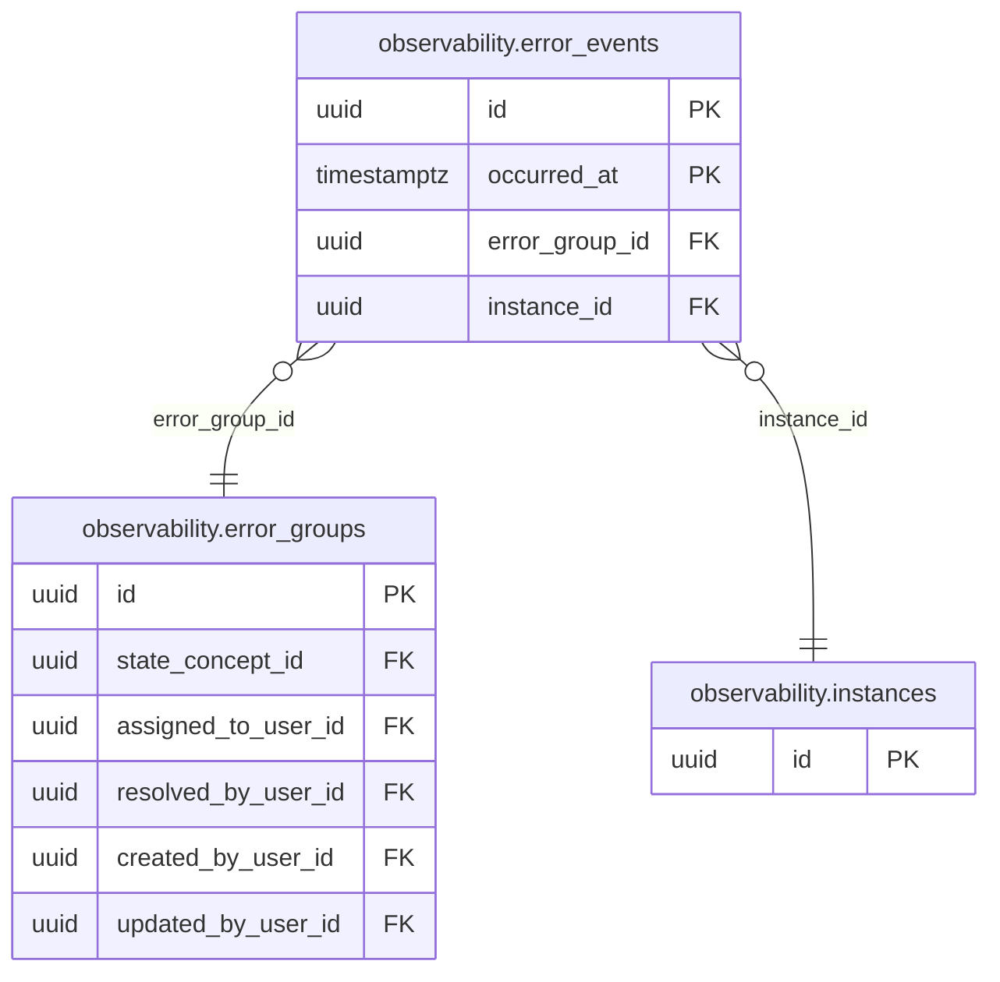
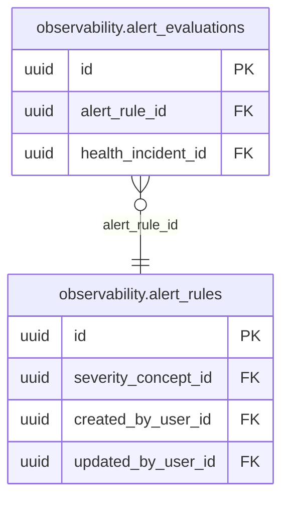

<!-- AUTOGENERADO por tools/inventario/catalogo.mjs. No editar manualmente. -->

# Catálogo del schema `observability`

- **Tablas:** 12 · **Columnas:** 195 (0 con descripción: 0.0 %) · **Índices:** 39
- **Dominio:** sin dato
- Método y límites del catálogo: [README del inventario](../README.md)

## Tablas

| Tabla | Propósito | Columnas | Índices | Operaciones | ORM |
|---|---|---|---|---|---|
| [alert_evaluations](#alert_evaluations) | sin propósito | 7 | 3 | 0 | COINCIDE |
| [alert_rules](#alert_rules) | sin propósito | 15 | 5 | 0 | COINCIDE |
| [dependency_probe_runs](#dependency_probe_runs) | sin propósito | 8 | 3 | 0 | COINCIDE |
| [error_events](#error_events) | sin propósito | 27 | 5 | 5 | COINCIDE |
| [error_groups](#error_groups) | sin propósito | 31 | 8 | 7 | COINCIDE |
| [http_request_minute_series](#http_request_minute_series) | sin propósito | 23 | 3 | 4 | COINCIDE |
| [instances](#instances) | sin propósito | 14 | 2 | 11 | COINCIDE |
| [rollup_watermarks](#rollup_watermarks) | sin propósito | 8 | 0 | 0 | COINCIDE |
| [slow_request_samples](#slow_request_samples) | sin propósito | 16 | 3 | 3 | COINCIDE |
| [sql_statement_minute_series](#sql_statement_minute_series) | sin propósito | 24 | 3 | 4 | COINCIDE |
| [sql_statements](#sql_statements) | sin propósito | 10 | 2 | 2 | COINCIDE |
| [worker_tick_minute_series](#worker_tick_minute_series) | sin propósito | 12 | 2 | 0 | COINCIDE |

## Diagrama entidad-relación

Las tablas se agrupan en familias por sus claves foráneas dentro del schema (máximo 40 por diagrama). Las FK hacia otros schemas se listan en la ficha de cada tabla.

### Familia 1 de 2 — 3 tablas

### Familia 2 de 2 — 2 tablas

### Tablas sin relaciones dentro del schema

`observability.dependency_probe_runs` · `observability.http_request_minute_series` · `observability.rollup_watermarks` · `observability.slow_request_samples` · `observability.sql_statement_minute_series` · `observability.sql_statements` · `observability.worker_tick_minute_series`

## Fichas

### alert_evaluations

#### Vista general

_Sin propósito registrado._

- **Estado del propósito:** PENDING_REVIEW
- **Dominio:** sin dato · **Diagrama:** `Mantra Core Health Context/modules/diagram_70_observability.puml` · **DDL:** `SQL/70_observability/02_tables.sql`
- **Entidad del ORM:** `AlertEvaluations` — `src/modules/observability/entities/alert_evaluations.entity.ts`
- **Resumen:** 7 columnas · 3 índices · 2 FK salientes · 0 entrantes · 0 operaciones

#### Columnas

| # | Columna | Tipo | Rol estructural | Descripción | ORM |
|---|---|---|---|---|---|
| 1 | `id` | `uuid` | Clave primaria; Obligatoria | _sin dato_ | coincide |
| 2 | `time` | `timestamptz` | Obligatoria | _sin dato_ | coincide |
| 3 | `alert_rule_id` | `uuid` | Clave foránea → observability.alert_rules.id; Obligatoria | _sin dato_ | coincide |
| 4 | `observed_value` | `double precision` | Obligatoria | _sin dato_ | coincide |
| 5 | `fired` | `boolean` | Obligatoria | _sin dato_ | coincide |
| 6 | `health_incident_id` | `uuid` | Clave foránea → platform_ops.health_incidents.id; Opcional | _sin dato_ | coincide |
| 7 | `created_at` | `timestamptz` | Obligatoria | _sin dato_ | coincide |

#### Relaciones

| Sentido | Columnas | Tabla | Restricción |
|---|---|---|---|
| hacia | alert_rule_id | observability.alert_rules (id) | fk_alert_evaluations_alert_rule_id |
| hacia | health_incident_id | platform_ops.health_incidents (id) | fk_alert_evaluations_health_incident_id |

#### Índices

| Índice | Único | Columnas | Para qué |
|---|---|---|---|
| `ix_alert_evaluations_rule_time` | no | alert_rule_id, ("time" DESC) | _sin uso detectado estáticamente_ |
| `ix_alert_evaluations_health_incident_id` | no | health_incident_id | Soporta la clave foránea fk_alert_evaluations_health_incident_id: PostgreSQL no indexa las FK por sí mismo _(DOCUMENTO)_ |
| `brin_alert_evaluations_time` | no | time | BRIN para logs e historiales append-only de gran volumen _(DOCUMENTO)_ |

#### Operaciones que la tocan

_Ninguna operación HTTP la toca según el análisis estático (puede usarla un worker, un trigger o una migración)._

#### Gobierno

| Atributo | Valor | Fuente |
|---|---|---|
| Append-only | no declarado | — |
| Datos personales | sin fuente | — |
| Financiera | sin fuente | — |
| Crítica para auditoría | sin fuente | — |
| Retención | sin fuente | — |
| Responsable | sin fuente | — |
| Revisión | AUTO_DETECTADA | — |

---

### alert_rules

#### Vista general

_Sin propósito registrado._

- **Estado del propósito:** PENDING_REVIEW
- **Dominio:** sin dato · **Diagrama:** `Mantra Core Health Context/modules/diagram_70_observability.puml` · **DDL:** `SQL/70_observability/02_tables.sql`
- **Entidad del ORM:** `AlertRules` — `src/modules/observability/entities/alert_rules.entity.ts`
- **Resumen:** 15 columnas · 5 índices · 3 FK salientes · 1 entrantes · 0 operaciones

#### Columnas

| # | Columna | Tipo | Rol estructural | Descripción | ORM |
|---|---|---|---|---|---|
| 1 | `id` | `uuid` | Clave primaria; Obligatoria | _sin dato_ | coincide |
| 2 | `code` | `varchar` | Obligatoria | _sin dato_ | coincide |
| 3 | `metric` | `varchar` | Obligatoria | _sin dato_ | coincide |
| 4 | `comparator` | `varchar` | Obligatoria | _sin dato_ | coincide |
| 5 | `threshold` | `numeric` | Obligatoria | _sin dato_ | coincide |
| 6 | `for_seconds` | `integer` | Obligatoria | _sin dato_ | coincide |
| 7 | `severity_concept_id` | `uuid` | Clave foránea → terminology.catalog_concepts.id; Obligatoria | _sin dato_ | coincide |
| 8 | `enabled` | `boolean` | Obligatoria | _sin dato_ | coincide |
| 9 | `module_code` | `varchar` | Opcional | _sin dato_ | coincide |
| 10 | `route_template` | `varchar` | Opcional | _sin dato_ | coincide |
| 11 | `created_at` | `timestamptz` | Obligatoria | _sin dato_ | coincide |
| 12 | `updated_at` | `timestamptz` | Obligatoria | _sin dato_ | coincide |
| 13 | `created_by_user_id` | `uuid` | Clave foránea → iam.users.id; Opcional | _sin dato_ | coincide |
| 14 | `updated_by_user_id` | `uuid` | Clave foránea → iam.users.id; Opcional | _sin dato_ | coincide |
| 15 | `row_version` | `integer = 1` | Obligatoria | _sin dato_ | coincide |

#### Relaciones

| Sentido | Columnas | Tabla | Restricción |
|---|---|---|---|
| hacia | severity_concept_id | terminology.catalog_concepts (id) | fk_alert_rules_severity_concept_id |
| hacia | created_by_user_id | iam.users (id) | fk_alert_rules_created_by_user_id |
| hacia | updated_by_user_id | iam.users (id) | fk_alert_rules_updated_by_user_id |
| desde | id | observability.alert_evaluations (alert_rule_id) | fk_alert_evaluations_alert_rule_id |

#### Índices

| Índice | Único | Columnas | Para qué |
|---|---|---|---|
| `uq_alert_rules_code` | sí | code | Garantiza que no se repita la combinación (code) _(DOCUMENTO)_ |
| `ix_alert_rules_severity_concept_id` | no | severity_concept_id | Soporta la clave foránea fk_alert_rules_severity_concept_id: PostgreSQL no indexa las FK por sí mismo _(DOCUMENTO)_ |
| `ix_alert_rules_enabled_module` | no | enabled, module_code | _sin uso detectado estáticamente_ |
| `ix_alert_rules_created_by_user_id` | no | created_by_user_id | Soporta la clave foránea fk_alert_rules_created_by_user_id: PostgreSQL no indexa las FK por sí mismo _(DOCUMENTO)_ |
| `ix_alert_rules_updated_by_user_id` | no | updated_by_user_id | Soporta la clave foránea fk_alert_rules_updated_by_user_id: PostgreSQL no indexa las FK por sí mismo _(DOCUMENTO)_ |

#### Restricciones

| Restricción | Tipo | Definición |
|---|---|---|
| `uq_alert_rules_code` | UNIQUE INDEX | UNIQUE INDEX ("code") |

#### Operaciones que la tocan

_Ninguna operación HTTP la toca según el análisis estático (puede usarla un worker, un trigger o una migración)._

#### Gobierno

| Atributo | Valor | Fuente |
|---|---|---|
| Append-only | no declarado | — |
| Datos personales | sin fuente | — |
| Financiera | sin fuente | — |
| Crítica para auditoría | sin fuente | — |
| Retención | sin fuente | — |
| Responsable | sin fuente | — |
| Revisión | AUTO_DETECTADA | — |

---

### dependency_probe_runs

#### Vista general

_Sin propósito registrado._

- **Estado del propósito:** PENDING_REVIEW
- **Dominio:** sin dato · **Diagrama:** `Mantra Core Health Context/modules/diagram_70_observability.puml` · **DDL:** `SQL/70_observability/02_tables.sql`
- **Entidad del ORM:** `DependencyProbeRuns` — `src/modules/observability/entities/dependency_probe_runs.entity.ts`
- **Resumen:** 8 columnas · 3 índices · 1 FK salientes · 0 entrantes · 0 operaciones

#### Columnas

| # | Columna | Tipo | Rol estructural | Descripción | ORM |
|---|---|---|---|---|---|
| 1 | `time` | `timestamptz` | Clave primaria; Obligatoria | _sin dato_ | coincide |
| 2 | `instance_id` | `uuid` | Clave primaria; Obligatoria | _sin dato_ | coincide |
| 3 | `dependency_code` | `varchar` | Clave primaria; Obligatoria | _sin dato_ | coincide |
| 4 | `service_component_id` | `uuid` | Clave foránea → platform_ops.service_components.id; Opcional | _sin dato_ | coincide |
| 5 | `status` | `varchar` | Obligatoria | _sin dato_ | coincide |
| 6 | `latency_ms` | `integer` | Opcional | _sin dato_ | coincide |
| 7 | `error_type` | `varchar` | Opcional | _sin dato_ | coincide |
| 8 | `created_at` | `timestamptz` | Obligatoria | _sin dato_ | coincide |

#### Relaciones

| Sentido | Columnas | Tabla | Restricción |
|---|---|---|---|
| hacia | service_component_id | platform_ops.service_components (id) | fk_dependency_probe_runs_service_component_id |

#### Índices

| Índice | Único | Columnas | Para qué |
|---|---|---|---|
| `ix_dependency_probe_code_time` | no | dependency_code, ("time" DESC) | _sin uso detectado estáticamente_ |
| `ix_dependency_probe_service_component_id` | no | service_component_id | Soporta la clave foránea fk_dependency_probe_runs_service_component_id: PostgreSQL no indexa las FK por sí mismo _(DOCUMENTO)_ |
| `brin_dependency_probe_time` | no | time | BRIN para logs e historiales append-only de gran volumen _(DOCUMENTO)_ |

#### Restricciones

| Restricción | Tipo | Definición |
|---|---|---|
| `ck_dependency_probe_runs_status` | CHECK | CHECK ("status" IN ('up', 'degraded', 'down', 'not_probed')) |

#### Operaciones que la tocan

_Ninguna operación HTTP la toca según el análisis estático (puede usarla un worker, un trigger o una migración)._

#### Gobierno

| Atributo | Valor | Fuente |
|---|---|---|
| Append-only | no declarado | — |
| Datos personales | sin fuente | — |
| Financiera | sin fuente | — |
| Crítica para auditoría | sin fuente | — |
| Retención | sin fuente | — |
| Responsable | sin fuente | — |
| Revisión | AUTO_DETECTADA | — |

---

### error_events

#### Vista general

_Sin propósito registrado._

- **Estado del propósito:** PENDING_REVIEW
- **Dominio:** sin dato · **Diagrama:** `Mantra Core Health Context/modules/diagram_70_observability.puml` · **DDL:** `SQL/70_observability/02_tables.sql`
- **Entidad del ORM:** `ErrorEvents` — `src/modules/observability/entities/error_events.entity.ts`
- **Resumen:** 27 columnas · 5 índices · 2 FK salientes · 0 entrantes · 5 operaciones

#### Columnas

| # | Columna | Tipo | Rol estructural | Descripción | ORM |
|---|---|---|---|---|---|
| 1 | `id` | `uuid` | Clave primaria; Obligatoria | _sin dato_ | coincide |
| 2 | `occurred_at` | `timestamptz` | Clave primaria; Obligatoria | _sin dato_ | coincide |
| 3 | `error_group_id` | `uuid` | Clave foránea → observability.error_groups.id; Obligatoria | _sin dato_ | coincide |
| 4 | `request_id` | `varchar` | Opcional | _sin dato_ | coincide |
| 5 | `trace_id` | `varchar(32)` | Opcional | _sin dato_ | coincide |
| 6 | `instance_id` | `uuid` | Clave foránea → observability.instances.id; Obligatoria | _sin dato_ | coincide |
| 7 | `source` | `varchar` | Obligatoria | _sin dato_ | coincide |
| 8 | `http_status` | `integer` | Opcional | _sin dato_ | coincide |
| 9 | `error_code` | `varchar` | Obligatoria | _sin dato_ | coincide |
| 10 | `error_reason` | `varchar` | Opcional | _sin dato_ | coincide |
| 11 | `exception_type` | `varchar` | Opcional | _sin dato_ | coincide |
| 12 | `module_code` | `varchar` | Opcional | _sin dato_ | coincide |
| 13 | `operation_key` | `varchar` | Opcional | _sin dato_ | coincide |
| 14 | `http_method` | `varchar` | Opcional | _sin dato_ | coincide |
| 15 | `route_template` | `varchar` | Opcional | _sin dato_ | coincide |
| 16 | `actor_tenant_id` | `uuid` | Opcional | _sin dato_ | coincide |
| 17 | `actor_hash` | `varchar(64)` | Opcional | _sin dato_ | coincide |
| 18 | `duration_ms` | `integer` | Opcional | _sin dato_ | coincide |
| 19 | `sqlstate` | `varchar` | Opcional | _sin dato_ | coincide |
| 20 | `constraint_name` | `varchar` | Opcional | _sin dato_ | coincide |
| 21 | `table_name` | `varchar` | Opcional | _sin dato_ | coincide |
| 22 | `column_name` | `varchar` | Opcional | _sin dato_ | coincide |
| 23 | `violations_json` | `jsonb` | Opcional | _sin dato_ | coincide |
| 24 | `message_redacted` | `text` | Opcional | _sin dato_ | coincide |
| 25 | `frames_json` | `jsonb` | Opcional | _sin dato_ | coincide |
| 26 | `client_kind` | `varchar` | Opcional | _sin dato_ | coincide |
| 27 | `created_at` | `timestamptz` | Obligatoria | _sin dato_ | coincide |

#### Relaciones

| Sentido | Columnas | Tabla | Restricción |
|---|---|---|---|
| hacia | error_group_id | observability.error_groups (id) | fk_error_events_error_group_id |
| hacia | instance_id | observability.instances (id) | fk_error_events_instance_id |

#### Índices

| Índice | Único | Columnas | Para qué |
|---|---|---|---|
| `ix_error_events_group_time` | no | error_group_id, ("occurred_at" DESC) | _sin uso detectado estáticamente_ |
| `ix_error_events_module_time` | no | module_code, ("occurred_at" DESC) | _sin uso detectado estáticamente_ |
| `ix_error_events_request_id` | no | request_id, ("occurred_at" DESC) | _sin uso detectado estáticamente_ |
| `ix_error_events_instance_time` | no | instance_id, ("occurred_at" DESC) | _sin uso detectado estáticamente_ |
| `brin_error_events_time` | no | occurred_at | BRIN para logs e historiales append-only de gran volumen _(DOCUMENTO)_ |

#### Restricciones

| Restricción | Tipo | Definición |
|---|---|---|
| `ck_error_events_source` | CHECK | CHECK ("source" IN ('api', 'worker', 'web')) |

#### Operaciones que la tocan

| Operación | Efecto | Confianza |
|---|---|---|
| GET /admin/observability/errors/events | LEE | POR_SQL |
| GET /admin/observability/errors/groups | LEE | POR_SQL |
| GET /admin/observability/errors/groups/{id} | LEE | POR_SQL |
| GET /admin/observability/requests/{requestId} | LEE | POR_SQL |
| GET /admin/observability/timeseries | LEE | POR_SQL |

#### Gobierno

| Atributo | Valor | Fuente |
|---|---|---|
| Append-only | no declarado | — |
| Datos personales | sin fuente | — |
| Financiera | sin fuente | — |
| Crítica para auditoría | sin fuente | — |
| Retención | sin fuente | — |
| Responsable | sin fuente | — |
| Revisión | AUTO_DETECTADA | — |

---

### error_groups

#### Vista general

_Sin propósito registrado._

- **Estado del propósito:** PENDING_REVIEW
- **Dominio:** sin dato · **Diagrama:** `Mantra Core Health Context/modules/diagram_70_observability.puml` · **DDL:** `SQL/70_observability/02_tables.sql`
- **Entidad del ORM:** `ErrorGroups` — `src/modules/observability/entities/error_groups.entity.ts`
- **Resumen:** 31 columnas · 8 índices · 5 FK salientes · 1 entrantes · 7 operaciones

#### Columnas

| # | Columna | Tipo | Rol estructural | Descripción | ORM |
|---|---|---|---|---|---|
| 1 | `id` | `uuid` | Clave primaria; Obligatoria | _sin dato_ | coincide |
| 2 | `fingerprint` | `varchar(64)` | Obligatoria | _sin dato_ | coincide |
| 3 | `source` | `varchar` | Obligatoria | _sin dato_ | coincide |
| 4 | `http_status` | `integer` | Opcional | _sin dato_ | coincide |
| 5 | `error_code` | `varchar` | Obligatoria | _sin dato_ | coincide |
| 6 | `error_reason` | `varchar` | Opcional | _sin dato_ | coincide |
| 7 | `exception_type` | `varchar` | Opcional | _sin dato_ | coincide |
| 8 | `module_code` | `varchar` | Opcional | _sin dato_ | coincide |
| 9 | `operation_key` | `varchar` | Opcional | _sin dato_ | coincide |
| 10 | `http_method` | `varchar` | Opcional | _sin dato_ | coincide |
| 11 | `route_template` | `varchar` | Opcional | _sin dato_ | coincide |
| 12 | `title` | `varchar` | Obligatoria | _sin dato_ | coincide |
| 13 | `sample_message` | `text` | Opcional | _sin dato_ | coincide |
| 14 | `sample_frames_json` | `jsonb` | Opcional | _sin dato_ | coincide |
| 15 | `first_seen_at` | `timestamptz` | Obligatoria | _sin dato_ | coincide |
| 16 | `last_seen_at` | `timestamptz` | Obligatoria | _sin dato_ | coincide |
| 17 | `occurrences_total` | `bigint` | Obligatoria | _sin dato_ | coincide |
| 18 | `occurrences_24h` | `bigint` | Obligatoria | _sin dato_ | coincide |
| 19 | `affected_actors_24h` | `integer` | Opcional | _sin dato_ | coincide |
| 20 | `state_concept_id` | `uuid` | Clave foránea → terminology.catalog_concepts.id; Obligatoria | _sin dato_ | coincide |
| 21 | `assigned_to_user_id` | `uuid` | Clave foránea → iam.users.id; Opcional | _sin dato_ | coincide |
| 22 | `resolved_at` | `timestamptz` | Opcional | _sin dato_ | coincide |
| 23 | `resolved_by_user_id` | `uuid` | Clave foránea → iam.users.id; Opcional | _sin dato_ | coincide |
| 24 | `resolution_note` | `text` | Opcional | _sin dato_ | coincide |
| 25 | `regressed_at` | `timestamptz` | Opcional | _sin dato_ | coincide |
| 26 | `last_request_id` | `varchar` | Opcional | _sin dato_ | coincide |
| 27 | `created_at` | `timestamptz` | Obligatoria | _sin dato_ | coincide |
| 28 | `updated_at` | `timestamptz` | Obligatoria | _sin dato_ | coincide |
| 29 | `created_by_user_id` | `uuid` | Clave foránea → iam.users.id; Opcional | _sin dato_ | coincide |
| 30 | `updated_by_user_id` | `uuid` | Clave foránea → iam.users.id; Opcional | _sin dato_ | coincide |
| 31 | `row_version` | `integer = 1` | Obligatoria | _sin dato_ | coincide |

#### Relaciones

| Sentido | Columnas | Tabla | Restricción |
|---|---|---|---|
| hacia | state_concept_id | terminology.catalog_concepts (id) | fk_error_groups_state_concept_id |
| hacia | assigned_to_user_id | iam.users (id) | fk_error_groups_assigned_to_user_id |
| hacia | resolved_by_user_id | iam.users (id) | fk_error_groups_resolved_by_user_id |
| hacia | created_by_user_id | iam.users (id) | fk_error_groups_created_by_user_id |
| hacia | updated_by_user_id | iam.users (id) | fk_error_groups_updated_by_user_id |
| desde | id | observability.error_events (error_group_id) | fk_error_events_error_group_id |

#### Índices

| Índice | Único | Columnas | Para qué |
|---|---|---|---|
| `uq_error_groups_fingerprint` | sí | fingerprint | Garantiza que no se repita la combinación (fingerprint) _(DOCUMENTO)_ |
| `ix_error_groups_state_last_seen` | no | state_concept_id, ("last_seen_at" DESC) | _sin uso detectado estáticamente_ |
| `ix_error_groups_module_last_seen` | no | module_code, ("last_seen_at" DESC) | _sin uso detectado estáticamente_ |
| `ix_error_groups_code` | no | error_code, error_reason | _sin uso detectado estáticamente_ |
| `ix_error_groups_assigned_to_user_id` | no | assigned_to_user_id | Soporta la clave foránea fk_error_groups_assigned_to_user_id: PostgreSQL no indexa las FK por sí mismo _(DOCUMENTO)_ |
| `ix_error_groups_resolved_by_user_id` | no | resolved_by_user_id | Soporta la clave foránea fk_error_groups_resolved_by_user_id: PostgreSQL no indexa las FK por sí mismo _(DOCUMENTO)_ |
| `ix_error_groups_created_by_user_id` | no | created_by_user_id | Soporta la clave foránea fk_error_groups_created_by_user_id: PostgreSQL no indexa las FK por sí mismo _(DOCUMENTO)_ |
| `ix_error_groups_updated_by_user_id` | no | updated_by_user_id | Soporta la clave foránea fk_error_groups_updated_by_user_id: PostgreSQL no indexa las FK por sí mismo _(DOCUMENTO)_ |

#### Restricciones

| Restricción | Tipo | Definición |
|---|---|---|
| `uq_error_groups_fingerprint` | UNIQUE INDEX | UNIQUE INDEX ("fingerprint") |
| `ck_error_groups_source` | CHECK | CHECK ("source" IN ('api', 'worker', 'web')) |

#### Operaciones que la tocan

| Operación | Efecto | Confianza |
|---|---|---|
| GET /admin/observability/endpoints | LEE | POR_SQL |
| GET /admin/observability/errors/groups | LEE | POR_SQL |
| GET /admin/observability/errors/groups/{id} | LEE | POR_SQL |
| PATCH /admin/observability/errors/groups/{id} | ACTUALIZA | POR_SQL |
| PATCH /admin/observability/errors/groups/{id} | LEE | POR_SQL |
| GET /admin/observability/modules | LEE | POR_SQL |
| GET /admin/observability/summary | LEE | POR_SQL |

#### Gobierno

| Atributo | Valor | Fuente |
|---|---|---|
| Append-only | no declarado | — |
| Datos personales | sin fuente | — |
| Financiera | sin fuente | — |
| Crítica para auditoría | sin fuente | — |
| Retención | sin fuente | — |
| Responsable | sin fuente | — |
| Revisión | AUTO_DETECTADA | — |

---

### http_request_minute_series

#### Vista general

_Sin propósito registrado._

- **Estado del propósito:** PENDING_REVIEW
- **Dominio:** sin dato · **Diagrama:** `Mantra Core Health Context/modules/diagram_70_observability.puml` · **DDL:** `SQL/70_observability/02_tables.sql`
- **Entidad del ORM:** `HttpRequestMinuteSeries` — `src/modules/observability/entities/http_request_minute_series.entity.ts`
- **Resumen:** 23 columnas · 3 índices · 0 FK salientes · 0 entrantes · 4 operaciones

#### Columnas

| # | Columna | Tipo | Rol estructural | Descripción | ORM |
|---|---|---|---|---|---|
| 1 | `time` | `timestamptz` | Clave primaria; Obligatoria | _sin dato_ | coincide |
| 2 | `instance_id` | `uuid` | Clave primaria; Obligatoria | _sin dato_ | coincide |
| 3 | `flush_seq` | `integer` | Clave primaria; Obligatoria | _sin dato_ | coincide |
| 4 | `http_method` | `varchar` | Clave primaria; Obligatoria | _sin dato_ | coincide |
| 5 | `route_template` | `varchar` | Clave primaria; Obligatoria | _sin dato_ | coincide |
| 6 | `http_status` | `integer` | Clave primaria; Obligatoria | _sin dato_ | coincide |
| 7 | `operation_key` | `varchar` | Opcional | _sin dato_ | coincide |
| 8 | `module_code` | `varchar` | Opcional | _sin dato_ | coincide |
| 9 | `requests` | `integer` | Obligatoria | _sin dato_ | coincide |
| 10 | `sum_ms` | `double precision` | Obligatoria | _sin dato_ | coincide |
| 11 | `max_ms` | `double precision` | Obligatoria | _sin dato_ | coincide |
| 12 | `le5` | `integer` | Obligatoria | _sin dato_ | coincide |
| 13 | `le10` | `integer` | Obligatoria | _sin dato_ | coincide |
| 14 | `le25` | `integer` | Obligatoria | _sin dato_ | coincide |
| 15 | `le50` | `integer` | Obligatoria | _sin dato_ | coincide |
| 16 | `le100` | `integer` | Obligatoria | _sin dato_ | coincide |
| 17 | `le250` | `integer` | Obligatoria | _sin dato_ | coincide |
| 18 | `le500` | `integer` | Obligatoria | _sin dato_ | coincide |
| 19 | `le1000` | `integer` | Obligatoria | _sin dato_ | coincide |
| 20 | `le2000` | `integer` | Obligatoria | _sin dato_ | coincide |
| 21 | `le5000` | `integer` | Obligatoria | _sin dato_ | coincide |
| 22 | `le10000` | `integer` | Obligatoria | _sin dato_ | coincide |
| 23 | `created_at` | `timestamptz` | Obligatoria | _sin dato_ | coincide |

#### Índices

| Índice | Único | Columnas | Para qué |
|---|---|---|---|
| `ix_http_minute_module_time` | no | module_code, ("time" DESC) | _sin uso detectado estáticamente_ |
| `ix_http_minute_route_time` | no | route_template, http_method, ("time" DESC) | _sin uso detectado estáticamente_ |
| `brin_http_minute_time` | no | time | BRIN para logs e historiales append-only de gran volumen _(DOCUMENTO)_ |

#### Operaciones que la tocan

| Operación | Efecto | Confianza |
|---|---|---|
| GET /admin/observability/endpoints | LEE | POR_SQL |
| GET /admin/observability/modules | LEE | POR_SQL |
| GET /admin/observability/summary | LEE | POR_SQL |
| GET /admin/observability/timeseries | LEE | POR_SQL |

#### Gobierno

| Atributo | Valor | Fuente |
|---|---|---|
| Append-only | no declarado | — |
| Datos personales | sin fuente | — |
| Financiera | sin fuente | — |
| Crítica para auditoría | sin fuente | — |
| Retención | sin fuente | — |
| Responsable | sin fuente | — |
| Revisión | AUTO_DETECTADA | — |

---

### instances

#### Vista general

_Sin propósito registrado._

- **Estado del propósito:** PENDING_REVIEW
- **Dominio:** sin dato · **Diagrama:** `Mantra Core Health Context/modules/diagram_70_observability.puml` · **DDL:** `SQL/70_observability/02_tables.sql`
- **Entidad del ORM:** `Instances` — `src/modules/observability/entities/instances.entity.ts`
- **Resumen:** 14 columnas · 2 índices · 0 FK salientes · 1 entrantes · 11 operaciones

#### Columnas

| # | Columna | Tipo | Rol estructural | Descripción | ORM |
|---|---|---|---|---|---|
| 1 | `id` | `uuid` | Clave primaria; Obligatoria | _sin dato_ | coincide |
| 2 | `kind` | `varchar` | Obligatoria | _sin dato_ | coincide |
| 3 | `name` | `varchar` | Obligatoria | _sin dato_ | coincide |
| 4 | `build_commit` | `varchar` | Opcional | _sin dato_ | coincide |
| 5 | `build_version` | `varchar` | Opcional | _sin dato_ | coincide |
| 6 | `host_hash` | `varchar(64)` | Opcional | _sin dato_ | coincide |
| 7 | `started_at` | `timestamptz` | Obligatoria | _sin dato_ | coincide |
| 8 | `last_seen_at` | `timestamptz` | Obligatoria | _sin dato_ | coincide |
| 9 | `status` | `varchar` | Obligatoria | _sin dato_ | coincide |
| 10 | `last_snapshot_json` | `jsonb` | Opcional | _sin dato_ | coincide |
| 11 | `expected` | `boolean` | Opcional | _sin dato_ | coincide |
| 12 | `created_at` | `timestamptz` | Obligatoria | _sin dato_ | coincide |
| 13 | `updated_at` | `timestamptz` | Obligatoria | _sin dato_ | coincide |
| 14 | `row_version` | `integer = 1` | Obligatoria | _sin dato_ | coincide |

#### Relaciones

| Sentido | Columnas | Tabla | Restricción |
|---|---|---|---|
| desde | id | observability.error_events (instance_id) | fk_error_events_instance_id |

#### Índices

| Índice | Único | Columnas | Para qué |
|---|---|---|---|
| `ix_instances_kind_last_seen` | no | kind, ("last_seen_at" DESC) | _sin uso detectado estáticamente_ |
| `ix_instances_name` | no | name | _sin uso detectado estáticamente_ |

#### Restricciones

| Restricción | Tipo | Definición |
|---|---|---|
| `ck_instances_kind` | CHECK | CHECK ("kind" IN ('API', 'WORKER')) |
| `ck_instances_status` | CHECK | CHECK ("status" IN ('starting', 'running', 'draining', 'stopped')) |

#### Operaciones que la tocan

| Operación | Efecto | Confianza |
|---|---|---|
| GET /admin/observability/coverage | LEE | POR_SQL |
| GET /admin/observability/endpoints | LEE | POR_SQL |
| GET /admin/observability/errors/events | LEE | POR_SQL |
| GET /admin/observability/errors/groups | LEE | POR_SQL |
| GET /admin/observability/errors/groups/{id} | LEE | POR_SQL |
| GET /admin/observability/modules | LEE | POR_SQL |
| GET /admin/observability/sql/slow | LEE | POR_SQL |
| GET /admin/observability/sql/statements | LEE | POR_SQL |
| GET /admin/observability/sql/statements/{hash} | LEE | POR_SQL |
| GET /admin/observability/summary | LEE | POR_SQL |
| GET /admin/observability/timeseries | LEE | POR_SQL |

#### Gobierno

| Atributo | Valor | Fuente |
|---|---|---|
| Append-only | no declarado | — |
| Datos personales | sin fuente | — |
| Financiera | sin fuente | — |
| Crítica para auditoría | sin fuente | — |
| Retención | sin fuente | — |
| Responsable | sin fuente | — |
| Revisión | AUTO_DETECTADA | — |

---

### rollup_watermarks

#### Vista general

_Sin propósito registrado._

- **Estado del propósito:** PENDING_REVIEW
- **Dominio:** sin dato · **Diagrama:** `Mantra Core Health Context/modules/diagram_70_observability.puml` · **DDL:** `SQL/70_observability/02_tables.sql`
- **Entidad del ORM:** `RollupWatermarks` — `src/modules/observability/entities/rollup_watermarks.entity.ts`
- **Resumen:** 8 columnas · 0 índices · 0 FK salientes · 0 entrantes · 0 operaciones

#### Columnas

| # | Columna | Tipo | Rol estructural | Descripción | ORM |
|---|---|---|---|---|---|
| 1 | `rollup_name` | `varchar` | Clave primaria; Obligatoria | _sin dato_ | coincide |
| 2 | `materialized_until` | `timestamptz` | Obligatoria | _sin dato_ | coincide |
| 3 | `last_run_at` | `timestamptz` | Opcional | _sin dato_ | coincide |
| 4 | `last_duration_ms` | `integer` | Opcional | _sin dato_ | coincide |
| 5 | `last_error` | `varchar` | Opcional | _sin dato_ | coincide |
| 6 | `created_at` | `timestamptz` | Obligatoria | _sin dato_ | coincide |
| 7 | `updated_at` | `timestamptz` | Obligatoria | _sin dato_ | coincide |
| 8 | `row_version` | `integer = 1` | Obligatoria | _sin dato_ | coincide |

#### Operaciones que la tocan

_Ninguna operación HTTP la toca según el análisis estático (puede usarla un worker, un trigger o una migración)._

#### Gobierno

| Atributo | Valor | Fuente |
|---|---|---|
| Append-only | no declarado | — |
| Datos personales | sin fuente | — |
| Financiera | sin fuente | — |
| Crítica para auditoría | sin fuente | — |
| Retención | sin fuente | — |
| Responsable | sin fuente | — |
| Revisión | AUTO_DETECTADA | — |

---

### slow_request_samples

#### Vista general

_Sin propósito registrado._

- **Estado del propósito:** PENDING_REVIEW
- **Dominio:** sin dato · **Diagrama:** `Mantra Core Health Context/modules/diagram_70_observability.puml` · **DDL:** `SQL/70_observability/02_tables.sql`
- **Entidad del ORM:** `SlowRequestSamples` — `src/modules/observability/entities/slow_request_samples.entity.ts`
- **Resumen:** 16 columnas · 3 índices · 0 FK salientes · 0 entrantes · 3 operaciones

#### Columnas

| # | Columna | Tipo | Rol estructural | Descripción | ORM |
|---|---|---|---|---|---|
| 1 | `id` | `uuid` | Clave primaria; Obligatoria | _sin dato_ | coincide |
| 2 | `time` | `timestamptz` | Clave primaria; Obligatoria | _sin dato_ | coincide |
| 3 | `request_id` | `varchar` | Obligatoria | _sin dato_ | coincide |
| 4 | `trace_id` | `varchar(32)` | Opcional | _sin dato_ | coincide |
| 5 | `instance_id` | `uuid` | Obligatoria | _sin dato_ | coincide |
| 6 | `http_method` | `varchar` | Obligatoria | _sin dato_ | coincide |
| 7 | `route_template` | `varchar` | Obligatoria | _sin dato_ | coincide |
| 8 | `operation_key` | `varchar` | Opcional | _sin dato_ | coincide |
| 9 | `module_code` | `varchar` | Opcional | _sin dato_ | coincide |
| 10 | `http_status` | `integer` | Obligatoria | _sin dato_ | coincide |
| 11 | `duration_ms` | `integer` | Obligatoria | _sin dato_ | coincide |
| 12 | `sql_count` | `integer` | Opcional | _sin dato_ | coincide |
| 13 | `sql_total_ms` | `double precision` | Opcional | _sin dato_ | coincide |
| 14 | `sql_top_json` | `jsonb` | Opcional | _sin dato_ | coincide |
| 15 | `sampled_because` | `varchar` | Obligatoria | _sin dato_ | coincide |
| 16 | `created_at` | `timestamptz` | Obligatoria | _sin dato_ | coincide |

#### Índices

| Índice | Único | Columnas | Para qué |
|---|---|---|---|
| `ix_slow_request_request_id` | no | request_id | _sin uso detectado estáticamente_ |
| `ix_slow_request_module_time` | no | module_code, ("time" DESC) | _sin uso detectado estáticamente_ |
| `brin_slow_request_time` | no | time | BRIN para logs e historiales append-only de gran volumen _(DOCUMENTO)_ |

#### Restricciones

| Restricción | Tipo | Definición |
|---|---|---|
| `ck_slow_request_samples_sampled_because` | CHECK | CHECK ("sampled_because" IN ('slow', 'error', 'random')) |

#### Operaciones que la tocan

| Operación | Efecto | Confianza |
|---|---|---|
| GET /admin/observability/requests/{requestId} | LEE | POR_SQL |
| GET /admin/observability/sql/slow | LEE | POR_SQL |
| GET /admin/observability/sql/statements/{hash} | LEE | POR_SQL |

#### Gobierno

| Atributo | Valor | Fuente |
|---|---|---|
| Append-only | no declarado | — |
| Datos personales | sin fuente | — |
| Financiera | sin fuente | — |
| Crítica para auditoría | sin fuente | — |
| Retención | sin fuente | — |
| Responsable | sin fuente | — |
| Revisión | AUTO_DETECTADA | — |

---

### sql_statement_minute_series

#### Vista general

_Sin propósito registrado._

- **Estado del propósito:** PENDING_REVIEW
- **Dominio:** sin dato · **Diagrama:** `Mantra Core Health Context/modules/diagram_70_observability.puml` · **DDL:** `SQL/70_observability/02_tables.sql`
- **Entidad del ORM:** `SqlStatementMinuteSeries` — `src/modules/observability/entities/sql_statement_minute_series.entity.ts`
- **Resumen:** 24 columnas · 3 índices · 0 FK salientes · 0 entrantes · 4 operaciones

#### Columnas

| # | Columna | Tipo | Rol estructural | Descripción | ORM |
|---|---|---|---|---|---|
| 1 | `time` | `timestamptz` | Clave primaria; Obligatoria | _sin dato_ | coincide |
| 2 | `instance_id` | `uuid` | Clave primaria; Obligatoria | _sin dato_ | coincide |
| 3 | `flush_seq` | `integer` | Clave primaria; Obligatoria | _sin dato_ | coincide |
| 4 | `query_hash` | `varchar(12)` | Clave primaria; Obligatoria | _sin dato_ | coincide |
| 5 | `operation_key` | `varchar` | Clave primaria; Obligatoria | _sin dato_ | coincide |
| 6 | `module_code` | `varchar` | Opcional | _sin dato_ | coincide |
| 7 | `executions` | `integer` | Obligatoria | _sin dato_ | coincide |
| 8 | `sum_ms` | `double precision` | Obligatoria | _sin dato_ | coincide |
| 9 | `max_ms` | `double precision` | Obligatoria | _sin dato_ | coincide |
| 10 | `slow_count` | `integer` | Obligatoria | _sin dato_ | coincide |
| 11 | `failed_count` | `integer` | Obligatoria | _sin dato_ | coincide |
| 12 | `rows_sum` | `bigint` | Obligatoria | _sin dato_ | coincide |
| 13 | `le1` | `integer` | Obligatoria | _sin dato_ | coincide |
| 14 | `le5` | `integer` | Obligatoria | _sin dato_ | coincide |
| 15 | `le10` | `integer` | Obligatoria | _sin dato_ | coincide |
| 16 | `le25` | `integer` | Obligatoria | _sin dato_ | coincide |
| 17 | `le50` | `integer` | Obligatoria | _sin dato_ | coincide |
| 18 | `le100` | `integer` | Obligatoria | _sin dato_ | coincide |
| 19 | `le250` | `integer` | Obligatoria | _sin dato_ | coincide |
| 20 | `le500` | `integer` | Obligatoria | _sin dato_ | coincide |
| 21 | `le1000` | `integer` | Obligatoria | _sin dato_ | coincide |
| 22 | `le5000` | `integer` | Obligatoria | _sin dato_ | coincide |
| 23 | `inf` | `integer` | Obligatoria | _sin dato_ | coincide |
| 24 | `created_at` | `timestamptz` | Obligatoria | _sin dato_ | coincide |

#### Índices

| Índice | Único | Columnas | Para qué |
|---|---|---|---|
| `ix_sql_minute_hash_time` | no | query_hash, ("time" DESC) | _sin uso detectado estáticamente_ |
| `ix_sql_minute_module_time` | no | module_code, ("time" DESC) | _sin uso detectado estáticamente_ |
| `brin_sql_minute_time` | no | time | BRIN para logs e historiales append-only de gran volumen _(DOCUMENTO)_ |

#### Operaciones que la tocan

| Operación | Efecto | Confianza |
|---|---|---|
| GET /admin/observability/sql/statements | LEE | POR_SQL |
| GET /admin/observability/sql/statements/{hash} | LEE | POR_SQL |
| GET /admin/observability/summary | LEE | POR_SQL |
| GET /admin/observability/timeseries | LEE | POR_SQL |

#### Gobierno

| Atributo | Valor | Fuente |
|---|---|---|
| Append-only | no declarado | — |
| Datos personales | sin fuente | — |
| Financiera | sin fuente | — |
| Crítica para auditoría | sin fuente | — |
| Retención | sin fuente | — |
| Responsable | sin fuente | — |
| Revisión | AUTO_DETECTADA | — |

---

### sql_statements

#### Vista general

_Sin propósito registrado._

- **Estado del propósito:** PENDING_REVIEW
- **Dominio:** sin dato · **Diagrama:** `Mantra Core Health Context/modules/diagram_70_observability.puml` · **DDL:** `SQL/70_observability/02_tables.sql`
- **Entidad del ORM:** `SqlStatements` — `src/modules/observability/entities/sql_statements.entity.ts`
- **Resumen:** 10 columnas · 2 índices · 0 FK salientes · 0 entrantes · 2 operaciones

#### Columnas

| # | Columna | Tipo | Rol estructural | Descripción | ORM |
|---|---|---|---|---|---|
| 1 | `query_hash` | `varchar(12)` | Clave primaria; Obligatoria | _sin dato_ | coincide |
| 2 | `statement_class` | `varchar` | Obligatoria | _sin dato_ | coincide |
| 3 | `normalized_sql` | `text` | Opcional | _sin dato_ | coincide |
| 4 | `primary_table` | `varchar` | Opcional | _sin dato_ | coincide |
| 5 | `first_seen_at` | `timestamptz` | Obligatoria | _sin dato_ | coincide |
| 6 | `last_seen_at` | `timestamptz` | Obligatoria | _sin dato_ | coincide |
| 7 | `is_slow_ever` | `boolean` | Obligatoria | _sin dato_ | coincide |
| 8 | `created_at` | `timestamptz` | Obligatoria | _sin dato_ | coincide |
| 9 | `updated_at` | `timestamptz` | Obligatoria | _sin dato_ | coincide |
| 10 | `row_version` | `integer = 1` | Obligatoria | _sin dato_ | coincide |

#### Índices

| Índice | Único | Columnas | Para qué |
|---|---|---|---|
| `ix_sql_statements_primary_table` | no | primary_table | _sin uso detectado estáticamente_ |
| `ix_sql_statements_last_seen` | no | ("last_seen_at" DESC) | _sin uso detectado estáticamente_ |

#### Operaciones que la tocan

| Operación | Efecto | Confianza |
|---|---|---|
| GET /admin/observability/sql/statements | LEE | POR_SQL |
| GET /admin/observability/sql/statements/{hash} | LEE | POR_SQL |

#### Gobierno

| Atributo | Valor | Fuente |
|---|---|---|
| Append-only | no declarado | — |
| Datos personales | sin fuente | — |
| Financiera | sin fuente | — |
| Crítica para auditoría | sin fuente | — |
| Retención | sin fuente | — |
| Responsable | sin fuente | — |
| Revisión | AUTO_DETECTADA | — |

---

### worker_tick_minute_series

#### Vista general

_Sin propósito registrado._

- **Estado del propósito:** PENDING_REVIEW
- **Dominio:** sin dato · **Diagrama:** `Mantra Core Health Context/modules/diagram_70_observability.puml` · **DDL:** `SQL/70_observability/02_tables.sql`
- **Entidad del ORM:** `WorkerTickMinuteSeries` — `src/modules/observability/entities/worker_tick_minute_series.entity.ts`
- **Resumen:** 12 columnas · 2 índices · 0 FK salientes · 0 entrantes · 0 operaciones

#### Columnas

| # | Columna | Tipo | Rol estructural | Descripción | ORM |
|---|---|---|---|---|---|
| 1 | `time` | `timestamptz` | Clave primaria; Obligatoria | _sin dato_ | coincide |
| 2 | `instance_id` | `uuid` | Clave primaria; Obligatoria | _sin dato_ | coincide |
| 3 | `operation` | `varchar` | Clave primaria; Obligatoria | _sin dato_ | coincide |
| 4 | `worker_name` | `varchar` | Obligatoria | _sin dato_ | coincide |
| 5 | `runs` | `integer` | Obligatoria | _sin dato_ | coincide |
| 6 | `failures` | `integer` | Obligatoria | _sin dato_ | coincide |
| 7 | `timeouts` | `integer` | Obligatoria | _sin dato_ | coincide |
| 8 | `skipped` | `integer` | Obligatoria | _sin dato_ | coincide |
| 9 | `sum_ms` | `double precision` | Obligatoria | _sin dato_ | coincide |
| 10 | `max_ms` | `double precision` | Obligatoria | _sin dato_ | coincide |
| 11 | `consecutive_failures_max` | `integer` | Obligatoria | _sin dato_ | coincide |
| 12 | `created_at` | `timestamptz` | Obligatoria | _sin dato_ | coincide |

#### Índices

| Índice | Único | Columnas | Para qué |
|---|---|---|---|
| `ix_worker_tick_worker_time` | no | worker_name, ("time" DESC) | _sin uso detectado estáticamente_ |
| `brin_worker_tick_time` | no | time | BRIN para logs e historiales append-only de gran volumen _(DOCUMENTO)_ |

#### Operaciones que la tocan

_Ninguna operación HTTP la toca según el análisis estático (puede usarla un worker, un trigger o una migración)._

#### Gobierno

| Atributo | Valor | Fuente |
|---|---|---|
| Append-only | no declarado | — |
| Datos personales | sin fuente | — |
| Financiera | sin fuente | — |
| Crítica para auditoría | sin fuente | — |
| Retención | sin fuente | — |
| Responsable | sin fuente | — |
| Revisión | AUTO_DETECTADA | — |

---

