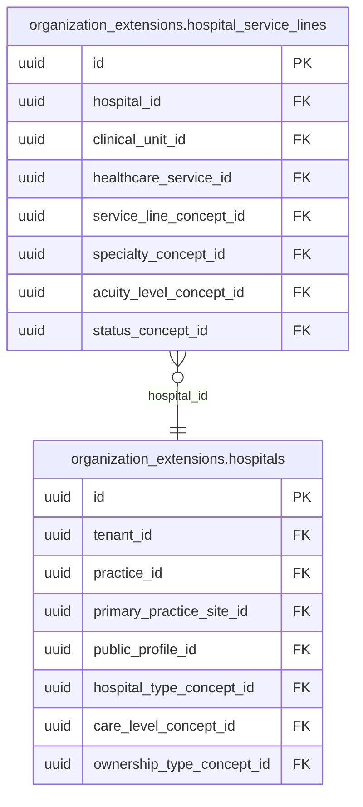

<!-- AUTOGENERADO por tools/inventario/catalogo.mjs. No editar manualmente. -->

# Catálogo del schema `organization_extensions`

- **Tablas:** 5 · **Columnas:** 86 (21 con descripción: 24.4 %) · **Índices:** 57
- **Dominio:** Práctica y Agenda
- Método y límites del catálogo: [README del inventario](../README.md)

## Tablas

| Tabla | Propósito | Columnas | Índices | Operaciones | ORM |
|---|---|---|---|---|---|
| [facility_licenses](#facility_licenses) | Conserva licencias y habilitaciones de instalaciones sanitarias para documentar autorización operativa. | 20 | 13 | 9 | COINCIDE |
| [hospital_service_lines](#hospital_service_lines) | Cataloga líneas de servicio hospitalarias para describir áreas de atención ofrecidas por cada hospital. | 14 | 9 | 3 | COINCIDE |
| [hospitals](#hospitals) | Representa hospitales como una especialización de organización sanitaria con atributos propios de ese tipo de institución. | 18 | 15 | 7 | COINCIDE |
| [organization_affiliations](#organization_affiliations) | Vincula organizaciones sanitarias para representar afiliaciones y relaciones institucionales relevantes a la prestación. | 16 | 9 | 3 | COINCIDE |
| [organization_data_boundaries](#organization_data_boundaries) | Define límites de datos entre organizaciones para hacer explícitos los ámbitos de custodia e intercambio. | 18 | 11 | 3 | COINCIDE |

## Diagrama entidad-relación

Las tablas se agrupan en familias por sus claves foráneas dentro del schema (máximo 40 por diagrama). Las FK hacia otros schemas se listan en la ficha de cada tabla.

### Familia 1 de 1 — 2 tablas

### Tablas sin relaciones dentro del schema

`organization_extensions.facility_licenses` · `organization_extensions.organization_affiliations` · `organization_extensions.organization_data_boundaries`

## Fichas

### facility_licenses

#### Vista general

Conserva licencias y habilitaciones de instalaciones sanitarias para documentar autorización operativa.

- **Estado del propósito:** DOMAIN_CURATED_DRAFT · fuente: `Mantra Core Health Context/modules/diagram_22_organization_extensions.puml: facility_licenses`
- **Dominio:** Práctica y Agenda · **Diagrama:** `Mantra Core Health Context/modules/diagram_22_organization_extensions.puml` · **DDL:** `SQL/22_organization_extensions/02_tables.sql`
- **Entidad del ORM:** `FacilityLicenses` — `src/modules/organization_extensions/entities/facility_licenses.entity.ts`
- **Resumen:** 20 columnas · 13 índices · 12 FK salientes · 0 entrantes · 9 operaciones

#### Columnas

| # | Columna | Tipo | Rol estructural | Descripción | ORM |
|---|---|---|---|---|---|
| 1 | `id` | `uuid` | Clave primaria; Obligatoria | Identificador único de la instancia. _(JSDOC_ESTANDAR, `src/modules/organization_extensions/entities/facility_licenses.entity.ts:12`)_ | coincide |
| 2 | `tenant_id` | `uuid` | Clave foránea → directory.tenants.id; Obligatoria | _sin dato_ | coincide |
| 3 | `practice_site_id` | `uuid` | Clave foránea → practice.practice_sites.id; Opcional | _sin dato_ | coincide |
| 4 | `facility_type_concept_id` | `uuid` | Clave foránea → terminology.catalog_concepts.id; Obligatoria | _sin dato_ | coincide |
| 5 | `license_type_concept_id` | `uuid` | Clave foránea → terminology.catalog_concepts.id; Obligatoria | _sin dato_ | coincide |
| 6 | `license_number` | `varchar` | Obligatoria | _sin dato_ | coincide |
| 7 | `issuing_authority_tenant_id` | `uuid` | Clave foránea → directory.tenants.id; Opcional | _sin dato_ | coincide |
| 8 | `issuing_authority_name` | `varchar` | Opcional | _sin dato_ | coincide |
| 9 | `jurisdiction_concept_id` | `uuid` | Clave foránea → terminology.catalog_concepts.id; Opcional | _sin dato_ | coincide |
| 10 | `valid_from` | `date` | Opcional | _sin dato_ | coincide |
| 11 | `valid_to` | `date` | Opcional | _sin dato_ | coincide |
| 12 | `evidence_file_id` | `uuid` | Clave foránea → common.files.id; Opcional | _sin dato_ | coincide |
| 13 | `verification_status_concept_id` | `uuid` | Clave foránea → terminology.catalog_concepts.id; Obligatoria | _sin dato_ | coincide |
| 14 | `created_at` | `timestamptz` | Obligatoria | Fecha y hora en que se creó el registro. _(JSDOC_ESTANDAR, `src/modules/organization_extensions/entities/facility_licenses.entity.ts:102`)_ | coincide |
| 15 | `updated_at` | `timestamptz` | Obligatoria | Fecha y hora de la última actualización. _(JSDOC_ESTANDAR, `src/modules/organization_extensions/entities/facility_licenses.entity.ts:108`)_ | coincide |
| 16 | `created_by_user_id` | `uuid` | Clave foránea → iam.users.id; Opcional | _sin dato_ | coincide |
| 17 | `updated_by_user_id` | `uuid` | Clave foránea → iam.users.id; Opcional | _sin dato_ | coincide |
| 18 | `row_version` | `integer = 1` | Obligatoria | Versión usada para controlar actualizaciones concurrentes. _(JSDOC_ENTIDAD, `src/modules/organization_extensions/entities/facility_licenses.entity.ts:126`)_ | coincide |
| 19 | `clinical_unit_id` | `uuid` | Clave foránea → practice.clinical_units.id; Opcional | + v4.2.67b (infraestructura F1): alcance opcional de la habilitación a una unidad organizativa o a un servicio de la sede. NULL = habilita el establecimiento entero. Sede y unidad se referencian además con FK compuesta (tenant_id, x_id) y el servicio con un trigger: el padre tiene que ser del mismo tenant (patch 2026-10-29_infraestructura_f1b). _(MODELO_PUML, `Mantra Core Health Context/modules/diagram_22_organization_extensions.puml:79`)_ | coincide |
| 20 | `healthcare_service_id` | `uuid` | Clave foránea → practice.healthcare_services.id; Opcional | _sin dato_ | coincide |

#### Relaciones

| Sentido | Columnas | Tabla | Restricción |
|---|---|---|---|
| hacia | tenant_id | directory.tenants (id) | fk_facility_licenses_tenant_id |
| hacia | practice_site_id | practice.practice_sites (id) | fk_facility_licenses_practice_site_id |
| hacia | facility_type_concept_id | terminology.catalog_concepts (id) | fk_facility_licenses_facility_type_concept_id |
| hacia | license_type_concept_id | terminology.catalog_concepts (id) | fk_facility_licenses_license_type_concept_id |
| hacia | issuing_authority_tenant_id | directory.tenants (id) | fk_facility_licenses_issuing_authority_tenant_id |
| hacia | jurisdiction_concept_id | terminology.catalog_concepts (id) | fk_facility_licenses_jurisdiction_concept_id |
| hacia | evidence_file_id | common.files (id) | fk_facility_licenses_evidence_file_id |
| hacia | verification_status_concept_id | terminology.catalog_concepts (id) | fk_facility_licenses_verification_status_concept_id |
| hacia | created_by_user_id | iam.users (id) | fk_facility_licenses_created_by_user_id |
| hacia | updated_by_user_id | iam.users (id) | fk_facility_licenses_updated_by_user_id |
| hacia | clinical_unit_id | practice.clinical_units (id) | fk_facility_licenses_clinical_unit_id |
| hacia | healthcare_service_id | practice.healthcare_services (id) | fk_facility_licenses_healthcare_service_id |

#### Índices

| Índice | Único | Columnas | Para qué |
|---|---|---|---|
| `ix_facility_licenses_tenant_id` | no | tenant_id | Soporta la clave foránea fk_facility_licenses_tenant_id: PostgreSQL no indexa las FK por sí mismo _(DOCUMENTO)_; 4 consulta(s) de repositorio filtran u ordenan por «tenant_id», la primera columna del índice _(CONSULTA)_ |
| `ix_facility_licenses_practice_site_id` | no | practice_site_id | Soporta la clave foránea fk_facility_licenses_practice_site_id: PostgreSQL no indexa las FK por sí mismo _(DOCUMENTO)_; 1 consulta(s) de repositorio filtran u ordenan por «practice_site_id», la primera columna del índice _(CONSULTA)_ |
| `ix_facility_licenses_facility_type_concept_id` | no | facility_type_concept_id | Soporta la clave foránea fk_facility_licenses_facility_type_concept_id: PostgreSQL no indexa las FK por sí mismo _(DOCUMENTO)_ |
| `ix_facility_licenses_license_type_concept_id` | no | license_type_concept_id | Soporta la clave foránea fk_facility_licenses_license_type_concept_id: PostgreSQL no indexa las FK por sí mismo _(DOCUMENTO)_; 1 consulta(s) de repositorio filtran u ordenan por «license_type_concept_id», la primera columna del índice _(CONSULTA)_ |
| `ix_facility_licenses_issuing_authority_tenant_id` | no | issuing_authority_tenant_id | Soporta la clave foránea fk_facility_licenses_issuing_authority_tenant_id: PostgreSQL no indexa las FK por sí mismo _(DOCUMENTO)_ |
| `ix_facility_licenses_jurisdiction_concept_id` | no | jurisdiction_concept_id | Soporta la clave foránea fk_facility_licenses_jurisdiction_concept_id: PostgreSQL no indexa las FK por sí mismo _(DOCUMENTO)_ |
| `ix_facility_licenses_evidence_file_id` | no | evidence_file_id | Soporta la clave foránea fk_facility_licenses_evidence_file_id: PostgreSQL no indexa las FK por sí mismo _(DOCUMENTO)_ |
| `ix_facility_licenses_verification_status_concept_id` | no | verification_status_concept_id | Soporta la clave foránea fk_facility_licenses_verification_status_concept_id: PostgreSQL no indexa las FK por sí mismo _(DOCUMENTO)_; 1 consulta(s) de repositorio filtran u ordenan por «verification_status_concept_id», la primera columna del índice _(CONSULTA)_ |
| `ix_facility_licenses_created_by_user_id` | no | created_by_user_id | Soporta la clave foránea fk_facility_licenses_created_by_user_id: PostgreSQL no indexa las FK por sí mismo _(DOCUMENTO)_ |
| `ix_facility_licenses_updated_by_user_id` | no | updated_by_user_id | Soporta la clave foránea fk_facility_licenses_updated_by_user_id: PostgreSQL no indexa las FK por sí mismo _(DOCUMENTO)_ |
| `ix_facility_licenses_tenant_id_updated_at` | no | tenant_id, ("updated_at" DESC) | _sin uso detectado estáticamente_ |
| `ix_facility_licenses_clinical_unit_id` | no | clinical_unit_id | Soporta la clave foránea fk_facility_licenses_clinical_unit_id: PostgreSQL no indexa las FK por sí mismo _(DOCUMENTO)_ |
| `ix_facility_licenses_healthcare_service_id` | no | healthcare_service_id | Soporta la clave foránea fk_facility_licenses_healthcare_service_id: PostgreSQL no indexa las FK por sí mismo _(DOCUMENTO)_ |

#### Operaciones que la tocan

| Operación | Efecto | Confianza |
|---|---|---|
| POST /orgext/facility-licenses | CREA | DIRECTA |
| POST /orgext/facility-licenses | LEE | DIRECTA |
| POST /orgext/facility-licenses/{id}/verify | LEE | DIRECTA |
| POST /orgext/hospitals/{id}/activate | LEE | DIRECTA |
| PATCH /site-licenses/{id} | ACTUALIZA | POR_TIPO |
| PATCH /site-licenses/{id} | LEE | DIRECTA |
| GET /sites/{siteId}/licenses | LEE | DIRECTA |
| POST /sites/{siteId}/licenses | CREA | DIRECTA |
| POST /sites/{siteId}/licenses | LEE | DIRECTA |

#### Gobierno

| Atributo | Valor | Fuente |
|---|---|---|
| Append-only | no declarado | — |
| Datos personales | sin fuente | — |
| Financiera | sin fuente | — |
| Crítica para auditoría | sin fuente | — |
| Retención | sin fuente | — |
| Responsable | sin fuente | — |
| Revisión | AUTO_DETECTADA | — |

---

### hospital_service_lines

#### Vista general

Cataloga líneas de servicio hospitalarias para describir áreas de atención ofrecidas por cada hospital.

- **Estado del propósito:** DOMAIN_CURATED_DRAFT · fuente: `Mantra Core Health Context/modules/diagram_22_organization_extensions.puml: hospital_service_lines`
- **Dominio:** Práctica y Agenda · **Diagrama:** `Mantra Core Health Context/modules/diagram_22_organization_extensions.puml` · **DDL:** `SQL/22_organization_extensions/02_tables.sql`
- **Entidad del ORM:** `HospitalServiceLines` — `src/modules/organization_extensions/entities/hospital_service_lines.entity.ts`
- **Resumen:** 14 columnas · 9 índices · 9 FK salientes · 0 entrantes · 3 operaciones

#### Columnas

| # | Columna | Tipo | Rol estructural | Descripción | ORM |
|---|---|---|---|---|---|
| 1 | `id` | `uuid` | Clave primaria; Obligatoria | Identificador único de la instancia. _(JSDOC_ESTANDAR, `src/modules/organization_extensions/entities/hospital_service_lines.entity.ts:15`)_ | coincide |
| 2 | `hospital_id` | `uuid` | Clave foránea → organization_extensions.hospitals.id; Obligatoria | _sin dato_ | coincide |
| 3 | `clinical_unit_id` | `uuid` | Clave foránea → practice.clinical_units.id; Opcional | _sin dato_ | coincide |
| 4 | `healthcare_service_id` | `uuid` | Clave foránea → practice.healthcare_services.id; Opcional | _sin dato_ | coincide |
| 5 | `service_line_concept_id` | `uuid` | Clave foránea → terminology.catalog_concepts.id; Obligatoria | _sin dato_ | coincide |
| 6 | `specialty_concept_id` | `uuid` | Clave foránea → terminology.catalog_concepts.id; Opcional | _sin dato_ | coincide |
| 7 | `acuity_level_concept_id` | `uuid` | Clave foránea → terminology.catalog_concepts.id; Opcional | _sin dato_ | coincide |
| 8 | `referral_required` | `boolean` | Opcional | _sin dato_ | coincide |
| 9 | `status_concept_id` | `uuid` | Clave foránea → terminology.catalog_concepts.id; Obligatoria | _sin dato_ | coincide |
| 10 | `created_at` | `timestamptz` | Obligatoria | Fecha y hora en que se creó el registro. _(JSDOC_ESTANDAR, `src/modules/organization_extensions/entities/hospital_service_lines.entity.ts:77`)_ | coincide |
| 11 | `updated_at` | `timestamptz` | Obligatoria | Fecha y hora de la última actualización. _(JSDOC_ESTANDAR, `src/modules/organization_extensions/entities/hospital_service_lines.entity.ts:83`)_ | coincide |
| 12 | `created_by_user_id` | `uuid` | Clave foránea → iam.users.id; Opcional | _sin dato_ | coincide |
| 13 | `updated_by_user_id` | `uuid` | Clave foránea → iam.users.id; Opcional | _sin dato_ | coincide |
| 14 | `row_version` | `integer = 1` | Obligatoria | Versión usada para controlar actualizaciones concurrentes. _(JSDOC_ENTIDAD, `src/modules/organization_extensions/entities/hospital_service_lines.entity.ts:101`)_ | coincide |

#### Relaciones

| Sentido | Columnas | Tabla | Restricción |
|---|---|---|---|
| hacia | hospital_id | organization_extensions.hospitals (id) | fk_hospital_service_lines_hospital_id |
| hacia | clinical_unit_id | practice.clinical_units (id) | fk_hospital_service_lines_clinical_unit_id |
| hacia | healthcare_service_id | practice.healthcare_services (id) | fk_hospital_service_lines_healthcare_service_id |
| hacia | service_line_concept_id | terminology.catalog_concepts (id) | fk_hospital_service_lines_service_line_concept_id |
| hacia | specialty_concept_id | terminology.catalog_concepts (id) | fk_hospital_service_lines_specialty_concept_id |
| hacia | acuity_level_concept_id | terminology.catalog_concepts (id) | fk_hospital_service_lines_acuity_level_concept_id |
| hacia | status_concept_id | terminology.catalog_concepts (id) | fk_hospital_service_lines_status_concept_id |
| hacia | created_by_user_id | iam.users (id) | fk_hospital_service_lines_created_by_user_id |
| hacia | updated_by_user_id | iam.users (id) | fk_hospital_service_lines_updated_by_user_id |

#### Índices

| Índice | Único | Columnas | Para qué |
|---|---|---|---|
| `ix_hospital_service_lines_hospital_id` | no | hospital_id | Soporta la clave foránea fk_hospital_service_lines_hospital_id: PostgreSQL no indexa las FK por sí mismo _(DOCUMENTO)_; 1 consulta(s) de repositorio filtran u ordenan por «hospital_id», la primera columna del índice _(CONSULTA)_ |
| `ix_hospital_service_lines_clinical_unit_id` | no | clinical_unit_id | Soporta la clave foránea fk_hospital_service_lines_clinical_unit_id: PostgreSQL no indexa las FK por sí mismo _(DOCUMENTO)_ |
| `ix_hospital_service_lines_healthcare_service_id` | no | healthcare_service_id | Soporta la clave foránea fk_hospital_service_lines_healthcare_service_id: PostgreSQL no indexa las FK por sí mismo _(DOCUMENTO)_ |
| `ix_hospital_service_lines_service_line_concept_id` | no | service_line_concept_id | Soporta la clave foránea fk_hospital_service_lines_service_line_concept_id: PostgreSQL no indexa las FK por sí mismo _(DOCUMENTO)_ |
| `ix_hospital_service_lines_specialty_concept_id` | no | specialty_concept_id | Soporta la clave foránea fk_hospital_service_lines_specialty_concept_id: PostgreSQL no indexa las FK por sí mismo _(DOCUMENTO)_ |
| `ix_hospital_service_lines_acuity_level_concept_id` | no | acuity_level_concept_id | Soporta la clave foránea fk_hospital_service_lines_acuity_level_concept_id: PostgreSQL no indexa las FK por sí mismo _(DOCUMENTO)_ |
| `ix_hospital_service_lines_status_concept_id` | no | status_concept_id | Soporta la clave foránea fk_hospital_service_lines_status_concept_id: PostgreSQL no indexa las FK por sí mismo _(DOCUMENTO)_ |
| `ix_hospital_service_lines_created_by_user_id` | no | created_by_user_id | Soporta la clave foránea fk_hospital_service_lines_created_by_user_id: PostgreSQL no indexa las FK por sí mismo _(DOCUMENTO)_ |
| `ix_hospital_service_lines_updated_by_user_id` | no | updated_by_user_id | Soporta la clave foránea fk_hospital_service_lines_updated_by_user_id: PostgreSQL no indexa las FK por sí mismo _(DOCUMENTO)_ |

#### Operaciones que la tocan

| Operación | Efecto | Confianza |
|---|---|---|
| POST /orgext/hospitals/{id}/service-lines | CREA | DIRECTA |
| DELETE /orgext/hospitals/{id}/service-lines/{lineId} | ACTUALIZA | POR_TIPO |
| DELETE /orgext/hospitals/{id}/service-lines/{lineId} | LEE | DIRECTA |

#### Gobierno

| Atributo | Valor | Fuente |
|---|---|---|
| Append-only | no declarado | — |
| Datos personales | sin fuente | — |
| Financiera | sin fuente | — |
| Crítica para auditoría | sin fuente | — |
| Retención | sin fuente | — |
| Responsable | sin fuente | — |
| Revisión | AUTO_DETECTADA | — |

---

### hospitals

#### Vista general

Representa hospitales como una especialización de organización sanitaria con atributos propios de ese tipo de institución.

- **Estado del propósito:** DOMAIN_CURATED_DRAFT · fuente: `Mantra Core Health Context/modules/diagram_22_organization_extensions.puml: hospitals`
- **Dominio:** Práctica y Agenda · **Diagrama:** `Mantra Core Health Context/modules/diagram_22_organization_extensions.puml` · **DDL:** `SQL/22_organization_extensions/02_tables.sql`
- **Entidad del ORM:** `Hospitals` — `src/modules/organization_extensions/entities/hospitals.entity.ts`
- **Resumen:** 18 columnas · 15 índices · 12 FK salientes · 2 entrantes · 7 operaciones

#### Columnas

| # | Columna | Tipo | Rol estructural | Descripción | ORM |
|---|---|---|---|---|---|
| 1 | `id` | `uuid` | Clave primaria; Obligatoria | Identificador único de la instancia. _(JSDOC_ESTANDAR, `src/modules/organization_extensions/entities/hospitals.entity.ts:12`)_ | coincide |
| 2 | `tenant_id` | `uuid` | Clave foránea → directory.tenants.id; Obligatoria | _sin dato_ | coincide |
| 3 | `practice_id` | `uuid` | Clave foránea → practice.practices.id; Obligatoria | _sin dato_ | coincide |
| 4 | `primary_practice_site_id` | `uuid` | Clave foránea → practice.practice_sites.id; Opcional | _sin dato_ | coincide |
| 5 | `public_profile_id` | `uuid` | Clave foránea → community.public_profiles.id; Opcional | _sin dato_ | coincide |
| 6 | `hospital_type_concept_id` | `uuid` | Clave foránea → terminology.catalog_concepts.id; Obligatoria | _sin dato_ | coincide |
| 7 | `care_level_concept_id` | `uuid` | Clave foránea → terminology.catalog_concepts.id; Opcional | _sin dato_ | coincide |
| 8 | `ownership_type_concept_id` | `uuid` | Clave foránea → terminology.catalog_concepts.id; Opcional | _sin dato_ | coincide |
| 9 | `teaching_status_concept_id` | `uuid` | Clave foránea → terminology.catalog_concepts.id; Opcional | _sin dato_ | coincide |
| 10 | `emergency_capability_concept_id` | `uuid` | Clave foránea → terminology.catalog_concepts.id; Opcional | _sin dato_ | coincide |
| 11 | `licensed_bed_capacity` | `integer` | Opcional | _sin dato_ | coincide |
| 12 | `operational_bed_capacity` | `integer` | Opcional | _sin dato_ | coincide |
| 13 | `status_concept_id` | `uuid` | Clave foránea → terminology.catalog_concepts.id; Obligatoria | _sin dato_ | coincide |
| 14 | `created_at` | `timestamptz` | Obligatoria | Fecha y hora en que se creó el registro. _(JSDOC_ESTANDAR, `src/modules/organization_extensions/entities/hospitals.entity.ts:118`)_ | coincide |
| 15 | `updated_at` | `timestamptz` | Obligatoria | Fecha y hora de la última actualización. _(JSDOC_ESTANDAR, `src/modules/organization_extensions/entities/hospitals.entity.ts:124`)_ | coincide |
| 16 | `created_by_user_id` | `uuid` | Clave foránea → iam.users.id; Opcional | _sin dato_ | coincide |
| 17 | `updated_by_user_id` | `uuid` | Clave foránea → iam.users.id; Opcional | _sin dato_ | coincide |
| 18 | `row_version` | `integer = 1` | Obligatoria | Versión usada para controlar actualizaciones concurrentes. _(JSDOC_ENTIDAD, `src/modules/organization_extensions/entities/hospitals.entity.ts:142`)_ | coincide |

#### Relaciones

| Sentido | Columnas | Tabla | Restricción |
|---|---|---|---|
| hacia | tenant_id | directory.tenants (id) | fk_hospitals_tenant_id |
| hacia | practice_id | practice.practices (id) | fk_hospitals_practice_id |
| hacia | primary_practice_site_id | practice.practice_sites (id) | fk_hospitals_primary_practice_site_id |
| hacia | public_profile_id | community.public_profiles (id) | fk_hospitals_public_profile_id |
| hacia | hospital_type_concept_id | terminology.catalog_concepts (id) | fk_hospitals_hospital_type_concept_id |
| hacia | care_level_concept_id | terminology.catalog_concepts (id) | fk_hospitals_care_level_concept_id |
| hacia | ownership_type_concept_id | terminology.catalog_concepts (id) | fk_hospitals_ownership_type_concept_id |
| hacia | teaching_status_concept_id | terminology.catalog_concepts (id) | fk_hospitals_teaching_status_concept_id |
| hacia | emergency_capability_concept_id | terminology.catalog_concepts (id) | fk_hospitals_emergency_capability_concept_id |
| hacia | status_concept_id | terminology.catalog_concepts (id) | fk_hospitals_status_concept_id |
| hacia | created_by_user_id | iam.users (id) | fk_hospitals_created_by_user_id |
| hacia | updated_by_user_id | iam.users (id) | fk_hospitals_updated_by_user_id |
| desde | id | organization_extensions.hospital_service_lines (hospital_id) | fk_hospital_service_lines_hospital_id |
| desde | id | insurance.network_provider_memberships (hospital_id) | fk_network_provider_memberships_hospital_id |

#### Índices

| Índice | Único | Columnas | Para qué |
|---|---|---|---|
| `uq_hospitals_tenant_id` | sí | tenant_id | Garantiza que no se repita la combinación (tenant_id) _(DOCUMENTO)_; Soporta la clave foránea fk_hospitals_tenant_id: PostgreSQL no indexa las FK por sí mismo _(DOCUMENTO)_; 2 consulta(s) de repositorio filtran u ordenan por «tenant_id», la primera columna del índice _(CONSULTA)_ |
| `uq_hospitals_practice_id` | sí | practice_id | Garantiza que no se repita la combinación (practice_id) _(DOCUMENTO)_; Soporta la clave foránea fk_hospitals_practice_id: PostgreSQL no indexa las FK por sí mismo _(DOCUMENTO)_; 1 consulta(s) de repositorio filtran u ordenan por «practice_id», la primera columna del índice _(CONSULTA)_ |
| `ix_hospitals_tenant_id` | no | tenant_id | Soporta la clave foránea fk_hospitals_tenant_id: PostgreSQL no indexa las FK por sí mismo _(DOCUMENTO)_; 2 consulta(s) de repositorio filtran u ordenan por «tenant_id», la primera columna del índice _(CONSULTA)_ |
| `ix_hospitals_practice_id` | no | practice_id | Soporta la clave foránea fk_hospitals_practice_id: PostgreSQL no indexa las FK por sí mismo _(DOCUMENTO)_; 1 consulta(s) de repositorio filtran u ordenan por «practice_id», la primera columna del índice _(CONSULTA)_ |
| `ix_hospitals_primary_practice_site_id` | no | primary_practice_site_id | Soporta la clave foránea fk_hospitals_primary_practice_site_id: PostgreSQL no indexa las FK por sí mismo _(DOCUMENTO)_ |
| `ix_hospitals_public_profile_id` | no | public_profile_id | Soporta la clave foránea fk_hospitals_public_profile_id: PostgreSQL no indexa las FK por sí mismo _(DOCUMENTO)_ |
| `ix_hospitals_hospital_type_concept_id` | no | hospital_type_concept_id | Soporta la clave foránea fk_hospitals_hospital_type_concept_id: PostgreSQL no indexa las FK por sí mismo _(DOCUMENTO)_ |
| `ix_hospitals_care_level_concept_id` | no | care_level_concept_id | Soporta la clave foránea fk_hospitals_care_level_concept_id: PostgreSQL no indexa las FK por sí mismo _(DOCUMENTO)_ |
| `ix_hospitals_ownership_type_concept_id` | no | ownership_type_concept_id | Soporta la clave foránea fk_hospitals_ownership_type_concept_id: PostgreSQL no indexa las FK por sí mismo _(DOCUMENTO)_ |
| `ix_hospitals_teaching_status_concept_id` | no | teaching_status_concept_id | Soporta la clave foránea fk_hospitals_teaching_status_concept_id: PostgreSQL no indexa las FK por sí mismo _(DOCUMENTO)_ |
| `ix_hospitals_emergency_capability_concept_id` | no | emergency_capability_concept_id | Soporta la clave foránea fk_hospitals_emergency_capability_concept_id: PostgreSQL no indexa las FK por sí mismo _(DOCUMENTO)_ |
| `ix_hospitals_status_concept_id` | no | status_concept_id | Soporta la clave foránea fk_hospitals_status_concept_id: PostgreSQL no indexa las FK por sí mismo _(DOCUMENTO)_ |
| `ix_hospitals_created_by_user_id` | no | created_by_user_id | Soporta la clave foránea fk_hospitals_created_by_user_id: PostgreSQL no indexa las FK por sí mismo _(DOCUMENTO)_ |
| `ix_hospitals_updated_by_user_id` | no | updated_by_user_id | Soporta la clave foránea fk_hospitals_updated_by_user_id: PostgreSQL no indexa las FK por sí mismo _(DOCUMENTO)_ |
| `ix_hospitals_tenant_id_status_concept_id` | no | tenant_id, status_concept_id, ("updated_at" DESC) | _sin uso detectado estáticamente_ |

#### Restricciones

| Restricción | Tipo | Definición |
|---|---|---|
| `uq_hospitals_tenant_id` | UNIQUE INDEX | UNIQUE INDEX ("tenant_id") |
| `uq_hospitals_practice_id` | UNIQUE INDEX | UNIQUE INDEX ("practice_id") |

#### Operaciones que la tocan

| Operación | Efecto | Confianza |
|---|---|---|
| POST /orgext/hospitals | CREA | DIRECTA |
| POST /orgext/hospitals | LEE | DIRECTA |
| POST /orgext/hospitals/{id}/activate | LEE | DIRECTA |
| POST /orgext/hospitals/{id}/service-lines | LEE | DIRECTA |
| DELETE /orgext/hospitals/{id}/service-lines/{lineId} | LEE | DIRECTA |
| GET /sites/{siteId}/capacity | LEE | DIRECTA |
| POST /sites/{siteId}/declared-capacities | LEE | DIRECTA |

#### Gobierno

| Atributo | Valor | Fuente |
|---|---|---|
| Append-only | no declarado | — |
| Datos personales | sin fuente | — |
| Financiera | sin fuente | — |
| Crítica para auditoría | sin fuente | — |
| Retención | sin fuente | — |
| Responsable | sin fuente | — |
| Revisión | AUTO_DETECTADA | — |

---

### organization_affiliations

#### Vista general

Vincula organizaciones sanitarias para representar afiliaciones y relaciones institucionales relevantes a la prestación.

- **Estado del propósito:** DOMAIN_CURATED_DRAFT · fuente: `Mantra Core Health Context/modules/diagram_22_organization_extensions.puml: organization_affiliations`
- **Dominio:** Práctica y Agenda · **Diagrama:** `Mantra Core Health Context/modules/diagram_22_organization_extensions.puml` · **DDL:** `SQL/22_organization_extensions/02_tables.sql`
- **Entidad del ORM:** `OrganizationAffiliations` — `src/modules/organization_extensions/entities/organization_affiliations.entity.ts`
- **Resumen:** 16 columnas · 9 índices · 8 FK salientes · 1 entrantes · 3 operaciones

#### Columnas

| # | Columna | Tipo | Rol estructural | Descripción | ORM |
|---|---|---|---|---|---|
| 1 | `id` | `uuid` | Clave primaria; Obligatoria | Identificador único de la instancia. _(JSDOC_ESTANDAR, `src/modules/organization_extensions/entities/organization_affiliations.entity.ts:15`)_ | coincide |
| 2 | `primary_tenant_id` | `uuid` | Clave foránea → directory.tenants.id; Obligatoria | _sin dato_ | coincide |
| 3 | `participating_tenant_id` | `uuid` | Clave foránea → directory.tenants.id; Obligatoria | _sin dato_ | coincide |
| 4 | `affiliation_type_concept_id` | `uuid` | Clave foránea → terminology.catalog_concepts.id; Obligatoria | _sin dato_ | coincide |
| 5 | `host_practice_site_id` | `uuid` | Clave foránea → practice.practice_sites.id; Opcional | _sin dato_ | coincide |
| 6 | `healthcare_service_id` | `uuid` | Clave foránea → practice.healthcare_services.id; Opcional | _sin dato_ | coincide |
| 7 | `contract_reference` | `varchar` | Opcional | _sin dato_ | coincide |
| 8 | `data_use_agreement_id` | `uuid` | Opcional | _sin dato_ | coincide |
| 9 | `valid_from` | `timestamptz` | Opcional | _sin dato_ | coincide |
| 10 | `valid_to` | `timestamptz` | Opcional | _sin dato_ | coincide |
| 11 | `status_concept_id` | `uuid` | Clave foránea → terminology.catalog_concepts.id; Obligatoria | _sin dato_ | coincide |
| 12 | `created_at` | `timestamptz` | Obligatoria | Fecha y hora en que se creó el registro. _(JSDOC_ESTANDAR, `src/modules/organization_extensions/entities/organization_affiliations.entity.ts:105`)_ | coincide |
| 13 | `updated_at` | `timestamptz` | Obligatoria | Fecha y hora de la última actualización. _(JSDOC_ESTANDAR, `src/modules/organization_extensions/entities/organization_affiliations.entity.ts:111`)_ | coincide |
| 14 | `created_by_user_id` | `uuid` | Clave foránea → iam.users.id; Opcional | _sin dato_ | coincide |
| 15 | `updated_by_user_id` | `uuid` | Clave foránea → iam.users.id; Opcional | _sin dato_ | coincide |
| 16 | `row_version` | `integer = 1` | Obligatoria | Versión usada para controlar actualizaciones concurrentes. _(JSDOC_ENTIDAD, `src/modules/organization_extensions/entities/organization_affiliations.entity.ts:129`)_ | coincide |

#### Relaciones

| Sentido | Columnas | Tabla | Restricción |
|---|---|---|---|
| hacia | primary_tenant_id | directory.tenants (id) | fk_organization_affiliations_primary_tenant_id |
| hacia | participating_tenant_id | directory.tenants (id) | fk_organization_affiliations_participating_tenant_id |
| hacia | affiliation_type_concept_id | terminology.catalog_concepts (id) | fk_organization_affiliations_affiliation_type_concept_id |
| hacia | host_practice_site_id | practice.practice_sites (id) | fk_organization_affiliations_host_practice_site_id |
| hacia | healthcare_service_id | practice.healthcare_services (id) | fk_organization_affiliations_healthcare_service_id |
| hacia | status_concept_id | terminology.catalog_concepts (id) | fk_organization_affiliations_status_concept_id |
| hacia | created_by_user_id | iam.users (id) | fk_organization_affiliations_created_by_user_id |
| hacia | updated_by_user_id | iam.users (id) | fk_organization_affiliations_updated_by_user_id |
| desde | id | audit.organization_affiliations_history (organization_affiliation_id) | fk_organization_affiliations_history_organization_affi_000fda2f |

#### Índices

| Índice | Único | Columnas | Para qué |
|---|---|---|---|
| `ix_organization_affiliations_primary_tenant_id` | no | primary_tenant_id | Soporta la clave foránea fk_organization_affiliations_primary_tenant_id: PostgreSQL no indexa las FK por sí mismo _(DOCUMENTO)_; 1 consulta(s) de repositorio filtran u ordenan por «primary_tenant_id», la primera columna del índice _(CONSULTA)_ |
| `ix_organization_affiliations_participating_tenant_id` | no | participating_tenant_id | Soporta la clave foránea fk_organization_affiliations_participating_tenant_id: PostgreSQL no indexa las FK por sí mismo _(DOCUMENTO)_; 1 consulta(s) de repositorio filtran u ordenan por «participating_tenant_id», la primera columna del índice _(CONSULTA)_ |
| `ix_organization_affiliations_affiliation_type_concept_id` | no | affiliation_type_concept_id | Soporta la clave foránea fk_organization_affiliations_affiliation_type_concept_id: PostgreSQL no indexa las FK por sí mismo _(DOCUMENTO)_; 1 consulta(s) de repositorio filtran u ordenan por «affiliation_type_concept_id», la primera columna del índice _(CONSULTA)_ |
| `ix_organization_affiliations_host_practice_site_id` | no | host_practice_site_id | Soporta la clave foránea fk_organization_affiliations_host_practice_site_id: PostgreSQL no indexa las FK por sí mismo _(DOCUMENTO)_ |
| `ix_organization_affiliations_healthcare_service_id` | no | healthcare_service_id | Soporta la clave foránea fk_organization_affiliations_healthcare_service_id: PostgreSQL no indexa las FK por sí mismo _(DOCUMENTO)_ |
| `ix_organization_affiliations_data_use_agreement_id` | no | data_use_agreement_id | _sin uso detectado estáticamente_ |
| `ix_organization_affiliations_status_concept_id` | no | status_concept_id | Soporta la clave foránea fk_organization_affiliations_status_concept_id: PostgreSQL no indexa las FK por sí mismo _(DOCUMENTO)_; 1 consulta(s) de repositorio filtran u ordenan por «status_concept_id», la primera columna del índice _(CONSULTA)_ |
| `ix_organization_affiliations_created_by_user_id` | no | created_by_user_id | Soporta la clave foránea fk_organization_affiliations_created_by_user_id: PostgreSQL no indexa las FK por sí mismo _(DOCUMENTO)_ |
| `ix_organization_affiliations_updated_by_user_id` | no | updated_by_user_id | Soporta la clave foránea fk_organization_affiliations_updated_by_user_id: PostgreSQL no indexa las FK por sí mismo _(DOCUMENTO)_ |

#### Operaciones que la tocan

| Operación | Efecto | Confianza |
|---|---|---|
| POST /orgext/affiliations | CREA | DIRECTA |
| POST /orgext/affiliations | LEE | DIRECTA |
| POST /orgext/affiliations/{id}/terminate | LEE | DIRECTA |

#### Gobierno

| Atributo | Valor | Fuente |
|---|---|---|
| Append-only | no declarado | — |
| Datos personales | sin fuente | — |
| Financiera | sin fuente | — |
| Crítica para auditoría | sin fuente | — |
| Retención | sin fuente | — |
| Responsable | sin fuente | — |
| Revisión | AUTO_DETECTADA | — |

---

### organization_data_boundaries

#### Vista general

Define límites de datos entre organizaciones para hacer explícitos los ámbitos de custodia e intercambio.

- **Estado del propósito:** DOMAIN_CURATED_DRAFT · fuente: `Mantra Core Health Context/modules/diagram_22_organization_extensions.puml: organization_data_boundaries`
- **Dominio:** Práctica y Agenda · **Diagrama:** `Mantra Core Health Context/modules/diagram_22_organization_extensions.puml` · **DDL:** `SQL/22_organization_extensions/02_tables.sql`
- **Entidad del ORM:** `OrganizationDataBoundaries` — `src/modules/organization_extensions/entities/organization_data_boundaries.entity.ts`
- **Resumen:** 18 columnas · 11 índices · 10 FK salientes · 0 entrantes · 3 operaciones

#### Columnas

| # | Columna | Tipo | Rol estructural | Descripción | ORM |
|---|---|---|---|---|---|
| 1 | `id` | `uuid` | Clave primaria; Obligatoria | Identificador único de la instancia. _(JSDOC_ESTANDAR, `src/modules/organization_extensions/entities/organization_data_boundaries.entity.ts:15`)_ | coincide |
| 2 | `tenant_id` | `uuid` | Clave foránea → directory.tenants.id; Obligatoria | _sin dato_ | coincide |
| 3 | `boundary_type_concept_id` | `uuid` | Clave foránea → terminology.catalog_concepts.id; Obligatoria | _sin dato_ | coincide |
| 4 | `data_controller_tenant_id` | `uuid` | Clave foránea → directory.tenants.id; Obligatoria | _sin dato_ | coincide |
| 5 | `data_processor_tenant_id` | `uuid` | Clave foránea → directory.tenants.id; Opcional | _sin dato_ | coincide |
| 6 | `jurisdiction_concept_id` | `uuid` | Clave foránea → terminology.catalog_concepts.id; Opcional | _sin dato_ | coincide |
| 7 | `residency_region_concept_id` | `uuid` | Clave foránea → terminology.catalog_concepts.id; Opcional | _sin dato_ | coincide |
| 8 | `allowed_purpose_value_set_id` | `uuid` | Clave foránea → terminology.value_sets.id; Opcional | _sin dato_ | coincide |
| 9 | `isolation_schema_name` | `varchar` | Opcional | _sin dato_ | coincide |
| 10 | `isolation_policy_version` | `varchar` | Opcional | _sin dato_ | coincide |
| 11 | `status_concept_id` | `uuid` | Clave foránea → terminology.catalog_concepts.id; Obligatoria | _sin dato_ | coincide |
| 12 | `effective_from` | `timestamptz` | Obligatoria | _sin dato_ | coincide |
| 13 | `effective_to` | `timestamptz` | Opcional | _sin dato_ | coincide |
| 14 | `created_at` | `timestamptz` | Obligatoria | Fecha y hora en que se creó el registro. _(JSDOC_ESTANDAR, `src/modules/organization_extensions/entities/organization_data_boundaries.entity.ts:121`)_ | coincide |
| 15 | `updated_at` | `timestamptz` | Obligatoria | Fecha y hora de la última actualización. _(JSDOC_ESTANDAR, `src/modules/organization_extensions/entities/organization_data_boundaries.entity.ts:127`)_ | coincide |
| 16 | `created_by_user_id` | `uuid` | Clave foránea → iam.users.id; Opcional | _sin dato_ | coincide |
| 17 | `updated_by_user_id` | `uuid` | Clave foránea → iam.users.id; Opcional | _sin dato_ | coincide |
| 18 | `row_version` | `integer = 1` | Obligatoria | Versión usada para controlar actualizaciones concurrentes. _(JSDOC_ENTIDAD, `src/modules/organization_extensions/entities/organization_data_boundaries.entity.ts:145`)_ | coincide |

#### Relaciones

| Sentido | Columnas | Tabla | Restricción |
|---|---|---|---|
| hacia | tenant_id | directory.tenants (id) | fk_organization_data_boundaries_tenant_id |
| hacia | boundary_type_concept_id | terminology.catalog_concepts (id) | fk_organization_data_boundaries_boundary_type_concept_id |
| hacia | data_controller_tenant_id | directory.tenants (id) | fk_organization_data_boundaries_data_controller_tenant_id |
| hacia | data_processor_tenant_id | directory.tenants (id) | fk_organization_data_boundaries_data_processor_tenant_id |
| hacia | jurisdiction_concept_id | terminology.catalog_concepts (id) | fk_organization_data_boundaries_jurisdiction_concept_id |
| hacia | residency_region_concept_id | terminology.catalog_concepts (id) | fk_organization_data_boundaries_residency_region_concept_id |
| hacia | allowed_purpose_value_set_id | terminology.value_sets (id) | fk_organization_data_boundaries_allowed_purpose_value_set_id |
| hacia | status_concept_id | terminology.catalog_concepts (id) | fk_organization_data_boundaries_status_concept_id |
| hacia | created_by_user_id | iam.users (id) | fk_organization_data_boundaries_created_by_user_id |
| hacia | updated_by_user_id | iam.users (id) | fk_organization_data_boundaries_updated_by_user_id |

#### Índices

| Índice | Único | Columnas | Para qué |
|---|---|---|---|
| `ix_organization_data_boundaries_tenant_id` | no | tenant_id | Soporta la clave foránea fk_organization_data_boundaries_tenant_id: PostgreSQL no indexa las FK por sí mismo _(DOCUMENTO)_; 2 consulta(s) de repositorio filtran u ordenan por «tenant_id», la primera columna del índice _(CONSULTA)_ |
| `ix_organization_data_boundaries_boundary_type_concept_id` | no | boundary_type_concept_id | Soporta la clave foránea fk_organization_data_boundaries_boundary_type_concept_id: PostgreSQL no indexa las FK por sí mismo _(DOCUMENTO)_; 1 consulta(s) de repositorio filtran u ordenan por «boundary_type_concept_id», la primera columna del índice _(CONSULTA)_ |
| `ix_organization_data_boundaries_data_controller_tenant_id` | no | data_controller_tenant_id | Soporta la clave foránea fk_organization_data_boundaries_data_controller_tenant_id: PostgreSQL no indexa las FK por sí mismo _(DOCUMENTO)_ |
| `ix_organization_data_boundaries_data_processor_tenant_id` | no | data_processor_tenant_id | Soporta la clave foránea fk_organization_data_boundaries_data_processor_tenant_id: PostgreSQL no indexa las FK por sí mismo _(DOCUMENTO)_ |
| `ix_organization_data_boundaries_jurisdiction_concept_id` | no | jurisdiction_concept_id | Soporta la clave foránea fk_organization_data_boundaries_jurisdiction_concept_id: PostgreSQL no indexa las FK por sí mismo _(DOCUMENTO)_ |
| `ix_organization_data_boundaries_residency_region_concept_id` | no | residency_region_concept_id | Soporta la clave foránea fk_organization_data_boundaries_residency_region_concept_id: PostgreSQL no indexa las FK por sí mismo _(DOCUMENTO)_ |
| `ix_organization_data_boundaries_allowed_purpose_value_set_id` | no | allowed_purpose_value_set_id | Soporta la clave foránea fk_organization_data_boundaries_allowed_purpose_value_set_id: PostgreSQL no indexa las FK por sí mismo _(DOCUMENTO)_ |
| `ix_organization_data_boundaries_status_concept_id` | no | status_concept_id | Soporta la clave foránea fk_organization_data_boundaries_status_concept_id: PostgreSQL no indexa las FK por sí mismo _(DOCUMENTO)_; 2 consulta(s) de repositorio filtran u ordenan por «status_concept_id», la primera columna del índice _(CONSULTA)_ |
| `ix_organization_data_boundaries_created_by_user_id` | no | created_by_user_id | Soporta la clave foránea fk_organization_data_boundaries_created_by_user_id: PostgreSQL no indexa las FK por sí mismo _(DOCUMENTO)_ |
| `ix_organization_data_boundaries_updated_by_user_id` | no | updated_by_user_id | Soporta la clave foránea fk_organization_data_boundaries_updated_by_user_id: PostgreSQL no indexa las FK por sí mismo _(DOCUMENTO)_ |
| `ix_organization_data_boundaries_tenant_id_status_concept_id` | no | tenant_id, status_concept_id, ("updated_at" DESC) | _sin uso detectado estáticamente_ |

#### Operaciones que la tocan

| Operación | Efecto | Confianza |
|---|---|---|
| POST /orgext/affiliations | LEE | DIRECTA |
| POST /orgext/data-boundaries | CREA | DIRECTA |
| POST /orgext/data-boundaries | LEE | DIRECTA |

#### Gobierno

| Atributo | Valor | Fuente |
|---|---|---|
| Append-only | no declarado | — |
| Datos personales | sin fuente | — |
| Financiera | sin fuente | — |
| Crítica para auditoría | sin fuente | — |
| Retención | sin fuente | — |
| Responsable | sin fuente | — |
| Revisión | AUTO_DETECTADA | — |

---

