<!-- AUTOGENERADO por tools/inventario/catalogo.mjs. No editar manualmente. -->

# Catálogo del schema `payments`

- **Tablas:** 52 · **Columnas:** 816 (188 con descripción: 23.0 %) · **Índices:** 404
- **Dominio:** Financiero y ERP
- Método y límites del catálogo: [README del inventario](../README.md)

## Tablas

| Tabla | Propósito | Columnas | Índices | Operaciones | ORM |
|---|---|---|---|---|---|
| [callback_verification_runs](#callback_verification_runs) | Documenta verificaciones criptográficas y de integridad de callbacks antes de aceptar su contenido. | 11 | 4 | 0 | COINCIDE |
| [cashier_payment_contexts](#cashier_payment_contexts) | Conserva el contexto de caja asociado a pagos presenciales o procesados por operadores institucionales. | 10 | 7 | 1 | COINCIDE |
| [connected_accounts](#connected_accounts) | Registra cuentas de prestadores conectadas a proveedores financieros para recibir cobros o desembolsos. | 18 | 12 | 0 | COINCIDE |
| [fee_schedules](#fee_schedules) | Configura tarifas aplicables a operaciones de pago según proveedor, canal o contexto comercial. | 20 | 11 | 3 | COINCIDE |
| [fx_rate_locks](#fx_rate_locks) | Preserva tasas de cambio fijadas para calcular transacciones entre monedas con el valor acordado. | 14 | 6 | 2 | COINCIDE |
| [gateway_connections](#gateway_connections) | Configura conexiones institucionales con pasarelas para enrutar transacciones por tenant o cuenta. | 15 | 9 | 0 | COINCIDE |
| [gateway_payment_channel_mappings](#gateway_payment_channel_mappings) | Mapea canales de pago internos a identificadores y capacidades de las pasarelas conectadas. | 11 | 7 | 0 | COINCIDE |
| [gateway_settlements](#gateway_settlements) | Representa liquidaciones informadas por pasarelas para conciliar cobros y saldos depositados. | 15 | 7 | 2 | COINCIDE |
| [installment_plans](#installment_plans) | Define planes de cuotas para dividir obligaciones financieras en pagos programados. | 12 | 5 | 0 | COINCIDE |
| [installment_schedules](#installment_schedules) | Detalla importes y vencimientos asociados a cuotas de un plan de pago. | 13 | 5 | 0 | COINCIDE |
| [invoice_regeneration_requests](#invoice_regeneration_requests) | Registra solicitudes para regenerar documentos de factura vinculados a transacciones o deudas. | 19 | 11 | 0 | COINCIDE |
| [kyc_verifications](#kyc_verifications) | Conserva verificaciones de conocimiento del cliente realizadas sobre cuentas conectadas o actores financieros. | 14 | 7 | 0 | COINCIDE |
| [payment_cancellation_requests](#payment_cancellation_requests) | Gestiona solicitudes de cancelación de pagos para documentar intención y resultado del proceso. | 20 | 13 | 1 | COINCIDE |
| [payment_channel_catalog](#payment_channel_catalog) | Cataloga canales soportados para originar o procesar pagos dentro del ecosistema médico. | 16 | 4 | 0 | COINCIDE |
| [payment_checkout_sessions](#payment_checkout_sessions) | Mantiene sesiones de checkout para completar de forma controlada una compra o pago iniciado. | 20 | 12 | 1 | COINCIDE |
| [payment_debt_invoice_requests](#payment_debt_invoice_requests) | Registra solicitudes de emisión de facturas asociadas a obligaciones de pago. | 13 | 6 | 0 | COINCIDE |
| [payment_debt_lines](#payment_debt_lines) | Desglosa conceptos e importes que componen una obligación pendiente de pago. | 17 | 7 | 0 | COINCIDE |
| [payment_debts](#payment_debts) | Representa obligaciones pendientes de pago relacionadas con facturas, servicios o acuerdos de financiación. | 22 | 14 | 2 | COINCIDE |
| [payment_disputes](#payment_disputes) | Gestiona disputas iniciadas sobre pagos para reunir estado, evidencia y resolución. | 16 | 8 | 0 | COINCIDE |
| [payment_gateways](#payment_gateways) | Cataloga pasarelas de pago que procesan cargos y reembolsos asociados a servicios de salud. | 13 | 6 | 0 | COINCIDE |
| [payment_intents](#payment_intents) | Representa la intención de cobrar un monto antes de completar su procesamiento en una pasarela. | 22 | 13 | 11 | COINCIDE |
| [payment_mandates](#payment_mandates) | Registra autorizaciones permanentes para iniciar pagos bajo condiciones acordadas por el titular. | 16 | 10 | 0 | COINCIDE |
| [payment_methods](#payment_methods) | Registra medios de pago que pacientes, prestadores o comercios pueden utilizar en transacciones. | 20 | 9 | 0 | COINCIDE |
| [payment_receipts](#payment_receipts) | Cataloga recibos emitidos por pagos para ofrecer comprobantes trazables a pacientes u organizaciones. | 18 | 10 | 0 | COINCIDE |
| [payment_splits](#payment_splits) | Define distribución de un cobro entre prestadores, establecimientos o beneficiarios participantes. | 15 | 8 | 2 | COINCIDE |
| [payment_status_inquiries](#payment_status_inquiries) | Registra consultas de estado realizadas a proveedores para reconciliar transacciones de pago. | 15 | 8 | 0 | COINCIDE |
| [payment_transactions](#payment_transactions) | Conserva transacciones de pago y su resultado para vincularlas con obligaciones, recibos y conciliaciones. | 24 | 15 | 10 | COINCIDE |
| [payment_webhook_events](#payment_webhook_events) | Conserva eventos de pago recibidos por webhook para procesar cambios de estado y mantener evidencia de origen. | 13 | 6 | 2 | COINCIDE |
| [payout_items](#payout_items) | Detalla transacciones y ajustes incluidos en un desembolso a prestadores o cuentas conectadas. | 12 | 4 | 1 | COINCIDE |
| [payouts](#payouts) | Agrupa fondos transferidos a prestadores o cuentas conectadas como resultado de cobros procesados. | 21 | 10 | 1 | COINCIDE |
| [plan_eligibility_rules](#plan_eligibility_rules) | Establece condiciones bajo las cuales un tenant o cliente puede contratar un plan. | 11 | 3 | 0 | COINCIDE |
| [plan_features](#plan_features) | Define funcionalidades habilitadas por cada plan para delimitar capacidades contratadas de la plataforma. | 12 | 3 | 0 | COINCIDE |
| [plan_prices](#plan_prices) | Asocia precios a planes de suscripción para determinar cargos según nivel de servicio contratado. | 16 | 3 | 0 | COINCIDE |
| [plan_quotas](#plan_quotas) | Define límites de uso incluidos en cada plan para administrar consumo y capacidad contratada. | 13 | 3 | 0 | COINCIDE |
| [provider_api_attempts](#provider_api_attempts) | Registra intentos de llamadas a APIs de pago para investigar resultados, latencias y reintentos. | 17 | 8 | 0 | COINCIDE |
| [provider_api_operations](#provider_api_operations) | Cataloga operaciones API invocadas en proveedores de pago para gobernar solicitudes externas. | 16 | 5 | 0 | COINCIDE |
| [provider_callback_endpoints](#provider_callback_endpoints) | Define endpoints que reciben callbacks de proveedores financieros para actualizar el estado de pagos. | 14 | 8 | 0 | COINCIDE |
| [provider_callback_events](#provider_callback_events) | Conserva eventos recibidos desde callbacks para procesar notificaciones financieras con trazabilidad. | 15 | 11 | 0 | COINCIDE |
| [provider_invoice_artifacts](#provider_invoice_artifacts) | Conserva referencias a facturas o comprobantes emitidos por proveedores de pago. | 18 | 10 | 0 | COINCIDE |
| [provider_reconciliation_records](#provider_reconciliation_records) | Almacena registros de conciliación importados desde proveedores para compararlos con operaciones internas. | 17 | 9 | 1 | COINCIDE |
| [reconciliation_exceptions](#reconciliation_exceptions) | Detalla diferencias detectadas durante conciliaciones para permitir su revisión y resolución. | 15 | 8 | 1 | COINCIDE |
| [reconciliation_runs](#reconciliation_runs) | Agrupa ejecuciones de conciliación entre transacciones internas y movimientos reportados por proveedores. | 18 | 6 | 2 | COINCIDE |
| [refunds](#refunds) | Registra devoluciones de fondos derivadas de transacciones de servicios o compras médicas. | 14 | 7 | 2 | COINCIDE |
| [risk_assessments](#risk_assessments) | Registra evaluaciones de riesgo asociadas a pagos para apoyar controles contra fraude y transacciones no autorizadas. | 15 | 7 | 2 | COINCIDE |
| [settlement_lines](#settlement_lines) | Desglosa movimientos que componen liquidaciones para explicar diferencias entre cargos, comisiones y depósitos. | 11 | 5 | 1 | COINCIDE |
| [subscription_plans](#subscription_plans) | Define planes de suscripción comerciales que habilitan niveles de servicio de la plataforma médica. | 21 | 10 | 0 | COINCIDE |
| [subscription_usage_counters](#subscription_usage_counters) | Acumula uso de funcionalidades por suscripción para verificar cuotas y límites del plan vigente. | 14 | 3 | 0 | COINCIDE |
| [subscriptions](#subscriptions) | Registra suscripciones activas de organizaciones o usuarios a planes y controla su ciclo de vida. | 18 | 9 | 0 | COINCIDE |
| [tips](#tips) | Conserva propinas asociadas a pagos cuando el servicio o canal permite ese concepto. | 13 | 7 | 0 | COINCIDE |
| [transaction_fees](#transaction_fees) | Registra cargos y comisiones efectivamente aplicados a transacciones procesadas. | 12 | 7 | 0 | COINCIDE |
| [wallet_ledger_entries](#wallet_ledger_entries) | Mantiene movimientos contables de billeteras para reconstruir cargos, abonos y saldo resultante. | 15 | 9 | 2 | COINCIDE |
| [wallets](#wallets) | Representa saldos electrónicos asociados a usuarios u organizaciones para operar pagos y movimientos internos permitidos. | 16 | 9 | 3 | COINCIDE |

## Diagrama entidad-relación

Las tablas se agrupan en familias por sus claves foráneas dentro del schema (máximo 40 por diagrama). Las FK hacia otros schemas se listan en la ficha de cada tabla.

### Familia 1 de 2 — 40 tablas

```mermaid
erDiagram
  payments_callback_verification_runs["payments.callback_verification_runs"] {
    uuid id PK
    uuid provider_callback_event_id FK
    uuid verification_method_concept_id FK
    uuid result_concept_id FK
  }
  payments_provider_callback_events["payments.provider_callback_events"] {
    uuid id PK
    uuid provider_callback_endpoint_id FK
    uuid payment_checkout_session_id FK
    uuid payment_transaction_id FK
    uuid verification_status_concept_id FK
    uuid processing_status_concept_id FK
    uuid duplicate_of_event_id FK
  }
  payments_payment_checkout_sessions["payments.payment_checkout_sessions"] {
    uuid id PK
    uuid tenant_id FK
    uuid gateway_connection_id FK
    uuid payment_debt_id FK
    uuid payment_intent_id FK
    uuid callback_endpoint_id FK
    uuid status_concept_id FK
    uuid created_by_user_id FK
  }
  payments_payment_transactions["payments.payment_transactions"] {
    uuid id PK
    uuid payment_intent_id FK
    uuid gateway_id FK
    uuid transaction_type_concept_id FK
    uuid currency_concept_id FK
    uuid payer_business_partner_id FK
    uuid payee_business_partner_id FK
    uuid contract_id FK
  }
  payments_provider_callback_endpoints["payments.provider_callback_endpoints"] {
    uuid id PK
    uuid gateway_connection_id FK
    uuid verification_method_concept_id FK
    uuid verification_secret_id FK
    uuid state_concept_id FK
    uuid created_by_user_id FK
    uuid updated_by_user_id FK
  }
  payments_cashier_payment_contexts["payments.cashier_payment_contexts"] {
    uuid id PK
    uuid tenant_id FK
    uuid payment_checkout_session_id FK
    uuid cashier_user_id FK
    uuid site_id FK
  }
  payments_gateway_connections["payments.gateway_connections"] {
    uuid id PK
    uuid gateway_id FK
    uuid tenant_id FK
    uuid practice_id FK
    uuid environment_concept_id FK
    uuid credential_id FK
    uuid state_concept_id FK
    uuid created_by_user_id FK
  }
  payments_payment_cancellation_requests["payments.payment_cancellation_requests"] {
    uuid id PK
    uuid tenant_id FK
    uuid gateway_connection_id FK
    uuid payment_debt_id FK
    uuid payment_checkout_session_id FK
    uuid payment_transaction_id FK
    uuid reason_concept_id FK
    uuid requested_by_user_id FK
  }
  payments_payment_debts["payments.payment_debts"] {
    uuid id PK
    uuid tenant_id FK
    uuid gateway_connection_id FK
    uuid debtor_business_partner_id FK
    uuid patient_profile_id FK
    uuid contract_id FK
    uuid invoice_id FK
    uuid status_concept_id FK
  }
  payments_payment_intents["payments.payment_intents"] {
    uuid id PK
    uuid tenant_id FK
    uuid practice_id FK
    uuid gateway_id FK
    uuid gateway_connection_id FK
    uuid payment_method_id FK
    uuid purpose_concept_id FK
    uuid invoice_id FK
  }
  payments_payment_status_inquiries["payments.payment_status_inquiries"] {
    uuid id PK
    uuid gateway_connection_id FK
    uuid payment_debt_id FK
    uuid payment_checkout_session_id FK
    uuid payment_transaction_id FK
    uuid inquiry_reason_concept_id FK
    uuid result_status_concept_id FK
  }
  payments_provider_api_attempts["payments.provider_api_attempts"] {
    uuid id PK
    uuid provider_api_operation_id FK
    uuid payment_debt_id FK
    uuid payment_checkout_session_id FK
    uuid payment_transaction_id FK
    uuid result_concept_id FK
  }
  payments_installment_schedules["payments.installment_schedules"] {
    uuid id PK
    uuid installment_plan_id FK
    uuid payment_transaction_id FK
    uuid status_concept_id FK
    uuid created_by_user_id FK
    uuid updated_by_user_id FK
  }
  payments_invoice_regeneration_requests["payments.invoice_regeneration_requests"] {
    uuid id PK
    uuid tenant_id FK
    uuid gateway_connection_id FK
    uuid payment_transaction_id FK
    uuid payment_debt_id FK
    uuid requested_by_user_id FK
    uuid status_concept_id FK
    uuid created_by_user_id FK
  }
  payments_payment_disputes["payments.payment_disputes"] {
    uuid id PK
    uuid payment_transaction_id FK
    uuid dispute_type_concept_id FK
    uuid reason_concept_id FK
    uuid currency_concept_id FK
    uuid status_concept_id FK
    uuid evidence_file_id FK
    uuid created_by_user_id FK
  }
  payments_payment_gateways["payments.payment_gateways"] {
    uuid id PK
    uuid gateway_type_concept_id FK
    uuid external_provider_id FK
    uuid state_concept_id FK
    uuid created_by_user_id FK
    uuid updated_by_user_id FK
  }
  payments_payment_receipts["payments.payment_receipts"] {
    uuid id PK
    uuid tenant_id FK
    uuid payment_transaction_id FK
    uuid payment_debt_id FK
    uuid payer_business_partner_id FK
    uuid file_id FK
    uuid created_by_user_id FK
    uuid updated_by_user_id FK
  }
  payments_provider_invoice_artifacts["payments.provider_invoice_artifacts"] {
    uuid id PK
    uuid gateway_connection_id FK
    uuid payment_transaction_id FK
    uuid invoice_regeneration_request_id FK
    uuid artifact_type_concept_id FK
    uuid file_id FK
    uuid status_concept_id FK
    uuid created_by_user_id FK
  }
  payments_provider_reconciliation_records["payments.provider_reconciliation_records"] {
    uuid id PK
    uuid gateway_connection_id FK
    uuid reconciliation_run_id FK
    uuid payment_debt_id FK
    uuid payment_transaction_id FK
    uuid match_status_concept_id FK
    uuid mismatch_reason_concept_id FK
  }
  payments_reconciliation_exceptions["payments.reconciliation_exceptions"] {
    uuid id PK
    uuid reconciliation_run_id FK
    uuid exception_type_concept_id FK
    uuid payment_transaction_id FK
    uuid wallet_ledger_entry_id FK
    uuid status_concept_id FK
    uuid resolved_by_user_id FK
    uuid created_by_user_id FK
  }
  payments_refunds["payments.refunds"] {
    uuid id PK
    uuid payment_transaction_id FK
    uuid currency_concept_id FK
    uuid reason_concept_id FK
    uuid status_concept_id FK
    uuid journal_transaction_id FK
    uuid created_by_user_id FK
    uuid updated_by_user_id FK
  }
  payments_settlement_lines["payments.settlement_lines"] {
    uuid id PK
    uuid settlement_id FK
    uuid payment_transaction_id FK
    uuid refund_id FK
    uuid created_by_user_id FK
    uuid updated_by_user_id FK
  }
  payments_transaction_fees["payments.transaction_fees"] {
    uuid id PK
    uuid payment_transaction_id FK
    uuid fee_schedule_id FK
    uuid fee_type_concept_id FK
    uuid currency_concept_id FK
    uuid bearer_type_concept_id FK
    uuid created_by_user_id FK
    uuid updated_by_user_id FK
  }
  payments_wallet_ledger_entries["payments.wallet_ledger_entries"] {
    uuid id PK
    uuid wallet_id FK
    uuid direction_concept_id FK
    uuid currency_concept_id FK
    uuid entry_type_concept_id FK
    uuid payment_transaction_id FK
    uuid journal_transaction_id FK
    uuid recorded_by_user_id FK
  }
  payments_gateway_payment_channel_mappings["payments.gateway_payment_channel_mappings"] {
    uuid id PK
    uuid gateway_connection_id FK
    uuid payment_channel_catalog_id FK
    uuid state_concept_id FK
    uuid created_by_user_id FK
    uuid updated_by_user_id FK
  }
  payments_payment_webhook_events["payments.payment_webhook_events"] {
    uuid id PK
    uuid gateway_id FK
    uuid gateway_connection_id FK
    uuid related_intent_id FK
    uuid recorded_by_user_id FK
  }
  payments_provider_api_operations["payments.provider_api_operations"] {
    uuid id PK
    uuid gateway_connection_id FK
    uuid state_concept_id FK
    uuid created_by_user_id FK
    uuid updated_by_user_id FK
  }
  payments_payment_debt_invoice_requests["payments.payment_debt_invoice_requests"] {
    uuid id PK
    uuid payment_debt_id FK
    uuid requested_by_user_id FK
    uuid status_concept_id FK
  }
  payments_payment_debt_lines["payments.payment_debt_lines"] {
    uuid id PK
    uuid payment_debt_id FK
    uuid billable_item_type_concept_id FK
    uuid accounting_account_id FK
    uuid created_by_user_id FK
    uuid updated_by_user_id FK
  }
  payments_fx_rate_locks["payments.fx_rate_locks"] {
    uuid id PK
    uuid payment_intent_id FK
    uuid from_currency_concept_id FK
    uuid to_currency_concept_id FK
    uuid status_concept_id FK
    uuid created_by_user_id FK
    uuid updated_by_user_id FK
  }
  payments_installment_plans["payments.installment_plans"] {
    uuid id PK
    uuid payment_intent_id FK
    uuid currency_concept_id FK
    uuid status_concept_id FK
    uuid created_by_user_id FK
    uuid updated_by_user_id FK
  }
  payments_payment_methods["payments.payment_methods"] {
    uuid id PK
    uuid tenant_id FK
    uuid owner_type_concept_id FK
    uuid gateway_id FK
    uuid method_type_concept_id FK
    uuid billing_address_id FK
    uuid status_concept_id FK
    uuid created_by_user_id FK
  }
  payments_payment_splits["payments.payment_splits"] {
    uuid id PK
    uuid payment_intent_id FK
    uuid payee_connected_account_id FK
    uuid split_type_concept_id FK
    uuid currency_concept_id FK
    uuid destination_wallet_id FK
    uuid status_concept_id FK
    uuid created_by_user_id FK
  }
  payments_risk_assessments["payments.risk_assessments"] {
    uuid id PK
    uuid payment_intent_id FK
    uuid risk_level_concept_id FK
    uuid decision_concept_id FK
    uuid three_ds_status_concept_id FK
    uuid reviewed_by_user_id FK
    uuid created_by_user_id FK
    uuid updated_by_user_id FK
  }
  payments_tips["payments.tips"] {
    uuid id PK
    uuid payment_intent_id FK
    uuid beneficiary_type_concept_id FK
    uuid currency_concept_id FK
    uuid destination_wallet_id FK
    uuid status_concept_id FK
    uuid created_by_user_id FK
    uuid updated_by_user_id FK
  }
  payments_connected_accounts["payments.connected_accounts"] {
    uuid id PK
    uuid tenant_id FK
    uuid gateway_id FK
    uuid payee_type_concept_id FK
    uuid business_partner_id FK
    uuid company_bank_account_id FK
    uuid onboarding_status_concept_id FK
    uuid default_wallet_id FK
  }
  payments_gateway_settlements["payments.gateway_settlements"] {
    uuid id PK
    uuid gateway_id FK
    uuid currency_concept_id FK
    uuid status_concept_id FK
    uuid journal_transaction_id FK
    uuid created_by_user_id FK
    uuid updated_by_user_id FK
  }
  payments_payouts["payments.payouts"] {
    uuid id PK
    uuid tenant_id FK
    uuid practice_id FK
    uuid payee_type_concept_id FK
    uuid gateway_id FK
    uuid currency_concept_id FK
    uuid status_concept_id FK
    uuid journal_transaction_id FK
  }
  payments_reconciliation_runs["payments.reconciliation_runs"] {
    uuid id PK
    uuid tenant_id FK
    uuid gateway_id FK
    uuid status_concept_id FK
    uuid created_by_user_id FK
    uuid updated_by_user_id FK
  }
  payments_fee_schedules["payments.fee_schedules"] {
    uuid id PK
    uuid tenant_id FK
    uuid fee_type_concept_id FK
    uuid calculation_method_concept_id FK
    uuid currency_concept_id FK
    uuid applies_to_concept_id FK
    uuid state_concept_id FK
    uuid created_by_user_id FK
  }
  payments_payment_channel_catalog["payments.payment_channel_catalog"]
  payments_wallets["payments.wallets"]
  payments_callback_verification_runs }o--|| payments_provider_callback_events : "provider_callback_event_id"
  payments_provider_callback_events }o--|| payments_provider_callback_endpoints : "provider_callback_endpoint_id"
  payments_provider_callback_events }o--o| payments_payment_checkout_sessions : "payment_checkout_session_id"
  payments_provider_callback_events }o--o| payments_payment_transactions : "payment_transaction_id"
  payments_payment_checkout_sessions }o--|| payments_gateway_connections : "gateway_connection_id"
  payments_payment_checkout_sessions }o--|| payments_payment_debts : "payment_debt_id"
  payments_payment_checkout_sessions }o--o| payments_payment_intents : "payment_intent_id"
  payments_payment_checkout_sessions }o--o| payments_provider_callback_endpoints : "callback_endpoint_id"
  payments_payment_transactions }o--|| payments_payment_intents : "payment_intent_id"
  payments_payment_transactions }o--|| payments_payment_gateways : "gateway_id"
  payments_provider_callback_endpoints }o--|| payments_gateway_connections : "gateway_connection_id"
  payments_cashier_payment_contexts }o--|| payments_payment_checkout_sessions : "payment_checkout_session_id"
  payments_gateway_connections }o--|| payments_payment_gateways : "gateway_id"
  payments_payment_cancellation_requests }o--|| payments_gateway_connections : "gateway_connection_id"
  payments_payment_cancellation_requests }o--o| payments_payment_debts : "payment_debt_id"
  payments_payment_cancellation_requests }o--o| payments_payment_checkout_sessions : "payment_checkout_session_id"
  payments_payment_cancellation_requests }o--o| payments_payment_transactions : "payment_transaction_id"
  payments_payment_debts }o--|| payments_gateway_connections : "gateway_connection_id"
  payments_payment_intents }o--|| payments_payment_gateways : "gateway_id"
  payments_payment_intents }o--o| payments_gateway_connections : "gateway_connection_id"
  payments_payment_intents }o--o| payments_payment_methods : "payment_method_id"
  payments_payment_status_inquiries }o--|| payments_gateway_connections : "gateway_connection_id"
  payments_payment_status_inquiries }o--o| payments_payment_debts : "payment_debt_id"
  payments_payment_status_inquiries }o--o| payments_payment_checkout_sessions : "payment_checkout_session_id"
  payments_payment_status_inquiries }o--o| payments_payment_transactions : "payment_transaction_id"
  payments_provider_api_attempts }o--|| payments_provider_api_operations : "provider_api_operation_id"
  payments_provider_api_attempts }o--o| payments_payment_debts : "payment_debt_id"
  payments_provider_api_attempts }o--o| payments_payment_checkout_sessions : "payment_checkout_session_id"
  payments_provider_api_attempts }o--o| payments_payment_transactions : "payment_transaction_id"
  payments_installment_schedules }o--|| payments_installment_plans : "installment_plan_id"
  payments_installment_schedules }o--o| payments_payment_transactions : "payment_transaction_id"
  payments_invoice_regeneration_requests }o--|| payments_gateway_connections : "gateway_connection_id"
  payments_invoice_regeneration_requests }o--|| payments_payment_transactions : "payment_transaction_id"
  payments_invoice_regeneration_requests }o--o| payments_payment_debts : "payment_debt_id"
  payments_payment_disputes }o--|| payments_payment_transactions : "payment_transaction_id"
  payments_payment_receipts }o--|| payments_payment_transactions : "payment_transaction_id"
  payments_payment_receipts }o--o| payments_payment_debts : "payment_debt_id"
  payments_provider_invoice_artifacts }o--|| payments_gateway_connections : "gateway_connection_id"
  payments_provider_invoice_artifacts }o--|| payments_payment_transactions : "payment_transaction_id"
  payments_provider_invoice_artifacts }o--o| payments_invoice_regeneration_requests : "invoice_regeneration_request_…"
  payments_provider_reconciliation_records }o--|| payments_gateway_connections : "gateway_connection_id"
  payments_provider_reconciliation_records }o--|| payments_reconciliation_runs : "reconciliation_run_id"
  payments_provider_reconciliation_records }o--o| payments_payment_debts : "payment_debt_id"
  payments_provider_reconciliation_records }o--o| payments_payment_transactions : "payment_transaction_id"
  payments_reconciliation_exceptions }o--|| payments_reconciliation_runs : "reconciliation_run_id"
  payments_reconciliation_exceptions }o--o| payments_payment_transactions : "payment_transaction_id"
  payments_reconciliation_exceptions }o--o| payments_wallet_ledger_entries : "wallet_ledger_entry_id"
  payments_refunds }o--|| payments_payment_transactions : "payment_transaction_id"
  payments_settlement_lines }o--|| payments_gateway_settlements : "settlement_id"
  payments_settlement_lines }o--o| payments_payment_transactions : "payment_transaction_id"
  payments_settlement_lines }o--o| payments_refunds : "refund_id"
  payments_transaction_fees }o--|| payments_payment_transactions : "payment_transaction_id"
  payments_transaction_fees }o--o| payments_fee_schedules : "fee_schedule_id"
  payments_wallet_ledger_entries }o--|| payments_wallets : "wallet_id"
  payments_wallet_ledger_entries }o--o| payments_payment_transactions : "payment_transaction_id"
  payments_gateway_payment_channel_mappings }o--|| payments_gateway_connections : "gateway_connection_id"
  payments_gateway_payment_channel_mappings }o--|| payments_payment_channel_catalog : "payment_channel_catalog_id"
  payments_payment_webhook_events }o--|| payments_payment_gateways : "gateway_id"
  payments_payment_webhook_events }o--o| payments_gateway_connections : "gateway_connection_id"
  payments_payment_webhook_events }o--o| payments_payment_intents : "related_intent_id"
  payments_provider_api_operations }o--|| payments_gateway_connections : "gateway_connection_id"
  payments_payment_debt_invoice_requests }o--|| payments_payment_debts : "payment_debt_id"
  payments_payment_debt_lines }o--|| payments_payment_debts : "payment_debt_id"
  payments_fx_rate_locks }o--|| payments_payment_intents : "payment_intent_id"
  payments_installment_plans }o--|| payments_payment_intents : "payment_intent_id"
  payments_payment_methods }o--|| payments_payment_gateways : "gateway_id"
  payments_payment_splits }o--|| payments_payment_intents : "payment_intent_id"
  payments_payment_splits }o--|| payments_connected_accounts : "payee_connected_account_id"
  payments_payment_splits }o--o| payments_wallets : "destination_wallet_id"
  payments_risk_assessments }o--|| payments_payment_intents : "payment_intent_id"
  payments_tips }o--|| payments_payment_intents : "payment_intent_id"
  payments_tips }o--o| payments_wallets : "destination_wallet_id"
  payments_connected_accounts }o--|| payments_payment_gateways : "gateway_id"
  payments_connected_accounts }o--o| payments_wallets : "default_wallet_id"
  payments_gateway_settlements }o--|| payments_payment_gateways : "gateway_id"
  payments_payouts }o--|| payments_payment_gateways : "gateway_id"
  payments_reconciliation_runs }o--|| payments_payment_gateways : "gateway_id"
```

### Familia 2 de 2 — 12 tablas

```mermaid
erDiagram
  payments_wallets["payments.wallets"] {
    uuid id PK
    uuid tenant_id FK
    uuid owner_type_concept_id FK
    uuid wallet_type_concept_id FK
    uuid currency_concept_id FK
    uuid ledger_account_id FK
    uuid status_concept_id FK
    uuid created_by_user_id FK
  }
  payments_payment_channel_catalog["payments.payment_channel_catalog"] {
    uuid id PK
    uuid channel_type_concept_id FK
    uuid state_concept_id FK
    uuid created_by_user_id FK
    uuid updated_by_user_id FK
  }
  payments_payment_mandates["payments.payment_mandates"] {
    uuid id PK
    uuid tenant_id FK
    uuid payer_type_concept_id FK
    uuid mandate_type_concept_id FK
    uuid payment_method_id FK
    uuid scheme_concept_id FK
    uuid status_concept_id FK
    uuid created_by_user_id FK
  }
  payments_subscriptions["payments.subscriptions"] {
    uuid id PK
    uuid tenant_id FK
    uuid plan_id FK
    uuid subscriber_type_concept_id FK
    uuid payment_method_id FK
    uuid status_concept_id FK
    uuid mandate_id FK
    uuid created_by_user_id FK
  }
  payments_kyc_verifications["payments.kyc_verifications"] {
    uuid id PK
    uuid connected_account_id FK
    uuid kyc_level_concept_id FK
    uuid status_concept_id FK
    uuid risk_rating_concept_id FK
    uuid evidence_file_id FK
    uuid created_by_user_id FK
    uuid updated_by_user_id FK
  }
  payments_payout_items["payments.payout_items"] {
    uuid id PK
    uuid payout_id FK
    uuid source_type_concept_id FK
    uuid created_by_user_id FK
    uuid updated_by_user_id FK
  }
  payments_subscription_plans["payments.subscription_plans"] {
    uuid id PK
    uuid tenant_id FK
    uuid practice_id FK
    uuid tier_concept_id FK
    uuid billing_interval_concept_id FK
    uuid currency_concept_id FK
    uuid usage_type_concept_id FK
    uuid state_concept_id FK
  }
  payments_subscription_usage_counters["payments.subscription_usage_counters"] {
    uuid id PK
    uuid subscription_id FK
    uuid metric_concept_id FK
    uuid status_concept_id FK
    uuid created_by_user_id FK
    uuid updated_by_user_id FK
  }
  payments_plan_eligibility_rules["payments.plan_eligibility_rules"] {
    uuid id PK
    uuid plan_id FK
    uuid eligible_practice_type_concept_id FK
    uuid state_concept_id FK
    uuid created_by_user_id FK
    uuid updated_by_user_id FK
  }
  payments_plan_features["payments.plan_features"] {
    uuid id PK
    uuid plan_id FK
    uuid feature_concept_id FK
    uuid state_concept_id FK
    uuid created_by_user_id FK
    uuid updated_by_user_id FK
  }
  payments_plan_prices["payments.plan_prices"] {
    uuid id PK
    uuid plan_id FK
    uuid currency_concept_id FK
    uuid billing_interval_concept_id FK
    uuid region_concept_id FK
    uuid state_concept_id FK
    uuid created_by_user_id FK
    uuid updated_by_user_id FK
  }
  payments_plan_quotas["payments.plan_quotas"] {
    uuid id PK
    uuid plan_id FK
    uuid metric_concept_id FK
    uuid quota_period_concept_id FK
    uuid overage_policy_concept_id FK
    uuid state_concept_id FK
    uuid created_by_user_id FK
    uuid updated_by_user_id FK
  }
  payments_connected_accounts["payments.connected_accounts"]
  payments_payment_methods["payments.payment_methods"]
  payments_payouts["payments.payouts"]
  payments_payment_mandates }o--o| payments_payment_methods : "payment_method_id"
  payments_subscriptions }o--|| payments_subscription_plans : "plan_id"
  payments_subscriptions }o--o| payments_payment_methods : "payment_method_id"
  payments_subscriptions }o--o| payments_payment_mandates : "mandate_id"
  payments_kyc_verifications }o--|| payments_connected_accounts : "connected_account_id"
  payments_payout_items }o--|| payments_payouts : "payout_id"
  payments_subscription_usage_counters }o--|| payments_subscriptions : "subscription_id"
  payments_plan_eligibility_rules }o--|| payments_subscription_plans : "plan_id"
  payments_plan_features }o--|| payments_subscription_plans : "plan_id"
  payments_plan_prices }o--|| payments_subscription_plans : "plan_id"
  payments_plan_quotas }o--|| payments_subscription_plans : "plan_id"
```



## Fichas

### callback_verification_runs

#### Vista general

Documenta verificaciones criptográficas y de integridad de callbacks antes de aceptar su contenido.

- **Estado del propósito:** DOMAIN_CURATED_DRAFT · fuente: `Mantra Core Health Context/modules/diagram_42_payments.puml: callback_verification_runs`
- **Dominio:** Financiero y ERP · **Diagrama:** `Mantra Core Health Context/modules/diagram_42_payments.puml` · **DDL:** `SQL/42_payments/02_tables.sql`
- **Entidad del ORM:** `CallbackVerificationRuns` — `src/modules/payments/entities/callback_verification_runs.entity.ts`
- **Resumen:** 11 columnas · 4 índices · 3 FK salientes · 0 entrantes · 0 operaciones

#### Columnas

| # | Columna | Tipo | Rol estructural | Descripción | ORM |
|---|---|---|---|---|---|
| 1 | `id` | `uuid` | Clave primaria; Obligatoria | Identificador único de la instancia. _(JSDOC_ESTANDAR, `src/modules/payments/entities/callback_verification_runs.entity.ts:12`)_ | coincide |
| 2 | `provider_callback_event_id` | `uuid` | Clave foránea → payments.provider_callback_events.id; Obligatoria | _sin dato_ | coincide |
| 3 | `verification_method_concept_id` | `uuid` | Clave foránea → terminology.catalog_concepts.id; Obligatoria | _sin dato_ | coincide |
| 4 | `verified_at` | `timestamptz` | Obligatoria | _sin dato_ | coincide |
| 5 | `result_concept_id` | `uuid` | Clave foránea → terminology.catalog_concepts.id; Obligatoria | _sin dato_ | coincide |
| 6 | `signature_present` | `boolean` | Opcional | _sin dato_ | coincide |
| 7 | `timestamp_within_window` | `boolean` | Opcional | _sin dato_ | coincide |
| 8 | `source_network_allowed` | `boolean` | Opcional | _sin dato_ | coincide |
| 9 | `status_inquiry_confirmed` | `boolean` | Opcional | _sin dato_ | coincide |
| 10 | `failure_reason` | `text` | Opcional | _sin dato_ | coincide |
| 11 | `created_at` | `timestamptz` | Obligatoria | Fecha y hora en que se creó el registro. _(JSDOC_ESTANDAR, `src/modules/payments/entities/callback_verification_runs.entity.ts:84`)_ | coincide |

#### Relaciones

| Sentido | Columnas | Tabla | Restricción |
|---|---|---|---|
| hacia | provider_callback_event_id | payments.provider_callback_events (id) | fk_callback_verification_runs_provider_callback_event_id |
| hacia | verification_method_concept_id | terminology.catalog_concepts (id) | fk_callback_verification_runs_verification_method_concept_id |
| hacia | result_concept_id | terminology.catalog_concepts (id) | fk_callback_verification_runs_result_concept_id |

#### Índices

| Índice | Único | Columnas | Para qué |
|---|---|---|---|
| `ix_callback_verification_runs_provider_callback_event_id` | no | provider_callback_event_id | Soporta la clave foránea fk_callback_verification_runs_provider_callback_event_id: PostgreSQL no indexa las FK por sí mismo _(DOCUMENTO)_ |
| `ix_callback_verification_runs_verification_method_concept_id` | no | verification_method_concept_id | Soporta la clave foránea fk_callback_verification_runs_verification_method_concept_id: PostgreSQL no indexa las FK por sí mismo _(DOCUMENTO)_ |
| `ix_callback_verification_runs_result_concept_id` | no | result_concept_id | Soporta la clave foránea fk_callback_verification_runs_result_concept_id: PostgreSQL no indexa las FK por sí mismo _(DOCUMENTO)_ |
| `brin_callback_verification_runs_created_at` | no | created_at | BRIN para logs e historiales append-only de gran volumen _(DOCUMENTO)_ |

#### Operaciones que la tocan

_Ninguna operación HTTP la toca según el análisis estático (puede usarla un worker, un trigger o una migración)._

#### Gobierno

| Atributo | Valor | Fuente |
|---|---|---|
| Append-only | no declarado | — |
| Datos personales | sin fuente | — |
| Financiera | sin fuente | — |
| Crítica para auditoría | sin fuente | — |
| Retención | sin fuente | — |
| Responsable | sin fuente | — |
| Revisión | AUTO_DETECTADA | — |

---

### cashier_payment_contexts

#### Vista general

Conserva el contexto de caja asociado a pagos presenciales o procesados por operadores institucionales.

- **Estado del propósito:** DOMAIN_CURATED_DRAFT · fuente: `Mantra Core Health Context/modules/diagram_42_payments.puml: cashier_payment_contexts`
- **Dominio:** Financiero y ERP · **Diagrama:** `Mantra Core Health Context/modules/diagram_42_payments.puml` · **DDL:** `SQL/42_payments/02_tables.sql`
- **Entidad del ORM:** `CashierPaymentContexts` — `src/modules/payments/entities/cashier_payment_contexts.entity.ts`
- **Resumen:** 10 columnas · 7 índices · 4 FK salientes · 0 entrantes · 1 operaciones

#### Columnas

| # | Columna | Tipo | Rol estructural | Descripción | ORM |
|---|---|---|---|---|---|
| 1 | `id` | `uuid` | Clave primaria; Obligatoria | Identificador único de la instancia. _(JSDOC_ESTANDAR, `src/modules/payments/entities/cashier_payment_contexts.entity.ts:12`)_ | coincide |
| 2 | `tenant_id` | `uuid` | Clave foránea → directory.tenants.id; Obligatoria | _sin dato_ | coincide |
| 3 | `payment_checkout_session_id` | `uuid` | Clave foránea → payments.payment_checkout_sessions.id; Obligatoria | _sin dato_ | coincide |
| 4 | `cashier_user_id` | `uuid` | Clave foránea → iam.users.id; Opcional | _sin dato_ | coincide |
| 5 | `cash_register_id` | `uuid` | Opcional | _sin dato_ | coincide |
| 6 | `site_id` | `uuid` | Clave foránea → practice.practice_sites.id; Opcional | _sin dato_ | coincide |
| 7 | `workstation_reference` | `varchar` | Opcional | _sin dato_ | coincide |
| 8 | `shift_reference` | `varchar` | Opcional | _sin dato_ | coincide |
| 9 | `customer_display_reference` | `varchar` | Opcional | _sin dato_ | coincide |
| 10 | `created_at` | `timestamptz` | Obligatoria | Fecha y hora en que se creó el registro. _(JSDOC_ESTANDAR, `src/modules/payments/entities/cashier_payment_contexts.entity.ts:78`)_ | coincide |

#### Relaciones

| Sentido | Columnas | Tabla | Restricción |
|---|---|---|---|
| hacia | payment_checkout_session_id | payments.payment_checkout_sessions (id) | fk_cashier_payment_contexts_payment_checkout_session_id |
| hacia | tenant_id | directory.tenants (id) | fk_cashier_payment_contexts_tenant_id |
| hacia | cashier_user_id | iam.users (id) | fk_cashier_payment_contexts_cashier_user_id |
| hacia | site_id | practice.practice_sites (id) | fk_cashier_payment_contexts_site_id |

#### Índices

| Índice | Único | Columnas | Para qué |
|---|---|---|---|
| `ix_cashier_payment_contexts_tenant_id` | no | tenant_id | Soporta la clave foránea fk_cashier_payment_contexts_tenant_id: PostgreSQL no indexa las FK por sí mismo _(DOCUMENTO)_ |
| `ix_cashier_payment_contexts_payment_checkout_session_id` | no | payment_checkout_session_id | Soporta la clave foránea fk_cashier_payment_contexts_payment_checkout_session_id: PostgreSQL no indexa las FK por sí mismo _(DOCUMENTO)_ |
| `ix_cashier_payment_contexts_cashier_user_id` | no | cashier_user_id | Soporta la clave foránea fk_cashier_payment_contexts_cashier_user_id: PostgreSQL no indexa las FK por sí mismo _(DOCUMENTO)_ |
| `ix_cashier_payment_contexts_cash_register_id` | no | cash_register_id | _sin uso detectado estáticamente_ |
| `ix_cashier_payment_contexts_site_id` | no | site_id | Soporta la clave foránea fk_cashier_payment_contexts_site_id: PostgreSQL no indexa las FK por sí mismo _(DOCUMENTO)_ |
| `ix_cashier_payment_contexts_tenant_created` | no | tenant_id, ("created_at" DESC) | _sin uso detectado estáticamente_ |
| `uk_cashier_payment_contexts_session` | sí | payment_checkout_session_id | Garantiza que no se repita la combinación (payment_checkout_session_id) _(DOCUMENTO)_; Soporta la clave foránea fk_cashier_payment_contexts_payment_checkout_session_id: PostgreSQL no indexa las FK por sí mismo _(DOCUMENTO)_ |

#### Restricciones

| Restricción | Tipo | Definición |
|---|---|---|
| `uk_cashier_payment_contexts_session` | UNIQUE INDEX | UNIQUE INDEX ("payment_checkout_session_id") |

#### Operaciones que la tocan

| Operación | Efecto | Confianza |
|---|---|---|
| POST /payments/checkout-sessions | CREA | DIRECTA |

#### Gobierno

| Atributo | Valor | Fuente |
|---|---|---|
| Append-only | no declarado | — |
| Datos personales | sin fuente | — |
| Financiera | sin fuente | — |
| Crítica para auditoría | sin fuente | — |
| Retención | sin fuente | — |
| Responsable | sin fuente | — |
| Revisión | AUTO_DETECTADA | — |

---

### connected_accounts

#### Vista general

Registra cuentas de prestadores conectadas a proveedores financieros para recibir cobros o desembolsos.

- **Estado del propósito:** DOMAIN_CURATED_DRAFT · fuente: `Mantra Core Health Context/modules/diagram_42_payments.puml: connected_accounts`
- **Dominio:** Financiero y ERP · **Diagrama:** `Mantra Core Health Context/modules/diagram_42_payments.puml` · **DDL:** `SQL/42_payments/02_tables.sql`
- **Entidad del ORM:** `ConnectedAccounts` — `src/modules/payments/entities/connected_accounts.entity.ts`
- **Resumen:** 18 columnas · 12 índices · 11 FK salientes · 3 entrantes · 0 operaciones

#### Columnas

| # | Columna | Tipo | Rol estructural | Descripción | ORM |
|---|---|---|---|---|---|
| 1 | `id` | `uuid` | Clave primaria; Obligatoria | Identificador único de la instancia. _(JSDOC_ESTANDAR, `src/modules/payments/entities/connected_accounts.entity.ts:12`)_ | coincide |
| 2 | `tenant_id` | `uuid` | Clave foránea → directory.tenants.id; Obligatoria | _sin dato_ | coincide |
| 3 | `gateway_id` | `uuid` | Clave foránea → payments.payment_gateways.id; Obligatoria | _sin dato_ | coincide |
| 4 | `payee_type_concept_id` | `uuid` | Clave foránea → terminology.catalog_concepts.id; Obligatoria | _sin dato_ | coincide |
| 5 | `payee_ref_id` | `uuid` | Obligatoria | _sin dato_ | coincide |
| 6 | `external_account_ref` | `varchar` | Obligatoria | _sin dato_ | coincide |
| 7 | `business_partner_id` | `uuid` | Clave foránea → erp.business_partners.id; Opcional | _sin dato_ | coincide |
| 8 | `company_bank_account_id` | `uuid` | Clave foránea → accounting.company_bank_accounts.id; Opcional | _sin dato_ | coincide |
| 9 | `onboarding_status_concept_id` | `uuid` | Clave foránea → terminology.catalog_concepts.id; Obligatoria | _sin dato_ | coincide |
| 10 | `capabilities_json` | `jsonb` | Opcional | _sin dato_ | coincide |
| 11 | `default_wallet_id` | `uuid` | Clave foránea → payments.wallets.id; Opcional | _sin dato_ | coincide |
| 12 | `payout_schedule_concept_id` | `uuid` | Clave foránea → terminology.catalog_concepts.id; Opcional | _sin dato_ | coincide |
| 13 | `status_concept_id` | `uuid` | Clave foránea → terminology.catalog_concepts.id; Obligatoria | _sin dato_ | coincide |
| 14 | `created_at` | `timestamptz` | Obligatoria | Fecha y hora en que se creó el registro. _(JSDOC_ESTANDAR, `src/modules/payments/entities/connected_accounts.entity.ts:103`)_ | coincide |
| 15 | `updated_at` | `timestamptz` | Obligatoria | Fecha y hora de la última actualización. _(JSDOC_ESTANDAR, `src/modules/payments/entities/connected_accounts.entity.ts:109`)_ | coincide |
| 16 | `created_by_user_id` | `uuid` | Clave foránea → iam.users.id; Opcional | _sin dato_ | coincide |
| 17 | `updated_by_user_id` | `uuid` | Clave foránea → iam.users.id; Opcional | _sin dato_ | coincide |
| 18 | `row_version` | `integer = 1` | Obligatoria | Versión usada para controlar actualizaciones concurrentes. _(JSDOC_ENTIDAD, `src/modules/payments/entities/connected_accounts.entity.ts:127`)_ | coincide |

#### Relaciones

| Sentido | Columnas | Tabla | Restricción |
|---|---|---|---|
| hacia | gateway_id | payments.payment_gateways (id) | fk_connected_accounts_gateway_id |
| hacia | default_wallet_id | payments.wallets (id) | fk_connected_accounts_default_wallet_id |
| hacia | tenant_id | directory.tenants (id) | fk_connected_accounts_tenant_id |
| hacia | payee_type_concept_id | terminology.catalog_concepts (id) | fk_connected_accounts_payee_type_concept_id |
| hacia | business_partner_id | erp.business_partners (id) | fk_connected_accounts_business_partner_id |
| hacia | company_bank_account_id | accounting.company_bank_accounts (id) | fk_connected_accounts_company_bank_account_id |
| hacia | onboarding_status_concept_id | terminology.catalog_concepts (id) | fk_connected_accounts_onboarding_status_concept_id |
| hacia | payout_schedule_concept_id | terminology.catalog_concepts (id) | fk_connected_accounts_payout_schedule_concept_id |
| hacia | status_concept_id | terminology.catalog_concepts (id) | fk_connected_accounts_status_concept_id |
| hacia | created_by_user_id | iam.users (id) | fk_connected_accounts_created_by_user_id |
| hacia | updated_by_user_id | iam.users (id) | fk_connected_accounts_updated_by_user_id |
| desde | id | payments.kyc_verifications (connected_account_id) | fk_kyc_verifications_connected_account_id |
| desde | id | payments.payment_splits (payee_connected_account_id) | fk_payment_splits_payee_connected_account_id |
| desde | id | audit.connected_accounts_history (connected_accounts_id) | fk_connected_accounts_history_connected_accounts_id |

#### Índices

| Índice | Único | Columnas | Para qué |
|---|---|---|---|
| `ix_connected_accounts_tenant_id` | no | tenant_id | Soporta la clave foránea fk_connected_accounts_tenant_id: PostgreSQL no indexa las FK por sí mismo _(DOCUMENTO)_ |
| `ix_connected_accounts_gateway_id` | no | gateway_id | Soporta la clave foránea fk_connected_accounts_gateway_id: PostgreSQL no indexa las FK por sí mismo _(DOCUMENTO)_ |
| `ix_connected_accounts_business_partner_id` | no | business_partner_id | Soporta la clave foránea fk_connected_accounts_business_partner_id: PostgreSQL no indexa las FK por sí mismo _(DOCUMENTO)_ |
| `ix_connected_accounts_company_bank_account_id` | no | company_bank_account_id | Soporta la clave foránea fk_connected_accounts_company_bank_account_id: PostgreSQL no indexa las FK por sí mismo _(DOCUMENTO)_ |
| `ix_connected_accounts_payee_type_concept_id` | no | payee_type_concept_id | Soporta la clave foránea fk_connected_accounts_payee_type_concept_id: PostgreSQL no indexa las FK por sí mismo _(DOCUMENTO)_ |
| `ix_connected_accounts_onboarding_status_concept_id` | no | onboarding_status_concept_id | Soporta la clave foránea fk_connected_accounts_onboarding_status_concept_id: PostgreSQL no indexa las FK por sí mismo _(DOCUMENTO)_ |
| `ix_connected_accounts_default_wallet_id` | no | default_wallet_id | Soporta la clave foránea fk_connected_accounts_default_wallet_id: PostgreSQL no indexa las FK por sí mismo _(DOCUMENTO)_ |
| `ix_connected_accounts_payout_schedule_concept_id` | no | payout_schedule_concept_id | Soporta la clave foránea fk_connected_accounts_payout_schedule_concept_id: PostgreSQL no indexa las FK por sí mismo _(DOCUMENTO)_ |
| `ix_connected_accounts_status_concept_id` | no | status_concept_id | Soporta la clave foránea fk_connected_accounts_status_concept_id: PostgreSQL no indexa las FK por sí mismo _(DOCUMENTO)_ |
| `ix_connected_accounts_created_by_user_id` | no | created_by_user_id | Soporta la clave foránea fk_connected_accounts_created_by_user_id: PostgreSQL no indexa las FK por sí mismo _(DOCUMENTO)_ |
| `ix_connected_accounts_updated_by_user_id` | no | updated_by_user_id | Soporta la clave foránea fk_connected_accounts_updated_by_user_id: PostgreSQL no indexa las FK por sí mismo _(DOCUMENTO)_ |
| `ix_connected_accounts_tenant_id_status_concept_id` | no | tenant_id, status_concept_id, ("updated_at" DESC) | _sin uso detectado estáticamente_ |

#### Operaciones que la tocan

_Ninguna operación HTTP la toca según el análisis estático (puede usarla un worker, un trigger o una migración)._

#### Gobierno

| Atributo | Valor | Fuente |
|---|---|---|
| Append-only | no declarado | — |
| Datos personales | sin fuente | — |
| Financiera | sin fuente | — |
| Crítica para auditoría | sin fuente | — |
| Retención | sin fuente | — |
| Responsable | sin fuente | — |
| Revisión | AUTO_DETECTADA | — |

---

### fee_schedules

#### Vista general

Configura tarifas aplicables a operaciones de pago según proveedor, canal o contexto comercial.

- **Estado del propósito:** DOMAIN_CURATED_DRAFT · fuente: `Mantra Core Health Context/modules/diagram_42_payments.puml: fee_schedules`
- **Dominio:** Financiero y ERP · **Diagrama:** `Mantra Core Health Context/modules/diagram_42_payments.puml` · **DDL:** `SQL/42_payments/02_tables.sql`
- **Entidad del ORM:** `FeeSchedules` — `src/modules/payments/entities/fee_schedules.entity.ts`
- **Resumen:** 20 columnas · 11 índices · 8 FK salientes · 1 entrantes · 3 operaciones

#### Columnas

| # | Columna | Tipo | Rol estructural | Descripción | ORM |
|---|---|---|---|---|---|
| 1 | `id` | `uuid` | Clave primaria; Obligatoria | Identificador único de la instancia. _(JSDOC_ESTANDAR, `src/modules/payments/entities/fee_schedules.entity.ts:12`)_ | coincide |
| 2 | `tenant_id` | `uuid` | Clave foránea → directory.tenants.id; Obligatoria | _sin dato_ | coincide |
| 3 | `code` | `varchar` | Obligatoria | _sin dato_ | coincide |
| 4 | `name` | `varchar` | Obligatoria | _sin dato_ | coincide |
| 5 | `fee_type_concept_id` | `uuid` | Clave foránea → terminology.catalog_concepts.id; Obligatoria | _sin dato_ | coincide |
| 6 | `calculation_method_concept_id` | `uuid` | Clave foránea → terminology.catalog_concepts.id; Obligatoria | _sin dato_ | coincide |
| 7 | `percentage` | `numeric` | Opcional | _sin dato_ | coincide |
| 8 | `fixed_amount` | `numeric` | Opcional | _sin dato_ | coincide |
| 9 | `currency_concept_id` | `uuid` | Clave foránea → terminology.catalog_concepts.id; Opcional | _sin dato_ | coincide |
| 10 | `min_amount` | `numeric` | Opcional | _sin dato_ | coincide |
| 11 | `max_amount` | `numeric` | Opcional | _sin dato_ | coincide |
| 12 | `applies_to_concept_id` | `uuid` | Clave foránea → terminology.catalog_concepts.id; Opcional | _sin dato_ | coincide |
| 13 | `valid_from` | `timestamptz` | Opcional | _sin dato_ | coincide |
| 14 | `valid_to` | `timestamptz` | Opcional | _sin dato_ | coincide |
| 15 | `state_concept_id` | `uuid` | Clave foránea → terminology.catalog_concepts.id; Obligatoria | _sin dato_ | coincide |
| 16 | `created_at` | `timestamptz` | Obligatoria | Fecha y hora en que se creó el registro. _(JSDOC_ESTANDAR, `src/modules/payments/entities/fee_schedules.entity.ts:118`)_ | coincide |
| 17 | `updated_at` | `timestamptz` | Obligatoria | Fecha y hora de la última actualización. _(JSDOC_ESTANDAR, `src/modules/payments/entities/fee_schedules.entity.ts:124`)_ | coincide |
| 18 | `created_by_user_id` | `uuid` | Clave foránea → iam.users.id; Opcional | _sin dato_ | coincide |
| 19 | `updated_by_user_id` | `uuid` | Clave foránea → iam.users.id; Opcional | _sin dato_ | coincide |
| 20 | `row_version` | `integer = 1` | Obligatoria | Versión usada para controlar actualizaciones concurrentes. _(JSDOC_ENTIDAD, `src/modules/payments/entities/fee_schedules.entity.ts:142`)_ | coincide |

#### Relaciones

| Sentido | Columnas | Tabla | Restricción |
|---|---|---|---|
| hacia | tenant_id | directory.tenants (id) | fk_fee_schedules_tenant_id |
| hacia | fee_type_concept_id | terminology.catalog_concepts (id) | fk_fee_schedules_fee_type_concept_id |
| hacia | calculation_method_concept_id | terminology.catalog_concepts (id) | fk_fee_schedules_calculation_method_concept_id |
| hacia | currency_concept_id | terminology.catalog_concepts (id) | fk_fee_schedules_currency_concept_id |
| hacia | applies_to_concept_id | terminology.catalog_concepts (id) | fk_fee_schedules_applies_to_concept_id |
| hacia | state_concept_id | terminology.catalog_concepts (id) | fk_fee_schedules_state_concept_id |
| hacia | created_by_user_id | iam.users (id) | fk_fee_schedules_created_by_user_id |
| hacia | updated_by_user_id | iam.users (id) | fk_fee_schedules_updated_by_user_id |
| desde | id | payments.transaction_fees (fee_schedule_id) | fk_transaction_fees_fee_schedule_id |

#### Índices

| Índice | Único | Columnas | Para qué |
|---|---|---|---|
| `uq_fee_schedules_code` | sí | code | Garantiza que no se repita la combinación (code) _(DOCUMENTO)_; 1 consulta(s) de repositorio filtran u ordenan por «code», la primera columna del índice _(CONSULTA)_ |
| `ix_fee_schedules_tenant_id` | no | tenant_id | Soporta la clave foránea fk_fee_schedules_tenant_id: PostgreSQL no indexa las FK por sí mismo _(DOCUMENTO)_; 1 consulta(s) de repositorio filtran u ordenan por «tenant_id», la primera columna del índice _(CONSULTA)_ |
| `ix_fee_schedules_fee_type_concept_id` | no | fee_type_concept_id | Soporta la clave foránea fk_fee_schedules_fee_type_concept_id: PostgreSQL no indexa las FK por sí mismo _(DOCUMENTO)_ |
| `ix_fee_schedules_calculation_method_concept_id` | no | calculation_method_concept_id | Soporta la clave foránea fk_fee_schedules_calculation_method_concept_id: PostgreSQL no indexa las FK por sí mismo _(DOCUMENTO)_ |
| `ix_fee_schedules_currency_concept_id` | no | currency_concept_id | Soporta la clave foránea fk_fee_schedules_currency_concept_id: PostgreSQL no indexa las FK por sí mismo _(DOCUMENTO)_ |
| `ix_fee_schedules_applies_to_concept_id` | no | applies_to_concept_id | Soporta la clave foránea fk_fee_schedules_applies_to_concept_id: PostgreSQL no indexa las FK por sí mismo _(DOCUMENTO)_ |
| `ix_fee_schedules_state_concept_id` | no | state_concept_id | Soporta la clave foránea fk_fee_schedules_state_concept_id: PostgreSQL no indexa las FK por sí mismo _(DOCUMENTO)_; 1 consulta(s) de repositorio filtran u ordenan por «state_concept_id», la primera columna del índice _(CONSULTA)_ |
| `ix_fee_schedules_created_by_user_id` | no | created_by_user_id | Soporta la clave foránea fk_fee_schedules_created_by_user_id: PostgreSQL no indexa las FK por sí mismo _(DOCUMENTO)_ |
| `ix_fee_schedules_updated_by_user_id` | no | updated_by_user_id | Soporta la clave foránea fk_fee_schedules_updated_by_user_id: PostgreSQL no indexa las FK por sí mismo _(DOCUMENTO)_ |
| `ix_fee_schedules_tenant_id_state_concept_id` | no | tenant_id, state_concept_id, ("updated_at" DESC) | _sin uso detectado estáticamente_ |
| `gist_fee_schedules_effective_period` | no | (tstzrange(valid_from, valid_to, '[)')) | GiST para periodos, no solapamiento y geografía _(DOCUMENTO)_ |

#### Restricciones

| Restricción | Tipo | Definición |
|---|---|---|
| `uq_fee_schedules_code` | UNIQUE INDEX | UNIQUE INDEX ("code") |

#### Operaciones que la tocan

| Operación | Efecto | Confianza |
|---|---|---|
| POST /payments/fee-schedules | ACTUALIZA | POR_TIPO |
| POST /payments/fee-schedules | CREA | DIRECTA |
| POST /payments/fee-schedules | LEE | DIRECTA |

#### Gobierno

| Atributo | Valor | Fuente |
|---|---|---|
| Append-only | no declarado | — |
| Datos personales | sin fuente | — |
| Financiera | sin fuente | — |
| Crítica para auditoría | sin fuente | — |
| Retención | sin fuente | — |
| Responsable | sin fuente | — |
| Revisión | AUTO_DETECTADA | — |

---

### fx_rate_locks

#### Vista general

Preserva tasas de cambio fijadas para calcular transacciones entre monedas con el valor acordado.

- **Estado del propósito:** DOMAIN_CURATED_DRAFT · fuente: `Mantra Core Health Context/modules/diagram_42_payments.puml: fx_rate_locks`
- **Dominio:** Financiero y ERP · **Diagrama:** `Mantra Core Health Context/modules/diagram_42_payments.puml` · **DDL:** `SQL/42_payments/02_tables.sql`
- **Entidad del ORM:** `FxRateLocks` — `src/modules/payments/entities/fx_rate_locks.entity.ts`
- **Resumen:** 14 columnas · 6 índices · 6 FK salientes · 0 entrantes · 2 operaciones

#### Columnas

| # | Columna | Tipo | Rol estructural | Descripción | ORM |
|---|---|---|---|---|---|
| 1 | `id` | `uuid` | Clave primaria; Obligatoria | Identificador único de la instancia. _(JSDOC_ESTANDAR, `src/modules/payments/entities/fx_rate_locks.entity.ts:12`)_ | coincide |
| 2 | `payment_intent_id` | `uuid` | Clave foránea → payments.payment_intents.id; Obligatoria | _sin dato_ | coincide |
| 3 | `from_currency_concept_id` | `uuid` | Clave foránea → terminology.catalog_concepts.id; Obligatoria | _sin dato_ | coincide |
| 4 | `to_currency_concept_id` | `uuid` | Clave foránea → terminology.catalog_concepts.id; Obligatoria | _sin dato_ | coincide |
| 5 | `locked_rate` | `numeric` | Obligatoria | _sin dato_ | coincide |
| 6 | `provider_ref` | `varchar` | Opcional | _sin dato_ | coincide |
| 7 | `locked_at` | `timestamptz` | Opcional | _sin dato_ | coincide |
| 8 | `expires_at` | `timestamptz` | Opcional | _sin dato_ | coincide |
| 9 | `status_concept_id` | `uuid` | Clave foránea → terminology.catalog_concepts.id; Obligatoria | _sin dato_ | coincide |
| 10 | `created_at` | `timestamptz` | Obligatoria | Fecha y hora en que se creó el registro. _(JSDOC_ESTANDAR, `src/modules/payments/entities/fx_rate_locks.entity.ts:78`)_ | coincide |
| 11 | `updated_at` | `timestamptz` | Obligatoria | Fecha y hora de la última actualización. _(JSDOC_ESTANDAR, `src/modules/payments/entities/fx_rate_locks.entity.ts:84`)_ | coincide |
| 12 | `created_by_user_id` | `uuid` | Clave foránea → iam.users.id; Opcional | _sin dato_ | coincide |
| 13 | `updated_by_user_id` | `uuid` | Clave foránea → iam.users.id; Opcional | _sin dato_ | coincide |
| 14 | `row_version` | `integer = 1` | Obligatoria | Versión usada para controlar actualizaciones concurrentes. _(JSDOC_ENTIDAD, `src/modules/payments/entities/fx_rate_locks.entity.ts:102`)_ | coincide |

#### Relaciones

| Sentido | Columnas | Tabla | Restricción |
|---|---|---|---|
| hacia | payment_intent_id | payments.payment_intents (id) | fk_fx_rate_locks_payment_intent_id |
| hacia | from_currency_concept_id | terminology.catalog_concepts (id) | fk_fx_rate_locks_from_currency_concept_id |
| hacia | to_currency_concept_id | terminology.catalog_concepts (id) | fk_fx_rate_locks_to_currency_concept_id |
| hacia | status_concept_id | terminology.catalog_concepts (id) | fk_fx_rate_locks_status_concept_id |
| hacia | created_by_user_id | iam.users (id) | fk_fx_rate_locks_created_by_user_id |
| hacia | updated_by_user_id | iam.users (id) | fk_fx_rate_locks_updated_by_user_id |

#### Índices

| Índice | Único | Columnas | Para qué |
|---|---|---|---|
| `ix_fx_rate_locks_payment_intent_id` | no | payment_intent_id | Soporta la clave foránea fk_fx_rate_locks_payment_intent_id: PostgreSQL no indexa las FK por sí mismo _(DOCUMENTO)_; 1 consulta(s) de repositorio filtran u ordenan por «payment_intent_id», la primera columna del índice _(CONSULTA)_ |
| `ix_fx_rate_locks_from_currency_concept_id` | no | from_currency_concept_id | Soporta la clave foránea fk_fx_rate_locks_from_currency_concept_id: PostgreSQL no indexa las FK por sí mismo _(DOCUMENTO)_ |
| `ix_fx_rate_locks_to_currency_concept_id` | no | to_currency_concept_id | Soporta la clave foránea fk_fx_rate_locks_to_currency_concept_id: PostgreSQL no indexa las FK por sí mismo _(DOCUMENTO)_ |
| `ix_fx_rate_locks_status_concept_id` | no | status_concept_id | Soporta la clave foránea fk_fx_rate_locks_status_concept_id: PostgreSQL no indexa las FK por sí mismo _(DOCUMENTO)_; 1 consulta(s) de repositorio filtran u ordenan por «status_concept_id», la primera columna del índice _(CONSULTA)_ |
| `ix_fx_rate_locks_created_by_user_id` | no | created_by_user_id | Soporta la clave foránea fk_fx_rate_locks_created_by_user_id: PostgreSQL no indexa las FK por sí mismo _(DOCUMENTO)_ |
| `ix_fx_rate_locks_updated_by_user_id` | no | updated_by_user_id | Soporta la clave foránea fk_fx_rate_locks_updated_by_user_id: PostgreSQL no indexa las FK por sí mismo _(DOCUMENTO)_ |

#### Operaciones que la tocan

| Operación | Efecto | Confianza |
|---|---|---|
| POST /payments/intents/{id}/fx-lock | CREA | DIRECTA |
| POST /payments/intents/{id}/fx-lock | LEE | DIRECTA |

#### Gobierno

| Atributo | Valor | Fuente |
|---|---|---|
| Append-only | no declarado | — |
| Datos personales | sin fuente | — |
| Financiera | sin fuente | — |
| Crítica para auditoría | sin fuente | — |
| Retención | sin fuente | — |
| Responsable | sin fuente | — |
| Revisión | AUTO_DETECTADA | — |

---

### gateway_connections

#### Vista general

Configura conexiones institucionales con pasarelas para enrutar transacciones por tenant o cuenta.

- **Estado del propósito:** DOMAIN_CURATED_DRAFT · fuente: `Mantra Core Health Context/modules/diagram_42_payments.puml: gateway_connections`
- **Dominio:** Financiero y ERP · **Diagrama:** `Mantra Core Health Context/modules/diagram_42_payments.puml` · **DDL:** `SQL/42_payments/02_tables.sql`
- **Entidad del ORM:** `GatewayConnections` — `src/modules/payments/entities/gateway_connections.entity.ts`
- **Resumen:** 15 columnas · 9 índices · 8 FK salientes · 12 entrantes · 0 operaciones

#### Columnas

| # | Columna | Tipo | Rol estructural | Descripción | ORM |
|---|---|---|---|---|---|
| 1 | `id` | `uuid` | Clave primaria; Obligatoria | Identificador único de la instancia. _(JSDOC_ESTANDAR, `src/modules/payments/entities/gateway_connections.entity.ts:12`)_ | coincide |
| 2 | `gateway_id` | `uuid` | Clave foránea → payments.payment_gateways.id; Obligatoria | _sin dato_ | coincide |
| 3 | `tenant_id` | `uuid` | Clave foránea → directory.tenants.id; Obligatoria | _sin dato_ | coincide |
| 4 | `practice_id` | `uuid` | Clave foránea → practice.practices.id; Opcional | _sin dato_ | coincide |
| 5 | `environment_concept_id` | `uuid` | Clave foránea → terminology.catalog_concepts.id; Obligatoria | _sin dato_ | coincide |
| 6 | `merchant_ref` | `varchar` | Opcional | _sin dato_ | coincide |
| 7 | `credential_id` | `uuid` | Clave foránea → integrations.provider_credentials.id; Opcional | _sin dato_ | coincide |
| 8 | `config_json` | `jsonb` | Opcional | _sin dato_ | coincide |
| 9 | `webhook_secret_ref` | `varchar` | Opcional | _sin dato_ | coincide |
| 10 | `state_concept_id` | `uuid` | Clave foránea → terminology.catalog_concepts.id; Obligatoria | _sin dato_ | coincide |
| 11 | `created_at` | `timestamptz` | Obligatoria | Fecha y hora en que se creó el registro. _(JSDOC_ESTANDAR, `src/modules/payments/entities/gateway_connections.entity.ts:85`)_ | coincide |
| 12 | `updated_at` | `timestamptz` | Obligatoria | Fecha y hora de la última actualización. _(JSDOC_ESTANDAR, `src/modules/payments/entities/gateway_connections.entity.ts:91`)_ | coincide |
| 13 | `created_by_user_id` | `uuid` | Clave foránea → iam.users.id; Opcional | _sin dato_ | coincide |
| 14 | `updated_by_user_id` | `uuid` | Clave foránea → iam.users.id; Opcional | _sin dato_ | coincide |
| 15 | `row_version` | `integer = 1` | Obligatoria | Versión usada para controlar actualizaciones concurrentes. _(JSDOC_ENTIDAD, `src/modules/payments/entities/gateway_connections.entity.ts:109`)_ | coincide |

#### Relaciones

| Sentido | Columnas | Tabla | Restricción |
|---|---|---|---|
| hacia | gateway_id | payments.payment_gateways (id) | fk_gateway_connections_gateway_id |
| hacia | tenant_id | directory.tenants (id) | fk_gateway_connections_tenant_id |
| hacia | practice_id | practice.practices (id) | fk_gateway_connections_practice_id |
| hacia | environment_concept_id | terminology.catalog_concepts (id) | fk_gateway_connections_environment_concept_id |
| hacia | credential_id | integrations.provider_credentials (id) | fk_gateway_connections_credential_id |
| hacia | state_concept_id | terminology.catalog_concepts (id) | fk_gateway_connections_state_concept_id |
| hacia | created_by_user_id | iam.users (id) | fk_gateway_connections_created_by_user_id |
| hacia | updated_by_user_id | iam.users (id) | fk_gateway_connections_updated_by_user_id |
| desde | id | payments.payment_intents (gateway_connection_id) | fk_payment_intents_gateway_connection_id |
| desde | id | payments.payment_webhook_events (gateway_connection_id) | fk_payment_webhook_events_gateway_connection_id |
| desde | id | payments.gateway_payment_channel_mappings (gateway_connection_id) | fk_gateway_payment_channel_mappings_gateway_connection_id |
| desde | id | payments.payment_debts (gateway_connection_id) | fk_payment_debts_gateway_connection_id |
| desde | id | payments.payment_checkout_sessions (gateway_connection_id) | fk_payment_checkout_sessions_gateway_connection_id |
| desde | id | payments.provider_api_operations (gateway_connection_id) | fk_provider_api_operations_gateway_connection_id |
| desde | id | payments.provider_callback_endpoints (gateway_connection_id) | fk_provider_callback_endpoints_gateway_connection_id |
| desde | id | payments.payment_status_inquiries (gateway_connection_id) | fk_payment_status_inquiries_gateway_connection_id |
| desde | id | payments.payment_cancellation_requests (gateway_connection_id) | fk_payment_cancellation_requests_gateway_connection_id |
| desde | id | payments.invoice_regeneration_requests (gateway_connection_id) | fk_invoice_regeneration_requests_gateway_connection_id |
| desde | id | payments.provider_invoice_artifacts (gateway_connection_id) | fk_provider_invoice_artifacts_gateway_connection_id |
| desde | id | payments.provider_reconciliation_records (gateway_connection_id) | fk_provider_reconciliation_records_gateway_connection_id |

#### Índices

| Índice | Único | Columnas | Para qué |
|---|---|---|---|
| `ix_gateway_connections_gateway_id` | no | gateway_id | Soporta la clave foránea fk_gateway_connections_gateway_id: PostgreSQL no indexa las FK por sí mismo _(DOCUMENTO)_ |
| `ix_gateway_connections_tenant_id` | no | tenant_id | Soporta la clave foránea fk_gateway_connections_tenant_id: PostgreSQL no indexa las FK por sí mismo _(DOCUMENTO)_ |
| `ix_gateway_connections_practice_id` | no | practice_id | Soporta la clave foránea fk_gateway_connections_practice_id: PostgreSQL no indexa las FK por sí mismo _(DOCUMENTO)_ |
| `ix_gateway_connections_environment_concept_id` | no | environment_concept_id | Soporta la clave foránea fk_gateway_connections_environment_concept_id: PostgreSQL no indexa las FK por sí mismo _(DOCUMENTO)_ |
| `ix_gateway_connections_credential_id` | no | credential_id | Soporta la clave foránea fk_gateway_connections_credential_id: PostgreSQL no indexa las FK por sí mismo _(DOCUMENTO)_ |
| `ix_gateway_connections_state_concept_id` | no | state_concept_id | Soporta la clave foránea fk_gateway_connections_state_concept_id: PostgreSQL no indexa las FK por sí mismo _(DOCUMENTO)_ |
| `ix_gateway_connections_created_by_user_id` | no | created_by_user_id | Soporta la clave foránea fk_gateway_connections_created_by_user_id: PostgreSQL no indexa las FK por sí mismo _(DOCUMENTO)_ |
| `ix_gateway_connections_updated_by_user_id` | no | updated_by_user_id | Soporta la clave foránea fk_gateway_connections_updated_by_user_id: PostgreSQL no indexa las FK por sí mismo _(DOCUMENTO)_ |
| `ix_gateway_connections_tenant_id_state_concept_id` | no | tenant_id, state_concept_id, ("updated_at" DESC) | _sin uso detectado estáticamente_ |

#### Operaciones que la tocan

_Ninguna operación HTTP la toca según el análisis estático (puede usarla un worker, un trigger o una migración)._

#### Gobierno

| Atributo | Valor | Fuente |
|---|---|---|
| Append-only | no declarado | — |
| Datos personales | sin fuente | — |
| Financiera | sin fuente | — |
| Crítica para auditoría | sin fuente | — |
| Retención | sin fuente | — |
| Responsable | sin fuente | — |
| Revisión | AUTO_DETECTADA | — |

---

### gateway_payment_channel_mappings

#### Vista general

Mapea canales de pago internos a identificadores y capacidades de las pasarelas conectadas.

- **Estado del propósito:** DOMAIN_CURATED_DRAFT · fuente: `Mantra Core Health Context/modules/diagram_42_payments.puml: gateway_payment_channel_mappings`
- **Dominio:** Financiero y ERP · **Diagrama:** `Mantra Core Health Context/modules/diagram_42_payments.puml` · **DDL:** `SQL/42_payments/02_tables.sql`
- **Entidad del ORM:** `GatewayPaymentChannelMappings` — `src/modules/payments/entities/gateway_payment_channel_mappings.entity.ts`
- **Resumen:** 11 columnas · 7 índices · 5 FK salientes · 0 entrantes · 0 operaciones

#### Columnas

| # | Columna | Tipo | Rol estructural | Descripción | ORM |
|---|---|---|---|---|---|
| 1 | `id` | `uuid` | Clave primaria; Obligatoria | Identificador único de la instancia. _(JSDOC_ESTANDAR, `src/modules/payments/entities/gateway_payment_channel_mappings.entity.ts:12`)_ | coincide |
| 2 | `gateway_connection_id` | `uuid` | Clave foránea → payments.gateway_connections.id; Obligatoria | _sin dato_ | coincide |
| 3 | `payment_channel_catalog_id` | `uuid` | Clave foránea → payments.payment_channel_catalog.id; Obligatoria | _sin dato_ | coincide |
| 4 | `external_channel_code` | `varchar` | Obligatoria | _sin dato_ | coincide |
| 5 | `configuration_json` | `jsonb` | Opcional | _sin dato_ | coincide |
| 6 | `state_concept_id` | `uuid` | Clave foránea → terminology.catalog_concepts.id; Obligatoria | _sin dato_ | coincide |
| 7 | `created_at` | `timestamptz` | Obligatoria | Fecha y hora en que se creó el registro. _(JSDOC_ESTANDAR, `src/modules/payments/entities/gateway_payment_channel_mappings.entity.ts:53`)_ | coincide |
| 8 | `updated_at` | `timestamptz` | Obligatoria | Fecha y hora de la última actualización. _(JSDOC_ESTANDAR, `src/modules/payments/entities/gateway_payment_channel_mappings.entity.ts:59`)_ | coincide |
| 9 | `created_by_user_id` | `uuid` | Clave foránea → iam.users.id; Opcional | _sin dato_ | coincide |
| 10 | `updated_by_user_id` | `uuid` | Clave foránea → iam.users.id; Opcional | _sin dato_ | coincide |
| 11 | `row_version` | `integer = 1` | Obligatoria | Versión usada para controlar actualizaciones concurrentes. _(JSDOC_ENTIDAD, `src/modules/payments/entities/gateway_payment_channel_mappings.entity.ts:77`)_ | coincide |

#### Relaciones

| Sentido | Columnas | Tabla | Restricción |
|---|---|---|---|
| hacia | gateway_connection_id | payments.gateway_connections (id) | fk_gateway_payment_channel_mappings_gateway_connection_id |
| hacia | payment_channel_catalog_id | payments.payment_channel_catalog (id) | fk_gateway_payment_channel_mappings_payment_channel_catalog_id |
| hacia | state_concept_id | terminology.catalog_concepts (id) | fk_gateway_payment_channel_mappings_state_concept_id |
| hacia | created_by_user_id | iam.users (id) | fk_gateway_payment_channel_mappings_created_by_user_id |
| hacia | updated_by_user_id | iam.users (id) | fk_gateway_payment_channel_mappings_updated_by_user_id |

#### Índices

| Índice | Único | Columnas | Para qué |
|---|---|---|---|
| `ix_gateway_payment_channel_mappings_gateway_connection_id` | no | gateway_connection_id | Soporta la clave foránea fk_gateway_payment_channel_mappings_gateway_connection_id: PostgreSQL no indexa las FK por sí mismo _(DOCUMENTO)_ |
| `ix_gateway_payment_channel_mappings_payment_channel_catalog_id` | no | payment_channel_catalog_id | Soporta la clave foránea fk_gateway_payment_channel_mappings_payment_channel_catalog_id: PostgreSQL no indexa las FK por sí mismo _(DOCUMENTO)_ |
| `ix_gateway_payment_channel_mappings_state_concept_id` | no | state_concept_id | Soporta la clave foránea fk_gateway_payment_channel_mappings_state_concept_id: PostgreSQL no indexa las FK por sí mismo _(DOCUMENTO)_ |
| `ix_gateway_payment_channel_mappings_created_by_user_id` | no | created_by_user_id | Soporta la clave foránea fk_gateway_payment_channel_mappings_created_by_user_id: PostgreSQL no indexa las FK por sí mismo _(DOCUMENTO)_ |
| `ix_gateway_payment_channel_mappings_updated_by_user_id` | no | updated_by_user_id | Soporta la clave foránea fk_gateway_payment_channel_mappings_updated_by_user_id: PostgreSQL no indexa las FK por sí mismo _(DOCUMENTO)_ |
| `uk_gateway_channel_mapping` | sí | gateway_connection_id, payment_channel_catalog_id | Garantiza que no se repita la combinación (gateway_connection_id, payment_channel_catalog_id) _(DOCUMENTO)_; Soporta la clave foránea fk_gateway_payment_channel_mappings_gateway_connection_id: PostgreSQL no indexa las FK por sí mismo _(DOCUMENTO)_ |
| `uk_gateway_external_channel` | sí | gateway_connection_id, external_channel_code | Garantiza que no se repita la combinación (gateway_connection_id, external_channel_code) _(DOCUMENTO)_; Soporta la clave foránea fk_gateway_payment_channel_mappings_gateway_connection_id: PostgreSQL no indexa las FK por sí mismo _(DOCUMENTO)_ |

#### Restricciones

| Restricción | Tipo | Definición |
|---|---|---|
| `uk_gateway_channel_mapping` | UNIQUE INDEX | UNIQUE INDEX ("gateway_connection_id", "payment_channel_catalog_id") |
| `uk_gateway_external_channel` | UNIQUE INDEX | UNIQUE INDEX ("gateway_connection_id", "external_channel_code") |

#### Operaciones que la tocan

_Ninguna operación HTTP la toca según el análisis estático (puede usarla un worker, un trigger o una migración)._

#### Gobierno

| Atributo | Valor | Fuente |
|---|---|---|
| Append-only | no declarado | — |
| Datos personales | sin fuente | — |
| Financiera | sin fuente | — |
| Crítica para auditoría | sin fuente | — |
| Retención | sin fuente | — |
| Responsable | sin fuente | — |
| Revisión | AUTO_DETECTADA | — |

---

### gateway_settlements

#### Vista general

Representa liquidaciones informadas por pasarelas para conciliar cobros y saldos depositados.

- **Estado del propósito:** DOMAIN_CURATED_DRAFT · fuente: `Mantra Core Health Context/modules/diagram_42_payments.puml: gateway_settlements`
- **Dominio:** Financiero y ERP · **Diagrama:** `Mantra Core Health Context/modules/diagram_42_payments.puml` · **DDL:** `SQL/42_payments/02_tables.sql`
- **Entidad del ORM:** `GatewaySettlements` — `src/modules/payments/entities/gateway_settlements.entity.ts`
- **Resumen:** 15 columnas · 7 índices · 6 FK salientes · 1 entrantes · 2 operaciones

#### Columnas

| # | Columna | Tipo | Rol estructural | Descripción | ORM |
|---|---|---|---|---|---|
| 1 | `id` | `uuid` | Clave primaria; Obligatoria | Identificador único de la instancia. _(JSDOC_ESTANDAR, `src/modules/payments/entities/gateway_settlements.entity.ts:12`)_ | coincide |
| 2 | `gateway_id` | `uuid` | Clave foránea → payments.payment_gateways.id; Obligatoria | _sin dato_ | coincide |
| 3 | `settlement_ref` | `varchar` | Obligatoria | _sin dato_ | coincide |
| 4 | `gross_amount` | `numeric` | Obligatoria | _sin dato_ | coincide |
| 5 | `fee_amount` | `numeric` | Obligatoria | _sin dato_ | coincide |
| 6 | `net_amount` | `numeric` | Obligatoria | _sin dato_ | coincide |
| 7 | `currency_concept_id` | `uuid` | Clave foránea → terminology.catalog_concepts.id; Obligatoria | _sin dato_ | coincide |
| 8 | `settled_at` | `timestamptz` | Opcional | _sin dato_ | coincide |
| 9 | `status_concept_id` | `uuid` | Clave foránea → terminology.catalog_concepts.id; Obligatoria | _sin dato_ | coincide |
| 10 | `journal_transaction_id` | `uuid` | Clave foránea → accounting.journal_transactions.id; Opcional | _sin dato_ | coincide |
| 11 | `created_at` | `timestamptz` | Obligatoria | Fecha y hora en que se creó el registro. _(JSDOC_ESTANDAR, `src/modules/payments/entities/gateway_settlements.entity.ts:80`)_ | coincide |
| 12 | `updated_at` | `timestamptz` | Obligatoria | Fecha y hora de la última actualización. _(JSDOC_ESTANDAR, `src/modules/payments/entities/gateway_settlements.entity.ts:86`)_ | coincide |
| 13 | `created_by_user_id` | `uuid` | Clave foránea → iam.users.id; Opcional | _sin dato_ | coincide |
| 14 | `updated_by_user_id` | `uuid` | Clave foránea → iam.users.id; Opcional | _sin dato_ | coincide |
| 15 | `row_version` | `integer = 1` | Obligatoria | Versión usada para controlar actualizaciones concurrentes. _(JSDOC_ENTIDAD, `src/modules/payments/entities/gateway_settlements.entity.ts:104`)_ | coincide |

#### Relaciones

| Sentido | Columnas | Tabla | Restricción |
|---|---|---|---|
| hacia | gateway_id | payments.payment_gateways (id) | fk_gateway_settlements_gateway_id |
| hacia | currency_concept_id | terminology.catalog_concepts (id) | fk_gateway_settlements_currency_concept_id |
| hacia | status_concept_id | terminology.catalog_concepts (id) | fk_gateway_settlements_status_concept_id |
| hacia | journal_transaction_id | accounting.journal_transactions (id) | fk_gateway_settlements_journal_transaction_id |
| hacia | created_by_user_id | iam.users (id) | fk_gateway_settlements_created_by_user_id |
| hacia | updated_by_user_id | iam.users (id) | fk_gateway_settlements_updated_by_user_id |
| desde | id | payments.settlement_lines (settlement_id) | fk_settlement_lines_settlement_id |

#### Índices

| Índice | Único | Columnas | Para qué |
|---|---|---|---|
| `uq_gateway_settlements_settlement_ref` | sí | settlement_ref | Garantiza que no se repita la combinación (settlement_ref) _(DOCUMENTO)_; 1 consulta(s) de repositorio filtran u ordenan por «settlement_ref», la primera columna del índice _(CONSULTA)_ |
| `ix_gateway_settlements_gateway_id` | no | gateway_id | Soporta la clave foránea fk_gateway_settlements_gateway_id: PostgreSQL no indexa las FK por sí mismo _(DOCUMENTO)_ |
| `ix_gateway_settlements_currency_concept_id` | no | currency_concept_id | Soporta la clave foránea fk_gateway_settlements_currency_concept_id: PostgreSQL no indexa las FK por sí mismo _(DOCUMENTO)_ |
| `ix_gateway_settlements_status_concept_id` | no | status_concept_id | Soporta la clave foránea fk_gateway_settlements_status_concept_id: PostgreSQL no indexa las FK por sí mismo _(DOCUMENTO)_ |
| `ix_gateway_settlements_journal_transaction_id` | no | journal_transaction_id | Soporta la clave foránea fk_gateway_settlements_journal_transaction_id: PostgreSQL no indexa las FK por sí mismo _(DOCUMENTO)_ |
| `ix_gateway_settlements_created_by_user_id` | no | created_by_user_id | Soporta la clave foránea fk_gateway_settlements_created_by_user_id: PostgreSQL no indexa las FK por sí mismo _(DOCUMENTO)_ |
| `ix_gateway_settlements_updated_by_user_id` | no | updated_by_user_id | Soporta la clave foránea fk_gateway_settlements_updated_by_user_id: PostgreSQL no indexa las FK por sí mismo _(DOCUMENTO)_ |

#### Restricciones

| Restricción | Tipo | Definición |
|---|---|---|
| `uq_gateway_settlements_settlement_ref` | UNIQUE INDEX | UNIQUE INDEX ("settlement_ref") |

#### Operaciones que la tocan

| Operación | Efecto | Confianza |
|---|---|---|
| POST /payments/settlements/import | CREA | DIRECTA |
| POST /payments/settlements/import | LEE | DIRECTA |

#### Gobierno

| Atributo | Valor | Fuente |
|---|---|---|
| Append-only | no declarado | — |
| Datos personales | sin fuente | — |
| Financiera | sin fuente | — |
| Crítica para auditoría | sin fuente | — |
| Retención | sin fuente | — |
| Responsable | sin fuente | — |
| Revisión | AUTO_DETECTADA | — |

---

### installment_plans

#### Vista general

Define planes de cuotas para dividir obligaciones financieras en pagos programados.

- **Estado del propósito:** DOMAIN_CURATED_DRAFT · fuente: `Mantra Core Health Context/modules/diagram_42_payments.puml: installment_plans`
- **Dominio:** Financiero y ERP · **Diagrama:** `Mantra Core Health Context/modules/diagram_42_payments.puml` · **DDL:** `SQL/42_payments/02_tables.sql`
- **Entidad del ORM:** `InstallmentPlans` — `src/modules/payments/entities/installment_plans.entity.ts`
- **Resumen:** 12 columnas · 5 índices · 5 FK salientes · 1 entrantes · 0 operaciones

#### Columnas

| # | Columna | Tipo | Rol estructural | Descripción | ORM |
|---|---|---|---|---|---|
| 1 | `id` | `uuid` | Clave primaria; Obligatoria | Identificador único de la instancia. _(JSDOC_ESTANDAR, `src/modules/payments/entities/installment_plans.entity.ts:12`)_ | coincide |
| 2 | `payment_intent_id` | `uuid` | Clave foránea → payments.payment_intents.id; Obligatoria | _sin dato_ | coincide |
| 3 | `number_of_installments` | `integer` | Obligatoria | _sin dato_ | coincide |
| 4 | `total_amount` | `numeric` | Obligatoria | _sin dato_ | coincide |
| 5 | `currency_concept_id` | `uuid` | Clave foránea → terminology.catalog_concepts.id; Obligatoria | _sin dato_ | coincide |
| 6 | `interest_rate` | `numeric` | Opcional | _sin dato_ | coincide |
| 7 | `status_concept_id` | `uuid` | Clave foránea → terminology.catalog_concepts.id; Obligatoria | _sin dato_ | coincide |
| 8 | `created_at` | `timestamptz` | Obligatoria | Fecha y hora en que se creó el registro. _(JSDOC_ESTANDAR, `src/modules/payments/entities/installment_plans.entity.ts:58`)_ | coincide |
| 9 | `updated_at` | `timestamptz` | Obligatoria | Fecha y hora de la última actualización. _(JSDOC_ESTANDAR, `src/modules/payments/entities/installment_plans.entity.ts:64`)_ | coincide |
| 10 | `created_by_user_id` | `uuid` | Clave foránea → iam.users.id; Opcional | _sin dato_ | coincide |
| 11 | `updated_by_user_id` | `uuid` | Clave foránea → iam.users.id; Opcional | _sin dato_ | coincide |
| 12 | `row_version` | `integer = 1` | Obligatoria | Versión usada para controlar actualizaciones concurrentes. _(JSDOC_ENTIDAD, `src/modules/payments/entities/installment_plans.entity.ts:82`)_ | coincide |

#### Relaciones

| Sentido | Columnas | Tabla | Restricción |
|---|---|---|---|
| hacia | payment_intent_id | payments.payment_intents (id) | fk_installment_plans_payment_intent_id |
| hacia | currency_concept_id | terminology.catalog_concepts (id) | fk_installment_plans_currency_concept_id |
| hacia | status_concept_id | terminology.catalog_concepts (id) | fk_installment_plans_status_concept_id |
| hacia | created_by_user_id | iam.users (id) | fk_installment_plans_created_by_user_id |
| hacia | updated_by_user_id | iam.users (id) | fk_installment_plans_updated_by_user_id |
| desde | id | payments.installment_schedules (installment_plan_id) | fk_installment_schedules_installment_plan_id |

#### Índices

| Índice | Único | Columnas | Para qué |
|---|---|---|---|
| `ix_installment_plans_payment_intent_id` | no | payment_intent_id | Soporta la clave foránea fk_installment_plans_payment_intent_id: PostgreSQL no indexa las FK por sí mismo _(DOCUMENTO)_ |
| `ix_installment_plans_currency_concept_id` | no | currency_concept_id | Soporta la clave foránea fk_installment_plans_currency_concept_id: PostgreSQL no indexa las FK por sí mismo _(DOCUMENTO)_ |
| `ix_installment_plans_status_concept_id` | no | status_concept_id | Soporta la clave foránea fk_installment_plans_status_concept_id: PostgreSQL no indexa las FK por sí mismo _(DOCUMENTO)_ |
| `ix_installment_plans_created_by_user_id` | no | created_by_user_id | Soporta la clave foránea fk_installment_plans_created_by_user_id: PostgreSQL no indexa las FK por sí mismo _(DOCUMENTO)_ |
| `ix_installment_plans_updated_by_user_id` | no | updated_by_user_id | Soporta la clave foránea fk_installment_plans_updated_by_user_id: PostgreSQL no indexa las FK por sí mismo _(DOCUMENTO)_ |

#### Operaciones que la tocan

_Ninguna operación HTTP la toca según el análisis estático (puede usarla un worker, un trigger o una migración)._

#### Gobierno

| Atributo | Valor | Fuente |
|---|---|---|
| Append-only | no declarado | — |
| Datos personales | sin fuente | — |
| Financiera | sin fuente | — |
| Crítica para auditoría | sin fuente | — |
| Retención | sin fuente | — |
| Responsable | sin fuente | — |
| Revisión | AUTO_DETECTADA | — |

---

### installment_schedules

#### Vista general

Detalla importes y vencimientos asociados a cuotas de un plan de pago.

- **Estado del propósito:** DOMAIN_CURATED_DRAFT · fuente: `Mantra Core Health Context/modules/diagram_42_payments.puml: installment_schedules`
- **Dominio:** Financiero y ERP · **Diagrama:** `Mantra Core Health Context/modules/diagram_42_payments.puml` · **DDL:** `SQL/42_payments/02_tables.sql`
- **Entidad del ORM:** `InstallmentSchedules` — `src/modules/payments/entities/installment_schedules.entity.ts`
- **Resumen:** 13 columnas · 5 índices · 5 FK salientes · 0 entrantes · 0 operaciones

#### Columnas

| # | Columna | Tipo | Rol estructural | Descripción | ORM |
|---|---|---|---|---|---|
| 1 | `id` | `uuid` | Clave primaria; Obligatoria | Identificador único de la instancia. _(JSDOC_ESTANDAR, `src/modules/payments/entities/installment_schedules.entity.ts:12`)_ | coincide |
| 2 | `installment_plan_id` | `uuid` | Clave foránea → payments.installment_plans.id; Obligatoria | _sin dato_ | coincide |
| 3 | `sequence_no` | `integer` | Obligatoria | _sin dato_ | coincide |
| 4 | `due_date` | `date` | Obligatoria | _sin dato_ | coincide |
| 5 | `amount` | `numeric` | Obligatoria | _sin dato_ | coincide |
| 6 | `paid_amount` | `numeric` | Opcional | _sin dato_ | coincide |
| 7 | `payment_transaction_id` | `uuid` | Clave foránea → payments.payment_transactions.id; Opcional | _sin dato_ | coincide |
| 8 | `status_concept_id` | `uuid` | Clave foránea → terminology.catalog_concepts.id; Obligatoria | _sin dato_ | coincide |
| 9 | `created_at` | `timestamptz` | Obligatoria | Fecha y hora en que se creó el registro. _(JSDOC_ESTANDAR, `src/modules/payments/entities/installment_schedules.entity.ts:64`)_ | coincide |
| 10 | `updated_at` | `timestamptz` | Obligatoria | Fecha y hora de la última actualización. _(JSDOC_ESTANDAR, `src/modules/payments/entities/installment_schedules.entity.ts:70`)_ | coincide |
| 11 | `created_by_user_id` | `uuid` | Clave foránea → iam.users.id; Opcional | _sin dato_ | coincide |
| 12 | `updated_by_user_id` | `uuid` | Clave foránea → iam.users.id; Opcional | _sin dato_ | coincide |
| 13 | `row_version` | `integer = 1` | Obligatoria | Versión usada para controlar actualizaciones concurrentes. _(JSDOC_ENTIDAD, `src/modules/payments/entities/installment_schedules.entity.ts:88`)_ | coincide |

#### Relaciones

| Sentido | Columnas | Tabla | Restricción |
|---|---|---|---|
| hacia | installment_plan_id | payments.installment_plans (id) | fk_installment_schedules_installment_plan_id |
| hacia | payment_transaction_id | payments.payment_transactions (id) | fk_installment_schedules_payment_transaction_id |
| hacia | status_concept_id | terminology.catalog_concepts (id) | fk_installment_schedules_status_concept_id |
| hacia | created_by_user_id | iam.users (id) | fk_installment_schedules_created_by_user_id |
| hacia | updated_by_user_id | iam.users (id) | fk_installment_schedules_updated_by_user_id |

#### Índices

| Índice | Único | Columnas | Para qué |
|---|---|---|---|
| `ix_installment_schedules_installment_plan_id` | no | installment_plan_id | Soporta la clave foránea fk_installment_schedules_installment_plan_id: PostgreSQL no indexa las FK por sí mismo _(DOCUMENTO)_ |
| `ix_installment_schedules_payment_transaction_id` | no | payment_transaction_id | Soporta la clave foránea fk_installment_schedules_payment_transaction_id: PostgreSQL no indexa las FK por sí mismo _(DOCUMENTO)_ |
| `ix_installment_schedules_status_concept_id` | no | status_concept_id | Soporta la clave foránea fk_installment_schedules_status_concept_id: PostgreSQL no indexa las FK por sí mismo _(DOCUMENTO)_ |
| `ix_installment_schedules_created_by_user_id` | no | created_by_user_id | Soporta la clave foránea fk_installment_schedules_created_by_user_id: PostgreSQL no indexa las FK por sí mismo _(DOCUMENTO)_ |
| `ix_installment_schedules_updated_by_user_id` | no | updated_by_user_id | Soporta la clave foránea fk_installment_schedules_updated_by_user_id: PostgreSQL no indexa las FK por sí mismo _(DOCUMENTO)_ |

#### Operaciones que la tocan

_Ninguna operación HTTP la toca según el análisis estático (puede usarla un worker, un trigger o una migración)._

#### Gobierno

| Atributo | Valor | Fuente |
|---|---|---|
| Append-only | no declarado | — |
| Datos personales | sin fuente | — |
| Financiera | sin fuente | — |
| Crítica para auditoría | sin fuente | — |
| Retención | sin fuente | — |
| Responsable | sin fuente | — |
| Revisión | AUTO_DETECTADA | — |

---

### invoice_regeneration_requests

#### Vista general

Registra solicitudes para regenerar documentos de factura vinculados a transacciones o deudas.

- **Estado del propósito:** DOMAIN_CURATED_DRAFT · fuente: `Mantra Core Health Context/modules/diagram_42_payments.puml: invoice_regeneration_requests`
- **Dominio:** Financiero y ERP · **Diagrama:** `Mantra Core Health Context/modules/diagram_42_payments.puml` · **DDL:** `SQL/42_payments/02_tables.sql`
- **Entidad del ORM:** `InvoiceRegenerationRequests` — `src/modules/payments/entities/invoice_regeneration_requests.entity.ts`
- **Resumen:** 19 columnas · 11 índices · 8 FK salientes · 1 entrantes · 0 operaciones

#### Columnas

| # | Columna | Tipo | Rol estructural | Descripción | ORM |
|---|---|---|---|---|---|
| 1 | `id` | `uuid` | Clave primaria; Obligatoria | Identificador único de la instancia. _(JSDOC_ESTANDAR, `src/modules/payments/entities/invoice_regeneration_requests.entity.ts:12`)_ | coincide |
| 2 | `tenant_id` | `uuid` | Clave foránea → directory.tenants.id; Obligatoria | _sin dato_ | coincide |
| 3 | `gateway_connection_id` | `uuid` | Clave foránea → payments.gateway_connections.id; Obligatoria | _sin dato_ | coincide |
| 4 | `payment_transaction_id` | `uuid` | Clave foránea → payments.payment_transactions.id; Obligatoria | _sin dato_ | coincide |
| 5 | `payment_debt_id` | `uuid` | Clave foránea → payments.payment_debts.id; Opcional | _sin dato_ | coincide |
| 6 | `request_number` | `varchar` | Obligatoria | _sin dato_ | coincide |
| 7 | `requested_at` | `timestamptz` | Obligatoria | _sin dato_ | coincide |
| 8 | `requested_by_user_id` | `uuid` | Clave foránea → iam.users.id; Opcional | _sin dato_ | coincide |
| 9 | `invoice_name` | `varchar` | Opcional | _sin dato_ | coincide |
| 10 | `tax_identifier` | `varchar` | Opcional | _sin dato_ | coincide |
| 11 | `invoice_email` | `varchar` | Opcional | _sin dato_ | coincide |
| 12 | `status_concept_id` | `uuid` | Clave foránea → terminology.catalog_concepts.id; Obligatoria | _sin dato_ | coincide |
| 13 | `external_request_id` | `varchar` | Opcional | _sin dato_ | coincide |
| 14 | `completed_at` | `timestamptz` | Opcional | _sin dato_ | coincide |
| 15 | `created_at` | `timestamptz` | Obligatoria | Fecha y hora en que se creó el registro. _(JSDOC_ESTANDAR, `src/modules/payments/entities/invoice_regeneration_requests.entity.ts:116`)_ | coincide |
| 16 | `updated_at` | `timestamptz` | Obligatoria | Fecha y hora de la última actualización. _(JSDOC_ESTANDAR, `src/modules/payments/entities/invoice_regeneration_requests.entity.ts:122`)_ | coincide |
| 17 | `created_by_user_id` | `uuid` | Clave foránea → iam.users.id; Opcional | _sin dato_ | coincide |
| 18 | `updated_by_user_id` | `uuid` | Clave foránea → iam.users.id; Opcional | _sin dato_ | coincide |
| 19 | `row_version` | `integer = 1` | Obligatoria | Versión usada para controlar actualizaciones concurrentes. _(JSDOC_ENTIDAD, `src/modules/payments/entities/invoice_regeneration_requests.entity.ts:140`)_ | coincide |

#### Relaciones

| Sentido | Columnas | Tabla | Restricción |
|---|---|---|---|
| hacia | gateway_connection_id | payments.gateway_connections (id) | fk_invoice_regeneration_requests_gateway_connection_id |
| hacia | payment_transaction_id | payments.payment_transactions (id) | fk_invoice_regeneration_requests_payment_transaction_id |
| hacia | payment_debt_id | payments.payment_debts (id) | fk_invoice_regeneration_requests_payment_debt_id |
| hacia | tenant_id | directory.tenants (id) | fk_invoice_regeneration_requests_tenant_id |
| hacia | requested_by_user_id | iam.users (id) | fk_invoice_regeneration_requests_requested_by_user_id |
| hacia | status_concept_id | terminology.catalog_concepts (id) | fk_invoice_regeneration_requests_status_concept_id |
| hacia | created_by_user_id | iam.users (id) | fk_invoice_regeneration_requests_created_by_user_id |
| hacia | updated_by_user_id | iam.users (id) | fk_invoice_regeneration_requests_updated_by_user_id |
| desde | id | payments.provider_invoice_artifacts (invoice_regeneration_request_id) | fk_provider_invoice_artifacts_invoice_regeneration_request_id |

#### Índices

| Índice | Único | Columnas | Para qué |
|---|---|---|---|
| `ix_invoice_regeneration_requests_tenant_id` | no | tenant_id | Soporta la clave foránea fk_invoice_regeneration_requests_tenant_id: PostgreSQL no indexa las FK por sí mismo _(DOCUMENTO)_ |
| `ix_invoice_regeneration_requests_gateway_connection_id` | no | gateway_connection_id | Soporta la clave foránea fk_invoice_regeneration_requests_gateway_connection_id: PostgreSQL no indexa las FK por sí mismo _(DOCUMENTO)_ |
| `ix_invoice_regeneration_requests_payment_transaction_id` | no | payment_transaction_id | Soporta la clave foránea fk_invoice_regeneration_requests_payment_transaction_id: PostgreSQL no indexa las FK por sí mismo _(DOCUMENTO)_ |
| `ix_invoice_regeneration_requests_payment_debt_id` | no | payment_debt_id | Soporta la clave foránea fk_invoice_regeneration_requests_payment_debt_id: PostgreSQL no indexa las FK por sí mismo _(DOCUMENTO)_ |
| `ix_invoice_regeneration_requests_requested_by_user_id` | no | requested_by_user_id | Soporta la clave foránea fk_invoice_regeneration_requests_requested_by_user_id: PostgreSQL no indexa las FK por sí mismo _(DOCUMENTO)_ |
| `ix_invoice_regeneration_requests_status_concept_id` | no | status_concept_id | Soporta la clave foránea fk_invoice_regeneration_requests_status_concept_id: PostgreSQL no indexa las FK por sí mismo _(DOCUMENTO)_ |
| `ix_invoice_regeneration_requests_external_request_id` | no | external_request_id | _sin uso detectado estáticamente_ |
| `ix_invoice_regeneration_requests_created_by_user_id` | no | created_by_user_id | Soporta la clave foránea fk_invoice_regeneration_requests_created_by_user_id: PostgreSQL no indexa las FK por sí mismo _(DOCUMENTO)_ |
| `ix_invoice_regeneration_requests_updated_by_user_id` | no | updated_by_user_id | Soporta la clave foránea fk_invoice_regeneration_requests_updated_by_user_id: PostgreSQL no indexa las FK por sí mismo _(DOCUMENTO)_ |
| `ix_invoice_regeneration_requests_tenant_status` | no | tenant_id, status_concept_id, ("updated_at" DESC) | _sin uso detectado estáticamente_ |
| `uk_invoice_regeneration_tenant_number` | sí | tenant_id, request_number | Garantiza que no se repita la combinación (tenant_id, request_number) _(DOCUMENTO)_; Soporta la clave foránea fk_invoice_regeneration_requests_tenant_id: PostgreSQL no indexa las FK por sí mismo _(DOCUMENTO)_ |

#### Restricciones

| Restricción | Tipo | Definición |
|---|---|---|
| `uk_invoice_regeneration_tenant_number` | UNIQUE INDEX | UNIQUE INDEX ("tenant_id", "request_number") |

#### Operaciones que la tocan

_Ninguna operación HTTP la toca según el análisis estático (puede usarla un worker, un trigger o una migración)._

#### Gobierno

| Atributo | Valor | Fuente |
|---|---|---|
| Append-only | no declarado | — |
| Datos personales | sin fuente | — |
| Financiera | sin fuente | — |
| Crítica para auditoría | sin fuente | — |
| Retención | sin fuente | — |
| Responsable | sin fuente | — |
| Revisión | AUTO_DETECTADA | — |

---

### kyc_verifications

#### Vista general

Conserva verificaciones de conocimiento del cliente realizadas sobre cuentas conectadas o actores financieros.

- **Estado del propósito:** DOMAIN_CURATED_DRAFT · fuente: `Mantra Core Health Context/modules/diagram_42_payments.puml: kyc_verifications`
- **Dominio:** Financiero y ERP · **Diagrama:** `Mantra Core Health Context/modules/diagram_42_payments.puml` · **DDL:** `SQL/42_payments/02_tables.sql`
- **Entidad del ORM:** `KycVerifications` — `src/modules/payments/entities/kyc_verifications.entity.ts`
- **Resumen:** 14 columnas · 7 índices · 7 FK salientes · 0 entrantes · 0 operaciones

#### Columnas

| # | Columna | Tipo | Rol estructural | Descripción | ORM |
|---|---|---|---|---|---|
| 1 | `id` | `uuid` | Clave primaria; Obligatoria | Identificador único de la instancia. _(JSDOC_ESTANDAR, `src/modules/payments/entities/kyc_verifications.entity.ts:12`)_ | coincide |
| 2 | `connected_account_id` | `uuid` | Clave foránea → payments.connected_accounts.id; Obligatoria | _sin dato_ | coincide |
| 3 | `kyc_level_concept_id` | `uuid` | Clave foránea → terminology.catalog_concepts.id; Obligatoria | _sin dato_ | coincide |
| 4 | `status_concept_id` | `uuid` | Clave foránea → terminology.catalog_concepts.id; Obligatoria | _sin dato_ | coincide |
| 5 | `provider_ref` | `varchar` | Opcional | _sin dato_ | coincide |
| 6 | `risk_rating_concept_id` | `uuid` | Clave foránea → terminology.catalog_concepts.id; Opcional | _sin dato_ | coincide |
| 7 | `verified_at` | `timestamptz` | Opcional | _sin dato_ | coincide |
| 8 | `expires_at` | `timestamptz` | Opcional | _sin dato_ | coincide |
| 9 | `evidence_file_id` | `uuid` | Clave foránea → common.files.id; Opcional | _sin dato_ | coincide |
| 10 | `created_at` | `timestamptz` | Obligatoria | Fecha y hora en que se creó el registro. _(JSDOC_ESTANDAR, `src/modules/payments/entities/kyc_verifications.entity.ts:82`)_ | coincide |
| 11 | `updated_at` | `timestamptz` | Obligatoria | Fecha y hora de la última actualización. _(JSDOC_ESTANDAR, `src/modules/payments/entities/kyc_verifications.entity.ts:88`)_ | coincide |
| 12 | `created_by_user_id` | `uuid` | Clave foránea → iam.users.id; Opcional | _sin dato_ | coincide |
| 13 | `updated_by_user_id` | `uuid` | Clave foránea → iam.users.id; Opcional | _sin dato_ | coincide |
| 14 | `row_version` | `integer = 1` | Obligatoria | Versión usada para controlar actualizaciones concurrentes. _(JSDOC_ENTIDAD, `src/modules/payments/entities/kyc_verifications.entity.ts:106`)_ | coincide |

#### Relaciones

| Sentido | Columnas | Tabla | Restricción |
|---|---|---|---|
| hacia | connected_account_id | payments.connected_accounts (id) | fk_kyc_verifications_connected_account_id |
| hacia | kyc_level_concept_id | terminology.catalog_concepts (id) | fk_kyc_verifications_kyc_level_concept_id |
| hacia | status_concept_id | terminology.catalog_concepts (id) | fk_kyc_verifications_status_concept_id |
| hacia | risk_rating_concept_id | terminology.catalog_concepts (id) | fk_kyc_verifications_risk_rating_concept_id |
| hacia | evidence_file_id | common.files (id) | fk_kyc_verifications_evidence_file_id |
| hacia | created_by_user_id | iam.users (id) | fk_kyc_verifications_created_by_user_id |
| hacia | updated_by_user_id | iam.users (id) | fk_kyc_verifications_updated_by_user_id |

#### Índices

| Índice | Único | Columnas | Para qué |
|---|---|---|---|
| `ix_kyc_verifications_connected_account_id` | no | connected_account_id | Soporta la clave foránea fk_kyc_verifications_connected_account_id: PostgreSQL no indexa las FK por sí mismo _(DOCUMENTO)_ |
| `ix_kyc_verifications_kyc_level_concept_id` | no | kyc_level_concept_id | Soporta la clave foránea fk_kyc_verifications_kyc_level_concept_id: PostgreSQL no indexa las FK por sí mismo _(DOCUMENTO)_ |
| `ix_kyc_verifications_status_concept_id` | no | status_concept_id | Soporta la clave foránea fk_kyc_verifications_status_concept_id: PostgreSQL no indexa las FK por sí mismo _(DOCUMENTO)_ |
| `ix_kyc_verifications_risk_rating_concept_id` | no | risk_rating_concept_id | Soporta la clave foránea fk_kyc_verifications_risk_rating_concept_id: PostgreSQL no indexa las FK por sí mismo _(DOCUMENTO)_ |
| `ix_kyc_verifications_evidence_file_id` | no | evidence_file_id | Soporta la clave foránea fk_kyc_verifications_evidence_file_id: PostgreSQL no indexa las FK por sí mismo _(DOCUMENTO)_ |
| `ix_kyc_verifications_created_by_user_id` | no | created_by_user_id | Soporta la clave foránea fk_kyc_verifications_created_by_user_id: PostgreSQL no indexa las FK por sí mismo _(DOCUMENTO)_ |
| `ix_kyc_verifications_updated_by_user_id` | no | updated_by_user_id | Soporta la clave foránea fk_kyc_verifications_updated_by_user_id: PostgreSQL no indexa las FK por sí mismo _(DOCUMENTO)_ |

#### Operaciones que la tocan

_Ninguna operación HTTP la toca según el análisis estático (puede usarla un worker, un trigger o una migración)._

#### Gobierno

| Atributo | Valor | Fuente |
|---|---|---|
| Append-only | no declarado | — |
| Datos personales | sin fuente | — |
| Financiera | sin fuente | — |
| Crítica para auditoría | sin fuente | — |
| Retención | sin fuente | — |
| Responsable | sin fuente | — |
| Revisión | AUTO_DETECTADA | — |

---

### payment_cancellation_requests

#### Vista general

Gestiona solicitudes de cancelación de pagos para documentar intención y resultado del proceso.

- **Estado del propósito:** DOMAIN_CURATED_DRAFT · fuente: `Mantra Core Health Context/modules/diagram_42_payments.puml: payment_cancellation_requests`
- **Dominio:** Financiero y ERP · **Diagrama:** `Mantra Core Health Context/modules/diagram_42_payments.puml` · **DDL:** `SQL/42_payments/02_tables.sql`
- **Entidad del ORM:** `PaymentCancellationRequests` — `src/modules/payments/entities/payment_cancellation_requests.entity.ts`
- **Resumen:** 20 columnas · 13 índices · 10 FK salientes · 0 entrantes · 1 operaciones

#### Columnas

| # | Columna | Tipo | Rol estructural | Descripción | ORM |
|---|---|---|---|---|---|
| 1 | `id` | `uuid` | Clave primaria; Obligatoria | Identificador único de la instancia. _(JSDOC_ESTANDAR, `src/modules/payments/entities/payment_cancellation_requests.entity.ts:12`)_ | coincide |
| 2 | `tenant_id` | `uuid` | Clave foránea → directory.tenants.id; Obligatoria | _sin dato_ | coincide |
| 3 | `gateway_connection_id` | `uuid` | Clave foránea → payments.gateway_connections.id; Obligatoria | _sin dato_ | coincide |
| 4 | `payment_debt_id` | `uuid` | Clave foránea → payments.payment_debts.id; Opcional | _sin dato_ | coincide |
| 5 | `payment_checkout_session_id` | `uuid` | Clave foránea → payments.payment_checkout_sessions.id; Opcional | _sin dato_ | coincide |
| 6 | `payment_transaction_id` | `uuid` | Clave foránea → payments.payment_transactions.id; Opcional | _sin dato_ | coincide |
| 7 | `request_number` | `varchar` | Obligatoria | _sin dato_ | coincide |
| 8 | `reason_concept_id` | `uuid` | Clave foránea → terminology.catalog_concepts.id; Obligatoria | _sin dato_ | coincide |
| 9 | `reason_text` | `text` | Opcional | _sin dato_ | coincide |
| 10 | `requested_by_user_id` | `uuid` | Clave foránea → iam.users.id; Obligatoria | _sin dato_ | coincide |
| 11 | `requested_at` | `timestamptz` | Obligatoria | _sin dato_ | coincide |
| 12 | `status_concept_id` | `uuid` | Clave foránea → terminology.catalog_concepts.id; Obligatoria | _sin dato_ | coincide |
| 13 | `external_cancellation_id` | `varchar` | Opcional | _sin dato_ | coincide |
| 14 | `completed_at` | `timestamptz` | Opcional | _sin dato_ | coincide |
| 15 | `provider_result_json` | `jsonb` | Opcional | _sin dato_ | coincide |
| 16 | `created_at` | `timestamptz` | Obligatoria | Fecha y hora en que se creó el registro. _(JSDOC_ESTANDAR, `src/modules/payments/entities/payment_cancellation_requests.entity.ts:123`)_ | coincide |
| 17 | `updated_at` | `timestamptz` | Obligatoria | Fecha y hora de la última actualización. _(JSDOC_ESTANDAR, `src/modules/payments/entities/payment_cancellation_requests.entity.ts:129`)_ | coincide |
| 18 | `created_by_user_id` | `uuid` | Clave foránea → iam.users.id; Opcional | _sin dato_ | coincide |
| 19 | `updated_by_user_id` | `uuid` | Clave foránea → iam.users.id; Opcional | _sin dato_ | coincide |
| 20 | `row_version` | `integer = 1` | Obligatoria | Versión usada para controlar actualizaciones concurrentes. _(JSDOC_ENTIDAD, `src/modules/payments/entities/payment_cancellation_requests.entity.ts:147`)_ | coincide |

#### Relaciones

| Sentido | Columnas | Tabla | Restricción |
|---|---|---|---|
| hacia | gateway_connection_id | payments.gateway_connections (id) | fk_payment_cancellation_requests_gateway_connection_id |
| hacia | payment_debt_id | payments.payment_debts (id) | fk_payment_cancellation_requests_payment_debt_id |
| hacia | payment_checkout_session_id | payments.payment_checkout_sessions (id) | fk_payment_cancellation_requests_payment_checkout_session_id |
| hacia | payment_transaction_id | payments.payment_transactions (id) | fk_payment_cancellation_requests_payment_transaction_id |
| hacia | tenant_id | directory.tenants (id) | fk_payment_cancellation_requests_tenant_id |
| hacia | reason_concept_id | terminology.catalog_concepts (id) | fk_payment_cancellation_requests_reason_concept_id |
| hacia | requested_by_user_id | iam.users (id) | fk_payment_cancellation_requests_requested_by_user_id |
| hacia | status_concept_id | terminology.catalog_concepts (id) | fk_payment_cancellation_requests_status_concept_id |
| hacia | created_by_user_id | iam.users (id) | fk_payment_cancellation_requests_created_by_user_id |
| hacia | updated_by_user_id | iam.users (id) | fk_payment_cancellation_requests_updated_by_user_id |

#### Índices

| Índice | Único | Columnas | Para qué |
|---|---|---|---|
| `ix_payment_cancellation_requests_tenant_id` | no | tenant_id | Soporta la clave foránea fk_payment_cancellation_requests_tenant_id: PostgreSQL no indexa las FK por sí mismo _(DOCUMENTO)_ |
| `ix_payment_cancellation_requests_gateway_connection_id` | no | gateway_connection_id | Soporta la clave foránea fk_payment_cancellation_requests_gateway_connection_id: PostgreSQL no indexa las FK por sí mismo _(DOCUMENTO)_ |
| `ix_payment_cancellation_requests_payment_debt_id` | no | payment_debt_id | Soporta la clave foránea fk_payment_cancellation_requests_payment_debt_id: PostgreSQL no indexa las FK por sí mismo _(DOCUMENTO)_ |
| `ix_payment_cancellation_requests_payment_checkout_session_id` | no | payment_checkout_session_id | Soporta la clave foránea fk_payment_cancellation_requests_payment_checkout_session_id: PostgreSQL no indexa las FK por sí mismo _(DOCUMENTO)_ |
| `ix_payment_cancellation_requests_payment_transaction_id` | no | payment_transaction_id | Soporta la clave foránea fk_payment_cancellation_requests_payment_transaction_id: PostgreSQL no indexa las FK por sí mismo _(DOCUMENTO)_ |
| `ix_payment_cancellation_requests_reason_concept_id` | no | reason_concept_id | Soporta la clave foránea fk_payment_cancellation_requests_reason_concept_id: PostgreSQL no indexa las FK por sí mismo _(DOCUMENTO)_ |
| `ix_payment_cancellation_requests_requested_by_user_id` | no | requested_by_user_id | Soporta la clave foránea fk_payment_cancellation_requests_requested_by_user_id: PostgreSQL no indexa las FK por sí mismo _(DOCUMENTO)_ |
| `ix_payment_cancellation_requests_status_concept_id` | no | status_concept_id | Soporta la clave foránea fk_payment_cancellation_requests_status_concept_id: PostgreSQL no indexa las FK por sí mismo _(DOCUMENTO)_ |
| `ix_payment_cancellation_requests_external_cancellation_id` | no | external_cancellation_id | _sin uso detectado estáticamente_ |
| `ix_payment_cancellation_requests_created_by_user_id` | no | created_by_user_id | Soporta la clave foránea fk_payment_cancellation_requests_created_by_user_id: PostgreSQL no indexa las FK por sí mismo _(DOCUMENTO)_ |
| `ix_payment_cancellation_requests_updated_by_user_id` | no | updated_by_user_id | Soporta la clave foránea fk_payment_cancellation_requests_updated_by_user_id: PostgreSQL no indexa las FK por sí mismo _(DOCUMENTO)_ |
| `ix_payment_cancellation_requests_tenant_status` | no | tenant_id, status_concept_id, ("updated_at" DESC) | _sin uso detectado estáticamente_ |
| `uk_payment_cancellation_requests_tenant_number` | sí | tenant_id, request_number | Garantiza que no se repita la combinación (tenant_id, request_number) _(DOCUMENTO)_; Soporta la clave foránea fk_payment_cancellation_requests_tenant_id: PostgreSQL no indexa las FK por sí mismo _(DOCUMENTO)_ |

#### Restricciones

| Restricción | Tipo | Definición |
|---|---|---|
| `uk_payment_cancellation_requests_tenant_number` | UNIQUE INDEX | UNIQUE INDEX ("tenant_id", "request_number") |

#### Operaciones que la tocan

| Operación | Efecto | Confianza |
|---|---|---|
| POST /payments/transactions/{id}/cancellation-requests | CREA | DIRECTA |

#### Gobierno

| Atributo | Valor | Fuente |
|---|---|---|
| Append-only | no declarado | — |
| Datos personales | sin fuente | — |
| Financiera | sin fuente | — |
| Crítica para auditoría | sin fuente | — |
| Retención | sin fuente | — |
| Responsable | sin fuente | — |
| Revisión | AUTO_DETECTADA | — |

---

### payment_channel_catalog

#### Vista general

Cataloga canales soportados para originar o procesar pagos dentro del ecosistema médico.

- **Estado del propósito:** DOMAIN_CURATED_DRAFT · fuente: `Mantra Core Health Context/modules/diagram_42_payments.puml: payment_channel_catalog`
- **Dominio:** Financiero y ERP · **Diagrama:** `Mantra Core Health Context/modules/diagram_42_payments.puml` · **DDL:** `SQL/42_payments/02_tables.sql`
- **Entidad del ORM:** `PaymentChannelCatalog` — `src/modules/payments/entities/payment_channel_catalog.entity.ts`
- **Resumen:** 16 columnas · 4 índices · 4 FK salientes · 1 entrantes · 0 operaciones

#### Columnas

| # | Columna | Tipo | Rol estructural | Descripción | ORM |
|---|---|---|---|---|---|
| 1 | `id` | `uuid` | Clave primaria; Obligatoria | Identificador único de la instancia. _(JSDOC_ESTANDAR, `src/modules/payments/entities/payment_channel_catalog.entity.ts:12`)_ | coincide |
| 2 | `code` | `varchar` | Obligatoria | _sin dato_ | coincide |
| 3 | `name` | `varchar` | Obligatoria | _sin dato_ | coincide |
| 4 | `channel_type_concept_id` | `uuid` | Clave foránea → terminology.catalog_concepts.id; Obligatoria | _sin dato_ | coincide |
| 5 | `description` | `text` | Opcional | _sin dato_ | coincide |
| 6 | `supports_qr` | `boolean` | Opcional | _sin dato_ | coincide |
| 7 | `supports_card` | `boolean` | Opcional | _sin dato_ | coincide |
| 8 | `supports_bank_transfer` | `boolean` | Opcional | _sin dato_ | coincide |
| 9 | `supports_cash` | `boolean` | Opcional | _sin dato_ | coincide |
| 10 | `requires_payer_identity` | `boolean` | Opcional | _sin dato_ | coincide |
| 11 | `state_concept_id` | `uuid` | Clave foránea → terminology.catalog_concepts.id; Obligatoria | _sin dato_ | coincide |
| 12 | `created_at` | `timestamptz` | Obligatoria | Fecha y hora en que se creó el registro. _(JSDOC_ESTANDAR, `src/modules/payments/entities/payment_channel_catalog.entity.ts:86`)_ | coincide |
| 13 | `updated_at` | `timestamptz` | Obligatoria | Fecha y hora de la última actualización. _(JSDOC_ESTANDAR, `src/modules/payments/entities/payment_channel_catalog.entity.ts:92`)_ | coincide |
| 14 | `created_by_user_id` | `uuid` | Clave foránea → iam.users.id; Opcional | _sin dato_ | coincide |
| 15 | `updated_by_user_id` | `uuid` | Clave foránea → iam.users.id; Opcional | _sin dato_ | coincide |
| 16 | `row_version` | `integer = 1` | Obligatoria | Versión usada para controlar actualizaciones concurrentes. _(JSDOC_ENTIDAD, `src/modules/payments/entities/payment_channel_catalog.entity.ts:110`)_ | coincide |

#### Relaciones

| Sentido | Columnas | Tabla | Restricción |
|---|---|---|---|
| hacia | channel_type_concept_id | terminology.catalog_concepts (id) | fk_payment_channel_catalog_channel_type_concept_id |
| hacia | state_concept_id | terminology.catalog_concepts (id) | fk_payment_channel_catalog_state_concept_id |
| hacia | created_by_user_id | iam.users (id) | fk_payment_channel_catalog_created_by_user_id |
| hacia | updated_by_user_id | iam.users (id) | fk_payment_channel_catalog_updated_by_user_id |
| desde | id | payments.gateway_payment_channel_mappings (payment_channel_catalog_id) | fk_gateway_payment_channel_mappings_payment_channel_catalog_id |

#### Índices

| Índice | Único | Columnas | Para qué |
|---|---|---|---|
| `ix_payment_channel_catalog_channel_type_concept_id` | no | channel_type_concept_id | Soporta la clave foránea fk_payment_channel_catalog_channel_type_concept_id: PostgreSQL no indexa las FK por sí mismo _(DOCUMENTO)_ |
| `ix_payment_channel_catalog_state_concept_id` | no | state_concept_id | Soporta la clave foránea fk_payment_channel_catalog_state_concept_id: PostgreSQL no indexa las FK por sí mismo _(DOCUMENTO)_; 1 consulta(s) de repositorio filtran u ordenan por «state_concept_id», la primera columna del índice _(CONSULTA)_ |
| `ix_payment_channel_catalog_created_by_user_id` | no | created_by_user_id | Soporta la clave foránea fk_payment_channel_catalog_created_by_user_id: PostgreSQL no indexa las FK por sí mismo _(DOCUMENTO)_ |
| `ix_payment_channel_catalog_updated_by_user_id` | no | updated_by_user_id | Soporta la clave foránea fk_payment_channel_catalog_updated_by_user_id: PostgreSQL no indexa las FK por sí mismo _(DOCUMENTO)_ |

#### Operaciones que la tocan

_Ninguna operación HTTP la toca según el análisis estático (puede usarla un worker, un trigger o una migración)._

#### Gobierno

| Atributo | Valor | Fuente |
|---|---|---|
| Append-only | no declarado | — |
| Datos personales | sin fuente | — |
| Financiera | sin fuente | — |
| Crítica para auditoría | sin fuente | — |
| Retención | sin fuente | — |
| Responsable | sin fuente | — |
| Revisión | AUTO_DETECTADA | — |

---

### payment_checkout_sessions

#### Vista general

Mantiene sesiones de checkout para completar de forma controlada una compra o pago iniciado.

- **Estado del propósito:** DOMAIN_CURATED_DRAFT · fuente: `Mantra Core Health Context/modules/diagram_42_payments.puml: payment_checkout_sessions`
- **Dominio:** Financiero y ERP · **Diagrama:** `Mantra Core Health Context/modules/diagram_42_payments.puml` · **DDL:** `SQL/42_payments/02_tables.sql`
- **Entidad del ORM:** `PaymentCheckoutSessions` — `src/modules/payments/entities/payment_checkout_sessions.entity.ts`
- **Resumen:** 20 columnas · 12 índices · 8 FK salientes · 5 entrantes · 1 operaciones

#### Columnas

| # | Columna | Tipo | Rol estructural | Descripción | ORM |
|---|---|---|---|---|---|
| 1 | `id` | `uuid` | Clave primaria; Obligatoria | Identificador único de la instancia. _(JSDOC_ESTANDAR, `src/modules/payments/entities/payment_checkout_sessions.entity.ts:12`)_ | coincide |
| 2 | `tenant_id` | `uuid` | Clave foránea → directory.tenants.id; Obligatoria | _sin dato_ | coincide |
| 3 | `gateway_connection_id` | `uuid` | Clave foránea → payments.gateway_connections.id; Obligatoria | _sin dato_ | coincide |
| 4 | `payment_debt_id` | `uuid` | Clave foránea → payments.payment_debts.id; Obligatoria | _sin dato_ | coincide |
| 5 | `payment_intent_id` | `uuid` | Clave foránea → payments.payment_intents.id; Opcional | _sin dato_ | coincide |
| 6 | `session_token_hash` | `varchar` | Obligatoria | _sin dato_ | coincide |
| 7 | `external_transaction_id` | `varchar` | Opcional | _sin dato_ | coincide |
| 8 | `redirect_url` | `varchar` | Obligatoria | _sin dato_ | coincide |
| 9 | `success_return_url` | `varchar` | Opcional | _sin dato_ | coincide |
| 10 | `failure_return_url` | `varchar` | Opcional | _sin dato_ | coincide |
| 11 | `callback_endpoint_id` | `uuid` | Clave foránea → payments.provider_callback_endpoints.id; Opcional | _sin dato_ | coincide |
| 12 | `expires_at` | `timestamptz` | Obligatoria | _sin dato_ | coincide |
| 13 | `status_concept_id` | `uuid` | Clave foránea → terminology.catalog_concepts.id; Obligatoria | _sin dato_ | coincide |
| 14 | `opened_at` | `timestamptz` | Opcional | _sin dato_ | coincide |
| 15 | `completed_at` | `timestamptz` | Opcional | _sin dato_ | coincide |
| 16 | `created_at` | `timestamptz` | Obligatoria | Fecha y hora en que se creó el registro. _(JSDOC_ESTANDAR, `src/modules/payments/entities/payment_checkout_sessions.entity.ts:122`)_ | coincide |
| 17 | `updated_at` | `timestamptz` | Obligatoria | Fecha y hora de la última actualización. _(JSDOC_ESTANDAR, `src/modules/payments/entities/payment_checkout_sessions.entity.ts:128`)_ | coincide |
| 18 | `created_by_user_id` | `uuid` | Clave foránea → iam.users.id; Opcional | _sin dato_ | coincide |
| 19 | `updated_by_user_id` | `uuid` | Clave foránea → iam.users.id; Opcional | _sin dato_ | coincide |
| 20 | `row_version` | `integer = 1` | Obligatoria | Versión usada para controlar actualizaciones concurrentes. _(JSDOC_ENTIDAD, `src/modules/payments/entities/payment_checkout_sessions.entity.ts:146`)_ | coincide |

#### Relaciones

| Sentido | Columnas | Tabla | Restricción |
|---|---|---|---|
| hacia | gateway_connection_id | payments.gateway_connections (id) | fk_payment_checkout_sessions_gateway_connection_id |
| hacia | payment_debt_id | payments.payment_debts (id) | fk_payment_checkout_sessions_payment_debt_id |
| hacia | payment_intent_id | payments.payment_intents (id) | fk_payment_checkout_sessions_payment_intent_id |
| hacia | callback_endpoint_id | payments.provider_callback_endpoints (id) | fk_payment_checkout_sessions_callback_endpoint_id |
| hacia | tenant_id | directory.tenants (id) | fk_payment_checkout_sessions_tenant_id |
| hacia | status_concept_id | terminology.catalog_concepts (id) | fk_payment_checkout_sessions_status_concept_id |
| hacia | created_by_user_id | iam.users (id) | fk_payment_checkout_sessions_created_by_user_id |
| hacia | updated_by_user_id | iam.users (id) | fk_payment_checkout_sessions_updated_by_user_id |
| desde | id | payments.provider_api_attempts (payment_checkout_session_id) | fk_provider_api_attempts_payment_checkout_session_id |
| desde | id | payments.provider_callback_events (payment_checkout_session_id) | fk_provider_callback_events_payment_checkout_session_id |
| desde | id | payments.payment_status_inquiries (payment_checkout_session_id) | fk_payment_status_inquiries_payment_checkout_session_id |
| desde | id | payments.cashier_payment_contexts (payment_checkout_session_id) | fk_cashier_payment_contexts_payment_checkout_session_id |
| desde | id | payments.payment_cancellation_requests (payment_checkout_session_id) | fk_payment_cancellation_requests_payment_checkout_session_id |

#### Índices

| Índice | Único | Columnas | Para qué |
|---|---|---|---|
| `ix_payment_checkout_sessions_tenant_id` | no | tenant_id | Soporta la clave foránea fk_payment_checkout_sessions_tenant_id: PostgreSQL no indexa las FK por sí mismo _(DOCUMENTO)_ |
| `ix_payment_checkout_sessions_gateway_connection_id` | no | gateway_connection_id | Soporta la clave foránea fk_payment_checkout_sessions_gateway_connection_id: PostgreSQL no indexa las FK por sí mismo _(DOCUMENTO)_ |
| `ix_payment_checkout_sessions_payment_debt_id` | no | payment_debt_id | Soporta la clave foránea fk_payment_checkout_sessions_payment_debt_id: PostgreSQL no indexa las FK por sí mismo _(DOCUMENTO)_ |
| `ix_payment_checkout_sessions_payment_intent_id` | no | payment_intent_id | Soporta la clave foránea fk_payment_checkout_sessions_payment_intent_id: PostgreSQL no indexa las FK por sí mismo _(DOCUMENTO)_ |
| `ix_payment_checkout_sessions_external_transaction_id` | no | external_transaction_id | _sin uso detectado estáticamente_ |
| `ix_payment_checkout_sessions_callback_endpoint_id` | no | callback_endpoint_id | Soporta la clave foránea fk_payment_checkout_sessions_callback_endpoint_id: PostgreSQL no indexa las FK por sí mismo _(DOCUMENTO)_ |
| `ix_payment_checkout_sessions_status_concept_id` | no | status_concept_id | Soporta la clave foránea fk_payment_checkout_sessions_status_concept_id: PostgreSQL no indexa las FK por sí mismo _(DOCUMENTO)_ |
| `ix_payment_checkout_sessions_created_by_user_id` | no | created_by_user_id | Soporta la clave foránea fk_payment_checkout_sessions_created_by_user_id: PostgreSQL no indexa las FK por sí mismo _(DOCUMENTO)_ |
| `ix_payment_checkout_sessions_updated_by_user_id` | no | updated_by_user_id | Soporta la clave foránea fk_payment_checkout_sessions_updated_by_user_id: PostgreSQL no indexa las FK por sí mismo _(DOCUMENTO)_ |
| `ix_payment_checkout_sessions_tenant_status` | no | tenant_id, status_concept_id, ("updated_at" DESC) | _sin uso detectado estáticamente_ |
| `uk_payment_checkout_sessions_token` | sí | session_token_hash | Garantiza que no se repita la combinación (session_token_hash) _(DOCUMENTO)_ |
| `uk_payment_checkout_external_transaction` | sí | gateway_connection_id, external_transaction_id | Garantiza que no se repita la combinación (gateway_connection_id, external_transaction_id) _(DOCUMENTO)_; Soporta la clave foránea fk_payment_checkout_sessions_gateway_connection_id: PostgreSQL no indexa las FK por sí mismo _(DOCUMENTO)_ |

#### Restricciones

| Restricción | Tipo | Definición |
|---|---|---|
| `uk_payment_checkout_sessions_token` | UNIQUE INDEX | UNIQUE INDEX ("session_token_hash") |
| `uk_payment_checkout_external_transaction` | UNIQUE INDEX | UNIQUE INDEX ("gateway_connection_id", "external_transaction_id") |

#### Operaciones que la tocan

| Operación | Efecto | Confianza |
|---|---|---|
| POST /payments/checkout-sessions | CREA | DIRECTA |

#### Gobierno

| Atributo | Valor | Fuente |
|---|---|---|
| Append-only | no declarado | — |
| Datos personales | sin fuente | — |
| Financiera | sin fuente | — |
| Crítica para auditoría | sin fuente | — |
| Retención | sin fuente | — |
| Responsable | sin fuente | — |
| Revisión | AUTO_DETECTADA | — |

---

### payment_debt_invoice_requests

#### Vista general

Registra solicitudes de emisión de facturas asociadas a obligaciones de pago.

- **Estado del propósito:** DOMAIN_CURATED_DRAFT · fuente: `Mantra Core Health Context/modules/diagram_42_payments.puml: payment_debt_invoice_requests`
- **Dominio:** Financiero y ERP · **Diagrama:** `Mantra Core Health Context/modules/diagram_42_payments.puml` · **DDL:** `SQL/42_payments/02_tables.sql`
- **Entidad del ORM:** `PaymentDebtInvoiceRequests` — `src/modules/payments/entities/payment_debt_invoice_requests.entity.ts`
- **Resumen:** 13 columnas · 6 índices · 3 FK salientes · 0 entrantes · 0 operaciones

#### Columnas

| # | Columna | Tipo | Rol estructural | Descripción | ORM |
|---|---|---|---|---|---|
| 1 | `id` | `uuid` | Clave primaria; Obligatoria | Identificador único de la instancia. _(JSDOC_ESTANDAR, `src/modules/payments/entities/payment_debt_invoice_requests.entity.ts:12`)_ | coincide |
| 2 | `payment_debt_id` | `uuid` | Clave foránea → payments.payment_debts.id; Obligatoria | _sin dato_ | coincide |
| 3 | `request_number` | `integer` | Obligatoria | _sin dato_ | coincide |
| 4 | `requested_at` | `timestamptz` | Obligatoria | _sin dato_ | coincide |
| 5 | `requested_by_user_id` | `uuid` | Clave foránea → iam.users.id; Opcional | _sin dato_ | coincide |
| 6 | `invoice_name` | `varchar` | Opcional | _sin dato_ | coincide |
| 7 | `tax_identifier` | `varchar` | Opcional | _sin dato_ | coincide |
| 8 | `invoice_email` | `varchar` | Opcional | _sin dato_ | coincide |
| 9 | `invoice_metadata_json` | `jsonb` | Opcional | _sin dato_ | coincide |
| 10 | `status_concept_id` | `uuid` | Clave foránea → terminology.catalog_concepts.id; Obligatoria | _sin dato_ | coincide |
| 11 | `external_invoice_request_id` | `varchar` | Opcional | _sin dato_ | coincide |
| 12 | `completed_at` | `timestamptz` | Opcional | _sin dato_ | coincide |
| 13 | `created_at` | `timestamptz` | Obligatoria | Fecha y hora en que se creó el registro. _(JSDOC_ESTANDAR, `src/modules/payments/entities/payment_debt_invoice_requests.entity.ts:109`)_ | coincide |

#### Relaciones

| Sentido | Columnas | Tabla | Restricción |
|---|---|---|---|
| hacia | payment_debt_id | payments.payment_debts (id) | fk_payment_debt_invoice_requests_payment_debt_id |
| hacia | requested_by_user_id | iam.users (id) | fk_payment_debt_invoice_requests_requested_by_user_id |
| hacia | status_concept_id | terminology.catalog_concepts (id) | fk_payment_debt_invoice_requests_status_concept_id |

#### Índices

| Índice | Único | Columnas | Para qué |
|---|---|---|---|
| `ix_payment_debt_invoice_requests_payment_debt_id` | no | payment_debt_id | Soporta la clave foránea fk_payment_debt_invoice_requests_payment_debt_id: PostgreSQL no indexa las FK por sí mismo _(DOCUMENTO)_ |
| `ix_payment_debt_invoice_requests_requested_by_user_id` | no | requested_by_user_id | Soporta la clave foránea fk_payment_debt_invoice_requests_requested_by_user_id: PostgreSQL no indexa las FK por sí mismo _(DOCUMENTO)_ |
| `ix_payment_debt_invoice_requests_status_concept_id` | no | status_concept_id | Soporta la clave foránea fk_payment_debt_invoice_requests_status_concept_id: PostgreSQL no indexa las FK por sí mismo _(DOCUMENTO)_ |
| `ix_payment_debt_invoice_requests_external_invoice_request_id` | no | external_invoice_request_id | _sin uso detectado estáticamente_ |
| `uk_debt_invoice_requests_debt_number` | sí | payment_debt_id, request_number | Garantiza que no se repita la combinación (payment_debt_id, request_number) _(DOCUMENTO)_; Soporta la clave foránea fk_payment_debt_invoice_requests_payment_debt_id: PostgreSQL no indexa las FK por sí mismo _(DOCUMENTO)_ |
| `brin_payment_debt_invoice_requests_created_at` | no | created_at | BRIN para logs e historiales append-only de gran volumen _(DOCUMENTO)_ |

#### Restricciones

| Restricción | Tipo | Definición |
|---|---|---|
| `uk_debt_invoice_requests_debt_number` | UNIQUE INDEX | UNIQUE INDEX ("payment_debt_id", "request_number") |

#### Operaciones que la tocan

_Ninguna operación HTTP la toca según el análisis estático (puede usarla un worker, un trigger o una migración)._

#### Gobierno

| Atributo | Valor | Fuente |
|---|---|---|
| Append-only | no declarado | — |
| Datos personales | sin fuente | — |
| Financiera | sin fuente | — |
| Crítica para auditoría | sin fuente | — |
| Retención | sin fuente | — |
| Responsable | sin fuente | — |
| Revisión | AUTO_DETECTADA | — |

---

### payment_debt_lines

#### Vista general

Desglosa conceptos e importes que componen una obligación pendiente de pago.

- **Estado del propósito:** DOMAIN_CURATED_DRAFT · fuente: `Mantra Core Health Context/modules/diagram_42_payments.puml: payment_debt_lines`
- **Dominio:** Financiero y ERP · **Diagrama:** `Mantra Core Health Context/modules/diagram_42_payments.puml` · **DDL:** `SQL/42_payments/02_tables.sql`
- **Entidad del ORM:** `PaymentDebtLines` — `src/modules/payments/entities/payment_debt_lines.entity.ts`
- **Resumen:** 17 columnas · 7 índices · 5 FK salientes · 0 entrantes · 0 operaciones

#### Columnas

| # | Columna | Tipo | Rol estructural | Descripción | ORM |
|---|---|---|---|---|---|
| 1 | `id` | `uuid` | Clave primaria; Obligatoria | Identificador único de la instancia. _(JSDOC_ESTANDAR, `src/modules/payments/entities/payment_debt_lines.entity.ts:12`)_ | coincide |
| 2 | `payment_debt_id` | `uuid` | Clave foránea → payments.payment_debts.id; Obligatoria | _sin dato_ | coincide |
| 3 | `line_number` | `integer` | Obligatoria | _sin dato_ | coincide |
| 4 | `billable_item_type_concept_id` | `uuid` | Clave foránea → terminology.catalog_concepts.id; Opcional | _sin dato_ | coincide |
| 5 | `billable_item_id` | `uuid` | Opcional | _sin dato_ | coincide |
| 6 | `description` | `varchar` | Obligatoria | _sin dato_ | coincide |
| 7 | `quantity` | `numeric(20,6)` | Obligatoria | _sin dato_ | coincide |
| 8 | `unit_amount` | `numeric(20,6)` | Obligatoria | _sin dato_ | coincide |
| 9 | `line_amount` | `numeric(20,6)` | Obligatoria | _sin dato_ | coincide |
| 10 | `tax_amount` | `numeric(20,6)` | Opcional | _sin dato_ | coincide |
| 11 | `discount_amount` | `numeric(20,6)` | Opcional | _sin dato_ | coincide |
| 12 | `accounting_account_id` | `uuid` | Clave foránea → accounting.accounts.id; Opcional | _sin dato_ | coincide |
| 13 | `created_at` | `timestamptz` | Obligatoria | Fecha y hora en que se creó el registro. _(JSDOC_ESTANDAR, `src/modules/payments/entities/payment_debt_lines.entity.ts:100`)_ | coincide |
| 14 | `updated_at` | `timestamptz` | Obligatoria | Fecha y hora de la última actualización. _(JSDOC_ESTANDAR, `src/modules/payments/entities/payment_debt_lines.entity.ts:106`)_ | coincide |
| 15 | `created_by_user_id` | `uuid` | Clave foránea → iam.users.id; Opcional | _sin dato_ | coincide |
| 16 | `updated_by_user_id` | `uuid` | Clave foránea → iam.users.id; Opcional | _sin dato_ | coincide |
| 17 | `row_version` | `integer = 1` | Obligatoria | Versión usada para controlar actualizaciones concurrentes. _(JSDOC_ENTIDAD, `src/modules/payments/entities/payment_debt_lines.entity.ts:124`)_ | coincide |

#### Relaciones

| Sentido | Columnas | Tabla | Restricción |
|---|---|---|---|
| hacia | payment_debt_id | payments.payment_debts (id) | fk_payment_debt_lines_payment_debt_id |
| hacia | billable_item_type_concept_id | terminology.catalog_concepts (id) | fk_payment_debt_lines_billable_item_type_concept_id |
| hacia | accounting_account_id | accounting.accounts (id) | fk_payment_debt_lines_accounting_account_id |
| hacia | created_by_user_id | iam.users (id) | fk_payment_debt_lines_created_by_user_id |
| hacia | updated_by_user_id | iam.users (id) | fk_payment_debt_lines_updated_by_user_id |

#### Índices

| Índice | Único | Columnas | Para qué |
|---|---|---|---|
| `ix_payment_debt_lines_payment_debt_id` | no | payment_debt_id | Soporta la clave foránea fk_payment_debt_lines_payment_debt_id: PostgreSQL no indexa las FK por sí mismo _(DOCUMENTO)_ |
| `ix_payment_debt_lines_billable_item_type_concept_id` | no | billable_item_type_concept_id | Soporta la clave foránea fk_payment_debt_lines_billable_item_type_concept_id: PostgreSQL no indexa las FK por sí mismo _(DOCUMENTO)_ |
| `ix_payment_debt_lines_billable_item_id` | no | billable_item_id | _sin uso detectado estáticamente_ |
| `ix_payment_debt_lines_accounting_account_id` | no | accounting_account_id | Soporta la clave foránea fk_payment_debt_lines_accounting_account_id: PostgreSQL no indexa las FK por sí mismo _(DOCUMENTO)_ |
| `ix_payment_debt_lines_created_by_user_id` | no | created_by_user_id | Soporta la clave foránea fk_payment_debt_lines_created_by_user_id: PostgreSQL no indexa las FK por sí mismo _(DOCUMENTO)_ |
| `ix_payment_debt_lines_updated_by_user_id` | no | updated_by_user_id | Soporta la clave foránea fk_payment_debt_lines_updated_by_user_id: PostgreSQL no indexa las FK por sí mismo _(DOCUMENTO)_ |
| `uk_payment_debt_lines_debt_line` | sí | payment_debt_id, line_number | Garantiza que no se repita la combinación (payment_debt_id, line_number) _(DOCUMENTO)_; Soporta la clave foránea fk_payment_debt_lines_payment_debt_id: PostgreSQL no indexa las FK por sí mismo _(DOCUMENTO)_ |

#### Restricciones

| Restricción | Tipo | Definición |
|---|---|---|
| `uk_payment_debt_lines_debt_line` | UNIQUE INDEX | UNIQUE INDEX ("payment_debt_id", "line_number") |

#### Operaciones que la tocan

_Ninguna operación HTTP la toca según el análisis estático (puede usarla un worker, un trigger o una migración)._

#### Gobierno

| Atributo | Valor | Fuente |
|---|---|---|
| Append-only | no declarado | — |
| Datos personales | sin fuente | — |
| Financiera | sin fuente | — |
| Crítica para auditoría | sin fuente | — |
| Retención | sin fuente | — |
| Responsable | sin fuente | — |
| Revisión | AUTO_DETECTADA | — |

---

### payment_debts

#### Vista general

Representa obligaciones pendientes de pago relacionadas con facturas, servicios o acuerdos de financiación.

- **Estado del propósito:** DOMAIN_CURATED_DRAFT · fuente: `Mantra Core Health Context/modules/diagram_42_payments.puml: payment_debts`
- **Dominio:** Financiero y ERP · **Diagrama:** `Mantra Core Health Context/modules/diagram_42_payments.puml` · **DDL:** `SQL/42_payments/02_tables.sql`
- **Entidad del ORM:** `PaymentDebts` — `src/modules/payments/entities/payment_debts.entity.ts`
- **Resumen:** 22 columnas · 14 índices · 9 FK salientes · 9 entrantes · 2 operaciones

#### Columnas

| # | Columna | Tipo | Rol estructural | Descripción | ORM |
|---|---|---|---|---|---|
| 1 | `id` | `uuid` | Clave primaria; Obligatoria | Identificador único de la instancia. _(JSDOC_ESTANDAR, `src/modules/payments/entities/payment_debts.entity.ts:12`)_ | coincide |
| 2 | `tenant_id` | `uuid` | Clave foránea → directory.tenants.id; Obligatoria | _sin dato_ | coincide |
| 3 | `gateway_connection_id` | `uuid` | Clave foránea → payments.gateway_connections.id; Obligatoria | _sin dato_ | coincide |
| 4 | `debtor_business_partner_id` | `uuid` | Clave foránea → erp.business_partners.id; Obligatoria | _sin dato_ | coincide |
| 5 | `patient_profile_id` | `uuid` | Clave foránea → profiles.patient_profiles.profile_id; Opcional | _sin dato_ | coincide |
| 6 | `contract_id` | `uuid` | Clave foránea → erp.contracts.id; Opcional | _sin dato_ | coincide |
| 7 | `invoice_id` | `uuid` | Clave foránea → billing.invoices.id; Opcional | _sin dato_ | coincide |
| 8 | `internal_debt_number` | `varchar` | Obligatoria | _sin dato_ | coincide |
| 9 | `external_debt_id` | `varchar` | Opcional | _sin dato_ | coincide |
| 10 | `currency_code` | `char(3)` | Obligatoria | _sin dato_ | coincide |
| 11 | `total_amount` | `numeric(20,6)` | Obligatoria | _sin dato_ | coincide |
| 12 | `outstanding_amount` | `numeric(20,6)` | Obligatoria | _sin dato_ | coincide |
| 13 | `due_at` | `timestamptz` | Obligatoria | _sin dato_ | coincide |
| 14 | `description` | `text` | Opcional | _sin dato_ | coincide |
| 15 | `status_concept_id` | `uuid` | Clave foránea → terminology.catalog_concepts.id; Obligatoria | _sin dato_ | coincide |
| 16 | `registered_at` | `timestamptz` | Opcional | _sin dato_ | coincide |
| 17 | `settled_at` | `timestamptz` | Opcional | _sin dato_ | coincide |
| 18 | `created_at` | `timestamptz` | Obligatoria | Fecha y hora en que se creó el registro. _(JSDOC_ESTANDAR, `src/modules/payments/entities/payment_debts.entity.ts:126`)_ | coincide |
| 19 | `updated_at` | `timestamptz` | Obligatoria | Fecha y hora de la última actualización. _(JSDOC_ESTANDAR, `src/modules/payments/entities/payment_debts.entity.ts:132`)_ | coincide |
| 20 | `created_by_user_id` | `uuid` | Clave foránea → iam.users.id; Opcional | _sin dato_ | coincide |
| 21 | `updated_by_user_id` | `uuid` | Clave foránea → iam.users.id; Opcional | _sin dato_ | coincide |
| 22 | `row_version` | `integer = 1` | Obligatoria | Versión usada para controlar actualizaciones concurrentes. _(JSDOC_ENTIDAD, `src/modules/payments/entities/payment_debts.entity.ts:150`)_ | coincide |

#### Relaciones

| Sentido | Columnas | Tabla | Restricción |
|---|---|---|---|
| hacia | gateway_connection_id | payments.gateway_connections (id) | fk_payment_debts_gateway_connection_id |
| hacia | tenant_id | directory.tenants (id) | fk_payment_debts_tenant_id |
| hacia | debtor_business_partner_id | erp.business_partners (id) | fk_payment_debts_debtor_business_partner_id |
| hacia | patient_profile_id | profiles.patient_profiles (profile_id) | fk_payment_debts_patient_profile_id |
| hacia | contract_id | erp.contracts (id) | fk_payment_debts_contract_id |
| hacia | invoice_id | billing.invoices (id) | fk_payment_debts_invoice_id |
| hacia | status_concept_id | terminology.catalog_concepts (id) | fk_payment_debts_status_concept_id |
| hacia | created_by_user_id | iam.users (id) | fk_payment_debts_created_by_user_id |
| hacia | updated_by_user_id | iam.users (id) | fk_payment_debts_updated_by_user_id |
| desde | id | payments.payment_debt_lines (payment_debt_id) | fk_payment_debt_lines_payment_debt_id |
| desde | id | payments.payment_debt_invoice_requests (payment_debt_id) | fk_payment_debt_invoice_requests_payment_debt_id |
| desde | id | payments.payment_checkout_sessions (payment_debt_id) | fk_payment_checkout_sessions_payment_debt_id |
| desde | id | payments.provider_api_attempts (payment_debt_id) | fk_provider_api_attempts_payment_debt_id |
| desde | id | payments.payment_status_inquiries (payment_debt_id) | fk_payment_status_inquiries_payment_debt_id |
| desde | id | payments.payment_cancellation_requests (payment_debt_id) | fk_payment_cancellation_requests_payment_debt_id |
| desde | id | payments.invoice_regeneration_requests (payment_debt_id) | fk_invoice_regeneration_requests_payment_debt_id |
| desde | id | payments.payment_receipts (payment_debt_id) | fk_payment_receipts_payment_debt_id |
| desde | id | payments.provider_reconciliation_records (payment_debt_id) | fk_provider_reconciliation_records_payment_debt_id |

#### Índices

| Índice | Único | Columnas | Para qué |
|---|---|---|---|
| `ix_payment_debts_tenant_id` | no | tenant_id | Soporta la clave foránea fk_payment_debts_tenant_id: PostgreSQL no indexa las FK por sí mismo _(DOCUMENTO)_ |
| `ix_payment_debts_gateway_connection_id` | no | gateway_connection_id | Soporta la clave foránea fk_payment_debts_gateway_connection_id: PostgreSQL no indexa las FK por sí mismo _(DOCUMENTO)_ |
| `ix_payment_debts_debtor_business_partner_id` | no | debtor_business_partner_id | Soporta la clave foránea fk_payment_debts_debtor_business_partner_id: PostgreSQL no indexa las FK por sí mismo _(DOCUMENTO)_ |
| `ix_payment_debts_patient_profile_id` | no | patient_profile_id | Soporta la clave foránea fk_payment_debts_patient_profile_id: PostgreSQL no indexa las FK por sí mismo _(DOCUMENTO)_ |
| `ix_payment_debts_contract_id` | no | contract_id | Soporta la clave foránea fk_payment_debts_contract_id: PostgreSQL no indexa las FK por sí mismo _(DOCUMENTO)_ |
| `ix_payment_debts_invoice_id` | no | invoice_id | Soporta la clave foránea fk_payment_debts_invoice_id: PostgreSQL no indexa las FK por sí mismo _(DOCUMENTO)_ |
| `ix_payment_debts_external_debt_id` | no | external_debt_id | _sin uso detectado estáticamente_ |
| `ix_payment_debts_status_concept_id` | no | status_concept_id | Soporta la clave foránea fk_payment_debts_status_concept_id: PostgreSQL no indexa las FK por sí mismo _(DOCUMENTO)_ |
| `ix_payment_debts_created_by_user_id` | no | created_by_user_id | Soporta la clave foránea fk_payment_debts_created_by_user_id: PostgreSQL no indexa las FK por sí mismo _(DOCUMENTO)_ |
| `ix_payment_debts_updated_by_user_id` | no | updated_by_user_id | Soporta la clave foránea fk_payment_debts_updated_by_user_id: PostgreSQL no indexa las FK por sí mismo _(DOCUMENTO)_ |
| `ix_payment_debts_tenant_status` | no | tenant_id, status_concept_id, ("updated_at" DESC) | _sin uso detectado estáticamente_ |
| `uk_payment_debts_tenant_number` | sí | tenant_id, internal_debt_number | Garantiza que no se repita la combinación (tenant_id, internal_debt_number) _(DOCUMENTO)_; Soporta la clave foránea fk_payment_debts_tenant_id: PostgreSQL no indexa las FK por sí mismo _(DOCUMENTO)_ |
| `uk_payment_debts_gateway_external` | sí | gateway_connection_id, external_debt_id | Garantiza que no se repita la combinación (gateway_connection_id, external_debt_id) _(DOCUMENTO)_; Soporta la clave foránea fk_payment_debts_gateway_connection_id: PostgreSQL no indexa las FK por sí mismo _(DOCUMENTO)_ |
| `ix_payment_debts_partner_status_due` | no | debtor_business_partner_id, status_concept_id, due_at | Soporta la clave foránea fk_payment_debts_debtor_business_partner_id: PostgreSQL no indexa las FK por sí mismo _(DOCUMENTO)_ |

#### Restricciones

| Restricción | Tipo | Definición |
|---|---|---|
| `uk_payment_debts_tenant_number` | UNIQUE INDEX | UNIQUE INDEX ("tenant_id", "internal_debt_number") |
| `uk_payment_debts_gateway_external` | UNIQUE INDEX | UNIQUE INDEX ("gateway_connection_id", "external_debt_id") |

#### Operaciones que la tocan

| Operación | Efecto | Confianza |
|---|---|---|
| POST /payments/checkout-sessions | ACTUALIZA | POR_TIPO |
| POST /payments/checkout-sessions | LEE | DIRECTA |

#### Gobierno

| Atributo | Valor | Fuente |
|---|---|---|
| Append-only | no declarado | — |
| Datos personales | sin fuente | — |
| Financiera | sin fuente | — |
| Crítica para auditoría | sin fuente | — |
| Retención | sin fuente | — |
| Responsable | sin fuente | — |
| Revisión | AUTO_DETECTADA | — |

---

### payment_disputes

#### Vista general

Gestiona disputas iniciadas sobre pagos para reunir estado, evidencia y resolución.

- **Estado del propósito:** DOMAIN_CURATED_DRAFT · fuente: `Mantra Core Health Context/modules/diagram_42_payments.puml: payment_disputes`
- **Dominio:** Financiero y ERP · **Diagrama:** `Mantra Core Health Context/modules/diagram_42_payments.puml` · **DDL:** `SQL/42_payments/02_tables.sql`
- **Entidad del ORM:** `PaymentDisputes` — `src/modules/payments/entities/payment_disputes.entity.ts`
- **Resumen:** 16 columnas · 8 índices · 8 FK salientes · 0 entrantes · 0 operaciones

#### Columnas

| # | Columna | Tipo | Rol estructural | Descripción | ORM |
|---|---|---|---|---|---|
| 1 | `id` | `uuid` | Clave primaria; Obligatoria | Identificador único de la instancia. _(JSDOC_ESTANDAR, `src/modules/payments/entities/payment_disputes.entity.ts:12`)_ | coincide |
| 2 | `payment_transaction_id` | `uuid` | Clave foránea → payments.payment_transactions.id; Obligatoria | _sin dato_ | coincide |
| 3 | `dispute_type_concept_id` | `uuid` | Clave foránea → terminology.catalog_concepts.id; Obligatoria | _sin dato_ | coincide |
| 4 | `reason_concept_id` | `uuid` | Clave foránea → terminology.catalog_concepts.id; Obligatoria | _sin dato_ | coincide |
| 5 | `amount` | `numeric` | Obligatoria | _sin dato_ | coincide |
| 6 | `currency_concept_id` | `uuid` | Clave foránea → terminology.catalog_concepts.id; Opcional | _sin dato_ | coincide |
| 7 | `status_concept_id` | `uuid` | Clave foránea → terminology.catalog_concepts.id; Obligatoria | _sin dato_ | coincide |
| 8 | `evidence_file_id` | `uuid` | Clave foránea → common.files.id; Opcional | _sin dato_ | coincide |
| 9 | `gateway_dispute_ref` | `varchar` | Opcional | _sin dato_ | coincide |
| 10 | `due_by` | `timestamptz` | Opcional | _sin dato_ | coincide |
| 11 | `resolved_at` | `timestamptz` | Opcional | _sin dato_ | coincide |
| 12 | `created_at` | `timestamptz` | Obligatoria | Fecha y hora en que se creó el registro. _(JSDOC_ESTANDAR, `src/modules/payments/entities/payment_disputes.entity.ts:86`)_ | coincide |
| 13 | `updated_at` | `timestamptz` | Obligatoria | Fecha y hora de la última actualización. _(JSDOC_ESTANDAR, `src/modules/payments/entities/payment_disputes.entity.ts:92`)_ | coincide |
| 14 | `created_by_user_id` | `uuid` | Clave foránea → iam.users.id; Opcional | _sin dato_ | coincide |
| 15 | `updated_by_user_id` | `uuid` | Clave foránea → iam.users.id; Opcional | _sin dato_ | coincide |
| 16 | `row_version` | `integer = 1` | Obligatoria | Versión usada para controlar actualizaciones concurrentes. _(JSDOC_ENTIDAD, `src/modules/payments/entities/payment_disputes.entity.ts:110`)_ | coincide |

#### Relaciones

| Sentido | Columnas | Tabla | Restricción |
|---|---|---|---|
| hacia | payment_transaction_id | payments.payment_transactions (id) | fk_payment_disputes_payment_transaction_id |
| hacia | dispute_type_concept_id | terminology.catalog_concepts (id) | fk_payment_disputes_dispute_type_concept_id |
| hacia | reason_concept_id | terminology.catalog_concepts (id) | fk_payment_disputes_reason_concept_id |
| hacia | currency_concept_id | terminology.catalog_concepts (id) | fk_payment_disputes_currency_concept_id |
| hacia | status_concept_id | terminology.catalog_concepts (id) | fk_payment_disputes_status_concept_id |
| hacia | evidence_file_id | common.files (id) | fk_payment_disputes_evidence_file_id |
| hacia | created_by_user_id | iam.users (id) | fk_payment_disputes_created_by_user_id |
| hacia | updated_by_user_id | iam.users (id) | fk_payment_disputes_updated_by_user_id |

#### Índices

| Índice | Único | Columnas | Para qué |
|---|---|---|---|
| `ix_payment_disputes_payment_transaction_id` | no | payment_transaction_id | Soporta la clave foránea fk_payment_disputes_payment_transaction_id: PostgreSQL no indexa las FK por sí mismo _(DOCUMENTO)_ |
| `ix_payment_disputes_dispute_type_concept_id` | no | dispute_type_concept_id | Soporta la clave foránea fk_payment_disputes_dispute_type_concept_id: PostgreSQL no indexa las FK por sí mismo _(DOCUMENTO)_ |
| `ix_payment_disputes_reason_concept_id` | no | reason_concept_id | Soporta la clave foránea fk_payment_disputes_reason_concept_id: PostgreSQL no indexa las FK por sí mismo _(DOCUMENTO)_ |
| `ix_payment_disputes_currency_concept_id` | no | currency_concept_id | Soporta la clave foránea fk_payment_disputes_currency_concept_id: PostgreSQL no indexa las FK por sí mismo _(DOCUMENTO)_ |
| `ix_payment_disputes_status_concept_id` | no | status_concept_id | Soporta la clave foránea fk_payment_disputes_status_concept_id: PostgreSQL no indexa las FK por sí mismo _(DOCUMENTO)_ |
| `ix_payment_disputes_evidence_file_id` | no | evidence_file_id | Soporta la clave foránea fk_payment_disputes_evidence_file_id: PostgreSQL no indexa las FK por sí mismo _(DOCUMENTO)_ |
| `ix_payment_disputes_created_by_user_id` | no | created_by_user_id | Soporta la clave foránea fk_payment_disputes_created_by_user_id: PostgreSQL no indexa las FK por sí mismo _(DOCUMENTO)_ |
| `ix_payment_disputes_updated_by_user_id` | no | updated_by_user_id | Soporta la clave foránea fk_payment_disputes_updated_by_user_id: PostgreSQL no indexa las FK por sí mismo _(DOCUMENTO)_ |

#### Operaciones que la tocan

_Ninguna operación HTTP la toca según el análisis estático (puede usarla un worker, un trigger o una migración)._

#### Gobierno

| Atributo | Valor | Fuente |
|---|---|---|
| Append-only | no declarado | — |
| Datos personales | sin fuente | — |
| Financiera | sin fuente | — |
| Crítica para auditoría | sin fuente | — |
| Retención | sin fuente | — |
| Responsable | sin fuente | — |
| Revisión | AUTO_DETECTADA | — |

---

### payment_gateways

#### Vista general

Cataloga pasarelas de pago que procesan cargos y reembolsos asociados a servicios de salud.

- **Estado del propósito:** DOMAIN_CURATED_DRAFT · fuente: `Mantra Core Health Context/modules/diagram_42_payments.puml: payment_gateways`
- **Dominio:** Financiero y ERP · **Diagrama:** `Mantra Core Health Context/modules/diagram_42_payments.puml` · **DDL:** `SQL/42_payments/02_tables.sql`
- **Entidad del ORM:** `PaymentGateways` — `src/modules/payments/entities/payment_gateways.entity.ts`
- **Resumen:** 13 columnas · 6 índices · 5 FK salientes · 9 entrantes · 0 operaciones

#### Columnas

| # | Columna | Tipo | Rol estructural | Descripción | ORM |
|---|---|---|---|---|---|
| 1 | `id` | `uuid` | Clave primaria; Obligatoria | Identificador único de la instancia. _(JSDOC_ESTANDAR, `src/modules/payments/entities/payment_gateways.entity.ts:12`)_ | coincide |
| 2 | `code` | `varchar` | Obligatoria | _sin dato_ | coincide |
| 3 | `name` | `varchar` | Obligatoria | _sin dato_ | coincide |
| 4 | `gateway_type_concept_id` | `uuid` | Clave foránea → terminology.catalog_concepts.id; Obligatoria | _sin dato_ | coincide |
| 5 | `capabilities_json` | `jsonb` | Opcional | _sin dato_ | coincide |
| 6 | `supported_currencies_json` | `jsonb` | Opcional | _sin dato_ | coincide |
| 7 | `external_provider_id` | `uuid` | Clave foránea → integrations.external_providers.id; Opcional | _sin dato_ | coincide |
| 8 | `state_concept_id` | `uuid` | Clave foránea → terminology.catalog_concepts.id; Obligatoria | _sin dato_ | coincide |
| 9 | `created_at` | `timestamptz` | Obligatoria | Fecha y hora en que se creó el registro. _(JSDOC_ESTANDAR, `src/modules/payments/entities/payment_gateways.entity.ts:70`)_ | coincide |
| 10 | `updated_at` | `timestamptz` | Obligatoria | Fecha y hora de la última actualización. _(JSDOC_ESTANDAR, `src/modules/payments/entities/payment_gateways.entity.ts:76`)_ | coincide |
| 11 | `created_by_user_id` | `uuid` | Clave foránea → iam.users.id; Opcional | _sin dato_ | coincide |
| 12 | `updated_by_user_id` | `uuid` | Clave foránea → iam.users.id; Opcional | _sin dato_ | coincide |
| 13 | `row_version` | `integer = 1` | Obligatoria | Versión usada para controlar actualizaciones concurrentes. _(JSDOC_ENTIDAD, `src/modules/payments/entities/payment_gateways.entity.ts:94`)_ | coincide |

#### Relaciones

| Sentido | Columnas | Tabla | Restricción |
|---|---|---|---|
| hacia | gateway_type_concept_id | terminology.catalog_concepts (id) | fk_payment_gateways_gateway_type_concept_id |
| hacia | external_provider_id | integrations.external_providers (id) | fk_payment_gateways_external_provider_id |
| hacia | state_concept_id | terminology.catalog_concepts (id) | fk_payment_gateways_state_concept_id |
| hacia | created_by_user_id | iam.users (id) | fk_payment_gateways_created_by_user_id |
| hacia | updated_by_user_id | iam.users (id) | fk_payment_gateways_updated_by_user_id |
| desde | id | payments.gateway_connections (gateway_id) | fk_gateway_connections_gateway_id |
| desde | id | payments.payment_methods (gateway_id) | fk_payment_methods_gateway_id |
| desde | id | payments.payment_intents (gateway_id) | fk_payment_intents_gateway_id |
| desde | id | payments.payment_transactions (gateway_id) | fk_payment_transactions_gateway_id |
| desde | id | payments.payouts (gateway_id) | fk_payouts_gateway_id |
| desde | id | payments.gateway_settlements (gateway_id) | fk_gateway_settlements_gateway_id |
| desde | id | payments.payment_webhook_events (gateway_id) | fk_payment_webhook_events_gateway_id |
| desde | id | payments.connected_accounts (gateway_id) | fk_connected_accounts_gateway_id |
| desde | id | payments.reconciliation_runs (gateway_id) | fk_reconciliation_runs_gateway_id |

#### Índices

| Índice | Único | Columnas | Para qué |
|---|---|---|---|
| `uq_payment_gateways_code` | sí | code | Garantiza que no se repita la combinación (code) _(DOCUMENTO)_ |
| `ix_payment_gateways_gateway_type_concept_id` | no | gateway_type_concept_id | Soporta la clave foránea fk_payment_gateways_gateway_type_concept_id: PostgreSQL no indexa las FK por sí mismo _(DOCUMENTO)_ |
| `ix_payment_gateways_external_provider_id` | no | external_provider_id | Soporta la clave foránea fk_payment_gateways_external_provider_id: PostgreSQL no indexa las FK por sí mismo _(DOCUMENTO)_ |
| `ix_payment_gateways_state_concept_id` | no | state_concept_id | Soporta la clave foránea fk_payment_gateways_state_concept_id: PostgreSQL no indexa las FK por sí mismo _(DOCUMENTO)_ |
| `ix_payment_gateways_created_by_user_id` | no | created_by_user_id | Soporta la clave foránea fk_payment_gateways_created_by_user_id: PostgreSQL no indexa las FK por sí mismo _(DOCUMENTO)_ |
| `ix_payment_gateways_updated_by_user_id` | no | updated_by_user_id | Soporta la clave foránea fk_payment_gateways_updated_by_user_id: PostgreSQL no indexa las FK por sí mismo _(DOCUMENTO)_ |

#### Restricciones

| Restricción | Tipo | Definición |
|---|---|---|
| `uq_payment_gateways_code` | UNIQUE INDEX | UNIQUE INDEX ("code") |

#### Operaciones que la tocan

_Ninguna operación HTTP la toca según el análisis estático (puede usarla un worker, un trigger o una migración)._

#### Gobierno

| Atributo | Valor | Fuente |
|---|---|---|
| Append-only | no declarado | — |
| Datos personales | sin fuente | — |
| Financiera | sin fuente | — |
| Crítica para auditoría | sin fuente | — |
| Retención | sin fuente | — |
| Responsable | sin fuente | — |
| Revisión | AUTO_DETECTADA | — |

---

### payment_intents

#### Vista general

Representa la intención de cobrar un monto antes de completar su procesamiento en una pasarela.

- **Estado del propósito:** DOMAIN_CURATED_DRAFT · fuente: `Mantra Core Health Context/modules/diagram_42_payments.puml: payment_intents`
- **Dominio:** Financiero y ERP · **Diagrama:** `Mantra Core Health Context/modules/diagram_42_payments.puml` · **DDL:** `SQL/42_payments/02_tables.sql`
- **Entidad del ORM:** `PaymentIntents` — `src/modules/payments/entities/payment_intents.entity.ts`
- **Resumen:** 22 columnas · 13 índices · 11 FK salientes · 13 entrantes · 11 operaciones

#### Columnas

| # | Columna | Tipo | Rol estructural | Descripción | ORM |
|---|---|---|---|---|---|
| 1 | `id` | `uuid` | Clave primaria; Obligatoria | Identificador único de la instancia. _(JSDOC_ESTANDAR, `src/modules/payments/entities/payment_intents.entity.ts:12`)_ | coincide |
| 2 | `tenant_id` | `uuid` | Clave foránea → directory.tenants.id; Obligatoria | _sin dato_ | coincide |
| 3 | `practice_id` | `uuid` | Clave foránea → practice.practices.id; Opcional | _sin dato_ | coincide |
| 4 | `gateway_id` | `uuid` | Clave foránea → payments.payment_gateways.id; Obligatoria | _sin dato_ | coincide |
| 5 | `gateway_connection_id` | `uuid` | Clave foránea → payments.gateway_connections.id; Opcional | _sin dato_ | coincide |
| 6 | `payment_method_id` | `uuid` | Clave foránea → payments.payment_methods.id; Opcional | _sin dato_ | coincide |
| 7 | `purpose_concept_id` | `uuid` | Clave foránea → terminology.catalog_concepts.id; Obligatoria | _sin dato_ | coincide |
| 8 | `invoice_id` | `uuid` | Clave foránea → billing.invoices.id; Opcional | _sin dato_ | coincide |
| 9 | `source_ref_type` | `varchar` | Opcional | _sin dato_ | coincide |
| 10 | `source_ref_id` | `uuid` | Opcional | _sin dato_ | coincide |
| 11 | `amount` | `numeric` | Obligatoria | _sin dato_ | coincide |
| 12 | `currency_concept_id` | `uuid` | Clave foránea → terminology.catalog_concepts.id; Obligatoria | _sin dato_ | coincide |
| 13 | `idempotency_key` | `varchar` | Obligatoria | _sin dato_ | coincide |
| 14 | `gateway_intent_ref` | `varchar` | Opcional | _sin dato_ | coincide |
| 15 | `status_concept_id` | `uuid` | Clave foránea → terminology.catalog_concepts.id; Obligatoria | _sin dato_ | coincide |
| 16 | `client_secret_ref` | `varchar` | Opcional | _sin dato_ | coincide |
| 17 | `expires_at` | `timestamptz` | Opcional | _sin dato_ | coincide |
| 18 | `created_at` | `timestamptz` | Obligatoria | Fecha y hora en que se creó el registro. _(JSDOC_ESTANDAR, `src/modules/payments/entities/payment_intents.entity.ts:134`)_ | coincide |
| 19 | `updated_at` | `timestamptz` | Obligatoria | Fecha y hora de la última actualización. _(JSDOC_ESTANDAR, `src/modules/payments/entities/payment_intents.entity.ts:140`)_ | coincide |
| 20 | `created_by_user_id` | `uuid` | Clave foránea → iam.users.id; Opcional | _sin dato_ | coincide |
| 21 | `updated_by_user_id` | `uuid` | Clave foránea → iam.users.id; Opcional | _sin dato_ | coincide |
| 22 | `row_version` | `integer = 1` | Obligatoria | Versión usada para controlar actualizaciones concurrentes. _(JSDOC_ENTIDAD, `src/modules/payments/entities/payment_intents.entity.ts:158`)_ | coincide |

#### Relaciones

| Sentido | Columnas | Tabla | Restricción |
|---|---|---|---|
| hacia | gateway_id | payments.payment_gateways (id) | fk_payment_intents_gateway_id |
| hacia | gateway_connection_id | payments.gateway_connections (id) | fk_payment_intents_gateway_connection_id |
| hacia | payment_method_id | payments.payment_methods (id) | fk_payment_intents_payment_method_id |
| hacia | tenant_id | directory.tenants (id) | fk_payment_intents_tenant_id |
| hacia | practice_id | practice.practices (id) | fk_payment_intents_practice_id |
| hacia | purpose_concept_id | terminology.catalog_concepts (id) | fk_payment_intents_purpose_concept_id |
| hacia | invoice_id | billing.invoices (id) | fk_payment_intents_invoice_id |
| hacia | currency_concept_id | terminology.catalog_concepts (id) | fk_payment_intents_currency_concept_id |
| hacia | status_concept_id | terminology.catalog_concepts (id) | fk_payment_intents_status_concept_id |
| hacia | created_by_user_id | iam.users (id) | fk_payment_intents_created_by_user_id |
| hacia | updated_by_user_id | iam.users (id) | fk_payment_intents_updated_by_user_id |
| desde | id | payments.payment_transactions (payment_intent_id) | fk_payment_transactions_payment_intent_id |
| desde | id | payments.payment_webhook_events (related_intent_id) | fk_payment_webhook_events_related_intent_id |
| desde | id | payments.payment_splits (payment_intent_id) | fk_payment_splits_payment_intent_id |
| desde | id | payments.tips (payment_intent_id) | fk_tips_payment_intent_id |
| desde | id | payments.installment_plans (payment_intent_id) | fk_installment_plans_payment_intent_id |
| desde | id | payments.fx_rate_locks (payment_intent_id) | fk_fx_rate_locks_payment_intent_id |
| desde | id | payments.risk_assessments (payment_intent_id) | fk_risk_assessments_payment_intent_id |
| desde | id | payments.payment_checkout_sessions (payment_intent_id) | fk_payment_checkout_sessions_payment_intent_id |
| desde | id | audit.payment_intents_history (payment_intent_id) | fk_payment_intents_history_payment_intent_id |
| desde | id | scheduling.booking_cancellations (fee_payment_intent_id) | fk_booking_cancellations_fee_payment_intent_id |
| desde | id | ads.ad_invoices (payment_intent_id) | fk_ad_invoices_payment_intent_id |
| desde | id | education.enrollments (payment_intent_id) | fk_enrollments_payment_intent_id |
| desde | id | promotions.redemptions (payment_intent_id) | fk_redemptions_payment_intent_id |

#### Índices

| Índice | Único | Columnas | Para qué |
|---|---|---|---|
| `uq_payment_intents_idempotency_key` | sí | idempotency_key | Garantiza que no se repita la combinación (idempotency_key) _(DOCUMENTO)_; 1 consulta(s) de repositorio filtran u ordenan por «idempotency_key», la primera columna del índice _(CONSULTA)_ |
| `ix_payment_intents_tenant_id` | no | tenant_id | Soporta la clave foránea fk_payment_intents_tenant_id: PostgreSQL no indexa las FK por sí mismo _(DOCUMENTO)_; 1 consulta(s) de repositorio filtran u ordenan por «tenant_id», la primera columna del índice _(CONSULTA)_ |
| `ix_payment_intents_practice_id` | no | practice_id | Soporta la clave foránea fk_payment_intents_practice_id: PostgreSQL no indexa las FK por sí mismo _(DOCUMENTO)_ |
| `ix_payment_intents_gateway_id` | no | gateway_id | Soporta la clave foránea fk_payment_intents_gateway_id: PostgreSQL no indexa las FK por sí mismo _(DOCUMENTO)_ |
| `ix_payment_intents_gateway_connection_id` | no | gateway_connection_id | Soporta la clave foránea fk_payment_intents_gateway_connection_id: PostgreSQL no indexa las FK por sí mismo _(DOCUMENTO)_ |
| `ix_payment_intents_payment_method_id` | no | payment_method_id | Soporta la clave foránea fk_payment_intents_payment_method_id: PostgreSQL no indexa las FK por sí mismo _(DOCUMENTO)_ |
| `ix_payment_intents_purpose_concept_id` | no | purpose_concept_id | Soporta la clave foránea fk_payment_intents_purpose_concept_id: PostgreSQL no indexa las FK por sí mismo _(DOCUMENTO)_ |
| `ix_payment_intents_invoice_id` | no | invoice_id | Soporta la clave foránea fk_payment_intents_invoice_id: PostgreSQL no indexa las FK por sí mismo _(DOCUMENTO)_ |
| `ix_payment_intents_currency_concept_id` | no | currency_concept_id | Soporta la clave foránea fk_payment_intents_currency_concept_id: PostgreSQL no indexa las FK por sí mismo _(DOCUMENTO)_ |
| `ix_payment_intents_status_concept_id` | no | status_concept_id | Soporta la clave foránea fk_payment_intents_status_concept_id: PostgreSQL no indexa las FK por sí mismo _(DOCUMENTO)_ |
| `ix_payment_intents_created_by_user_id` | no | created_by_user_id | Soporta la clave foránea fk_payment_intents_created_by_user_id: PostgreSQL no indexa las FK por sí mismo _(DOCUMENTO)_ |
| `ix_payment_intents_updated_by_user_id` | no | updated_by_user_id | Soporta la clave foránea fk_payment_intents_updated_by_user_id: PostgreSQL no indexa las FK por sí mismo _(DOCUMENTO)_ |
| `ix_payment_intents_tenant_id_status_concept_id` | no | tenant_id, status_concept_id, ("updated_at" DESC) | _sin uso detectado estáticamente_ |

#### Restricciones

| Restricción | Tipo | Definición |
|---|---|---|
| `uq_payment_intents_idempotency_key` | UNIQUE INDEX | UNIQUE INDEX ("idempotency_key") |

#### Operaciones que la tocan

| Operación | Efecto | Confianza |
|---|---|---|
| POST /payments/callbacks/{callbackPath} | ACTUALIZA | POR_TIPO |
| POST /payments/callbacks/{callbackPath} | LEE | DIRECTA |
| POST /payments/intents | CREA | DIRECTA |
| POST /payments/intents | LEE | DIRECTA |
| POST /payments/intents/{id}/fx-lock | ACTUALIZA | POR_TIPO |
| POST /payments/intents/{id}/fx-lock | LEE | DIRECTA |
| POST /payments/intents/{id}/risk-assessment | ACTUALIZA | POR_TIPO |
| POST /payments/intents/{id}/risk-assessment | LEE | DIRECTA |
| POST /payments/intents/{id}/splits | LEE | DIRECTA |
| POST /payments/intents/{id}/transactions | ACTUALIZA | POR_TIPO |
| POST /payments/intents/{id}/transactions | LEE | DIRECTA |

#### Gobierno

| Atributo | Valor | Fuente |
|---|---|---|
| Append-only | no declarado | — |
| Datos personales | sin fuente | — |
| Financiera | sin fuente | — |
| Crítica para auditoría | sin fuente | — |
| Retención | sin fuente | — |
| Responsable | sin fuente | — |
| Revisión | AUTO_DETECTADA | — |

---

### payment_mandates

#### Vista general

Registra autorizaciones permanentes para iniciar pagos bajo condiciones acordadas por el titular.

- **Estado del propósito:** DOMAIN_CURATED_DRAFT · fuente: `Mantra Core Health Context/modules/diagram_42_payments.puml: payment_mandates`
- **Dominio:** Financiero y ERP · **Diagrama:** `Mantra Core Health Context/modules/diagram_42_payments.puml` · **DDL:** `SQL/42_payments/02_tables.sql`
- **Entidad del ORM:** `PaymentMandates` — `src/modules/payments/entities/payment_mandates.entity.ts`
- **Resumen:** 16 columnas · 10 índices · 8 FK salientes · 2 entrantes · 0 operaciones

#### Columnas

| # | Columna | Tipo | Rol estructural | Descripción | ORM |
|---|---|---|---|---|---|
| 1 | `id` | `uuid` | Clave primaria; Obligatoria | Identificador único de la instancia. _(JSDOC_ESTANDAR, `src/modules/payments/entities/payment_mandates.entity.ts:12`)_ | coincide |
| 2 | `tenant_id` | `uuid` | Clave foránea → directory.tenants.id; Obligatoria | _sin dato_ | coincide |
| 3 | `payer_type_concept_id` | `uuid` | Clave foránea → terminology.catalog_concepts.id; Obligatoria | _sin dato_ | coincide |
| 4 | `payer_ref_id` | `uuid` | Obligatoria | _sin dato_ | coincide |
| 5 | `mandate_type_concept_id` | `uuid` | Clave foránea → terminology.catalog_concepts.id; Obligatoria | _sin dato_ | coincide |
| 6 | `payment_method_id` | `uuid` | Clave foránea → payments.payment_methods.id; Opcional | _sin dato_ | coincide |
| 7 | `mandate_ref` | `varchar` | Obligatoria | _sin dato_ | coincide |
| 8 | `scheme_concept_id` | `uuid` | Clave foránea → terminology.catalog_concepts.id; Opcional | _sin dato_ | coincide |
| 9 | `status_concept_id` | `uuid` | Clave foránea → terminology.catalog_concepts.id; Obligatoria | _sin dato_ | coincide |
| 10 | `signed_at` | `timestamptz` | Opcional | _sin dato_ | coincide |
| 11 | `revoked_at` | `timestamptz` | Opcional | _sin dato_ | coincide |
| 12 | `created_at` | `timestamptz` | Obligatoria | Fecha y hora en que se creó el registro. _(JSDOC_ESTANDAR, `src/modules/payments/entities/payment_mandates.entity.ts:86`)_ | coincide |
| 13 | `updated_at` | `timestamptz` | Obligatoria | Fecha y hora de la última actualización. _(JSDOC_ESTANDAR, `src/modules/payments/entities/payment_mandates.entity.ts:92`)_ | coincide |
| 14 | `created_by_user_id` | `uuid` | Clave foránea → iam.users.id; Opcional | _sin dato_ | coincide |
| 15 | `updated_by_user_id` | `uuid` | Clave foránea → iam.users.id; Opcional | _sin dato_ | coincide |
| 16 | `row_version` | `integer = 1` | Obligatoria | Versión usada para controlar actualizaciones concurrentes. _(JSDOC_ENTIDAD, `src/modules/payments/entities/payment_mandates.entity.ts:110`)_ | coincide |

#### Relaciones

| Sentido | Columnas | Tabla | Restricción |
|---|---|---|---|
| hacia | payment_method_id | payments.payment_methods (id) | fk_payment_mandates_payment_method_id |
| hacia | tenant_id | directory.tenants (id) | fk_payment_mandates_tenant_id |
| hacia | payer_type_concept_id | terminology.catalog_concepts (id) | fk_payment_mandates_payer_type_concept_id |
| hacia | mandate_type_concept_id | terminology.catalog_concepts (id) | fk_payment_mandates_mandate_type_concept_id |
| hacia | scheme_concept_id | terminology.catalog_concepts (id) | fk_payment_mandates_scheme_concept_id |
| hacia | status_concept_id | terminology.catalog_concepts (id) | fk_payment_mandates_status_concept_id |
| hacia | created_by_user_id | iam.users (id) | fk_payment_mandates_created_by_user_id |
| hacia | updated_by_user_id | iam.users (id) | fk_payment_mandates_updated_by_user_id |
| desde | id | payments.subscriptions (mandate_id) | fk_subscriptions_mandate_id |
| desde | id | audit.payment_mandates_history (payment_mandates_id) | fk_payment_mandates_history_payment_mandates_id |

#### Índices

| Índice | Único | Columnas | Para qué |
|---|---|---|---|
| `uq_payment_mandates_mandate_ref` | sí | mandate_ref | Garantiza que no se repita la combinación (mandate_ref) _(DOCUMENTO)_ |
| `ix_payment_mandates_tenant_id` | no | tenant_id | Soporta la clave foránea fk_payment_mandates_tenant_id: PostgreSQL no indexa las FK por sí mismo _(DOCUMENTO)_ |
| `ix_payment_mandates_payer_type_concept_id` | no | payer_type_concept_id | Soporta la clave foránea fk_payment_mandates_payer_type_concept_id: PostgreSQL no indexa las FK por sí mismo _(DOCUMENTO)_ |
| `ix_payment_mandates_mandate_type_concept_id` | no | mandate_type_concept_id | Soporta la clave foránea fk_payment_mandates_mandate_type_concept_id: PostgreSQL no indexa las FK por sí mismo _(DOCUMENTO)_ |
| `ix_payment_mandates_payment_method_id` | no | payment_method_id | Soporta la clave foránea fk_payment_mandates_payment_method_id: PostgreSQL no indexa las FK por sí mismo _(DOCUMENTO)_ |
| `ix_payment_mandates_scheme_concept_id` | no | scheme_concept_id | Soporta la clave foránea fk_payment_mandates_scheme_concept_id: PostgreSQL no indexa las FK por sí mismo _(DOCUMENTO)_ |
| `ix_payment_mandates_status_concept_id` | no | status_concept_id | Soporta la clave foránea fk_payment_mandates_status_concept_id: PostgreSQL no indexa las FK por sí mismo _(DOCUMENTO)_ |
| `ix_payment_mandates_created_by_user_id` | no | created_by_user_id | Soporta la clave foránea fk_payment_mandates_created_by_user_id: PostgreSQL no indexa las FK por sí mismo _(DOCUMENTO)_ |
| `ix_payment_mandates_updated_by_user_id` | no | updated_by_user_id | Soporta la clave foránea fk_payment_mandates_updated_by_user_id: PostgreSQL no indexa las FK por sí mismo _(DOCUMENTO)_ |
| `ix_payment_mandates_tenant_id_status_concept_id` | no | tenant_id, status_concept_id, ("updated_at" DESC) | _sin uso detectado estáticamente_ |

#### Restricciones

| Restricción | Tipo | Definición |
|---|---|---|
| `uq_payment_mandates_mandate_ref` | UNIQUE INDEX | UNIQUE INDEX ("mandate_ref") |

#### Operaciones que la tocan

_Ninguna operación HTTP la toca según el análisis estático (puede usarla un worker, un trigger o una migración)._

#### Gobierno

| Atributo | Valor | Fuente |
|---|---|---|
| Append-only | no declarado | — |
| Datos personales | sin fuente | — |
| Financiera | sin fuente | — |
| Crítica para auditoría | sin fuente | — |
| Retención | sin fuente | — |
| Responsable | sin fuente | — |
| Revisión | AUTO_DETECTADA | — |

---

### payment_methods

#### Vista general

Registra medios de pago que pacientes, prestadores o comercios pueden utilizar en transacciones.

- **Estado del propósito:** DOMAIN_CURATED_DRAFT · fuente: `Mantra Core Health Context/modules/diagram_42_payments.puml: payment_methods`
- **Dominio:** Financiero y ERP · **Diagrama:** `Mantra Core Health Context/modules/diagram_42_payments.puml` · **DDL:** `SQL/42_payments/02_tables.sql`
- **Entidad del ORM:** `PaymentMethods` — `src/modules/payments/entities/payment_methods.entity.ts`
- **Resumen:** 20 columnas · 9 índices · 8 FK salientes · 5 entrantes · 0 operaciones

#### Columnas

| # | Columna | Tipo | Rol estructural | Descripción | ORM |
|---|---|---|---|---|---|
| 1 | `id` | `uuid` | Clave primaria; Obligatoria | Identificador único de la instancia. _(JSDOC_ESTANDAR, `src/modules/payments/entities/payment_methods.entity.ts:12`)_ | coincide |
| 2 | `tenant_id` | `uuid` | Clave foránea → directory.tenants.id; Opcional | _sin dato_ | coincide |
| 3 | `owner_type_concept_id` | `uuid` | Clave foránea → terminology.catalog_concepts.id; Obligatoria | _sin dato_ | coincide |
| 4 | `owner_ref_id` | `uuid` | Obligatoria | _sin dato_ | coincide |
| 5 | `gateway_id` | `uuid` | Clave foránea → payments.payment_gateways.id; Obligatoria | _sin dato_ | coincide |
| 6 | `method_type_concept_id` | `uuid` | Clave foránea → terminology.catalog_concepts.id; Obligatoria | _sin dato_ | coincide |
| 7 | `gateway_token` | `varchar` | Obligatoria | _sin dato_ | coincide |
| 8 | `brand` | `varchar` | Opcional | _sin dato_ | coincide |
| 9 | `last_four` | `varchar` | Opcional | _sin dato_ | coincide |
| 10 | `expiry_month` | `integer` | Opcional | _sin dato_ | coincide |
| 11 | `expiry_year` | `integer` | Opcional | _sin dato_ | coincide |
| 12 | `holder_name` | `varchar` | Opcional | _sin dato_ | coincide |
| 13 | `is_default` | `boolean` | Opcional | _sin dato_ | coincide |
| 14 | `billing_address_id` | `uuid` | Clave foránea → common.addresses.id; Opcional | _sin dato_ | coincide |
| 15 | `status_concept_id` | `uuid` | Clave foránea → terminology.catalog_concepts.id; Obligatoria | _sin dato_ | coincide |
| 16 | `created_at` | `timestamptz` | Obligatoria | Fecha y hora en que se creó el registro. _(JSDOC_ESTANDAR, `src/modules/payments/entities/payment_methods.entity.ts:102`)_ | coincide |
| 17 | `updated_at` | `timestamptz` | Obligatoria | Fecha y hora de la última actualización. _(JSDOC_ESTANDAR, `src/modules/payments/entities/payment_methods.entity.ts:108`)_ | coincide |
| 18 | `created_by_user_id` | `uuid` | Clave foránea → iam.users.id; Opcional | _sin dato_ | coincide |
| 19 | `updated_by_user_id` | `uuid` | Clave foránea → iam.users.id; Opcional | _sin dato_ | coincide |
| 20 | `row_version` | `integer = 1` | Obligatoria | Versión usada para controlar actualizaciones concurrentes. _(JSDOC_ENTIDAD, `src/modules/payments/entities/payment_methods.entity.ts:126`)_ | coincide |

#### Relaciones

| Sentido | Columnas | Tabla | Restricción |
|---|---|---|---|
| hacia | gateway_id | payments.payment_gateways (id) | fk_payment_methods_gateway_id |
| hacia | tenant_id | directory.tenants (id) | fk_payment_methods_tenant_id |
| hacia | owner_type_concept_id | terminology.catalog_concepts (id) | fk_payment_methods_owner_type_concept_id |
| hacia | method_type_concept_id | terminology.catalog_concepts (id) | fk_payment_methods_method_type_concept_id |
| hacia | billing_address_id | common.addresses (id) | fk_payment_methods_billing_address_id |
| hacia | status_concept_id | terminology.catalog_concepts (id) | fk_payment_methods_status_concept_id |
| hacia | created_by_user_id | iam.users (id) | fk_payment_methods_created_by_user_id |
| hacia | updated_by_user_id | iam.users (id) | fk_payment_methods_updated_by_user_id |
| desde | id | payments.payment_intents (payment_method_id) | fk_payment_intents_payment_method_id |
| desde | id | payments.subscriptions (payment_method_id) | fk_subscriptions_payment_method_id |
| desde | id | payments.payment_mandates (payment_method_id) | fk_payment_mandates_payment_method_id |
| desde | id | audit.payment_methods_history (payment_method_id) | fk_payment_methods_history_payment_method_id |
| desde | id | ads.ad_accounts (funding_payment_method_id) | fk_ad_accounts_funding_payment_method_id |

#### Índices

| Índice | Único | Columnas | Para qué |
|---|---|---|---|
| `ix_payment_methods_tenant_id` | no | tenant_id | Soporta la clave foránea fk_payment_methods_tenant_id: PostgreSQL no indexa las FK por sí mismo _(DOCUMENTO)_ |
| `ix_payment_methods_owner_type_concept_id` | no | owner_type_concept_id | Soporta la clave foránea fk_payment_methods_owner_type_concept_id: PostgreSQL no indexa las FK por sí mismo _(DOCUMENTO)_ |
| `ix_payment_methods_gateway_id` | no | gateway_id | Soporta la clave foránea fk_payment_methods_gateway_id: PostgreSQL no indexa las FK por sí mismo _(DOCUMENTO)_ |
| `ix_payment_methods_method_type_concept_id` | no | method_type_concept_id | Soporta la clave foránea fk_payment_methods_method_type_concept_id: PostgreSQL no indexa las FK por sí mismo _(DOCUMENTO)_ |
| `ix_payment_methods_billing_address_id` | no | billing_address_id | Soporta la clave foránea fk_payment_methods_billing_address_id: PostgreSQL no indexa las FK por sí mismo _(DOCUMENTO)_ |
| `ix_payment_methods_status_concept_id` | no | status_concept_id | Soporta la clave foránea fk_payment_methods_status_concept_id: PostgreSQL no indexa las FK por sí mismo _(DOCUMENTO)_ |
| `ix_payment_methods_created_by_user_id` | no | created_by_user_id | Soporta la clave foránea fk_payment_methods_created_by_user_id: PostgreSQL no indexa las FK por sí mismo _(DOCUMENTO)_ |
| `ix_payment_methods_updated_by_user_id` | no | updated_by_user_id | Soporta la clave foránea fk_payment_methods_updated_by_user_id: PostgreSQL no indexa las FK por sí mismo _(DOCUMENTO)_ |
| `ix_payment_methods_tenant_id_status_concept_id` | no | tenant_id, status_concept_id, ("updated_at" DESC) | _sin uso detectado estáticamente_ |

#### Operaciones que la tocan

_Ninguna operación HTTP la toca según el análisis estático (puede usarla un worker, un trigger o una migración)._

#### Gobierno

| Atributo | Valor | Fuente |
|---|---|---|
| Append-only | no declarado | — |
| Datos personales | sin fuente | — |
| Financiera | sin fuente | — |
| Crítica para auditoría | sin fuente | — |
| Retención | sin fuente | — |
| Responsable | sin fuente | — |
| Revisión | AUTO_DETECTADA | — |

---

### payment_receipts

#### Vista general

Cataloga recibos emitidos por pagos para ofrecer comprobantes trazables a pacientes u organizaciones.

- **Estado del propósito:** DOMAIN_CURATED_DRAFT · fuente: `Mantra Core Health Context/modules/diagram_42_payments.puml: payment_receipts`
- **Dominio:** Financiero y ERP · **Diagrama:** `Mantra Core Health Context/modules/diagram_42_payments.puml` · **DDL:** `SQL/42_payments/02_tables.sql`
- **Entidad del ORM:** `PaymentReceipts` — `src/modules/payments/entities/payment_receipts.entity.ts`
- **Resumen:** 18 columnas · 10 índices · 7 FK salientes · 0 entrantes · 0 operaciones

#### Columnas

| # | Columna | Tipo | Rol estructural | Descripción | ORM |
|---|---|---|---|---|---|
| 1 | `id` | `uuid` | Clave primaria; Obligatoria | Identificador único de la instancia. _(JSDOC_ESTANDAR, `src/modules/payments/entities/payment_receipts.entity.ts:12`)_ | coincide |
| 2 | `tenant_id` | `uuid` | Clave foránea → directory.tenants.id; Obligatoria | _sin dato_ | coincide |
| 3 | `payment_transaction_id` | `uuid` | Clave foránea → payments.payment_transactions.id; Obligatoria | _sin dato_ | coincide |
| 4 | `payment_debt_id` | `uuid` | Clave foránea → payments.payment_debts.id; Opcional | _sin dato_ | coincide |
| 5 | `receipt_number` | `varchar` | Obligatoria | _sin dato_ | coincide |
| 6 | `issued_at` | `timestamptz` | Obligatoria | _sin dato_ | coincide |
| 7 | `amount` | `numeric(20,6)` | Obligatoria | _sin dato_ | coincide |
| 8 | `currency_code` | `char(3)` | Obligatoria | _sin dato_ | coincide |
| 9 | `payer_business_partner_id` | `uuid` | Clave foránea → erp.business_partners.id; Opcional | _sin dato_ | coincide |
| 10 | `file_id` | `uuid` | Clave foránea → common.files.id; Opcional | _sin dato_ | coincide |
| 11 | `content_hash` | `varchar` | Opcional | _sin dato_ | coincide |
| 12 | `voided_at` | `timestamptz` | Opcional | _sin dato_ | coincide |
| 13 | `void_reason` | `text` | Opcional | _sin dato_ | coincide |
| 14 | `created_at` | `timestamptz` | Obligatoria | Fecha y hora en que se creó el registro. _(JSDOC_ESTANDAR, `src/modules/payments/entities/payment_receipts.entity.ts:102`)_ | coincide |
| 15 | `updated_at` | `timestamptz` | Obligatoria | Fecha y hora de la última actualización. _(JSDOC_ESTANDAR, `src/modules/payments/entities/payment_receipts.entity.ts:108`)_ | coincide |
| 16 | `created_by_user_id` | `uuid` | Clave foránea → iam.users.id; Opcional | _sin dato_ | coincide |
| 17 | `updated_by_user_id` | `uuid` | Clave foránea → iam.users.id; Opcional | _sin dato_ | coincide |
| 18 | `row_version` | `integer = 1` | Obligatoria | Versión usada para controlar actualizaciones concurrentes. _(JSDOC_ENTIDAD, `src/modules/payments/entities/payment_receipts.entity.ts:126`)_ | coincide |

#### Relaciones

| Sentido | Columnas | Tabla | Restricción |
|---|---|---|---|
| hacia | payment_transaction_id | payments.payment_transactions (id) | fk_payment_receipts_payment_transaction_id |
| hacia | payment_debt_id | payments.payment_debts (id) | fk_payment_receipts_payment_debt_id |
| hacia | tenant_id | directory.tenants (id) | fk_payment_receipts_tenant_id |
| hacia | payer_business_partner_id | erp.business_partners (id) | fk_payment_receipts_payer_business_partner_id |
| hacia | file_id | common.files (id) | fk_payment_receipts_file_id |
| hacia | created_by_user_id | iam.users (id) | fk_payment_receipts_created_by_user_id |
| hacia | updated_by_user_id | iam.users (id) | fk_payment_receipts_updated_by_user_id |

#### Índices

| Índice | Único | Columnas | Para qué |
|---|---|---|---|
| `ix_payment_receipts_tenant_id` | no | tenant_id | Soporta la clave foránea fk_payment_receipts_tenant_id: PostgreSQL no indexa las FK por sí mismo _(DOCUMENTO)_ |
| `ix_payment_receipts_payment_transaction_id` | no | payment_transaction_id | Soporta la clave foránea fk_payment_receipts_payment_transaction_id: PostgreSQL no indexa las FK por sí mismo _(DOCUMENTO)_ |
| `ix_payment_receipts_payment_debt_id` | no | payment_debt_id | Soporta la clave foránea fk_payment_receipts_payment_debt_id: PostgreSQL no indexa las FK por sí mismo _(DOCUMENTO)_ |
| `ix_payment_receipts_payer_business_partner_id` | no | payer_business_partner_id | Soporta la clave foránea fk_payment_receipts_payer_business_partner_id: PostgreSQL no indexa las FK por sí mismo _(DOCUMENTO)_ |
| `ix_payment_receipts_file_id` | no | file_id | Soporta la clave foránea fk_payment_receipts_file_id: PostgreSQL no indexa las FK por sí mismo _(DOCUMENTO)_ |
| `ix_payment_receipts_created_by_user_id` | no | created_by_user_id | Soporta la clave foránea fk_payment_receipts_created_by_user_id: PostgreSQL no indexa las FK por sí mismo _(DOCUMENTO)_ |
| `ix_payment_receipts_updated_by_user_id` | no | updated_by_user_id | Soporta la clave foránea fk_payment_receipts_updated_by_user_id: PostgreSQL no indexa las FK por sí mismo _(DOCUMENTO)_ |
| `ix_payment_receipts_tenant_created` | no | tenant_id, ("created_at" DESC) | _sin uso detectado estáticamente_ |
| `uk_payment_receipts_tenant_number` | sí | tenant_id, receipt_number | Garantiza que no se repita la combinación (tenant_id, receipt_number) _(DOCUMENTO)_; Soporta la clave foránea fk_payment_receipts_tenant_id: PostgreSQL no indexa las FK por sí mismo _(DOCUMENTO)_ |
| `uk_payment_receipts_transaction` | sí | payment_transaction_id | Garantiza que no se repita la combinación (payment_transaction_id) _(DOCUMENTO)_; Soporta la clave foránea fk_payment_receipts_payment_transaction_id: PostgreSQL no indexa las FK por sí mismo _(DOCUMENTO)_ |

#### Restricciones

| Restricción | Tipo | Definición |
|---|---|---|
| `uk_payment_receipts_tenant_number` | UNIQUE INDEX | UNIQUE INDEX ("tenant_id", "receipt_number") |
| `uk_payment_receipts_transaction` | UNIQUE INDEX | UNIQUE INDEX ("payment_transaction_id") |

#### Operaciones que la tocan

_Ninguna operación HTTP la toca según el análisis estático (puede usarla un worker, un trigger o una migración)._

#### Gobierno

| Atributo | Valor | Fuente |
|---|---|---|
| Append-only | no declarado | — |
| Datos personales | sin fuente | — |
| Financiera | sin fuente | — |
| Crítica para auditoría | sin fuente | — |
| Retención | sin fuente | — |
| Responsable | sin fuente | — |
| Revisión | AUTO_DETECTADA | — |

---

### payment_splits

#### Vista general

Define distribución de un cobro entre prestadores, establecimientos o beneficiarios participantes.

- **Estado del propósito:** DOMAIN_CURATED_DRAFT · fuente: `Mantra Core Health Context/modules/diagram_42_payments.puml: payment_splits`
- **Dominio:** Financiero y ERP · **Diagrama:** `Mantra Core Health Context/modules/diagram_42_payments.puml` · **DDL:** `SQL/42_payments/02_tables.sql`
- **Entidad del ORM:** `PaymentSplits` — `src/modules/payments/entities/payment_splits.entity.ts`
- **Resumen:** 15 columnas · 8 índices · 8 FK salientes · 0 entrantes · 2 operaciones

#### Columnas

| # | Columna | Tipo | Rol estructural | Descripción | ORM |
|---|---|---|---|---|---|
| 1 | `id` | `uuid` | Clave primaria; Obligatoria | Identificador único de la instancia. _(JSDOC_ESTANDAR, `src/modules/payments/entities/payment_splits.entity.ts:12`)_ | coincide |
| 2 | `payment_intent_id` | `uuid` | Clave foránea → payments.payment_intents.id; Obligatoria | _sin dato_ | coincide |
| 3 | `payee_connected_account_id` | `uuid` | Clave foránea → payments.connected_accounts.id; Obligatoria | _sin dato_ | coincide |
| 4 | `split_type_concept_id` | `uuid` | Clave foránea → terminology.catalog_concepts.id; Obligatoria | _sin dato_ | coincide |
| 5 | `amount` | `numeric` | Opcional | _sin dato_ | coincide |
| 6 | `percentage` | `numeric` | Opcional | _sin dato_ | coincide |
| 7 | `currency_concept_id` | `uuid` | Clave foránea → terminology.catalog_concepts.id; Opcional | _sin dato_ | coincide |
| 8 | `is_platform_fee` | `boolean` | Obligatoria | _sin dato_ | coincide |
| 9 | `destination_wallet_id` | `uuid` | Clave foránea → payments.wallets.id; Opcional | _sin dato_ | coincide |
| 10 | `status_concept_id` | `uuid` | Clave foránea → terminology.catalog_concepts.id; Obligatoria | _sin dato_ | coincide |
| 11 | `created_at` | `timestamptz` | Obligatoria | Fecha y hora en que se creó el registro. _(JSDOC_ESTANDAR, `src/modules/payments/entities/payment_splits.entity.ts:76`)_ | coincide |
| 12 | `updated_at` | `timestamptz` | Obligatoria | Fecha y hora de la última actualización. _(JSDOC_ESTANDAR, `src/modules/payments/entities/payment_splits.entity.ts:82`)_ | coincide |
| 13 | `created_by_user_id` | `uuid` | Clave foránea → iam.users.id; Opcional | _sin dato_ | coincide |
| 14 | `updated_by_user_id` | `uuid` | Clave foránea → iam.users.id; Opcional | _sin dato_ | coincide |
| 15 | `row_version` | `integer = 1` | Obligatoria | Versión usada para controlar actualizaciones concurrentes. _(JSDOC_ENTIDAD, `src/modules/payments/entities/payment_splits.entity.ts:100`)_ | coincide |

#### Relaciones

| Sentido | Columnas | Tabla | Restricción |
|---|---|---|---|
| hacia | payment_intent_id | payments.payment_intents (id) | fk_payment_splits_payment_intent_id |
| hacia | payee_connected_account_id | payments.connected_accounts (id) | fk_payment_splits_payee_connected_account_id |
| hacia | destination_wallet_id | payments.wallets (id) | fk_payment_splits_destination_wallet_id |
| hacia | split_type_concept_id | terminology.catalog_concepts (id) | fk_payment_splits_split_type_concept_id |
| hacia | currency_concept_id | terminology.catalog_concepts (id) | fk_payment_splits_currency_concept_id |
| hacia | status_concept_id | terminology.catalog_concepts (id) | fk_payment_splits_status_concept_id |
| hacia | created_by_user_id | iam.users (id) | fk_payment_splits_created_by_user_id |
| hacia | updated_by_user_id | iam.users (id) | fk_payment_splits_updated_by_user_id |

#### Índices

| Índice | Único | Columnas | Para qué |
|---|---|---|---|
| `ix_payment_splits_payment_intent_id` | no | payment_intent_id | Soporta la clave foránea fk_payment_splits_payment_intent_id: PostgreSQL no indexa las FK por sí mismo _(DOCUMENTO)_; 1 consulta(s) de repositorio filtran u ordenan por «payment_intent_id», la primera columna del índice _(CONSULTA)_ |
| `ix_payment_splits_payee_connected_account_id` | no | payee_connected_account_id | Soporta la clave foránea fk_payment_splits_payee_connected_account_id: PostgreSQL no indexa las FK por sí mismo _(DOCUMENTO)_ |
| `ix_payment_splits_split_type_concept_id` | no | split_type_concept_id | Soporta la clave foránea fk_payment_splits_split_type_concept_id: PostgreSQL no indexa las FK por sí mismo _(DOCUMENTO)_ |
| `ix_payment_splits_currency_concept_id` | no | currency_concept_id | Soporta la clave foránea fk_payment_splits_currency_concept_id: PostgreSQL no indexa las FK por sí mismo _(DOCUMENTO)_ |
| `ix_payment_splits_destination_wallet_id` | no | destination_wallet_id | Soporta la clave foránea fk_payment_splits_destination_wallet_id: PostgreSQL no indexa las FK por sí mismo _(DOCUMENTO)_ |
| `ix_payment_splits_status_concept_id` | no | status_concept_id | Soporta la clave foránea fk_payment_splits_status_concept_id: PostgreSQL no indexa las FK por sí mismo _(DOCUMENTO)_ |
| `ix_payment_splits_created_by_user_id` | no | created_by_user_id | Soporta la clave foránea fk_payment_splits_created_by_user_id: PostgreSQL no indexa las FK por sí mismo _(DOCUMENTO)_ |
| `ix_payment_splits_updated_by_user_id` | no | updated_by_user_id | Soporta la clave foránea fk_payment_splits_updated_by_user_id: PostgreSQL no indexa las FK por sí mismo _(DOCUMENTO)_ |

#### Operaciones que la tocan

| Operación | Efecto | Confianza |
|---|---|---|
| POST /payments/intents/{id}/splits | CREA | DIRECTA |
| POST /payments/intents/{id}/splits | LEE | DIRECTA |

#### Gobierno

| Atributo | Valor | Fuente |
|---|---|---|
| Append-only | no declarado | — |
| Datos personales | sin fuente | — |
| Financiera | sin fuente | — |
| Crítica para auditoría | sin fuente | — |
| Retención | sin fuente | — |
| Responsable | sin fuente | — |
| Revisión | AUTO_DETECTADA | — |

---

### payment_status_inquiries

#### Vista general

Registra consultas de estado realizadas a proveedores para reconciliar transacciones de pago.

- **Estado del propósito:** DOMAIN_CURATED_DRAFT · fuente: `Mantra Core Health Context/modules/diagram_42_payments.puml: payment_status_inquiries`
- **Dominio:** Financiero y ERP · **Diagrama:** `Mantra Core Health Context/modules/diagram_42_payments.puml` · **DDL:** `SQL/42_payments/02_tables.sql`
- **Entidad del ORM:** `PaymentStatusInquiries` — `src/modules/payments/entities/payment_status_inquiries.entity.ts`
- **Resumen:** 15 columnas · 8 índices · 6 FK salientes · 0 entrantes · 0 operaciones

#### Columnas

| # | Columna | Tipo | Rol estructural | Descripción | ORM |
|---|---|---|---|---|---|
| 1 | `id` | `uuid` | Clave primaria; Obligatoria | Identificador único de la instancia. _(JSDOC_ESTANDAR, `src/modules/payments/entities/payment_status_inquiries.entity.ts:12`)_ | coincide |
| 2 | `gateway_connection_id` | `uuid` | Clave foránea → payments.gateway_connections.id; Obligatoria | _sin dato_ | coincide |
| 3 | `payment_debt_id` | `uuid` | Clave foránea → payments.payment_debts.id; Opcional | _sin dato_ | coincide |
| 4 | `payment_checkout_session_id` | `uuid` | Clave foránea → payments.payment_checkout_sessions.id; Opcional | _sin dato_ | coincide |
| 5 | `payment_transaction_id` | `uuid` | Clave foránea → payments.payment_transactions.id; Opcional | _sin dato_ | coincide |
| 6 | `external_transaction_id` | `varchar` | Opcional | _sin dato_ | coincide |
| 7 | `inquiry_reason_concept_id` | `uuid` | Clave foránea → terminology.catalog_concepts.id; Obligatoria | _sin dato_ | coincide |
| 8 | `requested_at` | `timestamptz` | Obligatoria | _sin dato_ | coincide |
| 9 | `responded_at` | `timestamptz` | Opcional | _sin dato_ | coincide |
| 10 | `result_status_concept_id` | `uuid` | Clave foránea → terminology.catalog_concepts.id; Obligatoria | _sin dato_ | coincide |
| 11 | `provider_status_code` | `varchar` | Opcional | _sin dato_ | coincide |
| 12 | `provider_amount` | `numeric(20,6)` | Opcional | _sin dato_ | coincide |
| 13 | `provider_currency_code` | `char(3)` | Opcional | _sin dato_ | coincide |
| 14 | `response_hash` | `varchar` | Opcional | _sin dato_ | coincide |
| 15 | `created_at` | `timestamptz` | Obligatoria | Fecha y hora en que se creó el registro. _(JSDOC_ESTANDAR, `src/modules/payments/entities/payment_status_inquiries.entity.ts:128`)_ | coincide |

#### Relaciones

| Sentido | Columnas | Tabla | Restricción |
|---|---|---|---|
| hacia | gateway_connection_id | payments.gateway_connections (id) | fk_payment_status_inquiries_gateway_connection_id |
| hacia | payment_debt_id | payments.payment_debts (id) | fk_payment_status_inquiries_payment_debt_id |
| hacia | payment_checkout_session_id | payments.payment_checkout_sessions (id) | fk_payment_status_inquiries_payment_checkout_session_id |
| hacia | payment_transaction_id | payments.payment_transactions (id) | fk_payment_status_inquiries_payment_transaction_id |
| hacia | inquiry_reason_concept_id | terminology.catalog_concepts (id) | fk_payment_status_inquiries_inquiry_reason_concept_id |
| hacia | result_status_concept_id | terminology.catalog_concepts (id) | fk_payment_status_inquiries_result_status_concept_id |

#### Índices

| Índice | Único | Columnas | Para qué |
|---|---|---|---|
| `ix_payment_status_inquiries_gateway_connection_id` | no | gateway_connection_id | Soporta la clave foránea fk_payment_status_inquiries_gateway_connection_id: PostgreSQL no indexa las FK por sí mismo _(DOCUMENTO)_ |
| `ix_payment_status_inquiries_payment_debt_id` | no | payment_debt_id | Soporta la clave foránea fk_payment_status_inquiries_payment_debt_id: PostgreSQL no indexa las FK por sí mismo _(DOCUMENTO)_ |
| `ix_payment_status_inquiries_payment_checkout_session_id` | no | payment_checkout_session_id | Soporta la clave foránea fk_payment_status_inquiries_payment_checkout_session_id: PostgreSQL no indexa las FK por sí mismo _(DOCUMENTO)_ |
| `ix_payment_status_inquiries_payment_transaction_id` | no | payment_transaction_id | Soporta la clave foránea fk_payment_status_inquiries_payment_transaction_id: PostgreSQL no indexa las FK por sí mismo _(DOCUMENTO)_ |
| `ix_payment_status_inquiries_external_transaction_id` | no | external_transaction_id | _sin uso detectado estáticamente_ |
| `ix_payment_status_inquiries_inquiry_reason_concept_id` | no | inquiry_reason_concept_id | Soporta la clave foránea fk_payment_status_inquiries_inquiry_reason_concept_id: PostgreSQL no indexa las FK por sí mismo _(DOCUMENTO)_ |
| `ix_payment_status_inquiries_result_status_concept_id` | no | result_status_concept_id | Soporta la clave foránea fk_payment_status_inquiries_result_status_concept_id: PostgreSQL no indexa las FK por sí mismo _(DOCUMENTO)_ |
| `brin_payment_status_inquiries_created_at` | no | created_at | BRIN para logs e historiales append-only de gran volumen _(DOCUMENTO)_ |

#### Operaciones que la tocan

_Ninguna operación HTTP la toca según el análisis estático (puede usarla un worker, un trigger o una migración)._

#### Gobierno

| Atributo | Valor | Fuente |
|---|---|---|
| Append-only | no declarado | — |
| Datos personales | sin fuente | — |
| Financiera | sin fuente | — |
| Crítica para auditoría | sin fuente | — |
| Retención | sin fuente | — |
| Responsable | sin fuente | — |
| Revisión | AUTO_DETECTADA | — |

---

### payment_transactions

#### Vista general

Conserva transacciones de pago y su resultado para vincularlas con obligaciones, recibos y conciliaciones.

- **Estado del propósito:** DOMAIN_CURATED_DRAFT · fuente: `Mantra Core Health Context/modules/diagram_42_payments.puml: payment_transactions`
- **Dominio:** Financiero y ERP · **Diagrama:** `Mantra Core Health Context/modules/diagram_42_payments.puml` · **DDL:** `SQL/42_payments/02_tables.sql`
- **Entidad del ORM:** `PaymentTransactions` — `src/modules/payments/entities/payment_transactions.entity.ts`
- **Resumen:** 24 columnas · 15 índices · 14 FK salientes · 24 entrantes · 10 operaciones

#### Columnas

| # | Columna | Tipo | Rol estructural | Descripción | ORM |
|---|---|---|---|---|---|
| 1 | `id` | `uuid` | Clave primaria; Obligatoria | Identificador único de la instancia. _(JSDOC_ESTANDAR, `src/modules/payments/entities/payment_transactions.entity.ts:12`)_ | coincide |
| 2 | `payment_intent_id` | `uuid` | Clave foránea → payments.payment_intents.id; Obligatoria | _sin dato_ | coincide |
| 3 | `gateway_id` | `uuid` | Clave foránea → payments.payment_gateways.id; Obligatoria | _sin dato_ | coincide |
| 4 | `transaction_type_concept_id` | `uuid` | Clave foránea → terminology.catalog_concepts.id; Obligatoria | _sin dato_ | coincide |
| 5 | `gateway_transaction_ref` | `varchar` | Opcional | _sin dato_ | coincide |
| 6 | `amount` | `numeric` | Obligatoria | _sin dato_ | coincide |
| 7 | `currency_concept_id` | `uuid` | Clave foránea → terminology.catalog_concepts.id; Obligatoria | _sin dato_ | coincide |
| 8 | `fee_amount` | `numeric` | Opcional | _sin dato_ | coincide |
| 9 | `net_amount` | `numeric` | Opcional | _sin dato_ | coincide |
| 10 | `payer_business_partner_id` | `uuid` | Clave foránea → erp.business_partners.id; Opcional | _sin dato_ | coincide |
| 11 | `payee_business_partner_id` | `uuid` | Clave foránea → erp.business_partners.id; Opcional | _sin dato_ | coincide |
| 12 | `contract_id` | `uuid` | Clave foránea → erp.contracts.id; Opcional | _sin dato_ | coincide |
| 13 | `company_bank_account_id` | `uuid` | Clave foránea → accounting.company_bank_accounts.id; Opcional | _sin dato_ | coincide |
| 14 | `clearing_document_id` | `uuid` | Clave foránea → accounting.clearing_documents.id; Opcional | _sin dato_ | coincide |
| 15 | `status_concept_id` | `uuid` | Clave foránea → terminology.catalog_concepts.id; Obligatoria | _sin dato_ | coincide |
| 16 | `authorization_code` | `varchar` | Opcional | _sin dato_ | coincide |
| 17 | `processed_at` | `timestamptz` | Opcional | _sin dato_ | coincide |
| 18 | `failure_reason_concept_id` | `uuid` | Clave foránea → terminology.catalog_concepts.id; Opcional | _sin dato_ | coincide |
| 19 | `journal_transaction_id` | `uuid` | Clave foránea → accounting.journal_transactions.id; Opcional | _sin dato_ | coincide |
| 20 | `created_at` | `timestamptz` | Obligatoria | Fecha y hora en que se creó el registro. _(JSDOC_ESTANDAR, `src/modules/payments/entities/payment_transactions.entity.ts:158`)_ | coincide |
| 21 | `updated_at` | `timestamptz` | Obligatoria | Fecha y hora de la última actualización. _(JSDOC_ESTANDAR, `src/modules/payments/entities/payment_transactions.entity.ts:164`)_ | coincide |
| 22 | `created_by_user_id` | `uuid` | Clave foránea → iam.users.id; Opcional | _sin dato_ | coincide |
| 23 | `updated_by_user_id` | `uuid` | Clave foránea → iam.users.id; Opcional | _sin dato_ | coincide |
| 24 | `row_version` | `integer = 1` | Obligatoria | Versión usada para controlar actualizaciones concurrentes. _(JSDOC_ENTIDAD, `src/modules/payments/entities/payment_transactions.entity.ts:182`)_ | coincide |

#### Relaciones

| Sentido | Columnas | Tabla | Restricción |
|---|---|---|---|
| hacia | payment_intent_id | payments.payment_intents (id) | fk_payment_transactions_payment_intent_id |
| hacia | gateway_id | payments.payment_gateways (id) | fk_payment_transactions_gateway_id |
| hacia | transaction_type_concept_id | terminology.catalog_concepts (id) | fk_payment_transactions_transaction_type_concept_id |
| hacia | currency_concept_id | terminology.catalog_concepts (id) | fk_payment_transactions_currency_concept_id |
| hacia | payer_business_partner_id | erp.business_partners (id) | fk_payment_transactions_payer_business_partner_id |
| hacia | payee_business_partner_id | erp.business_partners (id) | fk_payment_transactions_payee_business_partner_id |
| hacia | contract_id | erp.contracts (id) | fk_payment_transactions_contract_id |
| hacia | company_bank_account_id | accounting.company_bank_accounts (id) | fk_payment_transactions_company_bank_account_id |
| hacia | clearing_document_id | accounting.clearing_documents (id) | fk_payment_transactions_clearing_document_id |
| hacia | status_concept_id | terminology.catalog_concepts (id) | fk_payment_transactions_status_concept_id |
| hacia | failure_reason_concept_id | terminology.catalog_concepts (id) | fk_payment_transactions_failure_reason_concept_id |
| hacia | journal_transaction_id | accounting.journal_transactions (id) | fk_payment_transactions_journal_transaction_id |
| hacia | created_by_user_id | iam.users (id) | fk_payment_transactions_created_by_user_id |
| hacia | updated_by_user_id | iam.users (id) | fk_payment_transactions_updated_by_user_id |
| desde | id | payments.refunds (payment_transaction_id) | fk_refunds_payment_transaction_id |
| desde | id | payments.payment_disputes (payment_transaction_id) | fk_payment_disputes_payment_transaction_id |
| desde | id | payments.settlement_lines (payment_transaction_id) | fk_settlement_lines_payment_transaction_id |
| desde | id | payments.wallet_ledger_entries (payment_transaction_id) | fk_wallet_ledger_entries_payment_transaction_id |
| desde | id | payments.transaction_fees (payment_transaction_id) | fk_transaction_fees_payment_transaction_id |
| desde | id | payments.installment_schedules (payment_transaction_id) | fk_installment_schedules_payment_transaction_id |
| desde | id | payments.reconciliation_exceptions (payment_transaction_id) | fk_reconciliation_exceptions_payment_transaction_id |
| desde | id | payments.provider_api_attempts (payment_transaction_id) | fk_provider_api_attempts_payment_transaction_id |
| desde | id | payments.provider_callback_events (payment_transaction_id) | fk_provider_callback_events_payment_transaction_id |
| desde | id | payments.payment_status_inquiries (payment_transaction_id) | fk_payment_status_inquiries_payment_transaction_id |
| desde | id | payments.payment_cancellation_requests (payment_transaction_id) | fk_payment_cancellation_requests_payment_transaction_id |
| desde | id | payments.invoice_regeneration_requests (payment_transaction_id) | fk_invoice_regeneration_requests_payment_transaction_id |
| desde | id | payments.provider_invoice_artifacts (payment_transaction_id) | fk_provider_invoice_artifacts_payment_transaction_id |
| desde | id | payments.payment_receipts (payment_transaction_id) | fk_payment_receipts_payment_transaction_id |
| desde | id | payments.provider_reconciliation_records (payment_transaction_id) | fk_provider_reconciliation_records_payment_transaction_id |
| desde | id | audit.payment_transactions_history (payment_transaction_id) | fk_payment_transactions_history_payment_transaction_id |
| desde | id | accounting.journal_entry_assignments (payment_transaction_id) | fk_journal_entry_assignments_payment_transaction_id |
| desde | id | accounting.clearing_documents (payment_transaction_id) | fk_clearing_documents_payment_transaction_id |
| desde | id | billing.payments_received (payment_transaction_id) | fk_payments_received_payment_transaction_id |
| desde | id | billing.payments_received (transaction_id) | fk_payments_received_transaction_id |
| desde | id | billing.payments_made (payment_transaction_id) | fk_payments_made_payment_transaction_id |
| desde | id | billing.payments_made (transaction_id) | fk_payments_made_transaction_id |
| desde | id | erp.contract_payment_schedules (payment_transaction_id) | fk_contract_payment_schedules_payment_transaction_id |
| desde | id | ads.server_conversion_events (payment_transaction_id) | fk_server_conversion_events_payment_transaction_id |

#### Índices

| Índice | Único | Columnas | Para qué |
|---|---|---|---|
| `uq_payment_transactions_gateway_transaction_ref` | sí | gateway_transaction_ref | Garantiza que no se repita la combinación (gateway_transaction_ref) _(DOCUMENTO)_; 1 consulta(s) de repositorio filtran u ordenan por «gateway_transaction_ref», la primera columna del índice _(CONSULTA)_ |
| `ix_payment_transactions_payment_intent_id` | no | payment_intent_id | Soporta la clave foránea fk_payment_transactions_payment_intent_id: PostgreSQL no indexa las FK por sí mismo _(DOCUMENTO)_; 2 consulta(s) de repositorio filtran u ordenan por «payment_intent_id», la primera columna del índice _(CONSULTA)_ |
| `ix_payment_transactions_payer_business_partner_id` | no | payer_business_partner_id | Soporta la clave foránea fk_payment_transactions_payer_business_partner_id: PostgreSQL no indexa las FK por sí mismo _(DOCUMENTO)_ |
| `ix_payment_transactions_payee_business_partner_id` | no | payee_business_partner_id | Soporta la clave foránea fk_payment_transactions_payee_business_partner_id: PostgreSQL no indexa las FK por sí mismo _(DOCUMENTO)_ |
| `ix_payment_transactions_contract_id` | no | contract_id | Soporta la clave foránea fk_payment_transactions_contract_id: PostgreSQL no indexa las FK por sí mismo _(DOCUMENTO)_ |
| `ix_payment_transactions_company_bank_account_id` | no | company_bank_account_id | Soporta la clave foránea fk_payment_transactions_company_bank_account_id: PostgreSQL no indexa las FK por sí mismo _(DOCUMENTO)_ |
| `ix_payment_transactions_clearing_document_id` | no | clearing_document_id | Soporta la clave foránea fk_payment_transactions_clearing_document_id: PostgreSQL no indexa las FK por sí mismo _(DOCUMENTO)_ |
| `ix_payment_transactions_gateway_id` | no | gateway_id | Soporta la clave foránea fk_payment_transactions_gateway_id: PostgreSQL no indexa las FK por sí mismo _(DOCUMENTO)_ |
| `ix_payment_transactions_transaction_type_concept_id` | no | transaction_type_concept_id | Soporta la clave foránea fk_payment_transactions_transaction_type_concept_id: PostgreSQL no indexa las FK por sí mismo _(DOCUMENTO)_ |
| `ix_payment_transactions_currency_concept_id` | no | currency_concept_id | Soporta la clave foránea fk_payment_transactions_currency_concept_id: PostgreSQL no indexa las FK por sí mismo _(DOCUMENTO)_ |
| `ix_payment_transactions_status_concept_id` | no | status_concept_id | Soporta la clave foránea fk_payment_transactions_status_concept_id: PostgreSQL no indexa las FK por sí mismo _(DOCUMENTO)_; 1 consulta(s) de repositorio filtran u ordenan por «status_concept_id», la primera columna del índice _(CONSULTA)_ |
| `ix_payment_transactions_failure_reason_concept_id` | no | failure_reason_concept_id | Soporta la clave foránea fk_payment_transactions_failure_reason_concept_id: PostgreSQL no indexa las FK por sí mismo _(DOCUMENTO)_ |
| `ix_payment_transactions_journal_transaction_id` | no | journal_transaction_id | Soporta la clave foránea fk_payment_transactions_journal_transaction_id: PostgreSQL no indexa las FK por sí mismo _(DOCUMENTO)_ |
| `ix_payment_transactions_created_by_user_id` | no | created_by_user_id | Soporta la clave foránea fk_payment_transactions_created_by_user_id: PostgreSQL no indexa las FK por sí mismo _(DOCUMENTO)_ |
| `ix_payment_transactions_updated_by_user_id` | no | updated_by_user_id | Soporta la clave foránea fk_payment_transactions_updated_by_user_id: PostgreSQL no indexa las FK por sí mismo _(DOCUMENTO)_ |

#### Restricciones

| Restricción | Tipo | Definición |
|---|---|---|
| `uq_payment_transactions_gateway_transaction_ref` | UNIQUE INDEX | UNIQUE INDEX ("gateway_transaction_ref") |

#### Operaciones que la tocan

| Operación | Efecto | Confianza |
|---|---|---|
| POST /payments/callbacks/{callbackPath} | ACTUALIZA | POR_TIPO |
| POST /payments/callbacks/{callbackPath} | LEE | DIRECTA |
| POST /payments/intents/{id}/transactions | CREA | DIRECTA |
| POST /payments/intents/{id}/transactions | LEE | DIRECTA |
| POST /payments/reconciliation-runs | LEE | DIRECTA |
| POST /payments/settlements/import | ACTUALIZA | POR_TIPO |
| POST /payments/settlements/import | LEE | DIRECTA |
| POST /payments/transactions/{id}/cancellation-requests | LEE | DIRECTA |
| POST /payments/transactions/{id}/refunds | LEE | DIRECTA |
| POST /payments/transactions/{id}/status-inquiry | LEE | DIRECTA |

#### Gobierno

| Atributo | Valor | Fuente |
|---|---|---|
| Append-only | no declarado | — |
| Datos personales | sin fuente | — |
| Financiera | sin fuente | — |
| Crítica para auditoría | sin fuente | — |
| Retención | sin fuente | — |
| Responsable | sin fuente | — |
| Revisión | AUTO_DETECTADA | — |

---

### payment_webhook_events

#### Vista general

Conserva eventos de pago recibidos por webhook para procesar cambios de estado y mantener evidencia de origen.

- **Estado del propósito:** DOMAIN_CURATED_DRAFT · fuente: `Mantra Core Health Context/modules/diagram_42_payments.puml: payment_webhook_events`
- **Dominio:** Financiero y ERP · **Diagrama:** `Mantra Core Health Context/modules/diagram_42_payments.puml` · **DDL:** `SQL/42_payments/02_tables.sql`
- **Entidad del ORM:** `PaymentWebhookEvents` — `src/modules/payments/entities/payment_webhook_events.entity.ts`
- **Resumen:** 13 columnas · 6 índices · 4 FK salientes · 0 entrantes · 2 operaciones

#### Columnas

| # | Columna | Tipo | Rol estructural | Descripción | ORM |
|---|---|---|---|---|---|
| 1 | `id` | `uuid` | Clave primaria; Obligatoria | Identificador único de la instancia. _(JSDOC_ESTANDAR, `src/modules/payments/entities/payment_webhook_events.entity.ts:12`)_ | coincide |
| 2 | `gateway_id` | `uuid` | Clave foránea → payments.payment_gateways.id; Obligatoria | _sin dato_ | coincide |
| 3 | `gateway_connection_id` | `uuid` | Clave foránea → payments.gateway_connections.id; Opcional | _sin dato_ | coincide |
| 4 | `event_type` | `varchar` | Obligatoria | _sin dato_ | coincide |
| 5 | `gateway_event_ref` | `varchar` | Opcional | _sin dato_ | coincide |
| 6 | `payload_json` | `jsonb` | Obligatoria | _sin dato_ | coincide |
| 7 | `signature` | `varchar` | Opcional | _sin dato_ | coincide |
| 8 | `is_verified` | `boolean` | Opcional | _sin dato_ | coincide |
| 9 | `processed` | `boolean` | Opcional | _sin dato_ | coincide |
| 10 | `related_intent_id` | `uuid` | Clave foránea → payments.payment_intents.id; Opcional | _sin dato_ | coincide |
| 11 | `received_at` | `timestamptz` | Opcional | _sin dato_ | coincide |
| 12 | `recorded_at` | `timestamptz` | Obligatoria | _sin dato_ | coincide |
| 13 | `recorded_by_user_id` | `uuid` | Clave foránea → iam.users.id; Opcional | _sin dato_ | coincide |

#### Relaciones

| Sentido | Columnas | Tabla | Restricción |
|---|---|---|---|
| hacia | gateway_id | payments.payment_gateways (id) | fk_payment_webhook_events_gateway_id |
| hacia | gateway_connection_id | payments.gateway_connections (id) | fk_payment_webhook_events_gateway_connection_id |
| hacia | related_intent_id | payments.payment_intents (id) | fk_payment_webhook_events_related_intent_id |
| hacia | recorded_by_user_id | iam.users (id) | fk_payment_webhook_events_recorded_by_user_id |

#### Índices

| Índice | Único | Columnas | Para qué |
|---|---|---|---|
| `uq_payment_webhook_events_gateway_event_ref` | sí | gateway_event_ref | Garantiza que no se repita la combinación (gateway_event_ref) _(DOCUMENTO)_; 1 consulta(s) de repositorio filtran u ordenan por «gateway_event_ref», la primera columna del índice _(CONSULTA)_ |
| `ix_payment_webhook_events_gateway_id` | no | gateway_id | Soporta la clave foránea fk_payment_webhook_events_gateway_id: PostgreSQL no indexa las FK por sí mismo _(DOCUMENTO)_ |
| `ix_payment_webhook_events_gateway_connection_id` | no | gateway_connection_id | Soporta la clave foránea fk_payment_webhook_events_gateway_connection_id: PostgreSQL no indexa las FK por sí mismo _(DOCUMENTO)_ |
| `ix_payment_webhook_events_related_intent_id` | no | related_intent_id | Soporta la clave foránea fk_payment_webhook_events_related_intent_id: PostgreSQL no indexa las FK por sí mismo _(DOCUMENTO)_ |
| `ix_payment_webhook_events_recorded_by_user_id` | no | recorded_by_user_id | Soporta la clave foránea fk_payment_webhook_events_recorded_by_user_id: PostgreSQL no indexa las FK por sí mismo _(DOCUMENTO)_ |
| `brin_payment_webhook_events_recorded_at` | no | recorded_at | BRIN para logs e historiales append-only de gran volumen _(DOCUMENTO)_ |

#### Restricciones

| Restricción | Tipo | Definición |
|---|---|---|
| `uq_payment_webhook_events_gateway_event_ref` | UNIQUE INDEX | UNIQUE INDEX ("gateway_event_ref") |

#### Operaciones que la tocan

| Operación | Efecto | Confianza |
|---|---|---|
| POST /payments/callbacks/{callbackPath} | CREA | DIRECTA |
| POST /payments/callbacks/{callbackPath} | LEE | DIRECTA |

#### Gobierno

| Atributo | Valor | Fuente |
|---|---|---|
| Append-only | no declarado | — |
| Datos personales | sin fuente | — |
| Financiera | sin fuente | — |
| Crítica para auditoría | sin fuente | — |
| Retención | sin fuente | — |
| Responsable | sin fuente | — |
| Revisión | AUTO_DETECTADA | — |

---

### payout_items

#### Vista general

Detalla transacciones y ajustes incluidos en un desembolso a prestadores o cuentas conectadas.

- **Estado del propósito:** DOMAIN_CURATED_DRAFT · fuente: `Mantra Core Health Context/modules/diagram_42_payments.puml: payout_items`
- **Dominio:** Financiero y ERP · **Diagrama:** `Mantra Core Health Context/modules/diagram_42_payments.puml` · **DDL:** `SQL/42_payments/02_tables.sql`
- **Entidad del ORM:** `PayoutItems` — `src/modules/payments/entities/payout_items.entity.ts`
- **Resumen:** 12 columnas · 4 índices · 4 FK salientes · 0 entrantes · 1 operaciones

#### Columnas

| # | Columna | Tipo | Rol estructural | Descripción | ORM |
|---|---|---|---|---|---|
| 1 | `id` | `uuid` | Clave primaria; Obligatoria | Identificador único de la instancia. _(JSDOC_ESTANDAR, `src/modules/payments/entities/payout_items.entity.ts:12`)_ | coincide |
| 2 | `payout_id` | `uuid` | Clave foránea → payments.payouts.id; Obligatoria | _sin dato_ | coincide |
| 3 | `source_type_concept_id` | `uuid` | Clave foránea → terminology.catalog_concepts.id; Obligatoria | _sin dato_ | coincide |
| 4 | `source_ref_id` | `uuid` | Obligatoria | _sin dato_ | coincide |
| 5 | `amount` | `numeric` | Obligatoria | _sin dato_ | coincide |
| 6 | `commission_amount` | `numeric` | Opcional | _sin dato_ | coincide |
| 7 | `description` | `varchar` | Opcional | _sin dato_ | coincide |
| 8 | `created_at` | `timestamptz` | Obligatoria | Fecha y hora en que se creó el registro. _(JSDOC_ESTANDAR, `src/modules/payments/entities/payout_items.entity.ts:58`)_ | coincide |
| 9 | `updated_at` | `timestamptz` | Obligatoria | Fecha y hora de la última actualización. _(JSDOC_ESTANDAR, `src/modules/payments/entities/payout_items.entity.ts:64`)_ | coincide |
| 10 | `created_by_user_id` | `uuid` | Clave foránea → iam.users.id; Opcional | _sin dato_ | coincide |
| 11 | `updated_by_user_id` | `uuid` | Clave foránea → iam.users.id; Opcional | _sin dato_ | coincide |
| 12 | `row_version` | `integer = 1` | Obligatoria | Versión usada para controlar actualizaciones concurrentes. _(JSDOC_ENTIDAD, `src/modules/payments/entities/payout_items.entity.ts:82`)_ | coincide |

#### Relaciones

| Sentido | Columnas | Tabla | Restricción |
|---|---|---|---|
| hacia | payout_id | payments.payouts (id) | fk_payout_items_payout_id |
| hacia | source_type_concept_id | terminology.catalog_concepts (id) | fk_payout_items_source_type_concept_id |
| hacia | created_by_user_id | iam.users (id) | fk_payout_items_created_by_user_id |
| hacia | updated_by_user_id | iam.users (id) | fk_payout_items_updated_by_user_id |

#### Índices

| Índice | Único | Columnas | Para qué |
|---|---|---|---|
| `ix_payout_items_payout_id` | no | payout_id | Soporta la clave foránea fk_payout_items_payout_id: PostgreSQL no indexa las FK por sí mismo _(DOCUMENTO)_ |
| `ix_payout_items_source_type_concept_id` | no | source_type_concept_id | Soporta la clave foránea fk_payout_items_source_type_concept_id: PostgreSQL no indexa las FK por sí mismo _(DOCUMENTO)_ |
| `ix_payout_items_created_by_user_id` | no | created_by_user_id | Soporta la clave foránea fk_payout_items_created_by_user_id: PostgreSQL no indexa las FK por sí mismo _(DOCUMENTO)_ |
| `ix_payout_items_updated_by_user_id` | no | updated_by_user_id | Soporta la clave foránea fk_payout_items_updated_by_user_id: PostgreSQL no indexa las FK por sí mismo _(DOCUMENTO)_ |

#### Operaciones que la tocan

| Operación | Efecto | Confianza |
|---|---|---|
| POST /payments/payouts | CREA | DIRECTA |

#### Gobierno

| Atributo | Valor | Fuente |
|---|---|---|
| Append-only | no declarado | — |
| Datos personales | sin fuente | — |
| Financiera | sin fuente | — |
| Crítica para auditoría | sin fuente | — |
| Retención | sin fuente | — |
| Responsable | sin fuente | — |
| Revisión | AUTO_DETECTADA | — |

---

### payouts

#### Vista general

Agrupa fondos transferidos a prestadores o cuentas conectadas como resultado de cobros procesados.

- **Estado del propósito:** DOMAIN_CURATED_DRAFT · fuente: `Mantra Core Health Context/modules/diagram_42_payments.puml: payouts`
- **Dominio:** Financiero y ERP · **Diagrama:** `Mantra Core Health Context/modules/diagram_42_payments.puml` · **DDL:** `SQL/42_payments/02_tables.sql`
- **Entidad del ORM:** `Payouts` — `src/modules/payments/entities/payouts.entity.ts`
- **Resumen:** 21 columnas · 10 índices · 9 FK salientes · 2 entrantes · 1 operaciones

#### Columnas

| # | Columna | Tipo | Rol estructural | Descripción | ORM |
|---|---|---|---|---|---|
| 1 | `id` | `uuid` | Clave primaria; Obligatoria | Identificador único de la instancia. _(JSDOC_ESTANDAR, `src/modules/payments/entities/payouts.entity.ts:12`)_ | coincide |
| 2 | `tenant_id` | `uuid` | Clave foránea → directory.tenants.id; Obligatoria | _sin dato_ | coincide |
| 3 | `practice_id` | `uuid` | Clave foránea → practice.practices.id; Opcional | _sin dato_ | coincide |
| 4 | `payee_type_concept_id` | `uuid` | Clave foránea → terminology.catalog_concepts.id; Obligatoria | _sin dato_ | coincide |
| 5 | `payee_ref_id` | `uuid` | Obligatoria | _sin dato_ | coincide |
| 6 | `gateway_id` | `uuid` | Clave foránea → payments.payment_gateways.id; Obligatoria | _sin dato_ | coincide |
| 7 | `amount` | `numeric` | Obligatoria | _sin dato_ | coincide |
| 8 | `currency_concept_id` | `uuid` | Clave foránea → terminology.catalog_concepts.id; Obligatoria | _sin dato_ | coincide |
| 9 | `period_start` | `date` | Obligatoria | _sin dato_ | coincide |
| 10 | `period_end` | `date` | Obligatoria | _sin dato_ | coincide |
| 11 | `status_concept_id` | `uuid` | Clave foránea → terminology.catalog_concepts.id; Obligatoria | _sin dato_ | coincide |
| 12 | `scheduled_at` | `timestamptz` | Opcional | _sin dato_ | coincide |
| 13 | `executed_at` | `timestamptz` | Opcional | _sin dato_ | coincide |
| 14 | `destination_ref` | `varchar` | Opcional | _sin dato_ | coincide |
| 15 | `gateway_payout_ref` | `varchar` | Opcional | _sin dato_ | coincide |
| 16 | `journal_transaction_id` | `uuid` | Clave foránea → accounting.journal_transactions.id; Opcional | _sin dato_ | coincide |
| 17 | `created_at` | `timestamptz` | Obligatoria | Fecha y hora en que se creó el registro. _(JSDOC_ESTANDAR, `src/modules/payments/entities/payouts.entity.ts:128`)_ | coincide |
| 18 | `updated_at` | `timestamptz` | Obligatoria | Fecha y hora de la última actualización. _(JSDOC_ESTANDAR, `src/modules/payments/entities/payouts.entity.ts:134`)_ | coincide |
| 19 | `created_by_user_id` | `uuid` | Clave foránea → iam.users.id; Opcional | _sin dato_ | coincide |
| 20 | `updated_by_user_id` | `uuid` | Clave foránea → iam.users.id; Opcional | _sin dato_ | coincide |
| 21 | `row_version` | `integer = 1` | Obligatoria | Versión usada para controlar actualizaciones concurrentes. _(JSDOC_ENTIDAD, `src/modules/payments/entities/payouts.entity.ts:152`)_ | coincide |

#### Relaciones

| Sentido | Columnas | Tabla | Restricción |
|---|---|---|---|
| hacia | gateway_id | payments.payment_gateways (id) | fk_payouts_gateway_id |
| hacia | tenant_id | directory.tenants (id) | fk_payouts_tenant_id |
| hacia | practice_id | practice.practices (id) | fk_payouts_practice_id |
| hacia | payee_type_concept_id | terminology.catalog_concepts (id) | fk_payouts_payee_type_concept_id |
| hacia | currency_concept_id | terminology.catalog_concepts (id) | fk_payouts_currency_concept_id |
| hacia | status_concept_id | terminology.catalog_concepts (id) | fk_payouts_status_concept_id |
| hacia | journal_transaction_id | accounting.journal_transactions (id) | fk_payouts_journal_transaction_id |
| hacia | created_by_user_id | iam.users (id) | fk_payouts_created_by_user_id |
| hacia | updated_by_user_id | iam.users (id) | fk_payouts_updated_by_user_id |
| desde | id | payments.payout_items (payout_id) | fk_payout_items_payout_id |
| desde | id | audit.payouts_history (payout_id) | fk_payouts_history_payout_id |

#### Índices

| Índice | Único | Columnas | Para qué |
|---|---|---|---|
| `ix_payouts_tenant_id` | no | tenant_id | Soporta la clave foránea fk_payouts_tenant_id: PostgreSQL no indexa las FK por sí mismo _(DOCUMENTO)_ |
| `ix_payouts_practice_id` | no | practice_id | Soporta la clave foránea fk_payouts_practice_id: PostgreSQL no indexa las FK por sí mismo _(DOCUMENTO)_ |
| `ix_payouts_payee_type_concept_id` | no | payee_type_concept_id | Soporta la clave foránea fk_payouts_payee_type_concept_id: PostgreSQL no indexa las FK por sí mismo _(DOCUMENTO)_ |
| `ix_payouts_gateway_id` | no | gateway_id | Soporta la clave foránea fk_payouts_gateway_id: PostgreSQL no indexa las FK por sí mismo _(DOCUMENTO)_ |
| `ix_payouts_currency_concept_id` | no | currency_concept_id | Soporta la clave foránea fk_payouts_currency_concept_id: PostgreSQL no indexa las FK por sí mismo _(DOCUMENTO)_ |
| `ix_payouts_status_concept_id` | no | status_concept_id | Soporta la clave foránea fk_payouts_status_concept_id: PostgreSQL no indexa las FK por sí mismo _(DOCUMENTO)_ |
| `ix_payouts_journal_transaction_id` | no | journal_transaction_id | Soporta la clave foránea fk_payouts_journal_transaction_id: PostgreSQL no indexa las FK por sí mismo _(DOCUMENTO)_ |
| `ix_payouts_created_by_user_id` | no | created_by_user_id | Soporta la clave foránea fk_payouts_created_by_user_id: PostgreSQL no indexa las FK por sí mismo _(DOCUMENTO)_ |
| `ix_payouts_updated_by_user_id` | no | updated_by_user_id | Soporta la clave foránea fk_payouts_updated_by_user_id: PostgreSQL no indexa las FK por sí mismo _(DOCUMENTO)_ |
| `ix_payouts_tenant_id_status_concept_id` | no | tenant_id, status_concept_id, ("updated_at" DESC) | _sin uso detectado estáticamente_ |

#### Operaciones que la tocan

| Operación | Efecto | Confianza |
|---|---|---|
| POST /payments/payouts | CREA | DIRECTA |

#### Gobierno

| Atributo | Valor | Fuente |
|---|---|---|
| Append-only | no declarado | — |
| Datos personales | sin fuente | — |
| Financiera | sin fuente | — |
| Crítica para auditoría | sin fuente | — |
| Retención | sin fuente | — |
| Responsable | sin fuente | — |
| Revisión | AUTO_DETECTADA | — |

---

### plan_eligibility_rules

#### Vista general

Establece condiciones bajo las cuales un tenant o cliente puede contratar un plan.

- **Estado del propósito:** DOMAIN_CURATED_DRAFT · fuente: `Mantra Core Health Context/modules/diagram_42_payments.puml: plan_eligibility_rules`
- **Dominio:** Financiero y ERP · **Diagrama:** `Mantra Core Health Context/modules/diagram_42_payments.puml` · **DDL:** `SQL/42_payments/02_tables.sql`
- **Entidad del ORM:** `PlanEligibilityRules` — `src/modules/payments/entities/plan_eligibility_rules.entity.ts`
- **Resumen:** 11 columnas · 3 índices · 5 FK salientes · 0 entrantes · 0 operaciones

#### Columnas

| # | Columna | Tipo | Rol estructural | Descripción | ORM |
|---|---|---|---|---|---|
| 1 | `id` | `uuid` | Clave primaria; Obligatoria | Identificador único de la instancia. _(JSDOC_ESTANDAR, `src/modules/payments/entities/plan_eligibility_rules.entity.ts:12`)_ | coincide |
| 2 | `plan_id` | `uuid` | Clave foránea → payments.subscription_plans.id; Obligatoria | _sin dato_ | coincide |
| 3 | `eligible_practice_type_concept_id` | `uuid` | Clave foránea → terminology.catalog_concepts.id; Obligatoria | _sin dato_ | coincide |
| 4 | `is_included` | `boolean` | Obligatoria | _sin dato_ | coincide |
| 5 | `notes` | `varchar` | Opcional | _sin dato_ | coincide |
| 6 | `state_concept_id` | `uuid` | Clave foránea → terminology.catalog_concepts.id; Obligatoria | _sin dato_ | coincide |
| 7 | `created_at` | `timestamptz` | Obligatoria | Fecha y hora en que se creó el registro. _(JSDOC_ESTANDAR, `src/modules/payments/entities/plan_eligibility_rules.entity.ts:48`)_ | coincide |
| 8 | `updated_at` | `timestamptz` | Obligatoria | Fecha y hora de la última actualización. _(JSDOC_ESTANDAR, `src/modules/payments/entities/plan_eligibility_rules.entity.ts:54`)_ | coincide |
| 9 | `created_by_user_id` | `uuid` | Clave foránea → iam.users.id; Opcional | _sin dato_ | coincide |
| 10 | `updated_by_user_id` | `uuid` | Clave foránea → iam.users.id; Opcional | _sin dato_ | coincide |
| 11 | `row_version` | `integer = 1` | Obligatoria | Versión usada para controlar actualizaciones concurrentes. _(JSDOC_ENTIDAD, `src/modules/payments/entities/plan_eligibility_rules.entity.ts:72`)_ | coincide |

#### Relaciones

| Sentido | Columnas | Tabla | Restricción |
|---|---|---|---|
| hacia | plan_id | payments.subscription_plans (id) | fk_plan_eligibility_rules_plan_id |
| hacia | eligible_practice_type_concept_id | terminology.catalog_concepts (id) | fk_plan_eligibility_rules_eligible_practice_type_concept_id |
| hacia | state_concept_id | terminology.catalog_concepts (id) | fk_plan_eligibility_rules_state_concept_id |
| hacia | created_by_user_id | iam.users (id) | fk_plan_eligibility_rules_created_by_user_id |
| hacia | updated_by_user_id | iam.users (id) | fk_plan_eligibility_rules_updated_by_user_id |

#### Índices

| Índice | Único | Columnas | Para qué |
|---|---|---|---|
| `ix_plan_eligibility_rules_plan_id` | no | plan_id | Soporta la clave foránea fk_plan_eligibility_rules_plan_id: PostgreSQL no indexa las FK por sí mismo _(DOCUMENTO)_; 1 consulta(s) de repositorio filtran u ordenan por «plan_id», la primera columna del índice _(CONSULTA)_ |
| `ix_plan_eligibility_rules_practice_type` | no | eligible_practice_type_concept_id | Soporta la clave foránea fk_plan_eligibility_rules_eligible_practice_type_concept_id: PostgreSQL no indexa las FK por sí mismo _(DOCUMENTO)_ |
| `uk_plan_eligibility_rules_plan_type` | sí | plan_id, eligible_practice_type_concept_id | Garantiza que no se repita la combinación (plan_id, eligible_practice_type_concept_id) _(DOCUMENTO)_; Soporta la clave foránea fk_plan_eligibility_rules_plan_id: PostgreSQL no indexa las FK por sí mismo _(DOCUMENTO)_; 1 consulta(s) de repositorio filtran u ordenan por «plan_id», la primera columna del índice _(CONSULTA)_ |

#### Restricciones

| Restricción | Tipo | Definición |
|---|---|---|
| `uk_plan_eligibility_rules_plan_type` | UNIQUE INDEX | UNIQUE INDEX ("plan_id", "eligible_practice_type_concept_id") |

#### Operaciones que la tocan

_Ninguna operación HTTP la toca según el análisis estático (puede usarla un worker, un trigger o una migración)._

#### Gobierno

| Atributo | Valor | Fuente |
|---|---|---|
| Append-only | no declarado | — |
| Datos personales | sin fuente | — |
| Financiera | sin fuente | — |
| Crítica para auditoría | sin fuente | — |
| Retención | sin fuente | — |
| Responsable | sin fuente | — |
| Revisión | AUTO_DETECTADA | — |

---

### plan_features

#### Vista general

Define funcionalidades habilitadas por cada plan para delimitar capacidades contratadas de la plataforma.

- **Estado del propósito:** DOMAIN_CURATED_DRAFT · fuente: `Mantra Core Health Context/modules/diagram_42_payments.puml: plan_features`
- **Dominio:** Financiero y ERP · **Diagrama:** `Mantra Core Health Context/modules/diagram_42_payments.puml` · **DDL:** `SQL/42_payments/02_tables.sql`
- **Entidad del ORM:** `PlanFeatures` — `src/modules/payments/entities/plan_features.entity.ts`
- **Resumen:** 12 columnas · 3 índices · 5 FK salientes · 0 entrantes · 0 operaciones

#### Columnas

| # | Columna | Tipo | Rol estructural | Descripción | ORM |
|---|---|---|---|---|---|
| 1 | `id` | `uuid` | Clave primaria; Obligatoria | Identificador único de la instancia. _(JSDOC_ESTANDAR, `src/modules/payments/entities/plan_features.entity.ts:12`)_ | coincide |
| 2 | `plan_id` | `uuid` | Clave foránea → payments.subscription_plans.id; Obligatoria | _sin dato_ | coincide |
| 3 | `feature_concept_id` | `uuid` | Clave foránea → terminology.catalog_concepts.id; Obligatoria | _sin dato_ | coincide |
| 4 | `is_enabled` | `boolean` | Obligatoria | _sin dato_ | coincide |
| 5 | `limit_value` | `numeric` | Opcional | _sin dato_ | coincide |
| 6 | `value_json` | `jsonb` | Opcional | _sin dato_ | coincide |
| 7 | `state_concept_id` | `uuid` | Clave foránea → terminology.catalog_concepts.id; Obligatoria | _sin dato_ | coincide |
| 8 | `created_at` | `timestamptz` | Obligatoria | Fecha y hora en que se creó el registro. _(JSDOC_ESTANDAR, `src/modules/payments/entities/plan_features.entity.ts:59`)_ | coincide |
| 9 | `updated_at` | `timestamptz` | Obligatoria | Fecha y hora de la última actualización. _(JSDOC_ESTANDAR, `src/modules/payments/entities/plan_features.entity.ts:65`)_ | coincide |
| 10 | `created_by_user_id` | `uuid` | Clave foránea → iam.users.id; Opcional | _sin dato_ | coincide |
| 11 | `updated_by_user_id` | `uuid` | Clave foránea → iam.users.id; Opcional | _sin dato_ | coincide |
| 12 | `row_version` | `integer = 1` | Obligatoria | Versión usada para controlar actualizaciones concurrentes. _(JSDOC_ENTIDAD, `src/modules/payments/entities/plan_features.entity.ts:83`)_ | coincide |

#### Relaciones

| Sentido | Columnas | Tabla | Restricción |
|---|---|---|---|
| hacia | plan_id | payments.subscription_plans (id) | fk_plan_features_plan_id |
| hacia | feature_concept_id | terminology.catalog_concepts (id) | fk_plan_features_feature_concept_id |
| hacia | state_concept_id | terminology.catalog_concepts (id) | fk_plan_features_state_concept_id |
| hacia | created_by_user_id | iam.users (id) | fk_plan_features_created_by_user_id |
| hacia | updated_by_user_id | iam.users (id) | fk_plan_features_updated_by_user_id |

#### Índices

| Índice | Único | Columnas | Para qué |
|---|---|---|---|
| `ix_plan_features_plan_id` | no | plan_id | Soporta la clave foránea fk_plan_features_plan_id: PostgreSQL no indexa las FK por sí mismo _(DOCUMENTO)_; 1 consulta(s) de repositorio filtran u ordenan por «plan_id», la primera columna del índice _(CONSULTA)_ |
| `ix_plan_features_feature_concept_id` | no | feature_concept_id | Soporta la clave foránea fk_plan_features_feature_concept_id: PostgreSQL no indexa las FK por sí mismo _(DOCUMENTO)_ |
| `uk_plan_features_plan_feature` | sí | plan_id, feature_concept_id | Garantiza que no se repita la combinación (plan_id, feature_concept_id) _(DOCUMENTO)_; Soporta la clave foránea fk_plan_features_plan_id: PostgreSQL no indexa las FK por sí mismo _(DOCUMENTO)_; 1 consulta(s) de repositorio filtran u ordenan por «plan_id», la primera columna del índice _(CONSULTA)_ |

#### Restricciones

| Restricción | Tipo | Definición |
|---|---|---|
| `uk_plan_features_plan_feature` | UNIQUE INDEX | UNIQUE INDEX ("plan_id", "feature_concept_id") |

#### Operaciones que la tocan

_Ninguna operación HTTP la toca según el análisis estático (puede usarla un worker, un trigger o una migración)._

#### Gobierno

| Atributo | Valor | Fuente |
|---|---|---|
| Append-only | no declarado | — |
| Datos personales | sin fuente | — |
| Financiera | sin fuente | — |
| Crítica para auditoría | sin fuente | — |
| Retención | sin fuente | — |
| Responsable | sin fuente | — |
| Revisión | AUTO_DETECTADA | — |

---

### plan_prices

#### Vista general

Asocia precios a planes de suscripción para determinar cargos según nivel de servicio contratado.

- **Estado del propósito:** DOMAIN_CURATED_DRAFT · fuente: `Mantra Core Health Context/modules/diagram_42_payments.puml: plan_prices`
- **Dominio:** Financiero y ERP · **Diagrama:** `Mantra Core Health Context/modules/diagram_42_payments.puml` · **DDL:** `SQL/42_payments/02_tables.sql`
- **Entidad del ORM:** `PlanPrices` — `src/modules/payments/entities/plan_prices.entity.ts`
- **Resumen:** 16 columnas · 3 índices · 7 FK salientes · 0 entrantes · 0 operaciones

#### Columnas

| # | Columna | Tipo | Rol estructural | Descripción | ORM |
|---|---|---|---|---|---|
| 1 | `id` | `uuid` | Clave primaria; Obligatoria | Identificador único de la instancia. _(JSDOC_ESTANDAR, `src/modules/payments/entities/plan_prices.entity.ts:12`)_ | coincide |
| 2 | `plan_id` | `uuid` | Clave foránea → payments.subscription_plans.id; Obligatoria | _sin dato_ | coincide |
| 3 | `currency_concept_id` | `uuid` | Clave foránea → terminology.catalog_concepts.id; Obligatoria | _sin dato_ | coincide |
| 4 | `billing_interval_concept_id` | `uuid` | Clave foránea → terminology.catalog_concepts.id; Obligatoria | _sin dato_ | coincide |
| 5 | `interval_count` | `integer` | Opcional | _sin dato_ | coincide |
| 6 | `amount` | `numeric` | Obligatoria | _sin dato_ | coincide |
| 7 | `region_concept_id` | `uuid` | Clave foránea → terminology.catalog_concepts.id; Opcional | _sin dato_ | coincide |
| 8 | `tax_included` | `boolean` | Opcional | _sin dato_ | coincide |
| 9 | `valid_from` | `date` | Opcional | _sin dato_ | coincide |
| 10 | `valid_to` | `date` | Opcional | _sin dato_ | coincide |
| 11 | `state_concept_id` | `uuid` | Clave foránea → terminology.catalog_concepts.id; Obligatoria | _sin dato_ | coincide |
| 12 | `created_at` | `timestamptz` | Obligatoria | Fecha y hora en que se creó el registro. _(JSDOC_ESTANDAR, `src/modules/payments/entities/plan_prices.entity.ts:78`)_ | coincide |
| 13 | `updated_at` | `timestamptz` | Obligatoria | Fecha y hora de la última actualización. _(JSDOC_ESTANDAR, `src/modules/payments/entities/plan_prices.entity.ts:84`)_ | coincide |
| 14 | `created_by_user_id` | `uuid` | Clave foránea → iam.users.id; Opcional | _sin dato_ | coincide |
| 15 | `updated_by_user_id` | `uuid` | Clave foránea → iam.users.id; Opcional | _sin dato_ | coincide |
| 16 | `row_version` | `integer = 1` | Obligatoria | Versión usada para controlar actualizaciones concurrentes. _(JSDOC_ENTIDAD, `src/modules/payments/entities/plan_prices.entity.ts:102`)_ | coincide |

#### Relaciones

| Sentido | Columnas | Tabla | Restricción |
|---|---|---|---|
| hacia | plan_id | payments.subscription_plans (id) | fk_plan_prices_plan_id |
| hacia | currency_concept_id | terminology.catalog_concepts (id) | fk_plan_prices_currency_concept_id |
| hacia | billing_interval_concept_id | terminology.catalog_concepts (id) | fk_plan_prices_billing_interval_concept_id |
| hacia | region_concept_id | terminology.catalog_concepts (id) | fk_plan_prices_region_concept_id |
| hacia | state_concept_id | terminology.catalog_concepts (id) | fk_plan_prices_state_concept_id |
| hacia | created_by_user_id | iam.users (id) | fk_plan_prices_created_by_user_id |
| hacia | updated_by_user_id | iam.users (id) | fk_plan_prices_updated_by_user_id |

#### Índices

| Índice | Único | Columnas | Para qué |
|---|---|---|---|
| `ix_plan_prices_plan_id` | no | plan_id | Soporta la clave foránea fk_plan_prices_plan_id: PostgreSQL no indexa las FK por sí mismo _(DOCUMENTO)_; 1 consulta(s) de repositorio filtran u ordenan por «plan_id», la primera columna del índice _(CONSULTA)_ |
| `ix_plan_prices_currency_concept_id` | no | currency_concept_id | Soporta la clave foránea fk_plan_prices_currency_concept_id: PostgreSQL no indexa las FK por sí mismo _(DOCUMENTO)_ |
| `uk_plan_prices_plan_currency_interval` | sí | plan_id, currency_concept_id, billing_interval_concept_id, region_concept_id | Garantiza que no se repita la combinación (plan_id, currency_concept_id, billing_interval_concept_id, region_concept_id) _(DOCUMENTO)_; Soporta la clave foránea fk_plan_prices_plan_id: PostgreSQL no indexa las FK por sí mismo _(DOCUMENTO)_; 1 consulta(s) de repositorio filtran u ordenan por «plan_id», la primera columna del índice _(CONSULTA)_ |

#### Restricciones

| Restricción | Tipo | Definición |
|---|---|---|
| `uk_plan_prices_plan_currency_interval` | UNIQUE INDEX | UNIQUE INDEX ("plan_id", "currency_concept_id", "billing_interval_concept_id", "region_concept_id") |

#### Operaciones que la tocan

_Ninguna operación HTTP la toca según el análisis estático (puede usarla un worker, un trigger o una migración)._

#### Gobierno

| Atributo | Valor | Fuente |
|---|---|---|
| Append-only | no declarado | — |
| Datos personales | sin fuente | — |
| Financiera | sin fuente | — |
| Crítica para auditoría | sin fuente | — |
| Retención | sin fuente | — |
| Responsable | sin fuente | — |
| Revisión | AUTO_DETECTADA | — |

---

### plan_quotas

#### Vista general

Define límites de uso incluidos en cada plan para administrar consumo y capacidad contratada.

- **Estado del propósito:** DOMAIN_CURATED_DRAFT · fuente: `Mantra Core Health Context/modules/diagram_42_payments.puml: plan_quotas`
- **Dominio:** Financiero y ERP · **Diagrama:** `Mantra Core Health Context/modules/diagram_42_payments.puml` · **DDL:** `SQL/42_payments/02_tables.sql`
- **Entidad del ORM:** `PlanQuotas` — `src/modules/payments/entities/plan_quotas.entity.ts`
- **Resumen:** 13 columnas · 3 índices · 7 FK salientes · 0 entrantes · 0 operaciones

#### Columnas

| # | Columna | Tipo | Rol estructural | Descripción | ORM |
|---|---|---|---|---|---|
| 1 | `id` | `uuid` | Clave primaria; Obligatoria | Identificador único de la instancia. _(JSDOC_ESTANDAR, `src/modules/payments/entities/plan_quotas.entity.ts:12`)_ | coincide |
| 2 | `plan_id` | `uuid` | Clave foránea → payments.subscription_plans.id; Obligatoria | _sin dato_ | coincide |
| 3 | `metric_concept_id` | `uuid` | Clave foránea → terminology.catalog_concepts.id; Obligatoria | _sin dato_ | coincide |
| 4 | `limit_value` | `numeric` | Opcional | _sin dato_ | coincide |
| 5 | `soft_limit_value` | `numeric` | Opcional | _sin dato_ | coincide |
| 6 | `quota_period_concept_id` | `uuid` | Clave foránea → terminology.catalog_concepts.id; Opcional | _sin dato_ | coincide |
| 7 | `overage_policy_concept_id` | `uuid` | Clave foránea → terminology.catalog_concepts.id; Opcional | _sin dato_ | coincide |
| 8 | `state_concept_id` | `uuid` | Clave foránea → terminology.catalog_concepts.id; Obligatoria | _sin dato_ | coincide |
| 9 | `created_at` | `timestamptz` | Obligatoria | Fecha y hora en que se creó el registro. _(JSDOC_ESTANDAR, `src/modules/payments/entities/plan_quotas.entity.ts:72`)_ | coincide |
| 10 | `updated_at` | `timestamptz` | Obligatoria | Fecha y hora de la última actualización. _(JSDOC_ESTANDAR, `src/modules/payments/entities/plan_quotas.entity.ts:78`)_ | coincide |
| 11 | `created_by_user_id` | `uuid` | Clave foránea → iam.users.id; Opcional | _sin dato_ | coincide |
| 12 | `updated_by_user_id` | `uuid` | Clave foránea → iam.users.id; Opcional | _sin dato_ | coincide |
| 13 | `row_version` | `integer = 1` | Obligatoria | Versión usada para controlar actualizaciones concurrentes. _(JSDOC_ENTIDAD, `src/modules/payments/entities/plan_quotas.entity.ts:96`)_ | coincide |

#### Relaciones

| Sentido | Columnas | Tabla | Restricción |
|---|---|---|---|
| hacia | plan_id | payments.subscription_plans (id) | fk_plan_quotas_plan_id |
| hacia | metric_concept_id | terminology.catalog_concepts (id) | fk_plan_quotas_metric_concept_id |
| hacia | quota_period_concept_id | terminology.catalog_concepts (id) | fk_plan_quotas_quota_period_concept_id |
| hacia | overage_policy_concept_id | terminology.catalog_concepts (id) | fk_plan_quotas_overage_policy_concept_id |
| hacia | state_concept_id | terminology.catalog_concepts (id) | fk_plan_quotas_state_concept_id |
| hacia | created_by_user_id | iam.users (id) | fk_plan_quotas_created_by_user_id |
| hacia | updated_by_user_id | iam.users (id) | fk_plan_quotas_updated_by_user_id |

#### Índices

| Índice | Único | Columnas | Para qué |
|---|---|---|---|
| `ix_plan_quotas_plan_id` | no | plan_id | Soporta la clave foránea fk_plan_quotas_plan_id: PostgreSQL no indexa las FK por sí mismo _(DOCUMENTO)_; 1 consulta(s) de repositorio filtran u ordenan por «plan_id», la primera columna del índice _(CONSULTA)_ |
| `ix_plan_quotas_metric_concept_id` | no | metric_concept_id | Soporta la clave foránea fk_plan_quotas_metric_concept_id: PostgreSQL no indexa las FK por sí mismo _(DOCUMENTO)_ |
| `uk_plan_quotas_plan_metric` | sí | plan_id, metric_concept_id | Garantiza que no se repita la combinación (plan_id, metric_concept_id) _(DOCUMENTO)_; Soporta la clave foránea fk_plan_quotas_plan_id: PostgreSQL no indexa las FK por sí mismo _(DOCUMENTO)_; 1 consulta(s) de repositorio filtran u ordenan por «plan_id», la primera columna del índice _(CONSULTA)_ |

#### Restricciones

| Restricción | Tipo | Definición |
|---|---|---|
| `uk_plan_quotas_plan_metric` | UNIQUE INDEX | UNIQUE INDEX ("plan_id", "metric_concept_id") |

#### Operaciones que la tocan

_Ninguna operación HTTP la toca según el análisis estático (puede usarla un worker, un trigger o una migración)._

#### Gobierno

| Atributo | Valor | Fuente |
|---|---|---|
| Append-only | no declarado | — |
| Datos personales | sin fuente | — |
| Financiera | sin fuente | — |
| Crítica para auditoría | sin fuente | — |
| Retención | sin fuente | — |
| Responsable | sin fuente | — |
| Revisión | AUTO_DETECTADA | — |

---

### provider_api_attempts

#### Vista general

Registra intentos de llamadas a APIs de pago para investigar resultados, latencias y reintentos.

- **Estado del propósito:** DOMAIN_CURATED_DRAFT · fuente: `Mantra Core Health Context/modules/diagram_42_payments.puml: provider_api_attempts`
- **Dominio:** Financiero y ERP · **Diagrama:** `Mantra Core Health Context/modules/diagram_42_payments.puml` · **DDL:** `SQL/42_payments/02_tables.sql`
- **Entidad del ORM:** `ProviderApiAttempts` — `src/modules/payments/entities/provider_api_attempts.entity.ts`
- **Resumen:** 17 columnas · 8 índices · 5 FK salientes · 0 entrantes · 0 operaciones

#### Columnas

| # | Columna | Tipo | Rol estructural | Descripción | ORM |
|---|---|---|---|---|---|
| 1 | `id` | `uuid` | Clave primaria; Obligatoria | Identificador único de la instancia. _(JSDOC_ESTANDAR, `src/modules/payments/entities/provider_api_attempts.entity.ts:12`)_ | coincide |
| 2 | `provider_api_operation_id` | `uuid` | Clave foránea → payments.provider_api_operations.id; Obligatoria | _sin dato_ | coincide |
| 3 | `payment_debt_id` | `uuid` | Clave foránea → payments.payment_debts.id; Opcional | _sin dato_ | coincide |
| 4 | `payment_checkout_session_id` | `uuid` | Clave foránea → payments.payment_checkout_sessions.id; Opcional | _sin dato_ | coincide |
| 5 | `payment_transaction_id` | `uuid` | Clave foránea → payments.payment_transactions.id; Opcional | _sin dato_ | coincide |
| 6 | `correlation_id` | `uuid` | Obligatoria | _sin dato_ | coincide |
| 7 | `attempt_number` | `integer` | Obligatoria | _sin dato_ | coincide |
| 8 | `requested_at` | `timestamptz` | Obligatoria | _sin dato_ | coincide |
| 9 | `responded_at` | `timestamptz` | Opcional | _sin dato_ | coincide |
| 10 | `http_status` | `integer` | Opcional | _sin dato_ | coincide |
| 11 | `result_concept_id` | `uuid` | Clave foránea → terminology.catalog_concepts.id; Obligatoria | _sin dato_ | coincide |
| 12 | `external_error_code` | `varchar` | Opcional | _sin dato_ | coincide |
| 13 | `request_hash` | `varchar` | Opcional | _sin dato_ | coincide |
| 14 | `response_hash` | `varchar` | Opcional | _sin dato_ | coincide |
| 15 | `response_body_redacted_json` | `jsonb` | Opcional | _sin dato_ | coincide |
| 16 | `retry_at` | `timestamptz` | Opcional | _sin dato_ | coincide |
| 17 | `created_at` | `timestamptz` | Obligatoria | Fecha y hora en que se creó el registro. _(JSDOC_ESTANDAR, `src/modules/payments/entities/provider_api_attempts.entity.ts:141`)_ | coincide |

#### Relaciones

| Sentido | Columnas | Tabla | Restricción |
|---|---|---|---|
| hacia | provider_api_operation_id | payments.provider_api_operations (id) | fk_provider_api_attempts_provider_api_operation_id |
| hacia | payment_debt_id | payments.payment_debts (id) | fk_provider_api_attempts_payment_debt_id |
| hacia | payment_checkout_session_id | payments.payment_checkout_sessions (id) | fk_provider_api_attempts_payment_checkout_session_id |
| hacia | payment_transaction_id | payments.payment_transactions (id) | fk_provider_api_attempts_payment_transaction_id |
| hacia | result_concept_id | terminology.catalog_concepts (id) | fk_provider_api_attempts_result_concept_id |

#### Índices

| Índice | Único | Columnas | Para qué |
|---|---|---|---|
| `ix_provider_api_attempts_provider_api_operation_id` | no | provider_api_operation_id | Soporta la clave foránea fk_provider_api_attempts_provider_api_operation_id: PostgreSQL no indexa las FK por sí mismo _(DOCUMENTO)_ |
| `ix_provider_api_attempts_payment_debt_id` | no | payment_debt_id | Soporta la clave foránea fk_provider_api_attempts_payment_debt_id: PostgreSQL no indexa las FK por sí mismo _(DOCUMENTO)_ |
| `ix_provider_api_attempts_payment_checkout_session_id` | no | payment_checkout_session_id | Soporta la clave foránea fk_provider_api_attempts_payment_checkout_session_id: PostgreSQL no indexa las FK por sí mismo _(DOCUMENTO)_ |
| `ix_provider_api_attempts_payment_transaction_id` | no | payment_transaction_id | Soporta la clave foránea fk_provider_api_attempts_payment_transaction_id: PostgreSQL no indexa las FK por sí mismo _(DOCUMENTO)_ |
| `ix_provider_api_attempts_correlation_id` | no | correlation_id | _sin uso detectado estáticamente_ |
| `ix_provider_api_attempts_result_concept_id` | no | result_concept_id | Soporta la clave foránea fk_provider_api_attempts_result_concept_id: PostgreSQL no indexa las FK por sí mismo _(DOCUMENTO)_ |
| `uk_provider_api_attempts_operation_correlation_attempt` | sí | provider_api_operation_id, correlation_id, attempt_number | Garantiza que no se repita la combinación (provider_api_operation_id, correlation_id, attempt_number) _(DOCUMENTO)_; Soporta la clave foránea fk_provider_api_attempts_provider_api_operation_id: PostgreSQL no indexa las FK por sí mismo _(DOCUMENTO)_ |
| `brin_provider_api_attempts_created_at` | no | created_at | BRIN para logs e historiales append-only de gran volumen _(DOCUMENTO)_ |

#### Restricciones

| Restricción | Tipo | Definición |
|---|---|---|
| `uk_provider_api_attempts_operation_correlation_attempt` | UNIQUE INDEX | UNIQUE INDEX ("provider_api_operation_id", "correlation_id", "attempt_number") |

#### Operaciones que la tocan

_Ninguna operación HTTP la toca según el análisis estático (puede usarla un worker, un trigger o una migración)._

#### Gobierno

| Atributo | Valor | Fuente |
|---|---|---|
| Append-only | no declarado | — |
| Datos personales | sin fuente | — |
| Financiera | sin fuente | — |
| Crítica para auditoría | sin fuente | — |
| Retención | sin fuente | — |
| Responsable | sin fuente | — |
| Revisión | AUTO_DETECTADA | — |

---

### provider_api_operations

#### Vista general

Cataloga operaciones API invocadas en proveedores de pago para gobernar solicitudes externas.

- **Estado del propósito:** DOMAIN_CURATED_DRAFT · fuente: `Mantra Core Health Context/modules/diagram_42_payments.puml: provider_api_operations`
- **Dominio:** Financiero y ERP · **Diagrama:** `Mantra Core Health Context/modules/diagram_42_payments.puml` · **DDL:** `SQL/42_payments/02_tables.sql`
- **Entidad del ORM:** `ProviderApiOperations` — `src/modules/payments/entities/provider_api_operations.entity.ts`
- **Resumen:** 16 columnas · 5 índices · 4 FK salientes · 1 entrantes · 0 operaciones

#### Columnas

| # | Columna | Tipo | Rol estructural | Descripción | ORM |
|---|---|---|---|---|---|
| 1 | `id` | `uuid` | Clave primaria; Obligatoria | Identificador único de la instancia. _(JSDOC_ESTANDAR, `src/modules/payments/entities/provider_api_operations.entity.ts:12`)_ | coincide |
| 2 | `gateway_connection_id` | `uuid` | Clave foránea → payments.gateway_connections.id; Obligatoria | _sin dato_ | coincide |
| 3 | `operation_code` | `varchar` | Obligatoria | _sin dato_ | coincide |
| 4 | `name` | `varchar` | Obligatoria | _sin dato_ | coincide |
| 5 | `http_method` | `varchar` | Obligatoria | _sin dato_ | coincide |
| 6 | `endpoint_template` | `varchar` | Obligatoria | _sin dato_ | coincide |
| 7 | `timeout_ms` | `integer` | Opcional | _sin dato_ | coincide |
| 8 | `retry_policy_json` | `jsonb` | Opcional | _sin dato_ | coincide |
| 9 | `request_schema_json` | `jsonb` | Opcional | _sin dato_ | coincide |
| 10 | `response_schema_json` | `jsonb` | Opcional | _sin dato_ | coincide |
| 11 | `state_concept_id` | `uuid` | Clave foránea → terminology.catalog_concepts.id; Obligatoria | _sin dato_ | coincide |
| 12 | `created_at` | `timestamptz` | Obligatoria | Fecha y hora en que se creó el registro. _(JSDOC_ESTANDAR, `src/modules/payments/entities/provider_api_operations.entity.ts:93`)_ | coincide |
| 13 | `updated_at` | `timestamptz` | Obligatoria | Fecha y hora de la última actualización. _(JSDOC_ESTANDAR, `src/modules/payments/entities/provider_api_operations.entity.ts:99`)_ | coincide |
| 14 | `created_by_user_id` | `uuid` | Clave foránea → iam.users.id; Opcional | _sin dato_ | coincide |
| 15 | `updated_by_user_id` | `uuid` | Clave foránea → iam.users.id; Opcional | _sin dato_ | coincide |
| 16 | `row_version` | `integer = 1` | Obligatoria | Versión usada para controlar actualizaciones concurrentes. _(JSDOC_ENTIDAD, `src/modules/payments/entities/provider_api_operations.entity.ts:117`)_ | coincide |

#### Relaciones

| Sentido | Columnas | Tabla | Restricción |
|---|---|---|---|
| hacia | gateway_connection_id | payments.gateway_connections (id) | fk_provider_api_operations_gateway_connection_id |
| hacia | state_concept_id | terminology.catalog_concepts (id) | fk_provider_api_operations_state_concept_id |
| hacia | created_by_user_id | iam.users (id) | fk_provider_api_operations_created_by_user_id |
| hacia | updated_by_user_id | iam.users (id) | fk_provider_api_operations_updated_by_user_id |
| desde | id | payments.provider_api_attempts (provider_api_operation_id) | fk_provider_api_attempts_provider_api_operation_id |

#### Índices

| Índice | Único | Columnas | Para qué |
|---|---|---|---|
| `ix_provider_api_operations_gateway_connection_id` | no | gateway_connection_id | Soporta la clave foránea fk_provider_api_operations_gateway_connection_id: PostgreSQL no indexa las FK por sí mismo _(DOCUMENTO)_ |
| `ix_provider_api_operations_state_concept_id` | no | state_concept_id | Soporta la clave foránea fk_provider_api_operations_state_concept_id: PostgreSQL no indexa las FK por sí mismo _(DOCUMENTO)_ |
| `ix_provider_api_operations_created_by_user_id` | no | created_by_user_id | Soporta la clave foránea fk_provider_api_operations_created_by_user_id: PostgreSQL no indexa las FK por sí mismo _(DOCUMENTO)_ |
| `ix_provider_api_operations_updated_by_user_id` | no | updated_by_user_id | Soporta la clave foránea fk_provider_api_operations_updated_by_user_id: PostgreSQL no indexa las FK por sí mismo _(DOCUMENTO)_ |
| `uk_provider_api_operations_connection_code` | sí | gateway_connection_id, operation_code | Garantiza que no se repita la combinación (gateway_connection_id, operation_code) _(DOCUMENTO)_; Soporta la clave foránea fk_provider_api_operations_gateway_connection_id: PostgreSQL no indexa las FK por sí mismo _(DOCUMENTO)_ |

#### Restricciones

| Restricción | Tipo | Definición |
|---|---|---|
| `uk_provider_api_operations_connection_code` | UNIQUE INDEX | UNIQUE INDEX ("gateway_connection_id", "operation_code") |

#### Operaciones que la tocan

_Ninguna operación HTTP la toca según el análisis estático (puede usarla un worker, un trigger o una migración)._

#### Gobierno

| Atributo | Valor | Fuente |
|---|---|---|
| Append-only | no declarado | — |
| Datos personales | sin fuente | — |
| Financiera | sin fuente | — |
| Crítica para auditoría | sin fuente | — |
| Retención | sin fuente | — |
| Responsable | sin fuente | — |
| Revisión | AUTO_DETECTADA | — |

---

### provider_callback_endpoints

#### Vista general

Define endpoints que reciben callbacks de proveedores financieros para actualizar el estado de pagos.

- **Estado del propósito:** DOMAIN_CURATED_DRAFT · fuente: `Mantra Core Health Context/modules/diagram_42_payments.puml: provider_callback_endpoints`
- **Dominio:** Financiero y ERP · **Diagrama:** `Mantra Core Health Context/modules/diagram_42_payments.puml` · **DDL:** `SQL/42_payments/02_tables.sql`
- **Entidad del ORM:** `ProviderCallbackEndpoints` — `src/modules/payments/entities/provider_callback_endpoints.entity.ts`
- **Resumen:** 14 columnas · 8 índices · 6 FK salientes · 2 entrantes · 0 operaciones

#### Columnas

| # | Columna | Tipo | Rol estructural | Descripción | ORM |
|---|---|---|---|---|---|
| 1 | `id` | `uuid` | Clave primaria; Obligatoria | Identificador único de la instancia. _(JSDOC_ESTANDAR, `src/modules/payments/entities/provider_callback_endpoints.entity.ts:12`)_ | coincide |
| 2 | `gateway_connection_id` | `uuid` | Clave foránea → payments.gateway_connections.id; Obligatoria | _sin dato_ | coincide |
| 3 | `code` | `varchar` | Obligatoria | _sin dato_ | coincide |
| 4 | `callback_path` | `varchar` | Obligatoria | _sin dato_ | coincide |
| 5 | `verification_method_concept_id` | `uuid` | Clave foránea → terminology.catalog_concepts.id; Obligatoria | _sin dato_ | coincide |
| 6 | `verification_secret_id` | `uuid` | Clave foránea → system_ops.encryption_keys.id; Opcional | _sin dato_ | coincide |
| 7 | `allowed_source_cidrs_json` | `jsonb` | Opcional | _sin dato_ | coincide |
| 8 | `replay_window_seconds` | `integer` | Opcional | _sin dato_ | coincide |
| 9 | `state_concept_id` | `uuid` | Clave foránea → terminology.catalog_concepts.id; Obligatoria | _sin dato_ | coincide |
| 10 | `created_at` | `timestamptz` | Obligatoria | Fecha y hora en que se creó el registro. _(JSDOC_ESTANDAR, `src/modules/payments/entities/provider_callback_endpoints.entity.ts:79`)_ | coincide |
| 11 | `updated_at` | `timestamptz` | Obligatoria | Fecha y hora de la última actualización. _(JSDOC_ESTANDAR, `src/modules/payments/entities/provider_callback_endpoints.entity.ts:85`)_ | coincide |
| 12 | `created_by_user_id` | `uuid` | Clave foránea → iam.users.id; Opcional | _sin dato_ | coincide |
| 13 | `updated_by_user_id` | `uuid` | Clave foránea → iam.users.id; Opcional | _sin dato_ | coincide |
| 14 | `row_version` | `integer = 1` | Obligatoria | Versión usada para controlar actualizaciones concurrentes. _(JSDOC_ENTIDAD, `src/modules/payments/entities/provider_callback_endpoints.entity.ts:103`)_ | coincide |

#### Relaciones

| Sentido | Columnas | Tabla | Restricción |
|---|---|---|---|
| hacia | gateway_connection_id | payments.gateway_connections (id) | fk_provider_callback_endpoints_gateway_connection_id |
| hacia | verification_method_concept_id | terminology.catalog_concepts (id) | fk_provider_callback_endpoints_verification_method_concept_id |
| hacia | verification_secret_id | system_ops.encryption_keys (id) | fk_provider_callback_endpoints_verification_secret_id |
| hacia | state_concept_id | terminology.catalog_concepts (id) | fk_provider_callback_endpoints_state_concept_id |
| hacia | created_by_user_id | iam.users (id) | fk_provider_callback_endpoints_created_by_user_id |
| hacia | updated_by_user_id | iam.users (id) | fk_provider_callback_endpoints_updated_by_user_id |
| desde | id | payments.payment_checkout_sessions (callback_endpoint_id) | fk_payment_checkout_sessions_callback_endpoint_id |
| desde | id | payments.provider_callback_events (provider_callback_endpoint_id) | fk_provider_callback_events_provider_callback_endpoint_id |

#### Índices

| Índice | Único | Columnas | Para qué |
|---|---|---|---|
| `ix_provider_callback_endpoints_gateway_connection_id` | no | gateway_connection_id | Soporta la clave foránea fk_provider_callback_endpoints_gateway_connection_id: PostgreSQL no indexa las FK por sí mismo _(DOCUMENTO)_ |
| `ix_provider_callback_endpoints_verification_method_concept_id` | no | verification_method_concept_id | Soporta la clave foránea fk_provider_callback_endpoints_verification_method_concept_id: PostgreSQL no indexa las FK por sí mismo _(DOCUMENTO)_ |
| `ix_provider_callback_endpoints_verification_secret_id` | no | verification_secret_id | Soporta la clave foránea fk_provider_callback_endpoints_verification_secret_id: PostgreSQL no indexa las FK por sí mismo _(DOCUMENTO)_ |
| `ix_provider_callback_endpoints_state_concept_id` | no | state_concept_id | Soporta la clave foránea fk_provider_callback_endpoints_state_concept_id: PostgreSQL no indexa las FK por sí mismo _(DOCUMENTO)_ |
| `ix_provider_callback_endpoints_created_by_user_id` | no | created_by_user_id | Soporta la clave foránea fk_provider_callback_endpoints_created_by_user_id: PostgreSQL no indexa las FK por sí mismo _(DOCUMENTO)_ |
| `ix_provider_callback_endpoints_updated_by_user_id` | no | updated_by_user_id | Soporta la clave foránea fk_provider_callback_endpoints_updated_by_user_id: PostgreSQL no indexa las FK por sí mismo _(DOCUMENTO)_ |
| `uk_provider_callback_endpoints_connection_code` | sí | gateway_connection_id, code | Garantiza que no se repita la combinación (gateway_connection_id, code) _(DOCUMENTO)_; Soporta la clave foránea fk_provider_callback_endpoints_gateway_connection_id: PostgreSQL no indexa las FK por sí mismo _(DOCUMENTO)_ |
| `uk_provider_callback_endpoints_path` | sí | callback_path | Garantiza que no se repita la combinación (callback_path) _(DOCUMENTO)_ |

#### Restricciones

| Restricción | Tipo | Definición |
|---|---|---|
| `uk_provider_callback_endpoints_connection_code` | UNIQUE INDEX | UNIQUE INDEX ("gateway_connection_id", "code") |
| `uk_provider_callback_endpoints_path` | UNIQUE INDEX | UNIQUE INDEX ("callback_path") |

#### Operaciones que la tocan

_Ninguna operación HTTP la toca según el análisis estático (puede usarla un worker, un trigger o una migración)._

#### Gobierno

| Atributo | Valor | Fuente |
|---|---|---|
| Append-only | no declarado | — |
| Datos personales | sin fuente | — |
| Financiera | sin fuente | — |
| Crítica para auditoría | sin fuente | — |
| Retención | sin fuente | — |
| Responsable | sin fuente | — |
| Revisión | AUTO_DETECTADA | — |

---

### provider_callback_events

#### Vista general

Conserva eventos recibidos desde callbacks para procesar notificaciones financieras con trazabilidad.

- **Estado del propósito:** DOMAIN_CURATED_DRAFT · fuente: `Mantra Core Health Context/modules/diagram_42_payments.puml: provider_callback_events`
- **Dominio:** Financiero y ERP · **Diagrama:** `Mantra Core Health Context/modules/diagram_42_payments.puml` · **DDL:** `SQL/42_payments/02_tables.sql`
- **Entidad del ORM:** `ProviderCallbackEvents` — `src/modules/payments/entities/provider_callback_events.entity.ts`
- **Resumen:** 15 columnas · 11 índices · 6 FK salientes · 2 entrantes · 0 operaciones

#### Columnas

| # | Columna | Tipo | Rol estructural | Descripción | ORM |
|---|---|---|---|---|---|
| 1 | `id` | `uuid` | Clave primaria; Obligatoria | Identificador único de la instancia. _(JSDOC_ESTANDAR, `src/modules/payments/entities/provider_callback_events.entity.ts:12`)_ | coincide |
| 2 | `provider_callback_endpoint_id` | `uuid` | Clave foránea → payments.provider_callback_endpoints.id; Obligatoria | _sin dato_ | coincide |
| 3 | `payment_checkout_session_id` | `uuid` | Clave foránea → payments.payment_checkout_sessions.id; Opcional | _sin dato_ | coincide |
| 4 | `payment_transaction_id` | `uuid` | Clave foránea → payments.payment_transactions.id; Opcional | _sin dato_ | coincide |
| 5 | `external_event_id` | `varchar` | Opcional | _sin dato_ | coincide |
| 6 | `external_transaction_id` | `varchar` | Opcional | _sin dato_ | coincide |
| 7 | `received_at` | `timestamptz` | Obligatoria | _sin dato_ | coincide |
| 8 | `payload_hash` | `varchar` | Obligatoria | _sin dato_ | coincide |
| 9 | `headers_redacted_json` | `jsonb` | Opcional | _sin dato_ | coincide |
| 10 | `payload_redacted_json` | `jsonb` | Opcional | _sin dato_ | coincide |
| 11 | `verification_status_concept_id` | `uuid` | Clave foránea → terminology.catalog_concepts.id; Obligatoria | _sin dato_ | coincide |
| 12 | `processing_status_concept_id` | `uuid` | Clave foránea → terminology.catalog_concepts.id; Obligatoria | _sin dato_ | coincide |
| 13 | `duplicate_of_event_id` | `uuid` | Clave foránea → payments.provider_callback_events.id; Opcional | _sin dato_ | coincide |
| 14 | `processed_at` | `timestamptz` | Opcional | _sin dato_ | coincide |
| 15 | `created_at` | `timestamptz` | Obligatoria | Fecha y hora en que se creó el registro. _(JSDOC_ESTANDAR, `src/modules/payments/entities/provider_callback_events.entity.ts:130`)_ | coincide |

#### Relaciones

| Sentido | Columnas | Tabla | Restricción |
|---|---|---|---|
| hacia | provider_callback_endpoint_id | payments.provider_callback_endpoints (id) | fk_provider_callback_events_provider_callback_endpoint_id |
| hacia | payment_checkout_session_id | payments.payment_checkout_sessions (id) | fk_provider_callback_events_payment_checkout_session_id |
| hacia | payment_transaction_id | payments.payment_transactions (id) | fk_provider_callback_events_payment_transaction_id |
| hacia | duplicate_of_event_id | payments.provider_callback_events (id) | fk_provider_callback_events_duplicate_of_event_id |
| hacia | verification_status_concept_id | terminology.catalog_concepts (id) | fk_provider_callback_events_verification_status_concept_id |
| hacia | processing_status_concept_id | terminology.catalog_concepts (id) | fk_provider_callback_events_processing_status_concept_id |
| desde | id | payments.provider_callback_events (duplicate_of_event_id) | fk_provider_callback_events_duplicate_of_event_id |
| desde | id | payments.callback_verification_runs (provider_callback_event_id) | fk_callback_verification_runs_provider_callback_event_id |

#### Índices

| Índice | Único | Columnas | Para qué |
|---|---|---|---|
| `ix_provider_callback_events_provider_callback_endpoint_id` | no | provider_callback_endpoint_id | Soporta la clave foránea fk_provider_callback_events_provider_callback_endpoint_id: PostgreSQL no indexa las FK por sí mismo _(DOCUMENTO)_ |
| `ix_provider_callback_events_payment_checkout_session_id` | no | payment_checkout_session_id | Soporta la clave foránea fk_provider_callback_events_payment_checkout_session_id: PostgreSQL no indexa las FK por sí mismo _(DOCUMENTO)_ |
| `ix_provider_callback_events_payment_transaction_id` | no | payment_transaction_id | Soporta la clave foránea fk_provider_callback_events_payment_transaction_id: PostgreSQL no indexa las FK por sí mismo _(DOCUMENTO)_ |
| `ix_provider_callback_events_external_event_id` | no | external_event_id | _sin uso detectado estáticamente_ |
| `ix_provider_callback_events_external_transaction_id` | no | external_transaction_id | _sin uso detectado estáticamente_ |
| `ix_provider_callback_events_verification_status_concept_id` | no | verification_status_concept_id | Soporta la clave foránea fk_provider_callback_events_verification_status_concept_id: PostgreSQL no indexa las FK por sí mismo _(DOCUMENTO)_ |
| `ix_provider_callback_events_processing_status_concept_id` | no | processing_status_concept_id | Soporta la clave foránea fk_provider_callback_events_processing_status_concept_id: PostgreSQL no indexa las FK por sí mismo _(DOCUMENTO)_ |
| `ix_provider_callback_events_duplicate_of_event_id` | no | duplicate_of_event_id | Soporta la clave foránea fk_provider_callback_events_duplicate_of_event_id: PostgreSQL no indexa las FK por sí mismo _(DOCUMENTO)_ |
| `uk_provider_callback_external_event` | sí | provider_callback_endpoint_id, external_event_id | Garantiza que no se repita la combinación (provider_callback_endpoint_id, external_event_id) _(DOCUMENTO)_; Soporta la clave foránea fk_provider_callback_events_provider_callback_endpoint_id: PostgreSQL no indexa las FK por sí mismo _(DOCUMENTO)_ |
| `ix_provider_callback_external_transaction` | no | provider_callback_endpoint_id, external_transaction_id, ("received_at" DESC) | _sin uso detectado estáticamente_ |
| `brin_provider_callback_events_created_at` | no | created_at | BRIN para logs e historiales append-only de gran volumen _(DOCUMENTO)_ |

#### Restricciones

| Restricción | Tipo | Definición |
|---|---|---|
| `uk_provider_callback_external_event` | UNIQUE INDEX | UNIQUE INDEX ("provider_callback_endpoint_id", "external_event_id") |

#### Operaciones que la tocan

_Ninguna operación HTTP la toca según el análisis estático (puede usarla un worker, un trigger o una migración)._

#### Gobierno

| Atributo | Valor | Fuente |
|---|---|---|
| Append-only | no declarado | — |
| Datos personales | sin fuente | — |
| Financiera | sin fuente | — |
| Crítica para auditoría | sin fuente | — |
| Retención | sin fuente | — |
| Responsable | sin fuente | — |
| Revisión | AUTO_DETECTADA | — |

---

### provider_invoice_artifacts

#### Vista general

Conserva referencias a facturas o comprobantes emitidos por proveedores de pago.

- **Estado del propósito:** DOMAIN_CURATED_DRAFT · fuente: `Mantra Core Health Context/modules/diagram_42_payments.puml: provider_invoice_artifacts`
- **Dominio:** Financiero y ERP · **Diagrama:** `Mantra Core Health Context/modules/diagram_42_payments.puml` · **DDL:** `SQL/42_payments/02_tables.sql`
- **Entidad del ORM:** `ProviderInvoiceArtifacts` — `src/modules/payments/entities/provider_invoice_artifacts.entity.ts`
- **Resumen:** 18 columnas · 10 índices · 8 FK salientes · 0 entrantes · 0 operaciones

#### Columnas

| # | Columna | Tipo | Rol estructural | Descripción | ORM |
|---|---|---|---|---|---|
| 1 | `id` | `uuid` | Clave primaria; Obligatoria | Identificador único de la instancia. _(JSDOC_ESTANDAR, `src/modules/payments/entities/provider_invoice_artifacts.entity.ts:12`)_ | coincide |
| 2 | `gateway_connection_id` | `uuid` | Clave foránea → payments.gateway_connections.id; Obligatoria | _sin dato_ | coincide |
| 3 | `payment_transaction_id` | `uuid` | Clave foránea → payments.payment_transactions.id; Obligatoria | _sin dato_ | coincide |
| 4 | `invoice_regeneration_request_id` | `uuid` | Clave foránea → payments.invoice_regeneration_requests.id; Opcional | _sin dato_ | coincide |
| 5 | `artifact_type_concept_id` | `uuid` | Clave foránea → terminology.catalog_concepts.id; Obligatoria | _sin dato_ | coincide |
| 6 | `external_invoice_id` | `varchar` | Obligatoria | _sin dato_ | coincide |
| 7 | `invoice_number` | `varchar` | Opcional | _sin dato_ | coincide |
| 8 | `authorization_code` | `varchar` | Opcional | _sin dato_ | coincide |
| 9 | `issue_date` | `date` | Opcional | _sin dato_ | coincide |
| 10 | `file_id` | `uuid` | Clave foránea → common.files.id; Opcional | _sin dato_ | coincide |
| 11 | `download_url_encrypted` | `text` | Opcional | _sin dato_ | coincide |
| 12 | `content_hash` | `varchar` | Opcional | _sin dato_ | coincide |
| 13 | `status_concept_id` | `uuid` | Clave foránea → terminology.catalog_concepts.id; Obligatoria | _sin dato_ | coincide |
| 14 | `created_at` | `timestamptz` | Obligatoria | Fecha y hora en que se creó el registro. _(JSDOC_ESTANDAR, `src/modules/payments/entities/provider_invoice_artifacts.entity.ts:110`)_ | coincide |
| 15 | `updated_at` | `timestamptz` | Obligatoria | Fecha y hora de la última actualización. _(JSDOC_ESTANDAR, `src/modules/payments/entities/provider_invoice_artifacts.entity.ts:116`)_ | coincide |
| 16 | `created_by_user_id` | `uuid` | Clave foránea → iam.users.id; Opcional | _sin dato_ | coincide |
| 17 | `updated_by_user_id` | `uuid` | Clave foránea → iam.users.id; Opcional | _sin dato_ | coincide |
| 18 | `row_version` | `integer = 1` | Obligatoria | Versión usada para controlar actualizaciones concurrentes. _(JSDOC_ENTIDAD, `src/modules/payments/entities/provider_invoice_artifacts.entity.ts:134`)_ | coincide |

#### Relaciones

| Sentido | Columnas | Tabla | Restricción |
|---|---|---|---|
| hacia | gateway_connection_id | payments.gateway_connections (id) | fk_provider_invoice_artifacts_gateway_connection_id |
| hacia | payment_transaction_id | payments.payment_transactions (id) | fk_provider_invoice_artifacts_payment_transaction_id |
| hacia | invoice_regeneration_request_id | payments.invoice_regeneration_requests (id) | fk_provider_invoice_artifacts_invoice_regeneration_request_id |
| hacia | artifact_type_concept_id | terminology.catalog_concepts (id) | fk_provider_invoice_artifacts_artifact_type_concept_id |
| hacia | file_id | common.files (id) | fk_provider_invoice_artifacts_file_id |
| hacia | status_concept_id | terminology.catalog_concepts (id) | fk_provider_invoice_artifacts_status_concept_id |
| hacia | created_by_user_id | iam.users (id) | fk_provider_invoice_artifacts_created_by_user_id |
| hacia | updated_by_user_id | iam.users (id) | fk_provider_invoice_artifacts_updated_by_user_id |

#### Índices

| Índice | Único | Columnas | Para qué |
|---|---|---|---|
| `ix_provider_invoice_artifacts_gateway_connection_id` | no | gateway_connection_id | Soporta la clave foránea fk_provider_invoice_artifacts_gateway_connection_id: PostgreSQL no indexa las FK por sí mismo _(DOCUMENTO)_ |
| `ix_provider_invoice_artifacts_payment_transaction_id` | no | payment_transaction_id | Soporta la clave foránea fk_provider_invoice_artifacts_payment_transaction_id: PostgreSQL no indexa las FK por sí mismo _(DOCUMENTO)_ |
| `ix_provider_invoice_artifacts_invoice_regeneration_request_id` | no | invoice_regeneration_request_id | Soporta la clave foránea fk_provider_invoice_artifacts_invoice_regeneration_request_id: PostgreSQL no indexa las FK por sí mismo _(DOCUMENTO)_ |
| `ix_provider_invoice_artifacts_artifact_type_concept_id` | no | artifact_type_concept_id | Soporta la clave foránea fk_provider_invoice_artifacts_artifact_type_concept_id: PostgreSQL no indexa las FK por sí mismo _(DOCUMENTO)_ |
| `ix_provider_invoice_artifacts_external_invoice_id` | no | external_invoice_id | _sin uso detectado estáticamente_ |
| `ix_provider_invoice_artifacts_file_id` | no | file_id | Soporta la clave foránea fk_provider_invoice_artifacts_file_id: PostgreSQL no indexa las FK por sí mismo _(DOCUMENTO)_ |
| `ix_provider_invoice_artifacts_status_concept_id` | no | status_concept_id | Soporta la clave foránea fk_provider_invoice_artifacts_status_concept_id: PostgreSQL no indexa las FK por sí mismo _(DOCUMENTO)_ |
| `ix_provider_invoice_artifacts_created_by_user_id` | no | created_by_user_id | Soporta la clave foránea fk_provider_invoice_artifacts_created_by_user_id: PostgreSQL no indexa las FK por sí mismo _(DOCUMENTO)_ |
| `ix_provider_invoice_artifacts_updated_by_user_id` | no | updated_by_user_id | Soporta la clave foránea fk_provider_invoice_artifacts_updated_by_user_id: PostgreSQL no indexa las FK por sí mismo _(DOCUMENTO)_ |
| `uk_provider_invoice_artifacts_external` | sí | gateway_connection_id, external_invoice_id, artifact_type_concept_id | Garantiza que no se repita la combinación (gateway_connection_id, external_invoice_id, artifact_type_concept_id) _(DOCUMENTO)_; Soporta la clave foránea fk_provider_invoice_artifacts_gateway_connection_id: PostgreSQL no indexa las FK por sí mismo _(DOCUMENTO)_ |

#### Restricciones

| Restricción | Tipo | Definición |
|---|---|---|
| `uk_provider_invoice_artifacts_external` | UNIQUE INDEX | UNIQUE INDEX ("gateway_connection_id", "external_invoice_id", "artifact_type_concept_id") |

#### Operaciones que la tocan

_Ninguna operación HTTP la toca según el análisis estático (puede usarla un worker, un trigger o una migración)._

#### Gobierno

| Atributo | Valor | Fuente |
|---|---|---|
| Append-only | no declarado | — |
| Datos personales | sin fuente | — |
| Financiera | sin fuente | — |
| Crítica para auditoría | sin fuente | — |
| Retención | sin fuente | — |
| Responsable | sin fuente | — |
| Revisión | AUTO_DETECTADA | — |

---

### provider_reconciliation_records

#### Vista general

Almacena registros de conciliación importados desde proveedores para compararlos con operaciones internas.

- **Estado del propósito:** DOMAIN_CURATED_DRAFT · fuente: `Mantra Core Health Context/modules/diagram_42_payments.puml: provider_reconciliation_records`
- **Dominio:** Financiero y ERP · **Diagrama:** `Mantra Core Health Context/modules/diagram_42_payments.puml` · **DDL:** `SQL/42_payments/02_tables.sql`
- **Entidad del ORM:** `ProviderReconciliationRecords` — `src/modules/payments/entities/provider_reconciliation_records.entity.ts`
- **Resumen:** 17 columnas · 9 índices · 6 FK salientes · 0 entrantes · 1 operaciones

#### Columnas

| # | Columna | Tipo | Rol estructural | Descripción | ORM |
|---|---|---|---|---|---|
| 1 | `id` | `uuid` | Clave primaria; Obligatoria | Identificador único de la instancia. _(JSDOC_ESTANDAR, `src/modules/payments/entities/provider_reconciliation_records.entity.ts:12`)_ | coincide |
| 2 | `gateway_connection_id` | `uuid` | Clave foránea → payments.gateway_connections.id; Obligatoria | _sin dato_ | coincide |
| 3 | `reconciliation_run_id` | `uuid` | Clave foránea → payments.reconciliation_runs.id; Obligatoria | _sin dato_ | coincide |
| 4 | `payment_debt_id` | `uuid` | Clave foránea → payments.payment_debts.id; Opcional | _sin dato_ | coincide |
| 5 | `payment_transaction_id` | `uuid` | Clave foránea → payments.payment_transactions.id; Opcional | _sin dato_ | coincide |
| 6 | `external_transaction_id` | `varchar` | Obligatoria | _sin dato_ | coincide |
| 7 | `provider_status_code` | `varchar` | Obligatoria | _sin dato_ | coincide |
| 8 | `provider_paid_at` | `timestamptz` | Opcional | _sin dato_ | coincide |
| 9 | `provider_amount` | `numeric(20,6)` | Obligatoria | _sin dato_ | coincide |
| 10 | `provider_currency_code` | `char(3)` | Obligatoria | _sin dato_ | coincide |
| 11 | `provider_fee_amount` | `numeric(20,6)` | Opcional | _sin dato_ | coincide |
| 12 | `settlement_reference` | `varchar` | Opcional | _sin dato_ | coincide |
| 13 | `match_status_concept_id` | `uuid` | Clave foránea → terminology.catalog_concepts.id; Obligatoria | _sin dato_ | coincide |
| 14 | `mismatch_reason_concept_id` | `uuid` | Clave foránea → terminology.catalog_concepts.id; Opcional | _sin dato_ | coincide |
| 15 | `source_record_hash` | `varchar` | Opcional | _sin dato_ | coincide |
| 16 | `recorded_at` | `timestamptz` | Obligatoria | _sin dato_ | coincide |
| 17 | `created_at` | `timestamptz` | Obligatoria | Fecha y hora en que se creó el registro. _(JSDOC_ESTANDAR, `src/modules/payments/entities/provider_reconciliation_records.entity.ts:132`)_ | coincide |

#### Relaciones

| Sentido | Columnas | Tabla | Restricción |
|---|---|---|---|
| hacia | gateway_connection_id | payments.gateway_connections (id) | fk_provider_reconciliation_records_gateway_connection_id |
| hacia | reconciliation_run_id | payments.reconciliation_runs (id) | fk_provider_reconciliation_records_reconciliation_run_id |
| hacia | payment_debt_id | payments.payment_debts (id) | fk_provider_reconciliation_records_payment_debt_id |
| hacia | payment_transaction_id | payments.payment_transactions (id) | fk_provider_reconciliation_records_payment_transaction_id |
| hacia | match_status_concept_id | terminology.catalog_concepts (id) | fk_provider_reconciliation_records_match_status_concept_id |
| hacia | mismatch_reason_concept_id | terminology.catalog_concepts (id) | fk_provider_reconciliation_records_mismatch_reason_concept_id |

#### Índices

| Índice | Único | Columnas | Para qué |
|---|---|---|---|
| `ix_provider_reconciliation_records_gateway_connection_id` | no | gateway_connection_id | Soporta la clave foránea fk_provider_reconciliation_records_gateway_connection_id: PostgreSQL no indexa las FK por sí mismo _(DOCUMENTO)_ |
| `ix_provider_reconciliation_records_reconciliation_run_id` | no | reconciliation_run_id | Soporta la clave foránea fk_provider_reconciliation_records_reconciliation_run_id: PostgreSQL no indexa las FK por sí mismo _(DOCUMENTO)_ |
| `ix_provider_reconciliation_records_payment_debt_id` | no | payment_debt_id | Soporta la clave foránea fk_provider_reconciliation_records_payment_debt_id: PostgreSQL no indexa las FK por sí mismo _(DOCUMENTO)_ |
| `ix_provider_reconciliation_records_payment_transaction_id` | no | payment_transaction_id | Soporta la clave foránea fk_provider_reconciliation_records_payment_transaction_id: PostgreSQL no indexa las FK por sí mismo _(DOCUMENTO)_ |
| `ix_provider_reconciliation_records_external_transaction_id` | no | external_transaction_id | _sin uso detectado estáticamente_ |
| `ix_provider_reconciliation_records_match_status_concept_id` | no | match_status_concept_id | Soporta la clave foránea fk_provider_reconciliation_records_match_status_concept_id: PostgreSQL no indexa las FK por sí mismo _(DOCUMENTO)_ |
| `ix_provider_reconciliation_records_mismatch_reason_concept_id` | no | mismatch_reason_concept_id | Soporta la clave foránea fk_provider_reconciliation_records_mismatch_reason_concept_id: PostgreSQL no indexa las FK por sí mismo _(DOCUMENTO)_ |
| `uk_provider_reconciliation_connection_external_run` | sí | gateway_connection_id, external_transaction_id, reconciliation_run_id | Garantiza que no se repita la combinación (gateway_connection_id, external_transaction_id, reconciliation_run_id) _(DOCUMENTO)_; Soporta la clave foránea fk_provider_reconciliation_records_gateway_connection_id: PostgreSQL no indexa las FK por sí mismo _(DOCUMENTO)_ |
| `brin_provider_reconciliation_records_recorded_at` | no | recorded_at | BRIN para logs e historiales append-only de gran volumen _(DOCUMENTO)_ |

#### Restricciones

| Restricción | Tipo | Definición |
|---|---|---|
| `uk_provider_reconciliation_connection_external_run` | UNIQUE INDEX | UNIQUE INDEX ("gateway_connection_id", "external_transaction_id", "reconciliation_run_id") |

#### Operaciones que la tocan

| Operación | Efecto | Confianza |
|---|---|---|
| POST /payments/reconciliation-runs | CREA | DIRECTA |

#### Gobierno

| Atributo | Valor | Fuente |
|---|---|---|
| Append-only | no declarado | — |
| Datos personales | sin fuente | — |
| Financiera | sin fuente | — |
| Crítica para auditoría | sin fuente | — |
| Retención | sin fuente | — |
| Responsable | sin fuente | — |
| Revisión | AUTO_DETECTADA | — |

---

### reconciliation_exceptions

#### Vista general

Detalla diferencias detectadas durante conciliaciones para permitir su revisión y resolución.

- **Estado del propósito:** DOMAIN_CURATED_DRAFT · fuente: `Mantra Core Health Context/modules/diagram_42_payments.puml: reconciliation_exceptions`
- **Dominio:** Financiero y ERP · **Diagrama:** `Mantra Core Health Context/modules/diagram_42_payments.puml` · **DDL:** `SQL/42_payments/02_tables.sql`
- **Entidad del ORM:** `ReconciliationExceptions` — `src/modules/payments/entities/reconciliation_exceptions.entity.ts`
- **Resumen:** 15 columnas · 8 índices · 8 FK salientes · 0 entrantes · 1 operaciones

#### Columnas

| # | Columna | Tipo | Rol estructural | Descripción | ORM |
|---|---|---|---|---|---|
| 1 | `id` | `uuid` | Clave primaria; Obligatoria | Identificador único de la instancia. _(JSDOC_ESTANDAR, `src/modules/payments/entities/reconciliation_exceptions.entity.ts:12`)_ | coincide |
| 2 | `reconciliation_run_id` | `uuid` | Clave foránea → payments.reconciliation_runs.id; Obligatoria | _sin dato_ | coincide |
| 3 | `exception_type_concept_id` | `uuid` | Clave foránea → terminology.catalog_concepts.id; Obligatoria | _sin dato_ | coincide |
| 4 | `payment_transaction_id` | `uuid` | Clave foránea → payments.payment_transactions.id; Opcional | _sin dato_ | coincide |
| 5 | `wallet_ledger_entry_id` | `uuid` | Clave foránea → payments.wallet_ledger_entries.id; Opcional | _sin dato_ | coincide |
| 6 | `external_ref` | `varchar` | Opcional | _sin dato_ | coincide |
| 7 | `amount_difference` | `numeric` | Opcional | _sin dato_ | coincide |
| 8 | `status_concept_id` | `uuid` | Clave foránea → terminology.catalog_concepts.id; Obligatoria | _sin dato_ | coincide |
| 9 | `resolution_text` | `text` | Opcional | _sin dato_ | coincide |
| 10 | `resolved_by_user_id` | `uuid` | Clave foránea → iam.users.id; Opcional | _sin dato_ | coincide |
| 11 | `created_at` | `timestamptz` | Obligatoria | Fecha y hora en que se creó el registro. _(JSDOC_ESTANDAR, `src/modules/payments/entities/reconciliation_exceptions.entity.ts:92`)_ | coincide |
| 12 | `updated_at` | `timestamptz` | Obligatoria | Fecha y hora de la última actualización. _(JSDOC_ESTANDAR, `src/modules/payments/entities/reconciliation_exceptions.entity.ts:98`)_ | coincide |
| 13 | `created_by_user_id` | `uuid` | Clave foránea → iam.users.id; Opcional | _sin dato_ | coincide |
| 14 | `updated_by_user_id` | `uuid` | Clave foránea → iam.users.id; Opcional | _sin dato_ | coincide |
| 15 | `row_version` | `integer = 1` | Obligatoria | Versión usada para controlar actualizaciones concurrentes. _(JSDOC_ENTIDAD, `src/modules/payments/entities/reconciliation_exceptions.entity.ts:116`)_ | coincide |

#### Relaciones

| Sentido | Columnas | Tabla | Restricción |
|---|---|---|---|
| hacia | reconciliation_run_id | payments.reconciliation_runs (id) | fk_reconciliation_exceptions_reconciliation_run_id |
| hacia | payment_transaction_id | payments.payment_transactions (id) | fk_reconciliation_exceptions_payment_transaction_id |
| hacia | wallet_ledger_entry_id | payments.wallet_ledger_entries (id) | fk_reconciliation_exceptions_wallet_ledger_entry_id |
| hacia | exception_type_concept_id | terminology.catalog_concepts (id) | fk_reconciliation_exceptions_exception_type_concept_id |
| hacia | status_concept_id | terminology.catalog_concepts (id) | fk_reconciliation_exceptions_status_concept_id |
| hacia | resolved_by_user_id | iam.users (id) | fk_reconciliation_exceptions_resolved_by_user_id |
| hacia | created_by_user_id | iam.users (id) | fk_reconciliation_exceptions_created_by_user_id |
| hacia | updated_by_user_id | iam.users (id) | fk_reconciliation_exceptions_updated_by_user_id |

#### Índices

| Índice | Único | Columnas | Para qué |
|---|---|---|---|
| `ix_reconciliation_exceptions_reconciliation_run_id` | no | reconciliation_run_id | Soporta la clave foránea fk_reconciliation_exceptions_reconciliation_run_id: PostgreSQL no indexa las FK por sí mismo _(DOCUMENTO)_ |
| `ix_reconciliation_exceptions_exception_type_concept_id` | no | exception_type_concept_id | Soporta la clave foránea fk_reconciliation_exceptions_exception_type_concept_id: PostgreSQL no indexa las FK por sí mismo _(DOCUMENTO)_ |
| `ix_reconciliation_exceptions_payment_transaction_id` | no | payment_transaction_id | Soporta la clave foránea fk_reconciliation_exceptions_payment_transaction_id: PostgreSQL no indexa las FK por sí mismo _(DOCUMENTO)_ |
| `ix_reconciliation_exceptions_wallet_ledger_entry_id` | no | wallet_ledger_entry_id | Soporta la clave foránea fk_reconciliation_exceptions_wallet_ledger_entry_id: PostgreSQL no indexa las FK por sí mismo _(DOCUMENTO)_ |
| `ix_reconciliation_exceptions_status_concept_id` | no | status_concept_id | Soporta la clave foránea fk_reconciliation_exceptions_status_concept_id: PostgreSQL no indexa las FK por sí mismo _(DOCUMENTO)_ |
| `ix_reconciliation_exceptions_resolved_by_user_id` | no | resolved_by_user_id | Soporta la clave foránea fk_reconciliation_exceptions_resolved_by_user_id: PostgreSQL no indexa las FK por sí mismo _(DOCUMENTO)_ |
| `ix_reconciliation_exceptions_created_by_user_id` | no | created_by_user_id | Soporta la clave foránea fk_reconciliation_exceptions_created_by_user_id: PostgreSQL no indexa las FK por sí mismo _(DOCUMENTO)_ |
| `ix_reconciliation_exceptions_updated_by_user_id` | no | updated_by_user_id | Soporta la clave foránea fk_reconciliation_exceptions_updated_by_user_id: PostgreSQL no indexa las FK por sí mismo _(DOCUMENTO)_ |

#### Operaciones que la tocan

| Operación | Efecto | Confianza |
|---|---|---|
| POST /payments/reconciliation-runs | CREA | DIRECTA |

#### Gobierno

| Atributo | Valor | Fuente |
|---|---|---|
| Append-only | no declarado | — |
| Datos personales | sin fuente | — |
| Financiera | sin fuente | — |
| Crítica para auditoría | sin fuente | — |
| Retención | sin fuente | — |
| Responsable | sin fuente | — |
| Revisión | AUTO_DETECTADA | — |

---

### reconciliation_runs

#### Vista general

Agrupa ejecuciones de conciliación entre transacciones internas y movimientos reportados por proveedores.

- **Estado del propósito:** DOMAIN_CURATED_DRAFT · fuente: `Mantra Core Health Context/modules/diagram_42_payments.puml: reconciliation_runs`
- **Dominio:** Financiero y ERP · **Diagrama:** `Mantra Core Health Context/modules/diagram_42_payments.puml` · **DDL:** `SQL/42_payments/02_tables.sql`
- **Entidad del ORM:** `PaymentsReconciliationRuns` — `src/modules/payments/entities/reconciliation_runs.entity.ts`
- **Resumen:** 18 columnas · 6 índices · 5 FK salientes · 2 entrantes · 2 operaciones

#### Columnas

| # | Columna | Tipo | Rol estructural | Descripción | ORM |
|---|---|---|---|---|---|
| 1 | `id` | `uuid` | Clave primaria; Obligatoria | Identificador único de la instancia. _(JSDOC_ESTANDAR, `src/modules/payments/entities/reconciliation_runs.entity.ts:12`)_ | coincide |
| 2 | `tenant_id` | `uuid` | Clave foránea → directory.tenants.id; Obligatoria | _sin dato_ | coincide |
| 3 | `gateway_id` | `uuid` | Clave foránea → payments.payment_gateways.id; Obligatoria | _sin dato_ | coincide |
| 4 | `period_start` | `date` | Obligatoria | _sin dato_ | coincide |
| 5 | `period_end` | `date` | Obligatoria | _sin dato_ | coincide |
| 6 | `status_concept_id` | `uuid` | Clave foránea → terminology.catalog_concepts.id; Obligatoria | _sin dato_ | coincide |
| 7 | `total_gateway` | `numeric` | Opcional | _sin dato_ | coincide |
| 8 | `total_ledger` | `numeric` | Opcional | _sin dato_ | coincide |
| 9 | `total_bank` | `numeric` | Opcional | _sin dato_ | coincide |
| 10 | `matched_count` | `integer` | Opcional | _sin dato_ | coincide |
| 11 | `unmatched_count` | `integer` | Opcional | _sin dato_ | coincide |
| 12 | `started_at` | `timestamptz` | Opcional | _sin dato_ | coincide |
| 13 | `finished_at` | `timestamptz` | Opcional | _sin dato_ | coincide |
| 14 | `created_at` | `timestamptz` | Obligatoria | Fecha y hora en que se creó el registro. _(JSDOC_ESTANDAR, `src/modules/payments/entities/reconciliation_runs.entity.ts:106`)_ | coincide |
| 15 | `updated_at` | `timestamptz` | Obligatoria | Fecha y hora de la última actualización. _(JSDOC_ESTANDAR, `src/modules/payments/entities/reconciliation_runs.entity.ts:112`)_ | coincide |
| 16 | `created_by_user_id` | `uuid` | Clave foránea → iam.users.id; Opcional | _sin dato_ | coincide |
| 17 | `updated_by_user_id` | `uuid` | Clave foránea → iam.users.id; Opcional | _sin dato_ | coincide |
| 18 | `row_version` | `integer = 1` | Obligatoria | Versión usada para controlar actualizaciones concurrentes. _(JSDOC_ENTIDAD, `src/modules/payments/entities/reconciliation_runs.entity.ts:130`)_ | coincide |

#### Relaciones

| Sentido | Columnas | Tabla | Restricción |
|---|---|---|---|
| hacia | gateway_id | payments.payment_gateways (id) | fk_reconciliation_runs_gateway_id |
| hacia | tenant_id | directory.tenants (id) | fk_reconciliation_runs_tenant_id |
| hacia | status_concept_id | terminology.catalog_concepts (id) | fk_reconciliation_runs_status_concept_id |
| hacia | created_by_user_id | iam.users (id) | fk_reconciliation_runs_created_by_user_id |
| hacia | updated_by_user_id | iam.users (id) | fk_reconciliation_runs_updated_by_user_id |
| desde | id | payments.reconciliation_exceptions (reconciliation_run_id) | fk_reconciliation_exceptions_reconciliation_run_id |
| desde | id | payments.provider_reconciliation_records (reconciliation_run_id) | fk_provider_reconciliation_records_reconciliation_run_id |

#### Índices

| Índice | Único | Columnas | Para qué |
|---|---|---|---|
| `ix_reconciliation_runs_tenant_id` | no | tenant_id | Soporta la clave foránea fk_reconciliation_runs_tenant_id: PostgreSQL no indexa las FK por sí mismo _(DOCUMENTO)_ |
| `ix_reconciliation_runs_gateway_id` | no | gateway_id | Soporta la clave foránea fk_reconciliation_runs_gateway_id: PostgreSQL no indexa las FK por sí mismo _(DOCUMENTO)_ |
| `ix_reconciliation_runs_status_concept_id` | no | status_concept_id | Soporta la clave foránea fk_reconciliation_runs_status_concept_id: PostgreSQL no indexa las FK por sí mismo _(DOCUMENTO)_ |
| `ix_reconciliation_runs_created_by_user_id` | no | created_by_user_id | Soporta la clave foránea fk_reconciliation_runs_created_by_user_id: PostgreSQL no indexa las FK por sí mismo _(DOCUMENTO)_ |
| `ix_reconciliation_runs_updated_by_user_id` | no | updated_by_user_id | Soporta la clave foránea fk_reconciliation_runs_updated_by_user_id: PostgreSQL no indexa las FK por sí mismo _(DOCUMENTO)_ |
| `ix_reconciliation_runs_tenant_id_status_concept_id` | no | tenant_id, status_concept_id, ("updated_at" DESC) | _sin uso detectado estáticamente_ |

#### Operaciones que la tocan

| Operación | Efecto | Confianza |
|---|---|---|
| POST /payments/reconciliation-runs | ACTUALIZA | POR_TIPO |
| POST /payments/reconciliation-runs | CREA | DIRECTA |

#### Gobierno

| Atributo | Valor | Fuente |
|---|---|---|
| Append-only | no declarado | — |
| Datos personales | sin fuente | — |
| Financiera | sin fuente | — |
| Crítica para auditoría | sin fuente | — |
| Retención | sin fuente | — |
| Responsable | sin fuente | — |
| Revisión | AUTO_DETECTADA | — |

---

### refunds

#### Vista general

Registra devoluciones de fondos derivadas de transacciones de servicios o compras médicas.

- **Estado del propósito:** DOMAIN_CURATED_DRAFT · fuente: `Mantra Core Health Context/modules/diagram_42_payments.puml: refunds`
- **Dominio:** Financiero y ERP · **Diagrama:** `Mantra Core Health Context/modules/diagram_42_payments.puml` · **DDL:** `SQL/42_payments/02_tables.sql`
- **Entidad del ORM:** `Refunds` — `src/modules/payments/entities/refunds.entity.ts`
- **Resumen:** 14 columnas · 7 índices · 7 FK salientes · 1 entrantes · 2 operaciones

#### Columnas

| # | Columna | Tipo | Rol estructural | Descripción | ORM |
|---|---|---|---|---|---|
| 1 | `id` | `uuid` | Clave primaria; Obligatoria | Identificador único de la instancia. _(JSDOC_ESTANDAR, `src/modules/payments/entities/refunds.entity.ts:12`)_ | coincide |
| 2 | `payment_transaction_id` | `uuid` | Clave foránea → payments.payment_transactions.id; Obligatoria | _sin dato_ | coincide |
| 3 | `amount` | `numeric` | Obligatoria | _sin dato_ | coincide |
| 4 | `currency_concept_id` | `uuid` | Clave foránea → terminology.catalog_concepts.id; Obligatoria | _sin dato_ | coincide |
| 5 | `reason_concept_id` | `uuid` | Clave foránea → terminology.catalog_concepts.id; Obligatoria | _sin dato_ | coincide |
| 6 | `gateway_refund_ref` | `varchar` | Opcional | _sin dato_ | coincide |
| 7 | `status_concept_id` | `uuid` | Clave foránea → terminology.catalog_concepts.id; Obligatoria | _sin dato_ | coincide |
| 8 | `processed_at` | `timestamptz` | Opcional | _sin dato_ | coincide |
| 9 | `journal_transaction_id` | `uuid` | Clave foránea → accounting.journal_transactions.id; Opcional | _sin dato_ | coincide |
| 10 | `created_at` | `timestamptz` | Obligatoria | Fecha y hora en que se creó el registro. _(JSDOC_ESTANDAR, `src/modules/payments/entities/refunds.entity.ts:78`)_ | coincide |
| 11 | `updated_at` | `timestamptz` | Obligatoria | Fecha y hora de la última actualización. _(JSDOC_ESTANDAR, `src/modules/payments/entities/refunds.entity.ts:84`)_ | coincide |
| 12 | `created_by_user_id` | `uuid` | Clave foránea → iam.users.id; Opcional | _sin dato_ | coincide |
| 13 | `updated_by_user_id` | `uuid` | Clave foránea → iam.users.id; Opcional | _sin dato_ | coincide |
| 14 | `row_version` | `integer = 1` | Obligatoria | Versión usada para controlar actualizaciones concurrentes. _(JSDOC_ENTIDAD, `src/modules/payments/entities/refunds.entity.ts:102`)_ | coincide |

#### Relaciones

| Sentido | Columnas | Tabla | Restricción |
|---|---|---|---|
| hacia | payment_transaction_id | payments.payment_transactions (id) | fk_refunds_payment_transaction_id |
| hacia | currency_concept_id | terminology.catalog_concepts (id) | fk_refunds_currency_concept_id |
| hacia | reason_concept_id | terminology.catalog_concepts (id) | fk_refunds_reason_concept_id |
| hacia | status_concept_id | terminology.catalog_concepts (id) | fk_refunds_status_concept_id |
| hacia | journal_transaction_id | accounting.journal_transactions (id) | fk_refunds_journal_transaction_id |
| hacia | created_by_user_id | iam.users (id) | fk_refunds_created_by_user_id |
| hacia | updated_by_user_id | iam.users (id) | fk_refunds_updated_by_user_id |
| desde | id | payments.settlement_lines (refund_id) | fk_settlement_lines_refund_id |

#### Índices

| Índice | Único | Columnas | Para qué |
|---|---|---|---|
| `ix_refunds_payment_transaction_id` | no | payment_transaction_id | Soporta la clave foránea fk_refunds_payment_transaction_id: PostgreSQL no indexa las FK por sí mismo _(DOCUMENTO)_; 1 consulta(s) de repositorio filtran u ordenan por «payment_transaction_id», la primera columna del índice _(CONSULTA)_ |
| `ix_refunds_currency_concept_id` | no | currency_concept_id | Soporta la clave foránea fk_refunds_currency_concept_id: PostgreSQL no indexa las FK por sí mismo _(DOCUMENTO)_ |
| `ix_refunds_reason_concept_id` | no | reason_concept_id | Soporta la clave foránea fk_refunds_reason_concept_id: PostgreSQL no indexa las FK por sí mismo _(DOCUMENTO)_ |
| `ix_refunds_status_concept_id` | no | status_concept_id | Soporta la clave foránea fk_refunds_status_concept_id: PostgreSQL no indexa las FK por sí mismo _(DOCUMENTO)_ |
| `ix_refunds_journal_transaction_id` | no | journal_transaction_id | Soporta la clave foránea fk_refunds_journal_transaction_id: PostgreSQL no indexa las FK por sí mismo _(DOCUMENTO)_ |
| `ix_refunds_created_by_user_id` | no | created_by_user_id | Soporta la clave foránea fk_refunds_created_by_user_id: PostgreSQL no indexa las FK por sí mismo _(DOCUMENTO)_ |
| `ix_refunds_updated_by_user_id` | no | updated_by_user_id | Soporta la clave foránea fk_refunds_updated_by_user_id: PostgreSQL no indexa las FK por sí mismo _(DOCUMENTO)_ |

#### Operaciones que la tocan

| Operación | Efecto | Confianza |
|---|---|---|
| POST /payments/transactions/{id}/refunds | CREA | DIRECTA |
| POST /payments/transactions/{id}/refunds | LEE | DIRECTA |

#### Gobierno

| Atributo | Valor | Fuente |
|---|---|---|
| Append-only | no declarado | — |
| Datos personales | sin fuente | — |
| Financiera | sin fuente | — |
| Crítica para auditoría | sin fuente | — |
| Retención | sin fuente | — |
| Responsable | sin fuente | — |
| Revisión | AUTO_DETECTADA | — |

---

### risk_assessments

#### Vista general

Registra evaluaciones de riesgo asociadas a pagos para apoyar controles contra fraude y transacciones no autorizadas.

- **Estado del propósito:** DOMAIN_CURATED_DRAFT · fuente: `Mantra Core Health Context/modules/diagram_42_payments.puml: risk_assessments`
- **Dominio:** Financiero y ERP · **Diagrama:** `Mantra Core Health Context/modules/diagram_42_payments.puml` · **DDL:** `SQL/42_payments/02_tables.sql`
- **Entidad del ORM:** `RiskAssessments` — `src/modules/payments/entities/risk_assessments.entity.ts`
- **Resumen:** 15 columnas · 7 índices · 7 FK salientes · 0 entrantes · 2 operaciones

#### Columnas

| # | Columna | Tipo | Rol estructural | Descripción | ORM |
|---|---|---|---|---|---|
| 1 | `id` | `uuid` | Clave primaria; Obligatoria | Identificador único de la instancia. _(JSDOC_ESTANDAR, `src/modules/payments/entities/risk_assessments.entity.ts:12`)_ | coincide |
| 2 | `payment_intent_id` | `uuid` | Clave foránea → payments.payment_intents.id; Obligatoria | _sin dato_ | coincide |
| 3 | `risk_score` | `numeric` | Obligatoria | _sin dato_ | coincide |
| 4 | `risk_level_concept_id` | `uuid` | Clave foránea → terminology.catalog_concepts.id; Obligatoria | _sin dato_ | coincide |
| 5 | `decision_concept_id` | `uuid` | Clave foránea → terminology.catalog_concepts.id; Obligatoria | _sin dato_ | coincide |
| 6 | `provider_ref` | `varchar` | Opcional | _sin dato_ | coincide |
| 7 | `signals_json` | `jsonb` | Opcional | _sin dato_ | coincide |
| 8 | `three_ds_status_concept_id` | `uuid` | Clave foránea → terminology.catalog_concepts.id; Opcional | _sin dato_ | coincide |
| 9 | `reviewed_by_user_id` | `uuid` | Clave foránea → iam.users.id; Opcional | _sin dato_ | coincide |
| 10 | `assessed_at` | `timestamptz` | Opcional | _sin dato_ | coincide |
| 11 | `created_at` | `timestamptz` | Obligatoria | Fecha y hora en que se creó el registro. _(JSDOC_ESTANDAR, `src/modules/payments/entities/risk_assessments.entity.ts:89`)_ | coincide |
| 12 | `updated_at` | `timestamptz` | Obligatoria | Fecha y hora de la última actualización. _(JSDOC_ESTANDAR, `src/modules/payments/entities/risk_assessments.entity.ts:95`)_ | coincide |
| 13 | `created_by_user_id` | `uuid` | Clave foránea → iam.users.id; Opcional | _sin dato_ | coincide |
| 14 | `updated_by_user_id` | `uuid` | Clave foránea → iam.users.id; Opcional | _sin dato_ | coincide |
| 15 | `row_version` | `integer = 1` | Obligatoria | Versión usada para controlar actualizaciones concurrentes. _(JSDOC_ENTIDAD, `src/modules/payments/entities/risk_assessments.entity.ts:113`)_ | coincide |

#### Relaciones

| Sentido | Columnas | Tabla | Restricción |
|---|---|---|---|
| hacia | payment_intent_id | payments.payment_intents (id) | fk_risk_assessments_payment_intent_id |
| hacia | risk_level_concept_id | terminology.catalog_concepts (id) | fk_risk_assessments_risk_level_concept_id |
| hacia | decision_concept_id | terminology.catalog_concepts (id) | fk_risk_assessments_decision_concept_id |
| hacia | three_ds_status_concept_id | terminology.catalog_concepts (id) | fk_risk_assessments_three_ds_status_concept_id |
| hacia | reviewed_by_user_id | iam.users (id) | fk_risk_assessments_reviewed_by_user_id |
| hacia | created_by_user_id | iam.users (id) | fk_risk_assessments_created_by_user_id |
| hacia | updated_by_user_id | iam.users (id) | fk_risk_assessments_updated_by_user_id |

#### Índices

| Índice | Único | Columnas | Para qué |
|---|---|---|---|
| `ix_risk_assessments_payment_intent_id` | no | payment_intent_id | Soporta la clave foránea fk_risk_assessments_payment_intent_id: PostgreSQL no indexa las FK por sí mismo _(DOCUMENTO)_; 1 consulta(s) de repositorio filtran u ordenan por «payment_intent_id», la primera columna del índice _(CONSULTA)_ |
| `ix_risk_assessments_risk_level_concept_id` | no | risk_level_concept_id | Soporta la clave foránea fk_risk_assessments_risk_level_concept_id: PostgreSQL no indexa las FK por sí mismo _(DOCUMENTO)_ |
| `ix_risk_assessments_decision_concept_id` | no | decision_concept_id | Soporta la clave foránea fk_risk_assessments_decision_concept_id: PostgreSQL no indexa las FK por sí mismo _(DOCUMENTO)_ |
| `ix_risk_assessments_three_ds_status_concept_id` | no | three_ds_status_concept_id | Soporta la clave foránea fk_risk_assessments_three_ds_status_concept_id: PostgreSQL no indexa las FK por sí mismo _(DOCUMENTO)_ |
| `ix_risk_assessments_reviewed_by_user_id` | no | reviewed_by_user_id | Soporta la clave foránea fk_risk_assessments_reviewed_by_user_id: PostgreSQL no indexa las FK por sí mismo _(DOCUMENTO)_ |
| `ix_risk_assessments_created_by_user_id` | no | created_by_user_id | Soporta la clave foránea fk_risk_assessments_created_by_user_id: PostgreSQL no indexa las FK por sí mismo _(DOCUMENTO)_ |
| `ix_risk_assessments_updated_by_user_id` | no | updated_by_user_id | Soporta la clave foránea fk_risk_assessments_updated_by_user_id: PostgreSQL no indexa las FK por sí mismo _(DOCUMENTO)_ |

#### Operaciones que la tocan

| Operación | Efecto | Confianza |
|---|---|---|
| POST /payments/intents/{id}/risk-assessment | CREA | DIRECTA |
| POST /payments/intents/{id}/transactions | LEE | DIRECTA |

#### Gobierno

| Atributo | Valor | Fuente |
|---|---|---|
| Append-only | no declarado | — |
| Datos personales | sin fuente | — |
| Financiera | sin fuente | — |
| Crítica para auditoría | sin fuente | — |
| Retención | sin fuente | — |
| Responsable | sin fuente | — |
| Revisión | AUTO_DETECTADA | — |

---

### settlement_lines

#### Vista general

Desglosa movimientos que componen liquidaciones para explicar diferencias entre cargos, comisiones y depósitos.

- **Estado del propósito:** DOMAIN_CURATED_DRAFT · fuente: `Mantra Core Health Context/modules/diagram_42_payments.puml: settlement_lines`
- **Dominio:** Financiero y ERP · **Diagrama:** `Mantra Core Health Context/modules/diagram_42_payments.puml` · **DDL:** `SQL/42_payments/02_tables.sql`
- **Entidad del ORM:** `SettlementLines` — `src/modules/payments/entities/settlement_lines.entity.ts`
- **Resumen:** 11 columnas · 5 índices · 5 FK salientes · 0 entrantes · 1 operaciones

#### Columnas

| # | Columna | Tipo | Rol estructural | Descripción | ORM |
|---|---|---|---|---|---|
| 1 | `id` | `uuid` | Clave primaria; Obligatoria | Identificador único de la instancia. _(JSDOC_ESTANDAR, `src/modules/payments/entities/settlement_lines.entity.ts:12`)_ | coincide |
| 2 | `settlement_id` | `uuid` | Clave foránea → payments.gateway_settlements.id; Obligatoria | _sin dato_ | coincide |
| 3 | `payment_transaction_id` | `uuid` | Clave foránea → payments.payment_transactions.id; Opcional | _sin dato_ | coincide |
| 4 | `refund_id` | `uuid` | Clave foránea → payments.refunds.id; Opcional | _sin dato_ | coincide |
| 5 | `amount` | `numeric` | Obligatoria | _sin dato_ | coincide |
| 6 | `fee_amount` | `numeric` | Opcional | _sin dato_ | coincide |
| 7 | `created_at` | `timestamptz` | Obligatoria | Fecha y hora en que se creó el registro. _(JSDOC_ESTANDAR, `src/modules/payments/entities/settlement_lines.entity.ts:52`)_ | coincide |
| 8 | `updated_at` | `timestamptz` | Obligatoria | Fecha y hora de la última actualización. _(JSDOC_ESTANDAR, `src/modules/payments/entities/settlement_lines.entity.ts:58`)_ | coincide |
| 9 | `created_by_user_id` | `uuid` | Clave foránea → iam.users.id; Opcional | _sin dato_ | coincide |
| 10 | `updated_by_user_id` | `uuid` | Clave foránea → iam.users.id; Opcional | _sin dato_ | coincide |
| 11 | `row_version` | `integer = 1` | Obligatoria | Versión usada para controlar actualizaciones concurrentes. _(JSDOC_ENTIDAD, `src/modules/payments/entities/settlement_lines.entity.ts:76`)_ | coincide |

#### Relaciones

| Sentido | Columnas | Tabla | Restricción |
|---|---|---|---|
| hacia | settlement_id | payments.gateway_settlements (id) | fk_settlement_lines_settlement_id |
| hacia | payment_transaction_id | payments.payment_transactions (id) | fk_settlement_lines_payment_transaction_id |
| hacia | refund_id | payments.refunds (id) | fk_settlement_lines_refund_id |
| hacia | created_by_user_id | iam.users (id) | fk_settlement_lines_created_by_user_id |
| hacia | updated_by_user_id | iam.users (id) | fk_settlement_lines_updated_by_user_id |

#### Índices

| Índice | Único | Columnas | Para qué |
|---|---|---|---|
| `ix_settlement_lines_settlement_id` | no | settlement_id | Soporta la clave foránea fk_settlement_lines_settlement_id: PostgreSQL no indexa las FK por sí mismo _(DOCUMENTO)_ |
| `ix_settlement_lines_payment_transaction_id` | no | payment_transaction_id | Soporta la clave foránea fk_settlement_lines_payment_transaction_id: PostgreSQL no indexa las FK por sí mismo _(DOCUMENTO)_ |
| `ix_settlement_lines_refund_id` | no | refund_id | Soporta la clave foránea fk_settlement_lines_refund_id: PostgreSQL no indexa las FK por sí mismo _(DOCUMENTO)_ |
| `ix_settlement_lines_created_by_user_id` | no | created_by_user_id | Soporta la clave foránea fk_settlement_lines_created_by_user_id: PostgreSQL no indexa las FK por sí mismo _(DOCUMENTO)_ |
| `ix_settlement_lines_updated_by_user_id` | no | updated_by_user_id | Soporta la clave foránea fk_settlement_lines_updated_by_user_id: PostgreSQL no indexa las FK por sí mismo _(DOCUMENTO)_ |

#### Operaciones que la tocan

| Operación | Efecto | Confianza |
|---|---|---|
| POST /payments/settlements/import | CREA | DIRECTA |

#### Gobierno

| Atributo | Valor | Fuente |
|---|---|---|
| Append-only | no declarado | — |
| Datos personales | sin fuente | — |
| Financiera | sin fuente | — |
| Crítica para auditoría | sin fuente | — |
| Retención | sin fuente | — |
| Responsable | sin fuente | — |
| Revisión | AUTO_DETECTADA | — |

---

### subscription_plans

#### Vista general

Define planes de suscripción comerciales que habilitan niveles de servicio de la plataforma médica.

- **Estado del propósito:** DOMAIN_CURATED_DRAFT · fuente: `Mantra Core Health Context/modules/diagram_42_payments.puml: subscription_plans`
- **Dominio:** Financiero y ERP · **Diagrama:** `Mantra Core Health Context/modules/diagram_42_payments.puml` · **DDL:** `SQL/42_payments/02_tables.sql`
- **Entidad del ORM:** `SubscriptionPlans` — `src/modules/payments/entities/subscription_plans.entity.ts`
- **Resumen:** 21 columnas · 10 índices · 9 FK salientes · 6 entrantes · 0 operaciones

#### Columnas

| # | Columna | Tipo | Rol estructural | Descripción | ORM |
|---|---|---|---|---|---|
| 1 | `id` | `uuid` | Clave primaria; Obligatoria | Identificador único de la instancia. _(JSDOC_ESTANDAR, `src/modules/payments/entities/subscription_plans.entity.ts:12`)_ | coincide |
| 2 | `tenant_id` | `uuid` | Clave foránea → directory.tenants.id; Obligatoria | _sin dato_ | coincide |
| 3 | `practice_id` | `uuid` | Clave foránea → practice.practices.id; Opcional | _sin dato_ | coincide |
| 4 | `code` | `varchar` | Obligatoria | _sin dato_ | coincide |
| 5 | `name` | `varchar` | Obligatoria | _sin dato_ | coincide |
| 6 | `tier_concept_id` | `uuid` | Clave foránea → terminology.catalog_concepts.id; Obligatoria | _sin dato_ | coincide |
| 7 | `is_default` | `boolean` | Opcional | _sin dato_ | coincide |
| 8 | `is_public` | `boolean` | Opcional | _sin dato_ | coincide |
| 9 | `billing_interval_concept_id` | `uuid` | Clave foránea → terminology.catalog_concepts.id; Obligatoria | _sin dato_ | coincide |
| 10 | `interval_count` | `integer` | Opcional | _sin dato_ | coincide |
| 11 | `amount` | `numeric` | Obligatoria | _sin dato_ | coincide |
| 12 | `currency_concept_id` | `uuid` | Clave foránea → terminology.catalog_concepts.id; Obligatoria | _sin dato_ | coincide |
| 13 | `trial_days` | `integer` | Opcional | _sin dato_ | coincide |
| 14 | `setup_fee` | `numeric` | Opcional | _sin dato_ | coincide |
| 15 | `usage_type_concept_id` | `uuid` | Clave foránea → terminology.catalog_concepts.id; Opcional | _sin dato_ | coincide |
| 16 | `state_concept_id` | `uuid` | Clave foránea → terminology.catalog_concepts.id; Obligatoria | _sin dato_ | coincide |
| 17 | `created_at` | `timestamptz` | Obligatoria | Fecha y hora en que se creó el registro. _(JSDOC_ESTANDAR, `src/modules/payments/entities/subscription_plans.entity.ts:112`)_ | coincide |
| 18 | `updated_at` | `timestamptz` | Obligatoria | Fecha y hora de la última actualización. _(JSDOC_ESTANDAR, `src/modules/payments/entities/subscription_plans.entity.ts:118`)_ | coincide |
| 19 | `created_by_user_id` | `uuid` | Clave foránea → iam.users.id; Opcional | _sin dato_ | coincide |
| 20 | `updated_by_user_id` | `uuid` | Clave foránea → iam.users.id; Opcional | _sin dato_ | coincide |
| 21 | `row_version` | `integer = 1` | Obligatoria | Versión usada para controlar actualizaciones concurrentes. _(JSDOC_ENTIDAD, `src/modules/payments/entities/subscription_plans.entity.ts:136`)_ | coincide |

#### Relaciones

| Sentido | Columnas | Tabla | Restricción |
|---|---|---|---|
| hacia | tenant_id | directory.tenants (id) | fk_subscription_plans_tenant_id |
| hacia | practice_id | practice.practices (id) | fk_subscription_plans_practice_id |
| hacia | tier_concept_id | terminology.catalog_concepts (id) | fk_subscription_plans_tier_concept_id |
| hacia | billing_interval_concept_id | terminology.catalog_concepts (id) | fk_subscription_plans_billing_interval_concept_id |
| hacia | currency_concept_id | terminology.catalog_concepts (id) | fk_subscription_plans_currency_concept_id |
| hacia | usage_type_concept_id | terminology.catalog_concepts (id) | fk_subscription_plans_usage_type_concept_id |
| hacia | state_concept_id | terminology.catalog_concepts (id) | fk_subscription_plans_state_concept_id |
| hacia | created_by_user_id | iam.users (id) | fk_subscription_plans_created_by_user_id |
| hacia | updated_by_user_id | iam.users (id) | fk_subscription_plans_updated_by_user_id |
| desde | id | payments.subscriptions (plan_id) | fk_subscriptions_plan_id |
| desde | id | payments.plan_prices (plan_id) | fk_plan_prices_plan_id |
| desde | id | payments.plan_features (plan_id) | fk_plan_features_plan_id |
| desde | id | payments.plan_quotas (plan_id) | fk_plan_quotas_plan_id |
| desde | id | payments.plan_eligibility_rules (plan_id) | fk_plan_eligibility_rules_plan_id |
| desde | id | audit.subscription_plans_history (subscription_plans_id) | fk_subscription_plans_history_subscription_plans_id |

#### Índices

| Índice | Único | Columnas | Para qué |
|---|---|---|---|
| `uq_subscription_plans_code` | sí | code | Garantiza que no se repita la combinación (code) _(DOCUMENTO)_ |
| `ix_subscription_plans_tenant_id` | no | tenant_id | Soporta la clave foránea fk_subscription_plans_tenant_id: PostgreSQL no indexa las FK por sí mismo _(DOCUMENTO)_ |
| `ix_subscription_plans_practice_id` | no | practice_id | Soporta la clave foránea fk_subscription_plans_practice_id: PostgreSQL no indexa las FK por sí mismo _(DOCUMENTO)_ |
| `ix_subscription_plans_billing_interval_concept_id` | no | billing_interval_concept_id | Soporta la clave foránea fk_subscription_plans_billing_interval_concept_id: PostgreSQL no indexa las FK por sí mismo _(DOCUMENTO)_ |
| `ix_subscription_plans_currency_concept_id` | no | currency_concept_id | Soporta la clave foránea fk_subscription_plans_currency_concept_id: PostgreSQL no indexa las FK por sí mismo _(DOCUMENTO)_ |
| `ix_subscription_plans_usage_type_concept_id` | no | usage_type_concept_id | Soporta la clave foránea fk_subscription_plans_usage_type_concept_id: PostgreSQL no indexa las FK por sí mismo _(DOCUMENTO)_ |
| `ix_subscription_plans_state_concept_id` | no | state_concept_id | Soporta la clave foránea fk_subscription_plans_state_concept_id: PostgreSQL no indexa las FK por sí mismo _(DOCUMENTO)_ |
| `ix_subscription_plans_created_by_user_id` | no | created_by_user_id | Soporta la clave foránea fk_subscription_plans_created_by_user_id: PostgreSQL no indexa las FK por sí mismo _(DOCUMENTO)_ |
| `ix_subscription_plans_updated_by_user_id` | no | updated_by_user_id | Soporta la clave foránea fk_subscription_plans_updated_by_user_id: PostgreSQL no indexa las FK por sí mismo _(DOCUMENTO)_ |
| `ix_subscription_plans_tenant_id_state_concept_id` | no | tenant_id, state_concept_id, ("updated_at" DESC) | _sin uso detectado estáticamente_ |

#### Restricciones

| Restricción | Tipo | Definición |
|---|---|---|
| `uq_subscription_plans_code` | UNIQUE INDEX | UNIQUE INDEX ("code") |

#### Operaciones que la tocan

_Ninguna operación HTTP la toca según el análisis estático (puede usarla un worker, un trigger o una migración)._

#### Gobierno

| Atributo | Valor | Fuente |
|---|---|---|
| Append-only | no declarado | — |
| Datos personales | sin fuente | — |
| Financiera | sin fuente | — |
| Crítica para auditoría | sin fuente | — |
| Retención | sin fuente | — |
| Responsable | sin fuente | — |
| Revisión | AUTO_DETECTADA | — |

---

### subscription_usage_counters

#### Vista general

Acumula uso de funcionalidades por suscripción para verificar cuotas y límites del plan vigente.

- **Estado del propósito:** DOMAIN_CURATED_DRAFT · fuente: `Mantra Core Health Context/modules/diagram_42_payments.puml: subscription_usage_counters`
- **Dominio:** Financiero y ERP · **Diagrama:** `Mantra Core Health Context/modules/diagram_42_payments.puml` · **DDL:** `SQL/42_payments/02_tables.sql`
- **Entidad del ORM:** `SubscriptionUsageCounters` — `src/modules/payments/entities/subscription_usage_counters.entity.ts`
- **Resumen:** 14 columnas · 3 índices · 5 FK salientes · 0 entrantes · 0 operaciones

#### Columnas

| # | Columna | Tipo | Rol estructural | Descripción | ORM |
|---|---|---|---|---|---|
| 1 | `id` | `uuid` | Clave primaria; Obligatoria | Identificador único de la instancia. _(JSDOC_ESTANDAR, `src/modules/payments/entities/subscription_usage_counters.entity.ts:12`)_ | coincide |
| 2 | `subscription_id` | `uuid` | Clave foránea → payments.subscriptions.id; Obligatoria | _sin dato_ | coincide |
| 3 | `metric_concept_id` | `uuid` | Clave foránea → terminology.catalog_concepts.id; Obligatoria | _sin dato_ | coincide |
| 4 | `period_start` | `timestamptz` | Obligatoria | _sin dato_ | coincide |
| 5 | `period_end` | `timestamptz` | Obligatoria | _sin dato_ | coincide |
| 6 | `used_value` | `numeric` | Opcional | _sin dato_ | coincide |
| 7 | `limit_value` | `numeric` | Opcional | _sin dato_ | coincide |
| 8 | `last_event_at` | `timestamptz` | Opcional | _sin dato_ | coincide |
| 9 | `status_concept_id` | `uuid` | Clave foránea → terminology.catalog_concepts.id; Obligatoria | _sin dato_ | coincide |
| 10 | `created_at` | `timestamptz` | Obligatoria | Fecha y hora en que se creó el registro. _(JSDOC_ESTANDAR, `src/modules/payments/entities/subscription_usage_counters.entity.ts:70`)_ | coincide |
| 11 | `updated_at` | `timestamptz` | Obligatoria | Fecha y hora de la última actualización. _(JSDOC_ESTANDAR, `src/modules/payments/entities/subscription_usage_counters.entity.ts:76`)_ | coincide |
| 12 | `created_by_user_id` | `uuid` | Clave foránea → iam.users.id; Opcional | _sin dato_ | coincide |
| 13 | `updated_by_user_id` | `uuid` | Clave foránea → iam.users.id; Opcional | _sin dato_ | coincide |
| 14 | `row_version` | `integer = 1` | Obligatoria | Versión usada para controlar actualizaciones concurrentes. _(JSDOC_ENTIDAD, `src/modules/payments/entities/subscription_usage_counters.entity.ts:94`)_ | coincide |

#### Relaciones

| Sentido | Columnas | Tabla | Restricción |
|---|---|---|---|
| hacia | subscription_id | payments.subscriptions (id) | fk_subscription_usage_counters_subscription_id |
| hacia | metric_concept_id | terminology.catalog_concepts (id) | fk_subscription_usage_counters_metric_concept_id |
| hacia | status_concept_id | terminology.catalog_concepts (id) | fk_subscription_usage_counters_status_concept_id |
| hacia | created_by_user_id | iam.users (id) | fk_subscription_usage_counters_created_by_user_id |
| hacia | updated_by_user_id | iam.users (id) | fk_subscription_usage_counters_updated_by_user_id |

#### Índices

| Índice | Único | Columnas | Para qué |
|---|---|---|---|
| `ix_subscription_usage_counters_subscription_id` | no | subscription_id | Soporta la clave foránea fk_subscription_usage_counters_subscription_id: PostgreSQL no indexa las FK por sí mismo _(DOCUMENTO)_; 1 consulta(s) de repositorio filtran u ordenan por «subscription_id», la primera columna del índice _(CONSULTA)_ |
| `ix_subscription_usage_counters_metric_concept_id` | no | metric_concept_id | Soporta la clave foránea fk_subscription_usage_counters_metric_concept_id: PostgreSQL no indexa las FK por sí mismo _(DOCUMENTO)_ |
| `uk_subscription_usage_counters_period` | sí | subscription_id, metric_concept_id, period_start | Garantiza que no se repita la combinación (subscription_id, metric_concept_id, period_start) _(DOCUMENTO)_; Soporta la clave foránea fk_subscription_usage_counters_subscription_id: PostgreSQL no indexa las FK por sí mismo _(DOCUMENTO)_; 1 consulta(s) de repositorio filtran u ordenan por «subscription_id», la primera columna del índice _(CONSULTA)_ |

#### Restricciones

| Restricción | Tipo | Definición |
|---|---|---|
| `uk_subscription_usage_counters_period` | UNIQUE INDEX | UNIQUE INDEX ("subscription_id", "metric_concept_id", "period_start") |

#### Operaciones que la tocan

_Ninguna operación HTTP la toca según el análisis estático (puede usarla un worker, un trigger o una migración)._

#### Gobierno

| Atributo | Valor | Fuente |
|---|---|---|
| Append-only | no declarado | — |
| Datos personales | sin fuente | — |
| Financiera | sin fuente | — |
| Crítica para auditoría | sin fuente | — |
| Retención | sin fuente | — |
| Responsable | sin fuente | — |
| Revisión | AUTO_DETECTADA | — |

---

### subscriptions

#### Vista general

Registra suscripciones activas de organizaciones o usuarios a planes y controla su ciclo de vida.

- **Estado del propósito:** DOMAIN_CURATED_DRAFT · fuente: `Mantra Core Health Context/modules/diagram_42_payments.puml: subscriptions`
- **Dominio:** Financiero y ERP · **Diagrama:** `Mantra Core Health Context/modules/diagram_42_payments.puml` · **DDL:** `SQL/42_payments/02_tables.sql`
- **Entidad del ORM:** `Subscriptions` — `src/modules/payments/entities/subscriptions.entity.ts`
- **Resumen:** 18 columnas · 9 índices · 8 FK salientes · 3 entrantes · 0 operaciones

#### Columnas

| # | Columna | Tipo | Rol estructural | Descripción | ORM |
|---|---|---|---|---|---|
| 1 | `id` | `uuid` | Clave primaria; Obligatoria | Identificador único de la instancia. _(JSDOC_ESTANDAR, `src/modules/payments/entities/subscriptions.entity.ts:12`)_ | coincide |
| 2 | `tenant_id` | `uuid` | Clave foránea → directory.tenants.id; Obligatoria | _sin dato_ | coincide |
| 3 | `plan_id` | `uuid` | Clave foránea → payments.subscription_plans.id; Obligatoria | _sin dato_ | coincide |
| 4 | `subscriber_type_concept_id` | `uuid` | Clave foránea → terminology.catalog_concepts.id; Obligatoria | _sin dato_ | coincide |
| 5 | `subscriber_ref_id` | `uuid` | Obligatoria | _sin dato_ | coincide |
| 6 | `payment_method_id` | `uuid` | Clave foránea → payments.payment_methods.id; Opcional | _sin dato_ | coincide |
| 7 | `status_concept_id` | `uuid` | Clave foránea → terminology.catalog_concepts.id; Obligatoria | _sin dato_ | coincide |
| 8 | `current_period_start` | `timestamptz` | Opcional | _sin dato_ | coincide |
| 9 | `current_period_end` | `timestamptz` | Opcional | _sin dato_ | coincide |
| 10 | `trial_end_at` | `timestamptz` | Opcional | _sin dato_ | coincide |
| 11 | `cancel_at` | `timestamptz` | Opcional | _sin dato_ | coincide |
| 12 | `canceled_at` | `timestamptz` | Opcional | _sin dato_ | coincide |
| 13 | `mandate_id` | `uuid` | Clave foránea → payments.payment_mandates.id; Opcional | _sin dato_ | coincide |
| 14 | `created_at` | `timestamptz` | Obligatoria | Fecha y hora en que se creó el registro. _(JSDOC_ESTANDAR, `src/modules/payments/entities/subscriptions.entity.ts:110`)_ | coincide |
| 15 | `updated_at` | `timestamptz` | Obligatoria | Fecha y hora de la última actualización. _(JSDOC_ESTANDAR, `src/modules/payments/entities/subscriptions.entity.ts:116`)_ | coincide |
| 16 | `created_by_user_id` | `uuid` | Clave foránea → iam.users.id; Opcional | _sin dato_ | coincide |
| 17 | `updated_by_user_id` | `uuid` | Clave foránea → iam.users.id; Opcional | _sin dato_ | coincide |
| 18 | `row_version` | `integer = 1` | Obligatoria | Versión usada para controlar actualizaciones concurrentes. _(JSDOC_ENTIDAD, `src/modules/payments/entities/subscriptions.entity.ts:134`)_ | coincide |

#### Relaciones

| Sentido | Columnas | Tabla | Restricción |
|---|---|---|---|
| hacia | plan_id | payments.subscription_plans (id) | fk_subscriptions_plan_id |
| hacia | payment_method_id | payments.payment_methods (id) | fk_subscriptions_payment_method_id |
| hacia | mandate_id | payments.payment_mandates (id) | fk_subscriptions_mandate_id |
| hacia | tenant_id | directory.tenants (id) | fk_subscriptions_tenant_id |
| hacia | subscriber_type_concept_id | terminology.catalog_concepts (id) | fk_subscriptions_subscriber_type_concept_id |
| hacia | status_concept_id | terminology.catalog_concepts (id) | fk_subscriptions_status_concept_id |
| hacia | created_by_user_id | iam.users (id) | fk_subscriptions_created_by_user_id |
| hacia | updated_by_user_id | iam.users (id) | fk_subscriptions_updated_by_user_id |
| desde | id | payments.subscription_usage_counters (subscription_id) | fk_subscription_usage_counters_subscription_id |
| desde | id | audit.subscriptions_history (subscriptions_id) | fk_subscriptions_history_subscriptions_id |
| desde | id | messaging.event_deliveries (subscription_id) | fk_event_deliveries_subscription_id |

#### Índices

| Índice | Único | Columnas | Para qué |
|---|---|---|---|
| `ix_subscriptions_tenant_id` | no | tenant_id | Soporta la clave foránea fk_subscriptions_tenant_id: PostgreSQL no indexa las FK por sí mismo _(DOCUMENTO)_ |
| `ix_subscriptions_plan_id` | no | plan_id | Soporta la clave foránea fk_subscriptions_plan_id: PostgreSQL no indexa las FK por sí mismo _(DOCUMENTO)_ |
| `ix_subscriptions_subscriber_type_concept_id` | no | subscriber_type_concept_id | Soporta la clave foránea fk_subscriptions_subscriber_type_concept_id: PostgreSQL no indexa las FK por sí mismo _(DOCUMENTO)_ |
| `ix_subscriptions_payment_method_id` | no | payment_method_id | Soporta la clave foránea fk_subscriptions_payment_method_id: PostgreSQL no indexa las FK por sí mismo _(DOCUMENTO)_ |
| `ix_subscriptions_status_concept_id` | no | status_concept_id | Soporta la clave foránea fk_subscriptions_status_concept_id: PostgreSQL no indexa las FK por sí mismo _(DOCUMENTO)_ |
| `ix_subscriptions_mandate_id` | no | mandate_id | Soporta la clave foránea fk_subscriptions_mandate_id: PostgreSQL no indexa las FK por sí mismo _(DOCUMENTO)_ |
| `ix_subscriptions_created_by_user_id` | no | created_by_user_id | Soporta la clave foránea fk_subscriptions_created_by_user_id: PostgreSQL no indexa las FK por sí mismo _(DOCUMENTO)_ |
| `ix_subscriptions_updated_by_user_id` | no | updated_by_user_id | Soporta la clave foránea fk_subscriptions_updated_by_user_id: PostgreSQL no indexa las FK por sí mismo _(DOCUMENTO)_ |
| `ix_subscriptions_tenant_id_status_concept_id` | no | tenant_id, status_concept_id, ("updated_at" DESC) | _sin uso detectado estáticamente_ |

#### Operaciones que la tocan

_Ninguna operación HTTP la toca según el análisis estático (puede usarla un worker, un trigger o una migración)._

#### Gobierno

| Atributo | Valor | Fuente |
|---|---|---|
| Append-only | no declarado | — |
| Datos personales | sin fuente | — |
| Financiera | sin fuente | — |
| Crítica para auditoría | sin fuente | — |
| Retención | sin fuente | — |
| Responsable | sin fuente | — |
| Revisión | AUTO_DETECTADA | — |

---

### tips

#### Vista general

Conserva propinas asociadas a pagos cuando el servicio o canal permite ese concepto.

- **Estado del propósito:** DOMAIN_CURATED_DRAFT · fuente: `Mantra Core Health Context/modules/diagram_42_payments.puml: tips`
- **Dominio:** Financiero y ERP · **Diagrama:** `Mantra Core Health Context/modules/diagram_42_payments.puml` · **DDL:** `SQL/42_payments/02_tables.sql`
- **Entidad del ORM:** `Tips` — `src/modules/payments/entities/tips.entity.ts`
- **Resumen:** 13 columnas · 7 índices · 7 FK salientes · 0 entrantes · 0 operaciones

#### Columnas

| # | Columna | Tipo | Rol estructural | Descripción | ORM |
|---|---|---|---|---|---|
| 1 | `id` | `uuid` | Clave primaria; Obligatoria | Identificador único de la instancia. _(JSDOC_ESTANDAR, `src/modules/payments/entities/tips.entity.ts:12`)_ | coincide |
| 2 | `payment_intent_id` | `uuid` | Clave foránea → payments.payment_intents.id; Obligatoria | _sin dato_ | coincide |
| 3 | `beneficiary_type_concept_id` | `uuid` | Clave foránea → terminology.catalog_concepts.id; Obligatoria | _sin dato_ | coincide |
| 4 | `beneficiary_ref_id` | `uuid` | Obligatoria | _sin dato_ | coincide |
| 5 | `amount` | `numeric` | Obligatoria | _sin dato_ | coincide |
| 6 | `currency_concept_id` | `uuid` | Clave foránea → terminology.catalog_concepts.id; Obligatoria | _sin dato_ | coincide |
| 7 | `destination_wallet_id` | `uuid` | Clave foránea → payments.wallets.id; Opcional | _sin dato_ | coincide |
| 8 | `status_concept_id` | `uuid` | Clave foránea → terminology.catalog_concepts.id; Obligatoria | _sin dato_ | coincide |
| 9 | `created_at` | `timestamptz` | Obligatoria | Fecha y hora en que se creó el registro. _(JSDOC_ESTANDAR, `src/modules/payments/entities/tips.entity.ts:64`)_ | coincide |
| 10 | `updated_at` | `timestamptz` | Obligatoria | Fecha y hora de la última actualización. _(JSDOC_ESTANDAR, `src/modules/payments/entities/tips.entity.ts:70`)_ | coincide |
| 11 | `created_by_user_id` | `uuid` | Clave foránea → iam.users.id; Opcional | _sin dato_ | coincide |
| 12 | `updated_by_user_id` | `uuid` | Clave foránea → iam.users.id; Opcional | _sin dato_ | coincide |
| 13 | `row_version` | `integer = 1` | Obligatoria | Versión usada para controlar actualizaciones concurrentes. _(JSDOC_ENTIDAD, `src/modules/payments/entities/tips.entity.ts:88`)_ | coincide |

#### Relaciones

| Sentido | Columnas | Tabla | Restricción |
|---|---|---|---|
| hacia | payment_intent_id | payments.payment_intents (id) | fk_tips_payment_intent_id |
| hacia | destination_wallet_id | payments.wallets (id) | fk_tips_destination_wallet_id |
| hacia | beneficiary_type_concept_id | terminology.catalog_concepts (id) | fk_tips_beneficiary_type_concept_id |
| hacia | currency_concept_id | terminology.catalog_concepts (id) | fk_tips_currency_concept_id |
| hacia | status_concept_id | terminology.catalog_concepts (id) | fk_tips_status_concept_id |
| hacia | created_by_user_id | iam.users (id) | fk_tips_created_by_user_id |
| hacia | updated_by_user_id | iam.users (id) | fk_tips_updated_by_user_id |

#### Índices

| Índice | Único | Columnas | Para qué |
|---|---|---|---|
| `ix_tips_payment_intent_id` | no | payment_intent_id | Soporta la clave foránea fk_tips_payment_intent_id: PostgreSQL no indexa las FK por sí mismo _(DOCUMENTO)_ |
| `ix_tips_beneficiary_type_concept_id` | no | beneficiary_type_concept_id | Soporta la clave foránea fk_tips_beneficiary_type_concept_id: PostgreSQL no indexa las FK por sí mismo _(DOCUMENTO)_ |
| `ix_tips_currency_concept_id` | no | currency_concept_id | Soporta la clave foránea fk_tips_currency_concept_id: PostgreSQL no indexa las FK por sí mismo _(DOCUMENTO)_ |
| `ix_tips_destination_wallet_id` | no | destination_wallet_id | Soporta la clave foránea fk_tips_destination_wallet_id: PostgreSQL no indexa las FK por sí mismo _(DOCUMENTO)_ |
| `ix_tips_status_concept_id` | no | status_concept_id | Soporta la clave foránea fk_tips_status_concept_id: PostgreSQL no indexa las FK por sí mismo _(DOCUMENTO)_ |
| `ix_tips_created_by_user_id` | no | created_by_user_id | Soporta la clave foránea fk_tips_created_by_user_id: PostgreSQL no indexa las FK por sí mismo _(DOCUMENTO)_ |
| `ix_tips_updated_by_user_id` | no | updated_by_user_id | Soporta la clave foránea fk_tips_updated_by_user_id: PostgreSQL no indexa las FK por sí mismo _(DOCUMENTO)_ |

#### Operaciones que la tocan

_Ninguna operación HTTP la toca según el análisis estático (puede usarla un worker, un trigger o una migración)._

#### Gobierno

| Atributo | Valor | Fuente |
|---|---|---|
| Append-only | no declarado | — |
| Datos personales | sin fuente | — |
| Financiera | sin fuente | — |
| Crítica para auditoría | sin fuente | — |
| Retención | sin fuente | — |
| Responsable | sin fuente | — |
| Revisión | AUTO_DETECTADA | — |

---

### transaction_fees

#### Vista general

Registra cargos y comisiones efectivamente aplicados a transacciones procesadas.

- **Estado del propósito:** DOMAIN_CURATED_DRAFT · fuente: `Mantra Core Health Context/modules/diagram_42_payments.puml: transaction_fees`
- **Dominio:** Financiero y ERP · **Diagrama:** `Mantra Core Health Context/modules/diagram_42_payments.puml` · **DDL:** `SQL/42_payments/02_tables.sql`
- **Entidad del ORM:** `TransactionFees` — `src/modules/payments/entities/transaction_fees.entity.ts`
- **Resumen:** 12 columnas · 7 índices · 7 FK salientes · 0 entrantes · 0 operaciones

#### Columnas

| # | Columna | Tipo | Rol estructural | Descripción | ORM |
|---|---|---|---|---|---|
| 1 | `id` | `uuid` | Clave primaria; Obligatoria | Identificador único de la instancia. _(JSDOC_ESTANDAR, `src/modules/payments/entities/transaction_fees.entity.ts:12`)_ | coincide |
| 2 | `payment_transaction_id` | `uuid` | Clave foránea → payments.payment_transactions.id; Obligatoria | _sin dato_ | coincide |
| 3 | `fee_schedule_id` | `uuid` | Clave foránea → payments.fee_schedules.id; Opcional | _sin dato_ | coincide |
| 4 | `fee_type_concept_id` | `uuid` | Clave foránea → terminology.catalog_concepts.id; Obligatoria | _sin dato_ | coincide |
| 5 | `amount` | `numeric` | Obligatoria | _sin dato_ | coincide |
| 6 | `currency_concept_id` | `uuid` | Clave foránea → terminology.catalog_concepts.id; Obligatoria | _sin dato_ | coincide |
| 7 | `bearer_type_concept_id` | `uuid` | Clave foránea → terminology.catalog_concepts.id; Opcional | _sin dato_ | coincide |
| 8 | `created_at` | `timestamptz` | Obligatoria | Fecha y hora en que se creó el registro. _(JSDOC_ESTANDAR, `src/modules/payments/entities/transaction_fees.entity.ts:58`)_ | coincide |
| 9 | `updated_at` | `timestamptz` | Obligatoria | Fecha y hora de la última actualización. _(JSDOC_ESTANDAR, `src/modules/payments/entities/transaction_fees.entity.ts:64`)_ | coincide |
| 10 | `created_by_user_id` | `uuid` | Clave foránea → iam.users.id; Opcional | _sin dato_ | coincide |
| 11 | `updated_by_user_id` | `uuid` | Clave foránea → iam.users.id; Opcional | _sin dato_ | coincide |
| 12 | `row_version` | `integer = 1` | Obligatoria | Versión usada para controlar actualizaciones concurrentes. _(JSDOC_ENTIDAD, `src/modules/payments/entities/transaction_fees.entity.ts:82`)_ | coincide |

#### Relaciones

| Sentido | Columnas | Tabla | Restricción |
|---|---|---|---|
| hacia | payment_transaction_id | payments.payment_transactions (id) | fk_transaction_fees_payment_transaction_id |
| hacia | fee_schedule_id | payments.fee_schedules (id) | fk_transaction_fees_fee_schedule_id |
| hacia | fee_type_concept_id | terminology.catalog_concepts (id) | fk_transaction_fees_fee_type_concept_id |
| hacia | currency_concept_id | terminology.catalog_concepts (id) | fk_transaction_fees_currency_concept_id |
| hacia | bearer_type_concept_id | terminology.catalog_concepts (id) | fk_transaction_fees_bearer_type_concept_id |
| hacia | created_by_user_id | iam.users (id) | fk_transaction_fees_created_by_user_id |
| hacia | updated_by_user_id | iam.users (id) | fk_transaction_fees_updated_by_user_id |

#### Índices

| Índice | Único | Columnas | Para qué |
|---|---|---|---|
| `ix_transaction_fees_payment_transaction_id` | no | payment_transaction_id | Soporta la clave foránea fk_transaction_fees_payment_transaction_id: PostgreSQL no indexa las FK por sí mismo _(DOCUMENTO)_ |
| `ix_transaction_fees_fee_schedule_id` | no | fee_schedule_id | Soporta la clave foránea fk_transaction_fees_fee_schedule_id: PostgreSQL no indexa las FK por sí mismo _(DOCUMENTO)_ |
| `ix_transaction_fees_fee_type_concept_id` | no | fee_type_concept_id | Soporta la clave foránea fk_transaction_fees_fee_type_concept_id: PostgreSQL no indexa las FK por sí mismo _(DOCUMENTO)_ |
| `ix_transaction_fees_currency_concept_id` | no | currency_concept_id | Soporta la clave foránea fk_transaction_fees_currency_concept_id: PostgreSQL no indexa las FK por sí mismo _(DOCUMENTO)_ |
| `ix_transaction_fees_bearer_type_concept_id` | no | bearer_type_concept_id | Soporta la clave foránea fk_transaction_fees_bearer_type_concept_id: PostgreSQL no indexa las FK por sí mismo _(DOCUMENTO)_ |
| `ix_transaction_fees_created_by_user_id` | no | created_by_user_id | Soporta la clave foránea fk_transaction_fees_created_by_user_id: PostgreSQL no indexa las FK por sí mismo _(DOCUMENTO)_ |
| `ix_transaction_fees_updated_by_user_id` | no | updated_by_user_id | Soporta la clave foránea fk_transaction_fees_updated_by_user_id: PostgreSQL no indexa las FK por sí mismo _(DOCUMENTO)_ |

#### Operaciones que la tocan

_Ninguna operación HTTP la toca según el análisis estático (puede usarla un worker, un trigger o una migración)._

#### Gobierno

| Atributo | Valor | Fuente |
|---|---|---|
| Append-only | no declarado | — |
| Datos personales | sin fuente | — |
| Financiera | sin fuente | — |
| Crítica para auditoría | sin fuente | — |
| Retención | sin fuente | — |
| Responsable | sin fuente | — |
| Revisión | AUTO_DETECTADA | — |

---

### wallet_ledger_entries

#### Vista general

Mantiene movimientos contables de billeteras para reconstruir cargos, abonos y saldo resultante.

- **Estado del propósito:** DOMAIN_CURATED_DRAFT · fuente: `Mantra Core Health Context/modules/diagram_42_payments.puml: wallet_ledger_entries`
- **Dominio:** Financiero y ERP · **Diagrama:** `Mantra Core Health Context/modules/diagram_42_payments.puml` · **DDL:** `SQL/42_payments/02_tables.sql`
- **Entidad del ORM:** `WalletLedgerEntries` — `src/modules/payments/entities/wallet_ledger_entries.entity.ts`
- **Resumen:** 15 columnas · 9 índices · 7 FK salientes · 1 entrantes · 2 operaciones

#### Columnas

| # | Columna | Tipo | Rol estructural | Descripción | ORM |
|---|---|---|---|---|---|
| 1 | `id` | `uuid` | Clave primaria; Obligatoria | Identificador único de la instancia. _(JSDOC_ESTANDAR, `src/modules/payments/entities/wallet_ledger_entries.entity.ts:12`)_ | coincide |
| 2 | `wallet_id` | `uuid` | Clave foránea → payments.wallets.id; Obligatoria | _sin dato_ | coincide |
| 3 | `direction_concept_id` | `uuid` | Clave foránea → terminology.catalog_concepts.id; Obligatoria | _sin dato_ | coincide |
| 4 | `amount` | `numeric` | Obligatoria | _sin dato_ | coincide |
| 5 | `currency_concept_id` | `uuid` | Clave foránea → terminology.catalog_concepts.id; Obligatoria | _sin dato_ | coincide |
| 6 | `entry_type_concept_id` | `uuid` | Clave foránea → terminology.catalog_concepts.id; Obligatoria | _sin dato_ | coincide |
| 7 | `balance_after` | `numeric` | Opcional | _sin dato_ | coincide |
| 8 | `source_type` | `varchar` | Opcional | _sin dato_ | coincide |
| 9 | `source_ref_id` | `uuid` | Opcional | _sin dato_ | coincide |
| 10 | `payment_transaction_id` | `uuid` | Clave foránea → payments.payment_transactions.id; Opcional | _sin dato_ | coincide |
| 11 | `journal_transaction_id` | `uuid` | Clave foránea → accounting.journal_transactions.id; Opcional | _sin dato_ | coincide |
| 12 | `idempotency_key` | `varchar` | Obligatoria | _sin dato_ | coincide |
| 13 | `occurred_at` | `timestamptz` | Opcional | _sin dato_ | coincide |
| 14 | `recorded_at` | `timestamptz` | Obligatoria | _sin dato_ | coincide |
| 15 | `recorded_by_user_id` | `uuid` | Clave foránea → iam.users.id; Opcional | _sin dato_ | coincide |

#### Relaciones

| Sentido | Columnas | Tabla | Restricción |
|---|---|---|---|
| hacia | wallet_id | payments.wallets (id) | fk_wallet_ledger_entries_wallet_id |
| hacia | payment_transaction_id | payments.payment_transactions (id) | fk_wallet_ledger_entries_payment_transaction_id |
| hacia | direction_concept_id | terminology.catalog_concepts (id) | fk_wallet_ledger_entries_direction_concept_id |
| hacia | currency_concept_id | terminology.catalog_concepts (id) | fk_wallet_ledger_entries_currency_concept_id |
| hacia | entry_type_concept_id | terminology.catalog_concepts (id) | fk_wallet_ledger_entries_entry_type_concept_id |
| hacia | journal_transaction_id | accounting.journal_transactions (id) | fk_wallet_ledger_entries_journal_transaction_id |
| hacia | recorded_by_user_id | iam.users (id) | fk_wallet_ledger_entries_recorded_by_user_id |
| desde | id | payments.reconciliation_exceptions (wallet_ledger_entry_id) | fk_reconciliation_exceptions_wallet_ledger_entry_id |

#### Índices

| Índice | Único | Columnas | Para qué |
|---|---|---|---|
| `uq_wallet_ledger_entries_idempotency_key` | sí | idempotency_key | Garantiza que no se repita la combinación (idempotency_key) _(DOCUMENTO)_; 1 consulta(s) de repositorio filtran u ordenan por «idempotency_key», la primera columna del índice _(CONSULTA)_ |
| `ix_wallet_ledger_entries_wallet_id` | no | wallet_id | Soporta la clave foránea fk_wallet_ledger_entries_wallet_id: PostgreSQL no indexa las FK por sí mismo _(DOCUMENTO)_ |
| `ix_wallet_ledger_entries_direction_concept_id` | no | direction_concept_id | Soporta la clave foránea fk_wallet_ledger_entries_direction_concept_id: PostgreSQL no indexa las FK por sí mismo _(DOCUMENTO)_ |
| `ix_wallet_ledger_entries_currency_concept_id` | no | currency_concept_id | Soporta la clave foránea fk_wallet_ledger_entries_currency_concept_id: PostgreSQL no indexa las FK por sí mismo _(DOCUMENTO)_ |
| `ix_wallet_ledger_entries_entry_type_concept_id` | no | entry_type_concept_id | Soporta la clave foránea fk_wallet_ledger_entries_entry_type_concept_id: PostgreSQL no indexa las FK por sí mismo _(DOCUMENTO)_ |
| `ix_wallet_ledger_entries_payment_transaction_id` | no | payment_transaction_id | Soporta la clave foránea fk_wallet_ledger_entries_payment_transaction_id: PostgreSQL no indexa las FK por sí mismo _(DOCUMENTO)_ |
| `ix_wallet_ledger_entries_journal_transaction_id` | no | journal_transaction_id | Soporta la clave foránea fk_wallet_ledger_entries_journal_transaction_id: PostgreSQL no indexa las FK por sí mismo _(DOCUMENTO)_ |
| `ix_wallet_ledger_entries_recorded_by_user_id` | no | recorded_by_user_id | Soporta la clave foránea fk_wallet_ledger_entries_recorded_by_user_id: PostgreSQL no indexa las FK por sí mismo _(DOCUMENTO)_ |
| `brin_wallet_ledger_entries_recorded_at` | no | recorded_at | BRIN para logs e historiales append-only de gran volumen _(DOCUMENTO)_ |

#### Restricciones

| Restricción | Tipo | Definición |
|---|---|---|
| `uq_wallet_ledger_entries_idempotency_key` | UNIQUE INDEX | UNIQUE INDEX ("idempotency_key") |

#### Operaciones que la tocan

| Operación | Efecto | Confianza |
|---|---|---|
| POST /referrals/{id}/qualify | CREA | DIRECTA |
| POST /referrals/{id}/qualify | LEE | DIRECTA |

#### Gobierno

| Atributo | Valor | Fuente |
|---|---|---|
| Append-only | no declarado | — |
| Datos personales | sin fuente | — |
| Financiera | sin fuente | — |
| Crítica para auditoría | sin fuente | — |
| Retención | sin fuente | — |
| Responsable | sin fuente | — |
| Revisión | AUTO_DETECTADA | — |

---

### wallets

#### Vista general

Representa saldos electrónicos asociados a usuarios u organizaciones para operar pagos y movimientos internos permitidos.

- **Estado del propósito:** DOMAIN_CURATED_DRAFT · fuente: `Mantra Core Health Context/modules/diagram_42_payments.puml: wallets`
- **Dominio:** Financiero y ERP · **Diagrama:** `Mantra Core Health Context/modules/diagram_42_payments.puml` · **DDL:** `SQL/42_payments/02_tables.sql`
- **Entidad del ORM:** `Wallets` — `src/modules/payments/entities/wallets.entity.ts`
- **Resumen:** 16 columnas · 9 índices · 8 FK salientes · 5 entrantes · 3 operaciones

#### Columnas

| # | Columna | Tipo | Rol estructural | Descripción | ORM |
|---|---|---|---|---|---|
| 1 | `id` | `uuid` | Clave primaria; Obligatoria | Identificador único de la instancia. _(JSDOC_ESTANDAR, `src/modules/payments/entities/wallets.entity.ts:12`)_ | coincide |
| 2 | `tenant_id` | `uuid` | Clave foránea → directory.tenants.id; Obligatoria | _sin dato_ | coincide |
| 3 | `owner_type_concept_id` | `uuid` | Clave foránea → terminology.catalog_concepts.id; Obligatoria | _sin dato_ | coincide |
| 4 | `owner_ref_id` | `uuid` | Obligatoria | _sin dato_ | coincide |
| 5 | `wallet_type_concept_id` | `uuid` | Clave foránea → terminology.catalog_concepts.id; Obligatoria | _sin dato_ | coincide |
| 6 | `currency_concept_id` | `uuid` | Clave foránea → terminology.catalog_concepts.id; Obligatoria | _sin dato_ | coincide |
| 7 | `available_balance` | `numeric` | Opcional | _sin dato_ | coincide |
| 8 | `pending_balance` | `numeric` | Opcional | _sin dato_ | coincide |
| 9 | `reserved_balance` | `numeric` | Opcional | _sin dato_ | coincide |
| 10 | `ledger_account_id` | `uuid` | Clave foránea → accounting.accounts.id; Opcional | _sin dato_ | coincide |
| 11 | `status_concept_id` | `uuid` | Clave foránea → terminology.catalog_concepts.id; Obligatoria | _sin dato_ | coincide |
| 12 | `created_at` | `timestamptz` | Obligatoria | Fecha y hora en que se creó el registro. _(JSDOC_ESTANDAR, `src/modules/payments/entities/wallets.entity.ts:90`)_ | coincide |
| 13 | `updated_at` | `timestamptz` | Obligatoria | Fecha y hora de la última actualización. _(JSDOC_ESTANDAR, `src/modules/payments/entities/wallets.entity.ts:96`)_ | coincide |
| 14 | `created_by_user_id` | `uuid` | Clave foránea → iam.users.id; Opcional | _sin dato_ | coincide |
| 15 | `updated_by_user_id` | `uuid` | Clave foránea → iam.users.id; Opcional | _sin dato_ | coincide |
| 16 | `row_version` | `integer = 1` | Obligatoria | Versión usada para controlar actualizaciones concurrentes. _(JSDOC_ENTIDAD, `src/modules/payments/entities/wallets.entity.ts:114`)_ | coincide |

#### Relaciones

| Sentido | Columnas | Tabla | Restricción |
|---|---|---|---|
| hacia | tenant_id | directory.tenants (id) | fk_wallets_tenant_id |
| hacia | owner_type_concept_id | terminology.catalog_concepts (id) | fk_wallets_owner_type_concept_id |
| hacia | wallet_type_concept_id | terminology.catalog_concepts (id) | fk_wallets_wallet_type_concept_id |
| hacia | currency_concept_id | terminology.catalog_concepts (id) | fk_wallets_currency_concept_id |
| hacia | ledger_account_id | accounting.accounts (id) | fk_wallets_ledger_account_id |
| hacia | status_concept_id | terminology.catalog_concepts (id) | fk_wallets_status_concept_id |
| hacia | created_by_user_id | iam.users (id) | fk_wallets_created_by_user_id |
| hacia | updated_by_user_id | iam.users (id) | fk_wallets_updated_by_user_id |
| desde | id | payments.wallet_ledger_entries (wallet_id) | fk_wallet_ledger_entries_wallet_id |
| desde | id | payments.connected_accounts (default_wallet_id) | fk_connected_accounts_default_wallet_id |
| desde | id | payments.payment_splits (destination_wallet_id) | fk_payment_splits_destination_wallet_id |
| desde | id | payments.tips (destination_wallet_id) | fk_tips_destination_wallet_id |
| desde | id | audit.wallets_history (wallets_id) | fk_wallets_history_wallets_id |

#### Índices

| Índice | Único | Columnas | Para qué |
|---|---|---|---|
| `ix_wallets_tenant_id` | no | tenant_id | Soporta la clave foránea fk_wallets_tenant_id: PostgreSQL no indexa las FK por sí mismo _(DOCUMENTO)_; 1 consulta(s) de repositorio filtran u ordenan por «tenant_id», la primera columna del índice _(CONSULTA)_ |
| `ix_wallets_owner_type_concept_id` | no | owner_type_concept_id | Soporta la clave foránea fk_wallets_owner_type_concept_id: PostgreSQL no indexa las FK por sí mismo _(DOCUMENTO)_; 1 consulta(s) de repositorio filtran u ordenan por «owner_type_concept_id», la primera columna del índice _(CONSULTA)_ |
| `ix_wallets_wallet_type_concept_id` | no | wallet_type_concept_id | Soporta la clave foránea fk_wallets_wallet_type_concept_id: PostgreSQL no indexa las FK por sí mismo _(DOCUMENTO)_ |
| `ix_wallets_currency_concept_id` | no | currency_concept_id | Soporta la clave foránea fk_wallets_currency_concept_id: PostgreSQL no indexa las FK por sí mismo _(DOCUMENTO)_; 1 consulta(s) de repositorio filtran u ordenan por «currency_concept_id», la primera columna del índice _(CONSULTA)_ |
| `ix_wallets_ledger_account_id` | no | ledger_account_id | Soporta la clave foránea fk_wallets_ledger_account_id: PostgreSQL no indexa las FK por sí mismo _(DOCUMENTO)_ |
| `ix_wallets_status_concept_id` | no | status_concept_id | Soporta la clave foránea fk_wallets_status_concept_id: PostgreSQL no indexa las FK por sí mismo _(DOCUMENTO)_ |
| `ix_wallets_created_by_user_id` | no | created_by_user_id | Soporta la clave foránea fk_wallets_created_by_user_id: PostgreSQL no indexa las FK por sí mismo _(DOCUMENTO)_ |
| `ix_wallets_updated_by_user_id` | no | updated_by_user_id | Soporta la clave foránea fk_wallets_updated_by_user_id: PostgreSQL no indexa las FK por sí mismo _(DOCUMENTO)_ |
| `ix_wallets_tenant_id_status_concept_id` | no | tenant_id, status_concept_id, ("updated_at" DESC) | _sin uso detectado estáticamente_ |

#### Operaciones que la tocan

| Operación | Efecto | Confianza |
|---|---|---|
| POST /referrals/{id}/qualify | ACTUALIZA | POR_TIPO |
| POST /referrals/{id}/qualify | CREA | DIRECTA |
| POST /referrals/{id}/qualify | LEE | DIRECTA |

#### Gobierno

| Atributo | Valor | Fuente |
|---|---|---|
| Append-only | no declarado | — |
| Datos personales | sin fuente | — |
| Financiera | sin fuente | — |
| Crítica para auditoría | sin fuente | — |
| Retención | sin fuente | — |
| Responsable | sin fuente | — |
| Revisión | AUTO_DETECTADA | — |

---

