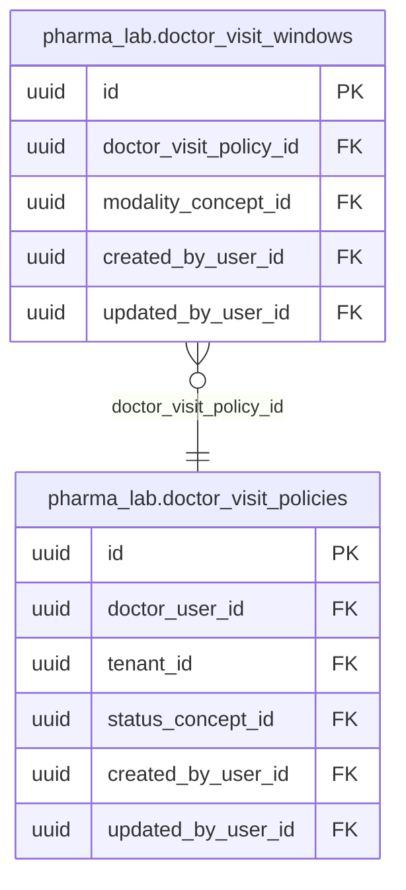

<!-- AUTOGENERADO por tools/inventario/catalogo.mjs. No editar manualmente. -->

# Catálogo del schema `pharma_lab`

- **Tablas:** 31 · **Columnas:** 449 (399 con descripción: 88.9 %) · **Índices:** 182
- **Dominio:** sin dato
- Método y límites del catálogo: [README del inventario](../README.md)

## Tablas

| Tabla | Propósito | Columnas | Índices | Operaciones | ORM |
|---|---|---|---|---|---|
| [doctor_visit_blocks](#doctor_visit_blocks) | Bloquea períodos en que un profesional no recibe visitas de representantes, coordinando el acceso de la industria farmacéutica a la agenda médica. | 12 | 6 | 5 | COINCIDE |
| [doctor_visit_policies](#doctor_visit_policies) | Define reglas de disponibilidad y confirmación de visitas de representantes para cada profesional, respetando su organización y zona horaria. | 17 | 5 | 9 | COINCIDE |
| [doctor_visit_windows](#doctor_visit_windows) | Detalla días y horarios permitidos por una política de visitas médicas para coordinar reuniones de representantes con profesionales de salud. | 14 | 4 | 8 | COINCIDE |
| [informational_materials](#informational_materials) | Registra materiales informativos de un laboratorio y producto, clasificados por especialidad, para su uso controlado en actividades de información médica. | 21 | 10 | 11 | COINCIDE |
| [material_approvals](#material_approvals) | Registra la aprobación de una versión de material informativo y el personal revisor, permitiendo controlar qué contenido farmacéutico puede circular. | 9 | 4 | 2 | COINCIDE |
| [material_assets](#material_assets) | Almacena referencias y tipos de archivos asociados a materiales informativos farmacéuticos para distribuir piezas aprobadas. | 9 | 3 | 3 | COINCIDE |
| [medical_visitor_products](#medical_visitor_products) | Asocia productos autorizados a cada representante médico y delimita su vigencia, controlando qué productos puede presentar ante profesionales. | 7 | 3 | 7 | COINCIDE |
| [medical_visitor_specialties](#medical_visitor_specialties) | Asocia especialidades médicas con representantes para ajustar la comunicación de productos a las áreas clínicas que atienden. | 5 | 3 | 5 | COINCIDE |
| [medical_visitors](#medical_visitors) | Identifica representantes médicos y los vincula con su laboratorio, usuario y registro de personal para gestionar visitas profesionales. | 27 | 11 | 24 | COINCIDE |
| [pharma_cost_allocations](#pharma_cost_allocations) | Asigna importes contables a laboratorio, producto y representante, para rastrear costos de actividades de promoción farmacéutica. | 18 | 9 | 2 | COINCIDE |
| [pharma_lab_link_events](#pharma_lab_link_events) | Registra eventos de vinculación entre laboratorio, personal, representante y usuario, dejando trazabilidad de la gestión de acceso a la red farmacéutica. | 13 | 6 | 7 | COINCIDE |
| [pharma_lab_notices](#pharma_lab_notices) | Guarda avisos dirigidos a usuarios de un laboratorio con plantilla y asunto, para comunicar información operativa de actividades farmacéuticas. | 15 | 4 | 16 | COINCIDE |
| [pharma_lab_staff](#pharma_lab_staff) | Relaciona usuarios con laboratorios y roles de personal, definiendo quién puede gestionar productos, documentos y visitas farmacéuticas. | 19 | 8 | 15 | COINCIDE |
| [pharma_labs](#pharma_labs) | Representa laboratorios farmacéuticos y su tipo institucional para organizar productos, personal, documentos regulatorios y vínculos con profesionales. | 16 | 5 | 55 | COINCIDE |
| [pharma_products](#pharma_products) | Registra productos de cada laboratorio con nombre comercial y principio activo, conectándolos con información médica, visitas y farmacovigilancia. | 23 | 5 | 13 | COINCIDE |
| [pharmacovigilance_actions](#pharmacovigilance_actions) | Registra acciones y transiciones de estado sobre reportes de farmacovigilancia para dar seguimiento a casos de seguridad de productos. | 12 | 6 | 3 | COINCIDE |
| [pharmacovigilance_reports](#pharmacovigilance_reports) | Documenta casos de farmacovigilancia vinculados a laboratorio y producto, incluyendo código de caso y lote para investigar eventos de seguridad. | 23 | 11 | 6 | COINCIDE |
| [regulatory_document_access_log](#regulatory_document_access_log) | Audita accesos a documentos regulatorios y versiones concretas, conservando el tipo de acceso y el usuario que consultó documentación de cumplimiento farmacéutico. | 7 | 3 | 3 | COINCIDE |
| [regulatory_document_versions](#regulatory_document_versions) | Mantiene las versiones y referencias de almacenamiento de cada documento regulatorio para preservar la documentación vigente e histórica de productos y laboratorios. | 15 | 4 | 8 | COINCIDE |
| [regulatory_documents](#regulatory_documents) | Organiza documentos regulatorios de laboratorios, productos y representantes para respaldar cumplimiento y consulta de información farmacéutica. | 20 | 9 | 11 | COINCIDE |
| [visit_ratings](#visit_ratings) | Recoge valoraciones de visitas médicas vinculadas a su registro y profesional, para monitorear la calidad de la interacción entre representantes y médicos. | 17 | 5 | 3 | COINCIDE |
| [visit_record_materials](#visit_record_materials) | Relaciona una visita registrada con cada material informativo entregado y su versión, haciendo trazable la información farmacéutica presentada al profesional. | 7 | 3 | 1 | COINCIDE |
| [visit_records](#visit_records) | Documenta visitas efectivamente realizadas, vinculándolas con la solicitud, el representante, el profesional y el laboratorio para dejar constancia de la interacción médica. | 22 | 10 | 8 | COINCIDE |
| [visit_request_events](#visit_request_events) | Registra acciones y cambios de estado de solicitudes de visita, dando trazabilidad a su coordinación entre representantes y profesionales. | 11 | 6 | 10 | COINCIDE |
| [visit_request_topics](#visit_request_topics) | Asocia temas y productos farmacéuticos a una solicitud de visita para anticipar el contenido de la conversación con el profesional de salud. | 6 | 3 | 2 | COINCIDE |
| [visit_requests](#visit_requests) | Gestiona solicitudes de representantes a profesionales de salud, vinculando laboratorio, representante y médico para coordinar visitas. | 23 | 9 | 21 | COINCIDE |
| [visit_survey_answers](#visit_survey_answers) | Guarda respuestas tipadas a preguntas de encuestas de visitas, vinculadas a la respuesta y pregunta correspondientes, para evaluar interacciones de información médica. | 8 | 3 | 2 | COINCIDE |
| [visit_survey_questions](#visit_survey_questions) | Define preguntas, orden y tipo de respuesta de encuestas asociadas a visitas farmacéuticas, estandarizando la evaluación de esas interacciones. | 9 | 3 | 4 | COINCIDE |
| [visit_survey_responses](#visit_survey_responses) | Registra respuestas de profesionales a encuestas vinculadas a visitas realizadas, permitiendo evaluar la actividad informativa del laboratorio. | 12 | 6 | 6 | COINCIDE |
| [visit_surveys](#visit_surveys) | Define encuestas de un laboratorio y, cuando corresponde, de un producto y representante, para medir la experiencia de visitas médicas. | 17 | 7 | 7 | COINCIDE |
| [visitor_post_submissions](#visitor_post_submissions) | Registra publicaciones propuestas por representantes y vinculadas a su laboratorio y materiales informativos, para someter comunicación farmacéutica a gestión antes de difundirla. | 15 | 8 | 4 | COINCIDE |

## Diagrama entidad-relación

Las tablas se agrupan en familias por sus claves foráneas dentro del schema (máximo 40 por diagrama). Las FK hacia otros schemas se listan en la ficha de cada tabla.

### Familia 1 de 2 — 28 tablas

```mermaid
erDiagram
  pharma_lab_doctor_visit_blocks["pharma_lab.doctor_visit_blocks"] {
    uuid id PK
    uuid doctor_user_id FK
    uuid pharma_lab_id FK
    uuid medical_visitor_id FK
    uuid status_concept_id FK
    uuid created_by_user_id FK
    uuid updated_by_user_id FK
  }
  pharma_lab_medical_visitors["pharma_lab.medical_visitors"] {
    uuid id PK
    uuid pharma_lab_id FK
    uuid user_id FK
    uuid staff_id FK
    uuid supervisor_staff_id FK
    uuid branch_id FK
    uuid identity_verification_concept_id FK
    uuid contract_verification_concept_id FK
  }
  pharma_lab_pharma_labs["pharma_lab.pharma_labs"] {
    uuid id PK
    uuid tenant_id FK
    uuid lab_type_concept_id FK
    uuid status_concept_id FK
    uuid created_by_user_id FK
    uuid updated_by_user_id FK
  }
  pharma_lab_informational_materials["pharma_lab.informational_materials"] {
    uuid id PK
    uuid pharma_lab_id FK
    uuid pharma_product_id FK
    uuid specialty_concept_id FK
    uuid medical_visitor_id FK
    uuid kind_concept_id FK
    uuid approver_staff_id FK
    uuid status_concept_id FK
  }
  pharma_lab_medical_visitor_products["pharma_lab.medical_visitor_products"] {
    uuid id PK
    uuid medical_visitor_id FK
    uuid pharma_product_id FK
    uuid created_by_user_id FK
  }
  pharma_lab_medical_visitor_specialties["pharma_lab.medical_visitor_specialties"] {
    uuid id PK
    uuid medical_visitor_id FK
    uuid specialty_concept_id FK
    uuid created_by_user_id FK
  }
  pharma_lab_pharma_cost_allocations["pharma_lab.pharma_cost_allocations"] {
    uuid id PK
    uuid pharma_lab_id FK
    uuid journal_transaction_id FK
    uuid cost_type_concept_id FK
    uuid currency_concept_id FK
    uuid pharma_product_id FK
    uuid branch_id FK
    uuid medical_visitor_id FK
  }
  pharma_lab_pharma_lab_link_events["pharma_lab.pharma_lab_link_events"] {
    uuid id PK
    uuid pharma_lab_id FK
    uuid staff_id FK
    uuid medical_visitor_id FK
    uuid subject_user_id FK
    uuid event_type_concept_id FK
    uuid created_by_user_id FK
  }
  pharma_lab_pharma_lab_staff["pharma_lab.pharma_lab_staff"] {
    uuid id PK
    uuid pharma_lab_id FK
    uuid user_id FK
    uuid staff_type_concept_id FK
    uuid branch_id FK
    uuid credential_verification_concept_id FK
    uuid status_concept_id FK
    uuid created_by_user_id FK
  }
  pharma_lab_regulatory_documents["pharma_lab.regulatory_documents"] {
    uuid id PK
    uuid pharma_lab_id FK
    uuid pharma_product_id FK
    uuid medical_visitor_id FK
    uuid document_type_concept_id FK
    uuid status_concept_id FK
    uuid owner_staff_id FK
    uuid disclosure_level_concept_id FK
  }
  pharma_lab_visit_records["pharma_lab.visit_records"] {
    uuid id PK
    uuid visit_request_id FK
    uuid doctor_user_id FK
    uuid medical_visitor_id FK
    uuid pharma_lab_id FK
    uuid modality_concept_id FK
    uuid visitor_attendance_concept_id FK
    uuid doctor_attendance_concept_id FK
  }
  pharma_lab_visit_requests["pharma_lab.visit_requests"] {
    uuid id PK
    uuid medical_visitor_id FK
    uuid pharma_lab_id FK
    uuid doctor_user_id FK
    uuid doctor_tenant_id FK
    uuid modality_concept_id FK
    uuid status_concept_id FK
    uuid rescheduled_from_id FK
  }
  pharma_lab_visit_surveys["pharma_lab.visit_surveys"] {
    uuid id PK
    uuid pharma_lab_id FK
    uuid medical_visitor_id FK
    uuid pharma_product_id FK
    uuid specialty_concept_id FK
    uuid status_concept_id FK
    uuid created_by_user_id FK
    uuid updated_by_user_id FK
  }
  pharma_lab_visitor_post_submissions["pharma_lab.visitor_post_submissions"] {
    uuid id PK
    uuid pharma_lab_id FK
    uuid medical_visitor_id FK
    uuid informational_material_id FK
    uuid status_concept_id FK
    uuid decided_by_user_id FK
    uuid social_post_id FK
    uuid created_by_user_id FK
  }
  pharma_lab_pharma_products["pharma_lab.pharma_products"] {
    uuid id PK
    uuid pharma_lab_id FK
    uuid regulatory_status_concept_id FK
    uuid disclosure_level_concept_id FK
    uuid created_by_user_id FK
    uuid updated_by_user_id FK
  }
  pharma_lab_pharmacovigilance_reports["pharma_lab.pharmacovigilance_reports"] {
    uuid id PK
    uuid pharma_lab_id FK
    uuid pharma_product_id FK
    uuid event_type_concept_id FK
    uuid severity_concept_id FK
    uuid status_concept_id FK
    uuid reporter_type_concept_id FK
    uuid reporter_user_id FK
  }
  pharma_lab_material_approvals["pharma_lab.material_approvals"] {
    uuid id PK
    uuid informational_material_id FK
    uuid decision_concept_id FK
    uuid reviewer_staff_id FK
    uuid created_by_user_id FK
  }
  pharma_lab_material_assets["pharma_lab.material_assets"] {
    uuid id PK
    uuid informational_material_id FK
    uuid kind_concept_id FK
    uuid created_by_user_id FK
  }
  pharma_lab_visit_record_materials["pharma_lab.visit_record_materials"] {
    uuid id PK
    uuid visit_record_id FK
    uuid informational_material_id FK
    uuid created_by_user_id FK
  }
  pharma_lab_regulatory_document_access_log["pharma_lab.regulatory_document_access_log"] {
    uuid id PK
    uuid regulatory_document_id FK
    uuid regulatory_document_version_id FK
    uuid actor_user_id FK
  }
  pharma_lab_regulatory_document_versions["pharma_lab.regulatory_document_versions"] {
    uuid id PK
    uuid regulatory_document_id FK
    uuid status_concept_id FK
    uuid created_by_user_id FK
    uuid updated_by_user_id FK
  }
  pharma_lab_visit_ratings["pharma_lab.visit_ratings"] {
    uuid id PK
    uuid visit_record_id FK
    uuid doctor_user_id FK
    uuid kind_concept_id FK
    uuid created_by_user_id FK
    uuid updated_by_user_id FK
  }
  pharma_lab_visit_survey_responses["pharma_lab.visit_survey_responses"] {
    uuid id PK
    uuid visit_survey_id FK
    uuid visit_record_id FK
    uuid doctor_user_id FK
    uuid status_concept_id FK
    uuid created_by_user_id FK
    uuid updated_by_user_id FK
  }
  pharma_lab_visit_request_events["pharma_lab.visit_request_events"] {
    uuid id PK
    uuid visit_request_id FK
    uuid action_concept_id FK
    uuid previous_status_concept_id FK
    uuid new_status_concept_id FK
    uuid actor_user_id FK
    uuid created_by_user_id FK
  }
  pharma_lab_visit_request_topics["pharma_lab.visit_request_topics"] {
    uuid id PK
    uuid visit_request_id FK
    uuid pharma_product_id FK
    uuid created_by_user_id FK
  }
  pharma_lab_visit_survey_questions["pharma_lab.visit_survey_questions"] {
    uuid id PK
    uuid visit_survey_id FK
    uuid answer_type_concept_id FK
    uuid created_by_user_id FK
  }
  pharma_lab_pharmacovigilance_actions["pharma_lab.pharmacovigilance_actions"] {
    uuid id PK
    uuid pharmacovigilance_report_id FK
    uuid action_concept_id FK
    uuid previous_status_concept_id FK
    uuid new_status_concept_id FK
    uuid actor_user_id FK
    uuid created_by_user_id FK
  }
  pharma_lab_visit_survey_answers["pharma_lab.visit_survey_answers"] {
    uuid id PK
    uuid visit_survey_response_id FK
    uuid visit_survey_question_id FK
    uuid created_by_user_id FK
  }
  pharma_lab_doctor_visit_blocks }o--o| pharma_lab_pharma_labs : "pharma_lab_id"
  pharma_lab_doctor_visit_blocks }o--o| pharma_lab_medical_visitors : "medical_visitor_id"
  pharma_lab_medical_visitors }o--|| pharma_lab_pharma_labs : "pharma_lab_id"
  pharma_lab_medical_visitors }o--o| pharma_lab_pharma_lab_staff : "staff_id"
  pharma_lab_medical_visitors }o--o| pharma_lab_pharma_lab_staff : "supervisor_staff_id"
  pharma_lab_informational_materials }o--|| pharma_lab_pharma_labs : "pharma_lab_id"
  pharma_lab_informational_materials }o--o| pharma_lab_pharma_products : "pharma_product_id"
  pharma_lab_informational_materials }o--o| pharma_lab_medical_visitors : "medical_visitor_id"
  pharma_lab_informational_materials }o--o| pharma_lab_pharma_lab_staff : "approver_staff_id"
  pharma_lab_medical_visitor_products }o--|| pharma_lab_medical_visitors : "medical_visitor_id"
  pharma_lab_medical_visitor_products }o--|| pharma_lab_pharma_products : "pharma_product_id"
  pharma_lab_medical_visitor_specialties }o--|| pharma_lab_medical_visitors : "medical_visitor_id"
  pharma_lab_pharma_cost_allocations }o--|| pharma_lab_pharma_labs : "pharma_lab_id"
  pharma_lab_pharma_cost_allocations }o--o| pharma_lab_pharma_products : "pharma_product_id"
  pharma_lab_pharma_cost_allocations }o--o| pharma_lab_medical_visitors : "medical_visitor_id"
  pharma_lab_pharma_lab_link_events }o--|| pharma_lab_pharma_labs : "pharma_lab_id"
  pharma_lab_pharma_lab_link_events }o--o| pharma_lab_pharma_lab_staff : "staff_id"
  pharma_lab_pharma_lab_link_events }o--o| pharma_lab_medical_visitors : "medical_visitor_id"
  pharma_lab_pharma_lab_staff }o--|| pharma_lab_pharma_labs : "pharma_lab_id"
  pharma_lab_regulatory_documents }o--|| pharma_lab_pharma_labs : "pharma_lab_id"
  pharma_lab_regulatory_documents }o--o| pharma_lab_pharma_products : "pharma_product_id"
  pharma_lab_regulatory_documents }o--o| pharma_lab_medical_visitors : "medical_visitor_id"
  pharma_lab_regulatory_documents }o--o| pharma_lab_pharma_lab_staff : "owner_staff_id"
  pharma_lab_visit_records }o--|| pharma_lab_visit_requests : "visit_request_id"
  pharma_lab_visit_records }o--|| pharma_lab_medical_visitors : "medical_visitor_id"
  pharma_lab_visit_records }o--|| pharma_lab_pharma_labs : "pharma_lab_id"
  pharma_lab_visit_requests }o--|| pharma_lab_medical_visitors : "medical_visitor_id"
  pharma_lab_visit_requests }o--|| pharma_lab_pharma_labs : "pharma_lab_id"
  pharma_lab_visit_surveys }o--|| pharma_lab_pharma_labs : "pharma_lab_id"
  pharma_lab_visit_surveys }o--o| pharma_lab_medical_visitors : "medical_visitor_id"
  pharma_lab_visit_surveys }o--o| pharma_lab_pharma_products : "pharma_product_id"
  pharma_lab_visitor_post_submissions }o--|| pharma_lab_pharma_labs : "pharma_lab_id"
  pharma_lab_visitor_post_submissions }o--|| pharma_lab_medical_visitors : "medical_visitor_id"
  pharma_lab_visitor_post_submissions }o--o| pharma_lab_informational_materials : "informational_material_id"
  pharma_lab_pharma_products }o--|| pharma_lab_pharma_labs : "pharma_lab_id"
  pharma_lab_pharmacovigilance_reports }o--|| pharma_lab_pharma_labs : "pharma_lab_id"
  pharma_lab_pharmacovigilance_reports }o--|| pharma_lab_pharma_products : "pharma_product_id"
  pharma_lab_material_approvals }o--|| pharma_lab_informational_materials : "informational_material_id"
  pharma_lab_material_approvals }o--o| pharma_lab_pharma_lab_staff : "reviewer_staff_id"
  pharma_lab_material_assets }o--|| pharma_lab_informational_materials : "informational_material_id"
  pharma_lab_visit_record_materials }o--|| pharma_lab_visit_records : "visit_record_id"
  pharma_lab_visit_record_materials }o--|| pharma_lab_informational_materials : "informational_material_id"
  pharma_lab_regulatory_document_access_log }o--|| pharma_lab_regulatory_documents : "regulatory_document_id"
  pharma_lab_regulatory_document_access_log }o--o| pharma_lab_regulatory_document_versions : "regulatory_document_version_id"
  pharma_lab_regulatory_document_versions }o--|| pharma_lab_regulatory_documents : "regulatory_document_id"
  pharma_lab_visit_ratings }o--|| pharma_lab_visit_records : "visit_record_id"
  pharma_lab_visit_survey_responses }o--|| pharma_lab_visit_surveys : "visit_survey_id"
  pharma_lab_visit_survey_responses }o--|| pharma_lab_visit_records : "visit_record_id"
  pharma_lab_visit_request_events }o--|| pharma_lab_visit_requests : "visit_request_id"
  pharma_lab_visit_request_topics }o--|| pharma_lab_visit_requests : "visit_request_id"
  pharma_lab_visit_request_topics }o--o| pharma_lab_pharma_products : "pharma_product_id"
  pharma_lab_visit_survey_questions }o--|| pharma_lab_visit_surveys : "visit_survey_id"
  pharma_lab_pharmacovigilance_actions }o--|| pharma_lab_pharmacovigilance_reports : "pharmacovigilance_report_id"
  pharma_lab_visit_survey_answers }o--|| pharma_lab_visit_survey_responses : "visit_survey_response_id"
  pharma_lab_visit_survey_answers }o--|| pharma_lab_visit_survey_questions : "visit_survey_question_id"
```

### Familia 2 de 2 — 2 tablas

### Tablas sin relaciones dentro del schema

`pharma_lab.pharma_lab_notices`

## Fichas

### doctor_visit_blocks

#### Vista general

Bloquea períodos en que un profesional no recibe visitas de representantes, coordinando el acceso de la industria farmacéutica a la agenda médica.

- **Estado del propósito:** DOMAIN_CURATED_DRAFT · fuente: `Mantra Core Health Context/modules/diagram_69_pharma_lab.puml:16: entity doctor_visit_blocks {`
- **Dominio:** sin dato · **Diagrama:** `Mantra Core Health Context/modules/diagram_69_pharma_lab.puml` · **DDL:** `SQL/69_pharma_lab/02_tables.sql`
- **Entidad del ORM:** `DoctorVisitBlocks` — `src/modules/pharma_lab/entities/doctor_visit_blocks.entity.ts`
- **Resumen:** 12 columnas · 6 índices · 6 FK salientes · 0 entrantes · 5 operaciones

#### Columnas

| # | Columna | Tipo | Rol estructural | Descripción | ORM |
|---|---|---|---|---|---|
| 1 | `id` | `uuid` | Clave primaria; Obligatoria | Identificador único de la instancia. _(JSDOC_ESTANDAR, `src/modules/pharma_lab/entities/doctor_visit_blocks.entity.ts:17`)_ | coincide |
| 2 | `doctor_user_id` | `uuid` | Clave foránea → iam.users.id; Obligatoria | Doctor que bloquea. _(JSDOC_ENTIDAD, `src/modules/pharma_lab/entities/doctor_visit_blocks.entity.ts:23`)_ | coincide |
| 3 | `pharma_lab_id` | `uuid` | Clave foránea → pharma_lab.pharma_labs.id; Opcional | Laboratorio bloqueado, si el bloqueo es institucional. _(JSDOC_ENTIDAD, `src/modules/pharma_lab/entities/doctor_visit_blocks.entity.ts:29`)_ | coincide |
| 4 | `medical_visitor_id` | `uuid` | Clave foránea → pharma_lab.medical_visitors.id; Opcional | Visitador bloqueado, si el bloqueo es individual. _(JSDOC_ENTIDAD, `src/modules/pharma_lab/entities/doctor_visit_blocks.entity.ts:35`)_ | coincide |
| 5 | `reason` | `text` | Obligatoria | Razón justificada del bloqueo. _(JSDOC_ENTIDAD, `src/modules/pharma_lab/entities/doctor_visit_blocks.entity.ts:41`)_ | coincide |
| 6 | `status_concept_id` | `uuid` | Clave foránea → terminology.catalog_concepts.id; Obligatoria | Estado del bloqueo: vigente o levantado. _(JSDOC_ENTIDAD, `src/modules/pharma_lab/entities/doctor_visit_blocks.entity.ts:47`)_ | coincide |
| 7 | `lifted_at` | `timestamptz` | Opcional | Momento en que se levantó el bloqueo. _(JSDOC_ENTIDAD, `src/modules/pharma_lab/entities/doctor_visit_blocks.entity.ts:53`)_ | coincide |
| 8 | `created_at` | `timestamptz` | Obligatoria | Fecha y hora en que se creó el registro. _(JSDOC_ESTANDAR, `src/modules/pharma_lab/entities/doctor_visit_blocks.entity.ts:63`)_ | coincide |
| 9 | `updated_at` | `timestamptz` | Obligatoria | Fecha y hora de la última actualización. _(JSDOC_ESTANDAR, `src/modules/pharma_lab/entities/doctor_visit_blocks.entity.ts:69`)_ | coincide |
| 10 | `created_by_user_id` | `uuid` | Clave foránea → iam.users.id; Opcional | _sin dato_ | coincide |
| 11 | `updated_by_user_id` | `uuid` | Clave foránea → iam.users.id; Opcional | _sin dato_ | coincide |
| 12 | `row_version` | `integer = 1` | Obligatoria | Versión usada para controlar actualizaciones concurrentes. _(JSDOC_ENTIDAD, `src/modules/pharma_lab/entities/doctor_visit_blocks.entity.ts:87`)_ | coincide |

#### Relaciones

| Sentido | Columnas | Tabla | Restricción |
|---|---|---|---|
| hacia | pharma_lab_id | pharma_lab.pharma_labs (id) | fk_doctor_visit_blocks_pharma_lab_id |
| hacia | medical_visitor_id | pharma_lab.medical_visitors (id) | fk_doctor_visit_blocks_medical_visitor_id |
| hacia | doctor_user_id | iam.users (id) | fk_doctor_visit_blocks_doctor_user_id |
| hacia | status_concept_id | terminology.catalog_concepts (id) | fk_doctor_visit_blocks_status_concept_id |
| hacia | created_by_user_id | iam.users (id) | fk_doctor_visit_blocks_created_by_user_id |
| hacia | updated_by_user_id | iam.users (id) | fk_doctor_visit_blocks_updated_by_user_id |

#### Índices

| Índice | Único | Columnas | Para qué |
|---|---|---|---|
| `ix_doctor_visit_blocks_doctor_user_id` | no | doctor_user_id | Soporta la clave foránea fk_doctor_visit_blocks_doctor_user_id: PostgreSQL no indexa las FK por sí mismo _(DOCUMENTO)_; 2 consulta(s) de repositorio filtran u ordenan por «doctor_user_id», la primera columna del índice _(CONSULTA)_ |
| `ix_doctor_visit_blocks_pharma_lab_id` | no | pharma_lab_id | Soporta la clave foránea fk_doctor_visit_blocks_pharma_lab_id: PostgreSQL no indexa las FK por sí mismo _(DOCUMENTO)_ |
| `ix_doctor_visit_blocks_medical_visitor_id` | no | medical_visitor_id | Soporta la clave foránea fk_doctor_visit_blocks_medical_visitor_id: PostgreSQL no indexa las FK por sí mismo _(DOCUMENTO)_ |
| `ix_doctor_visit_blocks_status_concept_id` | no | status_concept_id | Soporta la clave foránea fk_doctor_visit_blocks_status_concept_id: PostgreSQL no indexa las FK por sí mismo _(DOCUMENTO)_; 2 consulta(s) de repositorio filtran u ordenan por «status_concept_id», la primera columna del índice _(CONSULTA)_ |
| `ix_doctor_visit_blocks_created_by_user_id` | no | created_by_user_id | Soporta la clave foránea fk_doctor_visit_blocks_created_by_user_id: PostgreSQL no indexa las FK por sí mismo _(DOCUMENTO)_ |
| `ix_doctor_visit_blocks_updated_by_user_id` | no | updated_by_user_id | Soporta la clave foránea fk_doctor_visit_blocks_updated_by_user_id: PostgreSQL no indexa las FK por sí mismo _(DOCUMENTO)_ |

#### Operaciones que la tocan

| Operación | Efecto | Confianza |
|---|---|---|
| GET /visit-agenda/blocks | LEE | DIRECTA |
| POST /visit-agenda/blocks | CREA | DIRECTA |
| POST /visit-agenda/blocks/{blockId}/lift | ACTUALIZA | POR_TIPO |
| POST /visit-agenda/blocks/{blockId}/lift | LEE | DIRECTA |
| POST /visit-requests | LEE | DIRECTA |

#### Gobierno

| Atributo | Valor | Fuente |
|---|---|---|
| Append-only | no declarado | — |
| Datos personales | sin fuente | — |
| Financiera | sin fuente | — |
| Crítica para auditoría | sin fuente | — |
| Retención | sin fuente | — |
| Responsable | sin fuente | — |
| Revisión | AUTO_DETECTADA | — |

---

### doctor_visit_policies

#### Vista general

Define reglas de disponibilidad y confirmación de visitas de representantes para cada profesional, respetando su organización y zona horaria.

- **Estado del propósito:** DOMAIN_CURATED_DRAFT · fuente: `Mantra Core Health Context/modules/diagram_69_pharma_lab.puml:31: entity doctor_visit_policies {`
- **Dominio:** sin dato · **Diagrama:** `Mantra Core Health Context/modules/diagram_69_pharma_lab.puml` · **DDL:** `SQL/69_pharma_lab/02_tables.sql`
- **Entidad del ORM:** `DoctorVisitPolicies` — `src/modules/pharma_lab/entities/doctor_visit_policies.entity.ts`
- **Resumen:** 17 columnas · 5 índices · 5 FK salientes · 1 entrantes · 9 operaciones

#### Columnas

| # | Columna | Tipo | Rol estructural | Descripción | ORM |
|---|---|---|---|---|---|
| 1 | `id` | `uuid` | Clave primaria; Obligatoria | Identificador único de la instancia. _(JSDOC_ESTANDAR, `src/modules/pharma_lab/entities/doctor_visit_policies.entity.ts:18`)_ | coincide |
| 2 | `doctor_user_id` | `uuid` | Clave foránea → iam.users.id; Obligatoria | Doctor dueño de la agenda. _(JSDOC_ENTIDAD, `src/modules/pharma_lab/entities/doctor_visit_policies.entity.ts:24`)_ | coincide |
| 3 | `tenant_id` | `uuid` | Clave foránea → directory.tenants.id; Opcional | Organización del doctor bajo la que se atienden las visitas. _(JSDOC_ENTIDAD, `src/modules/pharma_lab/entities/doctor_visit_policies.entity.ts:30`)_ | coincide |
| 4 | `time_zone` | `varchar` | Opcional | Zona horaria que rige los horarios. Si falta, se usa la de la organización y, en último término, la del doctor (spec 5379). _(JSDOC_ENTIDAD, `src/modules/pharma_lab/entities/doctor_visit_policies.entity.ts:37`)_ | coincide |
| 5 | `auto_confirm` | `boolean = false` | Obligatoria | Si la confirmación es automática cuando la solicitud cumple todas las reglas (spec 5413). _(JSDOC_ENTIDAD, `src/modules/pharma_lab/entities/doctor_visit_policies.entity.ts:44`)_ | coincide |
| 6 | `max_visits_per_day` | `integer` | Opcional | Máximo de visitas aceptadas por día. _(JSDOC_ENTIDAD, `src/modules/pharma_lab/entities/doctor_visit_policies.entity.ts:50`)_ | coincide |
| 7 | `min_notice_hours` | `integer` | Obligatoria | Antelación mínima, en horas, con la que se puede solicitar una visita. _(JSDOC_ENTIDAD, `src/modules/pharma_lab/entities/doctor_visit_policies.entity.ts:60`)_ | coincide |
| 8 | `reschedule_cutoff_hours` | `integer` | Obligatoria | Plazo, en horas antes del inicio, dentro del cual el visitador todavía puede reprogramar o cancelar (spec 5377-5378). _(JSDOC_ENTIDAD, `src/modules/pharma_lab/entities/doctor_visit_policies.entity.ts:67`)_ | coincide |
| 9 | `allowed_specialty_concept_ids` | `jsonb` | Opcional | Especialidades o categorías de producto admitidas (spec 5407, 5417). Vacío o nulo significa «sin restricción por especialidad». _(JSDOC_ENTIDAD, `src/modules/pharma_lab/entities/doctor_visit_policies.entity.ts:74`)_ | coincide |
| 10 | `allowed_modality_concept_ids` | `jsonb` | Opcional | Modalidades admitidas. Nulo significa «cualquiera de las configuradas en las ventanas». _(JSDOC_ENTIDAD, `src/modules/pharma_lab/entities/doctor_visit_policies.entity.ts:86`)_ | coincide |
| 11 | `max_duration_minutes` | `integer` | Opcional | Duración máxima admitida, en minutos. _(JSDOC_ENTIDAD, `src/modules/pharma_lab/entities/doctor_visit_policies.entity.ts:97`)_ | coincide |
| 12 | `status_concept_id` | `uuid` | Clave foránea → terminology.catalog_concepts.id; Obligatoria | Estado de la política. _(JSDOC_ENTIDAD, `src/modules/pharma_lab/entities/doctor_visit_policies.entity.ts:107`)_ | coincide |
| 13 | `created_at` | `timestamptz` | Obligatoria | Fecha y hora en que se creó el registro. _(JSDOC_ESTANDAR, `src/modules/pharma_lab/entities/doctor_visit_policies.entity.ts:113`)_ | coincide |
| 14 | `updated_at` | `timestamptz` | Obligatoria | Fecha y hora de la última actualización. _(JSDOC_ESTANDAR, `src/modules/pharma_lab/entities/doctor_visit_policies.entity.ts:119`)_ | coincide |
| 15 | `created_by_user_id` | `uuid` | Clave foránea → iam.users.id; Opcional | _sin dato_ | coincide |
| 16 | `updated_by_user_id` | `uuid` | Clave foránea → iam.users.id; Opcional | _sin dato_ | coincide |
| 17 | `row_version` | `integer = 1` | Obligatoria | Versión usada para controlar actualizaciones concurrentes. _(JSDOC_ENTIDAD, `src/modules/pharma_lab/entities/doctor_visit_policies.entity.ts:137`)_ | coincide |

#### Relaciones

| Sentido | Columnas | Tabla | Restricción |
|---|---|---|---|
| hacia | doctor_user_id | iam.users (id) | fk_doctor_visit_policies_doctor_user_id |
| hacia | tenant_id | directory.tenants (id) | fk_doctor_visit_policies_tenant_id |
| hacia | status_concept_id | terminology.catalog_concepts (id) | fk_doctor_visit_policies_status_concept_id |
| hacia | created_by_user_id | iam.users (id) | fk_doctor_visit_policies_created_by_user_id |
| hacia | updated_by_user_id | iam.users (id) | fk_doctor_visit_policies_updated_by_user_id |
| desde | id | pharma_lab.doctor_visit_windows (doctor_visit_policy_id) | fk_doctor_visit_windows_doctor_visit_policy_id |

#### Índices

| Índice | Único | Columnas | Para qué |
|---|---|---|---|
| `ux_doctor_visit_policies_doctor_user_id` | sí | doctor_user_id | Garantiza que no se repita la combinación (doctor_user_id) _(DOCUMENTO)_; Soporta la clave foránea fk_doctor_visit_policies_doctor_user_id: PostgreSQL no indexa las FK por sí mismo _(DOCUMENTO)_; 1 consulta(s) de repositorio filtran u ordenan por «doctor_user_id», la primera columna del índice _(CONSULTA)_ |
| `ix_doctor_visit_policies_tenant_id` | no | tenant_id | Soporta la clave foránea fk_doctor_visit_policies_tenant_id: PostgreSQL no indexa las FK por sí mismo _(DOCUMENTO)_ |
| `ix_doctor_visit_policies_status_concept_id` | no | status_concept_id | Soporta la clave foránea fk_doctor_visit_policies_status_concept_id: PostgreSQL no indexa las FK por sí mismo _(DOCUMENTO)_ |
| `ix_doctor_visit_policies_created_by_user_id` | no | created_by_user_id | Soporta la clave foránea fk_doctor_visit_policies_created_by_user_id: PostgreSQL no indexa las FK por sí mismo _(DOCUMENTO)_ |
| `ix_doctor_visit_policies_updated_by_user_id` | no | updated_by_user_id | Soporta la clave foránea fk_doctor_visit_policies_updated_by_user_id: PostgreSQL no indexa las FK por sí mismo _(DOCUMENTO)_ |

#### Restricciones

| Restricción | Tipo | Definición |
|---|---|---|
| `ux_doctor_visit_policies_doctor_user_id` | UNIQUE INDEX | UNIQUE INDEX ("doctor_user_id") |

#### Operaciones que la tocan

| Operación | Efecto | Confianza |
|---|---|---|
| GET /visit-agenda/doctors/{doctorUserId} | LEE | DIRECTA |
| GET /visit-agenda/me | LEE | DIRECTA |
| PUT /visit-agenda/me | ACTUALIZA | POR_TIPO |
| PUT /visit-agenda/me | CREA | DIRECTA |
| PUT /visit-agenda/me | LEE | DIRECTA |
| POST /visit-requests | LEE | DIRECTA |
| POST /visit-requests/{visitRequestId}/cancel | LEE | DIRECTA |
| POST /visit-requests/{visitRequestId}/propose-time | LEE | DIRECTA |
| POST /visit-requests/{visitRequestId}/reschedule | LEE | DIRECTA |

#### Gobierno

| Atributo | Valor | Fuente |
|---|---|---|
| Append-only | no declarado | — |
| Datos personales | sin fuente | — |
| Financiera | sin fuente | — |
| Crítica para auditoría | sin fuente | — |
| Retención | sin fuente | — |
| Responsable | sin fuente | — |
| Revisión | AUTO_DETECTADA | — |

---

### doctor_visit_windows

#### Vista general

Detalla días y horarios permitidos por una política de visitas médicas para coordinar reuniones de representantes con profesionales de salud.

- **Estado del propósito:** DOMAIN_CURATED_DRAFT · fuente: `Mantra Core Health Context/modules/diagram_69_pharma_lab.puml:51: entity doctor_visit_windows {`
- **Dominio:** sin dato · **Diagrama:** `Mantra Core Health Context/modules/diagram_69_pharma_lab.puml` · **DDL:** `SQL/69_pharma_lab/02_tables.sql`
- **Entidad del ORM:** `DoctorVisitWindows` — `src/modules/pharma_lab/entities/doctor_visit_windows.entity.ts`
- **Resumen:** 14 columnas · 4 índices · 4 FK salientes · 0 entrantes · 8 operaciones

#### Columnas

| # | Columna | Tipo | Rol estructural | Descripción | ORM |
|---|---|---|---|---|---|
| 1 | `id` | `uuid` | Clave primaria; Obligatoria | Identificador único de la instancia. _(JSDOC_ESTANDAR, `src/modules/pharma_lab/entities/doctor_visit_windows.entity.ts:16`)_ | coincide |
| 2 | `doctor_visit_policy_id` | `uuid` | Clave foránea → pharma_lab.doctor_visit_policies.id; Obligatoria | Política a la que pertenece la ventana. _(JSDOC_ENTIDAD, `src/modules/pharma_lab/entities/doctor_visit_windows.entity.ts:22`)_ | coincide |
| 3 | `weekday` | `integer` | Obligatoria | Día de la semana, 0 = domingo … 6 = sábado (`Date#getUTCDay`). _(JSDOC_ENTIDAD, `src/modules/pharma_lab/entities/doctor_visit_windows.entity.ts:28`)_ | coincide |
| 4 | `start_time` | `time` | Obligatoria | Hora de inicio, `HH:MM` en la zona horaria de la política. _(JSDOC_ENTIDAD, `src/modules/pharma_lab/entities/doctor_visit_windows.entity.ts:34`)_ | coincide |
| 5 | `end_time` | `time` | Obligatoria | Hora de fin, `HH:MM`. _(JSDOC_ENTIDAD, `src/modules/pharma_lab/entities/doctor_visit_windows.entity.ts:40`)_ | coincide |
| 6 | `slot_duration_minutes` | `integer` | Obligatoria | Duración estándar de cada visita en la ventana, en minutos. _(JSDOC_ENTIDAD, `src/modules/pharma_lab/entities/doctor_visit_windows.entity.ts:46`)_ | coincide |
| 7 | `modality_concept_id` | `uuid` | Clave foránea → terminology.catalog_concepts.id; Obligatoria | Modalidad de la ventana. _(JSDOC_ENTIDAD, `src/modules/pharma_lab/entities/doctor_visit_windows.entity.ts:52`)_ | coincide |
| 8 | `location` | `varchar` | Opcional | Ubicación física o enlace de la reunión. _(JSDOC_ENTIDAD, `src/modules/pharma_lab/entities/doctor_visit_windows.entity.ts:58`)_ | coincide |
| 9 | `max_visits` | `integer` | Opcional | Máximo de visitas admitidas dentro de esta ventana. _(JSDOC_ENTIDAD, `src/modules/pharma_lab/entities/doctor_visit_windows.entity.ts:64`)_ | coincide |
| 10 | `created_at` | `timestamptz` | Obligatoria | Fecha y hora en que se creó el registro. _(JSDOC_ESTANDAR, `src/modules/pharma_lab/entities/doctor_visit_windows.entity.ts:70`)_ | coincide |
| 11 | `updated_at` | `timestamptz` | Obligatoria | Fecha y hora de la última actualización. _(JSDOC_ESTANDAR, `src/modules/pharma_lab/entities/doctor_visit_windows.entity.ts:76`)_ | coincide |
| 12 | `created_by_user_id` | `uuid` | Clave foránea → iam.users.id; Opcional | _sin dato_ | coincide |
| 13 | `updated_by_user_id` | `uuid` | Clave foránea → iam.users.id; Opcional | _sin dato_ | coincide |
| 14 | `row_version` | `integer = 1` | Obligatoria | Versión usada para controlar actualizaciones concurrentes. _(JSDOC_ENTIDAD, `src/modules/pharma_lab/entities/doctor_visit_windows.entity.ts:94`)_ | coincide |

#### Relaciones

| Sentido | Columnas | Tabla | Restricción |
|---|---|---|---|
| hacia | doctor_visit_policy_id | pharma_lab.doctor_visit_policies (id) | fk_doctor_visit_windows_doctor_visit_policy_id |
| hacia | modality_concept_id | terminology.catalog_concepts (id) | fk_doctor_visit_windows_modality_concept_id |
| hacia | created_by_user_id | iam.users (id) | fk_doctor_visit_windows_created_by_user_id |
| hacia | updated_by_user_id | iam.users (id) | fk_doctor_visit_windows_updated_by_user_id |

#### Índices

| Índice | Único | Columnas | Para qué |
|---|---|---|---|
| `ix_doctor_visit_windows_doctor_visit_policy_id` | no | doctor_visit_policy_id | Soporta la clave foránea fk_doctor_visit_windows_doctor_visit_policy_id: PostgreSQL no indexa las FK por sí mismo _(DOCUMENTO)_; 2 consulta(s) de repositorio filtran u ordenan por «doctor_visit_policy_id», la primera columna del índice _(CONSULTA)_ |
| `ix_doctor_visit_windows_modality_concept_id` | no | modality_concept_id | Soporta la clave foránea fk_doctor_visit_windows_modality_concept_id: PostgreSQL no indexa las FK por sí mismo _(DOCUMENTO)_ |
| `ix_doctor_visit_windows_created_by_user_id` | no | created_by_user_id | Soporta la clave foránea fk_doctor_visit_windows_created_by_user_id: PostgreSQL no indexa las FK por sí mismo _(DOCUMENTO)_ |
| `ix_doctor_visit_windows_updated_by_user_id` | no | updated_by_user_id | Soporta la clave foránea fk_doctor_visit_windows_updated_by_user_id: PostgreSQL no indexa las FK por sí mismo _(DOCUMENTO)_ |

#### Operaciones que la tocan

| Operación | Efecto | Confianza |
|---|---|---|
| GET /visit-agenda/doctors/{doctorUserId} | LEE | DIRECTA |
| GET /visit-agenda/me | LEE | DIRECTA |
| PUT /visit-agenda/me | BORRA | DIRECTA |
| PUT /visit-agenda/me | CREA | DIRECTA |
| POST /visit-requests | LEE | DIRECTA |
| POST /visit-requests/{visitRequestId}/cancel | LEE | DIRECTA |
| POST /visit-requests/{visitRequestId}/propose-time | LEE | DIRECTA |
| POST /visit-requests/{visitRequestId}/reschedule | LEE | DIRECTA |

#### Gobierno

| Atributo | Valor | Fuente |
|---|---|---|
| Append-only | no declarado | — |
| Datos personales | sin fuente | — |
| Financiera | sin fuente | — |
| Crítica para auditoría | sin fuente | — |
| Retención | sin fuente | — |
| Responsable | sin fuente | — |
| Revisión | AUTO_DETECTADA | — |

---

### informational_materials

#### Vista general

Registra materiales informativos de un laboratorio y producto, clasificados por especialidad, para su uso controlado en actividades de información médica.

- **Estado del propósito:** DOMAIN_CURATED_DRAFT · fuente: `Mantra Core Health Context/modules/diagram_69_pharma_lab.puml:68: entity informational_materials {`
- **Dominio:** sin dato · **Diagrama:** `Mantra Core Health Context/modules/diagram_69_pharma_lab.puml` · **DDL:** `SQL/69_pharma_lab/02_tables.sql`
- **Entidad del ORM:** `InformationalMaterials` — `src/modules/pharma_lab/entities/informational_materials.entity.ts`
- **Resumen:** 21 columnas · 10 índices · 10 FK salientes · 5 entrantes · 11 operaciones

#### Columnas

| # | Columna | Tipo | Rol estructural | Descripción | ORM |
|---|---|---|---|---|---|
| 1 | `id` | `uuid` | Clave primaria; Obligatoria | Identificador único de la instancia. _(JSDOC_ESTANDAR, `src/modules/pharma_lab/entities/informational_materials.entity.ts:17`)_ | coincide |
| 2 | `pharma_lab_id` | `uuid` | Clave foránea → pharma_lab.pharma_labs.id; Obligatoria | Laboratorio propietario. _(JSDOC_ENTIDAD, `src/modules/pharma_lab/entities/informational_materials.entity.ts:23`)_ | coincide |
| 3 | `pharma_product_id` | `uuid` | Clave foránea → pharma_lab.pharma_products.id; Opcional | Medicamento al que se asocia, si aplica. _(JSDOC_ENTIDAD, `src/modules/pharma_lab/entities/informational_materials.entity.ts:29`)_ | coincide |
| 4 | `campaign_code` | `varchar` | Opcional | Campaña comercial a la que pertenece. _(JSDOC_ENTIDAD, `src/modules/pharma_lab/entities/informational_materials.entity.ts:35`)_ | coincide |
| 5 | `specialty_concept_id` | `uuid` | Clave foránea → terminology.catalog_concepts.id; Opcional | Especialidad a la que está dirigido. _(JSDOC_ENTIDAD, `src/modules/pharma_lab/entities/informational_materials.entity.ts:45`)_ | coincide |
| 6 | `medical_visitor_id` | `uuid` | Clave foránea → pharma_lab.medical_visitors.id; Opcional | Visitador al que se asigna en exclusiva, si corresponde. _(JSDOC_ENTIDAD, `src/modules/pharma_lab/entities/informational_materials.entity.ts:51`)_ | coincide |
| 7 | `title` | `varchar` | Obligatoria | Título del material. _(JSDOC_ENTIDAD, `src/modules/pharma_lab/entities/informational_materials.entity.ts:57`)_ | coincide |
| 8 | `kind_concept_id` | `uuid` | Clave foránea → terminology.catalog_concepts.id; Obligatoria | Tipo: ficha técnica, estudio, documento científico, presentación, video o información regulatoria. _(JSDOC_ENTIDAD, `src/modules/pharma_lab/entities/informational_materials.entity.ts:64`)_ | coincide |
| 9 | `version` | `varchar` | Obligatoria | Versión del material. _(JSDOC_ENTIDAD, `src/modules/pharma_lab/entities/informational_materials.entity.ts:70`)_ | coincide |
| 10 | `author_name` | `varchar` | Opcional | Autor. _(JSDOC_ENTIDAD, `src/modules/pharma_lab/entities/informational_materials.entity.ts:76`)_ | coincide |
| 11 | `approver_staff_id` | `uuid` | Clave foránea → pharma_lab.pharma_lab_staff.id; Opcional | Responsable de la aprobación. _(JSDOC_ENTIDAD, `src/modules/pharma_lab/entities/informational_materials.entity.ts:82`)_ | coincide |
| 12 | `valid_from` | `date` | Opcional | Inicio de vigencia. _(JSDOC_ENTIDAD, `src/modules/pharma_lab/entities/informational_materials.entity.ts:88`)_ | coincide |
| 13 | `valid_to` | `date` | Opcional | Fin de vigencia. _(JSDOC_ENTIDAD, `src/modules/pharma_lab/entities/informational_materials.entity.ts:94`)_ | coincide |
| 14 | `status_concept_id` | `uuid` | Clave foránea → terminology.catalog_concepts.id; Obligatoria | Estado de revisión/aprobación. _(JSDOC_ENTIDAD, `src/modules/pharma_lab/entities/informational_materials.entity.ts:100`)_ | coincide |
| 15 | `disclosure_level_concept_id` | `uuid` | Clave foránea → terminology.catalog_concepts.id; Obligatoria | Nivel de divulgación. _(JSDOC_ENTIDAD, `src/modules/pharma_lab/entities/informational_materials.entity.ts:106`)_ | coincide |
| 16 | `approved_at` | `timestamptz` | Opcional | Momento de la aprobación vigente. _(JSDOC_ENTIDAD, `src/modules/pharma_lab/entities/informational_materials.entity.ts:112`)_ | coincide |
| 17 | `created_at` | `timestamptz` | Obligatoria | Fecha y hora en que se creó el registro. _(JSDOC_ESTANDAR, `src/modules/pharma_lab/entities/informational_materials.entity.ts:122`)_ | coincide |
| 18 | `updated_at` | `timestamptz` | Obligatoria | Fecha y hora de la última actualización. _(JSDOC_ESTANDAR, `src/modules/pharma_lab/entities/informational_materials.entity.ts:128`)_ | coincide |
| 19 | `created_by_user_id` | `uuid` | Clave foránea → iam.users.id; Opcional | _sin dato_ | coincide |
| 20 | `updated_by_user_id` | `uuid` | Clave foránea → iam.users.id; Opcional | _sin dato_ | coincide |
| 21 | `row_version` | `integer = 1` | Obligatoria | Versión usada para controlar actualizaciones concurrentes. _(JSDOC_ENTIDAD, `src/modules/pharma_lab/entities/informational_materials.entity.ts:146`)_ | coincide |

#### Relaciones

| Sentido | Columnas | Tabla | Restricción |
|---|---|---|---|
| hacia | pharma_lab_id | pharma_lab.pharma_labs (id) | fk_informational_materials_pharma_lab_id |
| hacia | pharma_product_id | pharma_lab.pharma_products (id) | fk_informational_materials_pharma_product_id |
| hacia | medical_visitor_id | pharma_lab.medical_visitors (id) | fk_informational_materials_medical_visitor_id |
| hacia | approver_staff_id | pharma_lab.pharma_lab_staff (id) | fk_informational_materials_approver_staff_id |
| hacia | specialty_concept_id | terminology.catalog_concepts (id) | fk_informational_materials_specialty_concept_id |
| hacia | kind_concept_id | terminology.catalog_concepts (id) | fk_informational_materials_kind_concept_id |
| hacia | status_concept_id | terminology.catalog_concepts (id) | fk_informational_materials_status_concept_id |
| hacia | disclosure_level_concept_id | terminology.catalog_concepts (id) | fk_informational_materials_disclosure_level_concept_id |
| hacia | created_by_user_id | iam.users (id) | fk_informational_materials_created_by_user_id |
| hacia | updated_by_user_id | iam.users (id) | fk_informational_materials_updated_by_user_id |
| desde | id | pharma_lab.material_approvals (informational_material_id) | fk_material_approvals_informational_material_id |
| desde | id | pharma_lab.material_assets (informational_material_id) | fk_material_assets_informational_material_id |
| desde | id | pharma_lab.visit_record_materials (informational_material_id) | fk_visit_record_materials_informational_material_id |
| desde | id | pharma_lab.visitor_post_submissions (informational_material_id) | fk_visitor_post_submissions_informational_material_id |
| desde | id | audit.informational_materials_history (informational_material_id) | fk_informational_materials_history_informational_material_id |

#### Índices

| Índice | Único | Columnas | Para qué |
|---|---|---|---|
| `ix_informational_materials_pharma_lab_id` | no | pharma_lab_id | Soporta la clave foránea fk_informational_materials_pharma_lab_id: PostgreSQL no indexa las FK por sí mismo _(DOCUMENTO)_; 1 consulta(s) de repositorio filtran u ordenan por «pharma_lab_id», la primera columna del índice _(CONSULTA)_ |
| `ix_informational_materials_pharma_product_id` | no | pharma_product_id | Soporta la clave foránea fk_informational_materials_pharma_product_id: PostgreSQL no indexa las FK por sí mismo _(DOCUMENTO)_ |
| `ix_informational_materials_specialty_concept_id` | no | specialty_concept_id | Soporta la clave foránea fk_informational_materials_specialty_concept_id: PostgreSQL no indexa las FK por sí mismo _(DOCUMENTO)_ |
| `ix_informational_materials_medical_visitor_id` | no | medical_visitor_id | Soporta la clave foránea fk_informational_materials_medical_visitor_id: PostgreSQL no indexa las FK por sí mismo _(DOCUMENTO)_ |
| `ix_informational_materials_kind_concept_id` | no | kind_concept_id | Soporta la clave foránea fk_informational_materials_kind_concept_id: PostgreSQL no indexa las FK por sí mismo _(DOCUMENTO)_ |
| `ix_informational_materials_approver_staff_id` | no | approver_staff_id | Soporta la clave foránea fk_informational_materials_approver_staff_id: PostgreSQL no indexa las FK por sí mismo _(DOCUMENTO)_ |
| `ix_informational_materials_status_concept_id` | no | status_concept_id | Soporta la clave foránea fk_informational_materials_status_concept_id: PostgreSQL no indexa las FK por sí mismo _(DOCUMENTO)_ |
| `ix_informational_materials_disclosure_level_concept_id` | no | disclosure_level_concept_id | Soporta la clave foránea fk_informational_materials_disclosure_level_concept_id: PostgreSQL no indexa las FK por sí mismo _(DOCUMENTO)_ |
| `ix_informational_materials_created_by_user_id` | no | created_by_user_id | Soporta la clave foránea fk_informational_materials_created_by_user_id: PostgreSQL no indexa las FK por sí mismo _(DOCUMENTO)_ |
| `ix_informational_materials_updated_by_user_id` | no | updated_by_user_id | Soporta la clave foránea fk_informational_materials_updated_by_user_id: PostgreSQL no indexa las FK por sí mismo _(DOCUMENTO)_ |

#### Operaciones que la tocan

| Operación | Efecto | Confianza |
|---|---|---|
| GET /pharma-labs/{pharmaLabId}/materials | LEE | DIRECTA |
| POST /pharma-labs/{pharmaLabId}/materials | CREA | DIRECTA |
| GET /pharma-labs/{pharmaLabId}/materials/{materialId}/approvals | LEE | DIRECTA |
| GET /pharma-labs/{pharmaLabId}/materials/{materialId}/assets | LEE | DIRECTA |
| POST /pharma-labs/{pharmaLabId}/materials/{materialId}/assets | LEE | DIRECTA |
| POST /pharma-labs/{pharmaLabId}/materials/{materialId}/decision | ACTUALIZA | POR_TIPO |
| POST /pharma-labs/{pharmaLabId}/materials/{materialId}/decision | LEE | DIRECTA |
| POST /pharma-labs/{pharmaLabId}/materials/{materialId}/submit | ACTUALIZA | POR_TIPO |
| POST /pharma-labs/{pharmaLabId}/materials/{materialId}/submit | LEE | DIRECTA |
| POST /pharma-labs/visitor-posts | LEE | DIRECTA |
| POST /visit-records | LEE | DIRECTA |

#### Gobierno

| Atributo | Valor | Fuente |
|---|---|---|
| Append-only | no declarado | — |
| Datos personales | sin fuente | — |
| Financiera | sin fuente | — |
| Crítica para auditoría | sin fuente | — |
| Retención | sin fuente | — |
| Responsable | sin fuente | — |
| Revisión | AUTO_DETECTADA | — |

---

### material_approvals

#### Vista general

Registra la aprobación de una versión de material informativo y el personal revisor, permitiendo controlar qué contenido farmacéutico puede circular.

- **Estado del propósito:** DOMAIN_CURATED_DRAFT · fuente: `Mantra Core Health Context/modules/diagram_69_pharma_lab.puml:92: entity material_approvals {`
- **Dominio:** sin dato · **Diagrama:** `Mantra Core Health Context/modules/diagram_69_pharma_lab.puml` · **DDL:** `SQL/69_pharma_lab/02_tables.sql`
- **Entidad del ORM:** `MaterialApprovals` — `src/modules/pharma_lab/entities/material_approvals.entity.ts`
- **Resumen:** 9 columnas · 4 índices · 4 FK salientes · 0 entrantes · 2 operaciones

#### Columnas

| # | Columna | Tipo | Rol estructural | Descripción | ORM |
|---|---|---|---|---|---|
| 1 | `id` | `uuid` | Clave primaria; Obligatoria | Identificador único de la instancia. _(JSDOC_ESTANDAR, `src/modules/pharma_lab/entities/material_approvals.entity.ts:14`)_ | coincide |
| 2 | `informational_material_id` | `uuid` | Clave foránea → pharma_lab.informational_materials.id; Obligatoria | Material revisado. _(JSDOC_ENTIDAD, `src/modules/pharma_lab/entities/material_approvals.entity.ts:20`)_ | coincide |
| 3 | `material_version` | `varchar` | Obligatoria | Versión del material sobre la que recae la decisión. _(JSDOC_ENTIDAD, `src/modules/pharma_lab/entities/material_approvals.entity.ts:26`)_ | coincide |
| 4 | `decision_concept_id` | `uuid` | Clave foránea → terminology.catalog_concepts.id; Obligatoria | Decisión: aprobado o rechazado. _(JSDOC_ENTIDAD, `src/modules/pharma_lab/entities/material_approvals.entity.ts:32`)_ | coincide |
| 5 | `reviewer_staff_id` | `uuid` | Clave foránea → pharma_lab.pharma_lab_staff.id; Opcional | Ficha de personal que decide. _(JSDOC_ENTIDAD, `src/modules/pharma_lab/entities/material_approvals.entity.ts:38`)_ | coincide |
| 6 | `rationale` | `text` | Opcional | Fundamento de la decisión. _(JSDOC_ENTIDAD, `src/modules/pharma_lab/entities/material_approvals.entity.ts:44`)_ | coincide |
| 7 | `decided_at` | `timestamptz` | Obligatoria | Momento de la decisión. _(JSDOC_ENTIDAD, `src/modules/pharma_lab/entities/material_approvals.entity.ts:50`)_ | coincide |
| 8 | `created_at` | `timestamptz` | Obligatoria | Fecha y hora en que se creó el registro. _(JSDOC_ESTANDAR, `src/modules/pharma_lab/entities/material_approvals.entity.ts:56`)_ | coincide |
| 9 | `created_by_user_id` | `uuid` | Clave foránea → iam.users.id; Opcional | _sin dato_ | coincide |

#### Relaciones

| Sentido | Columnas | Tabla | Restricción |
|---|---|---|---|
| hacia | informational_material_id | pharma_lab.informational_materials (id) | fk_material_approvals_informational_material_id |
| hacia | reviewer_staff_id | pharma_lab.pharma_lab_staff (id) | fk_material_approvals_reviewer_staff_id |
| hacia | decision_concept_id | terminology.catalog_concepts (id) | fk_material_approvals_decision_concept_id |
| hacia | created_by_user_id | iam.users (id) | fk_material_approvals_created_by_user_id |

#### Índices

| Índice | Único | Columnas | Para qué |
|---|---|---|---|
| `ix_material_approvals_informational_material_id` | no | informational_material_id | Soporta la clave foránea fk_material_approvals_informational_material_id: PostgreSQL no indexa las FK por sí mismo _(DOCUMENTO)_; 1 consulta(s) de repositorio filtran u ordenan por «informational_material_id», la primera columna del índice _(CONSULTA)_ |
| `ix_material_approvals_decision_concept_id` | no | decision_concept_id | Soporta la clave foránea fk_material_approvals_decision_concept_id: PostgreSQL no indexa las FK por sí mismo _(DOCUMENTO)_ |
| `ix_material_approvals_reviewer_staff_id` | no | reviewer_staff_id | Soporta la clave foránea fk_material_approvals_reviewer_staff_id: PostgreSQL no indexa las FK por sí mismo _(DOCUMENTO)_ |
| `ix_material_approvals_created_by_user_id` | no | created_by_user_id | Soporta la clave foránea fk_material_approvals_created_by_user_id: PostgreSQL no indexa las FK por sí mismo _(DOCUMENTO)_ |

#### Operaciones que la tocan

| Operación | Efecto | Confianza |
|---|---|---|
| GET /pharma-labs/{pharmaLabId}/materials/{materialId}/approvals | LEE | DIRECTA |
| POST /pharma-labs/{pharmaLabId}/materials/{materialId}/decision | CREA | DIRECTA |

#### Gobierno

| Atributo | Valor | Fuente |
|---|---|---|
| Append-only | no declarado | — |
| Datos personales | sin fuente | — |
| Financiera | sin fuente | — |
| Crítica para auditoría | sin fuente | — |
| Retención | sin fuente | — |
| Responsable | sin fuente | — |
| Revisión | AUTO_DETECTADA | — |

---

### material_assets

#### Vista general

Almacena referencias y tipos de archivos asociados a materiales informativos farmacéuticos para distribuir piezas aprobadas.

- **Estado del propósito:** DOMAIN_CURATED_DRAFT · fuente: `Mantra Core Health Context/modules/diagram_69_pharma_lab.puml:104: entity material_assets {`
- **Dominio:** sin dato · **Diagrama:** `Mantra Core Health Context/modules/diagram_69_pharma_lab.puml` · **DDL:** `SQL/69_pharma_lab/02_tables.sql`
- **Entidad del ORM:** `MaterialAssets` — `src/modules/pharma_lab/entities/material_assets.entity.ts`
- **Resumen:** 9 columnas · 3 índices · 3 FK salientes · 0 entrantes · 3 operaciones

#### Columnas

| # | Columna | Tipo | Rol estructural | Descripción | ORM |
|---|---|---|---|---|---|
| 1 | `id` | `uuid` | Clave primaria; Obligatoria | Identificador único de la instancia. _(JSDOC_ESTANDAR, `src/modules/pharma_lab/entities/material_assets.entity.ts:17`)_ | coincide |
| 2 | `informational_material_id` | `uuid` | Clave foránea → pharma_lab.informational_materials.id; Obligatoria | Material al que pertenece el adjunto. _(JSDOC_ENTIDAD, `src/modules/pharma_lab/entities/material_assets.entity.ts:23`)_ | coincide |
| 3 | `kind_concept_id` | `uuid` | Clave foránea → terminology.catalog_concepts.id; Obligatoria | Tipo del adjunto. _(JSDOC_ENTIDAD, `src/modules/pharma_lab/entities/material_assets.entity.ts:29`)_ | coincide |
| 4 | `file_name` | `varchar` | Obligatoria | Nombre visible del adjunto. _(JSDOC_ENTIDAD, `src/modules/pharma_lab/entities/material_assets.entity.ts:35`)_ | coincide |
| 5 | `storage_key` | `varchar` | Obligatoria | Referencia del archivo en el almacén. _(JSDOC_ENTIDAD, `src/modules/pharma_lab/entities/material_assets.entity.ts:41`)_ | coincide |
| 6 | `content_type` | `varchar` | Opcional | Tipo MIME. _(JSDOC_ENTIDAD, `src/modules/pharma_lab/entities/material_assets.entity.ts:47`)_ | coincide |
| 7 | `size_bytes` | `bigint` | Opcional | Tamaño en bytes. _(JSDOC_ENTIDAD, `src/modules/pharma_lab/entities/material_assets.entity.ts:57`)_ | coincide |
| 8 | `created_at` | `timestamptz` | Obligatoria | Fecha y hora en que se creó el registro. _(JSDOC_ESTANDAR, `src/modules/pharma_lab/entities/material_assets.entity.ts:63`)_ | coincide |
| 9 | `created_by_user_id` | `uuid` | Clave foránea → iam.users.id; Opcional | _sin dato_ | coincide |

#### Relaciones

| Sentido | Columnas | Tabla | Restricción |
|---|---|---|---|
| hacia | informational_material_id | pharma_lab.informational_materials (id) | fk_material_assets_informational_material_id |
| hacia | kind_concept_id | terminology.catalog_concepts (id) | fk_material_assets_kind_concept_id |
| hacia | created_by_user_id | iam.users (id) | fk_material_assets_created_by_user_id |

#### Índices

| Índice | Único | Columnas | Para qué |
|---|---|---|---|
| `ix_material_assets_informational_material_id` | no | informational_material_id | Soporta la clave foránea fk_material_assets_informational_material_id: PostgreSQL no indexa las FK por sí mismo _(DOCUMENTO)_; 1 consulta(s) de repositorio filtran u ordenan por «informational_material_id», la primera columna del índice _(CONSULTA)_ |
| `ix_material_assets_kind_concept_id` | no | kind_concept_id | Soporta la clave foránea fk_material_assets_kind_concept_id: PostgreSQL no indexa las FK por sí mismo _(DOCUMENTO)_ |
| `ix_material_assets_created_by_user_id` | no | created_by_user_id | Soporta la clave foránea fk_material_assets_created_by_user_id: PostgreSQL no indexa las FK por sí mismo _(DOCUMENTO)_ |

#### Operaciones que la tocan

| Operación | Efecto | Confianza |
|---|---|---|
| GET /pharma-labs/{pharmaLabId}/materials/{materialId}/assets | LEE | DIRECTA |
| POST /pharma-labs/{pharmaLabId}/materials/{materialId}/assets | CREA | DIRECTA |
| POST /pharma-labs/{pharmaLabId}/materials/{materialId}/submit | LEE | DIRECTA |

#### Gobierno

| Atributo | Valor | Fuente |
|---|---|---|
| Append-only | no declarado | — |
| Datos personales | sin fuente | — |
| Financiera | sin fuente | — |
| Crítica para auditoría | sin fuente | — |
| Retención | sin fuente | — |
| Responsable | sin fuente | — |
| Revisión | AUTO_DETECTADA | — |

---

### medical_visitor_products

#### Vista general

Asocia productos autorizados a cada representante médico y delimita su vigencia, controlando qué productos puede presentar ante profesionales.

- **Estado del propósito:** DOMAIN_CURATED_DRAFT · fuente: `Mantra Core Health Context/modules/diagram_69_pharma_lab.puml:116: entity medical_visitor_products {`
- **Dominio:** sin dato · **Diagrama:** `Mantra Core Health Context/modules/diagram_69_pharma_lab.puml` · **DDL:** `SQL/69_pharma_lab/02_tables.sql`
- **Entidad del ORM:** `MedicalVisitorProducts` — `src/modules/pharma_lab/entities/medical_visitor_products.entity.ts`
- **Resumen:** 7 columnas · 3 índices · 3 FK salientes · 0 entrantes · 7 operaciones

#### Columnas

| # | Columna | Tipo | Rol estructural | Descripción | ORM |
|---|---|---|---|---|---|
| 1 | `id` | `uuid` | Clave primaria; Obligatoria | Identificador único de la instancia. _(JSDOC_ESTANDAR, `src/modules/pharma_lab/entities/medical_visitor_products.entity.ts:16`)_ | coincide |
| 2 | `medical_visitor_id` | `uuid` | Clave foránea → pharma_lab.medical_visitors.id; Obligatoria | Visitador autorizado. _(JSDOC_ENTIDAD, `src/modules/pharma_lab/entities/medical_visitor_products.entity.ts:22`)_ | coincide |
| 3 | `pharma_product_id` | `uuid` | Clave foránea → pharma_lab.pharma_products.id; Obligatoria | Medicamento del catálogo del laboratorio. _(JSDOC_ENTIDAD, `src/modules/pharma_lab/entities/medical_visitor_products.entity.ts:28`)_ | coincide |
| 4 | `authorized_from` | `date` | Obligatoria | Fecha desde la que rige la autorización. _(JSDOC_ENTIDAD, `src/modules/pharma_lab/entities/medical_visitor_products.entity.ts:34`)_ | coincide |
| 5 | `authorized_to` | `date` | Opcional | Fecha en que se revocó la autorización. _(JSDOC_ENTIDAD, `src/modules/pharma_lab/entities/medical_visitor_products.entity.ts:40`)_ | coincide |
| 6 | `created_at` | `timestamptz` | Obligatoria | Fecha y hora en que se creó el registro. _(JSDOC_ESTANDAR, `src/modules/pharma_lab/entities/medical_visitor_products.entity.ts:46`)_ | coincide |
| 7 | `created_by_user_id` | `uuid` | Clave foránea → iam.users.id; Opcional | _sin dato_ | coincide |

#### Relaciones

| Sentido | Columnas | Tabla | Restricción |
|---|---|---|---|
| hacia | medical_visitor_id | pharma_lab.medical_visitors (id) | fk_medical_visitor_products_medical_visitor_id |
| hacia | pharma_product_id | pharma_lab.pharma_products (id) | fk_medical_visitor_products_pharma_product_id |
| hacia | created_by_user_id | iam.users (id) | fk_medical_visitor_products_created_by_user_id |

#### Índices

| Índice | Único | Columnas | Para qué |
|---|---|---|---|
| `ix_medical_visitor_products_medical_visitor_id` | no | medical_visitor_id | Soporta la clave foránea fk_medical_visitor_products_medical_visitor_id: PostgreSQL no indexa las FK por sí mismo _(DOCUMENTO)_; 2 consulta(s) de repositorio filtran u ordenan por «medical_visitor_id», la primera columna del índice _(CONSULTA)_ |
| `ix_medical_visitor_products_pharma_product_id` | no | pharma_product_id | Soporta la clave foránea fk_medical_visitor_products_pharma_product_id: PostgreSQL no indexa las FK por sí mismo _(DOCUMENTO)_ |
| `ix_medical_visitor_products_created_by_user_id` | no | created_by_user_id | Soporta la clave foránea fk_medical_visitor_products_created_by_user_id: PostgreSQL no indexa las FK por sí mismo _(DOCUMENTO)_ |

#### Operaciones que la tocan

| Operación | Efecto | Confianza |
|---|---|---|
| POST /pharma-labs/{pharmaLabId}/medical-visitors | BORRA | DIRECTA |
| POST /pharma-labs/{pharmaLabId}/medical-visitors | CREA | DIRECTA |
| PUT /pharma-labs/{pharmaLabId}/medical-visitors/{medicalVisitorId}/products | BORRA | DIRECTA |
| PUT /pharma-labs/{pharmaLabId}/medical-visitors/{medicalVisitorId}/products | CREA | DIRECTA |
| POST /pharma-labs/{pharmaLabId}/medical-visitors/{medicalVisitorId}/unlink | BORRA | DIRECTA |
| POST /pharma-labs/{pharmaLabId}/medical-visitors/{medicalVisitorId}/unlink | CREA | DIRECTA |
| POST /visit-requests | LEE | DIRECTA |

#### Gobierno

| Atributo | Valor | Fuente |
|---|---|---|
| Append-only | no declarado | — |
| Datos personales | sin fuente | — |
| Financiera | sin fuente | — |
| Crítica para auditoría | sin fuente | — |
| Retención | sin fuente | — |
| Responsable | sin fuente | — |
| Revisión | AUTO_DETECTADA | — |

---

### medical_visitor_specialties

#### Vista general

Asocia especialidades médicas con representantes para ajustar la comunicación de productos a las áreas clínicas que atienden.

- **Estado del propósito:** DOMAIN_CURATED_DRAFT · fuente: `Mantra Core Health Context/modules/diagram_69_pharma_lab.puml:126: entity medical_visitor_specialties {`
- **Dominio:** sin dato · **Diagrama:** `Mantra Core Health Context/modules/diagram_69_pharma_lab.puml` · **DDL:** `SQL/69_pharma_lab/02_tables.sql`
- **Entidad del ORM:** `MedicalVisitorSpecialties` — `src/modules/pharma_lab/entities/medical_visitor_specialties.entity.ts`
- **Resumen:** 5 columnas · 3 índices · 3 FK salientes · 0 entrantes · 5 operaciones

#### Columnas

| # | Columna | Tipo | Rol estructural | Descripción | ORM |
|---|---|---|---|---|---|
| 1 | `id` | `uuid` | Clave primaria; Obligatoria | Identificador único de la instancia. _(JSDOC_ESTANDAR, `src/modules/pharma_lab/entities/medical_visitor_specialties.entity.ts:14`)_ | coincide |
| 2 | `medical_visitor_id` | `uuid` | Clave foránea → pharma_lab.medical_visitors.id; Obligatoria | Visitador al que pertenece la autorización. _(JSDOC_ENTIDAD, `src/modules/pharma_lab/entities/medical_visitor_specialties.entity.ts:20`)_ | coincide |
| 3 | `specialty_concept_id` | `uuid` | Clave foránea → terminology.catalog_concepts.id; Obligatoria | Especialidad del catálogo de terminología. _(JSDOC_ENTIDAD, `src/modules/pharma_lab/entities/medical_visitor_specialties.entity.ts:26`)_ | coincide |
| 4 | `created_at` | `timestamptz` | Obligatoria | Fecha y hora en que se creó el registro. _(JSDOC_ESTANDAR, `src/modules/pharma_lab/entities/medical_visitor_specialties.entity.ts:32`)_ | coincide |
| 5 | `created_by_user_id` | `uuid` | Clave foránea → iam.users.id; Opcional | _sin dato_ | coincide |

#### Relaciones

| Sentido | Columnas | Tabla | Restricción |
|---|---|---|---|
| hacia | medical_visitor_id | pharma_lab.medical_visitors (id) | fk_medical_visitor_specialties_medical_visitor_id |
| hacia | specialty_concept_id | terminology.catalog_concepts (id) | fk_medical_visitor_specialties_specialty_concept_id |
| hacia | created_by_user_id | iam.users (id) | fk_medical_visitor_specialties_created_by_user_id |

#### Índices

| Índice | Único | Columnas | Para qué |
|---|---|---|---|
| `ix_medical_visitor_specialties_medical_visitor_id` | no | medical_visitor_id | Soporta la clave foránea fk_medical_visitor_specialties_medical_visitor_id: PostgreSQL no indexa las FK por sí mismo _(DOCUMENTO)_; 2 consulta(s) de repositorio filtran u ordenan por «medical_visitor_id», la primera columna del índice _(CONSULTA)_ |
| `ix_medical_visitor_specialties_specialty_concept_id` | no | specialty_concept_id | Soporta la clave foránea fk_medical_visitor_specialties_specialty_concept_id: PostgreSQL no indexa las FK por sí mismo _(DOCUMENTO)_ |
| `ix_medical_visitor_specialties_created_by_user_id` | no | created_by_user_id | Soporta la clave foránea fk_medical_visitor_specialties_created_by_user_id: PostgreSQL no indexa las FK por sí mismo _(DOCUMENTO)_ |

#### Operaciones que la tocan

| Operación | Efecto | Confianza |
|---|---|---|
| POST /pharma-labs/{pharmaLabId}/medical-visitors | BORRA | DIRECTA |
| POST /pharma-labs/{pharmaLabId}/medical-visitors | CREA | DIRECTA |
| PUT /pharma-labs/{pharmaLabId}/medical-visitors/{medicalVisitorId}/specialties | BORRA | DIRECTA |
| PUT /pharma-labs/{pharmaLabId}/medical-visitors/{medicalVisitorId}/specialties | CREA | DIRECTA |
| POST /visit-requests | LEE | DIRECTA |

#### Gobierno

| Atributo | Valor | Fuente |
|---|---|---|
| Append-only | no declarado | — |
| Datos personales | sin fuente | — |
| Financiera | sin fuente | — |
| Crítica para auditoría | sin fuente | — |
| Retención | sin fuente | — |
| Responsable | sin fuente | — |
| Revisión | AUTO_DETECTADA | — |

---

### medical_visitors

#### Vista general

Identifica representantes médicos y los vincula con su laboratorio, usuario y registro de personal para gestionar visitas profesionales.

- **Estado del propósito:** DOMAIN_CURATED_DRAFT · fuente: `Mantra Core Health Context/modules/diagram_69_pharma_lab.puml:134: entity medical_visitors {`
- **Dominio:** sin dato · **Diagrama:** `Mantra Core Health Context/modules/diagram_69_pharma_lab.puml` · **DDL:** `SQL/69_pharma_lab/02_tables.sql`
- **Entidad del ORM:** `MedicalVisitors` — `src/modules/pharma_lab/entities/medical_visitors.entity.ts`
- **Resumen:** 27 columnas · 11 índices · 11 FK salientes · 12 entrantes · 24 operaciones

#### Columnas

| # | Columna | Tipo | Rol estructural | Descripción | ORM |
|---|---|---|---|---|---|
| 1 | `id` | `uuid` | Clave primaria; Obligatoria | Identificador único de la instancia. _(JSDOC_ESTANDAR, `src/modules/pharma_lab/entities/medical_visitors.entity.ts:21`)_ | coincide |
| 2 | `pharma_lab_id` | `uuid` | Clave foránea → pharma_lab.pharma_labs.id; Obligatoria | Laboratorio del que depende. Sin él la cuenta no puede existir. _(JSDOC_ENTIDAD, `src/modules/pharma_lab/entities/medical_visitors.entity.ts:27`)_ | coincide |
| 3 | `user_id` | `uuid` | Clave foránea → iam.users.id; Obligatoria | Cuenta de la plataforma, creada por la organización. _(JSDOC_ENTIDAD, `src/modules/pharma_lab/entities/medical_visitors.entity.ts:33`)_ | coincide |
| 4 | `staff_id` | `uuid` | Clave foránea → pharma_lab.pharma_lab_staff.id; Opcional | Ficha de personal correspondiente, cuando el visitador es además plantilla. _(JSDOC_ENTIDAD, `src/modules/pharma_lab/entities/medical_visitors.entity.ts:39`)_ | coincide |
| 5 | `full_name` | `varchar` | Obligatoria | Nombre completo tal como lo registra la organización. _(JSDOC_ENTIDAD, `src/modules/pharma_lab/entities/medical_visitors.entity.ts:45`)_ | coincide |
| 6 | `photo_url` | `varchar` | Opcional | URL de la fotografía. _(JSDOC_ENTIDAD, `src/modules/pharma_lab/entities/medical_visitors.entity.ts:51`)_ | coincide |
| 7 | `internal_code` | `varchar` | Obligatoria | Código interno del visitador dentro del laboratorio. _(JSDOC_ENTIDAD, `src/modules/pharma_lab/entities/medical_visitors.entity.ts:57`)_ | coincide |
| 8 | `position` | `varchar` | Opcional | Cargo. _(JSDOC_ENTIDAD, `src/modules/pharma_lab/entities/medical_visitors.entity.ts:63`)_ | coincide |
| 9 | `supervisor_staff_id` | `uuid` | Clave foránea → pharma_lab.pharma_lab_staff.id; Opcional | Supervisor, como ficha de personal del mismo laboratorio. _(JSDOC_ENTIDAD, `src/modules/pharma_lab/entities/medical_visitors.entity.ts:69`)_ | coincide |
| 10 | `branch_id` | `uuid` | Clave foránea → directory.branches.id; Opcional | Sede a la que reporta. _(JSDOC_ENTIDAD, `src/modules/pharma_lab/entities/medical_visitors.entity.ts:75`)_ | coincide |
| 11 | `region` | `varchar` | Opcional | Región geográfica asignada. _(JSDOC_ENTIDAD, `src/modules/pharma_lab/entities/medical_visitors.entity.ts:81`)_ | coincide |
| 12 | `commercial_area` | `varchar` | Opcional | Área comercial. _(JSDOC_ENTIDAD, `src/modules/pharma_lab/entities/medical_visitors.entity.ts:87`)_ | coincide |
| 13 | `assigned_zone` | `varchar` | Opcional | Zona asignada dentro del área comercial. _(JSDOC_ENTIDAD, `src/modules/pharma_lab/entities/medical_visitors.entity.ts:97`)_ | coincide |
| 14 | `started_on` | `date` | Obligatoria | Fecha de inicio de la vinculación. _(JSDOC_ENTIDAD, `src/modules/pharma_lab/entities/medical_visitors.entity.ts:107`)_ | coincide |
| 15 | `ended_on` | `date` | Opcional | Fecha de finalización prevista o efectiva. _(JSDOC_ENTIDAD, `src/modules/pharma_lab/entities/medical_visitors.entity.ts:113`)_ | coincide |
| 16 | `identity_verification_concept_id` | `uuid` | Clave foránea → terminology.catalog_concepts.id; Obligatoria | Verificación de identidad. _(JSDOC_ENTIDAD, `src/modules/pharma_lab/entities/medical_visitors.entity.ts:119`)_ | coincide |
| 17 | `contract_verification_concept_id` | `uuid` | Clave foránea → terminology.catalog_concepts.id; Obligatoria | Verificación del contrato. _(JSDOC_ENTIDAD, `src/modules/pharma_lab/entities/medical_visitors.entity.ts:125`)_ | coincide |
| 18 | `credential_verification_concept_id` | `uuid` | Clave foránea → terminology.catalog_concepts.id; Obligatoria | Verificación de credenciales. _(JSDOC_ENTIDAD, `src/modules/pharma_lab/entities/medical_visitors.entity.ts:131`)_ | coincide |
| 19 | `status_concept_id` | `uuid` | Clave foránea → terminology.catalog_concepts.id; Obligatoria | Estado de la vinculación. `LINK_ACTIVE` es la única que habilita operar. _(JSDOC_ENTIDAD, `src/modules/pharma_lab/entities/medical_visitors.entity.ts:137`)_ | coincide |
| 20 | `publicly_listed` | `boolean = true` | Obligatoria | Si el perfil se muestra públicamente. Al desvincular pasa a `false` (spec 5331). _(JSDOC_ENTIDAD, `src/modules/pharma_lab/entities/medical_visitors.entity.ts:144`)_ | coincide |
| 21 | `unlinked_at` | `timestamptz` | Opcional | Momento de la desvinculación, cuando ocurrió. _(JSDOC_ENTIDAD, `src/modules/pharma_lab/entities/medical_visitors.entity.ts:150`)_ | coincide |
| 22 | `unlink_reason` | `text` | Opcional | Motivo de la desvinculación. _(JSDOC_ENTIDAD, `src/modules/pharma_lab/entities/medical_visitors.entity.ts:160`)_ | coincide |
| 23 | `created_at` | `timestamptz` | Obligatoria | Fecha y hora en que se creó el registro. _(JSDOC_ESTANDAR, `src/modules/pharma_lab/entities/medical_visitors.entity.ts:166`)_ | coincide |
| 24 | `updated_at` | `timestamptz` | Obligatoria | Fecha y hora de la última actualización. _(JSDOC_ESTANDAR, `src/modules/pharma_lab/entities/medical_visitors.entity.ts:172`)_ | coincide |
| 25 | `created_by_user_id` | `uuid` | Clave foránea → iam.users.id; Opcional | _sin dato_ | coincide |
| 26 | `updated_by_user_id` | `uuid` | Clave foránea → iam.users.id; Opcional | _sin dato_ | coincide |
| 27 | `row_version` | `integer = 1` | Obligatoria | Versión usada para controlar actualizaciones concurrentes. _(JSDOC_ENTIDAD, `src/modules/pharma_lab/entities/medical_visitors.entity.ts:190`)_ | coincide |

#### Relaciones

| Sentido | Columnas | Tabla | Restricción |
|---|---|---|---|
| hacia | pharma_lab_id | pharma_lab.pharma_labs (id) | fk_medical_visitors_pharma_lab_id |
| hacia | staff_id | pharma_lab.pharma_lab_staff (id) | fk_medical_visitors_staff_id |
| hacia | supervisor_staff_id | pharma_lab.pharma_lab_staff (id) | fk_medical_visitors_supervisor_staff_id |
| hacia | user_id | iam.users (id) | fk_medical_visitors_user_id |
| hacia | branch_id | directory.branches (id) | fk_medical_visitors_branch_id |
| hacia | identity_verification_concept_id | terminology.catalog_concepts (id) | fk_medical_visitors_identity_verification_concept_id |
| hacia | contract_verification_concept_id | terminology.catalog_concepts (id) | fk_medical_visitors_contract_verification_concept_id |
| hacia | credential_verification_concept_id | terminology.catalog_concepts (id) | fk_medical_visitors_credential_verification_concept_id |
| hacia | status_concept_id | terminology.catalog_concepts (id) | fk_medical_visitors_status_concept_id |
| hacia | created_by_user_id | iam.users (id) | fk_medical_visitors_created_by_user_id |
| hacia | updated_by_user_id | iam.users (id) | fk_medical_visitors_updated_by_user_id |
| desde | id | pharma_lab.doctor_visit_blocks (medical_visitor_id) | fk_doctor_visit_blocks_medical_visitor_id |
| desde | id | pharma_lab.informational_materials (medical_visitor_id) | fk_informational_materials_medical_visitor_id |
| desde | id | pharma_lab.medical_visitor_products (medical_visitor_id) | fk_medical_visitor_products_medical_visitor_id |
| desde | id | pharma_lab.medical_visitor_specialties (medical_visitor_id) | fk_medical_visitor_specialties_medical_visitor_id |
| desde | id | pharma_lab.pharma_cost_allocations (medical_visitor_id) | fk_pharma_cost_allocations_medical_visitor_id |
| desde | id | pharma_lab.pharma_lab_link_events (medical_visitor_id) | fk_pharma_lab_link_events_medical_visitor_id |
| desde | id | pharma_lab.regulatory_documents (medical_visitor_id) | fk_regulatory_documents_medical_visitor_id |
| desde | id | pharma_lab.visit_records (medical_visitor_id) | fk_visit_records_medical_visitor_id |
| desde | id | pharma_lab.visit_requests (medical_visitor_id) | fk_visit_requests_medical_visitor_id |
| desde | id | pharma_lab.visit_surveys (medical_visitor_id) | fk_visit_surveys_medical_visitor_id |
| desde | id | pharma_lab.visitor_post_submissions (medical_visitor_id) | fk_visitor_post_submissions_medical_visitor_id |
| desde | id | audit.medical_visitors_history (medical_visitor_id) | fk_medical_visitors_history_medical_visitor_id |

#### Índices

| Índice | Único | Columnas | Para qué |
|---|---|---|---|
| `ux_medical_visitors_user_id` | sí | user_id | Garantiza que no se repita la combinación (user_id) _(DOCUMENTO)_; Soporta la clave foránea fk_medical_visitors_user_id: PostgreSQL no indexa las FK por sí mismo _(DOCUMENTO)_; 1 consulta(s) de repositorio filtran u ordenan por «user_id», la primera columna del índice _(CONSULTA)_ |
| `ix_medical_visitors_pharma_lab_id` | no | pharma_lab_id | Soporta la clave foránea fk_medical_visitors_pharma_lab_id: PostgreSQL no indexa las FK por sí mismo _(DOCUMENTO)_; 2 consulta(s) de repositorio filtran u ordenan por «pharma_lab_id», la primera columna del índice _(CONSULTA)_ |
| `ix_medical_visitors_staff_id` | no | staff_id | Soporta la clave foránea fk_medical_visitors_staff_id: PostgreSQL no indexa las FK por sí mismo _(DOCUMENTO)_ |
| `ix_medical_visitors_supervisor_staff_id` | no | supervisor_staff_id | Soporta la clave foránea fk_medical_visitors_supervisor_staff_id: PostgreSQL no indexa las FK por sí mismo _(DOCUMENTO)_ |
| `ix_medical_visitors_branch_id` | no | branch_id | Soporta la clave foránea fk_medical_visitors_branch_id: PostgreSQL no indexa las FK por sí mismo _(DOCUMENTO)_ |
| `ix_medical_visitors_identity_verification_concept_id` | no | identity_verification_concept_id | Soporta la clave foránea fk_medical_visitors_identity_verification_concept_id: PostgreSQL no indexa las FK por sí mismo _(DOCUMENTO)_ |
| `ix_medical_visitors_contract_verification_concept_id` | no | contract_verification_concept_id | Soporta la clave foránea fk_medical_visitors_contract_verification_concept_id: PostgreSQL no indexa las FK por sí mismo _(DOCUMENTO)_ |
| `ix_medical_visitors_credential_verification_concept_id` | no | credential_verification_concept_id | Soporta la clave foránea fk_medical_visitors_credential_verification_concept_id: PostgreSQL no indexa las FK por sí mismo _(DOCUMENTO)_ |
| `ix_medical_visitors_status_concept_id` | no | status_concept_id | Soporta la clave foránea fk_medical_visitors_status_concept_id: PostgreSQL no indexa las FK por sí mismo _(DOCUMENTO)_ |
| `ix_medical_visitors_created_by_user_id` | no | created_by_user_id | Soporta la clave foránea fk_medical_visitors_created_by_user_id: PostgreSQL no indexa las FK por sí mismo _(DOCUMENTO)_ |
| `ix_medical_visitors_updated_by_user_id` | no | updated_by_user_id | Soporta la clave foránea fk_medical_visitors_updated_by_user_id: PostgreSQL no indexa las FK por sí mismo _(DOCUMENTO)_ |

#### Restricciones

| Restricción | Tipo | Definición |
|---|---|---|
| `ux_medical_visitors_user_id` | UNIQUE INDEX | UNIQUE INDEX ("user_id") |

#### Operaciones que la tocan

| Operación | Efecto | Confianza |
|---|---|---|
| GET /pharma-labs/{pharmaLabId}/medical-visitors | LEE | DIRECTA |
| POST /pharma-labs/{pharmaLabId}/medical-visitors | CREA | DIRECTA |
| POST /pharma-labs/{pharmaLabId}/medical-visitors | LEE | DIRECTA |
| PUT /pharma-labs/{pharmaLabId}/medical-visitors/{medicalVisitorId}/products | LEE | DIRECTA |
| POST /pharma-labs/{pharmaLabId}/medical-visitors/{medicalVisitorId}/relink | ACTUALIZA | POR_TIPO |
| POST /pharma-labs/{pharmaLabId}/medical-visitors/{medicalVisitorId}/relink | LEE | DIRECTA |
| PUT /pharma-labs/{pharmaLabId}/medical-visitors/{medicalVisitorId}/specialties | LEE | DIRECTA |
| POST /pharma-labs/{pharmaLabId}/medical-visitors/{medicalVisitorId}/unlink | ACTUALIZA | POR_TIPO |
| POST /pharma-labs/{pharmaLabId}/medical-visitors/{medicalVisitorId}/unlink | LEE | DIRECTA |
| POST /pharma-labs/{pharmaLabId}/medical-visitors/{medicalVisitorId}/verifications | ACTUALIZA | POR_TIPO |
| POST /pharma-labs/{pharmaLabId}/medical-visitors/{medicalVisitorId}/verifications | LEE | DIRECTA |
| POST /pharma-labs/{pharmaLabId}/visitor-posts/{submissionId}/decision | LEE | DIRECTA |
| POST /pharma-labs/visitor-posts | LEE | DIRECTA |
| POST /visit-records | LEE | DIRECTA |
| POST /visit-records/{visitRecordId}/rating | LEE | DIRECTA |
| POST /visit-requests | LEE | DIRECTA |
| GET /visit-requests/{visitRequestId} | LEE | DIRECTA |
| POST /visit-requests/{visitRequestId}/accept | LEE | DIRECTA |
| POST /visit-requests/{visitRequestId}/cancel | LEE | DIRECTA |
| POST /visit-requests/{visitRequestId}/propose-time | LEE | DIRECTA |
| POST /visit-requests/{visitRequestId}/reject | LEE | DIRECTA |
| POST /visit-requests/{visitRequestId}/request-info | LEE | DIRECTA |
| POST /visit-requests/{visitRequestId}/reschedule | LEE | DIRECTA |
| GET /visit-requests/mine | LEE | DIRECTA |

#### Gobierno

| Atributo | Valor | Fuente |
|---|---|---|
| Append-only | no declarado | — |
| Datos personales | sin fuente | — |
| Financiera | sin fuente | — |
| Crítica para auditoría | sin fuente | — |
| Retención | sin fuente | — |
| Responsable | sin fuente | — |
| Revisión | AUTO_DETECTADA | — |

---

### pharma_cost_allocations

#### Vista general

Asigna importes contables a laboratorio, producto y representante, para rastrear costos de actividades de promoción farmacéutica.

- **Estado del propósito:** DOMAIN_CURATED_DRAFT · fuente: `Mantra Core Health Context/modules/diagram_69_pharma_lab.puml:164: entity pharma_cost_allocations {`
- **Dominio:** sin dato · **Diagrama:** `Mantra Core Health Context/modules/diagram_69_pharma_lab.puml` · **DDL:** `SQL/69_pharma_lab/02_tables.sql`
- **Entidad del ORM:** `PharmaCostAllocations` — `src/modules/pharma_lab/entities/pharma_cost_allocations.entity.ts`
- **Resumen:** 18 columnas · 9 índices · 9 FK salientes · 0 entrantes · 2 operaciones

#### Columnas

| # | Columna | Tipo | Rol estructural | Descripción | ORM |
|---|---|---|---|---|---|
| 1 | `id` | `uuid` | Clave primaria; Obligatoria | Identificador único de la instancia. _(JSDOC_ESTANDAR, `src/modules/pharma_lab/entities/pharma_cost_allocations.entity.ts:21`)_ | coincide |
| 2 | `pharma_lab_id` | `uuid` | Clave foránea → pharma_lab.pharma_labs.id; Obligatoria | Laboratorio propietario. _(JSDOC_ENTIDAD, `src/modules/pharma_lab/entities/pharma_cost_allocations.entity.ts:27`)_ | coincide |
| 3 | `journal_transaction_id` | `uuid` | Clave foránea → accounting.journal_transactions.id; Obligatoria | Asiento contable imputado. _(JSDOC_ENTIDAD, `src/modules/pharma_lab/entities/pharma_cost_allocations.entity.ts:33`)_ | coincide |
| 4 | `cost_type_concept_id` | `uuid` | Clave foránea → terminology.catalog_concepts.id; Obligatoria | Naturaleza del costo: investigación, desarrollo, producción o comercial. _(JSDOC_ENTIDAD, `src/modules/pharma_lab/entities/pharma_cost_allocations.entity.ts:39`)_ | coincide |
| 5 | `amount` | `numeric` | Obligatoria | Importe imputado. _(JSDOC_ENTIDAD, `src/modules/pharma_lab/entities/pharma_cost_allocations.entity.ts:45`)_ | coincide |
| 6 | `currency_concept_id` | `uuid` | Clave foránea → terminology.catalog_concepts.id; Obligatoria | Moneda del importe. _(JSDOC_ENTIDAD, `src/modules/pharma_lab/entities/pharma_cost_allocations.entity.ts:51`)_ | coincide |
| 7 | `pharma_product_id` | `uuid` | Clave foránea → pharma_lab.pharma_products.id; Opcional | Producto imputado. _(JSDOC_ENTIDAD, `src/modules/pharma_lab/entities/pharma_cost_allocations.entity.ts:57`)_ | coincide |
| 8 | `project_code` | `varchar` | Opcional | Proyecto imputado. _(JSDOC_ENTIDAD, `src/modules/pharma_lab/entities/pharma_cost_allocations.entity.ts:63`)_ | coincide |
| 9 | `branch_id` | `uuid` | Clave foránea → directory.branches.id; Opcional | Sede imputada. _(JSDOC_ENTIDAD, `src/modules/pharma_lab/entities/pharma_cost_allocations.entity.ts:73`)_ | coincide |
| 10 | `area` | `varchar` | Opcional | Área imputada. _(JSDOC_ENTIDAD, `src/modules/pharma_lab/entities/pharma_cost_allocations.entity.ts:79`)_ | coincide |
| 11 | `medical_visitor_id` | `uuid` | Clave foránea → pharma_lab.medical_visitors.id; Opcional | Visitador imputado. _(JSDOC_ENTIDAD, `src/modules/pharma_lab/entities/pharma_cost_allocations.entity.ts:85`)_ | coincide |
| 12 | `campaign_code` | `varchar` | Opcional | Campaña imputada. _(JSDOC_ENTIDAD, `src/modules/pharma_lab/entities/pharma_cost_allocations.entity.ts:91`)_ | coincide |
| 13 | `allocated_on` | `date` | Obligatoria | Fecha contable de la imputación. _(JSDOC_ENTIDAD, `src/modules/pharma_lab/entities/pharma_cost_allocations.entity.ts:101`)_ | coincide |
| 14 | `created_at` | `timestamptz` | Obligatoria | Fecha y hora en que se creó el registro. _(JSDOC_ESTANDAR, `src/modules/pharma_lab/entities/pharma_cost_allocations.entity.ts:107`)_ | coincide |
| 15 | `updated_at` | `timestamptz` | Obligatoria | Fecha y hora de la última actualización. _(JSDOC_ESTANDAR, `src/modules/pharma_lab/entities/pharma_cost_allocations.entity.ts:113`)_ | coincide |
| 16 | `created_by_user_id` | `uuid` | Clave foránea → iam.users.id; Opcional | _sin dato_ | coincide |
| 17 | `updated_by_user_id` | `uuid` | Clave foránea → iam.users.id; Opcional | _sin dato_ | coincide |
| 18 | `row_version` | `integer = 1` | Obligatoria | Versión usada para controlar actualizaciones concurrentes. _(JSDOC_ENTIDAD, `src/modules/pharma_lab/entities/pharma_cost_allocations.entity.ts:131`)_ | coincide |

#### Relaciones

| Sentido | Columnas | Tabla | Restricción |
|---|---|---|---|
| hacia | pharma_lab_id | pharma_lab.pharma_labs (id) | fk_pharma_cost_allocations_pharma_lab_id |
| hacia | pharma_product_id | pharma_lab.pharma_products (id) | fk_pharma_cost_allocations_pharma_product_id |
| hacia | medical_visitor_id | pharma_lab.medical_visitors (id) | fk_pharma_cost_allocations_medical_visitor_id |
| hacia | journal_transaction_id | accounting.journal_transactions (id) | fk_pharma_cost_allocations_journal_transaction_id |
| hacia | cost_type_concept_id | terminology.catalog_concepts (id) | fk_pharma_cost_allocations_cost_type_concept_id |
| hacia | currency_concept_id | terminology.catalog_concepts (id) | fk_pharma_cost_allocations_currency_concept_id |
| hacia | branch_id | directory.branches (id) | fk_pharma_cost_allocations_branch_id |
| hacia | created_by_user_id | iam.users (id) | fk_pharma_cost_allocations_created_by_user_id |
| hacia | updated_by_user_id | iam.users (id) | fk_pharma_cost_allocations_updated_by_user_id |

#### Índices

| Índice | Único | Columnas | Para qué |
|---|---|---|---|
| `ix_pharma_cost_allocations_pharma_lab_id` | no | pharma_lab_id | Soporta la clave foránea fk_pharma_cost_allocations_pharma_lab_id: PostgreSQL no indexa las FK por sí mismo _(DOCUMENTO)_; 1 consulta(s) de repositorio filtran u ordenan por «pharma_lab_id», la primera columna del índice _(CONSULTA)_ |
| `ix_pharma_cost_allocations_journal_transaction_id` | no | journal_transaction_id | Soporta la clave foránea fk_pharma_cost_allocations_journal_transaction_id: PostgreSQL no indexa las FK por sí mismo _(DOCUMENTO)_ |
| `ix_pharma_cost_allocations_cost_type_concept_id` | no | cost_type_concept_id | Soporta la clave foránea fk_pharma_cost_allocations_cost_type_concept_id: PostgreSQL no indexa las FK por sí mismo _(DOCUMENTO)_ |
| `ix_pharma_cost_allocations_currency_concept_id` | no | currency_concept_id | Soporta la clave foránea fk_pharma_cost_allocations_currency_concept_id: PostgreSQL no indexa las FK por sí mismo _(DOCUMENTO)_ |
| `ix_pharma_cost_allocations_pharma_product_id` | no | pharma_product_id | Soporta la clave foránea fk_pharma_cost_allocations_pharma_product_id: PostgreSQL no indexa las FK por sí mismo _(DOCUMENTO)_ |
| `ix_pharma_cost_allocations_branch_id` | no | branch_id | Soporta la clave foránea fk_pharma_cost_allocations_branch_id: PostgreSQL no indexa las FK por sí mismo _(DOCUMENTO)_ |
| `ix_pharma_cost_allocations_medical_visitor_id` | no | medical_visitor_id | Soporta la clave foránea fk_pharma_cost_allocations_medical_visitor_id: PostgreSQL no indexa las FK por sí mismo _(DOCUMENTO)_ |
| `ix_pharma_cost_allocations_created_by_user_id` | no | created_by_user_id | Soporta la clave foránea fk_pharma_cost_allocations_created_by_user_id: PostgreSQL no indexa las FK por sí mismo _(DOCUMENTO)_ |
| `ix_pharma_cost_allocations_updated_by_user_id` | no | updated_by_user_id | Soporta la clave foránea fk_pharma_cost_allocations_updated_by_user_id: PostgreSQL no indexa las FK por sí mismo _(DOCUMENTO)_ |

#### Operaciones que la tocan

| Operación | Efecto | Confianza |
|---|---|---|
| POST /pharma-labs/{pharmaLabId}/cost-allocations | CREA | DIRECTA |
| GET /pharma-labs/{pharmaLabId}/cost-allocations/report | LEE | DIRECTA |

#### Gobierno

| Atributo | Valor | Fuente |
|---|---|---|
| Append-only | no declarado | — |
| Datos personales | sin fuente | — |
| Financiera | sin fuente | — |
| Crítica para auditoría | sin fuente | — |
| Retención | sin fuente | — |
| Responsable | sin fuente | — |
| Revisión | AUTO_DETECTADA | — |

---

### pharma_lab_link_events

#### Vista general

Registra eventos de vinculación entre laboratorio, personal, representante y usuario, dejando trazabilidad de la gestión de acceso a la red farmacéutica.

- **Estado del propósito:** DOMAIN_CURATED_DRAFT · fuente: `Mantra Core Health Context/modules/diagram_69_pharma_lab.puml:185: entity pharma_lab_link_events {`
- **Dominio:** sin dato · **Diagrama:** `Mantra Core Health Context/modules/diagram_69_pharma_lab.puml` · **DDL:** `SQL/69_pharma_lab/02_tables.sql`
- **Entidad del ORM:** `PharmaLabLinkEvents` — `src/modules/pharma_lab/entities/pharma_lab_link_events.entity.ts`
- **Resumen:** 13 columnas · 6 índices · 6 FK salientes · 0 entrantes · 7 operaciones

#### Columnas

| # | Columna | Tipo | Rol estructural | Descripción | ORM |
|---|---|---|---|---|---|
| 1 | `id` | `uuid` | Clave primaria; Obligatoria | Identificador único de la instancia. _(JSDOC_ESTANDAR, `src/modules/pharma_lab/entities/pharma_lab_link_events.entity.ts:19`)_ | coincide |
| 2 | `pharma_lab_id` | `uuid` | Clave foránea → pharma_lab.pharma_labs.id; Obligatoria | Laboratorio en cuyo ámbito ocurre el evento. _(JSDOC_ENTIDAD, `src/modules/pharma_lab/entities/pharma_lab_link_events.entity.ts:25`)_ | coincide |
| 3 | `staff_id` | `uuid` | Clave foránea → pharma_lab.pharma_lab_staff.id; Opcional | Ficha de personal afectada, si el evento es de personal. _(JSDOC_ENTIDAD, `src/modules/pharma_lab/entities/pharma_lab_link_events.entity.ts:31`)_ | coincide |
| 4 | `medical_visitor_id` | `uuid` | Clave foránea → pharma_lab.medical_visitors.id; Opcional | Ficha de visitador afectada, si el evento es de un visitador. _(JSDOC_ENTIDAD, `src/modules/pharma_lab/entities/pharma_lab_link_events.entity.ts:37`)_ | coincide |
| 5 | `subject_user_id` | `uuid` | Clave foránea → iam.users.id; Obligatoria | Cuenta afectada. Se guarda desnormalizada a propósito: el evento debe seguir siendo legible aunque la ficha se archive. _(JSDOC_ENTIDAD, `src/modules/pharma_lab/entities/pharma_lab_link_events.entity.ts:44`)_ | coincide |
| 6 | `event_type_concept_id` | `uuid` | Clave foránea → terminology.catalog_concepts.id; Obligatoria | Qué ocurrió: vinculación, desvinculación, revinculación o cambio de permisos. _(JSDOC_ENTIDAD, `src/modules/pharma_lab/entities/pharma_lab_link_events.entity.ts:50`)_ | coincide |
| 7 | `reason` | `text` | Opcional | Motivo declarado por quien ejecuta la acción. _(JSDOC_ENTIDAD, `src/modules/pharma_lab/entities/pharma_lab_link_events.entity.ts:56`)_ | coincide |
| 8 | `previous_permissions` | `jsonb` | Opcional | Permisos antes del evento. _(JSDOC_ENTIDAD, `src/modules/pharma_lab/entities/pharma_lab_link_events.entity.ts:62`)_ | coincide |
| 9 | `new_permissions` | `jsonb` | Opcional | Permisos después del evento. _(JSDOC_ENTIDAD, `src/modules/pharma_lab/entities/pharma_lab_link_events.entity.ts:73`)_ | coincide |
| 10 | `revoked_session_count` | `integer` | Opcional | Cantidad de sesiones revocadas por el evento, cuando aplica. _(JSDOC_ENTIDAD, `src/modules/pharma_lab/entities/pharma_lab_link_events.entity.ts:84`)_ | coincide |
| 11 | `occurred_at` | `timestamptz` | Obligatoria | Momento en que ocurrió. _(JSDOC_ENTIDAD, `src/modules/pharma_lab/entities/pharma_lab_link_events.entity.ts:94`)_ | coincide |
| 12 | `created_at` | `timestamptz` | Obligatoria | Fecha y hora en que se creó el registro. _(JSDOC_ESTANDAR, `src/modules/pharma_lab/entities/pharma_lab_link_events.entity.ts:100`)_ | coincide |
| 13 | `created_by_user_id` | `uuid` | Clave foránea → iam.users.id; Opcional | _sin dato_ | coincide |

#### Relaciones

| Sentido | Columnas | Tabla | Restricción |
|---|---|---|---|
| hacia | pharma_lab_id | pharma_lab.pharma_labs (id) | fk_pharma_lab_link_events_pharma_lab_id |
| hacia | staff_id | pharma_lab.pharma_lab_staff (id) | fk_pharma_lab_link_events_staff_id |
| hacia | medical_visitor_id | pharma_lab.medical_visitors (id) | fk_pharma_lab_link_events_medical_visitor_id |
| hacia | subject_user_id | iam.users (id) | fk_pharma_lab_link_events_subject_user_id |
| hacia | event_type_concept_id | terminology.catalog_concepts (id) | fk_pharma_lab_link_events_event_type_concept_id |
| hacia | created_by_user_id | iam.users (id) | fk_pharma_lab_link_events_created_by_user_id |

#### Índices

| Índice | Único | Columnas | Para qué |
|---|---|---|---|
| `ix_pharma_lab_link_events_pharma_lab_id` | no | pharma_lab_id | Soporta la clave foránea fk_pharma_lab_link_events_pharma_lab_id: PostgreSQL no indexa las FK por sí mismo _(DOCUMENTO)_; 1 consulta(s) de repositorio filtran u ordenan por «pharma_lab_id», la primera columna del índice _(CONSULTA)_ |
| `ix_pharma_lab_link_events_staff_id` | no | staff_id | Soporta la clave foránea fk_pharma_lab_link_events_staff_id: PostgreSQL no indexa las FK por sí mismo _(DOCUMENTO)_ |
| `ix_pharma_lab_link_events_medical_visitor_id` | no | medical_visitor_id | Soporta la clave foránea fk_pharma_lab_link_events_medical_visitor_id: PostgreSQL no indexa las FK por sí mismo _(DOCUMENTO)_ |
| `ix_pharma_lab_link_events_subject_user_id` | no | subject_user_id | Soporta la clave foránea fk_pharma_lab_link_events_subject_user_id: PostgreSQL no indexa las FK por sí mismo _(DOCUMENTO)_ |
| `ix_pharma_lab_link_events_event_type_concept_id` | no | event_type_concept_id | Soporta la clave foránea fk_pharma_lab_link_events_event_type_concept_id: PostgreSQL no indexa las FK por sí mismo _(DOCUMENTO)_ |
| `ix_pharma_lab_link_events_created_by_user_id` | no | created_by_user_id | Soporta la clave foránea fk_pharma_lab_link_events_created_by_user_id: PostgreSQL no indexa las FK por sí mismo _(DOCUMENTO)_ |

#### Operaciones que la tocan

| Operación | Efecto | Confianza |
|---|---|---|
| GET /pharma-labs/{pharmaLabId}/link-events | LEE | DIRECTA |
| POST /pharma-labs/{pharmaLabId}/medical-visitors | CREA | DIRECTA |
| POST /pharma-labs/{pharmaLabId}/medical-visitors/{medicalVisitorId}/relink | CREA | DIRECTA |
| POST /pharma-labs/{pharmaLabId}/medical-visitors/{medicalVisitorId}/unlink | CREA | DIRECTA |
| POST /pharma-labs/{pharmaLabId}/staff | CREA | DIRECTA |
| PATCH /pharma-labs/{pharmaLabId}/staff/{staffId}/permissions | CREA | DIRECTA |
| POST /pharma-labs/{pharmaLabId}/staff/{staffId}/unlink | CREA | DIRECTA |

#### Gobierno

| Atributo | Valor | Fuente |
|---|---|---|
| Append-only | no declarado | — |
| Datos personales | sin fuente | — |
| Financiera | sin fuente | — |
| Crítica para auditoría | sin fuente | — |
| Retención | sin fuente | — |
| Responsable | sin fuente | — |
| Revisión | AUTO_DETECTADA | — |

---

### pharma_lab_notices

#### Vista general

Guarda avisos dirigidos a usuarios de un laboratorio con plantilla y asunto, para comunicar información operativa de actividades farmacéuticas.

- **Estado del propósito:** DOMAIN_CURATED_DRAFT · fuente: `Mantra Core Health Context/modules/diagram_69_pharma_lab.puml:201: entity pharma_lab_notices {`
- **Dominio:** sin dato · **Diagrama:** `Mantra Core Health Context/modules/diagram_69_pharma_lab.puml` · **DDL:** `SQL/69_pharma_lab/02_tables.sql`
- **Entidad del ORM:** `PharmaLabNotices` — `src/modules/pharma_lab/entities/pharma_lab_notices.entity.ts`
- **Resumen:** 15 columnas · 4 índices · 4 FK salientes · 0 entrantes · 16 operaciones

#### Columnas

| # | Columna | Tipo | Rol estructural | Descripción | ORM |
|---|---|---|---|---|---|
| 1 | `id` | `uuid` | Clave primaria; Obligatoria | Identificador único de la instancia. _(JSDOC_ESTANDAR, `src/modules/pharma_lab/entities/pharma_lab_notices.entity.ts:32`)_ | coincide |
| 2 | `recipient_user_id` | `uuid` | Clave foránea → iam.users.id; Obligatoria | Cuenta destinataria. _(JSDOC_ENTIDAD, `src/modules/pharma_lab/entities/pharma_lab_notices.entity.ts:38`)_ | coincide |
| 3 | `tenant_id` | `uuid` | Clave foránea → directory.tenants.id; Opcional | Organización bajo la que se emite, cuando aplica. _(JSDOC_ENTIDAD, `src/modules/pharma_lab/entities/pharma_lab_notices.entity.ts:44`)_ | coincide |
| 4 | `template_code` | `varchar` | Obligatoria | Código estable de plantilla, con el que la interfaz rotula el aviso. _(JSDOC_ENTIDAD, `src/modules/pharma_lab/entities/pharma_lab_notices.entity.ts:50`)_ | coincide |
| 5 | `subject` | `varchar` | Obligatoria | Asunto legible. _(JSDOC_ENTIDAD, `src/modules/pharma_lab/entities/pharma_lab_notices.entity.ts:56`)_ | coincide |
| 6 | `body_text` | `text` | Obligatoria | Cuerpo legible. _(JSDOC_ENTIDAD, `src/modules/pharma_lab/entities/pharma_lab_notices.entity.ts:62`)_ | coincide |
| 7 | `related_resource_type` | `varchar` | Obligatoria | Tipo del recurso que originó el aviso (`visit_request`, `regulatory_document`…). _(JSDOC_ENTIDAD, `src/modules/pharma_lab/entities/pharma_lab_notices.entity.ts:68`)_ | coincide |
| 8 | `related_resource_id` | `uuid` | Obligatoria | Identificador de ese recurso. _(JSDOC_ENTIDAD, `src/modules/pharma_lab/entities/pharma_lab_notices.entity.ts:74`)_ | coincide |
| 9 | `is_read` | `boolean = false` | Obligatoria | Si la persona ya lo leyó. _(JSDOC_ENTIDAD, `src/modules/pharma_lab/entities/pharma_lab_notices.entity.ts:80`)_ | coincide |
| 10 | `read_at` | `timestamptz` | Opcional | Momento de la lectura. _(JSDOC_ENTIDAD, `src/modules/pharma_lab/entities/pharma_lab_notices.entity.ts:86`)_ | coincide |
| 11 | `created_at` | `timestamptz` | Obligatoria | Fecha y hora en que se creó el registro. _(JSDOC_ESTANDAR, `src/modules/pharma_lab/entities/pharma_lab_notices.entity.ts:92`)_ | coincide |
| 12 | `updated_at` | `timestamptz` | Obligatoria | Fecha y hora de la última actualización. _(JSDOC_ESTANDAR, `src/modules/pharma_lab/entities/pharma_lab_notices.entity.ts:98`)_ | coincide |
| 13 | `created_by_user_id` | `uuid` | Clave foránea → iam.users.id; Opcional | _sin dato_ | coincide |
| 14 | `updated_by_user_id` | `uuid` | Clave foránea → iam.users.id; Opcional | _sin dato_ | coincide |
| 15 | `row_version` | `integer = 1` | Obligatoria | Versión usada para controlar actualizaciones concurrentes. _(JSDOC_ENTIDAD, `src/modules/pharma_lab/entities/pharma_lab_notices.entity.ts:116`)_ | coincide |

#### Relaciones

| Sentido | Columnas | Tabla | Restricción |
|---|---|---|---|
| hacia | recipient_user_id | iam.users (id) | fk_pharma_lab_notices_recipient_user_id |
| hacia | tenant_id | directory.tenants (id) | fk_pharma_lab_notices_tenant_id |
| hacia | created_by_user_id | iam.users (id) | fk_pharma_lab_notices_created_by_user_id |
| hacia | updated_by_user_id | iam.users (id) | fk_pharma_lab_notices_updated_by_user_id |

#### Índices

| Índice | Único | Columnas | Para qué |
|---|---|---|---|
| `ix_pharma_lab_notices_recipient_user_id` | no | recipient_user_id | Soporta la clave foránea fk_pharma_lab_notices_recipient_user_id: PostgreSQL no indexa las FK por sí mismo _(DOCUMENTO)_; 2 consulta(s) de repositorio filtran u ordenan por «recipient_user_id», la primera columna del índice _(CONSULTA)_ |
| `ix_pharma_lab_notices_tenant_id` | no | tenant_id | Soporta la clave foránea fk_pharma_lab_notices_tenant_id: PostgreSQL no indexa las FK por sí mismo _(DOCUMENTO)_ |
| `ix_pharma_lab_notices_created_by_user_id` | no | created_by_user_id | Soporta la clave foránea fk_pharma_lab_notices_created_by_user_id: PostgreSQL no indexa las FK por sí mismo _(DOCUMENTO)_ |
| `ix_pharma_lab_notices_updated_by_user_id` | no | updated_by_user_id | Soporta la clave foránea fk_pharma_lab_notices_updated_by_user_id: PostgreSQL no indexa las FK por sí mismo _(DOCUMENTO)_ |

#### Operaciones que la tocan

| Operación | Efecto | Confianza |
|---|---|---|
| POST /pharma-labs/{pharmaLabId}/medical-visitors/{medicalVisitorId}/unlink | CREA | DIRECTA |
| POST /pharma-labs/{pharmaLabId}/pharmacovigilance/reports | CREA | DIRECTA |
| POST /pharma-labs/{pharmaLabId}/regulatory-documents/expirations/review | CREA | DIRECTA |
| POST /pharma-labs/{pharmaLabId}/visitor-posts/{submissionId}/decision | CREA | DIRECTA |
| POST /pharma-labs/notices/{noticeId}/read | ACTUALIZA | POR_TIPO |
| POST /pharma-labs/notices/{noticeId}/read | LEE | DIRECTA |
| GET /pharma-labs/notices/mine | LEE | DIRECTA |
| POST /visit-records | CREA | DIRECTA |
| POST /visit-records/{visitRecordId}/rating | CREA | DIRECTA |
| POST /visit-requests | CREA | DIRECTA |
| POST /visit-requests/{visitRequestId}/accept | CREA | DIRECTA |
| POST /visit-requests/{visitRequestId}/cancel | CREA | DIRECTA |
| POST /visit-requests/{visitRequestId}/propose-time | CREA | DIRECTA |
| POST /visit-requests/{visitRequestId}/reject | CREA | DIRECTA |
| POST /visit-requests/{visitRequestId}/request-info | CREA | DIRECTA |
| POST /visit-requests/{visitRequestId}/reschedule | CREA | DIRECTA |

#### Gobierno

| Atributo | Valor | Fuente |
|---|---|---|
| Append-only | no declarado | — |
| Datos personales | sin fuente | — |
| Financiera | sin fuente | — |
| Crítica para auditoría | sin fuente | — |
| Retención | sin fuente | — |
| Responsable | sin fuente | — |
| Revisión | AUTO_DETECTADA | — |

---

### pharma_lab_staff

#### Vista general

Relaciona usuarios con laboratorios y roles de personal, definiendo quién puede gestionar productos, documentos y visitas farmacéuticas.

- **Estado del propósito:** DOMAIN_CURATED_DRAFT · fuente: `Mantra Core Health Context/modules/diagram_69_pharma_lab.puml:219: entity pharma_lab_staff {`
- **Dominio:** sin dato · **Diagrama:** `Mantra Core Health Context/modules/diagram_69_pharma_lab.puml` · **DDL:** `SQL/69_pharma_lab/02_tables.sql`
- **Entidad del ORM:** `PharmaLabStaff` — `src/modules/pharma_lab/entities/pharma_lab_staff.entity.ts`
- **Resumen:** 19 columnas · 8 índices · 8 FK salientes · 7 entrantes · 15 operaciones

#### Columnas

| # | Columna | Tipo | Rol estructural | Descripción | ORM |
|---|---|---|---|---|---|
| 1 | `id` | `uuid` | Clave primaria; Obligatoria | Identificador único de la instancia. _(JSDOC_ESTANDAR, `src/modules/pharma_lab/entities/pharma_lab_staff.entity.ts:17`)_ | coincide |
| 2 | `pharma_lab_id` | `uuid` | Clave foránea → pharma_lab.pharma_labs.id; Obligatoria | Laboratorio al que pertenece. _(JSDOC_ENTIDAD, `src/modules/pharma_lab/entities/pharma_lab_staff.entity.ts:23`)_ | coincide |
| 3 | `user_id` | `uuid` | Clave foránea → iam.users.id; Obligatoria | Cuenta de la plataforma asociada al colaborador. _(JSDOC_ENTIDAD, `src/modules/pharma_lab/entities/pharma_lab_staff.entity.ts:29`)_ | coincide |
| 4 | `staff_type_concept_id` | `uuid` | Clave foránea → terminology.catalog_concepts.id; Obligatoria | Tipo de personal. _(JSDOC_ENTIDAD, `src/modules/pharma_lab/entities/pharma_lab_staff.entity.ts:35`)_ | coincide |
| 5 | `role_code` | `varchar` | Opcional | Rol funcional asignado dentro de la organización (código de `authz`). _(JSDOC_ENTIDAD, `src/modules/pharma_lab/entities/pharma_lab_staff.entity.ts:41`)_ | coincide |
| 6 | `position` | `varchar` | Opcional | Cargo. _(JSDOC_ENTIDAD, `src/modules/pharma_lab/entities/pharma_lab_staff.entity.ts:47`)_ | coincide |
| 7 | `area` | `varchar` | Opcional | Área. _(JSDOC_ENTIDAD, `src/modules/pharma_lab/entities/pharma_lab_staff.entity.ts:53`)_ | coincide |
| 8 | `branch_id` | `uuid` | Clave foránea → directory.branches.id; Opcional | Sede de trabajo. _(JSDOC_ENTIDAD, `src/modules/pharma_lab/entities/pharma_lab_staff.entity.ts:59`)_ | coincide |
| 9 | `work_schedule` | `varchar` | Opcional | Jornada (completa, parcial, por horas…). _(JSDOC_ENTIDAD, `src/modules/pharma_lab/entities/pharma_lab_staff.entity.ts:65`)_ | coincide |
| 10 | `hired_on` | `date` | Obligatoria | Fecha de ingreso. _(JSDOC_ENTIDAD, `src/modules/pharma_lab/entities/pharma_lab_staff.entity.ts:75`)_ | coincide |
| 11 | `ended_on` | `date` | Opcional | Fecha de baja, cuando el colaborador fue desvinculado. _(JSDOC_ENTIDAD, `src/modules/pharma_lab/entities/pharma_lab_staff.entity.ts:81`)_ | coincide |
| 12 | `permissions` | `jsonb` | Opcional | Permisos concedidos, más finos que el rol. _(JSDOC_ENTIDAD, `src/modules/pharma_lab/entities/pharma_lab_staff.entity.ts:87`)_ | coincide |
| 13 | `credential_verification_concept_id` | `uuid` | Clave foránea → terminology.catalog_concepts.id; Obligatoria | Estado de verificación de credenciales profesionales, cuando corresponde. _(JSDOC_ENTIDAD, `src/modules/pharma_lab/entities/pharma_lab_staff.entity.ts:93`)_ | coincide |
| 14 | `status_concept_id` | `uuid` | Clave foránea → terminology.catalog_concepts.id; Obligatoria | Estado de la vinculación (activa, terminada, suspendida). _(JSDOC_ENTIDAD, `src/modules/pharma_lab/entities/pharma_lab_staff.entity.ts:99`)_ | coincide |
| 15 | `created_at` | `timestamptz` | Obligatoria | Fecha y hora en que se creó el registro. _(JSDOC_ESTANDAR, `src/modules/pharma_lab/entities/pharma_lab_staff.entity.ts:105`)_ | coincide |
| 16 | `updated_at` | `timestamptz` | Obligatoria | Fecha y hora de la última actualización. _(JSDOC_ESTANDAR, `src/modules/pharma_lab/entities/pharma_lab_staff.entity.ts:111`)_ | coincide |
| 17 | `created_by_user_id` | `uuid` | Clave foránea → iam.users.id; Opcional | _sin dato_ | coincide |
| 18 | `updated_by_user_id` | `uuid` | Clave foránea → iam.users.id; Opcional | _sin dato_ | coincide |
| 19 | `row_version` | `integer = 1` | Obligatoria | Versión usada para controlar actualizaciones concurrentes. _(JSDOC_ENTIDAD, `src/modules/pharma_lab/entities/pharma_lab_staff.entity.ts:129`)_ | coincide |

#### Relaciones

| Sentido | Columnas | Tabla | Restricción |
|---|---|---|---|
| hacia | pharma_lab_id | pharma_lab.pharma_labs (id) | fk_pharma_lab_staff_pharma_lab_id |
| hacia | user_id | iam.users (id) | fk_pharma_lab_staff_user_id |
| hacia | staff_type_concept_id | terminology.catalog_concepts (id) | fk_pharma_lab_staff_staff_type_concept_id |
| hacia | branch_id | directory.branches (id) | fk_pharma_lab_staff_branch_id |
| hacia | credential_verification_concept_id | terminology.catalog_concepts (id) | fk_pharma_lab_staff_credential_verification_concept_id |
| hacia | status_concept_id | terminology.catalog_concepts (id) | fk_pharma_lab_staff_status_concept_id |
| hacia | created_by_user_id | iam.users (id) | fk_pharma_lab_staff_created_by_user_id |
| hacia | updated_by_user_id | iam.users (id) | fk_pharma_lab_staff_updated_by_user_id |
| desde | id | pharma_lab.informational_materials (approver_staff_id) | fk_informational_materials_approver_staff_id |
| desde | id | pharma_lab.material_approvals (reviewer_staff_id) | fk_material_approvals_reviewer_staff_id |
| desde | id | pharma_lab.medical_visitors (staff_id) | fk_medical_visitors_staff_id |
| desde | id | pharma_lab.medical_visitors (supervisor_staff_id) | fk_medical_visitors_supervisor_staff_id |
| desde | id | pharma_lab.pharma_lab_link_events (staff_id) | fk_pharma_lab_link_events_staff_id |
| desde | id | pharma_lab.regulatory_documents (owner_staff_id) | fk_regulatory_documents_owner_staff_id |
| desde | id | audit.pharma_lab_staff_history (pharma_lab_staff_id) | fk_pharma_lab_staff_history_pharma_lab_staff_id |

#### Índices

| Índice | Único | Columnas | Para qué |
|---|---|---|---|
| `ix_pharma_lab_staff_pharma_lab_id` | no | pharma_lab_id | Soporta la clave foránea fk_pharma_lab_staff_pharma_lab_id: PostgreSQL no indexa las FK por sí mismo _(DOCUMENTO)_; 2 consulta(s) de repositorio filtran u ordenan por «pharma_lab_id», la primera columna del índice _(CONSULTA)_ |
| `ix_pharma_lab_staff_user_id` | no | user_id | Soporta la clave foránea fk_pharma_lab_staff_user_id: PostgreSQL no indexa las FK por sí mismo _(DOCUMENTO)_; 2 consulta(s) de repositorio filtran u ordenan por «user_id», la primera columna del índice _(CONSULTA)_ |
| `ix_pharma_lab_staff_staff_type_concept_id` | no | staff_type_concept_id | Soporta la clave foránea fk_pharma_lab_staff_staff_type_concept_id: PostgreSQL no indexa las FK por sí mismo _(DOCUMENTO)_ |
| `ix_pharma_lab_staff_branch_id` | no | branch_id | Soporta la clave foránea fk_pharma_lab_staff_branch_id: PostgreSQL no indexa las FK por sí mismo _(DOCUMENTO)_ |
| `ix_pharma_lab_staff_credential_verification_concept_id` | no | credential_verification_concept_id | Soporta la clave foránea fk_pharma_lab_staff_credential_verification_concept_id: PostgreSQL no indexa las FK por sí mismo _(DOCUMENTO)_ |
| `ix_pharma_lab_staff_status_concept_id` | no | status_concept_id | Soporta la clave foránea fk_pharma_lab_staff_status_concept_id: PostgreSQL no indexa las FK por sí mismo _(DOCUMENTO)_; 1 consulta(s) de repositorio filtran u ordenan por «status_concept_id», la primera columna del índice _(CONSULTA)_ |
| `ix_pharma_lab_staff_created_by_user_id` | no | created_by_user_id | Soporta la clave foránea fk_pharma_lab_staff_created_by_user_id: PostgreSQL no indexa las FK por sí mismo _(DOCUMENTO)_ |
| `ix_pharma_lab_staff_updated_by_user_id` | no | updated_by_user_id | Soporta la clave foránea fk_pharma_lab_staff_updated_by_user_id: PostgreSQL no indexa las FK por sí mismo _(DOCUMENTO)_ |

#### Operaciones que la tocan

| Operación | Efecto | Confianza |
|---|---|---|
| GET /pharma-labs | LEE | DIRECTA |
| GET /pharma-labs/{pharmaLabId} | LEE | DIRECTA |
| PATCH /pharma-labs/{pharmaLabId} | LEE | DIRECTA |
| GET /pharma-labs/{pharmaLabId}/link-events | LEE | DIRECTA |
| POST /pharma-labs/{pharmaLabId}/medical-visitors/{medicalVisitorId}/unlink | ACTUALIZA | POR_TIPO |
| POST /pharma-labs/{pharmaLabId}/medical-visitors/{medicalVisitorId}/unlink | LEE | DIRECTA |
| POST /pharma-labs/{pharmaLabId}/pharmacovigilance/reports | LEE | DIRECTA |
| POST /pharma-labs/{pharmaLabId}/regulatory-documents/expirations/review | LEE | DIRECTA |
| GET /pharma-labs/{pharmaLabId}/staff | LEE | DIRECTA |
| POST /pharma-labs/{pharmaLabId}/staff | CREA | DIRECTA |
| POST /pharma-labs/{pharmaLabId}/staff | LEE | DIRECTA |
| PATCH /pharma-labs/{pharmaLabId}/staff/{staffId}/permissions | ACTUALIZA | POR_TIPO |
| PATCH /pharma-labs/{pharmaLabId}/staff/{staffId}/permissions | LEE | DIRECTA |
| POST /pharma-labs/{pharmaLabId}/staff/{staffId}/unlink | ACTUALIZA | POR_TIPO |
| POST /pharma-labs/{pharmaLabId}/staff/{staffId}/unlink | LEE | DIRECTA |

#### Gobierno

| Atributo | Valor | Fuente |
|---|---|---|
| Append-only | no declarado | — |
| Datos personales | sin fuente | — |
| Financiera | sin fuente | — |
| Crítica para auditoría | sin fuente | — |
| Retención | sin fuente | — |
| Responsable | sin fuente | — |
| Revisión | AUTO_DETECTADA | — |

---

### pharma_labs

#### Vista general

Representa laboratorios farmacéuticos y su tipo institucional para organizar productos, personal, documentos regulatorios y vínculos con profesionales.

- **Estado del propósito:** DOMAIN_CURATED_DRAFT · fuente: `Mantra Core Health Context/modules/diagram_69_pharma_lab.puml:241: entity pharma_labs {`
- **Dominio:** sin dato · **Diagrama:** `Mantra Core Health Context/modules/diagram_69_pharma_lab.puml` · **DDL:** `SQL/69_pharma_lab/02_tables.sql`
- **Entidad del ORM:** `PharmaLabs` — `src/modules/pharma_lab/entities/pharma_labs.entity.ts`
- **Resumen:** 16 columnas · 5 índices · 5 FK salientes · 14 entrantes · 55 operaciones

#### Columnas

| # | Columna | Tipo | Rol estructural | Descripción | ORM |
|---|---|---|---|---|---|
| 1 | `id` | `uuid` | Clave primaria; Obligatoria | Identificador único de la instancia. _(JSDOC_ESTANDAR, `src/modules/pharma_lab/entities/pharma_labs.entity.ts:18`)_ | coincide |
| 2 | `tenant_id` | `uuid` | Clave foránea → directory.tenants.id; Obligatoria | _sin dato_ | coincide |
| 3 | `lab_type_concept_id` | `uuid` | Clave foránea → terminology.catalog_concepts.id; Obligatoria | Tipo de laboratorio: farmacéutico, desarrollador, fabricante, biotecnológica, distribuidor autorizado u organización de investigación. _(JSDOC_ENTIDAD, `src/modules/pharma_lab/entities/pharma_labs.entity.ts:31`)_ | coincide |
| 4 | `legal_name` | `varchar` | Obligatoria | Razón social. _(JSDOC_ENTIDAD, `src/modules/pharma_lab/entities/pharma_labs.entity.ts:37`)_ | coincide |
| 5 | `trade_name` | `varchar` | Opcional | Nombre comercial. _(JSDOC_ENTIDAD, `src/modules/pharma_lab/entities/pharma_labs.entity.ts:43`)_ | coincide |
| 6 | `tax_id` | `varchar` | Opcional | Identificación tributaria. _(JSDOC_ENTIDAD, `src/modules/pharma_lab/entities/pharma_labs.entity.ts:49`)_ | coincide |
| 7 | `logo_url` | `varchar` | Opcional | URL del logotipo institucional. _(JSDOC_ENTIDAD, `src/modules/pharma_lab/entities/pharma_labs.entity.ts:55`)_ | coincide |
| 8 | `description` | `text` | Opcional | Descripción institucional. _(JSDOC_ENTIDAD, `src/modules/pharma_lab/entities/pharma_labs.entity.ts:61`)_ | coincide |
| 9 | `research_areas` | `jsonb` | Opcional | Áreas de investigación declaradas. _(JSDOC_ENTIDAD, `src/modules/pharma_lab/entities/pharma_labs.entity.ts:67`)_ | coincide |
| 10 | `contacts` | `jsonb` | Opcional | Contactos institucionales (nombre, cargo, correo, teléfono). _(JSDOC_ENTIDAD, `src/modules/pharma_lab/entities/pharma_labs.entity.ts:78`)_ | coincide |
| 11 | `status_concept_id` | `uuid` | Clave foránea → terminology.catalog_concepts.id; Obligatoria | Estado del laboratorio. Es la puerta de la regla del carril: un visitador solo opera mientras su laboratorio esté activo. _(JSDOC_ENTIDAD, `src/modules/pharma_lab/entities/pharma_labs.entity.ts:85`)_ | coincide |
| 12 | `created_at` | `timestamptz` | Obligatoria | Fecha y hora en que se creó el registro. _(JSDOC_ESTANDAR, `src/modules/pharma_lab/entities/pharma_labs.entity.ts:91`)_ | coincide |
| 13 | `updated_at` | `timestamptz` | Obligatoria | Fecha y hora de la última actualización. _(JSDOC_ESTANDAR, `src/modules/pharma_lab/entities/pharma_labs.entity.ts:97`)_ | coincide |
| 14 | `created_by_user_id` | `uuid` | Clave foránea → iam.users.id; Opcional | _sin dato_ | coincide |
| 15 | `updated_by_user_id` | `uuid` | Clave foránea → iam.users.id; Opcional | _sin dato_ | coincide |
| 16 | `row_version` | `integer = 1` | Obligatoria | Versión usada para controlar actualizaciones concurrentes. _(JSDOC_ENTIDAD, `src/modules/pharma_lab/entities/pharma_labs.entity.ts:115`)_ | coincide |

#### Relaciones

| Sentido | Columnas | Tabla | Restricción |
|---|---|---|---|
| hacia | tenant_id | directory.tenants (id) | fk_pharma_labs_tenant_id |
| hacia | lab_type_concept_id | terminology.catalog_concepts (id) | fk_pharma_labs_lab_type_concept_id |
| hacia | status_concept_id | terminology.catalog_concepts (id) | fk_pharma_labs_status_concept_id |
| hacia | created_by_user_id | iam.users (id) | fk_pharma_labs_created_by_user_id |
| hacia | updated_by_user_id | iam.users (id) | fk_pharma_labs_updated_by_user_id |
| desde | id | pharma_lab.doctor_visit_blocks (pharma_lab_id) | fk_doctor_visit_blocks_pharma_lab_id |
| desde | id | pharma_lab.informational_materials (pharma_lab_id) | fk_informational_materials_pharma_lab_id |
| desde | id | pharma_lab.medical_visitors (pharma_lab_id) | fk_medical_visitors_pharma_lab_id |
| desde | id | pharma_lab.pharma_cost_allocations (pharma_lab_id) | fk_pharma_cost_allocations_pharma_lab_id |
| desde | id | pharma_lab.pharma_lab_link_events (pharma_lab_id) | fk_pharma_lab_link_events_pharma_lab_id |
| desde | id | pharma_lab.pharma_lab_staff (pharma_lab_id) | fk_pharma_lab_staff_pharma_lab_id |
| desde | id | pharma_lab.pharma_products (pharma_lab_id) | fk_pharma_products_pharma_lab_id |
| desde | id | pharma_lab.pharmacovigilance_reports (pharma_lab_id) | fk_pharmacovigilance_reports_pharma_lab_id |
| desde | id | pharma_lab.regulatory_documents (pharma_lab_id) | fk_regulatory_documents_pharma_lab_id |
| desde | id | pharma_lab.visit_records (pharma_lab_id) | fk_visit_records_pharma_lab_id |
| desde | id | pharma_lab.visit_requests (pharma_lab_id) | fk_visit_requests_pharma_lab_id |
| desde | id | pharma_lab.visit_surveys (pharma_lab_id) | fk_visit_surveys_pharma_lab_id |
| desde | id | pharma_lab.visitor_post_submissions (pharma_lab_id) | fk_visitor_post_submissions_pharma_lab_id |
| desde | id | audit.pharma_labs_history (pharma_lab_id) | fk_pharma_labs_history_pharma_lab_id |

#### Índices

| Índice | Único | Columnas | Para qué |
|---|---|---|---|
| `ux_pharma_labs_tenant_id` | sí | tenant_id | Garantiza que no se repita la combinación (tenant_id) _(DOCUMENTO)_; Soporta la clave foránea fk_pharma_labs_tenant_id: PostgreSQL no indexa las FK por sí mismo _(DOCUMENTO)_; 1 consulta(s) de repositorio filtran u ordenan por «tenant_id», la primera columna del índice _(CONSULTA)_ |
| `ix_pharma_labs_lab_type_concept_id` | no | lab_type_concept_id | Soporta la clave foránea fk_pharma_labs_lab_type_concept_id: PostgreSQL no indexa las FK por sí mismo _(DOCUMENTO)_ |
| `ix_pharma_labs_status_concept_id` | no | status_concept_id | Soporta la clave foránea fk_pharma_labs_status_concept_id: PostgreSQL no indexa las FK por sí mismo _(DOCUMENTO)_ |
| `ix_pharma_labs_created_by_user_id` | no | created_by_user_id | Soporta la clave foránea fk_pharma_labs_created_by_user_id: PostgreSQL no indexa las FK por sí mismo _(DOCUMENTO)_ |
| `ix_pharma_labs_updated_by_user_id` | no | updated_by_user_id | Soporta la clave foránea fk_pharma_labs_updated_by_user_id: PostgreSQL no indexa las FK por sí mismo _(DOCUMENTO)_ |

#### Restricciones

| Restricción | Tipo | Definición |
|---|---|---|
| `ux_pharma_labs_tenant_id` | UNIQUE INDEX | UNIQUE INDEX ("tenant_id") |

#### Operaciones que la tocan

| Operación | Efecto | Confianza |
|---|---|---|
| GET /pharma-labs | LEE | DIRECTA |
| POST /pharma-labs | CREA | DIRECTA |
| POST /pharma-labs | LEE | DIRECTA |
| GET /pharma-labs/{pharmaLabId} | LEE | DIRECTA |
| PATCH /pharma-labs/{pharmaLabId} | ACTUALIZA | POR_TIPO |
| PATCH /pharma-labs/{pharmaLabId} | LEE | DIRECTA |
| POST /pharma-labs/{pharmaLabId}/cost-allocations | LEE | DIRECTA |
| GET /pharma-labs/{pharmaLabId}/cost-allocations/report | LEE | DIRECTA |
| GET /pharma-labs/{pharmaLabId}/link-events | LEE | DIRECTA |
| GET /pharma-labs/{pharmaLabId}/materials | LEE | DIRECTA |
| POST /pharma-labs/{pharmaLabId}/materials | LEE | DIRECTA |
| GET /pharma-labs/{pharmaLabId}/materials/{materialId}/approvals | LEE | DIRECTA |
| GET /pharma-labs/{pharmaLabId}/materials/{materialId}/assets | LEE | DIRECTA |
| POST /pharma-labs/{pharmaLabId}/materials/{materialId}/assets | LEE | DIRECTA |
| POST /pharma-labs/{pharmaLabId}/materials/{materialId}/decision | LEE | DIRECTA |
| POST /pharma-labs/{pharmaLabId}/materials/{materialId}/submit | LEE | DIRECTA |
| GET /pharma-labs/{pharmaLabId}/medical-visitors | LEE | DIRECTA |
| POST /pharma-labs/{pharmaLabId}/medical-visitors | LEE | DIRECTA |
| PUT /pharma-labs/{pharmaLabId}/medical-visitors/{medicalVisitorId}/products | LEE | DIRECTA |
| POST /pharma-labs/{pharmaLabId}/medical-visitors/{medicalVisitorId}/relink | LEE | DIRECTA |
| PUT /pharma-labs/{pharmaLabId}/medical-visitors/{medicalVisitorId}/specialties | LEE | DIRECTA |
| POST /pharma-labs/{pharmaLabId}/medical-visitors/{medicalVisitorId}/unlink | LEE | DIRECTA |
| POST /pharma-labs/{pharmaLabId}/medical-visitors/{medicalVisitorId}/verifications | LEE | DIRECTA |
| GET /pharma-labs/{pharmaLabId}/pharmacovigilance/reports | LEE | DIRECTA |
| POST /pharma-labs/{pharmaLabId}/pharmacovigilance/reports | LEE | DIRECTA |
| GET /pharma-labs/{pharmaLabId}/pharmacovigilance/reports/{reportId} | LEE | DIRECTA |
| POST /pharma-labs/{pharmaLabId}/pharmacovigilance/reports/{reportId}/actions | LEE | DIRECTA |
| GET /pharma-labs/{pharmaLabId}/products | LEE | DIRECTA |
| POST /pharma-labs/{pharmaLabId}/products | LEE | DIRECTA |
| PATCH /pharma-labs/{pharmaLabId}/products/{productId} | LEE | DIRECTA |
| POST /pharma-labs/{pharmaLabId}/products/{productId}/status | LEE | DIRECTA |
| GET /pharma-labs/{pharmaLabId}/regulatory-documents | LEE | DIRECTA |
| POST /pharma-labs/{pharmaLabId}/regulatory-documents | LEE | DIRECTA |
| GET /pharma-labs/{pharmaLabId}/regulatory-documents/{documentId} | LEE | DIRECTA |
| GET /pharma-labs/{pharmaLabId}/regulatory-documents/{documentId}/access-log | LEE | DIRECTA |
| POST /pharma-labs/{pharmaLabId}/regulatory-documents/{documentId}/invalidate | LEE | DIRECTA |
| POST /pharma-labs/{pharmaLabId}/regulatory-documents/{documentId}/versions | LEE | DIRECTA |
| POST /pharma-labs/{pharmaLabId}/regulatory-documents/{documentId}/versions/{versionId}/download | LEE | DIRECTA |
| POST /pharma-labs/{pharmaLabId}/regulatory-documents/expirations/review | LEE | DIRECTA |
| GET /pharma-labs/{pharmaLabId}/staff | LEE | DIRECTA |
| POST /pharma-labs/{pharmaLabId}/staff | LEE | DIRECTA |
| PATCH /pharma-labs/{pharmaLabId}/staff/{staffId}/permissions | LEE | DIRECTA |
| POST /pharma-labs/{pharmaLabId}/staff/{staffId}/unlink | LEE | DIRECTA |
| GET /pharma-labs/{pharmaLabId}/visitor-posts | LEE | DIRECTA |
| POST /pharma-labs/{pharmaLabId}/visitor-posts/{submissionId}/decision | LEE | DIRECTA |
| POST /pharma-labs/visitor-posts | LEE | DIRECTA |
| POST /visit-records | LEE | DIRECTA |
| GET /visit-records/labs/{pharmaLabId} | LEE | DIRECTA |
| GET /visit-records/labs/{pharmaLabId}/rating-summary | LEE | DIRECTA |
| POST /visit-requests | LEE | DIRECTA |
| POST /visit-requests/{visitRequestId}/reschedule | LEE | DIRECTA |
| GET /visit-surveys/labs/{pharmaLabId} | LEE | DIRECTA |
| POST /visit-surveys/labs/{pharmaLabId} | LEE | DIRECTA |
| POST /visit-surveys/labs/{pharmaLabId}/{surveyId}/close | LEE | DIRECTA |
| GET /visit-surveys/labs/{pharmaLabId}/{surveyId}/results | LEE | DIRECTA |

#### Gobierno

| Atributo | Valor | Fuente |
|---|---|---|
| Append-only | no declarado | — |
| Datos personales | sin fuente | — |
| Financiera | sin fuente | — |
| Crítica para auditoría | sin fuente | — |
| Retención | sin fuente | — |
| Responsable | sin fuente | — |
| Revisión | AUTO_DETECTADA | — |

---

### pharma_products

#### Vista general

Registra productos de cada laboratorio con nombre comercial y principio activo, conectándolos con información médica, visitas y farmacovigilancia.

- **Estado del propósito:** DOMAIN_CURATED_DRAFT · fuente: `Mantra Core Health Context/modules/diagram_69_pharma_lab.puml:260: entity pharma_products {`
- **Dominio:** sin dato · **Diagrama:** `Mantra Core Health Context/modules/diagram_69_pharma_lab.puml` · **DDL:** `SQL/69_pharma_lab/02_tables.sql`
- **Entidad del ORM:** `PharmaProducts` — `src/modules/pharma_lab/entities/pharma_products.entity.ts`
- **Resumen:** 23 columnas · 5 índices · 5 FK salientes · 8 entrantes · 13 operaciones

#### Columnas

| # | Columna | Tipo | Rol estructural | Descripción | ORM |
|---|---|---|---|---|---|
| 1 | `id` | `uuid` | Clave primaria; Obligatoria | Identificador único de la instancia. _(JSDOC_ESTANDAR, `src/modules/pharma_lab/entities/pharma_products.entity.ts:17`)_ | coincide |
| 2 | `pharma_lab_id` | `uuid` | Clave foránea → pharma_lab.pharma_labs.id; Obligatoria | Laboratorio propietario del registro. _(JSDOC_ENTIDAD, `src/modules/pharma_lab/entities/pharma_products.entity.ts:23`)_ | coincide |
| 3 | `trade_name` | `varchar` | Obligatoria | Nombre comercial. _(JSDOC_ENTIDAD, `src/modules/pharma_lab/entities/pharma_products.entity.ts:29`)_ | coincide |
| 4 | `active_ingredient` | `varchar` | Obligatoria | Principio activo. _(JSDOC_ENTIDAD, `src/modules/pharma_lab/entities/pharma_products.entity.ts:35`)_ | coincide |
| 5 | `presentation` | `varchar` | Opcional | Presentación (caja de 20 comprimidos, frasco de 100 ml…). _(JSDOC_ENTIDAD, `src/modules/pharma_lab/entities/pharma_products.entity.ts:41`)_ | coincide |
| 6 | `concentration` | `varchar` | Opcional | Concentración. _(JSDOC_ENTIDAD, `src/modules/pharma_lab/entities/pharma_products.entity.ts:47`)_ | coincide |
| 7 | `pharmaceutical_form` | `varchar` | Opcional | Forma farmacéutica. _(JSDOC_ENTIDAD, `src/modules/pharma_lab/entities/pharma_products.entity.ts:53`)_ | coincide |
| 8 | `administration_route` | `varchar` | Opcional | Vía de administración. _(JSDOC_ENTIDAD, `src/modules/pharma_lab/entities/pharma_products.entity.ts:63`)_ | coincide |
| 9 | `authorized_indication` | `text` | Opcional | Indicación autorizada. Es lo único que puede difundirse como indicación. _(JSDOC_ENTIDAD, `src/modules/pharma_lab/entities/pharma_products.entity.ts:73`)_ | coincide |
| 10 | `manufacturer_name` | `varchar` | Opcional | Laboratorio fabricante, cuando difiere del titular del registro. _(JSDOC_ENTIDAD, `src/modules/pharma_lab/entities/pharma_products.entity.ts:83`)_ | coincide |
| 11 | `regulatory_status_concept_id` | `uuid` | Clave foránea → terminology.catalog_concepts.id; Obligatoria | Estado regulatorio: investigación, desarrollo, evaluación, aprobado, comercializado, suspendido o retirado. _(JSDOC_ENTIDAD, `src/modules/pharma_lab/entities/pharma_products.entity.ts:94`)_ | coincide |
| 12 | `sanitary_registry_number` | `varchar` | Opcional | Número de registro sanitario. _(JSDOC_ENTIDAD, `src/modules/pharma_lab/entities/pharma_products.entity.ts:100`)_ | coincide |
| 13 | `approved_on` | `date` | Opcional | Fecha de aprobación. _(JSDOC_ENTIDAD, `src/modules/pharma_lab/entities/pharma_products.entity.ts:110`)_ | coincide |
| 14 | `registry_expires_on` | `date` | Opcional | Fecha de vencimiento del registro. _(JSDOC_ENTIDAD, `src/modules/pharma_lab/entities/pharma_products.entity.ts:116`)_ | coincide |
| 15 | `authorized_countries` | `jsonb` | Opcional | Países autorizados (códigos ISO 3166-1 alfa-2). _(JSDOC_ENTIDAD, `src/modules/pharma_lab/entities/pharma_products.entity.ts:126`)_ | coincide |
| 16 | `technical_documentation` | `jsonb` | Opcional | Documentación técnica asociada (referencias del almacén documental). _(JSDOC_ENTIDAD, `src/modules/pharma_lab/entities/pharma_products.entity.ts:137`)_ | coincide |
| 17 | `disclosure_level_concept_id` | `uuid` | Clave foránea → terminology.catalog_concepts.id; Obligatoria | Nivel de divulgación: pública, profesional, interna o confidencial. _(JSDOC_ENTIDAD, `src/modules/pharma_lab/entities/pharma_products.entity.ts:148`)_ | coincide |
| 18 | `version_no` | `integer` | Obligatoria | Número de versión del registro; se incrementa en cada cambio publicado. _(JSDOC_ENTIDAD, `src/modules/pharma_lab/entities/pharma_products.entity.ts:154`)_ | coincide |
| 19 | `created_at` | `timestamptz` | Obligatoria | Fecha y hora en que se creó el registro. _(JSDOC_ESTANDAR, `src/modules/pharma_lab/entities/pharma_products.entity.ts:160`)_ | coincide |
| 20 | `updated_at` | `timestamptz` | Obligatoria | Fecha y hora de la última actualización. _(JSDOC_ESTANDAR, `src/modules/pharma_lab/entities/pharma_products.entity.ts:166`)_ | coincide |
| 21 | `created_by_user_id` | `uuid` | Clave foránea → iam.users.id; Opcional | _sin dato_ | coincide |
| 22 | `updated_by_user_id` | `uuid` | Clave foránea → iam.users.id; Opcional | _sin dato_ | coincide |
| 23 | `row_version` | `integer = 1` | Obligatoria | Versión usada para controlar actualizaciones concurrentes. _(JSDOC_ENTIDAD, `src/modules/pharma_lab/entities/pharma_products.entity.ts:184`)_ | coincide |

#### Relaciones

| Sentido | Columnas | Tabla | Restricción |
|---|---|---|---|
| hacia | pharma_lab_id | pharma_lab.pharma_labs (id) | fk_pharma_products_pharma_lab_id |
| hacia | regulatory_status_concept_id | terminology.catalog_concepts (id) | fk_pharma_products_regulatory_status_concept_id |
| hacia | disclosure_level_concept_id | terminology.catalog_concepts (id) | fk_pharma_products_disclosure_level_concept_id |
| hacia | created_by_user_id | iam.users (id) | fk_pharma_products_created_by_user_id |
| hacia | updated_by_user_id | iam.users (id) | fk_pharma_products_updated_by_user_id |
| desde | id | pharma_lab.informational_materials (pharma_product_id) | fk_informational_materials_pharma_product_id |
| desde | id | pharma_lab.medical_visitor_products (pharma_product_id) | fk_medical_visitor_products_pharma_product_id |
| desde | id | pharma_lab.pharma_cost_allocations (pharma_product_id) | fk_pharma_cost_allocations_pharma_product_id |
| desde | id | pharma_lab.pharmacovigilance_reports (pharma_product_id) | fk_pharmacovigilance_reports_pharma_product_id |
| desde | id | pharma_lab.regulatory_documents (pharma_product_id) | fk_regulatory_documents_pharma_product_id |
| desde | id | pharma_lab.visit_request_topics (pharma_product_id) | fk_visit_request_topics_pharma_product_id |
| desde | id | pharma_lab.visit_surveys (pharma_product_id) | fk_visit_surveys_pharma_product_id |
| desde | id | audit.pharma_products_history (pharma_product_id) | fk_pharma_products_history_pharma_product_id |

#### Índices

| Índice | Único | Columnas | Para qué |
|---|---|---|---|
| `ix_pharma_products_pharma_lab_id` | no | pharma_lab_id | Soporta la clave foránea fk_pharma_products_pharma_lab_id: PostgreSQL no indexa las FK por sí mismo _(DOCUMENTO)_; 1 consulta(s) de repositorio filtran u ordenan por «pharma_lab_id», la primera columna del índice _(CONSULTA)_ |
| `ix_pharma_products_regulatory_status_concept_id` | no | regulatory_status_concept_id | Soporta la clave foránea fk_pharma_products_regulatory_status_concept_id: PostgreSQL no indexa las FK por sí mismo _(DOCUMENTO)_ |
| `ix_pharma_products_disclosure_level_concept_id` | no | disclosure_level_concept_id | Soporta la clave foránea fk_pharma_products_disclosure_level_concept_id: PostgreSQL no indexa las FK por sí mismo _(DOCUMENTO)_ |
| `ix_pharma_products_created_by_user_id` | no | created_by_user_id | Soporta la clave foránea fk_pharma_products_created_by_user_id: PostgreSQL no indexa las FK por sí mismo _(DOCUMENTO)_ |
| `ix_pharma_products_updated_by_user_id` | no | updated_by_user_id | Soporta la clave foránea fk_pharma_products_updated_by_user_id: PostgreSQL no indexa las FK por sí mismo _(DOCUMENTO)_ |

#### Operaciones que la tocan

| Operación | Efecto | Confianza |
|---|---|---|
| POST /pharma-labs/{pharmaLabId}/cost-allocations | LEE | DIRECTA |
| GET /pharma-labs/{pharmaLabId}/cost-allocations/report | LEE | DIRECTA |
| POST /pharma-labs/{pharmaLabId}/materials | LEE | DIRECTA |
| POST /pharma-labs/{pharmaLabId}/medical-visitors | LEE | DIRECTA |
| PUT /pharma-labs/{pharmaLabId}/medical-visitors/{medicalVisitorId}/products | LEE | DIRECTA |
| POST /pharma-labs/{pharmaLabId}/pharmacovigilance/reports | LEE | DIRECTA |
| GET /pharma-labs/{pharmaLabId}/products | LEE | DIRECTA |
| POST /pharma-labs/{pharmaLabId}/products | CREA | DIRECTA |
| PATCH /pharma-labs/{pharmaLabId}/products/{productId} | ACTUALIZA | POR_TIPO |
| PATCH /pharma-labs/{pharmaLabId}/products/{productId} | LEE | DIRECTA |
| POST /pharma-labs/{pharmaLabId}/products/{productId}/status | ACTUALIZA | POR_TIPO |
| POST /pharma-labs/{pharmaLabId}/products/{productId}/status | LEE | DIRECTA |
| POST /visit-requests | LEE | DIRECTA |

#### Gobierno

| Atributo | Valor | Fuente |
|---|---|---|
| Append-only | no declarado | — |
| Datos personales | sin fuente | — |
| Financiera | sin fuente | — |
| Crítica para auditoría | sin fuente | — |
| Retención | sin fuente | — |
| Responsable | sin fuente | — |
| Revisión | AUTO_DETECTADA | — |

---

### pharmacovigilance_actions

#### Vista general

Registra acciones y transiciones de estado sobre reportes de farmacovigilancia para dar seguimiento a casos de seguridad de productos.

- **Estado del propósito:** DOMAIN_CURATED_DRAFT · fuente: `Mantra Core Health Context/modules/diagram_69_pharma_lab.puml:286: entity pharmacovigilance_actions {`
- **Dominio:** sin dato · **Diagrama:** `Mantra Core Health Context/modules/diagram_69_pharma_lab.puml` · **DDL:** `SQL/69_pharma_lab/02_tables.sql`
- **Entidad del ORM:** `PharmacovigilanceActions` — `src/modules/pharma_lab/entities/pharmacovigilance_actions.entity.ts`
- **Resumen:** 12 columnas · 6 índices · 6 FK salientes · 0 entrantes · 3 operaciones

#### Columnas

| # | Columna | Tipo | Rol estructural | Descripción | ORM |
|---|---|---|---|---|---|
| 1 | `id` | `uuid` | Clave primaria; Obligatoria | Identificador único de la instancia. _(JSDOC_ESTANDAR, `src/modules/pharma_lab/entities/pharmacovigilance_actions.entity.ts:17`)_ | coincide |
| 2 | `pharmacovigilance_report_id` | `uuid` | Clave foránea → pharma_lab.pharmacovigilance_reports.id; Obligatoria | Reporte al que pertenece. _(JSDOC_ENTIDAD, `src/modules/pharma_lab/entities/pharmacovigilance_actions.entity.ts:23`)_ | coincide |
| 3 | `action_concept_id` | `uuid` | Clave foránea → terminology.catalog_concepts.id; Obligatoria | Naturaleza de la acción. _(JSDOC_ENTIDAD, `src/modules/pharma_lab/entities/pharmacovigilance_actions.entity.ts:29`)_ | coincide |
| 4 | `previous_status_concept_id` | `uuid` | Clave foránea → terminology.catalog_concepts.id; Obligatoria | Estado del reporte antes de la acción. _(JSDOC_ENTIDAD, `src/modules/pharma_lab/entities/pharmacovigilance_actions.entity.ts:35`)_ | coincide |
| 5 | `new_status_concept_id` | `uuid` | Clave foránea → terminology.catalog_concepts.id; Obligatoria | Estado del reporte después de la acción. _(JSDOC_ENTIDAD, `src/modules/pharma_lab/entities/pharmacovigilance_actions.entity.ts:41`)_ | coincide |
| 6 | `authority_name` | `varchar` | Opcional | Autoridad sanitaria destinataria, cuando la acción es una comunicación. _(JSDOC_ENTIDAD, `src/modules/pharma_lab/entities/pharmacovigilance_actions.entity.ts:47`)_ | coincide |
| 7 | `authority_reference` | `varchar` | Opcional | Número o código de la comunicación con la autoridad. _(JSDOC_ENTIDAD, `src/modules/pharma_lab/entities/pharmacovigilance_actions.entity.ts:57`)_ | coincide |
| 8 | `detail` | `text` | Obligatoria | Detalle de la acción. _(JSDOC_ENTIDAD, `src/modules/pharma_lab/entities/pharmacovigilance_actions.entity.ts:67`)_ | coincide |
| 9 | `actor_user_id` | `uuid` | Clave foránea → iam.users.id; Obligatoria | Quién la ejecutó. _(JSDOC_ENTIDAD, `src/modules/pharma_lab/entities/pharmacovigilance_actions.entity.ts:73`)_ | coincide |
| 10 | `occurred_at` | `timestamptz` | Obligatoria | Momento en que ocurrió. _(JSDOC_ENTIDAD, `src/modules/pharma_lab/entities/pharmacovigilance_actions.entity.ts:79`)_ | coincide |
| 11 | `created_at` | `timestamptz` | Obligatoria | Fecha y hora en que se creó el registro. _(JSDOC_ESTANDAR, `src/modules/pharma_lab/entities/pharmacovigilance_actions.entity.ts:85`)_ | coincide |
| 12 | `created_by_user_id` | `uuid` | Clave foránea → iam.users.id; Opcional | _sin dato_ | coincide |

#### Relaciones

| Sentido | Columnas | Tabla | Restricción |
|---|---|---|---|
| hacia | pharmacovigilance_report_id | pharma_lab.pharmacovigilance_reports (id) | fk_pharmacovigilance_actions_pharmacovigilance_report_id |
| hacia | action_concept_id | terminology.catalog_concepts (id) | fk_pharmacovigilance_actions_action_concept_id |
| hacia | previous_status_concept_id | terminology.catalog_concepts (id) | fk_pharmacovigilance_actions_previous_status_concept_id |
| hacia | new_status_concept_id | terminology.catalog_concepts (id) | fk_pharmacovigilance_actions_new_status_concept_id |
| hacia | actor_user_id | iam.users (id) | fk_pharmacovigilance_actions_actor_user_id |
| hacia | created_by_user_id | iam.users (id) | fk_pharmacovigilance_actions_created_by_user_id |

#### Índices

| Índice | Único | Columnas | Para qué |
|---|---|---|---|
| `ix_pharmacovigilance_actions_pharmacovigilance_report_id` | no | pharmacovigilance_report_id | Soporta la clave foránea fk_pharmacovigilance_actions_pharmacovigilance_report_id: PostgreSQL no indexa las FK por sí mismo _(DOCUMENTO)_; 1 consulta(s) de repositorio filtran u ordenan por «pharmacovigilance_report_id», la primera columna del índice _(CONSULTA)_ |
| `ix_pharmacovigilance_actions_action_concept_id` | no | action_concept_id | Soporta la clave foránea fk_pharmacovigilance_actions_action_concept_id: PostgreSQL no indexa las FK por sí mismo _(DOCUMENTO)_ |
| `ix_pharmacovigilance_actions_previous_status_concept_id` | no | previous_status_concept_id | Soporta la clave foránea fk_pharmacovigilance_actions_previous_status_concept_id: PostgreSQL no indexa las FK por sí mismo _(DOCUMENTO)_ |
| `ix_pharmacovigilance_actions_new_status_concept_id` | no | new_status_concept_id | Soporta la clave foránea fk_pharmacovigilance_actions_new_status_concept_id: PostgreSQL no indexa las FK por sí mismo _(DOCUMENTO)_ |
| `ix_pharmacovigilance_actions_actor_user_id` | no | actor_user_id | Soporta la clave foránea fk_pharmacovigilance_actions_actor_user_id: PostgreSQL no indexa las FK por sí mismo _(DOCUMENTO)_ |
| `ix_pharmacovigilance_actions_created_by_user_id` | no | created_by_user_id | Soporta la clave foránea fk_pharmacovigilance_actions_created_by_user_id: PostgreSQL no indexa las FK por sí mismo _(DOCUMENTO)_ |

#### Operaciones que la tocan

| Operación | Efecto | Confianza |
|---|---|---|
| POST /pharma-labs/{pharmaLabId}/pharmacovigilance/reports | CREA | DIRECTA |
| GET /pharma-labs/{pharmaLabId}/pharmacovigilance/reports/{reportId} | LEE | DIRECTA |
| POST /pharma-labs/{pharmaLabId}/pharmacovigilance/reports/{reportId}/actions | CREA | DIRECTA |

#### Gobierno

| Atributo | Valor | Fuente |
|---|---|---|
| Append-only | no declarado | — |
| Datos personales | sin fuente | — |
| Financiera | sin fuente | — |
| Crítica para auditoría | sin fuente | — |
| Retención | sin fuente | — |
| Responsable | sin fuente | — |
| Revisión | AUTO_DETECTADA | — |

---

### pharmacovigilance_reports

#### Vista general

Documenta casos de farmacovigilancia vinculados a laboratorio y producto, incluyendo código de caso y lote para investigar eventos de seguridad.

- **Estado del propósito:** DOMAIN_CURATED_DRAFT · fuente: `Mantra Core Health Context/modules/diagram_69_pharma_lab.puml:301: entity pharmacovigilance_reports {`
- **Dominio:** sin dato · **Diagrama:** `Mantra Core Health Context/modules/diagram_69_pharma_lab.puml` · **DDL:** `SQL/69_pharma_lab/02_tables.sql`
- **Entidad del ORM:** `PharmacovigilanceReports` — `src/modules/pharma_lab/entities/pharmacovigilance_reports.entity.ts`
- **Resumen:** 23 columnas · 11 índices · 11 FK salientes · 2 entrantes · 6 operaciones

#### Columnas

| # | Columna | Tipo | Rol estructural | Descripción | ORM |
|---|---|---|---|---|---|
| 1 | `id` | `uuid` | Clave primaria; Obligatoria | Identificador único de la instancia. _(JSDOC_ESTANDAR, `src/modules/pharma_lab/entities/pharmacovigilance_reports.entity.ts:21`)_ | coincide |
| 2 | `pharma_lab_id` | `uuid` | Clave foránea → pharma_lab.pharma_labs.id; Obligatoria | Laboratorio responsable del producto. _(JSDOC_ENTIDAD, `src/modules/pharma_lab/entities/pharmacovigilance_reports.entity.ts:27`)_ | coincide |
| 3 | `pharma_product_id` | `uuid` | Clave foránea → pharma_lab.pharma_products.id; Obligatoria | Producto involucrado. _(JSDOC_ENTIDAD, `src/modules/pharma_lab/entities/pharmacovigilance_reports.entity.ts:33`)_ | coincide |
| 4 | `case_code` | `varchar` | Obligatoria | Código de caso, legible y único por laboratorio. _(JSDOC_ENTIDAD, `src/modules/pharma_lab/entities/pharmacovigilance_reports.entity.ts:39`)_ | coincide |
| 5 | `batch_number` | `varchar` | Opcional | Lote. _(JSDOC_ENTIDAD, `src/modules/pharma_lab/entities/pharmacovigilance_reports.entity.ts:45`)_ | coincide |
| 6 | `event_date` | `date` | Obligatoria | Fecha del evento. _(JSDOC_ENTIDAD, `src/modules/pharma_lab/entities/pharmacovigilance_reports.entity.ts:55`)_ | coincide |
| 7 | `event_type_concept_id` | `uuid` | Clave foránea → terminology.catalog_concepts.id; Obligatoria | Tipo de evento. _(JSDOC_ENTIDAD, `src/modules/pharma_lab/entities/pharmacovigilance_reports.entity.ts:61`)_ | coincide |
| 8 | `description` | `text` | Obligatoria | Descripción clínica del evento, sin datos identificables. _(JSDOC_ENTIDAD, `src/modules/pharma_lab/entities/pharmacovigilance_reports.entity.ts:67`)_ | coincide |
| 9 | `severity_concept_id` | `uuid` | Clave foránea → terminology.catalog_concepts.id; Obligatoria | Nivel de gravedad. _(JSDOC_ENTIDAD, `src/modules/pharma_lab/entities/pharmacovigilance_reports.entity.ts:73`)_ | coincide |
| 10 | `status_concept_id` | `uuid` | Clave foránea → terminology.catalog_concepts.id; Obligatoria | Estado del reporte. _(JSDOC_ENTIDAD, `src/modules/pharma_lab/entities/pharmacovigilance_reports.entity.ts:79`)_ | coincide |
| 11 | `reporter_type_concept_id` | `uuid` | Clave foránea → terminology.catalog_concepts.id; Obligatoria | Tipo de reportante: doctor, farmacia u organización. _(JSDOC_ENTIDAD, `src/modules/pharma_lab/entities/pharmacovigilance_reports.entity.ts:85`)_ | coincide |
| 12 | `reporter_user_id` | `uuid` | Clave foránea → iam.users.id; Obligatoria | Cuenta que envió el reporte. _(JSDOC_ENTIDAD, `src/modules/pharma_lab/entities/pharmacovigilance_reports.entity.ts:91`)_ | coincide |
| 13 | `reporter_tenant_id` | `uuid` | Clave foránea → directory.tenants.id; Opcional | Organización del reportante, cuando la hay. _(JSDOC_ENTIDAD, `src/modules/pharma_lab/entities/pharmacovigilance_reports.entity.ts:97`)_ | coincide |
| 14 | `subject_pseudonym` | `varchar` | Opcional | Seudónimo del caso. Nunca un identificador de paciente del sistema. _(JSDOC_ENTIDAD, `src/modules/pharma_lab/entities/pharmacovigilance_reports.entity.ts:103`)_ | coincide |
| 15 | `subject_age_years` | `integer` | Opcional | Edad del sujeto en años, como dato epidemiológico agregado. _(JSDOC_ENTIDAD, `src/modules/pharma_lab/entities/pharmacovigilance_reports.entity.ts:113`)_ | coincide |
| 16 | `subject_sex_concept_id` | `uuid` | Clave foránea → terminology.catalog_concepts.id; Opcional | Sexo del sujeto, como dato epidemiológico agregado. _(JSDOC_ENTIDAD, `src/modules/pharma_lab/entities/pharmacovigilance_reports.entity.ts:123`)_ | coincide |
| 17 | `received_at` | `timestamptz` | Obligatoria | Momento de recepción. _(JSDOC_ENTIDAD, `src/modules/pharma_lab/entities/pharmacovigilance_reports.entity.ts:133`)_ | coincide |
| 18 | `closed_at` | `timestamptz` | Opcional | Momento del cierre. _(JSDOC_ENTIDAD, `src/modules/pharma_lab/entities/pharmacovigilance_reports.entity.ts:139`)_ | coincide |
| 19 | `created_at` | `timestamptz` | Obligatoria | Fecha y hora en que se creó el registro. _(JSDOC_ESTANDAR, `src/modules/pharma_lab/entities/pharmacovigilance_reports.entity.ts:149`)_ | coincide |
| 20 | `updated_at` | `timestamptz` | Obligatoria | Fecha y hora de la última actualización. _(JSDOC_ESTANDAR, `src/modules/pharma_lab/entities/pharmacovigilance_reports.entity.ts:155`)_ | coincide |
| 21 | `created_by_user_id` | `uuid` | Clave foránea → iam.users.id; Opcional | _sin dato_ | coincide |
| 22 | `updated_by_user_id` | `uuid` | Clave foránea → iam.users.id; Opcional | _sin dato_ | coincide |
| 23 | `row_version` | `integer = 1` | Obligatoria | Versión usada para controlar actualizaciones concurrentes. _(JSDOC_ENTIDAD, `src/modules/pharma_lab/entities/pharmacovigilance_reports.entity.ts:173`)_ | coincide |

#### Relaciones

| Sentido | Columnas | Tabla | Restricción |
|---|---|---|---|
| hacia | pharma_lab_id | pharma_lab.pharma_labs (id) | fk_pharmacovigilance_reports_pharma_lab_id |
| hacia | pharma_product_id | pharma_lab.pharma_products (id) | fk_pharmacovigilance_reports_pharma_product_id |
| hacia | event_type_concept_id | terminology.catalog_concepts (id) | fk_pharmacovigilance_reports_event_type_concept_id |
| hacia | severity_concept_id | terminology.catalog_concepts (id) | fk_pharmacovigilance_reports_severity_concept_id |
| hacia | status_concept_id | terminology.catalog_concepts (id) | fk_pharmacovigilance_reports_status_concept_id |
| hacia | reporter_type_concept_id | terminology.catalog_concepts (id) | fk_pharmacovigilance_reports_reporter_type_concept_id |
| hacia | reporter_user_id | iam.users (id) | fk_pharmacovigilance_reports_reporter_user_id |
| hacia | reporter_tenant_id | directory.tenants (id) | fk_pharmacovigilance_reports_reporter_tenant_id |
| hacia | subject_sex_concept_id | terminology.catalog_concepts (id) | fk_pharmacovigilance_reports_subject_sex_concept_id |
| hacia | created_by_user_id | iam.users (id) | fk_pharmacovigilance_reports_created_by_user_id |
| hacia | updated_by_user_id | iam.users (id) | fk_pharmacovigilance_reports_updated_by_user_id |
| desde | id | pharma_lab.pharmacovigilance_actions (pharmacovigilance_report_id) | fk_pharmacovigilance_actions_pharmacovigilance_report_id |
| desde | id | audit.pharmacovigilance_reports_history (pharmacovigilance_report_id) | fk_pharmacovigilance_reports_history_pharmacovigilance_696f10eb |

#### Índices

| Índice | Único | Columnas | Para qué |
|---|---|---|---|
| `ix_pharmacovigilance_reports_pharma_lab_id` | no | pharma_lab_id | Soporta la clave foránea fk_pharmacovigilance_reports_pharma_lab_id: PostgreSQL no indexa las FK por sí mismo _(DOCUMENTO)_; 3 consulta(s) de repositorio filtran u ordenan por «pharma_lab_id», la primera columna del índice _(CONSULTA)_ |
| `ix_pharmacovigilance_reports_pharma_product_id` | no | pharma_product_id | Soporta la clave foránea fk_pharmacovigilance_reports_pharma_product_id: PostgreSQL no indexa las FK por sí mismo _(DOCUMENTO)_ |
| `ix_pharmacovigilance_reports_event_type_concept_id` | no | event_type_concept_id | Soporta la clave foránea fk_pharmacovigilance_reports_event_type_concept_id: PostgreSQL no indexa las FK por sí mismo _(DOCUMENTO)_ |
| `ix_pharmacovigilance_reports_severity_concept_id` | no | severity_concept_id | Soporta la clave foránea fk_pharmacovigilance_reports_severity_concept_id: PostgreSQL no indexa las FK por sí mismo _(DOCUMENTO)_ |
| `ix_pharmacovigilance_reports_status_concept_id` | no | status_concept_id | Soporta la clave foránea fk_pharmacovigilance_reports_status_concept_id: PostgreSQL no indexa las FK por sí mismo _(DOCUMENTO)_ |
| `ix_pharmacovigilance_reports_reporter_type_concept_id` | no | reporter_type_concept_id | Soporta la clave foránea fk_pharmacovigilance_reports_reporter_type_concept_id: PostgreSQL no indexa las FK por sí mismo _(DOCUMENTO)_ |
| `ix_pharmacovigilance_reports_reporter_user_id` | no | reporter_user_id | Soporta la clave foránea fk_pharmacovigilance_reports_reporter_user_id: PostgreSQL no indexa las FK por sí mismo _(DOCUMENTO)_ |
| `ix_pharmacovigilance_reports_reporter_tenant_id` | no | reporter_tenant_id | Soporta la clave foránea fk_pharmacovigilance_reports_reporter_tenant_id: PostgreSQL no indexa las FK por sí mismo _(DOCUMENTO)_ |
| `ix_pharmacovigilance_reports_subject_sex_concept_id` | no | subject_sex_concept_id | Soporta la clave foránea fk_pharmacovigilance_reports_subject_sex_concept_id: PostgreSQL no indexa las FK por sí mismo _(DOCUMENTO)_ |
| `ix_pharmacovigilance_reports_created_by_user_id` | no | created_by_user_id | Soporta la clave foránea fk_pharmacovigilance_reports_created_by_user_id: PostgreSQL no indexa las FK por sí mismo _(DOCUMENTO)_ |
| `ix_pharmacovigilance_reports_updated_by_user_id` | no | updated_by_user_id | Soporta la clave foránea fk_pharmacovigilance_reports_updated_by_user_id: PostgreSQL no indexa las FK por sí mismo _(DOCUMENTO)_ |

#### Operaciones que la tocan

| Operación | Efecto | Confianza |
|---|---|---|
| GET /pharma-labs/{pharmaLabId}/pharmacovigilance/reports | LEE | DIRECTA |
| POST /pharma-labs/{pharmaLabId}/pharmacovigilance/reports | CREA | DIRECTA |
| POST /pharma-labs/{pharmaLabId}/pharmacovigilance/reports | LEE | DIRECTA |
| GET /pharma-labs/{pharmaLabId}/pharmacovigilance/reports/{reportId} | LEE | DIRECTA |
| POST /pharma-labs/{pharmaLabId}/pharmacovigilance/reports/{reportId}/actions | ACTUALIZA | POR_TIPO |
| POST /pharma-labs/{pharmaLabId}/pharmacovigilance/reports/{reportId}/actions | LEE | DIRECTA |

#### Gobierno

| Atributo | Valor | Fuente |
|---|---|---|
| Append-only | no declarado | — |
| Datos personales | sin fuente | — |
| Financiera | sin fuente | — |
| Crítica para auditoría | sin fuente | — |
| Retención | sin fuente | — |
| Responsable | sin fuente | — |
| Revisión | AUTO_DETECTADA | — |

---

### regulatory_document_access_log

#### Vista general

Audita accesos a documentos regulatorios y versiones concretas, conservando el tipo de acceso y el usuario que consultó documentación de cumplimiento farmacéutico.

- **Estado del propósito:** DOMAIN_CURATED_DRAFT · fuente: `Mantra Core Health Context/modules/diagram_69_pharma_lab.puml:327: entity regulatory_document_access_log {`
- **Dominio:** sin dato · **Diagrama:** `Mantra Core Health Context/modules/diagram_69_pharma_lab.puml` · **DDL:** `SQL/69_pharma_lab/02_tables.sql`
- **Entidad del ORM:** `RegulatoryDocumentAccessLog` — `src/modules/pharma_lab/entities/regulatory_document_access_log.entity.ts`
- **Resumen:** 7 columnas · 3 índices · 3 FK salientes · 0 entrantes · 3 operaciones

#### Columnas

| # | Columna | Tipo | Rol estructural | Descripción | ORM |
|---|---|---|---|---|---|
| 1 | `id` | `uuid` | Clave primaria; Obligatoria | Identificador único de la instancia. _(JSDOC_ESTANDAR, `src/modules/pharma_lab/entities/regulatory_document_access_log.entity.ts:17`)_ | coincide |
| 2 | `regulatory_document_id` | `uuid` | Clave foránea → pharma_lab.regulatory_documents.id; Obligatoria | Documento consultado. _(JSDOC_ENTIDAD, `src/modules/pharma_lab/entities/regulatory_document_access_log.entity.ts:23`)_ | coincide |
| 3 | `regulatory_document_version_id` | `uuid` | Clave foránea → pharma_lab.regulatory_document_versions.id; Opcional | Versión concreta consultada o descargada. _(JSDOC_ENTIDAD, `src/modules/pharma_lab/entities/regulatory_document_access_log.entity.ts:29`)_ | coincide |
| 4 | `access_kind` | `varchar` | Obligatoria | Qué se hizo: `VIEW` o `DOWNLOAD`. _(JSDOC_ENTIDAD, `src/modules/pharma_lab/entities/regulatory_document_access_log.entity.ts:39`)_ | coincide |
| 5 | `actor_user_id` | `uuid` | Clave foránea → iam.users.id; Obligatoria | Quién accedió. _(JSDOC_ENTIDAD, `src/modules/pharma_lab/entities/regulatory_document_access_log.entity.ts:45`)_ | coincide |
| 6 | `accessed_at` | `timestamptz` | Obligatoria | Momento del acceso. _(JSDOC_ENTIDAD, `src/modules/pharma_lab/entities/regulatory_document_access_log.entity.ts:51`)_ | coincide |
| 7 | `created_at` | `timestamptz` | Obligatoria | Fecha y hora en que se creó el registro. _(JSDOC_ESTANDAR, `src/modules/pharma_lab/entities/regulatory_document_access_log.entity.ts:57`)_ | coincide |

#### Relaciones

| Sentido | Columnas | Tabla | Restricción |
|---|---|---|---|
| hacia | regulatory_document_id | pharma_lab.regulatory_documents (id) | fk_regulatory_document_access_log_regulatory_document_id |
| hacia | regulatory_document_version_id | pharma_lab.regulatory_document_versions (id) | fk_regulatory_document_access_log_regulatory_document__19472d8c |
| hacia | actor_user_id | iam.users (id) | fk_regulatory_document_access_log_actor_user_id |

#### Índices

| Índice | Único | Columnas | Para qué |
|---|---|---|---|
| `ix_regulatory_document_access_log_regulatory_document_id` | no | regulatory_document_id | Soporta la clave foránea fk_regulatory_document_access_log_regulatory_document_id: PostgreSQL no indexa las FK por sí mismo _(DOCUMENTO)_; 1 consulta(s) de repositorio filtran u ordenan por «regulatory_document_id», la primera columna del índice _(CONSULTA)_ |
| `ix_regulatory_document_access_log_regulatory_document__388a7b7d` | no | regulatory_document_version_id | Soporta la clave foránea fk_regulatory_document_access_log_regulatory_document__19472d8c: PostgreSQL no indexa las FK por sí mismo _(DOCUMENTO)_ |
| `ix_regulatory_document_access_log_actor_user_id` | no | actor_user_id | Soporta la clave foránea fk_regulatory_document_access_log_actor_user_id: PostgreSQL no indexa las FK por sí mismo _(DOCUMENTO)_ |

#### Operaciones que la tocan

| Operación | Efecto | Confianza |
|---|---|---|
| GET /pharma-labs/{pharmaLabId}/regulatory-documents/{documentId} | CREA | DIRECTA |
| GET /pharma-labs/{pharmaLabId}/regulatory-documents/{documentId}/access-log | LEE | DIRECTA |
| POST /pharma-labs/{pharmaLabId}/regulatory-documents/{documentId}/versions/{versionId}/download | CREA | DIRECTA |

#### Gobierno

| Atributo | Valor | Fuente |
|---|---|---|
| Append-only | no declarado | — |
| Datos personales | sin fuente | — |
| Financiera | sin fuente | — |
| Crítica para auditoría | sin fuente | — |
| Retención | sin fuente | — |
| Responsable | sin fuente | — |
| Revisión | AUTO_DETECTADA | — |

---

### regulatory_document_versions

#### Vista general

Mantiene las versiones y referencias de almacenamiento de cada documento regulatorio para preservar la documentación vigente e histórica de productos y laboratorios.

- **Estado del propósito:** DOMAIN_CURATED_DRAFT · fuente: `Mantra Core Health Context/modules/diagram_69_pharma_lab.puml:337: entity regulatory_document_versions {`
- **Dominio:** sin dato · **Diagrama:** `Mantra Core Health Context/modules/diagram_69_pharma_lab.puml` · **DDL:** `SQL/69_pharma_lab/02_tables.sql`
- **Entidad del ORM:** `RegulatoryDocumentVersions` — `src/modules/pharma_lab/entities/regulatory_document_versions.entity.ts`
- **Resumen:** 15 columnas · 4 índices · 4 FK salientes · 1 entrantes · 8 operaciones

#### Columnas

| # | Columna | Tipo | Rol estructural | Descripción | ORM |
|---|---|---|---|---|---|
| 1 | `id` | `uuid` | Clave primaria; Obligatoria | Identificador único de la instancia. _(JSDOC_ESTANDAR, `src/modules/pharma_lab/entities/regulatory_document_versions.entity.ts:17`)_ | coincide |
| 2 | `regulatory_document_id` | `uuid` | Clave foránea → pharma_lab.regulatory_documents.id; Obligatoria | Documento al que pertenece. _(JSDOC_ENTIDAD, `src/modules/pharma_lab/entities/regulatory_document_versions.entity.ts:23`)_ | coincide |
| 3 | `version` | `varchar` | Obligatoria | Etiqueta de versión. _(JSDOC_ENTIDAD, `src/modules/pharma_lab/entities/regulatory_document_versions.entity.ts:29`)_ | coincide |
| 4 | `storage_key` | `varchar` | Obligatoria | Referencia del archivo en el almacén. _(JSDOC_ENTIDAD, `src/modules/pharma_lab/entities/regulatory_document_versions.entity.ts:35`)_ | coincide |
| 5 | `file_name` | `varchar` | Obligatoria | Nombre visible del archivo. _(JSDOC_ENTIDAD, `src/modules/pharma_lab/entities/regulatory_document_versions.entity.ts:41`)_ | coincide |
| 6 | `content_type` | `varchar` | Opcional | Tipo MIME. _(JSDOC_ENTIDAD, `src/modules/pharma_lab/entities/regulatory_document_versions.entity.ts:47`)_ | coincide |
| 7 | `issued_on` | `date` | Opcional | Fecha de emisión de esta versión. _(JSDOC_ENTIDAD, `src/modules/pharma_lab/entities/regulatory_document_versions.entity.ts:57`)_ | coincide |
| 8 | `expires_on` | `date` | Opcional | Fecha de vencimiento de esta versión. _(JSDOC_ENTIDAD, `src/modules/pharma_lab/entities/regulatory_document_versions.entity.ts:63`)_ | coincide |
| 9 | `status_concept_id` | `uuid` | Clave foránea → terminology.catalog_concepts.id; Obligatoria | Estado de la versión: vigente, sustituida o invalidada. _(JSDOC_ENTIDAD, `src/modules/pharma_lab/entities/regulatory_document_versions.entity.ts:69`)_ | coincide |
| 10 | `change_reason` | `text` | Opcional | Motivo de la sustitución o invalidación. _(JSDOC_ENTIDAD, `src/modules/pharma_lab/entities/regulatory_document_versions.entity.ts:75`)_ | coincide |
| 11 | `created_at` | `timestamptz` | Obligatoria | Fecha y hora en que se creó el registro. _(JSDOC_ESTANDAR, `src/modules/pharma_lab/entities/regulatory_document_versions.entity.ts:81`)_ | coincide |
| 12 | `updated_at` | `timestamptz` | Obligatoria | Fecha y hora de la última actualización. _(JSDOC_ESTANDAR, `src/modules/pharma_lab/entities/regulatory_document_versions.entity.ts:87`)_ | coincide |
| 13 | `created_by_user_id` | `uuid` | Clave foránea → iam.users.id; Opcional | _sin dato_ | coincide |
| 14 | `updated_by_user_id` | `uuid` | Clave foránea → iam.users.id; Opcional | _sin dato_ | coincide |
| 15 | `row_version` | `integer = 1` | Obligatoria | Versión usada para controlar actualizaciones concurrentes. _(JSDOC_ENTIDAD, `src/modules/pharma_lab/entities/regulatory_document_versions.entity.ts:105`)_ | coincide |

#### Relaciones

| Sentido | Columnas | Tabla | Restricción |
|---|---|---|---|
| hacia | regulatory_document_id | pharma_lab.regulatory_documents (id) | fk_regulatory_document_versions_regulatory_document_id |
| hacia | status_concept_id | terminology.catalog_concepts (id) | fk_regulatory_document_versions_status_concept_id |
| hacia | created_by_user_id | iam.users (id) | fk_regulatory_document_versions_created_by_user_id |
| hacia | updated_by_user_id | iam.users (id) | fk_regulatory_document_versions_updated_by_user_id |
| desde | id | pharma_lab.regulatory_document_access_log (regulatory_document_version_id) | fk_regulatory_document_access_log_regulatory_document__19472d8c |

#### Índices

| Índice | Único | Columnas | Para qué |
|---|---|---|---|
| `ix_regulatory_document_versions_regulatory_document_id` | no | regulatory_document_id | Soporta la clave foránea fk_regulatory_document_versions_regulatory_document_id: PostgreSQL no indexa las FK por sí mismo _(DOCUMENTO)_; 2 consulta(s) de repositorio filtran u ordenan por «regulatory_document_id», la primera columna del índice _(CONSULTA)_ |
| `ix_regulatory_document_versions_status_concept_id` | no | status_concept_id | Soporta la clave foránea fk_regulatory_document_versions_status_concept_id: PostgreSQL no indexa las FK por sí mismo _(DOCUMENTO)_; 1 consulta(s) de repositorio filtran u ordenan por «status_concept_id», la primera columna del índice _(CONSULTA)_ |
| `ix_regulatory_document_versions_created_by_user_id` | no | created_by_user_id | Soporta la clave foránea fk_regulatory_document_versions_created_by_user_id: PostgreSQL no indexa las FK por sí mismo _(DOCUMENTO)_ |
| `ix_regulatory_document_versions_updated_by_user_id` | no | updated_by_user_id | Soporta la clave foránea fk_regulatory_document_versions_updated_by_user_id: PostgreSQL no indexa las FK por sí mismo _(DOCUMENTO)_ |

#### Operaciones que la tocan

| Operación | Efecto | Confianza |
|---|---|---|
| POST /pharma-labs/{pharmaLabId}/regulatory-documents | CREA | DIRECTA |
| GET /pharma-labs/{pharmaLabId}/regulatory-documents/{documentId} | LEE | DIRECTA |
| POST /pharma-labs/{pharmaLabId}/regulatory-documents/{documentId}/invalidate | ACTUALIZA | POR_TIPO |
| POST /pharma-labs/{pharmaLabId}/regulatory-documents/{documentId}/invalidate | LEE | DIRECTA |
| POST /pharma-labs/{pharmaLabId}/regulatory-documents/{documentId}/versions | ACTUALIZA | POR_TIPO |
| POST /pharma-labs/{pharmaLabId}/regulatory-documents/{documentId}/versions | CREA | DIRECTA |
| POST /pharma-labs/{pharmaLabId}/regulatory-documents/{documentId}/versions | LEE | DIRECTA |
| POST /pharma-labs/{pharmaLabId}/regulatory-documents/{documentId}/versions/{versionId}/download | LEE | DIRECTA |

#### Gobierno

| Atributo | Valor | Fuente |
|---|---|---|
| Append-only | no declarado | — |
| Datos personales | sin fuente | — |
| Financiera | sin fuente | — |
| Crítica para auditoría | sin fuente | — |
| Retención | sin fuente | — |
| Responsable | sin fuente | — |
| Revisión | AUTO_DETECTADA | — |

---

### regulatory_documents

#### Vista general

Organiza documentos regulatorios de laboratorios, productos y representantes para respaldar cumplimiento y consulta de información farmacéutica.

- **Estado del propósito:** DOMAIN_CURATED_DRAFT · fuente: `Mantra Core Health Context/modules/diagram_69_pharma_lab.puml:355: entity regulatory_documents {`
- **Dominio:** sin dato · **Diagrama:** `Mantra Core Health Context/modules/diagram_69_pharma_lab.puml` · **DDL:** `SQL/69_pharma_lab/02_tables.sql`
- **Entidad del ORM:** `RegulatoryDocuments` — `src/modules/pharma_lab/entities/regulatory_documents.entity.ts`
- **Resumen:** 20 columnas · 9 índices · 9 FK salientes · 3 entrantes · 11 operaciones

#### Columnas

| # | Columna | Tipo | Rol estructural | Descripción | ORM |
|---|---|---|---|---|---|
| 1 | `id` | `uuid` | Clave primaria; Obligatoria | Identificador único de la instancia. _(JSDOC_ESTANDAR, `src/modules/pharma_lab/entities/regulatory_documents.entity.ts:16`)_ | coincide |
| 2 | `pharma_lab_id` | `uuid` | Clave foránea → pharma_lab.pharma_labs.id; Obligatoria | Laboratorio propietario. _(JSDOC_ENTIDAD, `src/modules/pharma_lab/entities/regulatory_documents.entity.ts:22`)_ | coincide |
| 3 | `pharma_product_id` | `uuid` | Clave foránea → pharma_lab.pharma_products.id; Opcional | Producto al que respalda, si aplica. _(JSDOC_ENTIDAD, `src/modules/pharma_lab/entities/regulatory_documents.entity.ts:28`)_ | coincide |
| 4 | `medical_visitor_id` | `uuid` | Clave foránea → pharma_lab.medical_visitors.id; Opcional | Visitador al que respalda, si aplica (contrato, credenciales). _(JSDOC_ENTIDAD, `src/modules/pharma_lab/entities/regulatory_documents.entity.ts:34`)_ | coincide |
| 5 | `name` | `varchar` | Obligatoria | Nombre del documento. _(JSDOC_ENTIDAD, `src/modules/pharma_lab/entities/regulatory_documents.entity.ts:40`)_ | coincide |
| 6 | `document_type_concept_id` | `uuid` | Clave foránea → terminology.catalog_concepts.id; Obligatoria | Tipo documental. _(JSDOC_ENTIDAD, `src/modules/pharma_lab/entities/regulatory_documents.entity.ts:46`)_ | coincide |
| 7 | `code` | `varchar` | Opcional | Código del documento. _(JSDOC_ENTIDAD, `src/modules/pharma_lab/entities/regulatory_documents.entity.ts:52`)_ | coincide |
| 8 | `current_version` | `varchar` | Obligatoria | Versión vigente. _(JSDOC_ENTIDAD, `src/modules/pharma_lab/entities/regulatory_documents.entity.ts:58`)_ | coincide |
| 9 | `issuer_name` | `varchar` | Opcional | Entidad emisora. _(JSDOC_ENTIDAD, `src/modules/pharma_lab/entities/regulatory_documents.entity.ts:64`)_ | coincide |
| 10 | `issued_on` | `date` | Opcional | Fecha de emisión. _(JSDOC_ENTIDAD, `src/modules/pharma_lab/entities/regulatory_documents.entity.ts:70`)_ | coincide |
| 11 | `expires_on` | `date` | Opcional | Fecha de vencimiento. Alimenta la alerta por vencimiento (spec 5626). _(JSDOC_ENTIDAD, `src/modules/pharma_lab/entities/regulatory_documents.entity.ts:76`)_ | coincide |
| 12 | `status_concept_id` | `uuid` | Clave foránea → terminology.catalog_concepts.id; Obligatoria | Estado: vigente, próximo a vencer, vencido, sustituido o invalidado. _(JSDOC_ENTIDAD, `src/modules/pharma_lab/entities/regulatory_documents.entity.ts:82`)_ | coincide |
| 13 | `owner_staff_id` | `uuid` | Clave foránea → pharma_lab.pharma_lab_staff.id; Opcional | Responsable del documento. _(JSDOC_ENTIDAD, `src/modules/pharma_lab/entities/regulatory_documents.entity.ts:88`)_ | coincide |
| 14 | `disclosure_level_concept_id` | `uuid` | Clave foránea → terminology.catalog_concepts.id; Obligatoria | Nivel de confidencialidad. _(JSDOC_ENTIDAD, `src/modules/pharma_lab/entities/regulatory_documents.entity.ts:94`)_ | coincide |
| 15 | `expiry_alert_days` | `integer` | Obligatoria | Días de antelación con que se avisa el vencimiento. _(JSDOC_ENTIDAD, `src/modules/pharma_lab/entities/regulatory_documents.entity.ts:100`)_ | coincide |
| 16 | `created_at` | `timestamptz` | Obligatoria | Fecha y hora en que se creó el registro. _(JSDOC_ESTANDAR, `src/modules/pharma_lab/entities/regulatory_documents.entity.ts:106`)_ | coincide |
| 17 | `updated_at` | `timestamptz` | Obligatoria | Fecha y hora de la última actualización. _(JSDOC_ESTANDAR, `src/modules/pharma_lab/entities/regulatory_documents.entity.ts:112`)_ | coincide |
| 18 | `created_by_user_id` | `uuid` | Clave foránea → iam.users.id; Opcional | _sin dato_ | coincide |
| 19 | `updated_by_user_id` | `uuid` | Clave foránea → iam.users.id; Opcional | _sin dato_ | coincide |
| 20 | `row_version` | `integer = 1` | Obligatoria | Versión usada para controlar actualizaciones concurrentes. _(JSDOC_ENTIDAD, `src/modules/pharma_lab/entities/regulatory_documents.entity.ts:130`)_ | coincide |

#### Relaciones

| Sentido | Columnas | Tabla | Restricción |
|---|---|---|---|
| hacia | pharma_lab_id | pharma_lab.pharma_labs (id) | fk_regulatory_documents_pharma_lab_id |
| hacia | pharma_product_id | pharma_lab.pharma_products (id) | fk_regulatory_documents_pharma_product_id |
| hacia | medical_visitor_id | pharma_lab.medical_visitors (id) | fk_regulatory_documents_medical_visitor_id |
| hacia | owner_staff_id | pharma_lab.pharma_lab_staff (id) | fk_regulatory_documents_owner_staff_id |
| hacia | document_type_concept_id | terminology.catalog_concepts (id) | fk_regulatory_documents_document_type_concept_id |
| hacia | status_concept_id | terminology.catalog_concepts (id) | fk_regulatory_documents_status_concept_id |
| hacia | disclosure_level_concept_id | terminology.catalog_concepts (id) | fk_regulatory_documents_disclosure_level_concept_id |
| hacia | created_by_user_id | iam.users (id) | fk_regulatory_documents_created_by_user_id |
| hacia | updated_by_user_id | iam.users (id) | fk_regulatory_documents_updated_by_user_id |
| desde | id | pharma_lab.regulatory_document_access_log (regulatory_document_id) | fk_regulatory_document_access_log_regulatory_document_id |
| desde | id | pharma_lab.regulatory_document_versions (regulatory_document_id) | fk_regulatory_document_versions_regulatory_document_id |
| desde | id | audit.regulatory_documents_history (regulatory_document_id) | fk_regulatory_documents_history_regulatory_document_id |

#### Índices

| Índice | Único | Columnas | Para qué |
|---|---|---|---|
| `ix_regulatory_documents_pharma_lab_id` | no | pharma_lab_id | Soporta la clave foránea fk_regulatory_documents_pharma_lab_id: PostgreSQL no indexa las FK por sí mismo _(DOCUMENTO)_; 2 consulta(s) de repositorio filtran u ordenan por «pharma_lab_id», la primera columna del índice _(CONSULTA)_ |
| `ix_regulatory_documents_pharma_product_id` | no | pharma_product_id | Soporta la clave foránea fk_regulatory_documents_pharma_product_id: PostgreSQL no indexa las FK por sí mismo _(DOCUMENTO)_ |
| `ix_regulatory_documents_medical_visitor_id` | no | medical_visitor_id | Soporta la clave foránea fk_regulatory_documents_medical_visitor_id: PostgreSQL no indexa las FK por sí mismo _(DOCUMENTO)_ |
| `ix_regulatory_documents_document_type_concept_id` | no | document_type_concept_id | Soporta la clave foránea fk_regulatory_documents_document_type_concept_id: PostgreSQL no indexa las FK por sí mismo _(DOCUMENTO)_ |
| `ix_regulatory_documents_status_concept_id` | no | status_concept_id | Soporta la clave foránea fk_regulatory_documents_status_concept_id: PostgreSQL no indexa las FK por sí mismo _(DOCUMENTO)_; 1 consulta(s) de repositorio filtran u ordenan por «status_concept_id», la primera columna del índice _(CONSULTA)_ |
| `ix_regulatory_documents_owner_staff_id` | no | owner_staff_id | Soporta la clave foránea fk_regulatory_documents_owner_staff_id: PostgreSQL no indexa las FK por sí mismo _(DOCUMENTO)_ |
| `ix_regulatory_documents_disclosure_level_concept_id` | no | disclosure_level_concept_id | Soporta la clave foránea fk_regulatory_documents_disclosure_level_concept_id: PostgreSQL no indexa las FK por sí mismo _(DOCUMENTO)_ |
| `ix_regulatory_documents_created_by_user_id` | no | created_by_user_id | Soporta la clave foránea fk_regulatory_documents_created_by_user_id: PostgreSQL no indexa las FK por sí mismo _(DOCUMENTO)_ |
| `ix_regulatory_documents_updated_by_user_id` | no | updated_by_user_id | Soporta la clave foránea fk_regulatory_documents_updated_by_user_id: PostgreSQL no indexa las FK por sí mismo _(DOCUMENTO)_ |

#### Operaciones que la tocan

| Operación | Efecto | Confianza |
|---|---|---|
| GET /pharma-labs/{pharmaLabId}/regulatory-documents | LEE | DIRECTA |
| POST /pharma-labs/{pharmaLabId}/regulatory-documents | CREA | DIRECTA |
| GET /pharma-labs/{pharmaLabId}/regulatory-documents/{documentId} | LEE | DIRECTA |
| GET /pharma-labs/{pharmaLabId}/regulatory-documents/{documentId}/access-log | LEE | DIRECTA |
| POST /pharma-labs/{pharmaLabId}/regulatory-documents/{documentId}/invalidate | ACTUALIZA | POR_TIPO |
| POST /pharma-labs/{pharmaLabId}/regulatory-documents/{documentId}/invalidate | LEE | DIRECTA |
| POST /pharma-labs/{pharmaLabId}/regulatory-documents/{documentId}/versions | ACTUALIZA | POR_TIPO |
| POST /pharma-labs/{pharmaLabId}/regulatory-documents/{documentId}/versions | LEE | DIRECTA |
| POST /pharma-labs/{pharmaLabId}/regulatory-documents/{documentId}/versions/{versionId}/download | LEE | DIRECTA |
| POST /pharma-labs/{pharmaLabId}/regulatory-documents/expirations/review | ACTUALIZA | POR_TIPO |
| POST /pharma-labs/{pharmaLabId}/regulatory-documents/expirations/review | LEE | DIRECTA |

#### Gobierno

| Atributo | Valor | Fuente |
|---|---|---|
| Append-only | no declarado | — |
| Datos personales | sin fuente | — |
| Financiera | sin fuente | — |
| Crítica para auditoría | sin fuente | — |
| Retención | sin fuente | — |
| Responsable | sin fuente | — |
| Revisión | AUTO_DETECTADA | — |

---

### visit_ratings

#### Vista general

Recoge valoraciones de visitas médicas vinculadas a su registro y profesional, para monitorear la calidad de la interacción entre representantes y médicos.

- **Estado del propósito:** DOMAIN_CURATED_DRAFT · fuente: `Mantra Core Health Context/modules/diagram_69_pharma_lab.puml:378: entity visit_ratings {`
- **Dominio:** sin dato · **Diagrama:** `Mantra Core Health Context/modules/diagram_69_pharma_lab.puml` · **DDL:** `SQL/69_pharma_lab/02_tables.sql`
- **Entidad del ORM:** `VisitRatings` — `src/modules/pharma_lab/entities/visit_ratings.entity.ts`
- **Resumen:** 17 columnas · 5 índices · 5 FK salientes · 0 entrantes · 3 operaciones

#### Columnas

| # | Columna | Tipo | Rol estructural | Descripción | ORM |
|---|---|---|---|---|---|
| 1 | `id` | `uuid` | Clave primaria; Obligatoria | Identificador único de la instancia. _(JSDOC_ESTANDAR, `src/modules/pharma_lab/entities/visit_ratings.entity.ts:19`)_ | coincide |
| 2 | `visit_record_id` | `uuid` | Clave foránea → pharma_lab.visit_records.id; Obligatoria | Registro de visita calificado. _(JSDOC_ENTIDAD, `src/modules/pharma_lab/entities/visit_ratings.entity.ts:25`)_ | coincide |
| 3 | `doctor_user_id` | `uuid` | Clave foránea → iam.users.id; Obligatoria | Doctor que califica. _(JSDOC_ENTIDAD, `src/modules/pharma_lab/entities/visit_ratings.entity.ts:31`)_ | coincide |
| 4 | `kind_concept_id` | `uuid` | Clave foránea → terminology.catalog_concepts.id; Obligatoria | Naturaleza del registro: calificación interna, encuesta privada o reclamación formal. _(JSDOC_ENTIDAD, `src/modules/pharma_lab/entities/visit_ratings.entity.ts:38`)_ | coincide |
| 5 | `punctuality` | `integer` | Opcional | Puntualidad, 1 a 5. _(JSDOC_ENTIDAD, `src/modules/pharma_lab/entities/visit_ratings.entity.ts:44`)_ | coincide |
| 6 | `information_quality` | `integer` | Opcional | Calidad de la información, 1 a 5. _(JSDOC_ENTIDAD, `src/modules/pharma_lab/entities/visit_ratings.entity.ts:50`)_ | coincide |
| 7 | `clarity` | `integer` | Opcional | Claridad, 1 a 5. _(JSDOC_ENTIDAD, `src/modules/pharma_lab/entities/visit_ratings.entity.ts:60`)_ | coincide |
| 8 | `relevance` | `integer` | Opcional | Relevancia, 1 a 5. _(JSDOC_ENTIDAD, `src/modules/pharma_lab/entities/visit_ratings.entity.ts:66`)_ | coincide |
| 9 | `professional_conduct` | `integer` | Opcional | Conducta profesional, 1 a 5. _(JSDOC_ENTIDAD, `src/modules/pharma_lab/entities/visit_ratings.entity.ts:72`)_ | coincide |
| 10 | `material_usefulness` | `integer` | Opcional | Utilidad del material, 1 a 5. _(JSDOC_ENTIDAD, `src/modules/pharma_lab/entities/visit_ratings.entity.ts:82`)_ | coincide |
| 11 | `overall_satisfaction` | `integer` | Opcional | Satisfacción general, 1 a 5. _(JSDOC_ENTIDAD, `src/modules/pharma_lab/entities/visit_ratings.entity.ts:92`)_ | coincide |
| 12 | `comment` | `text` | Opcional | Comentario opcional. _(JSDOC_ENTIDAD, `src/modules/pharma_lab/entities/visit_ratings.entity.ts:102`)_ | coincide |
| 13 | `created_at` | `timestamptz` | Obligatoria | Fecha y hora en que se creó el registro. _(JSDOC_ESTANDAR, `src/modules/pharma_lab/entities/visit_ratings.entity.ts:108`)_ | coincide |
| 14 | `updated_at` | `timestamptz` | Obligatoria | Fecha y hora de la última actualización. _(JSDOC_ESTANDAR, `src/modules/pharma_lab/entities/visit_ratings.entity.ts:114`)_ | coincide |
| 15 | `created_by_user_id` | `uuid` | Clave foránea → iam.users.id; Opcional | _sin dato_ | coincide |
| 16 | `updated_by_user_id` | `uuid` | Clave foránea → iam.users.id; Opcional | _sin dato_ | coincide |
| 17 | `row_version` | `integer = 1` | Obligatoria | Versión usada para controlar actualizaciones concurrentes. _(JSDOC_ENTIDAD, `src/modules/pharma_lab/entities/visit_ratings.entity.ts:132`)_ | coincide |

#### Relaciones

| Sentido | Columnas | Tabla | Restricción |
|---|---|---|---|
| hacia | visit_record_id | pharma_lab.visit_records (id) | fk_visit_ratings_visit_record_id |
| hacia | doctor_user_id | iam.users (id) | fk_visit_ratings_doctor_user_id |
| hacia | kind_concept_id | terminology.catalog_concepts (id) | fk_visit_ratings_kind_concept_id |
| hacia | created_by_user_id | iam.users (id) | fk_visit_ratings_created_by_user_id |
| hacia | updated_by_user_id | iam.users (id) | fk_visit_ratings_updated_by_user_id |

#### Índices

| Índice | Único | Columnas | Para qué |
|---|---|---|---|
| `ix_visit_ratings_visit_record_id` | no | visit_record_id | Soporta la clave foránea fk_visit_ratings_visit_record_id: PostgreSQL no indexa las FK por sí mismo _(DOCUMENTO)_; 2 consulta(s) de repositorio filtran u ordenan por «visit_record_id», la primera columna del índice _(CONSULTA)_ |
| `ix_visit_ratings_doctor_user_id` | no | doctor_user_id | Soporta la clave foránea fk_visit_ratings_doctor_user_id: PostgreSQL no indexa las FK por sí mismo _(DOCUMENTO)_ |
| `ix_visit_ratings_kind_concept_id` | no | kind_concept_id | Soporta la clave foránea fk_visit_ratings_kind_concept_id: PostgreSQL no indexa las FK por sí mismo _(DOCUMENTO)_; 2 consulta(s) de repositorio filtran u ordenan por «kind_concept_id», la primera columna del índice _(CONSULTA)_ |
| `ix_visit_ratings_created_by_user_id` | no | created_by_user_id | Soporta la clave foránea fk_visit_ratings_created_by_user_id: PostgreSQL no indexa las FK por sí mismo _(DOCUMENTO)_ |
| `ix_visit_ratings_updated_by_user_id` | no | updated_by_user_id | Soporta la clave foránea fk_visit_ratings_updated_by_user_id: PostgreSQL no indexa las FK por sí mismo _(DOCUMENTO)_ |

#### Operaciones que la tocan

| Operación | Efecto | Confianza |
|---|---|---|
| POST /visit-records/{visitRecordId}/rating | CREA | DIRECTA |
| POST /visit-records/{visitRecordId}/rating | LEE | DIRECTA |
| GET /visit-records/labs/{pharmaLabId}/rating-summary | LEE | DIRECTA |

#### Gobierno

| Atributo | Valor | Fuente |
|---|---|---|
| Append-only | no declarado | — |
| Datos personales | sin fuente | — |
| Financiera | sin fuente | — |
| Crítica para auditoría | sin fuente | — |
| Retención | sin fuente | — |
| Responsable | sin fuente | — |
| Revisión | AUTO_DETECTADA | — |

---

### visit_record_materials

#### Vista general

Relaciona una visita registrada con cada material informativo entregado y su versión, haciendo trazable la información farmacéutica presentada al profesional.

- **Estado del propósito:** DOMAIN_CURATED_DRAFT · fuente: `Mantra Core Health Context/modules/diagram_69_pharma_lab.puml:398: entity visit_record_materials {`
- **Dominio:** sin dato · **Diagrama:** `Mantra Core Health Context/modules/diagram_69_pharma_lab.puml` · **DDL:** `SQL/69_pharma_lab/02_tables.sql`
- **Entidad del ORM:** `VisitRecordMaterials` — `src/modules/pharma_lab/entities/visit_record_materials.entity.ts`
- **Resumen:** 7 columnas · 3 índices · 3 FK salientes · 0 entrantes · 1 operaciones

#### Columnas

| # | Columna | Tipo | Rol estructural | Descripción | ORM |
|---|---|---|---|---|---|
| 1 | `id` | `uuid` | Clave primaria; Obligatoria | Identificador único de la instancia. _(JSDOC_ESTANDAR, `src/modules/pharma_lab/entities/visit_record_materials.entity.ts:16`)_ | coincide |
| 2 | `visit_record_id` | `uuid` | Clave foránea → pharma_lab.visit_records.id; Obligatoria | Registro de visita. _(JSDOC_ENTIDAD, `src/modules/pharma_lab/entities/visit_record_materials.entity.ts:22`)_ | coincide |
| 3 | `informational_material_id` | `uuid` | Clave foránea → pharma_lab.informational_materials.id; Obligatoria | Material presentado. _(JSDOC_ENTIDAD, `src/modules/pharma_lab/entities/visit_record_materials.entity.ts:28`)_ | coincide |
| 4 | `material_version` | `varchar` | Obligatoria | Versión del material en el momento de la visita. _(JSDOC_ENTIDAD, `src/modules/pharma_lab/entities/visit_record_materials.entity.ts:34`)_ | coincide |
| 5 | `was_handed_over` | `boolean = false` | Obligatoria | Si además de presentarse se entregó una copia. _(JSDOC_ENTIDAD, `src/modules/pharma_lab/entities/visit_record_materials.entity.ts:40`)_ | coincide |
| 6 | `created_at` | `timestamptz` | Obligatoria | Fecha y hora en que se creó el registro. _(JSDOC_ESTANDAR, `src/modules/pharma_lab/entities/visit_record_materials.entity.ts:46`)_ | coincide |
| 7 | `created_by_user_id` | `uuid` | Clave foránea → iam.users.id; Opcional | _sin dato_ | coincide |

#### Relaciones

| Sentido | Columnas | Tabla | Restricción |
|---|---|---|---|
| hacia | visit_record_id | pharma_lab.visit_records (id) | fk_visit_record_materials_visit_record_id |
| hacia | informational_material_id | pharma_lab.informational_materials (id) | fk_visit_record_materials_informational_material_id |
| hacia | created_by_user_id | iam.users (id) | fk_visit_record_materials_created_by_user_id |

#### Índices

| Índice | Único | Columnas | Para qué |
|---|---|---|---|
| `ix_visit_record_materials_visit_record_id` | no | visit_record_id | Soporta la clave foránea fk_visit_record_materials_visit_record_id: PostgreSQL no indexa las FK por sí mismo _(DOCUMENTO)_; 1 consulta(s) de repositorio filtran u ordenan por «visit_record_id», la primera columna del índice _(CONSULTA)_ |
| `ix_visit_record_materials_informational_material_id` | no | informational_material_id | Soporta la clave foránea fk_visit_record_materials_informational_material_id: PostgreSQL no indexa las FK por sí mismo _(DOCUMENTO)_ |
| `ix_visit_record_materials_created_by_user_id` | no | created_by_user_id | Soporta la clave foránea fk_visit_record_materials_created_by_user_id: PostgreSQL no indexa las FK por sí mismo _(DOCUMENTO)_ |

#### Operaciones que la tocan

| Operación | Efecto | Confianza |
|---|---|---|
| POST /visit-records | CREA | DIRECTA |

#### Gobierno

| Atributo | Valor | Fuente |
|---|---|---|
| Append-only | no declarado | — |
| Datos personales | sin fuente | — |
| Financiera | sin fuente | — |
| Crítica para auditoría | sin fuente | — |
| Retención | sin fuente | — |
| Responsable | sin fuente | — |
| Revisión | AUTO_DETECTADA | — |

---

### visit_records

#### Vista general

Documenta visitas efectivamente realizadas, vinculándolas con la solicitud, el representante, el profesional y el laboratorio para dejar constancia de la interacción médica.

- **Estado del propósito:** DOMAIN_CURATED_DRAFT · fuente: `Mantra Core Health Context/modules/diagram_69_pharma_lab.puml:408: entity visit_records {`
- **Dominio:** sin dato · **Diagrama:** `Mantra Core Health Context/modules/diagram_69_pharma_lab.puml` · **DDL:** `SQL/69_pharma_lab/02_tables.sql`
- **Entidad del ORM:** `VisitRecords` — `src/modules/pharma_lab/entities/visit_records.entity.ts`
- **Resumen:** 22 columnas · 10 índices · 10 FK salientes · 3 entrantes · 8 operaciones

#### Columnas

| # | Columna | Tipo | Rol estructural | Descripción | ORM |
|---|---|---|---|---|---|
| 1 | `id` | `uuid` | Clave primaria; Obligatoria | Identificador único de la instancia. _(JSDOC_ESTANDAR, `src/modules/pharma_lab/entities/visit_records.entity.ts:17`)_ | coincide |
| 2 | `visit_request_id` | `uuid` | Clave foránea → pharma_lab.visit_requests.id; Obligatoria | Solicitud de la que nace el registro. _(JSDOC_ENTIDAD, `src/modules/pharma_lab/entities/visit_records.entity.ts:23`)_ | coincide |
| 3 | `doctor_user_id` | `uuid` | Clave foránea → iam.users.id; Obligatoria | Doctor visitado. _(JSDOC_ENTIDAD, `src/modules/pharma_lab/entities/visit_records.entity.ts:29`)_ | coincide |
| 4 | `medical_visitor_id` | `uuid` | Clave foránea → pharma_lab.medical_visitors.id; Obligatoria | Visitador. _(JSDOC_ENTIDAD, `src/modules/pharma_lab/entities/visit_records.entity.ts:35`)_ | coincide |
| 5 | `pharma_lab_id` | `uuid` | Clave foránea → pharma_lab.pharma_labs.id; Obligatoria | Laboratorio representado. _(JSDOC_ENTIDAD, `src/modules/pharma_lab/entities/visit_records.entity.ts:41`)_ | coincide |
| 6 | `occurred_at` | `timestamptz` | Obligatoria | Momento en que se realizó. _(JSDOC_ENTIDAD, `src/modules/pharma_lab/entities/visit_records.entity.ts:47`)_ | coincide |
| 7 | `location` | `varchar` | Opcional | Lugar. _(JSDOC_ENTIDAD, `src/modules/pharma_lab/entities/visit_records.entity.ts:53`)_ | coincide |
| 8 | `modality_concept_id` | `uuid` | Clave foránea → terminology.catalog_concepts.id; Obligatoria | Modalidad efectiva. _(JSDOC_ENTIDAD, `src/modules/pharma_lab/entities/visit_records.entity.ts:59`)_ | coincide |
| 9 | `topics_discussed` | `text` | Opcional | Temas tratados. _(JSDOC_ENTIDAD, `src/modules/pharma_lab/entities/visit_records.entity.ts:65`)_ | coincide |
| 10 | `questions` | `text` | Opcional | Preguntas realizadas por el doctor. _(JSDOC_ENTIDAD, `src/modules/pharma_lab/entities/visit_records.entity.ts:75`)_ | coincide |
| 11 | `commitments` | `text` | Opcional | Compromisos asumidos. _(JSDOC_ENTIDAD, `src/modules/pharma_lab/entities/visit_records.entity.ts:81`)_ | coincide |
| 12 | `next_action` | `text` | Opcional | Próxima acción acordada. _(JSDOC_ENTIDAD, `src/modules/pharma_lab/entities/visit_records.entity.ts:87`)_ | coincide |
| 13 | `observations` | `text` | Opcional | Observaciones. _(JSDOC_ENTIDAD, `src/modules/pharma_lab/entities/visit_records.entity.ts:93`)_ | coincide |
| 14 | `visitor_attendance_concept_id` | `uuid` | Clave foránea → terminology.catalog_concepts.id; Obligatoria | Asistencia del visitador. _(JSDOC_ENTIDAD, `src/modules/pharma_lab/entities/visit_records.entity.ts:99`)_ | coincide |
| 15 | `doctor_attendance_concept_id` | `uuid` | Clave foránea → terminology.catalog_concepts.id; Obligatoria | Asistencia del doctor. _(JSDOC_ENTIDAD, `src/modules/pharma_lab/entities/visit_records.entity.ts:105`)_ | coincide |
| 16 | `confirmation_concept_id` | `uuid` | Clave foránea → terminology.catalog_concepts.id; Obligatoria | Estado de confirmación por parte del doctor (spec 5502). _(JSDOC_ENTIDAD, `src/modules/pharma_lab/entities/visit_records.entity.ts:111`)_ | coincide |
| 17 | `confirmed_at` | `timestamptz` | Opcional | Momento de la confirmación del doctor. _(JSDOC_ENTIDAD, `src/modules/pharma_lab/entities/visit_records.entity.ts:117`)_ | coincide |
| 18 | `created_at` | `timestamptz` | Obligatoria | Fecha y hora en que se creó el registro. _(JSDOC_ESTANDAR, `src/modules/pharma_lab/entities/visit_records.entity.ts:127`)_ | coincide |
| 19 | `updated_at` | `timestamptz` | Obligatoria | Fecha y hora de la última actualización. _(JSDOC_ESTANDAR, `src/modules/pharma_lab/entities/visit_records.entity.ts:133`)_ | coincide |
| 20 | `created_by_user_id` | `uuid` | Clave foránea → iam.users.id; Opcional | _sin dato_ | coincide |
| 21 | `updated_by_user_id` | `uuid` | Clave foránea → iam.users.id; Opcional | _sin dato_ | coincide |
| 22 | `row_version` | `integer = 1` | Obligatoria | Versión usada para controlar actualizaciones concurrentes. _(JSDOC_ENTIDAD, `src/modules/pharma_lab/entities/visit_records.entity.ts:151`)_ | coincide |

#### Relaciones

| Sentido | Columnas | Tabla | Restricción |
|---|---|---|---|
| hacia | visit_request_id | pharma_lab.visit_requests (id) | fk_visit_records_visit_request_id |
| hacia | medical_visitor_id | pharma_lab.medical_visitors (id) | fk_visit_records_medical_visitor_id |
| hacia | pharma_lab_id | pharma_lab.pharma_labs (id) | fk_visit_records_pharma_lab_id |
| hacia | doctor_user_id | iam.users (id) | fk_visit_records_doctor_user_id |
| hacia | modality_concept_id | terminology.catalog_concepts (id) | fk_visit_records_modality_concept_id |
| hacia | visitor_attendance_concept_id | terminology.catalog_concepts (id) | fk_visit_records_visitor_attendance_concept_id |
| hacia | doctor_attendance_concept_id | terminology.catalog_concepts (id) | fk_visit_records_doctor_attendance_concept_id |
| hacia | confirmation_concept_id | terminology.catalog_concepts (id) | fk_visit_records_confirmation_concept_id |
| hacia | created_by_user_id | iam.users (id) | fk_visit_records_created_by_user_id |
| hacia | updated_by_user_id | iam.users (id) | fk_visit_records_updated_by_user_id |
| desde | id | pharma_lab.visit_ratings (visit_record_id) | fk_visit_ratings_visit_record_id |
| desde | id | pharma_lab.visit_record_materials (visit_record_id) | fk_visit_record_materials_visit_record_id |
| desde | id | pharma_lab.visit_survey_responses (visit_record_id) | fk_visit_survey_responses_visit_record_id |

#### Índices

| Índice | Único | Columnas | Para qué |
|---|---|---|---|
| `ux_visit_records_visit_request_id` | sí | visit_request_id | Garantiza que no se repita la combinación (visit_request_id) _(DOCUMENTO)_; Soporta la clave foránea fk_visit_records_visit_request_id: PostgreSQL no indexa las FK por sí mismo _(DOCUMENTO)_; 1 consulta(s) de repositorio filtran u ordenan por «visit_request_id», la primera columna del índice _(CONSULTA)_ |
| `ix_visit_records_doctor_user_id` | no | doctor_user_id | Soporta la clave foránea fk_visit_records_doctor_user_id: PostgreSQL no indexa las FK por sí mismo _(DOCUMENTO)_; 1 consulta(s) de repositorio filtran u ordenan por «doctor_user_id», la primera columna del índice _(CONSULTA)_ |
| `ix_visit_records_medical_visitor_id` | no | medical_visitor_id | Soporta la clave foránea fk_visit_records_medical_visitor_id: PostgreSQL no indexa las FK por sí mismo _(DOCUMENTO)_ |
| `ix_visit_records_pharma_lab_id` | no | pharma_lab_id | Soporta la clave foránea fk_visit_records_pharma_lab_id: PostgreSQL no indexa las FK por sí mismo _(DOCUMENTO)_; 1 consulta(s) de repositorio filtran u ordenan por «pharma_lab_id», la primera columna del índice _(CONSULTA)_ |
| `ix_visit_records_modality_concept_id` | no | modality_concept_id | Soporta la clave foránea fk_visit_records_modality_concept_id: PostgreSQL no indexa las FK por sí mismo _(DOCUMENTO)_ |
| `ix_visit_records_visitor_attendance_concept_id` | no | visitor_attendance_concept_id | Soporta la clave foránea fk_visit_records_visitor_attendance_concept_id: PostgreSQL no indexa las FK por sí mismo _(DOCUMENTO)_ |
| `ix_visit_records_doctor_attendance_concept_id` | no | doctor_attendance_concept_id | Soporta la clave foránea fk_visit_records_doctor_attendance_concept_id: PostgreSQL no indexa las FK por sí mismo _(DOCUMENTO)_ |
| `ix_visit_records_confirmation_concept_id` | no | confirmation_concept_id | Soporta la clave foránea fk_visit_records_confirmation_concept_id: PostgreSQL no indexa las FK por sí mismo _(DOCUMENTO)_ |
| `ix_visit_records_created_by_user_id` | no | created_by_user_id | Soporta la clave foránea fk_visit_records_created_by_user_id: PostgreSQL no indexa las FK por sí mismo _(DOCUMENTO)_ |
| `ix_visit_records_updated_by_user_id` | no | updated_by_user_id | Soporta la clave foránea fk_visit_records_updated_by_user_id: PostgreSQL no indexa las FK por sí mismo _(DOCUMENTO)_ |

#### Restricciones

| Restricción | Tipo | Definición |
|---|---|---|
| `ux_visit_records_visit_request_id` | UNIQUE INDEX | UNIQUE INDEX ("visit_request_id") |

#### Operaciones que la tocan

| Operación | Efecto | Confianza |
|---|---|---|
| POST /visit-records | CREA | DIRECTA |
| POST /visit-records | LEE | DIRECTA |
| POST /visit-records/{visitRecordId}/confirm | ACTUALIZA | POR_TIPO |
| POST /visit-records/{visitRecordId}/confirm | LEE | DIRECTA |
| POST /visit-records/{visitRecordId}/rating | LEE | DIRECTA |
| GET /visit-records/inbox | LEE | DIRECTA |
| GET /visit-records/labs/{pharmaLabId} | LEE | DIRECTA |
| GET /visit-records/labs/{pharmaLabId}/rating-summary | LEE | DIRECTA |

#### Gobierno

| Atributo | Valor | Fuente |
|---|---|---|
| Append-only | no declarado | — |
| Datos personales | sin fuente | — |
| Financiera | sin fuente | — |
| Crítica para auditoría | sin fuente | — |
| Retención | sin fuente | — |
| Responsable | sin fuente | — |
| Revisión | AUTO_DETECTADA | — |

---

### visit_request_events

#### Vista general

Registra acciones y cambios de estado de solicitudes de visita, dando trazabilidad a su coordinación entre representantes y profesionales.

- **Estado del propósito:** DOMAIN_CURATED_DRAFT · fuente: `Mantra Core Health Context/modules/diagram_69_pharma_lab.puml:433: entity visit_request_events {`
- **Dominio:** sin dato · **Diagrama:** `Mantra Core Health Context/modules/diagram_69_pharma_lab.puml` · **DDL:** `SQL/69_pharma_lab/02_tables.sql`
- **Entidad del ORM:** `VisitRequestEvents` — `src/modules/pharma_lab/entities/visit_request_events.entity.ts`
- **Resumen:** 11 columnas · 6 índices · 6 FK salientes · 0 entrantes · 10 operaciones

#### Columnas

| # | Columna | Tipo | Rol estructural | Descripción | ORM |
|---|---|---|---|---|---|
| 1 | `id` | `uuid` | Clave primaria; Obligatoria | Identificador único de la instancia. _(JSDOC_ESTANDAR, `src/modules/pharma_lab/entities/visit_request_events.entity.ts:17`)_ | coincide |
| 2 | `visit_request_id` | `uuid` | Clave foránea → pharma_lab.visit_requests.id; Obligatoria | Solicitud afectada. _(JSDOC_ENTIDAD, `src/modules/pharma_lab/entities/visit_request_events.entity.ts:23`)_ | coincide |
| 3 | `action_concept_id` | `uuid` | Clave foránea → terminology.catalog_concepts.id; Obligatoria | Acción ejecutada. _(JSDOC_ENTIDAD, `src/modules/pharma_lab/entities/visit_request_events.entity.ts:29`)_ | coincide |
| 4 | `previous_status_concept_id` | `uuid` | Clave foránea → terminology.catalog_concepts.id; Obligatoria | Estado antes de la acción. _(JSDOC_ENTIDAD, `src/modules/pharma_lab/entities/visit_request_events.entity.ts:35`)_ | coincide |
| 5 | `new_status_concept_id` | `uuid` | Clave foránea → terminology.catalog_concepts.id; Obligatoria | Estado después de la acción. _(JSDOC_ENTIDAD, `src/modules/pharma_lab/entities/visit_request_events.entity.ts:41`)_ | coincide |
| 6 | `proposed_start_at` | `timestamptz` | Opcional | Horario propuesto, cuando la acción es «proponer otro horario». _(JSDOC_ENTIDAD, `src/modules/pharma_lab/entities/visit_request_events.entity.ts:47`)_ | coincide |
| 7 | `note` | `text` | Opcional | Nota o motivo de quien ejecuta la acción. _(JSDOC_ENTIDAD, `src/modules/pharma_lab/entities/visit_request_events.entity.ts:57`)_ | coincide |
| 8 | `actor_user_id` | `uuid` | Clave foránea → iam.users.id; Obligatoria | Quién ejecutó la acción. _(JSDOC_ENTIDAD, `src/modules/pharma_lab/entities/visit_request_events.entity.ts:63`)_ | coincide |
| 9 | `occurred_at` | `timestamptz` | Obligatoria | Momento en que ocurrió. _(JSDOC_ENTIDAD, `src/modules/pharma_lab/entities/visit_request_events.entity.ts:69`)_ | coincide |
| 10 | `created_at` | `timestamptz` | Obligatoria | Fecha y hora en que se creó el registro. _(JSDOC_ESTANDAR, `src/modules/pharma_lab/entities/visit_request_events.entity.ts:75`)_ | coincide |
| 11 | `created_by_user_id` | `uuid` | Clave foránea → iam.users.id; Opcional | _sin dato_ | coincide |

#### Relaciones

| Sentido | Columnas | Tabla | Restricción |
|---|---|---|---|
| hacia | visit_request_id | pharma_lab.visit_requests (id) | fk_visit_request_events_visit_request_id |
| hacia | action_concept_id | terminology.catalog_concepts (id) | fk_visit_request_events_action_concept_id |
| hacia | previous_status_concept_id | terminology.catalog_concepts (id) | fk_visit_request_events_previous_status_concept_id |
| hacia | new_status_concept_id | terminology.catalog_concepts (id) | fk_visit_request_events_new_status_concept_id |
| hacia | actor_user_id | iam.users (id) | fk_visit_request_events_actor_user_id |
| hacia | created_by_user_id | iam.users (id) | fk_visit_request_events_created_by_user_id |

#### Índices

| Índice | Único | Columnas | Para qué |
|---|---|---|---|
| `ix_visit_request_events_visit_request_id` | no | visit_request_id | Soporta la clave foránea fk_visit_request_events_visit_request_id: PostgreSQL no indexa las FK por sí mismo _(DOCUMENTO)_; 1 consulta(s) de repositorio filtran u ordenan por «visit_request_id», la primera columna del índice _(CONSULTA)_ |
| `ix_visit_request_events_action_concept_id` | no | action_concept_id | Soporta la clave foránea fk_visit_request_events_action_concept_id: PostgreSQL no indexa las FK por sí mismo _(DOCUMENTO)_ |
| `ix_visit_request_events_previous_status_concept_id` | no | previous_status_concept_id | Soporta la clave foránea fk_visit_request_events_previous_status_concept_id: PostgreSQL no indexa las FK por sí mismo _(DOCUMENTO)_ |
| `ix_visit_request_events_new_status_concept_id` | no | new_status_concept_id | Soporta la clave foránea fk_visit_request_events_new_status_concept_id: PostgreSQL no indexa las FK por sí mismo _(DOCUMENTO)_ |
| `ix_visit_request_events_actor_user_id` | no | actor_user_id | Soporta la clave foránea fk_visit_request_events_actor_user_id: PostgreSQL no indexa las FK por sí mismo _(DOCUMENTO)_ |
| `ix_visit_request_events_created_by_user_id` | no | created_by_user_id | Soporta la clave foránea fk_visit_request_events_created_by_user_id: PostgreSQL no indexa las FK por sí mismo _(DOCUMENTO)_ |

#### Operaciones que la tocan

| Operación | Efecto | Confianza |
|---|---|---|
| POST /pharma-labs/{pharmaLabId}/medical-visitors/{medicalVisitorId}/unlink | CREA | DIRECTA |
| POST /visit-records | CREA | DIRECTA |
| POST /visit-requests | CREA | DIRECTA |
| GET /visit-requests/{visitRequestId} | LEE | DIRECTA |
| POST /visit-requests/{visitRequestId}/accept | CREA | DIRECTA |
| POST /visit-requests/{visitRequestId}/cancel | CREA | DIRECTA |
| POST /visit-requests/{visitRequestId}/propose-time | CREA | DIRECTA |
| POST /visit-requests/{visitRequestId}/reject | CREA | DIRECTA |
| POST /visit-requests/{visitRequestId}/request-info | CREA | DIRECTA |
| POST /visit-requests/{visitRequestId}/reschedule | CREA | DIRECTA |

#### Gobierno

| Atributo | Valor | Fuente |
|---|---|---|
| Append-only | no declarado | — |
| Datos personales | sin fuente | — |
| Financiera | sin fuente | — |
| Crítica para auditoría | sin fuente | — |
| Retención | sin fuente | — |
| Responsable | sin fuente | — |
| Revisión | AUTO_DETECTADA | — |

---

### visit_request_topics

#### Vista general

Asocia temas y productos farmacéuticos a una solicitud de visita para anticipar el contenido de la conversación con el profesional de salud.

- **Estado del propósito:** DOMAIN_CURATED_DRAFT · fuente: `Mantra Core Health Context/modules/diagram_69_pharma_lab.puml:447: entity visit_request_topics {`
- **Dominio:** sin dato · **Diagrama:** `Mantra Core Health Context/modules/diagram_69_pharma_lab.puml` · **DDL:** `SQL/69_pharma_lab/02_tables.sql`
- **Entidad del ORM:** `VisitRequestTopics` — `src/modules/pharma_lab/entities/visit_request_topics.entity.ts`
- **Resumen:** 6 columnas · 3 índices · 3 FK salientes · 0 entrantes · 2 operaciones

#### Columnas

| # | Columna | Tipo | Rol estructural | Descripción | ORM |
|---|---|---|---|---|---|
| 1 | `id` | `uuid` | Clave primaria; Obligatoria | Identificador único de la instancia. _(JSDOC_ESTANDAR, `src/modules/pharma_lab/entities/visit_request_topics.entity.ts:15`)_ | coincide |
| 2 | `visit_request_id` | `uuid` | Clave foránea → pharma_lab.visit_requests.id; Obligatoria | Solicitud a la que pertenece el tema. _(JSDOC_ENTIDAD, `src/modules/pharma_lab/entities/visit_request_topics.entity.ts:21`)_ | coincide |
| 3 | `pharma_product_id` | `uuid` | Clave foránea → pharma_lab.pharma_products.id; Opcional | Producto del catálogo, cuando el tema es un medicamento concreto. _(JSDOC_ENTIDAD, `src/modules/pharma_lab/entities/visit_request_topics.entity.ts:27`)_ | coincide |
| 4 | `topic` | `varchar` | Opcional | Tema libre, cuando no corresponde a un producto. _(JSDOC_ENTIDAD, `src/modules/pharma_lab/entities/visit_request_topics.entity.ts:33`)_ | coincide |
| 5 | `created_at` | `timestamptz` | Obligatoria | Fecha y hora en que se creó el registro. _(JSDOC_ESTANDAR, `src/modules/pharma_lab/entities/visit_request_topics.entity.ts:39`)_ | coincide |
| 6 | `created_by_user_id` | `uuid` | Clave foránea → iam.users.id; Opcional | _sin dato_ | coincide |

#### Relaciones

| Sentido | Columnas | Tabla | Restricción |
|---|---|---|---|
| hacia | visit_request_id | pharma_lab.visit_requests (id) | fk_visit_request_topics_visit_request_id |
| hacia | pharma_product_id | pharma_lab.pharma_products (id) | fk_visit_request_topics_pharma_product_id |
| hacia | created_by_user_id | iam.users (id) | fk_visit_request_topics_created_by_user_id |

#### Índices

| Índice | Único | Columnas | Para qué |
|---|---|---|---|
| `ix_visit_request_topics_visit_request_id` | no | visit_request_id | Soporta la clave foránea fk_visit_request_topics_visit_request_id: PostgreSQL no indexa las FK por sí mismo _(DOCUMENTO)_; 1 consulta(s) de repositorio filtran u ordenan por «visit_request_id», la primera columna del índice _(CONSULTA)_ |
| `ix_visit_request_topics_pharma_product_id` | no | pharma_product_id | Soporta la clave foránea fk_visit_request_topics_pharma_product_id: PostgreSQL no indexa las FK por sí mismo _(DOCUMENTO)_ |
| `ix_visit_request_topics_created_by_user_id` | no | created_by_user_id | Soporta la clave foránea fk_visit_request_topics_created_by_user_id: PostgreSQL no indexa las FK por sí mismo _(DOCUMENTO)_ |

#### Operaciones que la tocan

| Operación | Efecto | Confianza |
|---|---|---|
| POST /visit-requests | CREA | DIRECTA |
| GET /visit-requests/{visitRequestId} | LEE | DIRECTA |

#### Gobierno

| Atributo | Valor | Fuente |
|---|---|---|
| Append-only | no declarado | — |
| Datos personales | sin fuente | — |
| Financiera | sin fuente | — |
| Crítica para auditoría | sin fuente | — |
| Retención | sin fuente | — |
| Responsable | sin fuente | — |
| Revisión | AUTO_DETECTADA | — |

---

### visit_requests

#### Vista general

Gestiona solicitudes de representantes a profesionales de salud, vinculando laboratorio, representante y médico para coordinar visitas.

- **Estado del propósito:** DOMAIN_CURATED_DRAFT · fuente: `Mantra Core Health Context/modules/diagram_69_pharma_lab.puml:456: entity visit_requests {`
- **Dominio:** sin dato · **Diagrama:** `Mantra Core Health Context/modules/diagram_69_pharma_lab.puml` · **DDL:** `SQL/69_pharma_lab/02_tables.sql`
- **Entidad del ORM:** `VisitRequests` — `src/modules/pharma_lab/entities/visit_requests.entity.ts`
- **Resumen:** 23 columnas · 9 índices · 9 FK salientes · 5 entrantes · 21 operaciones

#### Columnas

| # | Columna | Tipo | Rol estructural | Descripción | ORM |
|---|---|---|---|---|---|
| 1 | `id` | `uuid` | Clave primaria; Obligatoria | Identificador único de la instancia. _(JSDOC_ESTANDAR, `src/modules/pharma_lab/entities/visit_requests.entity.ts:19`)_ | coincide |
| 2 | `medical_visitor_id` | `uuid` | Clave foránea → pharma_lab.medical_visitors.id; Obligatoria | Visitador solicitante. _(JSDOC_ENTIDAD, `src/modules/pharma_lab/entities/visit_requests.entity.ts:25`)_ | coincide |
| 3 | `pharma_lab_id` | `uuid` | Clave foránea → pharma_lab.pharma_labs.id; Obligatoria | Laboratorio al que representa en esta visita. _(JSDOC_ENTIDAD, `src/modules/pharma_lab/entities/visit_requests.entity.ts:31`)_ | coincide |
| 4 | `doctor_user_id` | `uuid` | Clave foránea → iam.users.id; Obligatoria | Doctor visitado. _(JSDOC_ENTIDAD, `src/modules/pharma_lab/entities/visit_requests.entity.ts:37`)_ | coincide |
| 5 | `doctor_tenant_id` | `uuid` | Clave foránea → directory.tenants.id; Opcional | Organización del doctor bajo la que se atiende la visita. _(JSDOC_ENTIDAD, `src/modules/pharma_lab/entities/visit_requests.entity.ts:43`)_ | coincide |
| 6 | `reason` | `text` | Obligatoria | Motivo de la visita. _(JSDOC_ENTIDAD, `src/modules/pharma_lab/entities/visit_requests.entity.ts:49`)_ | coincide |
| 7 | `requested_start_at` | `timestamptz` | Obligatoria | Inicio solicitado, en UTC. La zona horaria aplicada se guarda aparte para poder reconstruir lo que vio quien solicitó. _(JSDOC_ENTIDAD, `src/modules/pharma_lab/entities/visit_requests.entity.ts:56`)_ | coincide |
| 8 | `duration_minutes` | `integer` | Obligatoria | Duración solicitada, en minutos. _(JSDOC_ENTIDAD, `src/modules/pharma_lab/entities/visit_requests.entity.ts:62`)_ | coincide |
| 9 | `time_zone` | `varchar` | Obligatoria | Zona horaria aplicada (la del doctor o la de su organización, spec 5379). _(JSDOC_ENTIDAD, `src/modules/pharma_lab/entities/visit_requests.entity.ts:68`)_ | coincide |
| 10 | `modality_concept_id` | `uuid` | Clave foránea → terminology.catalog_concepts.id; Obligatoria | Modalidad solicitada. _(JSDOC_ENTIDAD, `src/modules/pharma_lab/entities/visit_requests.entity.ts:74`)_ | coincide |
| 11 | `location` | `varchar` | Opcional | Ubicación o enlace acordado. _(JSDOC_ENTIDAD, `src/modules/pharma_lab/entities/visit_requests.entity.ts:80`)_ | coincide |
| 12 | `attachments` | `jsonb` | Opcional | Documentación adjunta a la solicitud (referencias del almacén documental). _(JSDOC_ENTIDAD, `src/modules/pharma_lab/entities/visit_requests.entity.ts:86`)_ | coincide |
| 13 | `observations` | `text` | Opcional | Observaciones del visitador. _(JSDOC_ENTIDAD, `src/modules/pharma_lab/entities/visit_requests.entity.ts:92`)_ | coincide |
| 14 | `status_concept_id` | `uuid` | Clave foránea → terminology.catalog_concepts.id; Obligatoria | Estado de la visita, dentro de la lista cerrada de spec 5382-5394. _(JSDOC_ENTIDAD, `src/modules/pharma_lab/entities/visit_requests.entity.ts:98`)_ | coincide |
| 15 | `proposed_start_at` | `timestamptz` | Opcional | Horario propuesto por el doctor como alternativa (spec 5373). _(JSDOC_ENTIDAD, `src/modules/pharma_lab/entities/visit_requests.entity.ts:104`)_ | coincide |
| 16 | `confirmed_at` | `timestamptz` | Opcional | Momento de la confirmación. _(JSDOC_ENTIDAD, `src/modules/pharma_lab/entities/visit_requests.entity.ts:114`)_ | coincide |
| 17 | `closed_at` | `timestamptz` | Opcional | Momento de la cancelación o el rechazo. _(JSDOC_ENTIDAD, `src/modules/pharma_lab/entities/visit_requests.entity.ts:124`)_ | coincide |
| 18 | `rescheduled_from_id` | `uuid` | Clave foránea → pharma_lab.visit_requests.id; Opcional | Solicitud de la que ésta es reprogramación, si la hay. _(JSDOC_ENTIDAD, `src/modules/pharma_lab/entities/visit_requests.entity.ts:134`)_ | coincide |
| 19 | `created_at` | `timestamptz` | Obligatoria | Fecha y hora en que se creó el registro. _(JSDOC_ESTANDAR, `src/modules/pharma_lab/entities/visit_requests.entity.ts:144`)_ | coincide |
| 20 | `updated_at` | `timestamptz` | Obligatoria | Fecha y hora de la última actualización. _(JSDOC_ESTANDAR, `src/modules/pharma_lab/entities/visit_requests.entity.ts:150`)_ | coincide |
| 21 | `created_by_user_id` | `uuid` | Clave foránea → iam.users.id; Opcional | _sin dato_ | coincide |
| 22 | `updated_by_user_id` | `uuid` | Clave foránea → iam.users.id; Opcional | _sin dato_ | coincide |
| 23 | `row_version` | `integer = 1` | Obligatoria | Versión usada para controlar actualizaciones concurrentes. _(JSDOC_ENTIDAD, `src/modules/pharma_lab/entities/visit_requests.entity.ts:168`)_ | coincide |

#### Relaciones

| Sentido | Columnas | Tabla | Restricción |
|---|---|---|---|
| hacia | medical_visitor_id | pharma_lab.medical_visitors (id) | fk_visit_requests_medical_visitor_id |
| hacia | pharma_lab_id | pharma_lab.pharma_labs (id) | fk_visit_requests_pharma_lab_id |
| hacia | rescheduled_from_id | pharma_lab.visit_requests (id) | fk_visit_requests_rescheduled_from_id |
| hacia | doctor_user_id | iam.users (id) | fk_visit_requests_doctor_user_id |
| hacia | doctor_tenant_id | directory.tenants (id) | fk_visit_requests_doctor_tenant_id |
| hacia | modality_concept_id | terminology.catalog_concepts (id) | fk_visit_requests_modality_concept_id |
| hacia | status_concept_id | terminology.catalog_concepts (id) | fk_visit_requests_status_concept_id |
| hacia | created_by_user_id | iam.users (id) | fk_visit_requests_created_by_user_id |
| hacia | updated_by_user_id | iam.users (id) | fk_visit_requests_updated_by_user_id |
| desde | id | pharma_lab.visit_records (visit_request_id) | fk_visit_records_visit_request_id |
| desde | id | pharma_lab.visit_request_events (visit_request_id) | fk_visit_request_events_visit_request_id |
| desde | id | pharma_lab.visit_request_topics (visit_request_id) | fk_visit_request_topics_visit_request_id |
| desde | id | pharma_lab.visit_requests (rescheduled_from_id) | fk_visit_requests_rescheduled_from_id |
| desde | id | audit.visit_requests_history (visit_request_id) | fk_visit_requests_history_visit_request_id |

#### Índices

| Índice | Único | Columnas | Para qué |
|---|---|---|---|
| `ix_visit_requests_medical_visitor_id` | no | medical_visitor_id | Soporta la clave foránea fk_visit_requests_medical_visitor_id: PostgreSQL no indexa las FK por sí mismo _(DOCUMENTO)_; 2 consulta(s) de repositorio filtran u ordenan por «medical_visitor_id», la primera columna del índice _(CONSULTA)_ |
| `ix_visit_requests_pharma_lab_id` | no | pharma_lab_id | Soporta la clave foránea fk_visit_requests_pharma_lab_id: PostgreSQL no indexa las FK por sí mismo _(DOCUMENTO)_ |
| `ix_visit_requests_doctor_user_id` | no | doctor_user_id | Soporta la clave foránea fk_visit_requests_doctor_user_id: PostgreSQL no indexa las FK por sí mismo _(DOCUMENTO)_; 2 consulta(s) de repositorio filtran u ordenan por «doctor_user_id», la primera columna del índice _(CONSULTA)_ |
| `ix_visit_requests_doctor_tenant_id` | no | doctor_tenant_id | Soporta la clave foránea fk_visit_requests_doctor_tenant_id: PostgreSQL no indexa las FK por sí mismo _(DOCUMENTO)_ |
| `ix_visit_requests_modality_concept_id` | no | modality_concept_id | Soporta la clave foránea fk_visit_requests_modality_concept_id: PostgreSQL no indexa las FK por sí mismo _(DOCUMENTO)_ |
| `ix_visit_requests_status_concept_id` | no | status_concept_id | Soporta la clave foránea fk_visit_requests_status_concept_id: PostgreSQL no indexa las FK por sí mismo _(DOCUMENTO)_; 2 consulta(s) de repositorio filtran u ordenan por «status_concept_id», la primera columna del índice _(CONSULTA)_ |
| `ix_visit_requests_rescheduled_from_id` | no | rescheduled_from_id | Soporta la clave foránea fk_visit_requests_rescheduled_from_id: PostgreSQL no indexa las FK por sí mismo _(DOCUMENTO)_ |
| `ix_visit_requests_created_by_user_id` | no | created_by_user_id | Soporta la clave foránea fk_visit_requests_created_by_user_id: PostgreSQL no indexa las FK por sí mismo _(DOCUMENTO)_ |
| `ix_visit_requests_updated_by_user_id` | no | updated_by_user_id | Soporta la clave foránea fk_visit_requests_updated_by_user_id: PostgreSQL no indexa las FK por sí mismo _(DOCUMENTO)_ |

#### Operaciones que la tocan

| Operación | Efecto | Confianza |
|---|---|---|
| POST /pharma-labs/{pharmaLabId}/medical-visitors/{medicalVisitorId}/unlink | ACTUALIZA | POR_TIPO |
| POST /pharma-labs/{pharmaLabId}/medical-visitors/{medicalVisitorId}/unlink | LEE | DIRECTA |
| POST /visit-records | ACTUALIZA | POR_TIPO |
| POST /visit-records | LEE | DIRECTA |
| POST /visit-records/{visitRecordId}/rating | LEE | DIRECTA |
| POST /visit-requests | CREA | DIRECTA |
| POST /visit-requests | LEE | DIRECTA |
| GET /visit-requests/{visitRequestId} | LEE | DIRECTA |
| POST /visit-requests/{visitRequestId}/accept | ACTUALIZA | POR_TIPO |
| POST /visit-requests/{visitRequestId}/accept | LEE | DIRECTA |
| POST /visit-requests/{visitRequestId}/cancel | ACTUALIZA | POR_TIPO |
| POST /visit-requests/{visitRequestId}/cancel | LEE | DIRECTA |
| POST /visit-requests/{visitRequestId}/propose-time | ACTUALIZA | POR_TIPO |
| POST /visit-requests/{visitRequestId}/propose-time | LEE | DIRECTA |
| POST /visit-requests/{visitRequestId}/reject | ACTUALIZA | POR_TIPO |
| POST /visit-requests/{visitRequestId}/reject | LEE | DIRECTA |
| POST /visit-requests/{visitRequestId}/request-info | LEE | DIRECTA |
| POST /visit-requests/{visitRequestId}/reschedule | ACTUALIZA | POR_TIPO |
| POST /visit-requests/{visitRequestId}/reschedule | LEE | DIRECTA |
| GET /visit-requests/inbox | LEE | DIRECTA |
| GET /visit-requests/mine | LEE | DIRECTA |

#### Gobierno

| Atributo | Valor | Fuente |
|---|---|---|
| Append-only | no declarado | — |
| Datos personales | sin fuente | — |
| Financiera | sin fuente | — |
| Crítica para auditoría | sin fuente | — |
| Retención | sin fuente | — |
| Responsable | sin fuente | — |
| Revisión | AUTO_DETECTADA | — |

---

### visit_survey_answers

#### Vista general

Guarda respuestas tipadas a preguntas de encuestas de visitas, vinculadas a la respuesta y pregunta correspondientes, para evaluar interacciones de información médica.

- **Estado del propósito:** DOMAIN_CURATED_DRAFT · fuente: `Mantra Core Health Context/modules/diagram_69_pharma_lab.puml:482: entity visit_survey_answers {`
- **Dominio:** sin dato · **Diagrama:** `Mantra Core Health Context/modules/diagram_69_pharma_lab.puml` · **DDL:** `SQL/69_pharma_lab/02_tables.sql`
- **Entidad del ORM:** `VisitSurveyAnswers` — `src/modules/pharma_lab/entities/visit_survey_answers.entity.ts`
- **Resumen:** 8 columnas · 3 índices · 3 FK salientes · 0 entrantes · 2 operaciones

#### Columnas

| # | Columna | Tipo | Rol estructural | Descripción | ORM |
|---|---|---|---|---|---|
| 1 | `id` | `uuid` | Clave primaria; Obligatoria | Identificador único de la instancia. _(JSDOC_ESTANDAR, `src/modules/pharma_lab/entities/visit_survey_answers.entity.ts:15`)_ | coincide |
| 2 | `visit_survey_response_id` | `uuid` | Clave foránea → pharma_lab.visit_survey_responses.id; Obligatoria | Envío al que pertenece. _(JSDOC_ENTIDAD, `src/modules/pharma_lab/entities/visit_survey_answers.entity.ts:21`)_ | coincide |
| 3 | `visit_survey_question_id` | `uuid` | Clave foránea → pharma_lab.visit_survey_questions.id; Obligatoria | Pregunta respondida. _(JSDOC_ENTIDAD, `src/modules/pharma_lab/entities/visit_survey_answers.entity.ts:27`)_ | coincide |
| 4 | `numeric_value` | `integer` | Opcional | Respuesta numérica, para preguntas de escala. _(JSDOC_ENTIDAD, `src/modules/pharma_lab/entities/visit_survey_answers.entity.ts:33`)_ | coincide |
| 5 | `boolean_value` | `boolean` | Opcional | Respuesta booleana. _(JSDOC_ENTIDAD, `src/modules/pharma_lab/entities/visit_survey_answers.entity.ts:39`)_ | coincide |
| 6 | `text_value` | `text` | Opcional | Respuesta libre o la opción elegida. _(JSDOC_ENTIDAD, `src/modules/pharma_lab/entities/visit_survey_answers.entity.ts:45`)_ | coincide |
| 7 | `created_at` | `timestamptz` | Obligatoria | Fecha y hora en que se creó el registro. _(JSDOC_ESTANDAR, `src/modules/pharma_lab/entities/visit_survey_answers.entity.ts:51`)_ | coincide |
| 8 | `created_by_user_id` | `uuid` | Clave foránea → iam.users.id; Opcional | _sin dato_ | coincide |

#### Relaciones

| Sentido | Columnas | Tabla | Restricción |
|---|---|---|---|
| hacia | visit_survey_response_id | pharma_lab.visit_survey_responses (id) | fk_visit_survey_answers_visit_survey_response_id |
| hacia | visit_survey_question_id | pharma_lab.visit_survey_questions (id) | fk_visit_survey_answers_visit_survey_question_id |
| hacia | created_by_user_id | iam.users (id) | fk_visit_survey_answers_created_by_user_id |

#### Índices

| Índice | Único | Columnas | Para qué |
|---|---|---|---|
| `ix_visit_survey_answers_visit_survey_response_id` | no | visit_survey_response_id | Soporta la clave foránea fk_visit_survey_answers_visit_survey_response_id: PostgreSQL no indexa las FK por sí mismo _(DOCUMENTO)_; 1 consulta(s) de repositorio filtran u ordenan por «visit_survey_response_id», la primera columna del índice _(CONSULTA)_ |
| `ix_visit_survey_answers_visit_survey_question_id` | no | visit_survey_question_id | Soporta la clave foránea fk_visit_survey_answers_visit_survey_question_id: PostgreSQL no indexa las FK por sí mismo _(DOCUMENTO)_ |
| `ix_visit_survey_answers_created_by_user_id` | no | created_by_user_id | Soporta la clave foránea fk_visit_survey_answers_created_by_user_id: PostgreSQL no indexa las FK por sí mismo _(DOCUMENTO)_ |

#### Operaciones que la tocan

| Operación | Efecto | Confianza |
|---|---|---|
| GET /visit-surveys/labs/{pharmaLabId}/{surveyId}/results | LEE | DIRECTA |
| POST /visit-surveys/responses/{responseId} | CREA | DIRECTA |

#### Gobierno

| Atributo | Valor | Fuente |
|---|---|---|
| Append-only | no declarado | — |
| Datos personales | sin fuente | — |
| Financiera | sin fuente | — |
| Crítica para auditoría | sin fuente | — |
| Retención | sin fuente | — |
| Responsable | sin fuente | — |
| Revisión | AUTO_DETECTADA | — |

---

### visit_survey_questions

#### Vista general

Define preguntas, orden y tipo de respuesta de encuestas asociadas a visitas farmacéuticas, estandarizando la evaluación de esas interacciones.

- **Estado del propósito:** DOMAIN_CURATED_DRAFT · fuente: `Mantra Core Health Context/modules/diagram_69_pharma_lab.puml:493: entity visit_survey_questions {`
- **Dominio:** sin dato · **Diagrama:** `Mantra Core Health Context/modules/diagram_69_pharma_lab.puml` · **DDL:** `SQL/69_pharma_lab/02_tables.sql`
- **Entidad del ORM:** `VisitSurveyQuestions` — `src/modules/pharma_lab/entities/visit_survey_questions.entity.ts`
- **Resumen:** 9 columnas · 3 índices · 3 FK salientes · 1 entrantes · 4 operaciones

#### Columnas

| # | Columna | Tipo | Rol estructural | Descripción | ORM |
|---|---|---|---|---|---|
| 1 | `id` | `uuid` | Clave primaria; Obligatoria | Identificador único de la instancia. _(JSDOC_ESTANDAR, `src/modules/pharma_lab/entities/visit_survey_questions.entity.ts:12`)_ | coincide |
| 2 | `visit_survey_id` | `uuid` | Clave foránea → pharma_lab.visit_surveys.id; Obligatoria | Encuesta a la que pertenece. _(JSDOC_ENTIDAD, `src/modules/pharma_lab/entities/visit_survey_questions.entity.ts:18`)_ | coincide |
| 3 | `position` | `integer` | Obligatoria | Orden de presentación. _(JSDOC_ENTIDAD, `src/modules/pharma_lab/entities/visit_survey_questions.entity.ts:24`)_ | coincide |
| 4 | `prompt` | `text` | Obligatoria | Enunciado. _(JSDOC_ENTIDAD, `src/modules/pharma_lab/entities/visit_survey_questions.entity.ts:30`)_ | coincide |
| 5 | `answer_type_concept_id` | `uuid` | Clave foránea → terminology.catalog_concepts.id; Obligatoria | Tipo de respuesta esperada. _(JSDOC_ENTIDAD, `src/modules/pharma_lab/entities/visit_survey_questions.entity.ts:36`)_ | coincide |
| 6 | `is_required` | `boolean = false` | Obligatoria | Si la respuesta es obligatoria. _(JSDOC_ENTIDAD, `src/modules/pharma_lab/entities/visit_survey_questions.entity.ts:42`)_ | coincide |
| 7 | `options` | `jsonb` | Opcional | Opciones, cuando el tipo de respuesta es de opción única. _(JSDOC_ENTIDAD, `src/modules/pharma_lab/entities/visit_survey_questions.entity.ts:48`)_ | coincide |
| 8 | `created_at` | `timestamptz` | Obligatoria | Fecha y hora en que se creó el registro. _(JSDOC_ESTANDAR, `src/modules/pharma_lab/entities/visit_survey_questions.entity.ts:54`)_ | coincide |
| 9 | `created_by_user_id` | `uuid` | Clave foránea → iam.users.id; Opcional | _sin dato_ | coincide |

#### Relaciones

| Sentido | Columnas | Tabla | Restricción |
|---|---|---|---|
| hacia | visit_survey_id | pharma_lab.visit_surveys (id) | fk_visit_survey_questions_visit_survey_id |
| hacia | answer_type_concept_id | terminology.catalog_concepts (id) | fk_visit_survey_questions_answer_type_concept_id |
| hacia | created_by_user_id | iam.users (id) | fk_visit_survey_questions_created_by_user_id |
| desde | id | pharma_lab.visit_survey_answers (visit_survey_question_id) | fk_visit_survey_answers_visit_survey_question_id |

#### Índices

| Índice | Único | Columnas | Para qué |
|---|---|---|---|
| `ix_visit_survey_questions_visit_survey_id` | no | visit_survey_id | Soporta la clave foránea fk_visit_survey_questions_visit_survey_id: PostgreSQL no indexa las FK por sí mismo _(DOCUMENTO)_; 1 consulta(s) de repositorio filtran u ordenan por «visit_survey_id», la primera columna del índice _(CONSULTA)_ |
| `ix_visit_survey_questions_answer_type_concept_id` | no | answer_type_concept_id | Soporta la clave foránea fk_visit_survey_questions_answer_type_concept_id: PostgreSQL no indexa las FK por sí mismo _(DOCUMENTO)_ |
| `ix_visit_survey_questions_created_by_user_id` | no | created_by_user_id | Soporta la clave foránea fk_visit_survey_questions_created_by_user_id: PostgreSQL no indexa las FK por sí mismo _(DOCUMENTO)_ |

#### Operaciones que la tocan

| Operación | Efecto | Confianza |
|---|---|---|
| POST /visit-surveys/labs/{pharmaLabId} | CREA | DIRECTA |
| GET /visit-surveys/labs/{pharmaLabId}/{surveyId}/results | LEE | DIRECTA |
| GET /visit-surveys/responses/{responseId} | LEE | DIRECTA |
| POST /visit-surveys/responses/{responseId} | LEE | DIRECTA |

#### Gobierno

| Atributo | Valor | Fuente |
|---|---|---|
| Append-only | no declarado | — |
| Datos personales | sin fuente | — |
| Financiera | sin fuente | — |
| Crítica para auditoría | sin fuente | — |
| Retención | sin fuente | — |
| Responsable | sin fuente | — |
| Revisión | AUTO_DETECTADA | — |

---

### visit_survey_responses

#### Vista general

Registra respuestas de profesionales a encuestas vinculadas a visitas realizadas, permitiendo evaluar la actividad informativa del laboratorio.

- **Estado del propósito:** DOMAIN_CURATED_DRAFT · fuente: `Mantra Core Health Context/modules/diagram_69_pharma_lab.puml:505: entity visit_survey_responses {`
- **Dominio:** sin dato · **Diagrama:** `Mantra Core Health Context/modules/diagram_69_pharma_lab.puml` · **DDL:** `SQL/69_pharma_lab/02_tables.sql`
- **Entidad del ORM:** `VisitSurveyResponses` — `src/modules/pharma_lab/entities/visit_survey_responses.entity.ts`
- **Resumen:** 12 columnas · 6 índices · 6 FK salientes · 1 entrantes · 6 operaciones

#### Columnas

| # | Columna | Tipo | Rol estructural | Descripción | ORM |
|---|---|---|---|---|---|
| 1 | `id` | `uuid` | Clave primaria; Obligatoria | Identificador único de la instancia. _(JSDOC_ESTANDAR, `src/modules/pharma_lab/entities/visit_survey_responses.entity.ts:18`)_ | coincide |
| 2 | `visit_survey_id` | `uuid` | Clave foránea → pharma_lab.visit_surveys.id; Obligatoria | Encuesta emitida. _(JSDOC_ENTIDAD, `src/modules/pharma_lab/entities/visit_survey_responses.entity.ts:24`)_ | coincide |
| 3 | `visit_record_id` | `uuid` | Clave foránea → pharma_lab.visit_records.id; Obligatoria | Visita que la origina. _(JSDOC_ENTIDAD, `src/modules/pharma_lab/entities/visit_survey_responses.entity.ts:30`)_ | coincide |
| 4 | `doctor_user_id` | `uuid` | Clave foránea → iam.users.id; Obligatoria | Único destinatario autorizado a responder. _(JSDOC_ENTIDAD, `src/modules/pharma_lab/entities/visit_survey_responses.entity.ts:36`)_ | coincide |
| 5 | `status_concept_id` | `uuid` | Clave foránea → terminology.catalog_concepts.id; Obligatoria | Estado: pendiente o enviada. _(JSDOC_ENTIDAD, `src/modules/pharma_lab/entities/visit_survey_responses.entity.ts:42`)_ | coincide |
| 6 | `issued_at` | `timestamptz` | Obligatoria | Momento del envío al doctor. _(JSDOC_ENTIDAD, `src/modules/pharma_lab/entities/visit_survey_responses.entity.ts:48`)_ | coincide |
| 7 | `submitted_at` | `timestamptz` | Opcional | Momento en que el doctor respondió. _(JSDOC_ENTIDAD, `src/modules/pharma_lab/entities/visit_survey_responses.entity.ts:54`)_ | coincide |
| 8 | `created_at` | `timestamptz` | Obligatoria | Fecha y hora en que se creó el registro. _(JSDOC_ESTANDAR, `src/modules/pharma_lab/entities/visit_survey_responses.entity.ts:64`)_ | coincide |
| 9 | `updated_at` | `timestamptz` | Obligatoria | Fecha y hora de la última actualización. _(JSDOC_ESTANDAR, `src/modules/pharma_lab/entities/visit_survey_responses.entity.ts:70`)_ | coincide |
| 10 | `created_by_user_id` | `uuid` | Clave foránea → iam.users.id; Opcional | _sin dato_ | coincide |
| 11 | `updated_by_user_id` | `uuid` | Clave foránea → iam.users.id; Opcional | _sin dato_ | coincide |
| 12 | `row_version` | `integer = 1` | Obligatoria | Versión usada para controlar actualizaciones concurrentes. _(JSDOC_ENTIDAD, `src/modules/pharma_lab/entities/visit_survey_responses.entity.ts:88`)_ | coincide |

#### Relaciones

| Sentido | Columnas | Tabla | Restricción |
|---|---|---|---|
| hacia | visit_survey_id | pharma_lab.visit_surveys (id) | fk_visit_survey_responses_visit_survey_id |
| hacia | visit_record_id | pharma_lab.visit_records (id) | fk_visit_survey_responses_visit_record_id |
| hacia | doctor_user_id | iam.users (id) | fk_visit_survey_responses_doctor_user_id |
| hacia | status_concept_id | terminology.catalog_concepts (id) | fk_visit_survey_responses_status_concept_id |
| hacia | created_by_user_id | iam.users (id) | fk_visit_survey_responses_created_by_user_id |
| hacia | updated_by_user_id | iam.users (id) | fk_visit_survey_responses_updated_by_user_id |
| desde | id | pharma_lab.visit_survey_answers (visit_survey_response_id) | fk_visit_survey_answers_visit_survey_response_id |

#### Índices

| Índice | Único | Columnas | Para qué |
|---|---|---|---|
| `ix_visit_survey_responses_visit_survey_id` | no | visit_survey_id | Soporta la clave foránea fk_visit_survey_responses_visit_survey_id: PostgreSQL no indexa las FK por sí mismo _(DOCUMENTO)_; 2 consulta(s) de repositorio filtran u ordenan por «visit_survey_id», la primera columna del índice _(CONSULTA)_ |
| `ix_visit_survey_responses_visit_record_id` | no | visit_record_id | Soporta la clave foránea fk_visit_survey_responses_visit_record_id: PostgreSQL no indexa las FK por sí mismo _(DOCUMENTO)_; 1 consulta(s) de repositorio filtran u ordenan por «visit_record_id», la primera columna del índice _(CONSULTA)_ |
| `ix_visit_survey_responses_doctor_user_id` | no | doctor_user_id | Soporta la clave foránea fk_visit_survey_responses_doctor_user_id: PostgreSQL no indexa las FK por sí mismo _(DOCUMENTO)_; 1 consulta(s) de repositorio filtran u ordenan por «doctor_user_id», la primera columna del índice _(CONSULTA)_ |
| `ix_visit_survey_responses_status_concept_id` | no | status_concept_id | Soporta la clave foránea fk_visit_survey_responses_status_concept_id: PostgreSQL no indexa las FK por sí mismo _(DOCUMENTO)_; 2 consulta(s) de repositorio filtran u ordenan por «status_concept_id», la primera columna del índice _(CONSULTA)_ |
| `ix_visit_survey_responses_created_by_user_id` | no | created_by_user_id | Soporta la clave foránea fk_visit_survey_responses_created_by_user_id: PostgreSQL no indexa las FK por sí mismo _(DOCUMENTO)_ |
| `ix_visit_survey_responses_updated_by_user_id` | no | updated_by_user_id | Soporta la clave foránea fk_visit_survey_responses_updated_by_user_id: PostgreSQL no indexa las FK por sí mismo _(DOCUMENTO)_ |

#### Operaciones que la tocan

| Operación | Efecto | Confianza |
|---|---|---|
| POST /visit-records | CREA | DIRECTA |
| GET /visit-surveys/labs/{pharmaLabId}/{surveyId}/results | LEE | DIRECTA |
| GET /visit-surveys/pending | LEE | DIRECTA |
| GET /visit-surveys/responses/{responseId} | LEE | DIRECTA |
| POST /visit-surveys/responses/{responseId} | ACTUALIZA | POR_TIPO |
| POST /visit-surveys/responses/{responseId} | LEE | DIRECTA |

#### Gobierno

| Atributo | Valor | Fuente |
|---|---|---|
| Append-only | no declarado | — |
| Datos personales | sin fuente | — |
| Financiera | sin fuente | — |
| Crítica para auditoría | sin fuente | — |
| Retención | sin fuente | — |
| Responsable | sin fuente | — |
| Revisión | AUTO_DETECTADA | — |

---

### visit_surveys

#### Vista general

Define encuestas de un laboratorio y, cuando corresponde, de un producto y representante, para medir la experiencia de visitas médicas.

- **Estado del propósito:** DOMAIN_CURATED_DRAFT · fuente: `Mantra Core Health Context/modules/diagram_69_pharma_lab.puml:520: entity visit_surveys {`
- **Dominio:** sin dato · **Diagrama:** `Mantra Core Health Context/modules/diagram_69_pharma_lab.puml` · **DDL:** `SQL/69_pharma_lab/02_tables.sql`
- **Entidad del ORM:** `VisitSurveys` — `src/modules/pharma_lab/entities/visit_surveys.entity.ts`
- **Resumen:** 17 columnas · 7 índices · 7 FK salientes · 2 entrantes · 7 operaciones

#### Columnas

| # | Columna | Tipo | Rol estructural | Descripción | ORM |
|---|---|---|---|---|---|
| 1 | `id` | `uuid` | Clave primaria; Obligatoria | Identificador único de la instancia. _(JSDOC_ESTANDAR, `src/modules/pharma_lab/entities/visit_surveys.entity.ts:16`)_ | coincide |
| 2 | `pharma_lab_id` | `uuid` | Clave foránea → pharma_lab.pharma_labs.id; Obligatoria | Laboratorio que la configura. _(JSDOC_ENTIDAD, `src/modules/pharma_lab/entities/visit_surveys.entity.ts:22`)_ | coincide |
| 3 | `title` | `varchar` | Obligatoria | Título. _(JSDOC_ENTIDAD, `src/modules/pharma_lab/entities/visit_surveys.entity.ts:28`)_ | coincide |
| 4 | `medical_visitor_id` | `uuid` | Clave foránea → pharma_lab.medical_visitors.id; Opcional | Visitador al que se acota, si aplica. _(JSDOC_ENTIDAD, `src/modules/pharma_lab/entities/visit_surveys.entity.ts:34`)_ | coincide |
| 5 | `pharma_product_id` | `uuid` | Clave foránea → pharma_lab.pharma_products.id; Opcional | Producto al que se acota, si aplica. _(JSDOC_ENTIDAD, `src/modules/pharma_lab/entities/visit_surveys.entity.ts:40`)_ | coincide |
| 6 | `campaign_code` | `varchar` | Opcional | Campaña a la que se acota. _(JSDOC_ENTIDAD, `src/modules/pharma_lab/entities/visit_surveys.entity.ts:46`)_ | coincide |
| 7 | `specialty_concept_id` | `uuid` | Clave foránea → terminology.catalog_concepts.id; Opcional | Especialidad a la que se acota. _(JSDOC_ENTIDAD, `src/modules/pharma_lab/entities/visit_surveys.entity.ts:56`)_ | coincide |
| 8 | `valid_from` | `date` | Obligatoria | Inicio de vigencia. _(JSDOC_ENTIDAD, `src/modules/pharma_lab/entities/visit_surveys.entity.ts:62`)_ | coincide |
| 9 | `valid_to` | `date` | Opcional | Fin de vigencia. _(JSDOC_ENTIDAD, `src/modules/pharma_lab/entities/visit_surveys.entity.ts:68`)_ | coincide |
| 10 | `send_delay_hours` | `integer` | Obligatoria | Horas después de la visita en que se envía. _(JSDOC_ENTIDAD, `src/modules/pharma_lab/entities/visit_surveys.entity.ts:74`)_ | coincide |
| 11 | `reminder_count` | `integer` | Obligatoria | Cantidad de recordatorios programados. _(JSDOC_ENTIDAD, `src/modules/pharma_lab/entities/visit_surveys.entity.ts:80`)_ | coincide |
| 12 | `status_concept_id` | `uuid` | Clave foránea → terminology.catalog_concepts.id; Obligatoria | Estado de la encuesta. _(JSDOC_ENTIDAD, `src/modules/pharma_lab/entities/visit_surveys.entity.ts:86`)_ | coincide |
| 13 | `created_at` | `timestamptz` | Obligatoria | Fecha y hora en que se creó el registro. _(JSDOC_ESTANDAR, `src/modules/pharma_lab/entities/visit_surveys.entity.ts:92`)_ | coincide |
| 14 | `updated_at` | `timestamptz` | Obligatoria | Fecha y hora de la última actualización. _(JSDOC_ESTANDAR, `src/modules/pharma_lab/entities/visit_surveys.entity.ts:98`)_ | coincide |
| 15 | `created_by_user_id` | `uuid` | Clave foránea → iam.users.id; Opcional | _sin dato_ | coincide |
| 16 | `updated_by_user_id` | `uuid` | Clave foránea → iam.users.id; Opcional | _sin dato_ | coincide |
| 17 | `row_version` | `integer = 1` | Obligatoria | Versión usada para controlar actualizaciones concurrentes. _(JSDOC_ENTIDAD, `src/modules/pharma_lab/entities/visit_surveys.entity.ts:116`)_ | coincide |

#### Relaciones

| Sentido | Columnas | Tabla | Restricción |
|---|---|---|---|
| hacia | pharma_lab_id | pharma_lab.pharma_labs (id) | fk_visit_surveys_pharma_lab_id |
| hacia | medical_visitor_id | pharma_lab.medical_visitors (id) | fk_visit_surveys_medical_visitor_id |
| hacia | pharma_product_id | pharma_lab.pharma_products (id) | fk_visit_surveys_pharma_product_id |
| hacia | specialty_concept_id | terminology.catalog_concepts (id) | fk_visit_surveys_specialty_concept_id |
| hacia | status_concept_id | terminology.catalog_concepts (id) | fk_visit_surveys_status_concept_id |
| hacia | created_by_user_id | iam.users (id) | fk_visit_surveys_created_by_user_id |
| hacia | updated_by_user_id | iam.users (id) | fk_visit_surveys_updated_by_user_id |
| desde | id | pharma_lab.visit_survey_questions (visit_survey_id) | fk_visit_survey_questions_visit_survey_id |
| desde | id | pharma_lab.visit_survey_responses (visit_survey_id) | fk_visit_survey_responses_visit_survey_id |

#### Índices

| Índice | Único | Columnas | Para qué |
|---|---|---|---|
| `ix_visit_surveys_pharma_lab_id` | no | pharma_lab_id | Soporta la clave foránea fk_visit_surveys_pharma_lab_id: PostgreSQL no indexa las FK por sí mismo _(DOCUMENTO)_; 2 consulta(s) de repositorio filtran u ordenan por «pharma_lab_id», la primera columna del índice _(CONSULTA)_ |
| `ix_visit_surveys_medical_visitor_id` | no | medical_visitor_id | Soporta la clave foránea fk_visit_surveys_medical_visitor_id: PostgreSQL no indexa las FK por sí mismo _(DOCUMENTO)_ |
| `ix_visit_surveys_pharma_product_id` | no | pharma_product_id | Soporta la clave foránea fk_visit_surveys_pharma_product_id: PostgreSQL no indexa las FK por sí mismo _(DOCUMENTO)_ |
| `ix_visit_surveys_specialty_concept_id` | no | specialty_concept_id | Soporta la clave foránea fk_visit_surveys_specialty_concept_id: PostgreSQL no indexa las FK por sí mismo _(DOCUMENTO)_ |
| `ix_visit_surveys_status_concept_id` | no | status_concept_id | Soporta la clave foránea fk_visit_surveys_status_concept_id: PostgreSQL no indexa las FK por sí mismo _(DOCUMENTO)_; 1 consulta(s) de repositorio filtran u ordenan por «status_concept_id», la primera columna del índice _(CONSULTA)_ |
| `ix_visit_surveys_created_by_user_id` | no | created_by_user_id | Soporta la clave foránea fk_visit_surveys_created_by_user_id: PostgreSQL no indexa las FK por sí mismo _(DOCUMENTO)_ |
| `ix_visit_surveys_updated_by_user_id` | no | updated_by_user_id | Soporta la clave foránea fk_visit_surveys_updated_by_user_id: PostgreSQL no indexa las FK por sí mismo _(DOCUMENTO)_ |

#### Operaciones que la tocan

| Operación | Efecto | Confianza |
|---|---|---|
| POST /visit-records | LEE | DIRECTA |
| GET /visit-surveys/labs/{pharmaLabId} | LEE | DIRECTA |
| POST /visit-surveys/labs/{pharmaLabId} | CREA | DIRECTA |
| POST /visit-surveys/labs/{pharmaLabId}/{surveyId}/close | ACTUALIZA | POR_TIPO |
| POST /visit-surveys/labs/{pharmaLabId}/{surveyId}/close | LEE | DIRECTA |
| GET /visit-surveys/labs/{pharmaLabId}/{surveyId}/results | LEE | DIRECTA |
| GET /visit-surveys/responses/{responseId} | LEE | DIRECTA |

#### Gobierno

| Atributo | Valor | Fuente |
|---|---|---|
| Append-only | no declarado | — |
| Datos personales | sin fuente | — |
| Financiera | sin fuente | — |
| Crítica para auditoría | sin fuente | — |
| Retención | sin fuente | — |
| Responsable | sin fuente | — |
| Revisión | AUTO_DETECTADA | — |

---

### visitor_post_submissions

#### Vista general

Registra publicaciones propuestas por representantes y vinculadas a su laboratorio y materiales informativos, para someter comunicación farmacéutica a gestión antes de difundirla.

- **Estado del propósito:** DOMAIN_CURATED_DRAFT · fuente: `Mantra Core Health Context/modules/diagram_69_pharma_lab.puml:540: entity visitor_post_submissions {`
- **Dominio:** sin dato · **Diagrama:** `Mantra Core Health Context/modules/diagram_69_pharma_lab.puml` · **DDL:** `SQL/69_pharma_lab/02_tables.sql`
- **Entidad del ORM:** `VisitorPostSubmissions` — `src/modules/pharma_lab/entities/visitor_post_submissions.entity.ts`
- **Resumen:** 15 columnas · 8 índices · 8 FK salientes · 0 entrantes · 4 operaciones

#### Columnas

| # | Columna | Tipo | Rol estructural | Descripción | ORM |
|---|---|---|---|---|---|
| 1 | `id` | `uuid` | Clave primaria; Obligatoria | Identificador único de la instancia. _(JSDOC_ESTANDAR, `src/modules/pharma_lab/entities/visitor_post_submissions.entity.ts:18`)_ | coincide |
| 2 | `pharma_lab_id` | `uuid` | Clave foránea → pharma_lab.pharma_labs.id; Obligatoria | Laboratorio que autoriza. _(JSDOC_ENTIDAD, `src/modules/pharma_lab/entities/visitor_post_submissions.entity.ts:24`)_ | coincide |
| 3 | `medical_visitor_id` | `uuid` | Clave foránea → pharma_lab.medical_visitors.id; Obligatoria | Visitador autor. _(JSDOC_ENTIDAD, `src/modules/pharma_lab/entities/visitor_post_submissions.entity.ts:30`)_ | coincide |
| 4 | `body` | `text` | Obligatoria | Cuerpo propuesto. _(JSDOC_ENTIDAD, `src/modules/pharma_lab/entities/visitor_post_submissions.entity.ts:36`)_ | coincide |
| 5 | `informational_material_id` | `uuid` | Clave foránea → pharma_lab.informational_materials.id; Opcional | Material científico aprobado que acompaña la publicación. _(JSDOC_ENTIDAD, `src/modules/pharma_lab/entities/visitor_post_submissions.entity.ts:42`)_ | coincide |
| 6 | `status_concept_id` | `uuid` | Clave foránea → terminology.catalog_concepts.id; Obligatoria | Estado del trámite. _(JSDOC_ENTIDAD, `src/modules/pharma_lab/entities/visitor_post_submissions.entity.ts:52`)_ | coincide |
| 7 | `decision_rationale` | `text` | Opcional | Fundamento de la decisión. _(JSDOC_ENTIDAD, `src/modules/pharma_lab/entities/visitor_post_submissions.entity.ts:58`)_ | coincide |
| 8 | `decided_by_user_id` | `uuid` | Clave foránea → iam.users.id; Opcional | Quién decidió. _(JSDOC_ENTIDAD, `src/modules/pharma_lab/entities/visitor_post_submissions.entity.ts:68`)_ | coincide |
| 9 | `decided_at` | `timestamptz` | Opcional | Momento de la decisión. _(JSDOC_ENTIDAD, `src/modules/pharma_lab/entities/visitor_post_submissions.entity.ts:74`)_ | coincide |
| 10 | `social_post_id` | `uuid` | Clave foránea → community.social_posts.id; Opcional | Publicación creada al aprobarse. _(JSDOC_ENTIDAD, `src/modules/pharma_lab/entities/visitor_post_submissions.entity.ts:84`)_ | coincide |
| 11 | `created_at` | `timestamptz` | Obligatoria | Fecha y hora en que se creó el registro. _(JSDOC_ESTANDAR, `src/modules/pharma_lab/entities/visitor_post_submissions.entity.ts:90`)_ | coincide |
| 12 | `updated_at` | `timestamptz` | Obligatoria | Fecha y hora de la última actualización. _(JSDOC_ESTANDAR, `src/modules/pharma_lab/entities/visitor_post_submissions.entity.ts:96`)_ | coincide |
| 13 | `created_by_user_id` | `uuid` | Clave foránea → iam.users.id; Opcional | _sin dato_ | coincide |
| 14 | `updated_by_user_id` | `uuid` | Clave foránea → iam.users.id; Opcional | _sin dato_ | coincide |
| 15 | `row_version` | `integer = 1` | Obligatoria | Versión usada para controlar actualizaciones concurrentes. _(JSDOC_ENTIDAD, `src/modules/pharma_lab/entities/visitor_post_submissions.entity.ts:114`)_ | coincide |

#### Relaciones

| Sentido | Columnas | Tabla | Restricción |
|---|---|---|---|
| hacia | pharma_lab_id | pharma_lab.pharma_labs (id) | fk_visitor_post_submissions_pharma_lab_id |
| hacia | medical_visitor_id | pharma_lab.medical_visitors (id) | fk_visitor_post_submissions_medical_visitor_id |
| hacia | informational_material_id | pharma_lab.informational_materials (id) | fk_visitor_post_submissions_informational_material_id |
| hacia | status_concept_id | terminology.catalog_concepts (id) | fk_visitor_post_submissions_status_concept_id |
| hacia | decided_by_user_id | iam.users (id) | fk_visitor_post_submissions_decided_by_user_id |
| hacia | social_post_id | community.social_posts (id) | fk_visitor_post_submissions_social_post_id |
| hacia | created_by_user_id | iam.users (id) | fk_visitor_post_submissions_created_by_user_id |
| hacia | updated_by_user_id | iam.users (id) | fk_visitor_post_submissions_updated_by_user_id |

#### Índices

| Índice | Único | Columnas | Para qué |
|---|---|---|---|
| `ix_visitor_post_submissions_pharma_lab_id` | no | pharma_lab_id | Soporta la clave foránea fk_visitor_post_submissions_pharma_lab_id: PostgreSQL no indexa las FK por sí mismo _(DOCUMENTO)_; 1 consulta(s) de repositorio filtran u ordenan por «pharma_lab_id», la primera columna del índice _(CONSULTA)_ |
| `ix_visitor_post_submissions_medical_visitor_id` | no | medical_visitor_id | Soporta la clave foránea fk_visitor_post_submissions_medical_visitor_id: PostgreSQL no indexa las FK por sí mismo _(DOCUMENTO)_ |
| `ix_visitor_post_submissions_informational_material_id` | no | informational_material_id | Soporta la clave foránea fk_visitor_post_submissions_informational_material_id: PostgreSQL no indexa las FK por sí mismo _(DOCUMENTO)_ |
| `ix_visitor_post_submissions_status_concept_id` | no | status_concept_id | Soporta la clave foránea fk_visitor_post_submissions_status_concept_id: PostgreSQL no indexa las FK por sí mismo _(DOCUMENTO)_ |
| `ix_visitor_post_submissions_decided_by_user_id` | no | decided_by_user_id | Soporta la clave foránea fk_visitor_post_submissions_decided_by_user_id: PostgreSQL no indexa las FK por sí mismo _(DOCUMENTO)_ |
| `ix_visitor_post_submissions_social_post_id` | no | social_post_id | Soporta la clave foránea fk_visitor_post_submissions_social_post_id: PostgreSQL no indexa las FK por sí mismo _(DOCUMENTO)_ |
| `ix_visitor_post_submissions_created_by_user_id` | no | created_by_user_id | Soporta la clave foránea fk_visitor_post_submissions_created_by_user_id: PostgreSQL no indexa las FK por sí mismo _(DOCUMENTO)_ |
| `ix_visitor_post_submissions_updated_by_user_id` | no | updated_by_user_id | Soporta la clave foránea fk_visitor_post_submissions_updated_by_user_id: PostgreSQL no indexa las FK por sí mismo _(DOCUMENTO)_ |

#### Operaciones que la tocan

| Operación | Efecto | Confianza |
|---|---|---|
| GET /pharma-labs/{pharmaLabId}/visitor-posts | LEE | DIRECTA |
| POST /pharma-labs/{pharmaLabId}/visitor-posts/{submissionId}/decision | ACTUALIZA | POR_TIPO |
| POST /pharma-labs/{pharmaLabId}/visitor-posts/{submissionId}/decision | LEE | DIRECTA |
| POST /pharma-labs/visitor-posts | CREA | DIRECTA |

#### Gobierno

| Atributo | Valor | Fuente |
|---|---|---|
| Append-only | no declarado | — |
| Datos personales | sin fuente | — |
| Financiera | sin fuente | — |
| Crítica para auditoría | sin fuente | — |
| Retención | sin fuente | — |
| Responsable | sin fuente | — |
| Revisión | AUTO_DETECTADA | — |

---

