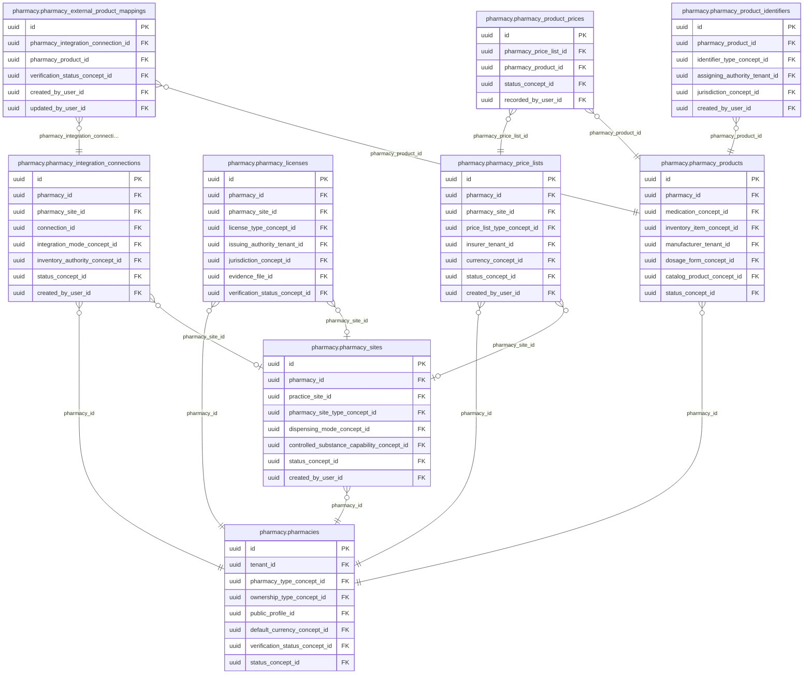

<!-- AUTOGENERADO por tools/inventario/catalogo.mjs. No editar manualmente. -->

# Catálogo del schema `pharmacy`

- **Tablas:** 9 · **Columnas:** 138 (31 con descripción: 22.5 %) · **Índices:** 75
- **Dominio:** Farmacia
- Método y límites del catálogo: [README del inventario](../README.md)

## Tablas

| Tabla | Propósito | Columnas | Índices | Operaciones | ORM |
|---|---|---|---|---|---|
| [pharmacies](#pharmacies) | Representa organizaciones farmacéuticas integradas al sistema médico para identificar prestadores y operadores de farmacia. | 16 | 13 | 67 | DIVERGE |
| [pharmacy_external_product_mappings](#pharmacy_external_product_mappings) | Mapea productos internos a referencias externas para intercambiar información farmacéutica entre sistemas. | 12 | 5 | 6 | COINCIDE |
| [pharmacy_integration_connections](#pharmacy_integration_connections) | Configura conexiones de farmacia con sistemas externos para sincronizar catálogos u operaciones autorizadas. | 17 | 8 | 5 | COINCIDE |
| [pharmacy_licenses](#pharmacy_licenses) | Registra licencias de farmacias para documentar habilitaciones vinculadas a su operación. | 16 | 9 | 4 | COINCIDE |
| [pharmacy_price_lists](#pharmacy_price_lists) | Define listas de precios de farmacia para organizar precios por vigencia, sede o contexto comercial. | 16 | 10 | 19 | COINCIDE |
| [pharmacy_product_identifiers](#pharmacy_product_identifiers) | Mantiene identificadores alternativos de productos farmacéuticos para reconciliar códigos propios y externos. | 10 | 5 | 1 | COINCIDE |
| [pharmacy_product_prices](#pharmacy_product_prices) | Asocia productos con precios concretos para soportar consulta y operación económica farmacéutica. | 14 | 5 | 24 | COINCIDE |
| [pharmacy_products](#pharmacy_products) | Cataloga productos comercializados o gestionados por farmacias, incluidos los medicamentos que pueden relacionarse con prescripciones. | 21 | 11 | 60 | DIVERGE |
| [pharmacy_sites](#pharmacy_sites) | Identifica sucursales y ubicaciones de farmacias para asociar productos, precios e integraciones con cada sitio. | 16 | 9 | 45 | DIVERGE |

## Diagrama entidad-relación

Las tablas se agrupan en familias por sus claves foráneas dentro del schema (máximo 40 por diagrama). Las FK hacia otros schemas se listan en la ficha de cada tabla.

### Familia 1 de 1 — 9 tablas

## Fichas

### pharmacies

#### Vista general

Representa organizaciones farmacéuticas integradas al sistema médico para identificar prestadores y operadores de farmacia.

- **Estado del propósito:** DOMAIN_CURATED_DRAFT · fuente: `Mantra Core Health Context/modules/diagram_24_pharmacy.puml: pharmacies`
- **Dominio:** Farmacia · **Diagrama:** `Mantra Core Health Context/modules/diagram_24_pharmacy.puml` · **DDL:** `SQL/24_pharmacy/02_tables.sql`
- **Entidad del ORM:** `Pharmacies` — `src/modules/pharmacy/entities/pharmacies.entity.ts`
- **Resumen:** 16 columnas · 13 índices · 9 FK salientes · 13 entrantes · 67 operaciones

#### Columnas

| # | Columna | Tipo | Rol estructural | Descripción | ORM |
|---|---|---|---|---|---|
| 1 | `id` | `uuid` | Clave primaria; Obligatoria | Identificador único de la instancia. _(JSDOC_ESTANDAR, `src/modules/pharmacy/entities/pharmacies.entity.ts:12`)_ | coincide |
| 2 | `tenant_id` | `uuid` | Clave foránea → directory.tenants.id; Obligatoria | _sin dato_ | coincide |
| 3 | `code` | `varchar` | Obligatoria | _sin dato_ | coincide |
| 4 | `legal_name` | `varchar` | Obligatoria | _sin dato_ | coincide |
| 5 | `trade_name` | `varchar` | Opcional | _sin dato_ | coincide |
| 6 | `pharmacy_type_concept_id` | `uuid` | Clave foránea → terminology.catalog_concepts.id; Opcional | _sin dato_ | coincide |
| 7 | `ownership_type_concept_id` | `uuid` | Clave foránea → terminology.catalog_concepts.id; Opcional | _sin dato_ | coincide |
| 8 | `public_profile_id` | `uuid` | Clave foránea → community.public_profiles.id; Opcional | _sin dato_ | coincide |
| 9 | `default_currency_concept_id` | `uuid` | Clave foránea → terminology.catalog_concepts.id; Opcional | _sin dato_ | coincide |
| 10 | `verification_status_concept_id` | `uuid` | Clave foránea → terminology.catalog_concepts.id; Obligatoria | _sin dato_ | coincide |
| 11 | `status_concept_id` | `uuid` | Clave foránea → terminology.catalog_concepts.id; Obligatoria | _sin dato_ | coincide |
| 12 | `created_at` | `timestamptz` | Obligatoria | Fecha y hora en que se creó el registro. _(JSDOC_ESTANDAR, `src/modules/pharmacy/entities/pharmacies.entity.ts:101`)_ | coincide |
| 13 | `updated_at` | `timestamptz` | Obligatoria | Fecha y hora de la última actualización. _(JSDOC_ESTANDAR, `src/modules/pharmacy/entities/pharmacies.entity.ts:107`)_ | coincide |
| 14 | `created_by_user_id` | `uuid` | Clave foránea → iam.users.id; Opcional | _sin dato_ | coincide |
| 15 | `updated_by_user_id` | `uuid` | Clave foránea → iam.users.id; Opcional | _sin dato_ | coincide |
| 16 | `row_version` | `integer = 1` | Obligatoria | Versión usada para controlar actualizaciones concurrentes. _(JSDOC_ENTIDAD, `src/modules/pharmacy/entities/pharmacies.entity.ts:125`)_ | coincide |

#### Relaciones

| Sentido | Columnas | Tabla | Restricción |
|---|---|---|---|
| hacia | tenant_id | directory.tenants (id) | fk_pharmacies_tenant_id |
| hacia | pharmacy_type_concept_id | terminology.catalog_concepts (id) | fk_pharmacies_pharmacy_type_concept_id |
| hacia | ownership_type_concept_id | terminology.catalog_concepts (id) | fk_pharmacies_ownership_type_concept_id |
| hacia | public_profile_id | community.public_profiles (id) | fk_pharmacies_public_profile_id |
| hacia | default_currency_concept_id | terminology.catalog_concepts (id) | fk_pharmacies_default_currency_concept_id |
| hacia | verification_status_concept_id | terminology.catalog_concepts (id) | fk_pharmacies_verification_status_concept_id |
| hacia | status_concept_id | terminology.catalog_concepts (id) | fk_pharmacies_status_concept_id |
| hacia | created_by_user_id | iam.users (id) | fk_pharmacies_created_by_user_id |
| hacia | updated_by_user_id | iam.users (id) | fk_pharmacies_updated_by_user_id |
| desde | id | pharmacy.pharmacy_sites (pharmacy_id) | fk_pharmacy_sites_pharmacy_id |
| desde | id | pharmacy.pharmacy_licenses (pharmacy_id) | fk_pharmacy_licenses_pharmacy_id |
| desde | id | pharmacy.pharmacy_products (pharmacy_id) | fk_pharmacy_products_pharmacy_id |
| desde | id | pharmacy.pharmacy_price_lists (pharmacy_id) | fk_pharmacy_price_lists_pharmacy_id |
| desde | id | pharmacy.pharmacy_integration_connections (pharmacy_id) | fk_pharmacy_integration_connections_pharmacy_id |
| desde | id | audit.pharmacy_inventory_access_log (pharmacy_id) | fk_pharmacy_inventory_access_log_pharmacy_id |
| desde | id | pharmacy_inventory.inventory_ledger_entries (pharmacy_id) | fk_inventory_ledger_entries_pharmacy_id |
| desde | id | pharmacy_inventory.inventory_reservations (pharmacy_id) | fk_inventory_reservations_pharmacy_id |
| desde | id | pharmacy_inventory.pharmacy_suppliers (pharmacy_id) | fk_pharmacy_suppliers_pharmacy_id |
| desde | id | pharmacy_inventory.pharmacy_purchase_orders (pharmacy_id) | fk_pharmacy_purchase_orders_pharmacy_id |
| desde | id | pharmacy_inventory.medication_dispensations (pharmacy_id) | fk_medication_dispensations_pharmacy_id |
| desde | id | insurance.network_provider_memberships (pharmacy_id) | fk_network_provider_memberships_pharmacy_id |
| desde | id | delegated_access.organization_user_assignments (pharmacy_id) | fk_organization_user_assignments_pharmacy_id |

#### Índices

| Índice | Único | Columnas | Para qué |
|---|---|---|---|
| `uq_pharmacies_tenant_id` | sí | tenant_id | Garantiza que no se repita la combinación (tenant_id) _(DOCUMENTO)_; Soporta la clave foránea fk_pharmacies_tenant_id: PostgreSQL no indexa las FK por sí mismo _(DOCUMENTO)_; 8 consulta(s) de repositorio filtran u ordenan por «tenant_id», la primera columna del índice _(CONSULTA)_ |
| `uq_pharmacies_code` | sí | code | Garantiza que no se repita la combinación (code) _(DOCUMENTO)_; 1 consulta(s) de repositorio filtran u ordenan por «code», la primera columna del índice _(CONSULTA)_ |
| `ix_pharmacies_tenant_id` | no | tenant_id | Soporta la clave foránea fk_pharmacies_tenant_id: PostgreSQL no indexa las FK por sí mismo _(DOCUMENTO)_; 8 consulta(s) de repositorio filtran u ordenan por «tenant_id», la primera columna del índice _(CONSULTA)_ |
| `ix_pharmacies_pharmacy_type_concept_id` | no | pharmacy_type_concept_id | Soporta la clave foránea fk_pharmacies_pharmacy_type_concept_id: PostgreSQL no indexa las FK por sí mismo _(DOCUMENTO)_ |
| `ix_pharmacies_ownership_type_concept_id` | no | ownership_type_concept_id | Soporta la clave foránea fk_pharmacies_ownership_type_concept_id: PostgreSQL no indexa las FK por sí mismo _(DOCUMENTO)_ |
| `ix_pharmacies_public_profile_id` | no | public_profile_id | Soporta la clave foránea fk_pharmacies_public_profile_id: PostgreSQL no indexa las FK por sí mismo _(DOCUMENTO)_ |
| `ix_pharmacies_default_currency_concept_id` | no | default_currency_concept_id | Soporta la clave foránea fk_pharmacies_default_currency_concept_id: PostgreSQL no indexa las FK por sí mismo _(DOCUMENTO)_ |
| `ix_pharmacies_verification_status_concept_id` | no | verification_status_concept_id | Soporta la clave foránea fk_pharmacies_verification_status_concept_id: PostgreSQL no indexa las FK por sí mismo _(DOCUMENTO)_; 2 consulta(s) de repositorio filtran u ordenan por «verification_status_concept_id», la primera columna del índice _(CONSULTA)_ |
| `ix_pharmacies_status_concept_id` | no | status_concept_id | Soporta la clave foránea fk_pharmacies_status_concept_id: PostgreSQL no indexa las FK por sí mismo _(DOCUMENTO)_; 3 consulta(s) de repositorio filtran u ordenan por «status_concept_id», la primera columna del índice _(CONSULTA)_ |
| `ix_pharmacies_created_by_user_id` | no | created_by_user_id | Soporta la clave foránea fk_pharmacies_created_by_user_id: PostgreSQL no indexa las FK por sí mismo _(DOCUMENTO)_ |
| `ix_pharmacies_updated_by_user_id` | no | updated_by_user_id | Soporta la clave foránea fk_pharmacies_updated_by_user_id: PostgreSQL no indexa las FK por sí mismo _(DOCUMENTO)_ |
| `ix_pharmacies_tenant_id_status_concept_id` | no | tenant_id, status_concept_id, ("updated_at" DESC) | _sin uso detectado estáticamente_ |
| `gin_pharmacies_search` | no | (to_tsvector('simple', (coalesce(code, '')))) | GIN para búsqueda textual gobernada _(DOCUMENTO)_ |

#### Restricciones

| Restricción | Tipo | Definición |
|---|---|---|
| `uq_pharmacies_tenant_id` | UNIQUE INDEX | UNIQUE INDEX ("tenant_id") |
| `uq_pharmacies_code` | UNIQUE INDEX | UNIQUE INDEX ("code") |

#### Operaciones que la tocan

| Operación | Efecto | Confianza |
|---|---|---|
| GET /diagnostic-results/me/orders | LEE | DIRECTA |
| POST /admin/tenants/{tenantId}/verification | ACTUALIZA | POR_TIPO |
| POST /admin/tenants/{tenantId}/verification | LEE | DIRECTA |
| GET /tenants/{tenantId}/laboratory-readiness | LEE | DIRECTA |
| GET /tenants/{tenantId}/pharmacy-readiness | LEE | DIRECTA |
| POST /iam/auth/register-organization | CREA | DIRECTA |
| POST /identity/checks/{id}/results | LEE | DIRECTA |
| POST /identity/manual-review/{id}/decision | LEE | DIRECTA |
| POST /internal/identity/checks/{id}/results | LEE | DIRECTA |
| POST /insurance-claims | LEE | DIRECTA |
| POST /insurance-claims/{id}/adjudications | LEE | DIRECTA |
| POST /insurance-claims/{id}/eob | LEE | DIRECTA |
| POST /insurance-claims/{id}/reversals | LEE | DIRECTA |
| POST /insurance/portability/export | LEE | POR_SQL |
| POST /insurance/received-claims/{id}/decision | LEE | DIRECTA |
| GET /practitioner-settlement-batches | LEE | DIRECTA |
| GET /practitioner-settlement-batches/{id} | LEE | DIRECTA |
| POST /prior-authorization-requests | LEE | DIRECTA |
| POST /prior-authorization-requests/{id}/determinations | LEE | DIRECTA |
| POST /pharmacies | CREA | DIRECTA |
| POST /pharmacies | LEE | DIRECTA |
| POST /pharmacies/{pharmacyId}/products | LEE | POR_SQL |
| PATCH /pharmacies/{pharmacyId}/products/{productId} | LEE | POR_SQL |
| GET /pharmacy/pharmacies | LEE | DIRECTA |
| GET /pharmacy/pharmacies/{id} | LEE | DIRECTA |
| GET /pharmacy/pharmacies/{id}/contacts | LEE | DIRECTA |
| GET /pharmacy/pharmacies/{id}/licenses | LEE | DIRECTA |
| GET /pharmacy/pharmacies/{id}/summary | LEE | DIRECTA |
| GET /pharmacy/products | LEE | DIRECTA |
| GET /pharmacy/sites | LEE | DIRECTA |
| GET /pharmacy/sites/{siteId}/prices | LEE | DIRECTA |
| GET /public/medications | LEE | POR_SQL |
| GET /public/medications/{conceptId}/availability | LEE | POR_SQL |
| GET /public/pharmacies/open-now | LEE | POR_SQL |
| POST /internal/inventory-sync-batches | LEE | DIRECTA |
| POST /internal/inventory-sync/{batchId}/reconcile | LEE | DIRECTA |
| POST /internal/reservations/expire | LEE | DIRECTA |
| GET /pharmacy-inventory/availability | LEE | DIRECTA |
| GET /pharmacy-inventory/sites/{siteId}/stock | LEE | DIRECTA |
| POST /pharmacy/{pharmacyId}/dispensations | LEE | DIRECTA |
| POST /pharmacy/{pharmacyId}/goods-receipts | LEE | DIRECTA |
| POST /pharmacy/{pharmacyId}/purchase-orders | LEE | DIRECTA |
| POST /pharmacy/{pharmacyId}/reservations | LEE | DIRECTA |
| POST /pharmacy/{pharmacyId}/suppliers | LEE | DIRECTA |
| POST /pharmacy/{pharmacyId}/transfers | LEE | DIRECTA |
| POST /pharmacy/{siteId}/count-sessions | LEE | DIRECTA |
| POST /pharmacy/{siteId}/inventory-locations | LEE | DIRECTA |
| POST /pharmacy/count-sessions/{id}/approve | LEE | DIRECTA |
| POST /pharmacy/dispensations/{id}/reverse | LEE | DIRECTA |
| GET /pharmacy/orders | LEE | DIRECTA |
| POST /pharmacy/orders | LEE | DIRECTA |
| GET /pharmacy/orders/{id} | LEE | DIRECTA |
| POST /pharmacy/orders/{id}/accept-substitutions | LEE | DIRECTA |
| POST /pharmacy/orders/{id}/cancel | LEE | DIRECTA |
| POST /pharmacy/orders/{id}/confirm | LEE | DIRECTA |
| POST /pharmacy/orders/{id}/conversation | LEE | DIRECTA |
| POST /pharmacy/orders/{id}/dispense | LEE | DIRECTA |
| POST /pharmacy/orders/{id}/prefer-original | LEE | DIRECTA |
| POST /pharmacy/orders/{id}/ready | LEE | DIRECTA |
| POST /pharmacy/orders/{id}/reject | LEE | DIRECTA |
| POST /pharmacy/orders/{id}/review | LEE | DIRECTA |
| GET /pharmacy/orders/me | LEE | DIRECTA |
| POST /pharmacy/recall-holds | LEE | DIRECTA |
| POST /pharmacy/recall-holds/{id}/release | LEE | DIRECTA |
| POST /public/profiles/f/{slug}/branch-availability | LEE | POR_SQL |
| GET /public/profiles/f/{slug}/branches | LEE | POR_SQL |
| GET /public/profiles/f/{slug}/products | LEE | POR_SQL |

#### Gobierno

| Atributo | Valor | Fuente |
|---|---|---|
| Append-only | no declarado | — |
| Datos personales | sin fuente | — |
| Financiera | sin fuente | — |
| Crítica para auditoría | sin fuente | — |
| Retención | sin fuente | — |
| Responsable | sin fuente | — |
| Revisión | AUTO_DETECTADA | — |

---

### pharmacy_external_product_mappings

#### Vista general

Mapea productos internos a referencias externas para intercambiar información farmacéutica entre sistemas.

- **Estado del propósito:** DOMAIN_CURATED_DRAFT · fuente: `Mantra Core Health Context/modules/diagram_24_pharmacy.puml: pharmacy_external_product_mappings`
- **Dominio:** Farmacia · **Diagrama:** `Mantra Core Health Context/modules/diagram_24_pharmacy.puml` · **DDL:** `SQL/24_pharmacy/02_tables.sql`
- **Entidad del ORM:** `PharmacyExternalProductMappings` — `src/modules/pharmacy/entities/pharmacy_external_product_mappings.entity.ts`
- **Resumen:** 12 columnas · 5 índices · 5 FK salientes · 0 entrantes · 6 operaciones

#### Columnas

| # | Columna | Tipo | Rol estructural | Descripción | ORM |
|---|---|---|---|---|---|
| 1 | `id` | `uuid` | Clave primaria; Obligatoria | Identificador único de la instancia. _(JSDOC_ESTANDAR, `src/modules/pharmacy/entities/pharmacy_external_product_mappings.entity.ts:12`)_ | coincide |
| 2 | `pharmacy_integration_connection_id` | `uuid` | Clave foránea → pharmacy.pharmacy_integration_connections.id; Obligatoria | _sin dato_ | coincide |
| 3 | `pharmacy_product_id` | `uuid` | Clave foránea → pharmacy.pharmacy_products.id; Obligatoria | _sin dato_ | coincide |
| 4 | `external_product_code` | `varchar` | Obligatoria | _sin dato_ | coincide |
| 5 | `external_unit_code` | `varchar` | Opcional | _sin dato_ | coincide |
| 6 | `mapping_version` | `varchar` | Opcional | _sin dato_ | coincide |
| 7 | `verification_status_concept_id` | `uuid` | Clave foránea → terminology.catalog_concepts.id; Obligatoria | _sin dato_ | coincide |
| 8 | `created_at` | `timestamptz` | Obligatoria | Fecha y hora en que se creó el registro. _(JSDOC_ESTANDAR, `src/modules/pharmacy/entities/pharmacy_external_product_mappings.entity.ts:62`)_ | coincide |
| 9 | `updated_at` | `timestamptz` | Obligatoria | Fecha y hora de la última actualización. _(JSDOC_ESTANDAR, `src/modules/pharmacy/entities/pharmacy_external_product_mappings.entity.ts:68`)_ | coincide |
| 10 | `created_by_user_id` | `uuid` | Clave foránea → iam.users.id; Opcional | _sin dato_ | coincide |
| 11 | `updated_by_user_id` | `uuid` | Clave foránea → iam.users.id; Opcional | _sin dato_ | coincide |
| 12 | `row_version` | `integer = 1` | Obligatoria | Versión usada para controlar actualizaciones concurrentes. _(JSDOC_ENTIDAD, `src/modules/pharmacy/entities/pharmacy_external_product_mappings.entity.ts:86`)_ | coincide |

#### Relaciones

| Sentido | Columnas | Tabla | Restricción |
|---|---|---|---|
| hacia | pharmacy_integration_connection_id | pharmacy.pharmacy_integration_connections (id) | fk_pharmacy_external_product_mappings_pharmacy_integra_79e91ab7 |
| hacia | pharmacy_product_id | pharmacy.pharmacy_products (id) | fk_pharmacy_external_product_mappings_pharmacy_product_id |
| hacia | verification_status_concept_id | terminology.catalog_concepts (id) | fk_pharmacy_external_product_mappings_verification_sta_0e29f411 |
| hacia | created_by_user_id | iam.users (id) | fk_pharmacy_external_product_mappings_created_by_user_id |
| hacia | updated_by_user_id | iam.users (id) | fk_pharmacy_external_product_mappings_updated_by_user_id |

#### Índices

| Índice | Único | Columnas | Para qué |
|---|---|---|---|
| `ix_pharmacy_external_product_mappings_pharmacy_integra_f6b3c236` | no | pharmacy_integration_connection_id | Soporta la clave foránea fk_pharmacy_external_product_mappings_pharmacy_integra_79e91ab7: PostgreSQL no indexa las FK por sí mismo _(DOCUMENTO)_; 1 consulta(s) de repositorio filtran u ordenan por «pharmacy_integration_connection_id», la primera columna del índice _(CONSULTA)_ |
| `ix_pharmacy_external_product_mappings_pharmacy_product_id` | no | pharmacy_product_id | Soporta la clave foránea fk_pharmacy_external_product_mappings_pharmacy_product_id: PostgreSQL no indexa las FK por sí mismo _(DOCUMENTO)_; 2 consulta(s) de repositorio filtran u ordenan por «pharmacy_product_id», la primera columna del índice _(CONSULTA)_ |
| `ix_pharmacy_external_product_mappings_verification_sta_079f1a0f` | no | verification_status_concept_id | Soporta la clave foránea fk_pharmacy_external_product_mappings_verification_sta_0e29f411: PostgreSQL no indexa las FK por sí mismo _(DOCUMENTO)_; 1 consulta(s) de repositorio filtran u ordenan por «verification_status_concept_id», la primera columna del índice _(CONSULTA)_ |
| `ix_pharmacy_external_product_mappings_created_by_user_id` | no | created_by_user_id | Soporta la clave foránea fk_pharmacy_external_product_mappings_created_by_user_id: PostgreSQL no indexa las FK por sí mismo _(DOCUMENTO)_ |
| `ix_pharmacy_external_product_mappings_updated_by_user_id` | no | updated_by_user_id | Soporta la clave foránea fk_pharmacy_external_product_mappings_updated_by_user_id: PostgreSQL no indexa las FK por sí mismo _(DOCUMENTO)_ |

#### Operaciones que la tocan

| Operación | Efecto | Confianza |
|---|---|---|
| POST /pharmacies/{pharmacyId}/integration-connections/{connId}/product-mappings | CREA | DIRECTA |
| POST /pharmacies/{pharmacyId}/integration-connections/{connId}/product-mappings | LEE | DIRECTA |
| DELETE /pharmacies/{pharmacyId}/products/{productId} | ACTUALIZA | POR_TIPO |
| DELETE /pharmacies/{pharmacyId}/products/{productId} | LEE | DIRECTA |
| PATCH /pharmacies/{pharmacyId}/products/{productId} | ACTUALIZA | POR_TIPO |
| PATCH /pharmacies/{pharmacyId}/products/{productId} | LEE | DIRECTA |

#### Gobierno

| Atributo | Valor | Fuente |
|---|---|---|
| Append-only | no declarado | — |
| Datos personales | sin fuente | — |
| Financiera | sin fuente | — |
| Crítica para auditoría | sin fuente | — |
| Retención | sin fuente | — |
| Responsable | sin fuente | — |
| Revisión | AUTO_DETECTADA | — |

---

### pharmacy_integration_connections

#### Vista general

Configura conexiones de farmacia con sistemas externos para sincronizar catálogos u operaciones autorizadas.

- **Estado del propósito:** DOMAIN_CURATED_DRAFT · fuente: `Mantra Core Health Context/modules/diagram_24_pharmacy.puml: pharmacy_integration_connections`
- **Dominio:** Farmacia · **Diagrama:** `Mantra Core Health Context/modules/diagram_24_pharmacy.puml` · **DDL:** `SQL/24_pharmacy/02_tables.sql`
- **Entidad del ORM:** `PharmacyIntegrationConnections` — `src/modules/pharmacy/entities/pharmacy_integration_connections.entity.ts`
- **Resumen:** 17 columnas · 8 índices · 8 FK salientes · 3 entrantes · 5 operaciones

#### Columnas

| # | Columna | Tipo | Rol estructural | Descripción | ORM |
|---|---|---|---|---|---|
| 1 | `id` | `uuid` | Clave primaria; Obligatoria | Identificador único de la instancia. _(JSDOC_ESTANDAR, `src/modules/pharmacy/entities/pharmacy_integration_connections.entity.ts:12`)_ | coincide |
| 2 | `pharmacy_id` | `uuid` | Clave foránea → pharmacy.pharmacies.id; Obligatoria | _sin dato_ | coincide |
| 3 | `pharmacy_site_id` | `uuid` | Clave foránea → pharmacy.pharmacy_sites.id; Opcional | _sin dato_ | coincide |
| 4 | `connection_id` | `uuid` | Clave foránea → pharmacy.pharmacy_integration_connections.id; Obligatoria | _sin dato_ | coincide |
| 5 | `integration_mode_concept_id` | `uuid` | Clave foránea → terminology.catalog_concepts.id; Obligatoria | _sin dato_ | coincide |
| 6 | `inventory_authority_concept_id` | `uuid` | Clave foránea → terminology.catalog_concepts.id; Opcional | _sin dato_ | coincide |
| 7 | `supports_stock_query` | `boolean` | Opcional | _sin dato_ | coincide |
| 8 | `supports_price_query` | `boolean` | Opcional | _sin dato_ | coincide |
| 9 | `supports_reservation` | `boolean` | Opcional | _sin dato_ | coincide |
| 10 | `supports_dispense_confirmation` | `boolean` | Opcional | _sin dato_ | coincide |
| 11 | `manual_fallback_allowed` | `boolean` | Opcional | _sin dato_ | coincide |
| 12 | `status_concept_id` | `uuid` | Clave foránea → terminology.catalog_concepts.id; Obligatoria | _sin dato_ | coincide |
| 13 | `created_at` | `timestamptz` | Obligatoria | Fecha y hora en que se creó el registro. _(JSDOC_ESTANDAR, `src/modules/pharmacy/entities/pharmacy_integration_connections.entity.ts:108`)_ | coincide |
| 14 | `updated_at` | `timestamptz` | Obligatoria | Fecha y hora de la última actualización. _(JSDOC_ESTANDAR, `src/modules/pharmacy/entities/pharmacy_integration_connections.entity.ts:114`)_ | coincide |
| 15 | `created_by_user_id` | `uuid` | Clave foránea → iam.users.id; Opcional | _sin dato_ | coincide |
| 16 | `updated_by_user_id` | `uuid` | Clave foránea → iam.users.id; Opcional | _sin dato_ | coincide |
| 17 | `row_version` | `integer = 1` | Obligatoria | Versión usada para controlar actualizaciones concurrentes. _(JSDOC_ENTIDAD, `src/modules/pharmacy/entities/pharmacy_integration_connections.entity.ts:132`)_ | coincide |

#### Relaciones

| Sentido | Columnas | Tabla | Restricción |
|---|---|---|---|
| hacia | pharmacy_id | pharmacy.pharmacies (id) | fk_pharmacy_integration_connections_pharmacy_id |
| hacia | pharmacy_site_id | pharmacy.pharmacy_sites (id) | fk_pharmacy_integration_connections_pharmacy_site_id |
| hacia | connection_id | pharmacy.pharmacy_integration_connections (id) | fk_pharmacy_integration_connections_connection_id |
| hacia | integration_mode_concept_id | terminology.catalog_concepts (id) | fk_pharmacy_integration_connections_integration_mode_concept_id |
| hacia | inventory_authority_concept_id | terminology.catalog_concepts (id) | fk_pharmacy_integration_connections_inventory_authorit_3c66cc96 |
| hacia | status_concept_id | terminology.catalog_concepts (id) | fk_pharmacy_integration_connections_status_concept_id |
| hacia | created_by_user_id | iam.users (id) | fk_pharmacy_integration_connections_created_by_user_id |
| hacia | updated_by_user_id | iam.users (id) | fk_pharmacy_integration_connections_updated_by_user_id |
| desde | id | pharmacy.pharmacy_integration_connections (connection_id) | fk_pharmacy_integration_connections_connection_id |
| desde | id | pharmacy.pharmacy_external_product_mappings (pharmacy_integration_connection_id) | fk_pharmacy_external_product_mappings_pharmacy_integra_79e91ab7 |
| desde | id | pharmacy_inventory.pharmacy_inventory_sync_batches (pharmacy_integration_connection_id) | fk_pharmacy_inventory_sync_batches_pharmacy_integratio_81168ea5 |

#### Índices

| Índice | Único | Columnas | Para qué |
|---|---|---|---|
| `ix_pharmacy_integration_connections_pharmacy_id` | no | pharmacy_id | Soporta la clave foránea fk_pharmacy_integration_connections_pharmacy_id: PostgreSQL no indexa las FK por sí mismo _(DOCUMENTO)_; 1 consulta(s) de repositorio filtran u ordenan por «pharmacy_id», la primera columna del índice _(CONSULTA)_ |
| `ix_pharmacy_integration_connections_pharmacy_site_id` | no | pharmacy_site_id | Soporta la clave foránea fk_pharmacy_integration_connections_pharmacy_site_id: PostgreSQL no indexa las FK por sí mismo _(DOCUMENTO)_ |
| `ix_pharmacy_integration_connections_connection_id` | no | connection_id | Soporta la clave foránea fk_pharmacy_integration_connections_connection_id: PostgreSQL no indexa las FK por sí mismo _(DOCUMENTO)_; 1 consulta(s) de repositorio filtran u ordenan por «connection_id», la primera columna del índice _(CONSULTA)_ |
| `ix_pharmacy_integration_connections_integration_mode_concept_id` | no | integration_mode_concept_id | Soporta la clave foránea fk_pharmacy_integration_connections_integration_mode_concept_id: PostgreSQL no indexa las FK por sí mismo _(DOCUMENTO)_ |
| `ix_pharmacy_integration_connections_inventory_authorit_20c81904` | no | inventory_authority_concept_id | Soporta la clave foránea fk_pharmacy_integration_connections_inventory_authorit_3c66cc96: PostgreSQL no indexa las FK por sí mismo _(DOCUMENTO)_ |
| `ix_pharmacy_integration_connections_status_concept_id` | no | status_concept_id | Soporta la clave foránea fk_pharmacy_integration_connections_status_concept_id: PostgreSQL no indexa las FK por sí mismo _(DOCUMENTO)_ |
| `ix_pharmacy_integration_connections_created_by_user_id` | no | created_by_user_id | Soporta la clave foránea fk_pharmacy_integration_connections_created_by_user_id: PostgreSQL no indexa las FK por sí mismo _(DOCUMENTO)_ |
| `ix_pharmacy_integration_connections_updated_by_user_id` | no | updated_by_user_id | Soporta la clave foránea fk_pharmacy_integration_connections_updated_by_user_id: PostgreSQL no indexa las FK por sí mismo _(DOCUMENTO)_ |

#### Operaciones que la tocan

| Operación | Efecto | Confianza |
|---|---|---|
| POST /pharmacies/{pharmacyId}/integration-connections | CREA | DIRECTA |
| POST /pharmacies/{pharmacyId}/integration-connections | LEE | DIRECTA |
| POST /pharmacies/{pharmacyId}/integration-connections/{connId}/product-mappings | LEE | DIRECTA |
| POST /internal/inventory-sync-batches | LEE | DIRECTA |
| POST /internal/inventory-sync/{batchId}/reconcile | LEE | DIRECTA |

#### Gobierno

| Atributo | Valor | Fuente |
|---|---|---|
| Append-only | no declarado | — |
| Datos personales | sin fuente | — |
| Financiera | sin fuente | — |
| Crítica para auditoría | sin fuente | — |
| Retención | sin fuente | — |
| Responsable | sin fuente | — |
| Revisión | AUTO_DETECTADA | — |

---

### pharmacy_licenses

#### Vista general

Registra licencias de farmacias para documentar habilitaciones vinculadas a su operación.

- **Estado del propósito:** DOMAIN_CURATED_DRAFT · fuente: `Mantra Core Health Context/modules/diagram_24_pharmacy.puml: pharmacy_licenses`
- **Dominio:** Farmacia · **Diagrama:** `Mantra Core Health Context/modules/diagram_24_pharmacy.puml` · **DDL:** `SQL/24_pharmacy/02_tables.sql`
- **Entidad del ORM:** `PharmacyLicenses` — `src/modules/pharmacy/entities/pharmacy_licenses.entity.ts`
- **Resumen:** 16 columnas · 9 índices · 9 FK salientes · 0 entrantes · 4 operaciones

#### Columnas

| # | Columna | Tipo | Rol estructural | Descripción | ORM |
|---|---|---|---|---|---|
| 1 | `id` | `uuid` | Clave primaria; Obligatoria | Identificador único de la instancia. _(JSDOC_ESTANDAR, `src/modules/pharmacy/entities/pharmacy_licenses.entity.ts:12`)_ | coincide |
| 2 | `pharmacy_id` | `uuid` | Clave foránea → pharmacy.pharmacies.id; Obligatoria | _sin dato_ | coincide |
| 3 | `pharmacy_site_id` | `uuid` | Clave foránea → pharmacy.pharmacy_sites.id; Opcional | _sin dato_ | coincide |
| 4 | `license_type_concept_id` | `uuid` | Clave foránea → terminology.catalog_concepts.id; Obligatoria | _sin dato_ | coincide |
| 5 | `license_number` | `varchar` | Obligatoria | _sin dato_ | coincide |
| 6 | `issuing_authority_tenant_id` | `uuid` | Clave foránea → directory.tenants.id; Opcional | _sin dato_ | coincide |
| 7 | `jurisdiction_concept_id` | `uuid` | Clave foránea → terminology.catalog_concepts.id; Opcional | _sin dato_ | coincide |
| 8 | `valid_from` | `date` | Opcional | _sin dato_ | coincide |
| 9 | `valid_to` | `date` | Opcional | _sin dato_ | coincide |
| 10 | `evidence_file_id` | `uuid` | Clave foránea → common.files.id; Opcional | _sin dato_ | coincide |
| 11 | `verification_status_concept_id` | `uuid` | Clave foránea → terminology.catalog_concepts.id; Obligatoria | _sin dato_ | coincide |
| 12 | `created_at` | `timestamptz` | Obligatoria | Fecha y hora en que se creó el registro. _(JSDOC_ESTANDAR, `src/modules/pharmacy/entities/pharmacy_licenses.entity.ts:86`)_ | coincide |
| 13 | `updated_at` | `timestamptz` | Obligatoria | Fecha y hora de la última actualización. _(JSDOC_ESTANDAR, `src/modules/pharmacy/entities/pharmacy_licenses.entity.ts:92`)_ | coincide |
| 14 | `created_by_user_id` | `uuid` | Clave foránea → iam.users.id; Opcional | _sin dato_ | coincide |
| 15 | `updated_by_user_id` | `uuid` | Clave foránea → iam.users.id; Opcional | _sin dato_ | coincide |
| 16 | `row_version` | `integer = 1` | Obligatoria | Versión usada para controlar actualizaciones concurrentes. _(JSDOC_ENTIDAD, `src/modules/pharmacy/entities/pharmacy_licenses.entity.ts:110`)_ | coincide |

#### Relaciones

| Sentido | Columnas | Tabla | Restricción |
|---|---|---|---|
| hacia | pharmacy_id | pharmacy.pharmacies (id) | fk_pharmacy_licenses_pharmacy_id |
| hacia | pharmacy_site_id | pharmacy.pharmacy_sites (id) | fk_pharmacy_licenses_pharmacy_site_id |
| hacia | license_type_concept_id | terminology.catalog_concepts (id) | fk_pharmacy_licenses_license_type_concept_id |
| hacia | issuing_authority_tenant_id | directory.tenants (id) | fk_pharmacy_licenses_issuing_authority_tenant_id |
| hacia | jurisdiction_concept_id | terminology.catalog_concepts (id) | fk_pharmacy_licenses_jurisdiction_concept_id |
| hacia | evidence_file_id | common.files (id) | fk_pharmacy_licenses_evidence_file_id |
| hacia | verification_status_concept_id | terminology.catalog_concepts (id) | fk_pharmacy_licenses_verification_status_concept_id |
| hacia | created_by_user_id | iam.users (id) | fk_pharmacy_licenses_created_by_user_id |
| hacia | updated_by_user_id | iam.users (id) | fk_pharmacy_licenses_updated_by_user_id |

#### Índices

| Índice | Único | Columnas | Para qué |
|---|---|---|---|
| `ix_pharmacy_licenses_pharmacy_id` | no | pharmacy_id | Soporta la clave foránea fk_pharmacy_licenses_pharmacy_id: PostgreSQL no indexa las FK por sí mismo _(DOCUMENTO)_; 2 consulta(s) de repositorio filtran u ordenan por «pharmacy_id», la primera columna del índice _(CONSULTA)_ |
| `ix_pharmacy_licenses_pharmacy_site_id` | no | pharmacy_site_id | Soporta la clave foránea fk_pharmacy_licenses_pharmacy_site_id: PostgreSQL no indexa las FK por sí mismo _(DOCUMENTO)_ |
| `ix_pharmacy_licenses_license_type_concept_id` | no | license_type_concept_id | Soporta la clave foránea fk_pharmacy_licenses_license_type_concept_id: PostgreSQL no indexa las FK por sí mismo _(DOCUMENTO)_ |
| `ix_pharmacy_licenses_issuing_authority_tenant_id` | no | issuing_authority_tenant_id | Soporta la clave foránea fk_pharmacy_licenses_issuing_authority_tenant_id: PostgreSQL no indexa las FK por sí mismo _(DOCUMENTO)_ |
| `ix_pharmacy_licenses_jurisdiction_concept_id` | no | jurisdiction_concept_id | Soporta la clave foránea fk_pharmacy_licenses_jurisdiction_concept_id: PostgreSQL no indexa las FK por sí mismo _(DOCUMENTO)_ |
| `ix_pharmacy_licenses_evidence_file_id` | no | evidence_file_id | Soporta la clave foránea fk_pharmacy_licenses_evidence_file_id: PostgreSQL no indexa las FK por sí mismo _(DOCUMENTO)_ |
| `ix_pharmacy_licenses_verification_status_concept_id` | no | verification_status_concept_id | Soporta la clave foránea fk_pharmacy_licenses_verification_status_concept_id: PostgreSQL no indexa las FK por sí mismo _(DOCUMENTO)_; 1 consulta(s) de repositorio filtran u ordenan por «verification_status_concept_id», la primera columna del índice _(CONSULTA)_ |
| `ix_pharmacy_licenses_created_by_user_id` | no | created_by_user_id | Soporta la clave foránea fk_pharmacy_licenses_created_by_user_id: PostgreSQL no indexa las FK por sí mismo _(DOCUMENTO)_ |
| `ix_pharmacy_licenses_updated_by_user_id` | no | updated_by_user_id | Soporta la clave foránea fk_pharmacy_licenses_updated_by_user_id: PostgreSQL no indexa las FK por sí mismo _(DOCUMENTO)_ |

#### Operaciones que la tocan

| Operación | Efecto | Confianza |
|---|---|---|
| POST /pharmacies | CREA | DIRECTA |
| POST /pharmacies/{pharmacyId}/licenses/{licenseId}/verify | ACTUALIZA | POR_TIPO |
| POST /pharmacies/{pharmacyId}/licenses/{licenseId}/verify | LEE | DIRECTA |
| GET /pharmacy/pharmacies/{id}/licenses | LEE | DIRECTA |

#### Gobierno

| Atributo | Valor | Fuente |
|---|---|---|
| Append-only | no declarado | — |
| Datos personales | sin fuente | — |
| Financiera | sin fuente | — |
| Crítica para auditoría | sin fuente | — |
| Retención | sin fuente | — |
| Responsable | sin fuente | — |
| Revisión | AUTO_DETECTADA | — |

---

### pharmacy_price_lists

#### Vista general

Define listas de precios de farmacia para organizar precios por vigencia, sede o contexto comercial.

- **Estado del propósito:** DOMAIN_CURATED_DRAFT · fuente: `Mantra Core Health Context/modules/diagram_24_pharmacy.puml: pharmacy_price_lists`
- **Dominio:** Farmacia · **Diagrama:** `Mantra Core Health Context/modules/diagram_24_pharmacy.puml` · **DDL:** `SQL/24_pharmacy/02_tables.sql`
- **Entidad del ORM:** `PharmacyPriceLists` — `src/modules/pharmacy/entities/pharmacy_price_lists.entity.ts`
- **Resumen:** 16 columnas · 10 índices · 8 FK salientes · 1 entrantes · 19 operaciones

#### Columnas

| # | Columna | Tipo | Rol estructural | Descripción | ORM |
|---|---|---|---|---|---|
| 1 | `id` | `uuid` | Clave primaria; Obligatoria | Identificador único de la instancia. _(JSDOC_ESTANDAR, `src/modules/pharmacy/entities/pharmacy_price_lists.entity.ts:12`)_ | coincide |
| 2 | `pharmacy_id` | `uuid` | Clave foránea → pharmacy.pharmacies.id; Obligatoria | _sin dato_ | coincide |
| 3 | `pharmacy_site_id` | `uuid` | Clave foránea → pharmacy.pharmacy_sites.id; Opcional | _sin dato_ | coincide |
| 4 | `code` | `varchar` | Obligatoria | _sin dato_ | coincide |
| 5 | `price_list_type_concept_id` | `uuid` | Clave foránea → terminology.catalog_concepts.id; Obligatoria | _sin dato_ | coincide |
| 6 | `insurer_tenant_id` | `uuid` | Clave foránea → directory.tenants.id; Opcional | _sin dato_ | coincide |
| 7 | `currency_concept_id` | `uuid` | Clave foránea → terminology.catalog_concepts.id; Opcional | _sin dato_ | coincide |
| 8 | `valid_from` | `timestamptz` | Opcional | _sin dato_ | coincide |
| 9 | `valid_to` | `timestamptz` | Opcional | _sin dato_ | coincide |
| 10 | `public_visibility` | `boolean` | Opcional | _sin dato_ | coincide |
| 11 | `status_concept_id` | `uuid` | Clave foránea → terminology.catalog_concepts.id; Obligatoria | _sin dato_ | coincide |
| 12 | `created_at` | `timestamptz` | Obligatoria | Fecha y hora en que se creó el registro. _(JSDOC_ESTANDAR, `src/modules/pharmacy/entities/pharmacy_price_lists.entity.ts:86`)_ | coincide |
| 13 | `updated_at` | `timestamptz` | Obligatoria | Fecha y hora de la última actualización. _(JSDOC_ESTANDAR, `src/modules/pharmacy/entities/pharmacy_price_lists.entity.ts:92`)_ | coincide |
| 14 | `created_by_user_id` | `uuid` | Clave foránea → iam.users.id; Opcional | _sin dato_ | coincide |
| 15 | `updated_by_user_id` | `uuid` | Clave foránea → iam.users.id; Opcional | _sin dato_ | coincide |
| 16 | `row_version` | `integer = 1` | Obligatoria | Versión usada para controlar actualizaciones concurrentes. _(JSDOC_ENTIDAD, `src/modules/pharmacy/entities/pharmacy_price_lists.entity.ts:110`)_ | coincide |

#### Relaciones

| Sentido | Columnas | Tabla | Restricción |
|---|---|---|---|
| hacia | pharmacy_id | pharmacy.pharmacies (id) | fk_pharmacy_price_lists_pharmacy_id |
| hacia | pharmacy_site_id | pharmacy.pharmacy_sites (id) | fk_pharmacy_price_lists_pharmacy_site_id |
| hacia | price_list_type_concept_id | terminology.catalog_concepts (id) | fk_pharmacy_price_lists_price_list_type_concept_id |
| hacia | insurer_tenant_id | directory.tenants (id) | fk_pharmacy_price_lists_insurer_tenant_id |
| hacia | currency_concept_id | terminology.catalog_concepts (id) | fk_pharmacy_price_lists_currency_concept_id |
| hacia | status_concept_id | terminology.catalog_concepts (id) | fk_pharmacy_price_lists_status_concept_id |
| hacia | created_by_user_id | iam.users (id) | fk_pharmacy_price_lists_created_by_user_id |
| hacia | updated_by_user_id | iam.users (id) | fk_pharmacy_price_lists_updated_by_user_id |
| desde | id | pharmacy.pharmacy_product_prices (pharmacy_price_list_id) | fk_pharmacy_product_prices_pharmacy_price_list_id |

#### Índices

| Índice | Único | Columnas | Para qué |
|---|---|---|---|
| `ix_pharmacy_price_lists_pharmacy_id` | no | pharmacy_id | Soporta la clave foránea fk_pharmacy_price_lists_pharmacy_id: PostgreSQL no indexa las FK por sí mismo _(DOCUMENTO)_; 3 consulta(s) de repositorio filtran u ordenan por «pharmacy_id», la primera columna del índice _(CONSULTA)_ |
| `ix_pharmacy_price_lists_pharmacy_site_id` | no | pharmacy_site_id | Soporta la clave foránea fk_pharmacy_price_lists_pharmacy_site_id: PostgreSQL no indexa las FK por sí mismo _(DOCUMENTO)_ |
| `ix_pharmacy_price_lists_price_list_type_concept_id` | no | price_list_type_concept_id | Soporta la clave foránea fk_pharmacy_price_lists_price_list_type_concept_id: PostgreSQL no indexa las FK por sí mismo _(DOCUMENTO)_ |
| `ix_pharmacy_price_lists_insurer_tenant_id` | no | insurer_tenant_id | Soporta la clave foránea fk_pharmacy_price_lists_insurer_tenant_id: PostgreSQL no indexa las FK por sí mismo _(DOCUMENTO)_; 1 consulta(s) de repositorio filtran u ordenan por «insurer_tenant_id», la primera columna del índice _(CONSULTA)_ |
| `ix_pharmacy_price_lists_currency_concept_id` | no | currency_concept_id | Soporta la clave foránea fk_pharmacy_price_lists_currency_concept_id: PostgreSQL no indexa las FK por sí mismo _(DOCUMENTO)_ |
| `ix_pharmacy_price_lists_status_concept_id` | no | status_concept_id | Soporta la clave foránea fk_pharmacy_price_lists_status_concept_id: PostgreSQL no indexa las FK por sí mismo _(DOCUMENTO)_; 2 consulta(s) de repositorio filtran u ordenan por «status_concept_id», la primera columna del índice _(CONSULTA)_ |
| `ix_pharmacy_price_lists_created_by_user_id` | no | created_by_user_id | Soporta la clave foránea fk_pharmacy_price_lists_created_by_user_id: PostgreSQL no indexa las FK por sí mismo _(DOCUMENTO)_ |
| `ix_pharmacy_price_lists_updated_by_user_id` | no | updated_by_user_id | Soporta la clave foránea fk_pharmacy_price_lists_updated_by_user_id: PostgreSQL no indexa las FK por sí mismo _(DOCUMENTO)_ |
| `gin_pharmacy_price_lists_search` | no | (to_tsvector('simple', (coalesce(code, '')))) | GIN para búsqueda textual gobernada _(DOCUMENTO)_ |
| `gist_pharmacy_price_lists_effective_period` | no | (tstzrange(valid_from, valid_to, '[)')) | GiST para periodos, no solapamiento y geografía _(DOCUMENTO)_ |

#### Operaciones que la tocan

| Operación | Efecto | Confianza |
|---|---|---|
| POST /pharmacies/{pharmacyId}/price-lists | CREA | DIRECTA |
| POST /pharmacies/{pharmacyId}/price-lists | LEE | DIRECTA |
| POST /pharmacies/{pharmacyId}/price-lists/{priceListId}/close | ACTUALIZA | POR_TIPO |
| POST /pharmacies/{pharmacyId}/price-lists/{priceListId}/close | LEE | DIRECTA |
| POST /pharmacies/{pharmacyId}/price-lists/{priceListId}/prices | LEE | DIRECTA |
| POST /pharmacies/{pharmacyId}/products | CREA | DIRECTA |
| POST /pharmacies/{pharmacyId}/products | LEE | DIRECTA |
| PATCH /pharmacies/{pharmacyId}/products/{productId} | CREA | DIRECTA |
| PATCH /pharmacies/{pharmacyId}/products/{productId} | LEE | DIRECTA |
| GET /pharmacy/pharmacies/{id}/summary | LEE | POR_SQL |
| GET /pharmacy/products | LEE | POR_SQL |
| GET /pharmacy/sites/{siteId}/prices | LEE | DIRECTA |
| GET /public/medications | LEE | POR_SQL |
| GET /public/medications/{conceptId}/availability | LEE | POR_SQL |
| GET /pharmacy-inventory/availability | LEE | DIRECTA |
| POST /pharmacy/orders | LEE | DIRECTA |
| POST /pharmacy/orders/{id}/confirm | LEE | DIRECTA |
| POST /public/profiles/f/{slug}/branch-availability | LEE | POR_SQL |
| GET /public/profiles/f/{slug}/products | LEE | POR_SQL |

#### Gobierno

| Atributo | Valor | Fuente |
|---|---|---|
| Append-only | no declarado | — |
| Datos personales | sin fuente | — |
| Financiera | sin fuente | — |
| Crítica para auditoría | sin fuente | — |
| Retención | sin fuente | — |
| Responsable | sin fuente | — |
| Revisión | AUTO_DETECTADA | — |

---

### pharmacy_product_identifiers

#### Vista general

Mantiene identificadores alternativos de productos farmacéuticos para reconciliar códigos propios y externos.

- **Estado del propósito:** DOMAIN_CURATED_DRAFT · fuente: `Mantra Core Health Context/modules/diagram_24_pharmacy.puml: pharmacy_product_identifiers`
- **Dominio:** Farmacia · **Diagrama:** `Mantra Core Health Context/modules/diagram_24_pharmacy.puml` · **DDL:** `SQL/24_pharmacy/02_tables.sql`
- **Entidad del ORM:** `PharmacyProductIdentifiers` — `src/modules/pharmacy/entities/pharmacy_product_identifiers.entity.ts`
- **Resumen:** 10 columnas · 5 índices · 5 FK salientes · 0 entrantes · 1 operaciones

#### Columnas

| # | Columna | Tipo | Rol estructural | Descripción | ORM |
|---|---|---|---|---|---|
| 1 | `id` | `uuid` | Clave primaria; Obligatoria | Identificador único de la instancia. _(JSDOC_ESTANDAR, `src/modules/pharmacy/entities/pharmacy_product_identifiers.entity.ts:12`)_ | coincide |
| 2 | `pharmacy_product_id` | `uuid` | Clave foránea → pharmacy.pharmacy_products.id; Obligatoria | _sin dato_ | coincide |
| 3 | `identifier_type_concept_id` | `uuid` | Clave foránea → terminology.catalog_concepts.id; Obligatoria | _sin dato_ | coincide |
| 4 | `identifier_value` | `varchar` | Obligatoria | _sin dato_ | coincide |
| 5 | `assigning_authority_tenant_id` | `uuid` | Clave foránea → directory.tenants.id; Opcional | _sin dato_ | coincide |
| 6 | `jurisdiction_concept_id` | `uuid` | Clave foránea → terminology.catalog_concepts.id; Opcional | _sin dato_ | coincide |
| 7 | `valid_from` | `date` | Opcional | _sin dato_ | coincide |
| 8 | `valid_to` | `date` | Opcional | _sin dato_ | coincide |
| 9 | `created_at` | `timestamptz` | Obligatoria | Fecha y hora en que se creó el registro. _(JSDOC_ESTANDAR, `src/modules/pharmacy/entities/pharmacy_product_identifiers.entity.ts:68`)_ | coincide |
| 10 | `created_by_user_id` | `uuid` | Clave foránea → iam.users.id; Opcional | _sin dato_ | coincide |

#### Relaciones

| Sentido | Columnas | Tabla | Restricción |
|---|---|---|---|
| hacia | pharmacy_product_id | pharmacy.pharmacy_products (id) | fk_pharmacy_product_identifiers_pharmacy_product_id |
| hacia | identifier_type_concept_id | terminology.catalog_concepts (id) | fk_pharmacy_product_identifiers_identifier_type_concept_id |
| hacia | assigning_authority_tenant_id | directory.tenants (id) | fk_pharmacy_product_identifiers_assigning_authority_tenant_id |
| hacia | jurisdiction_concept_id | terminology.catalog_concepts (id) | fk_pharmacy_product_identifiers_jurisdiction_concept_id |
| hacia | created_by_user_id | iam.users (id) | fk_pharmacy_product_identifiers_created_by_user_id |

#### Índices

| Índice | Único | Columnas | Para qué |
|---|---|---|---|
| `ix_pharmacy_product_identifiers_pharmacy_product_id` | no | pharmacy_product_id | Soporta la clave foránea fk_pharmacy_product_identifiers_pharmacy_product_id: PostgreSQL no indexa las FK por sí mismo _(DOCUMENTO)_ |
| `ix_pharmacy_product_identifiers_identifier_type_concept_id` | no | identifier_type_concept_id | Soporta la clave foránea fk_pharmacy_product_identifiers_identifier_type_concept_id: PostgreSQL no indexa las FK por sí mismo _(DOCUMENTO)_ |
| `ix_pharmacy_product_identifiers_assigning_authority_tenant_id` | no | assigning_authority_tenant_id | Soporta la clave foránea fk_pharmacy_product_identifiers_assigning_authority_tenant_id: PostgreSQL no indexa las FK por sí mismo _(DOCUMENTO)_ |
| `ix_pharmacy_product_identifiers_jurisdiction_concept_id` | no | jurisdiction_concept_id | Soporta la clave foránea fk_pharmacy_product_identifiers_jurisdiction_concept_id: PostgreSQL no indexa las FK por sí mismo _(DOCUMENTO)_ |
| `ix_pharmacy_product_identifiers_created_by_user_id` | no | created_by_user_id | Soporta la clave foránea fk_pharmacy_product_identifiers_created_by_user_id: PostgreSQL no indexa las FK por sí mismo _(DOCUMENTO)_ |

#### Operaciones que la tocan

| Operación | Efecto | Confianza |
|---|---|---|
| POST /pharmacies/{pharmacyId}/products | CREA | DIRECTA |

#### Gobierno

| Atributo | Valor | Fuente |
|---|---|---|
| Append-only | no declarado | — |
| Datos personales | sin fuente | — |
| Financiera | sin fuente | — |
| Crítica para auditoría | sin fuente | — |
| Retención | sin fuente | — |
| Responsable | sin fuente | — |
| Revisión | AUTO_DETECTADA | — |

---

### pharmacy_product_prices

#### Vista general

Asocia productos con precios concretos para soportar consulta y operación económica farmacéutica.

- **Estado del propósito:** DOMAIN_CURATED_DRAFT · fuente: `Mantra Core Health Context/modules/diagram_24_pharmacy.puml: pharmacy_product_prices`
- **Dominio:** Farmacia · **Diagrama:** `Mantra Core Health Context/modules/diagram_24_pharmacy.puml` · **DDL:** `SQL/24_pharmacy/02_tables.sql`
- **Entidad del ORM:** `PharmacyProductPrices` — `src/modules/pharmacy/entities/pharmacy_product_prices.entity.ts`
- **Resumen:** 14 columnas · 5 índices · 4 FK salientes · 1 entrantes · 24 operaciones

#### Columnas

| # | Columna | Tipo | Rol estructural | Descripción | ORM |
|---|---|---|---|---|---|
| 1 | `id` | `uuid` | Clave primaria; Obligatoria | Identificador único de la instancia. _(JSDOC_ESTANDAR, `src/modules/pharmacy/entities/pharmacy_product_prices.entity.ts:12`)_ | coincide |
| 2 | `pharmacy_price_list_id` | `uuid` | Clave foránea → pharmacy.pharmacy_price_lists.id; Obligatoria | _sin dato_ | coincide |
| 3 | `pharmacy_product_id` | `uuid` | Clave foránea → pharmacy.pharmacy_products.id; Obligatoria | _sin dato_ | coincide |
| 4 | `version_number` | `integer` | Obligatoria | _sin dato_ | coincide |
| 5 | `unit_amount` | `numeric` | Obligatoria | _sin dato_ | coincide |
| 6 | `tax_amount` | `numeric` | Opcional | _sin dato_ | coincide |
| 7 | `patient_amount` | `numeric` | Opcional | _sin dato_ | coincide |
| 8 | `insurer_amount` | `numeric` | Opcional | _sin dato_ | coincide |
| 9 | `minimum_quantity` | `numeric` | Opcional | _sin dato_ | coincide |
| 10 | `effective_from` | `timestamptz` | Obligatoria | _sin dato_ | coincide |
| 11 | `effective_to` | `timestamptz` | Opcional | _sin dato_ | coincide |
| 12 | `status_concept_id` | `uuid` | Clave foránea → terminology.catalog_concepts.id; Obligatoria | _sin dato_ | coincide |
| 13 | `recorded_at` | `timestamptz` | Obligatoria | _sin dato_ | coincide |
| 14 | `recorded_by_user_id` | `uuid` | Clave foránea → iam.users.id; Opcional | _sin dato_ | coincide |

#### Relaciones

| Sentido | Columnas | Tabla | Restricción |
|---|---|---|---|
| hacia | pharmacy_price_list_id | pharmacy.pharmacy_price_lists (id) | fk_pharmacy_product_prices_pharmacy_price_list_id |
| hacia | pharmacy_product_id | pharmacy.pharmacy_products (id) | fk_pharmacy_product_prices_pharmacy_product_id |
| hacia | status_concept_id | terminology.catalog_concepts (id) | fk_pharmacy_product_prices_status_concept_id |
| hacia | recorded_by_user_id | iam.users (id) | fk_pharmacy_product_prices_recorded_by_user_id |
| desde | id | audit.pharmacy_product_prices_history (pharmacy_product_price_id) | fk_pharmacy_product_prices_history_pharmacy_product_price_id |

#### Índices

| Índice | Único | Columnas | Para qué |
|---|---|---|---|
| `ix_pharmacy_product_prices_pharmacy_price_list_id` | no | pharmacy_price_list_id | Soporta la clave foránea fk_pharmacy_product_prices_pharmacy_price_list_id: PostgreSQL no indexa las FK por sí mismo _(DOCUMENTO)_; 4 consulta(s) de repositorio filtran u ordenan por «pharmacy_price_list_id», la primera columna del índice _(CONSULTA)_ |
| `ix_pharmacy_product_prices_pharmacy_product_id` | no | pharmacy_product_id | Soporta la clave foránea fk_pharmacy_product_prices_pharmacy_product_id: PostgreSQL no indexa las FK por sí mismo _(DOCUMENTO)_; 3 consulta(s) de repositorio filtran u ordenan por «pharmacy_product_id», la primera columna del índice _(CONSULTA)_ |
| `ix_pharmacy_product_prices_status_concept_id` | no | status_concept_id | Soporta la clave foránea fk_pharmacy_product_prices_status_concept_id: PostgreSQL no indexa las FK por sí mismo _(DOCUMENTO)_; 4 consulta(s) de repositorio filtran u ordenan por «status_concept_id», la primera columna del índice _(CONSULTA)_ |
| `ix_pharmacy_product_prices_recorded_by_user_id` | no | recorded_by_user_id | Soporta la clave foránea fk_pharmacy_product_prices_recorded_by_user_id: PostgreSQL no indexa las FK por sí mismo _(DOCUMENTO)_ |
| `uq_pharmacy_product_prices_pharmacy_price_list_id_vers_7ebb36be` | sí | pharmacy_price_list_id, pharmacy_product_id, version_number | Garantiza que no se repita la combinación (pharmacy_price_list_id, pharmacy_product_id, version_number) _(DOCUMENTO)_; Soporta la clave foránea fk_pharmacy_product_prices_pharmacy_price_list_id: PostgreSQL no indexa las FK por sí mismo _(DOCUMENTO)_; 4 consulta(s) de repositorio filtran u ordenan por «pharmacy_price_list_id», la primera columna del índice _(CONSULTA)_ |

#### Restricciones

| Restricción | Tipo | Definición |
|---|---|---|
| `uq_pharmacy_product_prices_pharmacy_price_list_id_vers_7ebb36be` | UNIQUE INDEX | UNIQUE INDEX ("pharmacy_price_list_id", "pharmacy_product_id", "version_number") |

#### Operaciones que la tocan

| Operación | Efecto | Confianza |
|---|---|---|
| POST /pharmacies/{pharmacyId}/price-lists/{priceListId}/close | ACTUALIZA | POR_TIPO |
| POST /pharmacies/{pharmacyId}/price-lists/{priceListId}/close | LEE | DIRECTA |
| POST /pharmacies/{pharmacyId}/price-lists/{priceListId}/prices | ACTUALIZA | POR_TIPO |
| POST /pharmacies/{pharmacyId}/price-lists/{priceListId}/prices | CREA | DIRECTA |
| POST /pharmacies/{pharmacyId}/price-lists/{priceListId}/prices | LEE | DIRECTA |
| POST /pharmacies/{pharmacyId}/products | ACTUALIZA | POR_TIPO |
| POST /pharmacies/{pharmacyId}/products | CREA | DIRECTA |
| POST /pharmacies/{pharmacyId}/products | LEE | DIRECTA |
| DELETE /pharmacies/{pharmacyId}/products/{productId} | ACTUALIZA | POR_TIPO |
| DELETE /pharmacies/{pharmacyId}/products/{productId} | LEE | DIRECTA |
| PATCH /pharmacies/{pharmacyId}/products/{productId} | ACTUALIZA | POR_TIPO |
| PATCH /pharmacies/{pharmacyId}/products/{productId} | CREA | DIRECTA |
| PATCH /pharmacies/{pharmacyId}/products/{productId} | LEE | DIRECTA |
| POST /pharmacies/{pharmacyId}/projections | LEE | DIRECTA |
| GET /pharmacy/pharmacies/{id}/summary | LEE | POR_SQL |
| GET /pharmacy/products | LEE | POR_SQL |
| GET /pharmacy/sites/{siteId}/prices | LEE | DIRECTA |
| GET /public/medications | LEE | POR_SQL |
| GET /public/medications/{conceptId}/availability | LEE | POR_SQL |
| GET /pharmacy-inventory/availability | LEE | DIRECTA |
| POST /pharmacy/orders | LEE | DIRECTA |
| POST /pharmacy/orders/{id}/confirm | LEE | DIRECTA |
| POST /public/profiles/f/{slug}/branch-availability | LEE | POR_SQL |
| GET /public/profiles/f/{slug}/products | LEE | POR_SQL |

#### Gobierno

| Atributo | Valor | Fuente |
|---|---|---|
| Append-only | no declarado | — |
| Datos personales | sin fuente | — |
| Financiera | sin fuente | — |
| Crítica para auditoría | sin fuente | — |
| Retención | sin fuente | — |
| Responsable | sin fuente | — |
| Revisión | AUTO_DETECTADA | — |

---

### pharmacy_products

#### Vista general

Cataloga productos comercializados o gestionados por farmacias, incluidos los medicamentos que pueden relacionarse con prescripciones.

- **Estado del propósito:** DOMAIN_CURATED_DRAFT · fuente: `Mantra Core Health Context/modules/diagram_24_pharmacy.puml: pharmacy_products`
- **Dominio:** Farmacia · **Diagrama:** `Mantra Core Health Context/modules/diagram_24_pharmacy.puml` · **DDL:** `SQL/24_pharmacy/02_tables.sql`
- **Entidad del ORM:** `PharmacyProducts` — `src/modules/pharmacy/entities/pharmacy_products.entity.ts`
- **Resumen:** 21 columnas · 11 índices · 9 FK salientes · 16 entrantes · 60 operaciones

#### Columnas

| # | Columna | Tipo | Rol estructural | Descripción | ORM |
|---|---|---|---|---|---|
| 1 | `id` | `uuid` | Clave primaria; Obligatoria | Identificador único de la instancia. _(JSDOC_ESTANDAR, `src/modules/pharmacy/entities/pharmacy_products.entity.ts:12`)_ | coincide |
| 2 | `pharmacy_id` | `uuid` | Clave foránea → pharmacy.pharmacies.id; Obligatoria | _sin dato_ | coincide |
| 3 | `product_code` | `varchar` | Obligatoria | _sin dato_ | coincide |
| 4 | `medication_concept_id` | `uuid` | Clave foránea → terminology.catalog_concepts.id; Opcional | _sin dato_ | coincide |
| 5 | `inventory_item_concept_id` | `uuid` | Clave foránea → terminology.catalog_concepts.id; Opcional | _sin dato_ | coincide |
| 6 | `manufacturer_tenant_id` | `uuid` | Clave foránea → directory.tenants.id; Opcional | _sin dato_ | coincide |
| 7 | `brand_name` | `varchar` | Opcional | _sin dato_ | coincide |
| 8 | `generic_name` | `varchar` | Opcional | _sin dato_ | coincide |
| 9 | `strength_text` | `varchar` | Opcional | _sin dato_ | coincide |
| 10 | `dosage_form_concept_id` | `uuid` | Clave foránea → terminology.catalog_concepts.id; Opcional | _sin dato_ | coincide |
| 11 | `package_size_text` | `varchar` | Opcional | _sin dato_ | coincide |
| 12 | `requires_prescription` | `boolean` | Opcional | _sin dato_ | coincide |
| 13 | `cold_chain_required` | `boolean` | Opcional | _sin dato_ | coincide |
| 14 | `catalog_product_concept_id` | `uuid` | Clave foránea → terminology.catalog_concepts.id; Opcional | _sin dato_ | coincide |
| 15 | `catalog_presentation_code` | `varchar` | Opcional | _sin dato_ | coincide |
| 16 | `status_concept_id` | `uuid` | Clave foránea → terminology.catalog_concepts.id; Obligatoria | _sin dato_ | coincide |
| 17 | `created_at` | `timestamptz` | Obligatoria | Fecha y hora en que se creó el registro. _(JSDOC_ESTANDAR, `src/modules/pharmacy/entities/pharmacy_products.entity.ts:177`)_ | coincide |
| 18 | `updated_at` | `timestamptz` | Obligatoria | Fecha y hora de la última actualización. _(JSDOC_ESTANDAR, `src/modules/pharmacy/entities/pharmacy_products.entity.ts:183`)_ | coincide |
| 19 | `created_by_user_id` | `uuid` | Clave foránea → iam.users.id; Opcional | _sin dato_ | coincide |
| 20 | `updated_by_user_id` | `uuid` | Clave foránea → iam.users.id; Opcional | _sin dato_ | coincide |
| 21 | `row_version` | `integer = 1` | Obligatoria | Versión usada para controlar actualizaciones concurrentes. _(JSDOC_ENTIDAD, `src/modules/pharmacy/entities/pharmacy_products.entity.ts:201`)_ | coincide |

#### Relaciones

| Sentido | Columnas | Tabla | Restricción |
|---|---|---|---|
| hacia | pharmacy_id | pharmacy.pharmacies (id) | fk_pharmacy_products_pharmacy_id |
| hacia | medication_concept_id | terminology.catalog_concepts (id) | fk_pharmacy_products_medication_concept_id |
| hacia | inventory_item_concept_id | terminology.catalog_concepts (id) | fk_pharmacy_products_inventory_item_concept_id |
| hacia | manufacturer_tenant_id | directory.tenants (id) | fk_pharmacy_products_manufacturer_tenant_id |
| hacia | dosage_form_concept_id | terminology.catalog_concepts (id) | fk_pharmacy_products_dosage_form_concept_id |
| hacia | catalog_product_concept_id | terminology.catalog_concepts (id) | fk_pharmacy_products_catalog_product_concept_id |
| hacia | status_concept_id | terminology.catalog_concepts (id) | fk_pharmacy_products_status_concept_id |
| hacia | created_by_user_id | iam.users (id) | fk_pharmacy_products_created_by_user_id |
| hacia | updated_by_user_id | iam.users (id) | fk_pharmacy_products_updated_by_user_id |
| desde | id | pharmacy.pharmacy_product_identifiers (pharmacy_product_id) | fk_pharmacy_product_identifiers_pharmacy_product_id |
| desde | id | pharmacy.pharmacy_product_prices (pharmacy_product_id) | fk_pharmacy_product_prices_pharmacy_product_id |
| desde | id | pharmacy.pharmacy_external_product_mappings (pharmacy_product_id) | fk_pharmacy_external_product_mappings_pharmacy_product_id |
| desde | id | pharmacy_inventory.inventory_lots (pharmacy_product_id) | fk_inventory_lots_pharmacy_product_id |
| desde | id | pharmacy_inventory.inventory_stock_positions (pharmacy_product_id) | fk_inventory_stock_positions_pharmacy_product_id |
| desde | id | pharmacy_inventory.inventory_ledger_entries (pharmacy_product_id) | fk_inventory_ledger_entries_pharmacy_product_id |
| desde | id | pharmacy_inventory.inventory_reservation_lines (pharmacy_product_id) | fk_inventory_reservation_lines_pharmacy_product_id |
| desde | id | pharmacy_inventory.pharmacy_order_substitutions (original_pharmacy_product_id) | fk_pharmacy_order_substitutions_original_pharmacy_product_id |
| desde | id | pharmacy_inventory.pharmacy_order_substitutions (proposed_pharmacy_product_id) | fk_pharmacy_order_substitutions_proposed_pharmacy_product_id |
| desde | id | pharmacy_inventory.inventory_count_lines (pharmacy_product_id) | fk_inventory_count_lines_pharmacy_product_id |
| desde | id | pharmacy_inventory.inventory_recall_holds (pharmacy_product_id) | fk_inventory_recall_holds_pharmacy_product_id |
| desde | id | pharmacy_inventory.pharmacy_purchase_order_lines (pharmacy_product_id) | fk_pharmacy_purchase_order_lines_pharmacy_product_id |
| desde | id | pharmacy_inventory.pharmacy_goods_receipt_lines (pharmacy_product_id) | fk_pharmacy_goods_receipt_lines_pharmacy_product_id |
| desde | id | pharmacy_inventory.medication_dispensation_lines (pharmacy_product_id) | fk_medication_dispensation_lines_pharmacy_product_id |
| desde | id | pharmacy_inventory.pharmacy_inventory_sync_items (pharmacy_product_id) | fk_pharmacy_inventory_sync_items_pharmacy_product_id |
| desde | id | insurance.prior_authorization_items (pharmacy_product_id) | fk_prior_authorization_items_pharmacy_product_id |

#### Índices

| Índice | Único | Columnas | Para qué |
|---|---|---|---|
| `ix_pharmacy_products_pharmacy_id` | no | pharmacy_id | Soporta la clave foránea fk_pharmacy_products_pharmacy_id: PostgreSQL no indexa las FK por sí mismo _(DOCUMENTO)_; 10 consulta(s) de repositorio filtran u ordenan por «pharmacy_id», la primera columna del índice _(CONSULTA)_ |
| `ix_pharmacy_products_medication_concept_id` | no | medication_concept_id | Soporta la clave foránea fk_pharmacy_products_medication_concept_id: PostgreSQL no indexa las FK por sí mismo _(DOCUMENTO)_ |
| `ix_pharmacy_products_inventory_item_concept_id` | no | inventory_item_concept_id | Soporta la clave foránea fk_pharmacy_products_inventory_item_concept_id: PostgreSQL no indexa las FK por sí mismo _(DOCUMENTO)_ |
| `ix_pharmacy_products_manufacturer_tenant_id` | no | manufacturer_tenant_id | Soporta la clave foránea fk_pharmacy_products_manufacturer_tenant_id: PostgreSQL no indexa las FK por sí mismo _(DOCUMENTO)_ |
| `ix_pharmacy_products_dosage_form_concept_id` | no | dosage_form_concept_id | Soporta la clave foránea fk_pharmacy_products_dosage_form_concept_id: PostgreSQL no indexa las FK por sí mismo _(DOCUMENTO)_ |
| `ix_pharmacy_products_catalog_product_concept_id` | no | catalog_product_concept_id | Soporta la clave foránea fk_pharmacy_products_catalog_product_concept_id: PostgreSQL no indexa las FK por sí mismo _(DOCUMENTO)_; 1 consulta(s) de repositorio filtran u ordenan por «catalog_product_concept_id», la primera columna del índice _(CONSULTA)_ |
| `uq_pharmacy_products_catalog_presentation` | sí | pharmacy_id, catalog_product_concept_id, catalog_presentation_code donde WHERE catalog_product_concept_id IS NOT NULL AND catalog_presentation_code IS NOT NULL | Garantiza que no se repita la combinación (pharmacy_id, catalog_product_concept_id, catalog_presentation_code) _(DOCUMENTO)_; Soporta la clave foránea fk_pharmacy_products_pharmacy_id: PostgreSQL no indexa las FK por sí mismo _(DOCUMENTO)_; Índice parcial: sólo indexa las filas donde WHERE catalog_product_concept_id IS NOT NULL AND catalog_presentation_code IS NOT NULL _(ESTRUCTURAL)_; 10 consulta(s) de repositorio filtran u ordenan por «pharmacy_id», la primera columna del índice _(CONSULTA)_ |
| `uq_pharmacy_products_catalog_no_presentation` | sí | pharmacy_id, catalog_product_concept_id donde WHERE catalog_product_concept_id IS NOT NULL AND catalog_presentation_code IS NULL | Garantiza que no se repita la combinación (pharmacy_id, catalog_product_concept_id) _(DOCUMENTO)_; Soporta la clave foránea fk_pharmacy_products_pharmacy_id: PostgreSQL no indexa las FK por sí mismo _(DOCUMENTO)_; Índice parcial: sólo indexa las filas donde WHERE catalog_product_concept_id IS NOT NULL AND catalog_presentation_code IS NULL _(ESTRUCTURAL)_; 10 consulta(s) de repositorio filtran u ordenan por «pharmacy_id», la primera columna del índice _(CONSULTA)_ |
| `ix_pharmacy_products_status_concept_id` | no | status_concept_id | Soporta la clave foránea fk_pharmacy_products_status_concept_id: PostgreSQL no indexa las FK por sí mismo _(DOCUMENTO)_; 7 consulta(s) de repositorio filtran u ordenan por «status_concept_id», la primera columna del índice _(CONSULTA)_ |
| `ix_pharmacy_products_created_by_user_id` | no | created_by_user_id | Soporta la clave foránea fk_pharmacy_products_created_by_user_id: PostgreSQL no indexa las FK por sí mismo _(DOCUMENTO)_ |
| `ix_pharmacy_products_updated_by_user_id` | no | updated_by_user_id | Soporta la clave foránea fk_pharmacy_products_updated_by_user_id: PostgreSQL no indexa las FK por sí mismo _(DOCUMENTO)_ |

#### Restricciones

| Restricción | Tipo | Definición |
|---|---|---|
| `uq_pharmacy_products_catalog_presentation` | UNIQUE INDEX | UNIQUE INDEX ("pharmacy_id", "catalog_product_concept_id", "catalog_presentation_code") WHERE catalog_product_concept_id IS NOT NULL AND catalog_presentation_code IS NOT NULL |
| `uq_pharmacy_products_catalog_no_presentation` | UNIQUE INDEX | UNIQUE INDEX ("pharmacy_id", "catalog_product_concept_id") WHERE catalog_product_concept_id IS NOT NULL AND catalog_presentation_code IS NULL |

#### Operaciones que la tocan

| Operación | Efecto | Confianza |
|---|---|---|
| GET /diagnostic-results/me/orders | LEE | DIRECTA |
| POST /insurance-claims | LEE | DIRECTA |
| POST /insurance-claims/{id}/adjudications | LEE | DIRECTA |
| POST /insurance-claims/{id}/eob | LEE | DIRECTA |
| POST /insurance-claims/{id}/reversals | LEE | DIRECTA |
| GET /insurance/analytics/loss-ratio | LEE | POR_SQL |
| POST /insurance/received-claims/{id}/decision | LEE | DIRECTA |
| POST /prior-authorization-requests | LEE | DIRECTA |
| GET /prior-authorization-requests/{id} | LEE | DIRECTA |
| POST /prior-authorization-requests/{id}/determinations | LEE | DIRECTA |
| GET /prior-authorization-requests/inbox | LEE | DIRECTA |
| GET /pharmacies/{pharmacyId}/categories | LEE | DIRECTA |
| DELETE /pharmacies/{pharmacyId}/categories/{categoryId} | ACTUALIZA | POR_SQL |
| DELETE /pharmacies/{pharmacyId}/categories/{categoryId} | LEE | DIRECTA |
| PATCH /pharmacies/{pharmacyId}/categories/{categoryId} | LEE | DIRECTA |
| POST /pharmacies/{pharmacyId}/integration-connections/{connId}/product-mappings | LEE | DIRECTA |
| PATCH /pharmacies/{pharmacyId}/inventory | LEE | DIRECTA |
| POST /pharmacies/{pharmacyId}/price-lists/{priceListId}/prices | LEE | DIRECTA |
| POST /pharmacies/{pharmacyId}/products | CREA | DIRECTA |
| POST /pharmacies/{pharmacyId}/products | ACTUALIZA | POR_TIPO |
| POST /pharmacies/{pharmacyId}/products | LEE | DIRECTA |
| DELETE /pharmacies/{pharmacyId}/products/{productId} | ACTUALIZA | POR_TIPO |
| DELETE /pharmacies/{pharmacyId}/products/{productId} | LEE | DIRECTA |
| PATCH /pharmacies/{pharmacyId}/products/{productId} | ACTUALIZA | POR_TIPO |
| PATCH /pharmacies/{pharmacyId}/products/{productId} | LEE | DIRECTA |
| POST /pharmacies/{pharmacyId}/projections | LEE | DIRECTA |
| GET /pharmacy/pharmacies | LEE | DIRECTA |
| GET /pharmacy/pharmacies/{id} | LEE | DIRECTA |
| GET /pharmacy/pharmacies/{id}/summary | LEE | DIRECTA |
| GET /pharmacy/products | LEE | DIRECTA |
| GET /pharmacy/sites | LEE | DIRECTA |
| GET /pharmacy/sites/{siteId}/prices | LEE | DIRECTA |
| GET /public/medications | LEE | POR_SQL |
| GET /public/medications/{conceptId}/availability | LEE | POR_SQL |
| POST /internal/inventory-sync-batches | LEE | DIRECTA |
| GET /pharmacy-inventory/availability | LEE | DIRECTA |
| GET /pharmacy-inventory/sites/{siteId}/stock | LEE | DIRECTA |
| POST /pharmacy/{pharmacyId}/dispensations | LEE | DIRECTA |
| POST /pharmacy/{pharmacyId}/goods-receipts | LEE | DIRECTA |
| POST /pharmacy/{pharmacyId}/purchase-orders | LEE | DIRECTA |
| POST /pharmacy/{pharmacyId}/reservations | LEE | DIRECTA |
| POST /pharmacy/{pharmacyId}/transfers | LEE | DIRECTA |
| POST /pharmacy/{siteId}/count-sessions | LEE | DIRECTA |
| POST /pharmacy/count-sessions/{id}/approve | LEE | DIRECTA |
| GET /pharmacy/orders | LEE | DIRECTA |
| POST /pharmacy/orders | LEE | DIRECTA |
| GET /pharmacy/orders/{id} | LEE | DIRECTA |
| POST /pharmacy/orders/{id}/accept-substitutions | LEE | DIRECTA |
| POST /pharmacy/orders/{id}/cancel | LEE | DIRECTA |
| POST /pharmacy/orders/{id}/confirm | LEE | DIRECTA |
| POST /pharmacy/orders/{id}/dispense | LEE | DIRECTA |
| POST /pharmacy/orders/{id}/prefer-original | LEE | DIRECTA |
| POST /pharmacy/orders/{id}/ready | LEE | DIRECTA |
| POST /pharmacy/orders/{id}/reject | LEE | DIRECTA |
| POST /pharmacy/orders/{id}/review | LEE | DIRECTA |
| GET /pharmacy/orders/me | LEE | DIRECTA |
| POST /pharmacy/recall-holds | LEE | DIRECTA |
| POST /pharmacy/recall-holds/{id}/release | LEE | DIRECTA |
| POST /public/profiles/f/{slug}/branch-availability | LEE | POR_SQL |
| GET /public/profiles/f/{slug}/products | LEE | POR_SQL |

#### Gobierno

| Atributo | Valor | Fuente |
|---|---|---|
| Append-only | no declarado | — |
| Datos personales | sin fuente | — |
| Financiera | sin fuente | — |
| Crítica para auditoría | sin fuente | — |
| Retención | sin fuente | — |
| Responsable | sin fuente | — |
| Revisión | AUTO_DETECTADA | — |

---

### pharmacy_sites

#### Vista general

Identifica sucursales y ubicaciones de farmacias para asociar productos, precios e integraciones con cada sitio.

- **Estado del propósito:** DOMAIN_CURATED_DRAFT · fuente: `Mantra Core Health Context/modules/diagram_24_pharmacy.puml: pharmacy_sites`
- **Dominio:** Farmacia · **Diagrama:** `Mantra Core Health Context/modules/diagram_24_pharmacy.puml` · **DDL:** `SQL/24_pharmacy/02_tables.sql`
- **Entidad del ORM:** `PharmacySites` — `src/modules/pharmacy/entities/pharmacy_sites.entity.ts`
- **Resumen:** 16 columnas · 9 índices · 8 FK salientes · 10 entrantes · 45 operaciones

#### Columnas

| # | Columna | Tipo | Rol estructural | Descripción | ORM |
|---|---|---|---|---|---|
| 1 | `id` | `uuid` | Clave primaria; Obligatoria | Identificador único de la instancia. _(JSDOC_ESTANDAR, `src/modules/pharmacy/entities/pharmacy_sites.entity.ts:12`)_ | coincide |
| 2 | `pharmacy_id` | `uuid` | Clave foránea → pharmacy.pharmacies.id; Obligatoria | _sin dato_ | coincide |
| 3 | `practice_site_id` | `uuid` | Clave foránea → practice.practice_sites.id; Obligatoria | _sin dato_ | coincide |
| 4 | `code` | `varchar` | Obligatoria | _sin dato_ | coincide |
| 5 | `name` | `varchar` | Obligatoria | _sin dato_ | coincide |
| 6 | `pharmacy_site_type_concept_id` | `uuid` | Clave foránea → terminology.catalog_concepts.id; Opcional | _sin dato_ | coincide |
| 7 | `dispensing_mode_concept_id` | `uuid` | Clave foránea → terminology.catalog_concepts.id; Opcional | _sin dato_ | coincide |
| 8 | `controlled_substance_capability_concept_id` | `uuid` | Clave foránea → terminology.catalog_concepts.id; Opcional | _sin dato_ | coincide |
| 9 | `home_delivery_available` | `boolean` | Opcional | _sin dato_ | coincide |
| 10 | `pickup_available` | `boolean` | Opcional | _sin dato_ | coincide |
| 11 | `status_concept_id` | `uuid` | Clave foránea → terminology.catalog_concepts.id; Obligatoria | _sin dato_ | coincide |
| 12 | `created_at` | `timestamptz` | Obligatoria | Fecha y hora en que se creó el registro. _(JSDOC_ESTANDAR, `src/modules/pharmacy/entities/pharmacy_sites.entity.ts:100`)_ | coincide |
| 13 | `updated_at` | `timestamptz` | Obligatoria | Fecha y hora de la última actualización. _(JSDOC_ESTANDAR, `src/modules/pharmacy/entities/pharmacy_sites.entity.ts:106`)_ | coincide |
| 14 | `created_by_user_id` | `uuid` | Clave foránea → iam.users.id; Opcional | _sin dato_ | coincide |
| 15 | `updated_by_user_id` | `uuid` | Clave foránea → iam.users.id; Opcional | _sin dato_ | coincide |
| 16 | `row_version` | `integer = 1` | Obligatoria | Versión usada para controlar actualizaciones concurrentes. _(JSDOC_ENTIDAD, `src/modules/pharmacy/entities/pharmacy_sites.entity.ts:124`)_ | coincide |

#### Relaciones

| Sentido | Columnas | Tabla | Restricción |
|---|---|---|---|
| hacia | pharmacy_id | pharmacy.pharmacies (id) | fk_pharmacy_sites_pharmacy_id |
| hacia | practice_site_id | practice.practice_sites (id) | fk_pharmacy_sites_practice_site_id |
| hacia | pharmacy_site_type_concept_id | terminology.catalog_concepts (id) | fk_pharmacy_sites_pharmacy_site_type_concept_id |
| hacia | dispensing_mode_concept_id | terminology.catalog_concepts (id) | fk_pharmacy_sites_dispensing_mode_concept_id |
| hacia | controlled_substance_capability_concept_id | terminology.catalog_concepts (id) | fk_pharmacy_sites_controlled_substance_capability_concept_id |
| hacia | status_concept_id | terminology.catalog_concepts (id) | fk_pharmacy_sites_status_concept_id |
| hacia | created_by_user_id | iam.users (id) | fk_pharmacy_sites_created_by_user_id |
| hacia | updated_by_user_id | iam.users (id) | fk_pharmacy_sites_updated_by_user_id |
| desde | id | pharmacy.pharmacy_licenses (pharmacy_site_id) | fk_pharmacy_licenses_pharmacy_site_id |
| desde | id | pharmacy.pharmacy_price_lists (pharmacy_site_id) | fk_pharmacy_price_lists_pharmacy_site_id |
| desde | id | pharmacy.pharmacy_integration_connections (pharmacy_site_id) | fk_pharmacy_integration_connections_pharmacy_site_id |
| desde | id | pharmacy_inventory.inventory_locations (pharmacy_site_id) | fk_inventory_locations_pharmacy_site_id |
| desde | id | pharmacy_inventory.inventory_ledger_entries (pharmacy_site_id) | fk_inventory_ledger_entries_pharmacy_site_id |
| desde | id | pharmacy_inventory.inventory_reservations (pharmacy_site_id) | fk_inventory_reservations_pharmacy_site_id |
| desde | id | pharmacy_inventory.inventory_count_sessions (pharmacy_site_id) | fk_inventory_count_sessions_pharmacy_site_id |
| desde | id | pharmacy_inventory.pharmacy_purchase_orders (pharmacy_site_id) | fk_pharmacy_purchase_orders_pharmacy_site_id |
| desde | id | pharmacy_inventory.pharmacy_goods_receipts (pharmacy_site_id) | fk_pharmacy_goods_receipts_pharmacy_site_id |
| desde | id | pharmacy_inventory.medication_dispensations (pharmacy_site_id) | fk_medication_dispensations_pharmacy_site_id |

#### Índices

| Índice | Único | Columnas | Para qué |
|---|---|---|---|
| `ix_pharmacy_sites_pharmacy_id` | no | pharmacy_id | Soporta la clave foránea fk_pharmacy_sites_pharmacy_id: PostgreSQL no indexa las FK por sí mismo _(DOCUMENTO)_; 4 consulta(s) de repositorio filtran u ordenan por «pharmacy_id», la primera columna del índice _(CONSULTA)_ |
| `ix_pharmacy_sites_practice_site_id` | no | practice_site_id | Soporta la clave foránea fk_pharmacy_sites_practice_site_id: PostgreSQL no indexa las FK por sí mismo _(DOCUMENTO)_ |
| `ix_pharmacy_sites_pharmacy_site_type_concept_id` | no | pharmacy_site_type_concept_id | Soporta la clave foránea fk_pharmacy_sites_pharmacy_site_type_concept_id: PostgreSQL no indexa las FK por sí mismo _(DOCUMENTO)_ |
| `ix_pharmacy_sites_dispensing_mode_concept_id` | no | dispensing_mode_concept_id | Soporta la clave foránea fk_pharmacy_sites_dispensing_mode_concept_id: PostgreSQL no indexa las FK por sí mismo _(DOCUMENTO)_ |
| `ix_pharmacy_sites_controlled_substance_capability_concept_id` | no | controlled_substance_capability_concept_id | Soporta la clave foránea fk_pharmacy_sites_controlled_substance_capability_concept_id: PostgreSQL no indexa las FK por sí mismo _(DOCUMENTO)_ |
| `ix_pharmacy_sites_status_concept_id` | no | status_concept_id | Soporta la clave foránea fk_pharmacy_sites_status_concept_id: PostgreSQL no indexa las FK por sí mismo _(DOCUMENTO)_; 2 consulta(s) de repositorio filtran u ordenan por «status_concept_id», la primera columna del índice _(CONSULTA)_ |
| `ix_pharmacy_sites_created_by_user_id` | no | created_by_user_id | Soporta la clave foránea fk_pharmacy_sites_created_by_user_id: PostgreSQL no indexa las FK por sí mismo _(DOCUMENTO)_ |
| `ix_pharmacy_sites_updated_by_user_id` | no | updated_by_user_id | Soporta la clave foránea fk_pharmacy_sites_updated_by_user_id: PostgreSQL no indexa las FK por sí mismo _(DOCUMENTO)_ |
| `gin_pharmacy_sites_search` | no | (to_tsvector('simple', (coalesce(name, '') ¦¦ ' ' ¦¦ coalesce(code, '')))) | GIN para búsqueda textual gobernada _(DOCUMENTO)_ |

#### Operaciones que la tocan

| Operación | Efecto | Confianza |
|---|---|---|
| POST /iam/auth/register-organization | CREA | DIRECTA |
| POST /pharmacies/{pharmacyId}/integration-connections | LEE | DIRECTA |
| POST /pharmacies/{pharmacyId}/on-call-shifts/{shiftId}/cancel | LEE | DIRECTA |
| GET /pharmacies/{pharmacyId}/opening-hours | LEE | DIRECTA |
| POST /pharmacies/{pharmacyId}/price-lists | LEE | DIRECTA |
| POST /pharmacies/{pharmacyId}/sites | CREA | DIRECTA |
| POST /pharmacies/{pharmacyId}/sites | LEE | DIRECTA |
| POST /pharmacies/{pharmacyId}/sites/{siteId}/on-call-shifts | LEE | DIRECTA |
| PUT /pharmacies/{pharmacyId}/sites/{siteId}/open-24h | ACTUALIZA | POR_TIPO |
| PUT /pharmacies/{pharmacyId}/sites/{siteId}/open-24h | LEE | DIRECTA |
| GET /pharmacy/pharmacies | LEE | DIRECTA |
| GET /pharmacy/pharmacies/{id} | LEE | DIRECTA |
| GET /pharmacy/pharmacies/{id}/licenses | LEE | DIRECTA |
| GET /pharmacy/sites | LEE | DIRECTA |
| GET /pharmacy/sites/{siteId}/prices | LEE | DIRECTA |
| GET /public/medications | LEE | POR_SQL |
| GET /public/medications/{conceptId}/availability | LEE | POR_SQL |
| GET /public/pharmacies/open-now | LEE | POR_SQL |
| GET /pharmacy-inventory/availability | LEE | DIRECTA |
| GET /pharmacy-inventory/sites/{siteId}/stock | LEE | DIRECTA |
| POST /pharmacy/{pharmacyId}/dispensations | LEE | DIRECTA |
| POST /pharmacy/{pharmacyId}/goods-receipts | LEE | DIRECTA |
| POST /pharmacy/{pharmacyId}/purchase-orders | LEE | DIRECTA |
| POST /pharmacy/{pharmacyId}/reservations | LEE | DIRECTA |
| POST /pharmacy/{pharmacyId}/transfers | LEE | DIRECTA |
| POST /pharmacy/{siteId}/count-sessions | LEE | DIRECTA |
| POST /pharmacy/{siteId}/inventory-locations | LEE | DIRECTA |
| POST /pharmacy/count-sessions/{id}/approve | LEE | DIRECTA |
| POST /pharmacy/dispensations/{id}/reverse | LEE | DIRECTA |
| GET /pharmacy/orders | LEE | DIRECTA |
| POST /pharmacy/orders | LEE | DIRECTA |
| GET /pharmacy/orders/{id} | LEE | DIRECTA |
| POST /pharmacy/orders/{id}/accept-substitutions | LEE | DIRECTA |
| POST /pharmacy/orders/{id}/cancel | LEE | DIRECTA |
| POST /pharmacy/orders/{id}/confirm | LEE | DIRECTA |
| POST /pharmacy/orders/{id}/dispense | LEE | DIRECTA |
| POST /pharmacy/orders/{id}/prefer-original | LEE | DIRECTA |
| POST /pharmacy/orders/{id}/ready | LEE | DIRECTA |
| POST /pharmacy/orders/{id}/reject | LEE | DIRECTA |
| POST /pharmacy/orders/{id}/review | LEE | DIRECTA |
| GET /pharmacy/orders/me | LEE | DIRECTA |
| POST /pharmacy/recall-holds | LEE | DIRECTA |
| POST /pharmacy/recall-holds/{id}/release | LEE | DIRECTA |
| POST /public/profiles/f/{slug}/branch-availability | LEE | POR_SQL |
| GET /public/profiles/f/{slug}/branches | LEE | POR_SQL |

#### Gobierno

| Atributo | Valor | Fuente |
|---|---|---|
| Append-only | no declarado | — |
| Datos personales | sin fuente | — |
| Financiera | sin fuente | — |
| Crítica para auditoría | sin fuente | — |
| Retención | sin fuente | — |
| Responsable | sin fuente | — |
| Revisión | AUTO_DETECTADA | — |

---

