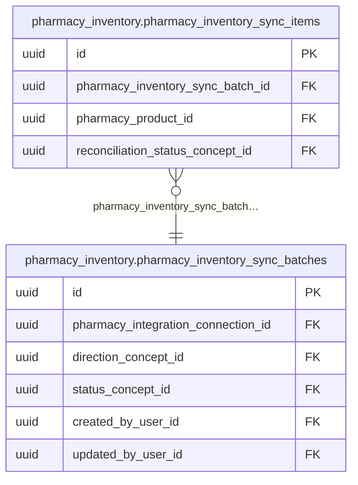

<!-- AUTOGENERADO por tools/inventario/catalogo.mjs. No editar manualmente. -->

# Catálogo del schema `pharmacy_inventory`

- **Tablas:** 20 · **Columnas:** 294 (70 con descripción: 23.8 %) · **Índices:** 154
- **Dominio:** Farmacia
- Método y límites del catálogo: [README del inventario](../README.md)

## Tablas

| Tabla | Propósito | Columnas | Índices | Operaciones | ORM |
|---|---|---|---|---|---|
| [inventory_count_lines](#inventory_count_lines) | Conserva cantidades contadas por producto, lote o ubicación durante una sesión de inventario. | 11 | 6 | 3 | COINCIDE |
| [inventory_count_sessions](#inventory_count_sessions) | Registra conteos físicos de inventario para comparar existencias observadas con saldos del sistema. | 15 | 8 | 4 | COINCIDE |
| [inventory_ledger_entries](#inventory_ledger_entries) | Mantiene el libro de movimientos de inventario para explicar cómo cambian las existencias farmacéuticas. | 23 | 16 | 36 | COINCIDE |
| [inventory_locations](#inventory_locations) | Define ubicaciones de almacenamiento farmacéutico donde se controlan lotes y existencias. | 14 | 7 | 18 | COINCIDE |
| [inventory_lots](#inventory_lots) | Registra lotes de productos para rastrear vencimientos, origen y movimientos de inventario farmacéutico. | 15 | 6 | 10 | COINCIDE |
| [inventory_recall_holds](#inventory_recall_holds) | Bloquea inventario afectado por alertas o retiros para evitar que productos comprometidos sigan disponibles. | 14 | 7 | 3 | COINCIDE |
| [inventory_reservation_lines](#inventory_reservation_lines) | Desglosa productos y cantidades comprometidos en una reserva de inventario. | 16 | 8 | 34 | COINCIDE |
| [inventory_reservations](#inventory_reservations) | Aparta existencias para procesos que requieren disponibilidad comprometida antes de su consumo o despacho. | 22 | 14 | 39 | COINCIDE |
| [inventory_serials](#inventory_serials) | Conserva números de serie de unidades controladas para habilitar trazabilidad individual de productos. | 11 | 5 | 0 | COINCIDE |
| [inventory_stock_positions](#inventory_stock_positions) | Representa saldos de existencias por producto y ubicación para consultar disponibilidad farmacéutica. | 11 | 3 | 43 | COINCIDE |
| [medication_dispensation_lines](#medication_dispensation_lines) | Detalla medicamentos y cantidades entregados dentro de cada dispensación vinculada al paciente o prescripción. | 12 | 6 | 5 | COINCIDE |
| [medication_dispensations](#medication_dispensations) | Representa dispensaciones de medicamentos a pacientes para documentar el acto de entrega farmacéutica. | 17 | 13 | 6 | COINCIDE |
| [pharmacy_goods_receipt_lines](#pharmacy_goods_receipt_lines) | Detalla lotes, productos y cantidades recibidos para actualizar y auditar existencias farmacéuticas. | 14 | 8 | 2 | COINCIDE |
| [pharmacy_goods_receipts](#pharmacy_goods_receipts) | Registra recepciones de mercancía para confirmar productos entregados contra procesos de abastecimiento. | 15 | 8 | 2 | COINCIDE |
| [pharmacy_inventory_sync_batches](#pharmacy_inventory_sync_batches) | Agrupa sincronizaciones de inventario con fuentes externas para seguir cargas de disponibilidad o catálogo. | 15 | 5 | 4 | COINCIDE |
| [pharmacy_inventory_sync_items](#pharmacy_inventory_sync_items) | Conserva el detalle de productos procesados durante sincronizaciones para revisar resultados y discrepancias. | 13 | 4 | 4 | COINCIDE |
| [pharmacy_order_substitutions](#pharmacy_order_substitutions) | Registra sustituciones de productos realizadas sobre una reserva de pedido de farmacia y sus renglones, para mantener trazabilidad cuando se dispensa una alternativa terapéutica. | 15 | 8 | 23 | COINCIDE |
| [pharmacy_purchase_order_lines](#pharmacy_purchase_order_lines) | Detalla productos y cantidades solicitados en cada orden de compra de farmacia. | 13 | 6 | 4 | COINCIDE |
| [pharmacy_purchase_orders](#pharmacy_purchase_orders) | Representa órdenes de compra de productos farmacéuticos enviadas a proveedores. | 16 | 9 | 4 | COINCIDE |
| [pharmacy_suppliers](#pharmacy_suppliers) | Cataloga proveedores de farmacia para documentar el origen de compras y abastecimiento. | 12 | 7 | 2 | COINCIDE |

## Diagrama entidad-relación

Las tablas se agrupan en familias por sus claves foráneas dentro del schema (máximo 40 por diagrama). Las FK hacia otros schemas se listan en la ficha de cada tabla.

### Familia 1 de 2 — 18 tablas

```mermaid
erDiagram
  pharmacy_inventory_inventory_count_lines["pharmacy_inventory.inventory_count_lines"] {
    uuid id PK
    uuid inventory_count_session_id FK
    uuid pharmacy_product_id FK
    uuid inventory_lot_id FK
    uuid variance_reason_concept_id FK
    uuid adjustment_ledger_entry_id FK
    uuid created_by_user_id FK
  }
  pharmacy_inventory_inventory_count_sessions["pharmacy_inventory.inventory_count_sessions"] {
    uuid id PK
    uuid pharmacy_site_id FK
    uuid inventory_location_id FK
    uuid count_type_concept_id FK
    uuid freeze_mode_concept_id FK
    uuid approved_by_user_id FK
    uuid status_concept_id FK
    uuid created_by_user_id FK
  }
  pharmacy_inventory_inventory_lots["pharmacy_inventory.inventory_lots"] {
    uuid id PK
    uuid pharmacy_product_id FK
    uuid quarantine_status_concept_id FK
    uuid recall_status_concept_id FK
    uuid status_concept_id FK
    uuid created_by_user_id FK
    uuid updated_by_user_id FK
  }
  pharmacy_inventory_inventory_locations["pharmacy_inventory.inventory_locations"] {
    uuid id PK
    uuid pharmacy_site_id FK
    uuid parent_location_id FK
    uuid location_type_concept_id FK
    uuid temperature_zone_concept_id FK
    uuid status_concept_id FK
    uuid created_by_user_id FK
    uuid updated_by_user_id FK
  }
  pharmacy_inventory_inventory_ledger_entries["pharmacy_inventory.inventory_ledger_entries"] {
    uuid id PK
    uuid pharmacy_id FK
    uuid pharmacy_site_id FK
    uuid inventory_location_id FK
    uuid pharmacy_product_id FK
    uuid inventory_lot_id FK
    uuid inventory_serial_id FK
    uuid movement_type_concept_id FK
  }
  pharmacy_inventory_inventory_recall_holds["pharmacy_inventory.inventory_recall_holds"] {
    uuid id PK
    uuid pharmacy_product_id FK
    uuid inventory_lot_id FK
    uuid recall_class_concept_id FK
    uuid hold_status_concept_id FK
    uuid source_authority_tenant_id FK
    uuid created_by_user_id FK
    uuid updated_by_user_id FK
  }
  pharmacy_inventory_inventory_reservation_lines["pharmacy_inventory.inventory_reservation_lines"] {
    uuid id PK
    uuid inventory_reservation_id FK
    uuid pharmacy_product_id FK
    uuid inventory_lot_id FK
    uuid inventory_location_id FK
    uuid status_concept_id FK
    uuid currency_concept_id FK
    uuid created_by_user_id FK
  }
  pharmacy_inventory_inventory_serials["pharmacy_inventory.inventory_serials"] {
    uuid id PK
    uuid inventory_lot_id FK
    uuid status_concept_id FK
    uuid current_inventory_location_id FK
    uuid created_by_user_id FK
    uuid updated_by_user_id FK
  }
  pharmacy_inventory_inventory_stock_positions["pharmacy_inventory.inventory_stock_positions"] {
    uuid id PK
    uuid inventory_location_id FK
    uuid pharmacy_product_id FK
    uuid inventory_lot_id FK
  }
  pharmacy_inventory_medication_dispensation_lines["pharmacy_inventory.medication_dispensation_lines"] {
    uuid id PK
    uuid medication_dispensation_id FK
    uuid pharmacy_product_id FK
    uuid inventory_lot_id FK
    uuid inventory_serial_id FK
    uuid ledger_entry_id FK
    uuid created_by_user_id FK
  }
  pharmacy_inventory_pharmacy_goods_receipt_lines["pharmacy_inventory.pharmacy_goods_receipt_lines"] {
    uuid id PK
    uuid pharmacy_goods_receipt_id FK
    uuid pharmacy_purchase_order_line_id FK
    uuid erp_goods_receipt_item_id FK
    uuid pharmacy_product_id FK
    uuid inventory_lot_id FK
    uuid inventory_location_id FK
    uuid ledger_entry_id FK
  }
  pharmacy_inventory_inventory_reservations["pharmacy_inventory.inventory_reservations"] {
    uuid id PK
    uuid pharmacy_id FK
    uuid pharmacy_site_id FK
    uuid patient_profile_id FK
    uuid medication_request_id FK
    uuid quotation_id FK
    uuid reservation_status_concept_id FK
    uuid delivery_mode_concept_id FK
  }
  pharmacy_inventory_pharmacy_order_substitutions["pharmacy_inventory.pharmacy_order_substitutions"] {
    uuid id PK
    uuid inventory_reservation_id FK
    uuid inventory_reservation_line_id FK
    uuid original_pharmacy_product_id FK
    uuid proposed_pharmacy_product_id FK
    uuid currency_concept_id FK
    uuid status_concept_id FK
    uuid created_by_user_id FK
  }
  pharmacy_inventory_medication_dispensations["pharmacy_inventory.medication_dispensations"] {
    uuid id PK
    uuid pharmacy_id FK
    uuid pharmacy_site_id FK
    uuid patient_profile_id FK
    uuid medication_request_id FK
    uuid insurance_claim_id FK
    uuid inventory_reservation_id FK
    uuid dispensation_status_concept_id FK
  }
  pharmacy_inventory_pharmacy_goods_receipts["pharmacy_inventory.pharmacy_goods_receipts"] {
    uuid id PK
    uuid pharmacy_purchase_order_id FK
    uuid pharmacy_site_id FK
    uuid erp_goods_receipt_id FK
    uuid source_document_file_id FK
    uuid status_concept_id FK
    uuid created_by_user_id FK
    uuid updated_by_user_id FK
  }
  pharmacy_inventory_pharmacy_purchase_order_lines["pharmacy_inventory.pharmacy_purchase_order_lines"] {
    uuid id PK
    uuid pharmacy_purchase_order_id FK
    uuid pharmacy_product_id FK
    uuid erp_purchase_order_item_id FK
    uuid status_concept_id FK
    uuid created_by_user_id FK
    uuid updated_by_user_id FK
  }
  pharmacy_inventory_pharmacy_purchase_orders["pharmacy_inventory.pharmacy_purchase_orders"] {
    uuid id PK
    uuid pharmacy_id FK
    uuid pharmacy_site_id FK
    uuid pharmacy_supplier_id FK
    uuid status_concept_id FK
    uuid currency_concept_id FK
    uuid erp_purchase_order_id FK
    uuid created_by_user_id FK
  }
  pharmacy_inventory_pharmacy_suppliers["pharmacy_inventory.pharmacy_suppliers"] {
    uuid id PK
    uuid pharmacy_id FK
    uuid supplier_tenant_id FK
    uuid business_partner_id FK
    uuid payment_terms_concept_id FK
    uuid status_concept_id FK
    uuid created_by_user_id FK
    uuid updated_by_user_id FK
  }
  pharmacy_inventory_inventory_count_lines }o--|| pharmacy_inventory_inventory_count_sessions : "inventory_count_session_id"
  pharmacy_inventory_inventory_count_lines }o--o| pharmacy_inventory_inventory_lots : "inventory_lot_id"
  pharmacy_inventory_inventory_count_sessions }o--|| pharmacy_inventory_inventory_locations : "inventory_location_id"
  pharmacy_inventory_inventory_ledger_entries }o--|| pharmacy_inventory_inventory_locations : "inventory_location_id"
  pharmacy_inventory_inventory_ledger_entries }o--o| pharmacy_inventory_inventory_lots : "inventory_lot_id"
  pharmacy_inventory_inventory_ledger_entries }o--o| pharmacy_inventory_inventory_serials : "inventory_serial_id"
  pharmacy_inventory_inventory_recall_holds }o--o| pharmacy_inventory_inventory_lots : "inventory_lot_id"
  pharmacy_inventory_inventory_reservation_lines }o--|| pharmacy_inventory_inventory_reservations : "inventory_reservation_id"
  pharmacy_inventory_inventory_reservation_lines }o--o| pharmacy_inventory_inventory_lots : "inventory_lot_id"
  pharmacy_inventory_inventory_reservation_lines }o--o| pharmacy_inventory_inventory_locations : "inventory_location_id"
  pharmacy_inventory_inventory_serials }o--|| pharmacy_inventory_inventory_lots : "inventory_lot_id"
  pharmacy_inventory_inventory_serials }o--o| pharmacy_inventory_inventory_locations : "current_inventory_location_id"
  pharmacy_inventory_inventory_stock_positions }o--|| pharmacy_inventory_inventory_locations : "inventory_location_id"
  pharmacy_inventory_inventory_stock_positions }o--o| pharmacy_inventory_inventory_lots : "inventory_lot_id"
  pharmacy_inventory_medication_dispensation_lines }o--|| pharmacy_inventory_medication_dispensations : "medication_dispensation_id"
  pharmacy_inventory_medication_dispensation_lines }o--o| pharmacy_inventory_inventory_lots : "inventory_lot_id"
  pharmacy_inventory_medication_dispensation_lines }o--o| pharmacy_inventory_inventory_serials : "inventory_serial_id"
  pharmacy_inventory_pharmacy_goods_receipt_lines }o--|| pharmacy_inventory_pharmacy_goods_receipts : "pharmacy_goods_receipt_id"
  pharmacy_inventory_pharmacy_goods_receipt_lines }o--|| pharmacy_inventory_pharmacy_purchase_order_lines : "pharmacy_purchase_order_line_…"
  pharmacy_inventory_pharmacy_goods_receipt_lines }o--o| pharmacy_inventory_inventory_lots : "inventory_lot_id"
  pharmacy_inventory_pharmacy_goods_receipt_lines }o--o| pharmacy_inventory_inventory_locations : "inventory_location_id"
  pharmacy_inventory_pharmacy_order_substitutions }o--|| pharmacy_inventory_inventory_reservations : "inventory_reservation_id"
  pharmacy_inventory_pharmacy_order_substitutions }o--|| pharmacy_inventory_inventory_reservation_lines : "inventory_reservation_line_id"
  pharmacy_inventory_medication_dispensations }o--o| pharmacy_inventory_inventory_reservations : "inventory_reservation_id"
  pharmacy_inventory_pharmacy_goods_receipts }o--|| pharmacy_inventory_pharmacy_purchase_orders : "pharmacy_purchase_order_id"
  pharmacy_inventory_pharmacy_purchase_order_lines }o--|| pharmacy_inventory_pharmacy_purchase_orders : "pharmacy_purchase_order_id"
  pharmacy_inventory_pharmacy_purchase_orders }o--|| pharmacy_inventory_pharmacy_suppliers : "pharmacy_supplier_id"
```

### Familia 2 de 2 — 2 tablas

## Fichas

### inventory_count_lines

#### Vista general

Conserva cantidades contadas por producto, lote o ubicación durante una sesión de inventario.

- **Estado del propósito:** DOMAIN_CURATED_DRAFT · fuente: `Mantra Core Health Context/modules/diagram_25_pharmacy_inventory.puml: inventory_count_lines`
- **Dominio:** Farmacia · **Diagrama:** `Mantra Core Health Context/modules/diagram_25_pharmacy_inventory.puml` · **DDL:** `SQL/25_pharmacy_inventory/02_tables.sql`
- **Entidad del ORM:** `InventoryCountLines` — `src/modules/pharmacy_inventory/entities/inventory_count_lines.entity.ts`
- **Resumen:** 11 columnas · 6 índices · 6 FK salientes · 0 entrantes · 3 operaciones

#### Columnas

| # | Columna | Tipo | Rol estructural | Descripción | ORM |
|---|---|---|---|---|---|
| 1 | `id` | `uuid` | Clave primaria; Obligatoria | Identificador único de la instancia. _(JSDOC_ESTANDAR, `src/modules/pharmacy_inventory/entities/inventory_count_lines.entity.ts:12`)_ | coincide |
| 2 | `inventory_count_session_id` | `uuid` | Clave foránea → pharmacy_inventory.inventory_count_sessions.id; Obligatoria | _sin dato_ | coincide |
| 3 | `pharmacy_product_id` | `uuid` | Clave foránea → pharmacy.pharmacy_products.id; Obligatoria | _sin dato_ | coincide |
| 4 | `inventory_lot_id` | `uuid` | Clave foránea → pharmacy_inventory.inventory_lots.id; Opcional | _sin dato_ | coincide |
| 5 | `expected_quantity` | `numeric` | Obligatoria | _sin dato_ | coincide |
| 6 | `counted_quantity` | `numeric` | Obligatoria | _sin dato_ | coincide |
| 7 | `variance_quantity` | `numeric` | Obligatoria | _sin dato_ | coincide |
| 8 | `variance_reason_concept_id` | `uuid` | Clave foránea → terminology.catalog_concepts.id; Opcional | _sin dato_ | coincide |
| 9 | `adjustment_ledger_entry_id` | `uuid` | Clave foránea → accounting.ledger_entries.id; Opcional | _sin dato_ | coincide |
| 10 | `created_at` | `timestamptz` | Obligatoria | Fecha y hora en que se creó el registro. _(JSDOC_ESTANDAR, `src/modules/pharmacy_inventory/entities/inventory_count_lines.entity.ts:74`)_ | coincide |
| 11 | `created_by_user_id` | `uuid` | Clave foránea → iam.users.id; Opcional | _sin dato_ | coincide |

#### Relaciones

| Sentido | Columnas | Tabla | Restricción |
|---|---|---|---|
| hacia | inventory_count_session_id | pharmacy_inventory.inventory_count_sessions (id) | fk_inventory_count_lines_inventory_count_session_id |
| hacia | inventory_lot_id | pharmacy_inventory.inventory_lots (id) | fk_inventory_count_lines_inventory_lot_id |
| hacia | pharmacy_product_id | pharmacy.pharmacy_products (id) | fk_inventory_count_lines_pharmacy_product_id |
| hacia | variance_reason_concept_id | terminology.catalog_concepts (id) | fk_inventory_count_lines_variance_reason_concept_id |
| hacia | adjustment_ledger_entry_id | accounting.ledger_entries (id) | fk_inventory_count_lines_adjustment_ledger_entry_id |
| hacia | created_by_user_id | iam.users (id) | fk_inventory_count_lines_created_by_user_id |

#### Índices

| Índice | Único | Columnas | Para qué |
|---|---|---|---|
| `ix_inventory_count_lines_inventory_count_session_id` | no | inventory_count_session_id | Soporta la clave foránea fk_inventory_count_lines_inventory_count_session_id: PostgreSQL no indexa las FK por sí mismo _(DOCUMENTO)_; 1 consulta(s) de repositorio filtran u ordenan por «inventory_count_session_id», la primera columna del índice _(CONSULTA)_ |
| `ix_inventory_count_lines_pharmacy_product_id` | no | pharmacy_product_id | Soporta la clave foránea fk_inventory_count_lines_pharmacy_product_id: PostgreSQL no indexa las FK por sí mismo _(DOCUMENTO)_ |
| `ix_inventory_count_lines_inventory_lot_id` | no | inventory_lot_id | Soporta la clave foránea fk_inventory_count_lines_inventory_lot_id: PostgreSQL no indexa las FK por sí mismo _(DOCUMENTO)_ |
| `ix_inventory_count_lines_variance_reason_concept_id` | no | variance_reason_concept_id | Soporta la clave foránea fk_inventory_count_lines_variance_reason_concept_id: PostgreSQL no indexa las FK por sí mismo _(DOCUMENTO)_ |
| `ix_inventory_count_lines_adjustment_ledger_entry_id` | no | adjustment_ledger_entry_id | Soporta la clave foránea fk_inventory_count_lines_adjustment_ledger_entry_id: PostgreSQL no indexa las FK por sí mismo _(DOCUMENTO)_ |
| `ix_inventory_count_lines_created_by_user_id` | no | created_by_user_id | Soporta la clave foránea fk_inventory_count_lines_created_by_user_id: PostgreSQL no indexa las FK por sí mismo _(DOCUMENTO)_ |

#### Operaciones que la tocan

| Operación | Efecto | Confianza |
|---|---|---|
| POST /pharmacy/{siteId}/count-sessions | CREA | DIRECTA |
| POST /pharmacy/count-sessions/{id}/approve | ACTUALIZA | POR_TIPO |
| POST /pharmacy/count-sessions/{id}/approve | LEE | DIRECTA |

#### Gobierno

| Atributo | Valor | Fuente |
|---|---|---|
| Append-only | no declarado | — |
| Datos personales | sin fuente | — |
| Financiera | sin fuente | — |
| Crítica para auditoría | sin fuente | — |
| Retención | sin fuente | — |
| Responsable | sin fuente | — |
| Revisión | AUTO_DETECTADA | — |

---

### inventory_count_sessions

#### Vista general

Registra conteos físicos de inventario para comparar existencias observadas con saldos del sistema.

- **Estado del propósito:** DOMAIN_CURATED_DRAFT · fuente: `Mantra Core Health Context/modules/diagram_25_pharmacy_inventory.puml: inventory_count_sessions`
- **Dominio:** Farmacia · **Diagrama:** `Mantra Core Health Context/modules/diagram_25_pharmacy_inventory.puml` · **DDL:** `SQL/25_pharmacy_inventory/02_tables.sql`
- **Entidad del ORM:** `InventoryCountSessions` — `src/modules/pharmacy_inventory/entities/inventory_count_sessions.entity.ts`
- **Resumen:** 15 columnas · 8 índices · 8 FK salientes · 1 entrantes · 4 operaciones

#### Columnas

| # | Columna | Tipo | Rol estructural | Descripción | ORM |
|---|---|---|---|---|---|
| 1 | `id` | `uuid` | Clave primaria; Obligatoria | Identificador único de la instancia. _(JSDOC_ESTANDAR, `src/modules/pharmacy_inventory/entities/inventory_count_sessions.entity.ts:12`)_ | coincide |
| 2 | `pharmacy_site_id` | `uuid` | Clave foránea → pharmacy.pharmacy_sites.id; Obligatoria | _sin dato_ | coincide |
| 3 | `inventory_location_id` | `uuid` | Clave foránea → pharmacy_inventory.inventory_locations.id; Obligatoria | _sin dato_ | coincide |
| 4 | `count_type_concept_id` | `uuid` | Clave foránea → terminology.catalog_concepts.id; Obligatoria | _sin dato_ | coincide |
| 5 | `freeze_mode_concept_id` | `uuid` | Clave foránea → terminology.catalog_concepts.id; Opcional | _sin dato_ | coincide |
| 6 | `started_at` | `timestamptz` | Opcional | _sin dato_ | coincide |
| 7 | `completed_at` | `timestamptz` | Opcional | _sin dato_ | coincide |
| 8 | `approved_at` | `timestamptz` | Opcional | _sin dato_ | coincide |
| 9 | `approved_by_user_id` | `uuid` | Clave foránea → iam.users.id; Opcional | _sin dato_ | coincide |
| 10 | `status_concept_id` | `uuid` | Clave foránea → terminology.catalog_concepts.id; Obligatoria | _sin dato_ | coincide |
| 11 | `created_at` | `timestamptz` | Obligatoria | Fecha y hora en que se creó el registro. _(JSDOC_ESTANDAR, `src/modules/pharmacy_inventory/entities/inventory_count_sessions.entity.ts:88`)_ | coincide |
| 12 | `updated_at` | `timestamptz` | Obligatoria | Fecha y hora de la última actualización. _(JSDOC_ESTANDAR, `src/modules/pharmacy_inventory/entities/inventory_count_sessions.entity.ts:94`)_ | coincide |
| 13 | `created_by_user_id` | `uuid` | Clave foránea → iam.users.id; Opcional | _sin dato_ | coincide |
| 14 | `updated_by_user_id` | `uuid` | Clave foránea → iam.users.id; Opcional | _sin dato_ | coincide |
| 15 | `row_version` | `integer = 1` | Obligatoria | Versión usada para controlar actualizaciones concurrentes. _(JSDOC_ENTIDAD, `src/modules/pharmacy_inventory/entities/inventory_count_sessions.entity.ts:112`)_ | coincide |

#### Relaciones

| Sentido | Columnas | Tabla | Restricción |
|---|---|---|---|
| hacia | inventory_location_id | pharmacy_inventory.inventory_locations (id) | fk_inventory_count_sessions_inventory_location_id |
| hacia | pharmacy_site_id | pharmacy.pharmacy_sites (id) | fk_inventory_count_sessions_pharmacy_site_id |
| hacia | count_type_concept_id | terminology.catalog_concepts (id) | fk_inventory_count_sessions_count_type_concept_id |
| hacia | freeze_mode_concept_id | terminology.catalog_concepts (id) | fk_inventory_count_sessions_freeze_mode_concept_id |
| hacia | approved_by_user_id | iam.users (id) | fk_inventory_count_sessions_approved_by_user_id |
| hacia | status_concept_id | terminology.catalog_concepts (id) | fk_inventory_count_sessions_status_concept_id |
| hacia | created_by_user_id | iam.users (id) | fk_inventory_count_sessions_created_by_user_id |
| hacia | updated_by_user_id | iam.users (id) | fk_inventory_count_sessions_updated_by_user_id |
| desde | id | pharmacy_inventory.inventory_count_lines (inventory_count_session_id) | fk_inventory_count_lines_inventory_count_session_id |

#### Índices

| Índice | Único | Columnas | Para qué |
|---|---|---|---|
| `ix_inventory_count_sessions_pharmacy_site_id` | no | pharmacy_site_id | Soporta la clave foránea fk_inventory_count_sessions_pharmacy_site_id: PostgreSQL no indexa las FK por sí mismo _(DOCUMENTO)_ |
| `ix_inventory_count_sessions_inventory_location_id` | no | inventory_location_id | Soporta la clave foránea fk_inventory_count_sessions_inventory_location_id: PostgreSQL no indexa las FK por sí mismo _(DOCUMENTO)_; 1 consulta(s) de repositorio filtran u ordenan por «inventory_location_id», la primera columna del índice _(CONSULTA)_ |
| `ix_inventory_count_sessions_count_type_concept_id` | no | count_type_concept_id | Soporta la clave foránea fk_inventory_count_sessions_count_type_concept_id: PostgreSQL no indexa las FK por sí mismo _(DOCUMENTO)_ |
| `ix_inventory_count_sessions_freeze_mode_concept_id` | no | freeze_mode_concept_id | Soporta la clave foránea fk_inventory_count_sessions_freeze_mode_concept_id: PostgreSQL no indexa las FK por sí mismo _(DOCUMENTO)_ |
| `ix_inventory_count_sessions_approved_by_user_id` | no | approved_by_user_id | Soporta la clave foránea fk_inventory_count_sessions_approved_by_user_id: PostgreSQL no indexa las FK por sí mismo _(DOCUMENTO)_ |
| `ix_inventory_count_sessions_status_concept_id` | no | status_concept_id | Soporta la clave foránea fk_inventory_count_sessions_status_concept_id: PostgreSQL no indexa las FK por sí mismo _(DOCUMENTO)_; 1 consulta(s) de repositorio filtran u ordenan por «status_concept_id», la primera columna del índice _(CONSULTA)_ |
| `ix_inventory_count_sessions_created_by_user_id` | no | created_by_user_id | Soporta la clave foránea fk_inventory_count_sessions_created_by_user_id: PostgreSQL no indexa las FK por sí mismo _(DOCUMENTO)_ |
| `ix_inventory_count_sessions_updated_by_user_id` | no | updated_by_user_id | Soporta la clave foránea fk_inventory_count_sessions_updated_by_user_id: PostgreSQL no indexa las FK por sí mismo _(DOCUMENTO)_ |

#### Operaciones que la tocan

| Operación | Efecto | Confianza |
|---|---|---|
| POST /pharmacy/{siteId}/count-sessions | CREA | DIRECTA |
| POST /pharmacy/{siteId}/count-sessions | LEE | DIRECTA |
| POST /pharmacy/count-sessions/{id}/approve | ACTUALIZA | POR_TIPO |
| POST /pharmacy/count-sessions/{id}/approve | LEE | DIRECTA |

#### Gobierno

| Atributo | Valor | Fuente |
|---|---|---|
| Append-only | no declarado | — |
| Datos personales | sin fuente | — |
| Financiera | sin fuente | — |
| Crítica para auditoría | sin fuente | — |
| Retención | sin fuente | — |
| Responsable | sin fuente | — |
| Revisión | AUTO_DETECTADA | — |

---

### inventory_ledger_entries

#### Vista general

Mantiene el libro de movimientos de inventario para explicar cómo cambian las existencias farmacéuticas.

- **Estado del propósito:** DOMAIN_CURATED_DRAFT · fuente: `Mantra Core Health Context/modules/diagram_25_pharmacy_inventory.puml: inventory_ledger_entries`
- **Dominio:** Farmacia · **Diagrama:** `Mantra Core Health Context/modules/diagram_25_pharmacy_inventory.puml` · **DDL:** `SQL/25_pharmacy_inventory/02_tables.sql`
- **Entidad del ORM:** `InventoryLedgerEntries` — `src/modules/pharmacy_inventory/entities/inventory_ledger_entries.entity.ts`
- **Resumen:** 23 columnas · 16 índices · 12 FK salientes · 1 entrantes · 36 operaciones

#### Columnas

| # | Columna | Tipo | Rol estructural | Descripción | ORM |
|---|---|---|---|---|---|
| 1 | `id` | `uuid` | Clave primaria; Obligatoria | Identificador único de la instancia. _(JSDOC_ESTANDAR, `src/modules/pharmacy_inventory/entities/inventory_ledger_entries.entity.ts:12`)_ | coincide |
| 2 | `pharmacy_id` | `uuid` | Clave foránea → pharmacy.pharmacies.id; Obligatoria | _sin dato_ | coincide |
| 3 | `pharmacy_site_id` | `uuid` | Clave foránea → pharmacy.pharmacy_sites.id; Obligatoria | _sin dato_ | coincide |
| 4 | `inventory_location_id` | `uuid` | Clave foránea → pharmacy_inventory.inventory_locations.id; Obligatoria | _sin dato_ | coincide |
| 5 | `pharmacy_product_id` | `uuid` | Clave foránea → pharmacy.pharmacy_products.id; Obligatoria | _sin dato_ | coincide |
| 6 | `inventory_lot_id` | `uuid` | Clave foránea → pharmacy_inventory.inventory_lots.id; Opcional | _sin dato_ | coincide |
| 7 | `inventory_serial_id` | `uuid` | Clave foránea → pharmacy_inventory.inventory_serials.id; Opcional | _sin dato_ | coincide |
| 8 | `ledger_sequence` | `bigint` | Obligatoria | _sin dato_ | coincide |
| 9 | `movement_type_concept_id` | `uuid` | Clave foránea → terminology.catalog_concepts.id; Obligatoria | _sin dato_ | coincide |
| 10 | `quantity_delta` | `numeric` | Obligatoria | _sin dato_ | coincide |
| 11 | `reservation_delta` | `numeric` | Opcional | _sin dato_ | coincide |
| 12 | `quarantine_delta` | `numeric` | Opcional | _sin dato_ | coincide |
| 13 | `unit_cost_amount` | `numeric` | Opcional | _sin dato_ | coincide |
| 14 | `currency_concept_id` | `uuid` | Clave foránea → terminology.catalog_concepts.id; Opcional | _sin dato_ | coincide |
| 15 | `source_type_concept_id` | `uuid` | Clave foránea → terminology.catalog_concepts.id; Opcional | _sin dato_ | coincide |
| 16 | `source_id` | `uuid` | Opcional | _sin dato_ | coincide |
| 17 | `idempotency_key` | `varchar` | Opcional | _sin dato_ | coincide |
| 18 | `correlation_id` | `uuid` | Opcional | _sin dato_ | coincide |
| 19 | `erp_goods_receipt_item_id` | `uuid` | Clave foránea → erp.goods_receipt_items.id; Opcional | _sin dato_ | coincide |
| 20 | `accounting_ledger_entry_id` | `uuid` | Clave foránea → accounting.ledger_entries.id; Opcional | _sin dato_ | coincide |
| 21 | `occurred_at` | `timestamptz` | Obligatoria | _sin dato_ | coincide |
| 22 | `recorded_at` | `timestamptz` | Obligatoria | _sin dato_ | coincide |
| 23 | `recorded_by_user_id` | `uuid` | Clave foránea → iam.users.id; Opcional | _sin dato_ | coincide |

#### Relaciones

| Sentido | Columnas | Tabla | Restricción |
|---|---|---|---|
| hacia | inventory_location_id | pharmacy_inventory.inventory_locations (id) | fk_inventory_ledger_entries_inventory_location_id |
| hacia | inventory_lot_id | pharmacy_inventory.inventory_lots (id) | fk_inventory_ledger_entries_inventory_lot_id |
| hacia | inventory_serial_id | pharmacy_inventory.inventory_serials (id) | fk_inventory_ledger_entries_inventory_serial_id |
| hacia | pharmacy_id | pharmacy.pharmacies (id) | fk_inventory_ledger_entries_pharmacy_id |
| hacia | pharmacy_site_id | pharmacy.pharmacy_sites (id) | fk_inventory_ledger_entries_pharmacy_site_id |
| hacia | pharmacy_product_id | pharmacy.pharmacy_products (id) | fk_inventory_ledger_entries_pharmacy_product_id |
| hacia | movement_type_concept_id | terminology.catalog_concepts (id) | fk_inventory_ledger_entries_movement_type_concept_id |
| hacia | currency_concept_id | terminology.catalog_concepts (id) | fk_inventory_ledger_entries_currency_concept_id |
| hacia | source_type_concept_id | terminology.catalog_concepts (id) | fk_inventory_ledger_entries_source_type_concept_id |
| hacia | erp_goods_receipt_item_id | erp.goods_receipt_items (id) | fk_inventory_ledger_entries_erp_goods_receipt_item_id |
| hacia | accounting_ledger_entry_id | accounting.ledger_entries (id) | fk_inventory_ledger_entries_accounting_ledger_entry_id |
| hacia | recorded_by_user_id | iam.users (id) | fk_inventory_ledger_entries_recorded_by_user_id |
| desde | id | erp.goods_receipt_items (inventory_ledger_entry_id) | fk_goods_receipt_items_inventory_ledger_entry_id |

#### Índices

| Índice | Único | Columnas | Para qué |
|---|---|---|---|
| `ix_inventory_ledger_entries_pharmacy_id` | no | pharmacy_id | Soporta la clave foránea fk_inventory_ledger_entries_pharmacy_id: PostgreSQL no indexa las FK por sí mismo _(DOCUMENTO)_ |
| `ix_inventory_ledger_entries_pharmacy_site_id` | no | pharmacy_site_id | Soporta la clave foránea fk_inventory_ledger_entries_pharmacy_site_id: PostgreSQL no indexa las FK por sí mismo _(DOCUMENTO)_ |
| `ix_inventory_ledger_entries_inventory_location_id` | no | inventory_location_id | Soporta la clave foránea fk_inventory_ledger_entries_inventory_location_id: PostgreSQL no indexa las FK por sí mismo _(DOCUMENTO)_ |
| `ix_inventory_ledger_entries_pharmacy_product_id` | no | pharmacy_product_id | Soporta la clave foránea fk_inventory_ledger_entries_pharmacy_product_id: PostgreSQL no indexa las FK por sí mismo _(DOCUMENTO)_ |
| `ix_inventory_ledger_entries_inventory_lot_id` | no | inventory_lot_id | Soporta la clave foránea fk_inventory_ledger_entries_inventory_lot_id: PostgreSQL no indexa las FK por sí mismo _(DOCUMENTO)_ |
| `ix_inventory_ledger_entries_inventory_serial_id` | no | inventory_serial_id | Soporta la clave foránea fk_inventory_ledger_entries_inventory_serial_id: PostgreSQL no indexa las FK por sí mismo _(DOCUMENTO)_ |
| `ix_inventory_ledger_entries_movement_type_concept_id` | no | movement_type_concept_id | Soporta la clave foránea fk_inventory_ledger_entries_movement_type_concept_id: PostgreSQL no indexa las FK por sí mismo _(DOCUMENTO)_ |
| `ix_inventory_ledger_entries_currency_concept_id` | no | currency_concept_id | Soporta la clave foránea fk_inventory_ledger_entries_currency_concept_id: PostgreSQL no indexa las FK por sí mismo _(DOCUMENTO)_ |
| `ix_inventory_ledger_entries_erp_goods_receipt_item_id` | no | erp_goods_receipt_item_id | Soporta la clave foránea fk_inventory_ledger_entries_erp_goods_receipt_item_id: PostgreSQL no indexa las FK por sí mismo _(DOCUMENTO)_ |
| `ix_inventory_ledger_entries_accounting_ledger_entry_id` | no | accounting_ledger_entry_id | Soporta la clave foránea fk_inventory_ledger_entries_accounting_ledger_entry_id: PostgreSQL no indexa las FK por sí mismo _(DOCUMENTO)_ |
| `ix_inventory_ledger_entries_source_type_concept_id` | no | source_type_concept_id | Soporta la clave foránea fk_inventory_ledger_entries_source_type_concept_id: PostgreSQL no indexa las FK por sí mismo _(DOCUMENTO)_ |
| `ix_inventory_ledger_entries_recorded_by_user_id` | no | recorded_by_user_id | Soporta la clave foránea fk_inventory_ledger_entries_recorded_by_user_id: PostgreSQL no indexa las FK por sí mismo _(DOCUMENTO)_ |
| `uq_inventory_ledger_entries_pharmacy_id_ledger_sequence` | sí | pharmacy_id, ledger_sequence | Garantiza que no se repita la combinación (pharmacy_id, ledger_sequence) _(DOCUMENTO)_; Soporta la clave foránea fk_inventory_ledger_entries_pharmacy_id: PostgreSQL no indexa las FK por sí mismo _(DOCUMENTO)_ |
| `uq_inventory_ledger_entries_idempotency` | sí | idempotency_key | Garantiza que no se repita la combinación (idempotency_key) _(DOCUMENTO)_ |
| `uq_inventory_ledger_idempotency` | sí | pharmacy_id, idempotency_key | Garantiza que no se repita la combinación (pharmacy_id, idempotency_key) _(DOCUMENTO)_; Soporta la clave foránea fk_inventory_ledger_entries_pharmacy_id: PostgreSQL no indexa las FK por sí mismo _(DOCUMENTO)_ |
| `brin_inventory_ledger_entries_recorded_at` | no | recorded_at | BRIN para logs e historiales append-only de gran volumen _(DOCUMENTO)_ |

#### Restricciones

| Restricción | Tipo | Definición |
|---|---|---|
| `uq_inventory_ledger_entries_pharmacy_id_ledger_sequence` | UNIQUE INDEX | UNIQUE INDEX ("pharmacy_id", "ledger_sequence") |
| `uq_inventory_ledger_entries_idempotency` | UNIQUE INDEX | UNIQUE INDEX ("idempotency_key") |
| `uq_inventory_ledger_idempotency` | UNIQUE INDEX | UNIQUE INDEX ("pharmacy_id", "idempotency_key") |

#### Operaciones que la tocan

| Operación | Efecto | Confianza |
|---|---|---|
| POST /internal/reservations/expire | CREA | DIRECTA |
| POST /internal/reservations/expire | LEE | POR_SQL |
| POST /pharmacy/{pharmacyId}/dispensations | CREA | DIRECTA |
| POST /pharmacy/{pharmacyId}/dispensations | LEE | DIRECTA |
| POST /pharmacy/{pharmacyId}/goods-receipts | CREA | DIRECTA |
| POST /pharmacy/{pharmacyId}/goods-receipts | LEE | DIRECTA |
| POST /pharmacy/{pharmacyId}/reservations | CREA | DIRECTA |
| POST /pharmacy/{pharmacyId}/reservations | LEE | POR_SQL |
| POST /pharmacy/{pharmacyId}/transfers | CREA | DIRECTA |
| POST /pharmacy/{pharmacyId}/transfers | LEE | POR_SQL |
| POST /pharmacy/count-sessions/{id}/approve | CREA | DIRECTA |
| POST /pharmacy/count-sessions/{id}/approve | LEE | POR_SQL |
| POST /pharmacy/dispensations/{id}/reverse | CREA | DIRECTA |
| POST /pharmacy/dispensations/{id}/reverse | LEE | POR_SQL |
| GET /pharmacy/orders | CREA | DIRECTA |
| GET /pharmacy/orders | LEE | POR_SQL |
| POST /pharmacy/orders | CREA | DIRECTA |
| POST /pharmacy/orders | LEE | POR_SQL |
| GET /pharmacy/orders/{id} | CREA | DIRECTA |
| GET /pharmacy/orders/{id} | LEE | POR_SQL |
| POST /pharmacy/orders/{id}/accept-substitutions | CREA | DIRECTA |
| POST /pharmacy/orders/{id}/accept-substitutions | LEE | POR_SQL |
| POST /pharmacy/orders/{id}/cancel | CREA | DIRECTA |
| POST /pharmacy/orders/{id}/cancel | LEE | POR_SQL |
| POST /pharmacy/orders/{id}/confirm | CREA | DIRECTA |
| POST /pharmacy/orders/{id}/confirm | LEE | POR_SQL |
| POST /pharmacy/orders/{id}/dispense | CREA | DIRECTA |
| POST /pharmacy/orders/{id}/dispense | LEE | POR_SQL |
| POST /pharmacy/orders/{id}/reject | CREA | DIRECTA |
| POST /pharmacy/orders/{id}/reject | LEE | POR_SQL |
| GET /pharmacy/orders/me | CREA | DIRECTA |
| GET /pharmacy/orders/me | LEE | POR_SQL |
| POST /pharmacy/recall-holds | CREA | DIRECTA |
| POST /pharmacy/recall-holds | LEE | POR_SQL |
| POST /pharmacy/recall-holds/{id}/release | CREA | DIRECTA |
| POST /pharmacy/recall-holds/{id}/release | LEE | POR_SQL |

#### Gobierno

| Atributo | Valor | Fuente |
|---|---|---|
| Append-only | no declarado | — |
| Datos personales | sin fuente | — |
| Financiera | sin fuente | — |
| Crítica para auditoría | sin fuente | — |
| Retención | sin fuente | — |
| Responsable | sin fuente | — |
| Revisión | AUTO_DETECTADA | — |

---

### inventory_locations

#### Vista general

Define ubicaciones de almacenamiento farmacéutico donde se controlan lotes y existencias.

- **Estado del propósito:** DOMAIN_CURATED_DRAFT · fuente: `Mantra Core Health Context/modules/diagram_25_pharmacy_inventory.puml: inventory_locations`
- **Dominio:** Farmacia · **Diagrama:** `Mantra Core Health Context/modules/diagram_25_pharmacy_inventory.puml` · **DDL:** `SQL/25_pharmacy_inventory/02_tables.sql`
- **Entidad del ORM:** `InventoryLocations` — `src/modules/pharmacy_inventory/entities/inventory_locations.entity.ts`
- **Resumen:** 14 columnas · 7 índices · 7 FK salientes · 7 entrantes · 18 operaciones

#### Columnas

| # | Columna | Tipo | Rol estructural | Descripción | ORM |
|---|---|---|---|---|---|
| 1 | `id` | `uuid` | Clave primaria; Obligatoria | Identificador único de la instancia. _(JSDOC_ESTANDAR, `src/modules/pharmacy_inventory/entities/inventory_locations.entity.ts:12`)_ | coincide |
| 2 | `pharmacy_site_id` | `uuid` | Clave foránea → pharmacy.pharmacy_sites.id; Obligatoria | _sin dato_ | coincide |
| 3 | `parent_location_id` | `uuid` | Clave foránea → pharmacy_inventory.inventory_locations.id; Opcional | _sin dato_ | coincide |
| 4 | `code` | `varchar` | Obligatoria | _sin dato_ | coincide |
| 5 | `name` | `varchar` | Obligatoria | _sin dato_ | coincide |
| 6 | `location_type_concept_id` | `uuid` | Clave foránea → terminology.catalog_concepts.id; Obligatoria | _sin dato_ | coincide |
| 7 | `temperature_zone_concept_id` | `uuid` | Clave foránea → terminology.catalog_concepts.id; Opcional | _sin dato_ | coincide |
| 8 | `controlled_access` | `boolean` | Opcional | _sin dato_ | coincide |
| 9 | `status_concept_id` | `uuid` | Clave foránea → terminology.catalog_concepts.id; Obligatoria | _sin dato_ | coincide |
| 10 | `created_at` | `timestamptz` | Obligatoria | Fecha y hora en que se creó el registro. _(JSDOC_ESTANDAR, `src/modules/pharmacy_inventory/entities/inventory_locations.entity.ts:70`)_ | coincide |
| 11 | `updated_at` | `timestamptz` | Obligatoria | Fecha y hora de la última actualización. _(JSDOC_ESTANDAR, `src/modules/pharmacy_inventory/entities/inventory_locations.entity.ts:76`)_ | coincide |
| 12 | `created_by_user_id` | `uuid` | Clave foránea → iam.users.id; Opcional | _sin dato_ | coincide |
| 13 | `updated_by_user_id` | `uuid` | Clave foránea → iam.users.id; Opcional | _sin dato_ | coincide |
| 14 | `row_version` | `integer = 1` | Obligatoria | Versión usada para controlar actualizaciones concurrentes. _(JSDOC_ENTIDAD, `src/modules/pharmacy_inventory/entities/inventory_locations.entity.ts:94`)_ | coincide |

#### Relaciones

| Sentido | Columnas | Tabla | Restricción |
|---|---|---|---|
| hacia | parent_location_id | pharmacy_inventory.inventory_locations (id) | fk_inventory_locations_parent_location_id |
| hacia | pharmacy_site_id | pharmacy.pharmacy_sites (id) | fk_inventory_locations_pharmacy_site_id |
| hacia | location_type_concept_id | terminology.catalog_concepts (id) | fk_inventory_locations_location_type_concept_id |
| hacia | temperature_zone_concept_id | terminology.catalog_concepts (id) | fk_inventory_locations_temperature_zone_concept_id |
| hacia | status_concept_id | terminology.catalog_concepts (id) | fk_inventory_locations_status_concept_id |
| hacia | created_by_user_id | iam.users (id) | fk_inventory_locations_created_by_user_id |
| hacia | updated_by_user_id | iam.users (id) | fk_inventory_locations_updated_by_user_id |
| desde | id | pharmacy_inventory.inventory_locations (parent_location_id) | fk_inventory_locations_parent_location_id |
| desde | id | pharmacy_inventory.inventory_serials (current_inventory_location_id) | fk_inventory_serials_current_inventory_location_id |
| desde | id | pharmacy_inventory.inventory_stock_positions (inventory_location_id) | fk_inventory_stock_positions_inventory_location_id |
| desde | id | pharmacy_inventory.inventory_ledger_entries (inventory_location_id) | fk_inventory_ledger_entries_inventory_location_id |
| desde | id | pharmacy_inventory.inventory_reservation_lines (inventory_location_id) | fk_inventory_reservation_lines_inventory_location_id |
| desde | id | pharmacy_inventory.inventory_count_sessions (inventory_location_id) | fk_inventory_count_sessions_inventory_location_id |
| desde | id | pharmacy_inventory.pharmacy_goods_receipt_lines (inventory_location_id) | fk_pharmacy_goods_receipt_lines_inventory_location_id |

#### Índices

| Índice | Único | Columnas | Para qué |
|---|---|---|---|
| `ix_inventory_locations_pharmacy_site_id` | no | pharmacy_site_id | Soporta la clave foránea fk_inventory_locations_pharmacy_site_id: PostgreSQL no indexa las FK por sí mismo _(DOCUMENTO)_; 2 consulta(s) de repositorio filtran u ordenan por «pharmacy_site_id», la primera columna del índice _(CONSULTA)_ |
| `ix_inventory_locations_parent_location_id` | no | parent_location_id | Soporta la clave foránea fk_inventory_locations_parent_location_id: PostgreSQL no indexa las FK por sí mismo _(DOCUMENTO)_ |
| `ix_inventory_locations_location_type_concept_id` | no | location_type_concept_id | Soporta la clave foránea fk_inventory_locations_location_type_concept_id: PostgreSQL no indexa las FK por sí mismo _(DOCUMENTO)_ |
| `ix_inventory_locations_temperature_zone_concept_id` | no | temperature_zone_concept_id | Soporta la clave foránea fk_inventory_locations_temperature_zone_concept_id: PostgreSQL no indexa las FK por sí mismo _(DOCUMENTO)_ |
| `ix_inventory_locations_status_concept_id` | no | status_concept_id | Soporta la clave foránea fk_inventory_locations_status_concept_id: PostgreSQL no indexa las FK por sí mismo _(DOCUMENTO)_; 1 consulta(s) de repositorio filtran u ordenan por «status_concept_id», la primera columna del índice _(CONSULTA)_ |
| `ix_inventory_locations_created_by_user_id` | no | created_by_user_id | Soporta la clave foránea fk_inventory_locations_created_by_user_id: PostgreSQL no indexa las FK por sí mismo _(DOCUMENTO)_ |
| `ix_inventory_locations_updated_by_user_id` | no | updated_by_user_id | Soporta la clave foránea fk_inventory_locations_updated_by_user_id: PostgreSQL no indexa las FK por sí mismo _(DOCUMENTO)_ |

#### Operaciones que la tocan

| Operación | Efecto | Confianza |
|---|---|---|
| GET /public/medications | LEE | POR_SQL |
| GET /public/medications/{conceptId}/availability | LEE | POR_SQL |
| GET /pharmacy-inventory/availability | LEE | DIRECTA |
| GET /pharmacy-inventory/sites/{siteId}/stock | LEE | DIRECTA |
| POST /pharmacy/{pharmacyId}/dispensations | LEE | DIRECTA |
| POST /pharmacy/{pharmacyId}/goods-receipts | LEE | DIRECTA |
| POST /pharmacy/{pharmacyId}/reservations | LEE | DIRECTA |
| POST /pharmacy/{pharmacyId}/transfers | LEE | DIRECTA |
| POST /pharmacy/{siteId}/count-sessions | LEE | DIRECTA |
| POST /pharmacy/{siteId}/inventory-locations | CREA | DIRECTA |
| POST /pharmacy/{siteId}/inventory-locations | LEE | DIRECTA |
| POST /pharmacy/count-sessions/{id}/approve | LEE | DIRECTA |
| POST /pharmacy/dispensations/{id}/reverse | LEE | DIRECTA |
| POST /pharmacy/orders | LEE | DIRECTA |
| POST /pharmacy/orders/{id}/accept-substitutions | LEE | DIRECTA |
| POST /pharmacy/recall-holds | LEE | DIRECTA |
| POST /pharmacy/recall-holds/{id}/release | LEE | DIRECTA |
| GET /public/profiles/f/{slug}/products | LEE | POR_SQL |

#### Gobierno

| Atributo | Valor | Fuente |
|---|---|---|
| Append-only | no declarado | — |
| Datos personales | sin fuente | — |
| Financiera | sin fuente | — |
| Crítica para auditoría | sin fuente | — |
| Retención | sin fuente | — |
| Responsable | sin fuente | — |
| Revisión | AUTO_DETECTADA | — |

---

### inventory_lots

#### Vista general

Registra lotes de productos para rastrear vencimientos, origen y movimientos de inventario farmacéutico.

- **Estado del propósito:** DOMAIN_CURATED_DRAFT · fuente: `Mantra Core Health Context/modules/diagram_25_pharmacy_inventory.puml: inventory_lots`
- **Dominio:** Farmacia · **Diagrama:** `Mantra Core Health Context/modules/diagram_25_pharmacy_inventory.puml` · **DDL:** `SQL/25_pharmacy_inventory/02_tables.sql`
- **Entidad del ORM:** `InventoryLots` — `src/modules/pharmacy_inventory/entities/inventory_lots.entity.ts`
- **Resumen:** 15 columnas · 6 índices · 6 FK salientes · 9 entrantes · 10 operaciones

#### Columnas

| # | Columna | Tipo | Rol estructural | Descripción | ORM |
|---|---|---|---|---|---|
| 1 | `id` | `uuid` | Clave primaria; Obligatoria | Identificador único de la instancia. _(JSDOC_ESTANDAR, `src/modules/pharmacy_inventory/entities/inventory_lots.entity.ts:12`)_ | coincide |
| 2 | `pharmacy_product_id` | `uuid` | Clave foránea → pharmacy.pharmacy_products.id; Obligatoria | _sin dato_ | coincide |
| 3 | `lot_number` | `varchar` | Obligatoria | _sin dato_ | coincide |
| 4 | `manufacturer_lot_number` | `varchar` | Opcional | _sin dato_ | coincide |
| 5 | `manufactured_at` | `date` | Opcional | _sin dato_ | coincide |
| 6 | `expires_at` | `date` | Opcional | _sin dato_ | coincide |
| 7 | `received_at` | `timestamptz` | Opcional | _sin dato_ | coincide |
| 8 | `quarantine_status_concept_id` | `uuid` | Clave foránea → terminology.catalog_concepts.id; Opcional | _sin dato_ | coincide |
| 9 | `recall_status_concept_id` | `uuid` | Clave foránea → terminology.catalog_concepts.id; Opcional | _sin dato_ | coincide |
| 10 | `status_concept_id` | `uuid` | Clave foránea → terminology.catalog_concepts.id; Obligatoria | _sin dato_ | coincide |
| 11 | `created_at` | `timestamptz` | Obligatoria | Fecha y hora en que se creó el registro. _(JSDOC_ESTANDAR, `src/modules/pharmacy_inventory/entities/inventory_lots.entity.ts:92`)_ | coincide |
| 12 | `updated_at` | `timestamptz` | Obligatoria | Fecha y hora de la última actualización. _(JSDOC_ESTANDAR, `src/modules/pharmacy_inventory/entities/inventory_lots.entity.ts:98`)_ | coincide |
| 13 | `created_by_user_id` | `uuid` | Clave foránea → iam.users.id; Opcional | _sin dato_ | coincide |
| 14 | `updated_by_user_id` | `uuid` | Clave foránea → iam.users.id; Opcional | _sin dato_ | coincide |
| 15 | `row_version` | `integer = 1` | Obligatoria | Versión usada para controlar actualizaciones concurrentes. _(JSDOC_ENTIDAD, `src/modules/pharmacy_inventory/entities/inventory_lots.entity.ts:116`)_ | coincide |

#### Relaciones

| Sentido | Columnas | Tabla | Restricción |
|---|---|---|---|
| hacia | pharmacy_product_id | pharmacy.pharmacy_products (id) | fk_inventory_lots_pharmacy_product_id |
| hacia | quarantine_status_concept_id | terminology.catalog_concepts (id) | fk_inventory_lots_quarantine_status_concept_id |
| hacia | recall_status_concept_id | terminology.catalog_concepts (id) | fk_inventory_lots_recall_status_concept_id |
| hacia | status_concept_id | terminology.catalog_concepts (id) | fk_inventory_lots_status_concept_id |
| hacia | created_by_user_id | iam.users (id) | fk_inventory_lots_created_by_user_id |
| hacia | updated_by_user_id | iam.users (id) | fk_inventory_lots_updated_by_user_id |
| desde | id | pharmacy_inventory.inventory_serials (inventory_lot_id) | fk_inventory_serials_inventory_lot_id |
| desde | id | pharmacy_inventory.inventory_stock_positions (inventory_lot_id) | fk_inventory_stock_positions_inventory_lot_id |
| desde | id | pharmacy_inventory.inventory_ledger_entries (inventory_lot_id) | fk_inventory_ledger_entries_inventory_lot_id |
| desde | id | pharmacy_inventory.inventory_reservation_lines (inventory_lot_id) | fk_inventory_reservation_lines_inventory_lot_id |
| desde | id | pharmacy_inventory.inventory_count_lines (inventory_lot_id) | fk_inventory_count_lines_inventory_lot_id |
| desde | id | pharmacy_inventory.inventory_recall_holds (inventory_lot_id) | fk_inventory_recall_holds_inventory_lot_id |
| desde | id | pharmacy_inventory.pharmacy_goods_receipt_lines (inventory_lot_id) | fk_pharmacy_goods_receipt_lines_inventory_lot_id |
| desde | id | pharmacy_inventory.medication_dispensation_lines (inventory_lot_id) | fk_medication_dispensation_lines_inventory_lot_id |
| desde | id | diagnostics.analyzer_runs (reagent_lot_id) | fk_analyzer_runs_reagent_lot_id |

#### Índices

| Índice | Único | Columnas | Para qué |
|---|---|---|---|
| `ix_inventory_lots_pharmacy_product_id` | no | pharmacy_product_id | Soporta la clave foránea fk_inventory_lots_pharmacy_product_id: PostgreSQL no indexa las FK por sí mismo _(DOCUMENTO)_; 1 consulta(s) de repositorio filtran u ordenan por «pharmacy_product_id», la primera columna del índice _(CONSULTA)_ |
| `ix_inventory_lots_quarantine_status_concept_id` | no | quarantine_status_concept_id | Soporta la clave foránea fk_inventory_lots_quarantine_status_concept_id: PostgreSQL no indexa las FK por sí mismo _(DOCUMENTO)_ |
| `ix_inventory_lots_recall_status_concept_id` | no | recall_status_concept_id | Soporta la clave foránea fk_inventory_lots_recall_status_concept_id: PostgreSQL no indexa las FK por sí mismo _(DOCUMENTO)_ |
| `ix_inventory_lots_status_concept_id` | no | status_concept_id | Soporta la clave foránea fk_inventory_lots_status_concept_id: PostgreSQL no indexa las FK por sí mismo _(DOCUMENTO)_ |
| `ix_inventory_lots_created_by_user_id` | no | created_by_user_id | Soporta la clave foránea fk_inventory_lots_created_by_user_id: PostgreSQL no indexa las FK por sí mismo _(DOCUMENTO)_ |
| `ix_inventory_lots_updated_by_user_id` | no | updated_by_user_id | Soporta la clave foránea fk_inventory_lots_updated_by_user_id: PostgreSQL no indexa las FK por sí mismo _(DOCUMENTO)_ |

#### Operaciones que la tocan

| Operación | Efecto | Confianza |
|---|---|---|
| POST /pharmacy/{pharmacyId}/dispensations | LEE | DIRECTA |
| POST /pharmacy/{pharmacyId}/goods-receipts | CREA | DIRECTA |
| POST /pharmacy/{pharmacyId}/goods-receipts | LEE | DIRECTA |
| POST /pharmacy/{pharmacyId}/reservations | LEE | DIRECTA |
| POST /pharmacy/{pharmacyId}/transfers | LEE | DIRECTA |
| POST /pharmacy/{siteId}/count-sessions | LEE | DIRECTA |
| POST /pharmacy/count-sessions/{id}/approve | LEE | DIRECTA |
| POST /pharmacy/recall-holds | ACTUALIZA | POR_TIPO |
| POST /pharmacy/recall-holds | LEE | DIRECTA |
| POST /pharmacy/recall-holds/{id}/release | LEE | DIRECTA |

#### Gobierno

| Atributo | Valor | Fuente |
|---|---|---|
| Append-only | no declarado | — |
| Datos personales | sin fuente | — |
| Financiera | sin fuente | — |
| Crítica para auditoría | sin fuente | — |
| Retención | sin fuente | — |
| Responsable | sin fuente | — |
| Revisión | AUTO_DETECTADA | — |

---

### inventory_recall_holds

#### Vista general

Bloquea inventario afectado por alertas o retiros para evitar que productos comprometidos sigan disponibles.

- **Estado del propósito:** DOMAIN_CURATED_DRAFT · fuente: `Mantra Core Health Context/modules/diagram_25_pharmacy_inventory.puml: inventory_recall_holds`
- **Dominio:** Farmacia · **Diagrama:** `Mantra Core Health Context/modules/diagram_25_pharmacy_inventory.puml` · **DDL:** `SQL/25_pharmacy_inventory/02_tables.sql`
- **Entidad del ORM:** `InventoryRecallHolds` — `src/modules/pharmacy_inventory/entities/inventory_recall_holds.entity.ts`
- **Resumen:** 14 columnas · 7 índices · 7 FK salientes · 0 entrantes · 3 operaciones

#### Columnas

| # | Columna | Tipo | Rol estructural | Descripción | ORM |
|---|---|---|---|---|---|
| 1 | `id` | `uuid` | Clave primaria; Obligatoria | Identificador único de la instancia. _(JSDOC_ESTANDAR, `src/modules/pharmacy_inventory/entities/inventory_recall_holds.entity.ts:12`)_ | coincide |
| 2 | `pharmacy_product_id` | `uuid` | Clave foránea → pharmacy.pharmacy_products.id; Obligatoria | _sin dato_ | coincide |
| 3 | `inventory_lot_id` | `uuid` | Clave foránea → pharmacy_inventory.inventory_lots.id; Opcional | _sin dato_ | coincide |
| 4 | `recall_reference` | `varchar` | Obligatoria | _sin dato_ | coincide |
| 5 | `recall_class_concept_id` | `uuid` | Clave foránea → terminology.catalog_concepts.id; Obligatoria | _sin dato_ | coincide |
| 6 | `hold_status_concept_id` | `uuid` | Clave foránea → terminology.catalog_concepts.id; Obligatoria | _sin dato_ | coincide |
| 7 | `initiated_at` | `timestamptz` | Opcional | _sin dato_ | coincide |
| 8 | `released_at` | `timestamptz` | Opcional | _sin dato_ | coincide |
| 9 | `source_authority_tenant_id` | `uuid` | Clave foránea → directory.tenants.id; Opcional | _sin dato_ | coincide |
| 10 | `created_at` | `timestamptz` | Obligatoria | Fecha y hora en que se creó el registro. _(JSDOC_ESTANDAR, `src/modules/pharmacy_inventory/entities/inventory_recall_holds.entity.ts:78`)_ | coincide |
| 11 | `updated_at` | `timestamptz` | Obligatoria | Fecha y hora de la última actualización. _(JSDOC_ESTANDAR, `src/modules/pharmacy_inventory/entities/inventory_recall_holds.entity.ts:84`)_ | coincide |
| 12 | `created_by_user_id` | `uuid` | Clave foránea → iam.users.id; Opcional | _sin dato_ | coincide |
| 13 | `updated_by_user_id` | `uuid` | Clave foránea → iam.users.id; Opcional | _sin dato_ | coincide |
| 14 | `row_version` | `integer = 1` | Obligatoria | Versión usada para controlar actualizaciones concurrentes. _(JSDOC_ENTIDAD, `src/modules/pharmacy_inventory/entities/inventory_recall_holds.entity.ts:102`)_ | coincide |

#### Relaciones

| Sentido | Columnas | Tabla | Restricción |
|---|---|---|---|
| hacia | inventory_lot_id | pharmacy_inventory.inventory_lots (id) | fk_inventory_recall_holds_inventory_lot_id |
| hacia | pharmacy_product_id | pharmacy.pharmacy_products (id) | fk_inventory_recall_holds_pharmacy_product_id |
| hacia | recall_class_concept_id | terminology.catalog_concepts (id) | fk_inventory_recall_holds_recall_class_concept_id |
| hacia | hold_status_concept_id | terminology.catalog_concepts (id) | fk_inventory_recall_holds_hold_status_concept_id |
| hacia | source_authority_tenant_id | directory.tenants (id) | fk_inventory_recall_holds_source_authority_tenant_id |
| hacia | created_by_user_id | iam.users (id) | fk_inventory_recall_holds_created_by_user_id |
| hacia | updated_by_user_id | iam.users (id) | fk_inventory_recall_holds_updated_by_user_id |

#### Índices

| Índice | Único | Columnas | Para qué |
|---|---|---|---|
| `ix_inventory_recall_holds_pharmacy_product_id` | no | pharmacy_product_id | Soporta la clave foránea fk_inventory_recall_holds_pharmacy_product_id: PostgreSQL no indexa las FK por sí mismo _(DOCUMENTO)_ |
| `ix_inventory_recall_holds_inventory_lot_id` | no | inventory_lot_id | Soporta la clave foránea fk_inventory_recall_holds_inventory_lot_id: PostgreSQL no indexa las FK por sí mismo _(DOCUMENTO)_ |
| `ix_inventory_recall_holds_recall_class_concept_id` | no | recall_class_concept_id | Soporta la clave foránea fk_inventory_recall_holds_recall_class_concept_id: PostgreSQL no indexa las FK por sí mismo _(DOCUMENTO)_ |
| `ix_inventory_recall_holds_hold_status_concept_id` | no | hold_status_concept_id | Soporta la clave foránea fk_inventory_recall_holds_hold_status_concept_id: PostgreSQL no indexa las FK por sí mismo _(DOCUMENTO)_ |
| `ix_inventory_recall_holds_source_authority_tenant_id` | no | source_authority_tenant_id | Soporta la clave foránea fk_inventory_recall_holds_source_authority_tenant_id: PostgreSQL no indexa las FK por sí mismo _(DOCUMENTO)_ |
| `ix_inventory_recall_holds_created_by_user_id` | no | created_by_user_id | Soporta la clave foránea fk_inventory_recall_holds_created_by_user_id: PostgreSQL no indexa las FK por sí mismo _(DOCUMENTO)_ |
| `ix_inventory_recall_holds_updated_by_user_id` | no | updated_by_user_id | Soporta la clave foránea fk_inventory_recall_holds_updated_by_user_id: PostgreSQL no indexa las FK por sí mismo _(DOCUMENTO)_ |

#### Operaciones que la tocan

| Operación | Efecto | Confianza |
|---|---|---|
| POST /pharmacy/recall-holds | CREA | DIRECTA |
| POST /pharmacy/recall-holds/{id}/release | ACTUALIZA | POR_TIPO |
| POST /pharmacy/recall-holds/{id}/release | LEE | DIRECTA |

#### Gobierno

| Atributo | Valor | Fuente |
|---|---|---|
| Append-only | no declarado | — |
| Datos personales | sin fuente | — |
| Financiera | sin fuente | — |
| Crítica para auditoría | sin fuente | — |
| Retención | sin fuente | — |
| Responsable | sin fuente | — |
| Revisión | AUTO_DETECTADA | — |

---

### inventory_reservation_lines

#### Vista general

Desglosa productos y cantidades comprometidos en una reserva de inventario.

- **Estado del propósito:** DOMAIN_CURATED_DRAFT · fuente: `Mantra Core Health Context/modules/diagram_25_pharmacy_inventory.puml: inventory_reservation_lines`
- **Dominio:** Farmacia · **Diagrama:** `Mantra Core Health Context/modules/diagram_25_pharmacy_inventory.puml` · **DDL:** `SQL/25_pharmacy_inventory/02_tables.sql`
- **Entidad del ORM:** `InventoryReservationLines` — `src/modules/pharmacy_inventory/entities/inventory_reservation_lines.entity.ts`
- **Resumen:** 16 columnas · 8 índices · 8 FK salientes · 2 entrantes · 34 operaciones

#### Columnas

| # | Columna | Tipo | Rol estructural | Descripción | ORM |
|---|---|---|---|---|---|
| 1 | `id` | `uuid` | Clave primaria; Obligatoria | Identificador único de la instancia. _(JSDOC_ESTANDAR, `src/modules/pharmacy_inventory/entities/inventory_reservation_lines.entity.ts:15`)_ | coincide |
| 2 | `inventory_reservation_id` | `uuid` | Clave foránea → pharmacy_inventory.inventory_reservations.id; Obligatoria | _sin dato_ | coincide |
| 3 | `pharmacy_product_id` | `uuid` | Clave foránea → pharmacy.pharmacy_products.id; Obligatoria | _sin dato_ | coincide |
| 4 | `inventory_lot_id` | `uuid` | Clave foránea → pharmacy_inventory.inventory_lots.id; Opcional | _sin dato_ | coincide |
| 5 | `inventory_location_id` | `uuid` | Clave foránea → pharmacy_inventory.inventory_locations.id; Opcional | _sin dato_ | coincide |
| 6 | `requested_quantity` | `numeric` | Obligatoria | _sin dato_ | coincide |
| 7 | `reserved_quantity` | `numeric` | Obligatoria | _sin dato_ | coincide |
| 8 | `fulfilled_quantity` | `numeric` | Opcional | _sin dato_ | coincide |
| 9 | `status_concept_id` | `uuid` | Clave foránea → terminology.catalog_concepts.id; Obligatoria | _sin dato_ | coincide |
| 10 | `unit_price_amount` | `numeric` | Opcional | + v4.2.1 — precio unitario CONGELADO al crear el pedido, con su moneda. Mismo patrón que `medication_dispensation_lines.unit_price_amount`, dos tablas más abajo, que ya congela el precio al dispensar: acá se congela antes, al pedir. `null` cuando el producto no tiene precio publicado — el contrato dice «sin precio», que no es lo mismo que cero. _(MODELO_PUML, `Mantra Core Health Context/modules/diagram_25_pharmacy_inventory.puml:197`)_ | coincide |
| 11 | `currency_concept_id` | `uuid` | Clave foránea → terminology.catalog_concepts.id; Opcional | _sin dato_ | coincide |
| 12 | `created_at` | `timestamptz` | Obligatoria | Fecha y hora en que se creó el registro. _(JSDOC_ESTANDAR, `src/modules/pharmacy_inventory/entities/inventory_reservation_lines.entity.ts:87`)_ | coincide |
| 13 | `updated_at` | `timestamptz` | Obligatoria | Fecha y hora de la última actualización. _(JSDOC_ESTANDAR, `src/modules/pharmacy_inventory/entities/inventory_reservation_lines.entity.ts:93`)_ | coincide |
| 14 | `created_by_user_id` | `uuid` | Clave foránea → iam.users.id; Opcional | _sin dato_ | coincide |
| 15 | `updated_by_user_id` | `uuid` | Clave foránea → iam.users.id; Opcional | _sin dato_ | coincide |
| 16 | `row_version` | `integer = 1` | Obligatoria | Versión usada para controlar actualizaciones concurrentes. _(JSDOC_ENTIDAD, `src/modules/pharmacy_inventory/entities/inventory_reservation_lines.entity.ts:111`)_ | coincide |

#### Relaciones

| Sentido | Columnas | Tabla | Restricción |
|---|---|---|---|
| hacia | inventory_reservation_id | pharmacy_inventory.inventory_reservations (id) | fk_inventory_reservation_lines_inventory_reservation_id |
| hacia | inventory_lot_id | pharmacy_inventory.inventory_lots (id) | fk_inventory_reservation_lines_inventory_lot_id |
| hacia | inventory_location_id | pharmacy_inventory.inventory_locations (id) | fk_inventory_reservation_lines_inventory_location_id |
| hacia | pharmacy_product_id | pharmacy.pharmacy_products (id) | fk_inventory_reservation_lines_pharmacy_product_id |
| hacia | status_concept_id | terminology.catalog_concepts (id) | fk_inventory_reservation_lines_status_concept_id |
| hacia | currency_concept_id | terminology.catalog_concepts (id) | fk_inventory_reservation_lines_currency_concept_id |
| hacia | created_by_user_id | iam.users (id) | fk_inventory_reservation_lines_created_by_user_id |
| hacia | updated_by_user_id | iam.users (id) | fk_inventory_reservation_lines_updated_by_user_id |
| desde | id | pharmacy_inventory.pharmacy_order_substitutions (inventory_reservation_line_id) | fk_pharmacy_order_substitutions_inventory_reservation_line_id |
| desde | id | insurance.insurance_claim_lines (inventory_reservation_line_id) | fk_insurance_claim_lines_inventory_reservation_line_id |

#### Índices

| Índice | Único | Columnas | Para qué |
|---|---|---|---|
| `ix_inventory_reservation_lines_inventory_reservation_id` | no | inventory_reservation_id | Soporta la clave foránea fk_inventory_reservation_lines_inventory_reservation_id: PostgreSQL no indexa las FK por sí mismo _(DOCUMENTO)_; 3 consulta(s) de repositorio filtran u ordenan por «inventory_reservation_id», la primera columna del índice _(CONSULTA)_ |
| `ix_inventory_reservation_lines_pharmacy_product_id` | no | pharmacy_product_id | Soporta la clave foránea fk_inventory_reservation_lines_pharmacy_product_id: PostgreSQL no indexa las FK por sí mismo _(DOCUMENTO)_ |
| `ix_inventory_reservation_lines_inventory_lot_id` | no | inventory_lot_id | Soporta la clave foránea fk_inventory_reservation_lines_inventory_lot_id: PostgreSQL no indexa las FK por sí mismo _(DOCUMENTO)_ |
| `ix_inventory_reservation_lines_inventory_location_id` | no | inventory_location_id | Soporta la clave foránea fk_inventory_reservation_lines_inventory_location_id: PostgreSQL no indexa las FK por sí mismo _(DOCUMENTO)_ |
| `ix_inventory_reservation_lines_status_concept_id` | no | status_concept_id | Soporta la clave foránea fk_inventory_reservation_lines_status_concept_id: PostgreSQL no indexa las FK por sí mismo _(DOCUMENTO)_; 1 consulta(s) de repositorio filtran u ordenan por «status_concept_id», la primera columna del índice _(CONSULTA)_ |
| `ix_inventory_reservation_lines_currency_concept_id` | no | currency_concept_id | Soporta la clave foránea fk_inventory_reservation_lines_currency_concept_id: PostgreSQL no indexa las FK por sí mismo _(DOCUMENTO)_ |
| `ix_inventory_reservation_lines_created_by_user_id` | no | created_by_user_id | Soporta la clave foránea fk_inventory_reservation_lines_created_by_user_id: PostgreSQL no indexa las FK por sí mismo _(DOCUMENTO)_ |
| `ix_inventory_reservation_lines_updated_by_user_id` | no | updated_by_user_id | Soporta la clave foránea fk_inventory_reservation_lines_updated_by_user_id: PostgreSQL no indexa las FK por sí mismo _(DOCUMENTO)_ |

#### Operaciones que la tocan

| Operación | Efecto | Confianza |
|---|---|---|
| GET /diagnostic-results/me/orders | LEE | DIRECTA |
| POST /insurance-claims | LEE | DIRECTA |
| POST /insurance-claims/{id}/adjudications | LEE | DIRECTA |
| POST /insurance-claims/{id}/eob | LEE | DIRECTA |
| POST /insurance-claims/{id}/reversals | LEE | DIRECTA |
| POST /insurance/received-claims/{id}/decision | LEE | DIRECTA |
| POST /prior-authorization-requests | LEE | DIRECTA |
| POST /prior-authorization-requests/{id}/determinations | LEE | DIRECTA |
| POST /internal/reservations/expire | ACTUALIZA | POR_TIPO |
| POST /internal/reservations/expire | LEE | DIRECTA |
| POST /pharmacy/{pharmacyId}/dispensations | ACTUALIZA | POR_TIPO |
| POST /pharmacy/{pharmacyId}/dispensations | LEE | DIRECTA |
| POST /pharmacy/{pharmacyId}/reservations | CREA | DIRECTA |
| GET /pharmacy/orders | ACTUALIZA | POR_TIPO |
| GET /pharmacy/orders | LEE | DIRECTA |
| POST /pharmacy/orders | CREA | DIRECTA |
| POST /pharmacy/orders | LEE | DIRECTA |
| GET /pharmacy/orders/{id} | ACTUALIZA | POR_TIPO |
| GET /pharmacy/orders/{id} | LEE | DIRECTA |
| POST /pharmacy/orders/{id}/accept-substitutions | ACTUALIZA | POR_TIPO |
| POST /pharmacy/orders/{id}/accept-substitutions | CREA | DIRECTA |
| POST /pharmacy/orders/{id}/accept-substitutions | LEE | DIRECTA |
| POST /pharmacy/orders/{id}/cancel | ACTUALIZA | POR_TIPO |
| POST /pharmacy/orders/{id}/cancel | LEE | DIRECTA |
| POST /pharmacy/orders/{id}/confirm | ACTUALIZA | POR_TIPO |
| POST /pharmacy/orders/{id}/confirm | LEE | DIRECTA |
| POST /pharmacy/orders/{id}/dispense | LEE | DIRECTA |
| POST /pharmacy/orders/{id}/prefer-original | LEE | DIRECTA |
| POST /pharmacy/orders/{id}/ready | LEE | DIRECTA |
| POST /pharmacy/orders/{id}/reject | ACTUALIZA | POR_TIPO |
| POST /pharmacy/orders/{id}/reject | LEE | DIRECTA |
| POST /pharmacy/orders/{id}/review | LEE | DIRECTA |
| GET /pharmacy/orders/me | ACTUALIZA | POR_TIPO |
| GET /pharmacy/orders/me | LEE | DIRECTA |

#### Gobierno

| Atributo | Valor | Fuente |
|---|---|---|
| Append-only | no declarado | — |
| Datos personales | sin fuente | — |
| Financiera | sin fuente | — |
| Crítica para auditoría | sin fuente | — |
| Retención | sin fuente | — |
| Responsable | sin fuente | — |
| Revisión | AUTO_DETECTADA | — |

---

### inventory_reservations

#### Vista general

Aparta existencias para procesos que requieren disponibilidad comprometida antes de su consumo o despacho.

- **Estado del propósito:** DOMAIN_CURATED_DRAFT · fuente: `Mantra Core Health Context/modules/diagram_25_pharmacy_inventory.puml: inventory_reservations`
- **Dominio:** Farmacia · **Diagrama:** `Mantra Core Health Context/modules/diagram_25_pharmacy_inventory.puml` · **DDL:** `SQL/25_pharmacy_inventory/02_tables.sql`
- **Entidad del ORM:** `InventoryReservations` — `src/modules/pharmacy_inventory/entities/inventory_reservations.entity.ts`
- **Resumen:** 22 columnas · 14 índices · 11 FK salientes · 5 entrantes · 39 operaciones

#### Columnas

| # | Columna | Tipo | Rol estructural | Descripción | ORM |
|---|---|---|---|---|---|
| 1 | `id` | `uuid` | Clave primaria; Obligatoria | Identificador único de la instancia. _(JSDOC_ESTANDAR, `src/modules/pharmacy_inventory/entities/inventory_reservations.entity.ts:12`)_ | coincide |
| 2 | `pharmacy_id` | `uuid` | Clave foránea → pharmacy.pharmacies.id; Obligatoria | _sin dato_ | coincide |
| 3 | `pharmacy_site_id` | `uuid` | Clave foránea → pharmacy.pharmacy_sites.id; Obligatoria | _sin dato_ | coincide |
| 4 | `patient_profile_id` | `uuid` | Clave foránea → profiles.patient_profiles.profile_id; Opcional | _sin dato_ | coincide |
| 5 | `medication_request_id` | `uuid` | Clave foránea → clinical.medication_requests.id; Opcional | _sin dato_ | coincide |
| 6 | `quotation_id` | `uuid` | Clave foránea → billing.quotations.id; Opcional | _sin dato_ | coincide |
| 7 | `reservation_status_concept_id` | `uuid` | Clave foránea → terminology.catalog_concepts.id; Obligatoria | _sin dato_ | coincide |
| 8 | `expires_at` | `timestamptz` | Obligatoria | _sin dato_ | coincide |
| 9 | `confirmed_at` | `timestamptz` | Opcional | _sin dato_ | coincide |
| 10 | `released_at` | `timestamptz` | Opcional | _sin dato_ | coincide |
| 11 | `idempotency_key` | `varchar` | Opcional | _sin dato_ | coincide |
| 12 | `delivery_mode_concept_id` | `uuid` | Clave foránea → terminology.catalog_concepts.id; Opcional | + v4.2.1 — los datos comerciales del PEDIDO DE PACIENTE (FAR-E1/E3). Una fila de esta tabla con estado `PINV_ORDER_*` ES un pedido: lo que sigue es lo que el pedido tiene y la reserva de mostrador no, y por eso es todo nullable. Cómo llega el pedido a la persona: RETIRO · DOMICILIO · TRABAJO. Conjunto dinámico cuyo dueño es la API (`pharmacy_inventory.concepts.ts`), SIN nota `vs_*` ni entrada en VS_OWNER: declararlo dos veces daría dos catálogos con ids distintos peleando por la misma columna (el problema del módulo 64). Que un pedido siempre tenga modalidad, y que la sede pueda con ella (`pharmacy_sites.pickup_available` / `home_delivery_available`), es regla de servicio: la reserva de mostrador comparte tabla y no la lleva. _(MODELO_PUML, `Mantra Core Health Context/modules/diagram_25_pharmacy_inventory.puml:133`)_ | coincide |
| 13 | `delivery_address_id` | `uuid` | Clave foránea → common.addresses.id; Opcional | + v4.2.1 — la dirección elegida cuando la modalidad es de envío. Es una dirección YA cargada de la persona, no texto libre. `common.addresses` es polimórfica (owner_type + owner_id, sin FK), así que esta FK garantiza que la fila existe pero NO que sea del paciente del pedido: eso lo comprueba el servicio. _(MODELO_PUML, `Mantra Core Health Context/modules/diagram_25_pharmacy_inventory.puml:145`)_ | coincide |
| 14 | `total_amount` | `numeric` | Opcional | + v4.2.1 — el total CONGELADO al crear el pedido, con su moneda. Congelado y no derivado: recalcularlo contra las listas vigentes haría que una lista nueva reescribiera en silencio lo que decía un pedido histórico. `numeric` y no un entero de centavos, como el resto de los montos del módulo. La moneda se COPIA de la lista de precios que se usó (`pharmacy.pharmacy_price_lists.currency_concept_id`); no hay conjunto propio de monedas en el modelo y la lectura las compara por `code`, así que inventar un concepto acá haría que el total congelado y el recalculado no se reconocieran. «Congelado» NO es «inmutable»: aceptar una sustitución RECALCULA el total, porque el genérico cuesta otra cosa y el comprobante tiene que decir lo que se va a cobrar — se vuelve a congelar en cada aceptación. Por eso esta columna NO lleva guarda de inmutabilidad, a diferencia del precio de la dispensación, que se escribe una sola vez. _(MODELO_PUML, `Mantra Core Health Context/modules/diagram_25_pharmacy_inventory.puml:150`)_ | coincide |
| 15 | `currency_concept_id` | `uuid` | Clave foránea → terminology.catalog_concepts.id; Opcional | _sin dato_ | coincide |
| 16 | `pickup_code` | `varchar` | Opcional | + v4.2.1 — el código que el mostrador pide al entregar. Lo genera y lo sella el backend al pasar a LISTO_PARA_RETIRO: 6 caracteres de un alfabeto legible sin ambiguos, único mientras exista (índice PARCIAL, abajo). Un solo código por pedido, válido para todas las entregas parciales hasta RETIRADO — rotarlo por entrega obligaría a avisar de nuevo a alguien que ya está en el mostrador. Caduca con `expires_at`: sin ventana propia, una sola fecha que se renueva. _(MODELO_PUML, `Mantra Core Health Context/modules/diagram_25_pharmacy_inventory.puml:166`)_ | coincide |
| 17 | `rejection_reason_text` | `varchar` | Opcional | + v4.2.1 — por qué la farmacia rechazó el pedido, escrito por quien decidió y LEÍDO POR EL PACIENTE: un rechazo sin motivo es mudo para quien lo recibe. Texto libre y `varchar`, como `decision_reason_text` (v4.1.9) — categorizar motivos que ninguna farmacia pidió sería inventarlos. El tope de 500 vive en el DTO, que ya lo declara. _(MODELO_PUML, `Mantra Core Health Context/modules/diagram_25_pharmacy_inventory.puml:173`)_ | coincide |
| 18 | `created_at` | `timestamptz` | Obligatoria | Fecha y hora en que se creó el registro. _(JSDOC_ESTANDAR, `src/modules/pharmacy_inventory/entities/inventory_reservations.entity.ts:124`)_ | coincide |
| 19 | `updated_at` | `timestamptz` | Obligatoria | Fecha y hora de la última actualización. _(JSDOC_ESTANDAR, `src/modules/pharmacy_inventory/entities/inventory_reservations.entity.ts:130`)_ | coincide |
| 20 | `created_by_user_id` | `uuid` | Clave foránea → iam.users.id; Opcional | _sin dato_ | coincide |
| 21 | `updated_by_user_id` | `uuid` | Clave foránea → iam.users.id; Opcional | _sin dato_ | coincide |
| 22 | `row_version` | `integer = 1` | Obligatoria | Versión usada para controlar actualizaciones concurrentes. _(JSDOC_ENTIDAD, `src/modules/pharmacy_inventory/entities/inventory_reservations.entity.ts:148`)_ | coincide |

#### Relaciones

| Sentido | Columnas | Tabla | Restricción |
|---|---|---|---|
| hacia | pharmacy_id | pharmacy.pharmacies (id) | fk_inventory_reservations_pharmacy_id |
| hacia | pharmacy_site_id | pharmacy.pharmacy_sites (id) | fk_inventory_reservations_pharmacy_site_id |
| hacia | patient_profile_id | profiles.patient_profiles (profile_id) | fk_inventory_reservations_patient_profile_id |
| hacia | medication_request_id | clinical.medication_requests (id) | fk_inventory_reservations_medication_request_id |
| hacia | quotation_id | billing.quotations (id) | fk_inventory_reservations_quotation_id |
| hacia | reservation_status_concept_id | terminology.catalog_concepts (id) | fk_inventory_reservations_reservation_status_concept_id |
| hacia | delivery_mode_concept_id | terminology.catalog_concepts (id) | fk_inventory_reservations_delivery_mode_concept_id |
| hacia | delivery_address_id | common.addresses (id) | fk_inventory_reservations_delivery_address_id |
| hacia | currency_concept_id | terminology.catalog_concepts (id) | fk_inventory_reservations_currency_concept_id |
| hacia | created_by_user_id | iam.users (id) | fk_inventory_reservations_created_by_user_id |
| hacia | updated_by_user_id | iam.users (id) | fk_inventory_reservations_updated_by_user_id |
| desde | id | pharmacy_inventory.inventory_reservation_lines (inventory_reservation_id) | fk_inventory_reservation_lines_inventory_reservation_id |
| desde | id | pharmacy_inventory.pharmacy_order_substitutions (inventory_reservation_id) | fk_pharmacy_order_substitutions_inventory_reservation_id |
| desde | id | pharmacy_inventory.medication_dispensations (inventory_reservation_id) | fk_medication_dispensations_inventory_reservation_id |
| desde | id | insurance.prior_authorization_requests (inventory_reservation_id) | fk_prior_authorization_requests_inventory_reservation_id |
| desde | id | insurance.insurance_claims (inventory_reservation_id) | fk_insurance_claims_inventory_reservation_id |

#### Índices

| Índice | Único | Columnas | Para qué |
|---|---|---|---|
| `ix_inventory_reservations_pharmacy_id` | no | pharmacy_id | Soporta la clave foránea fk_inventory_reservations_pharmacy_id: PostgreSQL no indexa las FK por sí mismo _(DOCUMENTO)_; 3 consulta(s) de repositorio filtran u ordenan por «pharmacy_id», la primera columna del índice _(CONSULTA)_ |
| `ix_inventory_reservations_pharmacy_site_id` | no | pharmacy_site_id | Soporta la clave foránea fk_inventory_reservations_pharmacy_site_id: PostgreSQL no indexa las FK por sí mismo _(DOCUMENTO)_ |
| `ix_inventory_reservations_patient_profile_id` | no | patient_profile_id | Soporta la clave foránea fk_inventory_reservations_patient_profile_id: PostgreSQL no indexa las FK por sí mismo _(DOCUMENTO)_; 4 consulta(s) de repositorio filtran u ordenan por «patient_profile_id», la primera columna del índice _(CONSULTA)_ |
| `ix_inventory_reservations_medication_request_id` | no | medication_request_id | Soporta la clave foránea fk_inventory_reservations_medication_request_id: PostgreSQL no indexa las FK por sí mismo _(DOCUMENTO)_; 1 consulta(s) de repositorio filtran u ordenan por «medication_request_id», la primera columna del índice _(CONSULTA)_ |
| `ix_inventory_reservations_quotation_id` | no | quotation_id | Soporta la clave foránea fk_inventory_reservations_quotation_id: PostgreSQL no indexa las FK por sí mismo _(DOCUMENTO)_ |
| `ix_inventory_reservations_reservation_status_concept_id` | no | reservation_status_concept_id | Soporta la clave foránea fk_inventory_reservations_reservation_status_concept_id: PostgreSQL no indexa las FK por sí mismo _(DOCUMENTO)_; 9 consulta(s) de repositorio filtran u ordenan por «reservation_status_concept_id», la primera columna del índice _(CONSULTA)_ |
| `ix_inventory_reservations_delivery_mode_concept_id` | no | delivery_mode_concept_id | Soporta la clave foránea fk_inventory_reservations_delivery_mode_concept_id: PostgreSQL no indexa las FK por sí mismo _(DOCUMENTO)_ |
| `ix_inventory_reservations_delivery_address_id` | no | delivery_address_id | Soporta la clave foránea fk_inventory_reservations_delivery_address_id: PostgreSQL no indexa las FK por sí mismo _(DOCUMENTO)_ |
| `ix_inventory_reservations_currency_concept_id` | no | currency_concept_id | Soporta la clave foránea fk_inventory_reservations_currency_concept_id: PostgreSQL no indexa las FK por sí mismo _(DOCUMENTO)_ |
| `ix_inventory_reservations_created_by_user_id` | no | created_by_user_id | Soporta la clave foránea fk_inventory_reservations_created_by_user_id: PostgreSQL no indexa las FK por sí mismo _(DOCUMENTO)_ |
| `ix_inventory_reservations_updated_by_user_id` | no | updated_by_user_id | Soporta la clave foránea fk_inventory_reservations_updated_by_user_id: PostgreSQL no indexa las FK por sí mismo _(DOCUMENTO)_ |
| `ix_inventory_reservations_patient_profile_id_updated_at` | no | patient_profile_id, ("updated_at" DESC) | _sin uso detectado estáticamente_ |
| `uq_inventory_reservations_idempotency` | sí | idempotency_key | Garantiza que no se repita la combinación (idempotency_key) _(DOCUMENTO)_; 1 consulta(s) de repositorio filtran u ordenan por «idempotency_key», la primera columna del índice _(CONSULTA)_ |
| `ux_inventory_reservations_pharmacy_site_pickup_code` | sí | pharmacy_site_id, pickup_code donde WHERE pickup_code IS NOT NULL | Garantiza que no se repita la combinación (pharmacy_site_id, pickup_code) _(DOCUMENTO)_; Soporta la clave foránea fk_inventory_reservations_pharmacy_site_id: PostgreSQL no indexa las FK por sí mismo _(DOCUMENTO)_; Índice parcial: sólo indexa las filas donde WHERE pickup_code IS NOT NULL _(ESTRUCTURAL)_ |

#### Restricciones

| Restricción | Tipo | Definición |
|---|---|---|
| `uq_inventory_reservations_idempotency` | UNIQUE INDEX | UNIQUE INDEX ("idempotency_key") |
| `ux_inventory_reservations_pharmacy_site_pickup_code` | UNIQUE INDEX | UNIQUE INDEX ("pharmacy_site_id", "pickup_code") WHERE pickup_code IS NOT NULL |

#### Operaciones que la tocan

| Operación | Efecto | Confianza |
|---|---|---|
| GET /diagnostic-results/me/orders | LEE | DIRECTA |
| POST /insurance-claims | LEE | DIRECTA |
| POST /insurance-claims/{id}/adjudications | LEE | DIRECTA |
| POST /insurance-claims/{id}/eob | LEE | DIRECTA |
| POST /insurance-claims/{id}/reversals | LEE | DIRECTA |
| POST /insurance/received-claims/{id}/decision | LEE | DIRECTA |
| POST /prior-authorization-requests | LEE | DIRECTA |
| POST /prior-authorization-requests/{id}/determinations | LEE | DIRECTA |
| POST /internal/reservations/expire | ACTUALIZA | POR_TIPO |
| POST /internal/reservations/expire | LEE | DIRECTA |
| POST /pharmacy/{pharmacyId}/dispensations | ACTUALIZA | POR_TIPO |
| POST /pharmacy/{pharmacyId}/dispensations | LEE | DIRECTA |
| POST /pharmacy/{pharmacyId}/reservations | CREA | DIRECTA |
| POST /pharmacy/{pharmacyId}/reservations | LEE | DIRECTA |
| GET /pharmacy/orders | ACTUALIZA | POR_TIPO |
| GET /pharmacy/orders | LEE | DIRECTA |
| POST /pharmacy/orders | CREA | DIRECTA |
| POST /pharmacy/orders | ACTUALIZA | POR_TIPO |
| POST /pharmacy/orders | LEE | DIRECTA |
| GET /pharmacy/orders/{id} | ACTUALIZA | POR_TIPO |
| GET /pharmacy/orders/{id} | LEE | DIRECTA |
| POST /pharmacy/orders/{id}/accept-substitutions | ACTUALIZA | POR_TIPO |
| POST /pharmacy/orders/{id}/accept-substitutions | LEE | DIRECTA |
| POST /pharmacy/orders/{id}/cancel | ACTUALIZA | POR_TIPO |
| POST /pharmacy/orders/{id}/cancel | LEE | DIRECTA |
| POST /pharmacy/orders/{id}/confirm | ACTUALIZA | POR_TIPO |
| POST /pharmacy/orders/{id}/confirm | LEE | DIRECTA |
| POST /pharmacy/orders/{id}/dispense | ACTUALIZA | POR_TIPO |
| POST /pharmacy/orders/{id}/dispense | LEE | DIRECTA |
| POST /pharmacy/orders/{id}/prefer-original | ACTUALIZA | POR_TIPO |
| POST /pharmacy/orders/{id}/prefer-original | LEE | DIRECTA |
| POST /pharmacy/orders/{id}/ready | ACTUALIZA | POR_TIPO |
| POST /pharmacy/orders/{id}/ready | LEE | DIRECTA |
| POST /pharmacy/orders/{id}/reject | ACTUALIZA | POR_TIPO |
| POST /pharmacy/orders/{id}/reject | LEE | DIRECTA |
| POST /pharmacy/orders/{id}/review | ACTUALIZA | POR_TIPO |
| POST /pharmacy/orders/{id}/review | LEE | DIRECTA |
| GET /pharmacy/orders/me | ACTUALIZA | POR_TIPO |
| GET /pharmacy/orders/me | LEE | DIRECTA |

#### Gobierno

| Atributo | Valor | Fuente |
|---|---|---|
| Append-only | no declarado | — |
| Datos personales | sin fuente | — |
| Financiera | sin fuente | — |
| Crítica para auditoría | sin fuente | — |
| Retención | sin fuente | — |
| Responsable | sin fuente | — |
| Revisión | AUTO_DETECTADA | — |

---

### inventory_serials

#### Vista general

Conserva números de serie de unidades controladas para habilitar trazabilidad individual de productos.

- **Estado del propósito:** DOMAIN_CURATED_DRAFT · fuente: `Mantra Core Health Context/modules/diagram_25_pharmacy_inventory.puml: inventory_serials`
- **Dominio:** Farmacia · **Diagrama:** `Mantra Core Health Context/modules/diagram_25_pharmacy_inventory.puml` · **DDL:** `SQL/25_pharmacy_inventory/02_tables.sql`
- **Entidad del ORM:** `InventorySerials` — `src/modules/pharmacy_inventory/entities/inventory_serials.entity.ts`
- **Resumen:** 11 columnas · 5 índices · 5 FK salientes · 2 entrantes · 0 operaciones

#### Columnas

| # | Columna | Tipo | Rol estructural | Descripción | ORM |
|---|---|---|---|---|---|
| 1 | `id` | `uuid` | Clave primaria; Obligatoria | Identificador único de la instancia. _(JSDOC_ESTANDAR, `src/modules/pharmacy_inventory/entities/inventory_serials.entity.ts:12`)_ | coincide |
| 2 | `inventory_lot_id` | `uuid` | Clave foránea → pharmacy_inventory.inventory_lots.id; Obligatoria | _sin dato_ | coincide |
| 3 | `serial_number` | `varchar` | Obligatoria | _sin dato_ | coincide |
| 4 | `verification_identifier` | `varchar` | Opcional | _sin dato_ | coincide |
| 5 | `status_concept_id` | `uuid` | Clave foránea → terminology.catalog_concepts.id; Obligatoria | _sin dato_ | coincide |
| 6 | `current_inventory_location_id` | `uuid` | Clave foránea → pharmacy_inventory.inventory_locations.id; Opcional | _sin dato_ | coincide |
| 7 | `created_at` | `timestamptz` | Obligatoria | Fecha y hora en que se creó el registro. _(JSDOC_ESTANDAR, `src/modules/pharmacy_inventory/entities/inventory_serials.entity.ts:56`)_ | coincide |
| 8 | `updated_at` | `timestamptz` | Obligatoria | Fecha y hora de la última actualización. _(JSDOC_ESTANDAR, `src/modules/pharmacy_inventory/entities/inventory_serials.entity.ts:62`)_ | coincide |
| 9 | `created_by_user_id` | `uuid` | Clave foránea → iam.users.id; Opcional | _sin dato_ | coincide |
| 10 | `updated_by_user_id` | `uuid` | Clave foránea → iam.users.id; Opcional | _sin dato_ | coincide |
| 11 | `row_version` | `integer = 1` | Obligatoria | Versión usada para controlar actualizaciones concurrentes. _(JSDOC_ENTIDAD, `src/modules/pharmacy_inventory/entities/inventory_serials.entity.ts:80`)_ | coincide |

#### Relaciones

| Sentido | Columnas | Tabla | Restricción |
|---|---|---|---|
| hacia | inventory_lot_id | pharmacy_inventory.inventory_lots (id) | fk_inventory_serials_inventory_lot_id |
| hacia | current_inventory_location_id | pharmacy_inventory.inventory_locations (id) | fk_inventory_serials_current_inventory_location_id |
| hacia | status_concept_id | terminology.catalog_concepts (id) | fk_inventory_serials_status_concept_id |
| hacia | created_by_user_id | iam.users (id) | fk_inventory_serials_created_by_user_id |
| hacia | updated_by_user_id | iam.users (id) | fk_inventory_serials_updated_by_user_id |
| desde | id | pharmacy_inventory.inventory_ledger_entries (inventory_serial_id) | fk_inventory_ledger_entries_inventory_serial_id |
| desde | id | pharmacy_inventory.medication_dispensation_lines (inventory_serial_id) | fk_medication_dispensation_lines_inventory_serial_id |

#### Índices

| Índice | Único | Columnas | Para qué |
|---|---|---|---|
| `ix_inventory_serials_inventory_lot_id` | no | inventory_lot_id | Soporta la clave foránea fk_inventory_serials_inventory_lot_id: PostgreSQL no indexa las FK por sí mismo _(DOCUMENTO)_ |
| `ix_inventory_serials_status_concept_id` | no | status_concept_id | Soporta la clave foránea fk_inventory_serials_status_concept_id: PostgreSQL no indexa las FK por sí mismo _(DOCUMENTO)_ |
| `ix_inventory_serials_current_inventory_location_id` | no | current_inventory_location_id | Soporta la clave foránea fk_inventory_serials_current_inventory_location_id: PostgreSQL no indexa las FK por sí mismo _(DOCUMENTO)_ |
| `ix_inventory_serials_created_by_user_id` | no | created_by_user_id | Soporta la clave foránea fk_inventory_serials_created_by_user_id: PostgreSQL no indexa las FK por sí mismo _(DOCUMENTO)_ |
| `ix_inventory_serials_updated_by_user_id` | no | updated_by_user_id | Soporta la clave foránea fk_inventory_serials_updated_by_user_id: PostgreSQL no indexa las FK por sí mismo _(DOCUMENTO)_ |

#### Operaciones que la tocan

_Ninguna operación HTTP la toca según el análisis estático (puede usarla un worker, un trigger o una migración)._

#### Gobierno

| Atributo | Valor | Fuente |
|---|---|---|
| Append-only | no declarado | — |
| Datos personales | sin fuente | — |
| Financiera | sin fuente | — |
| Crítica para auditoría | sin fuente | — |
| Retención | sin fuente | — |
| Responsable | sin fuente | — |
| Revisión | AUTO_DETECTADA | — |

---

### inventory_stock_positions

#### Vista general

Representa saldos de existencias por producto y ubicación para consultar disponibilidad farmacéutica.

- **Estado del propósito:** DOMAIN_CURATED_DRAFT · fuente: `Mantra Core Health Context/modules/diagram_25_pharmacy_inventory.puml: inventory_stock_positions`
- **Dominio:** Farmacia · **Diagrama:** `Mantra Core Health Context/modules/diagram_25_pharmacy_inventory.puml` · **DDL:** `SQL/25_pharmacy_inventory/02_tables.sql`
- **Entidad del ORM:** `InventoryStockPositions` — `src/modules/pharmacy_inventory/entities/inventory_stock_positions.entity.ts`
- **Resumen:** 11 columnas · 3 índices · 3 FK salientes · 0 entrantes · 43 operaciones

#### Columnas

| # | Columna | Tipo | Rol estructural | Descripción | ORM |
|---|---|---|---|---|---|
| 1 | `id` | `uuid` | Clave primaria; Obligatoria | Identificador único de la instancia. _(JSDOC_ESTANDAR, `src/modules/pharmacy_inventory/entities/inventory_stock_positions.entity.ts:15`)_ | coincide |
| 2 | `inventory_location_id` | `uuid` | Clave foránea → pharmacy_inventory.inventory_locations.id; Obligatoria | _sin dato_ | coincide |
| 3 | `pharmacy_product_id` | `uuid` | Clave foránea → pharmacy.pharmacy_products.id; Obligatoria | _sin dato_ | coincide |
| 4 | `inventory_lot_id` | `uuid` | Clave foránea → pharmacy_inventory.inventory_lots.id; Opcional | _sin dato_ | coincide |
| 5 | `on_hand_quantity` | `numeric` | Obligatoria | _sin dato_ | coincide |
| 6 | `reserved_quantity` | `numeric` | Obligatoria | _sin dato_ | coincide |
| 7 | `quarantine_quantity` | `numeric` | Obligatoria | _sin dato_ | coincide |
| 8 | `available_quantity` | `numeric` | Obligatoria | _sin dato_ | coincide |
| 9 | `last_ledger_sequence` | `bigint` | Obligatoria | _sin dato_ | coincide |
| 10 | `updated_at` | `timestamptz` | Obligatoria | Fecha y hora de la última actualización. _(JSDOC_ESTANDAR, `src/modules/pharmacy_inventory/entities/inventory_stock_positions.entity.ts:69`)_ | coincide |
| 11 | `row_version` | `integer = 1` | Obligatoria | Versión usada para controlar actualizaciones concurrentes. _(JSDOC_ENTIDAD, `src/modules/pharmacy_inventory/entities/inventory_stock_positions.entity.ts:75`)_ | coincide |

#### Relaciones

| Sentido | Columnas | Tabla | Restricción |
|---|---|---|---|
| hacia | inventory_location_id | pharmacy_inventory.inventory_locations (id) | fk_inventory_stock_positions_inventory_location_id |
| hacia | inventory_lot_id | pharmacy_inventory.inventory_lots (id) | fk_inventory_stock_positions_inventory_lot_id |
| hacia | pharmacy_product_id | pharmacy.pharmacy_products (id) | fk_inventory_stock_positions_pharmacy_product_id |

#### Índices

| Índice | Único | Columnas | Para qué |
|---|---|---|---|
| `ix_inventory_stock_positions_inventory_location_id` | no | inventory_location_id | Soporta la clave foránea fk_inventory_stock_positions_inventory_location_id: PostgreSQL no indexa las FK por sí mismo _(DOCUMENTO)_; 3 consulta(s) de repositorio filtran u ordenan por «inventory_location_id», la primera columna del índice _(CONSULTA)_ |
| `ix_inventory_stock_positions_pharmacy_product_id` | no | pharmacy_product_id | Soporta la clave foránea fk_inventory_stock_positions_pharmacy_product_id: PostgreSQL no indexa las FK por sí mismo _(DOCUMENTO)_; 2 consulta(s) de repositorio filtran u ordenan por «pharmacy_product_id», la primera columna del índice _(CONSULTA)_ |
| `ix_inventory_stock_positions_inventory_lot_id` | no | inventory_lot_id | Soporta la clave foránea fk_inventory_stock_positions_inventory_lot_id: PostgreSQL no indexa las FK por sí mismo _(DOCUMENTO)_; 4 consulta(s) de repositorio filtran u ordenan por «inventory_lot_id», la primera columna del índice _(CONSULTA)_ |

#### Operaciones que la tocan

| Operación | Efecto | Confianza |
|---|---|---|
| GET /public/medications | LEE | POR_SQL |
| GET /public/medications/{conceptId}/availability | LEE | POR_SQL |
| POST /internal/reservations/expire | ACTUALIZA | POR_TIPO |
| POST /internal/reservations/expire | LEE | DIRECTA |
| GET /pharmacy-inventory/availability | LEE | DIRECTA |
| GET /pharmacy-inventory/sites/{siteId}/stock | LEE | DIRECTA |
| POST /pharmacy/{pharmacyId}/dispensations | ACTUALIZA | POR_TIPO |
| POST /pharmacy/{pharmacyId}/dispensations | LEE | DIRECTA |
| POST /pharmacy/{pharmacyId}/goods-receipts | ACTUALIZA | POR_TIPO |
| POST /pharmacy/{pharmacyId}/goods-receipts | CREA | DIRECTA |
| POST /pharmacy/{pharmacyId}/goods-receipts | LEE | DIRECTA |
| POST /pharmacy/{pharmacyId}/reservations | LEE | DIRECTA |
| POST /pharmacy/{pharmacyId}/transfers | ACTUALIZA | POR_TIPO |
| POST /pharmacy/{pharmacyId}/transfers | CREA | DIRECTA |
| POST /pharmacy/{pharmacyId}/transfers | LEE | DIRECTA |
| POST /pharmacy/{siteId}/count-sessions | LEE | DIRECTA |
| POST /pharmacy/count-sessions/{id}/approve | ACTUALIZA | POR_TIPO |
| POST /pharmacy/count-sessions/{id}/approve | LEE | DIRECTA |
| POST /pharmacy/dispensations/{id}/reverse | ACTUALIZA | POR_TIPO |
| POST /pharmacy/dispensations/{id}/reverse | LEE | DIRECTA |
| GET /pharmacy/orders | ACTUALIZA | POR_TIPO |
| GET /pharmacy/orders | LEE | DIRECTA |
| POST /pharmacy/orders | ACTUALIZA | POR_TIPO |
| POST /pharmacy/orders | LEE | DIRECTA |
| GET /pharmacy/orders/{id} | ACTUALIZA | POR_TIPO |
| GET /pharmacy/orders/{id} | LEE | DIRECTA |
| POST /pharmacy/orders/{id}/accept-substitutions | ACTUALIZA | POR_TIPO |
| POST /pharmacy/orders/{id}/accept-substitutions | LEE | DIRECTA |
| POST /pharmacy/orders/{id}/cancel | ACTUALIZA | POR_TIPO |
| POST /pharmacy/orders/{id}/cancel | LEE | DIRECTA |
| POST /pharmacy/orders/{id}/confirm | ACTUALIZA | POR_TIPO |
| POST /pharmacy/orders/{id}/confirm | LEE | DIRECTA |
| POST /pharmacy/orders/{id}/dispense | ACTUALIZA | POR_TIPO |
| POST /pharmacy/orders/{id}/dispense | LEE | DIRECTA |
| POST /pharmacy/orders/{id}/reject | ACTUALIZA | POR_TIPO |
| POST /pharmacy/orders/{id}/reject | LEE | DIRECTA |
| GET /pharmacy/orders/me | ACTUALIZA | POR_TIPO |
| GET /pharmacy/orders/me | LEE | DIRECTA |
| POST /pharmacy/recall-holds | ACTUALIZA | POR_TIPO |
| POST /pharmacy/recall-holds | LEE | DIRECTA |
| POST /pharmacy/recall-holds/{id}/release | ACTUALIZA | POR_TIPO |
| POST /pharmacy/recall-holds/{id}/release | LEE | DIRECTA |
| GET /public/profiles/f/{slug}/products | LEE | POR_SQL |

#### Gobierno

| Atributo | Valor | Fuente |
|---|---|---|
| Append-only | no declarado | — |
| Datos personales | sin fuente | — |
| Financiera | sin fuente | — |
| Crítica para auditoría | sin fuente | — |
| Retención | sin fuente | — |
| Responsable | sin fuente | — |
| Revisión | AUTO_DETECTADA | — |

---

### medication_dispensation_lines

#### Vista general

Detalla medicamentos y cantidades entregados dentro de cada dispensación vinculada al paciente o prescripción.

- **Estado del propósito:** DOMAIN_CURATED_DRAFT · fuente: `Mantra Core Health Context/modules/diagram_25_pharmacy_inventory.puml: medication_dispensation_lines`
- **Dominio:** Farmacia · **Diagrama:** `Mantra Core Health Context/modules/diagram_25_pharmacy_inventory.puml` · **DDL:** `SQL/25_pharmacy_inventory/02_tables.sql`
- **Entidad del ORM:** `MedicationDispensationLines` — `src/modules/pharmacy_inventory/entities/medication_dispensation_lines.entity.ts`
- **Resumen:** 12 columnas · 6 índices · 6 FK salientes · 1 entrantes · 5 operaciones

#### Columnas

| # | Columna | Tipo | Rol estructural | Descripción | ORM |
|---|---|---|---|---|---|
| 1 | `id` | `uuid` | Clave primaria; Obligatoria | Identificador único de la instancia. _(JSDOC_ESTANDAR, `src/modules/pharmacy_inventory/entities/medication_dispensation_lines.entity.ts:15`)_ | coincide |
| 2 | `medication_dispensation_id` | `uuid` | Clave foránea → pharmacy_inventory.medication_dispensations.id; Obligatoria | _sin dato_ | coincide |
| 3 | `pharmacy_product_id` | `uuid` | Clave foránea → pharmacy.pharmacy_products.id; Obligatoria | _sin dato_ | coincide |
| 4 | `inventory_lot_id` | `uuid` | Clave foránea → pharmacy_inventory.inventory_lots.id; Opcional | _sin dato_ | coincide |
| 5 | `inventory_serial_id` | `uuid` | Clave foránea → pharmacy_inventory.inventory_serials.id; Opcional | _sin dato_ | coincide |
| 6 | `dispensed_quantity` | `numeric` | Obligatoria | _sin dato_ | coincide |
| 7 | `unit_price_amount` | `numeric` | Opcional | _sin dato_ | coincide |
| 8 | `patient_amount` | `numeric` | Opcional | _sin dato_ | coincide |
| 9 | `insurer_amount` | `numeric` | Opcional | _sin dato_ | coincide |
| 10 | `ledger_entry_id` | `uuid` | Clave foránea → accounting.ledger_entries.id; Opcional | _sin dato_ | coincide |
| 11 | `created_at` | `timestamptz` | Obligatoria | Fecha y hora en que se creó el registro. _(JSDOC_ESTANDAR, `src/modules/pharmacy_inventory/entities/medication_dispensation_lines.entity.ts:87`)_ | coincide |
| 12 | `created_by_user_id` | `uuid` | Clave foránea → iam.users.id; Opcional | _sin dato_ | coincide |

#### Relaciones

| Sentido | Columnas | Tabla | Restricción |
|---|---|---|---|
| hacia | medication_dispensation_id | pharmacy_inventory.medication_dispensations (id) | fk_medication_dispensation_lines_medication_dispensation_id |
| hacia | inventory_lot_id | pharmacy_inventory.inventory_lots (id) | fk_medication_dispensation_lines_inventory_lot_id |
| hacia | inventory_serial_id | pharmacy_inventory.inventory_serials (id) | fk_medication_dispensation_lines_inventory_serial_id |
| hacia | pharmacy_product_id | pharmacy.pharmacy_products (id) | fk_medication_dispensation_lines_pharmacy_product_id |
| hacia | ledger_entry_id | accounting.ledger_entries (id) | fk_medication_dispensation_lines_ledger_entry_id |
| hacia | created_by_user_id | iam.users (id) | fk_medication_dispensation_lines_created_by_user_id |
| desde | id | insurance.insurance_claim_lines (medication_dispensation_line_id) | fk_insurance_claim_lines_medication_dispensation_line_id |

#### Índices

| Índice | Único | Columnas | Para qué |
|---|---|---|---|
| `ix_medication_dispensation_lines_medication_dispensation_id` | no | medication_dispensation_id | Soporta la clave foránea fk_medication_dispensation_lines_medication_dispensation_id: PostgreSQL no indexa las FK por sí mismo _(DOCUMENTO)_; 1 consulta(s) de repositorio filtran u ordenan por «medication_dispensation_id», la primera columna del índice _(CONSULTA)_ |
| `ix_medication_dispensation_lines_pharmacy_product_id` | no | pharmacy_product_id | Soporta la clave foránea fk_medication_dispensation_lines_pharmacy_product_id: PostgreSQL no indexa las FK por sí mismo _(DOCUMENTO)_ |
| `ix_medication_dispensation_lines_inventory_lot_id` | no | inventory_lot_id | Soporta la clave foránea fk_medication_dispensation_lines_inventory_lot_id: PostgreSQL no indexa las FK por sí mismo _(DOCUMENTO)_ |
| `ix_medication_dispensation_lines_inventory_serial_id` | no | inventory_serial_id | Soporta la clave foránea fk_medication_dispensation_lines_inventory_serial_id: PostgreSQL no indexa las FK por sí mismo _(DOCUMENTO)_ |
| `ix_medication_dispensation_lines_ledger_entry_id` | no | ledger_entry_id | Soporta la clave foránea fk_medication_dispensation_lines_ledger_entry_id: PostgreSQL no indexa las FK por sí mismo _(DOCUMENTO)_ |
| `ix_medication_dispensation_lines_created_by_user_id` | no | created_by_user_id | Soporta la clave foránea fk_medication_dispensation_lines_created_by_user_id: PostgreSQL no indexa las FK por sí mismo _(DOCUMENTO)_ |

#### Operaciones que la tocan

| Operación | Efecto | Confianza |
|---|---|---|
| GET /insurance/analytics/loss-ratio | LEE | POR_SQL |
| POST /pharmacy/{pharmacyId}/dispensations | CREA | DIRECTA |
| POST /pharmacy/{pharmacyId}/dispensations | LEE | DIRECTA |
| POST /pharmacy/dispensations/{id}/reverse | LEE | DIRECTA |
| POST /pharmacy/orders/{id}/dispense | CREA | DIRECTA |

#### Gobierno

| Atributo | Valor | Fuente |
|---|---|---|
| Append-only | no declarado | — |
| Datos personales | sin fuente | — |
| Financiera | sin fuente | — |
| Crítica para auditoría | sin fuente | — |
| Retención | sin fuente | — |
| Responsable | sin fuente | — |
| Revisión | AUTO_DETECTADA | — |

---

### medication_dispensations

#### Vista general

Representa dispensaciones de medicamentos a pacientes para documentar el acto de entrega farmacéutica.

- **Estado del propósito:** DOMAIN_CURATED_DRAFT · fuente: `Mantra Core Health Context/modules/diagram_25_pharmacy_inventory.puml: medication_dispensations`
- **Dominio:** Farmacia · **Diagrama:** `Mantra Core Health Context/modules/diagram_25_pharmacy_inventory.puml` · **DDL:** `SQL/25_pharmacy_inventory/02_tables.sql`
- **Entidad del ORM:** `MedicationDispensations` — `src/modules/pharmacy_inventory/entities/medication_dispensations.entity.ts`
- **Resumen:** 17 columnas · 13 índices · 11 FK salientes · 1 entrantes · 6 operaciones

#### Columnas

| # | Columna | Tipo | Rol estructural | Descripción | ORM |
|---|---|---|---|---|---|
| 1 | `id` | `uuid` | Clave primaria; Obligatoria | Identificador único de la instancia. _(JSDOC_ESTANDAR, `src/modules/pharmacy_inventory/entities/medication_dispensations.entity.ts:12`)_ | coincide |
| 2 | `pharmacy_id` | `uuid` | Clave foránea → pharmacy.pharmacies.id; Obligatoria | _sin dato_ | coincide |
| 3 | `pharmacy_site_id` | `uuid` | Clave foránea → pharmacy.pharmacy_sites.id; Obligatoria | _sin dato_ | coincide |
| 4 | `patient_profile_id` | `uuid` | Clave foránea → profiles.patient_profiles.profile_id; Obligatoria | _sin dato_ | coincide |
| 5 | `medication_request_id` | `uuid` | Clave foránea → clinical.medication_requests.id; Opcional | _sin dato_ | coincide |
| 6 | `insurance_claim_id` | `uuid` | Clave foránea → insurance.insurance_claims.id; Opcional | _sin dato_ | coincide |
| 7 | `inventory_reservation_id` | `uuid` | Clave foránea → pharmacy_inventory.inventory_reservations.id; Opcional | _sin dato_ | coincide |
| 8 | `dispensation_status_concept_id` | `uuid` | Clave foránea → terminology.catalog_concepts.id; Obligatoria | _sin dato_ | coincide |
| 9 | `dispensed_at` | `timestamptz` | Opcional | _sin dato_ | coincide |
| 10 | `dispenser_practitioner_profile_id` | `uuid` | Clave foránea → profiles.health_practitioner_profiles.profile_id; Opcional | _sin dato_ | coincide |
| 11 | `substitution_reason_concept_id` | `uuid` | Clave foránea → terminology.catalog_concepts.id; Opcional | _sin dato_ | coincide |
| 12 | `idempotency_key` | `varchar` | Opcional | _sin dato_ | coincide |
| 13 | `created_at` | `timestamptz` | Obligatoria | Fecha y hora en que se creó el registro. _(JSDOC_ESTANDAR, `src/modules/pharmacy_inventory/entities/medication_dispensations.entity.ts:108`)_ | coincide |
| 14 | `updated_at` | `timestamptz` | Obligatoria | Fecha y hora de la última actualización. _(JSDOC_ESTANDAR, `src/modules/pharmacy_inventory/entities/medication_dispensations.entity.ts:114`)_ | coincide |
| 15 | `created_by_user_id` | `uuid` | Clave foránea → iam.users.id; Opcional | _sin dato_ | coincide |
| 16 | `updated_by_user_id` | `uuid` | Clave foránea → iam.users.id; Opcional | _sin dato_ | coincide |
| 17 | `row_version` | `integer = 1` | Obligatoria | Versión usada para controlar actualizaciones concurrentes. _(JSDOC_ENTIDAD, `src/modules/pharmacy_inventory/entities/medication_dispensations.entity.ts:132`)_ | coincide |

#### Relaciones

| Sentido | Columnas | Tabla | Restricción |
|---|---|---|---|
| hacia | inventory_reservation_id | pharmacy_inventory.inventory_reservations (id) | fk_medication_dispensations_inventory_reservation_id |
| hacia | pharmacy_id | pharmacy.pharmacies (id) | fk_medication_dispensations_pharmacy_id |
| hacia | pharmacy_site_id | pharmacy.pharmacy_sites (id) | fk_medication_dispensations_pharmacy_site_id |
| hacia | patient_profile_id | profiles.patient_profiles (profile_id) | fk_medication_dispensations_patient_profile_id |
| hacia | medication_request_id | clinical.medication_requests (id) | fk_medication_dispensations_medication_request_id |
| hacia | insurance_claim_id | insurance.insurance_claims (id) | fk_medication_dispensations_insurance_claim_id |
| hacia | dispensation_status_concept_id | terminology.catalog_concepts (id) | fk_medication_dispensations_dispensation_status_concept_id |
| hacia | dispenser_practitioner_profile_id | profiles.health_practitioner_profiles (profile_id) | fk_medication_dispensations_dispenser_practitioner_profile_id |
| hacia | substitution_reason_concept_id | terminology.catalog_concepts (id) | fk_medication_dispensations_substitution_reason_concept_id |
| hacia | created_by_user_id | iam.users (id) | fk_medication_dispensations_created_by_user_id |
| hacia | updated_by_user_id | iam.users (id) | fk_medication_dispensations_updated_by_user_id |
| desde | id | pharmacy_inventory.medication_dispensation_lines (medication_dispensation_id) | fk_medication_dispensation_lines_medication_dispensation_id |

#### Índices

| Índice | Único | Columnas | Para qué |
|---|---|---|---|
| `ix_medication_dispensations_pharmacy_id` | no | pharmacy_id | Soporta la clave foránea fk_medication_dispensations_pharmacy_id: PostgreSQL no indexa las FK por sí mismo _(DOCUMENTO)_; 1 consulta(s) de repositorio filtran u ordenan por «pharmacy_id», la primera columna del índice _(CONSULTA)_ |
| `ix_medication_dispensations_pharmacy_site_id` | no | pharmacy_site_id | Soporta la clave foránea fk_medication_dispensations_pharmacy_site_id: PostgreSQL no indexa las FK por sí mismo _(DOCUMENTO)_ |
| `ix_medication_dispensations_patient_profile_id` | no | patient_profile_id | Soporta la clave foránea fk_medication_dispensations_patient_profile_id: PostgreSQL no indexa las FK por sí mismo _(DOCUMENTO)_ |
| `ix_medication_dispensations_medication_request_id` | no | medication_request_id | Soporta la clave foránea fk_medication_dispensations_medication_request_id: PostgreSQL no indexa las FK por sí mismo _(DOCUMENTO)_ |
| `ix_medication_dispensations_insurance_claim_id` | no | insurance_claim_id | Soporta la clave foránea fk_medication_dispensations_insurance_claim_id: PostgreSQL no indexa las FK por sí mismo _(DOCUMENTO)_ |
| `ix_medication_dispensations_inventory_reservation_id` | no | inventory_reservation_id | Soporta la clave foránea fk_medication_dispensations_inventory_reservation_id: PostgreSQL no indexa las FK por sí mismo _(DOCUMENTO)_ |
| `ix_medication_dispensations_dispensation_status_concept_id` | no | dispensation_status_concept_id | Soporta la clave foránea fk_medication_dispensations_dispensation_status_concept_id: PostgreSQL no indexa las FK por sí mismo _(DOCUMENTO)_ |
| `ix_medication_dispensations_dispenser_practitioner_profile_id` | no | dispenser_practitioner_profile_id | Soporta la clave foránea fk_medication_dispensations_dispenser_practitioner_profile_id: PostgreSQL no indexa las FK por sí mismo _(DOCUMENTO)_ |
| `ix_medication_dispensations_substitution_reason_concept_id` | no | substitution_reason_concept_id | Soporta la clave foránea fk_medication_dispensations_substitution_reason_concept_id: PostgreSQL no indexa las FK por sí mismo _(DOCUMENTO)_ |
| `ix_medication_dispensations_created_by_user_id` | no | created_by_user_id | Soporta la clave foránea fk_medication_dispensations_created_by_user_id: PostgreSQL no indexa las FK por sí mismo _(DOCUMENTO)_ |
| `ix_medication_dispensations_updated_by_user_id` | no | updated_by_user_id | Soporta la clave foránea fk_medication_dispensations_updated_by_user_id: PostgreSQL no indexa las FK por sí mismo _(DOCUMENTO)_ |
| `ix_medication_dispensations_patient_profile_id_updated_at` | no | patient_profile_id, ("updated_at" DESC) | _sin uso detectado estáticamente_ |
| `uq_medication_dispensations_idempotency` | sí | idempotency_key | Garantiza que no se repita la combinación (idempotency_key) _(DOCUMENTO)_; 1 consulta(s) de repositorio filtran u ordenan por «idempotency_key», la primera columna del índice _(CONSULTA)_ |

#### Restricciones

| Restricción | Tipo | Definición |
|---|---|---|
| `uq_medication_dispensations_idempotency` | UNIQUE INDEX | UNIQUE INDEX ("idempotency_key") |

#### Operaciones que la tocan

| Operación | Efecto | Confianza |
|---|---|---|
| POST /pharmacy/{pharmacyId}/dispensations | CREA | DIRECTA |
| POST /pharmacy/{pharmacyId}/dispensations | LEE | DIRECTA |
| POST /pharmacy/dispensations/{id}/reverse | ACTUALIZA | POR_TIPO |
| POST /pharmacy/dispensations/{id}/reverse | LEE | DIRECTA |
| POST /pharmacy/orders/{id}/dispense | CREA | DIRECTA |
| POST /pharmacy/orders/{id}/dispense | LEE | DIRECTA |

#### Gobierno

| Atributo | Valor | Fuente |
|---|---|---|
| Append-only | no declarado | — |
| Datos personales | sin fuente | — |
| Financiera | sin fuente | — |
| Crítica para auditoría | sin fuente | — |
| Retención | sin fuente | — |
| Responsable | sin fuente | — |
| Revisión | AUTO_DETECTADA | — |

---

### pharmacy_goods_receipt_lines

#### Vista general

Detalla lotes, productos y cantidades recibidos para actualizar y auditar existencias farmacéuticas.

- **Estado del propósito:** DOMAIN_CURATED_DRAFT · fuente: `Mantra Core Health Context/modules/diagram_25_pharmacy_inventory.puml: pharmacy_goods_receipt_lines`
- **Dominio:** Farmacia · **Diagrama:** `Mantra Core Health Context/modules/diagram_25_pharmacy_inventory.puml` · **DDL:** `SQL/25_pharmacy_inventory/02_tables.sql`
- **Entidad del ORM:** `PharmacyGoodsReceiptLines` — `src/modules/pharmacy_inventory/entities/pharmacy_goods_receipt_lines.entity.ts`
- **Resumen:** 14 columnas · 8 índices · 8 FK salientes · 0 entrantes · 2 operaciones

#### Columnas

| # | Columna | Tipo | Rol estructural | Descripción | ORM |
|---|---|---|---|---|---|
| 1 | `id` | `uuid` | Clave primaria; Obligatoria | Identificador único de la instancia. _(JSDOC_ESTANDAR, `src/modules/pharmacy_inventory/entities/pharmacy_goods_receipt_lines.entity.ts:15`)_ | coincide |
| 2 | `pharmacy_goods_receipt_id` | `uuid` | Clave foránea → pharmacy_inventory.pharmacy_goods_receipts.id; Obligatoria | _sin dato_ | coincide |
| 3 | `pharmacy_purchase_order_line_id` | `uuid` | Clave foránea → pharmacy_inventory.pharmacy_purchase_order_lines.id; Obligatoria | _sin dato_ | coincide |
| 4 | `erp_goods_receipt_item_id` | `uuid` | Clave foránea → erp.goods_receipt_items.id; Opcional | _sin dato_ | coincide |
| 5 | `pharmacy_product_id` | `uuid` | Clave foránea → pharmacy.pharmacy_products.id; Obligatoria | _sin dato_ | coincide |
| 6 | `inventory_lot_id` | `uuid` | Clave foránea → pharmacy_inventory.inventory_lots.id; Opcional | _sin dato_ | coincide |
| 7 | `inventory_location_id` | `uuid` | Clave foránea → pharmacy_inventory.inventory_locations.id; Opcional | _sin dato_ | coincide |
| 8 | `received_quantity` | `numeric` | Obligatoria | _sin dato_ | coincide |
| 9 | `accepted_quantity` | `numeric` | Opcional | _sin dato_ | coincide |
| 10 | `rejected_quantity` | `numeric` | Opcional | _sin dato_ | coincide |
| 11 | `unit_cost_amount` | `numeric` | Opcional | _sin dato_ | coincide |
| 12 | `ledger_entry_id` | `uuid` | Clave foránea → accounting.ledger_entries.id; Opcional | _sin dato_ | coincide |
| 13 | `created_at` | `timestamptz` | Obligatoria | Fecha y hora en que se creó el registro. _(JSDOC_ESTANDAR, `src/modules/pharmacy_inventory/entities/pharmacy_goods_receipt_lines.entity.ts:107`)_ | coincide |
| 14 | `created_by_user_id` | `uuid` | Clave foránea → iam.users.id; Opcional | _sin dato_ | coincide |

#### Relaciones

| Sentido | Columnas | Tabla | Restricción |
|---|---|---|---|
| hacia | pharmacy_goods_receipt_id | pharmacy_inventory.pharmacy_goods_receipts (id) | fk_pharmacy_goods_receipt_lines_pharmacy_goods_receipt_id |
| hacia | pharmacy_purchase_order_line_id | pharmacy_inventory.pharmacy_purchase_order_lines (id) | fk_pharmacy_goods_receipt_lines_pharmacy_purchase_order_line_id |
| hacia | inventory_lot_id | pharmacy_inventory.inventory_lots (id) | fk_pharmacy_goods_receipt_lines_inventory_lot_id |
| hacia | inventory_location_id | pharmacy_inventory.inventory_locations (id) | fk_pharmacy_goods_receipt_lines_inventory_location_id |
| hacia | erp_goods_receipt_item_id | erp.goods_receipt_items (id) | fk_pharmacy_goods_receipt_lines_erp_goods_receipt_item_id |
| hacia | pharmacy_product_id | pharmacy.pharmacy_products (id) | fk_pharmacy_goods_receipt_lines_pharmacy_product_id |
| hacia | ledger_entry_id | accounting.ledger_entries (id) | fk_pharmacy_goods_receipt_lines_ledger_entry_id |
| hacia | created_by_user_id | iam.users (id) | fk_pharmacy_goods_receipt_lines_created_by_user_id |

#### Índices

| Índice | Único | Columnas | Para qué |
|---|---|---|---|
| `ix_pharmacy_goods_receipt_lines_pharmacy_goods_receipt_id` | no | pharmacy_goods_receipt_id | Soporta la clave foránea fk_pharmacy_goods_receipt_lines_pharmacy_goods_receipt_id: PostgreSQL no indexa las FK por sí mismo _(DOCUMENTO)_; 1 consulta(s) de repositorio filtran u ordenan por «pharmacy_goods_receipt_id», la primera columna del índice _(CONSULTA)_ |
| `ix_pharmacy_goods_receipt_lines_pharmacy_purchase_order_line_id` | no | pharmacy_purchase_order_line_id | Soporta la clave foránea fk_pharmacy_goods_receipt_lines_pharmacy_purchase_order_line_id: PostgreSQL no indexa las FK por sí mismo _(DOCUMENTO)_ |
| `ix_pharmacy_goods_receipt_lines_erp_goods_receipt_item_id` | no | erp_goods_receipt_item_id | Soporta la clave foránea fk_pharmacy_goods_receipt_lines_erp_goods_receipt_item_id: PostgreSQL no indexa las FK por sí mismo _(DOCUMENTO)_ |
| `ix_pharmacy_goods_receipt_lines_pharmacy_product_id` | no | pharmacy_product_id | Soporta la clave foránea fk_pharmacy_goods_receipt_lines_pharmacy_product_id: PostgreSQL no indexa las FK por sí mismo _(DOCUMENTO)_ |
| `ix_pharmacy_goods_receipt_lines_inventory_lot_id` | no | inventory_lot_id | Soporta la clave foránea fk_pharmacy_goods_receipt_lines_inventory_lot_id: PostgreSQL no indexa las FK por sí mismo _(DOCUMENTO)_ |
| `ix_pharmacy_goods_receipt_lines_inventory_location_id` | no | inventory_location_id | Soporta la clave foránea fk_pharmacy_goods_receipt_lines_inventory_location_id: PostgreSQL no indexa las FK por sí mismo _(DOCUMENTO)_ |
| `ix_pharmacy_goods_receipt_lines_ledger_entry_id` | no | ledger_entry_id | Soporta la clave foránea fk_pharmacy_goods_receipt_lines_ledger_entry_id: PostgreSQL no indexa las FK por sí mismo _(DOCUMENTO)_ |
| `ix_pharmacy_goods_receipt_lines_created_by_user_id` | no | created_by_user_id | Soporta la clave foránea fk_pharmacy_goods_receipt_lines_created_by_user_id: PostgreSQL no indexa las FK por sí mismo _(DOCUMENTO)_ |

#### Operaciones que la tocan

| Operación | Efecto | Confianza |
|---|---|---|
| POST /pharmacy/{pharmacyId}/goods-receipts | CREA | DIRECTA |
| POST /pharmacy/{pharmacyId}/goods-receipts | LEE | DIRECTA |

#### Gobierno

| Atributo | Valor | Fuente |
|---|---|---|
| Append-only | no declarado | — |
| Datos personales | sin fuente | — |
| Financiera | sin fuente | — |
| Crítica para auditoría | sin fuente | — |
| Retención | sin fuente | — |
| Responsable | sin fuente | — |
| Revisión | AUTO_DETECTADA | — |

---

### pharmacy_goods_receipts

#### Vista general

Registra recepciones de mercancía para confirmar productos entregados contra procesos de abastecimiento.

- **Estado del propósito:** DOMAIN_CURATED_DRAFT · fuente: `Mantra Core Health Context/modules/diagram_25_pharmacy_inventory.puml: pharmacy_goods_receipts`
- **Dominio:** Farmacia · **Diagrama:** `Mantra Core Health Context/modules/diagram_25_pharmacy_inventory.puml` · **DDL:** `SQL/25_pharmacy_inventory/02_tables.sql`
- **Entidad del ORM:** `PharmacyGoodsReceipts` — `src/modules/pharmacy_inventory/entities/pharmacy_goods_receipts.entity.ts`
- **Resumen:** 15 columnas · 8 índices · 7 FK salientes · 1 entrantes · 2 operaciones

#### Columnas

| # | Columna | Tipo | Rol estructural | Descripción | ORM |
|---|---|---|---|---|---|
| 1 | `id` | `uuid` | Clave primaria; Obligatoria | Identificador único de la instancia. _(JSDOC_ESTANDAR, `src/modules/pharmacy_inventory/entities/pharmacy_goods_receipts.entity.ts:12`)_ | coincide |
| 2 | `pharmacy_purchase_order_id` | `uuid` | Clave foránea → pharmacy_inventory.pharmacy_purchase_orders.id; Obligatoria | _sin dato_ | coincide |
| 3 | `pharmacy_site_id` | `uuid` | Clave foránea → pharmacy.pharmacy_sites.id; Obligatoria | _sin dato_ | coincide |
| 4 | `erp_goods_receipt_id` | `uuid` | Clave foránea → erp.goods_receipts.id; Opcional | _sin dato_ | coincide |
| 5 | `receipt_number` | `varchar` | Obligatoria | _sin dato_ | coincide |
| 6 | `received_at` | `timestamptz` | Obligatoria | _sin dato_ | coincide |
| 7 | `supplier_delivery_reference` | `varchar` | Opcional | _sin dato_ | coincide |
| 8 | `source_document_file_id` | `uuid` | Clave foránea → common.files.id; Opcional | _sin dato_ | coincide |
| 9 | `status_concept_id` | `uuid` | Clave foránea → terminology.catalog_concepts.id; Obligatoria | _sin dato_ | coincide |
| 10 | `idempotency_key` | `varchar` | Opcional | _sin dato_ | coincide |
| 11 | `created_at` | `timestamptz` | Obligatoria | Fecha y hora en que se creó el registro. _(JSDOC_ESTANDAR, `src/modules/pharmacy_inventory/entities/pharmacy_goods_receipts.entity.ts:84`)_ | coincide |
| 12 | `updated_at` | `timestamptz` | Obligatoria | Fecha y hora de la última actualización. _(JSDOC_ESTANDAR, `src/modules/pharmacy_inventory/entities/pharmacy_goods_receipts.entity.ts:90`)_ | coincide |
| 13 | `created_by_user_id` | `uuid` | Clave foránea → iam.users.id; Opcional | _sin dato_ | coincide |
| 14 | `updated_by_user_id` | `uuid` | Clave foránea → iam.users.id; Opcional | _sin dato_ | coincide |
| 15 | `row_version` | `integer = 1` | Obligatoria | Versión usada para controlar actualizaciones concurrentes. _(JSDOC_ENTIDAD, `src/modules/pharmacy_inventory/entities/pharmacy_goods_receipts.entity.ts:108`)_ | coincide |

#### Relaciones

| Sentido | Columnas | Tabla | Restricción |
|---|---|---|---|
| hacia | pharmacy_purchase_order_id | pharmacy_inventory.pharmacy_purchase_orders (id) | fk_pharmacy_goods_receipts_pharmacy_purchase_order_id |
| hacia | pharmacy_site_id | pharmacy.pharmacy_sites (id) | fk_pharmacy_goods_receipts_pharmacy_site_id |
| hacia | erp_goods_receipt_id | erp.goods_receipts (id) | fk_pharmacy_goods_receipts_erp_goods_receipt_id |
| hacia | source_document_file_id | common.files (id) | fk_pharmacy_goods_receipts_source_document_file_id |
| hacia | status_concept_id | terminology.catalog_concepts (id) | fk_pharmacy_goods_receipts_status_concept_id |
| hacia | created_by_user_id | iam.users (id) | fk_pharmacy_goods_receipts_created_by_user_id |
| hacia | updated_by_user_id | iam.users (id) | fk_pharmacy_goods_receipts_updated_by_user_id |
| desde | id | pharmacy_inventory.pharmacy_goods_receipt_lines (pharmacy_goods_receipt_id) | fk_pharmacy_goods_receipt_lines_pharmacy_goods_receipt_id |

#### Índices

| Índice | Único | Columnas | Para qué |
|---|---|---|---|
| `ix_pharmacy_goods_receipts_pharmacy_purchase_order_id` | no | pharmacy_purchase_order_id | Soporta la clave foránea fk_pharmacy_goods_receipts_pharmacy_purchase_order_id: PostgreSQL no indexa las FK por sí mismo _(DOCUMENTO)_ |
| `ix_pharmacy_goods_receipts_erp_goods_receipt_id` | no | erp_goods_receipt_id | Soporta la clave foránea fk_pharmacy_goods_receipts_erp_goods_receipt_id: PostgreSQL no indexa las FK por sí mismo _(DOCUMENTO)_ |
| `ix_pharmacy_goods_receipts_pharmacy_site_id` | no | pharmacy_site_id | Soporta la clave foránea fk_pharmacy_goods_receipts_pharmacy_site_id: PostgreSQL no indexa las FK por sí mismo _(DOCUMENTO)_ |
| `ix_pharmacy_goods_receipts_source_document_file_id` | no | source_document_file_id | Soporta la clave foránea fk_pharmacy_goods_receipts_source_document_file_id: PostgreSQL no indexa las FK por sí mismo _(DOCUMENTO)_ |
| `ix_pharmacy_goods_receipts_status_concept_id` | no | status_concept_id | Soporta la clave foránea fk_pharmacy_goods_receipts_status_concept_id: PostgreSQL no indexa las FK por sí mismo _(DOCUMENTO)_ |
| `ix_pharmacy_goods_receipts_created_by_user_id` | no | created_by_user_id | Soporta la clave foránea fk_pharmacy_goods_receipts_created_by_user_id: PostgreSQL no indexa las FK por sí mismo _(DOCUMENTO)_ |
| `ix_pharmacy_goods_receipts_updated_by_user_id` | no | updated_by_user_id | Soporta la clave foránea fk_pharmacy_goods_receipts_updated_by_user_id: PostgreSQL no indexa las FK por sí mismo _(DOCUMENTO)_ |
| `uq_pharmacy_goods_receipts_idempotency` | sí | idempotency_key | Garantiza que no se repita la combinación (idempotency_key) _(DOCUMENTO)_; 1 consulta(s) de repositorio filtran u ordenan por «idempotency_key», la primera columna del índice _(CONSULTA)_ |

#### Restricciones

| Restricción | Tipo | Definición |
|---|---|---|
| `uq_pharmacy_goods_receipts_idempotency` | UNIQUE INDEX | UNIQUE INDEX ("idempotency_key") |

#### Operaciones que la tocan

| Operación | Efecto | Confianza |
|---|---|---|
| POST /pharmacy/{pharmacyId}/goods-receipts | CREA | DIRECTA |
| POST /pharmacy/{pharmacyId}/goods-receipts | LEE | DIRECTA |

#### Gobierno

| Atributo | Valor | Fuente |
|---|---|---|
| Append-only | no declarado | — |
| Datos personales | sin fuente | — |
| Financiera | sin fuente | — |
| Crítica para auditoría | sin fuente | — |
| Retención | sin fuente | — |
| Responsable | sin fuente | — |
| Revisión | AUTO_DETECTADA | — |

---

### pharmacy_inventory_sync_batches

#### Vista general

Agrupa sincronizaciones de inventario con fuentes externas para seguir cargas de disponibilidad o catálogo.

- **Estado del propósito:** DOMAIN_CURATED_DRAFT · fuente: `Mantra Core Health Context/modules/diagram_25_pharmacy_inventory.puml: pharmacy_inventory_sync_batches`
- **Dominio:** Farmacia · **Diagrama:** `Mantra Core Health Context/modules/diagram_25_pharmacy_inventory.puml` · **DDL:** `SQL/25_pharmacy_inventory/02_tables.sql`
- **Entidad del ORM:** `PharmacyInventorySyncBatches` — `src/modules/pharmacy_inventory/entities/pharmacy_inventory_sync_batches.entity.ts`
- **Resumen:** 15 columnas · 5 índices · 5 FK salientes · 1 entrantes · 4 operaciones

#### Columnas

| # | Columna | Tipo | Rol estructural | Descripción | ORM |
|---|---|---|---|---|---|
| 1 | `id` | `uuid` | Clave primaria; Obligatoria | Identificador único de la instancia. _(JSDOC_ESTANDAR, `src/modules/pharmacy_inventory/entities/pharmacy_inventory_sync_batches.entity.ts:15`)_ | coincide |
| 2 | `pharmacy_integration_connection_id` | `uuid` | Clave foránea → pharmacy.pharmacy_integration_connections.id; Obligatoria | _sin dato_ | coincide |
| 3 | `direction_concept_id` | `uuid` | Clave foránea → terminology.catalog_concepts.id; Obligatoria | _sin dato_ | coincide |
| 4 | `source_batch_identifier` | `varchar` | Obligatoria | _sin dato_ | coincide |
| 5 | `sync_cursor_before` | `varchar` | Opcional | _sin dato_ | coincide |
| 6 | `sync_cursor_after` | `varchar` | Opcional | _sin dato_ | coincide |
| 7 | `received_at` | `timestamptz` | Opcional | _sin dato_ | coincide |
| 8 | `completed_at` | `timestamptz` | Opcional | _sin dato_ | coincide |
| 9 | `item_count` | `integer` | Opcional | _sin dato_ | coincide |
| 10 | `status_concept_id` | `uuid` | Clave foránea → terminology.catalog_concepts.id; Obligatoria | _sin dato_ | coincide |
| 11 | `created_at` | `timestamptz` | Obligatoria | Fecha y hora en que se creó el registro. _(JSDOC_ESTANDAR, `src/modules/pharmacy_inventory/entities/pharmacy_inventory_sync_batches.entity.ts:91`)_ | coincide |
| 12 | `updated_at` | `timestamptz` | Obligatoria | Fecha y hora de la última actualización. _(JSDOC_ESTANDAR, `src/modules/pharmacy_inventory/entities/pharmacy_inventory_sync_batches.entity.ts:97`)_ | coincide |
| 13 | `created_by_user_id` | `uuid` | Clave foránea → iam.users.id; Opcional | _sin dato_ | coincide |
| 14 | `updated_by_user_id` | `uuid` | Clave foránea → iam.users.id; Opcional | _sin dato_ | coincide |
| 15 | `row_version` | `integer = 1` | Obligatoria | Versión usada para controlar actualizaciones concurrentes. _(JSDOC_ENTIDAD, `src/modules/pharmacy_inventory/entities/pharmacy_inventory_sync_batches.entity.ts:115`)_ | coincide |

#### Relaciones

| Sentido | Columnas | Tabla | Restricción |
|---|---|---|---|
| hacia | pharmacy_integration_connection_id | pharmacy.pharmacy_integration_connections (id) | fk_pharmacy_inventory_sync_batches_pharmacy_integratio_81168ea5 |
| hacia | direction_concept_id | terminology.catalog_concepts (id) | fk_pharmacy_inventory_sync_batches_direction_concept_id |
| hacia | status_concept_id | terminology.catalog_concepts (id) | fk_pharmacy_inventory_sync_batches_status_concept_id |
| hacia | created_by_user_id | iam.users (id) | fk_pharmacy_inventory_sync_batches_created_by_user_id |
| hacia | updated_by_user_id | iam.users (id) | fk_pharmacy_inventory_sync_batches_updated_by_user_id |
| desde | id | pharmacy_inventory.pharmacy_inventory_sync_items (pharmacy_inventory_sync_batch_id) | fk_pharmacy_inventory_sync_items_pharmacy_inventory_sy_5a88ae55 |

#### Índices

| Índice | Único | Columnas | Para qué |
|---|---|---|---|
| `ix_pharmacy_inventory_sync_batches_pharmacy_integratio_1a78cf50` | no | pharmacy_integration_connection_id | Soporta la clave foránea fk_pharmacy_inventory_sync_batches_pharmacy_integratio_81168ea5: PostgreSQL no indexa las FK por sí mismo _(DOCUMENTO)_ |
| `ix_pharmacy_inventory_sync_batches_direction_concept_id` | no | direction_concept_id | Soporta la clave foránea fk_pharmacy_inventory_sync_batches_direction_concept_id: PostgreSQL no indexa las FK por sí mismo _(DOCUMENTO)_ |
| `ix_pharmacy_inventory_sync_batches_status_concept_id` | no | status_concept_id | Soporta la clave foránea fk_pharmacy_inventory_sync_batches_status_concept_id: PostgreSQL no indexa las FK por sí mismo _(DOCUMENTO)_ |
| `ix_pharmacy_inventory_sync_batches_created_by_user_id` | no | created_by_user_id | Soporta la clave foránea fk_pharmacy_inventory_sync_batches_created_by_user_id: PostgreSQL no indexa las FK por sí mismo _(DOCUMENTO)_ |
| `ix_pharmacy_inventory_sync_batches_updated_by_user_id` | no | updated_by_user_id | Soporta la clave foránea fk_pharmacy_inventory_sync_batches_updated_by_user_id: PostgreSQL no indexa las FK por sí mismo _(DOCUMENTO)_ |

#### Operaciones que la tocan

| Operación | Efecto | Confianza |
|---|---|---|
| POST /internal/inventory-sync-batches | CREA | DIRECTA |
| POST /internal/inventory-sync-batches | LEE | DIRECTA |
| POST /internal/inventory-sync/{batchId}/reconcile | ACTUALIZA | POR_TIPO |
| POST /internal/inventory-sync/{batchId}/reconcile | LEE | DIRECTA |

#### Gobierno

| Atributo | Valor | Fuente |
|---|---|---|
| Append-only | no declarado | — |
| Datos personales | sin fuente | — |
| Financiera | sin fuente | — |
| Crítica para auditoría | sin fuente | — |
| Retención | sin fuente | — |
| Responsable | sin fuente | — |
| Revisión | AUTO_DETECTADA | — |

---

### pharmacy_inventory_sync_items

#### Vista general

Conserva el detalle de productos procesados durante sincronizaciones para revisar resultados y discrepancias.

- **Estado del propósito:** DOMAIN_CURATED_DRAFT · fuente: `Mantra Core Health Context/modules/diagram_25_pharmacy_inventory.puml: pharmacy_inventory_sync_items`
- **Dominio:** Farmacia · **Diagrama:** `Mantra Core Health Context/modules/diagram_25_pharmacy_inventory.puml` · **DDL:** `SQL/25_pharmacy_inventory/02_tables.sql`
- **Entidad del ORM:** `PharmacyInventorySyncItems` — `src/modules/pharmacy_inventory/entities/pharmacy_inventory_sync_items.entity.ts`
- **Resumen:** 13 columnas · 4 índices · 3 FK salientes · 0 entrantes · 4 operaciones

#### Columnas

| # | Columna | Tipo | Rol estructural | Descripción | ORM |
|---|---|---|---|---|---|
| 1 | `id` | `uuid` | Clave primaria; Obligatoria | Identificador único de la instancia. _(JSDOC_ESTANDAR, `src/modules/pharmacy_inventory/entities/pharmacy_inventory_sync_items.entity.ts:15`)_ | coincide |
| 2 | `pharmacy_inventory_sync_batch_id` | `uuid` | Clave foránea → pharmacy_inventory.pharmacy_inventory_sync_batches.id; Obligatoria | _sin dato_ | coincide |
| 3 | `pharmacy_product_id` | `uuid` | Clave foránea → pharmacy.pharmacy_products.id; Opcional | _sin dato_ | coincide |
| 4 | `external_product_code` | `varchar` | Opcional | _sin dato_ | coincide |
| 5 | `external_location_code` | `varchar` | Opcional | _sin dato_ | coincide |
| 6 | `external_lot_number` | `varchar` | Opcional | _sin dato_ | coincide |
| 7 | `external_quantity` | `numeric` | Opcional | _sin dato_ | coincide |
| 8 | `normalized_quantity` | `numeric` | Opcional | _sin dato_ | coincide |
| 9 | `idempotency_key` | `varchar` | Opcional | _sin dato_ | coincide |
| 10 | `reconciliation_status_concept_id` | `uuid` | Clave foránea → terminology.catalog_concepts.id; Obligatoria | _sin dato_ | coincide |
| 11 | `error_code` | `varchar` | Opcional | _sin dato_ | coincide |
| 12 | `error_detail` | `text` | Opcional | _sin dato_ | coincide |
| 13 | `created_at` | `timestamptz` | Obligatoria | Fecha y hora en que se creó el registro. _(JSDOC_ESTANDAR, `src/modules/pharmacy_inventory/entities/pharmacy_inventory_sync_items.entity.ts:111`)_ | coincide |

#### Relaciones

| Sentido | Columnas | Tabla | Restricción |
|---|---|---|---|
| hacia | pharmacy_inventory_sync_batch_id | pharmacy_inventory.pharmacy_inventory_sync_batches (id) | fk_pharmacy_inventory_sync_items_pharmacy_inventory_sy_5a88ae55 |
| hacia | pharmacy_product_id | pharmacy.pharmacy_products (id) | fk_pharmacy_inventory_sync_items_pharmacy_product_id |
| hacia | reconciliation_status_concept_id | terminology.catalog_concepts (id) | fk_pharmacy_inventory_sync_items_reconciliation_status_d2a662cb |

#### Índices

| Índice | Único | Columnas | Para qué |
|---|---|---|---|
| `ix_pharmacy_inventory_sync_items_pharmacy_inventory_sy_f46e49ba` | no | pharmacy_inventory_sync_batch_id | Soporta la clave foránea fk_pharmacy_inventory_sync_items_pharmacy_inventory_sy_5a88ae55: PostgreSQL no indexa las FK por sí mismo _(DOCUMENTO)_; 1 consulta(s) de repositorio filtran u ordenan por «pharmacy_inventory_sync_batch_id», la primera columna del índice _(CONSULTA)_ |
| `ix_pharmacy_inventory_sync_items_pharmacy_product_id` | no | pharmacy_product_id | Soporta la clave foránea fk_pharmacy_inventory_sync_items_pharmacy_product_id: PostgreSQL no indexa las FK por sí mismo _(DOCUMENTO)_ |
| `ix_pharmacy_inventory_sync_items_reconciliation_status_ef599848` | no | reconciliation_status_concept_id | Soporta la clave foránea fk_pharmacy_inventory_sync_items_reconciliation_status_d2a662cb: PostgreSQL no indexa las FK por sí mismo _(DOCUMENTO)_ |
| `uq_pharmacy_inventory_sync_items_idempotency` | sí | idempotency_key | Garantiza que no se repita la combinación (idempotency_key) _(DOCUMENTO)_; 1 consulta(s) de repositorio filtran u ordenan por «idempotency_key», la primera columna del índice _(CONSULTA)_ |

#### Restricciones

| Restricción | Tipo | Definición |
|---|---|---|
| `uq_pharmacy_inventory_sync_items_idempotency` | UNIQUE INDEX | UNIQUE INDEX ("idempotency_key") |

#### Operaciones que la tocan

| Operación | Efecto | Confianza |
|---|---|---|
| POST /internal/inventory-sync-batches | CREA | DIRECTA |
| POST /internal/inventory-sync-batches | LEE | DIRECTA |
| POST /internal/inventory-sync/{batchId}/reconcile | ACTUALIZA | POR_TIPO |
| POST /internal/inventory-sync/{batchId}/reconcile | LEE | DIRECTA |

#### Gobierno

| Atributo | Valor | Fuente |
|---|---|---|
| Append-only | no declarado | — |
| Datos personales | sin fuente | — |
| Financiera | sin fuente | — |
| Crítica para auditoría | sin fuente | — |
| Retención | sin fuente | — |
| Responsable | sin fuente | — |
| Revisión | AUTO_DETECTADA | — |

---

### pharmacy_order_substitutions

#### Vista general

Registra sustituciones de productos realizadas sobre una reserva de pedido de farmacia y sus renglones, para mantener trazabilidad cuando se dispensa una alternativa terapéutica.

- **Estado del propósito:** DOMAIN_CURATED_DRAFT · fuente: `Mantra Core Health Context/modules/diagram_25_pharmacy_inventory.puml:230: entity pharmacy_order_substitutions {`
- **Dominio:** Farmacia · **Diagrama:** `Mantra Core Health Context/modules/diagram_25_pharmacy_inventory.puml` · **DDL:** `SQL/25_pharmacy_inventory/02_tables.sql`
- **Entidad del ORM:** `PharmacyOrderSubstitutions` — `src/modules/pharmacy_inventory/entities/pharmacy_order_substitutions.entity.ts`
- **Resumen:** 15 columnas · 8 índices · 8 FK salientes · 0 entrantes · 23 operaciones

#### Columnas

| # | Columna | Tipo | Rol estructural | Descripción | ORM |
|---|---|---|---|---|---|
| 1 | `id` | `uuid` | Clave primaria; Obligatoria | _sin dato_ | coincide |
| 2 | `inventory_reservation_id` | `uuid` | Clave foránea → pharmacy_inventory.inventory_reservations.id; Obligatoria | _sin dato_ | coincide |
| 3 | `inventory_reservation_line_id` | `uuid` | Clave foránea → pharmacy_inventory.inventory_reservation_lines.id; Obligatoria | _sin dato_ | coincide |
| 4 | `original_pharmacy_product_id` | `uuid` | Clave foránea → pharmacy.pharmacy_products.id; Obligatoria | _sin dato_ | coincide |
| 5 | `proposed_pharmacy_product_id` | `uuid` | Clave foránea → pharmacy.pharmacy_products.id; Obligatoria | _sin dato_ | coincide |
| 6 | `original_unit_price_amount` | `numeric` | Opcional | _sin dato_ | coincide |
| 7 | `proposed_unit_price_amount` | `numeric` | Opcional | _sin dato_ | coincide |
| 8 | `currency_concept_id` | `uuid` | Clave foránea → terminology.catalog_concepts.id; Opcional | _sin dato_ | coincide |
| 9 | `status_concept_id` | `uuid` | Clave foránea → terminology.catalog_concepts.id; Obligatoria | _sin dato_ | coincide |
| 10 | `decided_at` | `timestamptz` | Opcional | _sin dato_ | coincide |
| 11 | `created_at` | `timestamptz` | Obligatoria | _sin dato_ | coincide |
| 12 | `updated_at` | `timestamptz` | Obligatoria | _sin dato_ | coincide |
| 13 | `created_by_user_id` | `uuid` | Clave foránea → iam.users.id; Opcional | _sin dato_ | coincide |
| 14 | `updated_by_user_id` | `uuid` | Clave foránea → iam.users.id; Opcional | _sin dato_ | coincide |
| 15 | `row_version` | `integer = 1` | Obligatoria | _sin dato_ | coincide |

#### Relaciones

| Sentido | Columnas | Tabla | Restricción |
|---|---|---|---|
| hacia | inventory_reservation_id | pharmacy_inventory.inventory_reservations (id) | fk_pharmacy_order_substitutions_inventory_reservation_id |
| hacia | inventory_reservation_line_id | pharmacy_inventory.inventory_reservation_lines (id) | fk_pharmacy_order_substitutions_inventory_reservation_line_id |
| hacia | original_pharmacy_product_id | pharmacy.pharmacy_products (id) | fk_pharmacy_order_substitutions_original_pharmacy_product_id |
| hacia | proposed_pharmacy_product_id | pharmacy.pharmacy_products (id) | fk_pharmacy_order_substitutions_proposed_pharmacy_product_id |
| hacia | currency_concept_id | terminology.catalog_concepts (id) | fk_pharmacy_order_substitutions_currency_concept_id |
| hacia | status_concept_id | terminology.catalog_concepts (id) | fk_pharmacy_order_substitutions_status_concept_id |
| hacia | created_by_user_id | iam.users (id) | fk_pharmacy_order_substitutions_created_by_user_id |
| hacia | updated_by_user_id | iam.users (id) | fk_pharmacy_order_substitutions_updated_by_user_id |

#### Índices

| Índice | Único | Columnas | Para qué |
|---|---|---|---|
| `ix_pharmacy_order_substitutions_inventory_reservation_id` | no | inventory_reservation_id | Soporta la clave foránea fk_pharmacy_order_substitutions_inventory_reservation_id: PostgreSQL no indexa las FK por sí mismo _(DOCUMENTO)_; 2 consulta(s) de repositorio filtran u ordenan por «inventory_reservation_id», la primera columna del índice _(CONSULTA)_ |
| `ix_pharmacy_order_substitutions_inventory_reservation_line_id` | no | inventory_reservation_line_id | Soporta la clave foránea fk_pharmacy_order_substitutions_inventory_reservation_line_id: PostgreSQL no indexa las FK por sí mismo _(DOCUMENTO)_ |
| `ix_pharmacy_order_substitutions_original_pharmacy_product_id` | no | original_pharmacy_product_id | Soporta la clave foránea fk_pharmacy_order_substitutions_original_pharmacy_product_id: PostgreSQL no indexa las FK por sí mismo _(DOCUMENTO)_ |
| `ix_pharmacy_order_substitutions_proposed_pharmacy_product_id` | no | proposed_pharmacy_product_id | Soporta la clave foránea fk_pharmacy_order_substitutions_proposed_pharmacy_product_id: PostgreSQL no indexa las FK por sí mismo _(DOCUMENTO)_ |
| `ix_pharmacy_order_substitutions_currency_concept_id` | no | currency_concept_id | Soporta la clave foránea fk_pharmacy_order_substitutions_currency_concept_id: PostgreSQL no indexa las FK por sí mismo _(DOCUMENTO)_ |
| `ix_pharmacy_order_substitutions_status_concept_id` | no | status_concept_id | Soporta la clave foránea fk_pharmacy_order_substitutions_status_concept_id: PostgreSQL no indexa las FK por sí mismo _(DOCUMENTO)_; 1 consulta(s) de repositorio filtran u ordenan por «status_concept_id», la primera columna del índice _(CONSULTA)_ |
| `ix_pharmacy_order_substitutions_created_by_user_id` | no | created_by_user_id | Soporta la clave foránea fk_pharmacy_order_substitutions_created_by_user_id: PostgreSQL no indexa las FK por sí mismo _(DOCUMENTO)_ |
| `ix_pharmacy_order_substitutions_updated_by_user_id` | no | updated_by_user_id | Soporta la clave foránea fk_pharmacy_order_substitutions_updated_by_user_id: PostgreSQL no indexa las FK por sí mismo _(DOCUMENTO)_ |

#### Operaciones que la tocan

| Operación | Efecto | Confianza |
|---|---|---|
| GET /diagnostic-results/me/orders | LEE | DIRECTA |
| POST /insurance-claims | LEE | DIRECTA |
| POST /insurance-claims/{id}/adjudications | LEE | DIRECTA |
| POST /insurance-claims/{id}/eob | LEE | DIRECTA |
| POST /insurance-claims/{id}/reversals | LEE | DIRECTA |
| POST /insurance/received-claims/{id}/decision | LEE | DIRECTA |
| POST /prior-authorization-requests | LEE | DIRECTA |
| POST /prior-authorization-requests/{id}/determinations | LEE | DIRECTA |
| GET /pharmacy/orders | LEE | DIRECTA |
| POST /pharmacy/orders | LEE | DIRECTA |
| GET /pharmacy/orders/{id} | LEE | DIRECTA |
| POST /pharmacy/orders/{id}/accept-substitutions | ACTUALIZA | POR_TIPO |
| POST /pharmacy/orders/{id}/accept-substitutions | LEE | DIRECTA |
| POST /pharmacy/orders/{id}/cancel | LEE | DIRECTA |
| POST /pharmacy/orders/{id}/confirm | CREA | DIRECTA |
| POST /pharmacy/orders/{id}/confirm | LEE | DIRECTA |
| POST /pharmacy/orders/{id}/dispense | LEE | DIRECTA |
| POST /pharmacy/orders/{id}/prefer-original | ACTUALIZA | POR_TIPO |
| POST /pharmacy/orders/{id}/prefer-original | LEE | DIRECTA |
| POST /pharmacy/orders/{id}/ready | LEE | DIRECTA |
| POST /pharmacy/orders/{id}/reject | LEE | DIRECTA |
| POST /pharmacy/orders/{id}/review | LEE | DIRECTA |
| GET /pharmacy/orders/me | LEE | DIRECTA |

#### Gobierno

| Atributo | Valor | Fuente |
|---|---|---|
| Append-only | no declarado | — |
| Datos personales | sin fuente | — |
| Financiera | sin fuente | — |
| Crítica para auditoría | sin fuente | — |
| Retención | sin fuente | — |
| Responsable | sin fuente | — |
| Revisión | AUTO_DETECTADA | — |

---

### pharmacy_purchase_order_lines

#### Vista general

Detalla productos y cantidades solicitados en cada orden de compra de farmacia.

- **Estado del propósito:** DOMAIN_CURATED_DRAFT · fuente: `Mantra Core Health Context/modules/diagram_25_pharmacy_inventory.puml: pharmacy_purchase_order_lines`
- **Dominio:** Farmacia · **Diagrama:** `Mantra Core Health Context/modules/diagram_25_pharmacy_inventory.puml` · **DDL:** `SQL/25_pharmacy_inventory/02_tables.sql`
- **Entidad del ORM:** `PharmacyPurchaseOrderLines` — `src/modules/pharmacy_inventory/entities/pharmacy_purchase_order_lines.entity.ts`
- **Resumen:** 13 columnas · 6 índices · 6 FK salientes · 1 entrantes · 4 operaciones

#### Columnas

| # | Columna | Tipo | Rol estructural | Descripción | ORM |
|---|---|---|---|---|---|
| 1 | `id` | `uuid` | Clave primaria; Obligatoria | Identificador único de la instancia. _(JSDOC_ESTANDAR, `src/modules/pharmacy_inventory/entities/pharmacy_purchase_order_lines.entity.ts:15`)_ | coincide |
| 2 | `pharmacy_purchase_order_id` | `uuid` | Clave foránea → pharmacy_inventory.pharmacy_purchase_orders.id; Obligatoria | _sin dato_ | coincide |
| 3 | `pharmacy_product_id` | `uuid` | Clave foránea → pharmacy.pharmacy_products.id; Obligatoria | _sin dato_ | coincide |
| 4 | `erp_purchase_order_item_id` | `uuid` | Clave foránea → erp.purchase_order_items.id; Opcional | _sin dato_ | coincide |
| 5 | `ordered_quantity` | `numeric` | Obligatoria | _sin dato_ | coincide |
| 6 | `received_quantity` | `numeric` | Opcional | _sin dato_ | coincide |
| 7 | `unit_cost_amount` | `numeric` | Opcional | _sin dato_ | coincide |
| 8 | `status_concept_id` | `uuid` | Clave foránea → terminology.catalog_concepts.id; Obligatoria | _sin dato_ | coincide |
| 9 | `created_at` | `timestamptz` | Obligatoria | Fecha y hora en que se creó el registro. _(JSDOC_ESTANDAR, `src/modules/pharmacy_inventory/entities/pharmacy_purchase_order_lines.entity.ts:75`)_ | coincide |
| 10 | `updated_at` | `timestamptz` | Obligatoria | Fecha y hora de la última actualización. _(JSDOC_ESTANDAR, `src/modules/pharmacy_inventory/entities/pharmacy_purchase_order_lines.entity.ts:81`)_ | coincide |
| 11 | `created_by_user_id` | `uuid` | Clave foránea → iam.users.id; Opcional | _sin dato_ | coincide |
| 12 | `updated_by_user_id` | `uuid` | Clave foránea → iam.users.id; Opcional | _sin dato_ | coincide |
| 13 | `row_version` | `integer = 1` | Obligatoria | Versión usada para controlar actualizaciones concurrentes. _(JSDOC_ENTIDAD, `src/modules/pharmacy_inventory/entities/pharmacy_purchase_order_lines.entity.ts:99`)_ | coincide |

#### Relaciones

| Sentido | Columnas | Tabla | Restricción |
|---|---|---|---|
| hacia | pharmacy_purchase_order_id | pharmacy_inventory.pharmacy_purchase_orders (id) | fk_pharmacy_purchase_order_lines_pharmacy_purchase_order_id |
| hacia | pharmacy_product_id | pharmacy.pharmacy_products (id) | fk_pharmacy_purchase_order_lines_pharmacy_product_id |
| hacia | erp_purchase_order_item_id | erp.purchase_order_items (id) | fk_pharmacy_purchase_order_lines_erp_purchase_order_item_id |
| hacia | status_concept_id | terminology.catalog_concepts (id) | fk_pharmacy_purchase_order_lines_status_concept_id |
| hacia | created_by_user_id | iam.users (id) | fk_pharmacy_purchase_order_lines_created_by_user_id |
| hacia | updated_by_user_id | iam.users (id) | fk_pharmacy_purchase_order_lines_updated_by_user_id |
| desde | id | pharmacy_inventory.pharmacy_goods_receipt_lines (pharmacy_purchase_order_line_id) | fk_pharmacy_goods_receipt_lines_pharmacy_purchase_order_line_id |

#### Índices

| Índice | Único | Columnas | Para qué |
|---|---|---|---|
| `ix_pharmacy_purchase_order_lines_pharmacy_purchase_order_id` | no | pharmacy_purchase_order_id | Soporta la clave foránea fk_pharmacy_purchase_order_lines_pharmacy_purchase_order_id: PostgreSQL no indexa las FK por sí mismo _(DOCUMENTO)_; 1 consulta(s) de repositorio filtran u ordenan por «pharmacy_purchase_order_id», la primera columna del índice _(CONSULTA)_ |
| `ix_pharmacy_purchase_order_lines_pharmacy_product_id` | no | pharmacy_product_id | Soporta la clave foránea fk_pharmacy_purchase_order_lines_pharmacy_product_id: PostgreSQL no indexa las FK por sí mismo _(DOCUMENTO)_ |
| `ix_pharmacy_purchase_order_lines_erp_purchase_order_item_id` | no | erp_purchase_order_item_id | Soporta la clave foránea fk_pharmacy_purchase_order_lines_erp_purchase_order_item_id: PostgreSQL no indexa las FK por sí mismo _(DOCUMENTO)_ |
| `ix_pharmacy_purchase_order_lines_status_concept_id` | no | status_concept_id | Soporta la clave foránea fk_pharmacy_purchase_order_lines_status_concept_id: PostgreSQL no indexa las FK por sí mismo _(DOCUMENTO)_ |
| `ix_pharmacy_purchase_order_lines_created_by_user_id` | no | created_by_user_id | Soporta la clave foránea fk_pharmacy_purchase_order_lines_created_by_user_id: PostgreSQL no indexa las FK por sí mismo _(DOCUMENTO)_ |
| `ix_pharmacy_purchase_order_lines_updated_by_user_id` | no | updated_by_user_id | Soporta la clave foránea fk_pharmacy_purchase_order_lines_updated_by_user_id: PostgreSQL no indexa las FK por sí mismo _(DOCUMENTO)_ |

#### Operaciones que la tocan

| Operación | Efecto | Confianza |
|---|---|---|
| POST /pharmacy/{pharmacyId}/goods-receipts | ACTUALIZA | POR_TIPO |
| POST /pharmacy/{pharmacyId}/goods-receipts | LEE | DIRECTA |
| POST /pharmacy/{pharmacyId}/purchase-orders | CREA | DIRECTA |
| POST /pharmacy/{pharmacyId}/purchase-orders | LEE | DIRECTA |

#### Gobierno

| Atributo | Valor | Fuente |
|---|---|---|
| Append-only | no declarado | — |
| Datos personales | sin fuente | — |
| Financiera | sin fuente | — |
| Crítica para auditoría | sin fuente | — |
| Retención | sin fuente | — |
| Responsable | sin fuente | — |
| Revisión | AUTO_DETECTADA | — |

---

### pharmacy_purchase_orders

#### Vista general

Representa órdenes de compra de productos farmacéuticos enviadas a proveedores.

- **Estado del propósito:** DOMAIN_CURATED_DRAFT · fuente: `Mantra Core Health Context/modules/diagram_25_pharmacy_inventory.puml: pharmacy_purchase_orders`
- **Dominio:** Farmacia · **Diagrama:** `Mantra Core Health Context/modules/diagram_25_pharmacy_inventory.puml` · **DDL:** `SQL/25_pharmacy_inventory/02_tables.sql`
- **Entidad del ORM:** `PharmacyPurchaseOrders` — `src/modules/pharmacy_inventory/entities/pharmacy_purchase_orders.entity.ts`
- **Resumen:** 16 columnas · 9 índices · 8 FK salientes · 2 entrantes · 4 operaciones

#### Columnas

| # | Columna | Tipo | Rol estructural | Descripción | ORM |
|---|---|---|---|---|---|
| 1 | `id` | `uuid` | Clave primaria; Obligatoria | Identificador único de la instancia. _(JSDOC_ESTANDAR, `src/modules/pharmacy_inventory/entities/pharmacy_purchase_orders.entity.ts:12`)_ | coincide |
| 2 | `pharmacy_id` | `uuid` | Clave foránea → pharmacy.pharmacies.id; Obligatoria | _sin dato_ | coincide |
| 3 | `pharmacy_site_id` | `uuid` | Clave foránea → pharmacy.pharmacy_sites.id; Obligatoria | _sin dato_ | coincide |
| 4 | `pharmacy_supplier_id` | `uuid` | Clave foránea → pharmacy_inventory.pharmacy_suppliers.id; Obligatoria | _sin dato_ | coincide |
| 5 | `purchase_order_number` | `varchar` | Obligatoria | _sin dato_ | coincide |
| 6 | `status_concept_id` | `uuid` | Clave foránea → terminology.catalog_concepts.id; Obligatoria | _sin dato_ | coincide |
| 7 | `ordered_at` | `timestamptz` | Opcional | _sin dato_ | coincide |
| 8 | `expected_at` | `timestamptz` | Opcional | _sin dato_ | coincide |
| 9 | `currency_concept_id` | `uuid` | Clave foránea → terminology.catalog_concepts.id; Opcional | _sin dato_ | coincide |
| 10 | `idempotency_key` | `varchar` | Opcional | _sin dato_ | coincide |
| 11 | `erp_purchase_order_id` | `uuid` | Clave foránea → erp.purchase_orders.id; Opcional | _sin dato_ | coincide |
| 12 | `created_at` | `timestamptz` | Obligatoria | Fecha y hora en que se creó el registro. _(JSDOC_ESTANDAR, `src/modules/pharmacy_inventory/entities/pharmacy_purchase_orders.entity.ts:94`)_ | coincide |
| 13 | `updated_at` | `timestamptz` | Obligatoria | Fecha y hora de la última actualización. _(JSDOC_ESTANDAR, `src/modules/pharmacy_inventory/entities/pharmacy_purchase_orders.entity.ts:100`)_ | coincide |
| 14 | `created_by_user_id` | `uuid` | Clave foránea → iam.users.id; Opcional | _sin dato_ | coincide |
| 15 | `updated_by_user_id` | `uuid` | Clave foránea → iam.users.id; Opcional | _sin dato_ | coincide |
| 16 | `row_version` | `integer = 1` | Obligatoria | Versión usada para controlar actualizaciones concurrentes. _(JSDOC_ENTIDAD, `src/modules/pharmacy_inventory/entities/pharmacy_purchase_orders.entity.ts:118`)_ | coincide |

#### Relaciones

| Sentido | Columnas | Tabla | Restricción |
|---|---|---|---|
| hacia | pharmacy_supplier_id | pharmacy_inventory.pharmacy_suppliers (id) | fk_pharmacy_purchase_orders_pharmacy_supplier_id |
| hacia | pharmacy_id | pharmacy.pharmacies (id) | fk_pharmacy_purchase_orders_pharmacy_id |
| hacia | pharmacy_site_id | pharmacy.pharmacy_sites (id) | fk_pharmacy_purchase_orders_pharmacy_site_id |
| hacia | status_concept_id | terminology.catalog_concepts (id) | fk_pharmacy_purchase_orders_status_concept_id |
| hacia | currency_concept_id | terminology.catalog_concepts (id) | fk_pharmacy_purchase_orders_currency_concept_id |
| hacia | erp_purchase_order_id | erp.purchase_orders (id) | fk_pharmacy_purchase_orders_erp_purchase_order_id |
| hacia | created_by_user_id | iam.users (id) | fk_pharmacy_purchase_orders_created_by_user_id |
| hacia | updated_by_user_id | iam.users (id) | fk_pharmacy_purchase_orders_updated_by_user_id |
| desde | id | pharmacy_inventory.pharmacy_purchase_order_lines (pharmacy_purchase_order_id) | fk_pharmacy_purchase_order_lines_pharmacy_purchase_order_id |
| desde | id | pharmacy_inventory.pharmacy_goods_receipts (pharmacy_purchase_order_id) | fk_pharmacy_goods_receipts_pharmacy_purchase_order_id |

#### Índices

| Índice | Único | Columnas | Para qué |
|---|---|---|---|
| `ix_pharmacy_purchase_orders_pharmacy_id` | no | pharmacy_id | Soporta la clave foránea fk_pharmacy_purchase_orders_pharmacy_id: PostgreSQL no indexa las FK por sí mismo _(DOCUMENTO)_; 1 consulta(s) de repositorio filtran u ordenan por «pharmacy_id», la primera columna del índice _(CONSULTA)_ |
| `ix_pharmacy_purchase_orders_pharmacy_site_id` | no | pharmacy_site_id | Soporta la clave foránea fk_pharmacy_purchase_orders_pharmacy_site_id: PostgreSQL no indexa las FK por sí mismo _(DOCUMENTO)_ |
| `ix_pharmacy_purchase_orders_pharmacy_supplier_id` | no | pharmacy_supplier_id | Soporta la clave foránea fk_pharmacy_purchase_orders_pharmacy_supplier_id: PostgreSQL no indexa las FK por sí mismo _(DOCUMENTO)_ |
| `ix_pharmacy_purchase_orders_status_concept_id` | no | status_concept_id | Soporta la clave foránea fk_pharmacy_purchase_orders_status_concept_id: PostgreSQL no indexa las FK por sí mismo _(DOCUMENTO)_ |
| `ix_pharmacy_purchase_orders_erp_purchase_order_id` | no | erp_purchase_order_id | Soporta la clave foránea fk_pharmacy_purchase_orders_erp_purchase_order_id: PostgreSQL no indexa las FK por sí mismo _(DOCUMENTO)_ |
| `ix_pharmacy_purchase_orders_currency_concept_id` | no | currency_concept_id | Soporta la clave foránea fk_pharmacy_purchase_orders_currency_concept_id: PostgreSQL no indexa las FK por sí mismo _(DOCUMENTO)_ |
| `ix_pharmacy_purchase_orders_created_by_user_id` | no | created_by_user_id | Soporta la clave foránea fk_pharmacy_purchase_orders_created_by_user_id: PostgreSQL no indexa las FK por sí mismo _(DOCUMENTO)_ |
| `ix_pharmacy_purchase_orders_updated_by_user_id` | no | updated_by_user_id | Soporta la clave foránea fk_pharmacy_purchase_orders_updated_by_user_id: PostgreSQL no indexa las FK por sí mismo _(DOCUMENTO)_ |
| `uq_pharmacy_purchase_orders_idempotency` | sí | idempotency_key | Garantiza que no se repita la combinación (idempotency_key) _(DOCUMENTO)_; 1 consulta(s) de repositorio filtran u ordenan por «idempotency_key», la primera columna del índice _(CONSULTA)_ |

#### Restricciones

| Restricción | Tipo | Definición |
|---|---|---|
| `uq_pharmacy_purchase_orders_idempotency` | UNIQUE INDEX | UNIQUE INDEX ("idempotency_key") |

#### Operaciones que la tocan

| Operación | Efecto | Confianza |
|---|---|---|
| POST /pharmacy/{pharmacyId}/goods-receipts | ACTUALIZA | POR_TIPO |
| POST /pharmacy/{pharmacyId}/goods-receipts | LEE | DIRECTA |
| POST /pharmacy/{pharmacyId}/purchase-orders | CREA | DIRECTA |
| POST /pharmacy/{pharmacyId}/purchase-orders | LEE | DIRECTA |

#### Gobierno

| Atributo | Valor | Fuente |
|---|---|---|
| Append-only | no declarado | — |
| Datos personales | sin fuente | — |
| Financiera | sin fuente | — |
| Crítica para auditoría | sin fuente | — |
| Retención | sin fuente | — |
| Responsable | sin fuente | — |
| Revisión | AUTO_DETECTADA | — |

---

### pharmacy_suppliers

#### Vista general

Cataloga proveedores de farmacia para documentar el origen de compras y abastecimiento.

- **Estado del propósito:** DOMAIN_CURATED_DRAFT · fuente: `Mantra Core Health Context/modules/diagram_25_pharmacy_inventory.puml: pharmacy_suppliers`
- **Dominio:** Farmacia · **Diagrama:** `Mantra Core Health Context/modules/diagram_25_pharmacy_inventory.puml` · **DDL:** `SQL/25_pharmacy_inventory/02_tables.sql`
- **Entidad del ORM:** `PharmacySuppliers` — `src/modules/pharmacy_inventory/entities/pharmacy_suppliers.entity.ts`
- **Resumen:** 12 columnas · 7 índices · 7 FK salientes · 1 entrantes · 2 operaciones

#### Columnas

| # | Columna | Tipo | Rol estructural | Descripción | ORM |
|---|---|---|---|---|---|
| 1 | `id` | `uuid` | Clave primaria; Obligatoria | Identificador único de la instancia. _(JSDOC_ESTANDAR, `src/modules/pharmacy_inventory/entities/pharmacy_suppliers.entity.ts:12`)_ | coincide |
| 2 | `pharmacy_id` | `uuid` | Clave foránea → pharmacy.pharmacies.id; Obligatoria | _sin dato_ | coincide |
| 3 | `supplier_tenant_id` | `uuid` | Clave foránea → directory.tenants.id; Obligatoria | _sin dato_ | coincide |
| 4 | `supplier_code` | `varchar` | Opcional | _sin dato_ | coincide |
| 5 | `business_partner_id` | `uuid` | Clave foránea → erp.business_partners.id; Opcional | _sin dato_ | coincide |
| 6 | `payment_terms_concept_id` | `uuid` | Clave foránea → terminology.catalog_concepts.id; Opcional | _sin dato_ | coincide |
| 7 | `status_concept_id` | `uuid` | Clave foránea → terminology.catalog_concepts.id; Obligatoria | _sin dato_ | coincide |
| 8 | `created_at` | `timestamptz` | Obligatoria | Fecha y hora en que se creó el registro. _(JSDOC_ESTANDAR, `src/modules/pharmacy_inventory/entities/pharmacy_suppliers.entity.ts:62`)_ | coincide |
| 9 | `updated_at` | `timestamptz` | Obligatoria | Fecha y hora de la última actualización. _(JSDOC_ESTANDAR, `src/modules/pharmacy_inventory/entities/pharmacy_suppliers.entity.ts:68`)_ | coincide |
| 10 | `created_by_user_id` | `uuid` | Clave foránea → iam.users.id; Opcional | _sin dato_ | coincide |
| 11 | `updated_by_user_id` | `uuid` | Clave foránea → iam.users.id; Opcional | _sin dato_ | coincide |
| 12 | `row_version` | `integer = 1` | Obligatoria | Versión usada para controlar actualizaciones concurrentes. _(JSDOC_ENTIDAD, `src/modules/pharmacy_inventory/entities/pharmacy_suppliers.entity.ts:86`)_ | coincide |

#### Relaciones

| Sentido | Columnas | Tabla | Restricción |
|---|---|---|---|
| hacia | pharmacy_id | pharmacy.pharmacies (id) | fk_pharmacy_suppliers_pharmacy_id |
| hacia | supplier_tenant_id | directory.tenants (id) | fk_pharmacy_suppliers_supplier_tenant_id |
| hacia | business_partner_id | erp.business_partners (id) | fk_pharmacy_suppliers_business_partner_id |
| hacia | payment_terms_concept_id | terminology.catalog_concepts (id) | fk_pharmacy_suppliers_payment_terms_concept_id |
| hacia | status_concept_id | terminology.catalog_concepts (id) | fk_pharmacy_suppliers_status_concept_id |
| hacia | created_by_user_id | iam.users (id) | fk_pharmacy_suppliers_created_by_user_id |
| hacia | updated_by_user_id | iam.users (id) | fk_pharmacy_suppliers_updated_by_user_id |
| desde | id | pharmacy_inventory.pharmacy_purchase_orders (pharmacy_supplier_id) | fk_pharmacy_purchase_orders_pharmacy_supplier_id |

#### Índices

| Índice | Único | Columnas | Para qué |
|---|---|---|---|
| `ix_pharmacy_suppliers_pharmacy_id` | no | pharmacy_id | Soporta la clave foránea fk_pharmacy_suppliers_pharmacy_id: PostgreSQL no indexa las FK por sí mismo _(DOCUMENTO)_ |
| `ix_pharmacy_suppliers_supplier_tenant_id` | no | supplier_tenant_id | Soporta la clave foránea fk_pharmacy_suppliers_supplier_tenant_id: PostgreSQL no indexa las FK por sí mismo _(DOCUMENTO)_ |
| `ix_pharmacy_suppliers_payment_terms_concept_id` | no | payment_terms_concept_id | Soporta la clave foránea fk_pharmacy_suppliers_payment_terms_concept_id: PostgreSQL no indexa las FK por sí mismo _(DOCUMENTO)_ |
| `ix_pharmacy_suppliers_business_partner_id` | no | business_partner_id | Soporta la clave foránea fk_pharmacy_suppliers_business_partner_id: PostgreSQL no indexa las FK por sí mismo _(DOCUMENTO)_ |
| `ix_pharmacy_suppliers_status_concept_id` | no | status_concept_id | Soporta la clave foránea fk_pharmacy_suppliers_status_concept_id: PostgreSQL no indexa las FK por sí mismo _(DOCUMENTO)_ |
| `ix_pharmacy_suppliers_created_by_user_id` | no | created_by_user_id | Soporta la clave foránea fk_pharmacy_suppliers_created_by_user_id: PostgreSQL no indexa las FK por sí mismo _(DOCUMENTO)_ |
| `ix_pharmacy_suppliers_updated_by_user_id` | no | updated_by_user_id | Soporta la clave foránea fk_pharmacy_suppliers_updated_by_user_id: PostgreSQL no indexa las FK por sí mismo _(DOCUMENTO)_ |

#### Operaciones que la tocan

| Operación | Efecto | Confianza |
|---|---|---|
| POST /pharmacy/{pharmacyId}/purchase-orders | LEE | DIRECTA |
| POST /pharmacy/{pharmacyId}/suppliers | CREA | DIRECTA |

#### Gobierno

| Atributo | Valor | Fuente |
|---|---|---|
| Append-only | no declarado | — |
| Datos personales | sin fuente | — |
| Financiera | sin fuente | — |
| Crítica para auditoría | sin fuente | — |
| Retención | sin fuente | — |
| Responsable | sin fuente | — |
| Revisión | AUTO_DETECTADA | — |

---

