<!-- AUTOGENERADO por tools/inventario/catalogo.mjs. No editar manualmente. -->

# Catálogo del schema `platform_ops`

- **Tablas:** 38 · **Columnas:** 540 (131 con descripción: 24.3 %) · **Índices:** 265
- **Dominio:** Operaciones de Plataforma
- Método y límites del catálogo: [README del inventario](../README.md)

## Tablas

| Tabla | Propósito | Columnas | Índices | Operaciones | ORM |
|---|---|---|---|---|---|
| [artifacts](#artifacts) | Cataloga artefactos de build y release producidos por el proceso de entrega de software. | 23 | 11 | 3 | COINCIDE |
| [capacity_measurements](#capacity_measurements) | Conserva mediciones de capacidad y consumo para sustentar decisiones de escalamiento. | 9 | 3 | 1 | COINCIDE |
| [capacity_plans](#capacity_plans) | Planifica capacidad requerida por componentes y servicios para sostener crecimiento y disponibilidad. | 14 | 5 | 1 | COINCIDE |
| [change_approvals](#change_approvals) | Conserva aprobaciones requeridas para autorizar cambios de software e infraestructura. | 8 | 5 | 2 | COINCIDE |
| [change_requests](#change_requests) | Gestiona solicitudes de cambios técnicos para revisar impacto antes de modificar componentes desplegados. | 23 | 12 | 6 | COINCIDE |
| [component_tools](#component_tools) | Asocia herramientas con componentes para especificar dependencias técnicas de operación. | 12 | 5 | 0 | COINCIDE |
| [deployments](#deployments) | Registra despliegues de componentes por entorno para reconstruir qué versión opera en cada ambiente. | 19 | 12 | 8 | COINCIDE |
| [error_budget_burn_events](#error_budget_burn_events) | Traza consumo de presupuestos de error para detectar degradación de confiabilidad. | 10 | 4 | 2 | COINCIDE |
| [error_budget_policies](#error_budget_policies) | Define presupuestos de error y reglas de consumo para equilibrar cambios y confiabilidad. | 14 | 6 | 2 | COINCIDE |
| [escalation_policies](#escalation_policies) | Define rutas de escalamiento cuando incidentes requieren atención de distintos equipos o niveles. | 11 | 6 | 0 | COINCIDE |
| [escalation_policy_steps](#escalation_policy_steps) | Detalla pasos, tiempos y destinatarios de políticas de escalamiento. | 14 | 8 | 0 | COINCIDE |
| [health_check_runs](#health_check_runs) | Conserva ejecuciones de verificaciones para mantener historial de resultados de salud. | 14 | 7 | 2 | COINCIDE |
| [health_checks](#health_checks) | Define verificaciones de salud usadas para observar disponibilidad y condiciones de componentes. | 21 | 10 | 1 | COINCIDE |
| [health_incidents](#health_incidents) | Representa incidentes operativos derivados de fallas o degradación de componentes. | 19 | 10 | 10 | COINCIDE |
| [incident_communications](#incident_communications) | Registra comunicaciones emitidas durante incidentes para mantener alineados equipos y usuarios afectados. | 9 | 5 | 1 | COINCIDE |
| [incident_responders](#incident_responders) | Relaciona responsables con incidentes para identificar quién participó en la respuesta. | 8 | 4 | 3 | COINCIDE |
| [incident_timeline_events](#incident_timeline_events) | Preserva eventos cronológicos de incidentes para reconstruir detección, respuesta y recuperación. | 9 | 5 | 4 | COINCIDE |
| [maintenance_windows](#maintenance_windows) | Programa ventanas de mantenimiento para coordinar interrupciones y reducir impacto en usuarios. | 14 | 6 | 1 | COINCIDE |
| [on_call_schedules](#on_call_schedules) | Define calendarios de guardia para asegurar cobertura de respuesta operativa. | 12 | 5 | 0 | COINCIDE |
| [on_call_shifts](#on_call_shifts) | Detalla turnos de guardia asignados a responsables por período. | 12 | 6 | 0 | COINCIDE |
| [operational_improvement_items](#operational_improvement_items) | Agrupa mejoras operativas identificadas en incidentes, revisiones y métricas de confiabilidad. | 19 | 11 | 3 | COINCIDE |
| [operational_readiness_reviews](#operational_readiness_reviews) | Registra revisiones de preparación operativa antes de liberar o modificar servicios. | 15 | 8 | 2 | COINCIDE |
| [operational_teams](#operational_teams) | Cataloga equipos responsables de operar y responder por servicios de la plataforma. | 14 | 8 | 0 | COINCIDE |
| [postmortem_action_items](#postmortem_action_items) | Detalla acciones correctivas derivadas de postmortems para seguir su implementación. | 15 | 7 | 1 | COINCIDE |
| [postmortems](#postmortems) | Documenta análisis posteriores a incidentes para identificar causas y oportunidades de prevención. | 18 | 7 | 2 | COINCIDE |
| [readiness_review_findings](#readiness_review_findings) | Conserva hallazgos de revisiones de preparación para seguir riesgos y condiciones pendientes. | 16 | 7 | 1 | COINCIDE |
| [recovery_objectives](#recovery_objectives) | Define objetivos de recuperación para establecer tiempos y pérdidas de datos aceptables por servicio. | 15 | 6 | 1 | COINCIDE |
| [resilience_exercises](#resilience_exercises) | Registra ejercicios de resiliencia para practicar recuperación y validar procedimientos operativos. | 19 | 7 | 1 | COINCIDE |
| [runbook_executions](#runbook_executions) | Registra ejecuciones de runbooks para documentar acciones y resultados de operación. | 12 | 7 | 1 | COINCIDE |
| [runbook_versions](#runbook_versions) | Preserva versiones de procedimientos operativos para conocer instrucciones vigentes en cada ejecución. | 9 | 4 | 3 | COINCIDE |
| [runbooks](#runbooks) | Cataloga procedimientos de respuesta a incidentes y tareas operativas repetibles. | 14 | 10 | 2 | COINCIDE |
| [service_components](#service_components) | Cataloga componentes lógicos de la plataforma médica para relacionar servicios, dependencias, criticidad y operación. | 15 | 8 | 10 | COINCIDE |
| [service_dependencies](#service_dependencies) | Modela dependencias entre servicios para evaluar impacto de incidentes y cambios. | 14 | 8 | 0 | COINCIDE |
| [service_level_indicators](#service_level_indicators) | Define indicadores observables que miden desempeño y disponibilidad de servicios. | 15 | 7 | 4 | COINCIDE |
| [service_level_objectives](#service_level_objectives) | Establece objetivos cuantitativos de servicio para evaluar confiabilidad y calidad operativa. | 14 | 5 | 4 | COINCIDE |
| [service_ownerships](#service_ownerships) | Asigna ownership de servicios a equipos para definir responsabilidad operativa. | 13 | 8 | 0 | COINCIDE |
| [slo_measurements](#slo_measurements) | Registra mediciones de objetivos de servicio para comparar resultados con metas acordadas. | 11 | 4 | 5 | COINCIDE |
| [tool_registry](#tool_registry) | Registra herramientas y tecnologías operativas disponibles para construir, desplegar y mantener servicios. | 17 | 8 | 6 | COINCIDE |

## Diagrama entidad-relación

Las tablas se agrupan en familias por sus claves foráneas dentro del schema (máximo 40 por diagrama). Las FK hacia otros schemas se listan en la ficha de cada tabla.

### Familia 1 de 1 — 38 tablas

```mermaid
erDiagram
  platform_ops_artifacts["platform_ops.artifacts"] {
    uuid id PK
    uuid tenant_id FK
    uuid service_component_id FK
    uuid produced_by_tool_id FK
    uuid artifact_type_concept_id FK
    uuid file_id FK
    uuid state_concept_id FK
    uuid created_by_user_id FK
  }
  platform_ops_deployments["platform_ops.deployments"] {
    uuid id PK
    uuid tenant_id FK
    uuid service_component_id FK
    uuid artifact_id FK
    uuid environment_concept_id FK
    uuid strategy_concept_id FK
    uuid status_concept_id FK
    uuid deployed_by_user_id FK
  }
  platform_ops_service_components["platform_ops.service_components"] {
    uuid id PK
    uuid tenant_id FK
    uuid component_type_concept_id FK
    uuid criticality_concept_id FK
    uuid state_concept_id FK
    uuid created_by_user_id FK
    uuid updated_by_user_id FK
  }
  platform_ops_tool_registry["platform_ops.tool_registry"] {
    uuid id PK
    uuid tenant_id FK
    uuid tool_type_concept_id FK
    uuid approved_by_user_id FK
    uuid state_concept_id FK
    uuid created_by_user_id FK
    uuid updated_by_user_id FK
  }
  platform_ops_change_requests["platform_ops.change_requests"] {
    uuid id PK
    uuid tenant_id FK
    uuid service_component_id FK
    uuid deployment_id FK
    uuid change_type_concept_id FK
    uuid risk_level_concept_id FK
    uuid status_concept_id FK
    uuid requested_by_user_id FK
  }
  platform_ops_health_check_runs["platform_ops.health_check_runs"] {
    uuid id PK
    uuid health_check_id FK
    uuid service_component_id FK
    uuid deployment_id FK
    uuid status_concept_id FK
    uuid run_source_concept_id FK
    uuid recorded_by_user_id FK
  }
  platform_ops_operational_readiness_reviews["platform_ops.operational_readiness_reviews"] {
    uuid id PK
    uuid service_component_id FK
    uuid deployment_id FK
    uuid review_type_concept_id FK
    uuid status_concept_id FK
    uuid facilitator_user_id FK
    uuid decision_concept_id FK
    uuid created_by_user_id FK
  }
  platform_ops_capacity_plans["platform_ops.capacity_plans"] {
    uuid id PK
    uuid service_component_id FK
    uuid status_concept_id FK
    uuid created_by_user_id FK
    uuid updated_by_user_id FK
  }
  platform_ops_component_tools["platform_ops.component_tools"] {
    uuid id PK
    uuid service_component_id FK
    uuid tool_id FK
    uuid usage_concept_id FK
    uuid created_by_user_id FK
    uuid updated_by_user_id FK
  }
  platform_ops_health_checks["platform_ops.health_checks"] {
    uuid id PK
    uuid tenant_id FK
    uuid service_component_id FK
    uuid check_type_concept_id FK
    uuid target_kind_concept_id FK
    uuid severity_concept_id FK
    uuid state_concept_id FK
    uuid created_by_user_id FK
  }
  platform_ops_health_incidents["platform_ops.health_incidents"] {
    uuid id PK
    uuid tenant_id FK
    uuid service_component_id FK
    uuid health_check_id FK
    uuid severity_concept_id FK
    uuid status_concept_id FK
    uuid detected_by_run_id FK
    uuid created_by_user_id FK
  }
  platform_ops_operational_improvement_items["platform_ops.operational_improvement_items"] {
    uuid id PK
    uuid tenant_id FK
    uuid service_component_id FK
    uuid postmortem_action_item_id FK
    uuid readiness_review_finding_id FK
    uuid source_type_concept_id FK
    uuid priority_concept_id FK
    uuid status_concept_id FK
  }
  platform_ops_recovery_objectives["platform_ops.recovery_objectives"] {
    uuid id PK
    uuid service_component_id FK
    uuid objective_type_concept_id FK
    uuid recovery_tier_concept_id FK
    uuid state_concept_id FK
    uuid created_by_user_id FK
    uuid updated_by_user_id FK
  }
  platform_ops_resilience_exercises["platform_ops.resilience_exercises"] {
    uuid id PK
    uuid tenant_id FK
    uuid service_component_id FK
    uuid exercise_type_concept_id FK
    uuid result_concept_id FK
    uuid created_by_user_id FK
    uuid updated_by_user_id FK
  }
  platform_ops_runbooks["platform_ops.runbooks"] {
    uuid id PK
    uuid tenant_id FK
    uuid service_component_id FK
    uuid runbook_type_concept_id FK
    uuid current_version_id FK
    uuid owner_team_id FK
    uuid state_concept_id FK
    uuid created_by_user_id FK
  }
  platform_ops_service_dependencies["platform_ops.service_dependencies"] {
    uuid id PK
    uuid upstream_service_component_id FK
    uuid downstream_service_component_id FK
    uuid dependency_type_concept_id FK
    uuid criticality_concept_id FK
    uuid state_concept_id FK
    uuid created_by_user_id FK
    uuid updated_by_user_id FK
  }
  platform_ops_service_level_indicators["platform_ops.service_level_indicators"] {
    uuid id PK
    uuid service_component_id FK
    uuid indicator_type_concept_id FK
    uuid unit_concept_id FK
    uuid state_concept_id FK
    uuid created_by_user_id FK
    uuid updated_by_user_id FK
  }
  platform_ops_service_ownerships["platform_ops.service_ownerships"] {
    uuid id PK
    uuid service_component_id FK
    uuid operational_team_id FK
    uuid ownership_role_concept_id FK
    uuid escalation_policy_id FK
    uuid state_concept_id FK
    uuid created_by_user_id FK
    uuid updated_by_user_id FK
  }
  platform_ops_change_approvals["platform_ops.change_approvals"] {
    uuid id PK
    uuid change_request_id FK
    uuid approver_user_id FK
    uuid decision_concept_id FK
  }
  platform_ops_maintenance_windows["platform_ops.maintenance_windows"] {
    uuid id PK
    uuid tenant_id FK
    uuid status_concept_id FK
    uuid created_by_user_id FK
    uuid updated_by_user_id FK
  }
  platform_ops_runbook_executions["platform_ops.runbook_executions"] {
    uuid id PK
    uuid runbook_version_id FK
    uuid health_incident_id FK
    uuid change_request_id FK
    uuid execution_mode_concept_id FK
    uuid result_concept_id FK
    uuid initiated_by_user_id FK
  }
  platform_ops_readiness_review_findings["platform_ops.readiness_review_findings"] {
    uuid id PK
    uuid operational_readiness_review_id FK
    uuid severity_concept_id FK
    uuid status_concept_id FK
    uuid owner_user_id FK
    uuid created_by_user_id FK
    uuid updated_by_user_id FK
  }
  platform_ops_capacity_measurements["platform_ops.capacity_measurements"] {
    uuid id PK
    uuid capacity_plan_id FK
    uuid metric_concept_id FK
  }
  platform_ops_error_budget_burn_events["platform_ops.error_budget_burn_events"] {
    uuid id PK
    uuid error_budget_policy_id FK
    uuid severity_concept_id FK
    uuid health_incident_id FK
  }
  platform_ops_incident_communications["platform_ops.incident_communications"] {
    uuid id PK
    uuid health_incident_id FK
    uuid communication_type_concept_id FK
    uuid audience_concept_id FK
    uuid published_by_user_id FK
  }
  platform_ops_incident_responders["platform_ops.incident_responders"] {
    uuid id PK
    uuid health_incident_id FK
    uuid user_id FK
    uuid responder_role_concept_id FK
  }
  platform_ops_incident_timeline_events["platform_ops.incident_timeline_events"] {
    uuid id PK
    uuid health_incident_id FK
    uuid event_type_concept_id FK
    uuid actor_user_id FK
  }
  platform_ops_postmortems["platform_ops.postmortems"] {
    uuid id PK
    uuid health_incident_id FK
    uuid status_concept_id FK
    uuid owner_user_id FK
    uuid reviewed_by_user_id FK
    uuid created_by_user_id FK
    uuid updated_by_user_id FK
  }
  platform_ops_postmortem_action_items["platform_ops.postmortem_action_items"] {
    uuid id PK
    uuid postmortem_id FK
    uuid action_type_concept_id FK
    uuid status_concept_id FK
    uuid owner_user_id FK
    uuid created_by_user_id FK
    uuid updated_by_user_id FK
  }
  platform_ops_operational_teams["platform_ops.operational_teams"] {
    uuid id PK
    uuid tenant_id FK
    uuid team_type_concept_id FK
    uuid manager_user_id FK
    uuid state_concept_id FK
    uuid created_by_user_id FK
    uuid updated_by_user_id FK
  }
  platform_ops_runbook_versions["platform_ops.runbook_versions"] {
    uuid id PK
    uuid runbook_id FK
    uuid approved_by_user_id FK
  }
  platform_ops_service_level_objectives["platform_ops.service_level_objectives"] {
    uuid id PK
    uuid service_level_indicator_id FK
    uuid state_concept_id FK
    uuid created_by_user_id FK
    uuid updated_by_user_id FK
  }
  platform_ops_escalation_policies["platform_ops.escalation_policies"] {
    uuid id PK
    uuid tenant_id FK
    uuid state_concept_id FK
    uuid created_by_user_id FK
    uuid updated_by_user_id FK
  }
  platform_ops_error_budget_policies["platform_ops.error_budget_policies"] {
    uuid id PK
    uuid service_level_objective_id FK
    uuid required_approval_role_concept_id FK
    uuid state_concept_id FK
    uuid created_by_user_id FK
    uuid updated_by_user_id FK
  }
  platform_ops_escalation_policy_steps["platform_ops.escalation_policy_steps"] {
    uuid id PK
    uuid escalation_policy_id FK
    uuid target_type_concept_id FK
    uuid operational_team_id FK
    uuid on_call_schedule_id FK
    uuid target_user_id FK
    uuid created_by_user_id FK
    uuid updated_by_user_id FK
  }
  platform_ops_on_call_schedules["platform_ops.on_call_schedules"] {
    uuid id PK
    uuid operational_team_id FK
    uuid state_concept_id FK
    uuid created_by_user_id FK
    uuid updated_by_user_id FK
  }
  platform_ops_slo_measurements["platform_ops.slo_measurements"] {
    uuid id PK
    uuid service_level_objective_id FK
    uuid status_concept_id FK
  }
  platform_ops_on_call_shifts["platform_ops.on_call_shifts"] {
    uuid id PK
    uuid on_call_schedule_id FK
    uuid user_id FK
    uuid state_concept_id FK
    uuid created_by_user_id FK
    uuid updated_by_user_id FK
  }
  platform_ops_artifacts }o--o| platform_ops_service_components : "service_component_id"
  platform_ops_artifacts }o--o| platform_ops_tool_registry : "produced_by_tool_id"
  platform_ops_deployments }o--|| platform_ops_service_components : "service_component_id"
  platform_ops_deployments }o--|| platform_ops_artifacts : "artifact_id"
  platform_ops_change_requests }o--|| platform_ops_service_components : "service_component_id"
  platform_ops_change_requests }o--o| platform_ops_deployments : "deployment_id"
  platform_ops_change_requests }o--o| platform_ops_maintenance_windows : "maintenance_window_id"
  platform_ops_health_check_runs }o--|| platform_ops_health_checks : "health_check_id"
  platform_ops_health_check_runs }o--o| platform_ops_service_components : "service_component_id"
  platform_ops_health_check_runs }o--o| platform_ops_deployments : "deployment_id"
  platform_ops_operational_readiness_reviews }o--|| platform_ops_service_components : "service_component_id"
  platform_ops_operational_readiness_reviews }o--o| platform_ops_deployments : "deployment_id"
  platform_ops_capacity_plans }o--|| platform_ops_service_components : "service_component_id"
  platform_ops_component_tools }o--|| platform_ops_service_components : "service_component_id"
  platform_ops_component_tools }o--|| platform_ops_tool_registry : "tool_id"
  platform_ops_health_checks }o--|| platform_ops_service_components : "service_component_id"
  platform_ops_health_incidents }o--|| platform_ops_service_components : "service_component_id"
  platform_ops_health_incidents }o--o| platform_ops_health_checks : "health_check_id"
  platform_ops_health_incidents }o--o| platform_ops_health_check_runs : "detected_by_run_id"
  platform_ops_operational_improvement_items }o--o| platform_ops_service_components : "service_component_id"
  platform_ops_operational_improvement_items }o--o| platform_ops_postmortem_action_items : "postmortem_action_item_id"
  platform_ops_operational_improvement_items }o--o| platform_ops_readiness_review_findings : "readiness_review_finding_id"
  platform_ops_recovery_objectives }o--|| platform_ops_service_components : "service_component_id"
  platform_ops_resilience_exercises }o--|| platform_ops_service_components : "service_component_id"
  platform_ops_runbooks }o--|| platform_ops_service_components : "service_component_id"
  platform_ops_runbooks }o--o| platform_ops_runbook_versions : "current_version_id"
  platform_ops_runbooks }o--o| platform_ops_operational_teams : "owner_team_id"
  platform_ops_service_dependencies }o--|| platform_ops_service_components : "upstream_service_component_id"
  platform_ops_service_dependencies }o--|| platform_ops_service_components : "downstream_service_component_…"
  platform_ops_service_level_indicators }o--|| platform_ops_service_components : "service_component_id"
  platform_ops_service_ownerships }o--|| platform_ops_service_components : "service_component_id"
  platform_ops_service_ownerships }o--|| platform_ops_operational_teams : "operational_team_id"
  platform_ops_service_ownerships }o--o| platform_ops_escalation_policies : "escalation_policy_id"
  platform_ops_change_approvals }o--|| platform_ops_change_requests : "change_request_id"
  platform_ops_runbook_executions }o--|| platform_ops_runbook_versions : "runbook_version_id"
  platform_ops_runbook_executions }o--o| platform_ops_health_incidents : "health_incident_id"
  platform_ops_runbook_executions }o--o| platform_ops_change_requests : "change_request_id"
  platform_ops_readiness_review_findings }o--|| platform_ops_operational_readiness_reviews : "operational_readiness_review_…"
  platform_ops_capacity_measurements }o--|| platform_ops_capacity_plans : "capacity_plan_id"
  platform_ops_error_budget_burn_events }o--|| platform_ops_error_budget_policies : "error_budget_policy_id"
  platform_ops_error_budget_burn_events }o--o| platform_ops_health_incidents : "health_incident_id"
  platform_ops_incident_communications }o--|| platform_ops_health_incidents : "health_incident_id"
  platform_ops_incident_responders }o--|| platform_ops_health_incidents : "health_incident_id"
  platform_ops_incident_timeline_events }o--|| platform_ops_health_incidents : "health_incident_id"
  platform_ops_postmortems }o--|| platform_ops_health_incidents : "health_incident_id"
  platform_ops_postmortem_action_items }o--|| platform_ops_postmortems : "postmortem_id"
  platform_ops_runbook_versions }o--|| platform_ops_runbooks : "runbook_id"
  platform_ops_service_level_objectives }o--|| platform_ops_service_level_indicators : "service_level_indicator_id"
  platform_ops_error_budget_policies }o--|| platform_ops_service_level_objectives : "service_level_objective_id"
  platform_ops_escalation_policy_steps }o--|| platform_ops_escalation_policies : "escalation_policy_id"
  platform_ops_escalation_policy_steps }o--o| platform_ops_operational_teams : "operational_team_id"
  platform_ops_escalation_policy_steps }o--o| platform_ops_on_call_schedules : "on_call_schedule_id"
  platform_ops_on_call_schedules }o--|| platform_ops_operational_teams : "operational_team_id"
  platform_ops_slo_measurements }o--|| platform_ops_service_level_objectives : "service_level_objective_id"
  platform_ops_on_call_shifts }o--|| platform_ops_on_call_schedules : "on_call_schedule_id"
```

## Fichas

### artifacts

#### Vista general

Cataloga artefactos de build y release producidos por el proceso de entrega de software.

- **Estado del propósito:** DOMAIN_CURATED_DRAFT · fuente: `Mantra Core Health Context/modules/diagram_46_platform_ops.puml: artifacts`
- **Dominio:** Operaciones de Plataforma · **Diagrama:** `Mantra Core Health Context/modules/diagram_46_platform_ops.puml` · **DDL:** `SQL/46_platform_ops/02_tables.sql`
- **Entidad del ORM:** `Artifacts` — `src/modules/platform_ops/entities/artifacts.entity.ts`
- **Resumen:** 23 columnas · 11 índices · 8 FK salientes · 1 entrantes · 3 operaciones

#### Columnas

| # | Columna | Tipo | Rol estructural | Descripción | ORM |
|---|---|---|---|---|---|
| 1 | `id` | `uuid` | Clave primaria; Obligatoria | Identificador único de la instancia. _(JSDOC_ESTANDAR, `src/modules/platform_ops/entities/artifacts.entity.ts:12`)_ | coincide |
| 2 | `tenant_id` | `uuid` | Clave foránea → directory.tenants.id; Opcional | _sin dato_ | coincide |
| 3 | `service_component_id` | `uuid` | Clave foránea → platform_ops.service_components.id; Opcional | _sin dato_ | coincide |
| 4 | `produced_by_tool_id` | `uuid` | Clave foránea → platform_ops.tool_registry.id; Opcional | _sin dato_ | coincide |
| 5 | `artifact_ref` | `varchar` | Obligatoria | _sin dato_ | coincide |
| 6 | `artifact_type_concept_id` | `uuid` | Clave foránea → terminology.catalog_concepts.id; Obligatoria | _sin dato_ | coincide |
| 7 | `name` | `varchar` | Obligatoria | _sin dato_ | coincide |
| 8 | `version` | `varchar` | Opcional | _sin dato_ | coincide |
| 9 | `semver` | `varchar` | Opcional | _sin dato_ | coincide |
| 10 | `git_ref` | `varchar` | Opcional | _sin dato_ | coincide |
| 11 | `commit_sha` | `varchar` | Opcional | _sin dato_ | coincide |
| 12 | `content_hash` | `varchar` | Opcional | _sin dato_ | coincide |
| 13 | `storage_uri` | `text` | Opcional | _sin dato_ | coincide |
| 14 | `file_id` | `uuid` | Clave foránea → common.files.id; Opcional | _sin dato_ | coincide |
| 15 | `size_bytes` | `integer` | Opcional | _sin dato_ | coincide |
| 16 | `is_immutable` | `boolean` | Opcional | _sin dato_ | coincide |
| 17 | `built_at` | `timestamptz` | Opcional | _sin dato_ | coincide |
| 18 | `state_concept_id` | `uuid` | Clave foránea → terminology.catalog_concepts.id; Obligatoria | _sin dato_ | coincide |
| 19 | `created_at` | `timestamptz` | Obligatoria | Fecha y hora en que se creó el registro. _(JSDOC_ESTANDAR, `src/modules/platform_ops/entities/artifacts.entity.ts:128`)_ | coincide |
| 20 | `updated_at` | `timestamptz` | Obligatoria | Fecha y hora de la última actualización. _(JSDOC_ESTANDAR, `src/modules/platform_ops/entities/artifacts.entity.ts:134`)_ | coincide |
| 21 | `created_by_user_id` | `uuid` | Clave foránea → iam.users.id; Opcional | _sin dato_ | coincide |
| 22 | `updated_by_user_id` | `uuid` | Clave foránea → iam.users.id; Opcional | _sin dato_ | coincide |
| 23 | `row_version` | `integer = 1` | Obligatoria | Versión usada para controlar actualizaciones concurrentes. _(JSDOC_ENTIDAD, `src/modules/platform_ops/entities/artifacts.entity.ts:152`)_ | coincide |

#### Relaciones

| Sentido | Columnas | Tabla | Restricción |
|---|---|---|---|
| hacia | service_component_id | platform_ops.service_components (id) | fk_artifacts_service_component_id |
| hacia | produced_by_tool_id | platform_ops.tool_registry (id) | fk_artifacts_produced_by_tool_id |
| hacia | tenant_id | directory.tenants (id) | fk_artifacts_tenant_id |
| hacia | artifact_type_concept_id | terminology.catalog_concepts (id) | fk_artifacts_artifact_type_concept_id |
| hacia | file_id | common.files (id) | fk_artifacts_file_id |
| hacia | state_concept_id | terminology.catalog_concepts (id) | fk_artifacts_state_concept_id |
| hacia | created_by_user_id | iam.users (id) | fk_artifacts_created_by_user_id |
| hacia | updated_by_user_id | iam.users (id) | fk_artifacts_updated_by_user_id |
| desde | id | platform_ops.deployments (artifact_id) | fk_deployments_artifact_id |

#### Índices

| Índice | Único | Columnas | Para qué |
|---|---|---|---|
| `uq_artifacts_artifact_ref` | sí | artifact_ref | Garantiza que no se repita la combinación (artifact_ref) _(DOCUMENTO)_; 1 consulta(s) de repositorio filtran u ordenan por «artifact_ref», la primera columna del índice _(CONSULTA)_ |
| `ix_artifacts_tenant_id` | no | tenant_id | Soporta la clave foránea fk_artifacts_tenant_id: PostgreSQL no indexa las FK por sí mismo _(DOCUMENTO)_; 1 consulta(s) de repositorio filtran u ordenan por «tenant_id», la primera columna del índice _(CONSULTA)_ |
| `ix_artifacts_service_component_id` | no | service_component_id | Soporta la clave foránea fk_artifacts_service_component_id: PostgreSQL no indexa las FK por sí mismo _(DOCUMENTO)_; 1 consulta(s) de repositorio filtran u ordenan por «service_component_id», la primera columna del índice _(CONSULTA)_ |
| `ix_artifacts_produced_by_tool_id` | no | produced_by_tool_id | Soporta la clave foránea fk_artifacts_produced_by_tool_id: PostgreSQL no indexa las FK por sí mismo _(DOCUMENTO)_ |
| `ix_artifacts_artifact_type_concept_id` | no | artifact_type_concept_id | Soporta la clave foránea fk_artifacts_artifact_type_concept_id: PostgreSQL no indexa las FK por sí mismo _(DOCUMENTO)_ |
| `ix_artifacts_file_id` | no | file_id | Soporta la clave foránea fk_artifacts_file_id: PostgreSQL no indexa las FK por sí mismo _(DOCUMENTO)_ |
| `ix_artifacts_state_concept_id` | no | state_concept_id | Soporta la clave foránea fk_artifacts_state_concept_id: PostgreSQL no indexa las FK por sí mismo _(DOCUMENTO)_ |
| `ix_artifacts_created_by_user_id` | no | created_by_user_id | Soporta la clave foránea fk_artifacts_created_by_user_id: PostgreSQL no indexa las FK por sí mismo _(DOCUMENTO)_ |
| `ix_artifacts_updated_by_user_id` | no | updated_by_user_id | Soporta la clave foránea fk_artifacts_updated_by_user_id: PostgreSQL no indexa las FK por sí mismo _(DOCUMENTO)_ |
| `ix_artifacts_tenant_id_state_concept_id` | no | tenant_id, state_concept_id, ("updated_at" DESC) | _sin uso detectado estáticamente_ |
| `uq_artifacts_service_component_id_version` | sí | service_component_id, version | Garantiza que no se repita la combinación (service_component_id, version) _(DOCUMENTO)_; Soporta la clave foránea fk_artifacts_service_component_id: PostgreSQL no indexa las FK por sí mismo _(DOCUMENTO)_; 1 consulta(s) de repositorio filtran u ordenan por «service_component_id», la primera columna del índice _(CONSULTA)_ |

#### Restricciones

| Restricción | Tipo | Definición |
|---|---|---|
| `uq_artifacts_artifact_ref` | UNIQUE INDEX | UNIQUE INDEX ("artifact_ref") |
| `uq_artifacts_service_component_id_version` | UNIQUE INDEX | UNIQUE INDEX ("service_component_id", "version") |

#### Operaciones que la tocan

| Operación | Efecto | Confianza |
|---|---|---|
| POST /ops/artifacts | CREA | DIRECTA |
| POST /ops/artifacts | LEE | DIRECTA |
| POST /ops/deployments | LEE | DIRECTA |

#### Gobierno

| Atributo | Valor | Fuente |
|---|---|---|
| Append-only | no declarado | — |
| Datos personales | sin fuente | — |
| Financiera | sin fuente | — |
| Crítica para auditoría | sin fuente | — |
| Retención | sin fuente | — |
| Responsable | sin fuente | — |
| Revisión | AUTO_DETECTADA | — |

---

### capacity_measurements

#### Vista general

Conserva mediciones de capacidad y consumo para sustentar decisiones de escalamiento.

- **Estado del propósito:** DOMAIN_CURATED_DRAFT · fuente: `Mantra Core Health Context/modules/diagram_46_platform_ops.puml: capacity_measurements`
- **Dominio:** Operaciones de Plataforma · **Diagrama:** `Mantra Core Health Context/modules/diagram_46_platform_ops.puml` · **DDL:** `SQL/46_platform_ops/02_tables.sql`
- **Entidad del ORM:** `CapacityMeasurements` — `src/modules/platform_ops/entities/capacity_measurements.entity.ts`
- **Resumen:** 9 columnas · 3 índices · 2 FK salientes · 0 entrantes · 1 operaciones

#### Columnas

| # | Columna | Tipo | Rol estructural | Descripción | ORM |
|---|---|---|---|---|---|
| 1 | `id` | `uuid` | Clave primaria; Obligatoria | Identificador único de la instancia. _(JSDOC_ESTANDAR, `src/modules/platform_ops/entities/capacity_measurements.entity.ts:12`)_ | coincide |
| 2 | `capacity_plan_id` | `uuid` | Clave foránea → platform_ops.capacity_plans.id; Obligatoria | _sin dato_ | coincide |
| 3 | `measured_at` | `timestamptz` | Obligatoria | _sin dato_ | coincide |
| 4 | `metric_concept_id` | `uuid` | Clave foránea → terminology.catalog_concepts.id; Obligatoria | _sin dato_ | coincide |
| 5 | `observed_value` | `numeric(20,6)` | Obligatoria | _sin dato_ | coincide |
| 6 | `capacity_value` | `numeric(20,6)` | Obligatoria | _sin dato_ | coincide |
| 7 | `utilization_percent` | `numeric(8,5)` | Obligatoria | _sin dato_ | coincide |
| 8 | `source_reference` | `varchar` | Opcional | _sin dato_ | coincide |
| 9 | `created_at` | `timestamptz` | Obligatoria | Fecha y hora en que se creó el registro. _(JSDOC_ESTANDAR, `src/modules/platform_ops/entities/capacity_measurements.entity.ts:64`)_ | coincide |

#### Relaciones

| Sentido | Columnas | Tabla | Restricción |
|---|---|---|---|
| hacia | capacity_plan_id | platform_ops.capacity_plans (id) | fk_capacity_measurements_capacity_plan_id |
| hacia | metric_concept_id | terminology.catalog_concepts (id) | fk_capacity_measurements_metric_concept_id |

#### Índices

| Índice | Único | Columnas | Para qué |
|---|---|---|---|
| `ix_capacity_measurements_capacity_plan_id` | no | capacity_plan_id | Soporta la clave foránea fk_capacity_measurements_capacity_plan_id: PostgreSQL no indexa las FK por sí mismo _(DOCUMENTO)_; 1 consulta(s) de repositorio filtran u ordenan por «capacity_plan_id», la primera columna del índice _(CONSULTA)_ |
| `ix_capacity_measurements_metric_concept_id` | no | metric_concept_id | Soporta la clave foránea fk_capacity_measurements_metric_concept_id: PostgreSQL no indexa las FK por sí mismo _(DOCUMENTO)_; 1 consulta(s) de repositorio filtran u ordenan por «metric_concept_id», la primera columna del índice _(CONSULTA)_ |
| `brin_capacity_measurements_created_at` | no | created_at | BRIN para logs e historiales append-only de gran volumen _(DOCUMENTO)_ |

#### Operaciones que la tocan

| Operación | Efecto | Confianza |
|---|---|---|
| POST /ops/capacity-plans/{id}/measurements | CREA | DIRECTA |

#### Gobierno

| Atributo | Valor | Fuente |
|---|---|---|
| Append-only | no declarado | — |
| Datos personales | sin fuente | — |
| Financiera | sin fuente | — |
| Crítica para auditoría | sin fuente | — |
| Retención | sin fuente | — |
| Responsable | sin fuente | — |
| Revisión | AUTO_DETECTADA | — |

---

### capacity_plans

#### Vista general

Planifica capacidad requerida por componentes y servicios para sostener crecimiento y disponibilidad.

- **Estado del propósito:** DOMAIN_CURATED_DRAFT · fuente: `Mantra Core Health Context/modules/diagram_46_platform_ops.puml: capacity_plans`
- **Dominio:** Operaciones de Plataforma · **Diagrama:** `Mantra Core Health Context/modules/diagram_46_platform_ops.puml` · **DDL:** `SQL/46_platform_ops/02_tables.sql`
- **Entidad del ORM:** `CapacityPlans` — `src/modules/platform_ops/entities/capacity_plans.entity.ts`
- **Resumen:** 14 columnas · 5 índices · 4 FK salientes · 1 entrantes · 1 operaciones

#### Columnas

| # | Columna | Tipo | Rol estructural | Descripción | ORM |
|---|---|---|---|---|---|
| 1 | `id` | `uuid` | Clave primaria; Obligatoria | Identificador único de la instancia. _(JSDOC_ESTANDAR, `src/modules/platform_ops/entities/capacity_plans.entity.ts:12`)_ | coincide |
| 2 | `service_component_id` | `uuid` | Clave foránea → platform_ops.service_components.id; Obligatoria | _sin dato_ | coincide |
| 3 | `code` | `varchar` | Obligatoria | _sin dato_ | coincide |
| 4 | `planning_horizon_start` | `date` | Obligatoria | _sin dato_ | coincide |
| 5 | `planning_horizon_end` | `date` | Obligatoria | _sin dato_ | coincide |
| 6 | `demand_forecast_json` | `jsonb` | Opcional | _sin dato_ | coincide |
| 7 | `scaling_policy_json` | `jsonb` | Opcional | _sin dato_ | coincide |
| 8 | `cost_guardrails_json` | `jsonb` | Opcional | _sin dato_ | coincide |
| 9 | `status_concept_id` | `uuid` | Clave foránea → terminology.catalog_concepts.id; Obligatoria | _sin dato_ | coincide |
| 10 | `created_at` | `timestamptz` | Obligatoria | Fecha y hora en que se creó el registro. _(JSDOC_ESTANDAR, `src/modules/platform_ops/entities/capacity_plans.entity.ts:81`)_ | coincide |
| 11 | `updated_at` | `timestamptz` | Obligatoria | Fecha y hora de la última actualización. _(JSDOC_ESTANDAR, `src/modules/platform_ops/entities/capacity_plans.entity.ts:87`)_ | coincide |
| 12 | `created_by_user_id` | `uuid` | Clave foránea → iam.users.id; Opcional | _sin dato_ | coincide |
| 13 | `updated_by_user_id` | `uuid` | Clave foránea → iam.users.id; Opcional | _sin dato_ | coincide |
| 14 | `row_version` | `integer = 1` | Obligatoria | Versión usada para controlar actualizaciones concurrentes. _(JSDOC_ENTIDAD, `src/modules/platform_ops/entities/capacity_plans.entity.ts:105`)_ | coincide |

#### Relaciones

| Sentido | Columnas | Tabla | Restricción |
|---|---|---|---|
| hacia | service_component_id | platform_ops.service_components (id) | fk_capacity_plans_service_component_id |
| hacia | status_concept_id | terminology.catalog_concepts (id) | fk_capacity_plans_status_concept_id |
| hacia | created_by_user_id | iam.users (id) | fk_capacity_plans_created_by_user_id |
| hacia | updated_by_user_id | iam.users (id) | fk_capacity_plans_updated_by_user_id |
| desde | id | platform_ops.capacity_measurements (capacity_plan_id) | fk_capacity_measurements_capacity_plan_id |

#### Índices

| Índice | Único | Columnas | Para qué |
|---|---|---|---|
| `ix_capacity_plans_service_component_id` | no | service_component_id | Soporta la clave foránea fk_capacity_plans_service_component_id: PostgreSQL no indexa las FK por sí mismo _(DOCUMENTO)_ |
| `ix_capacity_plans_status_concept_id` | no | status_concept_id | Soporta la clave foránea fk_capacity_plans_status_concept_id: PostgreSQL no indexa las FK por sí mismo _(DOCUMENTO)_ |
| `ix_capacity_plans_created_by_user_id` | no | created_by_user_id | Soporta la clave foránea fk_capacity_plans_created_by_user_id: PostgreSQL no indexa las FK por sí mismo _(DOCUMENTO)_ |
| `ix_capacity_plans_updated_by_user_id` | no | updated_by_user_id | Soporta la clave foránea fk_capacity_plans_updated_by_user_id: PostgreSQL no indexa las FK por sí mismo _(DOCUMENTO)_ |
| `uk_capacity_plans_service_code_horizon` | sí | service_component_id, code, planning_horizon_start | Garantiza que no se repita la combinación (service_component_id, code, planning_horizon_start) _(DOCUMENTO)_; Soporta la clave foránea fk_capacity_plans_service_component_id: PostgreSQL no indexa las FK por sí mismo _(DOCUMENTO)_ |

#### Restricciones

| Restricción | Tipo | Definición |
|---|---|---|
| `uk_capacity_plans_service_code_horizon` | UNIQUE INDEX | UNIQUE INDEX ("service_component_id", "code", "planning_horizon_start") |

#### Operaciones que la tocan

| Operación | Efecto | Confianza |
|---|---|---|
| POST /ops/capacity-plans/{id}/measurements | LEE | DIRECTA |

#### Gobierno

| Atributo | Valor | Fuente |
|---|---|---|
| Append-only | no declarado | — |
| Datos personales | sin fuente | — |
| Financiera | sin fuente | — |
| Crítica para auditoría | sin fuente | — |
| Retención | sin fuente | — |
| Responsable | sin fuente | — |
| Revisión | AUTO_DETECTADA | — |

---

### change_approvals

#### Vista general

Conserva aprobaciones requeridas para autorizar cambios de software e infraestructura.

- **Estado del propósito:** DOMAIN_CURATED_DRAFT · fuente: `Mantra Core Health Context/modules/diagram_46_platform_ops.puml: change_approvals`
- **Dominio:** Operaciones de Plataforma · **Diagrama:** `Mantra Core Health Context/modules/diagram_46_platform_ops.puml` · **DDL:** `SQL/46_platform_ops/02_tables.sql`
- **Entidad del ORM:** `ChangeApprovals` — `src/modules/platform_ops/entities/change_approvals.entity.ts`
- **Resumen:** 8 columnas · 5 índices · 3 FK salientes · 0 entrantes · 2 operaciones

#### Columnas

| # | Columna | Tipo | Rol estructural | Descripción | ORM |
|---|---|---|---|---|---|
| 1 | `id` | `uuid` | Clave primaria; Obligatoria | Identificador único de la instancia. _(JSDOC_ESTANDAR, `src/modules/platform_ops/entities/change_approvals.entity.ts:12`)_ | coincide |
| 2 | `change_request_id` | `uuid` | Clave foránea → platform_ops.change_requests.id; Obligatoria | _sin dato_ | coincide |
| 3 | `approval_step` | `integer` | Obligatoria | _sin dato_ | coincide |
| 4 | `approver_user_id` | `uuid` | Clave foránea → iam.users.id; Obligatoria | _sin dato_ | coincide |
| 5 | `decision_concept_id` | `uuid` | Clave foránea → terminology.catalog_concepts.id; Obligatoria | _sin dato_ | coincide |
| 6 | `decision_reason` | `text` | Opcional | _sin dato_ | coincide |
| 7 | `decided_at` | `timestamptz` | Obligatoria | _sin dato_ | coincide |
| 8 | `created_at` | `timestamptz` | Obligatoria | Fecha y hora en que se creó el registro. _(JSDOC_ESTANDAR, `src/modules/platform_ops/entities/change_approvals.entity.ts:58`)_ | coincide |

#### Relaciones

| Sentido | Columnas | Tabla | Restricción |
|---|---|---|---|
| hacia | change_request_id | platform_ops.change_requests (id) | fk_change_approvals_change_request_id |
| hacia | approver_user_id | iam.users (id) | fk_change_approvals_approver_user_id |
| hacia | decision_concept_id | terminology.catalog_concepts (id) | fk_change_approvals_decision_concept_id |

#### Índices

| Índice | Único | Columnas | Para qué |
|---|---|---|---|
| `ix_change_approvals_change_request_id` | no | change_request_id | Soporta la clave foránea fk_change_approvals_change_request_id: PostgreSQL no indexa las FK por sí mismo _(DOCUMENTO)_; 1 consulta(s) de repositorio filtran u ordenan por «change_request_id», la primera columna del índice _(CONSULTA)_ |
| `ix_change_approvals_approver_user_id` | no | approver_user_id | Soporta la clave foránea fk_change_approvals_approver_user_id: PostgreSQL no indexa las FK por sí mismo _(DOCUMENTO)_ |
| `ix_change_approvals_decision_concept_id` | no | decision_concept_id | Soporta la clave foránea fk_change_approvals_decision_concept_id: PostgreSQL no indexa las FK por sí mismo _(DOCUMENTO)_ |
| `uk_change_approvals_change_step_approver` | sí | change_request_id, approval_step, approver_user_id | Garantiza que no se repita la combinación (change_request_id, approval_step, approver_user_id) _(DOCUMENTO)_; Soporta la clave foránea fk_change_approvals_change_request_id: PostgreSQL no indexa las FK por sí mismo _(DOCUMENTO)_; 1 consulta(s) de repositorio filtran u ordenan por «change_request_id», la primera columna del índice _(CONSULTA)_ |
| `brin_change_approvals_created_at` | no | created_at | BRIN para logs e historiales append-only de gran volumen _(DOCUMENTO)_ |

#### Restricciones

| Restricción | Tipo | Definición |
|---|---|---|
| `uk_change_approvals_change_step_approver` | UNIQUE INDEX | UNIQUE INDEX ("change_request_id", "approval_step", "approver_user_id") |

#### Operaciones que la tocan

| Operación | Efecto | Confianza |
|---|---|---|
| POST /ops/change-requests/{id}/approvals | CREA | DIRECTA |
| POST /ops/change-requests/{id}/approvals | LEE | DIRECTA |

#### Gobierno

| Atributo | Valor | Fuente |
|---|---|---|
| Append-only | no declarado | — |
| Datos personales | sin fuente | — |
| Financiera | sin fuente | — |
| Crítica para auditoría | sin fuente | — |
| Retención | sin fuente | — |
| Responsable | sin fuente | — |
| Revisión | AUTO_DETECTADA | — |

---

### change_requests

#### Vista general

Gestiona solicitudes de cambios técnicos para revisar impacto antes de modificar componentes desplegados.

- **Estado del propósito:** DOMAIN_CURATED_DRAFT · fuente: `Mantra Core Health Context/modules/diagram_46_platform_ops.puml: change_requests`
- **Dominio:** Operaciones de Plataforma · **Diagrama:** `Mantra Core Health Context/modules/diagram_46_platform_ops.puml` · **DDL:** `SQL/46_platform_ops/02_tables.sql`
- **Entidad del ORM:** `ChangeRequests` — `src/modules/platform_ops/entities/change_requests.entity.ts`
- **Resumen:** 23 columnas · 12 índices · 10 FK salientes · 2 entrantes · 6 operaciones

#### Columnas

| # | Columna | Tipo | Rol estructural | Descripción | ORM |
|---|---|---|---|---|---|
| 1 | `id` | `uuid` | Clave primaria; Obligatoria | Identificador único de la instancia. _(JSDOC_ESTANDAR, `src/modules/platform_ops/entities/change_requests.entity.ts:12`)_ | coincide |
| 2 | `tenant_id` | `uuid` | Clave foránea → directory.tenants.id; Opcional | _sin dato_ | coincide |
| 3 | `service_component_id` | `uuid` | Clave foránea → platform_ops.service_components.id; Obligatoria | _sin dato_ | coincide |
| 4 | `deployment_id` | `uuid` | Clave foránea → platform_ops.deployments.id; Opcional | _sin dato_ | coincide |
| 5 | `change_number` | `varchar` | Obligatoria | _sin dato_ | coincide |
| 6 | `title` | `varchar` | Obligatoria | _sin dato_ | coincide |
| 7 | `description` | `text` | Opcional | _sin dato_ | coincide |
| 8 | `change_type_concept_id` | `uuid` | Clave foránea → terminology.catalog_concepts.id; Obligatoria | _sin dato_ | coincide |
| 9 | `risk_level_concept_id` | `uuid` | Clave foránea → terminology.catalog_concepts.id; Obligatoria | _sin dato_ | coincide |
| 10 | `status_concept_id` | `uuid` | Clave foránea → terminology.catalog_concepts.id; Obligatoria | _sin dato_ | coincide |
| 11 | `requested_by_user_id` | `uuid` | Clave foránea → iam.users.id; Opcional | _sin dato_ | coincide |
| 12 | `planned_start_at` | `timestamptz` | Opcional | _sin dato_ | coincide |
| 13 | `planned_end_at` | `timestamptz` | Opcional | _sin dato_ | coincide |
| 14 | `rollback_plan_text` | `text` | Opcional | _sin dato_ | coincide |
| 15 | `validation_plan_text` | `text` | Opcional | _sin dato_ | coincide |
| 16 | `maintenance_window_id` | `uuid` | Clave foránea → platform_ops.maintenance_windows.id; Opcional | _sin dato_ | coincide |
| 17 | `implemented_at` | `timestamptz` | Opcional | _sin dato_ | coincide |
| 18 | `closed_at` | `timestamptz` | Opcional | _sin dato_ | coincide |
| 19 | `created_at` | `timestamptz` | Obligatoria | Fecha y hora en que se creó el registro. _(JSDOC_ESTANDAR, `src/modules/platform_ops/entities/change_requests.entity.ts:148`)_ | coincide |
| 20 | `updated_at` | `timestamptz` | Obligatoria | Fecha y hora de la última actualización. _(JSDOC_ESTANDAR, `src/modules/platform_ops/entities/change_requests.entity.ts:154`)_ | coincide |
| 21 | `created_by_user_id` | `uuid` | Clave foránea → iam.users.id; Opcional | _sin dato_ | coincide |
| 22 | `updated_by_user_id` | `uuid` | Clave foránea → iam.users.id; Opcional | _sin dato_ | coincide |
| 23 | `row_version` | `integer = 1` | Obligatoria | Versión usada para controlar actualizaciones concurrentes. _(JSDOC_ENTIDAD, `src/modules/platform_ops/entities/change_requests.entity.ts:172`)_ | coincide |

#### Relaciones

| Sentido | Columnas | Tabla | Restricción |
|---|---|---|---|
| hacia | service_component_id | platform_ops.service_components (id) | fk_change_requests_service_component_id |
| hacia | deployment_id | platform_ops.deployments (id) | fk_change_requests_deployment_id |
| hacia | maintenance_window_id | platform_ops.maintenance_windows (id) | fk_change_requests_maintenance_window_id |
| hacia | tenant_id | directory.tenants (id) | fk_change_requests_tenant_id |
| hacia | change_type_concept_id | terminology.catalog_concepts (id) | fk_change_requests_change_type_concept_id |
| hacia | risk_level_concept_id | terminology.catalog_concepts (id) | fk_change_requests_risk_level_concept_id |
| hacia | status_concept_id | terminology.catalog_concepts (id) | fk_change_requests_status_concept_id |
| hacia | requested_by_user_id | iam.users (id) | fk_change_requests_requested_by_user_id |
| hacia | created_by_user_id | iam.users (id) | fk_change_requests_created_by_user_id |
| hacia | updated_by_user_id | iam.users (id) | fk_change_requests_updated_by_user_id |
| desde | id | platform_ops.runbook_executions (change_request_id) | fk_runbook_executions_change_request_id |
| desde | id | platform_ops.change_approvals (change_request_id) | fk_change_approvals_change_request_id |

#### Índices

| Índice | Único | Columnas | Para qué |
|---|---|---|---|
| `ix_change_requests_tenant_id` | no | tenant_id | Soporta la clave foránea fk_change_requests_tenant_id: PostgreSQL no indexa las FK por sí mismo _(DOCUMENTO)_; 4 consulta(s) de repositorio filtran u ordenan por «tenant_id», la primera columna del índice _(CONSULTA)_ |
| `ix_change_requests_service_component_id` | no | service_component_id | Soporta la clave foránea fk_change_requests_service_component_id: PostgreSQL no indexa las FK por sí mismo _(DOCUMENTO)_ |
| `ix_change_requests_deployment_id` | no | deployment_id | Soporta la clave foránea fk_change_requests_deployment_id: PostgreSQL no indexa las FK por sí mismo _(DOCUMENTO)_ |
| `ix_change_requests_change_type_concept_id` | no | change_type_concept_id | Soporta la clave foránea fk_change_requests_change_type_concept_id: PostgreSQL no indexa las FK por sí mismo _(DOCUMENTO)_ |
| `ix_change_requests_risk_level_concept_id` | no | risk_level_concept_id | Soporta la clave foránea fk_change_requests_risk_level_concept_id: PostgreSQL no indexa las FK por sí mismo _(DOCUMENTO)_ |
| `ix_change_requests_status_concept_id` | no | status_concept_id | Soporta la clave foránea fk_change_requests_status_concept_id: PostgreSQL no indexa las FK por sí mismo _(DOCUMENTO)_ |
| `ix_change_requests_requested_by_user_id` | no | requested_by_user_id | Soporta la clave foránea fk_change_requests_requested_by_user_id: PostgreSQL no indexa las FK por sí mismo _(DOCUMENTO)_ |
| `ix_change_requests_maintenance_window_id` | no | maintenance_window_id | Soporta la clave foránea fk_change_requests_maintenance_window_id: PostgreSQL no indexa las FK por sí mismo _(DOCUMENTO)_; 1 consulta(s) de repositorio filtran u ordenan por «maintenance_window_id», la primera columna del índice _(CONSULTA)_ |
| `ix_change_requests_created_by_user_id` | no | created_by_user_id | Soporta la clave foránea fk_change_requests_created_by_user_id: PostgreSQL no indexa las FK por sí mismo _(DOCUMENTO)_ |
| `ix_change_requests_updated_by_user_id` | no | updated_by_user_id | Soporta la clave foránea fk_change_requests_updated_by_user_id: PostgreSQL no indexa las FK por sí mismo _(DOCUMENTO)_ |
| `ix_change_requests_tenant_status` | no | tenant_id, status_concept_id, ("updated_at" DESC) | _sin uso detectado estáticamente_ |
| `uk_change_requests_tenant_number` | sí | tenant_id, change_number | Garantiza que no se repita la combinación (tenant_id, change_number) _(DOCUMENTO)_; Soporta la clave foránea fk_change_requests_tenant_id: PostgreSQL no indexa las FK por sí mismo _(DOCUMENTO)_; 4 consulta(s) de repositorio filtran u ordenan por «tenant_id», la primera columna del índice _(CONSULTA)_ |

#### Restricciones

| Restricción | Tipo | Definición |
|---|---|---|
| `uk_change_requests_tenant_number` | UNIQUE INDEX | UNIQUE INDEX ("tenant_id", "change_number") |

#### Operaciones que la tocan

| Operación | Efecto | Confianza |
|---|---|---|
| GET /admin/ops/change-requests | LEE | POR_SQL |
| POST /ops/change-requests | CREA | DIRECTA |
| POST /ops/change-requests | LEE | DIRECTA |
| POST /ops/change-requests/{id}/approvals | LEE | DIRECTA |
| POST /ops/deployments | LEE | DIRECTA |
| POST /ops/runbook-executions | LEE | DIRECTA |

#### Gobierno

| Atributo | Valor | Fuente |
|---|---|---|
| Append-only | no declarado | — |
| Datos personales | sin fuente | — |
| Financiera | sin fuente | — |
| Crítica para auditoría | sin fuente | — |
| Retención | sin fuente | — |
| Responsable | sin fuente | — |
| Revisión | AUTO_DETECTADA | — |

---

### component_tools

#### Vista general

Asocia herramientas con componentes para especificar dependencias técnicas de operación.

- **Estado del propósito:** DOMAIN_CURATED_DRAFT · fuente: `Mantra Core Health Context/modules/diagram_46_platform_ops.puml: component_tools`
- **Dominio:** Operaciones de Plataforma · **Diagrama:** `Mantra Core Health Context/modules/diagram_46_platform_ops.puml` · **DDL:** `SQL/46_platform_ops/02_tables.sql`
- **Entidad del ORM:** `ComponentTools` — `src/modules/platform_ops/entities/component_tools.entity.ts`
- **Resumen:** 12 columnas · 5 índices · 5 FK salientes · 0 entrantes · 0 operaciones

#### Columnas

| # | Columna | Tipo | Rol estructural | Descripción | ORM |
|---|---|---|---|---|---|
| 1 | `id` | `uuid` | Clave primaria; Obligatoria | Identificador único de la instancia. _(JSDOC_ESTANDAR, `src/modules/platform_ops/entities/component_tools.entity.ts:12`)_ | coincide |
| 2 | `service_component_id` | `uuid` | Clave foránea → platform_ops.service_components.id; Obligatoria | _sin dato_ | coincide |
| 3 | `tool_id` | `uuid` | Clave foránea → platform_ops.tool_registry.id; Obligatoria | _sin dato_ | coincide |
| 4 | `usage_concept_id` | `uuid` | Clave foránea → terminology.catalog_concepts.id; Obligatoria | _sin dato_ | coincide |
| 5 | `pinned_version` | `varchar` | Opcional | _sin dato_ | coincide |
| 6 | `is_primary` | `boolean` | Opcional | _sin dato_ | coincide |
| 7 | `notes` | `text` | Opcional | _sin dato_ | coincide |
| 8 | `created_at` | `timestamptz` | Obligatoria | Fecha y hora en que se creó el registro. _(JSDOC_ESTANDAR, `src/modules/platform_ops/entities/component_tools.entity.ts:58`)_ | coincide |
| 9 | `updated_at` | `timestamptz` | Obligatoria | Fecha y hora de la última actualización. _(JSDOC_ESTANDAR, `src/modules/platform_ops/entities/component_tools.entity.ts:64`)_ | coincide |
| 10 | `created_by_user_id` | `uuid` | Clave foránea → iam.users.id; Opcional | _sin dato_ | coincide |
| 11 | `updated_by_user_id` | `uuid` | Clave foránea → iam.users.id; Opcional | _sin dato_ | coincide |
| 12 | `row_version` | `integer = 1` | Obligatoria | Versión usada para controlar actualizaciones concurrentes. _(JSDOC_ENTIDAD, `src/modules/platform_ops/entities/component_tools.entity.ts:82`)_ | coincide |

#### Relaciones

| Sentido | Columnas | Tabla | Restricción |
|---|---|---|---|
| hacia | service_component_id | platform_ops.service_components (id) | fk_component_tools_service_component_id |
| hacia | tool_id | platform_ops.tool_registry (id) | fk_component_tools_tool_id |
| hacia | usage_concept_id | terminology.catalog_concepts (id) | fk_component_tools_usage_concept_id |
| hacia | created_by_user_id | iam.users (id) | fk_component_tools_created_by_user_id |
| hacia | updated_by_user_id | iam.users (id) | fk_component_tools_updated_by_user_id |

#### Índices

| Índice | Único | Columnas | Para qué |
|---|---|---|---|
| `ix_component_tools_service_component_id` | no | service_component_id | Soporta la clave foránea fk_component_tools_service_component_id: PostgreSQL no indexa las FK por sí mismo _(DOCUMENTO)_ |
| `ix_component_tools_tool_id` | no | tool_id | Soporta la clave foránea fk_component_tools_tool_id: PostgreSQL no indexa las FK por sí mismo _(DOCUMENTO)_ |
| `ix_component_tools_usage_concept_id` | no | usage_concept_id | Soporta la clave foránea fk_component_tools_usage_concept_id: PostgreSQL no indexa las FK por sí mismo _(DOCUMENTO)_ |
| `ix_component_tools_created_by_user_id` | no | created_by_user_id | Soporta la clave foránea fk_component_tools_created_by_user_id: PostgreSQL no indexa las FK por sí mismo _(DOCUMENTO)_ |
| `ix_component_tools_updated_by_user_id` | no | updated_by_user_id | Soporta la clave foránea fk_component_tools_updated_by_user_id: PostgreSQL no indexa las FK por sí mismo _(DOCUMENTO)_ |

#### Operaciones que la tocan

_Ninguna operación HTTP la toca según el análisis estático (puede usarla un worker, un trigger o una migración)._

#### Gobierno

| Atributo | Valor | Fuente |
|---|---|---|
| Append-only | no declarado | — |
| Datos personales | sin fuente | — |
| Financiera | sin fuente | — |
| Crítica para auditoría | sin fuente | — |
| Retención | sin fuente | — |
| Responsable | sin fuente | — |
| Revisión | AUTO_DETECTADA | — |

---

### deployments

#### Vista general

Registra despliegues de componentes por entorno para reconstruir qué versión opera en cada ambiente.

- **Estado del propósito:** DOMAIN_CURATED_DRAFT · fuente: `Mantra Core Health Context/modules/diagram_46_platform_ops.puml: deployments`
- **Dominio:** Operaciones de Plataforma · **Diagrama:** `Mantra Core Health Context/modules/diagram_46_platform_ops.puml` · **DDL:** `SQL/46_platform_ops/02_tables.sql`
- **Entidad del ORM:** `Deployments` — `src/modules/platform_ops/entities/deployments.entity.ts`
- **Resumen:** 19 columnas · 12 índices · 10 FK salientes · 4 entrantes · 8 operaciones

#### Columnas

| # | Columna | Tipo | Rol estructural | Descripción | ORM |
|---|---|---|---|---|---|
| 1 | `id` | `uuid` | Clave primaria; Obligatoria | Identificador único de la instancia. _(JSDOC_ESTANDAR, `src/modules/platform_ops/entities/deployments.entity.ts:12`)_ | coincide |
| 2 | `tenant_id` | `uuid` | Clave foránea → directory.tenants.id; Opcional | _sin dato_ | coincide |
| 3 | `service_component_id` | `uuid` | Clave foránea → platform_ops.service_components.id; Obligatoria | _sin dato_ | coincide |
| 4 | `artifact_id` | `uuid` | Clave foránea → platform_ops.artifacts.id; Obligatoria | _sin dato_ | coincide |
| 5 | `environment_concept_id` | `uuid` | Clave foránea → terminology.catalog_concepts.id; Obligatoria | _sin dato_ | coincide |
| 6 | `deployment_number` | `varchar` | Obligatoria | _sin dato_ | coincide |
| 7 | `strategy_concept_id` | `uuid` | Clave foránea → terminology.catalog_concepts.id; Opcional | _sin dato_ | coincide |
| 8 | `status_concept_id` | `uuid` | Clave foránea → terminology.catalog_concepts.id; Obligatoria | _sin dato_ | coincide |
| 9 | `deployed_by_user_id` | `uuid` | Clave foránea → iam.users.id; Opcional | _sin dato_ | coincide |
| 10 | `git_ref` | `varchar` | Opcional | _sin dato_ | coincide |
| 11 | `started_at` | `timestamptz` | Opcional | _sin dato_ | coincide |
| 12 | `finished_at` | `timestamptz` | Opcional | _sin dato_ | coincide |
| 13 | `is_current` | `boolean` | Opcional | _sin dato_ | coincide |
| 14 | `rollback_of_deployment_id` | `uuid` | Clave foránea → platform_ops.deployments.id; Opcional | _sin dato_ | coincide |
| 15 | `created_at` | `timestamptz` | Obligatoria | Fecha y hora en que se creó el registro. _(JSDOC_ESTANDAR, `src/modules/platform_ops/entities/deployments.entity.ts:108`)_ | coincide |
| 16 | `updated_at` | `timestamptz` | Obligatoria | Fecha y hora de la última actualización. _(JSDOC_ESTANDAR, `src/modules/platform_ops/entities/deployments.entity.ts:114`)_ | coincide |
| 17 | `created_by_user_id` | `uuid` | Clave foránea → iam.users.id; Opcional | _sin dato_ | coincide |
| 18 | `updated_by_user_id` | `uuid` | Clave foránea → iam.users.id; Opcional | _sin dato_ | coincide |
| 19 | `row_version` | `integer = 1` | Obligatoria | Versión usada para controlar actualizaciones concurrentes. _(JSDOC_ENTIDAD, `src/modules/platform_ops/entities/deployments.entity.ts:132`)_ | coincide |

#### Relaciones

| Sentido | Columnas | Tabla | Restricción |
|---|---|---|---|
| hacia | service_component_id | platform_ops.service_components (id) | fk_deployments_service_component_id |
| hacia | artifact_id | platform_ops.artifacts (id) | fk_deployments_artifact_id |
| hacia | rollback_of_deployment_id | platform_ops.deployments (id) | fk_deployments_rollback_of_deployment_id |
| hacia | tenant_id | directory.tenants (id) | fk_deployments_tenant_id |
| hacia | environment_concept_id | terminology.catalog_concepts (id) | fk_deployments_environment_concept_id |
| hacia | strategy_concept_id | terminology.catalog_concepts (id) | fk_deployments_strategy_concept_id |
| hacia | status_concept_id | terminology.catalog_concepts (id) | fk_deployments_status_concept_id |
| hacia | deployed_by_user_id | iam.users (id) | fk_deployments_deployed_by_user_id |
| hacia | created_by_user_id | iam.users (id) | fk_deployments_created_by_user_id |
| hacia | updated_by_user_id | iam.users (id) | fk_deployments_updated_by_user_id |
| desde | id | platform_ops.deployments (rollback_of_deployment_id) | fk_deployments_rollback_of_deployment_id |
| desde | id | platform_ops.health_check_runs (deployment_id) | fk_health_check_runs_deployment_id |
| desde | id | platform_ops.operational_readiness_reviews (deployment_id) | fk_operational_readiness_reviews_deployment_id |
| desde | id | platform_ops.change_requests (deployment_id) | fk_change_requests_deployment_id |

#### Índices

| Índice | Único | Columnas | Para qué |
|---|---|---|---|
| `uq_deployments_deployment_number` | sí | deployment_number | Garantiza que no se repita la combinación (deployment_number) _(DOCUMENTO)_; 1 consulta(s) de repositorio filtran u ordenan por «deployment_number», la primera columna del índice _(CONSULTA)_ |
| `ix_deployments_tenant_id` | no | tenant_id | Soporta la clave foránea fk_deployments_tenant_id: PostgreSQL no indexa las FK por sí mismo _(DOCUMENTO)_; 3 consulta(s) de repositorio filtran u ordenan por «tenant_id», la primera columna del índice _(CONSULTA)_ |
| `ix_deployments_service_component_id` | no | service_component_id | Soporta la clave foránea fk_deployments_service_component_id: PostgreSQL no indexa las FK por sí mismo _(DOCUMENTO)_; 2 consulta(s) de repositorio filtran u ordenan por «service_component_id», la primera columna del índice _(CONSULTA)_ |
| `ix_deployments_artifact_id` | no | artifact_id | Soporta la clave foránea fk_deployments_artifact_id: PostgreSQL no indexa las FK por sí mismo _(DOCUMENTO)_ |
| `ix_deployments_environment_concept_id` | no | environment_concept_id | Soporta la clave foránea fk_deployments_environment_concept_id: PostgreSQL no indexa las FK por sí mismo _(DOCUMENTO)_; 2 consulta(s) de repositorio filtran u ordenan por «environment_concept_id», la primera columna del índice _(CONSULTA)_ |
| `ix_deployments_strategy_concept_id` | no | strategy_concept_id | Soporta la clave foránea fk_deployments_strategy_concept_id: PostgreSQL no indexa las FK por sí mismo _(DOCUMENTO)_ |
| `ix_deployments_status_concept_id` | no | status_concept_id | Soporta la clave foránea fk_deployments_status_concept_id: PostgreSQL no indexa las FK por sí mismo _(DOCUMENTO)_; 1 consulta(s) de repositorio filtran u ordenan por «status_concept_id», la primera columna del índice _(CONSULTA)_ |
| `ix_deployments_deployed_by_user_id` | no | deployed_by_user_id | Soporta la clave foránea fk_deployments_deployed_by_user_id: PostgreSQL no indexa las FK por sí mismo _(DOCUMENTO)_ |
| `ix_deployments_rollback_of_deployment_id` | no | rollback_of_deployment_id | Soporta la clave foránea fk_deployments_rollback_of_deployment_id: PostgreSQL no indexa las FK por sí mismo _(DOCUMENTO)_ |
| `ix_deployments_created_by_user_id` | no | created_by_user_id | Soporta la clave foránea fk_deployments_created_by_user_id: PostgreSQL no indexa las FK por sí mismo _(DOCUMENTO)_ |
| `ix_deployments_updated_by_user_id` | no | updated_by_user_id | Soporta la clave foránea fk_deployments_updated_by_user_id: PostgreSQL no indexa las FK por sí mismo _(DOCUMENTO)_ |
| `ix_deployments_tenant_id_status_concept_id` | no | tenant_id, status_concept_id, ("updated_at" DESC) | _sin uso detectado estáticamente_ |

#### Restricciones

| Restricción | Tipo | Definición |
|---|---|---|
| `uq_deployments_deployment_number` | UNIQUE INDEX | UNIQUE INDEX ("deployment_number") |

#### Operaciones que la tocan

| Operación | Efecto | Confianza |
|---|---|---|
| GET /admin/ops/deployments | LEE | POR_SQL |
| GET /admin/ops/readiness | LEE | POR_SQL |
| POST /ops/deployments | ACTUALIZA | POR_TIPO |
| POST /ops/deployments | CREA | DIRECTA |
| POST /ops/deployments | LEE | DIRECTA |
| POST /ops/deployments/{id}/rollback | CREA | DIRECTA |
| POST /ops/deployments/{id}/rollback | LEE | DIRECTA |
| POST /ops/health-checks/{id}/runs | LEE | DIRECTA |

#### Gobierno

| Atributo | Valor | Fuente |
|---|---|---|
| Append-only | no declarado | — |
| Datos personales | sin fuente | — |
| Financiera | sin fuente | — |
| Crítica para auditoría | sin fuente | — |
| Retención | sin fuente | — |
| Responsable | sin fuente | — |
| Revisión | AUTO_DETECTADA | — |

---

### error_budget_burn_events

#### Vista general

Traza consumo de presupuestos de error para detectar degradación de confiabilidad.

- **Estado del propósito:** DOMAIN_CURATED_DRAFT · fuente: `Mantra Core Health Context/modules/diagram_46_platform_ops.puml: error_budget_burn_events`
- **Dominio:** Operaciones de Plataforma · **Diagrama:** `Mantra Core Health Context/modules/diagram_46_platform_ops.puml` · **DDL:** `SQL/46_platform_ops/02_tables.sql`
- **Entidad del ORM:** `ErrorBudgetBurnEvents` — `src/modules/platform_ops/entities/error_budget_burn_events.entity.ts`
- **Resumen:** 10 columnas · 4 índices · 3 FK salientes · 0 entrantes · 2 operaciones

#### Columnas

| # | Columna | Tipo | Rol estructural | Descripción | ORM |
|---|---|---|---|---|---|
| 1 | `id` | `uuid` | Clave primaria; Obligatoria | Identificador único de la instancia. _(JSDOC_ESTANDAR, `src/modules/platform_ops/entities/error_budget_burn_events.entity.ts:12`)_ | coincide |
| 2 | `error_budget_policy_id` | `uuid` | Clave foránea → platform_ops.error_budget_policies.id; Obligatoria | _sin dato_ | coincide |
| 3 | `occurred_at` | `timestamptz` | Obligatoria | _sin dato_ | coincide |
| 4 | `window_seconds` | `bigint` | Obligatoria | _sin dato_ | coincide |
| 5 | `burn_rate` | `numeric(12,6)` | Obligatoria | _sin dato_ | coincide |
| 6 | `remaining_budget_percent` | `numeric(8,5)` | Obligatoria | _sin dato_ | coincide |
| 7 | `severity_concept_id` | `uuid` | Clave foránea → terminology.catalog_concepts.id; Obligatoria | _sin dato_ | coincide |
| 8 | `health_incident_id` | `uuid` | Clave foránea → platform_ops.health_incidents.id; Opcional | _sin dato_ | coincide |
| 9 | `action_taken_json` | `jsonb` | Opcional | _sin dato_ | coincide |
| 10 | `created_at` | `timestamptz` | Obligatoria | Fecha y hora en que se creó el registro. _(JSDOC_ESTANDAR, `src/modules/platform_ops/entities/error_budget_burn_events.entity.ts:74`)_ | coincide |

#### Relaciones

| Sentido | Columnas | Tabla | Restricción |
|---|---|---|---|
| hacia | error_budget_policy_id | platform_ops.error_budget_policies (id) | fk_error_budget_burn_events_error_budget_policy_id |
| hacia | health_incident_id | platform_ops.health_incidents (id) | fk_error_budget_burn_events_health_incident_id |
| hacia | severity_concept_id | terminology.catalog_concepts (id) | fk_error_budget_burn_events_severity_concept_id |

#### Índices

| Índice | Único | Columnas | Para qué |
|---|---|---|---|
| `ix_error_budget_burn_events_error_budget_policy_id` | no | error_budget_policy_id | Soporta la clave foránea fk_error_budget_burn_events_error_budget_policy_id: PostgreSQL no indexa las FK por sí mismo _(DOCUMENTO)_; 1 consulta(s) de repositorio filtran u ordenan por «error_budget_policy_id», la primera columna del índice _(CONSULTA)_ |
| `ix_error_budget_burn_events_severity_concept_id` | no | severity_concept_id | Soporta la clave foránea fk_error_budget_burn_events_severity_concept_id: PostgreSQL no indexa las FK por sí mismo _(DOCUMENTO)_ |
| `ix_error_budget_burn_events_health_incident_id` | no | health_incident_id | Soporta la clave foránea fk_error_budget_burn_events_health_incident_id: PostgreSQL no indexa las FK por sí mismo _(DOCUMENTO)_ |
| `brin_error_budget_burn_events_occurred_at` | no | occurred_at | BRIN para logs e historiales append-only de gran volumen _(DOCUMENTO)_; 1 consulta(s) de repositorio filtran u ordenan por «occurred_at», la primera columna del índice _(CONSULTA)_ |

#### Operaciones que la tocan

| Operación | Efecto | Confianza |
|---|---|---|
| POST /ops/deployments | LEE | DIRECTA |
| POST /ops/error-budget/{policyId}/burn-events | CREA | DIRECTA |

#### Gobierno

| Atributo | Valor | Fuente |
|---|---|---|
| Append-only | no declarado | — |
| Datos personales | sin fuente | — |
| Financiera | sin fuente | — |
| Crítica para auditoría | sin fuente | — |
| Retención | sin fuente | — |
| Responsable | sin fuente | — |
| Revisión | AUTO_DETECTADA | — |

---

### error_budget_policies

#### Vista general

Define presupuestos de error y reglas de consumo para equilibrar cambios y confiabilidad.

- **Estado del propósito:** DOMAIN_CURATED_DRAFT · fuente: `Mantra Core Health Context/modules/diagram_46_platform_ops.puml: error_budget_policies`
- **Dominio:** Operaciones de Plataforma · **Diagrama:** `Mantra Core Health Context/modules/diagram_46_platform_ops.puml` · **DDL:** `SQL/46_platform_ops/02_tables.sql`
- **Entidad del ORM:** `ErrorBudgetPolicies` — `src/modules/platform_ops/entities/error_budget_policies.entity.ts`
- **Resumen:** 14 columnas · 6 índices · 5 FK salientes · 1 entrantes · 2 operaciones

#### Columnas

| # | Columna | Tipo | Rol estructural | Descripción | ORM |
|---|---|---|---|---|---|
| 1 | `id` | `uuid` | Clave primaria; Obligatoria | Identificador único de la instancia. _(JSDOC_ESTANDAR, `src/modules/platform_ops/entities/error_budget_policies.entity.ts:12`)_ | coincide |
| 2 | `service_level_objective_id` | `uuid` | Clave foránea → platform_ops.service_level_objectives.id; Obligatoria | _sin dato_ | coincide |
| 3 | `code` | `varchar` | Obligatoria | _sin dato_ | coincide |
| 4 | `budget_percent` | `numeric(8,5)` | Obligatoria | _sin dato_ | coincide |
| 5 | `burn_rate_warning` | `numeric(12,6)` | Opcional | _sin dato_ | coincide |
| 6 | `burn_rate_critical` | `numeric(12,6)` | Opcional | _sin dato_ | coincide |
| 7 | `deployment_freeze_on_exhaustion` | `boolean` | Opcional | _sin dato_ | coincide |
| 8 | `required_approval_role_concept_id` | `uuid` | Clave foránea → terminology.catalog_concepts.id; Opcional | _sin dato_ | coincide |
| 9 | `state_concept_id` | `uuid` | Clave foránea → terminology.catalog_concepts.id; Obligatoria | _sin dato_ | coincide |
| 10 | `created_at` | `timestamptz` | Obligatoria | Fecha y hora en que se creó el registro. _(JSDOC_ESTANDAR, `src/modules/platform_ops/entities/error_budget_policies.entity.ts:82`)_ | coincide |
| 11 | `updated_at` | `timestamptz` | Obligatoria | Fecha y hora de la última actualización. _(JSDOC_ESTANDAR, `src/modules/platform_ops/entities/error_budget_policies.entity.ts:88`)_ | coincide |
| 12 | `created_by_user_id` | `uuid` | Clave foránea → iam.users.id; Opcional | _sin dato_ | coincide |
| 13 | `updated_by_user_id` | `uuid` | Clave foránea → iam.users.id; Opcional | _sin dato_ | coincide |
| 14 | `row_version` | `integer = 1` | Obligatoria | Versión usada para controlar actualizaciones concurrentes. _(JSDOC_ENTIDAD, `src/modules/platform_ops/entities/error_budget_policies.entity.ts:106`)_ | coincide |

#### Relaciones

| Sentido | Columnas | Tabla | Restricción |
|---|---|---|---|
| hacia | service_level_objective_id | platform_ops.service_level_objectives (id) | fk_error_budget_policies_service_level_objective_id |
| hacia | required_approval_role_concept_id | terminology.catalog_concepts (id) | fk_error_budget_policies_required_approval_role_concept_id |
| hacia | state_concept_id | terminology.catalog_concepts (id) | fk_error_budget_policies_state_concept_id |
| hacia | created_by_user_id | iam.users (id) | fk_error_budget_policies_created_by_user_id |
| hacia | updated_by_user_id | iam.users (id) | fk_error_budget_policies_updated_by_user_id |
| desde | id | platform_ops.error_budget_burn_events (error_budget_policy_id) | fk_error_budget_burn_events_error_budget_policy_id |

#### Índices

| Índice | Único | Columnas | Para qué |
|---|---|---|---|
| `ix_error_budget_policies_service_level_objective_id` | no | service_level_objective_id | Soporta la clave foránea fk_error_budget_policies_service_level_objective_id: PostgreSQL no indexa las FK por sí mismo _(DOCUMENTO)_ |
| `ix_error_budget_policies_required_approval_role_concept_id` | no | required_approval_role_concept_id | Soporta la clave foránea fk_error_budget_policies_required_approval_role_concept_id: PostgreSQL no indexa las FK por sí mismo _(DOCUMENTO)_ |
| `ix_error_budget_policies_state_concept_id` | no | state_concept_id | Soporta la clave foránea fk_error_budget_policies_state_concept_id: PostgreSQL no indexa las FK por sí mismo _(DOCUMENTO)_; 1 consulta(s) de repositorio filtran u ordenan por «state_concept_id», la primera columna del índice _(CONSULTA)_ |
| `ix_error_budget_policies_created_by_user_id` | no | created_by_user_id | Soporta la clave foránea fk_error_budget_policies_created_by_user_id: PostgreSQL no indexa las FK por sí mismo _(DOCUMENTO)_ |
| `ix_error_budget_policies_updated_by_user_id` | no | updated_by_user_id | Soporta la clave foránea fk_error_budget_policies_updated_by_user_id: PostgreSQL no indexa las FK por sí mismo _(DOCUMENTO)_ |
| `uk_error_budget_policies_slo_code` | sí | service_level_objective_id, code | Garantiza que no se repita la combinación (service_level_objective_id, code) _(DOCUMENTO)_; Soporta la clave foránea fk_error_budget_policies_service_level_objective_id: PostgreSQL no indexa las FK por sí mismo _(DOCUMENTO)_ |

#### Restricciones

| Restricción | Tipo | Definición |
|---|---|---|
| `uk_error_budget_policies_slo_code` | UNIQUE INDEX | UNIQUE INDEX ("service_level_objective_id", "code") |

#### Operaciones que la tocan

| Operación | Efecto | Confianza |
|---|---|---|
| POST /ops/deployments | LEE | DIRECTA |
| POST /ops/error-budget/{policyId}/burn-events | LEE | DIRECTA |

#### Gobierno

| Atributo | Valor | Fuente |
|---|---|---|
| Append-only | no declarado | — |
| Datos personales | sin fuente | — |
| Financiera | sin fuente | — |
| Crítica para auditoría | sin fuente | — |
| Retención | sin fuente | — |
| Responsable | sin fuente | — |
| Revisión | AUTO_DETECTADA | — |

---

### escalation_policies

#### Vista general

Define rutas de escalamiento cuando incidentes requieren atención de distintos equipos o niveles.

- **Estado del propósito:** DOMAIN_CURATED_DRAFT · fuente: `Mantra Core Health Context/modules/diagram_46_platform_ops.puml: escalation_policies`
- **Dominio:** Operaciones de Plataforma · **Diagrama:** `Mantra Core Health Context/modules/diagram_46_platform_ops.puml` · **DDL:** `SQL/46_platform_ops/02_tables.sql`
- **Entidad del ORM:** `EscalationPolicies` — `src/modules/platform_ops/entities/escalation_policies.entity.ts`
- **Resumen:** 11 columnas · 6 índices · 4 FK salientes · 3 entrantes · 0 operaciones

#### Columnas

| # | Columna | Tipo | Rol estructural | Descripción | ORM |
|---|---|---|---|---|---|
| 1 | `id` | `uuid` | Clave primaria; Obligatoria | Identificador único de la instancia. _(JSDOC_ESTANDAR, `src/modules/platform_ops/entities/escalation_policies.entity.ts:12`)_ | coincide |
| 2 | `tenant_id` | `uuid` | Clave foránea → directory.tenants.id; Opcional | _sin dato_ | coincide |
| 3 | `code` | `varchar` | Obligatoria | _sin dato_ | coincide |
| 4 | `name` | `varchar` | Obligatoria | _sin dato_ | coincide |
| 5 | `description` | `text` | Opcional | _sin dato_ | coincide |
| 6 | `state_concept_id` | `uuid` | Clave foránea → terminology.catalog_concepts.id; Obligatoria | _sin dato_ | coincide |
| 7 | `created_at` | `timestamptz` | Obligatoria | Fecha y hora en que se creó el registro. _(JSDOC_ESTANDAR, `src/modules/platform_ops/entities/escalation_policies.entity.ts:48`)_ | coincide |
| 8 | `updated_at` | `timestamptz` | Obligatoria | Fecha y hora de la última actualización. _(JSDOC_ESTANDAR, `src/modules/platform_ops/entities/escalation_policies.entity.ts:54`)_ | coincide |
| 9 | `created_by_user_id` | `uuid` | Clave foránea → iam.users.id; Opcional | _sin dato_ | coincide |
| 10 | `updated_by_user_id` | `uuid` | Clave foránea → iam.users.id; Opcional | _sin dato_ | coincide |
| 11 | `row_version` | `integer = 1` | Obligatoria | Versión usada para controlar actualizaciones concurrentes. _(JSDOC_ENTIDAD, `src/modules/platform_ops/entities/escalation_policies.entity.ts:72`)_ | coincide |

#### Relaciones

| Sentido | Columnas | Tabla | Restricción |
|---|---|---|---|
| hacia | tenant_id | directory.tenants (id) | fk_escalation_policies_tenant_id |
| hacia | state_concept_id | terminology.catalog_concepts (id) | fk_escalation_policies_state_concept_id |
| hacia | created_by_user_id | iam.users (id) | fk_escalation_policies_created_by_user_id |
| hacia | updated_by_user_id | iam.users (id) | fk_escalation_policies_updated_by_user_id |
| desde | id | platform_ops.service_ownerships (escalation_policy_id) | fk_service_ownerships_escalation_policy_id |
| desde | id | platform_ops.escalation_policy_steps (escalation_policy_id) | fk_escalation_policy_steps_escalation_policy_id |
| desde | id | diagnostics.critical_result_notifications (escalation_policy_id) | fk_critical_result_notifications_escalation_policy_id |

#### Índices

| Índice | Único | Columnas | Para qué |
|---|---|---|---|
| `ix_escalation_policies_tenant_id` | no | tenant_id | Soporta la clave foránea fk_escalation_policies_tenant_id: PostgreSQL no indexa las FK por sí mismo _(DOCUMENTO)_ |
| `ix_escalation_policies_state_concept_id` | no | state_concept_id | Soporta la clave foránea fk_escalation_policies_state_concept_id: PostgreSQL no indexa las FK por sí mismo _(DOCUMENTO)_ |
| `ix_escalation_policies_created_by_user_id` | no | created_by_user_id | Soporta la clave foránea fk_escalation_policies_created_by_user_id: PostgreSQL no indexa las FK por sí mismo _(DOCUMENTO)_ |
| `ix_escalation_policies_updated_by_user_id` | no | updated_by_user_id | Soporta la clave foránea fk_escalation_policies_updated_by_user_id: PostgreSQL no indexa las FK por sí mismo _(DOCUMENTO)_ |
| `ix_escalation_policies_tenant_created` | no | tenant_id, ("created_at" DESC) | _sin uso detectado estáticamente_ |
| `uk_escalation_policies_tenant_code` | sí | tenant_id, code | Garantiza que no se repita la combinación (tenant_id, code) _(DOCUMENTO)_; Soporta la clave foránea fk_escalation_policies_tenant_id: PostgreSQL no indexa las FK por sí mismo _(DOCUMENTO)_ |

#### Restricciones

| Restricción | Tipo | Definición |
|---|---|---|
| `uk_escalation_policies_tenant_code` | UNIQUE INDEX | UNIQUE INDEX ("tenant_id", "code") |

#### Operaciones que la tocan

_Ninguna operación HTTP la toca según el análisis estático (puede usarla un worker, un trigger o una migración)._

#### Gobierno

| Atributo | Valor | Fuente |
|---|---|---|
| Append-only | no declarado | — |
| Datos personales | sin fuente | — |
| Financiera | sin fuente | — |
| Crítica para auditoría | sin fuente | — |
| Retención | sin fuente | — |
| Responsable | sin fuente | — |
| Revisión | AUTO_DETECTADA | — |

---

### escalation_policy_steps

#### Vista general

Detalla pasos, tiempos y destinatarios de políticas de escalamiento.

- **Estado del propósito:** DOMAIN_CURATED_DRAFT · fuente: `Mantra Core Health Context/modules/diagram_46_platform_ops.puml: escalation_policy_steps`
- **Dominio:** Operaciones de Plataforma · **Diagrama:** `Mantra Core Health Context/modules/diagram_46_platform_ops.puml` · **DDL:** `SQL/46_platform_ops/02_tables.sql`
- **Entidad del ORM:** `EscalationPolicySteps` — `src/modules/platform_ops/entities/escalation_policy_steps.entity.ts`
- **Resumen:** 14 columnas · 8 índices · 7 FK salientes · 0 entrantes · 0 operaciones

#### Columnas

| # | Columna | Tipo | Rol estructural | Descripción | ORM |
|---|---|---|---|---|---|
| 1 | `id` | `uuid` | Clave primaria; Obligatoria | Identificador único de la instancia. _(JSDOC_ESTANDAR, `src/modules/platform_ops/entities/escalation_policy_steps.entity.ts:12`)_ | coincide |
| 2 | `escalation_policy_id` | `uuid` | Clave foránea → platform_ops.escalation_policies.id; Obligatoria | _sin dato_ | coincide |
| 3 | `step_number` | `integer` | Obligatoria | _sin dato_ | coincide |
| 4 | `target_type_concept_id` | `uuid` | Clave foránea → terminology.catalog_concepts.id; Obligatoria | _sin dato_ | coincide |
| 5 | `operational_team_id` | `uuid` | Clave foránea → platform_ops.operational_teams.id; Opcional | _sin dato_ | coincide |
| 6 | `on_call_schedule_id` | `uuid` | Clave foránea → platform_ops.on_call_schedules.id; Opcional | _sin dato_ | coincide |
| 7 | `target_user_id` | `uuid` | Clave foránea → iam.users.id; Opcional | _sin dato_ | coincide |
| 8 | `delay_seconds` | `integer` | Obligatoria | _sin dato_ | coincide |
| 9 | `notification_channels_json` | `jsonb` | Opcional | _sin dato_ | coincide |
| 10 | `created_at` | `timestamptz` | Obligatoria | Fecha y hora en que se creó el registro. _(JSDOC_ESTANDAR, `src/modules/platform_ops/entities/escalation_policy_steps.entity.ts:71`)_ | coincide |
| 11 | `updated_at` | `timestamptz` | Obligatoria | Fecha y hora de la última actualización. _(JSDOC_ESTANDAR, `src/modules/platform_ops/entities/escalation_policy_steps.entity.ts:77`)_ | coincide |
| 12 | `created_by_user_id` | `uuid` | Clave foránea → iam.users.id; Opcional | _sin dato_ | coincide |
| 13 | `updated_by_user_id` | `uuid` | Clave foránea → iam.users.id; Opcional | _sin dato_ | coincide |
| 14 | `row_version` | `integer = 1` | Obligatoria | Versión usada para controlar actualizaciones concurrentes. _(JSDOC_ENTIDAD, `src/modules/platform_ops/entities/escalation_policy_steps.entity.ts:95`)_ | coincide |

#### Relaciones

| Sentido | Columnas | Tabla | Restricción |
|---|---|---|---|
| hacia | escalation_policy_id | platform_ops.escalation_policies (id) | fk_escalation_policy_steps_escalation_policy_id |
| hacia | operational_team_id | platform_ops.operational_teams (id) | fk_escalation_policy_steps_operational_team_id |
| hacia | on_call_schedule_id | platform_ops.on_call_schedules (id) | fk_escalation_policy_steps_on_call_schedule_id |
| hacia | target_type_concept_id | terminology.catalog_concepts (id) | fk_escalation_policy_steps_target_type_concept_id |
| hacia | target_user_id | iam.users (id) | fk_escalation_policy_steps_target_user_id |
| hacia | created_by_user_id | iam.users (id) | fk_escalation_policy_steps_created_by_user_id |
| hacia | updated_by_user_id | iam.users (id) | fk_escalation_policy_steps_updated_by_user_id |

#### Índices

| Índice | Único | Columnas | Para qué |
|---|---|---|---|
| `ix_escalation_policy_steps_escalation_policy_id` | no | escalation_policy_id | Soporta la clave foránea fk_escalation_policy_steps_escalation_policy_id: PostgreSQL no indexa las FK por sí mismo _(DOCUMENTO)_ |
| `ix_escalation_policy_steps_target_type_concept_id` | no | target_type_concept_id | Soporta la clave foránea fk_escalation_policy_steps_target_type_concept_id: PostgreSQL no indexa las FK por sí mismo _(DOCUMENTO)_ |
| `ix_escalation_policy_steps_operational_team_id` | no | operational_team_id | Soporta la clave foránea fk_escalation_policy_steps_operational_team_id: PostgreSQL no indexa las FK por sí mismo _(DOCUMENTO)_ |
| `ix_escalation_policy_steps_on_call_schedule_id` | no | on_call_schedule_id | Soporta la clave foránea fk_escalation_policy_steps_on_call_schedule_id: PostgreSQL no indexa las FK por sí mismo _(DOCUMENTO)_ |
| `ix_escalation_policy_steps_target_user_id` | no | target_user_id | Soporta la clave foránea fk_escalation_policy_steps_target_user_id: PostgreSQL no indexa las FK por sí mismo _(DOCUMENTO)_ |
| `ix_escalation_policy_steps_created_by_user_id` | no | created_by_user_id | Soporta la clave foránea fk_escalation_policy_steps_created_by_user_id: PostgreSQL no indexa las FK por sí mismo _(DOCUMENTO)_ |
| `ix_escalation_policy_steps_updated_by_user_id` | no | updated_by_user_id | Soporta la clave foránea fk_escalation_policy_steps_updated_by_user_id: PostgreSQL no indexa las FK por sí mismo _(DOCUMENTO)_ |
| `uk_escalation_policy_steps_policy_step` | sí | escalation_policy_id, step_number | Garantiza que no se repita la combinación (escalation_policy_id, step_number) _(DOCUMENTO)_; Soporta la clave foránea fk_escalation_policy_steps_escalation_policy_id: PostgreSQL no indexa las FK por sí mismo _(DOCUMENTO)_ |

#### Restricciones

| Restricción | Tipo | Definición |
|---|---|---|
| `uk_escalation_policy_steps_policy_step` | UNIQUE INDEX | UNIQUE INDEX ("escalation_policy_id", "step_number") |

#### Operaciones que la tocan

_Ninguna operación HTTP la toca según el análisis estático (puede usarla un worker, un trigger o una migración)._

#### Gobierno

| Atributo | Valor | Fuente |
|---|---|---|
| Append-only | no declarado | — |
| Datos personales | sin fuente | — |
| Financiera | sin fuente | — |
| Crítica para auditoría | sin fuente | — |
| Retención | sin fuente | — |
| Responsable | sin fuente | — |
| Revisión | AUTO_DETECTADA | — |

---

### health_check_runs

#### Vista general

Conserva ejecuciones de verificaciones para mantener historial de resultados de salud.

- **Estado del propósito:** DOMAIN_CURATED_DRAFT · fuente: `Mantra Core Health Context/modules/diagram_46_platform_ops.puml: health_check_runs`
- **Dominio:** Operaciones de Plataforma · **Diagrama:** `Mantra Core Health Context/modules/diagram_46_platform_ops.puml` · **DDL:** `SQL/46_platform_ops/02_tables.sql`
- **Entidad del ORM:** `HealthCheckRuns` — `src/modules/platform_ops/entities/health_check_runs.entity.ts`
- **Resumen:** 14 columnas · 7 índices · 6 FK salientes · 1 entrantes · 2 operaciones

#### Columnas

| # | Columna | Tipo | Rol estructural | Descripción | ORM |
|---|---|---|---|---|---|
| 1 | `id` | `uuid` | Clave primaria; Obligatoria | Identificador único de la instancia. _(JSDOC_ESTANDAR, `src/modules/platform_ops/entities/health_check_runs.entity.ts:12`)_ | coincide |
| 2 | `health_check_id` | `uuid` | Clave foránea → platform_ops.health_checks.id; Obligatoria | _sin dato_ | coincide |
| 3 | `service_component_id` | `uuid` | Clave foránea → platform_ops.service_components.id; Opcional | _sin dato_ | coincide |
| 4 | `deployment_id` | `uuid` | Clave foránea → platform_ops.deployments.id; Opcional | _sin dato_ | coincide |
| 5 | `status_concept_id` | `uuid` | Clave foránea → terminology.catalog_concepts.id; Obligatoria | _sin dato_ | coincide |
| 6 | `latency_ms` | `integer` | Opcional | _sin dato_ | coincide |
| 7 | `http_status` | `integer` | Opcional | _sin dato_ | coincide |
| 8 | `observed_value` | `varchar` | Opcional | _sin dato_ | coincide |
| 9 | `message` | `text` | Opcional | _sin dato_ | coincide |
| 10 | `run_source_concept_id` | `uuid` | Clave foránea → terminology.catalog_concepts.id; Opcional | _sin dato_ | coincide |
| 11 | `started_at` | `timestamptz` | Opcional | _sin dato_ | coincide |
| 12 | `finished_at` | `timestamptz` | Opcional | _sin dato_ | coincide |
| 13 | `recorded_at` | `timestamptz` | Obligatoria | _sin dato_ | coincide |
| 14 | `recorded_by_user_id` | `uuid` | Clave foránea → iam.users.id; Opcional | _sin dato_ | coincide |

#### Relaciones

| Sentido | Columnas | Tabla | Restricción |
|---|---|---|---|
| hacia | health_check_id | platform_ops.health_checks (id) | fk_health_check_runs_health_check_id |
| hacia | service_component_id | platform_ops.service_components (id) | fk_health_check_runs_service_component_id |
| hacia | deployment_id | platform_ops.deployments (id) | fk_health_check_runs_deployment_id |
| hacia | status_concept_id | terminology.catalog_concepts (id) | fk_health_check_runs_status_concept_id |
| hacia | run_source_concept_id | terminology.catalog_concepts (id) | fk_health_check_runs_run_source_concept_id |
| hacia | recorded_by_user_id | iam.users (id) | fk_health_check_runs_recorded_by_user_id |
| desde | id | platform_ops.health_incidents (detected_by_run_id) | fk_health_incidents_detected_by_run_id |

#### Índices

| Índice | Único | Columnas | Para qué |
|---|---|---|---|
| `ix_health_check_runs_health_check_id` | no | health_check_id | Soporta la clave foránea fk_health_check_runs_health_check_id: PostgreSQL no indexa las FK por sí mismo _(DOCUMENTO)_; 1 consulta(s) de repositorio filtran u ordenan por «health_check_id», la primera columna del índice _(CONSULTA)_ |
| `ix_health_check_runs_service_component_id` | no | service_component_id | Soporta la clave foránea fk_health_check_runs_service_component_id: PostgreSQL no indexa las FK por sí mismo _(DOCUMENTO)_ |
| `ix_health_check_runs_deployment_id` | no | deployment_id | Soporta la clave foránea fk_health_check_runs_deployment_id: PostgreSQL no indexa las FK por sí mismo _(DOCUMENTO)_ |
| `ix_health_check_runs_status_concept_id` | no | status_concept_id | Soporta la clave foránea fk_health_check_runs_status_concept_id: PostgreSQL no indexa las FK por sí mismo _(DOCUMENTO)_ |
| `ix_health_check_runs_run_source_concept_id` | no | run_source_concept_id | Soporta la clave foránea fk_health_check_runs_run_source_concept_id: PostgreSQL no indexa las FK por sí mismo _(DOCUMENTO)_ |
| `ix_health_check_runs_recorded_by_user_id` | no | recorded_by_user_id | Soporta la clave foránea fk_health_check_runs_recorded_by_user_id: PostgreSQL no indexa las FK por sí mismo _(DOCUMENTO)_ |
| `brin_health_check_runs_recorded_at` | no | recorded_at | BRIN para logs e historiales append-only de gran volumen _(DOCUMENTO)_; 1 consulta(s) de repositorio filtran u ordenan por «recorded_at», la primera columna del índice _(CONSULTA)_ |

#### Operaciones que la tocan

| Operación | Efecto | Confianza |
|---|---|---|
| POST /ops/health-checks/{id}/runs | CREA | DIRECTA |
| POST /ops/health-checks/{id}/runs | LEE | DIRECTA |

#### Gobierno

| Atributo | Valor | Fuente |
|---|---|---|
| Append-only | no declarado | — |
| Datos personales | sin fuente | — |
| Financiera | sin fuente | — |
| Crítica para auditoría | sin fuente | — |
| Retención | sin fuente | — |
| Responsable | sin fuente | — |
| Revisión | AUTO_DETECTADA | — |

---

### health_checks

#### Vista general

Define verificaciones de salud usadas para observar disponibilidad y condiciones de componentes.

- **Estado del propósito:** DOMAIN_CURATED_DRAFT · fuente: `Mantra Core Health Context/modules/diagram_46_platform_ops.puml: health_checks`
- **Dominio:** Operaciones de Plataforma · **Diagrama:** `Mantra Core Health Context/modules/diagram_46_platform_ops.puml` · **DDL:** `SQL/46_platform_ops/02_tables.sql`
- **Entidad del ORM:** `HealthChecks` — `src/modules/platform_ops/entities/health_checks.entity.ts`
- **Resumen:** 21 columnas · 10 índices · 8 FK salientes · 2 entrantes · 1 operaciones

#### Columnas

| # | Columna | Tipo | Rol estructural | Descripción | ORM |
|---|---|---|---|---|---|
| 1 | `id` | `uuid` | Clave primaria; Obligatoria | Identificador único de la instancia. _(JSDOC_ESTANDAR, `src/modules/platform_ops/entities/health_checks.entity.ts:12`)_ | coincide |
| 2 | `tenant_id` | `uuid` | Clave foránea → directory.tenants.id; Opcional | _sin dato_ | coincide |
| 3 | `service_component_id` | `uuid` | Clave foránea → platform_ops.service_components.id; Obligatoria | _sin dato_ | coincide |
| 4 | `code` | `varchar` | Obligatoria | _sin dato_ | coincide |
| 5 | `name` | `varchar` | Obligatoria | _sin dato_ | coincide |
| 6 | `check_type_concept_id` | `uuid` | Clave foránea → terminology.catalog_concepts.id; Obligatoria | _sin dato_ | coincide |
| 7 | `target_kind_concept_id` | `uuid` | Clave foránea → terminology.catalog_concepts.id; Obligatoria | _sin dato_ | coincide |
| 8 | `target_ref` | `text` | Opcional | _sin dato_ | coincide |
| 9 | `expected_result` | `text` | Opcional | _sin dato_ | coincide |
| 10 | `interval_seconds` | `integer` | Opcional | _sin dato_ | coincide |
| 11 | `timeout_ms` | `integer` | Opcional | _sin dato_ | coincide |
| 12 | `healthy_threshold` | `integer` | Opcional | _sin dato_ | coincide |
| 13 | `unhealthy_threshold` | `integer` | Opcional | _sin dato_ | coincide |
| 14 | `severity_concept_id` | `uuid` | Clave foránea → terminology.catalog_concepts.id; Opcional | _sin dato_ | coincide |
| 15 | `is_enabled` | `boolean` | Opcional | _sin dato_ | coincide |
| 16 | `state_concept_id` | `uuid` | Clave foránea → terminology.catalog_concepts.id; Obligatoria | _sin dato_ | coincide |
| 17 | `created_at` | `timestamptz` | Obligatoria | Fecha y hora en que se creó el registro. _(JSDOC_ESTANDAR, `src/modules/platform_ops/entities/health_checks.entity.ts:124`)_ | coincide |
| 18 | `updated_at` | `timestamptz` | Obligatoria | Fecha y hora de la última actualización. _(JSDOC_ESTANDAR, `src/modules/platform_ops/entities/health_checks.entity.ts:130`)_ | coincide |
| 19 | `created_by_user_id` | `uuid` | Clave foránea → iam.users.id; Opcional | _sin dato_ | coincide |
| 20 | `updated_by_user_id` | `uuid` | Clave foránea → iam.users.id; Opcional | _sin dato_ | coincide |
| 21 | `row_version` | `integer = 1` | Obligatoria | Versión usada para controlar actualizaciones concurrentes. _(JSDOC_ENTIDAD, `src/modules/platform_ops/entities/health_checks.entity.ts:148`)_ | coincide |

#### Relaciones

| Sentido | Columnas | Tabla | Restricción |
|---|---|---|---|
| hacia | service_component_id | platform_ops.service_components (id) | fk_health_checks_service_component_id |
| hacia | tenant_id | directory.tenants (id) | fk_health_checks_tenant_id |
| hacia | check_type_concept_id | terminology.catalog_concepts (id) | fk_health_checks_check_type_concept_id |
| hacia | target_kind_concept_id | terminology.catalog_concepts (id) | fk_health_checks_target_kind_concept_id |
| hacia | severity_concept_id | terminology.catalog_concepts (id) | fk_health_checks_severity_concept_id |
| hacia | state_concept_id | terminology.catalog_concepts (id) | fk_health_checks_state_concept_id |
| hacia | created_by_user_id | iam.users (id) | fk_health_checks_created_by_user_id |
| hacia | updated_by_user_id | iam.users (id) | fk_health_checks_updated_by_user_id |
| desde | id | platform_ops.health_check_runs (health_check_id) | fk_health_check_runs_health_check_id |
| desde | id | platform_ops.health_incidents (health_check_id) | fk_health_incidents_health_check_id |

#### Índices

| Índice | Único | Columnas | Para qué |
|---|---|---|---|
| `uq_health_checks_code` | sí | code | Garantiza que no se repita la combinación (code) _(DOCUMENTO)_ |
| `ix_health_checks_tenant_id` | no | tenant_id | Soporta la clave foránea fk_health_checks_tenant_id: PostgreSQL no indexa las FK por sí mismo _(DOCUMENTO)_; 1 consulta(s) de repositorio filtran u ordenan por «tenant_id», la primera columna del índice _(CONSULTA)_ |
| `ix_health_checks_service_component_id` | no | service_component_id | Soporta la clave foránea fk_health_checks_service_component_id: PostgreSQL no indexa las FK por sí mismo _(DOCUMENTO)_ |
| `ix_health_checks_check_type_concept_id` | no | check_type_concept_id | Soporta la clave foránea fk_health_checks_check_type_concept_id: PostgreSQL no indexa las FK por sí mismo _(DOCUMENTO)_ |
| `ix_health_checks_target_kind_concept_id` | no | target_kind_concept_id | Soporta la clave foránea fk_health_checks_target_kind_concept_id: PostgreSQL no indexa las FK por sí mismo _(DOCUMENTO)_ |
| `ix_health_checks_severity_concept_id` | no | severity_concept_id | Soporta la clave foránea fk_health_checks_severity_concept_id: PostgreSQL no indexa las FK por sí mismo _(DOCUMENTO)_ |
| `ix_health_checks_state_concept_id` | no | state_concept_id | Soporta la clave foránea fk_health_checks_state_concept_id: PostgreSQL no indexa las FK por sí mismo _(DOCUMENTO)_ |
| `ix_health_checks_created_by_user_id` | no | created_by_user_id | Soporta la clave foránea fk_health_checks_created_by_user_id: PostgreSQL no indexa las FK por sí mismo _(DOCUMENTO)_ |
| `ix_health_checks_updated_by_user_id` | no | updated_by_user_id | Soporta la clave foránea fk_health_checks_updated_by_user_id: PostgreSQL no indexa las FK por sí mismo _(DOCUMENTO)_ |
| `ix_health_checks_tenant_id_state_concept_id` | no | tenant_id, state_concept_id, ("updated_at" DESC) | _sin uso detectado estáticamente_ |

#### Restricciones

| Restricción | Tipo | Definición |
|---|---|---|
| `uq_health_checks_code` | UNIQUE INDEX | UNIQUE INDEX ("code") |

#### Operaciones que la tocan

| Operación | Efecto | Confianza |
|---|---|---|
| POST /ops/health-checks/{id}/runs | LEE | DIRECTA |

#### Gobierno

| Atributo | Valor | Fuente |
|---|---|---|
| Append-only | no declarado | — |
| Datos personales | sin fuente | — |
| Financiera | sin fuente | — |
| Crítica para auditoría | sin fuente | — |
| Retención | sin fuente | — |
| Responsable | sin fuente | — |
| Revisión | AUTO_DETECTADA | — |

---

### health_incidents

#### Vista general

Representa incidentes operativos derivados de fallas o degradación de componentes.

- **Estado del propósito:** DOMAIN_CURATED_DRAFT · fuente: `Mantra Core Health Context/modules/diagram_46_platform_ops.puml: health_incidents`
- **Dominio:** Operaciones de Plataforma · **Diagrama:** `Mantra Core Health Context/modules/diagram_46_platform_ops.puml` · **DDL:** `SQL/46_platform_ops/02_tables.sql`
- **Entidad del ORM:** `HealthIncidents` — `src/modules/platform_ops/entities/health_incidents.entity.ts`
- **Resumen:** 19 columnas · 10 índices · 8 FK salientes · 6 entrantes · 10 operaciones

#### Columnas

| # | Columna | Tipo | Rol estructural | Descripción | ORM |
|---|---|---|---|---|---|
| 1 | `id` | `uuid` | Clave primaria; Obligatoria | Identificador único de la instancia. _(JSDOC_ESTANDAR, `src/modules/platform_ops/entities/health_incidents.entity.ts:12`)_ | coincide |
| 2 | `tenant_id` | `uuid` | Clave foránea → directory.tenants.id; Opcional | _sin dato_ | coincide |
| 3 | `service_component_id` | `uuid` | Clave foránea → platform_ops.service_components.id; Obligatoria | _sin dato_ | coincide |
| 4 | `health_check_id` | `uuid` | Clave foránea → platform_ops.health_checks.id; Opcional | _sin dato_ | coincide |
| 5 | `incident_number` | `varchar` | Obligatoria | _sin dato_ | coincide |
| 6 | `severity_concept_id` | `uuid` | Clave foránea → terminology.catalog_concepts.id; Obligatoria | _sin dato_ | coincide |
| 7 | `status_concept_id` | `uuid` | Clave foránea → terminology.catalog_concepts.id; Obligatoria | _sin dato_ | coincide |
| 8 | `title` | `varchar` | Obligatoria | _sin dato_ | coincide |
| 9 | `detected_by_run_id` | `uuid` | Clave foránea → platform_ops.health_check_runs.id; Opcional | _sin dato_ | coincide |
| 10 | `opened_at` | `timestamptz` | Opcional | _sin dato_ | coincide |
| 11 | `acknowledged_at` | `timestamptz` | Opcional | _sin dato_ | coincide |
| 12 | `resolved_at` | `timestamptz` | Opcional | _sin dato_ | coincide |
| 13 | `root_cause_text` | `text` | Opcional | _sin dato_ | coincide |
| 14 | `resolution_text` | `text` | Opcional | _sin dato_ | coincide |
| 15 | `created_at` | `timestamptz` | Obligatoria | Fecha y hora en que se creó el registro. _(JSDOC_ESTANDAR, `src/modules/platform_ops/entities/health_incidents.entity.ts:116`)_ | coincide |
| 16 | `updated_at` | `timestamptz` | Obligatoria | Fecha y hora de la última actualización. _(JSDOC_ESTANDAR, `src/modules/platform_ops/entities/health_incidents.entity.ts:122`)_ | coincide |
| 17 | `created_by_user_id` | `uuid` | Clave foránea → iam.users.id; Opcional | _sin dato_ | coincide |
| 18 | `updated_by_user_id` | `uuid` | Clave foránea → iam.users.id; Opcional | _sin dato_ | coincide |
| 19 | `row_version` | `integer = 1` | Obligatoria | Versión usada para controlar actualizaciones concurrentes. _(JSDOC_ENTIDAD, `src/modules/platform_ops/entities/health_incidents.entity.ts:140`)_ | coincide |

#### Relaciones

| Sentido | Columnas | Tabla | Restricción |
|---|---|---|---|
| hacia | service_component_id | platform_ops.service_components (id) | fk_health_incidents_service_component_id |
| hacia | health_check_id | platform_ops.health_checks (id) | fk_health_incidents_health_check_id |
| hacia | detected_by_run_id | platform_ops.health_check_runs (id) | fk_health_incidents_detected_by_run_id |
| hacia | tenant_id | directory.tenants (id) | fk_health_incidents_tenant_id |
| hacia | severity_concept_id | terminology.catalog_concepts (id) | fk_health_incidents_severity_concept_id |
| hacia | status_concept_id | terminology.catalog_concepts (id) | fk_health_incidents_status_concept_id |
| hacia | created_by_user_id | iam.users (id) | fk_health_incidents_created_by_user_id |
| hacia | updated_by_user_id | iam.users (id) | fk_health_incidents_updated_by_user_id |
| desde | id | platform_ops.error_budget_burn_events (health_incident_id) | fk_error_budget_burn_events_health_incident_id |
| desde | id | platform_ops.runbook_executions (health_incident_id) | fk_runbook_executions_health_incident_id |
| desde | id | platform_ops.incident_responders (health_incident_id) | fk_incident_responders_health_incident_id |
| desde | id | platform_ops.incident_timeline_events (health_incident_id) | fk_incident_timeline_events_health_incident_id |
| desde | id | platform_ops.incident_communications (health_incident_id) | fk_incident_communications_health_incident_id |
| desde | id | platform_ops.postmortems (health_incident_id) | fk_postmortems_health_incident_id |

#### Índices

| Índice | Único | Columnas | Para qué |
|---|---|---|---|
| `uq_health_incidents_incident_number` | sí | incident_number | Garantiza que no se repita la combinación (incident_number) _(DOCUMENTO)_ |
| `ix_health_incidents_tenant_id` | no | tenant_id | Soporta la clave foránea fk_health_incidents_tenant_id: PostgreSQL no indexa las FK por sí mismo _(DOCUMENTO)_; 4 consulta(s) de repositorio filtran u ordenan por «tenant_id», la primera columna del índice _(CONSULTA)_ |
| `ix_health_incidents_service_component_id` | no | service_component_id | Soporta la clave foránea fk_health_incidents_service_component_id: PostgreSQL no indexa las FK por sí mismo _(DOCUMENTO)_ |
| `ix_health_incidents_health_check_id` | no | health_check_id | Soporta la clave foránea fk_health_incidents_health_check_id: PostgreSQL no indexa las FK por sí mismo _(DOCUMENTO)_; 1 consulta(s) de repositorio filtran u ordenan por «health_check_id», la primera columna del índice _(CONSULTA)_ |
| `ix_health_incidents_severity_concept_id` | no | severity_concept_id | Soporta la clave foránea fk_health_incidents_severity_concept_id: PostgreSQL no indexa las FK por sí mismo _(DOCUMENTO)_ |
| `ix_health_incidents_status_concept_id` | no | status_concept_id | Soporta la clave foránea fk_health_incidents_status_concept_id: PostgreSQL no indexa las FK por sí mismo _(DOCUMENTO)_; 1 consulta(s) de repositorio filtran u ordenan por «status_concept_id», la primera columna del índice _(CONSULTA)_ |
| `ix_health_incidents_detected_by_run_id` | no | detected_by_run_id | Soporta la clave foránea fk_health_incidents_detected_by_run_id: PostgreSQL no indexa las FK por sí mismo _(DOCUMENTO)_ |
| `ix_health_incidents_created_by_user_id` | no | created_by_user_id | Soporta la clave foránea fk_health_incidents_created_by_user_id: PostgreSQL no indexa las FK por sí mismo _(DOCUMENTO)_ |
| `ix_health_incidents_updated_by_user_id` | no | updated_by_user_id | Soporta la clave foránea fk_health_incidents_updated_by_user_id: PostgreSQL no indexa las FK por sí mismo _(DOCUMENTO)_ |
| `ix_health_incidents_tenant_id_status_concept_id` | no | tenant_id, status_concept_id, ("updated_at" DESC) | _sin uso detectado estáticamente_ |

#### Restricciones

| Restricción | Tipo | Definición |
|---|---|---|
| `uq_health_incidents_incident_number` | UNIQUE INDEX | UNIQUE INDEX ("incident_number") |

#### Operaciones que la tocan

| Operación | Efecto | Confianza |
|---|---|---|
| GET /admin/ops/incidents | LEE | POR_SQL |
| GET /admin/ops/incidents/{id} | LEE | POR_SQL |
| GET /admin/ops/readiness | LEE | POR_SQL |
| POST /ops/error-budget/{policyId}/burn-events | LEE | DIRECTA |
| POST /ops/health-checks/{id}/runs | CREA | DIRECTA |
| POST /ops/health-checks/{id}/runs | LEE | DIRECTA |
| PATCH /ops/incidents/{id} | ACTUALIZA | POR_TIPO |
| PATCH /ops/incidents/{id} | LEE | DIRECTA |
| POST /ops/incidents/{id}/postmortem | LEE | DIRECTA |
| POST /ops/runbook-executions | LEE | DIRECTA |

#### Gobierno

| Atributo | Valor | Fuente |
|---|---|---|
| Append-only | no declarado | — |
| Datos personales | sin fuente | — |
| Financiera | sin fuente | — |
| Crítica para auditoría | sin fuente | — |
| Retención | sin fuente | — |
| Responsable | sin fuente | — |
| Revisión | AUTO_DETECTADA | — |

---

### incident_communications

#### Vista general

Registra comunicaciones emitidas durante incidentes para mantener alineados equipos y usuarios afectados.

- **Estado del propósito:** DOMAIN_CURATED_DRAFT · fuente: `Mantra Core Health Context/modules/diagram_46_platform_ops.puml: incident_communications`
- **Dominio:** Operaciones de Plataforma · **Diagrama:** `Mantra Core Health Context/modules/diagram_46_platform_ops.puml` · **DDL:** `SQL/46_platform_ops/02_tables.sql`
- **Entidad del ORM:** `IncidentCommunications` — `src/modules/platform_ops/entities/incident_communications.entity.ts`
- **Resumen:** 9 columnas · 5 índices · 4 FK salientes · 0 entrantes · 1 operaciones

#### Columnas

| # | Columna | Tipo | Rol estructural | Descripción | ORM |
|---|---|---|---|---|---|
| 1 | `id` | `uuid` | Clave primaria; Obligatoria | Identificador único de la instancia. _(JSDOC_ESTANDAR, `src/modules/platform_ops/entities/incident_communications.entity.ts:12`)_ | coincide |
| 2 | `health_incident_id` | `uuid` | Clave foránea → platform_ops.health_incidents.id; Obligatoria | _sin dato_ | coincide |
| 3 | `communication_type_concept_id` | `uuid` | Clave foránea → terminology.catalog_concepts.id; Obligatoria | _sin dato_ | coincide |
| 4 | `audience_concept_id` | `uuid` | Clave foránea → terminology.catalog_concepts.id; Obligatoria | _sin dato_ | coincide |
| 5 | `published_at` | `timestamptz` | Obligatoria | _sin dato_ | coincide |
| 6 | `published_by_user_id` | `uuid` | Clave foránea → iam.users.id; Opcional | _sin dato_ | coincide |
| 7 | `message_text` | `text` | Obligatoria | _sin dato_ | coincide |
| 8 | `channel_reference` | `varchar` | Opcional | _sin dato_ | coincide |
| 9 | `created_at` | `timestamptz` | Obligatoria | Fecha y hora en que se creó el registro. _(JSDOC_ESTANDAR, `src/modules/platform_ops/entities/incident_communications.entity.ts:64`)_ | coincide |

#### Relaciones

| Sentido | Columnas | Tabla | Restricción |
|---|---|---|---|
| hacia | health_incident_id | platform_ops.health_incidents (id) | fk_incident_communications_health_incident_id |
| hacia | communication_type_concept_id | terminology.catalog_concepts (id) | fk_incident_communications_communication_type_concept_id |
| hacia | audience_concept_id | terminology.catalog_concepts (id) | fk_incident_communications_audience_concept_id |
| hacia | published_by_user_id | iam.users (id) | fk_incident_communications_published_by_user_id |

#### Índices

| Índice | Único | Columnas | Para qué |
|---|---|---|---|
| `ix_incident_communications_health_incident_id` | no | health_incident_id | Soporta la clave foránea fk_incident_communications_health_incident_id: PostgreSQL no indexa las FK por sí mismo _(DOCUMENTO)_ |
| `ix_incident_communications_communication_type_concept_id` | no | communication_type_concept_id | Soporta la clave foránea fk_incident_communications_communication_type_concept_id: PostgreSQL no indexa las FK por sí mismo _(DOCUMENTO)_ |
| `ix_incident_communications_audience_concept_id` | no | audience_concept_id | Soporta la clave foránea fk_incident_communications_audience_concept_id: PostgreSQL no indexa las FK por sí mismo _(DOCUMENTO)_ |
| `ix_incident_communications_published_by_user_id` | no | published_by_user_id | Soporta la clave foránea fk_incident_communications_published_by_user_id: PostgreSQL no indexa las FK por sí mismo _(DOCUMENTO)_ |
| `brin_incident_communications_created_at` | no | created_at | BRIN para logs e historiales append-only de gran volumen _(DOCUMENTO)_ |

#### Operaciones que la tocan

| Operación | Efecto | Confianza |
|---|---|---|
| PATCH /ops/incidents/{id} | CREA | DIRECTA |

#### Gobierno

| Atributo | Valor | Fuente |
|---|---|---|
| Append-only | no declarado | — |
| Datos personales | sin fuente | — |
| Financiera | sin fuente | — |
| Crítica para auditoría | sin fuente | — |
| Retención | sin fuente | — |
| Responsable | sin fuente | — |
| Revisión | AUTO_DETECTADA | — |

---

### incident_responders

#### Vista general

Relaciona responsables con incidentes para identificar quién participó en la respuesta.

- **Estado del propósito:** DOMAIN_CURATED_DRAFT · fuente: `Mantra Core Health Context/modules/diagram_46_platform_ops.puml: incident_responders`
- **Dominio:** Operaciones de Plataforma · **Diagrama:** `Mantra Core Health Context/modules/diagram_46_platform_ops.puml` · **DDL:** `SQL/46_platform_ops/02_tables.sql`
- **Entidad del ORM:** `IncidentResponders` — `src/modules/platform_ops/entities/incident_responders.entity.ts`
- **Resumen:** 8 columnas · 4 índices · 3 FK salientes · 0 entrantes · 3 operaciones

#### Columnas

| # | Columna | Tipo | Rol estructural | Descripción | ORM |
|---|---|---|---|---|---|
| 1 | `id` | `uuid` | Clave primaria; Obligatoria | Identificador único de la instancia. _(JSDOC_ESTANDAR, `src/modules/platform_ops/entities/incident_responders.entity.ts:12`)_ | coincide |
| 2 | `health_incident_id` | `uuid` | Clave foránea → platform_ops.health_incidents.id; Obligatoria | _sin dato_ | coincide |
| 3 | `user_id` | `uuid` | Clave foránea → iam.users.id; Obligatoria | _sin dato_ | coincide |
| 4 | `responder_role_concept_id` | `uuid` | Clave foránea → terminology.catalog_concepts.id; Obligatoria | _sin dato_ | coincide |
| 5 | `joined_at` | `timestamptz` | Obligatoria | _sin dato_ | coincide |
| 6 | `left_at` | `timestamptz` | Opcional | _sin dato_ | coincide |
| 7 | `acknowledged_at` | `timestamptz` | Opcional | _sin dato_ | coincide |
| 8 | `created_at` | `timestamptz` | Obligatoria | Fecha y hora en que se creó el registro. _(JSDOC_ESTANDAR, `src/modules/platform_ops/entities/incident_responders.entity.ts:58`)_ | coincide |

#### Relaciones

| Sentido | Columnas | Tabla | Restricción |
|---|---|---|---|
| hacia | health_incident_id | platform_ops.health_incidents (id) | fk_incident_responders_health_incident_id |
| hacia | user_id | iam.users (id) | fk_incident_responders_user_id |
| hacia | responder_role_concept_id | terminology.catalog_concepts (id) | fk_incident_responders_responder_role_concept_id |

#### Índices

| Índice | Único | Columnas | Para qué |
|---|---|---|---|
| `ix_incident_responders_health_incident_id` | no | health_incident_id | Soporta la clave foránea fk_incident_responders_health_incident_id: PostgreSQL no indexa las FK por sí mismo _(DOCUMENTO)_; 1 consulta(s) de repositorio filtran u ordenan por «health_incident_id», la primera columna del índice _(CONSULTA)_ |
| `ix_incident_responders_user_id` | no | user_id | Soporta la clave foránea fk_incident_responders_user_id: PostgreSQL no indexa las FK por sí mismo _(DOCUMENTO)_; 1 consulta(s) de repositorio filtran u ordenan por «user_id», la primera columna del índice _(CONSULTA)_ |
| `ix_incident_responders_responder_role_concept_id` | no | responder_role_concept_id | Soporta la clave foránea fk_incident_responders_responder_role_concept_id: PostgreSQL no indexa las FK por sí mismo _(DOCUMENTO)_; 1 consulta(s) de repositorio filtran u ordenan por «responder_role_concept_id», la primera columna del índice _(CONSULTA)_ |
| `uk_incident_responders_incident_user_role` | sí | health_incident_id, user_id, responder_role_concept_id | Garantiza que no se repita la combinación (health_incident_id, user_id, responder_role_concept_id) _(DOCUMENTO)_; Soporta la clave foránea fk_incident_responders_health_incident_id: PostgreSQL no indexa las FK por sí mismo _(DOCUMENTO)_; 1 consulta(s) de repositorio filtran u ordenan por «health_incident_id», la primera columna del índice _(CONSULTA)_ |

#### Restricciones

| Restricción | Tipo | Definición |
|---|---|---|
| `uk_incident_responders_incident_user_role` | UNIQUE INDEX | UNIQUE INDEX ("health_incident_id", "user_id", "responder_role_concept_id") |

#### Operaciones que la tocan

| Operación | Efecto | Confianza |
|---|---|---|
| PATCH /ops/incidents/{id} | ACTUALIZA | POR_TIPO |
| PATCH /ops/incidents/{id} | CREA | DIRECTA |
| PATCH /ops/incidents/{id} | LEE | DIRECTA |

#### Gobierno

| Atributo | Valor | Fuente |
|---|---|---|
| Append-only | no declarado | — |
| Datos personales | sin fuente | — |
| Financiera | sin fuente | — |
| Crítica para auditoría | sin fuente | — |
| Retención | sin fuente | — |
| Responsable | sin fuente | — |
| Revisión | AUTO_DETECTADA | — |

---

### incident_timeline_events

#### Vista general

Preserva eventos cronológicos de incidentes para reconstruir detección, respuesta y recuperación.

- **Estado del propósito:** DOMAIN_CURATED_DRAFT · fuente: `Mantra Core Health Context/modules/diagram_46_platform_ops.puml: incident_timeline_events`
- **Dominio:** Operaciones de Plataforma · **Diagrama:** `Mantra Core Health Context/modules/diagram_46_platform_ops.puml` · **DDL:** `SQL/46_platform_ops/02_tables.sql`
- **Entidad del ORM:** `IncidentTimelineEvents` — `src/modules/platform_ops/entities/incident_timeline_events.entity.ts`
- **Resumen:** 9 columnas · 5 índices · 3 FK salientes · 0 entrantes · 4 operaciones

#### Columnas

| # | Columna | Tipo | Rol estructural | Descripción | ORM |
|---|---|---|---|---|---|
| 1 | `id` | `uuid` | Clave primaria; Obligatoria | Identificador único de la instancia. _(JSDOC_ESTANDAR, `src/modules/platform_ops/entities/incident_timeline_events.entity.ts:12`)_ | coincide |
| 2 | `health_incident_id` | `uuid` | Clave foránea → platform_ops.health_incidents.id; Obligatoria | _sin dato_ | coincide |
| 3 | `occurred_at` | `timestamptz` | Obligatoria | _sin dato_ | coincide |
| 4 | `event_type_concept_id` | `uuid` | Clave foránea → terminology.catalog_concepts.id; Obligatoria | _sin dato_ | coincide |
| 5 | `actor_user_id` | `uuid` | Clave foránea → iam.users.id; Opcional | _sin dato_ | coincide |
| 6 | `summary` | `text` | Obligatoria | _sin dato_ | coincide |
| 7 | `details_json` | `jsonb` | Opcional | _sin dato_ | coincide |
| 8 | `source_reference` | `varchar` | Opcional | _sin dato_ | coincide |
| 9 | `created_at` | `timestamptz` | Obligatoria | Fecha y hora en que se creó el registro. _(JSDOC_ESTANDAR, `src/modules/platform_ops/entities/incident_timeline_events.entity.ts:69`)_ | coincide |

#### Relaciones

| Sentido | Columnas | Tabla | Restricción |
|---|---|---|---|
| hacia | health_incident_id | platform_ops.health_incidents (id) | fk_incident_timeline_events_health_incident_id |
| hacia | event_type_concept_id | terminology.catalog_concepts (id) | fk_incident_timeline_events_event_type_concept_id |
| hacia | actor_user_id | iam.users (id) | fk_incident_timeline_events_actor_user_id |

#### Índices

| Índice | Único | Columnas | Para qué |
|---|---|---|---|
| `ix_incident_timeline_events_health_incident_id` | no | health_incident_id | Soporta la clave foránea fk_incident_timeline_events_health_incident_id: PostgreSQL no indexa las FK por sí mismo _(DOCUMENTO)_ |
| `ix_incident_timeline_events_event_type_concept_id` | no | event_type_concept_id | Soporta la clave foránea fk_incident_timeline_events_event_type_concept_id: PostgreSQL no indexa las FK por sí mismo _(DOCUMENTO)_ |
| `ix_incident_timeline_events_actor_user_id` | no | actor_user_id | Soporta la clave foránea fk_incident_timeline_events_actor_user_id: PostgreSQL no indexa las FK por sí mismo _(DOCUMENTO)_ |
| `ix_incident_timeline_incident_occurred` | no | health_incident_id, occurred_at | Soporta la clave foránea fk_incident_timeline_events_health_incident_id: PostgreSQL no indexa las FK por sí mismo _(DOCUMENTO)_ |
| `brin_incident_timeline_events_occurred_at` | no | occurred_at | BRIN para logs e historiales append-only de gran volumen _(DOCUMENTO)_ |

#### Operaciones que la tocan

| Operación | Efecto | Confianza |
|---|---|---|
| GET /admin/ops/incidents/{id} | LEE | POR_SQL |
| POST /ops/health-checks/{id}/runs | CREA | DIRECTA |
| PATCH /ops/incidents/{id} | CREA | DIRECTA |
| POST /ops/runbook-executions | CREA | DIRECTA |

#### Gobierno

| Atributo | Valor | Fuente |
|---|---|---|
| Append-only | no declarado | — |
| Datos personales | sin fuente | — |
| Financiera | sin fuente | — |
| Crítica para auditoría | sin fuente | — |
| Retención | sin fuente | — |
| Responsable | sin fuente | — |
| Revisión | AUTO_DETECTADA | — |

---

### maintenance_windows

#### Vista general

Programa ventanas de mantenimiento para coordinar interrupciones y reducir impacto en usuarios.

- **Estado del propósito:** DOMAIN_CURATED_DRAFT · fuente: `Mantra Core Health Context/modules/diagram_46_platform_ops.puml: maintenance_windows`
- **Dominio:** Operaciones de Plataforma · **Diagrama:** `Mantra Core Health Context/modules/diagram_46_platform_ops.puml` · **DDL:** `SQL/46_platform_ops/02_tables.sql`
- **Entidad del ORM:** `MaintenanceWindows` — `src/modules/platform_ops/entities/maintenance_windows.entity.ts`
- **Resumen:** 14 columnas · 6 índices · 4 FK salientes · 1 entrantes · 1 operaciones

#### Columnas

| # | Columna | Tipo | Rol estructural | Descripción | ORM |
|---|---|---|---|---|---|
| 1 | `id` | `uuid` | Clave primaria; Obligatoria | Identificador único de la instancia. _(JSDOC_ESTANDAR, `src/modules/platform_ops/entities/maintenance_windows.entity.ts:12`)_ | coincide |
| 2 | `tenant_id` | `uuid` | Clave foránea → directory.tenants.id; Opcional | _sin dato_ | coincide |
| 3 | `code` | `varchar` | Obligatoria | _sin dato_ | coincide |
| 4 | `name` | `varchar` | Obligatoria | _sin dato_ | coincide |
| 5 | `starts_at` | `timestamptz` | Obligatoria | _sin dato_ | coincide |
| 6 | `ends_at` | `timestamptz` | Obligatoria | _sin dato_ | coincide |
| 7 | `recurrence_rule` | `text` | Opcional | _sin dato_ | coincide |
| 8 | `affected_services_json` | `jsonb` | Opcional | _sin dato_ | coincide |
| 9 | `status_concept_id` | `uuid` | Clave foránea → terminology.catalog_concepts.id; Obligatoria | _sin dato_ | coincide |
| 10 | `created_at` | `timestamptz` | Obligatoria | Fecha y hora en que se creó el registro. _(JSDOC_ESTANDAR, `src/modules/platform_ops/entities/maintenance_windows.entity.ts:75`)_ | coincide |
| 11 | `updated_at` | `timestamptz` | Obligatoria | Fecha y hora de la última actualización. _(JSDOC_ESTANDAR, `src/modules/platform_ops/entities/maintenance_windows.entity.ts:81`)_ | coincide |
| 12 | `created_by_user_id` | `uuid` | Clave foránea → iam.users.id; Opcional | _sin dato_ | coincide |
| 13 | `updated_by_user_id` | `uuid` | Clave foránea → iam.users.id; Opcional | _sin dato_ | coincide |
| 14 | `row_version` | `integer = 1` | Obligatoria | Versión usada para controlar actualizaciones concurrentes. _(JSDOC_ENTIDAD, `src/modules/platform_ops/entities/maintenance_windows.entity.ts:99`)_ | coincide |

#### Relaciones

| Sentido | Columnas | Tabla | Restricción |
|---|---|---|---|
| hacia | tenant_id | directory.tenants (id) | fk_maintenance_windows_tenant_id |
| hacia | status_concept_id | terminology.catalog_concepts (id) | fk_maintenance_windows_status_concept_id |
| hacia | created_by_user_id | iam.users (id) | fk_maintenance_windows_created_by_user_id |
| hacia | updated_by_user_id | iam.users (id) | fk_maintenance_windows_updated_by_user_id |
| desde | id | platform_ops.change_requests (maintenance_window_id) | fk_change_requests_maintenance_window_id |

#### Índices

| Índice | Único | Columnas | Para qué |
|---|---|---|---|
| `ix_maintenance_windows_tenant_id` | no | tenant_id | Soporta la clave foránea fk_maintenance_windows_tenant_id: PostgreSQL no indexa las FK por sí mismo _(DOCUMENTO)_; 1 consulta(s) de repositorio filtran u ordenan por «tenant_id», la primera columna del índice _(CONSULTA)_ |
| `ix_maintenance_windows_status_concept_id` | no | status_concept_id | Soporta la clave foránea fk_maintenance_windows_status_concept_id: PostgreSQL no indexa las FK por sí mismo _(DOCUMENTO)_ |
| `ix_maintenance_windows_created_by_user_id` | no | created_by_user_id | Soporta la clave foránea fk_maintenance_windows_created_by_user_id: PostgreSQL no indexa las FK por sí mismo _(DOCUMENTO)_ |
| `ix_maintenance_windows_updated_by_user_id` | no | updated_by_user_id | Soporta la clave foránea fk_maintenance_windows_updated_by_user_id: PostgreSQL no indexa las FK por sí mismo _(DOCUMENTO)_ |
| `ix_maintenance_windows_tenant_status` | no | tenant_id, status_concept_id, ("updated_at" DESC) | _sin uso detectado estáticamente_ |
| `gist_maintenance_windows_range` | no | (tstzrange(starts_at, ends_at, '[)')) | GiST para periodos, no solapamiento y geografía _(DOCUMENTO)_ |

#### Operaciones que la tocan

| Operación | Efecto | Confianza |
|---|---|---|
| POST /ops/change-requests | LEE | DIRECTA |

#### Gobierno

| Atributo | Valor | Fuente |
|---|---|---|
| Append-only | no declarado | — |
| Datos personales | sin fuente | — |
| Financiera | sin fuente | — |
| Crítica para auditoría | sin fuente | — |
| Retención | sin fuente | — |
| Responsable | sin fuente | — |
| Revisión | AUTO_DETECTADA | — |

---

### on_call_schedules

#### Vista general

Define calendarios de guardia para asegurar cobertura de respuesta operativa.

- **Estado del propósito:** DOMAIN_CURATED_DRAFT · fuente: `Mantra Core Health Context/modules/diagram_46_platform_ops.puml: on_call_schedules`
- **Dominio:** Operaciones de Plataforma · **Diagrama:** `Mantra Core Health Context/modules/diagram_46_platform_ops.puml` · **DDL:** `SQL/46_platform_ops/02_tables.sql`
- **Entidad del ORM:** `OnCallSchedules` — `src/modules/platform_ops/entities/on_call_schedules.entity.ts`
- **Resumen:** 12 columnas · 5 índices · 4 FK salientes · 2 entrantes · 0 operaciones

#### Columnas

| # | Columna | Tipo | Rol estructural | Descripción | ORM |
|---|---|---|---|---|---|
| 1 | `id` | `uuid` | Clave primaria; Obligatoria | Identificador único de la instancia. _(JSDOC_ESTANDAR, `src/modules/platform_ops/entities/on_call_schedules.entity.ts:12`)_ | coincide |
| 2 | `operational_team_id` | `uuid` | Clave foránea → platform_ops.operational_teams.id; Obligatoria | _sin dato_ | coincide |
| 3 | `code` | `varchar` | Obligatoria | _sin dato_ | coincide |
| 4 | `name` | `varchar` | Obligatoria | _sin dato_ | coincide |
| 5 | `time_zone` | `varchar` | Obligatoria | _sin dato_ | coincide |
| 6 | `rotation_rule_json` | `jsonb` | Opcional | _sin dato_ | coincide |
| 7 | `state_concept_id` | `uuid` | Clave foránea → terminology.catalog_concepts.id; Obligatoria | _sin dato_ | coincide |
| 8 | `created_at` | `timestamptz` | Obligatoria | Fecha y hora en que se creó el registro. _(JSDOC_ESTANDAR, `src/modules/platform_ops/entities/on_call_schedules.entity.ts:59`)_ | coincide |
| 9 | `updated_at` | `timestamptz` | Obligatoria | Fecha y hora de la última actualización. _(JSDOC_ESTANDAR, `src/modules/platform_ops/entities/on_call_schedules.entity.ts:65`)_ | coincide |
| 10 | `created_by_user_id` | `uuid` | Clave foránea → iam.users.id; Opcional | _sin dato_ | coincide |
| 11 | `updated_by_user_id` | `uuid` | Clave foránea → iam.users.id; Opcional | _sin dato_ | coincide |
| 12 | `row_version` | `integer = 1` | Obligatoria | Versión usada para controlar actualizaciones concurrentes. _(JSDOC_ENTIDAD, `src/modules/platform_ops/entities/on_call_schedules.entity.ts:83`)_ | coincide |

#### Relaciones

| Sentido | Columnas | Tabla | Restricción |
|---|---|---|---|
| hacia | operational_team_id | platform_ops.operational_teams (id) | fk_on_call_schedules_operational_team_id |
| hacia | state_concept_id | terminology.catalog_concepts (id) | fk_on_call_schedules_state_concept_id |
| hacia | created_by_user_id | iam.users (id) | fk_on_call_schedules_created_by_user_id |
| hacia | updated_by_user_id | iam.users (id) | fk_on_call_schedules_updated_by_user_id |
| desde | id | platform_ops.on_call_shifts (on_call_schedule_id) | fk_on_call_shifts_on_call_schedule_id |
| desde | id | platform_ops.escalation_policy_steps (on_call_schedule_id) | fk_escalation_policy_steps_on_call_schedule_id |

#### Índices

| Índice | Único | Columnas | Para qué |
|---|---|---|---|
| `ix_on_call_schedules_operational_team_id` | no | operational_team_id | Soporta la clave foránea fk_on_call_schedules_operational_team_id: PostgreSQL no indexa las FK por sí mismo _(DOCUMENTO)_ |
| `ix_on_call_schedules_state_concept_id` | no | state_concept_id | Soporta la clave foránea fk_on_call_schedules_state_concept_id: PostgreSQL no indexa las FK por sí mismo _(DOCUMENTO)_ |
| `ix_on_call_schedules_created_by_user_id` | no | created_by_user_id | Soporta la clave foránea fk_on_call_schedules_created_by_user_id: PostgreSQL no indexa las FK por sí mismo _(DOCUMENTO)_ |
| `ix_on_call_schedules_updated_by_user_id` | no | updated_by_user_id | Soporta la clave foránea fk_on_call_schedules_updated_by_user_id: PostgreSQL no indexa las FK por sí mismo _(DOCUMENTO)_ |
| `uk_on_call_schedules_team_code` | sí | operational_team_id, code | Garantiza que no se repita la combinación (operational_team_id, code) _(DOCUMENTO)_; Soporta la clave foránea fk_on_call_schedules_operational_team_id: PostgreSQL no indexa las FK por sí mismo _(DOCUMENTO)_ |

#### Restricciones

| Restricción | Tipo | Definición |
|---|---|---|
| `uk_on_call_schedules_team_code` | UNIQUE INDEX | UNIQUE INDEX ("operational_team_id", "code") |

#### Operaciones que la tocan

_Ninguna operación HTTP la toca según el análisis estático (puede usarla un worker, un trigger o una migración)._

#### Gobierno

| Atributo | Valor | Fuente |
|---|---|---|
| Append-only | no declarado | — |
| Datos personales | sin fuente | — |
| Financiera | sin fuente | — |
| Crítica para auditoría | sin fuente | — |
| Retención | sin fuente | — |
| Responsable | sin fuente | — |
| Revisión | AUTO_DETECTADA | — |

---

### on_call_shifts

#### Vista general

Detalla turnos de guardia asignados a responsables por período.

- **Estado del propósito:** DOMAIN_CURATED_DRAFT · fuente: `Mantra Core Health Context/modules/diagram_46_platform_ops.puml: on_call_shifts`
- **Dominio:** Operaciones de Plataforma · **Diagrama:** `Mantra Core Health Context/modules/diagram_46_platform_ops.puml` · **DDL:** `SQL/46_platform_ops/02_tables.sql`
- **Entidad del ORM:** `OnCallShifts` — `src/modules/platform_ops/entities/on_call_shifts.entity.ts`
- **Resumen:** 12 columnas · 6 índices · 5 FK salientes · 0 entrantes · 0 operaciones

#### Columnas

| # | Columna | Tipo | Rol estructural | Descripción | ORM |
|---|---|---|---|---|---|
| 1 | `id` | `uuid` | Clave primaria; Obligatoria | Identificador único de la instancia. _(JSDOC_ESTANDAR, `src/modules/platform_ops/entities/on_call_shifts.entity.ts:12`)_ | coincide |
| 2 | `on_call_schedule_id` | `uuid` | Clave foránea → platform_ops.on_call_schedules.id; Obligatoria | _sin dato_ | coincide |
| 3 | `user_id` | `uuid` | Clave foránea → iam.users.id; Obligatoria | _sin dato_ | coincide |
| 4 | `starts_at` | `timestamptz` | Obligatoria | _sin dato_ | coincide |
| 5 | `ends_at` | `timestamptz` | Obligatoria | _sin dato_ | coincide |
| 6 | `override_reason` | `text` | Opcional | _sin dato_ | coincide |
| 7 | `state_concept_id` | `uuid` | Clave foránea → terminology.catalog_concepts.id; Obligatoria | _sin dato_ | coincide |
| 8 | `created_at` | `timestamptz` | Obligatoria | Fecha y hora en que se creó el registro. _(JSDOC_ESTANDAR, `src/modules/platform_ops/entities/on_call_shifts.entity.ts:58`)_ | coincide |
| 9 | `updated_at` | `timestamptz` | Obligatoria | Fecha y hora de la última actualización. _(JSDOC_ESTANDAR, `src/modules/platform_ops/entities/on_call_shifts.entity.ts:64`)_ | coincide |
| 10 | `created_by_user_id` | `uuid` | Clave foránea → iam.users.id; Opcional | _sin dato_ | coincide |
| 11 | `updated_by_user_id` | `uuid` | Clave foránea → iam.users.id; Opcional | _sin dato_ | coincide |
| 12 | `row_version` | `integer = 1` | Obligatoria | Versión usada para controlar actualizaciones concurrentes. _(JSDOC_ENTIDAD, `src/modules/platform_ops/entities/on_call_shifts.entity.ts:82`)_ | coincide |

#### Relaciones

| Sentido | Columnas | Tabla | Restricción |
|---|---|---|---|
| hacia | on_call_schedule_id | platform_ops.on_call_schedules (id) | fk_on_call_shifts_on_call_schedule_id |
| hacia | user_id | iam.users (id) | fk_on_call_shifts_user_id |
| hacia | state_concept_id | terminology.catalog_concepts (id) | fk_on_call_shifts_state_concept_id |
| hacia | created_by_user_id | iam.users (id) | fk_on_call_shifts_created_by_user_id |
| hacia | updated_by_user_id | iam.users (id) | fk_on_call_shifts_updated_by_user_id |

#### Índices

| Índice | Único | Columnas | Para qué |
|---|---|---|---|
| `ix_on_call_shifts_on_call_schedule_id` | no | on_call_schedule_id | Soporta la clave foránea fk_on_call_shifts_on_call_schedule_id: PostgreSQL no indexa las FK por sí mismo _(DOCUMENTO)_ |
| `ix_on_call_shifts_user_id` | no | user_id | Soporta la clave foránea fk_on_call_shifts_user_id: PostgreSQL no indexa las FK por sí mismo _(DOCUMENTO)_ |
| `ix_on_call_shifts_state_concept_id` | no | state_concept_id | Soporta la clave foránea fk_on_call_shifts_state_concept_id: PostgreSQL no indexa las FK por sí mismo _(DOCUMENTO)_ |
| `ix_on_call_shifts_created_by_user_id` | no | created_by_user_id | Soporta la clave foránea fk_on_call_shifts_created_by_user_id: PostgreSQL no indexa las FK por sí mismo _(DOCUMENTO)_ |
| `ix_on_call_shifts_updated_by_user_id` | no | updated_by_user_id | Soporta la clave foránea fk_on_call_shifts_updated_by_user_id: PostgreSQL no indexa las FK por sí mismo _(DOCUMENTO)_ |
| `gist_on_call_shifts_schedule_range` | no | on_call_schedule_id, (tstzrange(starts_at, ends_at, '[)')) | GiST para periodos, no solapamiento y geografía _(DOCUMENTO)_ |

#### Operaciones que la tocan

_Ninguna operación HTTP la toca según el análisis estático (puede usarla un worker, un trigger o una migración)._

#### Gobierno

| Atributo | Valor | Fuente |
|---|---|---|
| Append-only | no declarado | — |
| Datos personales | sin fuente | — |
| Financiera | sin fuente | — |
| Crítica para auditoría | sin fuente | — |
| Retención | sin fuente | — |
| Responsable | sin fuente | — |
| Revisión | AUTO_DETECTADA | — |

---

### operational_improvement_items

#### Vista general

Agrupa mejoras operativas identificadas en incidentes, revisiones y métricas de confiabilidad.

- **Estado del propósito:** DOMAIN_CURATED_DRAFT · fuente: `Mantra Core Health Context/modules/diagram_46_platform_ops.puml: operational_improvement_items`
- **Dominio:** Operaciones de Plataforma · **Diagrama:** `Mantra Core Health Context/modules/diagram_46_platform_ops.puml` · **DDL:** `SQL/46_platform_ops/02_tables.sql`
- **Entidad del ORM:** `OperationalImprovementItems` — `src/modules/platform_ops/entities/operational_improvement_items.entity.ts`
- **Resumen:** 19 columnas · 11 índices · 10 FK salientes · 0 entrantes · 3 operaciones

#### Columnas

| # | Columna | Tipo | Rol estructural | Descripción | ORM |
|---|---|---|---|---|---|
| 1 | `id` | `uuid` | Clave primaria; Obligatoria | Identificador único de la instancia. _(JSDOC_ESTANDAR, `src/modules/platform_ops/entities/operational_improvement_items.entity.ts:12`)_ | coincide |
| 2 | `tenant_id` | `uuid` | Clave foránea → directory.tenants.id; Opcional | _sin dato_ | coincide |
| 3 | `service_component_id` | `uuid` | Clave foránea → platform_ops.service_components.id; Opcional | _sin dato_ | coincide |
| 4 | `postmortem_action_item_id` | `uuid` | Clave foránea → platform_ops.postmortem_action_items.id; Opcional | _sin dato_ | coincide |
| 5 | `readiness_review_finding_id` | `uuid` | Clave foránea → platform_ops.readiness_review_findings.id; Opcional | _sin dato_ | coincide |
| 6 | `source_type_concept_id` | `uuid` | Clave foránea → terminology.catalog_concepts.id; Obligatoria | _sin dato_ | coincide |
| 7 | `title` | `varchar` | Obligatoria | _sin dato_ | coincide |
| 8 | `description` | `text` | Opcional | _sin dato_ | coincide |
| 9 | `priority_concept_id` | `uuid` | Clave foránea → terminology.catalog_concepts.id; Obligatoria | _sin dato_ | coincide |
| 10 | `status_concept_id` | `uuid` | Clave foránea → terminology.catalog_concepts.id; Obligatoria | _sin dato_ | coincide |
| 11 | `owner_user_id` | `uuid` | Clave foránea → iam.users.id; Opcional | _sin dato_ | coincide |
| 12 | `due_at` | `timestamptz` | Opcional | _sin dato_ | coincide |
| 13 | `completed_at` | `timestamptz` | Opcional | _sin dato_ | coincide |
| 14 | `outcome_evidence_json` | `jsonb` | Opcional | _sin dato_ | coincide |
| 15 | `created_at` | `timestamptz` | Obligatoria | Fecha y hora en que se creó el registro. _(JSDOC_ESTANDAR, `src/modules/platform_ops/entities/operational_improvement_items.entity.ts:113`)_ | coincide |
| 16 | `updated_at` | `timestamptz` | Obligatoria | Fecha y hora de la última actualización. _(JSDOC_ESTANDAR, `src/modules/platform_ops/entities/operational_improvement_items.entity.ts:119`)_ | coincide |
| 17 | `created_by_user_id` | `uuid` | Clave foránea → iam.users.id; Opcional | _sin dato_ | coincide |
| 18 | `updated_by_user_id` | `uuid` | Clave foránea → iam.users.id; Opcional | _sin dato_ | coincide |
| 19 | `row_version` | `integer = 1` | Obligatoria | Versión usada para controlar actualizaciones concurrentes. _(JSDOC_ENTIDAD, `src/modules/platform_ops/entities/operational_improvement_items.entity.ts:137`)_ | coincide |

#### Relaciones

| Sentido | Columnas | Tabla | Restricción |
|---|---|---|---|
| hacia | service_component_id | platform_ops.service_components (id) | fk_operational_improvement_items_service_component_id |
| hacia | postmortem_action_item_id | platform_ops.postmortem_action_items (id) | fk_operational_improvement_items_postmortem_action_item_id |
| hacia | readiness_review_finding_id | platform_ops.readiness_review_findings (id) | fk_operational_improvement_items_readiness_review_finding_id |
| hacia | tenant_id | directory.tenants (id) | fk_operational_improvement_items_tenant_id |
| hacia | source_type_concept_id | terminology.catalog_concepts (id) | fk_operational_improvement_items_source_type_concept_id |
| hacia | priority_concept_id | terminology.catalog_concepts (id) | fk_operational_improvement_items_priority_concept_id |
| hacia | status_concept_id | terminology.catalog_concepts (id) | fk_operational_improvement_items_status_concept_id |
| hacia | owner_user_id | iam.users (id) | fk_operational_improvement_items_owner_user_id |
| hacia | created_by_user_id | iam.users (id) | fk_operational_improvement_items_created_by_user_id |
| hacia | updated_by_user_id | iam.users (id) | fk_operational_improvement_items_updated_by_user_id |

#### Índices

| Índice | Único | Columnas | Para qué |
|---|---|---|---|
| `ix_operational_improvement_items_tenant_id` | no | tenant_id | Soporta la clave foránea fk_operational_improvement_items_tenant_id: PostgreSQL no indexa las FK por sí mismo _(DOCUMENTO)_ |
| `ix_operational_improvement_items_service_component_id` | no | service_component_id | Soporta la clave foránea fk_operational_improvement_items_service_component_id: PostgreSQL no indexa las FK por sí mismo _(DOCUMENTO)_ |
| `ix_operational_improvement_items_postmortem_action_item_id` | no | postmortem_action_item_id | Soporta la clave foránea fk_operational_improvement_items_postmortem_action_item_id: PostgreSQL no indexa las FK por sí mismo _(DOCUMENTO)_ |
| `ix_operational_improvement_items_readiness_review_finding_id` | no | readiness_review_finding_id | Soporta la clave foránea fk_operational_improvement_items_readiness_review_finding_id: PostgreSQL no indexa las FK por sí mismo _(DOCUMENTO)_ |
| `ix_operational_improvement_items_source_type_concept_id` | no | source_type_concept_id | Soporta la clave foránea fk_operational_improvement_items_source_type_concept_id: PostgreSQL no indexa las FK por sí mismo _(DOCUMENTO)_ |
| `ix_operational_improvement_items_priority_concept_id` | no | priority_concept_id | Soporta la clave foránea fk_operational_improvement_items_priority_concept_id: PostgreSQL no indexa las FK por sí mismo _(DOCUMENTO)_ |
| `ix_operational_improvement_items_status_concept_id` | no | status_concept_id | Soporta la clave foránea fk_operational_improvement_items_status_concept_id: PostgreSQL no indexa las FK por sí mismo _(DOCUMENTO)_ |
| `ix_operational_improvement_items_owner_user_id` | no | owner_user_id | Soporta la clave foránea fk_operational_improvement_items_owner_user_id: PostgreSQL no indexa las FK por sí mismo _(DOCUMENTO)_ |
| `ix_operational_improvement_items_created_by_user_id` | no | created_by_user_id | Soporta la clave foránea fk_operational_improvement_items_created_by_user_id: PostgreSQL no indexa las FK por sí mismo _(DOCUMENTO)_ |
| `ix_operational_improvement_items_updated_by_user_id` | no | updated_by_user_id | Soporta la clave foránea fk_operational_improvement_items_updated_by_user_id: PostgreSQL no indexa las FK por sí mismo _(DOCUMENTO)_ |
| `ix_operational_improvement_items_tenant_status` | no | tenant_id, status_concept_id, ("updated_at" DESC) | _sin uso detectado estáticamente_ |

#### Operaciones que la tocan

| Operación | Efecto | Confianza |
|---|---|---|
| POST /ops/incidents/{id}/postmortem | CREA | DIRECTA |
| POST /ops/readiness-reviews/{id}/complete | CREA | DIRECTA |
| POST /ops/resilience-exercises/{id}/complete | CREA | DIRECTA |

#### Gobierno

| Atributo | Valor | Fuente |
|---|---|---|
| Append-only | no declarado | — |
| Datos personales | sin fuente | — |
| Financiera | sin fuente | — |
| Crítica para auditoría | sin fuente | — |
| Retención | sin fuente | — |
| Responsable | sin fuente | — |
| Revisión | AUTO_DETECTADA | — |

---

### operational_readiness_reviews

#### Vista general

Registra revisiones de preparación operativa antes de liberar o modificar servicios.

- **Estado del propósito:** DOMAIN_CURATED_DRAFT · fuente: `Mantra Core Health Context/modules/diagram_46_platform_ops.puml: operational_readiness_reviews`
- **Dominio:** Operaciones de Plataforma · **Diagrama:** `Mantra Core Health Context/modules/diagram_46_platform_ops.puml` · **DDL:** `SQL/46_platform_ops/02_tables.sql`
- **Entidad del ORM:** `OperationalReadinessReviews` — `src/modules/platform_ops/entities/operational_readiness_reviews.entity.ts`
- **Resumen:** 15 columnas · 8 índices · 8 FK salientes · 1 entrantes · 2 operaciones

#### Columnas

| # | Columna | Tipo | Rol estructural | Descripción | ORM |
|---|---|---|---|---|---|
| 1 | `id` | `uuid` | Clave primaria; Obligatoria | Identificador único de la instancia. _(JSDOC_ESTANDAR, `src/modules/platform_ops/entities/operational_readiness_reviews.entity.ts:12`)_ | coincide |
| 2 | `service_component_id` | `uuid` | Clave foránea → platform_ops.service_components.id; Obligatoria | _sin dato_ | coincide |
| 3 | `deployment_id` | `uuid` | Clave foránea → platform_ops.deployments.id; Opcional | _sin dato_ | coincide |
| 4 | `review_type_concept_id` | `uuid` | Clave foránea → terminology.catalog_concepts.id; Obligatoria | _sin dato_ | coincide |
| 5 | `status_concept_id` | `uuid` | Clave foránea → terminology.catalog_concepts.id; Obligatoria | _sin dato_ | coincide |
| 6 | `facilitator_user_id` | `uuid` | Clave foránea → iam.users.id; Opcional | _sin dato_ | coincide |
| 7 | `planned_at` | `timestamptz` | Opcional | _sin dato_ | coincide |
| 8 | `completed_at` | `timestamptz` | Opcional | _sin dato_ | coincide |
| 9 | `decision_concept_id` | `uuid` | Clave foránea → terminology.catalog_concepts.id; Opcional | _sin dato_ | coincide |
| 10 | `evidence_json` | `jsonb` | Opcional | _sin dato_ | coincide |
| 11 | `created_at` | `timestamptz` | Obligatoria | Fecha y hora en que se creó el registro. _(JSDOC_ESTANDAR, `src/modules/platform_ops/entities/operational_readiness_reviews.entity.ts:85`)_ | coincide |
| 12 | `updated_at` | `timestamptz` | Obligatoria | Fecha y hora de la última actualización. _(JSDOC_ESTANDAR, `src/modules/platform_ops/entities/operational_readiness_reviews.entity.ts:91`)_ | coincide |
| 13 | `created_by_user_id` | `uuid` | Clave foránea → iam.users.id; Opcional | _sin dato_ | coincide |
| 14 | `updated_by_user_id` | `uuid` | Clave foránea → iam.users.id; Opcional | _sin dato_ | coincide |
| 15 | `row_version` | `integer = 1` | Obligatoria | Versión usada para controlar actualizaciones concurrentes. _(JSDOC_ENTIDAD, `src/modules/platform_ops/entities/operational_readiness_reviews.entity.ts:109`)_ | coincide |

#### Relaciones

| Sentido | Columnas | Tabla | Restricción |
|---|---|---|---|
| hacia | service_component_id | platform_ops.service_components (id) | fk_operational_readiness_reviews_service_component_id |
| hacia | deployment_id | platform_ops.deployments (id) | fk_operational_readiness_reviews_deployment_id |
| hacia | review_type_concept_id | terminology.catalog_concepts (id) | fk_operational_readiness_reviews_review_type_concept_id |
| hacia | status_concept_id | terminology.catalog_concepts (id) | fk_operational_readiness_reviews_status_concept_id |
| hacia | facilitator_user_id | iam.users (id) | fk_operational_readiness_reviews_facilitator_user_id |
| hacia | decision_concept_id | terminology.catalog_concepts (id) | fk_operational_readiness_reviews_decision_concept_id |
| hacia | created_by_user_id | iam.users (id) | fk_operational_readiness_reviews_created_by_user_id |
| hacia | updated_by_user_id | iam.users (id) | fk_operational_readiness_reviews_updated_by_user_id |
| desde | id | platform_ops.readiness_review_findings (operational_readiness_review_id) | fk_readiness_review_findings_operational_readiness_review_id |

#### Índices

| Índice | Único | Columnas | Para qué |
|---|---|---|---|
| `ix_operational_readiness_reviews_service_component_id` | no | service_component_id | Soporta la clave foránea fk_operational_readiness_reviews_service_component_id: PostgreSQL no indexa las FK por sí mismo _(DOCUMENTO)_; 1 consulta(s) de repositorio filtran u ordenan por «service_component_id», la primera columna del índice _(CONSULTA)_ |
| `ix_operational_readiness_reviews_deployment_id` | no | deployment_id | Soporta la clave foránea fk_operational_readiness_reviews_deployment_id: PostgreSQL no indexa las FK por sí mismo _(DOCUMENTO)_ |
| `ix_operational_readiness_reviews_review_type_concept_id` | no | review_type_concept_id | Soporta la clave foránea fk_operational_readiness_reviews_review_type_concept_id: PostgreSQL no indexa las FK por sí mismo _(DOCUMENTO)_ |
| `ix_operational_readiness_reviews_status_concept_id` | no | status_concept_id | Soporta la clave foránea fk_operational_readiness_reviews_status_concept_id: PostgreSQL no indexa las FK por sí mismo _(DOCUMENTO)_; 1 consulta(s) de repositorio filtran u ordenan por «status_concept_id», la primera columna del índice _(CONSULTA)_ |
| `ix_operational_readiness_reviews_facilitator_user_id` | no | facilitator_user_id | Soporta la clave foránea fk_operational_readiness_reviews_facilitator_user_id: PostgreSQL no indexa las FK por sí mismo _(DOCUMENTO)_ |
| `ix_operational_readiness_reviews_decision_concept_id` | no | decision_concept_id | Soporta la clave foránea fk_operational_readiness_reviews_decision_concept_id: PostgreSQL no indexa las FK por sí mismo _(DOCUMENTO)_; 1 consulta(s) de repositorio filtran u ordenan por «decision_concept_id», la primera columna del índice _(CONSULTA)_ |
| `ix_operational_readiness_reviews_created_by_user_id` | no | created_by_user_id | Soporta la clave foránea fk_operational_readiness_reviews_created_by_user_id: PostgreSQL no indexa las FK por sí mismo _(DOCUMENTO)_ |
| `ix_operational_readiness_reviews_updated_by_user_id` | no | updated_by_user_id | Soporta la clave foránea fk_operational_readiness_reviews_updated_by_user_id: PostgreSQL no indexa las FK por sí mismo _(DOCUMENTO)_ |

#### Operaciones que la tocan

| Operación | Efecto | Confianza |
|---|---|---|
| POST /ops/deployments | LEE | DIRECTA |
| POST /ops/readiness-reviews/{id}/complete | LEE | DIRECTA |

#### Gobierno

| Atributo | Valor | Fuente |
|---|---|---|
| Append-only | no declarado | — |
| Datos personales | sin fuente | — |
| Financiera | sin fuente | — |
| Crítica para auditoría | sin fuente | — |
| Retención | sin fuente | — |
| Responsable | sin fuente | — |
| Revisión | AUTO_DETECTADA | — |

---

### operational_teams

#### Vista general

Cataloga equipos responsables de operar y responder por servicios de la plataforma.

- **Estado del propósito:** DOMAIN_CURATED_DRAFT · fuente: `Mantra Core Health Context/modules/diagram_46_platform_ops.puml: operational_teams`
- **Dominio:** Operaciones de Plataforma · **Diagrama:** `Mantra Core Health Context/modules/diagram_46_platform_ops.puml` · **DDL:** `SQL/46_platform_ops/02_tables.sql`
- **Entidad del ORM:** `OperationalTeams` — `src/modules/platform_ops/entities/operational_teams.entity.ts`
- **Resumen:** 14 columnas · 8 índices · 6 FK salientes · 4 entrantes · 0 operaciones

#### Columnas

| # | Columna | Tipo | Rol estructural | Descripción | ORM |
|---|---|---|---|---|---|
| 1 | `id` | `uuid` | Clave primaria; Obligatoria | Identificador único de la instancia. _(JSDOC_ESTANDAR, `src/modules/platform_ops/entities/operational_teams.entity.ts:12`)_ | coincide |
| 2 | `tenant_id` | `uuid` | Clave foránea → directory.tenants.id; Opcional | _sin dato_ | coincide |
| 3 | `code` | `varchar` | Obligatoria | _sin dato_ | coincide |
| 4 | `name` | `varchar` | Obligatoria | _sin dato_ | coincide |
| 5 | `team_type_concept_id` | `uuid` | Clave foránea → terminology.catalog_concepts.id; Obligatoria | _sin dato_ | coincide |
| 6 | `manager_user_id` | `uuid` | Clave foránea → iam.users.id; Opcional | _sin dato_ | coincide |
| 7 | `contact_channel_uri` | `varchar` | Opcional | _sin dato_ | coincide |
| 8 | `time_zone` | `varchar` | Opcional | _sin dato_ | coincide |
| 9 | `state_concept_id` | `uuid` | Clave foránea → terminology.catalog_concepts.id; Obligatoria | _sin dato_ | coincide |
| 10 | `created_at` | `timestamptz` | Obligatoria | Fecha y hora en que se creó el registro. _(JSDOC_ESTANDAR, `src/modules/platform_ops/entities/operational_teams.entity.ts:70`)_ | coincide |
| 11 | `updated_at` | `timestamptz` | Obligatoria | Fecha y hora de la última actualización. _(JSDOC_ESTANDAR, `src/modules/platform_ops/entities/operational_teams.entity.ts:76`)_ | coincide |
| 12 | `created_by_user_id` | `uuid` | Clave foránea → iam.users.id; Opcional | _sin dato_ | coincide |
| 13 | `updated_by_user_id` | `uuid` | Clave foránea → iam.users.id; Opcional | _sin dato_ | coincide |
| 14 | `row_version` | `integer = 1` | Obligatoria | Versión usada para controlar actualizaciones concurrentes. _(JSDOC_ENTIDAD, `src/modules/platform_ops/entities/operational_teams.entity.ts:94`)_ | coincide |

#### Relaciones

| Sentido | Columnas | Tabla | Restricción |
|---|---|---|---|
| hacia | tenant_id | directory.tenants (id) | fk_operational_teams_tenant_id |
| hacia | team_type_concept_id | terminology.catalog_concepts (id) | fk_operational_teams_team_type_concept_id |
| hacia | manager_user_id | iam.users (id) | fk_operational_teams_manager_user_id |
| hacia | state_concept_id | terminology.catalog_concepts (id) | fk_operational_teams_state_concept_id |
| hacia | created_by_user_id | iam.users (id) | fk_operational_teams_created_by_user_id |
| hacia | updated_by_user_id | iam.users (id) | fk_operational_teams_updated_by_user_id |
| desde | id | platform_ops.service_ownerships (operational_team_id) | fk_service_ownerships_operational_team_id |
| desde | id | platform_ops.on_call_schedules (operational_team_id) | fk_on_call_schedules_operational_team_id |
| desde | id | platform_ops.escalation_policy_steps (operational_team_id) | fk_escalation_policy_steps_operational_team_id |
| desde | id | platform_ops.runbooks (owner_team_id) | fk_runbooks_owner_team_id |

#### Índices

| Índice | Único | Columnas | Para qué |
|---|---|---|---|
| `ix_operational_teams_tenant_id` | no | tenant_id | Soporta la clave foránea fk_operational_teams_tenant_id: PostgreSQL no indexa las FK por sí mismo _(DOCUMENTO)_ |
| `ix_operational_teams_team_type_concept_id` | no | team_type_concept_id | Soporta la clave foránea fk_operational_teams_team_type_concept_id: PostgreSQL no indexa las FK por sí mismo _(DOCUMENTO)_ |
| `ix_operational_teams_manager_user_id` | no | manager_user_id | Soporta la clave foránea fk_operational_teams_manager_user_id: PostgreSQL no indexa las FK por sí mismo _(DOCUMENTO)_ |
| `ix_operational_teams_state_concept_id` | no | state_concept_id | Soporta la clave foránea fk_operational_teams_state_concept_id: PostgreSQL no indexa las FK por sí mismo _(DOCUMENTO)_ |
| `ix_operational_teams_created_by_user_id` | no | created_by_user_id | Soporta la clave foránea fk_operational_teams_created_by_user_id: PostgreSQL no indexa las FK por sí mismo _(DOCUMENTO)_ |
| `ix_operational_teams_updated_by_user_id` | no | updated_by_user_id | Soporta la clave foránea fk_operational_teams_updated_by_user_id: PostgreSQL no indexa las FK por sí mismo _(DOCUMENTO)_ |
| `ix_operational_teams_tenant_created` | no | tenant_id, ("created_at" DESC) | _sin uso detectado estáticamente_ |
| `uk_operational_teams_tenant_code` | sí | tenant_id, code | Garantiza que no se repita la combinación (tenant_id, code) _(DOCUMENTO)_; Soporta la clave foránea fk_operational_teams_tenant_id: PostgreSQL no indexa las FK por sí mismo _(DOCUMENTO)_ |

#### Restricciones

| Restricción | Tipo | Definición |
|---|---|---|
| `uk_operational_teams_tenant_code` | UNIQUE INDEX | UNIQUE INDEX ("tenant_id", "code") |

#### Operaciones que la tocan

_Ninguna operación HTTP la toca según el análisis estático (puede usarla un worker, un trigger o una migración)._

#### Gobierno

| Atributo | Valor | Fuente |
|---|---|---|
| Append-only | no declarado | — |
| Datos personales | sin fuente | — |
| Financiera | sin fuente | — |
| Crítica para auditoría | sin fuente | — |
| Retención | sin fuente | — |
| Responsable | sin fuente | — |
| Revisión | AUTO_DETECTADA | — |

---

### postmortem_action_items

#### Vista general

Detalla acciones correctivas derivadas de postmortems para seguir su implementación.

- **Estado del propósito:** DOMAIN_CURATED_DRAFT · fuente: `Mantra Core Health Context/modules/diagram_46_platform_ops.puml: postmortem_action_items`
- **Dominio:** Operaciones de Plataforma · **Diagrama:** `Mantra Core Health Context/modules/diagram_46_platform_ops.puml` · **DDL:** `SQL/46_platform_ops/02_tables.sql`
- **Entidad del ORM:** `PostmortemActionItems` — `src/modules/platform_ops/entities/postmortem_action_items.entity.ts`
- **Resumen:** 15 columnas · 7 índices · 6 FK salientes · 1 entrantes · 1 operaciones

#### Columnas

| # | Columna | Tipo | Rol estructural | Descripción | ORM |
|---|---|---|---|---|---|
| 1 | `id` | `uuid` | Clave primaria; Obligatoria | Identificador único de la instancia. _(JSDOC_ESTANDAR, `src/modules/platform_ops/entities/postmortem_action_items.entity.ts:12`)_ | coincide |
| 2 | `postmortem_id` | `uuid` | Clave foránea → platform_ops.postmortems.id; Obligatoria | _sin dato_ | coincide |
| 3 | `action_code` | `varchar` | Obligatoria | _sin dato_ | coincide |
| 4 | `description` | `text` | Obligatoria | _sin dato_ | coincide |
| 5 | `action_type_concept_id` | `uuid` | Clave foránea → terminology.catalog_concepts.id; Obligatoria | _sin dato_ | coincide |
| 6 | `status_concept_id` | `uuid` | Clave foránea → terminology.catalog_concepts.id; Obligatoria | _sin dato_ | coincide |
| 7 | `owner_user_id` | `uuid` | Clave foránea → iam.users.id; Opcional | _sin dato_ | coincide |
| 8 | `due_at` | `timestamptz` | Opcional | _sin dato_ | coincide |
| 9 | `completed_at` | `timestamptz` | Opcional | _sin dato_ | coincide |
| 10 | `verification_evidence_json` | `jsonb` | Opcional | _sin dato_ | coincide |
| 11 | `created_at` | `timestamptz` | Obligatoria | Fecha y hora en que se creó el registro. _(JSDOC_ESTANDAR, `src/modules/platform_ops/entities/postmortem_action_items.entity.ts:81`)_ | coincide |
| 12 | `updated_at` | `timestamptz` | Obligatoria | Fecha y hora de la última actualización. _(JSDOC_ESTANDAR, `src/modules/platform_ops/entities/postmortem_action_items.entity.ts:87`)_ | coincide |
| 13 | `created_by_user_id` | `uuid` | Clave foránea → iam.users.id; Opcional | _sin dato_ | coincide |
| 14 | `updated_by_user_id` | `uuid` | Clave foránea → iam.users.id; Opcional | _sin dato_ | coincide |
| 15 | `row_version` | `integer = 1` | Obligatoria | Versión usada para controlar actualizaciones concurrentes. _(JSDOC_ENTIDAD, `src/modules/platform_ops/entities/postmortem_action_items.entity.ts:105`)_ | coincide |

#### Relaciones

| Sentido | Columnas | Tabla | Restricción |
|---|---|---|---|
| hacia | postmortem_id | platform_ops.postmortems (id) | fk_postmortem_action_items_postmortem_id |
| hacia | action_type_concept_id | terminology.catalog_concepts (id) | fk_postmortem_action_items_action_type_concept_id |
| hacia | status_concept_id | terminology.catalog_concepts (id) | fk_postmortem_action_items_status_concept_id |
| hacia | owner_user_id | iam.users (id) | fk_postmortem_action_items_owner_user_id |
| hacia | created_by_user_id | iam.users (id) | fk_postmortem_action_items_created_by_user_id |
| hacia | updated_by_user_id | iam.users (id) | fk_postmortem_action_items_updated_by_user_id |
| desde | id | platform_ops.operational_improvement_items (postmortem_action_item_id) | fk_operational_improvement_items_postmortem_action_item_id |

#### Índices

| Índice | Único | Columnas | Para qué |
|---|---|---|---|
| `ix_postmortem_action_items_postmortem_id` | no | postmortem_id | Soporta la clave foránea fk_postmortem_action_items_postmortem_id: PostgreSQL no indexa las FK por sí mismo _(DOCUMENTO)_ |
| `ix_postmortem_action_items_action_type_concept_id` | no | action_type_concept_id | Soporta la clave foránea fk_postmortem_action_items_action_type_concept_id: PostgreSQL no indexa las FK por sí mismo _(DOCUMENTO)_ |
| `ix_postmortem_action_items_status_concept_id` | no | status_concept_id | Soporta la clave foránea fk_postmortem_action_items_status_concept_id: PostgreSQL no indexa las FK por sí mismo _(DOCUMENTO)_ |
| `ix_postmortem_action_items_owner_user_id` | no | owner_user_id | Soporta la clave foránea fk_postmortem_action_items_owner_user_id: PostgreSQL no indexa las FK por sí mismo _(DOCUMENTO)_ |
| `ix_postmortem_action_items_created_by_user_id` | no | created_by_user_id | Soporta la clave foránea fk_postmortem_action_items_created_by_user_id: PostgreSQL no indexa las FK por sí mismo _(DOCUMENTO)_ |
| `ix_postmortem_action_items_updated_by_user_id` | no | updated_by_user_id | Soporta la clave foránea fk_postmortem_action_items_updated_by_user_id: PostgreSQL no indexa las FK por sí mismo _(DOCUMENTO)_ |
| `uk_postmortem_action_items_postmortem_code` | sí | postmortem_id, action_code | Garantiza que no se repita la combinación (postmortem_id, action_code) _(DOCUMENTO)_; Soporta la clave foránea fk_postmortem_action_items_postmortem_id: PostgreSQL no indexa las FK por sí mismo _(DOCUMENTO)_ |

#### Restricciones

| Restricción | Tipo | Definición |
|---|---|---|
| `uk_postmortem_action_items_postmortem_code` | UNIQUE INDEX | UNIQUE INDEX ("postmortem_id", "action_code") |

#### Operaciones que la tocan

| Operación | Efecto | Confianza |
|---|---|---|
| POST /ops/incidents/{id}/postmortem | CREA | DIRECTA |

#### Gobierno

| Atributo | Valor | Fuente |
|---|---|---|
| Append-only | no declarado | — |
| Datos personales | sin fuente | — |
| Financiera | sin fuente | — |
| Crítica para auditoría | sin fuente | — |
| Retención | sin fuente | — |
| Responsable | sin fuente | — |
| Revisión | AUTO_DETECTADA | — |

---

### postmortems

#### Vista general

Documenta análisis posteriores a incidentes para identificar causas y oportunidades de prevención.

- **Estado del propósito:** DOMAIN_CURATED_DRAFT · fuente: `Mantra Core Health Context/modules/diagram_46_platform_ops.puml: postmortems`
- **Dominio:** Operaciones de Plataforma · **Diagrama:** `Mantra Core Health Context/modules/diagram_46_platform_ops.puml` · **DDL:** `SQL/46_platform_ops/02_tables.sql`
- **Entidad del ORM:** `Postmortems` — `src/modules/platform_ops/entities/postmortems.entity.ts`
- **Resumen:** 18 columnas · 7 índices · 6 FK salientes · 1 entrantes · 2 operaciones

#### Columnas

| # | Columna | Tipo | Rol estructural | Descripción | ORM |
|---|---|---|---|---|---|
| 1 | `id` | `uuid` | Clave primaria; Obligatoria | Identificador único de la instancia. _(JSDOC_ESTANDAR, `src/modules/platform_ops/entities/postmortems.entity.ts:12`)_ | coincide |
| 2 | `health_incident_id` | `uuid` | Clave foránea → platform_ops.health_incidents.id; Obligatoria | _sin dato_ | coincide |
| 3 | `title` | `varchar` | Obligatoria | _sin dato_ | coincide |
| 4 | `status_concept_id` | `uuid` | Clave foránea → terminology.catalog_concepts.id; Obligatoria | _sin dato_ | coincide |
| 5 | `impact_summary` | `text` | Opcional | _sin dato_ | coincide |
| 6 | `detection_summary` | `text` | Opcional | _sin dato_ | coincide |
| 7 | `response_summary` | `text` | Opcional | _sin dato_ | coincide |
| 8 | `root_cause_summary` | `text` | Opcional | _sin dato_ | coincide |
| 9 | `contributing_factors_json` | `jsonb` | Opcional | _sin dato_ | coincide |
| 10 | `lessons_learned` | `text` | Opcional | _sin dato_ | coincide |
| 11 | `owner_user_id` | `uuid` | Clave foránea → iam.users.id; Opcional | _sin dato_ | coincide |
| 12 | `reviewed_by_user_id` | `uuid` | Clave foránea → iam.users.id; Opcional | _sin dato_ | coincide |
| 13 | `reviewed_at` | `timestamptz` | Opcional | _sin dato_ | coincide |
| 14 | `created_at` | `timestamptz` | Obligatoria | Fecha y hora en que se creó el registro. _(JSDOC_ESTANDAR, `src/modules/platform_ops/entities/postmortems.entity.ts:115`)_ | coincide |
| 15 | `updated_at` | `timestamptz` | Obligatoria | Fecha y hora de la última actualización. _(JSDOC_ESTANDAR, `src/modules/platform_ops/entities/postmortems.entity.ts:121`)_ | coincide |
| 16 | `created_by_user_id` | `uuid` | Clave foránea → iam.users.id; Opcional | _sin dato_ | coincide |
| 17 | `updated_by_user_id` | `uuid` | Clave foránea → iam.users.id; Opcional | _sin dato_ | coincide |
| 18 | `row_version` | `integer = 1` | Obligatoria | Versión usada para controlar actualizaciones concurrentes. _(JSDOC_ENTIDAD, `src/modules/platform_ops/entities/postmortems.entity.ts:139`)_ | coincide |

#### Relaciones

| Sentido | Columnas | Tabla | Restricción |
|---|---|---|---|
| hacia | health_incident_id | platform_ops.health_incidents (id) | fk_postmortems_health_incident_id |
| hacia | status_concept_id | terminology.catalog_concepts (id) | fk_postmortems_status_concept_id |
| hacia | owner_user_id | iam.users (id) | fk_postmortems_owner_user_id |
| hacia | reviewed_by_user_id | iam.users (id) | fk_postmortems_reviewed_by_user_id |
| hacia | created_by_user_id | iam.users (id) | fk_postmortems_created_by_user_id |
| hacia | updated_by_user_id | iam.users (id) | fk_postmortems_updated_by_user_id |
| desde | id | platform_ops.postmortem_action_items (postmortem_id) | fk_postmortem_action_items_postmortem_id |

#### Índices

| Índice | Único | Columnas | Para qué |
|---|---|---|---|
| `ix_postmortems_health_incident_id` | no | health_incident_id | Soporta la clave foránea fk_postmortems_health_incident_id: PostgreSQL no indexa las FK por sí mismo _(DOCUMENTO)_; 1 consulta(s) de repositorio filtran u ordenan por «health_incident_id», la primera columna del índice _(CONSULTA)_ |
| `ix_postmortems_status_concept_id` | no | status_concept_id | Soporta la clave foránea fk_postmortems_status_concept_id: PostgreSQL no indexa las FK por sí mismo _(DOCUMENTO)_ |
| `ix_postmortems_owner_user_id` | no | owner_user_id | Soporta la clave foránea fk_postmortems_owner_user_id: PostgreSQL no indexa las FK por sí mismo _(DOCUMENTO)_ |
| `ix_postmortems_reviewed_by_user_id` | no | reviewed_by_user_id | Soporta la clave foránea fk_postmortems_reviewed_by_user_id: PostgreSQL no indexa las FK por sí mismo _(DOCUMENTO)_ |
| `ix_postmortems_created_by_user_id` | no | created_by_user_id | Soporta la clave foránea fk_postmortems_created_by_user_id: PostgreSQL no indexa las FK por sí mismo _(DOCUMENTO)_ |
| `ix_postmortems_updated_by_user_id` | no | updated_by_user_id | Soporta la clave foránea fk_postmortems_updated_by_user_id: PostgreSQL no indexa las FK por sí mismo _(DOCUMENTO)_ |
| `uk_postmortems_incident` | sí | health_incident_id | Garantiza que no se repita la combinación (health_incident_id) _(DOCUMENTO)_; Soporta la clave foránea fk_postmortems_health_incident_id: PostgreSQL no indexa las FK por sí mismo _(DOCUMENTO)_; 1 consulta(s) de repositorio filtran u ordenan por «health_incident_id», la primera columna del índice _(CONSULTA)_ |

#### Restricciones

| Restricción | Tipo | Definición |
|---|---|---|
| `uk_postmortems_incident` | UNIQUE INDEX | UNIQUE INDEX ("health_incident_id") |

#### Operaciones que la tocan

| Operación | Efecto | Confianza |
|---|---|---|
| POST /ops/incidents/{id}/postmortem | CREA | DIRECTA |
| POST /ops/incidents/{id}/postmortem | LEE | DIRECTA |

#### Gobierno

| Atributo | Valor | Fuente |
|---|---|---|
| Append-only | no declarado | — |
| Datos personales | sin fuente | — |
| Financiera | sin fuente | — |
| Crítica para auditoría | sin fuente | — |
| Retención | sin fuente | — |
| Responsable | sin fuente | — |
| Revisión | AUTO_DETECTADA | — |

---

### readiness_review_findings

#### Vista general

Conserva hallazgos de revisiones de preparación para seguir riesgos y condiciones pendientes.

- **Estado del propósito:** DOMAIN_CURATED_DRAFT · fuente: `Mantra Core Health Context/modules/diagram_46_platform_ops.puml: readiness_review_findings`
- **Dominio:** Operaciones de Plataforma · **Diagrama:** `Mantra Core Health Context/modules/diagram_46_platform_ops.puml` · **DDL:** `SQL/46_platform_ops/02_tables.sql`
- **Entidad del ORM:** `ReadinessReviewFindings` — `src/modules/platform_ops/entities/readiness_review_findings.entity.ts`
- **Resumen:** 16 columnas · 7 índices · 6 FK salientes · 1 entrantes · 1 operaciones

#### Columnas

| # | Columna | Tipo | Rol estructural | Descripción | ORM |
|---|---|---|---|---|---|
| 1 | `id` | `uuid` | Clave primaria; Obligatoria | Identificador único de la instancia. _(JSDOC_ESTANDAR, `src/modules/platform_ops/entities/readiness_review_findings.entity.ts:12`)_ | coincide |
| 2 | `operational_readiness_review_id` | `uuid` | Clave foránea → platform_ops.operational_readiness_reviews.id; Obligatoria | _sin dato_ | coincide |
| 3 | `finding_code` | `varchar` | Obligatoria | _sin dato_ | coincide |
| 4 | `title` | `varchar` | Obligatoria | _sin dato_ | coincide |
| 5 | `description` | `text` | Opcional | _sin dato_ | coincide |
| 6 | `severity_concept_id` | `uuid` | Clave foránea → terminology.catalog_concepts.id; Obligatoria | _sin dato_ | coincide |
| 7 | `status_concept_id` | `uuid` | Clave foránea → terminology.catalog_concepts.id; Obligatoria | _sin dato_ | coincide |
| 8 | `owner_user_id` | `uuid` | Clave foránea → iam.users.id; Opcional | _sin dato_ | coincide |
| 9 | `due_at` | `timestamptz` | Opcional | _sin dato_ | coincide |
| 10 | `resolved_at` | `timestamptz` | Opcional | _sin dato_ | coincide |
| 11 | `evidence_json` | `jsonb` | Opcional | _sin dato_ | coincide |
| 12 | `created_at` | `timestamptz` | Obligatoria | Fecha y hora en que se creó el registro. _(JSDOC_ESTANDAR, `src/modules/platform_ops/entities/readiness_review_findings.entity.ts:87`)_ | coincide |
| 13 | `updated_at` | `timestamptz` | Obligatoria | Fecha y hora de la última actualización. _(JSDOC_ESTANDAR, `src/modules/platform_ops/entities/readiness_review_findings.entity.ts:93`)_ | coincide |
| 14 | `created_by_user_id` | `uuid` | Clave foránea → iam.users.id; Opcional | _sin dato_ | coincide |
| 15 | `updated_by_user_id` | `uuid` | Clave foránea → iam.users.id; Opcional | _sin dato_ | coincide |
| 16 | `row_version` | `integer = 1` | Obligatoria | Versión usada para controlar actualizaciones concurrentes. _(JSDOC_ENTIDAD, `src/modules/platform_ops/entities/readiness_review_findings.entity.ts:111`)_ | coincide |

#### Relaciones

| Sentido | Columnas | Tabla | Restricción |
|---|---|---|---|
| hacia | operational_readiness_review_id | platform_ops.operational_readiness_reviews (id) | fk_readiness_review_findings_operational_readiness_review_id |
| hacia | severity_concept_id | terminology.catalog_concepts (id) | fk_readiness_review_findings_severity_concept_id |
| hacia | status_concept_id | terminology.catalog_concepts (id) | fk_readiness_review_findings_status_concept_id |
| hacia | owner_user_id | iam.users (id) | fk_readiness_review_findings_owner_user_id |
| hacia | created_by_user_id | iam.users (id) | fk_readiness_review_findings_created_by_user_id |
| hacia | updated_by_user_id | iam.users (id) | fk_readiness_review_findings_updated_by_user_id |
| desde | id | platform_ops.operational_improvement_items (readiness_review_finding_id) | fk_operational_improvement_items_readiness_review_finding_id |

#### Índices

| Índice | Único | Columnas | Para qué |
|---|---|---|---|
| `ix_readiness_review_findings_operational_readiness_review_id` | no | operational_readiness_review_id | Soporta la clave foránea fk_readiness_review_findings_operational_readiness_review_id: PostgreSQL no indexa las FK por sí mismo _(DOCUMENTO)_; 1 consulta(s) de repositorio filtran u ordenan por «operational_readiness_review_id», la primera columna del índice _(CONSULTA)_ |
| `ix_readiness_review_findings_severity_concept_id` | no | severity_concept_id | Soporta la clave foránea fk_readiness_review_findings_severity_concept_id: PostgreSQL no indexa las FK por sí mismo _(DOCUMENTO)_ |
| `ix_readiness_review_findings_status_concept_id` | no | status_concept_id | Soporta la clave foránea fk_readiness_review_findings_status_concept_id: PostgreSQL no indexa las FK por sí mismo _(DOCUMENTO)_ |
| `ix_readiness_review_findings_owner_user_id` | no | owner_user_id | Soporta la clave foránea fk_readiness_review_findings_owner_user_id: PostgreSQL no indexa las FK por sí mismo _(DOCUMENTO)_ |
| `ix_readiness_review_findings_created_by_user_id` | no | created_by_user_id | Soporta la clave foránea fk_readiness_review_findings_created_by_user_id: PostgreSQL no indexa las FK por sí mismo _(DOCUMENTO)_ |
| `ix_readiness_review_findings_updated_by_user_id` | no | updated_by_user_id | Soporta la clave foránea fk_readiness_review_findings_updated_by_user_id: PostgreSQL no indexa las FK por sí mismo _(DOCUMENTO)_ |
| `uk_readiness_review_findings_review_code` | sí | operational_readiness_review_id, finding_code | Garantiza que no se repita la combinación (operational_readiness_review_id, finding_code) _(DOCUMENTO)_; Soporta la clave foránea fk_readiness_review_findings_operational_readiness_review_id: PostgreSQL no indexa las FK por sí mismo _(DOCUMENTO)_; 1 consulta(s) de repositorio filtran u ordenan por «operational_readiness_review_id», la primera columna del índice _(CONSULTA)_ |

#### Restricciones

| Restricción | Tipo | Definición |
|---|---|---|
| `uk_readiness_review_findings_review_code` | UNIQUE INDEX | UNIQUE INDEX ("operational_readiness_review_id", "finding_code") |

#### Operaciones que la tocan

| Operación | Efecto | Confianza |
|---|---|---|
| POST /ops/readiness-reviews/{id}/complete | LEE | DIRECTA |

#### Gobierno

| Atributo | Valor | Fuente |
|---|---|---|
| Append-only | no declarado | — |
| Datos personales | sin fuente | — |
| Financiera | sin fuente | — |
| Crítica para auditoría | sin fuente | — |
| Retención | sin fuente | — |
| Responsable | sin fuente | — |
| Revisión | AUTO_DETECTADA | — |

---

### recovery_objectives

#### Vista general

Define objetivos de recuperación para establecer tiempos y pérdidas de datos aceptables por servicio.

- **Estado del propósito:** DOMAIN_CURATED_DRAFT · fuente: `Mantra Core Health Context/modules/diagram_46_platform_ops.puml: recovery_objectives`
- **Dominio:** Operaciones de Plataforma · **Diagrama:** `Mantra Core Health Context/modules/diagram_46_platform_ops.puml` · **DDL:** `SQL/46_platform_ops/02_tables.sql`
- **Entidad del ORM:** `RecoveryObjectives` — `src/modules/platform_ops/entities/recovery_objectives.entity.ts`
- **Resumen:** 15 columnas · 6 índices · 6 FK salientes · 0 entrantes · 1 operaciones

#### Columnas

| # | Columna | Tipo | Rol estructural | Descripción | ORM |
|---|---|---|---|---|---|
| 1 | `id` | `uuid` | Clave primaria; Obligatoria | Identificador único de la instancia. _(JSDOC_ESTANDAR, `src/modules/platform_ops/entities/recovery_objectives.entity.ts:12`)_ | coincide |
| 2 | `service_component_id` | `uuid` | Clave foránea → platform_ops.service_components.id; Obligatoria | _sin dato_ | coincide |
| 3 | `objective_type_concept_id` | `uuid` | Clave foránea → terminology.catalog_concepts.id; Obligatoria | _sin dato_ | coincide |
| 4 | `rto_seconds` | `bigint` | Obligatoria | _sin dato_ | coincide |
| 5 | `rpo_seconds` | `bigint` | Obligatoria | _sin dato_ | coincide |
| 6 | `maximum_tolerable_downtime_seconds` | `bigint` | Opcional | _sin dato_ | coincide |
| 7 | `recovery_tier_concept_id` | `uuid` | Clave foránea → terminology.catalog_concepts.id; Opcional | _sin dato_ | coincide |
| 8 | `effective_from` | `timestamptz` | Obligatoria | _sin dato_ | coincide |
| 9 | `effective_to` | `timestamptz` | Opcional | _sin dato_ | coincide |
| 10 | `state_concept_id` | `uuid` | Clave foránea → terminology.catalog_concepts.id; Obligatoria | _sin dato_ | coincide |
| 11 | `created_at` | `timestamptz` | Obligatoria | Fecha y hora en que se creó el registro. _(JSDOC_ESTANDAR, `src/modules/platform_ops/entities/recovery_objectives.entity.ts:84`)_ | coincide |
| 12 | `updated_at` | `timestamptz` | Obligatoria | Fecha y hora de la última actualización. _(JSDOC_ESTANDAR, `src/modules/platform_ops/entities/recovery_objectives.entity.ts:90`)_ | coincide |
| 13 | `created_by_user_id` | `uuid` | Clave foránea → iam.users.id; Opcional | _sin dato_ | coincide |
| 14 | `updated_by_user_id` | `uuid` | Clave foránea → iam.users.id; Opcional | _sin dato_ | coincide |
| 15 | `row_version` | `integer = 1` | Obligatoria | Versión usada para controlar actualizaciones concurrentes. _(JSDOC_ENTIDAD, `src/modules/platform_ops/entities/recovery_objectives.entity.ts:108`)_ | coincide |

#### Relaciones

| Sentido | Columnas | Tabla | Restricción |
|---|---|---|---|
| hacia | service_component_id | platform_ops.service_components (id) | fk_recovery_objectives_service_component_id |
| hacia | objective_type_concept_id | terminology.catalog_concepts (id) | fk_recovery_objectives_objective_type_concept_id |
| hacia | recovery_tier_concept_id | terminology.catalog_concepts (id) | fk_recovery_objectives_recovery_tier_concept_id |
| hacia | state_concept_id | terminology.catalog_concepts (id) | fk_recovery_objectives_state_concept_id |
| hacia | created_by_user_id | iam.users (id) | fk_recovery_objectives_created_by_user_id |
| hacia | updated_by_user_id | iam.users (id) | fk_recovery_objectives_updated_by_user_id |

#### Índices

| Índice | Único | Columnas | Para qué |
|---|---|---|---|
| `ix_recovery_objectives_service_component_id` | no | service_component_id | Soporta la clave foránea fk_recovery_objectives_service_component_id: PostgreSQL no indexa las FK por sí mismo _(DOCUMENTO)_; 1 consulta(s) de repositorio filtran u ordenan por «service_component_id», la primera columna del índice _(CONSULTA)_ |
| `ix_recovery_objectives_objective_type_concept_id` | no | objective_type_concept_id | Soporta la clave foránea fk_recovery_objectives_objective_type_concept_id: PostgreSQL no indexa las FK por sí mismo _(DOCUMENTO)_ |
| `ix_recovery_objectives_recovery_tier_concept_id` | no | recovery_tier_concept_id | Soporta la clave foránea fk_recovery_objectives_recovery_tier_concept_id: PostgreSQL no indexa las FK por sí mismo _(DOCUMENTO)_ |
| `ix_recovery_objectives_state_concept_id` | no | state_concept_id | Soporta la clave foránea fk_recovery_objectives_state_concept_id: PostgreSQL no indexa las FK por sí mismo _(DOCUMENTO)_; 1 consulta(s) de repositorio filtran u ordenan por «state_concept_id», la primera columna del índice _(CONSULTA)_ |
| `ix_recovery_objectives_created_by_user_id` | no | created_by_user_id | Soporta la clave foránea fk_recovery_objectives_created_by_user_id: PostgreSQL no indexa las FK por sí mismo _(DOCUMENTO)_ |
| `ix_recovery_objectives_updated_by_user_id` | no | updated_by_user_id | Soporta la clave foránea fk_recovery_objectives_updated_by_user_id: PostgreSQL no indexa las FK por sí mismo _(DOCUMENTO)_ |

#### Operaciones que la tocan

| Operación | Efecto | Confianza |
|---|---|---|
| POST /ops/resilience-exercises/{id}/complete | LEE | DIRECTA |

#### Gobierno

| Atributo | Valor | Fuente |
|---|---|---|
| Append-only | no declarado | — |
| Datos personales | sin fuente | — |
| Financiera | sin fuente | — |
| Crítica para auditoría | sin fuente | — |
| Retención | sin fuente | — |
| Responsable | sin fuente | — |
| Revisión | AUTO_DETECTADA | — |

---

### resilience_exercises

#### Vista general

Registra ejercicios de resiliencia para practicar recuperación y validar procedimientos operativos.

- **Estado del propósito:** DOMAIN_CURATED_DRAFT · fuente: `Mantra Core Health Context/modules/diagram_46_platform_ops.puml: resilience_exercises`
- **Dominio:** Operaciones de Plataforma · **Diagrama:** `Mantra Core Health Context/modules/diagram_46_platform_ops.puml` · **DDL:** `SQL/46_platform_ops/02_tables.sql`
- **Entidad del ORM:** `ResilienceExercises` — `src/modules/platform_ops/entities/resilience_exercises.entity.ts`
- **Resumen:** 19 columnas · 7 índices · 6 FK salientes · 0 entrantes · 1 operaciones

#### Columnas

| # | Columna | Tipo | Rol estructural | Descripción | ORM |
|---|---|---|---|---|---|
| 1 | `id` | `uuid` | Clave primaria; Obligatoria | Identificador único de la instancia. _(JSDOC_ESTANDAR, `src/modules/platform_ops/entities/resilience_exercises.entity.ts:12`)_ | coincide |
| 2 | `tenant_id` | `uuid` | Clave foránea → directory.tenants.id; Opcional | _sin dato_ | coincide |
| 3 | `service_component_id` | `uuid` | Clave foránea → platform_ops.service_components.id; Obligatoria | _sin dato_ | coincide |
| 4 | `exercise_type_concept_id` | `uuid` | Clave foránea → terminology.catalog_concepts.id; Obligatoria | _sin dato_ | coincide |
| 5 | `scenario_name` | `varchar` | Obligatoria | _sin dato_ | coincide |
| 6 | `hypothesis_text` | `text` | Opcional | _sin dato_ | coincide |
| 7 | `planned_at` | `timestamptz` | Opcional | _sin dato_ | coincide |
| 8 | `started_at` | `timestamptz` | Opcional | _sin dato_ | coincide |
| 9 | `ended_at` | `timestamptz` | Opcional | _sin dato_ | coincide |
| 10 | `result_concept_id` | `uuid` | Clave foránea → terminology.catalog_concepts.id; Obligatoria | _sin dato_ | coincide |
| 11 | `observed_rto_seconds` | `bigint` | Opcional | _sin dato_ | coincide |
| 12 | `observed_rpo_seconds` | `bigint` | Opcional | _sin dato_ | coincide |
| 13 | `evidence_uri` | `varchar` | Opcional | _sin dato_ | coincide |
| 14 | `findings_json` | `jsonb` | Opcional | _sin dato_ | coincide |
| 15 | `created_at` | `timestamptz` | Obligatoria | Fecha y hora en que se creó el registro. _(JSDOC_ESTANDAR, `src/modules/platform_ops/entities/resilience_exercises.entity.ts:129`)_ | coincide |
| 16 | `updated_at` | `timestamptz` | Obligatoria | Fecha y hora de la última actualización. _(JSDOC_ESTANDAR, `src/modules/platform_ops/entities/resilience_exercises.entity.ts:135`)_ | coincide |
| 17 | `created_by_user_id` | `uuid` | Clave foránea → iam.users.id; Opcional | _sin dato_ | coincide |
| 18 | `updated_by_user_id` | `uuid` | Clave foránea → iam.users.id; Opcional | _sin dato_ | coincide |
| 19 | `row_version` | `integer = 1` | Obligatoria | Versión usada para controlar actualizaciones concurrentes. _(JSDOC_ENTIDAD, `src/modules/platform_ops/entities/resilience_exercises.entity.ts:153`)_ | coincide |

#### Relaciones

| Sentido | Columnas | Tabla | Restricción |
|---|---|---|---|
| hacia | service_component_id | platform_ops.service_components (id) | fk_resilience_exercises_service_component_id |
| hacia | tenant_id | directory.tenants (id) | fk_resilience_exercises_tenant_id |
| hacia | exercise_type_concept_id | terminology.catalog_concepts (id) | fk_resilience_exercises_exercise_type_concept_id |
| hacia | result_concept_id | terminology.catalog_concepts (id) | fk_resilience_exercises_result_concept_id |
| hacia | created_by_user_id | iam.users (id) | fk_resilience_exercises_created_by_user_id |
| hacia | updated_by_user_id | iam.users (id) | fk_resilience_exercises_updated_by_user_id |

#### Índices

| Índice | Único | Columnas | Para qué |
|---|---|---|---|
| `ix_resilience_exercises_tenant_id` | no | tenant_id | Soporta la clave foránea fk_resilience_exercises_tenant_id: PostgreSQL no indexa las FK por sí mismo _(DOCUMENTO)_; 1 consulta(s) de repositorio filtran u ordenan por «tenant_id», la primera columna del índice _(CONSULTA)_ |
| `ix_resilience_exercises_service_component_id` | no | service_component_id | Soporta la clave foránea fk_resilience_exercises_service_component_id: PostgreSQL no indexa las FK por sí mismo _(DOCUMENTO)_ |
| `ix_resilience_exercises_exercise_type_concept_id` | no | exercise_type_concept_id | Soporta la clave foránea fk_resilience_exercises_exercise_type_concept_id: PostgreSQL no indexa las FK por sí mismo _(DOCUMENTO)_ |
| `ix_resilience_exercises_result_concept_id` | no | result_concept_id | Soporta la clave foránea fk_resilience_exercises_result_concept_id: PostgreSQL no indexa las FK por sí mismo _(DOCUMENTO)_ |
| `ix_resilience_exercises_created_by_user_id` | no | created_by_user_id | Soporta la clave foránea fk_resilience_exercises_created_by_user_id: PostgreSQL no indexa las FK por sí mismo _(DOCUMENTO)_ |
| `ix_resilience_exercises_updated_by_user_id` | no | updated_by_user_id | Soporta la clave foránea fk_resilience_exercises_updated_by_user_id: PostgreSQL no indexa las FK por sí mismo _(DOCUMENTO)_ |
| `ix_resilience_exercises_tenant_created` | no | tenant_id, ("created_at" DESC) | _sin uso detectado estáticamente_ |

#### Operaciones que la tocan

| Operación | Efecto | Confianza |
|---|---|---|
| POST /ops/resilience-exercises/{id}/complete | LEE | DIRECTA |

#### Gobierno

| Atributo | Valor | Fuente |
|---|---|---|
| Append-only | no declarado | — |
| Datos personales | sin fuente | — |
| Financiera | sin fuente | — |
| Crítica para auditoría | sin fuente | — |
| Retención | sin fuente | — |
| Responsable | sin fuente | — |
| Revisión | AUTO_DETECTADA | — |

---

### runbook_executions

#### Vista general

Registra ejecuciones de runbooks para documentar acciones y resultados de operación.

- **Estado del propósito:** DOMAIN_CURATED_DRAFT · fuente: `Mantra Core Health Context/modules/diagram_46_platform_ops.puml: runbook_executions`
- **Dominio:** Operaciones de Plataforma · **Diagrama:** `Mantra Core Health Context/modules/diagram_46_platform_ops.puml` · **DDL:** `SQL/46_platform_ops/02_tables.sql`
- **Entidad del ORM:** `RunbookExecutions` — `src/modules/platform_ops/entities/runbook_executions.entity.ts`
- **Resumen:** 12 columnas · 7 índices · 6 FK salientes · 0 entrantes · 1 operaciones

#### Columnas

| # | Columna | Tipo | Rol estructural | Descripción | ORM |
|---|---|---|---|---|---|
| 1 | `id` | `uuid` | Clave primaria; Obligatoria | Identificador único de la instancia. _(JSDOC_ESTANDAR, `src/modules/platform_ops/entities/runbook_executions.entity.ts:12`)_ | coincide |
| 2 | `runbook_version_id` | `uuid` | Clave foránea → platform_ops.runbook_versions.id; Obligatoria | _sin dato_ | coincide |
| 3 | `health_incident_id` | `uuid` | Clave foránea → platform_ops.health_incidents.id; Opcional | _sin dato_ | coincide |
| 4 | `change_request_id` | `uuid` | Clave foránea → platform_ops.change_requests.id; Opcional | _sin dato_ | coincide |
| 5 | `execution_mode_concept_id` | `uuid` | Clave foránea → terminology.catalog_concepts.id; Obligatoria | _sin dato_ | coincide |
| 6 | `started_at` | `timestamptz` | Obligatoria | _sin dato_ | coincide |
| 7 | `ended_at` | `timestamptz` | Opcional | _sin dato_ | coincide |
| 8 | `result_concept_id` | `uuid` | Clave foránea → terminology.catalog_concepts.id; Obligatoria | _sin dato_ | coincide |
| 9 | `initiated_by_user_id` | `uuid` | Clave foránea → iam.users.id; Opcional | _sin dato_ | coincide |
| 10 | `execution_log_uri` | `varchar` | Opcional | _sin dato_ | coincide |
| 11 | `output_json` | `jsonb` | Opcional | _sin dato_ | coincide |
| 12 | `created_at` | `timestamptz` | Obligatoria | Fecha y hora en que se creó el registro. _(JSDOC_ESTANDAR, `src/modules/platform_ops/entities/runbook_executions.entity.ts:91`)_ | coincide |

#### Relaciones

| Sentido | Columnas | Tabla | Restricción |
|---|---|---|---|
| hacia | runbook_version_id | platform_ops.runbook_versions (id) | fk_runbook_executions_runbook_version_id |
| hacia | health_incident_id | platform_ops.health_incidents (id) | fk_runbook_executions_health_incident_id |
| hacia | change_request_id | platform_ops.change_requests (id) | fk_runbook_executions_change_request_id |
| hacia | execution_mode_concept_id | terminology.catalog_concepts (id) | fk_runbook_executions_execution_mode_concept_id |
| hacia | result_concept_id | terminology.catalog_concepts (id) | fk_runbook_executions_result_concept_id |
| hacia | initiated_by_user_id | iam.users (id) | fk_runbook_executions_initiated_by_user_id |

#### Índices

| Índice | Único | Columnas | Para qué |
|---|---|---|---|
| `ix_runbook_executions_runbook_version_id` | no | runbook_version_id | Soporta la clave foránea fk_runbook_executions_runbook_version_id: PostgreSQL no indexa las FK por sí mismo _(DOCUMENTO)_ |
| `ix_runbook_executions_health_incident_id` | no | health_incident_id | Soporta la clave foránea fk_runbook_executions_health_incident_id: PostgreSQL no indexa las FK por sí mismo _(DOCUMENTO)_ |
| `ix_runbook_executions_change_request_id` | no | change_request_id | Soporta la clave foránea fk_runbook_executions_change_request_id: PostgreSQL no indexa las FK por sí mismo _(DOCUMENTO)_ |
| `ix_runbook_executions_execution_mode_concept_id` | no | execution_mode_concept_id | Soporta la clave foránea fk_runbook_executions_execution_mode_concept_id: PostgreSQL no indexa las FK por sí mismo _(DOCUMENTO)_ |
| `ix_runbook_executions_result_concept_id` | no | result_concept_id | Soporta la clave foránea fk_runbook_executions_result_concept_id: PostgreSQL no indexa las FK por sí mismo _(DOCUMENTO)_ |
| `ix_runbook_executions_initiated_by_user_id` | no | initiated_by_user_id | Soporta la clave foránea fk_runbook_executions_initiated_by_user_id: PostgreSQL no indexa las FK por sí mismo _(DOCUMENTO)_ |
| `brin_runbook_executions_created_at` | no | created_at | BRIN para logs e historiales append-only de gran volumen _(DOCUMENTO)_ |

#### Operaciones que la tocan

| Operación | Efecto | Confianza |
|---|---|---|
| POST /ops/runbook-executions | CREA | DIRECTA |

#### Gobierno

| Atributo | Valor | Fuente |
|---|---|---|
| Append-only | no declarado | — |
| Datos personales | sin fuente | — |
| Financiera | sin fuente | — |
| Crítica para auditoría | sin fuente | — |
| Retención | sin fuente | — |
| Responsable | sin fuente | — |
| Revisión | AUTO_DETECTADA | — |

---

### runbook_versions

#### Vista general

Preserva versiones de procedimientos operativos para conocer instrucciones vigentes en cada ejecución.

- **Estado del propósito:** DOMAIN_CURATED_DRAFT · fuente: `Mantra Core Health Context/modules/diagram_46_platform_ops.puml: runbook_versions`
- **Dominio:** Operaciones de Plataforma · **Diagrama:** `Mantra Core Health Context/modules/diagram_46_platform_ops.puml` · **DDL:** `SQL/46_platform_ops/02_tables.sql`
- **Entidad del ORM:** `RunbookVersions` — `src/modules/platform_ops/entities/runbook_versions.entity.ts`
- **Resumen:** 9 columnas · 4 índices · 2 FK salientes · 2 entrantes · 3 operaciones

#### Columnas

| # | Columna | Tipo | Rol estructural | Descripción | ORM |
|---|---|---|---|---|---|
| 1 | `id` | `uuid` | Clave primaria; Obligatoria | Identificador único de la instancia. _(JSDOC_ESTANDAR, `src/modules/platform_ops/entities/runbook_versions.entity.ts:12`)_ | coincide |
| 2 | `runbook_id` | `uuid` | Clave foránea → platform_ops.runbooks.id; Obligatoria | _sin dato_ | coincide |
| 3 | `version_number` | `integer` | Obligatoria | _sin dato_ | coincide |
| 4 | `content_markdown` | `text` | Obligatoria | _sin dato_ | coincide |
| 5 | `automation_definition_json` | `jsonb` | Opcional | _sin dato_ | coincide |
| 6 | `checksum_sha256` | `varchar` | Opcional | _sin dato_ | coincide |
| 7 | `approved_by_user_id` | `uuid` | Clave foránea → iam.users.id; Obligatoria | _sin dato_ | coincide |
| 8 | `approved_at` | `timestamptz` | Obligatoria | _sin dato_ | coincide |
| 9 | `created_at` | `timestamptz` | Obligatoria | Fecha y hora en que se creó el registro. _(JSDOC_ESTANDAR, `src/modules/platform_ops/entities/runbook_versions.entity.ts:69`)_ | coincide |

#### Relaciones

| Sentido | Columnas | Tabla | Restricción |
|---|---|---|---|
| hacia | runbook_id | platform_ops.runbooks (id) | fk_runbook_versions_runbook_id |
| hacia | approved_by_user_id | iam.users (id) | fk_runbook_versions_approved_by_user_id |
| desde | id | platform_ops.runbooks (current_version_id) | fk_runbooks_current_version_id |
| desde | id | platform_ops.runbook_executions (runbook_version_id) | fk_runbook_executions_runbook_version_id |

#### Índices

| Índice | Único | Columnas | Para qué |
|---|---|---|---|
| `ix_runbook_versions_runbook_id` | no | runbook_id | Soporta la clave foránea fk_runbook_versions_runbook_id: PostgreSQL no indexa las FK por sí mismo _(DOCUMENTO)_; 2 consulta(s) de repositorio filtran u ordenan por «runbook_id», la primera columna del índice _(CONSULTA)_ |
| `ix_runbook_versions_approved_by_user_id` | no | approved_by_user_id | Soporta la clave foránea fk_runbook_versions_approved_by_user_id: PostgreSQL no indexa las FK por sí mismo _(DOCUMENTO)_ |
| `uk_runbook_versions_runbook_version` | sí | runbook_id, version_number | Garantiza que no se repita la combinación (runbook_id, version_number) _(DOCUMENTO)_; Soporta la clave foránea fk_runbook_versions_runbook_id: PostgreSQL no indexa las FK por sí mismo _(DOCUMENTO)_; 2 consulta(s) de repositorio filtran u ordenan por «runbook_id», la primera columna del índice _(CONSULTA)_ |
| `brin_runbook_versions_created_at` | no | created_at | BRIN para logs e historiales append-only de gran volumen _(DOCUMENTO)_ |

#### Restricciones

| Restricción | Tipo | Definición |
|---|---|---|
| `uk_runbook_versions_runbook_version` | UNIQUE INDEX | UNIQUE INDEX ("runbook_id", "version_number") |

#### Operaciones que la tocan

| Operación | Efecto | Confianza |
|---|---|---|
| POST /ops/runbook-executions | LEE | DIRECTA |
| POST /ops/runbooks/{id}/versions | CREA | DIRECTA |
| POST /ops/runbooks/{id}/versions | LEE | DIRECTA |

#### Gobierno

| Atributo | Valor | Fuente |
|---|---|---|
| Append-only | no declarado | — |
| Datos personales | sin fuente | — |
| Financiera | sin fuente | — |
| Crítica para auditoría | sin fuente | — |
| Retención | sin fuente | — |
| Responsable | sin fuente | — |
| Revisión | AUTO_DETECTADA | — |

---

### runbooks

#### Vista general

Cataloga procedimientos de respuesta a incidentes y tareas operativas repetibles.

- **Estado del propósito:** DOMAIN_CURATED_DRAFT · fuente: `Mantra Core Health Context/modules/diagram_46_platform_ops.puml: runbooks`
- **Dominio:** Operaciones de Plataforma · **Diagrama:** `Mantra Core Health Context/modules/diagram_46_platform_ops.puml` · **DDL:** `SQL/46_platform_ops/02_tables.sql`
- **Entidad del ORM:** `Runbooks` — `src/modules/platform_ops/entities/runbooks.entity.ts`
- **Resumen:** 14 columnas · 10 índices · 8 FK salientes · 1 entrantes · 2 operaciones

#### Columnas

| # | Columna | Tipo | Rol estructural | Descripción | ORM |
|---|---|---|---|---|---|
| 1 | `id` | `uuid` | Clave primaria; Obligatoria | Identificador único de la instancia. _(JSDOC_ESTANDAR, `src/modules/platform_ops/entities/runbooks.entity.ts:12`)_ | coincide |
| 2 | `tenant_id` | `uuid` | Clave foránea → directory.tenants.id; Opcional | _sin dato_ | coincide |
| 3 | `service_component_id` | `uuid` | Clave foránea → platform_ops.service_components.id; Obligatoria | _sin dato_ | coincide |
| 4 | `code` | `varchar` | Obligatoria | _sin dato_ | coincide |
| 5 | `name` | `varchar` | Obligatoria | _sin dato_ | coincide |
| 6 | `runbook_type_concept_id` | `uuid` | Clave foránea → terminology.catalog_concepts.id; Obligatoria | _sin dato_ | coincide |
| 7 | `current_version_id` | `uuid` | Clave foránea → platform_ops.runbook_versions.id; Opcional | _sin dato_ | coincide |
| 8 | `owner_team_id` | `uuid` | Clave foránea → platform_ops.operational_teams.id; Opcional | _sin dato_ | coincide |
| 9 | `state_concept_id` | `uuid` | Clave foránea → terminology.catalog_concepts.id; Obligatoria | _sin dato_ | coincide |
| 10 | `created_at` | `timestamptz` | Obligatoria | Fecha y hora en que se creó el registro. _(JSDOC_ESTANDAR, `src/modules/platform_ops/entities/runbooks.entity.ts:66`)_ | coincide |
| 11 | `updated_at` | `timestamptz` | Obligatoria | Fecha y hora de la última actualización. _(JSDOC_ESTANDAR, `src/modules/platform_ops/entities/runbooks.entity.ts:72`)_ | coincide |
| 12 | `created_by_user_id` | `uuid` | Clave foránea → iam.users.id; Opcional | _sin dato_ | coincide |
| 13 | `updated_by_user_id` | `uuid` | Clave foránea → iam.users.id; Opcional | _sin dato_ | coincide |
| 14 | `row_version` | `integer = 1` | Obligatoria | Versión usada para controlar actualizaciones concurrentes. _(JSDOC_ENTIDAD, `src/modules/platform_ops/entities/runbooks.entity.ts:90`)_ | coincide |

#### Relaciones

| Sentido | Columnas | Tabla | Restricción |
|---|---|---|---|
| hacia | service_component_id | platform_ops.service_components (id) | fk_runbooks_service_component_id |
| hacia | current_version_id | platform_ops.runbook_versions (id) | fk_runbooks_current_version_id |
| hacia | owner_team_id | platform_ops.operational_teams (id) | fk_runbooks_owner_team_id |
| hacia | tenant_id | directory.tenants (id) | fk_runbooks_tenant_id |
| hacia | runbook_type_concept_id | terminology.catalog_concepts (id) | fk_runbooks_runbook_type_concept_id |
| hacia | state_concept_id | terminology.catalog_concepts (id) | fk_runbooks_state_concept_id |
| hacia | created_by_user_id | iam.users (id) | fk_runbooks_created_by_user_id |
| hacia | updated_by_user_id | iam.users (id) | fk_runbooks_updated_by_user_id |
| desde | id | platform_ops.runbook_versions (runbook_id) | fk_runbook_versions_runbook_id |

#### Índices

| Índice | Único | Columnas | Para qué |
|---|---|---|---|
| `ix_runbooks_tenant_id` | no | tenant_id | Soporta la clave foránea fk_runbooks_tenant_id: PostgreSQL no indexa las FK por sí mismo _(DOCUMENTO)_; 1 consulta(s) de repositorio filtran u ordenan por «tenant_id», la primera columna del índice _(CONSULTA)_ |
| `ix_runbooks_service_component_id` | no | service_component_id | Soporta la clave foránea fk_runbooks_service_component_id: PostgreSQL no indexa las FK por sí mismo _(DOCUMENTO)_ |
| `ix_runbooks_runbook_type_concept_id` | no | runbook_type_concept_id | Soporta la clave foránea fk_runbooks_runbook_type_concept_id: PostgreSQL no indexa las FK por sí mismo _(DOCUMENTO)_ |
| `ix_runbooks_current_version_id` | no | current_version_id | Soporta la clave foránea fk_runbooks_current_version_id: PostgreSQL no indexa las FK por sí mismo _(DOCUMENTO)_ |
| `ix_runbooks_owner_team_id` | no | owner_team_id | Soporta la clave foránea fk_runbooks_owner_team_id: PostgreSQL no indexa las FK por sí mismo _(DOCUMENTO)_ |
| `ix_runbooks_state_concept_id` | no | state_concept_id | Soporta la clave foránea fk_runbooks_state_concept_id: PostgreSQL no indexa las FK por sí mismo _(DOCUMENTO)_ |
| `ix_runbooks_created_by_user_id` | no | created_by_user_id | Soporta la clave foránea fk_runbooks_created_by_user_id: PostgreSQL no indexa las FK por sí mismo _(DOCUMENTO)_ |
| `ix_runbooks_updated_by_user_id` | no | updated_by_user_id | Soporta la clave foránea fk_runbooks_updated_by_user_id: PostgreSQL no indexa las FK por sí mismo _(DOCUMENTO)_ |
| `ix_runbooks_tenant_created` | no | tenant_id, ("created_at" DESC) | _sin uso detectado estáticamente_ |
| `uk_runbooks_service_code` | sí | service_component_id, code | Garantiza que no se repita la combinación (service_component_id, code) _(DOCUMENTO)_; Soporta la clave foránea fk_runbooks_service_component_id: PostgreSQL no indexa las FK por sí mismo _(DOCUMENTO)_ |

#### Restricciones

| Restricción | Tipo | Definición |
|---|---|---|
| `uk_runbooks_service_code` | UNIQUE INDEX | UNIQUE INDEX ("service_component_id", "code") |

#### Operaciones que la tocan

| Operación | Efecto | Confianza |
|---|---|---|
| POST /ops/runbook-executions | LEE | DIRECTA |
| POST /ops/runbooks/{id}/versions | LEE | DIRECTA |

#### Gobierno

| Atributo | Valor | Fuente |
|---|---|---|
| Append-only | no declarado | — |
| Datos personales | sin fuente | — |
| Financiera | sin fuente | — |
| Crítica para auditoría | sin fuente | — |
| Retención | sin fuente | — |
| Responsable | sin fuente | — |
| Revisión | AUTO_DETECTADA | — |

---

### service_components

#### Vista general

Cataloga componentes lógicos de la plataforma médica para relacionar servicios, dependencias, criticidad y operación.

- **Estado del propósito:** DOMAIN_CURATED_DRAFT · fuente: `Mantra Core Health Context/modules/diagram_46_platform_ops.puml: service_components; BIZ note`
- **Dominio:** Operaciones de Plataforma · **Diagrama:** `Mantra Core Health Context/modules/diagram_46_platform_ops.puml` · **DDL:** `SQL/46_platform_ops/02_tables.sql`
- **Entidad del ORM:** `ServiceComponents` — `src/modules/platform_ops/entities/service_components.entity.ts`
- **Resumen:** 15 columnas · 8 índices · 6 FK salientes · 19 entrantes · 10 operaciones

#### Columnas

| # | Columna | Tipo | Rol estructural | Descripción | ORM |
|---|---|---|---|---|---|
| 1 | `id` | `uuid` | Clave primaria; Obligatoria | Identificador único de la instancia. _(JSDOC_ESTANDAR, `src/modules/platform_ops/entities/service_components.entity.ts:12`)_ | coincide |
| 2 | `tenant_id` | `uuid` | Clave foránea → directory.tenants.id; Opcional | _sin dato_ | coincide |
| 3 | `code` | `varchar` | Obligatoria | _sin dato_ | coincide |
| 4 | `name` | `varchar` | Obligatoria | _sin dato_ | coincide |
| 5 | `component_type_concept_id` | `uuid` | Clave foránea → terminology.catalog_concepts.id; Obligatoria | _sin dato_ | coincide |
| 6 | `criticality_concept_id` | `uuid` | Clave foránea → terminology.catalog_concepts.id; Opcional | _sin dato_ | coincide |
| 7 | `repository_url` | `varchar` | Opcional | _sin dato_ | coincide |
| 8 | `owner_team` | `varchar` | Opcional | _sin dato_ | coincide |
| 9 | `description` | `text` | Opcional | _sin dato_ | coincide |
| 10 | `state_concept_id` | `uuid` | Clave foránea → terminology.catalog_concepts.id; Obligatoria | _sin dato_ | coincide |
| 11 | `created_at` | `timestamptz` | Obligatoria | Fecha y hora en que se creó el registro. _(JSDOC_ESTANDAR, `src/modules/platform_ops/entities/service_components.entity.ts:80`)_ | coincide |
| 12 | `updated_at` | `timestamptz` | Obligatoria | Fecha y hora de la última actualización. _(JSDOC_ESTANDAR, `src/modules/platform_ops/entities/service_components.entity.ts:86`)_ | coincide |
| 13 | `created_by_user_id` | `uuid` | Clave foránea → iam.users.id; Opcional | _sin dato_ | coincide |
| 14 | `updated_by_user_id` | `uuid` | Clave foránea → iam.users.id; Opcional | _sin dato_ | coincide |
| 15 | `row_version` | `integer = 1` | Obligatoria | Versión usada para controlar actualizaciones concurrentes. _(JSDOC_ENTIDAD, `src/modules/platform_ops/entities/service_components.entity.ts:104`)_ | coincide |

#### Relaciones

| Sentido | Columnas | Tabla | Restricción |
|---|---|---|---|
| hacia | tenant_id | directory.tenants (id) | fk_service_components_tenant_id |
| hacia | component_type_concept_id | terminology.catalog_concepts (id) | fk_service_components_component_type_concept_id |
| hacia | criticality_concept_id | terminology.catalog_concepts (id) | fk_service_components_criticality_concept_id |
| hacia | state_concept_id | terminology.catalog_concepts (id) | fk_service_components_state_concept_id |
| hacia | created_by_user_id | iam.users (id) | fk_service_components_created_by_user_id |
| hacia | updated_by_user_id | iam.users (id) | fk_service_components_updated_by_user_id |
| desde | id | platform_ops.component_tools (service_component_id) | fk_component_tools_service_component_id |
| desde | id | platform_ops.artifacts (service_component_id) | fk_artifacts_service_component_id |
| desde | id | platform_ops.deployments (service_component_id) | fk_deployments_service_component_id |
| desde | id | platform_ops.health_checks (service_component_id) | fk_health_checks_service_component_id |
| desde | id | platform_ops.health_check_runs (service_component_id) | fk_health_check_runs_service_component_id |
| desde | id | platform_ops.health_incidents (service_component_id) | fk_health_incidents_service_component_id |
| desde | id | platform_ops.service_ownerships (service_component_id) | fk_service_ownerships_service_component_id |
| desde | id | platform_ops.service_dependencies (upstream_service_component_id) | fk_service_dependencies_upstream_service_component_id |
| desde | id | platform_ops.service_dependencies (downstream_service_component_id) | fk_service_dependencies_downstream_service_component_id |
| desde | id | platform_ops.operational_readiness_reviews (service_component_id) | fk_operational_readiness_reviews_service_component_id |
| desde | id | platform_ops.service_level_indicators (service_component_id) | fk_service_level_indicators_service_component_id |
| desde | id | platform_ops.runbooks (service_component_id) | fk_runbooks_service_component_id |
| desde | id | platform_ops.change_requests (service_component_id) | fk_change_requests_service_component_id |
| desde | id | platform_ops.recovery_objectives (service_component_id) | fk_recovery_objectives_service_component_id |
| desde | id | platform_ops.resilience_exercises (service_component_id) | fk_resilience_exercises_service_component_id |
| desde | id | platform_ops.capacity_plans (service_component_id) | fk_capacity_plans_service_component_id |
| desde | id | platform_ops.operational_improvement_items (service_component_id) | fk_operational_improvement_items_service_component_id |
| desde | id | system_ops.workload_assessments (service_component_id) | fk_workload_assessments_service_component_id |
| desde | id | automation.agents (system_service_component_id) | fk_agents_system_service_component_id |

#### Índices

| Índice | Único | Columnas | Para qué |
|---|---|---|---|
| `uq_service_components_code` | sí | code | Garantiza que no se repita la combinación (code) _(DOCUMENTO)_ |
| `ix_service_components_tenant_id` | no | tenant_id | Soporta la clave foránea fk_service_components_tenant_id: PostgreSQL no indexa las FK por sí mismo _(DOCUMENTO)_; 1 consulta(s) de repositorio filtran u ordenan por «tenant_id», la primera columna del índice _(CONSULTA)_ |
| `ix_service_components_component_type_concept_id` | no | component_type_concept_id | Soporta la clave foránea fk_service_components_component_type_concept_id: PostgreSQL no indexa las FK por sí mismo _(DOCUMENTO)_ |
| `ix_service_components_criticality_concept_id` | no | criticality_concept_id | Soporta la clave foránea fk_service_components_criticality_concept_id: PostgreSQL no indexa las FK por sí mismo _(DOCUMENTO)_ |
| `ix_service_components_state_concept_id` | no | state_concept_id | Soporta la clave foránea fk_service_components_state_concept_id: PostgreSQL no indexa las FK por sí mismo _(DOCUMENTO)_ |
| `ix_service_components_created_by_user_id` | no | created_by_user_id | Soporta la clave foránea fk_service_components_created_by_user_id: PostgreSQL no indexa las FK por sí mismo _(DOCUMENTO)_ |
| `ix_service_components_updated_by_user_id` | no | updated_by_user_id | Soporta la clave foránea fk_service_components_updated_by_user_id: PostgreSQL no indexa las FK por sí mismo _(DOCUMENTO)_ |
| `ix_service_components_tenant_id_state_concept_id` | no | tenant_id, state_concept_id, ("updated_at" DESC) | _sin uso detectado estáticamente_ |

#### Restricciones

| Restricción | Tipo | Definición |
|---|---|---|
| `uq_service_components_code` | UNIQUE INDEX | UNIQUE INDEX ("code") |

#### Operaciones que la tocan

| Operación | Efecto | Confianza |
|---|---|---|
| GET /admin/ops/deployments | LEE | POR_SQL |
| GET /admin/ops/incidents | LEE | POR_SQL |
| GET /admin/ops/incidents/{id} | LEE | POR_SQL |
| GET /admin/ops/readiness | LEE | POR_SQL |
| POST /ops/artifacts | LEE | DIRECTA |
| POST /ops/capacity-plans/{id}/measurements | LEE | DIRECTA |
| POST /ops/change-requests | LEE | DIRECTA |
| POST /ops/error-budget/{policyId}/burn-events | LEE | DIRECTA |
| POST /ops/readiness-reviews/{id}/complete | LEE | DIRECTA |
| POST /ops/slo/{id}/measurements | LEE | DIRECTA |

#### Gobierno

| Atributo | Valor | Fuente |
|---|---|---|
| Append-only | no declarado | — |
| Datos personales | sin fuente | — |
| Financiera | sin fuente | — |
| Crítica para auditoría | sin fuente | — |
| Retención | sin fuente | — |
| Responsable | sin fuente | — |
| Revisión | AUTO_DETECTADA | — |

---

### service_dependencies

#### Vista general

Modela dependencias entre servicios para evaluar impacto de incidentes y cambios.

- **Estado del propósito:** DOMAIN_CURATED_DRAFT · fuente: `Mantra Core Health Context/modules/diagram_46_platform_ops.puml: service_dependencies`
- **Dominio:** Operaciones de Plataforma · **Diagrama:** `Mantra Core Health Context/modules/diagram_46_platform_ops.puml` · **DDL:** `SQL/46_platform_ops/02_tables.sql`
- **Entidad del ORM:** `ServiceDependencies` — `src/modules/platform_ops/entities/service_dependencies.entity.ts`
- **Resumen:** 14 columnas · 8 índices · 7 FK salientes · 0 entrantes · 0 operaciones

#### Columnas

| # | Columna | Tipo | Rol estructural | Descripción | ORM |
|---|---|---|---|---|---|
| 1 | `id` | `uuid` | Clave primaria; Obligatoria | Identificador único de la instancia. _(JSDOC_ESTANDAR, `src/modules/platform_ops/entities/service_dependencies.entity.ts:12`)_ | coincide |
| 2 | `upstream_service_component_id` | `uuid` | Clave foránea → platform_ops.service_components.id; Obligatoria | _sin dato_ | coincide |
| 3 | `downstream_service_component_id` | `uuid` | Clave foránea → platform_ops.service_components.id; Obligatoria | _sin dato_ | coincide |
| 4 | `dependency_type_concept_id` | `uuid` | Clave foránea → terminology.catalog_concepts.id; Obligatoria | _sin dato_ | coincide |
| 5 | `criticality_concept_id` | `uuid` | Clave foránea → terminology.catalog_concepts.id; Opcional | _sin dato_ | coincide |
| 6 | `timeout_ms` | `integer` | Opcional | _sin dato_ | coincide |
| 7 | `failure_mode_text` | `text` | Opcional | _sin dato_ | coincide |
| 8 | `fallback_strategy_text` | `text` | Opcional | _sin dato_ | coincide |
| 9 | `state_concept_id` | `uuid` | Clave foránea → terminology.catalog_concepts.id; Obligatoria | _sin dato_ | coincide |
| 10 | `created_at` | `timestamptz` | Obligatoria | Fecha y hora en que se creó el registro. _(JSDOC_ESTANDAR, `src/modules/platform_ops/entities/service_dependencies.entity.ts:78`)_ | coincide |
| 11 | `updated_at` | `timestamptz` | Obligatoria | Fecha y hora de la última actualización. _(JSDOC_ESTANDAR, `src/modules/platform_ops/entities/service_dependencies.entity.ts:84`)_ | coincide |
| 12 | `created_by_user_id` | `uuid` | Clave foránea → iam.users.id; Opcional | _sin dato_ | coincide |
| 13 | `updated_by_user_id` | `uuid` | Clave foránea → iam.users.id; Opcional | _sin dato_ | coincide |
| 14 | `row_version` | `integer = 1` | Obligatoria | Versión usada para controlar actualizaciones concurrentes. _(JSDOC_ENTIDAD, `src/modules/platform_ops/entities/service_dependencies.entity.ts:102`)_ | coincide |

#### Relaciones

| Sentido | Columnas | Tabla | Restricción |
|---|---|---|---|
| hacia | upstream_service_component_id | platform_ops.service_components (id) | fk_service_dependencies_upstream_service_component_id |
| hacia | downstream_service_component_id | platform_ops.service_components (id) | fk_service_dependencies_downstream_service_component_id |
| hacia | dependency_type_concept_id | terminology.catalog_concepts (id) | fk_service_dependencies_dependency_type_concept_id |
| hacia | criticality_concept_id | terminology.catalog_concepts (id) | fk_service_dependencies_criticality_concept_id |
| hacia | state_concept_id | terminology.catalog_concepts (id) | fk_service_dependencies_state_concept_id |
| hacia | created_by_user_id | iam.users (id) | fk_service_dependencies_created_by_user_id |
| hacia | updated_by_user_id | iam.users (id) | fk_service_dependencies_updated_by_user_id |

#### Índices

| Índice | Único | Columnas | Para qué |
|---|---|---|---|
| `ix_service_dependencies_upstream_service_component_id` | no | upstream_service_component_id | Soporta la clave foránea fk_service_dependencies_upstream_service_component_id: PostgreSQL no indexa las FK por sí mismo _(DOCUMENTO)_ |
| `ix_service_dependencies_downstream_service_component_id` | no | downstream_service_component_id | Soporta la clave foránea fk_service_dependencies_downstream_service_component_id: PostgreSQL no indexa las FK por sí mismo _(DOCUMENTO)_ |
| `ix_service_dependencies_dependency_type_concept_id` | no | dependency_type_concept_id | Soporta la clave foránea fk_service_dependencies_dependency_type_concept_id: PostgreSQL no indexa las FK por sí mismo _(DOCUMENTO)_ |
| `ix_service_dependencies_criticality_concept_id` | no | criticality_concept_id | Soporta la clave foránea fk_service_dependencies_criticality_concept_id: PostgreSQL no indexa las FK por sí mismo _(DOCUMENTO)_ |
| `ix_service_dependencies_state_concept_id` | no | state_concept_id | Soporta la clave foránea fk_service_dependencies_state_concept_id: PostgreSQL no indexa las FK por sí mismo _(DOCUMENTO)_ |
| `ix_service_dependencies_created_by_user_id` | no | created_by_user_id | Soporta la clave foránea fk_service_dependencies_created_by_user_id: PostgreSQL no indexa las FK por sí mismo _(DOCUMENTO)_ |
| `ix_service_dependencies_updated_by_user_id` | no | updated_by_user_id | Soporta la clave foránea fk_service_dependencies_updated_by_user_id: PostgreSQL no indexa las FK por sí mismo _(DOCUMENTO)_ |
| `uk_service_dependencies_pair_type` | sí | upstream_service_component_id, downstream_service_component_id, dependency_type_concept_id | Garantiza que no se repita la combinación (upstream_service_component_id, downstream_service_component_id, dependency_type_concept_id) _(DOCUMENTO)_; Soporta la clave foránea fk_service_dependencies_upstream_service_component_id: PostgreSQL no indexa las FK por sí mismo _(DOCUMENTO)_ |

#### Restricciones

| Restricción | Tipo | Definición |
|---|---|---|
| `uk_service_dependencies_pair_type` | UNIQUE INDEX | UNIQUE INDEX ("upstream_service_component_id", "downstream_service_component_id", "dependency_type_concept_id") |

#### Operaciones que la tocan

_Ninguna operación HTTP la toca según el análisis estático (puede usarla un worker, un trigger o una migración)._

#### Gobierno

| Atributo | Valor | Fuente |
|---|---|---|
| Append-only | no declarado | — |
| Datos personales | sin fuente | — |
| Financiera | sin fuente | — |
| Crítica para auditoría | sin fuente | — |
| Retención | sin fuente | — |
| Responsable | sin fuente | — |
| Revisión | AUTO_DETECTADA | — |

---

### service_level_indicators

#### Vista general

Define indicadores observables que miden desempeño y disponibilidad de servicios.

- **Estado del propósito:** DOMAIN_CURATED_DRAFT · fuente: `Mantra Core Health Context/modules/diagram_46_platform_ops.puml: service_level_indicators`
- **Dominio:** Operaciones de Plataforma · **Diagrama:** `Mantra Core Health Context/modules/diagram_46_platform_ops.puml` · **DDL:** `SQL/46_platform_ops/02_tables.sql`
- **Entidad del ORM:** `ServiceLevelIndicators` — `src/modules/platform_ops/entities/service_level_indicators.entity.ts`
- **Resumen:** 15 columnas · 7 índices · 6 FK salientes · 1 entrantes · 4 operaciones

#### Columnas

| # | Columna | Tipo | Rol estructural | Descripción | ORM |
|---|---|---|---|---|---|
| 1 | `id` | `uuid` | Clave primaria; Obligatoria | Identificador único de la instancia. _(JSDOC_ESTANDAR, `src/modules/platform_ops/entities/service_level_indicators.entity.ts:12`)_ | coincide |
| 2 | `service_component_id` | `uuid` | Clave foránea → platform_ops.service_components.id; Obligatoria | _sin dato_ | coincide |
| 3 | `code` | `varchar` | Obligatoria | _sin dato_ | coincide |
| 4 | `name` | `varchar` | Obligatoria | _sin dato_ | coincide |
| 5 | `indicator_type_concept_id` | `uuid` | Clave foránea → terminology.catalog_concepts.id; Obligatoria | _sin dato_ | coincide |
| 6 | `query_definition_json` | `jsonb` | Obligatoria | _sin dato_ | coincide |
| 7 | `unit_concept_id` | `uuid` | Clave foránea → terminology.catalog_concepts.id; Obligatoria | _sin dato_ | coincide |
| 8 | `good_event_definition` | `text` | Opcional | _sin dato_ | coincide |
| 9 | `total_event_definition` | `text` | Opcional | _sin dato_ | coincide |
| 10 | `state_concept_id` | `uuid` | Clave foránea → terminology.catalog_concepts.id; Obligatoria | _sin dato_ | coincide |
| 11 | `created_at` | `timestamptz` | Obligatoria | Fecha y hora en que se creó el registro. _(JSDOC_ESTANDAR, `src/modules/platform_ops/entities/service_level_indicators.entity.ts:84`)_ | coincide |
| 12 | `updated_at` | `timestamptz` | Obligatoria | Fecha y hora de la última actualización. _(JSDOC_ESTANDAR, `src/modules/platform_ops/entities/service_level_indicators.entity.ts:90`)_ | coincide |
| 13 | `created_by_user_id` | `uuid` | Clave foránea → iam.users.id; Opcional | _sin dato_ | coincide |
| 14 | `updated_by_user_id` | `uuid` | Clave foránea → iam.users.id; Opcional | _sin dato_ | coincide |
| 15 | `row_version` | `integer = 1` | Obligatoria | Versión usada para controlar actualizaciones concurrentes. _(JSDOC_ENTIDAD, `src/modules/platform_ops/entities/service_level_indicators.entity.ts:108`)_ | coincide |

#### Relaciones

| Sentido | Columnas | Tabla | Restricción |
|---|---|---|---|
| hacia | service_component_id | platform_ops.service_components (id) | fk_service_level_indicators_service_component_id |
| hacia | indicator_type_concept_id | terminology.catalog_concepts (id) | fk_service_level_indicators_indicator_type_concept_id |
| hacia | unit_concept_id | terminology.catalog_concepts (id) | fk_service_level_indicators_unit_concept_id |
| hacia | state_concept_id | terminology.catalog_concepts (id) | fk_service_level_indicators_state_concept_id |
| hacia | created_by_user_id | iam.users (id) | fk_service_level_indicators_created_by_user_id |
| hacia | updated_by_user_id | iam.users (id) | fk_service_level_indicators_updated_by_user_id |
| desde | id | platform_ops.service_level_objectives (service_level_indicator_id) | fk_service_level_objectives_service_level_indicator_id |

#### Índices

| Índice | Único | Columnas | Para qué |
|---|---|---|---|
| `ix_service_level_indicators_service_component_id` | no | service_component_id | Soporta la clave foránea fk_service_level_indicators_service_component_id: PostgreSQL no indexa las FK por sí mismo _(DOCUMENTO)_ |
| `ix_service_level_indicators_indicator_type_concept_id` | no | indicator_type_concept_id | Soporta la clave foránea fk_service_level_indicators_indicator_type_concept_id: PostgreSQL no indexa las FK por sí mismo _(DOCUMENTO)_ |
| `ix_service_level_indicators_unit_concept_id` | no | unit_concept_id | Soporta la clave foránea fk_service_level_indicators_unit_concept_id: PostgreSQL no indexa las FK por sí mismo _(DOCUMENTO)_ |
| `ix_service_level_indicators_state_concept_id` | no | state_concept_id | Soporta la clave foránea fk_service_level_indicators_state_concept_id: PostgreSQL no indexa las FK por sí mismo _(DOCUMENTO)_ |
| `ix_service_level_indicators_created_by_user_id` | no | created_by_user_id | Soporta la clave foránea fk_service_level_indicators_created_by_user_id: PostgreSQL no indexa las FK por sí mismo _(DOCUMENTO)_ |
| `ix_service_level_indicators_updated_by_user_id` | no | updated_by_user_id | Soporta la clave foránea fk_service_level_indicators_updated_by_user_id: PostgreSQL no indexa las FK por sí mismo _(DOCUMENTO)_ |
| `uk_service_level_indicators_service_code` | sí | service_component_id, code | Garantiza que no se repita la combinación (service_component_id, code) _(DOCUMENTO)_; Soporta la clave foránea fk_service_level_indicators_service_component_id: PostgreSQL no indexa las FK por sí mismo _(DOCUMENTO)_ |

#### Restricciones

| Restricción | Tipo | Definición |
|---|---|---|
| `uk_service_level_indicators_service_code` | UNIQUE INDEX | UNIQUE INDEX ("service_component_id", "code") |

#### Operaciones que la tocan

| Operación | Efecto | Confianza |
|---|---|---|
| GET /admin/ops/readiness | LEE | POR_SQL |
| GET /admin/ops/slos | LEE | POR_SQL |
| POST /ops/error-budget/{policyId}/burn-events | LEE | DIRECTA |
| POST /ops/slo/{id}/measurements | LEE | DIRECTA |

#### Gobierno

| Atributo | Valor | Fuente |
|---|---|---|
| Append-only | no declarado | — |
| Datos personales | sin fuente | — |
| Financiera | sin fuente | — |
| Crítica para auditoría | sin fuente | — |
| Retención | sin fuente | — |
| Responsable | sin fuente | — |
| Revisión | AUTO_DETECTADA | — |

---

### service_level_objectives

#### Vista general

Establece objetivos cuantitativos de servicio para evaluar confiabilidad y calidad operativa.

- **Estado del propósito:** DOMAIN_CURATED_DRAFT · fuente: `Mantra Core Health Context/modules/diagram_46_platform_ops.puml: service_level_objectives`
- **Dominio:** Operaciones de Plataforma · **Diagrama:** `Mantra Core Health Context/modules/diagram_46_platform_ops.puml` · **DDL:** `SQL/46_platform_ops/02_tables.sql`
- **Entidad del ORM:** `ServiceLevelObjectives` — `src/modules/platform_ops/entities/service_level_objectives.entity.ts`
- **Resumen:** 14 columnas · 5 índices · 4 FK salientes · 2 entrantes · 4 operaciones

#### Columnas

| # | Columna | Tipo | Rol estructural | Descripción | ORM |
|---|---|---|---|---|---|
| 1 | `id` | `uuid` | Clave primaria; Obligatoria | Identificador único de la instancia. _(JSDOC_ESTANDAR, `src/modules/platform_ops/entities/service_level_objectives.entity.ts:12`)_ | coincide |
| 2 | `service_level_indicator_id` | `uuid` | Clave foránea → platform_ops.service_level_indicators.id; Obligatoria | _sin dato_ | coincide |
| 3 | `code` | `varchar` | Obligatoria | _sin dato_ | coincide |
| 4 | `target_value` | `numeric(12,8)` | Obligatoria | _sin dato_ | coincide |
| 5 | `rolling_window_seconds` | `bigint` | Obligatoria | _sin dato_ | coincide |
| 6 | `warning_threshold` | `numeric(12,8)` | Opcional | _sin dato_ | coincide |
| 7 | `effective_from` | `timestamptz` | Obligatoria | _sin dato_ | coincide |
| 8 | `effective_to` | `timestamptz` | Opcional | _sin dato_ | coincide |
| 9 | `state_concept_id` | `uuid` | Clave foránea → terminology.catalog_concepts.id; Obligatoria | _sin dato_ | coincide |
| 10 | `created_at` | `timestamptz` | Obligatoria | Fecha y hora en que se creó el registro. _(JSDOC_ESTANDAR, `src/modules/platform_ops/entities/service_level_objectives.entity.ts:74`)_ | coincide |
| 11 | `updated_at` | `timestamptz` | Obligatoria | Fecha y hora de la última actualización. _(JSDOC_ESTANDAR, `src/modules/platform_ops/entities/service_level_objectives.entity.ts:80`)_ | coincide |
| 12 | `created_by_user_id` | `uuid` | Clave foránea → iam.users.id; Opcional | _sin dato_ | coincide |
| 13 | `updated_by_user_id` | `uuid` | Clave foránea → iam.users.id; Opcional | _sin dato_ | coincide |
| 14 | `row_version` | `integer = 1` | Obligatoria | Versión usada para controlar actualizaciones concurrentes. _(JSDOC_ENTIDAD, `src/modules/platform_ops/entities/service_level_objectives.entity.ts:98`)_ | coincide |

#### Relaciones

| Sentido | Columnas | Tabla | Restricción |
|---|---|---|---|
| hacia | service_level_indicator_id | platform_ops.service_level_indicators (id) | fk_service_level_objectives_service_level_indicator_id |
| hacia | state_concept_id | terminology.catalog_concepts (id) | fk_service_level_objectives_state_concept_id |
| hacia | created_by_user_id | iam.users (id) | fk_service_level_objectives_created_by_user_id |
| hacia | updated_by_user_id | iam.users (id) | fk_service_level_objectives_updated_by_user_id |
| desde | id | platform_ops.slo_measurements (service_level_objective_id) | fk_slo_measurements_service_level_objective_id |
| desde | id | platform_ops.error_budget_policies (service_level_objective_id) | fk_error_budget_policies_service_level_objective_id |

#### Índices

| Índice | Único | Columnas | Para qué |
|---|---|---|---|
| `ix_service_level_objectives_service_level_indicator_id` | no | service_level_indicator_id | Soporta la clave foránea fk_service_level_objectives_service_level_indicator_id: PostgreSQL no indexa las FK por sí mismo _(DOCUMENTO)_ |
| `ix_service_level_objectives_state_concept_id` | no | state_concept_id | Soporta la clave foránea fk_service_level_objectives_state_concept_id: PostgreSQL no indexa las FK por sí mismo _(DOCUMENTO)_ |
| `ix_service_level_objectives_created_by_user_id` | no | created_by_user_id | Soporta la clave foránea fk_service_level_objectives_created_by_user_id: PostgreSQL no indexa las FK por sí mismo _(DOCUMENTO)_ |
| `ix_service_level_objectives_updated_by_user_id` | no | updated_by_user_id | Soporta la clave foránea fk_service_level_objectives_updated_by_user_id: PostgreSQL no indexa las FK por sí mismo _(DOCUMENTO)_ |
| `uk_service_level_objectives_indicator_code` | sí | service_level_indicator_id, code, effective_from | Garantiza que no se repita la combinación (service_level_indicator_id, code, effective_from) _(DOCUMENTO)_; Soporta la clave foránea fk_service_level_objectives_service_level_indicator_id: PostgreSQL no indexa las FK por sí mismo _(DOCUMENTO)_ |

#### Restricciones

| Restricción | Tipo | Definición |
|---|---|---|
| `uk_service_level_objectives_indicator_code` | UNIQUE INDEX | UNIQUE INDEX ("service_level_indicator_id", "code", "effective_from") |

#### Operaciones que la tocan

| Operación | Efecto | Confianza |
|---|---|---|
| GET /admin/ops/readiness | LEE | POR_SQL |
| GET /admin/ops/slos | LEE | POR_SQL |
| POST /ops/error-budget/{policyId}/burn-events | LEE | DIRECTA |
| POST /ops/slo/{id}/measurements | LEE | DIRECTA |

#### Gobierno

| Atributo | Valor | Fuente |
|---|---|---|
| Append-only | no declarado | — |
| Datos personales | sin fuente | — |
| Financiera | sin fuente | — |
| Crítica para auditoría | sin fuente | — |
| Retención | sin fuente | — |
| Responsable | sin fuente | — |
| Revisión | AUTO_DETECTADA | — |

---

### service_ownerships

#### Vista general

Asigna ownership de servicios a equipos para definir responsabilidad operativa.

- **Estado del propósito:** DOMAIN_CURATED_DRAFT · fuente: `Mantra Core Health Context/modules/diagram_46_platform_ops.puml: service_ownerships`
- **Dominio:** Operaciones de Plataforma · **Diagrama:** `Mantra Core Health Context/modules/diagram_46_platform_ops.puml` · **DDL:** `SQL/46_platform_ops/02_tables.sql`
- **Entidad del ORM:** `ServiceOwnerships` — `src/modules/platform_ops/entities/service_ownerships.entity.ts`
- **Resumen:** 13 columnas · 8 índices · 7 FK salientes · 0 entrantes · 0 operaciones

#### Columnas

| # | Columna | Tipo | Rol estructural | Descripción | ORM |
|---|---|---|---|---|---|
| 1 | `id` | `uuid` | Clave primaria; Obligatoria | Identificador único de la instancia. _(JSDOC_ESTANDAR, `src/modules/platform_ops/entities/service_ownerships.entity.ts:12`)_ | coincide |
| 2 | `service_component_id` | `uuid` | Clave foránea → platform_ops.service_components.id; Obligatoria | _sin dato_ | coincide |
| 3 | `operational_team_id` | `uuid` | Clave foránea → platform_ops.operational_teams.id; Obligatoria | _sin dato_ | coincide |
| 4 | `ownership_role_concept_id` | `uuid` | Clave foránea → terminology.catalog_concepts.id; Obligatoria | _sin dato_ | coincide |
| 5 | `effective_from` | `timestamptz` | Obligatoria | _sin dato_ | coincide |
| 6 | `effective_to` | `timestamptz` | Opcional | _sin dato_ | coincide |
| 7 | `escalation_policy_id` | `uuid` | Clave foránea → platform_ops.escalation_policies.id; Opcional | _sin dato_ | coincide |
| 8 | `state_concept_id` | `uuid` | Clave foránea → terminology.catalog_concepts.id; Obligatoria | _sin dato_ | coincide |
| 9 | `created_at` | `timestamptz` | Obligatoria | Fecha y hora en que se creó el registro. _(JSDOC_ESTANDAR, `src/modules/platform_ops/entities/service_ownerships.entity.ts:64`)_ | coincide |
| 10 | `updated_at` | `timestamptz` | Obligatoria | Fecha y hora de la última actualización. _(JSDOC_ESTANDAR, `src/modules/platform_ops/entities/service_ownerships.entity.ts:70`)_ | coincide |
| 11 | `created_by_user_id` | `uuid` | Clave foránea → iam.users.id; Opcional | _sin dato_ | coincide |
| 12 | `updated_by_user_id` | `uuid` | Clave foránea → iam.users.id; Opcional | _sin dato_ | coincide |
| 13 | `row_version` | `integer = 1` | Obligatoria | Versión usada para controlar actualizaciones concurrentes. _(JSDOC_ENTIDAD, `src/modules/platform_ops/entities/service_ownerships.entity.ts:88`)_ | coincide |

#### Relaciones

| Sentido | Columnas | Tabla | Restricción |
|---|---|---|---|
| hacia | service_component_id | platform_ops.service_components (id) | fk_service_ownerships_service_component_id |
| hacia | operational_team_id | platform_ops.operational_teams (id) | fk_service_ownerships_operational_team_id |
| hacia | escalation_policy_id | platform_ops.escalation_policies (id) | fk_service_ownerships_escalation_policy_id |
| hacia | ownership_role_concept_id | terminology.catalog_concepts (id) | fk_service_ownerships_ownership_role_concept_id |
| hacia | state_concept_id | terminology.catalog_concepts (id) | fk_service_ownerships_state_concept_id |
| hacia | created_by_user_id | iam.users (id) | fk_service_ownerships_created_by_user_id |
| hacia | updated_by_user_id | iam.users (id) | fk_service_ownerships_updated_by_user_id |

#### Índices

| Índice | Único | Columnas | Para qué |
|---|---|---|---|
| `ix_service_ownerships_service_component_id` | no | service_component_id | Soporta la clave foránea fk_service_ownerships_service_component_id: PostgreSQL no indexa las FK por sí mismo _(DOCUMENTO)_ |
| `ix_service_ownerships_operational_team_id` | no | operational_team_id | Soporta la clave foránea fk_service_ownerships_operational_team_id: PostgreSQL no indexa las FK por sí mismo _(DOCUMENTO)_ |
| `ix_service_ownerships_ownership_role_concept_id` | no | ownership_role_concept_id | Soporta la clave foránea fk_service_ownerships_ownership_role_concept_id: PostgreSQL no indexa las FK por sí mismo _(DOCUMENTO)_ |
| `ix_service_ownerships_escalation_policy_id` | no | escalation_policy_id | Soporta la clave foránea fk_service_ownerships_escalation_policy_id: PostgreSQL no indexa las FK por sí mismo _(DOCUMENTO)_ |
| `ix_service_ownerships_state_concept_id` | no | state_concept_id | Soporta la clave foránea fk_service_ownerships_state_concept_id: PostgreSQL no indexa las FK por sí mismo _(DOCUMENTO)_ |
| `ix_service_ownerships_created_by_user_id` | no | created_by_user_id | Soporta la clave foránea fk_service_ownerships_created_by_user_id: PostgreSQL no indexa las FK por sí mismo _(DOCUMENTO)_ |
| `ix_service_ownerships_updated_by_user_id` | no | updated_by_user_id | Soporta la clave foránea fk_service_ownerships_updated_by_user_id: PostgreSQL no indexa las FK por sí mismo _(DOCUMENTO)_ |
| `ix_service_ownerships_active` | no | service_component_id, ownership_role_concept_id, effective_to | Soporta la clave foránea fk_service_ownerships_service_component_id: PostgreSQL no indexa las FK por sí mismo _(DOCUMENTO)_ |

#### Operaciones que la tocan

_Ninguna operación HTTP la toca según el análisis estático (puede usarla un worker, un trigger o una migración)._

#### Gobierno

| Atributo | Valor | Fuente |
|---|---|---|
| Append-only | no declarado | — |
| Datos personales | sin fuente | — |
| Financiera | sin fuente | — |
| Crítica para auditoría | sin fuente | — |
| Retención | sin fuente | — |
| Responsable | sin fuente | — |
| Revisión | AUTO_DETECTADA | — |

---

### slo_measurements

#### Vista general

Registra mediciones de objetivos de servicio para comparar resultados con metas acordadas.

- **Estado del propósito:** DOMAIN_CURATED_DRAFT · fuente: `Mantra Core Health Context/modules/diagram_46_platform_ops.puml: slo_measurements`
- **Dominio:** Operaciones de Plataforma · **Diagrama:** `Mantra Core Health Context/modules/diagram_46_platform_ops.puml` · **DDL:** `SQL/46_platform_ops/02_tables.sql`
- **Entidad del ORM:** `SloMeasurements` — `src/modules/platform_ops/entities/slo_measurements.entity.ts`
- **Resumen:** 11 columnas · 4 índices · 2 FK salientes · 0 entrantes · 5 operaciones

#### Columnas

| # | Columna | Tipo | Rol estructural | Descripción | ORM |
|---|---|---|---|---|---|
| 1 | `id` | `uuid` | Clave primaria; Obligatoria | Identificador único de la instancia. _(JSDOC_ESTANDAR, `src/modules/platform_ops/entities/slo_measurements.entity.ts:12`)_ | coincide |
| 2 | `service_level_objective_id` | `uuid` | Clave foránea → platform_ops.service_level_objectives.id; Obligatoria | _sin dato_ | coincide |
| 3 | `measured_at` | `timestamptz` | Obligatoria | _sin dato_ | coincide |
| 4 | `window_start` | `timestamptz` | Obligatoria | _sin dato_ | coincide |
| 5 | `window_end` | `timestamptz` | Obligatoria | _sin dato_ | coincide |
| 6 | `good_events` | `bigint` | Obligatoria | _sin dato_ | coincide |
| 7 | `total_events` | `bigint` | Obligatoria | _sin dato_ | coincide |
| 8 | `attained_value` | `numeric(12,8)` | Obligatoria | _sin dato_ | coincide |
| 9 | `status_concept_id` | `uuid` | Clave foránea → terminology.catalog_concepts.id; Obligatoria | _sin dato_ | coincide |
| 10 | `source_reference` | `varchar` | Opcional | _sin dato_ | coincide |
| 11 | `created_at` | `timestamptz` | Obligatoria | Fecha y hora en que se creó el registro. _(JSDOC_ESTANDAR, `src/modules/platform_ops/entities/slo_measurements.entity.ts:76`)_ | coincide |

#### Relaciones

| Sentido | Columnas | Tabla | Restricción |
|---|---|---|---|
| hacia | service_level_objective_id | platform_ops.service_level_objectives (id) | fk_slo_measurements_service_level_objective_id |
| hacia | status_concept_id | terminology.catalog_concepts (id) | fk_slo_measurements_status_concept_id |

#### Índices

| Índice | Único | Columnas | Para qué |
|---|---|---|---|
| `ix_slo_measurements_service_level_objective_id` | no | service_level_objective_id | Soporta la clave foránea fk_slo_measurements_service_level_objective_id: PostgreSQL no indexa las FK por sí mismo _(DOCUMENTO)_; 2 consulta(s) de repositorio filtran u ordenan por «service_level_objective_id», la primera columna del índice _(CONSULTA)_ |
| `ix_slo_measurements_status_concept_id` | no | status_concept_id | Soporta la clave foránea fk_slo_measurements_status_concept_id: PostgreSQL no indexa las FK por sí mismo _(DOCUMENTO)_ |
| `ix_slo_measurements_objective_window` | no | service_level_objective_id, ("window_end" DESC) | _sin uso detectado estáticamente_ |
| `brin_slo_measurements_created_at` | no | created_at | BRIN para logs e historiales append-only de gran volumen _(DOCUMENTO)_ |

#### Operaciones que la tocan

| Operación | Efecto | Confianza |
|---|---|---|
| GET /admin/ops/readiness | LEE | POR_SQL |
| GET /admin/ops/slos | LEE | POR_SQL |
| POST /ops/error-budget/{policyId}/burn-events | LEE | DIRECTA |
| POST /ops/slo/{id}/measurements | CREA | DIRECTA |
| POST /ops/slo/{id}/measurements | LEE | DIRECTA |

#### Gobierno

| Atributo | Valor | Fuente |
|---|---|---|
| Append-only | no declarado | — |
| Datos personales | sin fuente | — |
| Financiera | sin fuente | — |
| Crítica para auditoría | sin fuente | — |
| Retención | sin fuente | — |
| Responsable | sin fuente | — |
| Revisión | AUTO_DETECTADA | — |

---

### tool_registry

#### Vista general

Registra herramientas y tecnologías operativas disponibles para construir, desplegar y mantener servicios.

- **Estado del propósito:** DOMAIN_CURATED_DRAFT · fuente: `Mantra Core Health Context/modules/diagram_46_platform_ops.puml: tool_registry`
- **Dominio:** Operaciones de Plataforma · **Diagrama:** `Mantra Core Health Context/modules/diagram_46_platform_ops.puml` · **DDL:** `SQL/46_platform_ops/02_tables.sql`
- **Entidad del ORM:** `ToolRegistry` — `src/modules/platform_ops/entities/tool_registry.entity.ts`
- **Resumen:** 17 columnas · 8 índices · 6 FK salientes · 2 entrantes · 6 operaciones

#### Columnas

| # | Columna | Tipo | Rol estructural | Descripción | ORM |
|---|---|---|---|---|---|
| 1 | `id` | `uuid` | Clave primaria; Obligatoria | Identificador único de la instancia. _(JSDOC_ESTANDAR, `src/modules/platform_ops/entities/tool_registry.entity.ts:12`)_ | coincide |
| 2 | `tenant_id` | `uuid` | Clave foránea → directory.tenants.id; Opcional | _sin dato_ | coincide |
| 3 | `code` | `varchar` | Obligatoria | _sin dato_ | coincide |
| 4 | `name` | `varchar` | Obligatoria | _sin dato_ | coincide |
| 5 | `tool_type_concept_id` | `uuid` | Clave foránea → terminology.catalog_concepts.id; Obligatoria | _sin dato_ | coincide |
| 6 | `vendor` | `varchar` | Opcional | _sin dato_ | coincide |
| 7 | `current_version` | `varchar` | Opcional | _sin dato_ | coincide |
| 8 | `purpose` | `text` | Opcional | _sin dato_ | coincide |
| 9 | `homepage_url` | `varchar` | Opcional | _sin dato_ | coincide |
| 10 | `is_approved` | `boolean` | Opcional | _sin dato_ | coincide |
| 11 | `approved_by_user_id` | `uuid` | Clave foránea → iam.users.id; Opcional | _sin dato_ | coincide |
| 12 | `state_concept_id` | `uuid` | Clave foránea → terminology.catalog_concepts.id; Obligatoria | _sin dato_ | coincide |
| 13 | `created_at` | `timestamptz` | Obligatoria | Fecha y hora en que se creó el registro. _(JSDOC_ESTANDAR, `src/modules/platform_ops/entities/tool_registry.entity.ts:92`)_ | coincide |
| 14 | `updated_at` | `timestamptz` | Obligatoria | Fecha y hora de la última actualización. _(JSDOC_ESTANDAR, `src/modules/platform_ops/entities/tool_registry.entity.ts:98`)_ | coincide |
| 15 | `created_by_user_id` | `uuid` | Clave foránea → iam.users.id; Opcional | _sin dato_ | coincide |
| 16 | `updated_by_user_id` | `uuid` | Clave foránea → iam.users.id; Opcional | _sin dato_ | coincide |
| 17 | `row_version` | `integer = 1` | Obligatoria | Versión usada para controlar actualizaciones concurrentes. _(JSDOC_ENTIDAD, `src/modules/platform_ops/entities/tool_registry.entity.ts:116`)_ | coincide |

#### Relaciones

| Sentido | Columnas | Tabla | Restricción |
|---|---|---|---|
| hacia | tenant_id | directory.tenants (id) | fk_tool_registry_tenant_id |
| hacia | tool_type_concept_id | terminology.catalog_concepts (id) | fk_tool_registry_tool_type_concept_id |
| hacia | approved_by_user_id | iam.users (id) | fk_tool_registry_approved_by_user_id |
| hacia | state_concept_id | terminology.catalog_concepts (id) | fk_tool_registry_state_concept_id |
| hacia | created_by_user_id | iam.users (id) | fk_tool_registry_created_by_user_id |
| hacia | updated_by_user_id | iam.users (id) | fk_tool_registry_updated_by_user_id |
| desde | id | platform_ops.component_tools (tool_id) | fk_component_tools_tool_id |
| desde | id | platform_ops.artifacts (produced_by_tool_id) | fk_artifacts_produced_by_tool_id |

#### Índices

| Índice | Único | Columnas | Para qué |
|---|---|---|---|
| `uq_tool_registry_code` | sí | code | Garantiza que no se repita la combinación (code) _(DOCUMENTO)_ |
| `ix_tool_registry_tenant_id` | no | tenant_id | Soporta la clave foránea fk_tool_registry_tenant_id: PostgreSQL no indexa las FK por sí mismo _(DOCUMENTO)_ |
| `ix_tool_registry_tool_type_concept_id` | no | tool_type_concept_id | Soporta la clave foránea fk_tool_registry_tool_type_concept_id: PostgreSQL no indexa las FK por sí mismo _(DOCUMENTO)_ |
| `ix_tool_registry_approved_by_user_id` | no | approved_by_user_id | Soporta la clave foránea fk_tool_registry_approved_by_user_id: PostgreSQL no indexa las FK por sí mismo _(DOCUMENTO)_ |
| `ix_tool_registry_state_concept_id` | no | state_concept_id | Soporta la clave foránea fk_tool_registry_state_concept_id: PostgreSQL no indexa las FK por sí mismo _(DOCUMENTO)_ |
| `ix_tool_registry_created_by_user_id` | no | created_by_user_id | Soporta la clave foránea fk_tool_registry_created_by_user_id: PostgreSQL no indexa las FK por sí mismo _(DOCUMENTO)_ |
| `ix_tool_registry_updated_by_user_id` | no | updated_by_user_id | Soporta la clave foránea fk_tool_registry_updated_by_user_id: PostgreSQL no indexa las FK por sí mismo _(DOCUMENTO)_ |
| `ix_tool_registry_tenant_id_state_concept_id` | no | tenant_id, state_concept_id, ("updated_at" DESC) | _sin uso detectado estáticamente_ |

#### Restricciones

| Restricción | Tipo | Definición |
|---|---|---|
| `uq_tool_registry_code` | UNIQUE INDEX | UNIQUE INDEX ("code") |

#### Operaciones que la tocan

| Operación | Efecto | Confianza |
|---|---|---|
| GET /admin/ops/runtime-pieces | LEE | POR_SQL |
| GET /admin/ops/runtime-pieces/{id} | LEE | POR_SQL |
| POST /admin/ops/runtime-pieces/discover | CREA | POR_SQL |
| POST /admin/ops/runtime-pieces/discover | ACTUALIZA | POR_SQL |
| POST /admin/ops/runtime-pieces/discover | LEE | POR_SQL |
| POST /ops/artifacts | LEE | DIRECTA |

#### Gobierno

| Atributo | Valor | Fuente |
|---|---|---|
| Append-only | no declarado | — |
| Datos personales | sin fuente | — |
| Financiera | sin fuente | — |
| Crítica para auditoría | sin fuente | — |
| Retención | sin fuente | — |
| Responsable | sin fuente | — |
| Revisión | AUTO_DETECTADA | — |

---

