<!-- AUTOGENERADO por tools/inventario/catalogo.mjs. No editar manualmente. -->

# Catálogo del schema `polyglot_storage`

- **Tablas:** 20 · **Columnas:** 194 (36 con descripción: 18.6 %) · **Índices:** 35
- **Dominio:** Datos y NoSQL
- Método y límites del catálogo: [README del inventario](../README.md)

## Tablas

| Tabla | Propósito | Columnas | Índices | Operaciones | ORM |
|---|---|---|---|---|---|
| [collection_definitions](#collection_definitions) | Cataloga colecciones en almacenes secundarios y sus reglas de materialización. | 12 | 2 | 3 | DIVERGE |
| [collection_schema_versions](#collection_schema_versions) | Preserva versiones de esquemas de colecciones para controlar evolución de datos poliglota. | 10 | 2 | 1 | COINCIDE |
| [consistency_policies](#consistency_policies) | Determina garantías de consistencia y actualización entre stores secundarios. | 8 | 1 | 2 | COINCIDE |
| [data_access_policies](#data_access_policies) | Define controles de acceso por dataset y backend para proteger información en almacenes secundarios. | 9 | 2 | 2 | COINCIDE |
| [data_classifications](#data_classifications) | Cataloga clasificaciones de datos que condicionan almacenamiento, protección y movimiento entre stores. | 10 | 2 | 2 | COINCIDE |
| [dataset_definitions](#dataset_definitions) | Define datasets gobernados y su store canónico antes de crear proyecciones secundarias. | 11 | 2 | 8 | COINCIDE |
| [dataset_placements](#dataset_placements) | Asigna datasets a backends y regiones permitidos sin desplazar la fuente canónica PostgreSQL. | 11 | 2 | 10 | COINCIDE |
| [dataset_versions](#dataset_versions) | Versiona definiciones de datasets para mantener reproducible su estructura y ubicación. | 10 | 2 | 6 | COINCIDE |
| [encryption_profiles](#encryption_profiles) | Define perfiles de cifrado requeridos para persistencia de datos en cada backend. | 11 | 2 | 3 | COINCIDE |
| [key_rotation_policies](#key_rotation_policies) | Establece reglas de rotación de claves para mantener protección criptográfica a lo largo del ciclo de vida de datos. | 7 | 1 | 2 | COINCIDE |
| [replication_policies](#replication_policies) | Define replicación permitida para disponibilidad y recuperación de datos derivados. | 8 | 1 | 3 | COINCIDE |
| [residency_policies](#residency_policies) | Restringe regiones donde pueden alojarse datos conforme a requerimientos institucionales y normativos. | 8 | 2 | 3 | DIVERGE |
| [retention_policies](#retention_policies) | Configura cuánto tiempo pueden conservarse datasets y colecciones en cada store. | 8 | 2 | 2 | COINCIDE |
| [storage_backend_regions](#storage_backend_regions) | Registra regiones ofrecidas por cada almacén para aplicar residencia geográfica y latencia. | 9 | 2 | 4 | COINCIDE |
| [storage_backends](#storage_backends) | Cataloga almacenes disponibles y determina qué tecnologías pueden persistir datasets del sistema médico. | 17 | 2 | 3 | COINCIDE |
| [storage_capabilities](#storage_capabilities) | Describe capacidades técnicas de almacenes para seleccionar destino según patrón de acceso y necesidad. | 7 | 1 | 1 | DIVERGE |
| [storage_cost_snapshots](#storage_cost_snapshots) | Preserva snapshots de costos para analizar consumo de almacenamiento por backend y dataset. | 13 | 2 | 3 | COINCIDE |
| [storage_integrity_policies](#storage_integrity_policies) | Define verificaciones de integridad para detectar corrupción o pérdida en almacenes de datos. | 8 | 1 | 4 | COINCIDE |
| [store_health_checks](#store_health_checks) | Registra verificaciones de salud de almacenes para detectar indisponibilidad o fallas de infraestructura. | 7 | 2 | 1 | COINCIDE |
| [tenant_storage_bindings](#tenant_storage_bindings) | Relaciona tenants con destinos de almacenamiento para aplicar aislamiento y políticas por organización. | 10 | 2 | 6 | COINCIDE |

## Diagrama entidad-relación

Las tablas se agrupan en familias por sus claves foráneas dentro del schema (máximo 40 por diagrama). Las FK hacia otros schemas se listan en la ficha de cada tabla.

### Familia 1 de 1 — 20 tablas

```mermaid
erDiagram
  polyglot_storage_collection_definitions["polyglot_storage.collection_definitions"] {
    uuid id PK
    uuid storage_backend_id FK
    uuid dataset_definition_id FK
  }
  polyglot_storage_collection_schema_versions["polyglot_storage.collection_schema_versions"] {
    uuid id PK
    uuid collection_definition_id FK
    uuid dataset_version_id FK
  }
  polyglot_storage_dataset_definitions["polyglot_storage.dataset_definitions"] {
    uuid id PK
    uuid data_classification_id FK
  }
  polyglot_storage_dataset_placements["polyglot_storage.dataset_placements"] {
    uuid id PK
    uuid dataset_version_id FK
    uuid storage_backend_region_id FK
    uuid collection_definition_id FK
    uuid residency_policy_id FK
    uuid replication_policy_id FK
    uuid consistency_policy_id FK
    uuid encryption_profile_id FK
  }
  polyglot_storage_storage_backends["polyglot_storage.storage_backends"] {
    uuid id PK
  }
  polyglot_storage_dataset_versions["polyglot_storage.dataset_versions"] {
    uuid id PK
    uuid dataset_definition_id FK
    uuid schema_document_file_id FK
  }
  polyglot_storage_data_access_policies["polyglot_storage.data_access_policies"] {
    uuid id PK
    uuid dataset_definition_id FK
  }
  polyglot_storage_data_classifications["polyglot_storage.data_classifications"] {
    uuid id PK
    uuid default_encryption_profile_id FK
    uuid default_retention_policy_id FK
  }
  polyglot_storage_storage_cost_snapshots["polyglot_storage.storage_cost_snapshots"] {
    uuid id PK
    uuid storage_backend_region_id FK
    uuid tenant_id FK
    uuid dataset_definition_id FK
  }
  polyglot_storage_storage_integrity_policies["polyglot_storage.storage_integrity_policies"] {
    uuid id PK
    uuid dataset_definition_id FK
  }
  polyglot_storage_tenant_storage_bindings["polyglot_storage.tenant_storage_bindings"] {
    uuid id PK
    uuid tenant_id FK
    uuid dataset_definition_id FK
    uuid primary_placement_id FK
    uuid secondary_placement_id FK
  }
  polyglot_storage_consistency_policies["polyglot_storage.consistency_policies"] {
    uuid id PK
  }
  polyglot_storage_encryption_profiles["polyglot_storage.encryption_profiles"] {
    uuid id PK
    uuid rotation_policy_id FK
  }
  polyglot_storage_replication_policies["polyglot_storage.replication_policies"] {
    uuid id PK
  }
  polyglot_storage_residency_policies["polyglot_storage.residency_policies"] {
    uuid id PK
  }
  polyglot_storage_storage_backend_regions["polyglot_storage.storage_backend_regions"] {
    uuid id PK
    uuid storage_backend_id FK
  }
  polyglot_storage_storage_capabilities["polyglot_storage.storage_capabilities"] {
    uuid id PK
    uuid storage_backend_id FK
  }
  polyglot_storage_retention_policies["polyglot_storage.retention_policies"] {
    uuid id PK
  }
  polyglot_storage_key_rotation_policies["polyglot_storage.key_rotation_policies"] {
    uuid id PK
  }
  polyglot_storage_store_health_checks["polyglot_storage.store_health_checks"] {
    uuid id PK
    uuid storage_backend_region_id FK
  }
  polyglot_storage_collection_definitions }o--|| polyglot_storage_storage_backends : "storage_backend_id"
  polyglot_storage_collection_definitions }o--|| polyglot_storage_dataset_definitions : "dataset_definition_id"
  polyglot_storage_collection_schema_versions }o--|| polyglot_storage_collection_definitions : "collection_definition_id"
  polyglot_storage_collection_schema_versions }o--|| polyglot_storage_dataset_versions : "dataset_version_id"
  polyglot_storage_dataset_definitions }o--|| polyglot_storage_data_classifications : "data_classification_id"
  polyglot_storage_dataset_placements }o--|| polyglot_storage_dataset_versions : "dataset_version_id"
  polyglot_storage_dataset_placements }o--|| polyglot_storage_storage_backend_regions : "storage_backend_region_id"
  polyglot_storage_dataset_placements }o--|| polyglot_storage_collection_definitions : "collection_definition_id"
  polyglot_storage_dataset_placements }o--|| polyglot_storage_residency_policies : "residency_policy_id"
  polyglot_storage_dataset_placements }o--|| polyglot_storage_replication_policies : "replication_policy_id"
  polyglot_storage_dataset_placements }o--|| polyglot_storage_consistency_policies : "consistency_policy_id"
  polyglot_storage_dataset_placements }o--|| polyglot_storage_encryption_profiles : "encryption_profile_id"
  polyglot_storage_dataset_versions }o--|| polyglot_storage_dataset_definitions : "dataset_definition_id"
  polyglot_storage_data_access_policies }o--|| polyglot_storage_dataset_definitions : "dataset_definition_id"
  polyglot_storage_data_classifications }o--|| polyglot_storage_encryption_profiles : "default_encryption_profile_id"
  polyglot_storage_data_classifications }o--|| polyglot_storage_retention_policies : "default_retention_policy_id"
  polyglot_storage_storage_cost_snapshots }o--|| polyglot_storage_storage_backend_regions : "storage_backend_region_id"
  polyglot_storage_storage_cost_snapshots }o--|| polyglot_storage_dataset_definitions : "dataset_definition_id"
  polyglot_storage_storage_integrity_policies }o--|| polyglot_storage_dataset_definitions : "dataset_definition_id"
  polyglot_storage_tenant_storage_bindings }o--|| polyglot_storage_dataset_definitions : "dataset_definition_id"
  polyglot_storage_tenant_storage_bindings }o--|| polyglot_storage_dataset_placements : "primary_placement_id"
  polyglot_storage_tenant_storage_bindings }o--o| polyglot_storage_dataset_placements : "secondary_placement_id"
  polyglot_storage_encryption_profiles }o--|| polyglot_storage_key_rotation_policies : "rotation_policy_id"
  polyglot_storage_storage_backend_regions }o--|| polyglot_storage_storage_backends : "storage_backend_id"
  polyglot_storage_storage_capabilities }o--|| polyglot_storage_storage_backends : "storage_backend_id"
  polyglot_storage_store_health_checks }o--|| polyglot_storage_storage_backend_regions : "storage_backend_region_id"
```

## Fichas

### collection_definitions

#### Vista general

Cataloga colecciones en almacenes secundarios y sus reglas de materialización.

- **Estado del propósito:** DOMAIN_CURATED_DRAFT · fuente: `Mantra Core Health Context/modules/diagram_54_polyglot_storage.puml: collection_definitions`
- **Dominio:** Datos y NoSQL · **Diagrama:** `Mantra Core Health Context/modules/diagram_54_polyglot_storage.puml` · **DDL:** `SQL/54_polyglot_storage/02_tables.sql`
- **Entidad del ORM:** `CollectionDefinitions` — `src/modules/polyglot_storage/entities/collection_definitions.entity.ts`
- **Resumen:** 12 columnas · 2 índices · 2 FK salientes · 2 entrantes · 3 operaciones

#### Columnas

| # | Columna | Tipo | Rol estructural | Descripción | ORM |
|---|---|---|---|---|---|
| 1 | `id` | `uuid` | Clave primaria; Obligatoria | Identificador único de la instancia. _(JSDOC_ESTANDAR, `src/modules/polyglot_storage/entities/collection_definitions.entity.ts:12`)_ | coincide |
| 2 | `storage_backend_id` | `uuid` | Clave foránea → polyglot_storage.storage_backends.id; Obligatoria | _sin dato_ | coincide |
| 3 | `dataset_definition_id` | `uuid` | Clave foránea → polyglot_storage.dataset_definitions.id; Obligatoria | _sin dato_ | coincide |
| 4 | `logical_name` | `varchar` | Obligatoria | _sin dato_ | coincide |
| 5 | `physical_name_pattern` | `varchar` | Obligatoria | _sin dato_ | coincide |
| 6 | `partitioning_strategy` | `varchar` | Obligatoria | _sin dato_ | coincide |
| 7 | `tenant_isolation_mode` | `varchar` | Obligatoria | _sin dato_ | coincide |
| 8 | `routing_key_expression` | `varchar` | Obligatoria | _sin dato_ | **NULABILIDAD_DIVERGE** — el modelo dice obligatoria y la entidad opcional |
| 9 | `shard_key_expression` | `varchar` | Obligatoria | _sin dato_ | **NULABILIDAD_DIVERGE** — el modelo dice obligatoria y la entidad opcional |
| 10 | `lifecycle_state` | `varchar` | Obligatoria | _sin dato_ | coincide |
| 11 | `created_at` | `timestamptz` | Obligatoria | Fecha y hora en que se creó el registro. _(JSDOC_ESTANDAR, `src/modules/polyglot_storage/entities/collection_definitions.entity.ts:80`)_ | coincide |
| 12 | `updated_at` | `timestamptz` | Obligatoria | Fecha y hora de la última actualización. _(JSDOC_ESTANDAR, `src/modules/polyglot_storage/entities/collection_definitions.entity.ts:86`)_ | coincide |

#### Relaciones

| Sentido | Columnas | Tabla | Restricción |
|---|---|---|---|
| hacia | storage_backend_id | polyglot_storage.storage_backends (id) | fk_collection_definitions_storage_backend_id |
| hacia | dataset_definition_id | polyglot_storage.dataset_definitions (id) | fk_collection_definitions_dataset_definition_id |
| desde | id | polyglot_storage.collection_schema_versions (collection_definition_id) | fk_collection_schema_versions_collection_definition_id |
| desde | id | polyglot_storage.dataset_placements (collection_definition_id) | fk_dataset_placements_collection_definition_id |

#### Índices

| Índice | Único | Columnas | Para qué |
|---|---|---|---|
| `uk_collection_definitions_backend_name` | sí | storage_backend_id, logical_name | Garantiza que no se repita la combinación (storage_backend_id, logical_name) _(DOCUMENTO)_; Soporta la clave foránea fk_collection_definitions_storage_backend_id: PostgreSQL no indexa las FK por sí mismo _(DOCUMENTO)_; 1 consulta(s) de repositorio filtran u ordenan por «storage_backend_id», la primera columna del índice _(CONSULTA)_ |
| `ix_collection_definitions_dataset` | no | dataset_definition_id, lifecycle_state | Soporta la clave foránea fk_collection_definitions_dataset_definition_id: PostgreSQL no indexa las FK por sí mismo _(DOCUMENTO)_ |

#### Restricciones

| Restricción | Tipo | Definición |
|---|---|---|
| `uk_collection_definitions_backend_name` | UNIQUE INDEX | UNIQUE INDEX ("storage_backend_id", "logical_name") |

#### Operaciones que la tocan

| Operación | Efecto | Confianza |
|---|---|---|
| POST /governance/collections | CREA | DIRECTA |
| POST /governance/collections | LEE | DIRECTA |
| POST /governance/placements/approve | LEE | DIRECTA |

#### Gobierno

| Atributo | Valor | Fuente |
|---|---|---|
| Append-only | no declarado | — |
| Datos personales | sin fuente | — |
| Financiera | sin fuente | — |
| Crítica para auditoría | sin fuente | — |
| Retención | sin fuente | — |
| Responsable | sin fuente | — |
| Revisión | AUTO_DETECTADA | — |

---

### collection_schema_versions

#### Vista general

Preserva versiones de esquemas de colecciones para controlar evolución de datos poliglota.

- **Estado del propósito:** DOMAIN_CURATED_DRAFT · fuente: `Mantra Core Health Context/modules/diagram_54_polyglot_storage.puml: collection_schema_versions`
- **Dominio:** Datos y NoSQL · **Diagrama:** `Mantra Core Health Context/modules/diagram_54_polyglot_storage.puml` · **DDL:** `SQL/54_polyglot_storage/02_tables.sql`
- **Entidad del ORM:** `CollectionSchemaVersions` — `src/modules/polyglot_storage/entities/collection_schema_versions.entity.ts`
- **Resumen:** 10 columnas · 2 índices · 2 FK salientes · 0 entrantes · 1 operaciones

#### Columnas

| # | Columna | Tipo | Rol estructural | Descripción | ORM |
|---|---|---|---|---|---|
| 1 | `id` | `uuid` | Clave primaria; Obligatoria | Identificador único de la instancia. _(JSDOC_ESTANDAR, `src/modules/polyglot_storage/entities/collection_schema_versions.entity.ts:12`)_ | coincide |
| 2 | `collection_definition_id` | `uuid` | Clave foránea → polyglot_storage.collection_definitions.id; Obligatoria | _sin dato_ | coincide |
| 3 | `dataset_version_id` | `uuid` | Clave foránea → polyglot_storage.dataset_versions.id; Obligatoria | _sin dato_ | coincide |
| 4 | `schema_version` | `varchar` | Obligatoria | _sin dato_ | coincide |
| 5 | `validation_mode` | `varchar` | Obligatoria | _sin dato_ | coincide |
| 6 | `schema_document_json` | `jsonb` | Obligatoria | _sin dato_ | coincide |
| 7 | `migration_strategy` | `varchar` | Obligatoria | _sin dato_ | coincide |
| 8 | `effective_from` | `timestamptz` | Obligatoria | _sin dato_ | coincide |
| 9 | `effective_to` | `timestamptz` | Opcional | _sin dato_ | coincide |
| 10 | `state` | `varchar` | Obligatoria | _sin dato_ | coincide |

#### Relaciones

| Sentido | Columnas | Tabla | Restricción |
|---|---|---|---|
| hacia | collection_definition_id | polyglot_storage.collection_definitions (id) | fk_collection_schema_versions_collection_definition_id |
| hacia | dataset_version_id | polyglot_storage.dataset_versions (id) | fk_collection_schema_versions_dataset_version_id |

#### Índices

| Índice | Único | Columnas | Para qué |
|---|---|---|---|
| `uk_collection_schema_versions_collection_version` | sí | collection_definition_id, schema_version | Garantiza que no se repita la combinación (collection_definition_id, schema_version) _(DOCUMENTO)_; Soporta la clave foránea fk_collection_schema_versions_collection_definition_id: PostgreSQL no indexa las FK por sí mismo _(DOCUMENTO)_; 1 consulta(s) de repositorio filtran u ordenan por «collection_definition_id», la primera columna del índice _(CONSULTA)_ |
| `gin_collection_schema_versions_schema` | no | (schema_document_json jsonb_path_ops) | GIN para búsqueda textual gobernada _(DOCUMENTO)_ |

#### Restricciones

| Restricción | Tipo | Definición |
|---|---|---|
| `uk_collection_schema_versions_collection_version` | UNIQUE INDEX | UNIQUE INDEX ("collection_definition_id", "schema_version") |

#### Operaciones que la tocan

| Operación | Efecto | Confianza |
|---|---|---|
| POST /governance/collections | CREA | DIRECTA |

#### Gobierno

| Atributo | Valor | Fuente |
|---|---|---|
| Append-only | no declarado | — |
| Datos personales | sin fuente | — |
| Financiera | sin fuente | — |
| Crítica para auditoría | sin fuente | — |
| Retención | sin fuente | — |
| Responsable | sin fuente | — |
| Revisión | AUTO_DETECTADA | — |

---

### consistency_policies

#### Vista general

Determina garantías de consistencia y actualización entre stores secundarios.

- **Estado del propósito:** DOMAIN_CURATED_DRAFT · fuente: `Mantra Core Health Context/modules/diagram_54_polyglot_storage.puml: consistency_policies`
- **Dominio:** Datos y NoSQL · **Diagrama:** `Mantra Core Health Context/modules/diagram_54_polyglot_storage.puml` · **DDL:** `SQL/54_polyglot_storage/02_tables.sql`
- **Entidad del ORM:** `ConsistencyPolicies` — `src/modules/polyglot_storage/entities/consistency_policies.entity.ts`
- **Resumen:** 8 columnas · 1 índices · 0 FK salientes · 1 entrantes · 2 operaciones

#### Columnas

| # | Columna | Tipo | Rol estructural | Descripción | ORM |
|---|---|---|---|---|---|
| 1 | `id` | `uuid` | Clave primaria; Obligatoria | Identificador único de la instancia. _(JSDOC_ESTANDAR, `src/modules/polyglot_storage/entities/consistency_policies.entity.ts:12`)_ | coincide |
| 2 | `code` | `varchar` | Obligatoria | _sin dato_ | coincide |
| 3 | `read_consistency` | `varchar` | Obligatoria | _sin dato_ | coincide |
| 4 | `write_consistency` | `varchar` | Obligatoria | _sin dato_ | coincide |
| 5 | `conflict_resolution` | `varchar` | Obligatoria | _sin dato_ | coincide |
| 6 | `stale_read_tolerance_seconds` | `integer` | Obligatoria | _sin dato_ | coincide |
| 7 | `requires_read_your_writes` | `boolean` | Obligatoria | _sin dato_ | coincide |
| 8 | `state` | `varchar` | Obligatoria | _sin dato_ | coincide |

#### Relaciones

| Sentido | Columnas | Tabla | Restricción |
|---|---|---|---|
| desde | id | polyglot_storage.dataset_placements (consistency_policy_id) | fk_dataset_placements_consistency_policy_id |

#### Índices

| Índice | Único | Columnas | Para qué |
|---|---|---|---|
| `uk_consistency_policies_code` | sí | code | Garantiza que no se repita la combinación (code) _(DOCUMENTO)_; 1 consulta(s) de repositorio filtran u ordenan por «code», la primera columna del índice _(CONSULTA)_ |

#### Restricciones

| Restricción | Tipo | Definición |
|---|---|---|
| `uk_consistency_policies_code` | UNIQUE INDEX | UNIQUE INDEX ("code") |

#### Operaciones que la tocan

| Operación | Efecto | Confianza |
|---|---|---|
| POST /governance/consistency-policies | CREA | DIRECTA |
| POST /governance/consistency-policies | LEE | DIRECTA |

#### Gobierno

| Atributo | Valor | Fuente |
|---|---|---|
| Append-only | no declarado | — |
| Datos personales | sin fuente | — |
| Financiera | sin fuente | — |
| Crítica para auditoría | sin fuente | — |
| Retención | sin fuente | — |
| Responsable | sin fuente | — |
| Revisión | AUTO_DETECTADA | — |

---

### data_access_policies

#### Vista general

Define controles de acceso por dataset y backend para proteger información en almacenes secundarios.

- **Estado del propósito:** DOMAIN_CURATED_DRAFT · fuente: `Mantra Core Health Context/modules/diagram_54_polyglot_storage.puml: data_access_policies`
- **Dominio:** Datos y NoSQL · **Diagrama:** `Mantra Core Health Context/modules/diagram_54_polyglot_storage.puml` · **DDL:** `SQL/54_polyglot_storage/02_tables.sql`
- **Entidad del ORM:** `DataAccessPolicies` — `src/modules/polyglot_storage/entities/data_access_policies.entity.ts`
- **Resumen:** 9 columnas · 2 índices · 1 FK salientes · 0 entrantes · 2 operaciones

#### Columnas

| # | Columna | Tipo | Rol estructural | Descripción | ORM |
|---|---|---|---|---|---|
| 1 | `id` | `uuid` | Clave primaria; Obligatoria | Identificador único de la instancia. _(JSDOC_ESTANDAR, `src/modules/polyglot_storage/entities/data_access_policies.entity.ts:12`)_ | coincide |
| 2 | `dataset_definition_id` | `uuid` | Clave foránea → polyglot_storage.dataset_definitions.id; Obligatoria | _sin dato_ | coincide |
| 3 | `purpose_of_use_code` | `varchar` | Obligatoria | _sin dato_ | coincide |
| 4 | `principal_type` | `varchar` | Obligatoria | _sin dato_ | coincide |
| 5 | `field_policy_json` | `jsonb` | Obligatoria | _sin dato_ | coincide |
| 6 | `row_filter_expression` | `text` | Obligatoria | _sin dato_ | coincide |
| 7 | `masking_profile_code` | `varchar` | Obligatoria | _sin dato_ | coincide |
| 8 | `state` | `varchar` | Obligatoria | _sin dato_ | coincide |
| 9 | `created_at` | `timestamptz` | Obligatoria | Fecha y hora en que se creó el registro. _(JSDOC_ESTANDAR, `src/modules/polyglot_storage/entities/data_access_policies.entity.ts:64`)_ | coincide |

#### Relaciones

| Sentido | Columnas | Tabla | Restricción |
|---|---|---|---|
| hacia | dataset_definition_id | polyglot_storage.dataset_definitions (id) | fk_data_access_policies_dataset_definition_id |

#### Índices

| Índice | Único | Columnas | Para qué |
|---|---|---|---|
| `uk_data_access_policies_dataset_purpose_principal` | sí | dataset_definition_id, purpose_of_use_code, principal_type | Garantiza que no se repita la combinación (dataset_definition_id, purpose_of_use_code, principal_type) _(DOCUMENTO)_; Soporta la clave foránea fk_data_access_policies_dataset_definition_id: PostgreSQL no indexa las FK por sí mismo _(DOCUMENTO)_; 1 consulta(s) de repositorio filtran u ordenan por «dataset_definition_id», la primera columna del índice _(CONSULTA)_ |
| `gin_data_access_policies_fields` | no | (field_policy_json jsonb_path_ops) | GIN para búsqueda textual gobernada _(DOCUMENTO)_ |

#### Restricciones

| Restricción | Tipo | Definición |
|---|---|---|
| `uk_data_access_policies_dataset_purpose_principal` | UNIQUE INDEX | UNIQUE INDEX ("dataset_definition_id", "purpose_of_use_code", "principal_type") |

#### Operaciones que la tocan

| Operación | Efecto | Confianza |
|---|---|---|
| POST /governance/datasets/{id}/data-access-policies | CREA | DIRECTA |
| POST /governance/datasets/{id}/data-access-policies | LEE | DIRECTA |

#### Gobierno

| Atributo | Valor | Fuente |
|---|---|---|
| Append-only | no declarado | — |
| Datos personales | sin fuente | — |
| Financiera | sin fuente | — |
| Crítica para auditoría | sin fuente | — |
| Retención | sin fuente | — |
| Responsable | sin fuente | — |
| Revisión | AUTO_DETECTADA | — |

---

### data_classifications

#### Vista general

Cataloga clasificaciones de datos que condicionan almacenamiento, protección y movimiento entre stores.

- **Estado del propósito:** DOMAIN_CURATED_DRAFT · fuente: `Mantra Core Health Context/modules/diagram_54_polyglot_storage.puml: data_classifications`
- **Dominio:** Datos y NoSQL · **Diagrama:** `Mantra Core Health Context/modules/diagram_54_polyglot_storage.puml` · **DDL:** `SQL/54_polyglot_storage/02_tables.sql`
- **Entidad del ORM:** `PolyglotStorageDataClassifications` — `src/modules/polyglot_storage/entities/data_classifications.entity.ts`
- **Resumen:** 10 columnas · 2 índices · 2 FK salientes · 1 entrantes · 2 operaciones

#### Columnas

| # | Columna | Tipo | Rol estructural | Descripción | ORM |
|---|---|---|---|---|---|
| 1 | `id` | `uuid` | Clave primaria; Obligatoria | Identificador único de la instancia. _(JSDOC_ESTANDAR, `src/modules/polyglot_storage/entities/data_classifications.entity.ts:12`)_ | coincide |
| 2 | `code` | `varchar` | Obligatoria | _sin dato_ | coincide |
| 3 | `name` | `varchar` | Obligatoria | _sin dato_ | coincide |
| 4 | `sensitivity_level` | `smallint` | Obligatoria | _sin dato_ | coincide |
| 5 | `contains_phi` | `boolean` | Obligatoria | _sin dato_ | coincide |
| 6 | `contains_pii` | `boolean` | Obligatoria | _sin dato_ | coincide |
| 7 | `contains_financial_data` | `boolean` | Obligatoria | _sin dato_ | coincide |
| 8 | `default_encryption_profile_id` | `uuid` | Clave foránea → polyglot_storage.encryption_profiles.id; Obligatoria | _sin dato_ | coincide |
| 9 | `default_retention_policy_id` | `uuid` | Clave foránea → polyglot_storage.retention_policies.id; Obligatoria | _sin dato_ | coincide |
| 10 | `created_at` | `timestamptz` | Obligatoria | Fecha y hora en que se creó el registro. _(JSDOC_ESTANDAR, `src/modules/polyglot_storage/entities/data_classifications.entity.ts:66`)_ | coincide |

#### Relaciones

| Sentido | Columnas | Tabla | Restricción |
|---|---|---|---|
| hacia | default_encryption_profile_id | polyglot_storage.encryption_profiles (id) | fk_data_classifications_default_encryption_profile_id |
| hacia | default_retention_policy_id | polyglot_storage.retention_policies (id) | fk_data_classifications_default_retention_policy_id |
| desde | id | polyglot_storage.dataset_definitions (data_classification_id) | fk_dataset_definitions_data_classification_id |

#### Índices

| Índice | Único | Columnas | Para qué |
|---|---|---|---|
| `uk_data_classifications_code` | sí | code | Garantiza que no se repita la combinación (code) _(DOCUMENTO)_; 1 consulta(s) de repositorio filtran u ordenan por «code», la primera columna del índice _(CONSULTA)_ |
| `ix_data_classifications_sensitivity` | no | sensitivity_level, contains_phi | _sin uso detectado estáticamente_ |

#### Restricciones

| Restricción | Tipo | Definición |
|---|---|---|
| `uk_data_classifications_code` | UNIQUE INDEX | UNIQUE INDEX ("code") |

#### Operaciones que la tocan

| Operación | Efecto | Confianza |
|---|---|---|
| POST /governance/datasets | LEE | DIRECTA |
| POST /governance/placements/approve | LEE | DIRECTA |

#### Gobierno

| Atributo | Valor | Fuente |
|---|---|---|
| Append-only | no declarado | — |
| Datos personales | sin fuente | — |
| Financiera | sin fuente | — |
| Crítica para auditoría | sin fuente | — |
| Retención | sin fuente | — |
| Responsable | sin fuente | — |
| Revisión | AUTO_DETECTADA | — |

---

### dataset_definitions

#### Vista general

Define datasets gobernados y su store canónico antes de crear proyecciones secundarias.

- **Estado del propósito:** DOMAIN_CURATED_DRAFT · fuente: `Mantra Core Health Context/modules/diagram_54_polyglot_storage.puml: dataset_definitions`
- **Dominio:** Datos y NoSQL · **Diagrama:** `Mantra Core Health Context/modules/diagram_54_polyglot_storage.puml` · **DDL:** `SQL/54_polyglot_storage/02_tables.sql`
- **Entidad del ORM:** `DatasetDefinitions` — `src/modules/polyglot_storage/entities/dataset_definitions.entity.ts`
- **Resumen:** 11 columnas · 2 índices · 1 FK salientes · 6 entrantes · 8 operaciones

#### Columnas

| # | Columna | Tipo | Rol estructural | Descripción | ORM |
|---|---|---|---|---|---|
| 1 | `id` | `uuid` | Clave primaria; Obligatoria | Identificador único de la instancia. _(JSDOC_ESTANDAR, `src/modules/polyglot_storage/entities/dataset_definitions.entity.ts:12`)_ | coincide |
| 2 | `code` | `varchar` | Obligatoria | _sin dato_ | coincide |
| 3 | `name` | `varchar` | Obligatoria | _sin dato_ | coincide |
| 4 | `owning_module_code` | `varchar` | Obligatoria | _sin dato_ | coincide |
| 5 | `data_classification_id` | `uuid` | Clave foránea → polyglot_storage.data_classifications.id; Obligatoria | _sin dato_ | coincide |
| 6 | `source_of_truth` | `varchar` | Obligatoria | _sin dato_ | coincide |
| 7 | `canonical_entity_type` | `varchar` | Obligatoria | _sin dato_ | coincide |
| 8 | `lifecycle_state` | `varchar` | Obligatoria | _sin dato_ | coincide |
| 9 | `created_at` | `timestamptz` | Obligatoria | Fecha y hora en que se creó el registro. _(JSDOC_ESTANDAR, `src/modules/polyglot_storage/entities/dataset_definitions.entity.ts:60`)_ | coincide |
| 10 | `updated_at` | `timestamptz` | Obligatoria | Fecha y hora de la última actualización. _(JSDOC_ESTANDAR, `src/modules/polyglot_storage/entities/dataset_definitions.entity.ts:66`)_ | coincide |
| 11 | `row_version` | `integer = 1` | Obligatoria | Versión usada para controlar actualizaciones concurrentes. _(JSDOC_ENTIDAD, `src/modules/polyglot_storage/entities/dataset_definitions.entity.ts:72`)_ | coincide |

#### Relaciones

| Sentido | Columnas | Tabla | Restricción |
|---|---|---|---|
| hacia | data_classification_id | polyglot_storage.data_classifications (id) | fk_dataset_definitions_data_classification_id |
| desde | id | polyglot_storage.dataset_versions (dataset_definition_id) | fk_dataset_versions_dataset_definition_id |
| desde | id | polyglot_storage.collection_definitions (dataset_definition_id) | fk_collection_definitions_dataset_definition_id |
| desde | id | polyglot_storage.tenant_storage_bindings (dataset_definition_id) | fk_tenant_storage_bindings_dataset_definition_id |
| desde | id | polyglot_storage.data_access_policies (dataset_definition_id) | fk_data_access_policies_dataset_definition_id |
| desde | id | polyglot_storage.storage_cost_snapshots (dataset_definition_id) | fk_storage_cost_snapshots_dataset_definition_id |
| desde | id | polyglot_storage.storage_integrity_policies (dataset_definition_id) | fk_storage_integrity_policies_dataset_definition_id |

#### Índices

| Índice | Único | Columnas | Para qué |
|---|---|---|---|
| `uk_dataset_definitions_code` | sí | code | Garantiza que no se repita la combinación (code) _(DOCUMENTO)_; 1 consulta(s) de repositorio filtran u ordenan por «code», la primera columna del índice _(CONSULTA)_ |
| `ix_dataset_definitions_owner_state` | no | owning_module_code, lifecycle_state | _sin uso detectado estáticamente_ |

#### Restricciones

| Restricción | Tipo | Definición |
|---|---|---|
| `uk_dataset_definitions_code` | UNIQUE INDEX | UNIQUE INDEX ("code") |

#### Operaciones que la tocan

| Operación | Efecto | Confianza |
|---|---|---|
| POST /governance/collections | LEE | DIRECTA |
| POST /governance/datasets | CREA | DIRECTA |
| POST /governance/datasets | LEE | DIRECTA |
| POST /governance/datasets/{id}/data-access-policies | LEE | DIRECTA |
| POST /governance/datasets/{id}/versions | ACTUALIZA | POR_TIPO |
| POST /governance/datasets/{id}/versions | LEE | DIRECTA |
| POST /governance/placements/approve | LEE | DIRECTA |
| POST /ops/integrity-policies | LEE | DIRECTA |

#### Gobierno

| Atributo | Valor | Fuente |
|---|---|---|
| Append-only | no declarado | — |
| Datos personales | sin fuente | — |
| Financiera | sin fuente | — |
| Crítica para auditoría | sin fuente | — |
| Retención | sin fuente | — |
| Responsable | sin fuente | — |
| Revisión | AUTO_DETECTADA | — |

---

### dataset_placements

#### Vista general

Asigna datasets a backends y regiones permitidos sin desplazar la fuente canónica PostgreSQL.

- **Estado del propósito:** DOMAIN_CURATED_DRAFT · fuente: `Mantra Core Health Context/modules/diagram_54_polyglot_storage.puml: dataset_placements; BIZ note`
- **Dominio:** Datos y NoSQL · **Diagrama:** `Mantra Core Health Context/modules/diagram_54_polyglot_storage.puml` · **DDL:** `SQL/54_polyglot_storage/02_tables.sql`
- **Entidad del ORM:** `DatasetPlacements` — `src/modules/polyglot_storage/entities/dataset_placements.entity.ts`
- **Resumen:** 11 columnas · 2 índices · 7 FK salientes · 2 entrantes · 10 operaciones

#### Columnas

| # | Columna | Tipo | Rol estructural | Descripción | ORM |
|---|---|---|---|---|---|
| 1 | `id` | `uuid` | Clave primaria; Obligatoria | Identificador único de la instancia. _(JSDOC_ESTANDAR, `src/modules/polyglot_storage/entities/dataset_placements.entity.ts:12`)_ | coincide |
| 2 | `dataset_version_id` | `uuid` | Clave foránea → polyglot_storage.dataset_versions.id; Obligatoria | _sin dato_ | coincide |
| 3 | `storage_backend_region_id` | `uuid` | Clave foránea → polyglot_storage.storage_backend_regions.id; Obligatoria | _sin dato_ | coincide |
| 4 | `collection_definition_id` | `uuid` | Clave foránea → polyglot_storage.collection_definitions.id; Obligatoria | _sin dato_ | coincide |
| 5 | `placement_role` | `varchar` | Obligatoria | _sin dato_ | coincide |
| 6 | `residency_policy_id` | `uuid` | Clave foránea → polyglot_storage.residency_policies.id; Obligatoria | _sin dato_ | coincide |
| 7 | `replication_policy_id` | `uuid` | Clave foránea → polyglot_storage.replication_policies.id; Obligatoria | _sin dato_ | coincide |
| 8 | `consistency_policy_id` | `uuid` | Clave foránea → polyglot_storage.consistency_policies.id; Obligatoria | _sin dato_ | coincide |
| 9 | `encryption_profile_id` | `uuid` | Clave foránea → polyglot_storage.encryption_profiles.id; Obligatoria | _sin dato_ | coincide |
| 10 | `state` | `varchar` | Obligatoria | _sin dato_ | coincide |
| 11 | `activated_at` | `timestamptz` | Obligatoria | _sin dato_ | coincide |

#### Relaciones

| Sentido | Columnas | Tabla | Restricción |
|---|---|---|---|
| hacia | dataset_version_id | polyglot_storage.dataset_versions (id) | fk_dataset_placements_dataset_version_id |
| hacia | storage_backend_region_id | polyglot_storage.storage_backend_regions (id) | fk_dataset_placements_storage_backend_region_id |
| hacia | collection_definition_id | polyglot_storage.collection_definitions (id) | fk_dataset_placements_collection_definition_id |
| hacia | residency_policy_id | polyglot_storage.residency_policies (id) | fk_dataset_placements_residency_policy_id |
| hacia | replication_policy_id | polyglot_storage.replication_policies (id) | fk_dataset_placements_replication_policy_id |
| hacia | consistency_policy_id | polyglot_storage.consistency_policies (id) | fk_dataset_placements_consistency_policy_id |
| hacia | encryption_profile_id | polyglot_storage.encryption_profiles (id) | fk_dataset_placements_encryption_profile_id |
| desde | id | polyglot_storage.tenant_storage_bindings (primary_placement_id) | fk_tenant_storage_bindings_primary_placement_id |
| desde | id | polyglot_storage.tenant_storage_bindings (secondary_placement_id) | fk_tenant_storage_bindings_secondary_placement_id |

#### Índices

| Índice | Único | Columnas | Para qué |
|---|---|---|---|
| `uk_dataset_placements_version_region_role` | sí | dataset_version_id, storage_backend_region_id, placement_role | Garantiza que no se repita la combinación (dataset_version_id, storage_backend_region_id, placement_role) _(DOCUMENTO)_; Soporta la clave foránea fk_dataset_placements_dataset_version_id: PostgreSQL no indexa las FK por sí mismo _(DOCUMENTO)_; 1 consulta(s) de repositorio filtran u ordenan por «dataset_version_id», la primera columna del índice _(CONSULTA)_ |
| `ix_dataset_placements_state` | no | state, ("activated_at" DESC) | _sin uso detectado estáticamente_ |

#### Restricciones

| Restricción | Tipo | Definición |
|---|---|---|
| `uk_dataset_placements_version_region_role` | UNIQUE INDEX | UNIQUE INDEX ("dataset_version_id", "storage_backend_region_id", "placement_role") |

#### Operaciones que la tocan

| Operación | Efecto | Confianza |
|---|---|---|
| POST /governance/placements/{id}/failover | ACTUALIZA | POR_TIPO |
| POST /governance/placements/{id}/failover | LEE | DIRECTA |
| POST /governance/placements/approve | CREA | DIRECTA |
| POST /governance/placements/approve | LEE | DIRECTA |
| POST /governance/tenants/{tenantId}/storage-bindings | ACTUALIZA | POR_TIPO |
| POST /governance/tenants/{tenantId}/storage-bindings | LEE | DIRECTA |
| POST /ops/integrity/{datasetId}/verify | ACTUALIZA | POR_TIPO |
| POST /ops/integrity/{datasetId}/verify | LEE | DIRECTA |
| POST /ops/store-health-checks | ACTUALIZA | POR_TIPO |
| POST /ops/store-health-checks | LEE | DIRECTA |

#### Gobierno

| Atributo | Valor | Fuente |
|---|---|---|
| Append-only | no declarado | — |
| Datos personales | sin fuente | — |
| Financiera | sin fuente | — |
| Crítica para auditoría | sin fuente | — |
| Retención | sin fuente | — |
| Responsable | sin fuente | — |
| Revisión | AUTO_DETECTADA | — |

---

### dataset_versions

#### Vista general

Versiona definiciones de datasets para mantener reproducible su estructura y ubicación.

- **Estado del propósito:** DOMAIN_CURATED_DRAFT · fuente: `Mantra Core Health Context/modules/diagram_54_polyglot_storage.puml: dataset_versions`
- **Dominio:** Datos y NoSQL · **Diagrama:** `Mantra Core Health Context/modules/diagram_54_polyglot_storage.puml` · **DDL:** `SQL/54_polyglot_storage/02_tables.sql`
- **Entidad del ORM:** `DatasetVersions` — `src/modules/polyglot_storage/entities/dataset_versions.entity.ts`
- **Resumen:** 10 columnas · 2 índices · 2 FK salientes · 2 entrantes · 6 operaciones

#### Columnas

| # | Columna | Tipo | Rol estructural | Descripción | ORM |
|---|---|---|---|---|---|
| 1 | `id` | `uuid` | Clave primaria; Obligatoria | Identificador único de la instancia. _(JSDOC_ESTANDAR, `src/modules/polyglot_storage/entities/dataset_versions.entity.ts:12`)_ | coincide |
| 2 | `dataset_definition_id` | `uuid` | Clave foránea → polyglot_storage.dataset_definitions.id; Obligatoria | _sin dato_ | coincide |
| 3 | `version` | `varchar` | Obligatoria | _sin dato_ | coincide |
| 4 | `schema_fingerprint` | `varchar` | Obligatoria | _sin dato_ | coincide |
| 5 | `compatibility_mode` | `varchar` | Obligatoria | _sin dato_ | coincide |
| 6 | `schema_document_file_id` | `uuid` | Clave foránea → common.files.id; Obligatoria | _sin dato_ | coincide |
| 7 | `effective_from` | `timestamptz` | Obligatoria | _sin dato_ | coincide |
| 8 | `effective_to` | `timestamptz` | Opcional | _sin dato_ | coincide |
| 9 | `state` | `varchar` | Obligatoria | _sin dato_ | coincide |
| 10 | `created_at` | `timestamptz` | Obligatoria | Fecha y hora en que se creó el registro. _(JSDOC_ESTANDAR, `src/modules/polyglot_storage/entities/dataset_versions.entity.ts:70`)_ | coincide |

#### Relaciones

| Sentido | Columnas | Tabla | Restricción |
|---|---|---|---|
| hacia | dataset_definition_id | polyglot_storage.dataset_definitions (id) | fk_dataset_versions_dataset_definition_id |
| hacia | schema_document_file_id | common.files (id) | fk_dataset_versions_schema_document_file_id |
| desde | id | polyglot_storage.collection_schema_versions (dataset_version_id) | fk_collection_schema_versions_dataset_version_id |
| desde | id | polyglot_storage.dataset_placements (dataset_version_id) | fk_dataset_placements_dataset_version_id |

#### Índices

| Índice | Único | Columnas | Para qué |
|---|---|---|---|
| `uk_dataset_versions_dataset_version` | sí | dataset_definition_id, version | Garantiza que no se repita la combinación (dataset_definition_id, version) _(DOCUMENTO)_; Soporta la clave foránea fk_dataset_versions_dataset_definition_id: PostgreSQL no indexa las FK por sí mismo _(DOCUMENTO)_; 2 consulta(s) de repositorio filtran u ordenan por «dataset_definition_id», la primera columna del índice _(CONSULTA)_ |
| `ix_dataset_versions_effective` | no | dataset_definition_id, ("effective_from" DESC) | _sin uso detectado estáticamente_ |

#### Restricciones

| Restricción | Tipo | Definición |
|---|---|---|
| `uk_dataset_versions_dataset_version` | UNIQUE INDEX | UNIQUE INDEX ("dataset_definition_id", "version") |

#### Operaciones que la tocan

| Operación | Efecto | Confianza |
|---|---|---|
| POST /governance/collections | LEE | DIRECTA |
| POST /governance/datasets | CREA | DIRECTA |
| POST /governance/datasets/{id}/versions | ACTUALIZA | POR_TIPO |
| POST /governance/datasets/{id}/versions | CREA | DIRECTA |
| POST /governance/datasets/{id}/versions | LEE | DIRECTA |
| POST /governance/placements/approve | LEE | DIRECTA |

#### Gobierno

| Atributo | Valor | Fuente |
|---|---|---|
| Append-only | no declarado | — |
| Datos personales | sin fuente | — |
| Financiera | sin fuente | — |
| Crítica para auditoría | sin fuente | — |
| Retención | sin fuente | — |
| Responsable | sin fuente | — |
| Revisión | AUTO_DETECTADA | — |

---

### encryption_profiles

#### Vista general

Define perfiles de cifrado requeridos para persistencia de datos en cada backend.

- **Estado del propósito:** DOMAIN_CURATED_DRAFT · fuente: `Mantra Core Health Context/modules/diagram_54_polyglot_storage.puml: encryption_profiles`
- **Dominio:** Datos y NoSQL · **Diagrama:** `Mantra Core Health Context/modules/diagram_54_polyglot_storage.puml` · **DDL:** `SQL/54_polyglot_storage/02_tables.sql`
- **Entidad del ORM:** `EncryptionProfiles` — `src/modules/polyglot_storage/entities/encryption_profiles.entity.ts`
- **Resumen:** 11 columnas · 2 índices · 1 FK salientes · 4 entrantes · 3 operaciones

#### Columnas

| # | Columna | Tipo | Rol estructural | Descripción | ORM |
|---|---|---|---|---|---|
| 1 | `id` | `uuid` | Clave primaria; Obligatoria | Identificador único de la instancia. _(JSDOC_ESTANDAR, `src/modules/polyglot_storage/entities/encryption_profiles.entity.ts:12`)_ | coincide |
| 2 | `code` | `varchar` | Obligatoria | _sin dato_ | coincide |
| 3 | `algorithm` | `varchar` | Obligatoria | _sin dato_ | coincide |
| 4 | `key_management_provider` | `varchar` | Obligatoria | _sin dato_ | coincide |
| 5 | `key_reference` | `varchar` | Obligatoria | _sin dato_ | coincide |
| 6 | `envelope_encryption` | `boolean` | Obligatoria | _sin dato_ | coincide |
| 7 | `field_level_encryption` | `boolean` | Obligatoria | _sin dato_ | coincide |
| 8 | `deterministic_fields_json` | `jsonb` | Obligatoria | _sin dato_ | coincide |
| 9 | `rotation_policy_id` | `uuid` | Clave foránea → polyglot_storage.key_rotation_policies.id; Obligatoria | _sin dato_ | coincide |
| 10 | `state` | `varchar` | Obligatoria | _sin dato_ | coincide |
| 11 | `created_at` | `timestamptz` | Obligatoria | Fecha y hora en que se creó el registro. _(JSDOC_ESTANDAR, `src/modules/polyglot_storage/entities/encryption_profiles.entity.ts:76`)_ | coincide |

#### Relaciones

| Sentido | Columnas | Tabla | Restricción |
|---|---|---|---|
| hacia | rotation_policy_id | polyglot_storage.key_rotation_policies (id) | fk_encryption_profiles_rotation_policy_id |
| desde | id | polyglot_storage.data_classifications (default_encryption_profile_id) | fk_data_classifications_default_encryption_profile_id |
| desde | id | polyglot_storage.dataset_placements (encryption_profile_id) | fk_dataset_placements_encryption_profile_id |
| desde | id | diagnostics.dicom_object_locations (encryption_profile_id) | fk_dicom_object_locations_encryption_profile_id |
| desde | id | health_data.health_export_manifests (encryption_profile_id) | fk_health_export_manifests_encryption_profile_id |

#### Índices

| Índice | Único | Columnas | Para qué |
|---|---|---|---|
| `uk_encryption_profiles_code` | sí | code | Garantiza que no se repita la combinación (code) _(DOCUMENTO)_; 1 consulta(s) de repositorio filtran u ordenan por «code», la primera columna del índice _(CONSULTA)_ |
| `ix_encryption_profiles_provider_state` | no | key_management_provider, state | _sin uso detectado estáticamente_ |

#### Restricciones

| Restricción | Tipo | Definición |
|---|---|---|
| `uk_encryption_profiles_code` | UNIQUE INDEX | UNIQUE INDEX ("code") |

#### Operaciones que la tocan

| Operación | Efecto | Confianza |
|---|---|---|
| POST /governance/encryption-profiles | CREA | DIRECTA |
| POST /governance/encryption-profiles | LEE | DIRECTA |
| POST /governance/placements/approve | LEE | DIRECTA |

#### Gobierno

| Atributo | Valor | Fuente |
|---|---|---|
| Append-only | no declarado | — |
| Datos personales | sin fuente | — |
| Financiera | sin fuente | — |
| Crítica para auditoría | sin fuente | — |
| Retención | sin fuente | — |
| Responsable | sin fuente | — |
| Revisión | AUTO_DETECTADA | — |

---

### key_rotation_policies

#### Vista general

Establece reglas de rotación de claves para mantener protección criptográfica a lo largo del ciclo de vida de datos.

- **Estado del propósito:** DOMAIN_CURATED_DRAFT · fuente: `Mantra Core Health Context/modules/diagram_54_polyglot_storage.puml: key_rotation_policies`
- **Dominio:** Datos y NoSQL · **Diagrama:** `Mantra Core Health Context/modules/diagram_54_polyglot_storage.puml` · **DDL:** `SQL/54_polyglot_storage/02_tables.sql`
- **Entidad del ORM:** `KeyRotationPolicies` — `src/modules/polyglot_storage/entities/key_rotation_policies.entity.ts`
- **Resumen:** 7 columnas · 1 índices · 0 FK salientes · 1 entrantes · 2 operaciones

#### Columnas

| # | Columna | Tipo | Rol estructural | Descripción | ORM |
|---|---|---|---|---|---|
| 1 | `id` | `uuid` | Clave primaria; Obligatoria | Identificador único de la instancia. _(JSDOC_ESTANDAR, `src/modules/polyglot_storage/entities/key_rotation_policies.entity.ts:12`)_ | coincide |
| 2 | `code` | `varchar` | Obligatoria | _sin dato_ | coincide |
| 3 | `rotation_interval_days` | `integer` | Obligatoria | _sin dato_ | coincide |
| 4 | `overlap_days` | `integer` | Obligatoria | _sin dato_ | coincide |
| 5 | `reencrypt_existing_data` | `boolean` | Obligatoria | _sin dato_ | coincide |
| 6 | `emergency_rotation_enabled` | `boolean` | Obligatoria | _sin dato_ | coincide |
| 7 | `state` | `varchar` | Obligatoria | _sin dato_ | coincide |

#### Relaciones

| Sentido | Columnas | Tabla | Restricción |
|---|---|---|---|
| desde | id | polyglot_storage.encryption_profiles (rotation_policy_id) | fk_encryption_profiles_rotation_policy_id |

#### Índices

| Índice | Único | Columnas | Para qué |
|---|---|---|---|
| `uk_key_rotation_policies_code` | sí | code | Garantiza que no se repita la combinación (code) _(DOCUMENTO)_; 1 consulta(s) de repositorio filtran u ordenan por «code», la primera columna del índice _(CONSULTA)_ |

#### Restricciones

| Restricción | Tipo | Definición |
|---|---|---|
| `uk_key_rotation_policies_code` | UNIQUE INDEX | UNIQUE INDEX ("code") |

#### Operaciones que la tocan

| Operación | Efecto | Confianza |
|---|---|---|
| POST /governance/encryption-profiles | CREA | DIRECTA |
| POST /governance/encryption-profiles | LEE | DIRECTA |

#### Gobierno

| Atributo | Valor | Fuente |
|---|---|---|
| Append-only | no declarado | — |
| Datos personales | sin fuente | — |
| Financiera | sin fuente | — |
| Crítica para auditoría | sin fuente | — |
| Retención | sin fuente | — |
| Responsable | sin fuente | — |
| Revisión | AUTO_DETECTADA | — |

---

### replication_policies

#### Vista general

Define replicación permitida para disponibilidad y recuperación de datos derivados.

- **Estado del propósito:** DOMAIN_CURATED_DRAFT · fuente: `Mantra Core Health Context/modules/diagram_54_polyglot_storage.puml: replication_policies`
- **Dominio:** Datos y NoSQL · **Diagrama:** `Mantra Core Health Context/modules/diagram_54_polyglot_storage.puml` · **DDL:** `SQL/54_polyglot_storage/02_tables.sql`
- **Entidad del ORM:** `ReplicationPolicies` — `src/modules/polyglot_storage/entities/replication_policies.entity.ts`
- **Resumen:** 8 columnas · 1 índices · 0 FK salientes · 1 entrantes · 3 operaciones

#### Columnas

| # | Columna | Tipo | Rol estructural | Descripción | ORM |
|---|---|---|---|---|---|
| 1 | `id` | `uuid` | Clave primaria; Obligatoria | Identificador único de la instancia. _(JSDOC_ESTANDAR, `src/modules/polyglot_storage/entities/replication_policies.entity.ts:12`)_ | coincide |
| 2 | `code` | `varchar` | Obligatoria | _sin dato_ | coincide |
| 3 | `replica_count` | `smallint` | Obligatoria | _sin dato_ | coincide |
| 4 | `replication_mode` | `varchar` | Obligatoria | _sin dato_ | coincide |
| 5 | `cross_region_enabled` | `boolean` | Obligatoria | _sin dato_ | coincide |
| 6 | `max_replication_lag_seconds` | `integer` | Obligatoria | _sin dato_ | coincide |
| 7 | `failover_mode` | `varchar` | Obligatoria | _sin dato_ | coincide |
| 8 | `state` | `varchar` | Obligatoria | _sin dato_ | coincide |

#### Relaciones

| Sentido | Columnas | Tabla | Restricción |
|---|---|---|---|
| desde | id | polyglot_storage.dataset_placements (replication_policy_id) | fk_dataset_placements_replication_policy_id |

#### Índices

| Índice | Único | Columnas | Para qué |
|---|---|---|---|
| `uk_replication_policies_code` | sí | code | Garantiza que no se repita la combinación (code) _(DOCUMENTO)_; 1 consulta(s) de repositorio filtran u ordenan por «code», la primera columna del índice _(CONSULTA)_ |

#### Restricciones

| Restricción | Tipo | Definición |
|---|---|---|
| `uk_replication_policies_code` | UNIQUE INDEX | UNIQUE INDEX ("code") |

#### Operaciones que la tocan

| Operación | Efecto | Confianza |
|---|---|---|
| POST /governance/policies | CREA | DIRECTA |
| POST /governance/policies | LEE | DIRECTA |
| POST /ops/store-health-checks | LEE | DIRECTA |

#### Gobierno

| Atributo | Valor | Fuente |
|---|---|---|
| Append-only | no declarado | — |
| Datos personales | sin fuente | — |
| Financiera | sin fuente | — |
| Crítica para auditoría | sin fuente | — |
| Retención | sin fuente | — |
| Responsable | sin fuente | — |
| Revisión | AUTO_DETECTADA | — |

---

### residency_policies

#### Vista general

Restringe regiones donde pueden alojarse datos conforme a requerimientos institucionales y normativos.

- **Estado del propósito:** DOMAIN_CURATED_DRAFT · fuente: `Mantra Core Health Context/modules/diagram_54_polyglot_storage.puml: residency_policies`
- **Dominio:** Datos y NoSQL · **Diagrama:** `Mantra Core Health Context/modules/diagram_54_polyglot_storage.puml` · **DDL:** `SQL/54_polyglot_storage/02_tables.sql`
- **Entidad del ORM:** `ResidencyPolicies` — `src/modules/polyglot_storage/entities/residency_policies.entity.ts`
- **Resumen:** 8 columnas · 2 índices · 0 FK salientes · 2 entrantes · 3 operaciones

#### Columnas

| # | Columna | Tipo | Rol estructural | Descripción | ORM |
|---|---|---|---|---|---|
| 1 | `id` | `uuid` | Clave primaria; Obligatoria | Identificador único de la instancia. _(JSDOC_ESTANDAR, `src/modules/polyglot_storage/entities/residency_policies.entity.ts:12`)_ | coincide |
| 2 | `code` | `varchar` | Obligatoria | _sin dato_ | coincide |
| 3 | `allowed_country_codes` | `text[]` | Obligatoria | _sin dato_ | coincide |
| 4 | `forbidden_country_codes` | `text[]` | Obligatoria | _sin dato_ | **NULABILIDAD_DIVERGE** — el modelo dice obligatoria y la entidad opcional |
| 5 | `allowed_region_codes` | `text[]` | Obligatoria | _sin dato_ | **NULABILIDAD_DIVERGE** — el modelo dice obligatoria y la entidad opcional |
| 6 | `requires_in_country_backup` | `boolean` | Obligatoria | _sin dato_ | coincide |
| 7 | `cross_border_transfer_basis` | `varchar` | Obligatoria | _sin dato_ | **NULABILIDAD_DIVERGE** — el modelo dice obligatoria y la entidad opcional |
| 8 | `state` | `varchar` | Obligatoria | _sin dato_ | coincide |

#### Relaciones

| Sentido | Columnas | Tabla | Restricción |
|---|---|---|---|
| desde | id | polyglot_storage.dataset_placements (residency_policy_id) | fk_dataset_placements_residency_policy_id |
| desde | id | system_ops.tenant_residency_bindings (residency_policy_id) | fk_tenant_residency_bindings_residency_policy_id |

#### Índices

| Índice | Único | Columnas | Para qué |
|---|---|---|---|
| `uk_residency_policies_code` | sí | code | Garantiza que no se repita la combinación (code) _(DOCUMENTO)_; 1 consulta(s) de repositorio filtran u ordenan por «code», la primera columna del índice _(CONSULTA)_ |
| `gin_residency_policies_allowed_countries` | no | allowed_country_codes | GIN para búsqueda textual gobernada _(DOCUMENTO)_ |

#### Restricciones

| Restricción | Tipo | Definición |
|---|---|---|
| `uk_residency_policies_code` | UNIQUE INDEX | UNIQUE INDEX ("code") |

#### Operaciones que la tocan

| Operación | Efecto | Confianza |
|---|---|---|
| POST /governance/placements/approve | LEE | DIRECTA |
| POST /governance/policies | CREA | DIRECTA |
| POST /governance/policies | LEE | DIRECTA |

#### Gobierno

| Atributo | Valor | Fuente |
|---|---|---|
| Append-only | no declarado | — |
| Datos personales | sin fuente | — |
| Financiera | sin fuente | — |
| Crítica para auditoría | sin fuente | — |
| Retención | sin fuente | — |
| Responsable | sin fuente | — |
| Revisión | AUTO_DETECTADA | — |

---

### retention_policies

#### Vista general

Configura cuánto tiempo pueden conservarse datasets y colecciones en cada store.

- **Estado del propósito:** DOMAIN_CURATED_DRAFT · fuente: `Mantra Core Health Context/modules/diagram_54_polyglot_storage.puml: retention_policies`
- **Dominio:** Datos y NoSQL · **Diagrama:** `Mantra Core Health Context/modules/diagram_54_polyglot_storage.puml` · **DDL:** `SQL/54_polyglot_storage/02_tables.sql`
- **Entidad del ORM:** `PolyglotStorageRetentionPolicies` — `src/modules/polyglot_storage/entities/retention_policies.entity.ts`
- **Resumen:** 8 columnas · 2 índices · 0 FK salientes · 1 entrantes · 2 operaciones

#### Columnas

| # | Columna | Tipo | Rol estructural | Descripción | ORM |
|---|---|---|---|---|---|
| 1 | `id` | `uuid` | Clave primaria; Obligatoria | Identificador único de la instancia. _(JSDOC_ESTANDAR, `src/modules/polyglot_storage/entities/retention_policies.entity.ts:12`)_ | coincide |
| 2 | `code` | `varchar` | Obligatoria | _sin dato_ | coincide |
| 3 | `retention_days` | `integer` | Obligatoria | _sin dato_ | coincide |
| 4 | `archive_after_days` | `integer` | Obligatoria | _sin dato_ | coincide |
| 5 | `deletion_mode` | `varchar` | Obligatoria | _sin dato_ | coincide |
| 6 | `legal_hold_overrides_deletion` | `boolean` | Obligatoria | _sin dato_ | coincide |
| 7 | `jurisdiction_code` | `varchar` | Obligatoria | _sin dato_ | coincide |
| 8 | `state` | `varchar` | Obligatoria | _sin dato_ | coincide |

#### Relaciones

| Sentido | Columnas | Tabla | Restricción |
|---|---|---|---|
| desde | id | polyglot_storage.data_classifications (default_retention_policy_id) | fk_data_classifications_default_retention_policy_id |

#### Índices

| Índice | Único | Columnas | Para qué |
|---|---|---|---|
| `uk_retention_policies_code` | sí | code | Garantiza que no se repita la combinación (code) _(DOCUMENTO)_; 1 consulta(s) de repositorio filtran u ordenan por «code», la primera columna del índice _(CONSULTA)_ |
| `ix_retention_policies_jurisdiction` | no | jurisdiction_code, state | _sin uso detectado estáticamente_ |

#### Restricciones

| Restricción | Tipo | Definición |
|---|---|---|
| `uk_retention_policies_code` | UNIQUE INDEX | UNIQUE INDEX ("code") |

#### Operaciones que la tocan

| Operación | Efecto | Confianza |
|---|---|---|
| POST /governance/policies | CREA | DIRECTA |
| POST /governance/policies | LEE | DIRECTA |

#### Gobierno

| Atributo | Valor | Fuente |
|---|---|---|
| Append-only | no declarado | — |
| Datos personales | sin fuente | — |
| Financiera | sin fuente | — |
| Crítica para auditoría | sin fuente | — |
| Retención | sin fuente | — |
| Responsable | sin fuente | — |
| Revisión | AUTO_DETECTADA | — |

---

### storage_backend_regions

#### Vista general

Registra regiones ofrecidas por cada almacén para aplicar residencia geográfica y latencia.

- **Estado del propósito:** DOMAIN_CURATED_DRAFT · fuente: `Mantra Core Health Context/modules/diagram_54_polyglot_storage.puml: storage_backend_regions`
- **Dominio:** Datos y NoSQL · **Diagrama:** `Mantra Core Health Context/modules/diagram_54_polyglot_storage.puml` · **DDL:** `SQL/54_polyglot_storage/02_tables.sql`
- **Entidad del ORM:** `StorageBackendRegions` — `src/modules/polyglot_storage/entities/storage_backend_regions.entity.ts`
- **Resumen:** 9 columnas · 2 índices · 1 FK salientes · 3 entrantes · 4 operaciones

#### Columnas

| # | Columna | Tipo | Rol estructural | Descripción | ORM |
|---|---|---|---|---|---|
| 1 | `id` | `uuid` | Clave primaria; Obligatoria | Identificador único de la instancia. _(JSDOC_ESTANDAR, `src/modules/polyglot_storage/entities/storage_backend_regions.entity.ts:12`)_ | coincide |
| 2 | `storage_backend_id` | `uuid` | Clave foránea → polyglot_storage.storage_backends.id; Obligatoria | _sin dato_ | coincide |
| 3 | `region_code` | `varchar` | Obligatoria | _sin dato_ | coincide |
| 4 | `country_code` | `char(2)` | Obligatoria | _sin dato_ | coincide |
| 5 | `jurisdiction_code` | `varchar` | Obligatoria | _sin dato_ | coincide |
| 6 | `endpoint_uri` | `varchar` | Obligatoria | _sin dato_ | coincide |
| 7 | `is_primary` | `boolean` | Obligatoria | _sin dato_ | coincide |
| 8 | `state` | `varchar` | Obligatoria | _sin dato_ | coincide |
| 9 | `created_at` | `timestamptz` | Obligatoria | Fecha y hora en que se creó el registro. _(JSDOC_ESTANDAR, `src/modules/polyglot_storage/entities/storage_backend_regions.entity.ts:60`)_ | coincide |

#### Relaciones

| Sentido | Columnas | Tabla | Restricción |
|---|---|---|---|
| hacia | storage_backend_id | polyglot_storage.storage_backends (id) | fk_storage_backend_regions_storage_backend_id |
| desde | id | polyglot_storage.dataset_placements (storage_backend_region_id) | fk_dataset_placements_storage_backend_region_id |
| desde | id | polyglot_storage.store_health_checks (storage_backend_region_id) | fk_store_health_checks_storage_backend_region_id |
| desde | id | polyglot_storage.storage_cost_snapshots (storage_backend_region_id) | fk_storage_cost_snapshots_storage_backend_region_id |

#### Índices

| Índice | Único | Columnas | Para qué |
|---|---|---|---|
| `uk_storage_backend_regions_backend_region` | sí | storage_backend_id, region_code | Garantiza que no se repita la combinación (storage_backend_id, region_code) _(DOCUMENTO)_; Soporta la clave foránea fk_storage_backend_regions_storage_backend_id: PostgreSQL no indexa las FK por sí mismo _(DOCUMENTO)_; 1 consulta(s) de repositorio filtran u ordenan por «storage_backend_id», la primera columna del índice _(CONSULTA)_ |
| `ix_storage_backend_regions_country` | no | country_code, state | _sin uso detectado estáticamente_ |

#### Restricciones

| Restricción | Tipo | Definición |
|---|---|---|
| `uk_storage_backend_regions_backend_region` | UNIQUE INDEX | UNIQUE INDEX ("storage_backend_id", "region_code") |

#### Operaciones que la tocan

| Operación | Efecto | Confianza |
|---|---|---|
| POST /finops/storage-cost-snapshots | LEE | DIRECTA |
| POST /governance/placements/approve | LEE | DIRECTA |
| POST /governance/storage-backends | CREA | DIRECTA |
| POST /ops/store-health-checks | LEE | DIRECTA |

#### Gobierno

| Atributo | Valor | Fuente |
|---|---|---|
| Append-only | no declarado | — |
| Datos personales | sin fuente | — |
| Financiera | sin fuente | — |
| Crítica para auditoría | sin fuente | — |
| Retención | sin fuente | — |
| Responsable | sin fuente | — |
| Revisión | AUTO_DETECTADA | — |

---

### storage_backends

#### Vista general

Cataloga almacenes disponibles y determina qué tecnologías pueden persistir datasets del sistema médico.

- **Estado del propósito:** DOMAIN_CURATED_DRAFT · fuente: `Mantra Core Health Context/modules/diagram_54_polyglot_storage.puml: storage_backends; BIZ note`
- **Dominio:** Datos y NoSQL · **Diagrama:** `Mantra Core Health Context/modules/diagram_54_polyglot_storage.puml` · **DDL:** `SQL/54_polyglot_storage/02_tables.sql`
- **Entidad del ORM:** `StorageBackends` — `src/modules/polyglot_storage/entities/storage_backends.entity.ts`
- **Resumen:** 17 columnas · 2 índices · 0 FK salientes · 4 entrantes · 3 operaciones

#### Columnas

| # | Columna | Tipo | Rol estructural | Descripción | ORM |
|---|---|---|---|---|---|
| 1 | `id` | `uuid` | Clave primaria; Obligatoria | Identificador único de la instancia. _(JSDOC_ESTANDAR, `src/modules/polyglot_storage/entities/storage_backends.entity.ts:12`)_ | coincide |
| 2 | `code` | `varchar` | Obligatoria | _sin dato_ | coincide |
| 3 | `name` | `varchar` | Obligatoria | _sin dato_ | coincide |
| 4 | `backend_type` | `varchar` | Obligatoria | _sin dato_ | coincide |
| 5 | `provider_code` | `varchar` | Obligatoria | _sin dato_ | coincide |
| 6 | `control_plane_endpoint` | `varchar` | Obligatoria | _sin dato_ | coincide |
| 7 | `supports_transactions` | `boolean` | Obligatoria | _sin dato_ | coincide |
| 8 | `supports_ttl` | `boolean` | Obligatoria | _sin dato_ | coincide |
| 9 | `supports_encryption` | `boolean` | Obligatoria | _sin dato_ | coincide |
| 10 | `supports_versioning` | `boolean` | Obligatoria | _sin dato_ | coincide |
| 11 | `supports_worm` | `boolean` | Obligatoria | _sin dato_ | coincide |
| 12 | `supports_vector_search` | `boolean` | Obligatoria | _sin dato_ | coincide |
| 13 | `supports_full_text` | `boolean` | Obligatoria | _sin dato_ | coincide |
| 14 | `state` | `varchar` | Obligatoria | _sin dato_ | coincide |
| 15 | `created_at` | `timestamptz` | Obligatoria | Fecha y hora en que se creó el registro. _(JSDOC_ESTANDAR, `src/modules/polyglot_storage/entities/storage_backends.entity.ts:96`)_ | coincide |
| 16 | `updated_at` | `timestamptz` | Obligatoria | Fecha y hora de la última actualización. _(JSDOC_ESTANDAR, `src/modules/polyglot_storage/entities/storage_backends.entity.ts:102`)_ | coincide |
| 17 | `row_version` | `integer = 1` | Obligatoria | Versión usada para controlar actualizaciones concurrentes. _(JSDOC_ENTIDAD, `src/modules/polyglot_storage/entities/storage_backends.entity.ts:108`)_ | coincide |

#### Relaciones

| Sentido | Columnas | Tabla | Restricción |
|---|---|---|---|
| desde | id | polyglot_storage.storage_backend_regions (storage_backend_id) | fk_storage_backend_regions_storage_backend_id |
| desde | id | polyglot_storage.storage_capabilities (storage_backend_id) | fk_storage_capabilities_storage_backend_id |
| desde | id | polyglot_storage.collection_definitions (storage_backend_id) | fk_collection_definitions_storage_backend_id |
| desde | id | diagnostics.dicom_object_locations (storage_backend_id) | fk_dicom_object_locations_storage_backend_id |

#### Índices

| Índice | Único | Columnas | Para qué |
|---|---|---|---|
| `uk_storage_backends_code` | sí | code | Garantiza que no se repita la combinación (code) _(DOCUMENTO)_; 1 consulta(s) de repositorio filtran u ordenan por «code», la primera columna del índice _(CONSULTA)_ |
| `ix_storage_backends_type_state` | no | backend_type, state | _sin uso detectado estáticamente_ |

#### Restricciones

| Restricción | Tipo | Definición |
|---|---|---|
| `uk_storage_backends_code` | UNIQUE INDEX | UNIQUE INDEX ("code") |

#### Operaciones que la tocan

| Operación | Efecto | Confianza |
|---|---|---|
| POST /governance/collections | LEE | DIRECTA |
| POST /governance/storage-backends | CREA | DIRECTA |
| POST /governance/storage-backends | LEE | DIRECTA |

#### Gobierno

| Atributo | Valor | Fuente |
|---|---|---|
| Append-only | no declarado | — |
| Datos personales | sin fuente | — |
| Financiera | sin fuente | — |
| Crítica para auditoría | sin fuente | — |
| Retención | sin fuente | — |
| Responsable | sin fuente | — |
| Revisión | AUTO_DETECTADA | — |

---

### storage_capabilities

#### Vista general

Describe capacidades técnicas de almacenes para seleccionar destino según patrón de acceso y necesidad.

- **Estado del propósito:** DOMAIN_CURATED_DRAFT · fuente: `Mantra Core Health Context/modules/diagram_54_polyglot_storage.puml: storage_capabilities`
- **Dominio:** Datos y NoSQL · **Diagrama:** `Mantra Core Health Context/modules/diagram_54_polyglot_storage.puml` · **DDL:** `SQL/54_polyglot_storage/02_tables.sql`
- **Entidad del ORM:** `StorageCapabilities` — `src/modules/polyglot_storage/entities/storage_capabilities.entity.ts`
- **Resumen:** 7 columnas · 1 índices · 1 FK salientes · 0 entrantes · 1 operaciones

#### Columnas

| # | Columna | Tipo | Rol estructural | Descripción | ORM |
|---|---|---|---|---|---|
| 1 | `id` | `uuid` | Clave primaria; Obligatoria | Identificador único de la instancia. _(JSDOC_ESTANDAR, `src/modules/polyglot_storage/entities/storage_capabilities.entity.ts:12`)_ | coincide |
| 2 | `storage_backend_id` | `uuid` | Clave foránea → polyglot_storage.storage_backends.id; Obligatoria | _sin dato_ | coincide |
| 3 | `capability_code` | `varchar` | Obligatoria | _sin dato_ | coincide |
| 4 | `capability_version` | `varchar` | Obligatoria | _sin dato_ | coincide |
| 5 | `configuration_json` | `jsonb` | Obligatoria | _sin dato_ | coincide |
| 6 | `verified_at` | `timestamptz` | Obligatoria | _sin dato_ | **NULABILIDAD_DIVERGE** — el modelo dice obligatoria y la entidad opcional |
| 7 | `verification_status` | `varchar` | Obligatoria | _sin dato_ | coincide |

#### Relaciones

| Sentido | Columnas | Tabla | Restricción |
|---|---|---|---|
| hacia | storage_backend_id | polyglot_storage.storage_backends (id) | fk_storage_capabilities_storage_backend_id |

#### Índices

| Índice | Único | Columnas | Para qué |
|---|---|---|---|
| `uk_storage_capabilities_backend_code` | sí | storage_backend_id, capability_code, capability_version | Garantiza que no se repita la combinación (storage_backend_id, capability_code, capability_version) _(DOCUMENTO)_; Soporta la clave foránea fk_storage_capabilities_storage_backend_id: PostgreSQL no indexa las FK por sí mismo _(DOCUMENTO)_; 1 consulta(s) de repositorio filtran u ordenan por «storage_backend_id», la primera columna del índice _(CONSULTA)_ |

#### Restricciones

| Restricción | Tipo | Definición |
|---|---|---|
| `uk_storage_capabilities_backend_code` | UNIQUE INDEX | UNIQUE INDEX ("storage_backend_id", "capability_code", "capability_version") |

#### Operaciones que la tocan

| Operación | Efecto | Confianza |
|---|---|---|
| POST /governance/storage-backends | CREA | DIRECTA |

#### Gobierno

| Atributo | Valor | Fuente |
|---|---|---|
| Append-only | no declarado | — |
| Datos personales | sin fuente | — |
| Financiera | sin fuente | — |
| Crítica para auditoría | sin fuente | — |
| Retención | sin fuente | — |
| Responsable | sin fuente | — |
| Revisión | AUTO_DETECTADA | — |

---

### storage_cost_snapshots

#### Vista general

Preserva snapshots de costos para analizar consumo de almacenamiento por backend y dataset.

- **Estado del propósito:** DOMAIN_CURATED_DRAFT · fuente: `Mantra Core Health Context/modules/diagram_54_polyglot_storage.puml: storage_cost_snapshots`
- **Dominio:** Datos y NoSQL · **Diagrama:** `Mantra Core Health Context/modules/diagram_54_polyglot_storage.puml` · **DDL:** `SQL/54_polyglot_storage/02_tables.sql`
- **Entidad del ORM:** `StorageCostSnapshots` — `src/modules/polyglot_storage/entities/storage_cost_snapshots.entity.ts`
- **Resumen:** 13 columnas · 2 índices · 3 FK salientes · 0 entrantes · 3 operaciones

#### Columnas

| # | Columna | Tipo | Rol estructural | Descripción | ORM |
|---|---|---|---|---|---|
| 1 | `id` | `uuid` | Clave primaria; Obligatoria | Identificador único de la instancia. _(JSDOC_ESTANDAR, `src/modules/polyglot_storage/entities/storage_cost_snapshots.entity.ts:12`)_ | coincide |
| 2 | `storage_backend_region_id` | `uuid` | Clave foránea → polyglot_storage.storage_backend_regions.id; Obligatoria | _sin dato_ | coincide |
| 3 | `tenant_id` | `uuid` | Clave foránea → directory.tenants.id; Obligatoria | _sin dato_ | coincide |
| 4 | `dataset_definition_id` | `uuid` | Clave foránea → polyglot_storage.dataset_definitions.id; Obligatoria | _sin dato_ | coincide |
| 5 | `period_start` | `date` | Obligatoria | _sin dato_ | coincide |
| 6 | `period_end` | `date` | Obligatoria | _sin dato_ | coincide |
| 7 | `storage_bytes` | `bigint` | Obligatoria | _sin dato_ | coincide |
| 8 | `read_units` | `numeric` | Obligatoria | _sin dato_ | coincide |
| 9 | `write_units` | `numeric` | Obligatoria | _sin dato_ | coincide |
| 10 | `egress_bytes` | `bigint` | Obligatoria | _sin dato_ | coincide |
| 11 | `estimated_cost` | `numeric(18,6)` | Obligatoria | _sin dato_ | coincide |
| 12 | `currency_code` | `char(3)` | Obligatoria | _sin dato_ | coincide |
| 13 | `created_at` | `timestamptz` | Obligatoria | Fecha y hora en que se creó el registro. _(JSDOC_ESTANDAR, `src/modules/polyglot_storage/entities/storage_cost_snapshots.entity.ts:84`)_ | coincide |

#### Relaciones

| Sentido | Columnas | Tabla | Restricción |
|---|---|---|---|
| hacia | storage_backend_region_id | polyglot_storage.storage_backend_regions (id) | fk_storage_cost_snapshots_storage_backend_region_id |
| hacia | dataset_definition_id | polyglot_storage.dataset_definitions (id) | fk_storage_cost_snapshots_dataset_definition_id |
| hacia | tenant_id | directory.tenants (id) | fk_storage_cost_snapshots_tenant_id |

#### Índices

| Índice | Único | Columnas | Para qué |
|---|---|---|---|
| `uk_storage_cost_snapshots_scope_period` | sí | storage_backend_region_id, tenant_id, dataset_definition_id, period_start, period_end | Garantiza que no se repita la combinación (storage_backend_region_id, tenant_id, dataset_definition_id, period_start, period_end) _(DOCUMENTO)_; Soporta la clave foránea fk_storage_cost_snapshots_storage_backend_region_id: PostgreSQL no indexa las FK por sí mismo _(DOCUMENTO)_; 1 consulta(s) de repositorio filtran u ordenan por «storage_backend_region_id», la primera columna del índice _(CONSULTA)_ |
| `ix_storage_cost_snapshots_tenant_period` | no | tenant_id, ("period_end" DESC) | _sin uso detectado estáticamente_ |

#### Restricciones

| Restricción | Tipo | Definición |
|---|---|---|
| `uk_storage_cost_snapshots_scope_period` | UNIQUE INDEX | UNIQUE INDEX ("storage_backend_region_id", "tenant_id", "dataset_definition_id", "period_start", "period_end") |

#### Operaciones que la tocan

| Operación | Efecto | Confianza |
|---|---|---|
| POST /finops/storage-cost-snapshots | ACTUALIZA | POR_TIPO |
| POST /finops/storage-cost-snapshots | CREA | DIRECTA |
| POST /finops/storage-cost-snapshots | LEE | DIRECTA |

#### Gobierno

| Atributo | Valor | Fuente |
|---|---|---|
| Append-only | no declarado | — |
| Datos personales | sin fuente | — |
| Financiera | sin fuente | — |
| Crítica para auditoría | sin fuente | — |
| Retención | sin fuente | — |
| Responsable | sin fuente | — |
| Revisión | AUTO_DETECTADA | — |

---

### storage_integrity_policies

#### Vista general

Define verificaciones de integridad para detectar corrupción o pérdida en almacenes de datos.

- **Estado del propósito:** DOMAIN_CURATED_DRAFT · fuente: `Mantra Core Health Context/modules/diagram_54_polyglot_storage.puml: storage_integrity_policies`
- **Dominio:** Datos y NoSQL · **Diagrama:** `Mantra Core Health Context/modules/diagram_54_polyglot_storage.puml` · **DDL:** `SQL/54_polyglot_storage/02_tables.sql`
- **Entidad del ORM:** `StorageIntegrityPolicies` — `src/modules/polyglot_storage/entities/storage_integrity_policies.entity.ts`
- **Resumen:** 8 columnas · 1 índices · 1 FK salientes · 0 entrantes · 4 operaciones

#### Columnas

| # | Columna | Tipo | Rol estructural | Descripción | ORM |
|---|---|---|---|---|---|
| 1 | `id` | `uuid` | Clave primaria; Obligatoria | Identificador único de la instancia. _(JSDOC_ESTANDAR, `src/modules/polyglot_storage/entities/storage_integrity_policies.entity.ts:12`)_ | coincide |
| 2 | `dataset_definition_id` | `uuid` | Clave foránea → polyglot_storage.dataset_definitions.id; Obligatoria | _sin dato_ | coincide |
| 3 | `hash_algorithm` | `varchar` | Obligatoria | _sin dato_ | coincide |
| 4 | `verification_interval_hours` | `integer` | Obligatoria | _sin dato_ | coincide |
| 5 | `sample_percentage` | `numeric(5,2)` | Obligatoria | _sin dato_ | coincide |
| 6 | `compare_with_canonical_source` | `boolean` | Obligatoria | _sin dato_ | coincide |
| 7 | `quarantine_on_mismatch` | `boolean` | Obligatoria | _sin dato_ | coincide |
| 8 | `state` | `varchar` | Obligatoria | _sin dato_ | coincide |

#### Relaciones

| Sentido | Columnas | Tabla | Restricción |
|---|---|---|---|
| hacia | dataset_definition_id | polyglot_storage.dataset_definitions (id) | fk_storage_integrity_policies_dataset_definition_id |

#### Índices

| Índice | Único | Columnas | Para qué |
|---|---|---|---|
| `uk_storage_integrity_policies_dataset` | sí | dataset_definition_id | Garantiza que no se repita la combinación (dataset_definition_id) _(DOCUMENTO)_; Soporta la clave foránea fk_storage_integrity_policies_dataset_definition_id: PostgreSQL no indexa las FK por sí mismo _(DOCUMENTO)_; 2 consulta(s) de repositorio filtran u ordenan por «dataset_definition_id», la primera columna del índice _(CONSULTA)_ |

#### Restricciones

| Restricción | Tipo | Definición |
|---|---|---|
| `uk_storage_integrity_policies_dataset` | UNIQUE INDEX | UNIQUE INDEX ("dataset_definition_id") |

#### Operaciones que la tocan

| Operación | Efecto | Confianza |
|---|---|---|
| POST /ops/integrity-policies | ACTUALIZA | POR_TIPO |
| POST /ops/integrity-policies | CREA | DIRECTA |
| POST /ops/integrity-policies | LEE | DIRECTA |
| POST /ops/integrity/{datasetId}/verify | LEE | DIRECTA |

#### Gobierno

| Atributo | Valor | Fuente |
|---|---|---|
| Append-only | no declarado | — |
| Datos personales | sin fuente | — |
| Financiera | sin fuente | — |
| Crítica para auditoría | sin fuente | — |
| Retención | sin fuente | — |
| Responsable | sin fuente | — |
| Revisión | AUTO_DETECTADA | — |

---

### store_health_checks

#### Vista general

Registra verificaciones de salud de almacenes para detectar indisponibilidad o fallas de infraestructura.

- **Estado del propósito:** DOMAIN_CURATED_DRAFT · fuente: `Mantra Core Health Context/modules/diagram_54_polyglot_storage.puml: store_health_checks`
- **Dominio:** Datos y NoSQL · **Diagrama:** `Mantra Core Health Context/modules/diagram_54_polyglot_storage.puml` · **DDL:** `SQL/54_polyglot_storage/02_tables.sql`
- **Entidad del ORM:** `StoreHealthChecks` — `src/modules/polyglot_storage/entities/store_health_checks.entity.ts`
- **Resumen:** 7 columnas · 2 índices · 1 FK salientes · 0 entrantes · 1 operaciones

#### Columnas

| # | Columna | Tipo | Rol estructural | Descripción | ORM |
|---|---|---|---|---|---|
| 1 | `id` | `uuid` | Clave primaria; Obligatoria | Identificador único de la instancia. _(JSDOC_ESTANDAR, `src/modules/polyglot_storage/entities/store_health_checks.entity.ts:12`)_ | coincide |
| 2 | `storage_backend_region_id` | `uuid` | Clave foránea → polyglot_storage.storage_backend_regions.id; Obligatoria | _sin dato_ | coincide |
| 3 | `check_type` | `varchar` | Obligatoria | _sin dato_ | coincide |
| 4 | `checked_at` | `timestamptz` | Obligatoria | _sin dato_ | coincide |
| 5 | `status` | `varchar` | Obligatoria | _sin dato_ | coincide |
| 6 | `latency_ms` | `integer` | Obligatoria | _sin dato_ | coincide |
| 7 | `details_json` | `jsonb` | Obligatoria | _sin dato_ | coincide |

#### Relaciones

| Sentido | Columnas | Tabla | Restricción |
|---|---|---|---|
| hacia | storage_backend_region_id | polyglot_storage.storage_backend_regions (id) | fk_store_health_checks_storage_backend_region_id |

#### Índices

| Índice | Único | Columnas | Para qué |
|---|---|---|---|
| `ix_store_health_checks_region_time` | no | storage_backend_region_id, ("checked_at" DESC) | _sin uso detectado estáticamente_ |
| `brin_store_health_checks_checked_at` | no | checked_at | BRIN para logs e historiales append-only de gran volumen _(DOCUMENTO)_ |

#### Operaciones que la tocan

| Operación | Efecto | Confianza |
|---|---|---|
| POST /ops/store-health-checks | CREA | DIRECTA |

#### Gobierno

| Atributo | Valor | Fuente |
|---|---|---|
| Append-only | sí (declarado) | `src/modules/polyglot_storage/README.md:41` |
| Datos personales | sin fuente | — |
| Financiera | sin fuente | — |
| Crítica para auditoría | sin fuente | — |
| Retención | sin fuente | — |
| Responsable | sin fuente | — |
| Revisión | AUTO_DETECTADA | — |

---

### tenant_storage_bindings

#### Vista general

Relaciona tenants con destinos de almacenamiento para aplicar aislamiento y políticas por organización.

- **Estado del propósito:** DOMAIN_CURATED_DRAFT · fuente: `Mantra Core Health Context/modules/diagram_54_polyglot_storage.puml: tenant_storage_bindings`
- **Dominio:** Datos y NoSQL · **Diagrama:** `Mantra Core Health Context/modules/diagram_54_polyglot_storage.puml` · **DDL:** `SQL/54_polyglot_storage/02_tables.sql`
- **Entidad del ORM:** `TenantStorageBindings` — `src/modules/polyglot_storage/entities/tenant_storage_bindings.entity.ts`
- **Resumen:** 10 columnas · 2 índices · 4 FK salientes · 0 entrantes · 6 operaciones

#### Columnas

| # | Columna | Tipo | Rol estructural | Descripción | ORM |
|---|---|---|---|---|---|
| 1 | `id` | `uuid` | Clave primaria; Obligatoria | Identificador único de la instancia. _(JSDOC_ESTANDAR, `src/modules/polyglot_storage/entities/tenant_storage_bindings.entity.ts:12`)_ | coincide |
| 2 | `tenant_id` | `uuid` | Clave foránea → directory.tenants.id; Obligatoria | _sin dato_ | coincide |
| 3 | `dataset_definition_id` | `uuid` | Clave foránea → polyglot_storage.dataset_definitions.id; Obligatoria | _sin dato_ | coincide |
| 4 | `primary_placement_id` | `uuid` | Clave foránea → polyglot_storage.dataset_placements.id; Obligatoria | _sin dato_ | coincide |
| 5 | `secondary_placement_id` | `uuid` | Clave foránea → polyglot_storage.dataset_placements.id; Opcional | _sin dato_ | coincide |
| 6 | `tenant_partition_key` | `varchar` | Obligatoria | _sin dato_ | coincide |
| 7 | `tenant_encryption_key_ref` | `varchar` | Obligatoria | _sin dato_ | coincide |
| 8 | `state` | `varchar` | Obligatoria | _sin dato_ | coincide |
| 9 | `created_at` | `timestamptz` | Obligatoria | Fecha y hora en que se creó el registro. _(JSDOC_ESTANDAR, `src/modules/polyglot_storage/entities/tenant_storage_bindings.entity.ts:64`)_ | coincide |
| 10 | `updated_at` | `timestamptz` | Obligatoria | Fecha y hora de la última actualización. _(JSDOC_ESTANDAR, `src/modules/polyglot_storage/entities/tenant_storage_bindings.entity.ts:70`)_ | coincide |

#### Relaciones

| Sentido | Columnas | Tabla | Restricción |
|---|---|---|---|
| hacia | dataset_definition_id | polyglot_storage.dataset_definitions (id) | fk_tenant_storage_bindings_dataset_definition_id |
| hacia | primary_placement_id | polyglot_storage.dataset_placements (id) | fk_tenant_storage_bindings_primary_placement_id |
| hacia | secondary_placement_id | polyglot_storage.dataset_placements (id) | fk_tenant_storage_bindings_secondary_placement_id |
| hacia | tenant_id | directory.tenants (id) | fk_tenant_storage_bindings_tenant_id |

#### Índices

| Índice | Único | Columnas | Para qué |
|---|---|---|---|
| `uk_tenant_storage_bindings_tenant_dataset` | sí | tenant_id, dataset_definition_id | Garantiza que no se repita la combinación (tenant_id, dataset_definition_id) _(DOCUMENTO)_; Soporta la clave foránea fk_tenant_storage_bindings_tenant_id: PostgreSQL no indexa las FK por sí mismo _(DOCUMENTO)_; 1 consulta(s) de repositorio filtran u ordenan por «tenant_id», la primera columna del índice _(CONSULTA)_ |
| `ix_tenant_storage_bindings_state` | no | tenant_id, state | Soporta la clave foránea fk_tenant_storage_bindings_tenant_id: PostgreSQL no indexa las FK por sí mismo _(DOCUMENTO)_; 1 consulta(s) de repositorio filtran u ordenan por «tenant_id», la primera columna del índice _(CONSULTA)_ |

#### Restricciones

| Restricción | Tipo | Definición |
|---|---|---|
| `uk_tenant_storage_bindings_tenant_dataset` | UNIQUE INDEX | UNIQUE INDEX ("tenant_id", "dataset_definition_id") |

#### Operaciones que la tocan

| Operación | Efecto | Confianza |
|---|---|---|
| POST /governance/placements/{id}/failover | ACTUALIZA | POR_TIPO |
| POST /governance/placements/{id}/failover | LEE | DIRECTA |
| POST /governance/tenants/{tenantId}/storage-bindings | CREA | DIRECTA |
| POST /governance/tenants/{tenantId}/storage-bindings | LEE | DIRECTA |
| POST /ops/store-health-checks | ACTUALIZA | POR_TIPO |
| POST /ops/store-health-checks | LEE | DIRECTA |

#### Gobierno

| Atributo | Valor | Fuente |
|---|---|---|
| Append-only | no declarado | — |
| Datos personales | sin fuente | — |
| Financiera | sin fuente | — |
| Crítica para auditoría | sin fuente | — |
| Retención | sin fuente | — |
| Responsable | sin fuente | — |
| Revisión | AUTO_DETECTADA | — |

---

