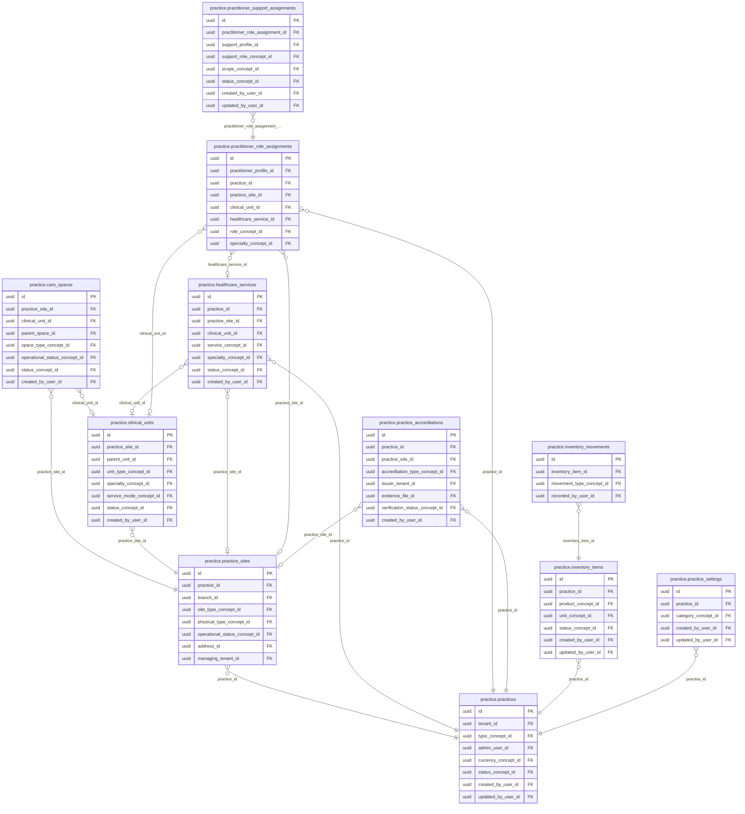

<!-- AUTOGENERADO por tools/inventario/catalogo.mjs. No editar manualmente. -->

# Catálogo del schema `practice`

- **Tablas:** 11 · **Columnas:** 160 (42 con descripción: 26.3 %) · **Índices:** 85
- **Dominio:** Práctica y Agenda
- Método y límites del catálogo: [README del inventario](../README.md)

## Tablas

| Tabla | Propósito | Columnas | Índices | Operaciones | ORM |
|---|---|---|---|---|---|
| [care_spaces](#care_spaces) | Cataloga consultorios, salas u otros espacios de cuidado disponibles para prestar atención. | 15 | 8 | 7 | COINCIDE |
| [clinical_units](#clinical_units) | Representa unidades clínicas que organizan áreas o equipos asistenciales dentro de una práctica o institución. | 14 | 8 | 9 | COINCIDE |
| [healthcare_services](#healthcare_services) | Define servicios de salud ofrecidos por una práctica para relacionar prestaciones con profesionales, sedes y procesos de atención. | 15 | 8 | 18 | DIVERGE |
| [inventory_items](#inventory_items) | Cataloga insumos y bienes administrados por una práctica sanitaria para sostener su operación cotidiana. | 15 | 6 | 3 | COINCIDE |
| [inventory_movements](#inventory_movements) | Registra entradas, salidas y ajustes de inventario de una práctica para preservar trazabilidad de existencias. | 9 | 4 | 1 | COINCIDE |
| [practice_accreditations](#practice_accreditations) | Conserva acreditaciones de una práctica sanitaria para documentar reconocimientos o certificaciones institucionales. | 16 | 8 | 3 | COINCIDE |
| [practice_settings](#practice_settings) | Almacena opciones operativas de una práctica para adaptar su funcionamiento dentro del sistema médico. | 10 | 4 | 3 | COINCIDE |
| [practice_sites](#practice_sites) | Identifica ubicaciones donde una práctica presta servicios para vincular agenda, atención y recursos con una sede. | 18 | 11 | 85 | DIVERGE |
| [practices](#practices) | Representa organizaciones o prácticas prestadoras de servicios de salud y su configuración de operación. | 15 | 8 | 176 | COINCIDE |
| [practitioner_role_assignments](#practitioner_role_assignments) | Asigna roles asistenciales a profesionales dentro de una organización o sede para precisar sus responsabilidades operativas. | 20 | 12 | 96 | COINCIDE |
| [practitioner_support_assignments](#practitioner_support_assignments) | Vincula personal de apoyo con profesionales o ámbitos de práctica para coordinar tareas de atención y gestión. | 13 | 8 | 1 | COINCIDE |

## Diagrama entidad-relación

Las tablas se agrupan en familias por sus claves foráneas dentro del schema (máximo 40 por diagrama). Las FK hacia otros schemas se listan en la ficha de cada tabla.

### Familia 1 de 1 — 11 tablas

## Fichas

### care_spaces

#### Vista general

Cataloga consultorios, salas u otros espacios de cuidado disponibles para prestar atención.

- **Estado del propósito:** DOMAIN_CURATED_DRAFT · fuente: `Mantra Core Health Context/modules/diagram_14_practice.puml: care_spaces`
- **Dominio:** Práctica y Agenda · **Diagrama:** `Mantra Core Health Context/modules/diagram_14_practice.puml` · **DDL:** `SQL/14_practice/02_tables.sql`
- **Entidad del ORM:** `CareSpaces` — `src/modules/practice/entities/care_spaces.entity.ts`
- **Resumen:** 15 columnas · 8 índices · 8 FK salientes · 12 entrantes · 7 operaciones

#### Columnas

| # | Columna | Tipo | Rol estructural | Descripción | ORM |
|---|---|---|---|---|---|
| 1 | `id` | `uuid` | Clave primaria; Obligatoria | Identificador único de la instancia. _(JSDOC_ESTANDAR, `src/modules/practice/entities/care_spaces.entity.ts:12`)_ | coincide |
| 2 | `practice_site_id` | `uuid` | Clave foránea → practice.practice_sites.id; Obligatoria | _sin dato_ | coincide |
| 3 | `clinical_unit_id` | `uuid` | Clave foránea → practice.clinical_units.id; Opcional | _sin dato_ | coincide |
| 4 | `parent_space_id` | `uuid` | Clave foránea → practice.care_spaces.id; Opcional | _sin dato_ | coincide |
| 5 | `code` | `varchar` | Obligatoria | _sin dato_ | coincide |
| 6 | `name` | `varchar` | Obligatoria | _sin dato_ | coincide |
| 7 | `space_type_concept_id` | `uuid` | Clave foránea → terminology.catalog_concepts.id; Obligatoria | _sin dato_ | coincide |
| 8 | `capacity` | `integer` | Opcional | _sin dato_ | coincide |
| 9 | `operational_status_concept_id` | `uuid` | Clave foránea → terminology.catalog_concepts.id; Opcional | _sin dato_ | coincide |
| 10 | `status_concept_id` | `uuid` | Clave foránea → terminology.catalog_concepts.id; Obligatoria | _sin dato_ | coincide |
| 11 | `created_at` | `timestamptz` | Obligatoria | Fecha y hora en que se creó el registro. _(JSDOC_ESTANDAR, `src/modules/practice/entities/care_spaces.entity.ts:76`)_ | coincide |
| 12 | `updated_at` | `timestamptz` | Obligatoria | Fecha y hora de la última actualización. _(JSDOC_ESTANDAR, `src/modules/practice/entities/care_spaces.entity.ts:82`)_ | coincide |
| 13 | `created_by_user_id` | `uuid` | Clave foránea → iam.users.id; Opcional | _sin dato_ | coincide |
| 14 | `updated_by_user_id` | `uuid` | Clave foránea → iam.users.id; Opcional | _sin dato_ | coincide |
| 15 | `row_version` | `integer = 1` | Obligatoria | Versión usada para controlar actualizaciones concurrentes. _(JSDOC_ENTIDAD, `src/modules/practice/entities/care_spaces.entity.ts:100`)_ | coincide |

#### Relaciones

| Sentido | Columnas | Tabla | Restricción |
|---|---|---|---|
| hacia | practice_site_id | practice.practice_sites (id) | fk_care_spaces_practice_site_id |
| hacia | clinical_unit_id | practice.clinical_units (id) | fk_care_spaces_clinical_unit_id |
| hacia | parent_space_id | practice.care_spaces (id) | fk_care_spaces_parent_space_id |
| hacia | space_type_concept_id | terminology.catalog_concepts (id) | fk_care_spaces_space_type_concept_id |
| hacia | operational_status_concept_id | terminology.catalog_concepts (id) | fk_care_spaces_operational_status_concept_id |
| hacia | status_concept_id | terminology.catalog_concepts (id) | fk_care_spaces_status_concept_id |
| hacia | created_by_user_id | iam.users (id) | fk_care_spaces_created_by_user_id |
| hacia | updated_by_user_id | iam.users (id) | fk_care_spaces_updated_by_user_id |
| desde | id | practice.care_spaces (parent_space_id) | fk_care_spaces_parent_space_id |
| desde | id | clinical.procedures (care_space_id) | fk_procedures_care_space_id |
| desde | id | clinical.encounter_locations (care_space_id) | fk_encounter_locations_care_space_id |
| desde | id | audit.care_spaces_history (care_space_id) | fk_care_spaces_history_care_space_id |
| desde | id | diagnostics.specimen_container_events (destination_location_id) | fk_specimen_container_events_destination_location_id |
| desde | id | delegated_access.organization_user_assignments (care_space_id) | fk_organization_user_assignments_care_space_id |
| desde | id | scheduling.practitioner_schedules (care_space_id) | fk_practitioner_schedules_care_space_id |
| desde | id | scheduling.availability_slots (care_space_id) | fk_availability_slots_care_space_id |
| desde | id | procedures_perioperative.procedure_cases (operating_room_id) | fk_procedure_cases_operating_room_id |
| desde | id | procedures_perioperative.procedure_case_locations (care_space_id) | fk_procedure_case_locations_care_space_id |
| desde | id | procedures_perioperative.pacu_stays (care_space_id) | fk_pacu_stays_care_space_id |
| desde | id | procedures_perioperative.operating_room_utilization_events (operating_room_id) | fk_operating_room_utilization_events_operating_room_id |

#### Índices

| Índice | Único | Columnas | Para qué |
|---|---|---|---|
| `ix_care_spaces_practice_site_id` | no | practice_site_id | Soporta la clave foránea fk_care_spaces_practice_site_id: PostgreSQL no indexa las FK por sí mismo _(DOCUMENTO)_; 2 consulta(s) de repositorio filtran u ordenan por «practice_site_id», la primera columna del índice _(CONSULTA)_ |
| `ix_care_spaces_clinical_unit_id` | no | clinical_unit_id | Soporta la clave foránea fk_care_spaces_clinical_unit_id: PostgreSQL no indexa las FK por sí mismo _(DOCUMENTO)_ |
| `ix_care_spaces_parent_space_id` | no | parent_space_id | Soporta la clave foránea fk_care_spaces_parent_space_id: PostgreSQL no indexa las FK por sí mismo _(DOCUMENTO)_ |
| `ix_care_spaces_space_type_concept_id` | no | space_type_concept_id | Soporta la clave foránea fk_care_spaces_space_type_concept_id: PostgreSQL no indexa las FK por sí mismo _(DOCUMENTO)_ |
| `ix_care_spaces_operational_status_concept_id` | no | operational_status_concept_id | Soporta la clave foránea fk_care_spaces_operational_status_concept_id: PostgreSQL no indexa las FK por sí mismo _(DOCUMENTO)_ |
| `ix_care_spaces_status_concept_id` | no | status_concept_id | Soporta la clave foránea fk_care_spaces_status_concept_id: PostgreSQL no indexa las FK por sí mismo _(DOCUMENTO)_ |
| `ix_care_spaces_created_by_user_id` | no | created_by_user_id | Soporta la clave foránea fk_care_spaces_created_by_user_id: PostgreSQL no indexa las FK por sí mismo _(DOCUMENTO)_ |
| `ix_care_spaces_updated_by_user_id` | no | updated_by_user_id | Soporta la clave foránea fk_care_spaces_updated_by_user_id: PostgreSQL no indexa las FK por sí mismo _(DOCUMENTO)_ |

#### Operaciones que la tocan

| Operación | Efecto | Confianza |
|---|---|---|
| GET /practices/{practiceId}/organization | LEE | DIRECTA |
| DELETE /practices/{practiceId}/sites/{siteId} | ACTUALIZA | POR_TIPO |
| DELETE /practices/{practiceId}/sites/{siteId} | LEE | DIRECTA |
| GET /sites/{siteId}/care-spaces | LEE | DIRECTA |
| POST /sites/{siteId}/care-spaces | CREA | DIRECTA |
| POST /sites/{siteId}/care-spaces | LEE | DIRECTA |
| GET /scheduling/resources | LEE | DIRECTA |

#### Gobierno

| Atributo | Valor | Fuente |
|---|---|---|
| Append-only | no declarado | — |
| Datos personales | sin fuente | — |
| Financiera | sin fuente | — |
| Crítica para auditoría | sin fuente | — |
| Retención | sin fuente | — |
| Responsable | sin fuente | — |
| Revisión | AUTO_DETECTADA | — |

---

### clinical_units

#### Vista general

Representa unidades clínicas que organizan áreas o equipos asistenciales dentro de una práctica o institución.

- **Estado del propósito:** DOMAIN_CURATED_DRAFT · fuente: `Mantra Core Health Context/modules/diagram_14_practice.puml: clinical_units`
- **Dominio:** Práctica y Agenda · **Diagrama:** `Mantra Core Health Context/modules/diagram_14_practice.puml` · **DDL:** `SQL/14_practice/02_tables.sql`
- **Entidad del ORM:** `ClinicalUnits` — `src/modules/practice/entities/clinical_units.entity.ts`
- **Resumen:** 14 columnas · 8 índices · 8 FK salientes · 8 entrantes · 9 operaciones

#### Columnas

| # | Columna | Tipo | Rol estructural | Descripción | ORM |
|---|---|---|---|---|---|
| 1 | `id` | `uuid` | Clave primaria; Obligatoria | Identificador único de la instancia. _(JSDOC_ESTANDAR, `src/modules/practice/entities/clinical_units.entity.ts:12`)_ | coincide |
| 2 | `practice_site_id` | `uuid` | Clave foránea → practice.practice_sites.id; Obligatoria | _sin dato_ | coincide |
| 3 | `parent_unit_id` | `uuid` | Clave foránea → practice.clinical_units.id; Opcional | _sin dato_ | coincide |
| 4 | `code` | `varchar` | Obligatoria | _sin dato_ | coincide |
| 5 | `name` | `varchar` | Obligatoria | _sin dato_ | coincide |
| 6 | `unit_type_concept_id` | `uuid` | Clave foránea → terminology.catalog_concepts.id; Obligatoria | _sin dato_ | coincide |
| 7 | `specialty_concept_id` | `uuid` | Clave foránea → terminology.catalog_concepts.id; Opcional | _sin dato_ | coincide |
| 8 | `service_mode_concept_id` | `uuid` | Clave foránea → terminology.catalog_concepts.id; Opcional | _sin dato_ | coincide |
| 9 | `status_concept_id` | `uuid` | Clave foránea → terminology.catalog_concepts.id; Obligatoria | _sin dato_ | coincide |
| 10 | `created_at` | `timestamptz` | Obligatoria | Fecha y hora en que se creó el registro. _(JSDOC_ESTANDAR, `src/modules/practice/entities/clinical_units.entity.ts:70`)_ | coincide |
| 11 | `updated_at` | `timestamptz` | Obligatoria | Fecha y hora de la última actualización. _(JSDOC_ESTANDAR, `src/modules/practice/entities/clinical_units.entity.ts:76`)_ | coincide |
| 12 | `created_by_user_id` | `uuid` | Clave foránea → iam.users.id; Opcional | _sin dato_ | coincide |
| 13 | `updated_by_user_id` | `uuid` | Clave foránea → iam.users.id; Opcional | _sin dato_ | coincide |
| 14 | `row_version` | `integer = 1` | Obligatoria | Versión usada para controlar actualizaciones concurrentes. _(JSDOC_ENTIDAD, `src/modules/practice/entities/clinical_units.entity.ts:94`)_ | coincide |

#### Relaciones

| Sentido | Columnas | Tabla | Restricción |
|---|---|---|---|
| hacia | practice_site_id | practice.practice_sites (id) | fk_clinical_units_practice_site_id |
| hacia | parent_unit_id | practice.clinical_units (id) | fk_clinical_units_parent_unit_id |
| hacia | unit_type_concept_id | terminology.catalog_concepts (id) | fk_clinical_units_unit_type_concept_id |
| hacia | specialty_concept_id | terminology.catalog_concepts (id) | fk_clinical_units_specialty_concept_id |
| hacia | service_mode_concept_id | terminology.catalog_concepts (id) | fk_clinical_units_service_mode_concept_id |
| hacia | status_concept_id | terminology.catalog_concepts (id) | fk_clinical_units_status_concept_id |
| hacia | created_by_user_id | iam.users (id) | fk_clinical_units_created_by_user_id |
| hacia | updated_by_user_id | iam.users (id) | fk_clinical_units_updated_by_user_id |
| desde | id | practice.clinical_units (parent_unit_id) | fk_clinical_units_parent_unit_id |
| desde | id | practice.care_spaces (clinical_unit_id) | fk_care_spaces_clinical_unit_id |
| desde | id | practice.healthcare_services (clinical_unit_id) | fk_healthcare_services_clinical_unit_id |
| desde | id | practice.practitioner_role_assignments (clinical_unit_id) | fk_practitioner_role_assignments_clinical_unit_id |
| desde | id | clinical.encounter_locations (clinical_unit_id) | fk_encounter_locations_clinical_unit_id |
| desde | id | audit.clinical_units_history (clinical_unit_id) | fk_clinical_units_history_clinical_unit_id |
| desde | id | organization_extensions.hospital_service_lines (clinical_unit_id) | fk_hospital_service_lines_clinical_unit_id |
| desde | id | delegated_access.organization_user_assignments (clinical_unit_id) | fk_organization_user_assignments_clinical_unit_id |

#### Índices

| Índice | Único | Columnas | Para qué |
|---|---|---|---|
| `ix_clinical_units_practice_site_id` | no | practice_site_id | Soporta la clave foránea fk_clinical_units_practice_site_id: PostgreSQL no indexa las FK por sí mismo _(DOCUMENTO)_; 2 consulta(s) de repositorio filtran u ordenan por «practice_site_id», la primera columna del índice _(CONSULTA)_ |
| `ix_clinical_units_parent_unit_id` | no | parent_unit_id | Soporta la clave foránea fk_clinical_units_parent_unit_id: PostgreSQL no indexa las FK por sí mismo _(DOCUMENTO)_ |
| `ix_clinical_units_unit_type_concept_id` | no | unit_type_concept_id | Soporta la clave foránea fk_clinical_units_unit_type_concept_id: PostgreSQL no indexa las FK por sí mismo _(DOCUMENTO)_ |
| `ix_clinical_units_specialty_concept_id` | no | specialty_concept_id | Soporta la clave foránea fk_clinical_units_specialty_concept_id: PostgreSQL no indexa las FK por sí mismo _(DOCUMENTO)_ |
| `ix_clinical_units_service_mode_concept_id` | no | service_mode_concept_id | Soporta la clave foránea fk_clinical_units_service_mode_concept_id: PostgreSQL no indexa las FK por sí mismo _(DOCUMENTO)_ |
| `ix_clinical_units_status_concept_id` | no | status_concept_id | Soporta la clave foránea fk_clinical_units_status_concept_id: PostgreSQL no indexa las FK por sí mismo _(DOCUMENTO)_ |
| `ix_clinical_units_created_by_user_id` | no | created_by_user_id | Soporta la clave foránea fk_clinical_units_created_by_user_id: PostgreSQL no indexa las FK por sí mismo _(DOCUMENTO)_ |
| `ix_clinical_units_updated_by_user_id` | no | updated_by_user_id | Soporta la clave foránea fk_clinical_units_updated_by_user_id: PostgreSQL no indexa las FK por sí mismo _(DOCUMENTO)_ |

#### Operaciones que la tocan

| Operación | Efecto | Confianza |
|---|---|---|
| POST /orgext/hospitals/{id}/service-lines | LEE | DIRECTA |
| POST /practices/{practiceId}/healthcare-services | LEE | DIRECTA |
| GET /practices/{practiceId}/organization | LEE | DIRECTA |
| POST /practices/{practiceId}/role-assignments | LEE | DIRECTA |
| DELETE /practices/{practiceId}/sites/{siteId} | ACTUALIZA | POR_TIPO |
| DELETE /practices/{practiceId}/sites/{siteId} | LEE | DIRECTA |
| POST /sites/{siteId}/care-spaces | LEE | DIRECTA |
| POST /sites/{siteId}/clinical-units | CREA | DIRECTA |
| POST /sites/{siteId}/clinical-units | LEE | DIRECTA |

#### Gobierno

| Atributo | Valor | Fuente |
|---|---|---|
| Append-only | no declarado | — |
| Datos personales | sin fuente | — |
| Financiera | sin fuente | — |
| Crítica para auditoría | sin fuente | — |
| Retención | sin fuente | — |
| Responsable | sin fuente | — |
| Revisión | AUTO_DETECTADA | — |

---

### healthcare_services

#### Vista general

Define servicios de salud ofrecidos por una práctica para relacionar prestaciones con profesionales, sedes y procesos de atención.

- **Estado del propósito:** DOMAIN_CURATED_DRAFT · fuente: `Mantra Core Health Context/modules/diagram_14_practice.puml: healthcare_services`
- **Dominio:** Práctica y Agenda · **Diagrama:** `Mantra Core Health Context/modules/diagram_14_practice.puml` · **DDL:** `SQL/14_practice/02_tables.sql`
- **Entidad del ORM:** `HealthcareServices` — `src/modules/practice/entities/healthcare_services.entity.ts`
- **Resumen:** 15 columnas · 8 índices · 8 FK salientes · 3 entrantes · 18 operaciones

#### Columnas

| # | Columna | Tipo | Rol estructural | Descripción | ORM |
|---|---|---|---|---|---|
| 1 | `id` | `uuid` | Clave primaria; Obligatoria | Identificador único de la instancia. _(JSDOC_ESTANDAR, `src/modules/practice/entities/healthcare_services.entity.ts:12`)_ | coincide |
| 2 | `practice_id` | `uuid` | Clave foránea → practice.practices.id; Obligatoria | _sin dato_ | coincide |
| 3 | `practice_site_id` | `uuid` | Clave foránea → practice.practice_sites.id; Opcional | _sin dato_ | coincide |
| 4 | `clinical_unit_id` | `uuid` | Clave foránea → practice.clinical_units.id; Opcional | _sin dato_ | coincide |
| 5 | `service_concept_id` | `uuid` | Clave foránea → terminology.catalog_concepts.id; Obligatoria | _sin dato_ | coincide |
| 6 | `specialty_concept_id` | `uuid` | Clave foránea → terminology.catalog_concepts.id; Opcional | _sin dato_ | coincide |
| 7 | `referral_required` | `boolean` | Opcional | _sin dato_ | coincide |
| 8 | `appointment_required` | `boolean` | Opcional | _sin dato_ | coincide |
| 9 | `telehealth_available` | `boolean` | Opcional | _sin dato_ | coincide |
| 10 | `status_concept_id` | `uuid` | Clave foránea → terminology.catalog_concepts.id; Obligatoria | _sin dato_ | coincide |
| 11 | `created_at` | `timestamptz` | Obligatoria | Fecha y hora en que se creó el registro. _(JSDOC_ESTANDAR, `src/modules/practice/entities/healthcare_services.entity.ts:83`)_ | coincide |
| 12 | `updated_at` | `timestamptz` | Obligatoria | Fecha y hora de la última actualización. _(JSDOC_ESTANDAR, `src/modules/practice/entities/healthcare_services.entity.ts:89`)_ | coincide |
| 13 | `created_by_user_id` | `uuid` | Clave foránea → iam.users.id; Opcional | _sin dato_ | coincide |
| 14 | `updated_by_user_id` | `uuid` | Clave foránea → iam.users.id; Opcional | _sin dato_ | coincide |
| 15 | `row_version` | `integer = 1` | Obligatoria | Versión usada para controlar actualizaciones concurrentes. _(JSDOC_ENTIDAD, `src/modules/practice/entities/healthcare_services.entity.ts:107`)_ | coincide |

#### Relaciones

| Sentido | Columnas | Tabla | Restricción |
|---|---|---|---|
| hacia | practice_id | practice.practices (id) | fk_healthcare_services_practice_id |
| hacia | practice_site_id | practice.practice_sites (id) | fk_healthcare_services_practice_site_id |
| hacia | clinical_unit_id | practice.clinical_units (id) | fk_healthcare_services_clinical_unit_id |
| hacia | service_concept_id | terminology.catalog_concepts (id) | fk_healthcare_services_service_concept_id |
| hacia | specialty_concept_id | terminology.catalog_concepts (id) | fk_healthcare_services_specialty_concept_id |
| hacia | status_concept_id | terminology.catalog_concepts (id) | fk_healthcare_services_status_concept_id |
| hacia | created_by_user_id | iam.users (id) | fk_healthcare_services_created_by_user_id |
| hacia | updated_by_user_id | iam.users (id) | fk_healthcare_services_updated_by_user_id |
| desde | id | practice.practitioner_role_assignments (healthcare_service_id) | fk_practitioner_role_assignments_healthcare_service_id |
| desde | id | organization_extensions.hospital_service_lines (healthcare_service_id) | fk_hospital_service_lines_healthcare_service_id |
| desde | id | organization_extensions.organization_affiliations (healthcare_service_id) | fk_organization_affiliations_healthcare_service_id |

#### Índices

| Índice | Único | Columnas | Para qué |
|---|---|---|---|
| `ix_healthcare_services_practice_id` | no | practice_id | Soporta la clave foránea fk_healthcare_services_practice_id: PostgreSQL no indexa las FK por sí mismo _(DOCUMENTO)_; 1 consulta(s) de repositorio filtran u ordenan por «practice_id», la primera columna del índice _(CONSULTA)_ |
| `ix_healthcare_services_practice_site_id` | no | practice_site_id | Soporta la clave foránea fk_healthcare_services_practice_site_id: PostgreSQL no indexa las FK por sí mismo _(DOCUMENTO)_; 4 consulta(s) de repositorio filtran u ordenan por «practice_site_id», la primera columna del índice _(CONSULTA)_ |
| `ix_healthcare_services_clinical_unit_id` | no | clinical_unit_id | Soporta la clave foránea fk_healthcare_services_clinical_unit_id: PostgreSQL no indexa las FK por sí mismo _(DOCUMENTO)_ |
| `ix_healthcare_services_service_concept_id` | no | service_concept_id | Soporta la clave foránea fk_healthcare_services_service_concept_id: PostgreSQL no indexa las FK por sí mismo _(DOCUMENTO)_; 6 consulta(s) de repositorio filtran u ordenan por «service_concept_id», la primera columna del índice _(CONSULTA)_ |
| `ix_healthcare_services_specialty_concept_id` | no | specialty_concept_id | Soporta la clave foránea fk_healthcare_services_specialty_concept_id: PostgreSQL no indexa las FK por sí mismo _(DOCUMENTO)_ |
| `ix_healthcare_services_status_concept_id` | no | status_concept_id | Soporta la clave foránea fk_healthcare_services_status_concept_id: PostgreSQL no indexa las FK por sí mismo _(DOCUMENTO)_; 3 consulta(s) de repositorio filtran u ordenan por «status_concept_id», la primera columna del índice _(CONSULTA)_ |
| `ix_healthcare_services_created_by_user_id` | no | created_by_user_id | Soporta la clave foránea fk_healthcare_services_created_by_user_id: PostgreSQL no indexa las FK por sí mismo _(DOCUMENTO)_ |
| `ix_healthcare_services_updated_by_user_id` | no | updated_by_user_id | Soporta la clave foránea fk_healthcare_services_updated_by_user_id: PostgreSQL no indexa las FK por sí mismo _(DOCUMENTO)_ |

#### Operaciones que la tocan

| Operación | Efecto | Confianza |
|---|---|---|
| GET /clinical/me/procedure-centers | LEE | DIRECTA |
| POST /clinical/service-requests | LEE | DIRECTA |
| GET /medical-centers/search | LEE | DIRECTA |
| GET /medical-centers/search/for-my-orders | LEE | DIRECTA |
| POST /orgext/affiliations | LEE | DIRECTA |
| POST /orgext/hospitals/{id}/service-lines | LEE | DIRECTA |
| GET /practices/{practiceId}/healthcare-services | LEE | DIRECTA |
| POST /practices/{practiceId}/healthcare-services | CREA | DIRECTA |
| POST /practices/{practiceId}/healthcare-services | LEE | DIRECTA |
| PATCH /practices/{practiceId}/healthcare-services/{id} | ACTUALIZA | POR_TIPO |
| PATCH /practices/{practiceId}/healthcare-services/{id} | LEE | DIRECTA |
| GET /practices/{practiceId}/organization | LEE | DIRECTA |
| POST /practices/{practiceId}/role-assignments | LEE | DIRECTA |
| POST /practices/{practiceId}/role-assignments/invitations | LEE | DIRECTA |
| POST /practices/{practiceId}/role-assignments/self-request | LEE | DIRECTA |
| DELETE /practices/{practiceId}/sites/{siteId} | ACTUALIZA | POR_TIPO |
| DELETE /practices/{practiceId}/sites/{siteId} | LEE | DIRECTA |
| POST /procedure-cases/{id}/preoperative-orders | LEE | DIRECTA |

#### Gobierno

| Atributo | Valor | Fuente |
|---|---|---|
| Append-only | no declarado | — |
| Datos personales | sin fuente | — |
| Financiera | sin fuente | — |
| Crítica para auditoría | sin fuente | — |
| Retención | sin fuente | — |
| Responsable | sin fuente | — |
| Revisión | AUTO_DETECTADA | — |

---

### inventory_items

#### Vista general

Cataloga insumos y bienes administrados por una práctica sanitaria para sostener su operación cotidiana.

- **Estado del propósito:** DOMAIN_CURATED_DRAFT · fuente: `Mantra Core Health Context/modules/diagram_14_practice.puml: inventory_items`
- **Dominio:** Práctica y Agenda · **Diagrama:** `Mantra Core Health Context/modules/diagram_14_practice.puml` · **DDL:** `SQL/14_practice/02_tables.sql`
- **Entidad del ORM:** `InventoryItems` — `src/modules/practice/entities/inventory_items.entity.ts`
- **Resumen:** 15 columnas · 6 índices · 6 FK salientes · 1 entrantes · 3 operaciones

#### Columnas

| # | Columna | Tipo | Rol estructural | Descripción | ORM |
|---|---|---|---|---|---|
| 1 | `id` | `uuid` | Clave primaria; Obligatoria | Identificador único de la instancia. _(JSDOC_ESTANDAR, `src/modules/practice/entities/inventory_items.entity.ts:12`)_ | coincide |
| 2 | `practice_id` | `uuid` | Clave foránea → practice.practices.id; Obligatoria | _sin dato_ | coincide |
| 3 | `product_concept_id` | `uuid` | Clave foránea → terminology.catalog_concepts.id; Opcional | _sin dato_ | coincide |
| 4 | `name` | `varchar` | Obligatoria | _sin dato_ | coincide |
| 5 | `lot_number` | `varchar` | Opcional | _sin dato_ | coincide |
| 6 | `expiry_date` | `date` | Opcional | _sin dato_ | coincide |
| 7 | `quantity_on_hand` | `numeric` | Obligatoria | _sin dato_ | coincide |
| 8 | `unit_concept_id` | `uuid` | Clave foránea → terminology.catalog_concepts.id; Opcional | _sin dato_ | coincide |
| 9 | `reorder_level` | `numeric` | Opcional | _sin dato_ | coincide |
| 10 | `status_concept_id` | `uuid` | Clave foránea → terminology.catalog_concepts.id; Obligatoria | _sin dato_ | coincide |
| 11 | `created_at` | `timestamptz` | Obligatoria | Fecha y hora en que se creó el registro. _(JSDOC_ESTANDAR, `src/modules/practice/entities/inventory_items.entity.ts:76`)_ | coincide |
| 12 | `updated_at` | `timestamptz` | Obligatoria | Fecha y hora de la última actualización. _(JSDOC_ESTANDAR, `src/modules/practice/entities/inventory_items.entity.ts:82`)_ | coincide |
| 13 | `created_by_user_id` | `uuid` | Clave foránea → iam.users.id; Opcional | _sin dato_ | coincide |
| 14 | `updated_by_user_id` | `uuid` | Clave foránea → iam.users.id; Opcional | _sin dato_ | coincide |
| 15 | `row_version` | `integer = 1` | Obligatoria | Versión usada para controlar actualizaciones concurrentes. _(JSDOC_ENTIDAD, `src/modules/practice/entities/inventory_items.entity.ts:100`)_ | coincide |

#### Relaciones

| Sentido | Columnas | Tabla | Restricción |
|---|---|---|---|
| hacia | practice_id | practice.practices (id) | fk_inventory_items_practice_id |
| hacia | product_concept_id | terminology.catalog_concepts (id) | fk_inventory_items_product_concept_id |
| hacia | unit_concept_id | terminology.catalog_concepts (id) | fk_inventory_items_unit_concept_id |
| hacia | status_concept_id | terminology.catalog_concepts (id) | fk_inventory_items_status_concept_id |
| hacia | created_by_user_id | iam.users (id) | fk_inventory_items_created_by_user_id |
| hacia | updated_by_user_id | iam.users (id) | fk_inventory_items_updated_by_user_id |
| desde | id | practice.inventory_movements (inventory_item_id) | fk_inventory_movements_inventory_item_id |

#### Índices

| Índice | Único | Columnas | Para qué |
|---|---|---|---|
| `ix_inventory_items_practice_id` | no | practice_id | Soporta la clave foránea fk_inventory_items_practice_id: PostgreSQL no indexa las FK por sí mismo _(DOCUMENTO)_; 1 consulta(s) de repositorio filtran u ordenan por «practice_id», la primera columna del índice _(CONSULTA)_ |
| `ix_inventory_items_product_concept_id` | no | product_concept_id | Soporta la clave foránea fk_inventory_items_product_concept_id: PostgreSQL no indexa las FK por sí mismo _(DOCUMENTO)_ |
| `ix_inventory_items_unit_concept_id` | no | unit_concept_id | Soporta la clave foránea fk_inventory_items_unit_concept_id: PostgreSQL no indexa las FK por sí mismo _(DOCUMENTO)_ |
| `ix_inventory_items_status_concept_id` | no | status_concept_id | Soporta la clave foránea fk_inventory_items_status_concept_id: PostgreSQL no indexa las FK por sí mismo _(DOCUMENTO)_ |
| `ix_inventory_items_created_by_user_id` | no | created_by_user_id | Soporta la clave foránea fk_inventory_items_created_by_user_id: PostgreSQL no indexa las FK por sí mismo _(DOCUMENTO)_ |
| `ix_inventory_items_updated_by_user_id` | no | updated_by_user_id | Soporta la clave foránea fk_inventory_items_updated_by_user_id: PostgreSQL no indexa las FK por sí mismo _(DOCUMENTO)_ |

#### Operaciones que la tocan

| Operación | Efecto | Confianza |
|---|---|---|
| POST /inventory-items/{itemId}/movements | LEE | DIRECTA |
| POST /practices/{practiceId}/inventory-items | CREA | DIRECTA |
| GET /practices/{practiceId}/organization | LEE | DIRECTA |

#### Gobierno

| Atributo | Valor | Fuente |
|---|---|---|
| Append-only | no declarado | — |
| Datos personales | sin fuente | — |
| Financiera | sin fuente | — |
| Crítica para auditoría | sin fuente | — |
| Retención | sin fuente | — |
| Responsable | sin fuente | — |
| Revisión | AUTO_DETECTADA | — |

---

### inventory_movements

#### Vista general

Registra entradas, salidas y ajustes de inventario de una práctica para preservar trazabilidad de existencias.

- **Estado del propósito:** DOMAIN_CURATED_DRAFT · fuente: `Mantra Core Health Context/modules/diagram_14_practice.puml: inventory_movements`
- **Dominio:** Práctica y Agenda · **Diagrama:** `Mantra Core Health Context/modules/diagram_14_practice.puml` · **DDL:** `SQL/14_practice/02_tables.sql`
- **Entidad del ORM:** `InventoryMovements` — `src/modules/practice/entities/inventory_movements.entity.ts`
- **Resumen:** 9 columnas · 4 índices · 3 FK salientes · 0 entrantes · 1 operaciones

#### Columnas

| # | Columna | Tipo | Rol estructural | Descripción | ORM |
|---|---|---|---|---|---|
| 1 | `id` | `uuid` | Clave primaria; Obligatoria | Identificador único de la instancia. _(JSDOC_ESTANDAR, `src/modules/practice/entities/inventory_movements.entity.ts:12`)_ | coincide |
| 2 | `inventory_item_id` | `uuid` | Clave foránea → practice.inventory_items.id; Obligatoria | _sin dato_ | coincide |
| 3 | `movement_type_concept_id` | `uuid` | Clave foránea → terminology.catalog_concepts.id; Obligatoria | _sin dato_ | coincide |
| 4 | `quantity` | `numeric` | Obligatoria | _sin dato_ | coincide |
| 5 | `related_resource_type` | `varchar` | Opcional | _sin dato_ | coincide |
| 6 | `related_resource_id` | `uuid` | Opcional | _sin dato_ | coincide |
| 7 | `occurred_at` | `timestamptz` | Opcional | _sin dato_ | coincide |
| 8 | `recorded_at` | `timestamptz` | Obligatoria | _sin dato_ | coincide |
| 9 | `recorded_by_user_id` | `uuid` | Clave foránea → iam.users.id; Opcional | _sin dato_ | coincide |

#### Relaciones

| Sentido | Columnas | Tabla | Restricción |
|---|---|---|---|
| hacia | inventory_item_id | practice.inventory_items (id) | fk_inventory_movements_inventory_item_id |
| hacia | movement_type_concept_id | terminology.catalog_concepts (id) | fk_inventory_movements_movement_type_concept_id |
| hacia | recorded_by_user_id | iam.users (id) | fk_inventory_movements_recorded_by_user_id |

#### Índices

| Índice | Único | Columnas | Para qué |
|---|---|---|---|
| `ix_inventory_movements_inventory_item_id` | no | inventory_item_id | Soporta la clave foránea fk_inventory_movements_inventory_item_id: PostgreSQL no indexa las FK por sí mismo _(DOCUMENTO)_ |
| `ix_inventory_movements_movement_type_concept_id` | no | movement_type_concept_id | Soporta la clave foránea fk_inventory_movements_movement_type_concept_id: PostgreSQL no indexa las FK por sí mismo _(DOCUMENTO)_ |
| `ix_inventory_movements_recorded_by_user_id` | no | recorded_by_user_id | Soporta la clave foránea fk_inventory_movements_recorded_by_user_id: PostgreSQL no indexa las FK por sí mismo _(DOCUMENTO)_ |
| `brin_inventory_movements_recorded_at` | no | recorded_at | BRIN para logs e historiales append-only de gran volumen _(DOCUMENTO)_ |

#### Operaciones que la tocan

| Operación | Efecto | Confianza |
|---|---|---|
| POST /inventory-items/{itemId}/movements | CREA | DIRECTA |

#### Gobierno

| Atributo | Valor | Fuente |
|---|---|---|
| Append-only | no declarado | — |
| Datos personales | sin fuente | — |
| Financiera | sin fuente | — |
| Crítica para auditoría | sin fuente | — |
| Retención | sin fuente | — |
| Responsable | sin fuente | — |
| Revisión | AUTO_DETECTADA | — |

---

### practice_accreditations

#### Vista general

Conserva acreditaciones de una práctica sanitaria para documentar reconocimientos o certificaciones institucionales.

- **Estado del propósito:** DOMAIN_CURATED_DRAFT · fuente: `Mantra Core Health Context/modules/diagram_14_practice.puml: practice_accreditations`
- **Dominio:** Práctica y Agenda · **Diagrama:** `Mantra Core Health Context/modules/diagram_14_practice.puml` · **DDL:** `SQL/14_practice/02_tables.sql`
- **Entidad del ORM:** `PracticeAccreditations` — `src/modules/practice/entities/practice_accreditations.entity.ts`
- **Resumen:** 16 columnas · 8 índices · 8 FK salientes · 0 entrantes · 3 operaciones

#### Columnas

| # | Columna | Tipo | Rol estructural | Descripción | ORM |
|---|---|---|---|---|---|
| 1 | `id` | `uuid` | Clave primaria; Obligatoria | Identificador único de la instancia. _(JSDOC_ESTANDAR, `src/modules/practice/entities/practice_accreditations.entity.ts:12`)_ | coincide |
| 2 | `practice_id` | `uuid` | Clave foránea → practice.practices.id; Obligatoria | _sin dato_ | coincide |
| 3 | `practice_site_id` | `uuid` | Clave foránea → practice.practice_sites.id; Opcional | _sin dato_ | coincide |
| 4 | `accreditation_type_concept_id` | `uuid` | Clave foránea → terminology.catalog_concepts.id; Obligatoria | _sin dato_ | coincide |
| 5 | `accreditation_number` | `varchar` | Opcional | _sin dato_ | coincide |
| 6 | `issuer_tenant_id` | `uuid` | Clave foránea → directory.tenants.id; Opcional | _sin dato_ | coincide |
| 7 | `issuer_name` | `varchar` | Opcional | _sin dato_ | coincide |
| 8 | `valid_from` | `date` | Opcional | _sin dato_ | coincide |
| 9 | `valid_to` | `date` | Opcional | _sin dato_ | coincide |
| 10 | `evidence_file_id` | `uuid` | Clave foránea → common.files.id; Opcional | _sin dato_ | coincide |
| 11 | `verification_status_concept_id` | `uuid` | Clave foránea → terminology.catalog_concepts.id; Obligatoria | _sin dato_ | coincide |
| 12 | `created_at` | `timestamptz` | Obligatoria | Fecha y hora en que se creó el registro. _(JSDOC_ESTANDAR, `src/modules/practice/entities/practice_accreditations.entity.ts:82`)_ | coincide |
| 13 | `updated_at` | `timestamptz` | Obligatoria | Fecha y hora de la última actualización. _(JSDOC_ESTANDAR, `src/modules/practice/entities/practice_accreditations.entity.ts:88`)_ | coincide |
| 14 | `created_by_user_id` | `uuid` | Clave foránea → iam.users.id; Opcional | _sin dato_ | coincide |
| 15 | `updated_by_user_id` | `uuid` | Clave foránea → iam.users.id; Opcional | _sin dato_ | coincide |
| 16 | `row_version` | `integer = 1` | Obligatoria | Versión usada para controlar actualizaciones concurrentes. _(JSDOC_ENTIDAD, `src/modules/practice/entities/practice_accreditations.entity.ts:106`)_ | coincide |

#### Relaciones

| Sentido | Columnas | Tabla | Restricción |
|---|---|---|---|
| hacia | practice_id | practice.practices (id) | fk_practice_accreditations_practice_id |
| hacia | practice_site_id | practice.practice_sites (id) | fk_practice_accreditations_practice_site_id |
| hacia | accreditation_type_concept_id | terminology.catalog_concepts (id) | fk_practice_accreditations_accreditation_type_concept_id |
| hacia | issuer_tenant_id | directory.tenants (id) | fk_practice_accreditations_issuer_tenant_id |
| hacia | evidence_file_id | common.files (id) | fk_practice_accreditations_evidence_file_id |
| hacia | verification_status_concept_id | terminology.catalog_concepts (id) | fk_practice_accreditations_verification_status_concept_id |
| hacia | created_by_user_id | iam.users (id) | fk_practice_accreditations_created_by_user_id |
| hacia | updated_by_user_id | iam.users (id) | fk_practice_accreditations_updated_by_user_id |

#### Índices

| Índice | Único | Columnas | Para qué |
|---|---|---|---|
| `ix_practice_accreditations_practice_id` | no | practice_id | Soporta la clave foránea fk_practice_accreditations_practice_id: PostgreSQL no indexa las FK por sí mismo _(DOCUMENTO)_; 1 consulta(s) de repositorio filtran u ordenan por «practice_id», la primera columna del índice _(CONSULTA)_ |
| `ix_practice_accreditations_practice_site_id` | no | practice_site_id | Soporta la clave foránea fk_practice_accreditations_practice_site_id: PostgreSQL no indexa las FK por sí mismo _(DOCUMENTO)_ |
| `ix_practice_accreditations_accreditation_type_concept_id` | no | accreditation_type_concept_id | Soporta la clave foránea fk_practice_accreditations_accreditation_type_concept_id: PostgreSQL no indexa las FK por sí mismo _(DOCUMENTO)_ |
| `ix_practice_accreditations_issuer_tenant_id` | no | issuer_tenant_id | Soporta la clave foránea fk_practice_accreditations_issuer_tenant_id: PostgreSQL no indexa las FK por sí mismo _(DOCUMENTO)_ |
| `ix_practice_accreditations_evidence_file_id` | no | evidence_file_id | Soporta la clave foránea fk_practice_accreditations_evidence_file_id: PostgreSQL no indexa las FK por sí mismo _(DOCUMENTO)_ |
| `ix_practice_accreditations_verification_status_concept_id` | no | verification_status_concept_id | Soporta la clave foránea fk_practice_accreditations_verification_status_concept_id: PostgreSQL no indexa las FK por sí mismo _(DOCUMENTO)_ |
| `ix_practice_accreditations_created_by_user_id` | no | created_by_user_id | Soporta la clave foránea fk_practice_accreditations_created_by_user_id: PostgreSQL no indexa las FK por sí mismo _(DOCUMENTO)_ |
| `ix_practice_accreditations_updated_by_user_id` | no | updated_by_user_id | Soporta la clave foránea fk_practice_accreditations_updated_by_user_id: PostgreSQL no indexa las FK por sí mismo _(DOCUMENTO)_ |

#### Operaciones que la tocan

| Operación | Efecto | Confianza |
|---|---|---|
| POST /accreditations/{id}/verify | LEE | DIRECTA |
| POST /practices/{practiceId}/accreditations | CREA | DIRECTA |
| GET /practices/{practiceId}/organization | LEE | DIRECTA |

#### Gobierno

| Atributo | Valor | Fuente |
|---|---|---|
| Append-only | no declarado | — |
| Datos personales | sin fuente | — |
| Financiera | sin fuente | — |
| Crítica para auditoría | sin fuente | — |
| Retención | sin fuente | — |
| Responsable | sin fuente | — |
| Revisión | AUTO_DETECTADA | — |

---

### practice_settings

#### Vista general

Almacena opciones operativas de una práctica para adaptar su funcionamiento dentro del sistema médico.

- **Estado del propósito:** DOMAIN_CURATED_DRAFT · fuente: `Mantra Core Health Context/modules/diagram_14_practice.puml: practice_settings`
- **Dominio:** Práctica y Agenda · **Diagrama:** `Mantra Core Health Context/modules/diagram_14_practice.puml` · **DDL:** `SQL/14_practice/02_tables.sql`
- **Entidad del ORM:** `PracticeSettings` — `src/modules/practice/entities/practice_settings.entity.ts`
- **Resumen:** 10 columnas · 4 índices · 4 FK salientes · 0 entrantes · 3 operaciones

#### Columnas

| # | Columna | Tipo | Rol estructural | Descripción | ORM |
|---|---|---|---|---|---|
| 1 | `id` | `uuid` | Clave primaria; Obligatoria | Identificador único de la instancia. _(JSDOC_ESTANDAR, `src/modules/practice/entities/practice_settings.entity.ts:12`)_ | coincide |
| 2 | `practice_id` | `uuid` | Clave foránea → practice.practices.id; Obligatoria | _sin dato_ | coincide |
| 3 | `setting_key` | `varchar` | Obligatoria | _sin dato_ | coincide |
| 4 | `value_json` | `jsonb` | Obligatoria | _sin dato_ | coincide |
| 5 | `category_concept_id` | `uuid` | Clave foránea → terminology.catalog_concepts.id; Opcional | _sin dato_ | coincide |
| 6 | `created_at` | `timestamptz` | Obligatoria | Fecha y hora en que se creó el registro. _(JSDOC_ESTANDAR, `src/modules/practice/entities/practice_settings.entity.ts:42`)_ | coincide |
| 7 | `updated_at` | `timestamptz` | Obligatoria | Fecha y hora de la última actualización. _(JSDOC_ESTANDAR, `src/modules/practice/entities/practice_settings.entity.ts:48`)_ | coincide |
| 8 | `created_by_user_id` | `uuid` | Clave foránea → iam.users.id; Opcional | _sin dato_ | coincide |
| 9 | `updated_by_user_id` | `uuid` | Clave foránea → iam.users.id; Opcional | _sin dato_ | coincide |
| 10 | `row_version` | `integer = 1` | Obligatoria | Versión usada para controlar actualizaciones concurrentes. _(JSDOC_ENTIDAD, `src/modules/practice/entities/practice_settings.entity.ts:66`)_ | coincide |

#### Relaciones

| Sentido | Columnas | Tabla | Restricción |
|---|---|---|---|
| hacia | practice_id | practice.practices (id) | fk_practice_settings_practice_id |
| hacia | category_concept_id | terminology.catalog_concepts (id) | fk_practice_settings_category_concept_id |
| hacia | created_by_user_id | iam.users (id) | fk_practice_settings_created_by_user_id |
| hacia | updated_by_user_id | iam.users (id) | fk_practice_settings_updated_by_user_id |

#### Índices

| Índice | Único | Columnas | Para qué |
|---|---|---|---|
| `ix_practice_settings_practice_id` | no | practice_id | Soporta la clave foránea fk_practice_settings_practice_id: PostgreSQL no indexa las FK por sí mismo _(DOCUMENTO)_; 1 consulta(s) de repositorio filtran u ordenan por «practice_id», la primera columna del índice _(CONSULTA)_ |
| `ix_practice_settings_category_concept_id` | no | category_concept_id | Soporta la clave foránea fk_practice_settings_category_concept_id: PostgreSQL no indexa las FK por sí mismo _(DOCUMENTO)_ |
| `ix_practice_settings_created_by_user_id` | no | created_by_user_id | Soporta la clave foránea fk_practice_settings_created_by_user_id: PostgreSQL no indexa las FK por sí mismo _(DOCUMENTO)_ |
| `ix_practice_settings_updated_by_user_id` | no | updated_by_user_id | Soporta la clave foránea fk_practice_settings_updated_by_user_id: PostgreSQL no indexa las FK por sí mismo _(DOCUMENTO)_ |

#### Operaciones que la tocan

| Operación | Efecto | Confianza |
|---|---|---|
| PUT /practices/{practiceId}/settings/{settingKey} | ACTUALIZA | POR_TIPO |
| PUT /practices/{practiceId}/settings/{settingKey} | CREA | DIRECTA |
| PUT /practices/{practiceId}/settings/{settingKey} | LEE | DIRECTA |

#### Gobierno

| Atributo | Valor | Fuente |
|---|---|---|
| Append-only | no declarado | — |
| Datos personales | sin fuente | — |
| Financiera | sin fuente | — |
| Crítica para auditoría | sin fuente | — |
| Retención | sin fuente | — |
| Responsable | sin fuente | — |
| Revisión | AUTO_DETECTADA | — |

---

### practice_sites

#### Vista general

Identifica ubicaciones donde una práctica presta servicios para vincular agenda, atención y recursos con una sede.

- **Estado del propósito:** DOMAIN_CURATED_DRAFT · fuente: `Mantra Core Health Context/modules/diagram_14_practice.puml: practice_sites`
- **Dominio:** Práctica y Agenda · **Diagrama:** `Mantra Core Health Context/modules/diagram_14_practice.puml` · **DDL:** `SQL/14_practice/02_tables.sql`
- **Entidad del ORM:** `PracticeSites` — `src/modules/practice/entities/practice_sites.entity.ts`
- **Resumen:** 18 columnas · 11 índices · 11 FK salientes · 19 entrantes · 85 operaciones

#### Columnas

| # | Columna | Tipo | Rol estructural | Descripción | ORM |
|---|---|---|---|---|---|
| 1 | `id` | `uuid` | Clave primaria; Obligatoria | Identificador único de la instancia. _(JSDOC_ESTANDAR, `src/modules/practice/entities/practice_sites.entity.ts:12`)_ | coincide |
| 2 | `practice_id` | `uuid` | Clave foránea → practice.practices.id; Obligatoria | _sin dato_ | coincide |
| 3 | `branch_id` | `uuid` | Clave foránea → directory.branches.id; Opcional | _sin dato_ | coincide |
| 4 | `code` | `varchar` | Obligatoria | _sin dato_ | coincide |
| 5 | `name` | `varchar` | Obligatoria | _sin dato_ | coincide |
| 6 | `site_type_concept_id` | `uuid` | Clave foránea → terminology.catalog_concepts.id; Obligatoria | _sin dato_ | coincide |
| 7 | `physical_type_concept_id` | `uuid` | Clave foránea → terminology.catalog_concepts.id; Opcional | _sin dato_ | coincide |
| 8 | `operational_status_concept_id` | `uuid` | Clave foránea → terminology.catalog_concepts.id; Opcional | _sin dato_ | coincide |
| 9 | `time_zone` | `varchar` | Opcional | _sin dato_ | coincide |
| 10 | `address_id` | `uuid` | Clave foránea → common.addresses.id; Opcional | _sin dato_ | coincide |
| 11 | `managing_tenant_id` | `uuid` | Clave foránea → directory.tenants.id; Opcional | _sin dato_ | coincide |
| 12 | `bank_qr_file_id` | `uuid` | Clave foránea → common.files.id; Opcional | Archivo del QR de cobro bancario de la sede, en `common.files`. Nulo si la sede no cobra por QR. _(JSDOC_ENTIDAD, `src/modules/practice/entities/practice_sites.entity.ts:87`)_ | coincide |
| 13 | `status_concept_id` | `uuid` | Clave foránea → terminology.catalog_concepts.id; Obligatoria | _sin dato_ | coincide |
| 14 | `created_at` | `timestamptz` | Obligatoria | Fecha y hora en que se creó el registro. _(JSDOC_ESTANDAR, `src/modules/practice/entities/practice_sites.entity.ts:105`)_ | coincide |
| 15 | `updated_at` | `timestamptz` | Obligatoria | Fecha y hora de la última actualización. _(JSDOC_ESTANDAR, `src/modules/practice/entities/practice_sites.entity.ts:111`)_ | coincide |
| 16 | `created_by_user_id` | `uuid` | Clave foránea → iam.users.id; Opcional | _sin dato_ | coincide |
| 17 | `updated_by_user_id` | `uuid` | Clave foránea → iam.users.id; Opcional | _sin dato_ | coincide |
| 18 | `row_version` | `integer = 1` | Obligatoria | Versión usada para controlar actualizaciones concurrentes. _(JSDOC_ENTIDAD, `src/modules/practice/entities/practice_sites.entity.ts:129`)_ | coincide |

#### Relaciones

| Sentido | Columnas | Tabla | Restricción |
|---|---|---|---|
| hacia | practice_id | practice.practices (id) | fk_practice_sites_practice_id |
| hacia | branch_id | directory.branches (id) | fk_practice_sites_branch_id |
| hacia | site_type_concept_id | terminology.catalog_concepts (id) | fk_practice_sites_site_type_concept_id |
| hacia | physical_type_concept_id | terminology.catalog_concepts (id) | fk_practice_sites_physical_type_concept_id |
| hacia | operational_status_concept_id | terminology.catalog_concepts (id) | fk_practice_sites_operational_status_concept_id |
| hacia | address_id | common.addresses (id) | fk_practice_sites_address_id |
| hacia | managing_tenant_id | directory.tenants (id) | fk_practice_sites_managing_tenant_id |
| hacia | bank_qr_file_id | common.files (id) | fk_practice_sites_bank_qr_file_id |
| hacia | status_concept_id | terminology.catalog_concepts (id) | fk_practice_sites_status_concept_id |
| hacia | created_by_user_id | iam.users (id) | fk_practice_sites_created_by_user_id |
| hacia | updated_by_user_id | iam.users (id) | fk_practice_sites_updated_by_user_id |
| desde | id | practice.clinical_units (practice_site_id) | fk_clinical_units_practice_site_id |
| desde | id | practice.care_spaces (practice_site_id) | fk_care_spaces_practice_site_id |
| desde | id | practice.healthcare_services (practice_site_id) | fk_healthcare_services_practice_site_id |
| desde | id | practice.practitioner_role_assignments (practice_site_id) | fk_practitioner_role_assignments_practice_site_id |
| desde | id | practice.practice_accreditations (practice_site_id) | fk_practice_accreditations_practice_site_id |
| desde | id | profiles.practitioner_affiliations (practice_site_id) | fk_practitioner_affiliations_practice_site_id |
| desde | id | clinical.procedures (practice_site_id) | fk_procedures_practice_site_id |
| desde | id | clinical.encounter_locations (practice_site_id) | fk_encounter_locations_practice_site_id |
| desde | id | audit.practice_sites_history (practice_site_id) | fk_practice_sites_history_practice_site_id |
| desde | id | diagnostics.specimen_collection_events (collection_site_id) | fk_specimen_collection_events_collection_site_id |
| desde | id | organization_extensions.hospitals (primary_practice_site_id) | fk_hospitals_primary_practice_site_id |
| desde | id | organization_extensions.facility_licenses (practice_site_id) | fk_facility_licenses_practice_site_id |
| desde | id | organization_extensions.organization_affiliations (host_practice_site_id) | fk_organization_affiliations_host_practice_site_id |
| desde | id | diagnostic_units.diagnostic_units (primary_practice_site_id) | fk_diagnostic_units_primary_practice_site_id |
| desde | id | diagnostic_units.diagnostic_unit_sites (practice_site_id) | fk_diagnostic_unit_sites_practice_site_id |
| desde | id | pharmacy.pharmacy_sites (practice_site_id) | fk_pharmacy_sites_practice_site_id |
| desde | id | delegated_access.organization_user_assignments (practice_site_id) | fk_organization_user_assignments_practice_site_id |
| desde | id | payments.cashier_payment_contexts (site_id) | fk_cashier_payment_contexts_site_id |
| desde | id | procedures_perioperative.procedure_cases (practice_site_id) | fk_procedure_cases_practice_site_id |

#### Índices

| Índice | Único | Columnas | Para qué |
|---|---|---|---|
| `ix_practice_sites_practice_id` | no | practice_id | Soporta la clave foránea fk_practice_sites_practice_id: PostgreSQL no indexa las FK por sí mismo _(DOCUMENTO)_; 4 consulta(s) de repositorio filtran u ordenan por «practice_id», la primera columna del índice _(CONSULTA)_ |
| `ix_practice_sites_branch_id` | no | branch_id | Soporta la clave foránea fk_practice_sites_branch_id: PostgreSQL no indexa las FK por sí mismo _(DOCUMENTO)_ |
| `ix_practice_sites_site_type_concept_id` | no | site_type_concept_id | Soporta la clave foránea fk_practice_sites_site_type_concept_id: PostgreSQL no indexa las FK por sí mismo _(DOCUMENTO)_ |
| `ix_practice_sites_physical_type_concept_id` | no | physical_type_concept_id | Soporta la clave foránea fk_practice_sites_physical_type_concept_id: PostgreSQL no indexa las FK por sí mismo _(DOCUMENTO)_ |
| `ix_practice_sites_operational_status_concept_id` | no | operational_status_concept_id | Soporta la clave foránea fk_practice_sites_operational_status_concept_id: PostgreSQL no indexa las FK por sí mismo _(DOCUMENTO)_ |
| `ix_practice_sites_address_id` | no | address_id | Soporta la clave foránea fk_practice_sites_address_id: PostgreSQL no indexa las FK por sí mismo _(DOCUMENTO)_ |
| `ix_practice_sites_managing_tenant_id` | no | managing_tenant_id | Soporta la clave foránea fk_practice_sites_managing_tenant_id: PostgreSQL no indexa las FK por sí mismo _(DOCUMENTO)_; 2 consulta(s) de repositorio filtran u ordenan por «managing_tenant_id», la primera columna del índice _(CONSULTA)_ |
| `ix_practice_sites_status_concept_id` | no | status_concept_id | Soporta la clave foránea fk_practice_sites_status_concept_id: PostgreSQL no indexa las FK por sí mismo _(DOCUMENTO)_; 3 consulta(s) de repositorio filtran u ordenan por «status_concept_id», la primera columna del índice _(CONSULTA)_ |
| `ix_practice_sites_created_by_user_id` | no | created_by_user_id | Soporta la clave foránea fk_practice_sites_created_by_user_id: PostgreSQL no indexa las FK por sí mismo _(DOCUMENTO)_ |
| `ix_practice_sites_updated_by_user_id` | no | updated_by_user_id | Soporta la clave foránea fk_practice_sites_updated_by_user_id: PostgreSQL no indexa las FK por sí mismo _(DOCUMENTO)_ |
| `ix_practice_sites_bank_qr_file_id` | no | bank_qr_file_id | Soporta la clave foránea fk_practice_sites_bank_qr_file_id: PostgreSQL no indexa las FK por sí mismo _(DOCUMENTO)_ |

#### Operaciones que la tocan

| Operación | Efecto | Confianza |
|---|---|---|
| GET /patient-spending/me | LEE | POR_SQL |
| GET /clinical/me/procedure-centers | LEE | DIRECTA |
| GET /clinical/patients/{patientProfileId}/received-services | LEE | DIRECTA |
| POST /clinical/service-requests | LEE | DIRECTA |
| GET /f/{slug} | LEE | POR_SQL |
| GET /l/{slug} | LEE | POR_SQL |
| GET /o/{slug} | LEE | POR_SQL |
| GET /p/{slug} | LEE | POR_SQL |
| GET /public/profiles/{prefijo}/{slug} | LEE | POR_SQL |
| GET /s/{slug} | LEE | POR_SQL |
| GET /diagnostic-units/{id} | LEE | DIRECTA |
| GET /diagnostic-units/{id}/administration | LEE | DIRECTA |
| GET /diagnostic-units/search | LEE | DIRECTA |
| GET /diagnostic-results/me/orders | LEE | DIRECTA |
| GET /diagnostics/patients/{patientProfileId}/orders | LEE | DIRECTA |
| POST /admin/tenants | CREA | DIRECTA |
| POST /admin/tenants | LEE | DIRECTA |
| POST /admin/tenants/{tenantId}/verification | LEE | DIRECTA |
| POST /tenants/{tenantId}/child-tenants | CREA | DIRECTA |
| POST /tenants/{tenantId}/child-tenants | LEE | DIRECTA |
| GET /tenants/{tenantId}/laboratory-readiness | LEE | DIRECTA |
| GET /tenants/{tenantId}/pharmacy-readiness | LEE | DIRECTA |
| POST /iam/auth/register-organization | CREA | DIRECTA |
| POST /iam/auth/register-organization | LEE | DIRECTA |
| POST /iam/auth/register-practitioner | CREA | DIRECTA |
| POST /iam/auth/register-practitioner | LEE | DIRECTA |
| POST /iam/users/assisted-practitioner-registration | CREA | DIRECTA |
| POST /iam/users/assisted-practitioner-registration | LEE | DIRECTA |
| POST /identity/checks/{id}/results | LEE | DIRECTA |
| POST /identity/manual-review/{id}/decision | LEE | DIRECTA |
| POST /internal/identity/checks/{id}/results | LEE | DIRECTA |
| GET /medical-centers/search | LEE | DIRECTA |
| GET /medical-centers/search/for-my-orders | LEE | DIRECTA |
| POST /orgext/affiliations | LEE | DIRECTA |
| POST /orgext/facility-licenses | LEE | DIRECTA |
| POST /orgext/hospitals/{id}/activate | LEE | DIRECTA |
| POST /orgext/hospitals/{id}/service-lines | LEE | DIRECTA |
| POST /pharmacies/{pharmacyId}/on-call-shifts/{shiftId}/cancel | LEE | DIRECTA |
| GET /pharmacies/{pharmacyId}/opening-hours | LEE | DIRECTA |
| POST /pharmacies/{pharmacyId}/sites | LEE | DIRECTA |
| POST /pharmacies/{pharmacyId}/sites/{siteId}/on-call-shifts | LEE | DIRECTA |
| PUT /pharmacies/{pharmacyId}/sites/{siteId}/open-24h | LEE | DIRECTA |
| GET /pharmacy/pharmacies/{id} | LEE | DIRECTA |
| GET /pharmacy/sites | LEE | DIRECTA |
| GET /public/pharmacies/open-now | LEE | POR_SQL |
| GET /pharmacy-inventory/availability | LEE | DIRECTA |
| POST /practices/{practiceId}/accreditations | LEE | DIRECTA |
| POST /practices/{practiceId}/healthcare-services | LEE | DIRECTA |
| GET /practices/{practiceId}/organization | LEE | DIRECTA |
| POST /practices/{practiceId}/role-assignments | LEE | DIRECTA |
| POST /practices/{practiceId}/role-assignments/invitations | LEE | DIRECTA |
| POST /practices/{practiceId}/role-assignments/self-request | LEE | DIRECTA |
| GET /practices/{practiceId}/sites | LEE | DIRECTA |
| POST /practices/{practiceId}/sites | CREA | DIRECTA |
| POST /practices/{practiceId}/sites | LEE | DIRECTA |
| DELETE /practices/{practiceId}/sites/{siteId} | ACTUALIZA | POR_TIPO |
| DELETE /practices/{practiceId}/sites/{siteId} | LEE | DIRECTA |
| GET /practitioners/{profileId}/sites | LEE | DIRECTA |
| POST /practitioners/me/sites | CREA | DIRECTA |
| POST /practitioners/me/sites | LEE | DIRECTA |
| PATCH /practitioners/me/sites/{siteId} | ACTUALIZA | POR_TIPO |
| PATCH /practitioners/me/sites/{siteId} | LEE | DIRECTA |
| PUT /practitioners/me/sites/{siteId}/bank-qr | LEE | DIRECTA |
| PUT /practitioners/me/sites/{siteId}/contact-phone | LEE | DIRECTA |
| PUT /practitioners/me/sites/{siteId}/logo | ACTUALIZA | POR_TIPO |
| PUT /practitioners/me/sites/{siteId}/logo | LEE | DIRECTA |
| GET /sites/{siteId}/care-spaces | LEE | DIRECTA |
| POST /tenants/{tenantId}/practices | CREA | DIRECTA |
| POST /tenants/{tenantId}/practices | LEE | DIRECTA |
| POST /procedure-cases/{id}/preoperative-orders | LEE | DIRECTA |
| POST /profiles/practitioners/{profileId}/affiliations | LEE | DIRECTA |
| POST /profiles/practitioners/me/affiliations | LEE | DIRECTA |
| GET /tenants/{tenantId}/practitioner-requests | LEE | DIRECTA |
| POST /tenants/{tenantId}/practitioner-requests/{affiliationId}/approve | LEE | DIRECTA |
| POST /tenants/{tenantId}/practitioner-requests/{affiliationId}/reject | LEE | DIRECTA |
| POST /tenants/{tenantId}/practitioner-requests/{affiliationId}/revoke | LEE | DIRECTA |
| POST /public/profiles/f/{slug}/branch-availability | LEE | POR_SQL |
| GET /public/profiles/f/{slug}/branches | LEE | POR_SQL |
| POST /scheduling/appointments/direct | LEE | POR_SQL |
| POST /scheduling/appointments/walk-in | LEE | POR_SQL |
| POST /scheduling/bookings/{id}/accept | LEE | POR_SQL |
| GET /scheduling/resources | LEE | DIRECTA |
| POST /scheduling/resources | LEE | POR_SQL |
| POST /scheduling/resources/{id}/flexible-holds | LEE | POR_SQL |
| POST /scheduling/service-offerings/{id}/holds | LEE | POR_SQL |

#### Gobierno

| Atributo | Valor | Fuente |
|---|---|---|
| Append-only | no declarado | — |
| Datos personales | sin fuente | — |
| Financiera | sin fuente | — |
| Crítica para auditoría | sin fuente | — |
| Retención | sin fuente | — |
| Responsable | sin fuente | — |
| Revisión | AUTO_DETECTADA | — |

---

### practices

#### Vista general

Representa organizaciones o prácticas prestadoras de servicios de salud y su configuración de operación.

- **Estado del propósito:** DOMAIN_CURATED_DRAFT · fuente: `Mantra Core Health Context/modules/diagram_14_practice.puml: practices`
- **Dominio:** Práctica y Agenda · **Diagrama:** `Mantra Core Health Context/modules/diagram_14_practice.puml` · **DDL:** `SQL/14_practice/02_tables.sql`
- **Entidad del ORM:** `Practices` — `src/modules/practice/entities/practices.entity.ts`
- **Resumen:** 15 columnas · 8 índices · 7 FK salientes · 50 entrantes · 176 operaciones

#### Columnas

| # | Columna | Tipo | Rol estructural | Descripción | ORM |
|---|---|---|---|---|---|
| 1 | `id` | `uuid` | Clave primaria; Obligatoria | Identificador único de la instancia. _(JSDOC_ESTANDAR, `src/modules/practice/entities/practices.entity.ts:12`)_ | coincide |
| 2 | `tenant_id` | `uuid` | Clave foránea → directory.tenants.id; Obligatoria | _sin dato_ | coincide |
| 3 | `code` | `varchar` | Obligatoria | _sin dato_ | coincide |
| 4 | `name` | `varchar` | Obligatoria | _sin dato_ | coincide |
| 5 | `type_concept_id` | `uuid` | Clave foránea → terminology.catalog_concepts.id; Obligatoria | _sin dato_ | coincide |
| 6 | `admin_user_id` | `uuid` | Clave foránea → iam.users.id; Obligatoria | _sin dato_ | coincide |
| 7 | `currency_concept_id` | `uuid` | Clave foránea → terminology.catalog_concepts.id; Opcional | _sin dato_ | coincide |
| 8 | `time_zone` | `varchar` | Opcional | _sin dato_ | coincide |
| 9 | `settings_json` | `jsonb` | Opcional | _sin dato_ | coincide |
| 10 | `status_concept_id` | `uuid` | Clave foránea → terminology.catalog_concepts.id; Obligatoria | _sin dato_ | coincide |
| 11 | `created_at` | `timestamptz` | Obligatoria | Fecha y hora en que se creó el registro. _(JSDOC_ESTANDAR, `src/modules/practice/entities/practices.entity.ts:77`)_ | coincide |
| 12 | `updated_at` | `timestamptz` | Obligatoria | Fecha y hora de la última actualización. _(JSDOC_ESTANDAR, `src/modules/practice/entities/practices.entity.ts:83`)_ | coincide |
| 13 | `created_by_user_id` | `uuid` | Clave foránea → iam.users.id; Opcional | _sin dato_ | coincide |
| 14 | `updated_by_user_id` | `uuid` | Clave foránea → iam.users.id; Opcional | _sin dato_ | coincide |
| 15 | `row_version` | `integer = 1` | Obligatoria | Versión usada para controlar actualizaciones concurrentes. _(JSDOC_ENTIDAD, `src/modules/practice/entities/practices.entity.ts:101`)_ | coincide |

#### Relaciones

| Sentido | Columnas | Tabla | Restricción |
|---|---|---|---|
| hacia | tenant_id | directory.tenants (id) | fk_practices_tenant_id |
| hacia | type_concept_id | terminology.catalog_concepts (id) | fk_practices_type_concept_id |
| hacia | admin_user_id | iam.users (id) | fk_practices_admin_user_id |
| hacia | currency_concept_id | terminology.catalog_concepts (id) | fk_practices_currency_concept_id |
| hacia | status_concept_id | terminology.catalog_concepts (id) | fk_practices_status_concept_id |
| hacia | created_by_user_id | iam.users (id) | fk_practices_created_by_user_id |
| hacia | updated_by_user_id | iam.users (id) | fk_practices_updated_by_user_id |
| desde | id | practice.inventory_items (practice_id) | fk_inventory_items_practice_id |
| desde | id | practice.practice_sites (practice_id) | fk_practice_sites_practice_id |
| desde | id | practice.healthcare_services (practice_id) | fk_healthcare_services_practice_id |
| desde | id | practice.practitioner_role_assignments (practice_id) | fk_practitioner_role_assignments_practice_id |
| desde | id | practice.practice_accreditations (practice_id) | fk_practice_accreditations_practice_id |
| desde | id | practice.practice_settings (practice_id) | fk_practice_settings_practice_id |
| desde | id | authz.user_role_assignments (practice_id) | fk_user_role_assignments_practice_id |
| desde | id | audit.practices_history (practice_id) | fk_practices_history_practice_id |
| desde | id | chart.chart_template_assignments (practice_id) | fk_chart_template_assignments_practice_id |
| desde | id | accounting.fiscal_years (practice_id) | fk_fiscal_years_practice_id |
| desde | id | accounting.account_groups (practice_id) | fk_account_groups_practice_id |
| desde | id | accounting.accounts (practice_id) | fk_accounts_practice_id |
| desde | id | accounting.cost_centers (practice_id) | fk_cost_centers_practice_id |
| desde | id | accounting.cost_center_maps (practice_id) | fk_cost_center_maps_practice_id |
| desde | id | accounting.journal_transactions (practice_id) | fk_journal_transactions_practice_id |
| desde | id | accounting.sales (practice_id) | fk_sales_practice_id |
| desde | id | accounting.purchases (practice_id) | fk_purchases_practice_id |
| desde | id | accounting.assets (practice_id) | fk_assets_practice_id |
| desde | id | accounting.liabilities (practice_id) | fk_liabilities_practice_id |
| desde | id | accounting.infrastructure_items (practice_id) | fk_infrastructure_items_practice_id |
| desde | id | billing.service_catalog (practice_id) | fk_service_catalog_practice_id |
| desde | id | billing.invoices (practice_id) | fk_invoices_practice_id |
| desde | id | billing.payments_received (practice_id) | fk_payments_received_practice_id |
| desde | id | billing.patient_statements (practice_id) | fk_patient_statements_practice_id |
| desde | id | billing.vendors (practice_id) | fk_vendors_practice_id |
| desde | id | billing.bills (practice_id) | fk_bills_practice_id |
| desde | id | billing.payments_made (practice_id) | fk_payments_made_practice_id |
| desde | id | billing.tax_codes (practice_id) | fk_tax_codes_practice_id |
| desde | id | billing.tax_periods (practice_id) | fk_tax_periods_practice_id |
| desde | id | billing.budgets (practice_id) | fk_budgets_practice_id |
| desde | id | billing.financial_kpi_snapshots (practice_id) | fk_financial_kpi_snapshots_practice_id |
| desde | id | billing.quotations (practice_id) | fk_quotations_practice_id |
| desde | id | community.party_ratings (reviewer_practice_id) | fk_party_ratings_reviewer_practice_id |
| desde | id | community.party_ratings (target_practice_id) | fk_party_ratings_target_practice_id |
| desde | id | organization_extensions.hospitals (practice_id) | fk_hospitals_practice_id |
| desde | id | diagnostic_units.diagnostic_units (practice_id) | fk_diagnostic_units_practice_id |
| desde | id | insurance.network_provider_memberships (practice_id) | fk_network_provider_memberships_practice_id |
| desde | id | delegated_access.organization_user_assignments (practice_id) | fk_organization_user_assignments_practice_id |
| desde | id | erp.employees (practice_id) | fk_employees_practice_id |
| desde | id | erp.employee_assignments (practice_id) | fk_employee_assignments_practice_id |
| desde | id | erp.contract_object_assignments (practice_id) | fk_contract_object_assignments_practice_id |
| desde | id | scheduling.practitioner_schedules (practice_id) | fk_practitioner_schedules_practice_id |
| desde | id | scheduling.schedulable_resources (practice_id) | fk_schedulable_resources_practice_id |
| desde | id | scheduling.booking_policies (practice_id) | fk_booking_policies_practice_id |
| desde | id | scheduling.calendar_absences (practice_id) | fk_calendar_absences_practice_id |
| desde | id | payments.gateway_connections (practice_id) | fk_gateway_connections_practice_id |
| desde | id | payments.payment_intents (practice_id) | fk_payment_intents_practice_id |
| desde | id | payments.payouts (practice_id) | fk_payouts_practice_id |
| desde | id | payments.subscription_plans (practice_id) | fk_subscription_plans_practice_id |
| desde | id | medical_groups.groups (practice_id) | fk_groups_practice_id |

#### Índices

| Índice | Único | Columnas | Para qué |
|---|---|---|---|
| `ix_practices_tenant_id` | no | tenant_id | Soporta la clave foránea fk_practices_tenant_id: PostgreSQL no indexa las FK por sí mismo _(DOCUMENTO)_; 5 consulta(s) de repositorio filtran u ordenan por «tenant_id», la primera columna del índice _(CONSULTA)_ |
| `ix_practices_type_concept_id` | no | type_concept_id | Soporta la clave foránea fk_practices_type_concept_id: PostgreSQL no indexa las FK por sí mismo _(DOCUMENTO)_; 1 consulta(s) de repositorio filtran u ordenan por «type_concept_id», la primera columna del índice _(CONSULTA)_ |
| `ix_practices_admin_user_id` | no | admin_user_id | Soporta la clave foránea fk_practices_admin_user_id: PostgreSQL no indexa las FK por sí mismo _(DOCUMENTO)_; 2 consulta(s) de repositorio filtran u ordenan por «admin_user_id», la primera columna del índice _(CONSULTA)_ |
| `ix_practices_currency_concept_id` | no | currency_concept_id | Soporta la clave foránea fk_practices_currency_concept_id: PostgreSQL no indexa las FK por sí mismo _(DOCUMENTO)_ |
| `ix_practices_status_concept_id` | no | status_concept_id | Soporta la clave foránea fk_practices_status_concept_id: PostgreSQL no indexa las FK por sí mismo _(DOCUMENTO)_; 4 consulta(s) de repositorio filtran u ordenan por «status_concept_id», la primera columna del índice _(CONSULTA)_ |
| `ix_practices_created_by_user_id` | no | created_by_user_id | Soporta la clave foránea fk_practices_created_by_user_id: PostgreSQL no indexa las FK por sí mismo _(DOCUMENTO)_ |
| `ix_practices_updated_by_user_id` | no | updated_by_user_id | Soporta la clave foránea fk_practices_updated_by_user_id: PostgreSQL no indexa las FK por sí mismo _(DOCUMENTO)_ |
| `ix_practices_tenant_id_status_concept_id` | no | tenant_id, status_concept_id, ("updated_at" DESC) | _sin uso detectado estáticamente_ |

#### Operaciones que la tocan

| Operación | Efecto | Confianza |
|---|---|---|
| GET /accounting/accounts | LEE | DIRECTA |
| POST /accounting/accounts | LEE | DIRECTA |
| GET /accounting/accrual-objects | LEE | DIRECTA |
| POST /accounting/accrual-objects | LEE | DIRECTA |
| POST /accounting/accruals/run | LEE | DIRECTA |
| GET /accounting/assets | LEE | DIRECTA |
| POST /accounting/assets/capitalize | LEE | DIRECTA |
| GET /accounting/balance-sheet | LEE | DIRECTA |
| POST /accounting/clearing-documents | LEE | DIRECTA |
| POST /accounting/depreciation/run | LEE | DIRECTA |
| GET /accounting/dimensions | LEE | DIRECTA |
| POST /accounting/fiscal-periods/{id}/lock | LEE | DIRECTA |
| GET /accounting/fiscal-years | LEE | DIRECTA |
| POST /accounting/fiscal-years | LEE | DIRECTA |
| GET /accounting/general-ledger | LEE | DIRECTA |
| GET /accounting/income-statement | LEE | DIRECTA |
| GET /accounting/journal-transactions | LEE | DIRECTA |
| POST /accounting/journal-transactions | LEE | DIRECTA |
| GET /accounting/journal-transactions/{id} | LEE | DIRECTA |
| POST /accounting/journal-transactions/{id}/approve | LEE | DIRECTA |
| POST /accounting/journal-transactions/{id}/classify | LEE | DIRECTA |
| GET /accounting/journal-transactions/{id}/document-flow | LEE | DIRECTA |
| POST /accounting/journal-transactions/{id}/files | LEE | DIRECTA |
| POST /accounting/journal-transactions/{id}/post | LEE | DIRECTA |
| POST /accounting/journal-transactions/{id}/reverse | LEE | DIRECTA |
| POST /accounting/journal-transactions/{id}/submit-review | LEE | DIRECTA |
| POST /accounting/journal-transactions/drafts | LEE | DIRECTA |
| POST /accounting/liabilities/{id}/payments | LEE | DIRECTA |
| GET /accounting/open-items | LEE | DIRECTA |
| POST /accounting/open-items | LEE | DIRECTA |
| POST /accounting/practitioner/assets | LEE | DIRECTA |
| PATCH /accounting/practitioner/assets/{id}/automation | LEE | DIRECTA |
| GET /accounting/practitioner/assets/{id}/depreciations | LEE | DIRECTA |
| POST /accounting/practitioner/assets/{id}/progress | LEE | DIRECTA |
| POST /accounting/practitioner/consultation-income | LEE | DIRECTA |
| POST /accounting/practitioner/entries | LEE | DIRECTA |
| POST /accounting/practitioner/liabilities | LEE | DIRECTA |
| PATCH /accounting/practitioner/liabilities/{id}/automation | LEE | DIRECTA |
| POST /accounting/practitioner/liabilities/{id}/progress | LEE | DIRECTA |
| GET /accounting/practitioner/liabilities/{id}/schedule | LEE | DIRECTA |
| POST /accounting/practitioner/simple/accounts | LEE | DIRECTA |
| DELETE /accounting/practitioner/simple/accounts/{id} | LEE | DIRECTA |
| PUT /accounting/practitioner/simple/accounts/{id} | LEE | DIRECTA |
| POST /accounting/practitioner/simple/records | LEE | DIRECTA |
| DELETE /accounting/practitioner/simple/records/{id} | LEE | DIRECTA |
| PUT /accounting/practitioner/simple/records/{id} | LEE | DIRECTA |
| GET /accounting/practitioner/simple/summary | LEE | DIRECTA |
| POST /accounting/practitioner/simple/transactions | LEE | DIRECTA |
| DELETE /accounting/practitioner/simple/transactions/{id} | LEE | DIRECTA |
| PUT /accounting/practitioner/simple/transactions/{id} | LEE | DIRECTA |
| GET /accounting/trial-balance | LEE | DIRECTA |
| POST /billing/internal/dunning-runs/run-due | LEE | DIRECTA |
| GET /billing/invoices | LEE | DIRECTA |
| GET /billing/invoices/{id} | LEE | DIRECTA |
| GET /billing/patient-statements | LEE | DIRECTA |
| POST /billing/service-catalog | LEE | DIRECTA |
| PATCH /billing/service-catalog/{id} | LEE | DIRECTA |
| GET /billing/service-catalog/{id}/image | LEE | DIRECTA |
| POST /billing/service-catalog/import-procedures | LEE | DIRECTA |
| GET /billing/simulated/charges | LEE | POR_SQL |
| POST /billing/simulated/charges/{chargeId}/instances/{instanceId}/payments | LEE | POR_SQL |
| POST /billing/simulated/charges/{chargeId}/invoices | LEE | POR_SQL |
| POST /billing/simulated/charges/{chargeId}/payment | LEE | POR_SQL |
| GET /billing/simulated/invoices/{invoiceId} | LEE | POR_SQL |
| POST /billing/simulated/invoices/{invoiceId}/annulment | LEE | POR_SQL |
| POST /billing/simulated/invoices/{invoiceId}/annulment-reversal | LEE | POR_SQL |
| POST /billing/simulated/invoices/{invoiceId}/email | LEE | POR_SQL |
| GET /billing/simulated/my-invoices | LEE | POR_SQL |
| GET /billing/simulated/my-invoices/{invoiceId} | LEE | POR_SQL |
| GET /billing/simulated/status | LEE | POR_SQL |
| GET /patient-spending/me | LEE | POR_SQL |
| GET /clinical/me/procedure-centers | LEE | DIRECTA |
| POST /referrals | LEE | DIRECTA |
| GET /referrals/target-services | LEE | DIRECTA |
| GET /referrals/targets | LEE | POR_SQL |
| GET /community/ratings | LEE | DIRECTA |
| PUT /community/ratings | LEE | DIRECTA |
| GET /community/ratings/mine | LEE | DIRECTA |
| GET /community/ratings/summary | LEE | DIRECTA |
| GET /f/{slug} | LEE | POR_SQL |
| GET /l/{slug} | LEE | POR_SQL |
| GET /o/{slug} | LEE | POR_SQL |
| GET /p/{slug} | LEE | POR_SQL |
| GET /public/profiles/{prefijo}/{slug} | LEE | POR_SQL |
| GET /s/{slug} | LEE | POR_SQL |
| POST /practitioner-delegates | LEE | DIRECTA |
| POST /admin/tenants | CREA | DIRECTA |
| POST /tenants/{tenantId}/child-tenants | CREA | DIRECTA |
| POST /erp/bills/{billId}/invoice-match-runs | LEE | DIRECTA |
| POST /erp/employees/{id}/time-off | LEE | DIRECTA |
| POST /erp/employees/{id}/time-off/{reqId}/approve | LEE | DIRECTA |
| POST /erp/employees/onboard | LEE | DIRECTA |
| POST /iam/auth/register-organization | CREA | DIRECTA |
| POST /iam/auth/register-practitioner | CREA | DIRECTA |
| POST /iam/auth/register-practitioner | LEE | DIRECTA |
| POST /iam/users/assisted-practitioner-registration | CREA | DIRECTA |
| POST /iam/users/assisted-practitioner-registration | LEE | DIRECTA |
| GET /insurance-claims | LEE | DIRECTA |
| POST /insurance-claims | LEE | DIRECTA |
| GET /insurance-claims/{id} | LEE | DIRECTA |
| POST /insurance-claims/{id}/adjudications | LEE | DIRECTA |
| POST /insurance-claims/{id}/disputes | LEE | DIRECTA |
| POST /insurance-claims/{id}/eob | LEE | DIRECTA |
| POST /insurance-claims/{id}/patient-invoice | LEE | DIRECTA |
| POST /insurance-claims/{id}/reversals | LEE | DIRECTA |
| GET /insurance/my-claims | LEE | DIRECTA |
| POST /insurance/portability/export | LEE | POR_SQL |
| GET /insurance/received-claims | LEE | DIRECTA |
| POST /insurance/received-claims/{id}/decision | LEE | DIRECTA |
| GET /practitioner-settlement-batches | LEE | DIRECTA |
| GET /practitioner-settlement-batches/{id} | LEE | DIRECTA |
| POST /reconciliation-batches | LEE | DIRECTA |
| POST /reconciliation-batches/{id}/items | LEE | DIRECTA |
| GET /medical-centers/search | LEE | DIRECTA |
| GET /medical-centers/search/for-my-orders | LEE | DIRECTA |
| POST /medical-groups | LEE | DIRECTA |
| GET /medical-groups/eligible-members | LEE | DIRECTA |
| POST /orgext/affiliations | LEE | DIRECTA |
| POST /orgext/facility-licenses | LEE | DIRECTA |
| POST /orgext/hospitals | LEE | DIRECTA |
| POST /orgext/hospitals/{id}/activate | LEE | DIRECTA |
| POST /orgext/hospitals/{id}/service-lines | LEE | DIRECTA |
| POST /pharmacies/{pharmacyId}/sites | LEE | DIRECTA |
| POST /accreditations/{id}/verify | LEE | DIRECTA |
| POST /inventory-items/{itemId}/movements | LEE | DIRECTA |
| GET /practices | LEE | DIRECTA |
| POST /practices | CREA | DIRECTA |
| GET /practices/{practiceId}/healthcare-services | LEE | DIRECTA |
| POST /practices/{practiceId}/healthcare-services | LEE | DIRECTA |
| PATCH /practices/{practiceId}/healthcare-services/{id} | LEE | DIRECTA |
| GET /practices/{practiceId}/organization | LEE | DIRECTA |
| GET /practices/{practiceId}/role-assignments | LEE | DIRECTA |
| POST /practices/{practiceId}/role-assignments/invitations | LEE | DIRECTA |
| POST /practices/{practiceId}/role-assignments/self-request | LEE | DIRECTA |
| GET /practices/{practiceId}/sites | LEE | DIRECTA |
| GET /practitioners/{profileId}/sites | LEE | DIRECTA |
| GET /practitioners/me/role-assignments | LEE | DIRECTA |
| POST /practitioners/me/sites | CREA | DIRECTA |
| POST /practitioners/me/sites | LEE | DIRECTA |
| PATCH /practitioners/me/sites/{siteId} | LEE | DIRECTA |
| PUT /practitioners/me/sites/{siteId}/bank-qr | LEE | DIRECTA |
| PUT /practitioners/me/sites/{siteId}/contact-phone | LEE | DIRECTA |
| PUT /practitioners/me/sites/{siteId}/logo | LEE | DIRECTA |
| POST /role-assignments/{roleId}/approve | LEE | DIRECTA |
| POST /role-assignments/{roleId}/end | LEE | DIRECTA |
| POST /role-assignments/{roleId}/reject | LEE | DIRECTA |
| POST /role-assignments/{roleId}/support-assignments | LEE | DIRECTA |
| POST /role-assignments/{roleId}/suspend | LEE | DIRECTA |
| GET /sites/{siteId}/care-spaces | LEE | DIRECTA |
| POST /tenants/{tenantId}/practices | CREA | DIRECTA |
| POST /tenants/{tenantId}/practices | LEE | DIRECTA |
| GET /public/profiles/o/{slug}/services | LEE | POR_SQL |
| GET /quotations | LEE | DIRECTA |
| POST /quotations | LEE | DIRECTA |
| GET /quotations/{id} | LEE | DIRECTA |
| POST /scheduling/appointments/direct | LEE | POR_SQL |
| POST /scheduling/appointments/walk-in | LEE | POR_SQL |
| POST /scheduling/bookings/{id}/accept | LEE | POR_SQL |
| POST /scheduling/bookings/{id}/cancel | LEE | POR_SQL |
| POST /scheduling/bookings/{id}/delay | LEE | POR_SQL |
| POST /scheduling/bookings/{id}/payment-receipts | LEE | POR_SQL |
| POST /scheduling/bookings/{id}/payment-receipts/{receiptId}/confirm | LEE | POR_SQL |
| POST /scheduling/bookings/{id}/payment-receipts/{receiptId}/reject | LEE | POR_SQL |
| POST /scheduling/bookings/{id}/reject | LEE | POR_SQL |
| POST /scheduling/bookings/{id}/reschedule | LEE | POR_SQL |
| POST /scheduling/holds/{holdToken}/request | LEE | POR_SQL |
| POST /scheduling/internal/dispatch-reminders | LEE | POR_SQL |
| GET /scheduling/resources | LEE | DIRECTA |
| POST /scheduling/resources | LEE | POR_SQL |
| POST /scheduling/resources/{id}/close-slots | LEE | POR_SQL |
| POST /scheduling/resources/{id}/exceptions | LEE | POR_SQL |
| POST /scheduling/resources/{id}/flexible-holds | LEE | POR_SQL |
| POST /scheduling/resources/{id}/shift-slots | LEE | POR_SQL |
| POST /scheduling/service-offerings/{id}/holds | LEE | POR_SQL |
| DELETE /scheduling/templates/{id} | LEE | POR_SQL |
| POST /surveys/assignments | LEE | DIRECTA |

#### Gobierno

| Atributo | Valor | Fuente |
|---|---|---|
| Append-only | no declarado | — |
| Datos personales | sin fuente | — |
| Financiera | sin fuente | — |
| Crítica para auditoría | sin fuente | — |
| Retención | sin fuente | — |
| Responsable | sin fuente | — |
| Revisión | AUTO_DETECTADA | — |

---

### practitioner_role_assignments

#### Vista general

Asigna roles asistenciales a profesionales dentro de una organización o sede para precisar sus responsabilidades operativas.

- **Estado del propósito:** DOMAIN_CURATED_DRAFT · fuente: `Mantra Core Health Context/modules/diagram_14_practice.puml: practitioner_role_assignments`
- **Dominio:** Práctica y Agenda · **Diagrama:** `Mantra Core Health Context/modules/diagram_14_practice.puml` · **DDL:** `SQL/14_practice/02_tables.sql`
- **Entidad del ORM:** `PractitionerRoleAssignments` — `src/modules/practice/entities/practitioner_role_assignments.entity.ts`
- **Resumen:** 20 columnas · 12 índices · 11 FK salientes · 7 entrantes · 96 operaciones

#### Columnas

| # | Columna | Tipo | Rol estructural | Descripción | ORM |
|---|---|---|---|---|---|
| 1 | `id` | `uuid` | Clave primaria; Obligatoria | Identificador único de la instancia. _(JSDOC_ESTANDAR, `src/modules/practice/entities/practitioner_role_assignments.entity.ts:12`)_ | coincide |
| 2 | `practitioner_profile_id` | `uuid` | Clave foránea → profiles.health_practitioner_profiles.profile_id; Obligatoria | _sin dato_ | coincide |
| 3 | `practice_id` | `uuid` | Clave foránea → practice.practices.id; Obligatoria | _sin dato_ | coincide |
| 4 | `practice_site_id` | `uuid` | Clave foránea → practice.practice_sites.id; Opcional | _sin dato_ | coincide |
| 5 | `clinical_unit_id` | `uuid` | Clave foránea → practice.clinical_units.id; Opcional | _sin dato_ | coincide |
| 6 | `healthcare_service_id` | `uuid` | Clave foránea → practice.healthcare_services.id; Opcional | _sin dato_ | coincide |
| 7 | `role_concept_id` | `uuid` | Clave foránea → terminology.catalog_concepts.id; Obligatoria | _sin dato_ | coincide |
| 8 | `specialty_concept_id` | `uuid` | Clave foránea → terminology.catalog_concepts.id; Opcional | _sin dato_ | coincide |
| 9 | `supervisor_practitioner_profile_id` | `uuid` | Clave foránea → profiles.health_practitioner_profiles.profile_id; Opcional | _sin dato_ | coincide |
| 10 | `revenue_share_percent` | `numeric` | Opcional | _sin dato_ | coincide |
| 11 | `is_primary` | `boolean` | Opcional | _sin dato_ | coincide |
| 12 | `valid_from` | `date` | Opcional | _sin dato_ | coincide |
| 13 | `valid_to` | `date` | Opcional | _sin dato_ | coincide |
| 14 | `contact_phone` | `varchar` | Opcional | _sin dato_ | coincide |
| 15 | `status_concept_id` | `uuid` | Clave foránea → terminology.catalog_concepts.id; Obligatoria | _sin dato_ | coincide |
| 16 | `created_at` | `timestamptz` | Obligatoria | Fecha y hora en que se creó el registro. _(JSDOC_ESTANDAR, `src/modules/practice/entities/practitioner_role_assignments.entity.ts:115`)_ | coincide |
| 17 | `updated_at` | `timestamptz` | Obligatoria | Fecha y hora de la última actualización. _(JSDOC_ESTANDAR, `src/modules/practice/entities/practitioner_role_assignments.entity.ts:121`)_ | coincide |
| 18 | `created_by_user_id` | `uuid` | Clave foránea → iam.users.id; Opcional | _sin dato_ | coincide |
| 19 | `updated_by_user_id` | `uuid` | Clave foránea → iam.users.id; Opcional | _sin dato_ | coincide |
| 20 | `row_version` | `integer = 1` | Obligatoria | Versión usada para controlar actualizaciones concurrentes. _(JSDOC_ENTIDAD, `src/modules/practice/entities/practitioner_role_assignments.entity.ts:139`)_ | coincide |

#### Relaciones

| Sentido | Columnas | Tabla | Restricción |
|---|---|---|---|
| hacia | practice_id | practice.practices (id) | fk_practitioner_role_assignments_practice_id |
| hacia | practice_site_id | practice.practice_sites (id) | fk_practitioner_role_assignments_practice_site_id |
| hacia | clinical_unit_id | practice.clinical_units (id) | fk_practitioner_role_assignments_clinical_unit_id |
| hacia | healthcare_service_id | practice.healthcare_services (id) | fk_practitioner_role_assignments_healthcare_service_id |
| hacia | practitioner_profile_id | profiles.health_practitioner_profiles (profile_id) | fk_practitioner_role_assignments_practitioner_profile_id |
| hacia | role_concept_id | terminology.catalog_concepts (id) | fk_practitioner_role_assignments_role_concept_id |
| hacia | specialty_concept_id | terminology.catalog_concepts (id) | fk_practitioner_role_assignments_specialty_concept_id |
| hacia | supervisor_practitioner_profile_id | profiles.health_practitioner_profiles (profile_id) | fk_practitioner_role_assignments_supervisor_practition_9edea495 |
| hacia | status_concept_id | terminology.catalog_concepts (id) | fk_practitioner_role_assignments_status_concept_id |
| hacia | created_by_user_id | iam.users (id) | fk_practitioner_role_assignments_created_by_user_id |
| hacia | updated_by_user_id | iam.users (id) | fk_practitioner_role_assignments_updated_by_user_id |
| desde | id | practice.practitioner_support_assignments (practitioner_role_assignment_id) | fk_practitioner_support_assignments_practitioner_role__75362a27 |
| desde | id | clinical.encounter_participants (practitioner_role_assignment_id) | fk_encounter_participants_practitioner_role_assignment_id |
| desde | id | audit.practitioner_role_assignments_history (practitioner_role_assignment_id) | fk_practitioner_role_assignments_history_practitioner__baff3e62 |
| desde | id | community.party_ratings (verified_role_assignment_id) | fk_party_ratings_verified_role_assignment_id |
| desde | id | diagnostic_units.diagnostic_unit_practitioner_assignments (practitioner_role_assignment_id) | fk_diagnostic_unit_practitioner_assignments_practition_d05600aa |
| desde | id | insurance.network_provider_memberships (practitioner_role_assignment_id) | fk_network_provider_memberships_practitioner_role_assignment_id |
| desde | id | delegated_access.practitioner_delegate_assignments (practitioner_role_assignment_id) | fk_practitioner_delegate_assignments_practitioner_role_7e0ebecf |

#### Índices

| Índice | Único | Columnas | Para qué |
|---|---|---|---|
| `ix_practitioner_role_assignments_practitioner_profile_id` | no | practitioner_profile_id | Soporta la clave foránea fk_practitioner_role_assignments_practitioner_profile_id: PostgreSQL no indexa las FK por sí mismo _(DOCUMENTO)_; 8 consulta(s) de repositorio filtran u ordenan por «practitioner_profile_id», la primera columna del índice _(CONSULTA)_ |
| `ix_practitioner_role_assignments_practice_id` | no | practice_id | Soporta la clave foránea fk_practitioner_role_assignments_practice_id: PostgreSQL no indexa las FK por sí mismo _(DOCUMENTO)_; 2 consulta(s) de repositorio filtran u ordenan por «practice_id», la primera columna del índice _(CONSULTA)_ |
| `ix_practitioner_role_assignments_practice_site_id` | no | practice_site_id | Soporta la clave foránea fk_practitioner_role_assignments_practice_site_id: PostgreSQL no indexa las FK por sí mismo _(DOCUMENTO)_; 6 consulta(s) de repositorio filtran u ordenan por «practice_site_id», la primera columna del índice _(CONSULTA)_ |
| `ix_practitioner_role_assignments_clinical_unit_id` | no | clinical_unit_id | Soporta la clave foránea fk_practitioner_role_assignments_clinical_unit_id: PostgreSQL no indexa las FK por sí mismo _(DOCUMENTO)_ |
| `ix_practitioner_role_assignments_healthcare_service_id` | no | healthcare_service_id | Soporta la clave foránea fk_practitioner_role_assignments_healthcare_service_id: PostgreSQL no indexa las FK por sí mismo _(DOCUMENTO)_; 3 consulta(s) de repositorio filtran u ordenan por «healthcare_service_id», la primera columna del índice _(CONSULTA)_ |
| `ix_practitioner_role_assignments_role_concept_id` | no | role_concept_id | Soporta la clave foránea fk_practitioner_role_assignments_role_concept_id: PostgreSQL no indexa las FK por sí mismo _(DOCUMENTO)_ |
| `ix_practitioner_role_assignments_specialty_concept_id` | no | specialty_concept_id | Soporta la clave foránea fk_practitioner_role_assignments_specialty_concept_id: PostgreSQL no indexa las FK por sí mismo _(DOCUMENTO)_ |
| `ix_practitioner_role_assignments_supervisor_practition_4d201e89` | no | supervisor_practitioner_profile_id | Soporta la clave foránea fk_practitioner_role_assignments_supervisor_practition_9edea495: PostgreSQL no indexa las FK por sí mismo _(DOCUMENTO)_ |
| `ix_practitioner_role_assignments_status_concept_id` | no | status_concept_id | Soporta la clave foránea fk_practitioner_role_assignments_status_concept_id: PostgreSQL no indexa las FK por sí mismo _(DOCUMENTO)_; 6 consulta(s) de repositorio filtran u ordenan por «status_concept_id», la primera columna del índice _(CONSULTA)_ |
| `ix_practitioner_role_assignments_created_by_user_id` | no | created_by_user_id | Soporta la clave foránea fk_practitioner_role_assignments_created_by_user_id: PostgreSQL no indexa las FK por sí mismo _(DOCUMENTO)_ |
| `ix_practitioner_role_assignments_updated_by_user_id` | no | updated_by_user_id | Soporta la clave foránea fk_practitioner_role_assignments_updated_by_user_id: PostgreSQL no indexa las FK por sí mismo _(DOCUMENTO)_ |
| `gist_practitioner_role_assignments_effective_period` | no | (daterange(valid_from, valid_to, '[)')) | GiST para periodos, no solapamiento y geografía _(DOCUMENTO)_ |

#### Operaciones que la tocan

| Operación | Efecto | Confianza |
|---|---|---|
| GET /accounting/accounts | LEE | DIRECTA |
| GET /accounting/accrual-objects | LEE | DIRECTA |
| GET /accounting/assets | LEE | DIRECTA |
| GET /accounting/balance-sheet | LEE | DIRECTA |
| GET /accounting/dimensions | LEE | DIRECTA |
| GET /accounting/fiscal-years | LEE | DIRECTA |
| GET /accounting/general-ledger | LEE | DIRECTA |
| GET /accounting/income-statement | LEE | DIRECTA |
| GET /accounting/journal-transactions | LEE | DIRECTA |
| GET /accounting/journal-transactions/{id} | LEE | DIRECTA |
| POST /accounting/journal-transactions/{id}/approve | LEE | DIRECTA |
| POST /accounting/journal-transactions/{id}/classify | LEE | DIRECTA |
| POST /accounting/journal-transactions/{id}/files | LEE | DIRECTA |
| POST /accounting/journal-transactions/{id}/submit-review | LEE | DIRECTA |
| POST /accounting/journal-transactions/drafts | LEE | DIRECTA |
| GET /accounting/open-items | LEE | DIRECTA |
| GET /accounting/practitioner/assets | LEE | DIRECTA |
| POST /accounting/practitioner/assets | LEE | DIRECTA |
| PATCH /accounting/practitioner/assets/{id}/automation | LEE | DIRECTA |
| GET /accounting/practitioner/assets/{id}/depreciations | LEE | DIRECTA |
| POST /accounting/practitioner/assets/{id}/progress | LEE | DIRECTA |
| POST /accounting/practitioner/consultation-income | LEE | DIRECTA |
| POST /accounting/practitioner/entries | LEE | DIRECTA |
| GET /accounting/practitioner/liabilities | LEE | DIRECTA |
| POST /accounting/practitioner/liabilities | LEE | DIRECTA |
| PATCH /accounting/practitioner/liabilities/{id}/automation | LEE | DIRECTA |
| POST /accounting/practitioner/liabilities/{id}/progress | LEE | DIRECTA |
| GET /accounting/practitioner/liabilities/{id}/schedule | LEE | DIRECTA |
| GET /accounting/practitioner/paid-consultations | LEE | DIRECTA |
| GET /accounting/practitioner/simple/accounts | LEE | DIRECTA |
| POST /accounting/practitioner/simple/accounts | LEE | DIRECTA |
| DELETE /accounting/practitioner/simple/accounts/{id} | LEE | DIRECTA |
| PUT /accounting/practitioner/simple/accounts/{id} | LEE | DIRECTA |
| GET /accounting/practitioner/simple/records | LEE | DIRECTA |
| POST /accounting/practitioner/simple/records | LEE | DIRECTA |
| DELETE /accounting/practitioner/simple/records/{id} | LEE | DIRECTA |
| PUT /accounting/practitioner/simple/records/{id} | LEE | DIRECTA |
| GET /accounting/practitioner/simple/summary | LEE | DIRECTA |
| GET /accounting/practitioner/simple/transactions | LEE | DIRECTA |
| POST /accounting/practitioner/simple/transactions | LEE | DIRECTA |
| DELETE /accounting/practitioner/simple/transactions/{id} | LEE | DIRECTA |
| PUT /accounting/practitioner/simple/transactions/{id} | LEE | DIRECTA |
| GET /accounting/trial-balance | LEE | DIRECTA |
| PATCH /billing/service-catalog/{id} | LEE | DIRECTA |
| POST /clinical/service-requests | LEE | DIRECTA |
| GET /referrals/targets | LEE | POR_SQL |
| PUT /community/ratings | LEE | DIRECTA |
| GET /f/{slug} | LEE | POR_SQL |
| GET /l/{slug} | LEE | POR_SQL |
| GET /o/{slug} | LEE | POR_SQL |
| GET /p/{slug} | LEE | POR_SQL |
| GET /public/profiles/{prefijo}/{slug} | LEE | POR_SQL |
| GET /s/{slug} | LEE | POR_SQL |
| POST /practitioner-delegates | LEE | DIRECTA |
| GET /diagnostic-units/{id}/administration | LEE | DIRECTA |
| POST /iam/auth/register-practitioner | CREA | DIRECTA |
| POST /iam/users/assisted-practitioner-registration | CREA | DIRECTA |
| GET /practitioners/{profileId}/insurance-networks | LEE | POR_SQL |
| GET /medical-centers/search/for-my-orders | LEE | DIRECTA |
| POST /medical-groups | LEE | DIRECTA |
| GET /medical-groups/eligible-members | LEE | DIRECTA |
| GET /practices | LEE | DIRECTA |
| GET /practices/{practiceId}/organization | LEE | DIRECTA |
| GET /practices/{practiceId}/role-assignments | LEE | DIRECTA |
| POST /practices/{practiceId}/role-assignments | CREA | DIRECTA |
| POST /practices/{practiceId}/role-assignments/invitations | CREA | DIRECTA |
| POST /practices/{practiceId}/role-assignments/invitations | LEE | DIRECTA |
| POST /practices/{practiceId}/role-assignments/self-request | CREA | DIRECTA |
| POST /practices/{practiceId}/role-assignments/self-request | LEE | DIRECTA |
| DELETE /practices/{practiceId}/sites/{siteId} | ACTUALIZA | POR_TIPO |
| DELETE /practices/{practiceId}/sites/{siteId} | LEE | DIRECTA |
| GET /practitioners/{profileId}/sites | LEE | DIRECTA |
| GET /practitioners/me/role-assignments | LEE | DIRECTA |
| POST /practitioners/me/role-assignments/{roleId}/accept | ACTUALIZA | POR_TIPO |
| POST /practitioners/me/role-assignments/{roleId}/accept | LEE | DIRECTA |
| POST /practitioners/me/role-assignments/{roleId}/decline | ACTUALIZA | POR_TIPO |
| POST /practitioners/me/role-assignments/{roleId}/decline | LEE | DIRECTA |
| POST /practitioners/me/sites | CREA | DIRECTA |
| DELETE /practitioners/me/sites/{siteId} | ACTUALIZA | POR_TIPO |
| DELETE /practitioners/me/sites/{siteId} | LEE | DIRECTA |
| PATCH /practitioners/me/sites/{siteId} | LEE | DIRECTA |
| PUT /practitioners/me/sites/{siteId}/bank-qr | LEE | DIRECTA |
| PUT /practitioners/me/sites/{siteId}/contact-phone | ACTUALIZA | POR_TIPO |
| PUT /practitioners/me/sites/{siteId}/contact-phone | LEE | DIRECTA |
| PUT /practitioners/me/sites/{siteId}/logo | LEE | DIRECTA |
| POST /role-assignments/{roleId}/approve | LEE | DIRECTA |
| POST /role-assignments/{roleId}/end | LEE | DIRECTA |
| POST /role-assignments/{roleId}/reject | LEE | DIRECTA |
| POST /role-assignments/{roleId}/support-assignments | LEE | DIRECTA |
| POST /role-assignments/{roleId}/suspend | LEE | DIRECTA |
| POST /procedure-cases/{id}/preoperative-orders | LEE | DIRECTA |
| GET /quotations | LEE | DIRECTA |
| POST /quotations | LEE | DIRECTA |
| GET /quotations/{id} | LEE | DIRECTA |
| GET /scheduling/resources | LEE | DIRECTA |
| POST /scheduling/service-offerings | LEE | DIRECTA |

#### Gobierno

| Atributo | Valor | Fuente |
|---|---|---|
| Append-only | no declarado | — |
| Datos personales | sin fuente | — |
| Financiera | sin fuente | — |
| Crítica para auditoría | sin fuente | — |
| Retención | sin fuente | — |
| Responsable | sin fuente | — |
| Revisión | AUTO_DETECTADA | — |

---

### practitioner_support_assignments

#### Vista general

Vincula personal de apoyo con profesionales o ámbitos de práctica para coordinar tareas de atención y gestión.

- **Estado del propósito:** DOMAIN_CURATED_DRAFT · fuente: `Mantra Core Health Context/modules/diagram_14_practice.puml: practitioner_support_assignments`
- **Dominio:** Práctica y Agenda · **Diagrama:** `Mantra Core Health Context/modules/diagram_14_practice.puml` · **DDL:** `SQL/14_practice/02_tables.sql`
- **Entidad del ORM:** `PractitionerSupportAssignments` — `src/modules/practice/entities/practitioner_support_assignments.entity.ts`
- **Resumen:** 13 columnas · 8 índices · 7 FK salientes · 0 entrantes · 1 operaciones

#### Columnas

| # | Columna | Tipo | Rol estructural | Descripción | ORM |
|---|---|---|---|---|---|
| 1 | `id` | `uuid` | Clave primaria; Obligatoria | Identificador único de la instancia. _(JSDOC_ESTANDAR, `src/modules/practice/entities/practitioner_support_assignments.entity.ts:12`)_ | coincide |
| 2 | `practitioner_role_assignment_id` | `uuid` | Clave foránea → practice.practitioner_role_assignments.id; Obligatoria | _sin dato_ | coincide |
| 3 | `support_profile_id` | `uuid` | Clave foránea → profiles.secretary_profiles.profile_id; Obligatoria | _sin dato_ | coincide |
| 4 | `support_role_concept_id` | `uuid` | Clave foránea → terminology.catalog_concepts.id; Obligatoria | _sin dato_ | coincide |
| 5 | `scope_concept_id` | `uuid` | Clave foránea → terminology.catalog_concepts.id; Opcional | _sin dato_ | coincide |
| 6 | `valid_from` | `date` | Opcional | _sin dato_ | coincide |
| 7 | `valid_to` | `date` | Opcional | _sin dato_ | coincide |
| 8 | `status_concept_id` | `uuid` | Clave foránea → terminology.catalog_concepts.id; Obligatoria | _sin dato_ | coincide |
| 9 | `created_at` | `timestamptz` | Obligatoria | Fecha y hora en que se creó el registro. _(JSDOC_ESTANDAR, `src/modules/practice/entities/practitioner_support_assignments.entity.ts:60`)_ | coincide |
| 10 | `updated_at` | `timestamptz` | Obligatoria | Fecha y hora de la última actualización. _(JSDOC_ESTANDAR, `src/modules/practice/entities/practitioner_support_assignments.entity.ts:66`)_ | coincide |
| 11 | `created_by_user_id` | `uuid` | Clave foránea → iam.users.id; Opcional | _sin dato_ | coincide |
| 12 | `updated_by_user_id` | `uuid` | Clave foránea → iam.users.id; Opcional | _sin dato_ | coincide |
| 13 | `row_version` | `integer = 1` | Obligatoria | Versión usada para controlar actualizaciones concurrentes. _(JSDOC_ENTIDAD, `src/modules/practice/entities/practitioner_support_assignments.entity.ts:84`)_ | coincide |

#### Relaciones

| Sentido | Columnas | Tabla | Restricción |
|---|---|---|---|
| hacia | practitioner_role_assignment_id | practice.practitioner_role_assignments (id) | fk_practitioner_support_assignments_practitioner_role__75362a27 |
| hacia | support_profile_id | profiles.secretary_profiles (profile_id) | fk_practitioner_support_assignments_support_profile_id |
| hacia | support_role_concept_id | terminology.catalog_concepts (id) | fk_practitioner_support_assignments_support_role_concept_id |
| hacia | scope_concept_id | terminology.catalog_concepts (id) | fk_practitioner_support_assignments_scope_concept_id |
| hacia | status_concept_id | terminology.catalog_concepts (id) | fk_practitioner_support_assignments_status_concept_id |
| hacia | created_by_user_id | iam.users (id) | fk_practitioner_support_assignments_created_by_user_id |
| hacia | updated_by_user_id | iam.users (id) | fk_practitioner_support_assignments_updated_by_user_id |

#### Índices

| Índice | Único | Columnas | Para qué |
|---|---|---|---|
| `ix_practitioner_support_assignments_practitioner_role__d1c4a67d` | no | practitioner_role_assignment_id | Soporta la clave foránea fk_practitioner_support_assignments_practitioner_role__75362a27: PostgreSQL no indexa las FK por sí mismo _(DOCUMENTO)_ |
| `ix_practitioner_support_assignments_support_profile_id` | no | support_profile_id | Soporta la clave foránea fk_practitioner_support_assignments_support_profile_id: PostgreSQL no indexa las FK por sí mismo _(DOCUMENTO)_ |
| `ix_practitioner_support_assignments_support_role_concept_id` | no | support_role_concept_id | Soporta la clave foránea fk_practitioner_support_assignments_support_role_concept_id: PostgreSQL no indexa las FK por sí mismo _(DOCUMENTO)_ |
| `ix_practitioner_support_assignments_scope_concept_id` | no | scope_concept_id | Soporta la clave foránea fk_practitioner_support_assignments_scope_concept_id: PostgreSQL no indexa las FK por sí mismo _(DOCUMENTO)_ |
| `ix_practitioner_support_assignments_status_concept_id` | no | status_concept_id | Soporta la clave foránea fk_practitioner_support_assignments_status_concept_id: PostgreSQL no indexa las FK por sí mismo _(DOCUMENTO)_ |
| `ix_practitioner_support_assignments_created_by_user_id` | no | created_by_user_id | Soporta la clave foránea fk_practitioner_support_assignments_created_by_user_id: PostgreSQL no indexa las FK por sí mismo _(DOCUMENTO)_ |
| `ix_practitioner_support_assignments_updated_by_user_id` | no | updated_by_user_id | Soporta la clave foránea fk_practitioner_support_assignments_updated_by_user_id: PostgreSQL no indexa las FK por sí mismo _(DOCUMENTO)_ |
| `gist_practitioner_support_assignments_effective_period` | no | (daterange(valid_from, valid_to, '[)')) | GiST para periodos, no solapamiento y geografía _(DOCUMENTO)_ |

#### Operaciones que la tocan

| Operación | Efecto | Confianza |
|---|---|---|
| POST /role-assignments/{roleId}/support-assignments | CREA | DIRECTA |

#### Gobierno

| Atributo | Valor | Fuente |
|---|---|---|
| Append-only | no declarado | — |
| Datos personales | sin fuente | — |
| Financiera | sin fuente | — |
| Crítica para auditoría | sin fuente | — |
| Retención | sin fuente | — |
| Responsable | sin fuente | — |
| Revisión | AUTO_DETECTADA | — |

---

