<!-- AUTOGENERADO por tools/inventario/catalogo.mjs. No editar manualmente. -->

# Catálogo del schema `procedures_perioperative`

- **Tablas:** 37 · **Columnas:** 497 (109 con descripción: 21.9 %) · **Índices:** 292
- **Dominio:** Clínico y Diagnóstico
- Método y límites del catálogo: [README del inventario](../README.md)

## Tablas

| Tabla | Propósito | Columnas | Índices | Operaciones | ORM |
|---|---|---|---|---|---|
| [anesthesia_airway_assessments](#anesthesia_airway_assessments) | Conserva la valoración de vía aérea que informa la preparación anestésica del paciente. | 12 | 6 | 1 | COINCIDE |
| [anesthesia_events](#anesthesia_events) | Registra eventos de anestesia ocurridos durante la atención perioperatoria para documentar su cronología y contexto. | 12 | 10 | 1 | COINCIDE |
| [anesthesia_plans](#anesthesia_plans) | Representa el plan de anestesia asociado a un caso para documentar la estrategia anestésica prevista. | 18 | 8 | 6 | COINCIDE |
| [implant_identifiers](#implant_identifiers) | Conserva identificadores de implantes para apoyar seguimiento y trazabilidad de dispositivos colocados en pacientes. | 9 | 3 | 2 | COINCIDE |
| [operating_room_block_series](#operating_room_block_series) | Declara la regla de bloques quirúrgicos de una sala (dueño servicio o cirujano, días, horario, vigencia y liberación) de la que se generan los bloques concretos. | 20 | 11 | 1 | COINCIDE |
| [operating_room_blocks](#operating_room_blocks) | Reserva un tramo concreto de una sala quirúrgica para un servicio o cirujano, sin solapes en la sala, con hora de liberación del tiempo no usado. | 21 | 14 | 15 | COINCIDE |
| [operating_room_utilization_events](#operating_room_utilization_events) | Registra eventos de uso de quirófanos para relacionar capacidad y ocupación con la actividad perioperatoria. | 13 | 10 | 9 | COINCIDE |
| [operative_findings](#operative_findings) | Documenta hallazgos observados durante la intervención para incorporarlos a la historia del procedimiento. | 12 | 9 | 2 | COINCIDE |
| [operative_reports](#operative_reports) | Conserva informes operatorios que describen la intervención y sus resultados en el registro perioperatorio. | 19 | 9 | 5 | COINCIDE |
| [operative_steps](#operative_steps) | Desglosa la intervención en pasos operatorios para conservar la secuencia técnica realizada. | 18 | 11 | 6 | COINCIDE |
| [pacu_assessments](#pacu_assessments) | Conserva valoraciones realizadas durante la recuperación postanestésica para documentar el estado del paciente tras la cirugía. | 12 | 5 | 2 | COINCIDE |
| [pacu_stays](#pacu_stays) | Registra permanencias en la unidad de recuperación postanestésica para seguir la etapa inmediata posterior a una intervención. | 16 | 9 | 4 | COINCIDE |
| [postoperative_followups](#postoperative_followups) | Conserva seguimientos posteriores al procedimiento para documentar evolución y continuidad de cuidados. | 18 | 8 | 1 | COINCIDE |
| [postoperative_orders](#postoperative_orders) | Registra indicaciones posteriores a la intervención para coordinar cuidados inmediatos y recuperación del paciente. | 10 | 6 | 1 | COINCIDE |
| [preoperative_assessments](#preoperative_assessments) | Conserva valoraciones preoperatorias que aportan información clínica para preparar una intervención. | 23 | 13 | 3 | COINCIDE |
| [preoperative_orders](#preoperative_orders) | Documenta órdenes previas a la intervención para coordinar acciones clínicas de preparación del paciente. | 9 | 7 | 3 | COINCIDE |
| [preoperative_risk_scores](#preoperative_risk_scores) | Registra puntajes o estimaciones de riesgo preoperatorio usados para planificar la atención perioperatoria. | 10 | 5 | 1 | COINCIDE |
| [procedure_body_sites](#procedure_body_sites) | Asocia sitios anatómicos con procedimientos para precisar dónde se realizó la intervención. | 7 | 5 | 4 | COINCIDE |
| [procedure_cancellations](#procedure_cancellations) | Documenta cancelaciones de procedimientos y sus motivos para explicar por qué una intervención planificada no se realizó. | 11 | 7 | 1 | COINCIDE |
| [procedure_case_diagnoses](#procedure_case_diagnoses) | Asocia diagnósticos con casos de procedimiento para documentar las condiciones que motivan o contextualizan la intervención. | 7 | 4 | 4 | COINCIDE |
| [procedure_case_locations](#procedure_case_locations) | Vincula casos con salas o espacios donde se planifica o realiza la intervención. | 8 | 6 | 3 | COINCIDE |
| [procedure_case_milestones](#procedure_case_milestones) | Registra hitos de los casos para seguir etapas relevantes de preparación, intervención y recuperación. | 9 | 6 | 8 | COINCIDE |
| [procedure_case_status_history](#procedure_case_status_history) | Preserva cambios de estado de los casos para reconstruir su evolución operativa y perioperatoria. | 10 | 7 | 9 | COINCIDE |
| [procedure_case_team_members](#procedure_case_team_members) | Identifica integrantes del equipo asignado a un caso de procedimiento para conservar sus roles y participación. | 15 | 7 | 13 | COINCIDE |
| [procedure_cases](#procedure_cases) | Agrupa el caso perioperatorio de un paciente desde su solicitud y programación hasta la intervención y seguimiento. | 34 | 22 | 26 | COINCIDE |
| [procedure_charge_items](#procedure_charge_items) | Asocia conceptos facturables con procedimientos para trasladar cargos del acto médico al ciclo administrativo correspondiente. | 16 | 9 | 4 | COINCIDE |
| [procedure_complications](#procedure_complications) | Documenta complicaciones asociadas a procedimientos para dar seguimiento a eventos clínicos adversos o no previstos. | 13 | 9 | 1 | COINCIDE |
| [procedure_devices](#procedure_devices) | Registra dispositivos utilizados en procedimientos para conservar trazabilidad del equipamiento clínico relevante. | 11 | 5 | 1 | COINCIDE |
| [procedure_implants](#procedure_implants) | Vincula implantes con procedimientos para documentar qué dispositivo implantable fue utilizado y en qué intervención. | 16 | 10 | 2 | COINCIDE |
| [procedure_medication_uses](#procedure_medication_uses) | Registra medicamentos utilizados durante procedimientos para documentar su relación con el acto perioperatorio. | 7 | 6 | 1 | COINCIDE |
| [procedure_outcomes](#procedure_outcomes) | Registra resultados de los procedimientos para evaluar su resolución clínica y documentar el desenlace de la intervención. | 12 | 6 | 0 | COINCIDE |
| [procedure_performers](#procedure_performers) | Identifica profesionales y roles que realizaron un procedimiento para atribuir la ejecución clínica. | 9 | 5 | 0 | COINCIDE |
| [procedure_specimens](#procedure_specimens) | Relaciona muestras con procedimientos para mantener trazabilidad de material obtenido durante una intervención. | 10 | 7 | 1 | COINCIDE |
| [sterility_verification_checks](#sterility_verification_checks) | Conserva verificaciones de esterilidad vinculadas al proceso operatorio para documentar controles previos o durante la intervención. | 12 | 7 | 0 | COINCIDE |
| [surgical_safety_checklists](#surgical_safety_checklists) | Define listas de verificación de seguridad quirúrgica aplicables a la preparación y ejecución de procedimientos. | 12 | 6 | 6 | COINCIDE |
| [surgical_safety_items](#surgical_safety_items) | Detalla puntos de control incluidos en una lista de seguridad quirúrgica para hacer verificables los pasos requeridos. | 15 | 7 | 4 | COINCIDE |
| [surgical_safety_responses](#surgical_safety_responses) | Registra respuestas del equipo a los puntos de control de seguridad para conservar evidencia de su cumplimiento. | 11 | 7 | 4 | COINCIDE |

## Diagrama entidad-relación

Las tablas se agrupan en familias por sus claves foráneas dentro del schema (máximo 40 por diagrama). Las FK hacia otros schemas se listan en la ficha de cada tabla.

### Familia 1 de 1 — 34 tablas

```mermaid
erDiagram
  procedures_perioperative_anesthesia_airway_assessments["procedures_perioperative.anesthesia_airway_assessments"] {
    uuid id PK
    uuid anesthesia_plan_id FK
    uuid assessed_by_profile_id FK
    uuid mallampati_concept_id FK
    uuid neck_mobility_concept_id FK
    uuid dentition_status_concept_id FK
  }
  procedures_perioperative_anesthesia_plans["procedures_perioperative.anesthesia_plans"] {
    uuid id PK
    uuid procedure_case_id FK
    uuid anesthesiologist_profile_id FK
    uuid anesthesia_type_concept_id FK
    uuid technique_concept_id FK
    uuid airway_plan_concept_id FK
    uuid status_concept_id FK
    uuid created_by_user_id FK
  }
  procedures_perioperative_anesthesia_events["procedures_perioperative.anesthesia_events"] {
    uuid id PK
    uuid procedure_case_id FK
    uuid anesthesia_plan_id FK
    uuid event_type_concept_id FK
    uuid medication_administration_id FK
    uuid observation_id FK
    uuid device_id FK
    uuid performed_by_profile_id FK
  }
  procedures_perioperative_procedure_cases["procedures_perioperative.procedure_cases"] {
    uuid id PK
    uuid custodian_tenant_id FK
    uuid patient_profile_id FK
    uuid encounter_id FK
    uuid service_request_id FK
    uuid primary_procedure_id FK
    uuid case_type_concept_id FK
    uuid priority_concept_id FK
  }
  procedures_perioperative_operating_room_blocks["procedures_perioperative.operating_room_blocks"] {
    uuid id PK
    uuid tenant_id FK
    uuid series_id FK
    uuid operating_room_id FK
    uuid owner_kind_concept_id FK
    uuid clinical_unit_id FK
    uuid surgical_specialty_concept_id FK
    uuid surgeon_profile_id FK
  }
  procedures_perioperative_operating_room_utilization_events["procedures_perioperative.operating_room_utilization_events"] {
    uuid id PK
    uuid operating_room_id FK
    uuid procedure_case_id FK
    uuid event_type_concept_id FK
    uuid delay_reason_concept_id FK
    uuid turnover_category_concept_id FK
    uuid recorded_by_user_id FK
    uuid tenant_id FK
  }
  procedures_perioperative_operative_findings["procedures_perioperative.operative_findings"] {
    uuid id PK
    uuid procedure_case_id FK
    uuid operative_step_id FK
    uuid finding_code_concept_id FK
    uuid body_site_concept_id FK
    uuid laterality_concept_id FK
    uuid severity_concept_id FK
    uuid observation_id FK
  }
  procedures_perioperative_operative_reports["procedures_perioperative.operative_reports"] {
    uuid id PK
    uuid procedure_case_id FK
    uuid procedure_id FK
    uuid author_profile_id FK
    uuid disposition_concept_id FK
    uuid file_id FK
    uuid status_concept_id FK
    uuid signature_id FK
  }
  procedures_perioperative_operative_steps["procedures_perioperative.operative_steps"] {
    uuid id PK
    uuid procedure_case_id FK
    uuid procedure_id FK
    uuid step_code_concept_id FK
    uuid performed_by_profile_id FK
    uuid body_site_concept_id FK
    uuid laterality_concept_id FK
    uuid technique_concept_id FK
  }
  procedures_perioperative_pacu_stays["procedures_perioperative.pacu_stays"] {
    uuid id PK
    uuid procedure_case_id FK
    uuid care_space_id FK
    uuid admitted_by_profile_id FK
    uuid discharged_by_profile_id FK
    uuid status_concept_id FK
    uuid discharge_destination_concept_id FK
    uuid created_by_user_id FK
  }
  procedures_perioperative_postoperative_followups["procedures_perioperative.postoperative_followups"] {
    uuid id PK
    uuid procedure_case_id FK
    uuid followup_type_concept_id FK
    uuid appointment_id FK
    uuid completed_by_profile_id FK
    uuid status_concept_id FK
    uuid wound_status_concept_id FK
    uuid created_by_user_id FK
  }
  procedures_perioperative_postoperative_orders["procedures_perioperative.postoperative_orders"] {
    uuid id PK
    uuid procedure_case_id FK
    uuid service_request_id FK
    uuid order_role_concept_id FK
    uuid status_concept_id FK
    uuid verified_by_profile_id FK
  }
  procedures_perioperative_preoperative_assessments["procedures_perioperative.preoperative_assessments"] {
    uuid id PK
    uuid procedure_case_id FK
    uuid assessment_type_concept_id FK
    uuid assessed_by_profile_id FK
    uuid fitness_status_concept_id FK
    uuid asa_class_concept_id FK
    uuid airway_class_concept_id FK
    uuid bleeding_risk_concept_id FK
  }
  procedures_perioperative_preoperative_orders["procedures_perioperative.preoperative_orders"] {
    uuid id PK
    uuid procedure_case_id FK
    uuid service_request_id FK
    uuid order_role_concept_id FK
    uuid required_before_milestone_concept_id FK
    uuid status_concept_id FK
    uuid verified_by_profile_id FK
  }
  procedures_perioperative_procedure_cancellations["procedures_perioperative.procedure_cancellations"] {
    uuid id PK
    uuid procedure_case_id FK
    uuid cancellation_reason_concept_id FK
    uuid cancellation_category_concept_id FK
    uuid cancelled_by_user_id FK
    uuid preventable_concept_id FK
    uuid replacement_case_id FK
  }
  procedures_perioperative_procedure_case_diagnoses["procedures_perioperative.procedure_case_diagnoses"] {
    uuid id PK
    uuid procedure_case_id FK
    uuid condition_id FK
    uuid diagnosis_role_concept_id FK
  }
  procedures_perioperative_procedure_case_locations["procedures_perioperative.procedure_case_locations"] {
    uuid id PK
    uuid procedure_case_id FK
    uuid care_space_id FK
    uuid location_role_concept_id FK
    uuid transfer_reason_concept_id FK
  }
  procedures_perioperative_procedure_case_milestones["procedures_perioperative.procedure_case_milestones"] {
    uuid id PK
    uuid procedure_case_id FK
    uuid milestone_type_concept_id FK
    uuid status_concept_id FK
    uuid recorded_by_profile_id FK
  }
  procedures_perioperative_procedure_case_status_history["procedures_perioperative.procedure_case_status_history"] {
    uuid id PK
    uuid procedure_case_id FK
    uuid from_status_concept_id FK
    uuid to_status_concept_id FK
    uuid changed_by_user_id FK
    uuid reason_concept_id FK
    uuid workflow_transition_id FK
  }
  procedures_perioperative_procedure_case_team_members["procedures_perioperative.procedure_case_team_members"] {
    uuid id PK
    uuid procedure_case_id FK
    uuid practitioner_profile_id FK
    uuid team_role_concept_id FK
    uuid status_concept_id FK
    uuid created_by_user_id FK
    uuid updated_by_user_id FK
  }
  procedures_perioperative_procedure_charge_items["procedures_perioperative.procedure_charge_items"] {
    uuid id PK
    uuid procedure_case_id FK
    uuid procedure_id FK
    uuid charge_item_type_concept_id FK
    uuid billable_item_id FK
    uuid billing_claim_line_id FK
    uuid invoice_line_id FK
    uuid status_concept_id FK
  }
  procedures_perioperative_procedure_complications["procedures_perioperative.procedure_complications"] {
    uuid id PK
    uuid procedure_case_id FK
    uuid procedure_id FK
    uuid complication_code_concept_id FK
    uuid severity_concept_id FK
    uuid relatedness_concept_id FK
    uuid condition_id FK
    uuid outcome_concept_id FK
  }
  procedures_perioperative_procedure_implants["procedures_perioperative.procedure_implants"] {
    uuid id PK
    uuid procedure_case_id FK
    uuid procedure_id FK
    uuid implant_device_id FK
    uuid implant_role_concept_id FK
    uuid body_site_concept_id FK
    uuid laterality_concept_id FK
    uuid explant_reason_concept_id FK
  }
  procedures_perioperative_procedure_medication_uses["procedures_perioperative.procedure_medication_uses"] {
    uuid id PK
    uuid procedure_case_id FK
    uuid procedure_id FK
    uuid medication_administration_id FK
    uuid use_role_concept_id FK
    uuid operative_step_id FK
  }
  procedures_perioperative_procedure_outcomes["procedures_perioperative.procedure_outcomes"] {
    uuid id PK
    uuid procedure_case_id FK
    uuid outcome_type_concept_id FK
    uuid observation_id FK
    uuid outcome_concept_id FK
    uuid unit_concept_id FK
  }
  procedures_perioperative_procedure_specimens["procedures_perioperative.procedure_specimens"] {
    uuid id PK
    uuid procedure_case_id FK
    uuid procedure_id FK
    uuid specimen_id FK
    uuid specimen_role_concept_id FK
    uuid operative_step_id FK
    uuid body_site_concept_id FK
  }
  procedures_perioperative_sterility_verification_checks["procedures_perioperative.sterility_verification_checks"] {
    uuid id PK
    uuid procedure_case_id FK
    uuid check_type_concept_id FK
    uuid checked_by_profile_id FK
    uuid result_concept_id FK
  }
  procedures_perioperative_surgical_safety_checklists["procedures_perioperative.surgical_safety_checklists"] {
    uuid id PK
    uuid procedure_case_id FK
    uuid checklist_type_concept_id FK
    uuid status_concept_id FK
    uuid coordinator_profile_id FK
  }
  procedures_perioperative_operating_room_block_series["procedures_perioperative.operating_room_block_series"] {
    uuid id PK
    uuid tenant_id FK
    uuid practice_site_id FK
    uuid operating_room_id FK
    uuid owner_kind_concept_id FK
    uuid clinical_unit_id FK
    uuid surgical_specialty_concept_id FK
    uuid surgeon_profile_id FK
  }
  procedures_perioperative_pacu_assessments["procedures_perioperative.pacu_assessments"] {
    uuid id PK
    uuid pacu_stay_id FK
    uuid assessed_by_profile_id FK
    uuid sedation_score_concept_id FK
    uuid airway_status_concept_id FK
  }
  procedures_perioperative_preoperative_risk_scores["procedures_perioperative.preoperative_risk_scores"] {
    uuid id PK
    uuid preoperative_assessment_id FK
    uuid risk_model_concept_id FK
    uuid risk_category_concept_id FK
  }
  procedures_perioperative_implant_identifiers["procedures_perioperative.implant_identifiers"] {
    uuid id PK
    uuid procedure_implant_id FK
    uuid identifier_type_concept_id FK
  }
  procedures_perioperative_surgical_safety_responses["procedures_perioperative.surgical_safety_responses"] {
    uuid id PK
    uuid surgical_safety_checklist_id FK
    uuid surgical_safety_item_id FK
    uuid response_status_concept_id FK
    uuid response_concept_id FK
    uuid responded_by_profile_id FK
  }
  procedures_perioperative_surgical_safety_items["procedures_perioperative.surgical_safety_items"] {
    uuid id PK
    uuid checklist_type_concept_id FK
    uuid phase_concept_id FK
    uuid response_type_concept_id FK
    uuid state_concept_id FK
    uuid created_by_user_id FK
    uuid updated_by_user_id FK
  }
  procedures_perioperative_anesthesia_airway_assessments }o--|| procedures_perioperative_anesthesia_plans : "anesthesia_plan_id"
  procedures_perioperative_anesthesia_plans }o--|| procedures_perioperative_procedure_cases : "procedure_case_id"
  procedures_perioperative_anesthesia_events }o--|| procedures_perioperative_procedure_cases : "procedure_case_id"
  procedures_perioperative_anesthesia_events }o--o| procedures_perioperative_anesthesia_plans : "anesthesia_plan_id"
  procedures_perioperative_procedure_cases }o--o| procedures_perioperative_operating_room_blocks : "operating_room_block_id"
  procedures_perioperative_operating_room_blocks }o--o| procedures_perioperative_operating_room_block_series : "series_id"
  procedures_perioperative_operating_room_utilization_events }o--o| procedures_perioperative_procedure_cases : "procedure_case_id"
  procedures_perioperative_operating_room_utilization_events }o--o| procedures_perioperative_operating_room_blocks : "operating_room_block_id"
  procedures_perioperative_operative_findings }o--|| procedures_perioperative_procedure_cases : "procedure_case_id"
  procedures_perioperative_operative_findings }o--o| procedures_perioperative_operative_steps : "operative_step_id"
  procedures_perioperative_operative_reports }o--|| procedures_perioperative_procedure_cases : "procedure_case_id"
  procedures_perioperative_operative_steps }o--|| procedures_perioperative_procedure_cases : "procedure_case_id"
  procedures_perioperative_pacu_stays }o--|| procedures_perioperative_procedure_cases : "procedure_case_id"
  procedures_perioperative_postoperative_followups }o--|| procedures_perioperative_procedure_cases : "procedure_case_id"
  procedures_perioperative_postoperative_orders }o--|| procedures_perioperative_procedure_cases : "procedure_case_id"
  procedures_perioperative_preoperative_assessments }o--|| procedures_perioperative_procedure_cases : "procedure_case_id"
  procedures_perioperative_preoperative_orders }o--|| procedures_perioperative_procedure_cases : "procedure_case_id"
  procedures_perioperative_procedure_cancellations }o--|| procedures_perioperative_procedure_cases : "procedure_case_id"
  procedures_perioperative_procedure_cancellations }o--o| procedures_perioperative_procedure_cases : "replacement_case_id"
  procedures_perioperative_procedure_case_diagnoses }o--|| procedures_perioperative_procedure_cases : "procedure_case_id"
  procedures_perioperative_procedure_case_locations }o--|| procedures_perioperative_procedure_cases : "procedure_case_id"
  procedures_perioperative_procedure_case_milestones }o--|| procedures_perioperative_procedure_cases : "procedure_case_id"
  procedures_perioperative_procedure_case_status_history }o--|| procedures_perioperative_procedure_cases : "procedure_case_id"
  procedures_perioperative_procedure_case_team_members }o--|| procedures_perioperative_procedure_cases : "procedure_case_id"
  procedures_perioperative_procedure_charge_items }o--|| procedures_perioperative_procedure_cases : "procedure_case_id"
  procedures_perioperative_procedure_complications }o--|| procedures_perioperative_procedure_cases : "procedure_case_id"
  procedures_perioperative_procedure_implants }o--|| procedures_perioperative_procedure_cases : "procedure_case_id"
  procedures_perioperative_procedure_medication_uses }o--|| procedures_perioperative_procedure_cases : "procedure_case_id"
  procedures_perioperative_procedure_medication_uses }o--o| procedures_perioperative_operative_steps : "operative_step_id"
  procedures_perioperative_procedure_outcomes }o--|| procedures_perioperative_procedure_cases : "procedure_case_id"
  procedures_perioperative_procedure_specimens }o--|| procedures_perioperative_procedure_cases : "procedure_case_id"
  procedures_perioperative_procedure_specimens }o--o| procedures_perioperative_operative_steps : "operative_step_id"
  procedures_perioperative_sterility_verification_checks }o--|| procedures_perioperative_procedure_cases : "procedure_case_id"
  procedures_perioperative_surgical_safety_checklists }o--|| procedures_perioperative_procedure_cases : "procedure_case_id"
  procedures_perioperative_pacu_assessments }o--|| procedures_perioperative_pacu_stays : "pacu_stay_id"
  procedures_perioperative_preoperative_risk_scores }o--|| procedures_perioperative_preoperative_assessments : "preoperative_assessment_id"
  procedures_perioperative_implant_identifiers }o--|| procedures_perioperative_procedure_implants : "procedure_implant_id"
  procedures_perioperative_surgical_safety_responses }o--|| procedures_perioperative_surgical_safety_checklists : "surgical_safety_checklist_id"
  procedures_perioperative_surgical_safety_responses }o--|| procedures_perioperative_surgical_safety_items : "surgical_safety_item_id"
```

### Tablas sin relaciones dentro del schema

`procedures_perioperative.procedure_body_sites` · `procedures_perioperative.procedure_devices` · `procedures_perioperative.procedure_performers`

## Fichas

### anesthesia_airway_assessments

#### Vista general

Conserva la valoración de vía aérea que informa la preparación anestésica del paciente.

- **Estado del propósito:** DOMAIN_CURATED_DRAFT · fuente: `Mantra Core Health Context/modules/diagram_53_procedures_perioperative.puml: anesthesia_airway_assessments`
- **Dominio:** Clínico y Diagnóstico · **Diagrama:** `Mantra Core Health Context/modules/diagram_53_procedures_perioperative.puml` · **DDL:** `SQL/53_procedures_perioperative/02_tables.sql`
- **Entidad del ORM:** `AnesthesiaAirwayAssessments` — `src/modules/procedures_perioperative/entities/anesthesia_airway_assessments.entity.ts`
- **Resumen:** 12 columnas · 6 índices · 5 FK salientes · 0 entrantes · 1 operaciones

#### Columnas

| # | Columna | Tipo | Rol estructural | Descripción | ORM |
|---|---|---|---|---|---|
| 1 | `id` | `uuid` | Clave primaria; Obligatoria | Identificador único de la instancia. _(JSDOC_ESTANDAR, `src/modules/procedures_perioperative/entities/anesthesia_airway_assessments.entity.ts:15`)_ | coincide |
| 2 | `anesthesia_plan_id` | `uuid` | Clave foránea → procedures_perioperative.anesthesia_plans.id; Obligatoria | _sin dato_ | coincide |
| 3 | `assessed_at` | `timestamptz` | Obligatoria | _sin dato_ | coincide |
| 4 | `assessed_by_profile_id` | `uuid` | Clave foránea → profiles.health_practitioner_profiles.profile_id; Obligatoria | _sin dato_ | coincide |
| 5 | `mallampati_concept_id` | `uuid` | Clave foránea → terminology.catalog_concepts.id; Opcional | _sin dato_ | coincide |
| 6 | `mouth_opening_mm` | `numeric(8,2)` | Opcional | _sin dato_ | coincide |
| 7 | `thyromental_distance_mm` | `numeric(8,2)` | Opcional | _sin dato_ | coincide |
| 8 | `neck_mobility_concept_id` | `uuid` | Clave foránea → terminology.catalog_concepts.id; Opcional | _sin dato_ | coincide |
| 9 | `dentition_status_concept_id` | `uuid` | Clave foránea → terminology.catalog_concepts.id; Opcional | _sin dato_ | coincide |
| 10 | `difficult_airway_expected` | `boolean` | Opcional | _sin dato_ | coincide |
| 11 | `rescue_plan_text` | `text` | Opcional | _sin dato_ | coincide |
| 12 | `created_at` | `timestamptz` | Obligatoria | Fecha y hora en que se creó el registro. _(JSDOC_ESTANDAR, `src/modules/procedures_perioperative/entities/anesthesia_airway_assessments.entity.ts:109`)_ | coincide |

#### Relaciones

| Sentido | Columnas | Tabla | Restricción |
|---|---|---|---|
| hacia | anesthesia_plan_id | procedures_perioperative.anesthesia_plans (id) | fk_anesthesia_airway_assessments_anesthesia_plan_id |
| hacia | assessed_by_profile_id | profiles.health_practitioner_profiles (profile_id) | fk_anesthesia_airway_assessments_assessed_by_profile_id |
| hacia | mallampati_concept_id | terminology.catalog_concepts (id) | fk_anesthesia_airway_assessments_mallampati_concept_id |
| hacia | neck_mobility_concept_id | terminology.catalog_concepts (id) | fk_anesthesia_airway_assessments_neck_mobility_concept_id |
| hacia | dentition_status_concept_id | terminology.catalog_concepts (id) | fk_anesthesia_airway_assessments_dentition_status_concept_id |

#### Índices

| Índice | Único | Columnas | Para qué |
|---|---|---|---|
| `ix_anesthesia_airway_assessments_anesthesia_plan_id` | no | anesthesia_plan_id | Soporta la clave foránea fk_anesthesia_airway_assessments_anesthesia_plan_id: PostgreSQL no indexa las FK por sí mismo _(DOCUMENTO)_ |
| `ix_anesthesia_airway_assessments_assessed_by_profile_id` | no | assessed_by_profile_id | Soporta la clave foránea fk_anesthesia_airway_assessments_assessed_by_profile_id: PostgreSQL no indexa las FK por sí mismo _(DOCUMENTO)_ |
| `ix_anesthesia_airway_assessments_mallampati_concept_id` | no | mallampati_concept_id | Soporta la clave foránea fk_anesthesia_airway_assessments_mallampati_concept_id: PostgreSQL no indexa las FK por sí mismo _(DOCUMENTO)_ |
| `ix_anesthesia_airway_assessments_neck_mobility_concept_id` | no | neck_mobility_concept_id | Soporta la clave foránea fk_anesthesia_airway_assessments_neck_mobility_concept_id: PostgreSQL no indexa las FK por sí mismo _(DOCUMENTO)_ |
| `ix_anesthesia_airway_assessments_dentition_status_concept_id` | no | dentition_status_concept_id | Soporta la clave foránea fk_anesthesia_airway_assessments_dentition_status_concept_id: PostgreSQL no indexa las FK por sí mismo _(DOCUMENTO)_ |
| `brin_anesthesia_airway_assessments_created_at` | no | created_at | BRIN para logs e historiales append-only de gran volumen _(DOCUMENTO)_ |

#### Operaciones que la tocan

| Operación | Efecto | Confianza |
|---|---|---|
| POST /procedure-cases/{id}/anesthesia-plans | CREA | DIRECTA |

#### Gobierno

| Atributo | Valor | Fuente |
|---|---|---|
| Append-only | no declarado | — |
| Datos personales | sin fuente | — |
| Financiera | sin fuente | — |
| Crítica para auditoría | sin fuente | — |
| Retención | sin fuente | — |
| Responsable | sin fuente | — |
| Revisión | AUTO_DETECTADA | — |

---

### anesthesia_events

#### Vista general

Registra eventos de anestesia ocurridos durante la atención perioperatoria para documentar su cronología y contexto.

- **Estado del propósito:** DOMAIN_CURATED_DRAFT · fuente: `Mantra Core Health Context/modules/diagram_53_procedures_perioperative.puml: anesthesia_events`
- **Dominio:** Clínico y Diagnóstico · **Diagrama:** `Mantra Core Health Context/modules/diagram_53_procedures_perioperative.puml` · **DDL:** `SQL/53_procedures_perioperative/02_tables.sql`
- **Entidad del ORM:** `AnesthesiaEvents` — `src/modules/procedures_perioperative/entities/anesthesia_events.entity.ts`
- **Resumen:** 12 columnas · 10 índices · 8 FK salientes · 0 entrantes · 1 operaciones

#### Columnas

| # | Columna | Tipo | Rol estructural | Descripción | ORM |
|---|---|---|---|---|---|
| 1 | `id` | `uuid` | Clave primaria; Obligatoria | Identificador único de la instancia. _(JSDOC_ESTANDAR, `src/modules/procedures_perioperative/entities/anesthesia_events.entity.ts:12`)_ | coincide |
| 2 | `procedure_case_id` | `uuid` | Clave foránea → procedures_perioperative.procedure_cases.id; Obligatoria | _sin dato_ | coincide |
| 3 | `anesthesia_plan_id` | `uuid` | Clave foránea → procedures_perioperative.anesthesia_plans.id; Opcional | _sin dato_ | coincide |
| 4 | `occurred_at` | `timestamptz` | Obligatoria | _sin dato_ | coincide |
| 5 | `event_type_concept_id` | `uuid` | Clave foránea → terminology.catalog_concepts.id; Obligatoria | _sin dato_ | coincide |
| 6 | `medication_administration_id` | `uuid` | Clave foránea → clinical.medication_records.id; Opcional | _sin dato_ | coincide |
| 7 | `observation_id` | `uuid` | Clave foránea → clinical.observations.id; Opcional | _sin dato_ | coincide |
| 8 | `device_id` | `uuid` | Clave foránea → iam.devices.id; Opcional | _sin dato_ | coincide |
| 9 | `performed_by_profile_id` | `uuid` | Clave foránea → profiles.health_practitioner_profiles.profile_id; Opcional | _sin dato_ | coincide |
| 10 | `details_json` | `jsonb` | Opcional | _sin dato_ | coincide |
| 11 | `severity_concept_id` | `uuid` | Clave foránea → terminology.catalog_concepts.id; Obligatoria | _sin dato_ | coincide |
| 12 | `created_at` | `timestamptz` | Obligatoria | Fecha y hora en que se creó el registro. _(JSDOC_ESTANDAR, `src/modules/procedures_perioperative/entities/anesthesia_events.entity.ts:91`)_ | coincide |

#### Relaciones

| Sentido | Columnas | Tabla | Restricción |
|---|---|---|---|
| hacia | procedure_case_id | procedures_perioperative.procedure_cases (id) | fk_anesthesia_events_procedure_case_id |
| hacia | anesthesia_plan_id | procedures_perioperative.anesthesia_plans (id) | fk_anesthesia_events_anesthesia_plan_id |
| hacia | event_type_concept_id | terminology.catalog_concepts (id) | fk_anesthesia_events_event_type_concept_id |
| hacia | medication_administration_id | clinical.medication_records (id) | fk_anesthesia_events_medication_administration_id |
| hacia | observation_id | clinical.observations (id) | fk_anesthesia_events_observation_id |
| hacia | device_id | iam.devices (id) | fk_anesthesia_events_device_id |
| hacia | performed_by_profile_id | profiles.health_practitioner_profiles (profile_id) | fk_anesthesia_events_performed_by_profile_id |
| hacia | severity_concept_id | terminology.catalog_concepts (id) | fk_anesthesia_events_severity_concept_id |

#### Índices

| Índice | Único | Columnas | Para qué |
|---|---|---|---|
| `ix_anesthesia_events_procedure_case_id` | no | procedure_case_id | Soporta la clave foránea fk_anesthesia_events_procedure_case_id: PostgreSQL no indexa las FK por sí mismo _(DOCUMENTO)_ |
| `ix_anesthesia_events_anesthesia_plan_id` | no | anesthesia_plan_id | Soporta la clave foránea fk_anesthesia_events_anesthesia_plan_id: PostgreSQL no indexa las FK por sí mismo _(DOCUMENTO)_ |
| `ix_anesthesia_events_event_type_concept_id` | no | event_type_concept_id | Soporta la clave foránea fk_anesthesia_events_event_type_concept_id: PostgreSQL no indexa las FK por sí mismo _(DOCUMENTO)_ |
| `ix_anesthesia_events_medication_administration_id` | no | medication_administration_id | Soporta la clave foránea fk_anesthesia_events_medication_administration_id: PostgreSQL no indexa las FK por sí mismo _(DOCUMENTO)_ |
| `ix_anesthesia_events_observation_id` | no | observation_id | Soporta la clave foránea fk_anesthesia_events_observation_id: PostgreSQL no indexa las FK por sí mismo _(DOCUMENTO)_ |
| `ix_anesthesia_events_device_id` | no | device_id | Soporta la clave foránea fk_anesthesia_events_device_id: PostgreSQL no indexa las FK por sí mismo _(DOCUMENTO)_ |
| `ix_anesthesia_events_performed_by_profile_id` | no | performed_by_profile_id | Soporta la clave foránea fk_anesthesia_events_performed_by_profile_id: PostgreSQL no indexa las FK por sí mismo _(DOCUMENTO)_ |
| `ix_anesthesia_events_severity_concept_id` | no | severity_concept_id | Soporta la clave foránea fk_anesthesia_events_severity_concept_id: PostgreSQL no indexa las FK por sí mismo _(DOCUMENTO)_ |
| `ix_anesthesia_events_case_time` | no | procedure_case_id, occurred_at | Soporta la clave foránea fk_anesthesia_events_procedure_case_id: PostgreSQL no indexa las FK por sí mismo _(DOCUMENTO)_ |
| `brin_anesthesia_events_occurred_at` | no | occurred_at | BRIN para logs e historiales append-only de gran volumen _(DOCUMENTO)_ |

#### Operaciones que la tocan

| Operación | Efecto | Confianza |
|---|---|---|
| POST /procedure-cases/{id}/anesthesia-events | CREA | DIRECTA |

#### Gobierno

| Atributo | Valor | Fuente |
|---|---|---|
| Append-only | no declarado | — |
| Datos personales | sin fuente | — |
| Financiera | sin fuente | — |
| Crítica para auditoría | sin fuente | — |
| Retención | sin fuente | — |
| Responsable | sin fuente | — |
| Revisión | AUTO_DETECTADA | — |

---

### anesthesia_plans

#### Vista general

Representa el plan de anestesia asociado a un caso para documentar la estrategia anestésica prevista.

- **Estado del propósito:** DOMAIN_CURATED_DRAFT · fuente: `Mantra Core Health Context/modules/diagram_53_procedures_perioperative.puml: anesthesia_plans`
- **Dominio:** Clínico y Diagnóstico · **Diagrama:** `Mantra Core Health Context/modules/diagram_53_procedures_perioperative.puml` · **DDL:** `SQL/53_procedures_perioperative/02_tables.sql`
- **Entidad del ORM:** `AnesthesiaPlans` — `src/modules/procedures_perioperative/entities/anesthesia_plans.entity.ts`
- **Resumen:** 18 columnas · 8 índices · 8 FK salientes · 2 entrantes · 6 operaciones

#### Columnas

| # | Columna | Tipo | Rol estructural | Descripción | ORM |
|---|---|---|---|---|---|
| 1 | `id` | `uuid` | Clave primaria; Obligatoria | Identificador único de la instancia. _(JSDOC_ESTANDAR, `src/modules/procedures_perioperative/entities/anesthesia_plans.entity.ts:12`)_ | coincide |
| 2 | `procedure_case_id` | `uuid` | Clave foránea → procedures_perioperative.procedure_cases.id; Obligatoria | _sin dato_ | coincide |
| 3 | `anesthesiologist_profile_id` | `uuid` | Clave foránea → profiles.health_practitioner_profiles.profile_id; Obligatoria | _sin dato_ | coincide |
| 4 | `anesthesia_type_concept_id` | `uuid` | Clave foránea → terminology.catalog_concepts.id; Obligatoria | _sin dato_ | coincide |
| 5 | `technique_concept_id` | `uuid` | Clave foránea → terminology.catalog_concepts.id; Opcional | _sin dato_ | coincide |
| 6 | `airway_plan_concept_id` | `uuid` | Clave foránea → terminology.catalog_concepts.id; Opcional | _sin dato_ | coincide |
| 7 | `monitoring_plan_json` | `jsonb` | Opcional | _sin dato_ | coincide |
| 8 | `medications_plan_json` | `jsonb` | Opcional | _sin dato_ | coincide |
| 9 | `fluids_plan_json` | `jsonb` | Opcional | _sin dato_ | coincide |
| 10 | `blood_products_plan_json` | `jsonb` | Opcional | _sin dato_ | coincide |
| 11 | `postoperative_analgesia_plan_text` | `text` | Opcional | _sin dato_ | coincide |
| 12 | `status_concept_id` | `uuid` | Clave foránea → terminology.catalog_concepts.id; Obligatoria | _sin dato_ | coincide |
| 13 | `approved_at` | `timestamptz` | Opcional | _sin dato_ | coincide |
| 14 | `created_at` | `timestamptz` | Obligatoria | Fecha y hora en que se creó el registro. _(JSDOC_ESTANDAR, `src/modules/procedures_perioperative/entities/anesthesia_plans.entity.ts:122`)_ | coincide |
| 15 | `updated_at` | `timestamptz` | Obligatoria | Fecha y hora de la última actualización. _(JSDOC_ESTANDAR, `src/modules/procedures_perioperative/entities/anesthesia_plans.entity.ts:128`)_ | coincide |
| 16 | `created_by_user_id` | `uuid` | Clave foránea → iam.users.id; Opcional | _sin dato_ | coincide |
| 17 | `updated_by_user_id` | `uuid` | Clave foránea → iam.users.id; Opcional | _sin dato_ | coincide |
| 18 | `row_version` | `integer = 1` | Obligatoria | Versión usada para controlar actualizaciones concurrentes. _(JSDOC_ENTIDAD, `src/modules/procedures_perioperative/entities/anesthesia_plans.entity.ts:146`)_ | coincide |

#### Relaciones

| Sentido | Columnas | Tabla | Restricción |
|---|---|---|---|
| hacia | procedure_case_id | procedures_perioperative.procedure_cases (id) | fk_anesthesia_plans_procedure_case_id |
| hacia | anesthesiologist_profile_id | profiles.health_practitioner_profiles (profile_id) | fk_anesthesia_plans_anesthesiologist_profile_id |
| hacia | anesthesia_type_concept_id | terminology.catalog_concepts (id) | fk_anesthesia_plans_anesthesia_type_concept_id |
| hacia | technique_concept_id | terminology.catalog_concepts (id) | fk_anesthesia_plans_technique_concept_id |
| hacia | airway_plan_concept_id | terminology.catalog_concepts (id) | fk_anesthesia_plans_airway_plan_concept_id |
| hacia | status_concept_id | terminology.catalog_concepts (id) | fk_anesthesia_plans_status_concept_id |
| hacia | created_by_user_id | iam.users (id) | fk_anesthesia_plans_created_by_user_id |
| hacia | updated_by_user_id | iam.users (id) | fk_anesthesia_plans_updated_by_user_id |
| desde | id | procedures_perioperative.anesthesia_airway_assessments (anesthesia_plan_id) | fk_anesthesia_airway_assessments_anesthesia_plan_id |
| desde | id | procedures_perioperative.anesthesia_events (anesthesia_plan_id) | fk_anesthesia_events_anesthesia_plan_id |

#### Índices

| Índice | Único | Columnas | Para qué |
|---|---|---|---|
| `ix_anesthesia_plans_procedure_case_id` | no | procedure_case_id | Soporta la clave foránea fk_anesthesia_plans_procedure_case_id: PostgreSQL no indexa las FK por sí mismo _(DOCUMENTO)_; 1 consulta(s) de repositorio filtran u ordenan por «procedure_case_id», la primera columna del índice _(CONSULTA)_ |
| `ix_anesthesia_plans_anesthesiologist_profile_id` | no | anesthesiologist_profile_id | Soporta la clave foránea fk_anesthesia_plans_anesthesiologist_profile_id: PostgreSQL no indexa las FK por sí mismo _(DOCUMENTO)_ |
| `ix_anesthesia_plans_anesthesia_type_concept_id` | no | anesthesia_type_concept_id | Soporta la clave foránea fk_anesthesia_plans_anesthesia_type_concept_id: PostgreSQL no indexa las FK por sí mismo _(DOCUMENTO)_ |
| `ix_anesthesia_plans_technique_concept_id` | no | technique_concept_id | Soporta la clave foránea fk_anesthesia_plans_technique_concept_id: PostgreSQL no indexa las FK por sí mismo _(DOCUMENTO)_ |
| `ix_anesthesia_plans_airway_plan_concept_id` | no | airway_plan_concept_id | Soporta la clave foránea fk_anesthesia_plans_airway_plan_concept_id: PostgreSQL no indexa las FK por sí mismo _(DOCUMENTO)_ |
| `ix_anesthesia_plans_status_concept_id` | no | status_concept_id | Soporta la clave foránea fk_anesthesia_plans_status_concept_id: PostgreSQL no indexa las FK por sí mismo _(DOCUMENTO)_ |
| `ix_anesthesia_plans_created_by_user_id` | no | created_by_user_id | Soporta la clave foránea fk_anesthesia_plans_created_by_user_id: PostgreSQL no indexa las FK por sí mismo _(DOCUMENTO)_ |
| `ix_anesthesia_plans_updated_by_user_id` | no | updated_by_user_id | Soporta la clave foránea fk_anesthesia_plans_updated_by_user_id: PostgreSQL no indexa las FK por sí mismo _(DOCUMENTO)_ |

#### Operaciones que la tocan

| Operación | Efecto | Confianza |
|---|---|---|
| GET /procedure-cases/{id} | LEE | DIRECTA |
| POST /procedure-cases/{id}/anesthesia-events | LEE | DIRECTA |
| POST /procedure-cases/{id}/anesthesia-plans | CREA | DIRECTA |
| POST /procedure-cases/{id}/anesthesia-plans | LEE | DIRECTA |
| POST /procedure-cases/{id}/anesthesia-plans/{planId}/approve | ACTUALIZA | POR_TIPO |
| POST /procedure-cases/{id}/anesthesia-plans/{planId}/approve | LEE | DIRECTA |

#### Gobierno

| Atributo | Valor | Fuente |
|---|---|---|
| Append-only | no declarado | — |
| Datos personales | sin fuente | — |
| Financiera | sin fuente | — |
| Crítica para auditoría | sin fuente | — |
| Retención | sin fuente | — |
| Responsable | sin fuente | — |
| Revisión | AUTO_DETECTADA | — |

---

### implant_identifiers

#### Vista general

Conserva identificadores de implantes para apoyar seguimiento y trazabilidad de dispositivos colocados en pacientes.

- **Estado del propósito:** DOMAIN_CURATED_DRAFT · fuente: `Mantra Core Health Context/modules/diagram_53_procedures_perioperative.puml: implant_identifiers`
- **Dominio:** Clínico y Diagnóstico · **Diagrama:** `Mantra Core Health Context/modules/diagram_53_procedures_perioperative.puml` · **DDL:** `SQL/53_procedures_perioperative/02_tables.sql`
- **Entidad del ORM:** `ImplantIdentifiers` — `src/modules/procedures_perioperative/entities/implant_identifiers.entity.ts`
- **Resumen:** 9 columnas · 3 índices · 2 FK salientes · 0 entrantes · 2 operaciones

#### Columnas

| # | Columna | Tipo | Rol estructural | Descripción | ORM |
|---|---|---|---|---|---|
| 1 | `id` | `uuid` | Clave primaria; Obligatoria | Identificador único de la instancia. _(JSDOC_ESTANDAR, `src/modules/procedures_perioperative/entities/implant_identifiers.entity.ts:15`)_ | coincide |
| 2 | `procedure_implant_id` | `uuid` | Clave foránea → procedures_perioperative.procedure_implants.id; Obligatoria | _sin dato_ | coincide |
| 3 | `identifier_type_concept_id` | `uuid` | Clave foránea → terminology.catalog_concepts.id; Obligatoria | _sin dato_ | coincide |
| 4 | `identifier_value` | `varchar` | Obligatoria | _sin dato_ | coincide |
| 5 | `issuing_system` | `varchar` | Opcional | _sin dato_ | coincide |
| 6 | `lot_number` | `varchar` | Opcional | _sin dato_ | coincide |
| 7 | `serial_number` | `varchar` | Opcional | _sin dato_ | coincide |
| 8 | `expiration_date` | `date` | Opcional | _sin dato_ | coincide |
| 9 | `created_at` | `timestamptz` | Obligatoria | Fecha y hora en que se creó el registro. _(JSDOC_ESTANDAR, `src/modules/procedures_perioperative/entities/implant_identifiers.entity.ts:75`)_ | coincide |

#### Relaciones

| Sentido | Columnas | Tabla | Restricción |
|---|---|---|---|
| hacia | procedure_implant_id | procedures_perioperative.procedure_implants (id) | fk_implant_identifiers_procedure_implant_id |
| hacia | identifier_type_concept_id | terminology.catalog_concepts (id) | fk_implant_identifiers_identifier_type_concept_id |

#### Índices

| Índice | Único | Columnas | Para qué |
|---|---|---|---|
| `ix_implant_identifiers_procedure_implant_id` | no | procedure_implant_id | Soporta la clave foránea fk_implant_identifiers_procedure_implant_id: PostgreSQL no indexa las FK por sí mismo _(DOCUMENTO)_; 1 consulta(s) de repositorio filtran u ordenan por «procedure_implant_id», la primera columna del índice _(CONSULTA)_ |
| `ix_implant_identifiers_identifier_type_concept_id` | no | identifier_type_concept_id | Soporta la clave foránea fk_implant_identifiers_identifier_type_concept_id: PostgreSQL no indexa las FK por sí mismo _(DOCUMENTO)_ |
| `uk_implant_identifiers_type_value` | sí | identifier_type_concept_id, identifier_value | Garantiza que no se repita la combinación (identifier_type_concept_id, identifier_value) _(DOCUMENTO)_; Soporta la clave foránea fk_implant_identifiers_identifier_type_concept_id: PostgreSQL no indexa las FK por sí mismo _(DOCUMENTO)_ |

#### Restricciones

| Restricción | Tipo | Definición |
|---|---|---|
| `uk_implant_identifiers_type_value` | UNIQUE INDEX | UNIQUE INDEX ("identifier_type_concept_id", "identifier_value") |

#### Operaciones que la tocan

| Operación | Efecto | Confianza |
|---|---|---|
| GET /procedure-cases/{id} | LEE | DIRECTA |
| POST /procedure-cases/{id}/implants | CREA | DIRECTA |

#### Gobierno

| Atributo | Valor | Fuente |
|---|---|---|
| Append-only | no declarado | — |
| Datos personales | sin fuente | — |
| Financiera | sin fuente | — |
| Crítica para auditoría | sin fuente | — |
| Retención | sin fuente | — |
| Responsable | sin fuente | — |
| Revisión | AUTO_DETECTADA | — |

---

### operating_room_block_series

#### Vista general

Declara la regla de bloques quirúrgicos de una sala (dueño servicio o cirujano, días, horario, vigencia y liberación) de la que se generan los bloques concretos.

- **Estado del propósito:** DOMAIN_CURATED_DRAFT · fuente: `Mantra Core Health Context/modules/diagram_53_procedures_perioperative.puml: operating_room_block_series`
- **Dominio:** Clínico y Diagnóstico · **Diagrama:** `Mantra Core Health Context/modules/diagram_53_procedures_perioperative.puml` · **DDL:** `SQL/53_procedures_perioperative/02_tables.sql`
- **Entidad del ORM:** `OperatingRoomBlockSeries` — `src/modules/procedures_perioperative/entities/operating_room_block_series.entity.ts`
- **Resumen:** 20 columnas · 11 índices · 10 FK salientes · 2 entrantes · 1 operaciones

#### Columnas

| # | Columna | Tipo | Rol estructural | Descripción | ORM |
|---|---|---|---|---|---|
| 1 | `id` | `uuid` | Clave primaria; Obligatoria | Identificador único de la instancia. _(JSDOC_ESTANDAR, `src/modules/procedures_perioperative/entities/operating_room_block_series.entity.ts:15`)_ | coincide |
| 2 | `tenant_id` | `uuid` | Clave foránea → directory.tenants.id; Obligatoria | _sin dato_ | coincide |
| 3 | `practice_site_id` | `uuid` | Clave foránea → practice.practice_sites.id; Obligatoria | _sin dato_ | coincide |
| 4 | `operating_room_id` | `uuid` | Clave foránea → practice.care_spaces.id; Obligatoria | _sin dato_ | coincide |
| 5 | `owner_kind_concept_id` | `uuid` | Clave foránea → terminology.catalog_concepts.id; Obligatoria | _sin dato_ | coincide |
| 6 | `clinical_unit_id` | `uuid` | Clave foránea → practice.clinical_units.id; Opcional | _sin dato_ | coincide |
| 7 | `surgical_specialty_concept_id` | `uuid` | Clave foránea → terminology.catalog_concepts.id; Opcional | _sin dato_ | coincide |
| 8 | `surgeon_profile_id` | `uuid` | Clave foránea → profiles.health_practitioner_profiles.profile_id; Opcional | _sin dato_ | coincide |
| 9 | `weekdays` | `smallint[]` | Obligatoria | Días ISO (1 = lunes … 7 = domingo). _(MODELO_PUML, `Mantra Core Health Context/modules/diagram_53_procedures_perioperative.puml:667`)_ | coincide |
| 10 | `start_time` | `time` | Obligatoria | _sin dato_ | coincide |
| 11 | `end_time` | `time` | Obligatoria | _sin dato_ | coincide |
| 12 | `valid_from` | `date` | Obligatoria | _sin dato_ | coincide |
| 13 | `valid_to` | `date` | Opcional | _sin dato_ | coincide |
| 14 | `release_hours` | `integer` | Obligatoria | 72 h por defecto (practice_settings `infra.or_block_release_hours`); lo escribe la API. _(MODELO_PUML, `Mantra Core Health Context/modules/diagram_53_procedures_perioperative.puml:673`)_ | coincide |
| 15 | `status_concept_id` | `uuid` | Clave foránea → terminology.catalog_concepts.id; Obligatoria | _sin dato_ | coincide |
| 16 | `created_at` | `timestamptz` | Obligatoria | Fecha y hora en que se creó el registro. _(JSDOC_ESTANDAR, `src/modules/procedures_perioperative/entities/operating_room_block_series.entity.ts:109`)_ | coincide |
| 17 | `updated_at` | `timestamptz` | Obligatoria | Fecha y hora de la última actualización. _(JSDOC_ESTANDAR, `src/modules/procedures_perioperative/entities/operating_room_block_series.entity.ts:115`)_ | coincide |
| 18 | `created_by_user_id` | `uuid` | Clave foránea → iam.users.id; Opcional | _sin dato_ | coincide |
| 19 | `updated_by_user_id` | `uuid` | Clave foránea → iam.users.id; Opcional | _sin dato_ | coincide |
| 20 | `row_version` | `integer = 1` | Obligatoria | Versión usada para controlar actualizaciones concurrentes. _(JSDOC_ENTIDAD, `src/modules/procedures_perioperative/entities/operating_room_block_series.entity.ts:133`)_ | coincide |

#### Relaciones

| Sentido | Columnas | Tabla | Restricción |
|---|---|---|---|
| hacia | tenant_id | directory.tenants (id) | fk_operating_room_block_series_tenant_id |
| hacia | practice_site_id | practice.practice_sites (id) | fk_operating_room_block_series_practice_site_id |
| hacia | operating_room_id | practice.care_spaces (id) | fk_operating_room_block_series_operating_room_id |
| hacia | owner_kind_concept_id | terminology.catalog_concepts (id) | fk_operating_room_block_series_owner_kind_concept_id |
| hacia | clinical_unit_id | practice.clinical_units (id) | fk_operating_room_block_series_clinical_unit_id |
| hacia | surgical_specialty_concept_id | terminology.catalog_concepts (id) | fk_operating_room_block_series_surgical_specialty_concept_id |
| hacia | surgeon_profile_id | profiles.health_practitioner_profiles (profile_id) | fk_operating_room_block_series_surgeon_profile_id |
| hacia | status_concept_id | terminology.catalog_concepts (id) | fk_operating_room_block_series_status_concept_id |
| hacia | created_by_user_id | iam.users (id) | fk_operating_room_block_series_created_by_user_id |
| hacia | updated_by_user_id | iam.users (id) | fk_operating_room_block_series_updated_by_user_id |
| desde | id | procedures_perioperative.operating_room_blocks (series_id) | fk_operating_room_blocks_series_id |
| desde | id | audit.operating_room_block_series_history (operating_room_block_series_id) | fk_operating_room_block_series_history_operating_room__9ea3a62d |

#### Índices

| Índice | Único | Columnas | Para qué |
|---|---|---|---|
| `ix_operating_room_block_series_tenant_id` | no | tenant_id | Soporta la clave foránea fk_operating_room_block_series_tenant_id: PostgreSQL no indexa las FK por sí mismo _(DOCUMENTO)_ |
| `ix_operating_room_block_series_practice_site_id` | no | practice_site_id | Soporta la clave foránea fk_operating_room_block_series_practice_site_id: PostgreSQL no indexa las FK por sí mismo _(DOCUMENTO)_ |
| `ix_operating_room_block_series_operating_room_id` | no | operating_room_id | Soporta la clave foránea fk_operating_room_block_series_operating_room_id: PostgreSQL no indexa las FK por sí mismo _(DOCUMENTO)_ |
| `ix_operating_room_block_series_owner_kind_concept_id` | no | owner_kind_concept_id | Soporta la clave foránea fk_operating_room_block_series_owner_kind_concept_id: PostgreSQL no indexa las FK por sí mismo _(DOCUMENTO)_ |
| `ix_operating_room_block_series_clinical_unit_id` | no | clinical_unit_id | Soporta la clave foránea fk_operating_room_block_series_clinical_unit_id: PostgreSQL no indexa las FK por sí mismo _(DOCUMENTO)_ |
| `ix_operating_room_block_series_surgical_specialty_concept_id` | no | surgical_specialty_concept_id | Soporta la clave foránea fk_operating_room_block_series_surgical_specialty_concept_id: PostgreSQL no indexa las FK por sí mismo _(DOCUMENTO)_ |
| `ix_operating_room_block_series_surgeon_profile_id` | no | surgeon_profile_id | Soporta la clave foránea fk_operating_room_block_series_surgeon_profile_id: PostgreSQL no indexa las FK por sí mismo _(DOCUMENTO)_ |
| `ix_operating_room_block_series_status_concept_id` | no | status_concept_id | Soporta la clave foránea fk_operating_room_block_series_status_concept_id: PostgreSQL no indexa las FK por sí mismo _(DOCUMENTO)_ |
| `ix_operating_room_block_series_created_by_user_id` | no | created_by_user_id | Soporta la clave foránea fk_operating_room_block_series_created_by_user_id: PostgreSQL no indexa las FK por sí mismo _(DOCUMENTO)_ |
| `ix_operating_room_block_series_updated_by_user_id` | no | updated_by_user_id | Soporta la clave foránea fk_operating_room_block_series_updated_by_user_id: PostgreSQL no indexa las FK por sí mismo _(DOCUMENTO)_ |
| `ux_operating_room_block_series_tenant_id_id` | sí | tenant_id, id | Garantiza que no se repita la combinación (tenant_id, id) _(DOCUMENTO)_; Soporta la clave foránea fk_operating_room_block_series_tenant_id: PostgreSQL no indexa las FK por sí mismo _(DOCUMENTO)_ |

#### Restricciones

| Restricción | Tipo | Definición |
|---|---|---|
| `ux_operating_room_block_series_tenant_id_id` | UNIQUE INDEX | UNIQUE INDEX ("tenant_id", "id") |
| `ck_operating_room_block_series_owner` | CHECK | CHECK (("owner_kind_concept_id" IN ('6b4fd1e9-892f-572b-9e9b-96b321ecdc26', '48a989b7-6300-516d-9982-8f741aaf0758') AND ("owner_kind_concept_id" <> '6b4fd1e9-892f-572b-9e9b-96b321ecdc26' OR "clinical_unit_id" IS NOT NULL OR "surgical_specialty_concept_id" IS NOT NULL) AND ("owner_kind_concept_id" <> '48a989b7-6300-516d-9982-8f741aaf0758' OR "surgeon_profile_id" IS NOT NULL))) |
| `ck_operating_room_block_series_time_order` | CHECK | CHECK (("end_time" > "start_time")) |
| `ck_operating_room_block_series_validity` | CHECK | CHECK (("valid_to" IS NULL OR "valid_to" >= "valid_from")) |
| `ck_operating_room_block_series_weekdays` | CHECK | CHECK ((cardinality("weekdays") > 0 AND "weekdays" <@ ARRAY[1, 2, 3, 4, 5, 6, 7]::smallint[])) |
| `ck_operating_room_block_series_release_hours` | CHECK | CHECK (("release_hours" >= 0)) |

#### Operaciones que la tocan

| Operación | Efecto | Confianza |
|---|---|---|
| POST /sites/{siteId}/or-blocks | CREA | DIRECTA |

#### Gobierno

| Atributo | Valor | Fuente |
|---|---|---|
| Append-only | no declarado | — |
| Datos personales | sin fuente | — |
| Financiera | sin fuente | — |
| Crítica para auditoría | sin fuente | — |
| Retención | sin fuente | — |
| Responsable | sin fuente | — |
| Revisión | AUTO_DETECTADA | — |

---

### operating_room_blocks

#### Vista general

Reserva un tramo concreto de una sala quirúrgica para un servicio o cirujano, sin solapes en la sala, con hora de liberación del tiempo no usado.

- **Estado del propósito:** DOMAIN_CURATED_DRAFT · fuente: `Mantra Core Health Context/modules/diagram_53_procedures_perioperative.puml: operating_room_blocks`
- **Dominio:** Clínico y Diagnóstico · **Diagrama:** `Mantra Core Health Context/modules/diagram_53_procedures_perioperative.puml` · **DDL:** `SQL/53_procedures_perioperative/02_tables.sql`
- **Entidad del ORM:** `OperatingRoomBlocks` — `src/modules/procedures_perioperative/entities/operating_room_blocks.entity.ts`
- **Resumen:** 21 columnas · 14 índices · 11 FK salientes · 3 entrantes · 15 operaciones

#### Columnas

| # | Columna | Tipo | Rol estructural | Descripción | ORM |
|---|---|---|---|---|---|
| 1 | `id` | `uuid` | Clave primaria; Obligatoria | Identificador único de la instancia. _(JSDOC_ESTANDAR, `src/modules/procedures_perioperative/entities/operating_room_blocks.entity.ts:15`)_ | coincide |
| 2 | `tenant_id` | `uuid` | Clave foránea → directory.tenants.id; Obligatoria | _sin dato_ | coincide |
| 3 | `series_id` | `uuid` | Clave foránea → procedures_perioperative.operating_room_block_series.id; Opcional | _sin dato_ | coincide |
| 4 | `operating_room_id` | `uuid` | Clave foránea → practice.care_spaces.id; Obligatoria | _sin dato_ | coincide |
| 5 | `owner_kind_concept_id` | `uuid` | Clave foránea → terminology.catalog_concepts.id; Obligatoria | _sin dato_ | coincide |
| 6 | `clinical_unit_id` | `uuid` | Clave foránea → practice.clinical_units.id; Opcional | _sin dato_ | coincide |
| 7 | `surgical_specialty_concept_id` | `uuid` | Clave foránea → terminology.catalog_concepts.id; Opcional | _sin dato_ | coincide |
| 8 | `surgeon_profile_id` | `uuid` | Clave foránea → profiles.health_practitioner_profiles.profile_id; Opcional | _sin dato_ | coincide |
| 9 | `starts_at` | `timestamptz` | Obligatoria | _sin dato_ | coincide |
| 10 | `ends_at` | `timestamptz` | Obligatoria | _sin dato_ | coincide |
| 11 | `release_at` | `timestamptz` | Obligatoria | _sin dato_ | coincide |
| 12 | `status_concept_id` | `uuid` | Clave foránea → terminology.catalog_concepts.id; Obligatoria | ORB_ACTIVE ¦ ORB_RELEASED ¦ ORB_CANCELLED _(MODELO_PUML, `Mantra Core Health Context/modules/diagram_53_procedures_perioperative.puml:696`)_ | coincide |
| 13 | `released_at` | `timestamptz` | Opcional | _sin dato_ | coincide |
| 14 | `released_by_user_id` | `uuid` | Clave foránea → iam.users.id; Opcional | NULL = liberación automática (worker). _(MODELO_PUML, `Mantra Core Health Context/modules/diagram_53_procedures_perioperative.puml:699`)_ | coincide |
| 15 | `release_reason` | `text` | Opcional | _sin dato_ | coincide |
| 16 | `released_minutes` | `integer` | Opcional | _sin dato_ | coincide |
| 17 | `created_at` | `timestamptz` | Obligatoria | Fecha y hora en que se creó el registro. _(JSDOC_ESTANDAR, `src/modules/procedures_perioperative/entities/operating_room_blocks.entity.ts:123`)_ | coincide |
| 18 | `updated_at` | `timestamptz` | Obligatoria | Fecha y hora de la última actualización. _(JSDOC_ESTANDAR, `src/modules/procedures_perioperative/entities/operating_room_blocks.entity.ts:129`)_ | coincide |
| 19 | `created_by_user_id` | `uuid` | Clave foránea → iam.users.id; Opcional | _sin dato_ | coincide |
| 20 | `updated_by_user_id` | `uuid` | Clave foránea → iam.users.id; Opcional | _sin dato_ | coincide |
| 21 | `row_version` | `integer = 1` | Obligatoria | Versión usada para controlar actualizaciones concurrentes. _(JSDOC_ENTIDAD, `src/modules/procedures_perioperative/entities/operating_room_blocks.entity.ts:147`)_ | coincide |

#### Relaciones

| Sentido | Columnas | Tabla | Restricción |
|---|---|---|---|
| hacia | series_id | procedures_perioperative.operating_room_block_series (id) | fk_operating_room_blocks_series_id |
| hacia | tenant_id | directory.tenants (id) | fk_operating_room_blocks_tenant_id |
| hacia | operating_room_id | practice.care_spaces (id) | fk_operating_room_blocks_operating_room_id |
| hacia | owner_kind_concept_id | terminology.catalog_concepts (id) | fk_operating_room_blocks_owner_kind_concept_id |
| hacia | clinical_unit_id | practice.clinical_units (id) | fk_operating_room_blocks_clinical_unit_id |
| hacia | surgical_specialty_concept_id | terminology.catalog_concepts (id) | fk_operating_room_blocks_surgical_specialty_concept_id |
| hacia | surgeon_profile_id | profiles.health_practitioner_profiles (profile_id) | fk_operating_room_blocks_surgeon_profile_id |
| hacia | status_concept_id | terminology.catalog_concepts (id) | fk_operating_room_blocks_status_concept_id |
| hacia | released_by_user_id | iam.users (id) | fk_operating_room_blocks_released_by_user_id |
| hacia | created_by_user_id | iam.users (id) | fk_operating_room_blocks_created_by_user_id |
| hacia | updated_by_user_id | iam.users (id) | fk_operating_room_blocks_updated_by_user_id |
| desde | id | procedures_perioperative.procedure_cases (operating_room_block_id) | fk_procedure_cases_operating_room_block_id |
| desde | id | procedures_perioperative.operating_room_utilization_events (operating_room_block_id) | fk_operating_room_utilization_events_operating_room_block_id |
| desde | id | audit.operating_room_blocks_history (operating_room_block_id) | fk_operating_room_blocks_history_operating_room_block_id |

#### Índices

| Índice | Único | Columnas | Para qué |
|---|---|---|---|
| `ix_operating_room_blocks_tenant_id` | no | tenant_id | Soporta la clave foránea fk_operating_room_blocks_tenant_id: PostgreSQL no indexa las FK por sí mismo _(DOCUMENTO)_; 1 consulta(s) de repositorio filtran u ordenan por «tenant_id», la primera columna del índice _(CONSULTA)_ |
| `ix_operating_room_blocks_series_id` | no | series_id | Soporta la clave foránea fk_operating_room_blocks_series_id: PostgreSQL no indexa las FK por sí mismo _(DOCUMENTO)_ |
| `ix_operating_room_blocks_operating_room_id` | no | operating_room_id | Soporta la clave foránea fk_operating_room_blocks_operating_room_id: PostgreSQL no indexa las FK por sí mismo _(DOCUMENTO)_; 4 consulta(s) de repositorio filtran u ordenan por «operating_room_id», la primera columna del índice _(CONSULTA)_ |
| `ix_operating_room_blocks_owner_kind_concept_id` | no | owner_kind_concept_id | Soporta la clave foránea fk_operating_room_blocks_owner_kind_concept_id: PostgreSQL no indexa las FK por sí mismo _(DOCUMENTO)_ |
| `ix_operating_room_blocks_clinical_unit_id` | no | clinical_unit_id | Soporta la clave foránea fk_operating_room_blocks_clinical_unit_id: PostgreSQL no indexa las FK por sí mismo _(DOCUMENTO)_ |
| `ix_operating_room_blocks_surgical_specialty_concept_id` | no | surgical_specialty_concept_id | Soporta la clave foránea fk_operating_room_blocks_surgical_specialty_concept_id: PostgreSQL no indexa las FK por sí mismo _(DOCUMENTO)_ |
| `ix_operating_room_blocks_surgeon_profile_id` | no | surgeon_profile_id | Soporta la clave foránea fk_operating_room_blocks_surgeon_profile_id: PostgreSQL no indexa las FK por sí mismo _(DOCUMENTO)_ |
| `ix_operating_room_blocks_status_concept_id` | no | status_concept_id | Soporta la clave foránea fk_operating_room_blocks_status_concept_id: PostgreSQL no indexa las FK por sí mismo _(DOCUMENTO)_; 3 consulta(s) de repositorio filtran u ordenan por «status_concept_id», la primera columna del índice _(CONSULTA)_ |
| `ix_operating_room_blocks_released_by_user_id` | no | released_by_user_id | Soporta la clave foránea fk_operating_room_blocks_released_by_user_id: PostgreSQL no indexa las FK por sí mismo _(DOCUMENTO)_ |
| `ix_operating_room_blocks_created_by_user_id` | no | created_by_user_id | Soporta la clave foránea fk_operating_room_blocks_created_by_user_id: PostgreSQL no indexa las FK por sí mismo _(DOCUMENTO)_ |
| `ix_operating_room_blocks_updated_by_user_id` | no | updated_by_user_id | Soporta la clave foránea fk_operating_room_blocks_updated_by_user_id: PostgreSQL no indexa las FK por sí mismo _(DOCUMENTO)_ |
| `ix_operating_room_blocks_room_time` | no | operating_room_id, starts_at, ends_at | Soporta la clave foránea fk_operating_room_blocks_operating_room_id: PostgreSQL no indexa las FK por sí mismo _(DOCUMENTO)_; 4 consulta(s) de repositorio filtran u ordenan por «operating_room_id», la primera columna del índice _(CONSULTA)_ |
| `ix_operating_room_blocks_release_due` | no | status_concept_id, release_at | Soporta la clave foránea fk_operating_room_blocks_status_concept_id: PostgreSQL no indexa las FK por sí mismo _(DOCUMENTO)_; 3 consulta(s) de repositorio filtran u ordenan por «status_concept_id», la primera columna del índice _(CONSULTA)_ |
| `ux_operating_room_blocks_tenant_id_id` | sí | tenant_id, id | Garantiza que no se repita la combinación (tenant_id, id) _(DOCUMENTO)_; Soporta la clave foránea fk_operating_room_blocks_tenant_id: PostgreSQL no indexa las FK por sí mismo _(DOCUMENTO)_; 1 consulta(s) de repositorio filtran u ordenan por «tenant_id», la primera columna del índice _(CONSULTA)_ |

#### Restricciones

| Restricción | Tipo | Definición |
|---|---|---|
| `ux_operating_room_blocks_tenant_id_id` | UNIQUE INDEX | UNIQUE INDEX ("tenant_id", "id") |
| `ex_operating_room_blocks_time` | EXCLUDE | EXCLUDE USING gist ("operating_room_id" WITH =, tstzrange("starts_at", "ends_at", '[)') WITH &&) WHERE ("status_concept_id" = '762dc30b-3e3c-5e1e-8504-5c511fd1d4a8') |
| `ck_operating_room_blocks_owner` | CHECK | CHECK (("owner_kind_concept_id" IN ('6b4fd1e9-892f-572b-9e9b-96b321ecdc26', '48a989b7-6300-516d-9982-8f741aaf0758') AND ("owner_kind_concept_id" <> '6b4fd1e9-892f-572b-9e9b-96b321ecdc26' OR "clinical_unit_id" IS NOT NULL OR "surgical_specialty_concept_id" IS NOT NULL) AND ("owner_kind_concept_id" <> '48a989b7-6300-516d-9982-8f741aaf0758' OR "surgeon_profile_id" IS NOT NULL))) |
| `ck_operating_room_blocks_end_after_start` | CHECK | CHECK (("ends_at" > "starts_at")) |
| `ck_operating_room_blocks_release_before_start` | CHECK | CHECK (("release_at" <= "starts_at")) |

#### Operaciones que la tocan

| Operación | Efecto | Confianza |
|---|---|---|
| POST /internal/periop/or-blocks-release-tick | ACTUALIZA | POR_TIPO |
| POST /internal/periop/or-blocks-release-tick | LEE | DIRECTA |
| POST /or-blocks/{id}/cancel | ACTUALIZA | POR_TIPO |
| POST /or-blocks/{id}/cancel | LEE | DIRECTA |
| POST /or-blocks/{id}/release | ACTUALIZA | POR_TIPO |
| POST /or-blocks/{id}/release | LEE | DIRECTA |
| GET /procedure-cases | LEE | POR_SQL |
| POST /procedure-cases | LEE | DIRECTA |
| GET /procedure-cases/{id} | LEE | POR_SQL |
| PATCH /procedure-cases/{id} | LEE | DIRECTA |
| GET /sites/{siteId}/operating-rooms | LEE | DIRECTA |
| GET /sites/{siteId}/or-blocks | LEE | DIRECTA |
| POST /sites/{siteId}/or-blocks | CREA | DIRECTA |
| POST /sites/{siteId}/or-blocks | LEE | POR_SQL |
| GET /sites/{siteId}/or-utilization | LEE | DIRECTA |

#### Gobierno

| Atributo | Valor | Fuente |
|---|---|---|
| Append-only | no declarado | — |
| Datos personales | sin fuente | — |
| Financiera | sin fuente | — |
| Crítica para auditoría | sin fuente | — |
| Retención | sin fuente | — |
| Responsable | sin fuente | — |
| Revisión | AUTO_DETECTADA | — |

---

### operating_room_utilization_events

#### Vista general

Registra eventos de uso de quirófanos para relacionar capacidad y ocupación con la actividad perioperatoria.

- **Estado del propósito:** DOMAIN_CURATED_DRAFT · fuente: `Mantra Core Health Context/modules/diagram_53_procedures_perioperative.puml: operating_room_utilization_events`
- **Dominio:** Clínico y Diagnóstico · **Diagrama:** `Mantra Core Health Context/modules/diagram_53_procedures_perioperative.puml` · **DDL:** `SQL/53_procedures_perioperative/02_tables.sql`
- **Entidad del ORM:** `OperatingRoomUtilizationEvents` — `src/modules/procedures_perioperative/entities/operating_room_utilization_events.entity.ts`
- **Resumen:** 13 columnas · 10 índices · 8 FK salientes · 0 entrantes · 9 operaciones

#### Columnas

| # | Columna | Tipo | Rol estructural | Descripción | ORM |
|---|---|---|---|---|---|
| 1 | `id` | `uuid` | Clave primaria; Obligatoria | Identificador único de la instancia. _(JSDOC_ESTANDAR, `src/modules/procedures_perioperative/entities/operating_room_utilization_events.entity.ts:15`)_ | coincide |
| 2 | `operating_room_id` | `uuid` | Clave foránea → practice.care_spaces.id; Obligatoria | _sin dato_ | coincide |
| 3 | `procedure_case_id` | `uuid` | Clave foránea → procedures_perioperative.procedure_cases.id; Opcional | _sin dato_ | coincide |
| 4 | `event_type_concept_id` | `uuid` | Clave foránea → terminology.catalog_concepts.id; Obligatoria | _sin dato_ | coincide |
| 5 | `occurred_at` | `timestamptz` | Obligatoria | _sin dato_ | coincide |
| 6 | `duration_seconds` | `bigint` | Opcional | _sin dato_ | coincide |
| 7 | `delay_reason_concept_id` | `uuid` | Clave foránea → terminology.catalog_concepts.id; Opcional | _sin dato_ | coincide |
| 8 | `turnover_category_concept_id` | `uuid` | Clave foránea → terminology.catalog_concepts.id; Opcional | _sin dato_ | coincide |
| 9 | `recorded_by_user_id` | `uuid` | Clave foránea → iam.users.id; Opcional | _sin dato_ | coincide |
| 10 | `details_json` | `jsonb` | Opcional | _sin dato_ | coincide |
| 11 | `created_at` | `timestamptz` | Obligatoria | Fecha y hora en que se creó el registro. _(JSDOC_ESTANDAR, `src/modules/procedures_perioperative/entities/operating_room_utilization_events.entity.ts:88`)_ | coincide |
| 12 | `tenant_id` | `uuid` | Clave foránea → directory.tenants.id; Obligatoria | + infraestructura F4 (2026-10-29): tenant (backfill desde la sala; RLS) y bloque al que se imputa el evento (utilización por bloque). + integración F2–F5 (2026-10-31): tenant_id NOT NULL; lo completa desde la sala trg_operating_room_utilization_events_fill_tenant (patch …_f2_f5_integracion.sql). Con NULL, la FK compuesta (tenant_id, operating_room_id) no se evaluaba (MATCH SIMPLE). _(MODELO_PUML, `Mantra Core Health Context/modules/diagram_53_procedures_perioperative.puml:642`)_ | coincide |
| 13 | `operating_room_block_id` | `uuid` | Clave foránea → procedures_perioperative.operating_room_blocks.id; Opcional | _sin dato_ | coincide |

#### Relaciones

| Sentido | Columnas | Tabla | Restricción |
|---|---|---|---|
| hacia | procedure_case_id | procedures_perioperative.procedure_cases (id) | fk_operating_room_utilization_events_procedure_case_id |
| hacia | operating_room_block_id | procedures_perioperative.operating_room_blocks (id) | fk_operating_room_utilization_events_operating_room_block_id |
| hacia | operating_room_id | practice.care_spaces (id) | fk_operating_room_utilization_events_operating_room_id |
| hacia | event_type_concept_id | terminology.catalog_concepts (id) | fk_operating_room_utilization_events_event_type_concept_id |
| hacia | delay_reason_concept_id | terminology.catalog_concepts (id) | fk_operating_room_utilization_events_delay_reason_concept_id |
| hacia | turnover_category_concept_id | terminology.catalog_concepts (id) | fk_operating_room_utilization_events_turnover_category_c499a812 |
| hacia | recorded_by_user_id | iam.users (id) | fk_operating_room_utilization_events_recorded_by_user_id |
| hacia | tenant_id | directory.tenants (id) | fk_operating_room_utilization_events_tenant_id |

#### Índices

| Índice | Único | Columnas | Para qué |
|---|---|---|---|
| `ix_operating_room_utilization_events_operating_room_id` | no | operating_room_id | Soporta la clave foránea fk_operating_room_utilization_events_operating_room_id: PostgreSQL no indexa las FK por sí mismo _(DOCUMENTO)_; 1 consulta(s) de repositorio filtran u ordenan por «operating_room_id», la primera columna del índice _(CONSULTA)_ |
| `ix_operating_room_utilization_events_procedure_case_id` | no | procedure_case_id | Soporta la clave foránea fk_operating_room_utilization_events_procedure_case_id: PostgreSQL no indexa las FK por sí mismo _(DOCUMENTO)_; 1 consulta(s) de repositorio filtran u ordenan por «procedure_case_id», la primera columna del índice _(CONSULTA)_ |
| `ix_operating_room_utilization_events_event_type_concept_id` | no | event_type_concept_id | Soporta la clave foránea fk_operating_room_utilization_events_event_type_concept_id: PostgreSQL no indexa las FK por sí mismo _(DOCUMENTO)_; 1 consulta(s) de repositorio filtran u ordenan por «event_type_concept_id», la primera columna del índice _(CONSULTA)_ |
| `ix_operating_room_utilization_events_delay_reason_concept_id` | no | delay_reason_concept_id | Soporta la clave foránea fk_operating_room_utilization_events_delay_reason_concept_id: PostgreSQL no indexa las FK por sí mismo _(DOCUMENTO)_ |
| `ix_operating_room_utilization_events_turnover_category_21fa0c9f` | no | turnover_category_concept_id | Soporta la clave foránea fk_operating_room_utilization_events_turnover_category_c499a812: PostgreSQL no indexa las FK por sí mismo _(DOCUMENTO)_ |
| `ix_operating_room_utilization_events_recorded_by_user_id` | no | recorded_by_user_id | Soporta la clave foránea fk_operating_room_utilization_events_recorded_by_user_id: PostgreSQL no indexa las FK por sí mismo _(DOCUMENTO)_ |
| `ix_or_utilization_room_time` | no | operating_room_id, ("occurred_at" DESC) | _sin uso detectado estáticamente_ |
| `ix_operating_room_utilization_events_tenant_id` | no | tenant_id | Soporta la clave foránea fk_operating_room_utilization_events_tenant_id: PostgreSQL no indexa las FK por sí mismo _(DOCUMENTO)_ |
| `ix_operating_room_utilization_events_operating_room_block_id` | no | operating_room_block_id | Soporta la clave foránea fk_operating_room_utilization_events_operating_room_block_id: PostgreSQL no indexa las FK por sí mismo _(DOCUMENTO)_ |
| `brin_operating_room_utilization_events_occurred_at` | no | occurred_at | BRIN para logs e historiales append-only de gran volumen _(DOCUMENTO)_; 1 consulta(s) de repositorio filtran u ordenan por «occurred_at», la primera columna del índice _(CONSULTA)_ |

#### Operaciones que la tocan

| Operación | Efecto | Confianza |
|---|---|---|
| POST /internal/billing/bed-day-charges/run | LEE | POR_SQL |
| POST /procedure-cases | CREA | DIRECTA |
| GET /procedure-cases/{id} | LEE | POR_SQL |
| POST /procedure-cases/{id}/anesthesia-events | CREA | DIRECTA |
| POST /procedure-cases/{id}/cancel | CREA | DIRECTA |
| POST /procedure-cases/{id}/charge-items/post | CREA | DIRECTA |
| POST /procedure-cases/{id}/room-events | CREA | DIRECTA |
| POST /procedure-cases/{id}/room-events | LEE | DIRECTA |
| GET /sites/{siteId}/or-utilization | LEE | DIRECTA |

#### Gobierno

| Atributo | Valor | Fuente |
|---|---|---|
| Append-only | no declarado | — |
| Datos personales | sin fuente | — |
| Financiera | sin fuente | — |
| Crítica para auditoría | sin fuente | — |
| Retención | sin fuente | — |
| Responsable | sin fuente | — |
| Revisión | AUTO_DETECTADA | — |

---

### operative_findings

#### Vista general

Documenta hallazgos observados durante la intervención para incorporarlos a la historia del procedimiento.

- **Estado del propósito:** DOMAIN_CURATED_DRAFT · fuente: `Mantra Core Health Context/modules/diagram_53_procedures_perioperative.puml: operative_findings`
- **Dominio:** Clínico y Diagnóstico · **Diagrama:** `Mantra Core Health Context/modules/diagram_53_procedures_perioperative.puml` · **DDL:** `SQL/53_procedures_perioperative/02_tables.sql`
- **Entidad del ORM:** `OperativeFindings` — `src/modules/procedures_perioperative/entities/operative_findings.entity.ts`
- **Resumen:** 12 columnas · 9 índices · 8 FK salientes · 0 entrantes · 2 operaciones

#### Columnas

| # | Columna | Tipo | Rol estructural | Descripción | ORM |
|---|---|---|---|---|---|
| 1 | `id` | `uuid` | Clave primaria; Obligatoria | Identificador único de la instancia. _(JSDOC_ESTANDAR, `src/modules/procedures_perioperative/entities/operative_findings.entity.ts:12`)_ | coincide |
| 2 | `procedure_case_id` | `uuid` | Clave foránea → procedures_perioperative.procedure_cases.id; Obligatoria | _sin dato_ | coincide |
| 3 | `operative_step_id` | `uuid` | Clave foránea → procedures_perioperative.operative_steps.id; Opcional | _sin dato_ | coincide |
| 4 | `finding_code_concept_id` | `uuid` | Clave foránea → terminology.catalog_concepts.id; Obligatoria | _sin dato_ | coincide |
| 5 | `finding_text` | `text` | Obligatoria | _sin dato_ | coincide |
| 6 | `body_site_concept_id` | `uuid` | Clave foránea → terminology.catalog_concepts.id; Opcional | _sin dato_ | coincide |
| 7 | `laterality_concept_id` | `uuid` | Clave foránea → terminology.catalog_concepts.id; Opcional | _sin dato_ | coincide |
| 8 | `severity_concept_id` | `uuid` | Clave foránea → terminology.catalog_concepts.id; Opcional | _sin dato_ | coincide |
| 9 | `observation_id` | `uuid` | Clave foránea → clinical.observations.id; Opcional | _sin dato_ | coincide |
| 10 | `recorded_by_profile_id` | `uuid` | Clave foránea → profiles.health_practitioner_profiles.profile_id; Opcional | _sin dato_ | coincide |
| 11 | `recorded_at` | `timestamptz` | Obligatoria | _sin dato_ | coincide |
| 12 | `created_at` | `timestamptz` | Obligatoria | Fecha y hora en que se creó el registro. _(JSDOC_ESTANDAR, `src/modules/procedures_perioperative/entities/operative_findings.entity.ts:86`)_ | coincide |

#### Relaciones

| Sentido | Columnas | Tabla | Restricción |
|---|---|---|---|
| hacia | procedure_case_id | procedures_perioperative.procedure_cases (id) | fk_operative_findings_procedure_case_id |
| hacia | operative_step_id | procedures_perioperative.operative_steps (id) | fk_operative_findings_operative_step_id |
| hacia | finding_code_concept_id | terminology.catalog_concepts (id) | fk_operative_findings_finding_code_concept_id |
| hacia | body_site_concept_id | terminology.catalog_concepts (id) | fk_operative_findings_body_site_concept_id |
| hacia | laterality_concept_id | terminology.catalog_concepts (id) | fk_operative_findings_laterality_concept_id |
| hacia | severity_concept_id | terminology.catalog_concepts (id) | fk_operative_findings_severity_concept_id |
| hacia | observation_id | clinical.observations (id) | fk_operative_findings_observation_id |
| hacia | recorded_by_profile_id | profiles.health_practitioner_profiles (profile_id) | fk_operative_findings_recorded_by_profile_id |

#### Índices

| Índice | Único | Columnas | Para qué |
|---|---|---|---|
| `ix_operative_findings_procedure_case_id` | no | procedure_case_id | Soporta la clave foránea fk_operative_findings_procedure_case_id: PostgreSQL no indexa las FK por sí mismo _(DOCUMENTO)_; 1 consulta(s) de repositorio filtran u ordenan por «procedure_case_id», la primera columna del índice _(CONSULTA)_ |
| `ix_operative_findings_operative_step_id` | no | operative_step_id | Soporta la clave foránea fk_operative_findings_operative_step_id: PostgreSQL no indexa las FK por sí mismo _(DOCUMENTO)_ |
| `ix_operative_findings_finding_code_concept_id` | no | finding_code_concept_id | Soporta la clave foránea fk_operative_findings_finding_code_concept_id: PostgreSQL no indexa las FK por sí mismo _(DOCUMENTO)_ |
| `ix_operative_findings_body_site_concept_id` | no | body_site_concept_id | Soporta la clave foránea fk_operative_findings_body_site_concept_id: PostgreSQL no indexa las FK por sí mismo _(DOCUMENTO)_ |
| `ix_operative_findings_laterality_concept_id` | no | laterality_concept_id | Soporta la clave foránea fk_operative_findings_laterality_concept_id: PostgreSQL no indexa las FK por sí mismo _(DOCUMENTO)_ |
| `ix_operative_findings_severity_concept_id` | no | severity_concept_id | Soporta la clave foránea fk_operative_findings_severity_concept_id: PostgreSQL no indexa las FK por sí mismo _(DOCUMENTO)_ |
| `ix_operative_findings_observation_id` | no | observation_id | Soporta la clave foránea fk_operative_findings_observation_id: PostgreSQL no indexa las FK por sí mismo _(DOCUMENTO)_ |
| `ix_operative_findings_recorded_by_profile_id` | no | recorded_by_profile_id | Soporta la clave foránea fk_operative_findings_recorded_by_profile_id: PostgreSQL no indexa las FK por sí mismo _(DOCUMENTO)_ |
| `brin_operative_findings_recorded_at` | no | recorded_at | BRIN para logs e historiales append-only de gran volumen _(DOCUMENTO)_; 1 consulta(s) de repositorio filtran u ordenan por «recorded_at», la primera columna del índice _(CONSULTA)_ |

#### Operaciones que la tocan

| Operación | Efecto | Confianza |
|---|---|---|
| GET /procedure-cases/{id} | LEE | DIRECTA |
| POST /procedure-cases/{id}/findings | CREA | DIRECTA |

#### Gobierno

| Atributo | Valor | Fuente |
|---|---|---|
| Append-only | no declarado | — |
| Datos personales | sin fuente | — |
| Financiera | sin fuente | — |
| Crítica para auditoría | sin fuente | — |
| Retención | sin fuente | — |
| Responsable | sin fuente | — |
| Revisión | AUTO_DETECTADA | — |

---

### operative_reports

#### Vista general

Conserva informes operatorios que describen la intervención y sus resultados en el registro perioperatorio.

- **Estado del propósito:** DOMAIN_CURATED_DRAFT · fuente: `Mantra Core Health Context/modules/diagram_53_procedures_perioperative.puml: operative_reports`
- **Dominio:** Clínico y Diagnóstico · **Diagrama:** `Mantra Core Health Context/modules/diagram_53_procedures_perioperative.puml` · **DDL:** `SQL/53_procedures_perioperative/02_tables.sql`
- **Entidad del ORM:** `OperativeReports` — `src/modules/procedures_perioperative/entities/operative_reports.entity.ts`
- **Resumen:** 19 columnas · 9 índices · 7 FK salientes · 0 entrantes · 5 operaciones

#### Columnas

| # | Columna | Tipo | Rol estructural | Descripción | ORM |
|---|---|---|---|---|---|
| 1 | `id` | `uuid` | Clave primaria; Obligatoria | Identificador único de la instancia. _(JSDOC_ESTANDAR, `src/modules/procedures_perioperative/entities/operative_reports.entity.ts:12`)_ | coincide |
| 2 | `procedure_case_id` | `uuid` | Clave foránea → procedures_perioperative.procedure_cases.id; Obligatoria | _sin dato_ | coincide |
| 3 | `procedure_id` | `uuid` | Clave foránea → clinical.procedures.id; Obligatoria | _sin dato_ | coincide |
| 4 | `report_version` | `integer` | Obligatoria | _sin dato_ | coincide |
| 5 | `author_profile_id` | `uuid` | Clave foránea → profiles.health_practitioner_profiles.profile_id; Obligatoria | _sin dato_ | coincide |
| 6 | `authored_at` | `timestamptz` | Obligatoria | _sin dato_ | coincide |
| 7 | `preoperative_diagnosis_text` | `text` | Opcional | _sin dato_ | coincide |
| 8 | `postoperative_diagnosis_text` | `text` | Opcional | _sin dato_ | coincide |
| 9 | `procedure_description` | `text` | Opcional | _sin dato_ | coincide |
| 10 | `findings_text` | `text` | Opcional | _sin dato_ | coincide |
| 11 | `estimated_blood_loss_ml` | `numeric(12,3)` | Opcional | _sin dato_ | coincide |
| 12 | `drains_text` | `text` | Opcional | _sin dato_ | coincide |
| 13 | `complications_text` | `text` | Opcional | _sin dato_ | coincide |
| 14 | `disposition_concept_id` | `uuid` | Clave foránea → terminology.catalog_concepts.id; Opcional | _sin dato_ | coincide |
| 15 | `file_id` | `uuid` | Clave foránea → common.files.id; Opcional | _sin dato_ | coincide |
| 16 | `status_concept_id` | `uuid` | Clave foránea → terminology.catalog_concepts.id; Obligatoria | _sin dato_ | coincide |
| 17 | `signed_at` | `timestamptz` | Opcional | _sin dato_ | coincide |
| 18 | `signature_id` | `uuid` | Clave foránea → chart.clinical_note_signatures.id; Opcional | _sin dato_ | coincide |
| 19 | `created_at` | `timestamptz` | Obligatoria | Fecha y hora en que se creó el registro. _(JSDOC_ESTANDAR, `src/modules/procedures_perioperative/entities/operative_reports.entity.ts:148`)_ | coincide |

#### Relaciones

| Sentido | Columnas | Tabla | Restricción |
|---|---|---|---|
| hacia | procedure_case_id | procedures_perioperative.procedure_cases (id) | fk_operative_reports_procedure_case_id |
| hacia | procedure_id | clinical.procedures (id) | fk_operative_reports_procedure_id |
| hacia | author_profile_id | profiles.health_practitioner_profiles (profile_id) | fk_operative_reports_author_profile_id |
| hacia | disposition_concept_id | terminology.catalog_concepts (id) | fk_operative_reports_disposition_concept_id |
| hacia | file_id | common.files (id) | fk_operative_reports_file_id |
| hacia | status_concept_id | terminology.catalog_concepts (id) | fk_operative_reports_status_concept_id |
| hacia | signature_id | chart.clinical_note_signatures (id) | fk_operative_reports_signature_id |

#### Índices

| Índice | Único | Columnas | Para qué |
|---|---|---|---|
| `ix_operative_reports_procedure_case_id` | no | procedure_case_id | Soporta la clave foránea fk_operative_reports_procedure_case_id: PostgreSQL no indexa las FK por sí mismo _(DOCUMENTO)_; 2 consulta(s) de repositorio filtran u ordenan por «procedure_case_id», la primera columna del índice _(CONSULTA)_ |
| `ix_operative_reports_procedure_id` | no | procedure_id | Soporta la clave foránea fk_operative_reports_procedure_id: PostgreSQL no indexa las FK por sí mismo _(DOCUMENTO)_ |
| `ix_operative_reports_author_profile_id` | no | author_profile_id | Soporta la clave foránea fk_operative_reports_author_profile_id: PostgreSQL no indexa las FK por sí mismo _(DOCUMENTO)_ |
| `ix_operative_reports_disposition_concept_id` | no | disposition_concept_id | Soporta la clave foránea fk_operative_reports_disposition_concept_id: PostgreSQL no indexa las FK por sí mismo _(DOCUMENTO)_ |
| `ix_operative_reports_file_id` | no | file_id | Soporta la clave foránea fk_operative_reports_file_id: PostgreSQL no indexa las FK por sí mismo _(DOCUMENTO)_ |
| `ix_operative_reports_status_concept_id` | no | status_concept_id | Soporta la clave foránea fk_operative_reports_status_concept_id: PostgreSQL no indexa las FK por sí mismo _(DOCUMENTO)_ |
| `ix_operative_reports_signature_id` | no | signature_id | Soporta la clave foránea fk_operative_reports_signature_id: PostgreSQL no indexa las FK por sí mismo _(DOCUMENTO)_ |
| `uk_operative_reports_case_version` | sí | procedure_case_id, report_version | Garantiza que no se repita la combinación (procedure_case_id, report_version) _(DOCUMENTO)_; Soporta la clave foránea fk_operative_reports_procedure_case_id: PostgreSQL no indexa las FK por sí mismo _(DOCUMENTO)_; 2 consulta(s) de repositorio filtran u ordenan por «procedure_case_id», la primera columna del índice _(CONSULTA)_ |
| `brin_operative_reports_created_at` | no | created_at | BRIN para logs e historiales append-only de gran volumen _(DOCUMENTO)_ |

#### Restricciones

| Restricción | Tipo | Definición |
|---|---|---|
| `uk_operative_reports_case_version` | UNIQUE INDEX | UNIQUE INDEX ("procedure_case_id", "report_version") |

#### Operaciones que la tocan

| Operación | Efecto | Confianza |
|---|---|---|
| GET /procedure-cases/{id} | LEE | DIRECTA |
| POST /procedure-cases/{id}/operative-reports | CREA | DIRECTA |
| POST /procedure-cases/{id}/operative-reports | LEE | DIRECTA |
| POST /procedure-cases/{id}/operative-reports/{reportId}/sign | ACTUALIZA | POR_TIPO |
| POST /procedure-cases/{id}/operative-reports/{reportId}/sign | LEE | DIRECTA |

#### Gobierno

| Atributo | Valor | Fuente |
|---|---|---|
| Append-only | no declarado | — |
| Datos personales | sin fuente | — |
| Financiera | sin fuente | — |
| Crítica para auditoría | sin fuente | — |
| Retención | sin fuente | — |
| Responsable | sin fuente | — |
| Revisión | AUTO_DETECTADA | — |

---

### operative_steps

#### Vista general

Desglosa la intervención en pasos operatorios para conservar la secuencia técnica realizada.

- **Estado del propósito:** DOMAIN_CURATED_DRAFT · fuente: `Mantra Core Health Context/modules/diagram_53_procedures_perioperative.puml: operative_steps`
- **Dominio:** Clínico y Diagnóstico · **Diagrama:** `Mantra Core Health Context/modules/diagram_53_procedures_perioperative.puml` · **DDL:** `SQL/53_procedures_perioperative/02_tables.sql`
- **Entidad del ORM:** `OperativeSteps` — `src/modules/procedures_perioperative/entities/operative_steps.entity.ts`
- **Resumen:** 18 columnas · 11 índices · 10 FK salientes · 3 entrantes · 6 operaciones

#### Columnas

| # | Columna | Tipo | Rol estructural | Descripción | ORM |
|---|---|---|---|---|---|
| 1 | `id` | `uuid` | Clave primaria; Obligatoria | Identificador único de la instancia. _(JSDOC_ESTANDAR, `src/modules/procedures_perioperative/entities/operative_steps.entity.ts:12`)_ | coincide |
| 2 | `procedure_case_id` | `uuid` | Clave foránea → procedures_perioperative.procedure_cases.id; Obligatoria | _sin dato_ | coincide |
| 3 | `procedure_id` | `uuid` | Clave foránea → clinical.procedures.id; Opcional | _sin dato_ | coincide |
| 4 | `step_number` | `integer` | Obligatoria | _sin dato_ | coincide |
| 5 | `step_code_concept_id` | `uuid` | Clave foránea → terminology.catalog_concepts.id; Obligatoria | _sin dato_ | coincide |
| 6 | `description` | `text` | Obligatoria | _sin dato_ | coincide |
| 7 | `performed_by_profile_id` | `uuid` | Clave foránea → profiles.health_practitioner_profiles.profile_id; Opcional | _sin dato_ | coincide |
| 8 | `started_at` | `timestamptz` | Opcional | _sin dato_ | coincide |
| 9 | `ended_at` | `timestamptz` | Opcional | _sin dato_ | coincide |
| 10 | `body_site_concept_id` | `uuid` | Clave foránea → terminology.catalog_concepts.id; Opcional | _sin dato_ | coincide |
| 11 | `laterality_concept_id` | `uuid` | Clave foránea → terminology.catalog_concepts.id; Opcional | _sin dato_ | coincide |
| 12 | `technique_concept_id` | `uuid` | Clave foránea → terminology.catalog_concepts.id; Opcional | _sin dato_ | coincide |
| 13 | `status_concept_id` | `uuid` | Clave foránea → terminology.catalog_concepts.id; Obligatoria | _sin dato_ | coincide |
| 14 | `created_at` | `timestamptz` | Obligatoria | Fecha y hora en que se creó el registro. _(JSDOC_ESTANDAR, `src/modules/procedures_perioperative/entities/operative_steps.entity.ts:106`)_ | coincide |
| 15 | `updated_at` | `timestamptz` | Obligatoria | Fecha y hora de la última actualización. _(JSDOC_ESTANDAR, `src/modules/procedures_perioperative/entities/operative_steps.entity.ts:112`)_ | coincide |
| 16 | `created_by_user_id` | `uuid` | Clave foránea → iam.users.id; Opcional | _sin dato_ | coincide |
| 17 | `updated_by_user_id` | `uuid` | Clave foránea → iam.users.id; Opcional | _sin dato_ | coincide |
| 18 | `row_version` | `integer = 1` | Obligatoria | Versión usada para controlar actualizaciones concurrentes. _(JSDOC_ENTIDAD, `src/modules/procedures_perioperative/entities/operative_steps.entity.ts:130`)_ | coincide |

#### Relaciones

| Sentido | Columnas | Tabla | Restricción |
|---|---|---|---|
| hacia | procedure_case_id | procedures_perioperative.procedure_cases (id) | fk_operative_steps_procedure_case_id |
| hacia | procedure_id | clinical.procedures (id) | fk_operative_steps_procedure_id |
| hacia | step_code_concept_id | terminology.catalog_concepts (id) | fk_operative_steps_step_code_concept_id |
| hacia | performed_by_profile_id | profiles.health_practitioner_profiles (profile_id) | fk_operative_steps_performed_by_profile_id |
| hacia | body_site_concept_id | terminology.catalog_concepts (id) | fk_operative_steps_body_site_concept_id |
| hacia | laterality_concept_id | terminology.catalog_concepts (id) | fk_operative_steps_laterality_concept_id |
| hacia | technique_concept_id | terminology.catalog_concepts (id) | fk_operative_steps_technique_concept_id |
| hacia | status_concept_id | terminology.catalog_concepts (id) | fk_operative_steps_status_concept_id |
| hacia | created_by_user_id | iam.users (id) | fk_operative_steps_created_by_user_id |
| hacia | updated_by_user_id | iam.users (id) | fk_operative_steps_updated_by_user_id |
| desde | id | procedures_perioperative.operative_findings (operative_step_id) | fk_operative_findings_operative_step_id |
| desde | id | procedures_perioperative.procedure_medication_uses (operative_step_id) | fk_procedure_medication_uses_operative_step_id |
| desde | id | procedures_perioperative.procedure_specimens (operative_step_id) | fk_procedure_specimens_operative_step_id |

#### Índices

| Índice | Único | Columnas | Para qué |
|---|---|---|---|
| `ix_operative_steps_procedure_case_id` | no | procedure_case_id | Soporta la clave foránea fk_operative_steps_procedure_case_id: PostgreSQL no indexa las FK por sí mismo _(DOCUMENTO)_; 1 consulta(s) de repositorio filtran u ordenan por «procedure_case_id», la primera columna del índice _(CONSULTA)_ |
| `ix_operative_steps_procedure_id` | no | procedure_id | Soporta la clave foránea fk_operative_steps_procedure_id: PostgreSQL no indexa las FK por sí mismo _(DOCUMENTO)_ |
| `ix_operative_steps_step_code_concept_id` | no | step_code_concept_id | Soporta la clave foránea fk_operative_steps_step_code_concept_id: PostgreSQL no indexa las FK por sí mismo _(DOCUMENTO)_ |
| `ix_operative_steps_performed_by_profile_id` | no | performed_by_profile_id | Soporta la clave foránea fk_operative_steps_performed_by_profile_id: PostgreSQL no indexa las FK por sí mismo _(DOCUMENTO)_ |
| `ix_operative_steps_body_site_concept_id` | no | body_site_concept_id | Soporta la clave foránea fk_operative_steps_body_site_concept_id: PostgreSQL no indexa las FK por sí mismo _(DOCUMENTO)_ |
| `ix_operative_steps_laterality_concept_id` | no | laterality_concept_id | Soporta la clave foránea fk_operative_steps_laterality_concept_id: PostgreSQL no indexa las FK por sí mismo _(DOCUMENTO)_ |
| `ix_operative_steps_technique_concept_id` | no | technique_concept_id | Soporta la clave foránea fk_operative_steps_technique_concept_id: PostgreSQL no indexa las FK por sí mismo _(DOCUMENTO)_ |
| `ix_operative_steps_status_concept_id` | no | status_concept_id | Soporta la clave foránea fk_operative_steps_status_concept_id: PostgreSQL no indexa las FK por sí mismo _(DOCUMENTO)_ |
| `ix_operative_steps_created_by_user_id` | no | created_by_user_id | Soporta la clave foránea fk_operative_steps_created_by_user_id: PostgreSQL no indexa las FK por sí mismo _(DOCUMENTO)_ |
| `ix_operative_steps_updated_by_user_id` | no | updated_by_user_id | Soporta la clave foránea fk_operative_steps_updated_by_user_id: PostgreSQL no indexa las FK por sí mismo _(DOCUMENTO)_ |
| `uk_operative_steps_case_step` | sí | procedure_case_id, step_number | Garantiza que no se repita la combinación (procedure_case_id, step_number) _(DOCUMENTO)_; Soporta la clave foránea fk_operative_steps_procedure_case_id: PostgreSQL no indexa las FK por sí mismo _(DOCUMENTO)_; 1 consulta(s) de repositorio filtran u ordenan por «procedure_case_id», la primera columna del índice _(CONSULTA)_ |

#### Restricciones

| Restricción | Tipo | Definición |
|---|---|---|
| `uk_operative_steps_case_step` | UNIQUE INDEX | UNIQUE INDEX ("procedure_case_id", "step_number") |

#### Operaciones que la tocan

| Operación | Efecto | Confianza |
|---|---|---|
| GET /procedure-cases/{id} | LEE | DIRECTA |
| POST /procedure-cases/{id}/findings | LEE | DIRECTA |
| POST /procedure-cases/{id}/medication-uses | LEE | DIRECTA |
| POST /procedure-cases/{id}/operative-steps | CREA | DIRECTA |
| POST /procedure-cases/{id}/operative-steps | LEE | DIRECTA |
| POST /procedure-cases/{id}/specimens | LEE | DIRECTA |

#### Gobierno

| Atributo | Valor | Fuente |
|---|---|---|
| Append-only | no declarado | — |
| Datos personales | sin fuente | — |
| Financiera | sin fuente | — |
| Crítica para auditoría | sin fuente | — |
| Retención | sin fuente | — |
| Responsable | sin fuente | — |
| Revisión | AUTO_DETECTADA | — |

---

### pacu_assessments

#### Vista general

Conserva valoraciones realizadas durante la recuperación postanestésica para documentar el estado del paciente tras la cirugía.

- **Estado del propósito:** DOMAIN_CURATED_DRAFT · fuente: `Mantra Core Health Context/modules/diagram_53_procedures_perioperative.puml: pacu_assessments`
- **Dominio:** Clínico y Diagnóstico · **Diagrama:** `Mantra Core Health Context/modules/diagram_53_procedures_perioperative.puml` · **DDL:** `SQL/53_procedures_perioperative/02_tables.sql`
- **Entidad del ORM:** `PacuAssessments` — `src/modules/procedures_perioperative/entities/pacu_assessments.entity.ts`
- **Resumen:** 12 columnas · 5 índices · 4 FK salientes · 0 entrantes · 2 operaciones

#### Columnas

| # | Columna | Tipo | Rol estructural | Descripción | ORM |
|---|---|---|---|---|---|
| 1 | `id` | `uuid` | Clave primaria; Obligatoria | Identificador único de la instancia. _(JSDOC_ESTANDAR, `src/modules/procedures_perioperative/entities/pacu_assessments.entity.ts:12`)_ | coincide |
| 2 | `pacu_stay_id` | `uuid` | Clave foránea → procedures_perioperative.pacu_stays.id; Obligatoria | _sin dato_ | coincide |
| 3 | `assessed_at` | `timestamptz` | Obligatoria | _sin dato_ | coincide |
| 4 | `assessed_by_profile_id` | `uuid` | Clave foránea → profiles.health_practitioner_profiles.profile_id; Obligatoria | _sin dato_ | coincide |
| 5 | `aldrete_score` | `integer` | Opcional | _sin dato_ | coincide |
| 6 | `pain_score` | `numeric(8,3)` | Opcional | _sin dato_ | coincide |
| 7 | `nausea_score` | `numeric(8,3)` | Opcional | _sin dato_ | coincide |
| 8 | `sedation_score_concept_id` | `uuid` | Clave foránea → terminology.catalog_concepts.id; Opcional | _sin dato_ | coincide |
| 9 | `airway_status_concept_id` | `uuid` | Clave foránea → terminology.catalog_concepts.id; Opcional | _sin dato_ | coincide |
| 10 | `observations_json` | `jsonb` | Opcional | _sin dato_ | coincide |
| 11 | `criteria_json` | `jsonb` | Opcional | _sin dato_ | coincide |
| 12 | `created_at` | `timestamptz` | Obligatoria | Fecha y hora en que se creó el registro. _(JSDOC_ESTANDAR, `src/modules/procedures_perioperative/entities/pacu_assessments.entity.ts:104`)_ | coincide |

#### Relaciones

| Sentido | Columnas | Tabla | Restricción |
|---|---|---|---|
| hacia | pacu_stay_id | procedures_perioperative.pacu_stays (id) | fk_pacu_assessments_pacu_stay_id |
| hacia | assessed_by_profile_id | profiles.health_practitioner_profiles (profile_id) | fk_pacu_assessments_assessed_by_profile_id |
| hacia | sedation_score_concept_id | terminology.catalog_concepts (id) | fk_pacu_assessments_sedation_score_concept_id |
| hacia | airway_status_concept_id | terminology.catalog_concepts (id) | fk_pacu_assessments_airway_status_concept_id |

#### Índices

| Índice | Único | Columnas | Para qué |
|---|---|---|---|
| `ix_pacu_assessments_pacu_stay_id` | no | pacu_stay_id | Soporta la clave foránea fk_pacu_assessments_pacu_stay_id: PostgreSQL no indexa las FK por sí mismo _(DOCUMENTO)_; 1 consulta(s) de repositorio filtran u ordenan por «pacu_stay_id», la primera columna del índice _(CONSULTA)_ |
| `ix_pacu_assessments_assessed_by_profile_id` | no | assessed_by_profile_id | Soporta la clave foránea fk_pacu_assessments_assessed_by_profile_id: PostgreSQL no indexa las FK por sí mismo _(DOCUMENTO)_ |
| `ix_pacu_assessments_sedation_score_concept_id` | no | sedation_score_concept_id | Soporta la clave foránea fk_pacu_assessments_sedation_score_concept_id: PostgreSQL no indexa las FK por sí mismo _(DOCUMENTO)_ |
| `ix_pacu_assessments_airway_status_concept_id` | no | airway_status_concept_id | Soporta la clave foránea fk_pacu_assessments_airway_status_concept_id: PostgreSQL no indexa las FK por sí mismo _(DOCUMENTO)_ |
| `brin_pacu_assessments_created_at` | no | created_at | BRIN para logs e historiales append-only de gran volumen _(DOCUMENTO)_ |

#### Operaciones que la tocan

| Operación | Efecto | Confianza |
|---|---|---|
| POST /pacu-stays/{stayId}/assessments | CREA | DIRECTA |
| POST /pacu-stays/{stayId}/discharge | LEE | DIRECTA |

#### Gobierno

| Atributo | Valor | Fuente |
|---|---|---|
| Append-only | no declarado | — |
| Datos personales | sin fuente | — |
| Financiera | sin fuente | — |
| Crítica para auditoría | sin fuente | — |
| Retención | sin fuente | — |
| Responsable | sin fuente | — |
| Revisión | AUTO_DETECTADA | — |

---

### pacu_stays

#### Vista general

Registra permanencias en la unidad de recuperación postanestésica para seguir la etapa inmediata posterior a una intervención.

- **Estado del propósito:** DOMAIN_CURATED_DRAFT · fuente: `Mantra Core Health Context/modules/diagram_53_procedures_perioperative.puml: pacu_stays`
- **Dominio:** Clínico y Diagnóstico · **Diagrama:** `Mantra Core Health Context/modules/diagram_53_procedures_perioperative.puml` · **DDL:** `SQL/53_procedures_perioperative/02_tables.sql`
- **Entidad del ORM:** `PacuStays` — `src/modules/procedures_perioperative/entities/pacu_stays.entity.ts`
- **Resumen:** 16 columnas · 9 índices · 8 FK salientes · 1 entrantes · 4 operaciones

#### Columnas

| # | Columna | Tipo | Rol estructural | Descripción | ORM |
|---|---|---|---|---|---|
| 1 | `id` | `uuid` | Clave primaria; Obligatoria | Identificador único de la instancia. _(JSDOC_ESTANDAR, `src/modules/procedures_perioperative/entities/pacu_stays.entity.ts:12`)_ | coincide |
| 2 | `procedure_case_id` | `uuid` | Clave foránea → procedures_perioperative.procedure_cases.id; Obligatoria | _sin dato_ | coincide |
| 3 | `care_space_id` | `uuid` | Clave foránea → practice.care_spaces.id; Obligatoria | _sin dato_ | coincide |
| 4 | `admitted_at` | `timestamptz` | Obligatoria | _sin dato_ | coincide |
| 5 | `discharged_at` | `timestamptz` | Opcional | _sin dato_ | coincide |
| 6 | `admitted_by_profile_id` | `uuid` | Clave foránea → profiles.health_practitioner_profiles.profile_id; Opcional | _sin dato_ | coincide |
| 7 | `discharged_by_profile_id` | `uuid` | Clave foránea → profiles.health_practitioner_profiles.profile_id; Opcional | _sin dato_ | coincide |
| 8 | `status_concept_id` | `uuid` | Clave foránea → terminology.catalog_concepts.id; Obligatoria | _sin dato_ | coincide |
| 9 | `discharge_destination_concept_id` | `uuid` | Clave foránea → terminology.catalog_concepts.id; Opcional | _sin dato_ | coincide |
| 10 | `discharge_criteria_met` | `boolean` | Opcional | _sin dato_ | coincide |
| 11 | `notes` | `text` | Opcional | _sin dato_ | coincide |
| 12 | `created_at` | `timestamptz` | Obligatoria | Fecha y hora en que se creó el registro. _(JSDOC_ESTANDAR, `src/modules/procedures_perioperative/entities/pacu_stays.entity.ts:98`)_ | coincide |
| 13 | `updated_at` | `timestamptz` | Obligatoria | Fecha y hora de la última actualización. _(JSDOC_ESTANDAR, `src/modules/procedures_perioperative/entities/pacu_stays.entity.ts:104`)_ | coincide |
| 14 | `created_by_user_id` | `uuid` | Clave foránea → iam.users.id; Opcional | _sin dato_ | coincide |
| 15 | `updated_by_user_id` | `uuid` | Clave foránea → iam.users.id; Opcional | _sin dato_ | coincide |
| 16 | `row_version` | `integer = 1` | Obligatoria | Versión usada para controlar actualizaciones concurrentes. _(JSDOC_ENTIDAD, `src/modules/procedures_perioperative/entities/pacu_stays.entity.ts:122`)_ | coincide |

#### Relaciones

| Sentido | Columnas | Tabla | Restricción |
|---|---|---|---|
| hacia | procedure_case_id | procedures_perioperative.procedure_cases (id) | fk_pacu_stays_procedure_case_id |
| hacia | care_space_id | practice.care_spaces (id) | fk_pacu_stays_care_space_id |
| hacia | admitted_by_profile_id | profiles.health_practitioner_profiles (profile_id) | fk_pacu_stays_admitted_by_profile_id |
| hacia | discharged_by_profile_id | profiles.health_practitioner_profiles (profile_id) | fk_pacu_stays_discharged_by_profile_id |
| hacia | status_concept_id | terminology.catalog_concepts (id) | fk_pacu_stays_status_concept_id |
| hacia | discharge_destination_concept_id | terminology.catalog_concepts (id) | fk_pacu_stays_discharge_destination_concept_id |
| hacia | created_by_user_id | iam.users (id) | fk_pacu_stays_created_by_user_id |
| hacia | updated_by_user_id | iam.users (id) | fk_pacu_stays_updated_by_user_id |
| desde | id | procedures_perioperative.pacu_assessments (pacu_stay_id) | fk_pacu_assessments_pacu_stay_id |

#### Índices

| Índice | Único | Columnas | Para qué |
|---|---|---|---|
| `ix_pacu_stays_procedure_case_id` | no | procedure_case_id | Soporta la clave foránea fk_pacu_stays_procedure_case_id: PostgreSQL no indexa las FK por sí mismo _(DOCUMENTO)_; 1 consulta(s) de repositorio filtran u ordenan por «procedure_case_id», la primera columna del índice _(CONSULTA)_ |
| `ix_pacu_stays_care_space_id` | no | care_space_id | Soporta la clave foránea fk_pacu_stays_care_space_id: PostgreSQL no indexa las FK por sí mismo _(DOCUMENTO)_ |
| `ix_pacu_stays_admitted_by_profile_id` | no | admitted_by_profile_id | Soporta la clave foránea fk_pacu_stays_admitted_by_profile_id: PostgreSQL no indexa las FK por sí mismo _(DOCUMENTO)_ |
| `ix_pacu_stays_discharged_by_profile_id` | no | discharged_by_profile_id | Soporta la clave foránea fk_pacu_stays_discharged_by_profile_id: PostgreSQL no indexa las FK por sí mismo _(DOCUMENTO)_ |
| `ix_pacu_stays_status_concept_id` | no | status_concept_id | Soporta la clave foránea fk_pacu_stays_status_concept_id: PostgreSQL no indexa las FK por sí mismo _(DOCUMENTO)_ |
| `ix_pacu_stays_discharge_destination_concept_id` | no | discharge_destination_concept_id | Soporta la clave foránea fk_pacu_stays_discharge_destination_concept_id: PostgreSQL no indexa las FK por sí mismo _(DOCUMENTO)_ |
| `ix_pacu_stays_created_by_user_id` | no | created_by_user_id | Soporta la clave foránea fk_pacu_stays_created_by_user_id: PostgreSQL no indexa las FK por sí mismo _(DOCUMENTO)_ |
| `ix_pacu_stays_updated_by_user_id` | no | updated_by_user_id | Soporta la clave foránea fk_pacu_stays_updated_by_user_id: PostgreSQL no indexa las FK por sí mismo _(DOCUMENTO)_ |
| `uk_pacu_stays_case` | sí | procedure_case_id | Garantiza que no se repita la combinación (procedure_case_id) _(DOCUMENTO)_; Soporta la clave foránea fk_pacu_stays_procedure_case_id: PostgreSQL no indexa las FK por sí mismo _(DOCUMENTO)_; 1 consulta(s) de repositorio filtran u ordenan por «procedure_case_id», la primera columna del índice _(CONSULTA)_ |

#### Restricciones

| Restricción | Tipo | Definición |
|---|---|---|
| `uk_pacu_stays_case` | UNIQUE INDEX | UNIQUE INDEX ("procedure_case_id") |

#### Operaciones que la tocan

| Operación | Efecto | Confianza |
|---|---|---|
| POST /pacu-stays/{stayId}/assessments | LEE | DIRECTA |
| POST /pacu-stays/{stayId}/discharge | LEE | DIRECTA |
| POST /procedure-cases/{id}/pacu-stays | CREA | DIRECTA |
| POST /procedure-cases/{id}/pacu-stays | LEE | DIRECTA |

#### Gobierno

| Atributo | Valor | Fuente |
|---|---|---|
| Append-only | no declarado | — |
| Datos personales | sin fuente | — |
| Financiera | sin fuente | — |
| Crítica para auditoría | sin fuente | — |
| Retención | sin fuente | — |
| Responsable | sin fuente | — |
| Revisión | AUTO_DETECTADA | — |

---

### postoperative_followups

#### Vista general

Conserva seguimientos posteriores al procedimiento para documentar evolución y continuidad de cuidados.

- **Estado del propósito:** DOMAIN_CURATED_DRAFT · fuente: `Mantra Core Health Context/modules/diagram_53_procedures_perioperative.puml: postoperative_followups`
- **Dominio:** Clínico y Diagnóstico · **Diagrama:** `Mantra Core Health Context/modules/diagram_53_procedures_perioperative.puml` · **DDL:** `SQL/53_procedures_perioperative/02_tables.sql`
- **Entidad del ORM:** `PostoperativeFollowups` — `src/modules/procedures_perioperative/entities/postoperative_followups.entity.ts`
- **Resumen:** 18 columnas · 8 índices · 8 FK salientes · 0 entrantes · 1 operaciones

#### Columnas

| # | Columna | Tipo | Rol estructural | Descripción | ORM |
|---|---|---|---|---|---|
| 1 | `id` | `uuid` | Clave primaria; Obligatoria | Identificador único de la instancia. _(JSDOC_ESTANDAR, `src/modules/procedures_perioperative/entities/postoperative_followups.entity.ts:15`)_ | coincide |
| 2 | `procedure_case_id` | `uuid` | Clave foránea → procedures_perioperative.procedure_cases.id; Obligatoria | _sin dato_ | coincide |
| 3 | `followup_type_concept_id` | `uuid` | Clave foránea → terminology.catalog_concepts.id; Obligatoria | _sin dato_ | coincide |
| 4 | `appointment_id` | `uuid` | Clave foránea → clinical.appointments.id; Opcional | _sin dato_ | coincide |
| 5 | `due_at` | `timestamptz` | Opcional | _sin dato_ | coincide |
| 6 | `completed_at` | `timestamptz` | Opcional | _sin dato_ | coincide |
| 7 | `completed_by_profile_id` | `uuid` | Clave foránea → profiles.health_practitioner_profiles.profile_id; Opcional | _sin dato_ | coincide |
| 8 | `status_concept_id` | `uuid` | Clave foránea → terminology.catalog_concepts.id; Obligatoria | _sin dato_ | coincide |
| 9 | `wound_status_concept_id` | `uuid` | Clave foránea → terminology.catalog_concepts.id; Opcional | _sin dato_ | coincide |
| 10 | `pain_score` | `numeric(8,3)` | Opcional | _sin dato_ | coincide |
| 11 | `complications_present` | `boolean` | Opcional | _sin dato_ | coincide |
| 12 | `instructions_text` | `text` | Opcional | _sin dato_ | coincide |
| 13 | `next_followup_at` | `timestamptz` | Opcional | _sin dato_ | coincide |
| 14 | `created_at` | `timestamptz` | Obligatoria | Fecha y hora en que se creó el registro. _(JSDOC_ESTANDAR, `src/modules/procedures_perioperative/entities/postoperative_followups.entity.ts:121`)_ | coincide |
| 15 | `updated_at` | `timestamptz` | Obligatoria | Fecha y hora de la última actualización. _(JSDOC_ESTANDAR, `src/modules/procedures_perioperative/entities/postoperative_followups.entity.ts:127`)_ | coincide |
| 16 | `created_by_user_id` | `uuid` | Clave foránea → iam.users.id; Opcional | _sin dato_ | coincide |
| 17 | `updated_by_user_id` | `uuid` | Clave foránea → iam.users.id; Opcional | _sin dato_ | coincide |
| 18 | `row_version` | `integer = 1` | Obligatoria | Versión usada para controlar actualizaciones concurrentes. _(JSDOC_ENTIDAD, `src/modules/procedures_perioperative/entities/postoperative_followups.entity.ts:145`)_ | coincide |

#### Relaciones

| Sentido | Columnas | Tabla | Restricción |
|---|---|---|---|
| hacia | procedure_case_id | procedures_perioperative.procedure_cases (id) | fk_postoperative_followups_procedure_case_id |
| hacia | followup_type_concept_id | terminology.catalog_concepts (id) | fk_postoperative_followups_followup_type_concept_id |
| hacia | appointment_id | clinical.appointments (id) | fk_postoperative_followups_appointment_id |
| hacia | completed_by_profile_id | profiles.health_practitioner_profiles (profile_id) | fk_postoperative_followups_completed_by_profile_id |
| hacia | status_concept_id | terminology.catalog_concepts (id) | fk_postoperative_followups_status_concept_id |
| hacia | wound_status_concept_id | terminology.catalog_concepts (id) | fk_postoperative_followups_wound_status_concept_id |
| hacia | created_by_user_id | iam.users (id) | fk_postoperative_followups_created_by_user_id |
| hacia | updated_by_user_id | iam.users (id) | fk_postoperative_followups_updated_by_user_id |

#### Índices

| Índice | Único | Columnas | Para qué |
|---|---|---|---|
| `ix_postoperative_followups_procedure_case_id` | no | procedure_case_id | Soporta la clave foránea fk_postoperative_followups_procedure_case_id: PostgreSQL no indexa las FK por sí mismo _(DOCUMENTO)_ |
| `ix_postoperative_followups_followup_type_concept_id` | no | followup_type_concept_id | Soporta la clave foránea fk_postoperative_followups_followup_type_concept_id: PostgreSQL no indexa las FK por sí mismo _(DOCUMENTO)_ |
| `ix_postoperative_followups_appointment_id` | no | appointment_id | Soporta la clave foránea fk_postoperative_followups_appointment_id: PostgreSQL no indexa las FK por sí mismo _(DOCUMENTO)_ |
| `ix_postoperative_followups_completed_by_profile_id` | no | completed_by_profile_id | Soporta la clave foránea fk_postoperative_followups_completed_by_profile_id: PostgreSQL no indexa las FK por sí mismo _(DOCUMENTO)_ |
| `ix_postoperative_followups_status_concept_id` | no | status_concept_id | Soporta la clave foránea fk_postoperative_followups_status_concept_id: PostgreSQL no indexa las FK por sí mismo _(DOCUMENTO)_ |
| `ix_postoperative_followups_wound_status_concept_id` | no | wound_status_concept_id | Soporta la clave foránea fk_postoperative_followups_wound_status_concept_id: PostgreSQL no indexa las FK por sí mismo _(DOCUMENTO)_ |
| `ix_postoperative_followups_created_by_user_id` | no | created_by_user_id | Soporta la clave foránea fk_postoperative_followups_created_by_user_id: PostgreSQL no indexa las FK por sí mismo _(DOCUMENTO)_ |
| `ix_postoperative_followups_updated_by_user_id` | no | updated_by_user_id | Soporta la clave foránea fk_postoperative_followups_updated_by_user_id: PostgreSQL no indexa las FK por sí mismo _(DOCUMENTO)_ |

#### Operaciones que la tocan

| Operación | Efecto | Confianza |
|---|---|---|
| POST /pacu-stays/{stayId}/discharge | CREA | DIRECTA |

#### Gobierno

| Atributo | Valor | Fuente |
|---|---|---|
| Append-only | no declarado | — |
| Datos personales | sin fuente | — |
| Financiera | sin fuente | — |
| Crítica para auditoría | sin fuente | — |
| Retención | sin fuente | — |
| Responsable | sin fuente | — |
| Revisión | AUTO_DETECTADA | — |

---

### postoperative_orders

#### Vista general

Registra indicaciones posteriores a la intervención para coordinar cuidados inmediatos y recuperación del paciente.

- **Estado del propósito:** DOMAIN_CURATED_DRAFT · fuente: `Mantra Core Health Context/modules/diagram_53_procedures_perioperative.puml: postoperative_orders`
- **Dominio:** Clínico y Diagnóstico · **Diagrama:** `Mantra Core Health Context/modules/diagram_53_procedures_perioperative.puml` · **DDL:** `SQL/53_procedures_perioperative/02_tables.sql`
- **Entidad del ORM:** `PostoperativeOrders` — `src/modules/procedures_perioperative/entities/postoperative_orders.entity.ts`
- **Resumen:** 10 columnas · 6 índices · 5 FK salientes · 0 entrantes · 1 operaciones

#### Columnas

| # | Columna | Tipo | Rol estructural | Descripción | ORM |
|---|---|---|---|---|---|
| 1 | `id` | `uuid` | Clave primaria; Obligatoria | Identificador único de la instancia. _(JSDOC_ESTANDAR, `src/modules/procedures_perioperative/entities/postoperative_orders.entity.ts:15`)_ | coincide |
| 2 | `procedure_case_id` | `uuid` | Clave foránea → procedures_perioperative.procedure_cases.id; Obligatoria | _sin dato_ | coincide |
| 3 | `service_request_id` | `uuid` | Clave foránea → clinical.service_requests.id; Obligatoria | _sin dato_ | coincide |
| 4 | `order_role_concept_id` | `uuid` | Clave foránea → terminology.catalog_concepts.id; Obligatoria | _sin dato_ | coincide |
| 5 | `start_at` | `timestamptz` | Opcional | _sin dato_ | coincide |
| 6 | `stop_at` | `timestamptz` | Opcional | _sin dato_ | coincide |
| 7 | `status_concept_id` | `uuid` | Clave foránea → terminology.catalog_concepts.id; Obligatoria | _sin dato_ | coincide |
| 8 | `verified_by_profile_id` | `uuid` | Clave foránea → profiles.health_practitioner_profiles.profile_id; Opcional | _sin dato_ | coincide |
| 9 | `verified_at` | `timestamptz` | Opcional | _sin dato_ | coincide |
| 10 | `created_at` | `timestamptz` | Obligatoria | Fecha y hora en que se creó el registro. _(JSDOC_ESTANDAR, `src/modules/procedures_perioperative/entities/postoperative_orders.entity.ts:81`)_ | coincide |

#### Relaciones

| Sentido | Columnas | Tabla | Restricción |
|---|---|---|---|
| hacia | procedure_case_id | procedures_perioperative.procedure_cases (id) | fk_postoperative_orders_procedure_case_id |
| hacia | service_request_id | clinical.service_requests (id) | fk_postoperative_orders_service_request_id |
| hacia | order_role_concept_id | terminology.catalog_concepts (id) | fk_postoperative_orders_order_role_concept_id |
| hacia | status_concept_id | terminology.catalog_concepts (id) | fk_postoperative_orders_status_concept_id |
| hacia | verified_by_profile_id | profiles.health_practitioner_profiles (profile_id) | fk_postoperative_orders_verified_by_profile_id |

#### Índices

| Índice | Único | Columnas | Para qué |
|---|---|---|---|
| `ix_postoperative_orders_procedure_case_id` | no | procedure_case_id | Soporta la clave foránea fk_postoperative_orders_procedure_case_id: PostgreSQL no indexa las FK por sí mismo _(DOCUMENTO)_ |
| `ix_postoperative_orders_service_request_id` | no | service_request_id | Soporta la clave foránea fk_postoperative_orders_service_request_id: PostgreSQL no indexa las FK por sí mismo _(DOCUMENTO)_ |
| `ix_postoperative_orders_order_role_concept_id` | no | order_role_concept_id | Soporta la clave foránea fk_postoperative_orders_order_role_concept_id: PostgreSQL no indexa las FK por sí mismo _(DOCUMENTO)_ |
| `ix_postoperative_orders_status_concept_id` | no | status_concept_id | Soporta la clave foránea fk_postoperative_orders_status_concept_id: PostgreSQL no indexa las FK por sí mismo _(DOCUMENTO)_ |
| `ix_postoperative_orders_verified_by_profile_id` | no | verified_by_profile_id | Soporta la clave foránea fk_postoperative_orders_verified_by_profile_id: PostgreSQL no indexa las FK por sí mismo _(DOCUMENTO)_ |
| `uk_postoperative_orders_case_request` | sí | procedure_case_id, service_request_id | Garantiza que no se repita la combinación (procedure_case_id, service_request_id) _(DOCUMENTO)_; Soporta la clave foránea fk_postoperative_orders_procedure_case_id: PostgreSQL no indexa las FK por sí mismo _(DOCUMENTO)_ |

#### Restricciones

| Restricción | Tipo | Definición |
|---|---|---|
| `uk_postoperative_orders_case_request` | UNIQUE INDEX | UNIQUE INDEX ("procedure_case_id", "service_request_id") |

#### Operaciones que la tocan

| Operación | Efecto | Confianza |
|---|---|---|
| POST /pacu-stays/{stayId}/discharge | CREA | DIRECTA |

#### Gobierno

| Atributo | Valor | Fuente |
|---|---|---|
| Append-only | no declarado | — |
| Datos personales | sin fuente | — |
| Financiera | sin fuente | — |
| Crítica para auditoría | sin fuente | — |
| Retención | sin fuente | — |
| Responsable | sin fuente | — |
| Revisión | AUTO_DETECTADA | — |

---

### preoperative_assessments

#### Vista general

Conserva valoraciones preoperatorias que aportan información clínica para preparar una intervención.

- **Estado del propósito:** DOMAIN_CURATED_DRAFT · fuente: `Mantra Core Health Context/modules/diagram_53_procedures_perioperative.puml: preoperative_assessments`
- **Dominio:** Clínico y Diagnóstico · **Diagrama:** `Mantra Core Health Context/modules/diagram_53_procedures_perioperative.puml` · **DDL:** `SQL/53_procedures_perioperative/02_tables.sql`
- **Entidad del ORM:** `PreoperativeAssessments` — `src/modules/procedures_perioperative/entities/preoperative_assessments.entity.ts`
- **Resumen:** 23 columnas · 13 índices · 13 FK salientes · 1 entrantes · 3 operaciones

#### Columnas

| # | Columna | Tipo | Rol estructural | Descripción | ORM |
|---|---|---|---|---|---|
| 1 | `id` | `uuid` | Clave primaria; Obligatoria | Identificador único de la instancia. _(JSDOC_ESTANDAR, `src/modules/procedures_perioperative/entities/preoperative_assessments.entity.ts:15`)_ | coincide |
| 2 | `procedure_case_id` | `uuid` | Clave foránea → procedures_perioperative.procedure_cases.id; Obligatoria | _sin dato_ | coincide |
| 3 | `assessment_type_concept_id` | `uuid` | Clave foránea → terminology.catalog_concepts.id; Obligatoria | _sin dato_ | coincide |
| 4 | `assessed_by_profile_id` | `uuid` | Clave foránea → profiles.health_practitioner_profiles.profile_id; Obligatoria | _sin dato_ | coincide |
| 5 | `assessed_at` | `timestamptz` | Obligatoria | _sin dato_ | coincide |
| 6 | `fitness_status_concept_id` | `uuid` | Clave foránea → terminology.catalog_concepts.id; Obligatoria | _sin dato_ | coincide |
| 7 | `asa_class_concept_id` | `uuid` | Clave foránea → terminology.catalog_concepts.id; Opcional | _sin dato_ | coincide |
| 8 | `airway_class_concept_id` | `uuid` | Clave foránea → terminology.catalog_concepts.id; Opcional | _sin dato_ | coincide |
| 9 | `bleeding_risk_concept_id` | `uuid` | Clave foránea → terminology.catalog_concepts.id; Opcional | _sin dato_ | coincide |
| 10 | `infection_risk_concept_id` | `uuid` | Clave foránea → terminology.catalog_concepts.id; Opcional | _sin dato_ | coincide |
| 11 | `nutrition_risk_concept_id` | `uuid` | Clave foránea → terminology.catalog_concepts.id; Opcional | _sin dato_ | coincide |
| 12 | `pregnancy_status_concept_id` | `uuid` | Clave foránea → terminology.catalog_concepts.id; Opcional | _sin dato_ | coincide |
| 13 | `allergies_reviewed` | `boolean` | Opcional | _sin dato_ | coincide |
| 14 | `medications_reviewed` | `boolean` | Opcional | _sin dato_ | coincide |
| 15 | `anticoagulation_plan_text` | `text` | Opcional | _sin dato_ | coincide |
| 16 | `fasting_instructions_text` | `text` | Opcional | _sin dato_ | coincide |
| 17 | `assessment_json` | `jsonb` | Opcional | _sin dato_ | coincide |
| 18 | `status_concept_id` | `uuid` | Clave foránea → terminology.catalog_concepts.id; Obligatoria | _sin dato_ | coincide |
| 19 | `created_at` | `timestamptz` | Obligatoria | Fecha y hora en que se creó el registro. _(JSDOC_ESTANDAR, `src/modules/procedures_perioperative/entities/preoperative_assessments.entity.ts:164`)_ | coincide |
| 20 | `updated_at` | `timestamptz` | Obligatoria | Fecha y hora de la última actualización. _(JSDOC_ESTANDAR, `src/modules/procedures_perioperative/entities/preoperative_assessments.entity.ts:170`)_ | coincide |
| 21 | `created_by_user_id` | `uuid` | Clave foránea → iam.users.id; Opcional | _sin dato_ | coincide |
| 22 | `updated_by_user_id` | `uuid` | Clave foránea → iam.users.id; Opcional | _sin dato_ | coincide |
| 23 | `row_version` | `integer = 1` | Obligatoria | Versión usada para controlar actualizaciones concurrentes. _(JSDOC_ENTIDAD, `src/modules/procedures_perioperative/entities/preoperative_assessments.entity.ts:188`)_ | coincide |

#### Relaciones

| Sentido | Columnas | Tabla | Restricción |
|---|---|---|---|
| hacia | procedure_case_id | procedures_perioperative.procedure_cases (id) | fk_preoperative_assessments_procedure_case_id |
| hacia | assessment_type_concept_id | terminology.catalog_concepts (id) | fk_preoperative_assessments_assessment_type_concept_id |
| hacia | assessed_by_profile_id | profiles.health_practitioner_profiles (profile_id) | fk_preoperative_assessments_assessed_by_profile_id |
| hacia | fitness_status_concept_id | terminology.catalog_concepts (id) | fk_preoperative_assessments_fitness_status_concept_id |
| hacia | asa_class_concept_id | terminology.catalog_concepts (id) | fk_preoperative_assessments_asa_class_concept_id |
| hacia | airway_class_concept_id | terminology.catalog_concepts (id) | fk_preoperative_assessments_airway_class_concept_id |
| hacia | bleeding_risk_concept_id | terminology.catalog_concepts (id) | fk_preoperative_assessments_bleeding_risk_concept_id |
| hacia | infection_risk_concept_id | terminology.catalog_concepts (id) | fk_preoperative_assessments_infection_risk_concept_id |
| hacia | nutrition_risk_concept_id | terminology.catalog_concepts (id) | fk_preoperative_assessments_nutrition_risk_concept_id |
| hacia | pregnancy_status_concept_id | terminology.catalog_concepts (id) | fk_preoperative_assessments_pregnancy_status_concept_id |
| hacia | status_concept_id | terminology.catalog_concepts (id) | fk_preoperative_assessments_status_concept_id |
| hacia | created_by_user_id | iam.users (id) | fk_preoperative_assessments_created_by_user_id |
| hacia | updated_by_user_id | iam.users (id) | fk_preoperative_assessments_updated_by_user_id |
| desde | id | procedures_perioperative.preoperative_risk_scores (preoperative_assessment_id) | fk_preoperative_risk_scores_preoperative_assessment_id |

#### Índices

| Índice | Único | Columnas | Para qué |
|---|---|---|---|
| `ix_preoperative_assessments_procedure_case_id` | no | procedure_case_id | Soporta la clave foránea fk_preoperative_assessments_procedure_case_id: PostgreSQL no indexa las FK por sí mismo _(DOCUMENTO)_; 1 consulta(s) de repositorio filtran u ordenan por «procedure_case_id», la primera columna del índice _(CONSULTA)_ |
| `ix_preoperative_assessments_assessment_type_concept_id` | no | assessment_type_concept_id | Soporta la clave foránea fk_preoperative_assessments_assessment_type_concept_id: PostgreSQL no indexa las FK por sí mismo _(DOCUMENTO)_ |
| `ix_preoperative_assessments_assessed_by_profile_id` | no | assessed_by_profile_id | Soporta la clave foránea fk_preoperative_assessments_assessed_by_profile_id: PostgreSQL no indexa las FK por sí mismo _(DOCUMENTO)_ |
| `ix_preoperative_assessments_fitness_status_concept_id` | no | fitness_status_concept_id | Soporta la clave foránea fk_preoperative_assessments_fitness_status_concept_id: PostgreSQL no indexa las FK por sí mismo _(DOCUMENTO)_ |
| `ix_preoperative_assessments_asa_class_concept_id` | no | asa_class_concept_id | Soporta la clave foránea fk_preoperative_assessments_asa_class_concept_id: PostgreSQL no indexa las FK por sí mismo _(DOCUMENTO)_ |
| `ix_preoperative_assessments_airway_class_concept_id` | no | airway_class_concept_id | Soporta la clave foránea fk_preoperative_assessments_airway_class_concept_id: PostgreSQL no indexa las FK por sí mismo _(DOCUMENTO)_ |
| `ix_preoperative_assessments_bleeding_risk_concept_id` | no | bleeding_risk_concept_id | Soporta la clave foránea fk_preoperative_assessments_bleeding_risk_concept_id: PostgreSQL no indexa las FK por sí mismo _(DOCUMENTO)_ |
| `ix_preoperative_assessments_infection_risk_concept_id` | no | infection_risk_concept_id | Soporta la clave foránea fk_preoperative_assessments_infection_risk_concept_id: PostgreSQL no indexa las FK por sí mismo _(DOCUMENTO)_ |
| `ix_preoperative_assessments_nutrition_risk_concept_id` | no | nutrition_risk_concept_id | Soporta la clave foránea fk_preoperative_assessments_nutrition_risk_concept_id: PostgreSQL no indexa las FK por sí mismo _(DOCUMENTO)_ |
| `ix_preoperative_assessments_pregnancy_status_concept_id` | no | pregnancy_status_concept_id | Soporta la clave foránea fk_preoperative_assessments_pregnancy_status_concept_id: PostgreSQL no indexa las FK por sí mismo _(DOCUMENTO)_ |
| `ix_preoperative_assessments_status_concept_id` | no | status_concept_id | Soporta la clave foránea fk_preoperative_assessments_status_concept_id: PostgreSQL no indexa las FK por sí mismo _(DOCUMENTO)_ |
| `ix_preoperative_assessments_created_by_user_id` | no | created_by_user_id | Soporta la clave foránea fk_preoperative_assessments_created_by_user_id: PostgreSQL no indexa las FK por sí mismo _(DOCUMENTO)_ |
| `ix_preoperative_assessments_updated_by_user_id` | no | updated_by_user_id | Soporta la clave foránea fk_preoperative_assessments_updated_by_user_id: PostgreSQL no indexa las FK por sí mismo _(DOCUMENTO)_ |

#### Operaciones que la tocan

| Operación | Efecto | Confianza |
|---|---|---|
| GET /procedure-cases/{id} | LEE | DIRECTA |
| POST /procedure-cases/{id}/preoperative-assessments | CREA | DIRECTA |
| POST /procedure-cases/{id}/preoperative-assessments | LEE | DIRECTA |

#### Gobierno

| Atributo | Valor | Fuente |
|---|---|---|
| Append-only | no declarado | — |
| Datos personales | sin fuente | — |
| Financiera | sin fuente | — |
| Crítica para auditoría | sin fuente | — |
| Retención | sin fuente | — |
| Responsable | sin fuente | — |
| Revisión | AUTO_DETECTADA | — |

---

### preoperative_orders

#### Vista general

Documenta órdenes previas a la intervención para coordinar acciones clínicas de preparación del paciente.

- **Estado del propósito:** DOMAIN_CURATED_DRAFT · fuente: `Mantra Core Health Context/modules/diagram_53_procedures_perioperative.puml: preoperative_orders`
- **Dominio:** Clínico y Diagnóstico · **Diagrama:** `Mantra Core Health Context/modules/diagram_53_procedures_perioperative.puml` · **DDL:** `SQL/53_procedures_perioperative/02_tables.sql`
- **Entidad del ORM:** `PreoperativeOrders` — `src/modules/procedures_perioperative/entities/preoperative_orders.entity.ts`
- **Resumen:** 9 columnas · 7 índices · 6 FK salientes · 0 entrantes · 3 operaciones

#### Columnas

| # | Columna | Tipo | Rol estructural | Descripción | ORM |
|---|---|---|---|---|---|
| 1 | `id` | `uuid` | Clave primaria; Obligatoria | Identificador único de la instancia. _(JSDOC_ESTANDAR, `src/modules/procedures_perioperative/entities/preoperative_orders.entity.ts:15`)_ | coincide |
| 2 | `procedure_case_id` | `uuid` | Clave foránea → procedures_perioperative.procedure_cases.id; Obligatoria | _sin dato_ | coincide |
| 3 | `service_request_id` | `uuid` | Clave foránea → clinical.service_requests.id; Obligatoria | _sin dato_ | coincide |
| 4 | `order_role_concept_id` | `uuid` | Clave foránea → terminology.catalog_concepts.id; Obligatoria | _sin dato_ | coincide |
| 5 | `required_before_milestone_concept_id` | `uuid` | Clave foránea → terminology.catalog_concepts.id; Obligatoria | _sin dato_ | coincide |
| 6 | `status_concept_id` | `uuid` | Clave foránea → terminology.catalog_concepts.id; Obligatoria | _sin dato_ | coincide |
| 7 | `verified_at` | `timestamptz` | Opcional | _sin dato_ | coincide |
| 8 | `verified_by_profile_id` | `uuid` | Clave foránea → profiles.health_practitioner_profiles.profile_id; Opcional | _sin dato_ | coincide |
| 9 | `created_at` | `timestamptz` | Obligatoria | Fecha y hora en que se creó el registro. _(JSDOC_ESTANDAR, `src/modules/procedures_perioperative/entities/preoperative_orders.entity.ts:71`)_ | coincide |

#### Relaciones

| Sentido | Columnas | Tabla | Restricción |
|---|---|---|---|
| hacia | procedure_case_id | procedures_perioperative.procedure_cases (id) | fk_preoperative_orders_procedure_case_id |
| hacia | service_request_id | clinical.service_requests (id) | fk_preoperative_orders_service_request_id |
| hacia | order_role_concept_id | terminology.catalog_concepts (id) | fk_preoperative_orders_order_role_concept_id |
| hacia | required_before_milestone_concept_id | terminology.catalog_concepts (id) | fk_preoperative_orders_required_before_milestone_concept_id |
| hacia | status_concept_id | terminology.catalog_concepts (id) | fk_preoperative_orders_status_concept_id |
| hacia | verified_by_profile_id | profiles.health_practitioner_profiles (profile_id) | fk_preoperative_orders_verified_by_profile_id |

#### Índices

| Índice | Único | Columnas | Para qué |
|---|---|---|---|
| `ix_preoperative_orders_procedure_case_id` | no | procedure_case_id | Soporta la clave foránea fk_preoperative_orders_procedure_case_id: PostgreSQL no indexa las FK por sí mismo _(DOCUMENTO)_; 2 consulta(s) de repositorio filtran u ordenan por «procedure_case_id», la primera columna del índice _(CONSULTA)_ |
| `ix_preoperative_orders_service_request_id` | no | service_request_id | Soporta la clave foránea fk_preoperative_orders_service_request_id: PostgreSQL no indexa las FK por sí mismo _(DOCUMENTO)_ |
| `ix_preoperative_orders_order_role_concept_id` | no | order_role_concept_id | Soporta la clave foránea fk_preoperative_orders_order_role_concept_id: PostgreSQL no indexa las FK por sí mismo _(DOCUMENTO)_ |
| `ix_preoperative_orders_required_before_milestone_concept_id` | no | required_before_milestone_concept_id | Soporta la clave foránea fk_preoperative_orders_required_before_milestone_concept_id: PostgreSQL no indexa las FK por sí mismo _(DOCUMENTO)_ |
| `ix_preoperative_orders_status_concept_id` | no | status_concept_id | Soporta la clave foránea fk_preoperative_orders_status_concept_id: PostgreSQL no indexa las FK por sí mismo _(DOCUMENTO)_ |
| `ix_preoperative_orders_verified_by_profile_id` | no | verified_by_profile_id | Soporta la clave foránea fk_preoperative_orders_verified_by_profile_id: PostgreSQL no indexa las FK por sí mismo _(DOCUMENTO)_ |
| `uk_preoperative_orders_case_request` | sí | procedure_case_id, service_request_id | Garantiza que no se repita la combinación (procedure_case_id, service_request_id) _(DOCUMENTO)_; Soporta la clave foránea fk_preoperative_orders_procedure_case_id: PostgreSQL no indexa las FK por sí mismo _(DOCUMENTO)_; 2 consulta(s) de repositorio filtran u ordenan por «procedure_case_id», la primera columna del índice _(CONSULTA)_ |

#### Restricciones

| Restricción | Tipo | Definición |
|---|---|---|
| `uk_preoperative_orders_case_request` | UNIQUE INDEX | UNIQUE INDEX ("procedure_case_id", "service_request_id") |

#### Operaciones que la tocan

| Operación | Efecto | Confianza |
|---|---|---|
| GET /procedure-cases/{id} | LEE | DIRECTA |
| POST /procedure-cases/{id}/preoperative-orders | CREA | DIRECTA |
| POST /procedure-cases/{id}/preoperative-orders/verify | LEE | DIRECTA |

#### Gobierno

| Atributo | Valor | Fuente |
|---|---|---|
| Append-only | no declarado | — |
| Datos personales | sin fuente | — |
| Financiera | sin fuente | — |
| Crítica para auditoría | sin fuente | — |
| Retención | sin fuente | — |
| Responsable | sin fuente | — |
| Revisión | AUTO_DETECTADA | — |

---

### preoperative_risk_scores

#### Vista general

Registra puntajes o estimaciones de riesgo preoperatorio usados para planificar la atención perioperatoria.

- **Estado del propósito:** DOMAIN_CURATED_DRAFT · fuente: `Mantra Core Health Context/modules/diagram_53_procedures_perioperative.puml: preoperative_risk_scores`
- **Dominio:** Clínico y Diagnóstico · **Diagrama:** `Mantra Core Health Context/modules/diagram_53_procedures_perioperative.puml` · **DDL:** `SQL/53_procedures_perioperative/02_tables.sql`
- **Entidad del ORM:** `PreoperativeRiskScores` — `src/modules/procedures_perioperative/entities/preoperative_risk_scores.entity.ts`
- **Resumen:** 10 columnas · 5 índices · 3 FK salientes · 0 entrantes · 1 operaciones

#### Columnas

| # | Columna | Tipo | Rol estructural | Descripción | ORM |
|---|---|---|---|---|---|
| 1 | `id` | `uuid` | Clave primaria; Obligatoria | Identificador único de la instancia. _(JSDOC_ESTANDAR, `src/modules/procedures_perioperative/entities/preoperative_risk_scores.entity.ts:15`)_ | coincide |
| 2 | `preoperative_assessment_id` | `uuid` | Clave foránea → procedures_perioperative.preoperative_assessments.id; Obligatoria | _sin dato_ | coincide |
| 3 | `risk_model_concept_id` | `uuid` | Clave foránea → terminology.catalog_concepts.id; Obligatoria | _sin dato_ | coincide |
| 4 | `model_version` | `varchar` | Obligatoria | _sin dato_ | coincide |
| 5 | `score_value` | `numeric(12,6)` | Obligatoria | _sin dato_ | coincide |
| 6 | `risk_category_concept_id` | `uuid` | Clave foránea → terminology.catalog_concepts.id; Opcional | _sin dato_ | coincide |
| 7 | `inputs_json` | `jsonb` | Opcional | _sin dato_ | coincide |
| 8 | `interpretation_text` | `text` | Opcional | _sin dato_ | coincide |
| 9 | `calculated_at` | `timestamptz` | Obligatoria | _sin dato_ | coincide |
| 10 | `created_at` | `timestamptz` | Obligatoria | Fecha y hora en que se creó el registro. _(JSDOC_ESTANDAR, `src/modules/procedures_perioperative/entities/preoperative_risk_scores.entity.ts:82`)_ | coincide |

#### Relaciones

| Sentido | Columnas | Tabla | Restricción |
|---|---|---|---|
| hacia | preoperative_assessment_id | procedures_perioperative.preoperative_assessments (id) | fk_preoperative_risk_scores_preoperative_assessment_id |
| hacia | risk_model_concept_id | terminology.catalog_concepts (id) | fk_preoperative_risk_scores_risk_model_concept_id |
| hacia | risk_category_concept_id | terminology.catalog_concepts (id) | fk_preoperative_risk_scores_risk_category_concept_id |

#### Índices

| Índice | Único | Columnas | Para qué |
|---|---|---|---|
| `ix_preoperative_risk_scores_preoperative_assessment_id` | no | preoperative_assessment_id | Soporta la clave foránea fk_preoperative_risk_scores_preoperative_assessment_id: PostgreSQL no indexa las FK por sí mismo _(DOCUMENTO)_ |
| `ix_preoperative_risk_scores_risk_model_concept_id` | no | risk_model_concept_id | Soporta la clave foránea fk_preoperative_risk_scores_risk_model_concept_id: PostgreSQL no indexa las FK por sí mismo _(DOCUMENTO)_ |
| `ix_preoperative_risk_scores_risk_category_concept_id` | no | risk_category_concept_id | Soporta la clave foránea fk_preoperative_risk_scores_risk_category_concept_id: PostgreSQL no indexa las FK por sí mismo _(DOCUMENTO)_ |
| `uk_preoperative_risk_scores_assessment_model` | sí | preoperative_assessment_id, risk_model_concept_id, model_version | Garantiza que no se repita la combinación (preoperative_assessment_id, risk_model_concept_id, model_version) _(DOCUMENTO)_; Soporta la clave foránea fk_preoperative_risk_scores_preoperative_assessment_id: PostgreSQL no indexa las FK por sí mismo _(DOCUMENTO)_ |
| `brin_preoperative_risk_scores_created_at` | no | created_at | BRIN para logs e historiales append-only de gran volumen _(DOCUMENTO)_ |

#### Restricciones

| Restricción | Tipo | Definición |
|---|---|---|
| `uk_preoperative_risk_scores_assessment_model` | UNIQUE INDEX | UNIQUE INDEX ("preoperative_assessment_id", "risk_model_concept_id", "model_version") |

#### Operaciones que la tocan

| Operación | Efecto | Confianza |
|---|---|---|
| POST /procedure-cases/{id}/preoperative-assessments | CREA | DIRECTA |

#### Gobierno

| Atributo | Valor | Fuente |
|---|---|---|
| Append-only | no declarado | — |
| Datos personales | sin fuente | — |
| Financiera | sin fuente | — |
| Crítica para auditoría | sin fuente | — |
| Retención | sin fuente | — |
| Responsable | sin fuente | — |
| Revisión | AUTO_DETECTADA | — |

---

### procedure_body_sites

#### Vista general

Asocia sitios anatómicos con procedimientos para precisar dónde se realizó la intervención.

- **Estado del propósito:** DOMAIN_CURATED_DRAFT · fuente: `Mantra Core Health Context/modules/diagram_53_procedures_perioperative.puml: procedure_body_sites`
- **Dominio:** Clínico y Diagnóstico · **Diagrama:** `Mantra Core Health Context/modules/diagram_53_procedures_perioperative.puml` · **DDL:** `SQL/53_procedures_perioperative/02_tables.sql`
- **Entidad del ORM:** `ProcedureBodySites` — `src/modules/procedures_perioperative/entities/procedure_body_sites.entity.ts`
- **Resumen:** 7 columnas · 5 índices · 4 FK salientes · 0 entrantes · 4 operaciones

#### Columnas

| # | Columna | Tipo | Rol estructural | Descripción | ORM |
|---|---|---|---|---|---|
| 1 | `id` | `uuid` | Clave primaria; Obligatoria | Identificador único de la instancia. _(JSDOC_ESTANDAR, `src/modules/procedures_perioperative/entities/procedure_body_sites.entity.ts:15`)_ | coincide |
| 2 | `procedure_id` | `uuid` | Clave foránea → clinical.procedures.id; Obligatoria | _sin dato_ | coincide |
| 3 | `body_site_concept_id` | `uuid` | Clave foránea → terminology.catalog_concepts.id; Obligatoria | _sin dato_ | coincide |
| 4 | `laterality_concept_id` | `uuid` | Clave foránea → terminology.catalog_concepts.id; Opcional | _sin dato_ | coincide |
| 5 | `role_concept_id` | `uuid` | Clave foránea → terminology.catalog_concepts.id; Obligatoria | _sin dato_ | coincide |
| 6 | `description` | `text` | Opcional | _sin dato_ | coincide |
| 7 | `created_at` | `timestamptz` | Obligatoria | Fecha y hora en que se creó el registro. _(JSDOC_ESTANDAR, `src/modules/procedures_perioperative/entities/procedure_body_sites.entity.ts:55`)_ | coincide |

#### Relaciones

| Sentido | Columnas | Tabla | Restricción |
|---|---|---|---|
| hacia | procedure_id | clinical.procedures (id) | fk_procedure_body_sites_procedure_id |
| hacia | body_site_concept_id | terminology.catalog_concepts (id) | fk_procedure_body_sites_body_site_concept_id |
| hacia | laterality_concept_id | terminology.catalog_concepts (id) | fk_procedure_body_sites_laterality_concept_id |
| hacia | role_concept_id | terminology.catalog_concepts (id) | fk_procedure_body_sites_role_concept_id |

#### Índices

| Índice | Único | Columnas | Para qué |
|---|---|---|---|
| `ix_procedure_body_sites_procedure_id` | no | procedure_id | Soporta la clave foránea fk_procedure_body_sites_procedure_id: PostgreSQL no indexa las FK por sí mismo _(DOCUMENTO)_; 2 consulta(s) de repositorio filtran u ordenan por «procedure_id», la primera columna del índice _(CONSULTA)_ |
| `ix_procedure_body_sites_body_site_concept_id` | no | body_site_concept_id | Soporta la clave foránea fk_procedure_body_sites_body_site_concept_id: PostgreSQL no indexa las FK por sí mismo _(DOCUMENTO)_; 1 consulta(s) de repositorio filtran u ordenan por «body_site_concept_id», la primera columna del índice _(CONSULTA)_ |
| `ix_procedure_body_sites_laterality_concept_id` | no | laterality_concept_id | Soporta la clave foránea fk_procedure_body_sites_laterality_concept_id: PostgreSQL no indexa las FK por sí mismo _(DOCUMENTO)_ |
| `ix_procedure_body_sites_role_concept_id` | no | role_concept_id | Soporta la clave foránea fk_procedure_body_sites_role_concept_id: PostgreSQL no indexa las FK por sí mismo _(DOCUMENTO)_ |
| `uk_procedure_body_sites_procedure_site_role` | sí | procedure_id, body_site_concept_id, laterality_concept_id, role_concept_id | Garantiza que no se repita la combinación (procedure_id, body_site_concept_id, laterality_concept_id, role_concept_id) _(DOCUMENTO)_; Soporta la clave foránea fk_procedure_body_sites_procedure_id: PostgreSQL no indexa las FK por sí mismo _(DOCUMENTO)_; 2 consulta(s) de repositorio filtran u ordenan por «procedure_id», la primera columna del índice _(CONSULTA)_ |

#### Restricciones

| Restricción | Tipo | Definición |
|---|---|---|
| `uk_procedure_body_sites_procedure_site_role` | UNIQUE INDEX | UNIQUE INDEX ("procedure_id", "body_site_concept_id", "laterality_concept_id", "role_concept_id") |

#### Operaciones que la tocan

| Operación | Efecto | Confianza |
|---|---|---|
| GET /dental-procedures | LEE | DIRECTA |
| POST /dental-procedures | CREA | DIRECTA |
| POST /procedure-cases/{id}/findings | CREA | DIRECTA |
| POST /procedure-cases/{id}/findings | LEE | DIRECTA |

#### Gobierno

| Atributo | Valor | Fuente |
|---|---|---|
| Append-only | no declarado | — |
| Datos personales | sin fuente | — |
| Financiera | sin fuente | — |
| Crítica para auditoría | sin fuente | — |
| Retención | sin fuente | — |
| Responsable | sin fuente | — |
| Revisión | AUTO_DETECTADA | — |

---

### procedure_cancellations

#### Vista general

Documenta cancelaciones de procedimientos y sus motivos para explicar por qué una intervención planificada no se realizó.

- **Estado del propósito:** DOMAIN_CURATED_DRAFT · fuente: `Mantra Core Health Context/modules/diagram_53_procedures_perioperative.puml: procedure_cancellations`
- **Dominio:** Clínico y Diagnóstico · **Diagrama:** `Mantra Core Health Context/modules/diagram_53_procedures_perioperative.puml` · **DDL:** `SQL/53_procedures_perioperative/02_tables.sql`
- **Entidad del ORM:** `ProcedureCancellations` — `src/modules/procedures_perioperative/entities/procedure_cancellations.entity.ts`
- **Resumen:** 11 columnas · 7 índices · 6 FK salientes · 0 entrantes · 1 operaciones

#### Columnas

| # | Columna | Tipo | Rol estructural | Descripción | ORM |
|---|---|---|---|---|---|
| 1 | `id` | `uuid` | Clave primaria; Obligatoria | Identificador único de la instancia. _(JSDOC_ESTANDAR, `src/modules/procedures_perioperative/entities/procedure_cancellations.entity.ts:15`)_ | coincide |
| 2 | `procedure_case_id` | `uuid` | Clave foránea → procedures_perioperative.procedure_cases.id; Obligatoria | _sin dato_ | coincide |
| 3 | `cancelled_at` | `timestamptz` | Obligatoria | _sin dato_ | coincide |
| 4 | `cancellation_reason_concept_id` | `uuid` | Clave foránea → terminology.catalog_concepts.id; Obligatoria | _sin dato_ | coincide |
| 5 | `cancellation_category_concept_id` | `uuid` | Clave foránea → terminology.catalog_concepts.id; Opcional | _sin dato_ | coincide |
| 6 | `cancelled_by_user_id` | `uuid` | Clave foránea → iam.users.id; Opcional | _sin dato_ | coincide |
| 7 | `preventable_concept_id` | `uuid` | Clave foránea → terminology.catalog_concepts.id; Opcional | _sin dato_ | coincide |
| 8 | `explanation_text` | `text` | Opcional | _sin dato_ | coincide |
| 9 | `reschedule_required` | `boolean` | Opcional | _sin dato_ | coincide |
| 10 | `replacement_case_id` | `uuid` | Clave foránea → procedures_perioperative.procedure_cases.id; Opcional | _sin dato_ | coincide |
| 11 | `created_at` | `timestamptz` | Obligatoria | Fecha y hora en que se creó el registro. _(JSDOC_ESTANDAR, `src/modules/procedures_perioperative/entities/procedure_cancellations.entity.ts:91`)_ | coincide |

#### Relaciones

| Sentido | Columnas | Tabla | Restricción |
|---|---|---|---|
| hacia | procedure_case_id | procedures_perioperative.procedure_cases (id) | fk_procedure_cancellations_procedure_case_id |
| hacia | replacement_case_id | procedures_perioperative.procedure_cases (id) | fk_procedure_cancellations_replacement_case_id |
| hacia | cancellation_reason_concept_id | terminology.catalog_concepts (id) | fk_procedure_cancellations_cancellation_reason_concept_id |
| hacia | cancellation_category_concept_id | terminology.catalog_concepts (id) | fk_procedure_cancellations_cancellation_category_concept_id |
| hacia | cancelled_by_user_id | iam.users (id) | fk_procedure_cancellations_cancelled_by_user_id |
| hacia | preventable_concept_id | terminology.catalog_concepts (id) | fk_procedure_cancellations_preventable_concept_id |

#### Índices

| Índice | Único | Columnas | Para qué |
|---|---|---|---|
| `ix_procedure_cancellations_procedure_case_id` | no | procedure_case_id | Soporta la clave foránea fk_procedure_cancellations_procedure_case_id: PostgreSQL no indexa las FK por sí mismo _(DOCUMENTO)_ |
| `ix_procedure_cancellations_cancellation_reason_concept_id` | no | cancellation_reason_concept_id | Soporta la clave foránea fk_procedure_cancellations_cancellation_reason_concept_id: PostgreSQL no indexa las FK por sí mismo _(DOCUMENTO)_ |
| `ix_procedure_cancellations_cancellation_category_concept_id` | no | cancellation_category_concept_id | Soporta la clave foránea fk_procedure_cancellations_cancellation_category_concept_id: PostgreSQL no indexa las FK por sí mismo _(DOCUMENTO)_ |
| `ix_procedure_cancellations_cancelled_by_user_id` | no | cancelled_by_user_id | Soporta la clave foránea fk_procedure_cancellations_cancelled_by_user_id: PostgreSQL no indexa las FK por sí mismo _(DOCUMENTO)_ |
| `ix_procedure_cancellations_preventable_concept_id` | no | preventable_concept_id | Soporta la clave foránea fk_procedure_cancellations_preventable_concept_id: PostgreSQL no indexa las FK por sí mismo _(DOCUMENTO)_ |
| `ix_procedure_cancellations_replacement_case_id` | no | replacement_case_id | Soporta la clave foránea fk_procedure_cancellations_replacement_case_id: PostgreSQL no indexa las FK por sí mismo _(DOCUMENTO)_ |
| `brin_procedure_cancellations_created_at` | no | created_at | BRIN para logs e historiales append-only de gran volumen _(DOCUMENTO)_ |

#### Operaciones que la tocan

| Operación | Efecto | Confianza |
|---|---|---|
| POST /procedure-cases/{id}/cancel | CREA | DIRECTA |

#### Gobierno

| Atributo | Valor | Fuente |
|---|---|---|
| Append-only | no declarado | — |
| Datos personales | sin fuente | — |
| Financiera | sin fuente | — |
| Crítica para auditoría | sin fuente | — |
| Retención | sin fuente | — |
| Responsable | sin fuente | — |
| Revisión | AUTO_DETECTADA | — |

---

### procedure_case_diagnoses

#### Vista general

Asocia diagnósticos con casos de procedimiento para documentar las condiciones que motivan o contextualizan la intervención.

- **Estado del propósito:** DOMAIN_CURATED_DRAFT · fuente: `Mantra Core Health Context/modules/diagram_53_procedures_perioperative.puml: procedure_case_diagnoses`
- **Dominio:** Clínico y Diagnóstico · **Diagrama:** `Mantra Core Health Context/modules/diagram_53_procedures_perioperative.puml` · **DDL:** `SQL/53_procedures_perioperative/02_tables.sql`
- **Entidad del ORM:** `ProcedureCaseDiagnoses` — `src/modules/procedures_perioperative/entities/procedure_case_diagnoses.entity.ts`
- **Resumen:** 7 columnas · 4 índices · 3 FK salientes · 0 entrantes · 4 operaciones

#### Columnas

| # | Columna | Tipo | Rol estructural | Descripción | ORM |
|---|---|---|---|---|---|
| 1 | `id` | `uuid` | Clave primaria; Obligatoria | Identificador único de la instancia. _(JSDOC_ESTANDAR, `src/modules/procedures_perioperative/entities/procedure_case_diagnoses.entity.ts:15`)_ | coincide |
| 2 | `procedure_case_id` | `uuid` | Clave foránea → procedures_perioperative.procedure_cases.id; Obligatoria | _sin dato_ | coincide |
| 3 | `condition_id` | `uuid` | Clave foránea → clinical.conditions.id; Obligatoria | _sin dato_ | coincide |
| 4 | `diagnosis_role_concept_id` | `uuid` | Clave foránea → terminology.catalog_concepts.id; Obligatoria | _sin dato_ | coincide |
| 5 | `sequence_number` | `integer` | Obligatoria | _sin dato_ | coincide |
| 6 | `present_on_admission` | `boolean` | Obligatoria | _sin dato_ | coincide |
| 7 | `created_at` | `timestamptz` | Obligatoria | Fecha y hora en que se creó el registro. _(JSDOC_ESTANDAR, `src/modules/procedures_perioperative/entities/procedure_case_diagnoses.entity.ts:51`)_ | coincide |

#### Relaciones

| Sentido | Columnas | Tabla | Restricción |
|---|---|---|---|
| hacia | procedure_case_id | procedures_perioperative.procedure_cases (id) | fk_procedure_case_diagnoses_procedure_case_id |
| hacia | condition_id | clinical.conditions (id) | fk_procedure_case_diagnoses_condition_id |
| hacia | diagnosis_role_concept_id | terminology.catalog_concepts (id) | fk_procedure_case_diagnoses_diagnosis_role_concept_id |

#### Índices

| Índice | Único | Columnas | Para qué |
|---|---|---|---|
| `ix_procedure_case_diagnoses_procedure_case_id` | no | procedure_case_id | Soporta la clave foránea fk_procedure_case_diagnoses_procedure_case_id: PostgreSQL no indexa las FK por sí mismo _(DOCUMENTO)_; 1 consulta(s) de repositorio filtran u ordenan por «procedure_case_id», la primera columna del índice _(CONSULTA)_ |
| `ix_procedure_case_diagnoses_condition_id` | no | condition_id | Soporta la clave foránea fk_procedure_case_diagnoses_condition_id: PostgreSQL no indexa las FK por sí mismo _(DOCUMENTO)_ |
| `ix_procedure_case_diagnoses_diagnosis_role_concept_id` | no | diagnosis_role_concept_id | Soporta la clave foránea fk_procedure_case_diagnoses_diagnosis_role_concept_id: PostgreSQL no indexa las FK por sí mismo _(DOCUMENTO)_ |
| `uk_procedure_case_diagnoses_case_sequence` | sí | procedure_case_id, sequence_number | Garantiza que no se repita la combinación (procedure_case_id, sequence_number) _(DOCUMENTO)_; Soporta la clave foránea fk_procedure_case_diagnoses_procedure_case_id: PostgreSQL no indexa las FK por sí mismo _(DOCUMENTO)_; 1 consulta(s) de repositorio filtran u ordenan por «procedure_case_id», la primera columna del índice _(CONSULTA)_ |

#### Restricciones

| Restricción | Tipo | Definición |
|---|---|---|
| `uk_procedure_case_diagnoses_case_sequence` | UNIQUE INDEX | UNIQUE INDEX ("procedure_case_id", "sequence_number") |

#### Operaciones que la tocan

| Operación | Efecto | Confianza |
|---|---|---|
| GET /procedure-cases/{id} | LEE | DIRECTA |
| PATCH /procedure-cases/{id} | LEE | DIRECTA |
| POST /procedure-cases/{id}/diagnoses | CREA | DIRECTA |
| POST /procedure-cases/{id}/diagnoses | LEE | DIRECTA |

#### Gobierno

| Atributo | Valor | Fuente |
|---|---|---|
| Append-only | no declarado | — |
| Datos personales | sin fuente | — |
| Financiera | sin fuente | — |
| Crítica para auditoría | sin fuente | — |
| Retención | sin fuente | — |
| Responsable | sin fuente | — |
| Revisión | AUTO_DETECTADA | — |

---

### procedure_case_locations

#### Vista general

Vincula casos con salas o espacios donde se planifica o realiza la intervención.

- **Estado del propósito:** DOMAIN_CURATED_DRAFT · fuente: `Mantra Core Health Context/modules/diagram_53_procedures_perioperative.puml: procedure_case_locations`
- **Dominio:** Clínico y Diagnóstico · **Diagrama:** `Mantra Core Health Context/modules/diagram_53_procedures_perioperative.puml` · **DDL:** `SQL/53_procedures_perioperative/02_tables.sql`
- **Entidad del ORM:** `ProcedureCaseLocations` — `src/modules/procedures_perioperative/entities/procedure_case_locations.entity.ts`
- **Resumen:** 8 columnas · 6 índices · 4 FK salientes · 0 entrantes · 3 operaciones

#### Columnas

| # | Columna | Tipo | Rol estructural | Descripción | ORM |
|---|---|---|---|---|---|
| 1 | `id` | `uuid` | Clave primaria; Obligatoria | Identificador único de la instancia. _(JSDOC_ESTANDAR, `src/modules/procedures_perioperative/entities/procedure_case_locations.entity.ts:15`)_ | coincide |
| 2 | `procedure_case_id` | `uuid` | Clave foránea → procedures_perioperative.procedure_cases.id; Obligatoria | _sin dato_ | coincide |
| 3 | `care_space_id` | `uuid` | Clave foránea → practice.care_spaces.id; Obligatoria | _sin dato_ | coincide |
| 4 | `location_role_concept_id` | `uuid` | Clave foránea → terminology.catalog_concepts.id; Obligatoria | _sin dato_ | coincide |
| 5 | `starts_at` | `timestamptz` | Obligatoria | _sin dato_ | coincide |
| 6 | `ends_at` | `timestamptz` | Opcional | _sin dato_ | coincide |
| 7 | `transfer_reason_concept_id` | `uuid` | Clave foránea → terminology.catalog_concepts.id; Opcional | _sin dato_ | coincide |
| 8 | `created_at` | `timestamptz` | Obligatoria | Fecha y hora en que se creó el registro. _(JSDOC_ESTANDAR, `src/modules/procedures_perioperative/entities/procedure_case_locations.entity.ts:61`)_ | coincide |

#### Relaciones

| Sentido | Columnas | Tabla | Restricción |
|---|---|---|---|
| hacia | procedure_case_id | procedures_perioperative.procedure_cases (id) | fk_procedure_case_locations_procedure_case_id |
| hacia | care_space_id | practice.care_spaces (id) | fk_procedure_case_locations_care_space_id |
| hacia | location_role_concept_id | terminology.catalog_concepts (id) | fk_procedure_case_locations_location_role_concept_id |
| hacia | transfer_reason_concept_id | terminology.catalog_concepts (id) | fk_procedure_case_locations_transfer_reason_concept_id |

#### Índices

| Índice | Único | Columnas | Para qué |
|---|---|---|---|
| `ix_procedure_case_locations_procedure_case_id` | no | procedure_case_id | Soporta la clave foránea fk_procedure_case_locations_procedure_case_id: PostgreSQL no indexa las FK por sí mismo _(DOCUMENTO)_; 1 consulta(s) de repositorio filtran u ordenan por «procedure_case_id», la primera columna del índice _(CONSULTA)_ |
| `ix_procedure_case_locations_care_space_id` | no | care_space_id | Soporta la clave foránea fk_procedure_case_locations_care_space_id: PostgreSQL no indexa las FK por sí mismo _(DOCUMENTO)_ |
| `ix_procedure_case_locations_location_role_concept_id` | no | location_role_concept_id | Soporta la clave foránea fk_procedure_case_locations_location_role_concept_id: PostgreSQL no indexa las FK por sí mismo _(DOCUMENTO)_; 1 consulta(s) de repositorio filtran u ordenan por «location_role_concept_id», la primera columna del índice _(CONSULTA)_ |
| `ix_procedure_case_locations_transfer_reason_concept_id` | no | transfer_reason_concept_id | Soporta la clave foránea fk_procedure_case_locations_transfer_reason_concept_id: PostgreSQL no indexa las FK por sí mismo _(DOCUMENTO)_ |
| `brin_procedure_case_locations_created_at` | no | created_at | BRIN para logs e historiales append-only de gran volumen _(DOCUMENTO)_ |
| `gist_procedure_case_locations_case_range` | no | procedure_case_id, (tstzrange(starts_at, ends_at, '[)')) | GiST para periodos, no solapamiento y geografía _(DOCUMENTO)_ |

#### Operaciones que la tocan

| Operación | Efecto | Confianza |
|---|---|---|
| POST /pacu-stays/{stayId}/discharge | ACTUALIZA | POR_TIPO |
| POST /pacu-stays/{stayId}/discharge | LEE | DIRECTA |
| POST /procedure-cases/{id}/pacu-stays | CREA | DIRECTA |

#### Gobierno

| Atributo | Valor | Fuente |
|---|---|---|
| Append-only | no declarado | — |
| Datos personales | sin fuente | — |
| Financiera | sin fuente | — |
| Crítica para auditoría | sin fuente | — |
| Retención | sin fuente | — |
| Responsable | sin fuente | — |
| Revisión | AUTO_DETECTADA | — |

---

### procedure_case_milestones

#### Vista general

Registra hitos de los casos para seguir etapas relevantes de preparación, intervención y recuperación.

- **Estado del propósito:** DOMAIN_CURATED_DRAFT · fuente: `Mantra Core Health Context/modules/diagram_53_procedures_perioperative.puml: procedure_case_milestones`
- **Dominio:** Clínico y Diagnóstico · **Diagrama:** `Mantra Core Health Context/modules/diagram_53_procedures_perioperative.puml` · **DDL:** `SQL/53_procedures_perioperative/02_tables.sql`
- **Entidad del ORM:** `ProcedureCaseMilestones` — `src/modules/procedures_perioperative/entities/procedure_case_milestones.entity.ts`
- **Resumen:** 9 columnas · 6 índices · 4 FK salientes · 0 entrantes · 8 operaciones

#### Columnas

| # | Columna | Tipo | Rol estructural | Descripción | ORM |
|---|---|---|---|---|---|
| 1 | `id` | `uuid` | Clave primaria; Obligatoria | Identificador único de la instancia. _(JSDOC_ESTANDAR, `src/modules/procedures_perioperative/entities/procedure_case_milestones.entity.ts:15`)_ | coincide |
| 2 | `procedure_case_id` | `uuid` | Clave foránea → procedures_perioperative.procedure_cases.id; Obligatoria | _sin dato_ | coincide |
| 3 | `milestone_type_concept_id` | `uuid` | Clave foránea → terminology.catalog_concepts.id; Obligatoria | _sin dato_ | coincide |
| 4 | `planned_at` | `timestamptz` | Opcional | _sin dato_ | coincide |
| 5 | `occurred_at` | `timestamptz` | Opcional | _sin dato_ | coincide |
| 6 | `status_concept_id` | `uuid` | Clave foránea → terminology.catalog_concepts.id; Obligatoria | _sin dato_ | coincide |
| 7 | `recorded_by_profile_id` | `uuid` | Clave foránea → profiles.health_practitioner_profiles.profile_id; Opcional | _sin dato_ | coincide |
| 8 | `notes` | `text` | Opcional | _sin dato_ | coincide |
| 9 | `created_at` | `timestamptz` | Obligatoria | Fecha y hora en que se creó el registro. _(JSDOC_ESTANDAR, `src/modules/procedures_perioperative/entities/procedure_case_milestones.entity.ts:75`)_ | coincide |

#### Relaciones

| Sentido | Columnas | Tabla | Restricción |
|---|---|---|---|
| hacia | procedure_case_id | procedures_perioperative.procedure_cases (id) | fk_procedure_case_milestones_procedure_case_id |
| hacia | milestone_type_concept_id | terminology.catalog_concepts (id) | fk_procedure_case_milestones_milestone_type_concept_id |
| hacia | status_concept_id | terminology.catalog_concepts (id) | fk_procedure_case_milestones_status_concept_id |
| hacia | recorded_by_profile_id | profiles.health_practitioner_profiles (profile_id) | fk_procedure_case_milestones_recorded_by_profile_id |

#### Índices

| Índice | Único | Columnas | Para qué |
|---|---|---|---|
| `ix_procedure_case_milestones_procedure_case_id` | no | procedure_case_id | Soporta la clave foránea fk_procedure_case_milestones_procedure_case_id: PostgreSQL no indexa las FK por sí mismo _(DOCUMENTO)_; 2 consulta(s) de repositorio filtran u ordenan por «procedure_case_id», la primera columna del índice _(CONSULTA)_ |
| `ix_procedure_case_milestones_milestone_type_concept_id` | no | milestone_type_concept_id | Soporta la clave foránea fk_procedure_case_milestones_milestone_type_concept_id: PostgreSQL no indexa las FK por sí mismo _(DOCUMENTO)_; 1 consulta(s) de repositorio filtran u ordenan por «milestone_type_concept_id», la primera columna del índice _(CONSULTA)_ |
| `ix_procedure_case_milestones_status_concept_id` | no | status_concept_id | Soporta la clave foránea fk_procedure_case_milestones_status_concept_id: PostgreSQL no indexa las FK por sí mismo _(DOCUMENTO)_ |
| `ix_procedure_case_milestones_recorded_by_profile_id` | no | recorded_by_profile_id | Soporta la clave foránea fk_procedure_case_milestones_recorded_by_profile_id: PostgreSQL no indexa las FK por sí mismo _(DOCUMENTO)_ |
| `uk_procedure_case_milestones_case_type` | sí | procedure_case_id, milestone_type_concept_id | Garantiza que no se repita la combinación (procedure_case_id, milestone_type_concept_id) _(DOCUMENTO)_; Soporta la clave foránea fk_procedure_case_milestones_procedure_case_id: PostgreSQL no indexa las FK por sí mismo _(DOCUMENTO)_; 2 consulta(s) de repositorio filtran u ordenan por «procedure_case_id», la primera columna del índice _(CONSULTA)_ |
| `brin_procedure_case_milestones_occurred_at` | no | occurred_at | BRIN para logs e historiales append-only de gran volumen _(DOCUMENTO)_ |

#### Restricciones

| Restricción | Tipo | Definición |
|---|---|---|
| `uk_procedure_case_milestones_case_type` | UNIQUE INDEX | UNIQUE INDEX ("procedure_case_id", "milestone_type_concept_id") |

#### Operaciones que la tocan

| Operación | Efecto | Confianza |
|---|---|---|
| POST /procedure-cases | CREA | DIRECTA |
| GET /procedure-cases/{id} | LEE | DIRECTA |
| POST /procedure-cases/{id}/anesthesia-events | CREA | DIRECTA |
| POST /procedure-cases/{id}/anesthesia-events | LEE | DIRECTA |
| POST /procedure-cases/{id}/operative-reports/{reportId}/sign | CREA | DIRECTA |
| POST /procedure-cases/{id}/preoperative-assessments | CREA | DIRECTA |
| POST /procedure-cases/{id}/room-events | CREA | DIRECTA |
| POST /procedure-cases/{id}/safety-checklists/{checklistId}/responses | CREA | DIRECTA |

#### Gobierno

| Atributo | Valor | Fuente |
|---|---|---|
| Append-only | no declarado | — |
| Datos personales | sin fuente | — |
| Financiera | sin fuente | — |
| Crítica para auditoría | sin fuente | — |
| Retención | sin fuente | — |
| Responsable | sin fuente | — |
| Revisión | AUTO_DETECTADA | — |

---

### procedure_case_status_history

#### Vista general

Preserva cambios de estado de los casos para reconstruir su evolución operativa y perioperatoria.

- **Estado del propósito:** DOMAIN_CURATED_DRAFT · fuente: `Mantra Core Health Context/modules/diagram_53_procedures_perioperative.puml: procedure_case_status_history`
- **Dominio:** Clínico y Diagnóstico · **Diagrama:** `Mantra Core Health Context/modules/diagram_53_procedures_perioperative.puml` · **DDL:** `SQL/53_procedures_perioperative/02_tables.sql`
- **Entidad del ORM:** `ProcedureCaseStatusHistory` — `src/modules/procedures_perioperative/entities/procedure_case_status_history.entity.ts`
- **Resumen:** 10 columnas · 7 índices · 6 FK salientes · 0 entrantes · 9 operaciones

#### Columnas

| # | Columna | Tipo | Rol estructural | Descripción | ORM |
|---|---|---|---|---|---|
| 1 | `id` | `uuid` | Clave primaria; Obligatoria | Identificador único de la instancia. _(JSDOC_ESTANDAR, `src/modules/procedures_perioperative/entities/procedure_case_status_history.entity.ts:15`)_ | coincide |
| 2 | `procedure_case_id` | `uuid` | Clave foránea → procedures_perioperative.procedure_cases.id; Obligatoria | _sin dato_ | coincide |
| 3 | `from_status_concept_id` | `uuid` | Clave foránea → terminology.catalog_concepts.id; Obligatoria | _sin dato_ | coincide |
| 4 | `to_status_concept_id` | `uuid` | Clave foránea → terminology.catalog_concepts.id; Obligatoria | _sin dato_ | coincide |
| 5 | `changed_at` | `timestamptz` | Obligatoria | _sin dato_ | coincide |
| 6 | `changed_by_user_id` | `uuid` | Clave foránea → iam.users.id; Obligatoria | _sin dato_ | coincide |
| 7 | `reason_concept_id` | `uuid` | Clave foránea → terminology.catalog_concepts.id; Opcional | _sin dato_ | coincide |
| 8 | `reason_text` | `text` | Opcional | _sin dato_ | coincide |
| 9 | `workflow_transition_id` | `uuid` | Clave foránea → workflow.state_transition_events.id; Opcional | _sin dato_ | coincide |
| 10 | `created_at` | `timestamptz` | Obligatoria | Fecha y hora en que se creó el registro. _(JSDOC_ESTANDAR, `src/modules/procedures_perioperative/entities/procedure_case_status_history.entity.ts:73`)_ | coincide |

#### Relaciones

| Sentido | Columnas | Tabla | Restricción |
|---|---|---|---|
| hacia | procedure_case_id | procedures_perioperative.procedure_cases (id) | fk_procedure_case_status_history_procedure_case_id |
| hacia | from_status_concept_id | terminology.catalog_concepts (id) | fk_procedure_case_status_history_from_status_concept_id |
| hacia | to_status_concept_id | terminology.catalog_concepts (id) | fk_procedure_case_status_history_to_status_concept_id |
| hacia | changed_by_user_id | iam.users (id) | fk_procedure_case_status_history_changed_by_user_id |
| hacia | reason_concept_id | terminology.catalog_concepts (id) | fk_procedure_case_status_history_reason_concept_id |
| hacia | workflow_transition_id | workflow.state_transition_events (id) | fk_procedure_case_status_history_workflow_transition_id |

#### Índices

| Índice | Único | Columnas | Para qué |
|---|---|---|---|
| `ix_procedure_case_status_history_procedure_case_id` | no | procedure_case_id | Soporta la clave foránea fk_procedure_case_status_history_procedure_case_id: PostgreSQL no indexa las FK por sí mismo _(DOCUMENTO)_ |
| `ix_procedure_case_status_history_from_status_concept_id` | no | from_status_concept_id | Soporta la clave foránea fk_procedure_case_status_history_from_status_concept_id: PostgreSQL no indexa las FK por sí mismo _(DOCUMENTO)_ |
| `ix_procedure_case_status_history_to_status_concept_id` | no | to_status_concept_id | Soporta la clave foránea fk_procedure_case_status_history_to_status_concept_id: PostgreSQL no indexa las FK por sí mismo _(DOCUMENTO)_ |
| `ix_procedure_case_status_history_changed_by_user_id` | no | changed_by_user_id | Soporta la clave foránea fk_procedure_case_status_history_changed_by_user_id: PostgreSQL no indexa las FK por sí mismo _(DOCUMENTO)_ |
| `ix_procedure_case_status_history_reason_concept_id` | no | reason_concept_id | Soporta la clave foránea fk_procedure_case_status_history_reason_concept_id: PostgreSQL no indexa las FK por sí mismo _(DOCUMENTO)_ |
| `ix_procedure_case_status_history_workflow_transition_id` | no | workflow_transition_id | Soporta la clave foránea fk_procedure_case_status_history_workflow_transition_id: PostgreSQL no indexa las FK por sí mismo _(DOCUMENTO)_ |
| `brin_procedure_case_status_history_created_at` | no | created_at | BRIN para logs e historiales append-only de gran volumen _(DOCUMENTO)_ |

#### Operaciones que la tocan

| Operación | Efecto | Confianza |
|---|---|---|
| POST /procedure-cases | CREA | DIRECTA |
| PATCH /procedure-cases/{id} | CREA | DIRECTA |
| POST /procedure-cases/{id}/anesthesia-events | CREA | DIRECTA |
| POST /procedure-cases/{id}/cancel | CREA | DIRECTA |
| POST /procedure-cases/{id}/confirm | CREA | DIRECTA |
| POST /procedure-cases/{id}/operative-reports/{reportId}/sign | CREA | DIRECTA |
| POST /procedure-cases/{id}/preoperative-assessments | CREA | DIRECTA |
| POST /procedure-cases/{id}/preoperative-orders/verify | CREA | DIRECTA |
| POST /procedure-cases/{id}/team-members | CREA | DIRECTA |

#### Gobierno

| Atributo | Valor | Fuente |
|---|---|---|
| Append-only | no declarado | — |
| Datos personales | sin fuente | — |
| Financiera | sin fuente | — |
| Crítica para auditoría | sin fuente | — |
| Retención | sin fuente | — |
| Responsable | sin fuente | — |
| Revisión | AUTO_DETECTADA | — |

---

### procedure_case_team_members

#### Vista general

Identifica integrantes del equipo asignado a un caso de procedimiento para conservar sus roles y participación.

- **Estado del propósito:** DOMAIN_CURATED_DRAFT · fuente: `Mantra Core Health Context/modules/diagram_53_procedures_perioperative.puml: procedure_case_team_members`
- **Dominio:** Clínico y Diagnóstico · **Diagrama:** `Mantra Core Health Context/modules/diagram_53_procedures_perioperative.puml` · **DDL:** `SQL/53_procedures_perioperative/02_tables.sql`
- **Entidad del ORM:** `ProcedureCaseTeamMembers` — `src/modules/procedures_perioperative/entities/procedure_case_team_members.entity.ts`
- **Resumen:** 15 columnas · 7 índices · 6 FK salientes · 0 entrantes · 13 operaciones

#### Columnas

| # | Columna | Tipo | Rol estructural | Descripción | ORM |
|---|---|---|---|---|---|
| 1 | `id` | `uuid` | Clave primaria; Obligatoria | Identificador único de la instancia. _(JSDOC_ESTANDAR, `src/modules/procedures_perioperative/entities/procedure_case_team_members.entity.ts:15`)_ | coincide |
| 2 | `procedure_case_id` | `uuid` | Clave foránea → procedures_perioperative.procedure_cases.id; Obligatoria | _sin dato_ | coincide |
| 3 | `practitioner_profile_id` | `uuid` | Clave foránea → profiles.health_practitioner_profiles.profile_id; Obligatoria | _sin dato_ | coincide |
| 4 | `team_role_concept_id` | `uuid` | Clave foránea → terminology.catalog_concepts.id; Obligatoria | _sin dato_ | coincide |
| 5 | `assigned_at` | `timestamptz` | Opcional | _sin dato_ | coincide |
| 6 | `accepted_at` | `timestamptz` | Opcional | _sin dato_ | coincide |
| 7 | `arrived_at` | `timestamptz` | Opcional | _sin dato_ | coincide |
| 8 | `departed_at` | `timestamptz` | Opcional | _sin dato_ | coincide |
| 9 | `status_concept_id` | `uuid` | Clave foránea → terminology.catalog_concepts.id; Obligatoria | _sin dato_ | coincide |
| 10 | `created_at` | `timestamptz` | Obligatoria | Fecha y hora en que se creó el registro. _(JSDOC_ESTANDAR, `src/modules/procedures_perioperative/entities/procedure_case_team_members.entity.ts:85`)_ | coincide |
| 11 | `updated_at` | `timestamptz` | Obligatoria | Fecha y hora de la última actualización. _(JSDOC_ESTANDAR, `src/modules/procedures_perioperative/entities/procedure_case_team_members.entity.ts:91`)_ | coincide |
| 12 | `created_by_user_id` | `uuid` | Clave foránea → iam.users.id; Opcional | _sin dato_ | coincide |
| 13 | `updated_by_user_id` | `uuid` | Clave foránea → iam.users.id; Opcional | _sin dato_ | coincide |
| 14 | `row_version` | `integer = 1` | Obligatoria | Versión usada para controlar actualizaciones concurrentes. _(JSDOC_ENTIDAD, `src/modules/procedures_perioperative/entities/procedure_case_team_members.entity.ts:109`)_ | coincide |
| 15 | `accepted_version_number` | `integer` | Opcional | + v4.2.49 (DOC-MOD-002, issue #57): version del caso (procedure_cases.version_number) que acepto el integrante. NULL = acepto antes de que el caso tuviera version. _(MODELO_PUML, `Mantra Core Health Context/modules/diagram_53_procedures_perioperative.puml:129`)_ | coincide |

#### Relaciones

| Sentido | Columnas | Tabla | Restricción |
|---|---|---|---|
| hacia | procedure_case_id | procedures_perioperative.procedure_cases (id) | fk_procedure_case_team_members_procedure_case_id |
| hacia | practitioner_profile_id | profiles.health_practitioner_profiles (profile_id) | fk_procedure_case_team_members_practitioner_profile_id |
| hacia | team_role_concept_id | terminology.catalog_concepts (id) | fk_procedure_case_team_members_team_role_concept_id |
| hacia | status_concept_id | terminology.catalog_concepts (id) | fk_procedure_case_team_members_status_concept_id |
| hacia | created_by_user_id | iam.users (id) | fk_procedure_case_team_members_created_by_user_id |
| hacia | updated_by_user_id | iam.users (id) | fk_procedure_case_team_members_updated_by_user_id |

#### Índices

| Índice | Único | Columnas | Para qué |
|---|---|---|---|
| `ix_procedure_case_team_members_procedure_case_id` | no | procedure_case_id | Soporta la clave foránea fk_procedure_case_team_members_procedure_case_id: PostgreSQL no indexa las FK por sí mismo _(DOCUMENTO)_; 1 consulta(s) de repositorio filtran u ordenan por «procedure_case_id», la primera columna del índice _(CONSULTA)_ |
| `ix_procedure_case_team_members_practitioner_profile_id` | no | practitioner_profile_id | Soporta la clave foránea fk_procedure_case_team_members_practitioner_profile_id: PostgreSQL no indexa las FK por sí mismo _(DOCUMENTO)_ |
| `ix_procedure_case_team_members_team_role_concept_id` | no | team_role_concept_id | Soporta la clave foránea fk_procedure_case_team_members_team_role_concept_id: PostgreSQL no indexa las FK por sí mismo _(DOCUMENTO)_ |
| `ix_procedure_case_team_members_status_concept_id` | no | status_concept_id | Soporta la clave foránea fk_procedure_case_team_members_status_concept_id: PostgreSQL no indexa las FK por sí mismo _(DOCUMENTO)_ |
| `ix_procedure_case_team_members_created_by_user_id` | no | created_by_user_id | Soporta la clave foránea fk_procedure_case_team_members_created_by_user_id: PostgreSQL no indexa las FK por sí mismo _(DOCUMENTO)_ |
| `ix_procedure_case_team_members_updated_by_user_id` | no | updated_by_user_id | Soporta la clave foránea fk_procedure_case_team_members_updated_by_user_id: PostgreSQL no indexa las FK por sí mismo _(DOCUMENTO)_ |
| `uk_procedure_case_team_member_role` | sí | procedure_case_id, practitioner_profile_id, team_role_concept_id | Garantiza que no se repita la combinación (procedure_case_id, practitioner_profile_id, team_role_concept_id) _(DOCUMENTO)_; Soporta la clave foránea fk_procedure_case_team_members_procedure_case_id: PostgreSQL no indexa las FK por sí mismo _(DOCUMENTO)_; 1 consulta(s) de repositorio filtran u ordenan por «procedure_case_id», la primera columna del índice _(CONSULTA)_ |

#### Restricciones

| Restricción | Tipo | Definición |
|---|---|---|
| `uk_procedure_case_team_member_role` | UNIQUE INDEX | UNIQUE INDEX ("procedure_case_id", "practitioner_profile_id", "team_role_concept_id") |

#### Operaciones que la tocan

| Operación | Efecto | Confianza |
|---|---|---|
| POST /procedure-cases | CREA | DIRECTA |
| GET /procedure-cases/{id} | LEE | DIRECTA |
| PATCH /procedure-cases/{id} | ACTUALIZA | POR_TIPO |
| PATCH /procedure-cases/{id} | LEE | DIRECTA |
| POST /procedure-cases/{id}/confirm | LEE | DIRECTA |
| POST /procedure-cases/{id}/preoperative-assessments | ACTUALIZA | POR_TIPO |
| POST /procedure-cases/{id}/preoperative-assessments | LEE | DIRECTA |
| GET /procedure-cases/{id}/team-members | LEE | DIRECTA |
| POST /procedure-cases/{id}/team-members | ACTUALIZA | POR_TIPO |
| POST /procedure-cases/{id}/team-members | CREA | DIRECTA |
| POST /procedure-cases/{id}/team-members | LEE | DIRECTA |
| POST /procedure-cases/{id}/team-members/{memberId}/accept | LEE | DIRECTA |
| POST /procedure-cases/{id}/team-members/{memberId}/respond | LEE | DIRECTA |

#### Gobierno

| Atributo | Valor | Fuente |
|---|---|---|
| Append-only | no declarado | — |
| Datos personales | sin fuente | — |
| Financiera | sin fuente | — |
| Crítica para auditoría | sin fuente | — |
| Retención | sin fuente | — |
| Responsable | sin fuente | — |
| Revisión | AUTO_DETECTADA | — |

---

### procedure_cases

#### Vista general

Agrupa el caso perioperatorio de un paciente desde su solicitud y programación hasta la intervención y seguimiento.

- **Estado del propósito:** DOMAIN_CURATED_DRAFT · fuente: `Mantra Core Health Context/modules/diagram_53_procedures_perioperative.puml: procedure_cases`
- **Dominio:** Clínico y Diagnóstico · **Diagrama:** `Mantra Core Health Context/modules/diagram_53_procedures_perioperative.puml` · **DDL:** `SQL/53_procedures_perioperative/02_tables.sql`
- **Entidad del ORM:** `ProcedureCases` — `src/modules/procedures_perioperative/entities/procedure_cases.entity.ts`
- **Resumen:** 34 columnas · 22 índices · 19 FK salientes · 28 entrantes · 26 operaciones

#### Columnas

| # | Columna | Tipo | Rol estructural | Descripción | ORM |
|---|---|---|---|---|---|
| 1 | `id` | `uuid` | Clave primaria; Obligatoria | Identificador único de la instancia. _(JSDOC_ESTANDAR, `src/modules/procedures_perioperative/entities/procedure_cases.entity.ts:12`)_ | coincide |
| 2 | `custodian_tenant_id` | `uuid` | Clave foránea → directory.tenants.id; Obligatoria | _sin dato_ | coincide |
| 3 | `patient_profile_id` | `uuid` | Clave foránea → profiles.patient_profiles.profile_id; Obligatoria | _sin dato_ | coincide |
| 4 | `encounter_id` | `uuid` | Clave foránea → clinical.encounters.id; Opcional | _sin dato_ | coincide |
| 5 | `service_request_id` | `uuid` | Clave foránea → clinical.service_requests.id; Opcional | _sin dato_ | coincide |
| 6 | `primary_procedure_id` | `uuid` | Clave foránea → clinical.procedures.id; Opcional | _sin dato_ | coincide |
| 7 | `case_number` | `varchar` | Obligatoria | _sin dato_ | coincide |
| 8 | `case_type_concept_id` | `uuid` | Clave foránea → terminology.catalog_concepts.id; Obligatoria | _sin dato_ | coincide |
| 9 | `priority_concept_id` | `uuid` | Clave foránea → terminology.catalog_concepts.id; Obligatoria | _sin dato_ | coincide |
| 10 | `status_concept_id` | `uuid` | Clave foránea → terminology.catalog_concepts.id; Obligatoria | _sin dato_ | coincide |
| 11 | `surgical_specialty_concept_id` | `uuid` | Clave foránea → terminology.catalog_concepts.id; Opcional | _sin dato_ | coincide |
| 12 | `requested_by_profile_id` | `uuid` | Clave foránea → profiles.health_practitioner_profiles.profile_id; Opcional | _sin dato_ | coincide |
| 13 | `primary_surgeon_profile_id` | `uuid` | Clave foránea → profiles.health_practitioner_profiles.profile_id; Opcional | _sin dato_ | coincide |
| 14 | `anesthesiologist_profile_id` | `uuid` | Clave foránea → profiles.health_practitioner_profiles.profile_id; Opcional | _sin dato_ | coincide |
| 15 | `practice_site_id` | `uuid` | Clave foránea → practice.practice_sites.id; Opcional | _sin dato_ | coincide |
| 16 | `operating_room_id` | `uuid` | Clave foránea → practice.care_spaces.id; Opcional | _sin dato_ | coincide |
| 17 | `scheduled_start_at` | `timestamptz` | Opcional | _sin dato_ | coincide |
| 18 | `scheduled_end_at` | `timestamptz` | Opcional | _sin dato_ | coincide |
| 19 | `actual_start_at` | `timestamptz` | Opcional | _sin dato_ | coincide |
| 20 | `actual_end_at` | `timestamptz` | Opcional | _sin dato_ | coincide |
| 21 | `cancellation_reason_concept_id` | `uuid` | Clave foránea → terminology.catalog_concepts.id; Opcional | _sin dato_ | coincide |
| 22 | `urgency_reason_text` | `text` | Opcional | _sin dato_ | coincide |
| 23 | `created_at` | `timestamptz` | Obligatoria | Fecha y hora en que se creó el registro. _(JSDOC_ESTANDAR, `src/modules/procedures_perioperative/entities/procedure_cases.entity.ts:184`)_ | coincide |
| 24 | `updated_at` | `timestamptz` | Obligatoria | Fecha y hora de la última actualización. _(JSDOC_ESTANDAR, `src/modules/procedures_perioperative/entities/procedure_cases.entity.ts:190`)_ | coincide |
| 25 | `created_by_user_id` | `uuid` | Clave foránea → iam.users.id; Opcional | _sin dato_ | coincide |
| 26 | `updated_by_user_id` | `uuid` | Clave foránea → iam.users.id; Opcional | _sin dato_ | coincide |
| 27 | `row_version` | `integer = 1` | Obligatoria | Versión usada para controlar actualizaciones concurrentes. _(JSDOC_ENTIDAD, `src/modules/procedures_perioperative/entities/procedure_cases.entity.ts:208`)_ | coincide |
| 28 | `prep_minutes` | `integer` | Opcional | + v4.2.49 (ORG-QUI-002 / DOC-MOD-002, issues #58 y #57): preparacion y limpieza del quirofano para este caso (NULL = las del espacio, practice.care_spaces) y numero de version del caso. _(MODELO_PUML, `Mantra Core Health Context/modules/diagram_53_procedures_perioperative.puml:83`)_ | coincide |
| 29 | `cleanup_minutes` | `integer` | Opcional | _sin dato_ | coincide |
| 30 | `version_number` | `integer` | Opcional | _sin dato_ | coincide |
| 31 | `schedulable_resource_id` | `uuid` | Clave foránea → scheduling.schedulable_resources.id; Opcional | + infraestructura F4 (2026-10-29): el recurso agendable de la sala (R0, scheduling) y el bloque quirúrgico en el que cae el caso (NULL = agenda abierta o urgencia fuera de bloque). _(MODELO_PUML, `Mantra Core Health Context/modules/diagram_53_procedures_perioperative.puml:88`)_ | coincide |
| 32 | `operating_room_block_id` | `uuid` | Clave foránea → procedures_perioperative.operating_room_blocks.id; Opcional | _sin dato_ | coincide |
| 33 | `reserved_start_at` | `timestamptz` | Opcional | Ventana RESERVADA del quirófano = programada ± preparación/limpieza. La mantiene el trigger trg_procedure_cases_reserved_window (BEFORE INSERT/UPDATE, patch F4): reserved_start_at = scheduled_start_at − coalesce(prep_minutes, 0) min reserved_end_at = scheduled_end_at + coalesce(cleanup_minutes, 0) min Se materializa en columnas porque `timestamptz ± interval` es STABLE y un EXCLUDE no lo admite; ex_procedure_cases_operating_room_time (módulo 33) usa este rango. _(MODELO_PUML, `Mantra Core Health Context/modules/diagram_53_procedures_perioperative.puml:92`)_ | coincide |
| 34 | `reserved_end_at` | `timestamptz` | Opcional | _sin dato_ | coincide |

#### Relaciones

| Sentido | Columnas | Tabla | Restricción |
|---|---|---|---|
| hacia | operating_room_block_id | procedures_perioperative.operating_room_blocks (id) | fk_procedure_cases_operating_room_block_id |
| hacia | custodian_tenant_id | directory.tenants (id) | fk_procedure_cases_custodian_tenant_id |
| hacia | patient_profile_id | profiles.patient_profiles (profile_id) | fk_procedure_cases_patient_profile_id |
| hacia | encounter_id | clinical.encounters (id) | fk_procedure_cases_encounter_id |
| hacia | service_request_id | clinical.service_requests (id) | fk_procedure_cases_service_request_id |
| hacia | primary_procedure_id | clinical.procedures (id) | fk_procedure_cases_primary_procedure_id |
| hacia | case_type_concept_id | terminology.catalog_concepts (id) | fk_procedure_cases_case_type_concept_id |
| hacia | priority_concept_id | terminology.catalog_concepts (id) | fk_procedure_cases_priority_concept_id |
| hacia | status_concept_id | terminology.catalog_concepts (id) | fk_procedure_cases_status_concept_id |
| hacia | surgical_specialty_concept_id | terminology.catalog_concepts (id) | fk_procedure_cases_surgical_specialty_concept_id |
| hacia | requested_by_profile_id | profiles.health_practitioner_profiles (profile_id) | fk_procedure_cases_requested_by_profile_id |
| hacia | primary_surgeon_profile_id | profiles.health_practitioner_profiles (profile_id) | fk_procedure_cases_primary_surgeon_profile_id |
| hacia | anesthesiologist_profile_id | profiles.health_practitioner_profiles (profile_id) | fk_procedure_cases_anesthesiologist_profile_id |
| hacia | practice_site_id | practice.practice_sites (id) | fk_procedure_cases_practice_site_id |
| hacia | operating_room_id | practice.care_spaces (id) | fk_procedure_cases_operating_room_id |
| hacia | cancellation_reason_concept_id | terminology.catalog_concepts (id) | fk_procedure_cases_cancellation_reason_concept_id |
| hacia | created_by_user_id | iam.users (id) | fk_procedure_cases_created_by_user_id |
| hacia | updated_by_user_id | iam.users (id) | fk_procedure_cases_updated_by_user_id |
| hacia | schedulable_resource_id | scheduling.schedulable_resources (id) | fk_procedure_cases_schedulable_resource_id |
| desde | id | procedures_perioperative.procedure_case_diagnoses (procedure_case_id) | fk_procedure_case_diagnoses_procedure_case_id |
| desde | id | procedures_perioperative.procedure_case_team_members (procedure_case_id) | fk_procedure_case_team_members_procedure_case_id |
| desde | id | procedures_perioperative.procedure_case_locations (procedure_case_id) | fk_procedure_case_locations_procedure_case_id |
| desde | id | procedures_perioperative.procedure_case_status_history (procedure_case_id) | fk_procedure_case_status_history_procedure_case_id |
| desde | id | procedures_perioperative.procedure_case_milestones (procedure_case_id) | fk_procedure_case_milestones_procedure_case_id |
| desde | id | procedures_perioperative.preoperative_assessments (procedure_case_id) | fk_preoperative_assessments_procedure_case_id |
| desde | id | procedures_perioperative.preoperative_orders (procedure_case_id) | fk_preoperative_orders_procedure_case_id |
| desde | id | procedures_perioperative.surgical_safety_checklists (procedure_case_id) | fk_surgical_safety_checklists_procedure_case_id |
| desde | id | procedures_perioperative.anesthesia_plans (procedure_case_id) | fk_anesthesia_plans_procedure_case_id |
| desde | id | procedures_perioperative.anesthesia_events (procedure_case_id) | fk_anesthesia_events_procedure_case_id |
| desde | id | procedures_perioperative.operative_steps (procedure_case_id) | fk_operative_steps_procedure_case_id |
| desde | id | procedures_perioperative.operative_findings (procedure_case_id) | fk_operative_findings_procedure_case_id |
| desde | id | procedures_perioperative.procedure_implants (procedure_case_id) | fk_procedure_implants_procedure_case_id |
| desde | id | procedures_perioperative.procedure_medication_uses (procedure_case_id) | fk_procedure_medication_uses_procedure_case_id |
| desde | id | procedures_perioperative.procedure_specimens (procedure_case_id) | fk_procedure_specimens_procedure_case_id |
| desde | id | procedures_perioperative.procedure_complications (procedure_case_id) | fk_procedure_complications_procedure_case_id |
| desde | id | procedures_perioperative.operative_reports (procedure_case_id) | fk_operative_reports_procedure_case_id |
| desde | id | procedures_perioperative.pacu_stays (procedure_case_id) | fk_pacu_stays_procedure_case_id |
| desde | id | procedures_perioperative.postoperative_orders (procedure_case_id) | fk_postoperative_orders_procedure_case_id |
| desde | id | procedures_perioperative.postoperative_followups (procedure_case_id) | fk_postoperative_followups_procedure_case_id |
| desde | id | procedures_perioperative.procedure_outcomes (procedure_case_id) | fk_procedure_outcomes_procedure_case_id |
| desde | id | procedures_perioperative.procedure_cancellations (procedure_case_id) | fk_procedure_cancellations_procedure_case_id |
| desde | id | procedures_perioperative.procedure_cancellations (replacement_case_id) | fk_procedure_cancellations_replacement_case_id |
| desde | id | procedures_perioperative.procedure_charge_items (procedure_case_id) | fk_procedure_charge_items_procedure_case_id |
| desde | id | procedures_perioperative.operating_room_utilization_events (procedure_case_id) | fk_operating_room_utilization_events_procedure_case_id |
| desde | id | procedures_perioperative.sterility_verification_checks (procedure_case_id) | fk_sterility_verification_checks_procedure_case_id |
| desde | id | clinical.received_services (procedure_case_id) | fk_received_services_procedure_case_id |
| desde | id | audit.procedure_cases_history (procedure_case_id) | fk_procedure_cases_history_procedure_case_id |

#### Índices

| Índice | Único | Columnas | Para qué |
|---|---|---|---|
| `ix_procedure_cases_custodian_tenant_id` | no | custodian_tenant_id | Soporta la clave foránea fk_procedure_cases_custodian_tenant_id: PostgreSQL no indexa las FK por sí mismo _(DOCUMENTO)_; 1 consulta(s) de repositorio filtran u ordenan por «custodian_tenant_id», la primera columna del índice _(CONSULTA)_ |
| `ix_procedure_cases_patient_profile_id` | no | patient_profile_id | Soporta la clave foránea fk_procedure_cases_patient_profile_id: PostgreSQL no indexa las FK por sí mismo _(DOCUMENTO)_; 1 consulta(s) de repositorio filtran u ordenan por «patient_profile_id», la primera columna del índice _(CONSULTA)_ |
| `ix_procedure_cases_encounter_id` | no | encounter_id | Soporta la clave foránea fk_procedure_cases_encounter_id: PostgreSQL no indexa las FK por sí mismo _(DOCUMENTO)_ |
| `ix_procedure_cases_service_request_id` | no | service_request_id | Soporta la clave foránea fk_procedure_cases_service_request_id: PostgreSQL no indexa las FK por sí mismo _(DOCUMENTO)_ |
| `ix_procedure_cases_primary_procedure_id` | no | primary_procedure_id | Soporta la clave foránea fk_procedure_cases_primary_procedure_id: PostgreSQL no indexa las FK por sí mismo _(DOCUMENTO)_; 1 consulta(s) de repositorio filtran u ordenan por «primary_procedure_id», la primera columna del índice _(CONSULTA)_ |
| `ix_procedure_cases_case_type_concept_id` | no | case_type_concept_id | Soporta la clave foránea fk_procedure_cases_case_type_concept_id: PostgreSQL no indexa las FK por sí mismo _(DOCUMENTO)_ |
| `ix_procedure_cases_priority_concept_id` | no | priority_concept_id | Soporta la clave foránea fk_procedure_cases_priority_concept_id: PostgreSQL no indexa las FK por sí mismo _(DOCUMENTO)_ |
| `ix_procedure_cases_status_concept_id` | no | status_concept_id | Soporta la clave foránea fk_procedure_cases_status_concept_id: PostgreSQL no indexa las FK por sí mismo _(DOCUMENTO)_; 5 consulta(s) de repositorio filtran u ordenan por «status_concept_id», la primera columna del índice _(CONSULTA)_ |
| `ix_procedure_cases_surgical_specialty_concept_id` | no | surgical_specialty_concept_id | Soporta la clave foránea fk_procedure_cases_surgical_specialty_concept_id: PostgreSQL no indexa las FK por sí mismo _(DOCUMENTO)_ |
| `ix_procedure_cases_requested_by_profile_id` | no | requested_by_profile_id | Soporta la clave foránea fk_procedure_cases_requested_by_profile_id: PostgreSQL no indexa las FK por sí mismo _(DOCUMENTO)_ |
| `ix_procedure_cases_primary_surgeon_profile_id` | no | primary_surgeon_profile_id | Soporta la clave foránea fk_procedure_cases_primary_surgeon_profile_id: PostgreSQL no indexa las FK por sí mismo _(DOCUMENTO)_; 1 consulta(s) de repositorio filtran u ordenan por «primary_surgeon_profile_id», la primera columna del índice _(CONSULTA)_ |
| `ix_procedure_cases_anesthesiologist_profile_id` | no | anesthesiologist_profile_id | Soporta la clave foránea fk_procedure_cases_anesthesiologist_profile_id: PostgreSQL no indexa las FK por sí mismo _(DOCUMENTO)_ |
| `ix_procedure_cases_practice_site_id` | no | practice_site_id | Soporta la clave foránea fk_procedure_cases_practice_site_id: PostgreSQL no indexa las FK por sí mismo _(DOCUMENTO)_ |
| `ix_procedure_cases_operating_room_id` | no | operating_room_id | Soporta la clave foránea fk_procedure_cases_operating_room_id: PostgreSQL no indexa las FK por sí mismo _(DOCUMENTO)_; 2 consulta(s) de repositorio filtran u ordenan por «operating_room_id», la primera columna del índice _(CONSULTA)_ |
| `ix_procedure_cases_cancellation_reason_concept_id` | no | cancellation_reason_concept_id | Soporta la clave foránea fk_procedure_cases_cancellation_reason_concept_id: PostgreSQL no indexa las FK por sí mismo _(DOCUMENTO)_ |
| `ix_procedure_cases_created_by_user_id` | no | created_by_user_id | Soporta la clave foránea fk_procedure_cases_created_by_user_id: PostgreSQL no indexa las FK por sí mismo _(DOCUMENTO)_ |
| `ix_procedure_cases_updated_by_user_id` | no | updated_by_user_id | Soporta la clave foránea fk_procedure_cases_updated_by_user_id: PostgreSQL no indexa las FK por sí mismo _(DOCUMENTO)_ |
| `uk_procedure_cases_tenant_number` | sí | custodian_tenant_id, case_number | Garantiza que no se repita la combinación (custodian_tenant_id, case_number) _(DOCUMENTO)_; Soporta la clave foránea fk_procedure_cases_custodian_tenant_id: PostgreSQL no indexa las FK por sí mismo _(DOCUMENTO)_; 1 consulta(s) de repositorio filtran u ordenan por «custodian_tenant_id», la primera columna del índice _(CONSULTA)_ |
| `ix_procedure_cases_room_schedule` | no | operating_room_id, scheduled_start_at, scheduled_end_at | Soporta la clave foránea fk_procedure_cases_operating_room_id: PostgreSQL no indexa las FK por sí mismo _(DOCUMENTO)_; 2 consulta(s) de repositorio filtran u ordenan por «operating_room_id», la primera columna del índice _(CONSULTA)_ |
| `ix_procedure_cases_patient_time` | no | custodian_tenant_id, patient_profile_id, ("scheduled_start_at" DESC) | _sin uso detectado estáticamente_ |
| `ix_procedure_cases_schedulable_resource_id` | no | schedulable_resource_id | Soporta la clave foránea fk_procedure_cases_schedulable_resource_id: PostgreSQL no indexa las FK por sí mismo _(DOCUMENTO)_ |
| `ix_procedure_cases_operating_room_block_id` | no | operating_room_block_id | Soporta la clave foránea fk_procedure_cases_operating_room_block_id: PostgreSQL no indexa las FK por sí mismo _(DOCUMENTO)_; 3 consulta(s) de repositorio filtran u ordenan por «operating_room_block_id», la primera columna del índice _(CONSULTA)_ |

#### Restricciones

| Restricción | Tipo | Definición |
|---|---|---|
| `uk_procedure_cases_tenant_number` | UNIQUE INDEX | UNIQUE INDEX ("custodian_tenant_id", "case_number") |
| `ex_procedure_cases_operating_room_time` | EXCLUDE | EXCLUDE USING gist ("operating_room_id" WITH =, tstzrange("reserved_start_at", "reserved_end_at", '[)') WITH &&) WHERE ("operating_room_id" IS NOT NULL AND "reserved_start_at" IS NOT NULL AND "reserved_end_at" IS NOT NULL AND "status_concept_id" IN ('6fe38139-ad1d-5214-84c1-8c184e4e58fb', 'f6985cd5-f867-5d76-b70c-1138667fd2ab', 'fdc78cc9-eda6-5625-9a26-1bdcec4dc203')) |
| `ck_procedure_cases_buffers` | CHECK | CHECK ((COALESCE("prep_minutes", 0) >= 0 AND COALESCE("cleanup_minutes", 0) >= 0)) |

#### Operaciones que la tocan

| Operación | Efecto | Confianza |
|---|---|---|
| POST /internal/billing/bed-day-charges/run | LEE | POR_SQL |
| GET /clinical/patients/{patientProfileId}/received-services | LEE | DIRECTA |
| POST /clinical/procedures | LEE | DIRECTA |
| POST /visit-requests | LEE | DIRECTA |
| POST /visit-requests/{visitRequestId}/propose-time | LEE | DIRECTA |
| POST /visit-requests/{visitRequestId}/reschedule | LEE | DIRECTA |
| POST /care-spaces/{id}/availability | LEE | POR_SQL |
| POST /care-spaces/{id}/lifecycle | LEE | POR_SQL |
| GET /care-spaces/{id}/retire-check | LEE | POR_SQL |
| POST /dental-procedures | LEE | DIRECTA |
| POST /internal/periop/or-blocks-release-tick | LEE | DIRECTA |
| POST /or-blocks/{id}/cancel | LEE | DIRECTA |
| POST /or-blocks/{id}/release | LEE | DIRECTA |
| GET /procedure-cases | LEE | DIRECTA |
| POST /procedure-cases | ACTUALIZA | POR_TIPO |
| POST /procedure-cases | CREA | DIRECTA |
| POST /procedure-cases | LEE | DIRECTA |
| GET /procedure-cases/{id} | LEE | DIRECTA |
| PATCH /procedure-cases/{id} | ACTUALIZA | POR_TIPO |
| PATCH /procedure-cases/{id} | LEE | POR_SQL |
| POST /procedure-cases/{id}/operative-reports | LEE | DIRECTA |
| POST /procedure-cases/{id}/preoperative-assessments | ACTUALIZA | POR_TIPO |
| GET /procedure-cases/{id}/team-members | LEE | DIRECTA |
| POST /procedure-cases/{id}/team-members | ACTUALIZA | POR_TIPO |
| GET /sites/{siteId}/operating-rooms | LEE | DIRECTA |
| GET /sites/{siteId}/or-blocks | LEE | DIRECTA |

#### Gobierno

| Atributo | Valor | Fuente |
|---|---|---|
| Append-only | no declarado | — |
| Datos personales | sin fuente | — |
| Financiera | sin fuente | — |
| Crítica para auditoría | sin fuente | — |
| Retención | sin fuente | — |
| Responsable | sin fuente | — |
| Revisión | AUTO_DETECTADA | — |

---

### procedure_charge_items

#### Vista general

Asocia conceptos facturables con procedimientos para trasladar cargos del acto médico al ciclo administrativo correspondiente.

- **Estado del propósito:** DOMAIN_CURATED_DRAFT · fuente: `Mantra Core Health Context/modules/diagram_53_procedures_perioperative.puml: procedure_charge_items`
- **Dominio:** Clínico y Diagnóstico · **Diagrama:** `Mantra Core Health Context/modules/diagram_53_procedures_perioperative.puml` · **DDL:** `SQL/53_procedures_perioperative/02_tables.sql`
- **Entidad del ORM:** `ProcedureChargeItems` — `src/modules/procedures_perioperative/entities/procedure_charge_items.entity.ts`
- **Resumen:** 16 columnas · 9 índices · 9 FK salientes · 0 entrantes · 4 operaciones

#### Columnas

| # | Columna | Tipo | Rol estructural | Descripción | ORM |
|---|---|---|---|---|---|
| 1 | `id` | `uuid` | Clave primaria; Obligatoria | Identificador único de la instancia. _(JSDOC_ESTANDAR, `src/modules/procedures_perioperative/entities/procedure_charge_items.entity.ts:15`)_ | coincide |
| 2 | `procedure_case_id` | `uuid` | Clave foránea → procedures_perioperative.procedure_cases.id; Obligatoria | _sin dato_ | coincide |
| 3 | `procedure_id` | `uuid` | Clave foránea → clinical.procedures.id; Opcional | _sin dato_ | coincide |
| 4 | `charge_item_type_concept_id` | `uuid` | Clave foránea → terminology.catalog_concepts.id; Obligatoria | _sin dato_ | coincide |
| 5 | `billable_item_id` | `uuid` | Clave foránea → billing.service_catalog.id; Obligatoria | _sin dato_ | coincide |
| 6 | `quantity` | `numeric(20,6)` | Opcional | _sin dato_ | coincide |
| 7 | `unit_price` | `numeric(20,6)` | Opcional | _sin dato_ | coincide |
| 8 | `currency_code` | `char(3)` | Opcional | _sin dato_ | coincide |
| 9 | `billing_claim_line_id` | `uuid` | Clave foránea → insurance.insurance_claim_lines.id; Opcional | _sin dato_ | coincide |
| 10 | `invoice_line_id` | `uuid` | Clave foránea → billing.invoice_lines.id; Opcional | _sin dato_ | coincide |
| 11 | `status_concept_id` | `uuid` | Clave foránea → terminology.catalog_concepts.id; Obligatoria | _sin dato_ | coincide |
| 12 | `created_at` | `timestamptz` | Obligatoria | Fecha y hora en que se creó el registro. _(JSDOC_ESTANDAR, `src/modules/procedures_perioperative/entities/procedure_charge_items.entity.ts:93`)_ | coincide |
| 13 | `updated_at` | `timestamptz` | Obligatoria | Fecha y hora de la última actualización. _(JSDOC_ESTANDAR, `src/modules/procedures_perioperative/entities/procedure_charge_items.entity.ts:99`)_ | coincide |
| 14 | `created_by_user_id` | `uuid` | Clave foránea → iam.users.id; Opcional | _sin dato_ | coincide |
| 15 | `updated_by_user_id` | `uuid` | Clave foránea → iam.users.id; Opcional | _sin dato_ | coincide |
| 16 | `row_version` | `integer = 1` | Obligatoria | Versión usada para controlar actualizaciones concurrentes. _(JSDOC_ENTIDAD, `src/modules/procedures_perioperative/entities/procedure_charge_items.entity.ts:117`)_ | coincide |

#### Relaciones

| Sentido | Columnas | Tabla | Restricción |
|---|---|---|---|
| hacia | procedure_case_id | procedures_perioperative.procedure_cases (id) | fk_procedure_charge_items_procedure_case_id |
| hacia | procedure_id | clinical.procedures (id) | fk_procedure_charge_items_procedure_id |
| hacia | charge_item_type_concept_id | terminology.catalog_concepts (id) | fk_procedure_charge_items_charge_item_type_concept_id |
| hacia | billable_item_id | billing.service_catalog (id) | fk_procedure_charge_items_billable_item_id |
| hacia | billing_claim_line_id | insurance.insurance_claim_lines (id) | fk_procedure_charge_items_billing_claim_line_id |
| hacia | invoice_line_id | billing.invoice_lines (id) | fk_procedure_charge_items_invoice_line_id |
| hacia | status_concept_id | terminology.catalog_concepts (id) | fk_procedure_charge_items_status_concept_id |
| hacia | created_by_user_id | iam.users (id) | fk_procedure_charge_items_created_by_user_id |
| hacia | updated_by_user_id | iam.users (id) | fk_procedure_charge_items_updated_by_user_id |

#### Índices

| Índice | Único | Columnas | Para qué |
|---|---|---|---|
| `ix_procedure_charge_items_procedure_case_id` | no | procedure_case_id | Soporta la clave foránea fk_procedure_charge_items_procedure_case_id: PostgreSQL no indexa las FK por sí mismo _(DOCUMENTO)_; 2 consulta(s) de repositorio filtran u ordenan por «procedure_case_id», la primera columna del índice _(CONSULTA)_ |
| `ix_procedure_charge_items_procedure_id` | no | procedure_id | Soporta la clave foránea fk_procedure_charge_items_procedure_id: PostgreSQL no indexa las FK por sí mismo _(DOCUMENTO)_ |
| `ix_procedure_charge_items_charge_item_type_concept_id` | no | charge_item_type_concept_id | Soporta la clave foránea fk_procedure_charge_items_charge_item_type_concept_id: PostgreSQL no indexa las FK por sí mismo _(DOCUMENTO)_ |
| `ix_procedure_charge_items_billable_item_id` | no | billable_item_id | Soporta la clave foránea fk_procedure_charge_items_billable_item_id: PostgreSQL no indexa las FK por sí mismo _(DOCUMENTO)_ |
| `ix_procedure_charge_items_billing_claim_line_id` | no | billing_claim_line_id | Soporta la clave foránea fk_procedure_charge_items_billing_claim_line_id: PostgreSQL no indexa las FK por sí mismo _(DOCUMENTO)_ |
| `ix_procedure_charge_items_invoice_line_id` | no | invoice_line_id | Soporta la clave foránea fk_procedure_charge_items_invoice_line_id: PostgreSQL no indexa las FK por sí mismo _(DOCUMENTO)_ |
| `ix_procedure_charge_items_status_concept_id` | no | status_concept_id | Soporta la clave foránea fk_procedure_charge_items_status_concept_id: PostgreSQL no indexa las FK por sí mismo _(DOCUMENTO)_ |
| `ix_procedure_charge_items_created_by_user_id` | no | created_by_user_id | Soporta la clave foránea fk_procedure_charge_items_created_by_user_id: PostgreSQL no indexa las FK por sí mismo _(DOCUMENTO)_ |
| `ix_procedure_charge_items_updated_by_user_id` | no | updated_by_user_id | Soporta la clave foránea fk_procedure_charge_items_updated_by_user_id: PostgreSQL no indexa las FK por sí mismo _(DOCUMENTO)_ |

#### Operaciones que la tocan

| Operación | Efecto | Confianza |
|---|---|---|
| GET /patient-spending/me | LEE | POR_SQL |
| GET /clinical/patients/{patientProfileId}/received-services | LEE | DIRECTA |
| POST /procedure-cases/{id}/charge-items/post | CREA | DIRECTA |
| POST /procedure-cases/{id}/charge-items/post | LEE | DIRECTA |

#### Gobierno

| Atributo | Valor | Fuente |
|---|---|---|
| Append-only | no declarado | — |
| Datos personales | sin fuente | — |
| Financiera | sin fuente | — |
| Crítica para auditoría | sin fuente | — |
| Retención | sin fuente | — |
| Responsable | sin fuente | — |
| Revisión | AUTO_DETECTADA | — |

---

### procedure_complications

#### Vista general

Documenta complicaciones asociadas a procedimientos para dar seguimiento a eventos clínicos adversos o no previstos.

- **Estado del propósito:** DOMAIN_CURATED_DRAFT · fuente: `Mantra Core Health Context/modules/diagram_53_procedures_perioperative.puml: procedure_complications`
- **Dominio:** Clínico y Diagnóstico · **Diagrama:** `Mantra Core Health Context/modules/diagram_53_procedures_perioperative.puml` · **DDL:** `SQL/53_procedures_perioperative/02_tables.sql`
- **Entidad del ORM:** `ProcedureComplications` — `src/modules/procedures_perioperative/entities/procedure_complications.entity.ts`
- **Resumen:** 13 columnas · 9 índices · 8 FK salientes · 0 entrantes · 1 operaciones

#### Columnas

| # | Columna | Tipo | Rol estructural | Descripción | ORM |
|---|---|---|---|---|---|
| 1 | `id` | `uuid` | Clave primaria; Obligatoria | Identificador único de la instancia. _(JSDOC_ESTANDAR, `src/modules/procedures_perioperative/entities/procedure_complications.entity.ts:15`)_ | coincide |
| 2 | `procedure_case_id` | `uuid` | Clave foránea → procedures_perioperative.procedure_cases.id; Obligatoria | _sin dato_ | coincide |
| 3 | `procedure_id` | `uuid` | Clave foránea → clinical.procedures.id; Opcional | _sin dato_ | coincide |
| 4 | `complication_code_concept_id` | `uuid` | Clave foránea → terminology.catalog_concepts.id; Obligatoria | _sin dato_ | coincide |
| 5 | `onset_at` | `timestamptz` | Obligatoria | _sin dato_ | coincide |
| 6 | `resolved_at` | `timestamptz` | Opcional | _sin dato_ | coincide |
| 7 | `severity_concept_id` | `uuid` | Clave foránea → terminology.catalog_concepts.id; Obligatoria | _sin dato_ | coincide |
| 8 | `relatedness_concept_id` | `uuid` | Clave foránea → terminology.catalog_concepts.id; Obligatoria | _sin dato_ | coincide |
| 9 | `condition_id` | `uuid` | Clave foránea → clinical.conditions.id; Opcional | _sin dato_ | coincide |
| 10 | `management_text` | `text` | Opcional | _sin dato_ | coincide |
| 11 | `outcome_concept_id` | `uuid` | Clave foránea → terminology.catalog_concepts.id; Opcional | _sin dato_ | coincide |
| 12 | `reported_by_profile_id` | `uuid` | Clave foránea → profiles.health_practitioner_profiles.profile_id; Opcional | _sin dato_ | coincide |
| 13 | `created_at` | `timestamptz` | Obligatoria | Fecha y hora en que se creó el registro. _(JSDOC_ESTANDAR, `src/modules/procedures_perioperative/entities/procedure_complications.entity.ts:99`)_ | coincide |

#### Relaciones

| Sentido | Columnas | Tabla | Restricción |
|---|---|---|---|
| hacia | procedure_case_id | procedures_perioperative.procedure_cases (id) | fk_procedure_complications_procedure_case_id |
| hacia | procedure_id | clinical.procedures (id) | fk_procedure_complications_procedure_id |
| hacia | complication_code_concept_id | terminology.catalog_concepts (id) | fk_procedure_complications_complication_code_concept_id |
| hacia | severity_concept_id | terminology.catalog_concepts (id) | fk_procedure_complications_severity_concept_id |
| hacia | relatedness_concept_id | terminology.catalog_concepts (id) | fk_procedure_complications_relatedness_concept_id |
| hacia | condition_id | clinical.conditions (id) | fk_procedure_complications_condition_id |
| hacia | outcome_concept_id | terminology.catalog_concepts (id) | fk_procedure_complications_outcome_concept_id |
| hacia | reported_by_profile_id | profiles.health_practitioner_profiles (profile_id) | fk_procedure_complications_reported_by_profile_id |

#### Índices

| Índice | Único | Columnas | Para qué |
|---|---|---|---|
| `ix_procedure_complications_procedure_case_id` | no | procedure_case_id | Soporta la clave foránea fk_procedure_complications_procedure_case_id: PostgreSQL no indexa las FK por sí mismo _(DOCUMENTO)_ |
| `ix_procedure_complications_procedure_id` | no | procedure_id | Soporta la clave foránea fk_procedure_complications_procedure_id: PostgreSQL no indexa las FK por sí mismo _(DOCUMENTO)_ |
| `ix_procedure_complications_complication_code_concept_id` | no | complication_code_concept_id | Soporta la clave foránea fk_procedure_complications_complication_code_concept_id: PostgreSQL no indexa las FK por sí mismo _(DOCUMENTO)_ |
| `ix_procedure_complications_severity_concept_id` | no | severity_concept_id | Soporta la clave foránea fk_procedure_complications_severity_concept_id: PostgreSQL no indexa las FK por sí mismo _(DOCUMENTO)_ |
| `ix_procedure_complications_relatedness_concept_id` | no | relatedness_concept_id | Soporta la clave foránea fk_procedure_complications_relatedness_concept_id: PostgreSQL no indexa las FK por sí mismo _(DOCUMENTO)_ |
| `ix_procedure_complications_condition_id` | no | condition_id | Soporta la clave foránea fk_procedure_complications_condition_id: PostgreSQL no indexa las FK por sí mismo _(DOCUMENTO)_ |
| `ix_procedure_complications_outcome_concept_id` | no | outcome_concept_id | Soporta la clave foránea fk_procedure_complications_outcome_concept_id: PostgreSQL no indexa las FK por sí mismo _(DOCUMENTO)_ |
| `ix_procedure_complications_reported_by_profile_id` | no | reported_by_profile_id | Soporta la clave foránea fk_procedure_complications_reported_by_profile_id: PostgreSQL no indexa las FK por sí mismo _(DOCUMENTO)_ |
| `brin_procedure_complications_created_at` | no | created_at | BRIN para logs e historiales append-only de gran volumen _(DOCUMENTO)_ |

#### Operaciones que la tocan

| Operación | Efecto | Confianza |
|---|---|---|
| POST /procedure-cases/{id}/operative-reports | CREA | DIRECTA |

#### Gobierno

| Atributo | Valor | Fuente |
|---|---|---|
| Append-only | no declarado | — |
| Datos personales | sin fuente | — |
| Financiera | sin fuente | — |
| Crítica para auditoría | sin fuente | — |
| Retención | sin fuente | — |
| Responsable | sin fuente | — |
| Revisión | AUTO_DETECTADA | — |

---

### procedure_devices

#### Vista general

Registra dispositivos utilizados en procedimientos para conservar trazabilidad del equipamiento clínico relevante.

- **Estado del propósito:** DOMAIN_CURATED_DRAFT · fuente: `Mantra Core Health Context/modules/diagram_53_procedures_perioperative.puml: procedure_devices`
- **Dominio:** Clínico y Diagnóstico · **Diagrama:** `Mantra Core Health Context/modules/diagram_53_procedures_perioperative.puml` · **DDL:** `SQL/53_procedures_perioperative/02_tables.sql`
- **Entidad del ORM:** `ProcedureDevices` — `src/modules/procedures_perioperative/entities/procedure_devices.entity.ts`
- **Resumen:** 11 columnas · 5 índices · 4 FK salientes · 0 entrantes · 1 operaciones

#### Columnas

| # | Columna | Tipo | Rol estructural | Descripción | ORM |
|---|---|---|---|---|---|
| 1 | `id` | `uuid` | Clave primaria; Obligatoria | Identificador único de la instancia. _(JSDOC_ESTANDAR, `src/modules/procedures_perioperative/entities/procedure_devices.entity.ts:12`)_ | coincide |
| 2 | `procedure_id` | `uuid` | Clave foránea → clinical.procedures.id; Obligatoria | _sin dato_ | coincide |
| 3 | `device_id` | `uuid` | Clave foránea → iam.devices.id; Obligatoria | _sin dato_ | coincide |
| 4 | `use_role_concept_id` | `uuid` | Clave foránea → terminology.catalog_concepts.id; Obligatoria | _sin dato_ | coincide |
| 5 | `lot_number` | `varchar` | Opcional | _sin dato_ | coincide |
| 6 | `serial_number` | `varchar` | Opcional | _sin dato_ | coincide |
| 7 | `udi_carrier` | `varchar` | Opcional | _sin dato_ | coincide |
| 8 | `used_at` | `timestamptz` | Opcional | _sin dato_ | coincide |
| 9 | `removed_at` | `timestamptz` | Opcional | _sin dato_ | coincide |
| 10 | `status_concept_id` | `uuid` | Clave foránea → terminology.catalog_concepts.id; Opcional | _sin dato_ | coincide |
| 11 | `created_at` | `timestamptz` | Obligatoria | Fecha y hora en que se creó el registro. _(JSDOC_ESTANDAR, `src/modules/procedures_perioperative/entities/procedure_devices.entity.ts:80`)_ | coincide |

#### Relaciones

| Sentido | Columnas | Tabla | Restricción |
|---|---|---|---|
| hacia | procedure_id | clinical.procedures (id) | fk_procedure_devices_procedure_id |
| hacia | device_id | iam.devices (id) | fk_procedure_devices_device_id |
| hacia | use_role_concept_id | terminology.catalog_concepts (id) | fk_procedure_devices_use_role_concept_id |
| hacia | status_concept_id | terminology.catalog_concepts (id) | fk_procedure_devices_status_concept_id |

#### Índices

| Índice | Único | Columnas | Para qué |
|---|---|---|---|
| `ix_procedure_devices_procedure_id` | no | procedure_id | Soporta la clave foránea fk_procedure_devices_procedure_id: PostgreSQL no indexa las FK por sí mismo _(DOCUMENTO)_ |
| `ix_procedure_devices_device_id` | no | device_id | Soporta la clave foránea fk_procedure_devices_device_id: PostgreSQL no indexa las FK por sí mismo _(DOCUMENTO)_ |
| `ix_procedure_devices_use_role_concept_id` | no | use_role_concept_id | Soporta la clave foránea fk_procedure_devices_use_role_concept_id: PostgreSQL no indexa las FK por sí mismo _(DOCUMENTO)_ |
| `ix_procedure_devices_status_concept_id` | no | status_concept_id | Soporta la clave foránea fk_procedure_devices_status_concept_id: PostgreSQL no indexa las FK por sí mismo _(DOCUMENTO)_ |
| `ix_procedure_devices_device` | no | device_id, ("used_at" DESC) | _sin uso detectado estáticamente_ |

#### Operaciones que la tocan

| Operación | Efecto | Confianza |
|---|---|---|
| POST /procedure-cases/{id}/implants | CREA | DIRECTA |

#### Gobierno

| Atributo | Valor | Fuente |
|---|---|---|
| Append-only | no declarado | — |
| Datos personales | sin fuente | — |
| Financiera | sin fuente | — |
| Crítica para auditoría | sin fuente | — |
| Retención | sin fuente | — |
| Responsable | sin fuente | — |
| Revisión | AUTO_DETECTADA | — |

---

### procedure_implants

#### Vista general

Vincula implantes con procedimientos para documentar qué dispositivo implantable fue utilizado y en qué intervención.

- **Estado del propósito:** DOMAIN_CURATED_DRAFT · fuente: `Mantra Core Health Context/modules/diagram_53_procedures_perioperative.puml: procedure_implants`
- **Dominio:** Clínico y Diagnóstico · **Diagrama:** `Mantra Core Health Context/modules/diagram_53_procedures_perioperative.puml` · **DDL:** `SQL/53_procedures_perioperative/02_tables.sql`
- **Entidad del ORM:** `ProcedureImplants` — `src/modules/procedures_perioperative/entities/procedure_implants.entity.ts`
- **Resumen:** 16 columnas · 10 índices · 10 FK salientes · 1 entrantes · 2 operaciones

#### Columnas

| # | Columna | Tipo | Rol estructural | Descripción | ORM |
|---|---|---|---|---|---|
| 1 | `id` | `uuid` | Clave primaria; Obligatoria | Identificador único de la instancia. _(JSDOC_ESTANDAR, `src/modules/procedures_perioperative/entities/procedure_implants.entity.ts:12`)_ | coincide |
| 2 | `procedure_case_id` | `uuid` | Clave foránea → procedures_perioperative.procedure_cases.id; Obligatoria | _sin dato_ | coincide |
| 3 | `procedure_id` | `uuid` | Clave foránea → clinical.procedures.id; Obligatoria | _sin dato_ | coincide |
| 4 | `implant_device_id` | `uuid` | Clave foránea → iam.devices.id; Obligatoria | _sin dato_ | coincide |
| 5 | `implant_role_concept_id` | `uuid` | Clave foránea → terminology.catalog_concepts.id; Obligatoria | _sin dato_ | coincide |
| 6 | `body_site_concept_id` | `uuid` | Clave foránea → terminology.catalog_concepts.id; Opcional | _sin dato_ | coincide |
| 7 | `laterality_concept_id` | `uuid` | Clave foránea → terminology.catalog_concepts.id; Opcional | _sin dato_ | coincide |
| 8 | `implanted_at` | `timestamptz` | Obligatoria | _sin dato_ | coincide |
| 9 | `explanted_at` | `timestamptz` | Opcional | _sin dato_ | coincide |
| 10 | `explant_reason_concept_id` | `uuid` | Clave foránea → terminology.catalog_concepts.id; Opcional | _sin dato_ | coincide |
| 11 | `status_concept_id` | `uuid` | Clave foránea → terminology.catalog_concepts.id; Opcional | _sin dato_ | coincide |
| 12 | `created_at` | `timestamptz` | Obligatoria | Fecha y hora en que se creó el registro. _(JSDOC_ESTANDAR, `src/modules/procedures_perioperative/entities/procedure_implants.entity.ts:90`)_ | coincide |
| 13 | `updated_at` | `timestamptz` | Obligatoria | Fecha y hora de la última actualización. _(JSDOC_ESTANDAR, `src/modules/procedures_perioperative/entities/procedure_implants.entity.ts:96`)_ | coincide |
| 14 | `created_by_user_id` | `uuid` | Clave foránea → iam.users.id; Opcional | _sin dato_ | coincide |
| 15 | `updated_by_user_id` | `uuid` | Clave foránea → iam.users.id; Opcional | _sin dato_ | coincide |
| 16 | `row_version` | `integer = 1` | Obligatoria | Versión usada para controlar actualizaciones concurrentes. _(JSDOC_ENTIDAD, `src/modules/procedures_perioperative/entities/procedure_implants.entity.ts:114`)_ | coincide |

#### Relaciones

| Sentido | Columnas | Tabla | Restricción |
|---|---|---|---|
| hacia | procedure_case_id | procedures_perioperative.procedure_cases (id) | fk_procedure_implants_procedure_case_id |
| hacia | procedure_id | clinical.procedures (id) | fk_procedure_implants_procedure_id |
| hacia | implant_device_id | iam.devices (id) | fk_procedure_implants_implant_device_id |
| hacia | implant_role_concept_id | terminology.catalog_concepts (id) | fk_procedure_implants_implant_role_concept_id |
| hacia | body_site_concept_id | terminology.catalog_concepts (id) | fk_procedure_implants_body_site_concept_id |
| hacia | laterality_concept_id | terminology.catalog_concepts (id) | fk_procedure_implants_laterality_concept_id |
| hacia | explant_reason_concept_id | terminology.catalog_concepts (id) | fk_procedure_implants_explant_reason_concept_id |
| hacia | status_concept_id | terminology.catalog_concepts (id) | fk_procedure_implants_status_concept_id |
| hacia | created_by_user_id | iam.users (id) | fk_procedure_implants_created_by_user_id |
| hacia | updated_by_user_id | iam.users (id) | fk_procedure_implants_updated_by_user_id |
| desde | id | procedures_perioperative.implant_identifiers (procedure_implant_id) | fk_implant_identifiers_procedure_implant_id |

#### Índices

| Índice | Único | Columnas | Para qué |
|---|---|---|---|
| `ix_procedure_implants_procedure_case_id` | no | procedure_case_id | Soporta la clave foránea fk_procedure_implants_procedure_case_id: PostgreSQL no indexa las FK por sí mismo _(DOCUMENTO)_; 1 consulta(s) de repositorio filtran u ordenan por «procedure_case_id», la primera columna del índice _(CONSULTA)_ |
| `ix_procedure_implants_procedure_id` | no | procedure_id | Soporta la clave foránea fk_procedure_implants_procedure_id: PostgreSQL no indexa las FK por sí mismo _(DOCUMENTO)_ |
| `ix_procedure_implants_implant_device_id` | no | implant_device_id | Soporta la clave foránea fk_procedure_implants_implant_device_id: PostgreSQL no indexa las FK por sí mismo _(DOCUMENTO)_ |
| `ix_procedure_implants_implant_role_concept_id` | no | implant_role_concept_id | Soporta la clave foránea fk_procedure_implants_implant_role_concept_id: PostgreSQL no indexa las FK por sí mismo _(DOCUMENTO)_ |
| `ix_procedure_implants_body_site_concept_id` | no | body_site_concept_id | Soporta la clave foránea fk_procedure_implants_body_site_concept_id: PostgreSQL no indexa las FK por sí mismo _(DOCUMENTO)_ |
| `ix_procedure_implants_laterality_concept_id` | no | laterality_concept_id | Soporta la clave foránea fk_procedure_implants_laterality_concept_id: PostgreSQL no indexa las FK por sí mismo _(DOCUMENTO)_ |
| `ix_procedure_implants_explant_reason_concept_id` | no | explant_reason_concept_id | Soporta la clave foránea fk_procedure_implants_explant_reason_concept_id: PostgreSQL no indexa las FK por sí mismo _(DOCUMENTO)_ |
| `ix_procedure_implants_status_concept_id` | no | status_concept_id | Soporta la clave foránea fk_procedure_implants_status_concept_id: PostgreSQL no indexa las FK por sí mismo _(DOCUMENTO)_ |
| `ix_procedure_implants_created_by_user_id` | no | created_by_user_id | Soporta la clave foránea fk_procedure_implants_created_by_user_id: PostgreSQL no indexa las FK por sí mismo _(DOCUMENTO)_ |
| `ix_procedure_implants_updated_by_user_id` | no | updated_by_user_id | Soporta la clave foránea fk_procedure_implants_updated_by_user_id: PostgreSQL no indexa las FK por sí mismo _(DOCUMENTO)_ |

#### Operaciones que la tocan

| Operación | Efecto | Confianza |
|---|---|---|
| GET /procedure-cases/{id} | LEE | DIRECTA |
| POST /procedure-cases/{id}/implants | CREA | DIRECTA |

#### Gobierno

| Atributo | Valor | Fuente |
|---|---|---|
| Append-only | no declarado | — |
| Datos personales | sin fuente | — |
| Financiera | sin fuente | — |
| Crítica para auditoría | sin fuente | — |
| Retención | sin fuente | — |
| Responsable | sin fuente | — |
| Revisión | AUTO_DETECTADA | — |

---

### procedure_medication_uses

#### Vista general

Registra medicamentos utilizados durante procedimientos para documentar su relación con el acto perioperatorio.

- **Estado del propósito:** DOMAIN_CURATED_DRAFT · fuente: `Mantra Core Health Context/modules/diagram_53_procedures_perioperative.puml: procedure_medication_uses`
- **Dominio:** Clínico y Diagnóstico · **Diagrama:** `Mantra Core Health Context/modules/diagram_53_procedures_perioperative.puml` · **DDL:** `SQL/53_procedures_perioperative/02_tables.sql`
- **Entidad del ORM:** `ProcedureMedicationUses` — `src/modules/procedures_perioperative/entities/procedure_medication_uses.entity.ts`
- **Resumen:** 7 columnas · 6 índices · 5 FK salientes · 0 entrantes · 1 operaciones

#### Columnas

| # | Columna | Tipo | Rol estructural | Descripción | ORM |
|---|---|---|---|---|---|
| 1 | `id` | `uuid` | Clave primaria; Obligatoria | Identificador único de la instancia. _(JSDOC_ESTANDAR, `src/modules/procedures_perioperative/entities/procedure_medication_uses.entity.ts:15`)_ | coincide |
| 2 | `procedure_case_id` | `uuid` | Clave foránea → procedures_perioperative.procedure_cases.id; Obligatoria | _sin dato_ | coincide |
| 3 | `procedure_id` | `uuid` | Clave foránea → clinical.procedures.id; Opcional | _sin dato_ | coincide |
| 4 | `medication_administration_id` | `uuid` | Clave foránea → clinical.medication_records.id; Obligatoria | _sin dato_ | coincide |
| 5 | `use_role_concept_id` | `uuid` | Clave foránea → terminology.catalog_concepts.id; Obligatoria | _sin dato_ | coincide |
| 6 | `operative_step_id` | `uuid` | Clave foránea → procedures_perioperative.operative_steps.id; Opcional | _sin dato_ | coincide |
| 7 | `created_at` | `timestamptz` | Obligatoria | Fecha y hora en que se creó el registro. _(JSDOC_ESTANDAR, `src/modules/procedures_perioperative/entities/procedure_medication_uses.entity.ts:51`)_ | coincide |

#### Relaciones

| Sentido | Columnas | Tabla | Restricción |
|---|---|---|---|
| hacia | procedure_case_id | procedures_perioperative.procedure_cases (id) | fk_procedure_medication_uses_procedure_case_id |
| hacia | operative_step_id | procedures_perioperative.operative_steps (id) | fk_procedure_medication_uses_operative_step_id |
| hacia | procedure_id | clinical.procedures (id) | fk_procedure_medication_uses_procedure_id |
| hacia | medication_administration_id | clinical.medication_records (id) | fk_procedure_medication_uses_medication_administration_id |
| hacia | use_role_concept_id | terminology.catalog_concepts (id) | fk_procedure_medication_uses_use_role_concept_id |

#### Índices

| Índice | Único | Columnas | Para qué |
|---|---|---|---|
| `ix_procedure_medication_uses_procedure_case_id` | no | procedure_case_id | Soporta la clave foránea fk_procedure_medication_uses_procedure_case_id: PostgreSQL no indexa las FK por sí mismo _(DOCUMENTO)_ |
| `ix_procedure_medication_uses_procedure_id` | no | procedure_id | Soporta la clave foránea fk_procedure_medication_uses_procedure_id: PostgreSQL no indexa las FK por sí mismo _(DOCUMENTO)_ |
| `ix_procedure_medication_uses_medication_administration_id` | no | medication_administration_id | Soporta la clave foránea fk_procedure_medication_uses_medication_administration_id: PostgreSQL no indexa las FK por sí mismo _(DOCUMENTO)_ |
| `ix_procedure_medication_uses_use_role_concept_id` | no | use_role_concept_id | Soporta la clave foránea fk_procedure_medication_uses_use_role_concept_id: PostgreSQL no indexa las FK por sí mismo _(DOCUMENTO)_ |
| `ix_procedure_medication_uses_operative_step_id` | no | operative_step_id | Soporta la clave foránea fk_procedure_medication_uses_operative_step_id: PostgreSQL no indexa las FK por sí mismo _(DOCUMENTO)_ |
| `uk_procedure_medication_uses_case_admin_role` | sí | procedure_case_id, medication_administration_id, use_role_concept_id | Garantiza que no se repita la combinación (procedure_case_id, medication_administration_id, use_role_concept_id) _(DOCUMENTO)_; Soporta la clave foránea fk_procedure_medication_uses_procedure_case_id: PostgreSQL no indexa las FK por sí mismo _(DOCUMENTO)_ |

#### Restricciones

| Restricción | Tipo | Definición |
|---|---|---|
| `uk_procedure_medication_uses_case_admin_role` | UNIQUE INDEX | UNIQUE INDEX ("procedure_case_id", "medication_administration_id", "use_role_concept_id") |

#### Operaciones que la tocan

| Operación | Efecto | Confianza |
|---|---|---|
| POST /procedure-cases/{id}/medication-uses | CREA | DIRECTA |

#### Gobierno

| Atributo | Valor | Fuente |
|---|---|---|
| Append-only | no declarado | — |
| Datos personales | sin fuente | — |
| Financiera | sin fuente | — |
| Crítica para auditoría | sin fuente | — |
| Retención | sin fuente | — |
| Responsable | sin fuente | — |
| Revisión | AUTO_DETECTADA | — |

---

### procedure_outcomes

#### Vista general

Registra resultados de los procedimientos para evaluar su resolución clínica y documentar el desenlace de la intervención.

- **Estado del propósito:** DOMAIN_CURATED_DRAFT · fuente: `Mantra Core Health Context/modules/diagram_53_procedures_perioperative.puml: procedure_outcomes`
- **Dominio:** Clínico y Diagnóstico · **Diagrama:** `Mantra Core Health Context/modules/diagram_53_procedures_perioperative.puml` · **DDL:** `SQL/53_procedures_perioperative/02_tables.sql`
- **Entidad del ORM:** `ProcedureOutcomes` — `src/modules/procedures_perioperative/entities/procedure_outcomes.entity.ts`
- **Resumen:** 12 columnas · 6 índices · 5 FK salientes · 0 entrantes · 0 operaciones

#### Columnas

| # | Columna | Tipo | Rol estructural | Descripción | ORM |
|---|---|---|---|---|---|
| 1 | `id` | `uuid` | Clave primaria; Obligatoria | Identificador único de la instancia. _(JSDOC_ESTANDAR, `src/modules/procedures_perioperative/entities/procedure_outcomes.entity.ts:12`)_ | coincide |
| 2 | `procedure_case_id` | `uuid` | Clave foránea → procedures_perioperative.procedure_cases.id; Obligatoria | _sin dato_ | coincide |
| 3 | `outcome_type_concept_id` | `uuid` | Clave foránea → terminology.catalog_concepts.id; Obligatoria | _sin dato_ | coincide |
| 4 | `measured_at` | `timestamptz` | Obligatoria | _sin dato_ | coincide |
| 5 | `observation_id` | `uuid` | Clave foránea → clinical.observations.id; Opcional | _sin dato_ | coincide |
| 6 | `outcome_concept_id` | `uuid` | Clave foránea → terminology.catalog_concepts.id; Opcional | _sin dato_ | coincide |
| 7 | `numeric_value` | `numeric(20,6)` | Opcional | _sin dato_ | coincide |
| 8 | `unit_concept_id` | `uuid` | Clave foránea → terminology.catalog_concepts.id; Opcional | _sin dato_ | coincide |
| 9 | `patient_reported` | `boolean` | Opcional | _sin dato_ | coincide |
| 10 | `instrument_code` | `varchar` | Opcional | _sin dato_ | coincide |
| 11 | `interpretation_text` | `text` | Opcional | _sin dato_ | coincide |
| 12 | `created_at` | `timestamptz` | Obligatoria | Fecha y hora en que se creó el registro. _(JSDOC_ESTANDAR, `src/modules/procedures_perioperative/entities/procedure_outcomes.entity.ts:90`)_ | coincide |

#### Relaciones

| Sentido | Columnas | Tabla | Restricción |
|---|---|---|---|
| hacia | procedure_case_id | procedures_perioperative.procedure_cases (id) | fk_procedure_outcomes_procedure_case_id |
| hacia | outcome_type_concept_id | terminology.catalog_concepts (id) | fk_procedure_outcomes_outcome_type_concept_id |
| hacia | observation_id | clinical.observations (id) | fk_procedure_outcomes_observation_id |
| hacia | outcome_concept_id | terminology.catalog_concepts (id) | fk_procedure_outcomes_outcome_concept_id |
| hacia | unit_concept_id | terminology.catalog_concepts (id) | fk_procedure_outcomes_unit_concept_id |

#### Índices

| Índice | Único | Columnas | Para qué |
|---|---|---|---|
| `ix_procedure_outcomes_procedure_case_id` | no | procedure_case_id | Soporta la clave foránea fk_procedure_outcomes_procedure_case_id: PostgreSQL no indexa las FK por sí mismo _(DOCUMENTO)_ |
| `ix_procedure_outcomes_outcome_type_concept_id` | no | outcome_type_concept_id | Soporta la clave foránea fk_procedure_outcomes_outcome_type_concept_id: PostgreSQL no indexa las FK por sí mismo _(DOCUMENTO)_ |
| `ix_procedure_outcomes_observation_id` | no | observation_id | Soporta la clave foránea fk_procedure_outcomes_observation_id: PostgreSQL no indexa las FK por sí mismo _(DOCUMENTO)_ |
| `ix_procedure_outcomes_outcome_concept_id` | no | outcome_concept_id | Soporta la clave foránea fk_procedure_outcomes_outcome_concept_id: PostgreSQL no indexa las FK por sí mismo _(DOCUMENTO)_ |
| `ix_procedure_outcomes_unit_concept_id` | no | unit_concept_id | Soporta la clave foránea fk_procedure_outcomes_unit_concept_id: PostgreSQL no indexa las FK por sí mismo _(DOCUMENTO)_ |
| `brin_procedure_outcomes_created_at` | no | created_at | BRIN para logs e historiales append-only de gran volumen _(DOCUMENTO)_ |

#### Operaciones que la tocan

_Ninguna operación HTTP la toca según el análisis estático (puede usarla un worker, un trigger o una migración)._

#### Gobierno

| Atributo | Valor | Fuente |
|---|---|---|
| Append-only | no declarado | — |
| Datos personales | sin fuente | — |
| Financiera | sin fuente | — |
| Crítica para auditoría | sin fuente | — |
| Retención | sin fuente | — |
| Responsable | sin fuente | — |
| Revisión | AUTO_DETECTADA | — |

---

### procedure_performers

#### Vista general

Identifica profesionales y roles que realizaron un procedimiento para atribuir la ejecución clínica.

- **Estado del propósito:** DOMAIN_CURATED_DRAFT · fuente: `Mantra Core Health Context/modules/diagram_53_procedures_perioperative.puml: procedure_performers`
- **Dominio:** Clínico y Diagnóstico · **Diagrama:** `Mantra Core Health Context/modules/diagram_53_procedures_perioperative.puml` · **DDL:** `SQL/53_procedures_perioperative/02_tables.sql`
- **Entidad del ORM:** `ProcedurePerformers` — `src/modules/procedures_perioperative/entities/procedure_performers.entity.ts`
- **Resumen:** 9 columnas · 5 índices · 3 FK salientes · 0 entrantes · 0 operaciones

#### Columnas

| # | Columna | Tipo | Rol estructural | Descripción | ORM |
|---|---|---|---|---|---|
| 1 | `id` | `uuid` | Clave primaria; Obligatoria | Identificador único de la instancia. _(JSDOC_ESTANDAR, `src/modules/procedures_perioperative/entities/procedure_performers.entity.ts:15`)_ | coincide |
| 2 | `procedure_id` | `uuid` | Clave foránea → clinical.procedures.id; Obligatoria | _sin dato_ | coincide |
| 3 | `practitioner_profile_id` | `uuid` | Clave foránea → profiles.health_practitioner_profiles.profile_id; Obligatoria | _sin dato_ | coincide |
| 4 | `performer_role_concept_id` | `uuid` | Clave foránea → terminology.catalog_concepts.id; Obligatoria | _sin dato_ | coincide |
| 5 | `organization_id` | `uuid` | Opcional | _sin dato_ | coincide |
| 6 | `starts_at` | `timestamptz` | Opcional | _sin dato_ | coincide |
| 7 | `ends_at` | `timestamptz` | Opcional | _sin dato_ | coincide |
| 8 | `contribution_text` | `text` | Opcional | _sin dato_ | coincide |
| 9 | `created_at` | `timestamptz` | Obligatoria | Fecha y hora en que se creó el registro. _(JSDOC_ESTANDAR, `src/modules/procedures_perioperative/entities/procedure_performers.entity.ts:71`)_ | coincide |

#### Relaciones

| Sentido | Columnas | Tabla | Restricción |
|---|---|---|---|
| hacia | procedure_id | clinical.procedures (id) | fk_procedure_performers_procedure_id |
| hacia | practitioner_profile_id | profiles.health_practitioner_profiles (profile_id) | fk_procedure_performers_practitioner_profile_id |
| hacia | performer_role_concept_id | terminology.catalog_concepts (id) | fk_procedure_performers_performer_role_concept_id |

#### Índices

| Índice | Único | Columnas | Para qué |
|---|---|---|---|
| `ix_procedure_performers_procedure_id` | no | procedure_id | Soporta la clave foránea fk_procedure_performers_procedure_id: PostgreSQL no indexa las FK por sí mismo _(DOCUMENTO)_ |
| `ix_procedure_performers_practitioner_profile_id` | no | practitioner_profile_id | Soporta la clave foránea fk_procedure_performers_practitioner_profile_id: PostgreSQL no indexa las FK por sí mismo _(DOCUMENTO)_ |
| `ix_procedure_performers_performer_role_concept_id` | no | performer_role_concept_id | Soporta la clave foránea fk_procedure_performers_performer_role_concept_id: PostgreSQL no indexa las FK por sí mismo _(DOCUMENTO)_ |
| `ix_procedure_performers_organization_id` | no | organization_id | _sin uso detectado estáticamente_ |
| `uk_procedure_performers_procedure_practitioner_role` | sí | procedure_id, practitioner_profile_id, performer_role_concept_id | Garantiza que no se repita la combinación (procedure_id, practitioner_profile_id, performer_role_concept_id) _(DOCUMENTO)_; Soporta la clave foránea fk_procedure_performers_procedure_id: PostgreSQL no indexa las FK por sí mismo _(DOCUMENTO)_ |

#### Restricciones

| Restricción | Tipo | Definición |
|---|---|---|
| `uk_procedure_performers_procedure_practitioner_role` | UNIQUE INDEX | UNIQUE INDEX ("procedure_id", "practitioner_profile_id", "performer_role_concept_id") |

#### Operaciones que la tocan

_Ninguna operación HTTP la toca según el análisis estático (puede usarla un worker, un trigger o una migración)._

#### Gobierno

| Atributo | Valor | Fuente |
|---|---|---|
| Append-only | no declarado | — |
| Datos personales | sin fuente | — |
| Financiera | sin fuente | — |
| Crítica para auditoría | sin fuente | — |
| Retención | sin fuente | — |
| Responsable | sin fuente | — |
| Revisión | AUTO_DETECTADA | — |

---

### procedure_specimens

#### Vista general

Relaciona muestras con procedimientos para mantener trazabilidad de material obtenido durante una intervención.

- **Estado del propósito:** DOMAIN_CURATED_DRAFT · fuente: `Mantra Core Health Context/modules/diagram_53_procedures_perioperative.puml: procedure_specimens`
- **Dominio:** Clínico y Diagnóstico · **Diagrama:** `Mantra Core Health Context/modules/diagram_53_procedures_perioperative.puml` · **DDL:** `SQL/53_procedures_perioperative/02_tables.sql`
- **Entidad del ORM:** `ProcedureSpecimens` — `src/modules/procedures_perioperative/entities/procedure_specimens.entity.ts`
- **Resumen:** 10 columnas · 7 índices · 6 FK salientes · 0 entrantes · 1 operaciones

#### Columnas

| # | Columna | Tipo | Rol estructural | Descripción | ORM |
|---|---|---|---|---|---|
| 1 | `id` | `uuid` | Clave primaria; Obligatoria | Identificador único de la instancia. _(JSDOC_ESTANDAR, `src/modules/procedures_perioperative/entities/procedure_specimens.entity.ts:15`)_ | coincide |
| 2 | `procedure_case_id` | `uuid` | Clave foránea → procedures_perioperative.procedure_cases.id; Obligatoria | _sin dato_ | coincide |
| 3 | `procedure_id` | `uuid` | Clave foránea → clinical.procedures.id; Obligatoria | _sin dato_ | coincide |
| 4 | `specimen_id` | `uuid` | Clave foránea → diagnostics.specimens.id; Obligatoria | _sin dato_ | coincide |
| 5 | `specimen_role_concept_id` | `uuid` | Clave foránea → terminology.catalog_concepts.id; Obligatoria | _sin dato_ | coincide |
| 6 | `operative_step_id` | `uuid` | Clave foránea → procedures_perioperative.operative_steps.id; Opcional | _sin dato_ | coincide |
| 7 | `body_site_concept_id` | `uuid` | Clave foránea → terminology.catalog_concepts.id; Opcional | _sin dato_ | coincide |
| 8 | `orientation_text` | `text` | Opcional | _sin dato_ | coincide |
| 9 | `surgeon_comment` | `text` | Opcional | _sin dato_ | coincide |
| 10 | `created_at` | `timestamptz` | Obligatoria | Fecha y hora en que se creó el registro. _(JSDOC_ESTANDAR, `src/modules/procedures_perioperative/entities/procedure_specimens.entity.ts:77`)_ | coincide |

#### Relaciones

| Sentido | Columnas | Tabla | Restricción |
|---|---|---|---|
| hacia | procedure_case_id | procedures_perioperative.procedure_cases (id) | fk_procedure_specimens_procedure_case_id |
| hacia | operative_step_id | procedures_perioperative.operative_steps (id) | fk_procedure_specimens_operative_step_id |
| hacia | procedure_id | clinical.procedures (id) | fk_procedure_specimens_procedure_id |
| hacia | specimen_id | diagnostics.specimens (id) | fk_procedure_specimens_specimen_id |
| hacia | specimen_role_concept_id | terminology.catalog_concepts (id) | fk_procedure_specimens_specimen_role_concept_id |
| hacia | body_site_concept_id | terminology.catalog_concepts (id) | fk_procedure_specimens_body_site_concept_id |

#### Índices

| Índice | Único | Columnas | Para qué |
|---|---|---|---|
| `ix_procedure_specimens_procedure_case_id` | no | procedure_case_id | Soporta la clave foránea fk_procedure_specimens_procedure_case_id: PostgreSQL no indexa las FK por sí mismo _(DOCUMENTO)_ |
| `ix_procedure_specimens_procedure_id` | no | procedure_id | Soporta la clave foránea fk_procedure_specimens_procedure_id: PostgreSQL no indexa las FK por sí mismo _(DOCUMENTO)_ |
| `ix_procedure_specimens_specimen_id` | no | specimen_id | Soporta la clave foránea fk_procedure_specimens_specimen_id: PostgreSQL no indexa las FK por sí mismo _(DOCUMENTO)_ |
| `ix_procedure_specimens_specimen_role_concept_id` | no | specimen_role_concept_id | Soporta la clave foránea fk_procedure_specimens_specimen_role_concept_id: PostgreSQL no indexa las FK por sí mismo _(DOCUMENTO)_ |
| `ix_procedure_specimens_operative_step_id` | no | operative_step_id | Soporta la clave foránea fk_procedure_specimens_operative_step_id: PostgreSQL no indexa las FK por sí mismo _(DOCUMENTO)_ |
| `ix_procedure_specimens_body_site_concept_id` | no | body_site_concept_id | Soporta la clave foránea fk_procedure_specimens_body_site_concept_id: PostgreSQL no indexa las FK por sí mismo _(DOCUMENTO)_ |
| `uk_procedure_specimens_case_specimen` | sí | procedure_case_id, specimen_id | Garantiza que no se repita la combinación (procedure_case_id, specimen_id) _(DOCUMENTO)_; Soporta la clave foránea fk_procedure_specimens_procedure_case_id: PostgreSQL no indexa las FK por sí mismo _(DOCUMENTO)_ |

#### Restricciones

| Restricción | Tipo | Definición |
|---|---|---|
| `uk_procedure_specimens_case_specimen` | UNIQUE INDEX | UNIQUE INDEX ("procedure_case_id", "specimen_id") |

#### Operaciones que la tocan

| Operación | Efecto | Confianza |
|---|---|---|
| POST /procedure-cases/{id}/specimens | CREA | DIRECTA |

#### Gobierno

| Atributo | Valor | Fuente |
|---|---|---|
| Append-only | no declarado | — |
| Datos personales | sin fuente | — |
| Financiera | sin fuente | — |
| Crítica para auditoría | sin fuente | — |
| Retención | sin fuente | — |
| Responsable | sin fuente | — |
| Revisión | AUTO_DETECTADA | — |

---

### sterility_verification_checks

#### Vista general

Conserva verificaciones de esterilidad vinculadas al proceso operatorio para documentar controles previos o durante la intervención.

- **Estado del propósito:** DOMAIN_CURATED_DRAFT · fuente: `Mantra Core Health Context/modules/diagram_53_procedures_perioperative.puml: sterility_verification_checks`
- **Dominio:** Clínico y Diagnóstico · **Diagrama:** `Mantra Core Health Context/modules/diagram_53_procedures_perioperative.puml` · **DDL:** `SQL/53_procedures_perioperative/02_tables.sql`
- **Entidad del ORM:** `SterilityVerificationChecks` — `src/modules/procedures_perioperative/entities/sterility_verification_checks.entity.ts`
- **Resumen:** 12 columnas · 7 índices · 4 FK salientes · 0 entrantes · 0 operaciones

#### Columnas

| # | Columna | Tipo | Rol estructural | Descripción | ORM |
|---|---|---|---|---|---|
| 1 | `id` | `uuid` | Clave primaria; Obligatoria | Identificador único de la instancia. _(JSDOC_ESTANDAR, `src/modules/procedures_perioperative/entities/sterility_verification_checks.entity.ts:15`)_ | coincide |
| 2 | `procedure_case_id` | `uuid` | Clave foránea → procedures_perioperative.procedure_cases.id; Obligatoria | _sin dato_ | coincide |
| 3 | `check_type_concept_id` | `uuid` | Clave foránea → terminology.catalog_concepts.id; Obligatoria | _sin dato_ | coincide |
| 4 | `checked_at` | `timestamptz` | Obligatoria | _sin dato_ | coincide |
| 5 | `checked_by_profile_id` | `uuid` | Clave foránea → profiles.health_practitioner_profiles.profile_id; Obligatoria | _sin dato_ | coincide |
| 6 | `result_concept_id` | `uuid` | Clave foránea → terminology.catalog_concepts.id; Obligatoria | _sin dato_ | coincide |
| 7 | `sterilization_load_id` | `uuid` | Opcional | _sin dato_ | coincide |
| 8 | `instrument_set_id` | `uuid` | Opcional | _sin dato_ | coincide |
| 9 | `biological_indicator_reference` | `varchar` | Opcional | _sin dato_ | coincide |
| 10 | `chemical_indicator_reference` | `varchar` | Opcional | _sin dato_ | coincide |
| 11 | `exception_text` | `text` | Opcional | _sin dato_ | coincide |
| 12 | `created_at` | `timestamptz` | Obligatoria | Fecha y hora en que se creó el registro. _(JSDOC_ESTANDAR, `src/modules/procedures_perioperative/entities/sterility_verification_checks.entity.ts:93`)_ | coincide |

#### Relaciones

| Sentido | Columnas | Tabla | Restricción |
|---|---|---|---|
| hacia | procedure_case_id | procedures_perioperative.procedure_cases (id) | fk_sterility_verification_checks_procedure_case_id |
| hacia | check_type_concept_id | terminology.catalog_concepts (id) | fk_sterility_verification_checks_check_type_concept_id |
| hacia | checked_by_profile_id | profiles.health_practitioner_profiles (profile_id) | fk_sterility_verification_checks_checked_by_profile_id |
| hacia | result_concept_id | terminology.catalog_concepts (id) | fk_sterility_verification_checks_result_concept_id |

#### Índices

| Índice | Único | Columnas | Para qué |
|---|---|---|---|
| `ix_sterility_verification_checks_procedure_case_id` | no | procedure_case_id | Soporta la clave foránea fk_sterility_verification_checks_procedure_case_id: PostgreSQL no indexa las FK por sí mismo _(DOCUMENTO)_ |
| `ix_sterility_verification_checks_check_type_concept_id` | no | check_type_concept_id | Soporta la clave foránea fk_sterility_verification_checks_check_type_concept_id: PostgreSQL no indexa las FK por sí mismo _(DOCUMENTO)_ |
| `ix_sterility_verification_checks_checked_by_profile_id` | no | checked_by_profile_id | Soporta la clave foránea fk_sterility_verification_checks_checked_by_profile_id: PostgreSQL no indexa las FK por sí mismo _(DOCUMENTO)_ |
| `ix_sterility_verification_checks_result_concept_id` | no | result_concept_id | Soporta la clave foránea fk_sterility_verification_checks_result_concept_id: PostgreSQL no indexa las FK por sí mismo _(DOCUMENTO)_ |
| `ix_sterility_verification_checks_sterilization_load_id` | no | sterilization_load_id | _sin uso detectado estáticamente_ |
| `ix_sterility_verification_checks_instrument_set_id` | no | instrument_set_id | _sin uso detectado estáticamente_ |
| `brin_sterility_verification_checks_created_at` | no | created_at | BRIN para logs e historiales append-only de gran volumen _(DOCUMENTO)_ |

#### Operaciones que la tocan

_Ninguna operación HTTP la toca según el análisis estático (puede usarla un worker, un trigger o una migración)._

#### Gobierno

| Atributo | Valor | Fuente |
|---|---|---|
| Append-only | no declarado | — |
| Datos personales | sin fuente | — |
| Financiera | sin fuente | — |
| Crítica para auditoría | sin fuente | — |
| Retención | sin fuente | — |
| Responsable | sin fuente | — |
| Revisión | AUTO_DETECTADA | — |

---

### surgical_safety_checklists

#### Vista general

Define listas de verificación de seguridad quirúrgica aplicables a la preparación y ejecución de procedimientos.

- **Estado del propósito:** DOMAIN_CURATED_DRAFT · fuente: `Mantra Core Health Context/modules/diagram_53_procedures_perioperative.puml: surgical_safety_checklists`
- **Dominio:** Clínico y Diagnóstico · **Diagrama:** `Mantra Core Health Context/modules/diagram_53_procedures_perioperative.puml` · **DDL:** `SQL/53_procedures_perioperative/02_tables.sql`
- **Entidad del ORM:** `SurgicalSafetyChecklists` — `src/modules/procedures_perioperative/entities/surgical_safety_checklists.entity.ts`
- **Resumen:** 12 columnas · 6 índices · 4 FK salientes · 1 entrantes · 6 operaciones

#### Columnas

| # | Columna | Tipo | Rol estructural | Descripción | ORM |
|---|---|---|---|---|---|
| 1 | `id` | `uuid` | Clave primaria; Obligatoria | Identificador único de la instancia. _(JSDOC_ESTANDAR, `src/modules/procedures_perioperative/entities/surgical_safety_checklists.entity.ts:15`)_ | coincide |
| 2 | `procedure_case_id` | `uuid` | Clave foránea → procedures_perioperative.procedure_cases.id; Obligatoria | _sin dato_ | coincide |
| 3 | `checklist_type_concept_id` | `uuid` | Clave foránea → terminology.catalog_concepts.id; Obligatoria | _sin dato_ | coincide |
| 4 | `checklist_version` | `varchar` | Obligatoria | _sin dato_ | coincide |
| 5 | `status_concept_id` | `uuid` | Clave foránea → terminology.catalog_concepts.id; Obligatoria | _sin dato_ | coincide |
| 6 | `sign_in_completed_at` | `timestamptz` | Opcional | _sin dato_ | coincide |
| 7 | `time_out_completed_at` | `timestamptz` | Opcional | _sin dato_ | coincide |
| 8 | `sign_out_completed_at` | `timestamptz` | Opcional | _sin dato_ | coincide |
| 9 | `coordinator_profile_id` | `uuid` | Clave foránea → profiles.health_practitioner_profiles.profile_id; Opcional | _sin dato_ | coincide |
| 10 | `created_at` | `timestamptz` | Obligatoria | Fecha y hora en que se creó el registro. _(JSDOC_ESTANDAR, `src/modules/procedures_perioperative/entities/surgical_safety_checklists.entity.ts:85`)_ | coincide |
| 11 | `updated_at` | `timestamptz` | Obligatoria | Fecha y hora de la última actualización. _(JSDOC_ESTANDAR, `src/modules/procedures_perioperative/entities/surgical_safety_checklists.entity.ts:91`)_ | coincide |
| 12 | `row_version` | `integer = 1` | Obligatoria | Versión usada para controlar actualizaciones concurrentes. _(JSDOC_ENTIDAD, `src/modules/procedures_perioperative/entities/surgical_safety_checklists.entity.ts:97`)_ | coincide |

#### Relaciones

| Sentido | Columnas | Tabla | Restricción |
|---|---|---|---|
| hacia | procedure_case_id | procedures_perioperative.procedure_cases (id) | fk_surgical_safety_checklists_procedure_case_id |
| hacia | checklist_type_concept_id | terminology.catalog_concepts (id) | fk_surgical_safety_checklists_checklist_type_concept_id |
| hacia | status_concept_id | terminology.catalog_concepts (id) | fk_surgical_safety_checklists_status_concept_id |
| hacia | coordinator_profile_id | profiles.health_practitioner_profiles (profile_id) | fk_surgical_safety_checklists_coordinator_profile_id |
| desde | id | procedures_perioperative.surgical_safety_responses (surgical_safety_checklist_id) | fk_surgical_safety_responses_surgical_safety_checklist_id |

#### Índices

| Índice | Único | Columnas | Para qué |
|---|---|---|---|
| `ix_surgical_safety_checklists_procedure_case_id` | no | procedure_case_id | Soporta la clave foránea fk_surgical_safety_checklists_procedure_case_id: PostgreSQL no indexa las FK por sí mismo _(DOCUMENTO)_; 2 consulta(s) de repositorio filtran u ordenan por «procedure_case_id», la primera columna del índice _(CONSULTA)_ |
| `ix_surgical_safety_checklists_checklist_type_concept_id` | no | checklist_type_concept_id | Soporta la clave foránea fk_surgical_safety_checklists_checklist_type_concept_id: PostgreSQL no indexa las FK por sí mismo _(DOCUMENTO)_; 1 consulta(s) de repositorio filtran u ordenan por «checklist_type_concept_id», la primera columna del índice _(CONSULTA)_ |
| `ix_surgical_safety_checklists_status_concept_id` | no | status_concept_id | Soporta la clave foránea fk_surgical_safety_checklists_status_concept_id: PostgreSQL no indexa las FK por sí mismo _(DOCUMENTO)_ |
| `ix_surgical_safety_checklists_coordinator_profile_id` | no | coordinator_profile_id | Soporta la clave foránea fk_surgical_safety_checklists_coordinator_profile_id: PostgreSQL no indexa las FK por sí mismo _(DOCUMENTO)_ |
| `uk_surgical_safety_checklists_case_type_version` | sí | procedure_case_id, checklist_type_concept_id, checklist_version | Garantiza que no se repita la combinación (procedure_case_id, checklist_type_concept_id, checklist_version) _(DOCUMENTO)_; Soporta la clave foránea fk_surgical_safety_checklists_procedure_case_id: PostgreSQL no indexa las FK por sí mismo _(DOCUMENTO)_; 2 consulta(s) de repositorio filtran u ordenan por «procedure_case_id», la primera columna del índice _(CONSULTA)_ |
| `ux_surgical_safety_checklists_case_type` | sí | procedure_case_id, checklist_type_concept_id | Garantiza que no se repita la combinación (procedure_case_id, checklist_type_concept_id) _(DOCUMENTO)_; Soporta la clave foránea fk_surgical_safety_checklists_procedure_case_id: PostgreSQL no indexa las FK por sí mismo _(DOCUMENTO)_; 2 consulta(s) de repositorio filtran u ordenan por «procedure_case_id», la primera columna del índice _(CONSULTA)_ |

#### Restricciones

| Restricción | Tipo | Definición |
|---|---|---|
| `uk_surgical_safety_checklists_case_type_version` | UNIQUE INDEX | UNIQUE INDEX ("procedure_case_id", "checklist_type_concept_id", "checklist_version") |
| `ux_surgical_safety_checklists_case_type` | UNIQUE INDEX | UNIQUE INDEX ("procedure_case_id", "checklist_type_concept_id") |

#### Operaciones que la tocan

| Operación | Efecto | Confianza |
|---|---|---|
| GET /procedure-cases/{id} | LEE | POR_SQL |
| POST /procedure-cases/{id}/safety-checklists | CREA | DIRECTA |
| POST /procedure-cases/{id}/safety-checklists | LEE | DIRECTA |
| GET /procedure-cases/{id}/safety-checklists/{checklistId} | LEE | DIRECTA |
| POST /procedure-cases/{id}/safety-checklists/{checklistId}/responses | ACTUALIZA | POR_TIPO |
| POST /procedure-cases/{id}/safety-checklists/{checklistId}/responses | LEE | DIRECTA |

#### Gobierno

| Atributo | Valor | Fuente |
|---|---|---|
| Append-only | no declarado | — |
| Datos personales | sin fuente | — |
| Financiera | sin fuente | — |
| Crítica para auditoría | sin fuente | — |
| Retención | sin fuente | — |
| Responsable | sin fuente | — |
| Revisión | AUTO_DETECTADA | — |

---

### surgical_safety_items

#### Vista general

Detalla puntos de control incluidos en una lista de seguridad quirúrgica para hacer verificables los pasos requeridos.

- **Estado del propósito:** DOMAIN_CURATED_DRAFT · fuente: `Mantra Core Health Context/modules/diagram_53_procedures_perioperative.puml: surgical_safety_items`
- **Dominio:** Clínico y Diagnóstico · **Diagrama:** `Mantra Core Health Context/modules/diagram_53_procedures_perioperative.puml` · **DDL:** `SQL/53_procedures_perioperative/02_tables.sql`
- **Entidad del ORM:** `SurgicalSafetyItems` — `src/modules/procedures_perioperative/entities/surgical_safety_items.entity.ts`
- **Resumen:** 15 columnas · 7 índices · 6 FK salientes · 1 entrantes · 4 operaciones

#### Columnas

| # | Columna | Tipo | Rol estructural | Descripción | ORM |
|---|---|---|---|---|---|
| 1 | `id` | `uuid` | Clave primaria; Obligatoria | Identificador único de la instancia. _(JSDOC_ESTANDAR, `src/modules/procedures_perioperative/entities/surgical_safety_items.entity.ts:15`)_ | coincide |
| 2 | `checklist_type_concept_id` | `uuid` | Clave foránea → terminology.catalog_concepts.id; Obligatoria | _sin dato_ | coincide |
| 3 | `checklist_version` | `varchar` | Obligatoria | _sin dato_ | coincide |
| 4 | `phase_concept_id` | `uuid` | Clave foránea → terminology.catalog_concepts.id; Obligatoria | _sin dato_ | coincide |
| 5 | `item_code` | `varchar` | Obligatoria | _sin dato_ | coincide |
| 6 | `prompt_text` | `text` | Obligatoria | _sin dato_ | coincide |
| 7 | `response_type_concept_id` | `uuid` | Clave foránea → terminology.catalog_concepts.id; Obligatoria | _sin dato_ | coincide |
| 8 | `display_order` | `integer` | Obligatoria | _sin dato_ | coincide |
| 9 | `is_mandatory` | `boolean` | Obligatoria | _sin dato_ | coincide |
| 10 | `state_concept_id` | `uuid` | Clave foránea → terminology.catalog_concepts.id; Obligatoria | _sin dato_ | coincide |
| 11 | `created_at` | `timestamptz` | Obligatoria | Fecha y hora en que se creó el registro. _(JSDOC_ESTANDAR, `src/modules/procedures_perioperative/entities/surgical_safety_items.entity.ts:75`)_ | coincide |
| 12 | `updated_at` | `timestamptz` | Obligatoria | Fecha y hora de la última actualización. _(JSDOC_ESTANDAR, `src/modules/procedures_perioperative/entities/surgical_safety_items.entity.ts:81`)_ | coincide |
| 13 | `created_by_user_id` | `uuid` | Clave foránea → iam.users.id; Opcional | _sin dato_ | coincide |
| 14 | `updated_by_user_id` | `uuid` | Clave foránea → iam.users.id; Opcional | _sin dato_ | coincide |
| 15 | `row_version` | `integer = 1` | Obligatoria | Versión usada para controlar actualizaciones concurrentes. _(JSDOC_ENTIDAD, `src/modules/procedures_perioperative/entities/surgical_safety_items.entity.ts:99`)_ | coincide |

#### Relaciones

| Sentido | Columnas | Tabla | Restricción |
|---|---|---|---|
| hacia | checklist_type_concept_id | terminology.catalog_concepts (id) | fk_surgical_safety_items_checklist_type_concept_id |
| hacia | phase_concept_id | terminology.catalog_concepts (id) | fk_surgical_safety_items_phase_concept_id |
| hacia | response_type_concept_id | terminology.catalog_concepts (id) | fk_surgical_safety_items_response_type_concept_id |
| hacia | state_concept_id | terminology.catalog_concepts (id) | fk_surgical_safety_items_state_concept_id |
| hacia | created_by_user_id | iam.users (id) | fk_surgical_safety_items_created_by_user_id |
| hacia | updated_by_user_id | iam.users (id) | fk_surgical_safety_items_updated_by_user_id |
| desde | id | procedures_perioperative.surgical_safety_responses (surgical_safety_item_id) | fk_surgical_safety_responses_surgical_safety_item_id |

#### Índices

| Índice | Único | Columnas | Para qué |
|---|---|---|---|
| `ix_surgical_safety_items_checklist_type_concept_id` | no | checklist_type_concept_id | Soporta la clave foránea fk_surgical_safety_items_checklist_type_concept_id: PostgreSQL no indexa las FK por sí mismo _(DOCUMENTO)_; 3 consulta(s) de repositorio filtran u ordenan por «checklist_type_concept_id», la primera columna del índice _(CONSULTA)_ |
| `ix_surgical_safety_items_phase_concept_id` | no | phase_concept_id | Soporta la clave foránea fk_surgical_safety_items_phase_concept_id: PostgreSQL no indexa las FK por sí mismo _(DOCUMENTO)_; 1 consulta(s) de repositorio filtran u ordenan por «phase_concept_id», la primera columna del índice _(CONSULTA)_ |
| `ix_surgical_safety_items_response_type_concept_id` | no | response_type_concept_id | Soporta la clave foránea fk_surgical_safety_items_response_type_concept_id: PostgreSQL no indexa las FK por sí mismo _(DOCUMENTO)_ |
| `ix_surgical_safety_items_state_concept_id` | no | state_concept_id | Soporta la clave foránea fk_surgical_safety_items_state_concept_id: PostgreSQL no indexa las FK por sí mismo _(DOCUMENTO)_; 2 consulta(s) de repositorio filtran u ordenan por «state_concept_id», la primera columna del índice _(CONSULTA)_ |
| `ix_surgical_safety_items_created_by_user_id` | no | created_by_user_id | Soporta la clave foránea fk_surgical_safety_items_created_by_user_id: PostgreSQL no indexa las FK por sí mismo _(DOCUMENTO)_ |
| `ix_surgical_safety_items_updated_by_user_id` | no | updated_by_user_id | Soporta la clave foránea fk_surgical_safety_items_updated_by_user_id: PostgreSQL no indexa las FK por sí mismo _(DOCUMENTO)_ |
| `uk_surgical_safety_items_version_code` | sí | checklist_type_concept_id, checklist_version, item_code | Garantiza que no se repita la combinación (checklist_type_concept_id, checklist_version, item_code) _(DOCUMENTO)_; Soporta la clave foránea fk_surgical_safety_items_checklist_type_concept_id: PostgreSQL no indexa las FK por sí mismo _(DOCUMENTO)_; 3 consulta(s) de repositorio filtran u ordenan por «checklist_type_concept_id», la primera columna del índice _(CONSULTA)_ |

#### Restricciones

| Restricción | Tipo | Definición |
|---|---|---|
| `uk_surgical_safety_items_version_code` | UNIQUE INDEX | UNIQUE INDEX ("checklist_type_concept_id", "checklist_version", "item_code") |

#### Operaciones que la tocan

| Operación | Efecto | Confianza |
|---|---|---|
| POST /procedure-cases/{id}/safety-checklists | CREA | DIRECTA |
| POST /procedure-cases/{id}/safety-checklists | LEE | DIRECTA |
| GET /procedure-cases/{id}/safety-checklists/{checklistId} | LEE | DIRECTA |
| POST /procedure-cases/{id}/safety-checklists/{checklistId}/responses | LEE | DIRECTA |

#### Gobierno

| Atributo | Valor | Fuente |
|---|---|---|
| Append-only | no declarado | — |
| Datos personales | sin fuente | — |
| Financiera | sin fuente | — |
| Crítica para auditoría | sin fuente | — |
| Retención | sin fuente | — |
| Responsable | sin fuente | — |
| Revisión | AUTO_DETECTADA | — |

---

### surgical_safety_responses

#### Vista general

Registra respuestas del equipo a los puntos de control de seguridad para conservar evidencia de su cumplimiento.

- **Estado del propósito:** DOMAIN_CURATED_DRAFT · fuente: `Mantra Core Health Context/modules/diagram_53_procedures_perioperative.puml: surgical_safety_responses`
- **Dominio:** Clínico y Diagnóstico · **Diagrama:** `Mantra Core Health Context/modules/diagram_53_procedures_perioperative.puml` · **DDL:** `SQL/53_procedures_perioperative/02_tables.sql`
- **Entidad del ORM:** `SurgicalSafetyResponses` — `src/modules/procedures_perioperative/entities/surgical_safety_responses.entity.ts`
- **Resumen:** 11 columnas · 7 índices · 5 FK salientes · 0 entrantes · 4 operaciones

#### Columnas

| # | Columna | Tipo | Rol estructural | Descripción | ORM |
|---|---|---|---|---|---|
| 1 | `id` | `uuid` | Clave primaria; Obligatoria | Identificador único de la instancia. _(JSDOC_ESTANDAR, `src/modules/procedures_perioperative/entities/surgical_safety_responses.entity.ts:15`)_ | coincide |
| 2 | `surgical_safety_checklist_id` | `uuid` | Clave foránea → procedures_perioperative.surgical_safety_checklists.id; Obligatoria | _sin dato_ | coincide |
| 3 | `surgical_safety_item_id` | `uuid` | Clave foránea → procedures_perioperative.surgical_safety_items.id; Obligatoria | _sin dato_ | coincide |
| 4 | `response_status_concept_id` | `uuid` | Clave foránea → terminology.catalog_concepts.id; Obligatoria | _sin dato_ | coincide |
| 5 | `response_boolean` | `boolean` | Opcional | _sin dato_ | coincide |
| 6 | `response_text` | `text` | Opcional | _sin dato_ | coincide |
| 7 | `response_concept_id` | `uuid` | Clave foránea → terminology.catalog_concepts.id; Opcional | _sin dato_ | coincide |
| 8 | `responded_by_profile_id` | `uuid` | Clave foránea → profiles.health_practitioner_profiles.profile_id; Opcional | _sin dato_ | coincide |
| 9 | `responded_at` | `timestamptz` | Obligatoria | _sin dato_ | coincide |
| 10 | `exception_reason` | `text` | Opcional | _sin dato_ | coincide |
| 11 | `created_at` | `timestamptz` | Obligatoria | Fecha y hora en que se creó el registro. _(JSDOC_ESTANDAR, `src/modules/procedures_perioperative/entities/surgical_safety_responses.entity.ts:83`)_ | coincide |

#### Relaciones

| Sentido | Columnas | Tabla | Restricción |
|---|---|---|---|
| hacia | surgical_safety_checklist_id | procedures_perioperative.surgical_safety_checklists (id) | fk_surgical_safety_responses_surgical_safety_checklist_id |
| hacia | surgical_safety_item_id | procedures_perioperative.surgical_safety_items (id) | fk_surgical_safety_responses_surgical_safety_item_id |
| hacia | response_status_concept_id | terminology.catalog_concepts (id) | fk_surgical_safety_responses_response_status_concept_id |
| hacia | response_concept_id | terminology.catalog_concepts (id) | fk_surgical_safety_responses_response_concept_id |
| hacia | responded_by_profile_id | profiles.health_practitioner_profiles (profile_id) | fk_surgical_safety_responses_responded_by_profile_id |

#### Índices

| Índice | Único | Columnas | Para qué |
|---|---|---|---|
| `ix_surgical_safety_responses_surgical_safety_checklist_id` | no | surgical_safety_checklist_id | Soporta la clave foránea fk_surgical_safety_responses_surgical_safety_checklist_id: PostgreSQL no indexa las FK por sí mismo _(DOCUMENTO)_; 2 consulta(s) de repositorio filtran u ordenan por «surgical_safety_checklist_id», la primera columna del índice _(CONSULTA)_ |
| `ix_surgical_safety_responses_surgical_safety_item_id` | no | surgical_safety_item_id | Soporta la clave foránea fk_surgical_safety_responses_surgical_safety_item_id: PostgreSQL no indexa las FK por sí mismo _(DOCUMENTO)_ |
| `ix_surgical_safety_responses_response_status_concept_id` | no | response_status_concept_id | Soporta la clave foránea fk_surgical_safety_responses_response_status_concept_id: PostgreSQL no indexa las FK por sí mismo _(DOCUMENTO)_ |
| `ix_surgical_safety_responses_response_concept_id` | no | response_concept_id | Soporta la clave foránea fk_surgical_safety_responses_response_concept_id: PostgreSQL no indexa las FK por sí mismo _(DOCUMENTO)_ |
| `ix_surgical_safety_responses_responded_by_profile_id` | no | responded_by_profile_id | Soporta la clave foránea fk_surgical_safety_responses_responded_by_profile_id: PostgreSQL no indexa las FK por sí mismo _(DOCUMENTO)_ |
| `uk_surgical_safety_responses_checklist_item` | sí | surgical_safety_checklist_id, surgical_safety_item_id | Garantiza que no se repita la combinación (surgical_safety_checklist_id, surgical_safety_item_id) _(DOCUMENTO)_; Soporta la clave foránea fk_surgical_safety_responses_surgical_safety_checklist_id: PostgreSQL no indexa las FK por sí mismo _(DOCUMENTO)_; 2 consulta(s) de repositorio filtran u ordenan por «surgical_safety_checklist_id», la primera columna del índice _(CONSULTA)_ |
| `brin_surgical_safety_responses_created_at` | no | created_at | BRIN para logs e historiales append-only de gran volumen _(DOCUMENTO)_ |

#### Restricciones

| Restricción | Tipo | Definición |
|---|---|---|
| `uk_surgical_safety_responses_checklist_item` | UNIQUE INDEX | UNIQUE INDEX ("surgical_safety_checklist_id", "surgical_safety_item_id") |

#### Operaciones que la tocan

| Operación | Efecto | Confianza |
|---|---|---|
| POST /procedure-cases/{id}/safety-checklists | LEE | DIRECTA |
| GET /procedure-cases/{id}/safety-checklists/{checklistId} | LEE | DIRECTA |
| POST /procedure-cases/{id}/safety-checklists/{checklistId}/responses | CREA | DIRECTA |
| POST /procedure-cases/{id}/safety-checklists/{checklistId}/responses | LEE | DIRECTA |

#### Gobierno

| Atributo | Valor | Fuente |
|---|---|---|
| Append-only | no declarado | — |
| Datos personales | sin fuente | — |
| Financiera | sin fuente | — |
| Crítica para auditoría | sin fuente | — |
| Retención | sin fuente | — |
| Responsable | sin fuente | — |
| Revisión | AUTO_DETECTADA | — |

---

