<!-- AUTOGENERADO por tools/inventario/catalogo.mjs. No editar manualmente. -->

# Catálogo del schema `profiles`

- **Tablas:** 19 · **Columnas:** 249 (87 con descripción: 34.9 %) · **Índices:** 139
- **Dominio:** Núcleo y Terminología
- Método y límites del catálogo: [README del inventario](../README.md)

## Tablas

| Tabla | Propósito | Columnas | Índices | Operaciones | ORM |
|---|---|---|---|---|---|
| [administrator_profiles](#administrator_profiles) | Representa el perfil de administración institucional para distinguirlo de la identidad personal y de la cuenta de acceso. | 8 | 4 | 0 | COINCIDE |
| [emergency_staff_profiles](#emergency_staff_profiles) | Representa integrantes del personal de emergencia y permite identificarlos en las responsabilidades de atención correspondientes. | 8 | 4 | 0 | COINCIDE |
| [health_practitioner_profiles](#health_practitioner_profiles) | Representa el perfil sanitario de un profesional para atribuirle atención, observaciones, prescripciones y responsabilidades clínicas. | 17 | 9 | 129 | COINCIDE |
| [insurance_representative_profiles](#insurance_representative_profiles) | Representa a personas con rol de representación de seguros para vincularlas con procesos de cobertura y coordinación asistencial. | 8 | 4 | 0 | COINCIDE |
| [jurisdiction_authorizations](#jurisdiction_authorizations) | Conserva las autorizaciones profesionales por jurisdicción necesarias para representar dónde puede ejercer un profesional. | 15 | 8 | 44 | COINCIDE |
| [patient_identity_links](#patient_identity_links) | Vincula identificadores de paciente de fuentes o sistemas distintos para conciliación de identidad clínica. | 15 | 10 | 4 | COINCIDE |
| [patient_merge_events](#patient_merge_events) | Preserva evidencia de las decisiones y movimientos realizados al resolver perfiles duplicados de pacientes. | 9 | 8 | 4 | COINCIDE |
| [patient_portal_proxies](#patient_portal_proxies) | Identifica personas habilitadas para actuar como delegadas en el portal del paciente, conservando su vínculo con el paciente representado. | 14 | 9 | 56 | COINCIDE |
| [patient_profiles](#patient_profiles) | Identifica el perfil de paciente y habilita asociar a esa persona su historia, atención y datos de salud. | 13 | 9 | 150 | COINCIDE |
| [person_account_links](#person_account_links) | Relaciona una persona con una o más cuentas de usuario para mantener identidad y autenticación como conceptos separados. | 13 | 8 | 244 | COINCIDE |
| [person_profiles](#person_profiles) | Conserva los datos de perfil compartidos de una persona que pueden ser utilizados por sus distintos roles dentro del sistema médico. | 9 | 6 | 52 | COINCIDE |
| [persons](#persons) | Representa a una persona natural una sola vez, separando su identidad humana de sus cuentas de acceso y de sus roles clínicos. | 27 | 14 | 127 | COINCIDE |
| [practitioner_affiliations](#practitioner_affiliations) | Vincula profesionales con organizaciones o sedes donde prestan servicios para dar contexto institucional a la atención. | 17 | 9 | 36 | COINCIDE |
| [practitioner_languages](#practitioner_languages) | Registra los idiomas que un profesional puede usar en su práctica para apoyar una atención comprensible para el paciente. | 10 | 5 | 15 | COINCIDE |
| [practitioner_specialties](#practitioner_specialties) | Asocia especialidades clínicas codificadas a profesionales para describir su ámbito de práctica. | 16 | 8 | 53 | COINCIDE |
| [professional_credentials](#professional_credentials) | Registra credenciales y documentación profesional que sustentan la identidad y habilitación declarada de un prestador. | 23 | 10 | 20 | COINCIDE |
| [provider_operator_profiles](#provider_operator_profiles) | Representa personas operadoras de prestadores que necesitan identidad de perfil propia para gestionar procesos institucionales del sistema médico. | 8 | 4 | 0 | COINCIDE |
| [related_persons](#related_persons) | Registra vínculos de una persona con otras personas relevantes para la atención, el apoyo o la representación del paciente. | 12 | 7 | 13 | COINCIDE |
| [secretary_profiles](#secretary_profiles) | Representa personal secretarial vinculado a tareas de coordinación y soporte de la práctica asistencial. | 7 | 3 | 0 | COINCIDE |

## Diagrama entidad-relación

Las tablas se agrupan en familias por sus claves foráneas dentro del schema (máximo 40 por diagrama). Las FK hacia otros schemas se listan en la ficha de cada tabla.

### Familia 1 de 1 — 19 tablas

```mermaid
erDiagram
  profiles_administrator_profiles["profiles.administrator_profiles"] {
    uuid profile_id PK, FK
    uuid administrator_type_concept_id FK
    uuid administrative_level_concept_id FK
    uuid created_by_user_id FK
    uuid updated_by_user_id FK
  }
  profiles_persons["profiles.persons"] {
    uuid id PK
    uuid person_status_concept_id FK
    uuid photo_file_id FK
    uuid administrative_gender_concept_id FK
    uuid sex_at_birth_concept_id FK
    uuid gender_identity_concept_id FK
    uuid vital_status_concept_id FK
    uuid nationality_concept_id FK
  }
  profiles_emergency_staff_profiles["profiles.emergency_staff_profiles"] {
    uuid profile_id PK, FK
    uuid staff_type_concept_id FK
    uuid availability_status_concept_id FK
    uuid created_by_user_id FK
    uuid updated_by_user_id FK
  }
  profiles_health_practitioner_profiles["profiles.health_practitioner_profiles"] {
    uuid profile_id PK, FK
    uuid practitioner_category_concept_id FK
    uuid verification_status_concept_id FK
    uuid practice_status_concept_id FK
    uuid photo_file_id FK
    uuid signature_file_id FK
    uuid seal_file_id FK
    uuid created_by_user_id FK
  }
  profiles_insurance_representative_profiles["profiles.insurance_representative_profiles"] {
    uuid profile_id PK, FK
    uuid representative_type_concept_id FK
    uuid role_concept_id FK
    uuid created_by_user_id FK
    uuid updated_by_user_id FK
  }
  profiles_patient_profiles["profiles.patient_profiles"] {
    uuid profile_id PK, FK
    uuid abo_group_concept_id FK
    uuid rh_factor_concept_id FK
    uuid insurance_status_concept_id FK
    uuid clinical_language_concept_id FK
    uuid record_linkage_status_concept_id FK
    uuid created_by_user_id FK
    uuid updated_by_user_id FK
  }
  profiles_person_account_links["profiles.person_account_links"] {
    uuid id PK
    uuid person_id FK
    uuid user_id FK
    uuid link_type_concept_id FK
    uuid verification_status_concept_id FK
    uuid status_concept_id FK
    uuid created_by_user_id FK
    uuid updated_by_user_id FK
  }
  profiles_person_profiles["profiles.person_profiles"] {
    uuid id PK
    uuid person_id FK
    uuid profile_type_concept_id FK
    uuid status_concept_id FK
    uuid created_by_user_id FK
    uuid updated_by_user_id FK
  }
  profiles_provider_operator_profiles["profiles.provider_operator_profiles"] {
    uuid profile_id PK, FK
    uuid operator_type_concept_id FK
    uuid role_concept_id FK
    uuid created_by_user_id FK
    uuid updated_by_user_id FK
  }
  profiles_related_persons["profiles.related_persons"] {
    uuid id PK
    uuid patient_profile_id FK
    uuid person_id FK
    uuid relationship_concept_id FK
    uuid status_concept_id FK
    uuid created_by_user_id FK
    uuid updated_by_user_id FK
  }
  profiles_secretary_profiles["profiles.secretary_profiles"] {
    uuid profile_id PK, FK
    uuid role_concept_id FK
    uuid created_by_user_id FK
    uuid updated_by_user_id FK
  }
  profiles_jurisdiction_authorizations["profiles.jurisdiction_authorizations"] {
    uuid id PK
    uuid practitioner_profile_id FK
    uuid jurisdiction_concept_id FK
    uuid practice_scope_concept_id FK
    uuid state_concept_id FK
    uuid file_id FK
    uuid created_by_user_id FK
    uuid updated_by_user_id FK
  }
  profiles_practitioner_affiliations["profiles.practitioner_affiliations"] {
    uuid id PK
    uuid practitioner_profile_id FK
    uuid practice_site_id FK
    uuid health_facility_concept_id FK
    uuid affiliation_type_concept_id FK
    uuid status_concept_id FK
    uuid created_by_user_id FK
    uuid updated_by_user_id FK
  }
  profiles_practitioner_languages["profiles.practitioner_languages"] {
    uuid id PK
    uuid practitioner_profile_id FK
    uuid language_concept_id FK
    uuid proficiency_concept_id FK
    uuid created_by_user_id FK
    uuid updated_by_user_id FK
  }
  profiles_practitioner_specialties["profiles.practitioner_specialties"] {
    uuid id PK
    uuid practitioner_profile_id FK
    uuid specialty_concept_id FK
    uuid supporting_credential_id FK
    uuid specialty_role_concept_id FK
    uuid verification_status_concept_id FK
    uuid created_by_user_id FK
    uuid updated_by_user_id FK
  }
  profiles_professional_credentials["profiles.professional_credentials"] {
    uuid id PK
    uuid practitioner_profile_id FK
    uuid credential_type_concept_id FK
    uuid issuing_authority_tenant_id FK
    uuid issuing_country_concept_id FK
    uuid profession_concept_id FK
    uuid state_concept_id FK
    uuid file_id FK
  }
  profiles_patient_identity_links["profiles.patient_identity_links"] {
    uuid id PK
    uuid patient_profile_id FK
    uuid source_tenant_id FK
    uuid link_type_concept_id FK
    uuid verification_status_concept_id FK
    uuid verified_by_user_id FK
    uuid created_by_user_id FK
    uuid updated_by_user_id FK
  }
  profiles_patient_merge_events["profiles.patient_merge_events"] {
    uuid id PK
    uuid surviving_patient_profile_id FK
    uuid merged_patient_profile_id FK
    uuid reason_concept_id FK
    uuid decision_status_concept_id FK
    uuid approved_by_user_id FK
    uuid reversal_of_event_id FK
    uuid recorded_by_user_id FK
  }
  profiles_patient_portal_proxies["profiles.patient_portal_proxies"] {
    uuid id PK
    uuid patient_profile_id FK
    uuid proxy_user_id FK
    uuid related_person_id FK
    uuid scope_value_set_id FK
    uuid legal_basis_record_id FK
    uuid status_concept_id FK
    uuid created_by_user_id FK
  }
  profiles_administrator_profiles }o--|| profiles_persons : "profile_id"
  profiles_emergency_staff_profiles }o--|| profiles_persons : "profile_id"
  profiles_health_practitioner_profiles }o--|| profiles_persons : "profile_id"
  profiles_insurance_representative_profiles }o--|| profiles_persons : "profile_id"
  profiles_patient_profiles }o--|| profiles_persons : "profile_id"
  profiles_person_account_links }o--|| profiles_persons : "person_id"
  profiles_person_profiles }o--|| profiles_persons : "person_id"
  profiles_provider_operator_profiles }o--|| profiles_persons : "profile_id"
  profiles_related_persons }o--|| profiles_patient_profiles : "patient_profile_id"
  profiles_related_persons }o--|| profiles_persons : "person_id"
  profiles_secretary_profiles }o--|| profiles_persons : "profile_id"
  profiles_jurisdiction_authorizations }o--|| profiles_health_practitioner_profiles : "practitioner_profile_id"
  profiles_practitioner_affiliations }o--|| profiles_health_practitioner_profiles : "practitioner_profile_id"
  profiles_practitioner_languages }o--|| profiles_health_practitioner_profiles : "practitioner_profile_id"
  profiles_practitioner_specialties }o--|| profiles_health_practitioner_profiles : "practitioner_profile_id"
  profiles_practitioner_specialties }o--o| profiles_professional_credentials : "supporting_credential_id"
  profiles_professional_credentials }o--|| profiles_health_practitioner_profiles : "practitioner_profile_id"
  profiles_patient_identity_links }o--|| profiles_patient_profiles : "patient_profile_id"
  profiles_patient_merge_events }o--|| profiles_patient_profiles : "surviving_patient_profile_id"
  profiles_patient_merge_events }o--|| profiles_patient_profiles : "merged_patient_profile_id"
  profiles_patient_portal_proxies }o--|| profiles_patient_profiles : "patient_profile_id"
  profiles_patient_portal_proxies }o--o| profiles_related_persons : "related_person_id"
```

## Fichas

### administrator_profiles

#### Vista general

Representa el perfil de administración institucional para distinguirlo de la identidad personal y de la cuenta de acceso.

- **Estado del propósito:** DOMAIN_CURATED_DRAFT · fuente: `Mantra Core Health Context/modules/diagram_05_profiles.puml: administrator_profiles`
- **Dominio:** Núcleo y Terminología · **Diagrama:** `Mantra Core Health Context/modules/diagram_05_profiles.puml` · **DDL:** `SQL/05_profiles/02_tables.sql`
- **Entidad del ORM:** `AdministratorProfiles` — `src/modules/profiles/entities/administrator_profiles.entity.ts`
- **Resumen:** 8 columnas · 4 índices · 5 FK salientes · 0 entrantes · 0 operaciones

#### Columnas

| # | Columna | Tipo | Rol estructural | Descripción | ORM |
|---|---|---|---|---|---|
| 1 | `profile_id` | `uuid` | Clave primaria; Clave foránea → profiles.persons.id; Obligatoria | _sin dato_ | coincide |
| 2 | `administrator_type_concept_id` | `uuid` | Clave foránea → terminology.catalog_concepts.id; Obligatoria | _sin dato_ | coincide |
| 3 | `administrative_level_concept_id` | `uuid` | Clave foránea → terminology.catalog_concepts.id; Obligatoria | _sin dato_ | coincide |
| 4 | `created_at` | `timestamptz` | Obligatoria | Fecha y hora en que se creó el registro. _(JSDOC_ESTANDAR, `src/modules/profiles/entities/administrator_profiles.entity.ts:30`)_ | coincide |
| 5 | `updated_at` | `timestamptz` | Obligatoria | Fecha y hora de la última actualización. _(JSDOC_ESTANDAR, `src/modules/profiles/entities/administrator_profiles.entity.ts:36`)_ | coincide |
| 6 | `created_by_user_id` | `uuid` | Clave foránea → iam.users.id; Opcional | _sin dato_ | coincide |
| 7 | `updated_by_user_id` | `uuid` | Clave foránea → iam.users.id; Opcional | _sin dato_ | coincide |
| 8 | `row_version` | `integer = 1` | Obligatoria | Versión usada para controlar actualizaciones concurrentes. _(JSDOC_ENTIDAD, `src/modules/profiles/entities/administrator_profiles.entity.ts:54`)_ | coincide |

#### Relaciones

| Sentido | Columnas | Tabla | Restricción |
|---|---|---|---|
| hacia | profile_id | profiles.persons (id) | fk_administrator_profiles_profile_id |
| hacia | administrator_type_concept_id | terminology.catalog_concepts (id) | fk_administrator_profiles_administrator_type_concept_id |
| hacia | administrative_level_concept_id | terminology.catalog_concepts (id) | fk_administrator_profiles_administrative_level_concept_id |
| hacia | created_by_user_id | iam.users (id) | fk_administrator_profiles_created_by_user_id |
| hacia | updated_by_user_id | iam.users (id) | fk_administrator_profiles_updated_by_user_id |

#### Índices

| Índice | Único | Columnas | Para qué |
|---|---|---|---|
| `ix_administrator_profiles_administrator_type_concept_id` | no | administrator_type_concept_id | Soporta la clave foránea fk_administrator_profiles_administrator_type_concept_id: PostgreSQL no indexa las FK por sí mismo _(DOCUMENTO)_ |
| `ix_administrator_profiles_administrative_level_concept_id` | no | administrative_level_concept_id | Soporta la clave foránea fk_administrator_profiles_administrative_level_concept_id: PostgreSQL no indexa las FK por sí mismo _(DOCUMENTO)_ |
| `ix_administrator_profiles_created_by_user_id` | no | created_by_user_id | Soporta la clave foránea fk_administrator_profiles_created_by_user_id: PostgreSQL no indexa las FK por sí mismo _(DOCUMENTO)_ |
| `ix_administrator_profiles_updated_by_user_id` | no | updated_by_user_id | Soporta la clave foránea fk_administrator_profiles_updated_by_user_id: PostgreSQL no indexa las FK por sí mismo _(DOCUMENTO)_ |

#### Operaciones que la tocan

_Ninguna operación HTTP la toca según el análisis estático (puede usarla un worker, un trigger o una migración)._

#### Gobierno

| Atributo | Valor | Fuente |
|---|---|---|
| Append-only | no declarado | — |
| Datos personales | sin fuente | — |
| Financiera | sin fuente | — |
| Crítica para auditoría | sin fuente | — |
| Retención | sin fuente | — |
| Responsable | sin fuente | — |
| Revisión | AUTO_DETECTADA | — |

---

### emergency_staff_profiles

#### Vista general

Representa integrantes del personal de emergencia y permite identificarlos en las responsabilidades de atención correspondientes.

- **Estado del propósito:** DOMAIN_CURATED_DRAFT · fuente: `Mantra Core Health Context/modules/diagram_05_profiles.puml: emergency_staff_profiles`
- **Dominio:** Núcleo y Terminología · **Diagrama:** `Mantra Core Health Context/modules/diagram_05_profiles.puml` · **DDL:** `SQL/05_profiles/02_tables.sql`
- **Entidad del ORM:** `EmergencyStaffProfiles` — `src/modules/profiles/entities/emergency_staff_profiles.entity.ts`
- **Resumen:** 8 columnas · 4 índices · 5 FK salientes · 0 entrantes · 0 operaciones

#### Columnas

| # | Columna | Tipo | Rol estructural | Descripción | ORM |
|---|---|---|---|---|---|
| 1 | `profile_id` | `uuid` | Clave primaria; Clave foránea → profiles.persons.id; Obligatoria | _sin dato_ | coincide |
| 2 | `staff_type_concept_id` | `uuid` | Clave foránea → terminology.catalog_concepts.id; Obligatoria | _sin dato_ | coincide |
| 3 | `availability_status_concept_id` | `uuid` | Clave foránea → terminology.catalog_concepts.id; Opcional | _sin dato_ | coincide |
| 4 | `created_at` | `timestamptz` | Obligatoria | Fecha y hora en que se creó el registro. _(JSDOC_ESTANDAR, `src/modules/profiles/entities/emergency_staff_profiles.entity.ts:34`)_ | coincide |
| 5 | `updated_at` | `timestamptz` | Obligatoria | Fecha y hora de la última actualización. _(JSDOC_ESTANDAR, `src/modules/profiles/entities/emergency_staff_profiles.entity.ts:40`)_ | coincide |
| 6 | `created_by_user_id` | `uuid` | Clave foránea → iam.users.id; Opcional | _sin dato_ | coincide |
| 7 | `updated_by_user_id` | `uuid` | Clave foránea → iam.users.id; Opcional | _sin dato_ | coincide |
| 8 | `row_version` | `integer = 1` | Obligatoria | Versión usada para controlar actualizaciones concurrentes. _(JSDOC_ENTIDAD, `src/modules/profiles/entities/emergency_staff_profiles.entity.ts:58`)_ | coincide |

#### Relaciones

| Sentido | Columnas | Tabla | Restricción |
|---|---|---|---|
| hacia | profile_id | profiles.persons (id) | fk_emergency_staff_profiles_profile_id |
| hacia | staff_type_concept_id | terminology.catalog_concepts (id) | fk_emergency_staff_profiles_staff_type_concept_id |
| hacia | availability_status_concept_id | terminology.catalog_concepts (id) | fk_emergency_staff_profiles_availability_status_concept_id |
| hacia | created_by_user_id | iam.users (id) | fk_emergency_staff_profiles_created_by_user_id |
| hacia | updated_by_user_id | iam.users (id) | fk_emergency_staff_profiles_updated_by_user_id |

#### Índices

| Índice | Único | Columnas | Para qué |
|---|---|---|---|
| `ix_emergency_staff_profiles_staff_type_concept_id` | no | staff_type_concept_id | Soporta la clave foránea fk_emergency_staff_profiles_staff_type_concept_id: PostgreSQL no indexa las FK por sí mismo _(DOCUMENTO)_ |
| `ix_emergency_staff_profiles_availability_status_concept_id` | no | availability_status_concept_id | Soporta la clave foránea fk_emergency_staff_profiles_availability_status_concept_id: PostgreSQL no indexa las FK por sí mismo _(DOCUMENTO)_ |
| `ix_emergency_staff_profiles_created_by_user_id` | no | created_by_user_id | Soporta la clave foránea fk_emergency_staff_profiles_created_by_user_id: PostgreSQL no indexa las FK por sí mismo _(DOCUMENTO)_ |
| `ix_emergency_staff_profiles_updated_by_user_id` | no | updated_by_user_id | Soporta la clave foránea fk_emergency_staff_profiles_updated_by_user_id: PostgreSQL no indexa las FK por sí mismo _(DOCUMENTO)_ |

#### Operaciones que la tocan

_Ninguna operación HTTP la toca según el análisis estático (puede usarla un worker, un trigger o una migración)._

#### Gobierno

| Atributo | Valor | Fuente |
|---|---|---|
| Append-only | no declarado | — |
| Datos personales | sin fuente | — |
| Financiera | sin fuente | — |
| Crítica para auditoría | sin fuente | — |
| Retención | sin fuente | — |
| Responsable | sin fuente | — |
| Revisión | AUTO_DETECTADA | — |

---

### health_practitioner_profiles

#### Vista general

Representa el perfil sanitario de un profesional para atribuirle atención, observaciones, prescripciones y responsabilidades clínicas.

- **Estado del propósito:** DOMAIN_CURATED_DRAFT · fuente: `Mantra Core Health Context/modules/diagram_05_profiles.puml: health_practitioner_profiles`
- **Dominio:** Núcleo y Terminología · **Diagrama:** `Mantra Core Health Context/modules/diagram_05_profiles.puml` · **DDL:** `SQL/05_profiles/02_tables.sql`
- **Entidad del ORM:** `HealthPractitionerProfiles` — `src/modules/profiles/entities/health_practitioner_profiles.entity.ts`
- **Resumen:** 17 columnas · 9 índices · 9 FK salientes · 84 entrantes · 129 operaciones

#### Columnas

| # | Columna | Tipo | Rol estructural | Descripción | ORM |
|---|---|---|---|---|---|
| 1 | `profile_id` | `uuid` | Clave primaria; Clave foránea → profiles.persons.id; Obligatoria | _sin dato_ | coincide |
| 2 | `practitioner_code` | `varchar` | Obligatoria | _sin dato_ | coincide |
| 3 | `practitioner_category_concept_id` | `uuid` | Clave foránea → terminology.catalog_concepts.id; Obligatoria | _sin dato_ | coincide |
| 4 | `professional_title` | `varchar` | Opcional | _sin dato_ | coincide |
| 5 | `verification_status_concept_id` | `uuid` | Clave foránea → terminology.catalog_concepts.id; Obligatoria | _sin dato_ | coincide |
| 6 | `practice_status_concept_id` | `uuid` | Clave foránea → terminology.catalog_concepts.id; Obligatoria | _sin dato_ | coincide |
| 7 | `professional_bio` | `text` | Opcional | _sin dato_ | coincide |
| 8 | `photo_file_id` | `uuid` | Clave foránea → common.files.id; Opcional | _sin dato_ | coincide |
| 9 | `signature_file_id` | `uuid` | Clave foránea → common.files.id; Opcional | _sin dato_ | coincide |
| 10 | `seal_file_id` | `uuid` | Clave foránea → common.files.id; Opcional | _sin dato_ | coincide |
| 11 | `accepts_new_patients` | `boolean` | Opcional | _sin dato_ | coincide |
| 12 | `telehealth_available` | `boolean` | Opcional | _sin dato_ | coincide |
| 13 | `created_at` | `timestamptz` | Obligatoria | Fecha y hora en que se creó el registro. _(JSDOC_ESTANDAR, `src/modules/profiles/entities/health_practitioner_profiles.entity.ts:94`)_ | coincide |
| 14 | `updated_at` | `timestamptz` | Obligatoria | Fecha y hora de la última actualización. _(JSDOC_ESTANDAR, `src/modules/profiles/entities/health_practitioner_profiles.entity.ts:100`)_ | coincide |
| 15 | `created_by_user_id` | `uuid` | Clave foránea → iam.users.id; Opcional | _sin dato_ | coincide |
| 16 | `updated_by_user_id` | `uuid` | Clave foránea → iam.users.id; Opcional | _sin dato_ | coincide |
| 17 | `row_version` | `integer = 1` | Obligatoria | Versión usada para controlar actualizaciones concurrentes. _(JSDOC_ENTIDAD, `src/modules/profiles/entities/health_practitioner_profiles.entity.ts:118`)_ | coincide |

#### Relaciones

| Sentido | Columnas | Tabla | Restricción |
|---|---|---|---|
| hacia | profile_id | profiles.persons (id) | fk_health_practitioner_profiles_profile_id |
| hacia | practitioner_category_concept_id | terminology.catalog_concepts (id) | fk_health_practitioner_profiles_practitioner_category__93fc9ab7 |
| hacia | verification_status_concept_id | terminology.catalog_concepts (id) | fk_health_practitioner_profiles_verification_status_concept_id |
| hacia | practice_status_concept_id | terminology.catalog_concepts (id) | fk_health_practitioner_profiles_practice_status_concept_id |
| hacia | photo_file_id | common.files (id) | fk_health_practitioner_profiles_photo_file_id |
| hacia | signature_file_id | common.files (id) | fk_health_practitioner_profiles_signature_file_id |
| hacia | seal_file_id | common.files (id) | fk_health_practitioner_profiles_seal_file_id |
| hacia | created_by_user_id | iam.users (id) | fk_health_practitioner_profiles_created_by_user_id |
| hacia | updated_by_user_id | iam.users (id) | fk_health_practitioner_profiles_updated_by_user_id |
| desde | profile_id | profiles.professional_credentials (practitioner_profile_id) | fk_professional_credentials_practitioner_profile_id |
| desde | profile_id | profiles.practitioner_specialties (practitioner_profile_id) | fk_practitioner_specialties_practitioner_profile_id |
| desde | profile_id | profiles.practitioner_languages (practitioner_profile_id) | fk_practitioner_languages_practitioner_profile_id |
| desde | profile_id | profiles.jurisdiction_authorizations (practitioner_profile_id) | fk_jurisdiction_authorizations_practitioner_profile_id |
| desde | profile_id | profiles.practitioner_affiliations (practitioner_profile_id) | fk_practitioner_affiliations_practitioner_profile_id |
| desde | profile_id | authz.care_relationships (practitioner_profile_id) | fk_care_relationships_practitioner_profile_id |
| desde | profile_id | clinical.care_episodes (responsible_practitioner_id) | fk_care_episodes_responsible_practitioner_id |
| desde | profile_id | clinical.encounters (primary_practitioner_id) | fk_encounters_primary_practitioner_id |
| desde | profile_id | clinical.service_requests (requester_profile_id) | fk_service_requests_requester_profile_id |
| desde | profile_id | clinical.medication_requests (prescriber_profile_id) | fk_medication_requests_prescriber_profile_id |
| desde | profile_id | clinical.procedures (performer_profile_id) | fk_procedures_performer_profile_id |
| desde | profile_id | clinical.procedures (recorder_profile_id) | fk_procedures_recorder_profile_id |
| desde | profile_id | clinical.immunizations (administered_by_profile_id) | fk_immunizations_administered_by_profile_id |
| desde | profile_id | clinical.appointments (practitioner_profile_id) | fk_appointments_practitioner_profile_id |
| desde | profile_id | clinical.encounter_participants (practitioner_profile_id) | fk_encounter_participants_practitioner_profile_id |
| desde | profile_id | forms.field_value_provenance (author_profile_id) | fk_field_value_provenance_author_profile_id |
| desde | profile_id | audit.health_practitioner_profiles_history (health_practitioner_profile_id) | fk_health_practitioner_profiles_history_health_practit_b2903f37 |
| desde | profile_id | audit.delegated_access_audit_log (delegating_practitioner_profile_id) | fk_delegated_access_audit_log_delegating_practitioner__652b7b85 |
| desde | profile_id | practice.practitioner_role_assignments (practitioner_profile_id) | fk_practitioner_role_assignments_practitioner_profile_id |
| desde | profile_id | practice.practitioner_role_assignments (supervisor_practitioner_profile_id) | fk_practitioner_role_assignments_supervisor_practition_9edea495 |
| desde | profile_id | chart.clinical_note_versions (author_profile_id) | fk_clinical_note_versions_author_profile_id |
| desde | profile_id | chart.clinical_note_versions (signed_by_profile_id) | fk_clinical_note_versions_signed_by_profile_id |
| desde | profile_id | chart.clinical_note_signatures (signer_profile_id) | fk_clinical_note_signatures_signer_profile_id |
| desde | profile_id | chart.care_plans (author_profile_id) | fk_care_plans_author_profile_id |
| desde | profile_id | chart.chart_template_assignments (practitioner_profile_id) | fk_chart_template_assignments_practitioner_profile_id |
| desde | profile_id | accounting.cost_centers (practitioner_profile_id) | fk_cost_centers_practitioner_profile_id |
| desde | profile_id | billing.quotations (created_by_practitioner_profile_id) | fk_quotations_created_by_practitioner_profile_id |
| desde | profile_id | clinical_ext.care_team_members (practitioner_profile_id) | fk_care_team_members_practitioner_profile_id |
| desde | profile_id | clinical_ext.referrals (referring_profile_id) | fk_referrals_referring_profile_id |
| desde | profile_id | clinical_ext.referrals (target_profile_id) | fk_referrals_target_profile_id |
| desde | profile_id | clinical_ext.prescription_favorites (practitioner_profile_id) | fk_prescription_favorites_practitioner_profile_id |
| desde | profile_id | community.party_ratings (reviewer_practitioner_profile_id) | fk_party_ratings_reviewer_practitioner_profile_id |
| desde | profile_id | community.party_ratings (target_practitioner_profile_id) | fk_party_ratings_target_practitioner_profile_id |
| desde | profile_id | diagnostics.specimens (collector_profile_id) | fk_specimens_collector_profile_id |
| desde | profile_id | diagnostics.specimen_processing_steps (performer_profile_id) | fk_specimen_processing_steps_performer_profile_id |
| desde | profile_id | diagnostics.diagnostic_report_versions (author_profile_id) | fk_diagnostic_report_versions_author_profile_id |
| desde | profile_id | diagnostics.imaging_studies (referring_practitioner_profile_id) | fk_imaging_studies_referring_practitioner_profile_id |
| desde | profile_id | diagnostics.clinical_media (captured_by_profile_id) | fk_clinical_media_captured_by_profile_id |
| desde | profile_id | diagnostics.media_annotations (author_profile_id) | fk_media_annotations_author_profile_id |
| desde | profile_id | diagnostics.specimen_collection_events (collector_profile_id) | fk_specimen_collection_events_collector_profile_id |
| desde | profile_id | diagnostics.specimen_container_events (actor_profile_id) | fk_specimen_container_events_actor_profile_id |
| desde | profile_id | diagnostics.specimen_rejection_events (rejected_by_profile_id) | fk_specimen_rejection_events_rejected_by_profile_id |
| desde | profile_id | diagnostics.laboratory_work_orders (assigned_profile_id) | fk_laboratory_work_orders_assigned_profile_id |
| desde | profile_id | diagnostics.result_verifications (verified_by_profile_id) | fk_result_verifications_verified_by_profile_id |
| desde | profile_id | diagnostics.critical_result_notifications (detected_by_profile_id) | fk_critical_result_notifications_detected_by_profile_id |
| desde | profile_id | diagnostics.critical_result_notifications (notified_profile_id) | fk_critical_result_notifications_notified_profile_id |
| desde | profile_id | diagnostics.critical_result_notifications (acknowledged_by_profile_id) | fk_critical_result_notifications_acknowledged_by_profile_id |
| desde | profile_id | diagnostics.imaging_procedure_steps (performed_by_profile_id) | fk_imaging_procedure_steps_performed_by_profile_id |
| desde | profile_id | diagnostics.imaging_selections (author_profile_id) | fk_imaging_selections_author_profile_id |
| desde | profile_id | diagnostics.dicom_structured_reports (verified_by_profile_id) | fk_dicom_structured_reports_verified_by_profile_id |
| desde | profile_id | diagnostics.diagnostic_provenance_links (agent_profile_id) | fk_diagnostic_provenance_links_agent_profile_id |
| desde | profile_id | pharmacy_inventory.medication_dispensations (dispenser_practitioner_profile_id) | fk_medication_dispensations_dispenser_practitioner_profile_id |
| desde | profile_id | scheduling.practitioner_schedules (practitioner_profile_id) | fk_practitioner_schedules_practitioner_profile_id |
| desde | profile_id | scheduling.availability_slots (practitioner_profile_id) | fk_availability_slots_practitioner_profile_id |
| desde | profile_id | scheduling.practitioner_service_offerings (practitioner_profile_id) | fk_practitioner_service_offerings_practitioner_profile_id |
| desde | profile_id | education.instructors (practitioner_profile_id) | fk_instructors_practitioner_profile_id |
| desde | profile_id | education.cme_credit_records (practitioner_profile_id) | fk_cme_credit_records_practitioner_profile_id |
| desde | profile_id | procedures_perioperative.procedure_cases (requested_by_profile_id) | fk_procedure_cases_requested_by_profile_id |
| desde | profile_id | procedures_perioperative.procedure_cases (primary_surgeon_profile_id) | fk_procedure_cases_primary_surgeon_profile_id |
| desde | profile_id | procedures_perioperative.procedure_cases (anesthesiologist_profile_id) | fk_procedure_cases_anesthesiologist_profile_id |
| desde | profile_id | procedures_perioperative.procedure_case_team_members (practitioner_profile_id) | fk_procedure_case_team_members_practitioner_profile_id |
| desde | profile_id | procedures_perioperative.procedure_case_milestones (recorded_by_profile_id) | fk_procedure_case_milestones_recorded_by_profile_id |
| desde | profile_id | procedures_perioperative.preoperative_assessments (assessed_by_profile_id) | fk_preoperative_assessments_assessed_by_profile_id |
| desde | profile_id | procedures_perioperative.preoperative_orders (verified_by_profile_id) | fk_preoperative_orders_verified_by_profile_id |
| desde | profile_id | procedures_perioperative.surgical_safety_checklists (coordinator_profile_id) | fk_surgical_safety_checklists_coordinator_profile_id |
| desde | profile_id | procedures_perioperative.surgical_safety_responses (responded_by_profile_id) | fk_surgical_safety_responses_responded_by_profile_id |
| desde | profile_id | procedures_perioperative.anesthesia_plans (anesthesiologist_profile_id) | fk_anesthesia_plans_anesthesiologist_profile_id |
| desde | profile_id | procedures_perioperative.anesthesia_airway_assessments (assessed_by_profile_id) | fk_anesthesia_airway_assessments_assessed_by_profile_id |
| desde | profile_id | procedures_perioperative.anesthesia_events (performed_by_profile_id) | fk_anesthesia_events_performed_by_profile_id |
| desde | profile_id | procedures_perioperative.operative_steps (performed_by_profile_id) | fk_operative_steps_performed_by_profile_id |
| desde | profile_id | procedures_perioperative.operative_findings (recorded_by_profile_id) | fk_operative_findings_recorded_by_profile_id |
| desde | profile_id | procedures_perioperative.procedure_performers (practitioner_profile_id) | fk_procedure_performers_practitioner_profile_id |
| desde | profile_id | procedures_perioperative.procedure_complications (reported_by_profile_id) | fk_procedure_complications_reported_by_profile_id |
| desde | profile_id | procedures_perioperative.operative_reports (author_profile_id) | fk_operative_reports_author_profile_id |
| desde | profile_id | procedures_perioperative.pacu_stays (admitted_by_profile_id) | fk_pacu_stays_admitted_by_profile_id |
| desde | profile_id | procedures_perioperative.pacu_stays (discharged_by_profile_id) | fk_pacu_stays_discharged_by_profile_id |
| desde | profile_id | procedures_perioperative.pacu_assessments (assessed_by_profile_id) | fk_pacu_assessments_assessed_by_profile_id |
| desde | profile_id | procedures_perioperative.postoperative_orders (verified_by_profile_id) | fk_postoperative_orders_verified_by_profile_id |
| desde | profile_id | procedures_perioperative.postoperative_followups (completed_by_profile_id) | fk_postoperative_followups_completed_by_profile_id |
| desde | profile_id | procedures_perioperative.sterility_verification_checks (checked_by_profile_id) | fk_sterility_verification_checks_checked_by_profile_id |
| desde | profile_id | surveys.survey_templates (owner_practitioner_id) | fk_survey_templates_owner_practitioner_id |
| desde | profile_id | medical_groups.groups (requesting_practitioner_id) | fk_groups_requesting_practitioner_id |
| desde | profile_id | medical_groups.groups (proposed_by_practitioner_id) | fk_groups_proposed_by_practitioner_id |
| desde | profile_id | medical_groups.group_members (practitioner_profile_id) | fk_group_members_practitioner_profile_id |

#### Índices

| Índice | Único | Columnas | Para qué |
|---|---|---|---|
| `uq_health_practitioner_profiles_practitioner_code` | sí | practitioner_code | Garantiza que no se repita la combinación (practitioner_code) _(DOCUMENTO)_; 2 consulta(s) de repositorio filtran u ordenan por «practitioner_code», la primera columna del índice _(CONSULTA)_ |
| `ix_health_practitioner_profiles_practitioner_category__a69797c8` | no | practitioner_category_concept_id | Soporta la clave foránea fk_health_practitioner_profiles_practitioner_category__93fc9ab7: PostgreSQL no indexa las FK por sí mismo _(DOCUMENTO)_ |
| `ix_health_practitioner_profiles_verification_status_concept_id` | no | verification_status_concept_id | Soporta la clave foránea fk_health_practitioner_profiles_verification_status_concept_id: PostgreSQL no indexa las FK por sí mismo _(DOCUMENTO)_ |
| `ix_health_practitioner_profiles_practice_status_concept_id` | no | practice_status_concept_id | Soporta la clave foránea fk_health_practitioner_profiles_practice_status_concept_id: PostgreSQL no indexa las FK por sí mismo _(DOCUMENTO)_ |
| `ix_health_practitioner_profiles_photo_file_id` | no | photo_file_id | Soporta la clave foránea fk_health_practitioner_profiles_photo_file_id: PostgreSQL no indexa las FK por sí mismo _(DOCUMENTO)_ |
| `ix_health_practitioner_profiles_signature_file_id` | no | signature_file_id | Soporta la clave foránea fk_health_practitioner_profiles_signature_file_id: PostgreSQL no indexa las FK por sí mismo _(DOCUMENTO)_ |
| `ix_health_practitioner_profiles_seal_file_id` | no | seal_file_id | Soporta la clave foránea fk_health_practitioner_profiles_seal_file_id: PostgreSQL no indexa las FK por sí mismo _(DOCUMENTO)_ |
| `ix_health_practitioner_profiles_created_by_user_id` | no | created_by_user_id | Soporta la clave foránea fk_health_practitioner_profiles_created_by_user_id: PostgreSQL no indexa las FK por sí mismo _(DOCUMENTO)_ |
| `ix_health_practitioner_profiles_updated_by_user_id` | no | updated_by_user_id | Soporta la clave foránea fk_health_practitioner_profiles_updated_by_user_id: PostgreSQL no indexa las FK por sí mismo _(DOCUMENTO)_ |

#### Restricciones

| Restricción | Tipo | Definición |
|---|---|---|
| `uq_health_practitioner_profiles_practitioner_code` | UNIQUE INDEX | UNIQUE INDEX ("practitioner_code") |

#### Operaciones que la tocan

| Operación | Efecto | Confianza |
|---|---|---|
| GET /audit/me/data-access | LEE | POR_SQL |
| PATCH /charts/care-plans/{planId}/activities/{activityId} | LEE | DIRECTA |
| GET /charts/documents/{documentId}/files/{fileId}/content | LEE | DIRECTA |
| GET /charts/encounters/{id}/pdf | LEE | DIRECTA |
| GET /charts/me/encounters/{id}/pdf | LEE | DIRECTA |
| POST /charts/notes/{noteId}/amendments | LEE | DIRECTA |
| PUT /charts/notes/{noteId}/versions | LEE | DIRECTA |
| POST /charts/notes/{noteId}/versions/{versionId}/cosign | LEE | DIRECTA |
| POST /charts/notes/{noteId}/versions/{versionId}/sign | LEE | DIRECTA |
| POST /charts/notes/versions/{versionId}/exam-findings | LEE | DIRECTA |
| POST /charts/notes/versions/{versionId}/release | LEE | DIRECTA |
| POST /charts/notes/versions/{versionId}/withhold | LEE | DIRECTA |
| GET /clinical/allergy-intolerances/{id}/attachments | LEE | DIRECTA |
| POST /clinical/allergy-intolerances/{id}/attachments | LEE | DIRECTA |
| POST /clinical/conditions/{id}/attachments | LEE | DIRECTA |
| POST /clinical/conditions/{id}/change-status | LEE | DIRECTA |
| POST /clinical/conditions/{id}/verification | LEE | DIRECTA |
| POST /clinical/diagnostic-reports/{id}/release | LEE | DIRECTA |
| GET /clinical/encounters/{id}/attachments | LEE | DIRECTA |
| POST /clinical/encounters/{id}/attachments | LEE | DIRECTA |
| POST /clinical/encounters/{id}/close | LEE | DIRECTA |
| GET /clinical/medication-requests/{id}/attachments | LEE | DIRECTA |
| POST /clinical/medication-requests/{id}/attachments | LEE | DIRECTA |
| POST /clinical/medication-requests/{id}/edit | LEE | DIRECTA |
| POST /clinical/medication-requests/{id}/invalidate | LEE | DIRECTA |
| POST /clinical/medication-requests/{id}/issue | LEE | DIRECTA |
| POST /clinical/medication-requests/{id}/renew | LEE | DIRECTA |
| POST /clinical/medication-requests/{id}/replace | LEE | DIRECTA |
| POST /clinical/medication-requests/{id}/sign | LEE | DIRECTA |
| PATCH /clinical/observations/{id}/amend | LEE | DIRECTA |
| GET /clinical/prescriptions/{id}/pdf | LEE | DIRECTA |
| POST /clinical/procedures/{id}/attachments | LEE | DIRECTA |
| POST /clinical/service-requests/duplicate-check | LEE | DIRECTA |
| POST /care-gaps/recompute | LEE | DIRECTA |
| GET /care-teams | LEE | DIRECTA |
| POST /care-teams | LEE | DIRECTA |
| POST /order-sets/{id}/apply | LEE | DIRECTA |
| POST /patients/{id}/immunization-plan/project | LEE | DIRECTA |
| GET /prescription-favorites | LEE | DIRECTA |
| POST /prescription-favorites | LEE | DIRECTA |
| DELETE /prescription-favorites/{id} | LEE | DIRECTA |
| GET /referrals | LEE | DIRECTA |
| POST /referrals | LEE | DIRECTA |
| GET /referrals/{id} | LEE | DIRECTA |
| PATCH /referrals/{id}/cancel | LEE | DIRECTA |
| PATCH /referrals/{id}/counter-referral | LEE | DIRECTA |
| GET /referrals/targets | LEE | POR_SQL |
| GET /consent/encounters/{encounterId}/informed-consent | LEE | DIRECTA |
| POST /consent/encounters/{encounterId}/informed-consent | LEE | DIRECTA |
| GET /consent/treatment-informed-consents | LEE | DIRECTA |
| POST /consent/treatment-informed-consents | LEE | DIRECTA |
| GET /consent/treatment-informed-consents/{id} | LEE | DIRECTA |
| POST /consent/treatment-informed-consents/{id}/evidence | LEE | DIRECTA |
| PATCH /consent/treatment-informed-consents/{id}/post-emergency-information | LEE | DIRECTA |
| PATCH /consent/treatment-informed-consents/{id}/withdraw | LEE | DIRECTA |
| GET /diagnostics/patients/{patientProfileId}/imaging-studies | LEE | DIRECTA |
| GET /forms/instances | LEE | DIRECTA |
| GET /forms/instances/{id} | LEE | DIRECTA |
| POST /iam/auth/login | LEE | DIRECTA |
| POST /iam/auth/register-practitioner | CREA | DIRECTA |
| POST /iam/auth/register-practitioner | LEE | DIRECTA |
| POST /iam/auth/token/refresh | LEE | DIRECTA |
| POST /iam/users/assisted-practitioner-registration | CREA | DIRECTA |
| POST /iam/users/assisted-practitioner-registration | LEE | DIRECTA |
| POST /identity/checks/{id}/results | ACTUALIZA | POR_TIPO |
| POST /identity/checks/{id}/results | LEE | DIRECTA |
| POST /identity/manual-review/{id}/decision | ACTUALIZA | POR_TIPO |
| POST /identity/manual-review/{id}/decision | LEE | DIRECTA |
| POST /identity/me/practitioner/identity-verification | LEE | DIRECTA |
| POST /identity/me/practitioner/license-verification | LEE | DIRECTA |
| GET /identity/me/verification-types | LEE | DIRECTA |
| POST /internal/identity/checks/{id}/results | ACTUALIZA | POR_TIPO |
| POST /internal/identity/checks/{id}/results | LEE | DIRECTA |
| POST /medical-groups | LEE | DIRECTA |
| GET /medical-groups/patients/{patientProfileId}/conditions | LEE | DIRECTA |
| POST /visit-requests | LEE | DIRECTA |
| POST /visit-requests/{visitRequestId}/propose-time | LEE | DIRECTA |
| POST /visit-requests/{visitRequestId}/reschedule | LEE | DIRECTA |
| POST /practices/{practiceId}/role-assignments/invitations | LEE | DIRECTA |
| POST /practitioners/me/sites | LEE | DIRECTA |
| DELETE /practitioners/me/sites/{siteId} | LEE | DIRECTA |
| PATCH /practitioners/me/sites/{siteId} | LEE | DIRECTA |
| PUT /practitioners/me/sites/{siteId}/bank-qr | LEE | DIRECTA |
| PUT /practitioners/me/sites/{siteId}/contact-phone | LEE | DIRECTA |
| PUT /practitioners/me/sites/{siteId}/logo | LEE | DIRECTA |
| GET /procedure-cases/{id} | LEE | DIRECTA |
| POST /profiles/credentials/{credentialId}/verify | ACTUALIZA | POR_TIPO |
| POST /profiles/credentials/{credentialId}/verify | LEE | DIRECTA |
| DELETE /profiles/patients/me/primary-practitioner | LEE | DIRECTA |
| GET /profiles/patients/me/primary-practitioner | LEE | DIRECTA |
| PUT /profiles/patients/me/primary-practitioner | LEE | DIRECTA |
| GET /profiles/practitioners | LEE | DIRECTA |
| POST /profiles/practitioners | CREA | DIRECTA |
| POST /profiles/practitioners | LEE | DIRECTA |
| PATCH /profiles/practitioners/{profileId} | ACTUALIZA | POR_TIPO |
| PATCH /profiles/practitioners/{profileId} | LEE | DIRECTA |
| POST /profiles/practitioners/{profileId}/affiliations | LEE | DIRECTA |
| POST /profiles/practitioners/{profileId}/jurisdiction-authorizations | LEE | DIRECTA |
| DELETE /profiles/practitioners/{profileId}/photo | ACTUALIZA | POR_TIPO |
| DELETE /profiles/practitioners/{profileId}/photo | LEE | DIRECTA |
| PUT /profiles/practitioners/{profileId}/photo | ACTUALIZA | POR_TIPO |
| PUT /profiles/practitioners/{profileId}/photo | LEE | DIRECTA |
| POST /profiles/practitioners/{profileId}/specialties | LEE | DIRECTA |
| GET /profiles/practitioners/{profileId}/summary | LEE | DIRECTA |
| PATCH /profiles/practitioners/me | ACTUALIZA | POR_TIPO |
| PATCH /profiles/practitioners/me | LEE | DIRECTA |
| GET /profiles/practitioners/me/affiliations | LEE | DIRECTA |
| POST /profiles/practitioners/me/affiliations | LEE | DIRECTA |
| DELETE /profiles/practitioners/me/affiliations/{affiliationId} | LEE | DIRECTA |
| PATCH /profiles/practitioners/me/affiliations/{affiliationId} | LEE | DIRECTA |
| POST /profiles/practitioners/me/credentials | LEE | DIRECTA |
| DELETE /profiles/practitioners/me/credentials/{credentialId} | LEE | DIRECTA |
| PATCH /profiles/practitioners/me/credentials/{credentialId} | LEE | DIRECTA |
| DELETE /profiles/practitioners/me/jurisdiction-authorizations/{licenseId} | LEE | DIRECTA |
| PATCH /profiles/practitioners/me/jurisdiction-authorizations/{licenseId} | LEE | DIRECTA |
| GET /profiles/practitioners/me/onboarding | LEE | DIRECTA |
| GET /profiles/practitioners/me/primary-patients | LEE | DIRECTA |
| GET /profiles/practitioners/me/signature-assets | LEE | DIRECTA |
| PUT /profiles/practitioners/me/signature-assets | ACTUALIZA | POR_TIPO |
| PUT /profiles/practitioners/me/signature-assets | LEE | DIRECTA |
| DELETE /profiles/practitioners/me/specialties/{specialtyId} | LEE | DIRECTA |
| PATCH /profiles/practitioners/me/specialties/{specialtyId} | LEE | DIRECTA |
| PATCH /profiles/practitioners/me/specialties/{specialtyId}/primary | LEE | DIRECTA |
| GET /profiles/practitioners/me/summary | LEE | DIRECTA |
| GET /profiles/practitioners/specialty-counts | LEE | DIRECTA |
| GET /quotations | LEE | DIRECTA |
| POST /quotations | LEE | DIRECTA |
| GET /portals/{portalCode}/routes/{routeCode}/views/{viewCode}/actions | LEE | DIRECTA |
| GET /portals/{portalCode}/routes/{routeCode}/views/{viewCode}/data | LEE | DIRECTA |

#### Gobierno

| Atributo | Valor | Fuente |
|---|---|---|
| Append-only | no declarado | — |
| Datos personales | sin fuente | — |
| Financiera | sin fuente | — |
| Crítica para auditoría | sin fuente | — |
| Retención | sin fuente | — |
| Responsable | sin fuente | — |
| Revisión | AUTO_DETECTADA | — |

---

### insurance_representative_profiles

#### Vista general

Representa a personas con rol de representación de seguros para vincularlas con procesos de cobertura y coordinación asistencial.

- **Estado del propósito:** DOMAIN_CURATED_DRAFT · fuente: `Mantra Core Health Context/modules/diagram_05_profiles.puml: insurance_representative_profiles`
- **Dominio:** Núcleo y Terminología · **Diagrama:** `Mantra Core Health Context/modules/diagram_05_profiles.puml` · **DDL:** `SQL/05_profiles/02_tables.sql`
- **Entidad del ORM:** `InsuranceRepresentativeProfiles` — `src/modules/profiles/entities/insurance_representative_profiles.entity.ts`
- **Resumen:** 8 columnas · 4 índices · 5 FK salientes · 0 entrantes · 0 operaciones

#### Columnas

| # | Columna | Tipo | Rol estructural | Descripción | ORM |
|---|---|---|---|---|---|
| 1 | `profile_id` | `uuid` | Clave primaria; Clave foránea → profiles.persons.id; Obligatoria | _sin dato_ | coincide |
| 2 | `representative_type_concept_id` | `uuid` | Clave foránea → terminology.catalog_concepts.id; Obligatoria | _sin dato_ | coincide |
| 3 | `role_concept_id` | `uuid` | Clave foránea → terminology.catalog_concepts.id; Opcional | _sin dato_ | coincide |
| 4 | `created_at` | `timestamptz` | Obligatoria | Fecha y hora en que se creó el registro. _(JSDOC_ESTANDAR, `src/modules/profiles/entities/insurance_representative_profiles.entity.ts:30`)_ | coincide |
| 5 | `updated_at` | `timestamptz` | Obligatoria | Fecha y hora de la última actualización. _(JSDOC_ESTANDAR, `src/modules/profiles/entities/insurance_representative_profiles.entity.ts:36`)_ | coincide |
| 6 | `created_by_user_id` | `uuid` | Clave foránea → iam.users.id; Opcional | _sin dato_ | coincide |
| 7 | `updated_by_user_id` | `uuid` | Clave foránea → iam.users.id; Opcional | _sin dato_ | coincide |
| 8 | `row_version` | `integer = 1` | Obligatoria | Versión usada para controlar actualizaciones concurrentes. _(JSDOC_ENTIDAD, `src/modules/profiles/entities/insurance_representative_profiles.entity.ts:54`)_ | coincide |

#### Relaciones

| Sentido | Columnas | Tabla | Restricción |
|---|---|---|---|
| hacia | profile_id | profiles.persons (id) | fk_insurance_representative_profiles_profile_id |
| hacia | representative_type_concept_id | terminology.catalog_concepts (id) | fk_insurance_representative_profiles_representative_ty_fcc1b52f |
| hacia | role_concept_id | terminology.catalog_concepts (id) | fk_insurance_representative_profiles_role_concept_id |
| hacia | created_by_user_id | iam.users (id) | fk_insurance_representative_profiles_created_by_user_id |
| hacia | updated_by_user_id | iam.users (id) | fk_insurance_representative_profiles_updated_by_user_id |

#### Índices

| Índice | Único | Columnas | Para qué |
|---|---|---|---|
| `ix_insurance_representative_profiles_representative_ty_e1930540` | no | representative_type_concept_id | Soporta la clave foránea fk_insurance_representative_profiles_representative_ty_fcc1b52f: PostgreSQL no indexa las FK por sí mismo _(DOCUMENTO)_ |
| `ix_insurance_representative_profiles_role_concept_id` | no | role_concept_id | Soporta la clave foránea fk_insurance_representative_profiles_role_concept_id: PostgreSQL no indexa las FK por sí mismo _(DOCUMENTO)_ |
| `ix_insurance_representative_profiles_created_by_user_id` | no | created_by_user_id | Soporta la clave foránea fk_insurance_representative_profiles_created_by_user_id: PostgreSQL no indexa las FK por sí mismo _(DOCUMENTO)_ |
| `ix_insurance_representative_profiles_updated_by_user_id` | no | updated_by_user_id | Soporta la clave foránea fk_insurance_representative_profiles_updated_by_user_id: PostgreSQL no indexa las FK por sí mismo _(DOCUMENTO)_ |

#### Operaciones que la tocan

_Ninguna operación HTTP la toca según el análisis estático (puede usarla un worker, un trigger o una migración)._

#### Gobierno

| Atributo | Valor | Fuente |
|---|---|---|
| Append-only | no declarado | — |
| Datos personales | sin fuente | — |
| Financiera | sin fuente | — |
| Crítica para auditoría | sin fuente | — |
| Retención | sin fuente | — |
| Responsable | sin fuente | — |
| Revisión | AUTO_DETECTADA | — |

---

### jurisdiction_authorizations

#### Vista general

Conserva las autorizaciones profesionales por jurisdicción necesarias para representar dónde puede ejercer un profesional.

- **Estado del propósito:** DOMAIN_CURATED_DRAFT · fuente: `Mantra Core Health Context/modules/diagram_05_profiles.puml: jurisdiction_authorizations`
- **Dominio:** Núcleo y Terminología · **Diagrama:** `Mantra Core Health Context/modules/diagram_05_profiles.puml` · **DDL:** `SQL/05_profiles/02_tables.sql`
- **Entidad del ORM:** `JurisdictionAuthorizations` — `src/modules/profiles/entities/jurisdiction_authorizations.entity.ts`
- **Resumen:** 15 columnas · 8 índices · 7 FK salientes · 1 entrantes · 44 operaciones

#### Columnas

| # | Columna | Tipo | Rol estructural | Descripción | ORM |
|---|---|---|---|---|---|
| 1 | `id` | `uuid` | Clave primaria; Obligatoria | Identificador único de la instancia. _(JSDOC_ESTANDAR, `src/modules/profiles/entities/jurisdiction_authorizations.entity.ts:12`)_ | coincide |
| 2 | `practitioner_profile_id` | `uuid` | Clave foránea → profiles.health_practitioner_profiles.profile_id; Obligatoria | _sin dato_ | coincide |
| 3 | `jurisdiction_concept_id` | `uuid` | Clave foránea → terminology.catalog_concepts.id; Obligatoria | _sin dato_ | coincide |
| 4 | `license_number` | `varchar` | Obligatoria | _sin dato_ | coincide |
| 5 | `regulatory_authority` | `varchar` | Opcional | _sin dato_ | coincide |
| 6 | `practice_scope_concept_id` | `uuid` | Clave foránea → terminology.catalog_concepts.id; Opcional | _sin dato_ | coincide |
| 7 | `state_concept_id` | `uuid` | Clave foránea → terminology.catalog_concepts.id; Obligatoria | _sin dato_ | coincide |
| 8 | `valid_from` | `date` | Opcional | _sin dato_ | coincide |
| 9 | `valid_to` | `date` | Opcional | _sin dato_ | coincide |
| 10 | `file_id` | `uuid` | Clave foránea → common.files.id; Opcional | + v4.2.12 — el respaldo de la matrícula: el PDF o la foto del carnet que emitió el colegio. Misma columna y mismo destino que `file_id` en professional_credentials, porque es el mismo gesto —declarar una credencial y adjuntar lo que la prueba— y no hay razón para que el título lo acepte y la matrícula no. Nullable: el padrón se declara, no se prueba, y exigir el archivo dejaría fuera a quien todavía no lo tiene escaneado. _(MODELO_PUML, `Mantra Core Health Context/modules/diagram_05_profiles.puml:250`)_ | coincide |
| 11 | `created_at` | `timestamptz` | Obligatoria | Fecha y hora en que se creó el registro. _(JSDOC_ESTANDAR, `src/modules/profiles/entities/jurisdiction_authorizations.entity.ts:80`)_ | coincide |
| 12 | `updated_at` | `timestamptz` | Obligatoria | Fecha y hora de la última actualización. _(JSDOC_ESTANDAR, `src/modules/profiles/entities/jurisdiction_authorizations.entity.ts:86`)_ | coincide |
| 13 | `created_by_user_id` | `uuid` | Clave foránea → iam.users.id; Opcional | _sin dato_ | coincide |
| 14 | `updated_by_user_id` | `uuid` | Clave foránea → iam.users.id; Opcional | _sin dato_ | coincide |
| 15 | `row_version` | `integer = 1` | Obligatoria | Versión usada para controlar actualizaciones concurrentes. _(JSDOC_ENTIDAD, `src/modules/profiles/entities/jurisdiction_authorizations.entity.ts:104`)_ | coincide |

#### Relaciones

| Sentido | Columnas | Tabla | Restricción |
|---|---|---|---|
| hacia | practitioner_profile_id | profiles.health_practitioner_profiles (profile_id) | fk_jurisdiction_authorizations_practitioner_profile_id |
| hacia | jurisdiction_concept_id | terminology.catalog_concepts (id) | fk_jurisdiction_authorizations_jurisdiction_concept_id |
| hacia | practice_scope_concept_id | terminology.catalog_concepts (id) | fk_jurisdiction_authorizations_practice_scope_concept_id |
| hacia | state_concept_id | terminology.catalog_concepts (id) | fk_jurisdiction_authorizations_state_concept_id |
| hacia | file_id | common.files (id) | fk_jurisdiction_authorizations_file_id |
| hacia | created_by_user_id | iam.users (id) | fk_jurisdiction_authorizations_created_by_user_id |
| hacia | updated_by_user_id | iam.users (id) | fk_jurisdiction_authorizations_updated_by_user_id |
| desde | id | audit.jurisdiction_authorizations_history (jurisdiction_authorization_id) | fk_jurisdiction_authorizations_history_jurisdiction_au_5b12cb5b |

#### Índices

| Índice | Único | Columnas | Para qué |
|---|---|---|---|
| `ix_jurisdiction_authorizations_practitioner_profile_id` | no | practitioner_profile_id | Soporta la clave foránea fk_jurisdiction_authorizations_practitioner_profile_id: PostgreSQL no indexa las FK por sí mismo _(DOCUMENTO)_; 2 consulta(s) de repositorio filtran u ordenan por «practitioner_profile_id», la primera columna del índice _(CONSULTA)_ |
| `ix_jurisdiction_authorizations_jurisdiction_concept_id` | no | jurisdiction_concept_id | Soporta la clave foránea fk_jurisdiction_authorizations_jurisdiction_concept_id: PostgreSQL no indexa las FK por sí mismo _(DOCUMENTO)_ |
| `ix_jurisdiction_authorizations_practice_scope_concept_id` | no | practice_scope_concept_id | Soporta la clave foránea fk_jurisdiction_authorizations_practice_scope_concept_id: PostgreSQL no indexa las FK por sí mismo _(DOCUMENTO)_ |
| `ix_jurisdiction_authorizations_state_concept_id` | no | state_concept_id | Soporta la clave foránea fk_jurisdiction_authorizations_state_concept_id: PostgreSQL no indexa las FK por sí mismo _(DOCUMENTO)_ |
| `ix_jurisdiction_authorizations_file_id` | no | file_id | Soporta la clave foránea fk_jurisdiction_authorizations_file_id: PostgreSQL no indexa las FK por sí mismo _(DOCUMENTO)_ |
| `ix_jurisdiction_authorizations_created_by_user_id` | no | created_by_user_id | Soporta la clave foránea fk_jurisdiction_authorizations_created_by_user_id: PostgreSQL no indexa las FK por sí mismo _(DOCUMENTO)_ |
| `ix_jurisdiction_authorizations_updated_by_user_id` | no | updated_by_user_id | Soporta la clave foránea fk_jurisdiction_authorizations_updated_by_user_id: PostgreSQL no indexa las FK por sí mismo _(DOCUMENTO)_ |
| `gist_jurisdiction_authorizations_effective_period` | no | (daterange(valid_from, valid_to, '[)')) | GiST para periodos, no solapamiento y geografía _(DOCUMENTO)_ |

#### Operaciones que la tocan

| Operación | Efecto | Confianza |
|---|---|---|
| GET /clinical/prescriptions/{id}/pdf | LEE | DIRECTA |
| GET /public/prescriptions/{id}/verify | LEE | DIRECTA |
| POST /iam/auth/register-practitioner | CREA | DIRECTA |
| POST /iam/users/assisted-practitioner-registration | CREA | DIRECTA |
| POST /identity/assertions/{id}/revoke | LEE | DIRECTA |
| POST /identity/checks/{id}/attempts | LEE | DIRECTA |
| POST /identity/checks/{id}/results | ACTUALIZA | POR_TIPO |
| POST /identity/checks/{id}/results | LEE | DIRECTA |
| POST /identity/manual-review/{id}/decision | ACTUALIZA | POR_TIPO |
| POST /identity/manual-review/{id}/decision | LEE | DIRECTA |
| POST /identity/me/practitioner/license-verification | LEE | DIRECTA |
| GET /identity/me/verification-cases | LEE | DIRECTA |
| GET /identity/me/verification-cases/{caseId} | LEE | DIRECTA |
| GET /identity/me/verification-types | LEE | DIRECTA |
| GET /identity/verification-cases | LEE | DIRECTA |
| POST /identity/verification-cases | LEE | DIRECTA |
| GET /identity/verification-cases/{id} | LEE | DIRECTA |
| POST /identity/verification-cases/{id}/assertions | LEE | DIRECTA |
| POST /identity/verification-cases/{id}/checks:plan | LEE | DIRECTA |
| POST /identity/verification-cases/{id}/evidence | LEE | DIRECTA |
| POST /identity/verification-cases/{id}/fraud-signals | LEE | DIRECTA |
| POST /identity/verification-cases/{id}/manual-review | LEE | DIRECTA |
| POST /identity/verification-cases/expire-sweep | LEE | DIRECTA |
| POST /internal/identity/checks/{id}/attempts | LEE | DIRECTA |
| POST /internal/identity/checks/{id}/results | ACTUALIZA | POR_TIPO |
| POST /internal/identity/checks/{id}/results | LEE | DIRECTA |
| GET /internal/identity/checks/dispatchable | LEE | DIRECTA |
| POST /internal/identity/evidence/lifecycle-scan | LEE | DIRECTA |
| POST /profiles/practitioners | CREA | DIRECTA |
| PATCH /profiles/practitioners/{profileId} | LEE | DIRECTA |
| POST /profiles/practitioners/{profileId}/affiliations | LEE | DIRECTA |
| POST /profiles/practitioners/{profileId}/jurisdiction-authorizations | CREA | DIRECTA |
| DELETE /profiles/practitioners/{profileId}/photo | LEE | DIRECTA |
| PUT /profiles/practitioners/{profileId}/photo | LEE | DIRECTA |
| GET /profiles/practitioners/{profileId}/summary | LEE | DIRECTA |
| PATCH /profiles/practitioners/me | LEE | DIRECTA |
| POST /profiles/practitioners/me/affiliations | LEE | DIRECTA |
| DELETE /profiles/practitioners/me/jurisdiction-authorizations/{licenseId} | BORRA | POR_TIPO |
| DELETE /profiles/practitioners/me/jurisdiction-authorizations/{licenseId} | LEE | DIRECTA |
| PATCH /profiles/practitioners/me/jurisdiction-authorizations/{licenseId} | LEE | DIRECTA |
| GET /profiles/practitioners/me/onboarding | LEE | DIRECTA |
| GET /profiles/practitioners/me/summary | LEE | DIRECTA |
| GET /tenants/{tenantId}/practitioner-requests | LEE | DIRECTA |
| POST /internal/governance/retention-executions/run | LEE | DIRECTA |

#### Gobierno

| Atributo | Valor | Fuente |
|---|---|---|
| Append-only | no declarado | — |
| Datos personales | sin fuente | — |
| Financiera | sin fuente | — |
| Crítica para auditoría | sin fuente | — |
| Retención | sin fuente | — |
| Responsable | sin fuente | — |
| Revisión | AUTO_DETECTADA | — |

---

### patient_identity_links

#### Vista general

Vincula identificadores de paciente de fuentes o sistemas distintos para conciliación de identidad clínica.

- **Estado del propósito:** DOMAIN_CURATED_DRAFT · fuente: `Mantra Core Health Context/modules/diagram_05_profiles.puml: patient_identity_links`
- **Dominio:** Núcleo y Terminología · **Diagrama:** `Mantra Core Health Context/modules/diagram_05_profiles.puml` · **DDL:** `SQL/05_profiles/02_tables.sql`
- **Entidad del ORM:** `PatientIdentityLinks` — `src/modules/profiles/entities/patient_identity_links.entity.ts`
- **Resumen:** 15 columnas · 10 índices · 7 FK salientes · 1 entrantes · 4 operaciones

#### Columnas

| # | Columna | Tipo | Rol estructural | Descripción | ORM |
|---|---|---|---|---|---|
| 1 | `id` | `uuid` | Clave primaria; Obligatoria | Identificador único de la instancia. _(JSDOC_ESTANDAR, `src/modules/profiles/entities/patient_identity_links.entity.ts:12`)_ | coincide |
| 2 | `patient_profile_id` | `uuid` | Clave foránea → profiles.patient_profiles.profile_id; Obligatoria | _sin dato_ | coincide |
| 3 | `source_tenant_id` | `uuid` | Clave foránea → directory.tenants.id; Obligatoria | _sin dato_ | coincide |
| 4 | `source_patient_identifier` | `varchar` | Obligatoria | _sin dato_ | coincide |
| 5 | `source_system_uri` | `text` | Opcional | _sin dato_ | coincide |
| 6 | `link_type_concept_id` | `uuid` | Clave foránea → terminology.catalog_concepts.id; Obligatoria | _sin dato_ | coincide |
| 7 | `confidence_score` | `numeric` | Obligatoria | _sin dato_ | coincide |
| 8 | `verification_status_concept_id` | `uuid` | Clave foránea → terminology.catalog_concepts.id; Obligatoria | _sin dato_ | coincide |
| 9 | `verified_by_user_id` | `uuid` | Clave foránea → iam.users.id; Opcional | _sin dato_ | coincide |
| 10 | `verified_at` | `timestamptz` | Opcional | _sin dato_ | coincide |
| 11 | `created_at` | `timestamptz` | Obligatoria | Fecha y hora en que se creó el registro. _(JSDOC_ESTANDAR, `src/modules/profiles/entities/patient_identity_links.entity.ts:80`)_ | coincide |
| 12 | `updated_at` | `timestamptz` | Obligatoria | Fecha y hora de la última actualización. _(JSDOC_ESTANDAR, `src/modules/profiles/entities/patient_identity_links.entity.ts:86`)_ | coincide |
| 13 | `created_by_user_id` | `uuid` | Clave foránea → iam.users.id; Opcional | _sin dato_ | coincide |
| 14 | `updated_by_user_id` | `uuid` | Clave foránea → iam.users.id; Opcional | _sin dato_ | coincide |
| 15 | `row_version` | `integer = 1` | Obligatoria | Versión usada para controlar actualizaciones concurrentes. _(JSDOC_ENTIDAD, `src/modules/profiles/entities/patient_identity_links.entity.ts:104`)_ | coincide |

#### Relaciones

| Sentido | Columnas | Tabla | Restricción |
|---|---|---|---|
| hacia | patient_profile_id | profiles.patient_profiles (profile_id) | fk_patient_identity_links_patient_profile_id |
| hacia | source_tenant_id | directory.tenants (id) | fk_patient_identity_links_source_tenant_id |
| hacia | link_type_concept_id | terminology.catalog_concepts (id) | fk_patient_identity_links_link_type_concept_id |
| hacia | verification_status_concept_id | terminology.catalog_concepts (id) | fk_patient_identity_links_verification_status_concept_id |
| hacia | verified_by_user_id | iam.users (id) | fk_patient_identity_links_verified_by_user_id |
| hacia | created_by_user_id | iam.users (id) | fk_patient_identity_links_created_by_user_id |
| hacia | updated_by_user_id | iam.users (id) | fk_patient_identity_links_updated_by_user_id |
| desde | id | audit.patient_identity_links_history (patient_identity_link_id) | fk_patient_identity_links_history_patient_identity_link_id |

#### Índices

| Índice | Único | Columnas | Para qué |
|---|---|---|---|
| `ix_patient_identity_links_patient_profile_id` | no | patient_profile_id | Soporta la clave foránea fk_patient_identity_links_patient_profile_id: PostgreSQL no indexa las FK por sí mismo _(DOCUMENTO)_; 1 consulta(s) de repositorio filtran u ordenan por «patient_profile_id», la primera columna del índice _(CONSULTA)_ |
| `ix_patient_identity_links_source_tenant_id` | no | source_tenant_id | Soporta la clave foránea fk_patient_identity_links_source_tenant_id: PostgreSQL no indexa las FK por sí mismo _(DOCUMENTO)_; 1 consulta(s) de repositorio filtran u ordenan por «source_tenant_id», la primera columna del índice _(CONSULTA)_ |
| `ix_patient_identity_links_link_type_concept_id` | no | link_type_concept_id | Soporta la clave foránea fk_patient_identity_links_link_type_concept_id: PostgreSQL no indexa las FK por sí mismo _(DOCUMENTO)_ |
| `ix_patient_identity_links_verification_status_concept_id` | no | verification_status_concept_id | Soporta la clave foránea fk_patient_identity_links_verification_status_concept_id: PostgreSQL no indexa las FK por sí mismo _(DOCUMENTO)_ |
| `ix_patient_identity_links_verified_by_user_id` | no | verified_by_user_id | Soporta la clave foránea fk_patient_identity_links_verified_by_user_id: PostgreSQL no indexa las FK por sí mismo _(DOCUMENTO)_ |
| `ix_patient_identity_links_created_by_user_id` | no | created_by_user_id | Soporta la clave foránea fk_patient_identity_links_created_by_user_id: PostgreSQL no indexa las FK por sí mismo _(DOCUMENTO)_ |
| `ix_patient_identity_links_updated_by_user_id` | no | updated_by_user_id | Soporta la clave foránea fk_patient_identity_links_updated_by_user_id: PostgreSQL no indexa las FK por sí mismo _(DOCUMENTO)_ |
| `ix_patient_identity_links_source_tenant_id_updated_at` | no | source_tenant_id, ("updated_at" DESC) | _sin uso detectado estáticamente_ |
| `ix_patient_identity_links_patient_profile_id_updated_at` | no | source_tenant_id, patient_profile_id, ("updated_at" DESC) | _sin uso detectado estáticamente_ |
| `uq_patient_identity_source` | sí | source_tenant_id, source_system_uri, source_patient_identifier | Garantiza que no se repita la combinación (source_tenant_id, source_system_uri, source_patient_identifier) _(DOCUMENTO)_; Soporta la clave foránea fk_patient_identity_links_source_tenant_id: PostgreSQL no indexa las FK por sí mismo _(DOCUMENTO)_; 1 consulta(s) de repositorio filtran u ordenan por «source_tenant_id», la primera columna del índice _(CONSULTA)_ |

#### Restricciones

| Restricción | Tipo | Definición |
|---|---|---|
| `uq_patient_identity_source` | UNIQUE INDEX | UNIQUE INDEX ("source_tenant_id", "source_system_uri", "source_patient_identifier") |

#### Operaciones que la tocan

| Operación | Efecto | Confianza |
|---|---|---|
| POST /profiles/patients/{profileId}/identity-links | ACTUALIZA | POR_TIPO |
| POST /profiles/patients/{profileId}/identity-links | CREA | DIRECTA |
| POST /profiles/patients/{profileId}/identity-links | LEE | DIRECTA |
| POST /profiles/patients/merge | ACTUALIZA | DIRECTA |

#### Gobierno

| Atributo | Valor | Fuente |
|---|---|---|
| Append-only | no declarado | — |
| Datos personales | sin fuente | — |
| Financiera | sin fuente | — |
| Crítica para auditoría | sin fuente | — |
| Retención | sin fuente | — |
| Responsable | sin fuente | — |
| Revisión | AUTO_DETECTADA | — |

---

### patient_merge_events

#### Vista general

Preserva evidencia de las decisiones y movimientos realizados al resolver perfiles duplicados de pacientes.

- **Estado del propósito:** DOMAIN_CURATED_DRAFT · fuente: `Mantra Core Health Context/modules/diagram_05_profiles.puml: patient_merge_events`
- **Dominio:** Núcleo y Terminología · **Diagrama:** `Mantra Core Health Context/modules/diagram_05_profiles.puml` · **DDL:** `SQL/05_profiles/02_tables.sql`
- **Entidad del ORM:** `PatientMergeEvents` — `src/modules/profiles/entities/patient_merge_events.entity.ts`
- **Resumen:** 9 columnas · 8 índices · 7 FK salientes · 1 entrantes · 4 operaciones

#### Columnas

| # | Columna | Tipo | Rol estructural | Descripción | ORM |
|---|---|---|---|---|---|
| 1 | `id` | `uuid` | Clave primaria; Obligatoria | Identificador único de la instancia. _(JSDOC_ESTANDAR, `src/modules/profiles/entities/patient_merge_events.entity.ts:12`)_ | coincide |
| 2 | `surviving_patient_profile_id` | `uuid` | Clave foránea → profiles.patient_profiles.profile_id; Obligatoria | _sin dato_ | coincide |
| 3 | `merged_patient_profile_id` | `uuid` | Clave foránea → profiles.patient_profiles.profile_id; Obligatoria | _sin dato_ | coincide |
| 4 | `reason_concept_id` | `uuid` | Clave foránea → terminology.catalog_concepts.id; Obligatoria | _sin dato_ | coincide |
| 5 | `decision_status_concept_id` | `uuid` | Clave foránea → terminology.catalog_concepts.id; Obligatoria | _sin dato_ | coincide |
| 6 | `approved_by_user_id` | `uuid` | Clave foránea → iam.users.id; Opcional | _sin dato_ | coincide |
| 7 | `reversal_of_event_id` | `uuid` | Clave foránea → profiles.patient_merge_events.id; Opcional | _sin dato_ | coincide |
| 8 | `recorded_at` | `timestamptz` | Obligatoria | _sin dato_ | coincide |
| 9 | `recorded_by_user_id` | `uuid` | Clave foránea → iam.users.id; Opcional | _sin dato_ | coincide |

#### Relaciones

| Sentido | Columnas | Tabla | Restricción |
|---|---|---|---|
| hacia | surviving_patient_profile_id | profiles.patient_profiles (profile_id) | fk_patient_merge_events_surviving_patient_profile_id |
| hacia | merged_patient_profile_id | profiles.patient_profiles (profile_id) | fk_patient_merge_events_merged_patient_profile_id |
| hacia | reversal_of_event_id | profiles.patient_merge_events (id) | fk_patient_merge_events_reversal_of_event_id |
| hacia | reason_concept_id | terminology.catalog_concepts (id) | fk_patient_merge_events_reason_concept_id |
| hacia | decision_status_concept_id | terminology.catalog_concepts (id) | fk_patient_merge_events_decision_status_concept_id |
| hacia | approved_by_user_id | iam.users (id) | fk_patient_merge_events_approved_by_user_id |
| hacia | recorded_by_user_id | iam.users (id) | fk_patient_merge_events_recorded_by_user_id |
| desde | id | profiles.patient_merge_events (reversal_of_event_id) | fk_patient_merge_events_reversal_of_event_id |

#### Índices

| Índice | Único | Columnas | Para qué |
|---|---|---|---|
| `ix_patient_merge_events_surviving_patient_profile_id` | no | surviving_patient_profile_id | Soporta la clave foránea fk_patient_merge_events_surviving_patient_profile_id: PostgreSQL no indexa las FK por sí mismo _(DOCUMENTO)_ |
| `ix_patient_merge_events_merged_patient_profile_id` | no | merged_patient_profile_id | Soporta la clave foránea fk_patient_merge_events_merged_patient_profile_id: PostgreSQL no indexa las FK por sí mismo _(DOCUMENTO)_ |
| `ix_patient_merge_events_reason_concept_id` | no | reason_concept_id | Soporta la clave foránea fk_patient_merge_events_reason_concept_id: PostgreSQL no indexa las FK por sí mismo _(DOCUMENTO)_ |
| `ix_patient_merge_events_decision_status_concept_id` | no | decision_status_concept_id | Soporta la clave foránea fk_patient_merge_events_decision_status_concept_id: PostgreSQL no indexa las FK por sí mismo _(DOCUMENTO)_ |
| `ix_patient_merge_events_approved_by_user_id` | no | approved_by_user_id | Soporta la clave foránea fk_patient_merge_events_approved_by_user_id: PostgreSQL no indexa las FK por sí mismo _(DOCUMENTO)_ |
| `ix_patient_merge_events_reversal_of_event_id` | no | reversal_of_event_id | Soporta la clave foránea fk_patient_merge_events_reversal_of_event_id: PostgreSQL no indexa las FK por sí mismo _(DOCUMENTO)_; 1 consulta(s) de repositorio filtran u ordenan por «reversal_of_event_id», la primera columna del índice _(CONSULTA)_ |
| `ix_patient_merge_events_recorded_by_user_id` | no | recorded_by_user_id | Soporta la clave foránea fk_patient_merge_events_recorded_by_user_id: PostgreSQL no indexa las FK por sí mismo _(DOCUMENTO)_ |
| `brin_patient_merge_events_recorded_at` | no | recorded_at | BRIN para logs e historiales append-only de gran volumen _(DOCUMENTO)_; 1 consulta(s) de repositorio filtran u ordenan por «recorded_at», la primera columna del índice _(CONSULTA)_ |

#### Operaciones que la tocan

| Operación | Efecto | Confianza |
|---|---|---|
| POST /profiles/patients/merge | CREA | DIRECTA |
| GET /profiles/patients/merge-events | LEE | DIRECTA |
| POST /profiles/patients/merge/{eventId}/reverse | CREA | DIRECTA |
| POST /profiles/patients/merge/{eventId}/reverse | LEE | DIRECTA |

#### Gobierno

| Atributo | Valor | Fuente |
|---|---|---|
| Append-only | no declarado | — |
| Datos personales | sin fuente | — |
| Financiera | sin fuente | — |
| Crítica para auditoría | sin fuente | — |
| Retención | sin fuente | — |
| Responsable | sin fuente | — |
| Revisión | AUTO_DETECTADA | — |

---

### patient_portal_proxies

#### Vista general

Identifica personas habilitadas para actuar como delegadas en el portal del paciente, conservando su vínculo con el paciente representado.

- **Estado del propósito:** DOMAIN_CURATED_DRAFT · fuente: `Mantra Core Health Context/modules/diagram_05_profiles.puml: patient_portal_proxies`
- **Dominio:** Núcleo y Terminología · **Diagrama:** `Mantra Core Health Context/modules/diagram_05_profiles.puml` · **DDL:** `SQL/05_profiles/02_tables.sql`
- **Entidad del ORM:** `PatientPortalProxies` — `src/modules/profiles/entities/patient_portal_proxies.entity.ts`
- **Resumen:** 14 columnas · 9 índices · 8 FK salientes · 0 entrantes · 56 operaciones

#### Columnas

| # | Columna | Tipo | Rol estructural | Descripción | ORM |
|---|---|---|---|---|---|
| 1 | `id` | `uuid` | Clave primaria; Obligatoria | Identificador único de la instancia. _(JSDOC_ESTANDAR, `src/modules/profiles/entities/patient_portal_proxies.entity.ts:12`)_ | coincide |
| 2 | `patient_profile_id` | `uuid` | Clave foránea → profiles.patient_profiles.profile_id; Obligatoria | _sin dato_ | coincide |
| 3 | `proxy_user_id` | `uuid` | Clave foránea → iam.users.id; Obligatoria | _sin dato_ | coincide |
| 4 | `related_person_id` | `uuid` | Clave foránea → profiles.related_persons.id; Opcional | _sin dato_ | coincide |
| 5 | `scope_value_set_id` | `uuid` | Clave foránea → terminology.value_sets.id; Obligatoria | _sin dato_ | coincide |
| 6 | `legal_basis_record_id` | `uuid` | Clave foránea → consent.processing_legal_bases.id; Obligatoria | _sin dato_ | coincide |
| 7 | `status_concept_id` | `uuid` | Clave foránea → terminology.catalog_concepts.id; Obligatoria | _sin dato_ | coincide |
| 8 | `valid_from` | `timestamptz` | Opcional | _sin dato_ | coincide |
| 9 | `valid_to` | `timestamptz` | Opcional | _sin dato_ | coincide |
| 10 | `created_at` | `timestamptz` | Obligatoria | Fecha y hora en que se creó el registro. _(JSDOC_ESTANDAR, `src/modules/profiles/entities/patient_portal_proxies.entity.ts:74`)_ | coincide |
| 11 | `updated_at` | `timestamptz` | Obligatoria | Fecha y hora de la última actualización. _(JSDOC_ESTANDAR, `src/modules/profiles/entities/patient_portal_proxies.entity.ts:80`)_ | coincide |
| 12 | `created_by_user_id` | `uuid` | Clave foránea → iam.users.id; Opcional | _sin dato_ | coincide |
| 13 | `updated_by_user_id` | `uuid` | Clave foránea → iam.users.id; Opcional | _sin dato_ | coincide |
| 14 | `row_version` | `integer = 1` | Obligatoria | Versión usada para controlar actualizaciones concurrentes. _(JSDOC_ENTIDAD, `src/modules/profiles/entities/patient_portal_proxies.entity.ts:98`)_ | coincide |

#### Relaciones

| Sentido | Columnas | Tabla | Restricción |
|---|---|---|---|
| hacia | patient_profile_id | profiles.patient_profiles (profile_id) | fk_patient_portal_proxies_patient_profile_id |
| hacia | related_person_id | profiles.related_persons (id) | fk_patient_portal_proxies_related_person_id |
| hacia | proxy_user_id | iam.users (id) | fk_patient_portal_proxies_proxy_user_id |
| hacia | scope_value_set_id | terminology.value_sets (id) | fk_patient_portal_proxies_scope_value_set_id |
| hacia | legal_basis_record_id | consent.processing_legal_bases (id) | fk_patient_portal_proxies_legal_basis_record_id |
| hacia | status_concept_id | terminology.catalog_concepts (id) | fk_patient_portal_proxies_status_concept_id |
| hacia | created_by_user_id | iam.users (id) | fk_patient_portal_proxies_created_by_user_id |
| hacia | updated_by_user_id | iam.users (id) | fk_patient_portal_proxies_updated_by_user_id |

#### Índices

| Índice | Único | Columnas | Para qué |
|---|---|---|---|
| `ix_patient_portal_proxies_patient_profile_id` | no | patient_profile_id | Soporta la clave foránea fk_patient_portal_proxies_patient_profile_id: PostgreSQL no indexa las FK por sí mismo _(DOCUMENTO)_; 5 consulta(s) de repositorio filtran u ordenan por «patient_profile_id», la primera columna del índice _(CONSULTA)_ |
| `ix_patient_portal_proxies_proxy_user_id` | no | proxy_user_id | Soporta la clave foránea fk_patient_portal_proxies_proxy_user_id: PostgreSQL no indexa las FK por sí mismo _(DOCUMENTO)_; 4 consulta(s) de repositorio filtran u ordenan por «proxy_user_id», la primera columna del índice _(CONSULTA)_ |
| `ix_patient_portal_proxies_related_person_id` | no | related_person_id | Soporta la clave foránea fk_patient_portal_proxies_related_person_id: PostgreSQL no indexa las FK por sí mismo _(DOCUMENTO)_ |
| `ix_patient_portal_proxies_scope_value_set_id` | no | scope_value_set_id | Soporta la clave foránea fk_patient_portal_proxies_scope_value_set_id: PostgreSQL no indexa las FK por sí mismo _(DOCUMENTO)_ |
| `ix_patient_portal_proxies_legal_basis_record_id` | no | legal_basis_record_id | Soporta la clave foránea fk_patient_portal_proxies_legal_basis_record_id: PostgreSQL no indexa las FK por sí mismo _(DOCUMENTO)_ |
| `ix_patient_portal_proxies_status_concept_id` | no | status_concept_id | Soporta la clave foránea fk_patient_portal_proxies_status_concept_id: PostgreSQL no indexa las FK por sí mismo _(DOCUMENTO)_; 5 consulta(s) de repositorio filtran u ordenan por «status_concept_id», la primera columna del índice _(CONSULTA)_ |
| `ix_patient_portal_proxies_created_by_user_id` | no | created_by_user_id | Soporta la clave foránea fk_patient_portal_proxies_created_by_user_id: PostgreSQL no indexa las FK por sí mismo _(DOCUMENTO)_ |
| `ix_patient_portal_proxies_updated_by_user_id` | no | updated_by_user_id | Soporta la clave foránea fk_patient_portal_proxies_updated_by_user_id: PostgreSQL no indexa las FK por sí mismo _(DOCUMENTO)_ |
| `ix_patient_portal_proxies_patient_profile_id_updated_at` | no | patient_profile_id, ("updated_at" DESC) | _sin uso detectado estáticamente_ |

#### Operaciones que la tocan

| Operación | Efecto | Confianza |
|---|---|---|
| GET /charts/documents/{documentId}/files/{fileId}/content | LEE | DIRECTA |
| GET /charts/encounters/{id}/pdf | LEE | DIRECTA |
| GET /clinical/allergy-intolerances/{id}/attachments | LEE | DIRECTA |
| GET /clinical/encounters/{id}/attachments | LEE | DIRECTA |
| GET /clinical/medication-requests/{id}/attachments | LEE | DIRECTA |
| GET /clinical/prescriptions/{id}/pdf | LEE | DIRECTA |
| POST /clinical/service-requests/duplicate-check | LEE | DIRECTA |
| GET /care-teams | LEE | DIRECTA |
| GET /referrals | LEE | DIRECTA |
| GET /referrals/{id} | LEE | DIRECTA |
| GET /consent/encounters/{encounterId}/informed-consent | LEE | DIRECTA |
| GET /consent/treatment-informed-consents | LEE | DIRECTA |
| GET /consent/treatment-informed-consents/{id} | LEE | DIRECTA |
| GET /forms/instances | LEE | DIRECTA |
| GET /forms/instances/{id} | LEE | DIRECTA |
| POST /medical-groups | LEE | DIRECTA |
| GET /medical-groups/patients/{patientProfileId}/conditions | LEE | DIRECTA |
| GET /procedure-cases/{id} | LEE | DIRECTA |
| POST /profiles/patients/{profileId}/portal-proxies | ACTUALIZA | DIRECTA |
| POST /profiles/patients/{profileId}/portal-proxies | CREA | DIRECTA |
| GET /profiles/patients/me | LEE | POR_SQL |
| PATCH /profiles/patients/me | LEE | POR_SQL |
| GET /profiles/patients/me/dependent-candidates | LEE | POR_SQL |
| POST /profiles/patients/me/dependent-requests | CREA | DIRECTA |
| POST /profiles/patients/me/dependent-requests | LEE | DIRECTA |
| POST /profiles/patients/me/dependent-requests/{id}/accept | LEE | DIRECTA |
| POST /profiles/patients/me/dependent-requests/{id}/reject | LEE | DIRECTA |
| GET /profiles/patients/me/dependent-requests/incoming | LEE | POR_SQL |
| GET /profiles/patients/me/dependents | LEE | POR_SQL |
| POST /profiles/patients/me/dependents | CREA | DIRECTA |
| DELETE /profiles/patients/me/photo | LEE | POR_SQL |
| PUT /profiles/patients/me/photo | LEE | POR_SQL |
| POST /profiles/patients/merge | ACTUALIZA | DIRECTA |
| POST /profiles/persons/{personId}/decease | ACTUALIZA | DIRECTA |
| GET /quotations | LEE | DIRECTA |
| POST /quotations | LEE | DIRECTA |
| GET /portals/{portalCode}/routes/{routeCode}/views/{viewCode}/actions | LEE | DIRECTA |
| GET /portals/{portalCode}/routes/{routeCode}/views/{viewCode}/data | LEE | DIRECTA |
| GET /scheduling/bookings | LEE | DIRECTA |
| GET /scheduling/bookings/{id} | LEE | DIRECTA |
| POST /scheduling/bookings/{id}/cancel | LEE | DIRECTA |
| GET /scheduling/bookings/{id}/payment-receipts | LEE | DIRECTA |
| POST /scheduling/bookings/{id}/payment-receipts | LEE | DIRECTA |
| GET /scheduling/bookings/{id}/payment-receipts/{receiptId}/content | LEE | DIRECTA |
| POST /scheduling/bookings/{id}/reject | LEE | DIRECTA |
| POST /scheduling/bookings/{id}/reschedule | LEE | DIRECTA |
| POST /scheduling/holds/{holdToken}/confirm | LEE | DIRECTA |
| POST /scheduling/holds/{holdToken}/request | LEE | DIRECTA |
| POST /scheduling/resources/{id}/close-slots | LEE | DIRECTA |
| POST /scheduling/resources/{id}/exceptions | LEE | DIRECTA |
| POST /scheduling/resources/{id}/flexible-holds | LEE | DIRECTA |
| POST /scheduling/service-offerings/{id}/holds | LEE | DIRECTA |
| POST /scheduling/slots/{id}/holds | LEE | DIRECTA |
| DELETE /scheduling/templates/{id} | LEE | DIRECTA |
| GET /scheduling/waitlist | LEE | DIRECTA |
| POST /scheduling/waitlist | LEE | DIRECTA |

#### Gobierno

| Atributo | Valor | Fuente |
|---|---|---|
| Append-only | no declarado | — |
| Datos personales | sin fuente | — |
| Financiera | sin fuente | — |
| Crítica para auditoría | sin fuente | — |
| Retención | sin fuente | — |
| Responsable | sin fuente | — |
| Revisión | AUTO_DETECTADA | — |

---

### patient_profiles

#### Vista general

Identifica el perfil de paciente y habilita asociar a esa persona su historia, atención y datos de salud.

- **Estado del propósito:** DOMAIN_CURATED_DRAFT · fuente: `Mantra Core Health Context/modules/diagram_05_profiles.puml: patient_profiles`
- **Dominio:** Núcleo y Terminología · **Diagrama:** `Mantra Core Health Context/modules/diagram_05_profiles.puml` · **DDL:** `SQL/05_profiles/02_tables.sql`
- **Entidad del ORM:** `PatientProfiles` — `src/modules/profiles/entities/patient_profiles.entity.ts`
- **Resumen:** 13 columnas · 9 índices · 8 FK salientes · 78 entrantes · 150 operaciones

#### Columnas

| # | Columna | Tipo | Rol estructural | Descripción | ORM |
|---|---|---|---|---|---|
| 1 | `profile_id` | `uuid` | Clave primaria; Clave foránea → profiles.persons.id; Obligatoria | _sin dato_ | coincide |
| 2 | `patient_code` | `varchar` | Obligatoria | _sin dato_ | coincide |
| 3 | `master_patient_index_code` | `varchar` | Opcional | _sin dato_ | coincide |
| 4 | `abo_group_concept_id` | `uuid` | Clave foránea → terminology.catalog_concepts.id; Opcional | _sin dato_ | coincide |
| 5 | `rh_factor_concept_id` | `uuid` | Clave foránea → terminology.catalog_concepts.id; Opcional | _sin dato_ | coincide |
| 6 | `insurance_status_concept_id` | `uuid` | Clave foránea → terminology.catalog_concepts.id; Opcional | _sin dato_ | coincide |
| 7 | `clinical_language_concept_id` | `uuid` | Clave foránea → terminology.catalog_concepts.id; Opcional | _sin dato_ | coincide |
| 8 | `record_linkage_status_concept_id` | `uuid` | Clave foránea → terminology.catalog_concepts.id; Opcional | _sin dato_ | coincide |
| 9 | `created_at` | `timestamptz` | Obligatoria | Fecha y hora en que se creó el registro. _(JSDOC_ESTANDAR, `src/modules/profiles/entities/patient_profiles.entity.ts:76`)_ | coincide |
| 10 | `updated_at` | `timestamptz` | Obligatoria | Fecha y hora de la última actualización. _(JSDOC_ESTANDAR, `src/modules/profiles/entities/patient_profiles.entity.ts:82`)_ | coincide |
| 11 | `created_by_user_id` | `uuid` | Clave foránea → iam.users.id; Opcional | _sin dato_ | coincide |
| 12 | `updated_by_user_id` | `uuid` | Clave foránea → iam.users.id; Opcional | _sin dato_ | coincide |
| 13 | `row_version` | `integer = 1` | Obligatoria | Versión usada para controlar actualizaciones concurrentes. _(JSDOC_ENTIDAD, `src/modules/profiles/entities/patient_profiles.entity.ts:100`)_ | coincide |

#### Relaciones

| Sentido | Columnas | Tabla | Restricción |
|---|---|---|---|
| hacia | profile_id | profiles.persons (id) | fk_patient_profiles_profile_id |
| hacia | abo_group_concept_id | terminology.catalog_concepts (id) | fk_patient_profiles_abo_group_concept_id |
| hacia | rh_factor_concept_id | terminology.catalog_concepts (id) | fk_patient_profiles_rh_factor_concept_id |
| hacia | insurance_status_concept_id | terminology.catalog_concepts (id) | fk_patient_profiles_insurance_status_concept_id |
| hacia | clinical_language_concept_id | terminology.catalog_concepts (id) | fk_patient_profiles_clinical_language_concept_id |
| hacia | record_linkage_status_concept_id | terminology.catalog_concepts (id) | fk_patient_profiles_record_linkage_status_concept_id |
| hacia | created_by_user_id | iam.users (id) | fk_patient_profiles_created_by_user_id |
| hacia | updated_by_user_id | iam.users (id) | fk_patient_profiles_updated_by_user_id |
| desde | profile_id | profiles.patient_identity_links (patient_profile_id) | fk_patient_identity_links_patient_profile_id |
| desde | profile_id | profiles.patient_merge_events (surviving_patient_profile_id) | fk_patient_merge_events_surviving_patient_profile_id |
| desde | profile_id | profiles.patient_merge_events (merged_patient_profile_id) | fk_patient_merge_events_merged_patient_profile_id |
| desde | profile_id | profiles.related_persons (patient_profile_id) | fk_related_persons_patient_profile_id |
| desde | profile_id | profiles.patient_portal_proxies (patient_profile_id) | fk_patient_portal_proxies_patient_profile_id |
| desde | profile_id | authz.clinical_access_grants (patient_profile_id) | fk_clinical_access_grants_patient_profile_id |
| desde | profile_id | authz.care_relationships (patient_profile_id) | fk_care_relationships_patient_profile_id |
| desde | profile_id | authz.patient_legal_representations (patient_profile_id) | fk_patient_legal_representations_patient_profile_id |
| desde | profile_id | consent.consents (patient_profile_id) | fk_consents_patient_profile_id |
| desde | profile_id | consent.hipaa_authorizations (patient_profile_id) | fk_hipaa_authorizations_patient_profile_id |
| desde | profile_id | consent.treatment_informed_consents (patient_profile_id) | fk_treatment_informed_consents_patient_profile_id |
| desde | profile_id | consent.privacy_restrictions (patient_profile_id) | fk_privacy_restrictions_patient_profile_id |
| desde | profile_id | consent.patient_objections (patient_profile_id) | fk_patient_objections_patient_profile_id |
| desde | profile_id | clinical.family_member_history (patient_profile_id) | fk_family_member_history_patient_profile_id |
| desde | profile_id | clinical.social_history (patient_profile_id) | fk_social_history_patient_profile_id |
| desde | profile_id | clinical.care_episodes (patient_profile_id) | fk_care_episodes_patient_profile_id |
| desde | profile_id | clinical.encounters (patient_profile_id) | fk_encounters_patient_profile_id |
| desde | profile_id | clinical.observations (patient_profile_id) | fk_observations_patient_profile_id |
| desde | profile_id | clinical.conditions (patient_profile_id) | fk_conditions_patient_profile_id |
| desde | profile_id | clinical.allergy_intolerances (patient_profile_id) | fk_allergy_intolerances_patient_profile_id |
| desde | profile_id | clinical.service_requests (patient_profile_id) | fk_service_requests_patient_profile_id |
| desde | profile_id | clinical.diagnostic_reports (patient_profile_id) | fk_diagnostic_reports_patient_profile_id |
| desde | profile_id | clinical.medication_requests (patient_profile_id) | fk_medication_requests_patient_profile_id |
| desde | profile_id | clinical.medication_records (patient_profile_id) | fk_medication_records_patient_profile_id |
| desde | profile_id | clinical.procedures (patient_profile_id) | fk_procedures_patient_profile_id |
| desde | profile_id | clinical.immunizations (patient_profile_id) | fk_immunizations_patient_profile_id |
| desde | profile_id | clinical.appointments (patient_profile_id) | fk_appointments_patient_profile_id |
| desde | profile_id | audit.data_access_log (patient_profile_id) | fk_data_access_log_patient_profile_id |
| desde | profile_id | audit.patient_profiles_history (patient_profile_id) | fk_patient_profiles_history_patient_profile_id |
| desde | profile_id | audit.patient_content_access_log (patient_profile_id) | fk_patient_content_access_log_patient_profile_id |
| desde | profile_id | audit.insurance_decision_access_log (patient_profile_id) | fk_insurance_decision_access_log_patient_profile_id |
| desde | profile_id | audit.delegated_access_audit_log (patient_profile_id) | fk_delegated_access_audit_log_patient_profile_id |
| desde | profile_id | chart.clinical_note_headers (patient_profile_id) | fk_clinical_note_headers_patient_profile_id |
| desde | profile_id | chart.note_release_events (patient_profile_id) | fk_note_release_events_patient_profile_id |
| desde | profile_id | chart.care_plans (patient_profile_id) | fk_care_plans_patient_profile_id |
| desde | profile_id | chart.document_records (patient_profile_id) | fk_document_records_patient_profile_id |
| desde | profile_id | billing.invoices (patient_profile_id) | fk_invoices_patient_profile_id |
| desde | profile_id | billing.payments_received (patient_profile_id) | fk_payments_received_patient_profile_id |
| desde | profile_id | billing.patient_statements (patient_profile_id) | fk_patient_statements_patient_profile_id |
| desde | profile_id | billing.quotations (patient_profile_id) | fk_quotations_patient_profile_id |
| desde | profile_id | clinical_ext.care_teams (patient_profile_id) | fk_care_teams_patient_profile_id |
| desde | profile_id | clinical_ext.referrals (patient_profile_id) | fk_referrals_patient_profile_id |
| desde | profile_id | clinical_ext.clinical_alerts (patient_profile_id) | fk_clinical_alerts_patient_profile_id |
| desde | profile_id | clinical_ext.care_gaps (patient_profile_id) | fk_care_gaps_patient_profile_id |
| desde | profile_id | community.service_reviews (reviewer_patient_profile_id) | fk_service_reviews_reviewer_patient_profile_id |
| desde | profile_id | community.party_ratings (reviewer_patient_profile_id) | fk_party_ratings_reviewer_patient_profile_id |
| desde | profile_id | community.party_ratings (target_patient_profile_id) | fk_party_ratings_target_patient_profile_id |
| desde | profile_id | diagnostics.specimens (patient_profile_id) | fk_specimens_patient_profile_id |
| desde | profile_id | diagnostics.imaging_studies (patient_profile_id) | fk_imaging_studies_patient_profile_id |
| desde | profile_id | diagnostics.clinical_media (patient_profile_id) | fk_clinical_media_patient_profile_id |
| desde | profile_id | diagnostics.laboratory_accessions (patient_profile_id) | fk_laboratory_accessions_patient_profile_id |
| desde | profile_id | diagnostics.critical_result_notifications (patient_profile_id) | fk_critical_result_notifications_patient_profile_id |
| desde | profile_id | diagnostics.radiation_dose_events (patient_profile_id) | fk_radiation_dose_events_patient_profile_id |
| desde | profile_id | pharmacy_inventory.inventory_reservations (patient_profile_id) | fk_inventory_reservations_patient_profile_id |
| desde | profile_id | pharmacy_inventory.medication_dispensations (patient_profile_id) | fk_medication_dispensations_patient_profile_id |
| desde | profile_id | insurance.patient_coverages (patient_profile_id) | fk_patient_coverages_patient_profile_id |
| desde | profile_id | insurance.coverage_dependents (dependent_patient_profile_id) | fk_coverage_dependents_dependent_patient_profile_id |
| desde | profile_id | insurance.broker_clients (patient_profile_id) | fk_broker_clients_patient_profile_id |
| desde | profile_id | insurance.patient_explanations_of_benefit (patient_profile_id) | fk_patient_explanations_of_benefit_patient_profile_id |
| desde | profile_id | insurance.coordination_of_benefits (patient_profile_id) | fk_coordination_of_benefits_patient_profile_id |
| desde | profile_id | telemetry.analytics_subjects (patient_profile_id) | fk_analytics_subjects_patient_profile_id |
| desde | profile_id | delegated_access.delegated_access_grants (patient_profile_id) | fk_delegated_access_grants_patient_profile_id |
| desde | profile_id | delegated_access.delegated_access_approval_requests (patient_profile_id) | fk_delegated_access_approval_requests_patient_profile_id |
| desde | profile_id | scheduling.slot_holds (patient_profile_id) | fk_slot_holds_patient_profile_id |
| desde | profile_id | scheduling.appointment_bookings (patient_profile_id) | fk_appointment_bookings_patient_profile_id |
| desde | profile_id | scheduling.waitlist_entries (patient_profile_id) | fk_waitlist_entries_patient_profile_id |
| desde | profile_id | payments.payment_debts (patient_profile_id) | fk_payment_debts_patient_profile_id |
| desde | profile_id | health_data.canonical_health_resources (patient_profile_id) | fk_canonical_health_resources_patient_profile_id |
| desde | profile_id | health_data.patient_timeline_entries (patient_profile_id) | fk_patient_timeline_entries_patient_profile_id |
| desde | profile_id | health_data.patient_identity_clusters (master_patient_profile_id) | fk_patient_identity_clusters_master_patient_profile_id |
| desde | profile_id | health_data.patient_identity_members (patient_profile_id) | fk_patient_identity_members_patient_profile_id |
| desde | profile_id | health_data.patient_match_candidates (left_patient_profile_id) | fk_patient_match_candidates_left_patient_profile_id |
| desde | profile_id | health_data.patient_match_candidates (right_patient_profile_id) | fk_patient_match_candidates_right_patient_profile_id |
| desde | profile_id | health_data.health_export_jobs (patient_profile_id) | fk_health_export_jobs_patient_profile_id |
| desde | profile_id | procedures_perioperative.procedure_cases (patient_profile_id) | fk_procedure_cases_patient_profile_id |
| desde | profile_id | surveys.survey_invitations (patient_profile_id) | fk_survey_invitations_patient_profile_id |
| desde | profile_id | surveys.survey_responses (patient_profile_id) | fk_survey_responses_patient_profile_id |
| desde | profile_id | medical_groups.groups (patient_profile_id) | fk_groups_patient_profile_id |

#### Índices

| Índice | Único | Columnas | Para qué |
|---|---|---|---|
| `uq_patient_profiles_patient_code` | sí | patient_code | Garantiza que no se repita la combinación (patient_code) _(DOCUMENTO)_; 1 consulta(s) de repositorio filtran u ordenan por «patient_code», la primera columna del índice _(CONSULTA)_ |
| `uq_patient_profiles_master_patient_index_code` | sí | master_patient_index_code | Garantiza que no se repita la combinación (master_patient_index_code) _(DOCUMENTO)_ |
| `ix_patient_profiles_abo_group_concept_id` | no | abo_group_concept_id | Soporta la clave foránea fk_patient_profiles_abo_group_concept_id: PostgreSQL no indexa las FK por sí mismo _(DOCUMENTO)_ |
| `ix_patient_profiles_rh_factor_concept_id` | no | rh_factor_concept_id | Soporta la clave foránea fk_patient_profiles_rh_factor_concept_id: PostgreSQL no indexa las FK por sí mismo _(DOCUMENTO)_ |
| `ix_patient_profiles_insurance_status_concept_id` | no | insurance_status_concept_id | Soporta la clave foránea fk_patient_profiles_insurance_status_concept_id: PostgreSQL no indexa las FK por sí mismo _(DOCUMENTO)_ |
| `ix_patient_profiles_clinical_language_concept_id` | no | clinical_language_concept_id | Soporta la clave foránea fk_patient_profiles_clinical_language_concept_id: PostgreSQL no indexa las FK por sí mismo _(DOCUMENTO)_ |
| `ix_patient_profiles_record_linkage_status_concept_id` | no | record_linkage_status_concept_id | Soporta la clave foránea fk_patient_profiles_record_linkage_status_concept_id: PostgreSQL no indexa las FK por sí mismo _(DOCUMENTO)_ |
| `ix_patient_profiles_created_by_user_id` | no | created_by_user_id | Soporta la clave foránea fk_patient_profiles_created_by_user_id: PostgreSQL no indexa las FK por sí mismo _(DOCUMENTO)_ |
| `ix_patient_profiles_updated_by_user_id` | no | updated_by_user_id | Soporta la clave foránea fk_patient_profiles_updated_by_user_id: PostgreSQL no indexa las FK por sí mismo _(DOCUMENTO)_ |

#### Restricciones

| Restricción | Tipo | Definición |
|---|---|---|
| `uq_patient_profiles_patient_code` | UNIQUE INDEX | UNIQUE INDEX ("patient_code") |
| `uq_patient_profiles_master_patient_index_code` | UNIQUE INDEX | UNIQUE INDEX ("master_patient_index_code") |

#### Operaciones que la tocan

| Operación | Efecto | Confianza |
|---|---|---|
| GET /audit/me/data-access | LEE | DIRECTA |
| POST /authz/care-relationships | LEE | DIRECTA |
| POST /authz/care-relationships/request | LEE | DIRECTA |
| POST /authz/legal-representations | LEE | DIRECTA |
| GET /authz/me/access | LEE | DIRECTA |
| POST /authz/me/care-relationships/{id}/revoke | LEE | DIRECTA |
| POST /authz/me/clinical-access-grants/{grantId}/revoke | LEE | DIRECTA |
| POST /authz/patients/{patientProfileId}/break-the-glass | LEE | DIRECTA |
| POST /authz/patients/{patientProfileId}/clinical-access-grants | LEE | DIRECTA |
| GET /billing/simulated/charges | LEE | POR_SQL |
| POST /billing/simulated/charges/{chargeId}/instances/{instanceId}/payments | LEE | POR_SQL |
| POST /billing/simulated/charges/{chargeId}/invoices | LEE | POR_SQL |
| POST /billing/simulated/charges/{chargeId}/payment | LEE | POR_SQL |
| GET /billing/simulated/invoices/{invoiceId} | LEE | POR_SQL |
| POST /billing/simulated/invoices/{invoiceId}/annulment | LEE | POR_SQL |
| POST /billing/simulated/invoices/{invoiceId}/annulment-reversal | LEE | POR_SQL |
| POST /billing/simulated/invoices/{invoiceId}/email | LEE | POR_SQL |
| GET /charts/documents/{documentId}/files/{fileId}/content | LEE | DIRECTA |
| GET /charts/encounters/{id}/pdf | LEE | DIRECTA |
| GET /charts/me/encounters/{id}/pdf | LEE | DIRECTA |
| GET /clinical/allergy-intolerances/{id}/attachments | LEE | DIRECTA |
| GET /clinical/encounters/{id}/attachments | LEE | DIRECTA |
| POST /clinical/encounters/check-in | LEE | DIRECTA |
| GET /clinical/me/medical-aspects | LEE | DIRECTA |
| PUT /clinical/me/medical-aspects | LEE | DIRECTA |
| GET /clinical/me/procedure-centers | LEE | DIRECTA |
| GET /clinical/medication-requests/{id}/attachments | LEE | DIRECTA |
| GET /clinical/prescriptions/{id}/pdf | LEE | DIRECTA |
| POST /clinical/service-requests/duplicate-check | LEE | DIRECTA |
| GET /care-teams | LEE | DIRECTA |
| GET /referrals | LEE | DIRECTA |
| GET /referrals/{id} | LEE | DIRECTA |
| GET /referrals/me | LEE | DIRECTA |
| POST /consent/consents | LEE | DIRECTA |
| GET /consent/encounters/{encounterId}/informed-consent | LEE | DIRECTA |
| POST /consent/hipaa-authorizations | LEE | DIRECTA |
| GET /consent/me/consents | LEE | DIRECTA |
| POST /consent/me/consents/{id}/withdraw | LEE | DIRECTA |
| GET /consent/me/hipaa-authorizations | LEE | DIRECTA |
| GET /consent/me/objections | LEE | DIRECTA |
| GET /consent/me/treatment-informed-consents | LEE | DIRECTA |
| POST /consent/practitioner-access-requests/{id}/decision | LEE | DIRECTA |
| GET /consent/practitioner-access-requests/mine | LEE | DIRECTA |
| POST /consent/privacy-restrictions | LEE | DIRECTA |
| GET /consent/treatment-informed-consents | LEE | DIRECTA |
| GET /consent/treatment-informed-consents/{id} | LEE | DIRECTA |
| POST /practitioner-delegates/{id}/grants | LEE | DIRECTA |
| GET /diagnostic-results/me | LEE | DIRECTA |
| GET /diagnostic-results/me/{reportId} | LEE | DIRECTA |
| GET /diagnostic-results/me/{reportId}/files/{fileId}/content | LEE | DIRECTA |
| GET /diagnostic-results/me/{reportId}/shares | LEE | DIRECTA |
| POST /diagnostic-results/me/{reportId}/shares | LEE | DIRECTA |
| POST /diagnostic-results/me/{reportId}/shares/{shareId}/revoke | LEE | DIRECTA |
| GET /diagnostic-results/me/orders | LEE | DIRECTA |
| POST /diagnostics/service-requests/inbox | LEE | DIRECTA |
| GET /forms/instances | LEE | DIRECTA |
| GET /forms/instances/{id} | LEE | DIRECTA |
| POST /graph/paths | LEE | DIRECTA |
| POST /graph/traverse | LEE | DIRECTA |
| POST /iam/auth/login | LEE | DIRECTA |
| POST /iam/auth/register-patient | CREA | DIRECTA |
| POST /iam/auth/token/refresh | LEE | DIRECTA |
| POST /iam/users/assisted-registration | CREA | DIRECTA |
| GET /insurance-campaigns/my-benefits | LEE | DIRECTA |
| GET /insurance-campaigns/patient/{patientProfileId} | LEE | DIRECTA |
| GET /insurance-claims | LEE | DIRECTA |
| GET /insurance-claims/{id} | LEE | DIRECTA |
| POST /insurance-claims/{id}/disputes | LEE | DIRECTA |
| GET /insurance/campaigns/my-benefits | LEE | DIRECTA |
| GET /insurance/campaigns/patient/{patientProfileId} | LEE | DIRECTA |
| GET /insurance/my-claims | LEE | DIRECTA |
| POST /insurance/patients/conversation | LEE | POR_SQL |
| POST /insurance/patients/search | LEE | POR_SQL |
| GET /insurance/portability/certificates/{certificateId}/json | LEE | DIRECTA |
| GET /insurance/portability/certificates/{certificateId}/pdf | LEE | DIRECTA |
| POST /insurance/portability/export | LEE | DIRECTA |
| GET /insurance/received-claims | LEE | DIRECTA |
| POST /insurance/received-claims/{id}/decision | LEE | DIRECTA |
| GET /patient-coverages/me | LEE | DIRECTA |
| GET /prior-authorization-requests/{id} | LEE | DIRECTA |
| GET /prior-authorization-requests/inbox | LEE | DIRECTA |
| GET /medical-centers/search/for-my-orders | LEE | DIRECTA |
| POST /medical-groups | LEE | DIRECTA |
| GET /medical-groups/patients/{patientProfileId}/conditions | LEE | DIRECTA |
| POST /object-storage/dicom/studies/catalog | LEE | DIRECTA |
| POST /pharmacy/{pharmacyId}/dispensations | LEE | DIRECTA |
| POST /pharmacy/{pharmacyId}/reservations | LEE | DIRECTA |
| GET /pharmacy/orders/{id} | LEE | DIRECTA |
| GET /pharmacy/orders/me | LEE | DIRECTA |
| GET /procedure-cases/{id} | LEE | DIRECTA |
| GET /profiles/patients | LEE | POR_SQL |
| POST /profiles/patients | CREA | DIRECTA |
| POST /profiles/patients | LEE | DIRECTA |
| GET /profiles/patients/{profileId} | LEE | DIRECTA |
| POST /profiles/patients/{profileId}/identity-links | ACTUALIZA | POR_TIPO |
| POST /profiles/patients/{profileId}/identity-links | LEE | DIRECTA |
| POST /profiles/patients/{profileId}/portal-proxies | LEE | DIRECTA |
| POST /profiles/patients/{profileId}/related-persons | LEE | DIRECTA |
| GET /profiles/patients/me | LEE | DIRECTA |
| PATCH /profiles/patients/me | LEE | DIRECTA |
| GET /profiles/patients/me/addresses | LEE | DIRECTA |
| POST /profiles/patients/me/addresses | LEE | DIRECTA |
| DELETE /profiles/patients/me/addresses/{id} | LEE | DIRECTA |
| PATCH /profiles/patients/me/addresses/{id} | LEE | DIRECTA |
| PUT /profiles/patients/me/addresses/{id}/preferred | LEE | DIRECTA |
| GET /profiles/patients/me/dependent-candidates | LEE | DIRECTA |
| POST /profiles/patients/me/dependent-requests | LEE | DIRECTA |
| POST /profiles/patients/me/dependent-requests/{id}/accept | LEE | DIRECTA |
| POST /profiles/patients/me/dependent-requests/{id}/reject | LEE | DIRECTA |
| GET /profiles/patients/me/dependent-requests/incoming | LEE | DIRECTA |
| GET /profiles/patients/me/dependents | LEE | POR_SQL |
| POST /profiles/patients/me/dependents | CREA | DIRECTA |
| POST /profiles/patients/me/dependents | LEE | DIRECTA |
| DELETE /profiles/patients/me/photo | LEE | DIRECTA |
| PUT /profiles/patients/me/photo | LEE | DIRECTA |
| DELETE /profiles/patients/me/primary-practitioner | LEE | DIRECTA |
| GET /profiles/patients/me/primary-practitioner | LEE | DIRECTA |
| PUT /profiles/patients/me/primary-practitioner | LEE | DIRECTA |
| GET /profiles/patients/me/summary | LEE | DIRECTA |
| POST /profiles/patients/merge | ACTUALIZA | POR_TIPO |
| POST /profiles/patients/merge | LEE | DIRECTA |
| POST /profiles/patients/merge/{eventId}/reverse | ACTUALIZA | POR_TIPO |
| POST /profiles/patients/merge/{eventId}/reverse | LEE | DIRECTA |
| POST /profiles/patients/search | LEE | POR_SQL |
| GET /profiles/practitioners/me/primary-patients | LEE | DIRECTA |
| GET /quotations | LEE | DIRECTA |
| POST /quotations | LEE | DIRECTA |
| GET /portals/{portalCode}/routes/{routeCode}/views/{viewCode}/actions | LEE | DIRECTA |
| GET /portals/{portalCode}/routes/{routeCode}/views/{viewCode}/data | LEE | DIRECTA |
| POST /scheduling/appointments/direct | LEE | POR_SQL |
| POST /scheduling/appointments/walk-in | LEE | POR_SQL |
| GET /scheduling/bookings | LEE | DIRECTA |
| GET /scheduling/bookings/{id} | LEE | DIRECTA |
| POST /scheduling/bookings/{id}/accept | LEE | POR_SQL |
| POST /scheduling/bookings/{id}/cancel | LEE | DIRECTA |
| GET /scheduling/bookings/{id}/payment-receipts | LEE | DIRECTA |
| POST /scheduling/bookings/{id}/payment-receipts | LEE | DIRECTA |
| GET /scheduling/bookings/{id}/payment-receipts/{receiptId}/content | LEE | DIRECTA |
| POST /scheduling/bookings/{id}/reject | LEE | DIRECTA |
| POST /scheduling/bookings/{id}/reschedule | LEE | DIRECTA |
| POST /scheduling/holds/{holdToken}/confirm | LEE | DIRECTA |
| POST /scheduling/holds/{holdToken}/request | LEE | DIRECTA |
| POST /scheduling/resources/{id}/close-slots | LEE | DIRECTA |
| POST /scheduling/resources/{id}/exceptions | LEE | DIRECTA |
| POST /scheduling/resources/{id}/flexible-holds | LEE | DIRECTA |
| POST /scheduling/service-offerings/{id}/holds | LEE | DIRECTA |
| POST /scheduling/slots/{id}/holds | LEE | DIRECTA |
| DELETE /scheduling/templates/{id} | LEE | DIRECTA |
| GET /scheduling/waitlist | LEE | DIRECTA |
| POST /scheduling/waitlist | LEE | DIRECTA |

#### Gobierno

| Atributo | Valor | Fuente |
|---|---|---|
| Append-only | no declarado | — |
| Datos personales | sin fuente | — |
| Financiera | sin fuente | — |
| Crítica para auditoría | sin fuente | — |
| Retención | sin fuente | — |
| Responsable | sin fuente | — |
| Revisión | AUTO_DETECTADA | — |

---

### person_account_links

#### Vista general

Relaciona una persona con una o más cuentas de usuario para mantener identidad y autenticación como conceptos separados.

- **Estado del propósito:** DOMAIN_CURATED_DRAFT · fuente: `Mantra Core Health Context/modules/diagram_05_profiles.puml: person_account_links`
- **Dominio:** Núcleo y Terminología · **Diagrama:** `Mantra Core Health Context/modules/diagram_05_profiles.puml` · **DDL:** `SQL/05_profiles/02_tables.sql`
- **Entidad del ORM:** `PersonAccountLinks` — `src/modules/profiles/entities/person_account_links.entity.ts`
- **Resumen:** 13 columnas · 8 índices · 7 FK salientes · 0 entrantes · 244 operaciones

#### Columnas

| # | Columna | Tipo | Rol estructural | Descripción | ORM |
|---|---|---|---|---|---|
| 1 | `id` | `uuid` | Clave primaria; Obligatoria | Identificador único de la instancia. _(JSDOC_ESTANDAR, `src/modules/profiles/entities/person_account_links.entity.ts:12`)_ | coincide |
| 2 | `person_id` | `uuid` | Clave foránea → profiles.persons.id; Obligatoria | _sin dato_ | coincide |
| 3 | `user_id` | `uuid` | Clave foránea → iam.users.id; Obligatoria | _sin dato_ | coincide |
| 4 | `link_type_concept_id` | `uuid` | Clave foránea → terminology.catalog_concepts.id; Obligatoria | _sin dato_ | coincide |
| 5 | `verification_status_concept_id` | `uuid` | Clave foránea → terminology.catalog_concepts.id; Obligatoria | _sin dato_ | coincide |
| 6 | `valid_from` | `timestamptz` | Obligatoria | _sin dato_ | coincide |
| 7 | `valid_to` | `timestamptz` | Opcional | _sin dato_ | coincide |
| 8 | `status_concept_id` | `uuid` | Clave foránea → terminology.catalog_concepts.id; Obligatoria | _sin dato_ | coincide |
| 9 | `created_at` | `timestamptz` | Obligatoria | Fecha y hora en que se creó el registro. _(JSDOC_ESTANDAR, `src/modules/profiles/entities/person_account_links.entity.ts:64`)_ | coincide |
| 10 | `updated_at` | `timestamptz` | Obligatoria | Fecha y hora de la última actualización. _(JSDOC_ESTANDAR, `src/modules/profiles/entities/person_account_links.entity.ts:70`)_ | coincide |
| 11 | `created_by_user_id` | `uuid` | Clave foránea → iam.users.id; Opcional | _sin dato_ | coincide |
| 12 | `updated_by_user_id` | `uuid` | Clave foránea → iam.users.id; Opcional | _sin dato_ | coincide |
| 13 | `row_version` | `integer = 1` | Obligatoria | Versión usada para controlar actualizaciones concurrentes. _(JSDOC_ENTIDAD, `src/modules/profiles/entities/person_account_links.entity.ts:88`)_ | coincide |

#### Relaciones

| Sentido | Columnas | Tabla | Restricción |
|---|---|---|---|
| hacia | person_id | profiles.persons (id) | fk_person_account_links_person_id |
| hacia | user_id | iam.users (id) | fk_person_account_links_user_id |
| hacia | link_type_concept_id | terminology.catalog_concepts (id) | fk_person_account_links_link_type_concept_id |
| hacia | verification_status_concept_id | terminology.catalog_concepts (id) | fk_person_account_links_verification_status_concept_id |
| hacia | status_concept_id | terminology.catalog_concepts (id) | fk_person_account_links_status_concept_id |
| hacia | created_by_user_id | iam.users (id) | fk_person_account_links_created_by_user_id |
| hacia | updated_by_user_id | iam.users (id) | fk_person_account_links_updated_by_user_id |

#### Índices

| Índice | Único | Columnas | Para qué |
|---|---|---|---|
| `ix_person_account_links_person_id` | no | person_id | Soporta la clave foránea fk_person_account_links_person_id: PostgreSQL no indexa las FK por sí mismo _(DOCUMENTO)_; 11 consulta(s) de repositorio filtran u ordenan por «person_id», la primera columna del índice _(CONSULTA)_ |
| `ix_person_account_links_user_id` | no | user_id | Soporta la clave foránea fk_person_account_links_user_id: PostgreSQL no indexa las FK por sí mismo _(DOCUMENTO)_; 7 consulta(s) de repositorio filtran u ordenan por «user_id», la primera columna del índice _(CONSULTA)_ |
| `ix_person_account_links_link_type_concept_id` | no | link_type_concept_id | Soporta la clave foránea fk_person_account_links_link_type_concept_id: PostgreSQL no indexa las FK por sí mismo _(DOCUMENTO)_ |
| `ix_person_account_links_verification_status_concept_id` | no | verification_status_concept_id | Soporta la clave foránea fk_person_account_links_verification_status_concept_id: PostgreSQL no indexa las FK por sí mismo _(DOCUMENTO)_ |
| `ix_person_account_links_status_concept_id` | no | status_concept_id | Soporta la clave foránea fk_person_account_links_status_concept_id: PostgreSQL no indexa las FK por sí mismo _(DOCUMENTO)_; 18 consulta(s) de repositorio filtran u ordenan por «status_concept_id», la primera columna del índice _(CONSULTA)_ |
| `ix_person_account_links_created_by_user_id` | no | created_by_user_id | Soporta la clave foránea fk_person_account_links_created_by_user_id: PostgreSQL no indexa las FK por sí mismo _(DOCUMENTO)_ |
| `ix_person_account_links_updated_by_user_id` | no | updated_by_user_id | Soporta la clave foránea fk_person_account_links_updated_by_user_id: PostgreSQL no indexa las FK por sí mismo _(DOCUMENTO)_ |
| `gist_person_account_links_effective_period` | no | (tstzrange(valid_from, valid_to, '[)')) | GiST para periodos, no solapamiento y geografía _(DOCUMENTO)_ |

#### Operaciones que la tocan

| Operación | Efecto | Confianza |
|---|---|---|
| GET /audit/me/data-access | LEE | DIRECTA |
| POST /authz/care-relationships | LEE | DIRECTA |
| POST /authz/care-relationships/request | LEE | DIRECTA |
| POST /authz/legal-representations | LEE | DIRECTA |
| GET /authz/me/access | LEE | DIRECTA |
| POST /authz/me/care-relationships/{id}/revoke | LEE | DIRECTA |
| POST /authz/me/clinical-access-grants/{grantId}/revoke | LEE | DIRECTA |
| POST /authz/patients/{patientProfileId}/break-the-glass | LEE | DIRECTA |
| POST /authz/patients/{patientProfileId}/clinical-access-grants | LEE | DIRECTA |
| PATCH /charts/care-plans/{planId}/activities/{activityId} | LEE | DIRECTA |
| GET /charts/documents/{documentId}/files/{fileId}/content | LEE | DIRECTA |
| GET /charts/encounters/{id}/pdf | LEE | DIRECTA |
| POST /charts/notes/{noteId}/amendments | LEE | DIRECTA |
| PUT /charts/notes/{noteId}/versions | LEE | DIRECTA |
| POST /charts/notes/{noteId}/versions/{versionId}/cosign | LEE | DIRECTA |
| POST /charts/notes/{noteId}/versions/{versionId}/sign | LEE | DIRECTA |
| POST /charts/notes/versions/{versionId}/exam-findings | LEE | DIRECTA |
| POST /charts/notes/versions/{versionId}/release | LEE | DIRECTA |
| POST /charts/notes/versions/{versionId}/withhold | LEE | DIRECTA |
| GET /clinical/allergy-intolerances/{id}/attachments | LEE | DIRECTA |
| POST /clinical/allergy-intolerances/{id}/attachments | LEE | DIRECTA |
| POST /clinical/conditions/{id}/attachments | LEE | DIRECTA |
| POST /clinical/conditions/{id}/change-status | LEE | DIRECTA |
| POST /clinical/conditions/{id}/verification | LEE | DIRECTA |
| POST /clinical/diagnostic-reports/{id}/release | LEE | DIRECTA |
| GET /clinical/encounters/{id}/attachments | LEE | DIRECTA |
| POST /clinical/encounters/{id}/attachments | LEE | DIRECTA |
| POST /clinical/encounters/{id}/close | LEE | DIRECTA |
| POST /clinical/encounters/check-in | LEE | DIRECTA |
| POST /clinical/internal/prescription-expiry-notices | LEE | POR_SQL |
| GET /clinical/me/medical-aspects | LEE | DIRECTA |
| PUT /clinical/me/medical-aspects | LEE | DIRECTA |
| GET /clinical/me/procedure-centers | LEE | DIRECTA |
| GET /clinical/medication-requests/{id}/attachments | LEE | DIRECTA |
| POST /clinical/medication-requests/{id}/attachments | LEE | DIRECTA |
| POST /clinical/medication-requests/{id}/edit | LEE | DIRECTA |
| POST /clinical/medication-requests/{id}/invalidate | LEE | DIRECTA |
| POST /clinical/medication-requests/{id}/issue | LEE | DIRECTA |
| POST /clinical/medication-requests/{id}/renew | LEE | DIRECTA |
| POST /clinical/medication-requests/{id}/replace | LEE | DIRECTA |
| POST /clinical/medication-requests/{id}/sign | LEE | DIRECTA |
| PATCH /clinical/observations/{id}/amend | LEE | DIRECTA |
| GET /clinical/prescriptions/{id}/pdf | LEE | DIRECTA |
| POST /clinical/procedures/{id}/attachments | LEE | DIRECTA |
| POST /clinical/service-requests | LEE | DIRECTA |
| POST /clinical/service-requests/duplicate-check | LEE | DIRECTA |
| POST /care-gaps/recompute | LEE | DIRECTA |
| GET /care-teams | LEE | DIRECTA |
| POST /care-teams | LEE | DIRECTA |
| POST /order-sets/{id}/apply | LEE | DIRECTA |
| POST /patients/{id}/immunization-plan/project | LEE | DIRECTA |
| GET /prescription-favorites | LEE | DIRECTA |
| POST /prescription-favorites | LEE | DIRECTA |
| DELETE /prescription-favorites/{id} | LEE | DIRECTA |
| GET /referrals | LEE | DIRECTA |
| POST /referrals | LEE | DIRECTA |
| GET /referrals/{id} | LEE | DIRECTA |
| PATCH /referrals/{id}/cancel | LEE | DIRECTA |
| PATCH /referrals/{id}/counter-referral | LEE | DIRECTA |
| GET /referrals/me | LEE | DIRECTA |
| POST /community/conversations/{conversationId}/messages | LEE | DIRECTA |
| GET /f/{slug} | LEE | POR_SQL |
| GET /l/{slug} | LEE | POR_SQL |
| GET /o/{slug} | LEE | POR_SQL |
| GET /p/{slug} | LEE | POR_SQL |
| GET /public/profiles/{prefijo}/{slug} | LEE | POR_SQL |
| GET /s/{slug} | LEE | POR_SQL |
| GET /consent/encounters/{encounterId}/informed-consent | LEE | DIRECTA |
| POST /consent/encounters/{encounterId}/informed-consent | LEE | DIRECTA |
| GET /consent/me/consents | LEE | DIRECTA |
| POST /consent/me/consents/{id}/withdraw | LEE | DIRECTA |
| GET /consent/me/hipaa-authorizations | LEE | DIRECTA |
| GET /consent/me/objections | LEE | DIRECTA |
| GET /consent/me/treatment-informed-consents | LEE | DIRECTA |
| POST /consent/practitioner-access-requests | LEE | DIRECTA |
| POST /consent/practitioner-access-requests/{id}/decision | LEE | DIRECTA |
| GET /consent/practitioner-access-requests/mine | LEE | DIRECTA |
| GET /consent/treatment-informed-consents | LEE | DIRECTA |
| POST /consent/treatment-informed-consents | LEE | DIRECTA |
| GET /consent/treatment-informed-consents/{id} | LEE | DIRECTA |
| POST /consent/treatment-informed-consents/{id}/evidence | LEE | DIRECTA |
| PATCH /consent/treatment-informed-consents/{id}/post-emergency-information | LEE | DIRECTA |
| PATCH /consent/treatment-informed-consents/{id}/withdraw | LEE | DIRECTA |
| GET /diagnostic-results/me | LEE | DIRECTA |
| GET /diagnostic-results/me/{reportId} | LEE | DIRECTA |
| GET /diagnostic-results/me/{reportId}/files/{fileId}/content | LEE | DIRECTA |
| GET /diagnostic-results/me/{reportId}/shares | LEE | DIRECTA |
| POST /diagnostic-results/me/{reportId}/shares | LEE | DIRECTA |
| POST /diagnostic-results/me/{reportId}/shares/{shareId}/revoke | LEE | DIRECTA |
| GET /diagnostic-results/me/orders | LEE | DIRECTA |
| GET /diagnostics/patients/{patientProfileId}/imaging-studies | LEE | DIRECTA |
| GET /forms/instances | LEE | DIRECTA |
| GET /forms/instances/{id} | LEE | DIRECTA |
| POST /iam/auth/login | LEE | DIRECTA |
| POST /iam/auth/register-patient | CREA | DIRECTA |
| POST /iam/auth/register-practitioner | CREA | DIRECTA |
| POST /iam/auth/token/refresh | LEE | DIRECTA |
| POST /iam/users/assisted-practitioner-registration | CREA | DIRECTA |
| POST /iam/users/assisted-registration | CREA | DIRECTA |
| POST /identity/assertions/{id}/revoke | LEE | DIRECTA |
| POST /identity/checks/{id}/attempts | LEE | DIRECTA |
| POST /identity/checks/{id}/results | LEE | DIRECTA |
| POST /identity/manual-review/{id}/decision | LEE | DIRECTA |
| POST /identity/me/identity-verification | LEE | DIRECTA |
| POST /identity/me/practitioner/identity-verification | LEE | DIRECTA |
| POST /identity/me/practitioner/license-verification | LEE | DIRECTA |
| GET /identity/me/verification-cases | LEE | DIRECTA |
| GET /identity/me/verification-cases/{caseId} | LEE | DIRECTA |
| GET /identity/me/verification-types | LEE | DIRECTA |
| GET /identity/verification-cases | LEE | DIRECTA |
| POST /identity/verification-cases | LEE | DIRECTA |
| GET /identity/verification-cases/{id} | LEE | DIRECTA |
| POST /identity/verification-cases/{id}/assertions | LEE | DIRECTA |
| POST /identity/verification-cases/{id}/checks:plan | LEE | DIRECTA |
| POST /identity/verification-cases/{id}/evidence | LEE | DIRECTA |
| POST /identity/verification-cases/{id}/fraud-signals | LEE | DIRECTA |
| POST /identity/verification-cases/{id}/manual-review | LEE | DIRECTA |
| POST /identity/verification-cases/expire-sweep | LEE | DIRECTA |
| POST /internal/identity/checks/{id}/attempts | LEE | DIRECTA |
| POST /internal/identity/checks/{id}/results | LEE | DIRECTA |
| GET /internal/identity/checks/dispatchable | LEE | DIRECTA |
| POST /internal/identity/evidence/lifecycle-scan | LEE | DIRECTA |
| GET /insurance-campaigns/my-benefits | LEE | DIRECTA |
| GET /insurance-campaigns/patient/{patientProfileId} | LEE | DIRECTA |
| POST /insurance-claims/{id}/disputes | LEE | DIRECTA |
| POST /insurance-claims/{id}/patient-invoice | LEE | DIRECTA |
| GET /insurance/campaigns/my-benefits | LEE | DIRECTA |
| GET /insurance/campaigns/patient/{patientProfileId} | LEE | DIRECTA |
| POST /insurance/patients/conversation | LEE | POR_SQL |
| POST /insurance/patients/search | LEE | POR_SQL |
| GET /insurance/portability/certificates/{certificateId}/json | LEE | DIRECTA |
| GET /insurance/portability/certificates/{certificateId}/pdf | LEE | DIRECTA |
| POST /insurance/portability/export | LEE | DIRECTA |
| GET /patient-coverages/me | LEE | DIRECTA |
| GET /medical-centers/search/for-my-orders | LEE | DIRECTA |
| POST /medical-groups | LEE | DIRECTA |
| GET /medical-groups/patients/{patientProfileId}/conditions | LEE | DIRECTA |
| POST /visit-requests | LEE | DIRECTA |
| POST /visit-requests/{visitRequestId}/propose-time | LEE | DIRECTA |
| POST /visit-requests/{visitRequestId}/reschedule | LEE | DIRECTA |
| POST /internal/reservations/expire | LEE | DIRECTA |
| GET /pharmacy/orders | LEE | DIRECTA |
| GET /pharmacy/orders/{id} | LEE | DIRECTA |
| POST /pharmacy/orders/{id}/confirm | LEE | DIRECTA |
| POST /pharmacy/orders/{id}/conversation | LEE | DIRECTA |
| POST /pharmacy/orders/{id}/dispense | LEE | DIRECTA |
| POST /pharmacy/orders/{id}/ready | LEE | DIRECTA |
| POST /pharmacy/orders/{id}/reject | LEE | DIRECTA |
| POST /pharmacy/orders/{id}/review | LEE | DIRECTA |
| GET /pharmacy/orders/me | LEE | DIRECTA |
| GET /practitioners/{profileId}/sites | LEE | DIRECTA |
| POST /practitioners/me/sites | LEE | DIRECTA |
| DELETE /practitioners/me/sites/{siteId} | LEE | DIRECTA |
| PATCH /practitioners/me/sites/{siteId} | LEE | DIRECTA |
| PUT /practitioners/me/sites/{siteId}/bank-qr | LEE | DIRECTA |
| PUT /practitioners/me/sites/{siteId}/contact-phone | LEE | DIRECTA |
| PUT /practitioners/me/sites/{siteId}/logo | LEE | DIRECTA |
| GET /procedure-cases/{id} | LEE | DIRECTA |
| POST /procedure-cases/{id}/preoperative-orders | LEE | DIRECTA |
| POST /profiles/credentials/{credentialId}/verify | LEE | DIRECTA |
| POST /profiles/patients/{profileId}/related-persons | LEE | DIRECTA |
| GET /profiles/patients/me | LEE | DIRECTA |
| PATCH /profiles/patients/me | LEE | DIRECTA |
| GET /profiles/patients/me/addresses | LEE | DIRECTA |
| POST /profiles/patients/me/addresses | LEE | DIRECTA |
| DELETE /profiles/patients/me/addresses/{id} | LEE | DIRECTA |
| PATCH /profiles/patients/me/addresses/{id} | LEE | DIRECTA |
| PUT /profiles/patients/me/addresses/{id}/preferred | LEE | DIRECTA |
| GET /profiles/patients/me/dependent-candidates | LEE | DIRECTA |
| POST /profiles/patients/me/dependent-requests | LEE | DIRECTA |
| POST /profiles/patients/me/dependent-requests/{id}/accept | LEE | DIRECTA |
| POST /profiles/patients/me/dependent-requests/{id}/reject | LEE | DIRECTA |
| GET /profiles/patients/me/dependent-requests/incoming | LEE | DIRECTA |
| POST /profiles/patients/me/dependents | LEE | DIRECTA |
| DELETE /profiles/patients/me/photo | LEE | DIRECTA |
| PUT /profiles/patients/me/photo | LEE | DIRECTA |
| DELETE /profiles/patients/me/primary-practitioner | LEE | DIRECTA |
| GET /profiles/patients/me/primary-practitioner | LEE | DIRECTA |
| PUT /profiles/patients/me/primary-practitioner | LEE | DIRECTA |
| GET /profiles/patients/me/summary | LEE | DIRECTA |
| POST /profiles/persons/{personId}/account-links | ACTUALIZA | DIRECTA |
| POST /profiles/persons/{personId}/account-links | CREA | DIRECTA |
| POST /profiles/persons/{personId}/decease | ACTUALIZA | DIRECTA |
| PATCH /profiles/practitioners/{profileId} | LEE | DIRECTA |
| POST /profiles/practitioners/{profileId}/affiliations | LEE | DIRECTA |
| POST /profiles/practitioners/{profileId}/jurisdiction-authorizations | LEE | DIRECTA |
| DELETE /profiles/practitioners/{profileId}/photo | LEE | DIRECTA |
| PUT /profiles/practitioners/{profileId}/photo | LEE | DIRECTA |
| POST /profiles/practitioners/{profileId}/specialties | LEE | DIRECTA |
| GET /profiles/practitioners/{profileId}/summary | LEE | DIRECTA |
| PATCH /profiles/practitioners/me | LEE | DIRECTA |
| GET /profiles/practitioners/me/affiliations | LEE | DIRECTA |
| POST /profiles/practitioners/me/affiliations | LEE | DIRECTA |
| DELETE /profiles/practitioners/me/affiliations/{affiliationId} | LEE | DIRECTA |
| PATCH /profiles/practitioners/me/affiliations/{affiliationId} | LEE | DIRECTA |
| POST /profiles/practitioners/me/credentials | LEE | DIRECTA |
| DELETE /profiles/practitioners/me/credentials/{credentialId} | LEE | DIRECTA |
| PATCH /profiles/practitioners/me/credentials/{credentialId} | LEE | DIRECTA |
| DELETE /profiles/practitioners/me/jurisdiction-authorizations/{licenseId} | LEE | DIRECTA |
| PATCH /profiles/practitioners/me/jurisdiction-authorizations/{licenseId} | LEE | DIRECTA |
| GET /profiles/practitioners/me/onboarding | LEE | DIRECTA |
| GET /profiles/practitioners/me/primary-patients | LEE | DIRECTA |
| GET /profiles/practitioners/me/signature-assets | LEE | DIRECTA |
| PUT /profiles/practitioners/me/signature-assets | LEE | DIRECTA |
| DELETE /profiles/practitioners/me/specialties/{specialtyId} | LEE | DIRECTA |
| PATCH /profiles/practitioners/me/specialties/{specialtyId} | LEE | DIRECTA |
| PATCH /profiles/practitioners/me/specialties/{specialtyId}/primary | LEE | DIRECTA |
| GET /profiles/practitioners/me/summary | LEE | DIRECTA |
| POST /tenants/{tenantId}/practitioner-requests/{affiliationId}/approve | LEE | DIRECTA |
| POST /tenants/{tenantId}/practitioner-requests/{affiliationId}/reject | LEE | DIRECTA |
| POST /tenants/{tenantId}/practitioner-requests/{affiliationId}/revoke | LEE | DIRECTA |
| GET /quotations | LEE | DIRECTA |
| POST /quotations | LEE | DIRECTA |
| GET /portals/{portalCode}/routes/{routeCode}/views/{viewCode}/actions | LEE | DIRECTA |
| GET /portals/{portalCode}/routes/{routeCode}/views/{viewCode}/data | LEE | DIRECTA |
| POST /scheduling/appointments/direct | LEE | DIRECTA |
| GET /scheduling/bookings | LEE | DIRECTA |
| GET /scheduling/bookings/{id} | LEE | DIRECTA |
| POST /scheduling/bookings/{id}/accept | LEE | DIRECTA |
| POST /scheduling/bookings/{id}/cancel | LEE | DIRECTA |
| POST /scheduling/bookings/{id}/delay | LEE | DIRECTA |
| GET /scheduling/bookings/{id}/payment-receipts | LEE | DIRECTA |
| POST /scheduling/bookings/{id}/payment-receipts | LEE | DIRECTA |
| POST /scheduling/bookings/{id}/payment-receipts/{receiptId}/confirm | LEE | DIRECTA |
| GET /scheduling/bookings/{id}/payment-receipts/{receiptId}/content | LEE | DIRECTA |
| POST /scheduling/bookings/{id}/payment-receipts/{receiptId}/reject | LEE | DIRECTA |
| POST /scheduling/bookings/{id}/reject | LEE | DIRECTA |
| POST /scheduling/bookings/{id}/reschedule | LEE | DIRECTA |
| POST /scheduling/holds/{holdToken}/confirm | LEE | DIRECTA |
| POST /scheduling/holds/{holdToken}/request | LEE | DIRECTA |
| POST /scheduling/internal/dispatch-reminders | LEE | DIRECTA |
| POST /scheduling/internal/promote-waitlist/{slotId} | LEE | DIRECTA |
| POST /scheduling/resources/{id}/close-slots | LEE | DIRECTA |
| POST /scheduling/resources/{id}/delay | LEE | DIRECTA |
| POST /scheduling/resources/{id}/exceptions | LEE | DIRECTA |
| POST /scheduling/resources/{id}/flexible-holds | LEE | DIRECTA |
| POST /scheduling/resources/{id}/shift-slots | LEE | DIRECTA |
| POST /scheduling/service-offerings/{id}/holds | LEE | DIRECTA |
| POST /scheduling/slots/{id}/holds | LEE | DIRECTA |
| DELETE /scheduling/templates/{id} | LEE | DIRECTA |
| GET /scheduling/waitlist | LEE | DIRECTA |
| POST /scheduling/waitlist | LEE | DIRECTA |
| POST /internal/governance/retention-executions/run | LEE | DIRECTA |
| POST /ts/location/pings/batch-ingest | LEE | DIRECTA |

#### Gobierno

| Atributo | Valor | Fuente |
|---|---|---|
| Append-only | no declarado | — |
| Datos personales | sin fuente | — |
| Financiera | sin fuente | — |
| Crítica para auditoría | sin fuente | — |
| Retención | sin fuente | — |
| Responsable | sin fuente | — |
| Revisión | AUTO_DETECTADA | — |

---

### person_profiles

#### Vista general

Conserva los datos de perfil compartidos de una persona que pueden ser utilizados por sus distintos roles dentro del sistema médico.

- **Estado del propósito:** DOMAIN_CURATED_DRAFT · fuente: `Mantra Core Health Context/modules/diagram_05_profiles.puml: person_profiles`
- **Dominio:** Núcleo y Terminología · **Diagrama:** `Mantra Core Health Context/modules/diagram_05_profiles.puml` · **DDL:** `SQL/05_profiles/02_tables.sql`
- **Entidad del ORM:** `PersonProfiles` — `src/modules/profiles/entities/person_profiles.entity.ts`
- **Resumen:** 9 columnas · 6 índices · 5 FK salientes · 0 entrantes · 52 operaciones

#### Columnas

| # | Columna | Tipo | Rol estructural | Descripción | ORM |
|---|---|---|---|---|---|
| 1 | `id` | `uuid` | Clave primaria; Obligatoria | Identificador único de la instancia. _(JSDOC_ESTANDAR, `src/modules/profiles/entities/person_profiles.entity.ts:12`)_ | coincide |
| 2 | `person_id` | `uuid` | Clave foránea → profiles.persons.id; Obligatoria | _sin dato_ | coincide |
| 3 | `profile_type_concept_id` | `uuid` | Clave foránea → terminology.catalog_concepts.id; Obligatoria | _sin dato_ | coincide |
| 4 | `status_concept_id` | `uuid` | Clave foránea → terminology.catalog_concepts.id; Obligatoria | _sin dato_ | coincide |
| 5 | `created_at` | `timestamptz` | Obligatoria | Fecha y hora en que se creó el registro. _(JSDOC_ESTANDAR, `src/modules/profiles/entities/person_profiles.entity.ts:36`)_ | coincide |
| 6 | `updated_at` | `timestamptz` | Obligatoria | Fecha y hora de la última actualización. _(JSDOC_ESTANDAR, `src/modules/profiles/entities/person_profiles.entity.ts:42`)_ | coincide |
| 7 | `created_by_user_id` | `uuid` | Clave foránea → iam.users.id; Opcional | _sin dato_ | coincide |
| 8 | `updated_by_user_id` | `uuid` | Clave foránea → iam.users.id; Opcional | _sin dato_ | coincide |
| 9 | `row_version` | `integer = 1` | Obligatoria | Versión usada para controlar actualizaciones concurrentes. _(JSDOC_ENTIDAD, `src/modules/profiles/entities/person_profiles.entity.ts:60`)_ | coincide |

#### Relaciones

| Sentido | Columnas | Tabla | Restricción |
|---|---|---|---|
| hacia | person_id | profiles.persons (id) | fk_person_profiles_person_id |
| hacia | profile_type_concept_id | terminology.catalog_concepts (id) | fk_person_profiles_profile_type_concept_id |
| hacia | status_concept_id | terminology.catalog_concepts (id) | fk_person_profiles_status_concept_id |
| hacia | created_by_user_id | iam.users (id) | fk_person_profiles_created_by_user_id |
| hacia | updated_by_user_id | iam.users (id) | fk_person_profiles_updated_by_user_id |

#### Índices

| Índice | Único | Columnas | Para qué |
|---|---|---|---|
| `ix_person_profiles_person_id` | no | person_id | Soporta la clave foránea fk_person_profiles_person_id: PostgreSQL no indexa las FK por sí mismo _(DOCUMENTO)_; 2 consulta(s) de repositorio filtran u ordenan por «person_id», la primera columna del índice _(CONSULTA)_ |
| `ix_person_profiles_profile_type_concept_id` | no | profile_type_concept_id | Soporta la clave foránea fk_person_profiles_profile_type_concept_id: PostgreSQL no indexa las FK por sí mismo _(DOCUMENTO)_; 1 consulta(s) de repositorio filtran u ordenan por «profile_type_concept_id», la primera columna del índice _(CONSULTA)_ |
| `ix_person_profiles_status_concept_id` | no | status_concept_id | Soporta la clave foránea fk_person_profiles_status_concept_id: PostgreSQL no indexa las FK por sí mismo _(DOCUMENTO)_ |
| `ix_person_profiles_created_by_user_id` | no | created_by_user_id | Soporta la clave foránea fk_person_profiles_created_by_user_id: PostgreSQL no indexa las FK por sí mismo _(DOCUMENTO)_ |
| `ix_person_profiles_updated_by_user_id` | no | updated_by_user_id | Soporta la clave foránea fk_person_profiles_updated_by_user_id: PostgreSQL no indexa las FK por sí mismo _(DOCUMENTO)_ |
| `uq_person_profiles_person_type` | sí | person_id, profile_type_concept_id | Garantiza que no se repita la combinación (person_id, profile_type_concept_id) _(DOCUMENTO)_; Soporta la clave foránea fk_person_profiles_person_id: PostgreSQL no indexa las FK por sí mismo _(DOCUMENTO)_; 2 consulta(s) de repositorio filtran u ordenan por «person_id», la primera columna del índice _(CONSULTA)_ |

#### Restricciones

| Restricción | Tipo | Definición |
|---|---|---|
| `uq_person_profiles_person_type` | UNIQUE INDEX | UNIQUE INDEX ("person_id", "profile_type_concept_id") |

#### Operaciones que la tocan

| Operación | Efecto | Confianza |
|---|---|---|
| POST /referrals | LEE | DIRECTA |
| POST /diagnostics/service-requests/inbox | LEE | DIRECTA |
| POST /iam/auth/register-patient | CREA | DIRECTA |
| POST /iam/auth/register-practitioner | CREA | DIRECTA |
| POST /iam/users/assisted-practitioner-registration | CREA | DIRECTA |
| POST /iam/users/assisted-registration | CREA | DIRECTA |
| GET /medical-groups | LEE | DIRECTA |
| POST /medical-groups | LEE | DIRECTA |
| GET /medical-groups/{id} | LEE | DIRECTA |
| PATCH /medical-groups/{id}/exercise-notes | LEE | DIRECTA |
| POST /medical-groups/{id}/members/{memberId}/respond | LEE | DIRECTA |
| POST /medical-groups/{id}/reschedule-requests | LEE | DIRECTA |
| POST /medical-groups/{id}/reschedule-requests/respond | LEE | DIRECTA |
| GET /medical-groups/eligible-members | LEE | DIRECTA |
| POST /visit-requests | LEE | DIRECTA |
| POST /visit-requests/{visitRequestId}/propose-time | LEE | DIRECTA |
| POST /visit-requests/{visitRequestId}/reschedule | LEE | DIRECTA |
| GET /pharmacy/orders | LEE | DIRECTA |
| POST /pharmacy/orders | LEE | DIRECTA |
| GET /pharmacy/orders/{id} | LEE | DIRECTA |
| POST /pharmacy/orders/{id}/accept-substitutions | LEE | DIRECTA |
| POST /pharmacy/orders/{id}/cancel | LEE | DIRECTA |
| POST /pharmacy/orders/{id}/confirm | LEE | DIRECTA |
| POST /pharmacy/orders/{id}/dispense | LEE | DIRECTA |
| POST /pharmacy/orders/{id}/prefer-original | LEE | DIRECTA |
| POST /pharmacy/orders/{id}/ready | LEE | DIRECTA |
| POST /pharmacy/orders/{id}/reject | LEE | DIRECTA |
| POST /pharmacy/orders/{id}/review | LEE | DIRECTA |
| GET /pharmacy/orders/me | LEE | DIRECTA |
| POST /profiles/patients | CREA | DIRECTA |
| POST /profiles/patients/me/dependents | CREA | DIRECTA |
| POST /profiles/practitioners | CREA | DIRECTA |
| POST /scheduling/appointments/direct | LEE | DIRECTA |
| POST /scheduling/bookings/{id}/accept | LEE | DIRECTA |
| POST /scheduling/bookings/{id}/cancel | LEE | DIRECTA |
| POST /scheduling/bookings/{id}/delay | LEE | DIRECTA |
| POST /scheduling/bookings/{id}/payment-receipts | LEE | DIRECTA |
| POST /scheduling/bookings/{id}/payment-receipts/{receiptId}/confirm | LEE | DIRECTA |
| POST /scheduling/bookings/{id}/payment-receipts/{receiptId}/reject | LEE | DIRECTA |
| POST /scheduling/bookings/{id}/reject | LEE | DIRECTA |
| POST /scheduling/bookings/{id}/reschedule | LEE | DIRECTA |
| POST /scheduling/holds/{holdToken}/request | LEE | DIRECTA |
| POST /scheduling/internal/dispatch-reminders | LEE | DIRECTA |
| POST /scheduling/internal/promote-waitlist/{slotId} | LEE | DIRECTA |
| POST /scheduling/resources/{id}/close-slots | LEE | DIRECTA |
| POST /scheduling/resources/{id}/delay | LEE | DIRECTA |
| POST /scheduling/resources/{id}/exceptions | LEE | DIRECTA |
| POST /scheduling/resources/{id}/shift-slots | LEE | DIRECTA |
| GET /scheduling/resources/{resourceId}/waitlist | LEE | DIRECTA |
| DELETE /scheduling/templates/{id} | LEE | DIRECTA |
| GET /scheduling/templates/{id}/live-bookings | LEE | DIRECTA |
| GET /scheduling/waitlist | LEE | DIRECTA |

#### Gobierno

| Atributo | Valor | Fuente |
|---|---|---|
| Append-only | no declarado | — |
| Datos personales | sin fuente | — |
| Financiera | sin fuente | — |
| Crítica para auditoría | sin fuente | — |
| Retención | sin fuente | — |
| Responsable | sin fuente | — |
| Revisión | AUTO_DETECTADA | — |

---

### persons

#### Vista general

Representa a una persona natural una sola vez, separando su identidad humana de sus cuentas de acceso y de sus roles clínicos.

- **Estado del propósito:** DOMAIN_CURATED_DRAFT · fuente: `Mantra Core Health Context/modules/diagram_05_profiles.puml: persons`
- **Dominio:** Núcleo y Terminología · **Diagrama:** `Mantra Core Health Context/modules/diagram_05_profiles.puml` · **DDL:** `SQL/05_profiles/02_tables.sql`
- **Entidad del ORM:** `Persons` — `src/modules/profiles/entities/persons.entity.ts`
- **Resumen:** 27 columnas · 14 índices · 13 FK salientes · 15 entrantes · 127 operaciones

#### Columnas

| # | Columna | Tipo | Rol estructural | Descripción | ORM |
|---|---|---|---|---|---|
| 1 | `id` | `uuid` | Clave primaria; Obligatoria | Identificador único de la instancia. _(JSDOC_ESTANDAR, `src/modules/profiles/entities/persons.entity.ts:12`)_ | coincide |
| 2 | `person_status_concept_id` | `uuid` | Clave foránea → terminology.catalog_concepts.id; Obligatoria | _sin dato_ | coincide |
| 3 | `name` | `varchar` | Opcional | Nombre de pila. Las cuatro partes del nombre son opcionales: un recién nacido, una urgencia sin identificar o un registro importado pueden llegar sin ninguna. _(JSDOC_ENTIDAD, `src/modules/profiles/entities/persons.entity.ts:27`)_ | coincide |
| 4 | `middle_name` | `varchar` | Opcional | Segundo nombre. _(JSDOC_ENTIDAD, `src/modules/profiles/entities/persons.entity.ts:33`)_ | coincide |
| 5 | `last_name` | `varchar` | Opcional | Apellido paterno. _(JSDOC_ENTIDAD, `src/modules/profiles/entities/persons.entity.ts:39`)_ | coincide |
| 6 | `mother_last_name` | `varchar` | Opcional | Apellido materno. _(JSDOC_ENTIDAD, `src/modules/profiles/entities/persons.entity.ts:45`)_ | coincide |
| 7 | `display_name` | `varchar` | Opcional | _sin dato_ | coincide |
| 8 | `photo_file_id` | `uuid` | Clave foránea → common.files.id; Opcional | _sin dato_ | coincide |
| 9 | `birth_date` | `date` | Opcional | _sin dato_ | coincide |
| 10 | `administrative_gender_concept_id` | `uuid` | Clave foránea → terminology.catalog_concepts.id; Opcional | _sin dato_ | coincide |
| 11 | `sex_at_birth_concept_id` | `uuid` | Clave foránea → terminology.catalog_concepts.id; Opcional | _sin dato_ | coincide |
| 12 | `gender_identity_concept_id` | `uuid` | Clave foránea → terminology.catalog_concepts.id; Opcional | _sin dato_ | coincide |
| 13 | `vital_status_concept_id` | `uuid` | Clave foránea → terminology.catalog_concepts.id; Opcional | _sin dato_ | coincide |
| 14 | `deceased_at` | `timestamptz` | Opcional | _sin dato_ | coincide |
| 15 | `nationality_concept_id` | `uuid` | Clave foránea → terminology.catalog_concepts.id; Opcional | _sin dato_ | coincide |
| 16 | `preferred_language_concept_id` | `uuid` | Clave foránea → terminology.catalog_concepts.id; Opcional | _sin dato_ | coincide |
| 17 | `occupation_concept_id` | `uuid` | Clave foránea → terminology.catalog_concepts.id; Opcional | + v4.1.8 — ocupación de la persona. Son DOS columnas y no una a propósito: el registro de procesos pide el catálogo con búsqueda por texto y, al final, una entrada libre «para que él pueda detallar la ocupación que no encontró si no está en ese detalle». El concepto gana cuando vienen los dos; el texto libre sólo tiene sentido sin concepto. Value set: VS_BO_OCCUPATION, que NO siembra el paquete del modelo — lo publica la API al arrancar (`bo-geography-seed.service.ts`, 606 entradas COB-2023 del INE). Un solo dueño del conjunto, a propósito: es lo que evitó repetir el problema del módulo 64. _(MODELO_PUML, `Mantra Core Health Context/modules/diagram_05_profiles.puml:35`)_ | coincide |
| 18 | `occupation_free_text` | `varchar` | Opcional | Ocupación en texto libre, para cuando no está en el catálogo (T-02: "con una entrada libre al final para lo que no esté"). Sólo tiene sentido sin `occupationConceptId`; el catálogo gana cuando ambos vienen. _(JSDOC_ENTIDAD, `src/modules/profiles/entities/persons.entity.ts:160`)_ | coincide |
| 19 | `work_employer_concept_id` | `uuid` | Clave foránea → terminology.catalog_concepts.id; Opcional | + v4.2.7 — empresa donde trabaja (miembro de VS_BO_EMPLOYER), mismo patrón que la ocupación de arriba: DOS columnas a propósito, el concepto gana cuando vienen los dos. Reemplaza a la ubicación del trabajo en el alta: preguntar municipio, calle y coordenadas del trabajo eran tres campos para un dato que casi nadie completaba y que no agrupaba a nadie. El código de la API (persons.entity.ts, commit a90f3207 "Seed VS_BO_EMPLOYER and accept the employer on patient sign-up") ya las declaraba sin que este modelo las tuviera — deriva ORM-por-delante-del-modelo detectada el 2026-09-06 al romper el alta de paciente Y de profesional (persons.repository.ts es el único punto de inserción de la tabla). _(MODELO_PUML, `Mantra Core Health Context/modules/diagram_05_profiles.puml:46`)_ | coincide |
| 20 | `work_employer_free_text` | `varchar` | Opcional | Empresa en texto libre, para cuando no está en el catálogo. Hace más falta acá que en la ocupación: el catálogo de empresas **no puede** ser exhaustivo —el SEPREC no publica su base empresarial, y son unas 394.000 unidades económicas, ver `bo-employers.catalog.ts`—. Sólo tiene sentido sin `workEmployerConceptId`; el catálogo gana cuando ambos vienen, igual que en la ocupación. _(JSDOC_ENTIDAD, `src/modules/profiles/entities/persons.entity.ts:191`)_ | coincide |
| 21 | `merge_survivor_person_id` | `uuid` | Clave foránea → profiles.persons.id; Opcional | _sin dato_ | coincide |
| 22 | `anonymized_at` | `timestamptz` | Opcional | _sin dato_ | coincide |
| 23 | `created_at` | `timestamptz` | Obligatoria | Fecha y hora en que se creó el registro. _(JSDOC_ESTANDAR, `src/modules/profiles/entities/persons.entity.ts:221`)_ | coincide |
| 24 | `updated_at` | `timestamptz` | Obligatoria | Fecha y hora de la última actualización. _(JSDOC_ESTANDAR, `src/modules/profiles/entities/persons.entity.ts:227`)_ | coincide |
| 25 | `created_by_user_id` | `uuid` | Clave foránea → iam.users.id; Opcional | _sin dato_ | coincide |
| 26 | `updated_by_user_id` | `uuid` | Clave foránea → iam.users.id; Opcional | _sin dato_ | coincide |
| 27 | `row_version` | `integer = 1` | Obligatoria | Versión usada para controlar actualizaciones concurrentes. _(JSDOC_ENTIDAD, `src/modules/profiles/entities/persons.entity.ts:245`)_ | coincide |

#### Relaciones

| Sentido | Columnas | Tabla | Restricción |
|---|---|---|---|
| hacia | merge_survivor_person_id | profiles.persons (id) | fk_persons_merge_survivor_person_id |
| hacia | person_status_concept_id | terminology.catalog_concepts (id) | fk_persons_person_status_concept_id |
| hacia | photo_file_id | common.files (id) | fk_persons_photo_file_id |
| hacia | administrative_gender_concept_id | terminology.catalog_concepts (id) | fk_persons_administrative_gender_concept_id |
| hacia | sex_at_birth_concept_id | terminology.catalog_concepts (id) | fk_persons_sex_at_birth_concept_id |
| hacia | gender_identity_concept_id | terminology.catalog_concepts (id) | fk_persons_gender_identity_concept_id |
| hacia | vital_status_concept_id | terminology.catalog_concepts (id) | fk_persons_vital_status_concept_id |
| hacia | nationality_concept_id | terminology.catalog_concepts (id) | fk_persons_nationality_concept_id |
| hacia | preferred_language_concept_id | terminology.catalog_concepts (id) | fk_persons_preferred_language_concept_id |
| hacia | occupation_concept_id | terminology.catalog_concepts (id) | fk_persons_occupation_concept_id |
| hacia | work_employer_concept_id | terminology.catalog_concepts (id) | fk_persons_work_employer_concept_id |
| hacia | created_by_user_id | iam.users (id) | fk_persons_created_by_user_id |
| hacia | updated_by_user_id | iam.users (id) | fk_persons_updated_by_user_id |
| desde | id | profiles.persons (merge_survivor_person_id) | fk_persons_merge_survivor_person_id |
| desde | id | profiles.person_account_links (person_id) | fk_person_account_links_person_id |
| desde | id | profiles.person_profiles (person_id) | fk_person_profiles_person_id |
| desde | id | profiles.patient_profiles (profile_id) | fk_patient_profiles_profile_id |
| desde | id | profiles.health_practitioner_profiles (profile_id) | fk_health_practitioner_profiles_profile_id |
| desde | id | profiles.related_persons (person_id) | fk_related_persons_person_id |
| desde | id | profiles.insurance_representative_profiles (profile_id) | fk_insurance_representative_profiles_profile_id |
| desde | id | profiles.provider_operator_profiles (profile_id) | fk_provider_operator_profiles_profile_id |
| desde | id | profiles.emergency_staff_profiles (profile_id) | fk_emergency_staff_profiles_profile_id |
| desde | id | profiles.administrator_profiles (profile_id) | fk_administrator_profiles_profile_id |
| desde | id | profiles.secretary_profiles (profile_id) | fk_secretary_profiles_profile_id |
| desde | id | directory.tenant_affiliation_documents (related_person_id) | fk_tenant_affiliation_documents_related_person_id |
| desde | id | directory.tenant_legal_representatives (person_id) | fk_tenant_legal_representatives_person_id |
| desde | id | erp.business_partners (linked_person_id) | fk_business_partners_linked_person_id |
| desde | id | scheduling.calendar_absences (person_id) | fk_calendar_absences_person_id |

#### Índices

| Índice | Único | Columnas | Para qué |
|---|---|---|---|
| `ix_persons_person_status_concept_id` | no | person_status_concept_id | Soporta la clave foránea fk_persons_person_status_concept_id: PostgreSQL no indexa las FK por sí mismo _(DOCUMENTO)_ |
| `ix_persons_administrative_gender_concept_id` | no | administrative_gender_concept_id | Soporta la clave foránea fk_persons_administrative_gender_concept_id: PostgreSQL no indexa las FK por sí mismo _(DOCUMENTO)_ |
| `ix_persons_sex_at_birth_concept_id` | no | sex_at_birth_concept_id | Soporta la clave foránea fk_persons_sex_at_birth_concept_id: PostgreSQL no indexa las FK por sí mismo _(DOCUMENTO)_ |
| `ix_persons_gender_identity_concept_id` | no | gender_identity_concept_id | Soporta la clave foránea fk_persons_gender_identity_concept_id: PostgreSQL no indexa las FK por sí mismo _(DOCUMENTO)_ |
| `ix_persons_vital_status_concept_id` | no | vital_status_concept_id | Soporta la clave foránea fk_persons_vital_status_concept_id: PostgreSQL no indexa las FK por sí mismo _(DOCUMENTO)_ |
| `ix_persons_nationality_concept_id` | no | nationality_concept_id | Soporta la clave foránea fk_persons_nationality_concept_id: PostgreSQL no indexa las FK por sí mismo _(DOCUMENTO)_ |
| `ix_persons_preferred_language_concept_id` | no | preferred_language_concept_id | Soporta la clave foránea fk_persons_preferred_language_concept_id: PostgreSQL no indexa las FK por sí mismo _(DOCUMENTO)_ |
| `ix_persons_occupation_concept_id` | no | occupation_concept_id | Soporta la clave foránea fk_persons_occupation_concept_id: PostgreSQL no indexa las FK por sí mismo _(DOCUMENTO)_ |
| `ix_persons_work_employer_concept_id` | no | work_employer_concept_id | Soporta la clave foránea fk_persons_work_employer_concept_id: PostgreSQL no indexa las FK por sí mismo _(DOCUMENTO)_ |
| `ix_persons_merge_survivor_person_id` | no | merge_survivor_person_id | Soporta la clave foránea fk_persons_merge_survivor_person_id: PostgreSQL no indexa las FK por sí mismo _(DOCUMENTO)_ |
| `ix_persons_photo_file_id` | no | photo_file_id | Soporta la clave foránea fk_persons_photo_file_id: PostgreSQL no indexa las FK por sí mismo _(DOCUMENTO)_ |
| `ix_persons_created_by_user_id` | no | created_by_user_id | Soporta la clave foránea fk_persons_created_by_user_id: PostgreSQL no indexa las FK por sí mismo _(DOCUMENTO)_ |
| `ix_persons_updated_by_user_id` | no | updated_by_user_id | Soporta la clave foránea fk_persons_updated_by_user_id: PostgreSQL no indexa las FK por sí mismo _(DOCUMENTO)_ |
| `gin_persons_search` | no | (to_tsvector('simple', (coalesce(display_name, '')))) | GIN para búsqueda textual gobernada _(DOCUMENTO)_ |

#### Operaciones que la tocan

| Operación | Efecto | Confianza |
|---|---|---|
| GET /audit/me/data-access | LEE | POR_SQL |
| GET /authz/me/access | LEE | DIRECTA |
| GET /billing/simulated/charges | LEE | POR_SQL |
| POST /billing/simulated/charges/{chargeId}/instances/{instanceId}/payments | LEE | POR_SQL |
| POST /billing/simulated/charges/{chargeId}/invoices | LEE | POR_SQL |
| POST /billing/simulated/charges/{chargeId}/payment | LEE | POR_SQL |
| GET /billing/simulated/invoices/{invoiceId} | LEE | POR_SQL |
| POST /billing/simulated/invoices/{invoiceId}/annulment | LEE | POR_SQL |
| POST /billing/simulated/invoices/{invoiceId}/annulment-reversal | LEE | POR_SQL |
| POST /billing/simulated/invoices/{invoiceId}/email | LEE | POR_SQL |
| GET /billing/simulated/my-invoices | LEE | POR_SQL |
| GET /billing/simulated/my-invoices/{invoiceId} | LEE | POR_SQL |
| GET /charts/encounters/{id}/pdf | LEE | DIRECTA |
| GET /charts/me/encounters/{id}/pdf | LEE | DIRECTA |
| GET /clinical/prescriptions/{id}/pdf | LEE | DIRECTA |
| POST /patients/{id}/immunization-plan/project | LEE | DIRECTA |
| POST /referrals | LEE | DIRECTA |
| GET /referrals/targets | LEE | POR_SQL |
| GET /community/profiles/{profileId}/reviews | LEE | DIRECTA |
| GET /public/profiles/{prefijo}/{slug}/reviews | LEE | DIRECTA |
| POST /diagnostics/service-requests/inbox | LEE | DIRECTA |
| GET /tenants/me | LEE | DIRECTA |
| POST /iam/auth/register-patient | CREA | DIRECTA |
| POST /iam/auth/register-practitioner | CREA | DIRECTA |
| POST /iam/users/assisted-practitioner-registration | CREA | DIRECTA |
| POST /iam/users/assisted-registration | CREA | DIRECTA |
| POST /internal/identity/evidence/lifecycle-scan | LEE | DIRECTA |
| GET /insurance-claims | LEE | DIRECTA |
| GET /insurance-claims/{id} | LEE | DIRECTA |
| GET /insurance/my-claims | LEE | DIRECTA |
| POST /insurance/patients/conversation | LEE | POR_SQL |
| POST /insurance/patients/search | LEE | POR_SQL |
| POST /insurance/portability/export | LEE | DIRECTA |
| GET /insurance/received-claims | LEE | DIRECTA |
| POST /insurance/received-claims/{id}/decision | LEE | DIRECTA |
| GET /prior-authorization-requests/{id} | LEE | DIRECTA |
| GET /prior-authorization-requests/inbox | LEE | DIRECTA |
| GET /medical-groups | LEE | DIRECTA |
| POST /medical-groups | LEE | DIRECTA |
| GET /medical-groups/{id} | LEE | DIRECTA |
| PATCH /medical-groups/{id}/exercise-notes | LEE | DIRECTA |
| POST /medical-groups/{id}/members/{memberId}/respond | LEE | DIRECTA |
| POST /medical-groups/{id}/reschedule-requests | LEE | DIRECTA |
| POST /medical-groups/{id}/reschedule-requests/respond | LEE | DIRECTA |
| GET /medical-groups/eligible-members | LEE | DIRECTA |
| GET /pharmacy/pharmacies/{id}/contacts | LEE | DIRECTA |
| GET /pharmacy/orders | LEE | DIRECTA |
| POST /pharmacy/orders | LEE | DIRECTA |
| GET /pharmacy/orders/{id} | LEE | DIRECTA |
| POST /pharmacy/orders/{id}/accept-substitutions | LEE | DIRECTA |
| POST /pharmacy/orders/{id}/cancel | LEE | DIRECTA |
| POST /pharmacy/orders/{id}/confirm | LEE | DIRECTA |
| POST /pharmacy/orders/{id}/dispense | LEE | DIRECTA |
| POST /pharmacy/orders/{id}/prefer-original | LEE | DIRECTA |
| POST /pharmacy/orders/{id}/ready | LEE | DIRECTA |
| POST /pharmacy/orders/{id}/reject | LEE | DIRECTA |
| POST /pharmacy/orders/{id}/review | LEE | DIRECTA |
| GET /pharmacy/orders/me | LEE | DIRECTA |
| GET /profiles/patients | LEE | DIRECTA |
| POST /profiles/patients | CREA | DIRECTA |
| GET /profiles/patients/{profileId} | LEE | DIRECTA |
| POST /profiles/patients/{profileId}/related-persons | CREA | DIRECTA |
| POST /profiles/patients/{profileId}/related-persons | LEE | DIRECTA |
| GET /profiles/patients/me | LEE | DIRECTA |
| PATCH /profiles/patients/me | ACTUALIZA | POR_TIPO |
| PATCH /profiles/patients/me | LEE | DIRECTA |
| GET /profiles/patients/me/dependent-candidates | LEE | DIRECTA |
| POST /profiles/patients/me/dependent-requests | LEE | DIRECTA |
| POST /profiles/patients/me/dependent-requests/{id}/accept | LEE | DIRECTA |
| POST /profiles/patients/me/dependent-requests/{id}/reject | LEE | DIRECTA |
| GET /profiles/patients/me/dependent-requests/incoming | LEE | DIRECTA |
| GET /profiles/patients/me/dependents | LEE | POR_SQL |
| POST /profiles/patients/me/dependents | CREA | DIRECTA |
| POST /profiles/patients/me/dependents | LEE | DIRECTA |
| DELETE /profiles/patients/me/photo | LEE | DIRECTA |
| PUT /profiles/patients/me/photo | LEE | DIRECTA |
| GET /profiles/patients/me/summary | LEE | DIRECTA |
| POST /profiles/patients/merge | ACTUALIZA | POR_TIPO |
| POST /profiles/patients/merge | LEE | DIRECTA |
| POST /profiles/patients/merge/{eventId}/reverse | ACTUALIZA | POR_TIPO |
| POST /profiles/patients/merge/{eventId}/reverse | LEE | DIRECTA |
| POST /profiles/patients/search | LEE | DIRECTA |
| POST /profiles/persons/{personId}/account-links | LEE | DIRECTA |
| POST /profiles/persons/{personId}/decease | ACTUALIZA | POR_TIPO |
| POST /profiles/persons/{personId}/decease | LEE | DIRECTA |
| GET /profiles/practitioners | LEE | DIRECTA |
| POST /profiles/practitioners | CREA | DIRECTA |
| POST /profiles/practitioners | LEE | DIRECTA |
| PATCH /profiles/practitioners/{profileId} | ACTUALIZA | POR_TIPO |
| PATCH /profiles/practitioners/{profileId} | LEE | DIRECTA |
| POST /profiles/practitioners/{profileId}/affiliations | LEE | DIRECTA |
| DELETE /profiles/practitioners/{profileId}/photo | LEE | DIRECTA |
| PUT /profiles/practitioners/{profileId}/photo | LEE | DIRECTA |
| GET /profiles/practitioners/{profileId}/summary | LEE | DIRECTA |
| PATCH /profiles/practitioners/me | ACTUALIZA | POR_TIPO |
| PATCH /profiles/practitioners/me | LEE | DIRECTA |
| POST /profiles/practitioners/me/affiliations | LEE | DIRECTA |
| GET /profiles/practitioners/me/primary-patients | LEE | DIRECTA |
| GET /profiles/practitioners/me/summary | LEE | DIRECTA |
| GET /tenants/{tenantId}/practitioner-requests | LEE | DIRECTA |
| POST /scheduling/appointments/direct | LEE | DIRECTA |
| POST /scheduling/appointments/walk-in | LEE | POR_SQL |
| GET /scheduling/bookings | LEE | POR_SQL |
| POST /scheduling/bookings/{id}/accept | LEE | DIRECTA |
| POST /scheduling/bookings/{id}/cancel | LEE | DIRECTA |
| POST /scheduling/bookings/{id}/delay | LEE | DIRECTA |
| POST /scheduling/bookings/{id}/payment-receipts | LEE | DIRECTA |
| POST /scheduling/bookings/{id}/payment-receipts/{receiptId}/confirm | LEE | DIRECTA |
| POST /scheduling/bookings/{id}/payment-receipts/{receiptId}/reject | LEE | DIRECTA |
| POST /scheduling/bookings/{id}/reject | LEE | DIRECTA |
| POST /scheduling/bookings/{id}/reschedule | LEE | DIRECTA |
| POST /scheduling/holds/{holdToken}/confirm | LEE | POR_SQL |
| POST /scheduling/holds/{holdToken}/request | LEE | DIRECTA |
| POST /scheduling/internal/dispatch-reminders | LEE | DIRECTA |
| POST /scheduling/internal/promote-waitlist/{slotId} | LEE | DIRECTA |
| POST /scheduling/resources/{id}/close-slots | LEE | DIRECTA |
| POST /scheduling/resources/{id}/delay | LEE | DIRECTA |
| POST /scheduling/resources/{id}/exceptions | LEE | DIRECTA |
| POST /scheduling/resources/{id}/shift-slots | LEE | DIRECTA |
| GET /scheduling/resources/{resourceId}/waitlist | LEE | DIRECTA |
| DELETE /scheduling/templates/{id} | LEE | DIRECTA |
| GET /scheduling/templates/{id}/live-bookings | LEE | DIRECTA |
| GET /scheduling/waitlist | LEE | DIRECTA |
| GET /tenants/{tenantId}/agenda | LEE | DIRECTA |
| GET /surveys/me/invitations | LEE | POR_SQL |
| GET /surveys/me/invitations/{id} | LEE | POR_SQL |
| POST /internal/governance/retention-executions/run | LEE | DIRECTA |

#### Gobierno

| Atributo | Valor | Fuente |
|---|---|---|
| Append-only | no declarado | — |
| Datos personales | sin fuente | — |
| Financiera | sin fuente | — |
| Crítica para auditoría | sin fuente | — |
| Retención | sin fuente | — |
| Responsable | sin fuente | — |
| Revisión | AUTO_DETECTADA | — |

---

### practitioner_affiliations

#### Vista general

Vincula profesionales con organizaciones o sedes donde prestan servicios para dar contexto institucional a la atención.

- **Estado del propósito:** DOMAIN_CURATED_DRAFT · fuente: `Mantra Core Health Context/modules/diagram_05_profiles.puml: practitioner_affiliations`
- **Dominio:** Núcleo y Terminología · **Diagrama:** `Mantra Core Health Context/modules/diagram_05_profiles.puml` · **DDL:** `SQL/05_profiles/02_tables.sql`
- **Entidad del ORM:** `PractitionerAffiliations` — `src/modules/profiles/entities/practitioner_affiliations.entity.ts`
- **Resumen:** 17 columnas · 9 índices · 7 FK salientes · 0 entrantes · 36 operaciones

#### Columnas

| # | Columna | Tipo | Rol estructural | Descripción | ORM |
|---|---|---|---|---|---|
| 1 | `id` | `uuid` | Clave primaria; Obligatoria | Identificador único de la instancia. _(JSDOC_ESTANDAR, `src/modules/profiles/entities/practitioner_affiliations.entity.ts:40`)_ | coincide |
| 2 | `practitioner_profile_id` | `uuid` | Clave foránea → profiles.health_practitioner_profiles.profile_id; Obligatoria | _sin dato_ | coincide |
| 3 | `organization_name` | `varchar` | Obligatoria | Nombre de la institución tal como la declara el profesional. _(JSDOC_ENTIDAD, `src/modules/profiles/entities/practitioner_affiliations.entity.ts:52`)_ | coincide |
| 4 | `practice_site_id` | `uuid` | Clave foránea → practice.practice_sites.id; Opcional | Sede de la plataforma que corresponde a la institución, si la hay. _(JSDOC_ENTIDAD, `src/modules/profiles/entities/practitioner_affiliations.entity.ts:58`)_ | coincide |
| 5 | `health_facility_concept_id` | `uuid` | Clave foránea → terminology.catalog_concepts.id; Opcional | + v4.1.9 — la institución como concepto del padrón oficial. Apunta a los 503 establecimientos de VS_BO_HEALTH_FACILITY, conjunto que NO siembra el paquete del modelo: lo publica la API al arrancar (`bolivia-facilities-seed.service.ts`), un solo dueño, como VS_BO_OCCUPATION en `persons`. CONVIVE con `organization_name` y no lo reemplaza: el padrón es de Santa Cruz y la mayoría de los lugares donde alguien trabajó no están en él. Nullable y SIN migración por parecido de nombre —se probó: «Hospital Obrero N.º 1» da 9 candidatos y dos de las tres filas vivas son de La Paz—; se llena hacia adelante. _(MODELO_PUML, `Mantra Core Health Context/modules/diagram_05_profiles.puml:270`)_ | coincide |
| 6 | `role_title` | `varchar` | Opcional | v4.2.6 — deja de ser obligatorio (ALV-007): un vinculo de "atiende en su propio consultorio" no tiene cargo dentro de una jerarquia, y exigirlo bloqueaba el guardado. Si existe, se usa en perfil/trayectoria; vacio no dibuja hueco. _(MODELO_PUML, `Mantra Core Health Context/modules/diagram_05_profiles.puml:279`)_ | coincide |
| 7 | `department_text` | `varchar` | Opcional | Servicio o departamento, cuando el cargo no lo dice solo. _(JSDOC_ENTIDAD, `src/modules/profiles/entities/practitioner_affiliations.entity.ts:91`)_ | coincide |
| 8 | `affiliation_type_concept_id` | `uuid` | Clave foránea → terminology.catalog_concepts.id; Opcional | _sin dato_ | coincide |
| 9 | `start_date` | `date` | Obligatoria | Inicio del vínculo laboral. _(JSDOC_ENTIDAD, `src/modules/profiles/entities/practitioner_affiliations.entity.ts:111`)_ | coincide |
| 10 | `end_date` | `date` | Opcional | Fin del vínculo. `null` mientras siga ejerciendo ahí. _(JSDOC_ENTIDAD, `src/modules/profiles/entities/practitioner_affiliations.entity.ts:117`)_ | coincide |
| 11 | `status_concept_id` | `uuid` | Clave foránea → terminology.catalog_concepts.id; Obligatoria | v4.1.9 — `status_concept_id` deja de ser el estado del REGISTRO y pasa a ser el de la APROBACIÓN del vínculo: pendiente · declarado · aprobado · rechazado · revocado (conjunto `practitioner-affiliation-status`, dueño la API). La vigencia laboral la sigue diciendo `end_date`. _(MODELO_PUML, `Mantra Core Health Context/modules/diagram_05_profiles.puml:288`)_ | coincide |
| 12 | `decision_reason_text` | `varchar` | Opcional | + v4.1.9 — por qué se rechazó o se revocó, escrito por quien decidió y leído por el profesional: un rechazo sin motivo es mudo para quien lo recibe. Texto libre a propósito —categorizar motivos que ninguna organización pidió sería inventarlos—; el tope de 500 vive en el DTO, como el resto del módulo. _(MODELO_PUML, `Mantra Core Health Context/modules/diagram_05_profiles.puml:293`)_ | coincide |
| 13 | `created_at` | `timestamptz` | Obligatoria | Fecha y hora en que se creó el registro. _(JSDOC_ESTANDAR, `src/modules/profiles/entities/practitioner_affiliations.entity.ts:151`)_ | coincide |
| 14 | `updated_at` | `timestamptz` | Obligatoria | Fecha y hora de la última actualización. _(JSDOC_ESTANDAR, `src/modules/profiles/entities/practitioner_affiliations.entity.ts:157`)_ | coincide |
| 15 | `created_by_user_id` | `uuid` | Clave foránea → iam.users.id; Opcional | _sin dato_ | coincide |
| 16 | `updated_by_user_id` | `uuid` | Clave foránea → iam.users.id; Opcional | _sin dato_ | coincide |
| 17 | `row_version` | `integer = 1` | Obligatoria | Versión usada para controlar actualizaciones concurrentes. _(JSDOC_ENTIDAD, `src/modules/profiles/entities/practitioner_affiliations.entity.ts:175`)_ | coincide |

#### Relaciones

| Sentido | Columnas | Tabla | Restricción |
|---|---|---|---|
| hacia | practitioner_profile_id | profiles.health_practitioner_profiles (profile_id) | fk_practitioner_affiliations_practitioner_profile_id |
| hacia | practice_site_id | practice.practice_sites (id) | fk_practitioner_affiliations_practice_site_id |
| hacia | health_facility_concept_id | terminology.catalog_concepts (id) | fk_practitioner_affiliations_health_facility_concept_id |
| hacia | affiliation_type_concept_id | terminology.catalog_concepts (id) | fk_practitioner_affiliations_affiliation_type_concept_id |
| hacia | status_concept_id | terminology.catalog_concepts (id) | fk_practitioner_affiliations_status_concept_id |
| hacia | created_by_user_id | iam.users (id) | fk_practitioner_affiliations_created_by_user_id |
| hacia | updated_by_user_id | iam.users (id) | fk_practitioner_affiliations_updated_by_user_id |

#### Índices

| Índice | Único | Columnas | Para qué |
|---|---|---|---|
| `ix_practitioner_affiliations_practitioner_profile_id` | no | practitioner_profile_id | Soporta la clave foránea fk_practitioner_affiliations_practitioner_profile_id: PostgreSQL no indexa las FK por sí mismo _(DOCUMENTO)_; 9 consulta(s) de repositorio filtran u ordenan por «practitioner_profile_id», la primera columna del índice _(CONSULTA)_ |
| `ix_practitioner_affiliations_practice_site_id` | no | practice_site_id | Soporta la clave foránea fk_practitioner_affiliations_practice_site_id: PostgreSQL no indexa las FK por sí mismo _(DOCUMENTO)_; 1 consulta(s) de repositorio filtran u ordenan por «practice_site_id», la primera columna del índice _(CONSULTA)_ |
| `ix_practitioner_affiliations_health_facility_concept_id` | no | health_facility_concept_id | Soporta la clave foránea fk_practitioner_affiliations_health_facility_concept_id: PostgreSQL no indexa las FK por sí mismo _(DOCUMENTO)_; 1 consulta(s) de repositorio filtran u ordenan por «health_facility_concept_id», la primera columna del índice _(CONSULTA)_ |
| `ix_practitioner_affiliations_affiliation_type_concept_id` | no | affiliation_type_concept_id | Soporta la clave foránea fk_practitioner_affiliations_affiliation_type_concept_id: PostgreSQL no indexa las FK por sí mismo _(DOCUMENTO)_ |
| `ix_practitioner_affiliations_status_concept_id` | no | status_concept_id | Soporta la clave foránea fk_practitioner_affiliations_status_concept_id: PostgreSQL no indexa las FK por sí mismo _(DOCUMENTO)_; 2 consulta(s) de repositorio filtran u ordenan por «status_concept_id», la primera columna del índice _(CONSULTA)_ |
| `ix_practitioner_affiliations_created_by_user_id` | no | created_by_user_id | Soporta la clave foránea fk_practitioner_affiliations_created_by_user_id: PostgreSQL no indexa las FK por sí mismo _(DOCUMENTO)_ |
| `ix_practitioner_affiliations_updated_by_user_id` | no | updated_by_user_id | Soporta la clave foránea fk_practitioner_affiliations_updated_by_user_id: PostgreSQL no indexa las FK por sí mismo _(DOCUMENTO)_ |
| `ux_practitioner_affiliations_same_health_facility` | sí | practitioner_profile_id, health_facility_concept_id, role_title, start_date donde WHERE health_facility_concept_id IS NOT NULL | Garantiza que no se repita la combinación (practitioner_profile_id, health_facility_concept_id, role_title, start_date) _(DOCUMENTO)_; Soporta la clave foránea fk_practitioner_affiliations_practitioner_profile_id: PostgreSQL no indexa las FK por sí mismo _(DOCUMENTO)_; Índice parcial: sólo indexa las filas donde WHERE health_facility_concept_id IS NOT NULL _(ESTRUCTURAL)_; 9 consulta(s) de repositorio filtran u ordenan por «practitioner_profile_id», la primera columna del índice _(CONSULTA)_ |
| `ux_practitioner_affiliations_same_organization_name` | sí | practitioner_profile_id, organization_name, role_title, start_date donde WHERE health_facility_concept_id IS NULL | Garantiza que no se repita la combinación (practitioner_profile_id, organization_name, role_title, start_date) _(DOCUMENTO)_; Soporta la clave foránea fk_practitioner_affiliations_practitioner_profile_id: PostgreSQL no indexa las FK por sí mismo _(DOCUMENTO)_; Índice parcial: sólo indexa las filas donde WHERE health_facility_concept_id IS NULL _(ESTRUCTURAL)_; 9 consulta(s) de repositorio filtran u ordenan por «practitioner_profile_id», la primera columna del índice _(CONSULTA)_ |

#### Restricciones

| Restricción | Tipo | Definición |
|---|---|---|
| `ux_practitioner_affiliations_same_health_facility` | UNIQUE INDEX | UNIQUE INDEX ("practitioner_profile_id", "health_facility_concept_id", "role_title", "start_date") WHERE health_facility_concept_id IS NOT NULL |
| `ux_practitioner_affiliations_same_organization_name` | UNIQUE INDEX | UNIQUE INDEX ("practitioner_profile_id", "organization_name", "role_title", "start_date") WHERE health_facility_concept_id IS NULL |

#### Operaciones que la tocan

| Operación | Efecto | Confianza |
|---|---|---|
| GET /f/{slug} | LEE | POR_SQL |
| GET /l/{slug} | LEE | POR_SQL |
| GET /o/{slug} | LEE | POR_SQL |
| GET /p/{slug} | LEE | POR_SQL |
| GET /public/profiles/{prefijo}/{slug} | LEE | POR_SQL |
| GET /s/{slug} | LEE | POR_SQL |
| GET /profiles/practitioners | LEE | DIRECTA |
| PATCH /profiles/practitioners/{profileId} | LEE | DIRECTA |
| POST /profiles/practitioners/{profileId}/affiliations | CREA | DIRECTA |
| POST /profiles/practitioners/{profileId}/affiliations | LEE | DIRECTA |
| DELETE /profiles/practitioners/{profileId}/photo | LEE | DIRECTA |
| PUT /profiles/practitioners/{profileId}/photo | LEE | DIRECTA |
| GET /profiles/practitioners/{profileId}/summary | LEE | DIRECTA |
| PATCH /profiles/practitioners/me | LEE | DIRECTA |
| GET /profiles/practitioners/me/affiliations | LEE | DIRECTA |
| POST /profiles/practitioners/me/affiliations | CREA | DIRECTA |
| POST /profiles/practitioners/me/affiliations | LEE | DIRECTA |
| DELETE /profiles/practitioners/me/affiliations/{affiliationId} | BORRA | POR_TIPO |
| DELETE /profiles/practitioners/me/affiliations/{affiliationId} | LEE | DIRECTA |
| PATCH /profiles/practitioners/me/affiliations/{affiliationId} | ACTUALIZA | POR_TIPO |
| PATCH /profiles/practitioners/me/affiliations/{affiliationId} | LEE | DIRECTA |
| GET /profiles/practitioners/me/onboarding | LEE | DIRECTA |
| GET /profiles/practitioners/me/summary | LEE | DIRECTA |
| GET /tenants/{tenantId}/practitioner-requests | LEE | DIRECTA |
| POST /tenants/{tenantId}/practitioner-requests/{affiliationId}/approve | ACTUALIZA | POR_TIPO |
| POST /tenants/{tenantId}/practitioner-requests/{affiliationId}/approve | LEE | DIRECTA |
| POST /tenants/{tenantId}/practitioner-requests/{affiliationId}/reject | ACTUALIZA | POR_TIPO |
| POST /tenants/{tenantId}/practitioner-requests/{affiliationId}/reject | LEE | DIRECTA |
| POST /tenants/{tenantId}/practitioner-requests/{affiliationId}/revoke | ACTUALIZA | POR_TIPO |
| POST /tenants/{tenantId}/practitioner-requests/{affiliationId}/revoke | LEE | DIRECTA |
| POST /scheduling/appointments/direct | LEE | DIRECTA |
| POST /scheduling/appointments/walk-in | LEE | DIRECTA |
| POST /scheduling/bookings/{id}/accept | LEE | DIRECTA |
| POST /scheduling/resources | LEE | DIRECTA |
| POST /scheduling/resources/{id}/flexible-holds | LEE | DIRECTA |
| POST /scheduling/service-offerings/{id}/holds | LEE | DIRECTA |

#### Gobierno

| Atributo | Valor | Fuente |
|---|---|---|
| Append-only | no declarado | — |
| Datos personales | sin fuente | — |
| Financiera | sin fuente | — |
| Crítica para auditoría | sin fuente | — |
| Retención | sin fuente | — |
| Responsable | sin fuente | — |
| Revisión | AUTO_DETECTADA | — |

---

### practitioner_languages

#### Vista general

Registra los idiomas que un profesional puede usar en su práctica para apoyar una atención comprensible para el paciente.

- **Estado del propósito:** DOMAIN_CURATED_DRAFT · fuente: `Mantra Core Health Context/modules/diagram_05_profiles.puml: practitioner_languages`
- **Dominio:** Núcleo y Terminología · **Diagrama:** `Mantra Core Health Context/modules/diagram_05_profiles.puml` · **DDL:** `SQL/05_profiles/02_tables.sql`
- **Entidad del ORM:** `PractitionerLanguages` — `src/modules/profiles/entities/practitioner_languages.entity.ts`
- **Resumen:** 10 columnas · 5 índices · 5 FK salientes · 0 entrantes · 15 operaciones

#### Columnas

| # | Columna | Tipo | Rol estructural | Descripción | ORM |
|---|---|---|---|---|---|
| 1 | `id` | `uuid` | Clave primaria; Obligatoria | Identificador único de la instancia. _(JSDOC_ESTANDAR, `src/modules/profiles/entities/practitioner_languages.entity.ts:12`)_ | coincide |
| 2 | `practitioner_profile_id` | `uuid` | Clave foránea → profiles.health_practitioner_profiles.profile_id; Obligatoria | _sin dato_ | coincide |
| 3 | `language_concept_id` | `uuid` | Clave foránea → terminology.catalog_concepts.id; Obligatoria | _sin dato_ | coincide |
| 4 | `proficiency_concept_id` | `uuid` | Clave foránea → terminology.catalog_concepts.id; Opcional | _sin dato_ | coincide |
| 5 | `clinical_interpretation_allowed` | `boolean` | Opcional | _sin dato_ | coincide |
| 6 | `created_at` | `timestamptz` | Obligatoria | Fecha y hora en que se creó el registro. _(JSDOC_ESTANDAR, `src/modules/profiles/entities/practitioner_languages.entity.ts:50`)_ | coincide |
| 7 | `updated_at` | `timestamptz` | Obligatoria | Fecha y hora de la última actualización. _(JSDOC_ESTANDAR, `src/modules/profiles/entities/practitioner_languages.entity.ts:56`)_ | coincide |
| 8 | `created_by_user_id` | `uuid` | Clave foránea → iam.users.id; Opcional | _sin dato_ | coincide |
| 9 | `updated_by_user_id` | `uuid` | Clave foránea → iam.users.id; Opcional | _sin dato_ | coincide |
| 10 | `row_version` | `integer = 1` | Obligatoria | Versión usada para controlar actualizaciones concurrentes. _(JSDOC_ENTIDAD, `src/modules/profiles/entities/practitioner_languages.entity.ts:74`)_ | coincide |

#### Relaciones

| Sentido | Columnas | Tabla | Restricción |
|---|---|---|---|
| hacia | practitioner_profile_id | profiles.health_practitioner_profiles (profile_id) | fk_practitioner_languages_practitioner_profile_id |
| hacia | language_concept_id | terminology.catalog_concepts (id) | fk_practitioner_languages_language_concept_id |
| hacia | proficiency_concept_id | terminology.catalog_concepts (id) | fk_practitioner_languages_proficiency_concept_id |
| hacia | created_by_user_id | iam.users (id) | fk_practitioner_languages_created_by_user_id |
| hacia | updated_by_user_id | iam.users (id) | fk_practitioner_languages_updated_by_user_id |

#### Índices

| Índice | Único | Columnas | Para qué |
|---|---|---|---|
| `ix_practitioner_languages_practitioner_profile_id` | no | practitioner_profile_id | Soporta la clave foránea fk_practitioner_languages_practitioner_profile_id: PostgreSQL no indexa las FK por sí mismo _(DOCUMENTO)_; 1 consulta(s) de repositorio filtran u ordenan por «practitioner_profile_id», la primera columna del índice _(CONSULTA)_ |
| `ix_practitioner_languages_language_concept_id` | no | language_concept_id | Soporta la clave foránea fk_practitioner_languages_language_concept_id: PostgreSQL no indexa las FK por sí mismo _(DOCUMENTO)_ |
| `ix_practitioner_languages_proficiency_concept_id` | no | proficiency_concept_id | Soporta la clave foránea fk_practitioner_languages_proficiency_concept_id: PostgreSQL no indexa las FK por sí mismo _(DOCUMENTO)_ |
| `ix_practitioner_languages_created_by_user_id` | no | created_by_user_id | Soporta la clave foránea fk_practitioner_languages_created_by_user_id: PostgreSQL no indexa las FK por sí mismo _(DOCUMENTO)_ |
| `ix_practitioner_languages_updated_by_user_id` | no | updated_by_user_id | Soporta la clave foránea fk_practitioner_languages_updated_by_user_id: PostgreSQL no indexa las FK por sí mismo _(DOCUMENTO)_ |

#### Operaciones que la tocan

| Operación | Efecto | Confianza |
|---|---|---|
| POST /iam/auth/register-practitioner | CREA | DIRECTA |
| POST /iam/users/assisted-practitioner-registration | CREA | DIRECTA |
| POST /profiles/practitioners | CREA | DIRECTA |
| PATCH /profiles/practitioners/{profileId} | BORRA | POR_TIPO |
| PATCH /profiles/practitioners/{profileId} | ACTUALIZA | POR_TIPO |
| PATCH /profiles/practitioners/{profileId} | CREA | DIRECTA |
| PATCH /profiles/practitioners/{profileId} | LEE | DIRECTA |
| DELETE /profiles/practitioners/{profileId}/photo | LEE | DIRECTA |
| PUT /profiles/practitioners/{profileId}/photo | LEE | DIRECTA |
| GET /profiles/practitioners/{profileId}/summary | LEE | DIRECTA |
| PATCH /profiles/practitioners/me | BORRA | POR_TIPO |
| PATCH /profiles/practitioners/me | ACTUALIZA | POR_TIPO |
| PATCH /profiles/practitioners/me | CREA | DIRECTA |
| PATCH /profiles/practitioners/me | LEE | DIRECTA |
| GET /profiles/practitioners/me/summary | LEE | DIRECTA |

#### Gobierno

| Atributo | Valor | Fuente |
|---|---|---|
| Append-only | no declarado | — |
| Datos personales | sin fuente | — |
| Financiera | sin fuente | — |
| Crítica para auditoría | sin fuente | — |
| Retención | sin fuente | — |
| Responsable | sin fuente | — |
| Revisión | AUTO_DETECTADA | — |

---

### practitioner_specialties

#### Vista general

Asocia especialidades clínicas codificadas a profesionales para describir su ámbito de práctica.

- **Estado del propósito:** DOMAIN_CURATED_DRAFT · fuente: `Mantra Core Health Context/modules/diagram_05_profiles.puml: practitioner_specialties`
- **Dominio:** Núcleo y Terminología · **Diagrama:** `Mantra Core Health Context/modules/diagram_05_profiles.puml` · **DDL:** `SQL/05_profiles/02_tables.sql`
- **Entidad del ORM:** `PractitionerSpecialties` — `src/modules/profiles/entities/practitioner_specialties.entity.ts`
- **Resumen:** 16 columnas · 8 índices · 7 FK salientes · 0 entrantes · 53 operaciones

#### Columnas

| # | Columna | Tipo | Rol estructural | Descripción | ORM |
|---|---|---|---|---|---|
| 1 | `id` | `uuid` | Clave primaria; Obligatoria | Identificador único de la instancia. _(JSDOC_ESTANDAR, `src/modules/profiles/entities/practitioner_specialties.entity.ts:12`)_ | coincide |
| 2 | `practitioner_profile_id` | `uuid` | Clave foránea → profiles.health_practitioner_profiles.profile_id; Obligatoria | _sin dato_ | coincide |
| 3 | `specialty_concept_id` | `uuid` | Clave foránea → terminology.catalog_concepts.id; Obligatoria | _sin dato_ | coincide |
| 4 | `supporting_credential_id` | `uuid` | Clave foránea → profiles.professional_credentials.id; Opcional | _sin dato_ | coincide |
| 5 | `specialty_role_concept_id` | `uuid` | Clave foránea → terminology.catalog_concepts.id; Opcional | _sin dato_ | coincide |
| 6 | `is_primary` | `boolean` | Opcional | _sin dato_ | coincide |
| 7 | `board_certified` | `boolean` | Opcional | _sin dato_ | coincide |
| 8 | `practice_scope_text` | `text` | Opcional | _sin dato_ | coincide |
| 9 | `verification_status_concept_id` | `uuid` | Clave foránea → terminology.catalog_concepts.id; Obligatoria | _sin dato_ | coincide |
| 10 | `valid_from` | `date` | Opcional | _sin dato_ | coincide |
| 11 | `valid_to` | `date` | Opcional | _sin dato_ | coincide |
| 12 | `created_at` | `timestamptz` | Obligatoria | Fecha y hora en que se creó el registro. _(JSDOC_ESTANDAR, `src/modules/profiles/entities/practitioner_specialties.entity.ts:90`)_ | coincide |
| 13 | `updated_at` | `timestamptz` | Obligatoria | Fecha y hora de la última actualización. _(JSDOC_ESTANDAR, `src/modules/profiles/entities/practitioner_specialties.entity.ts:96`)_ | coincide |
| 14 | `created_by_user_id` | `uuid` | Clave foránea → iam.users.id; Opcional | _sin dato_ | coincide |
| 15 | `updated_by_user_id` | `uuid` | Clave foránea → iam.users.id; Opcional | _sin dato_ | coincide |
| 16 | `row_version` | `integer = 1` | Obligatoria | Versión usada para controlar actualizaciones concurrentes. _(JSDOC_ENTIDAD, `src/modules/profiles/entities/practitioner_specialties.entity.ts:114`)_ | coincide |

#### Relaciones

| Sentido | Columnas | Tabla | Restricción |
|---|---|---|---|
| hacia | practitioner_profile_id | profiles.health_practitioner_profiles (profile_id) | fk_practitioner_specialties_practitioner_profile_id |
| hacia | supporting_credential_id | profiles.professional_credentials (id) | fk_practitioner_specialties_supporting_credential_id |
| hacia | specialty_concept_id | terminology.catalog_concepts (id) | fk_practitioner_specialties_specialty_concept_id |
| hacia | specialty_role_concept_id | terminology.catalog_concepts (id) | fk_practitioner_specialties_specialty_role_concept_id |
| hacia | verification_status_concept_id | terminology.catalog_concepts (id) | fk_practitioner_specialties_verification_status_concept_id |
| hacia | created_by_user_id | iam.users (id) | fk_practitioner_specialties_created_by_user_id |
| hacia | updated_by_user_id | iam.users (id) | fk_practitioner_specialties_updated_by_user_id |

#### Índices

| Índice | Único | Columnas | Para qué |
|---|---|---|---|
| `ix_practitioner_specialties_practitioner_profile_id` | no | practitioner_profile_id | Soporta la clave foránea fk_practitioner_specialties_practitioner_profile_id: PostgreSQL no indexa las FK por sí mismo _(DOCUMENTO)_; 6 consulta(s) de repositorio filtran u ordenan por «practitioner_profile_id», la primera columna del índice _(CONSULTA)_ |
| `ix_practitioner_specialties_specialty_concept_id` | no | specialty_concept_id | Soporta la clave foránea fk_practitioner_specialties_specialty_concept_id: PostgreSQL no indexa las FK por sí mismo _(DOCUMENTO)_; 2 consulta(s) de repositorio filtran u ordenan por «specialty_concept_id», la primera columna del índice _(CONSULTA)_ |
| `ix_practitioner_specialties_supporting_credential_id` | no | supporting_credential_id | Soporta la clave foránea fk_practitioner_specialties_supporting_credential_id: PostgreSQL no indexa las FK por sí mismo _(DOCUMENTO)_ |
| `ix_practitioner_specialties_specialty_role_concept_id` | no | specialty_role_concept_id | Soporta la clave foránea fk_practitioner_specialties_specialty_role_concept_id: PostgreSQL no indexa las FK por sí mismo _(DOCUMENTO)_ |
| `ix_practitioner_specialties_verification_status_concept_id` | no | verification_status_concept_id | Soporta la clave foránea fk_practitioner_specialties_verification_status_concept_id: PostgreSQL no indexa las FK por sí mismo _(DOCUMENTO)_ |
| `ix_practitioner_specialties_created_by_user_id` | no | created_by_user_id | Soporta la clave foránea fk_practitioner_specialties_created_by_user_id: PostgreSQL no indexa las FK por sí mismo _(DOCUMENTO)_ |
| `ix_practitioner_specialties_updated_by_user_id` | no | updated_by_user_id | Soporta la clave foránea fk_practitioner_specialties_updated_by_user_id: PostgreSQL no indexa las FK por sí mismo _(DOCUMENTO)_ |
| `uq_practitioner_specialty_active` | sí | practitioner_profile_id, specialty_concept_id donde WHERE valid_to IS NULL | Garantiza que no se repita la combinación (practitioner_profile_id, specialty_concept_id) _(DOCUMENTO)_; Soporta la clave foránea fk_practitioner_specialties_practitioner_profile_id: PostgreSQL no indexa las FK por sí mismo _(DOCUMENTO)_; Índice parcial: sólo indexa las filas donde WHERE valid_to IS NULL _(ESTRUCTURAL)_; 6 consulta(s) de repositorio filtran u ordenan por «practitioner_profile_id», la primera columna del índice _(CONSULTA)_ |

#### Restricciones

| Restricción | Tipo | Definición |
|---|---|---|
| `uq_practitioner_specialty_active` | UNIQUE INDEX | UNIQUE INDEX ("practitioner_profile_id", "specialty_concept_id") WHERE valid_to IS NULL |

#### Operaciones que la tocan

| Operación | Efecto | Confianza |
|---|---|---|
| GET /billing/service-catalog/procedure-specialties/mine | LEE | POR_SQL |
| GET /clinical/prescriptions/{id}/pdf | LEE | DIRECTA |
| GET /f/{slug} | LEE | POR_SQL |
| POST /internal/community/search/reindex | LEE | POR_SQL |
| GET /l/{slug} | LEE | POR_SQL |
| GET /o/{slug} | LEE | POR_SQL |
| GET /p/{slug} | LEE | POR_SQL |
| GET /public/profiles/{prefijo}/{slug} | LEE | POR_SQL |
| GET /public/search | LEE | POR_SQL |
| GET /public/search/diagnostic-units | LEE | POR_SQL |
| GET /public/search/insurers | LEE | POR_SQL |
| GET /public/search/medications | LEE | POR_SQL |
| GET /public/search/organizations | LEE | POR_SQL |
| GET /public/search/pharmacies | LEE | POR_SQL |
| GET /public/search/practitioners | LEE | POR_SQL |
| GET /s/{slug} | LEE | POR_SQL |
| POST /iam/auth/register-practitioner | CREA | DIRECTA |
| POST /iam/users/assisted-practitioner-registration | CREA | DIRECTA |
| GET /insurance/analytics/loss-ratio | LEE | POR_SQL |
| GET /insurance/my-claims | LEE | DIRECTA |
| GET /insurance/received-claims | LEE | DIRECTA |
| POST /insurance/received-claims/{id}/decision | LEE | DIRECTA |
| GET /pharmacy/orders | LEE | DIRECTA |
| POST /pharmacy/orders | LEE | DIRECTA |
| GET /pharmacy/orders/{id} | LEE | DIRECTA |
| POST /pharmacy/orders/{id}/accept-substitutions | LEE | DIRECTA |
| POST /pharmacy/orders/{id}/cancel | LEE | DIRECTA |
| POST /pharmacy/orders/{id}/confirm | LEE | DIRECTA |
| POST /pharmacy/orders/{id}/dispense | LEE | DIRECTA |
| POST /pharmacy/orders/{id}/prefer-original | LEE | DIRECTA |
| POST /pharmacy/orders/{id}/ready | LEE | DIRECTA |
| POST /pharmacy/orders/{id}/reject | LEE | DIRECTA |
| POST /pharmacy/orders/{id}/review | LEE | DIRECTA |
| GET /pharmacy/orders/me | LEE | DIRECTA |
| GET /profiles/practitioners | LEE | DIRECTA |
| POST /profiles/practitioners | CREA | DIRECTA |
| PATCH /profiles/practitioners/{profileId} | LEE | DIRECTA |
| DELETE /profiles/practitioners/{profileId}/photo | LEE | DIRECTA |
| PUT /profiles/practitioners/{profileId}/photo | LEE | DIRECTA |
| POST /profiles/practitioners/{profileId}/specialties | ACTUALIZA | DIRECTA |
| POST /profiles/practitioners/{profileId}/specialties | CREA | DIRECTA |
| POST /profiles/practitioners/{profileId}/specialties | LEE | DIRECTA |
| GET /profiles/practitioners/{profileId}/summary | LEE | DIRECTA |
| PATCH /profiles/practitioners/me | LEE | DIRECTA |
| GET /profiles/practitioners/me/onboarding | LEE | DIRECTA |
| DELETE /profiles/practitioners/me/specialties/{specialtyId} | BORRA | POR_TIPO |
| DELETE /profiles/practitioners/me/specialties/{specialtyId} | LEE | DIRECTA |
| PATCH /profiles/practitioners/me/specialties/{specialtyId} | ACTUALIZA | POR_TIPO |
| PATCH /profiles/practitioners/me/specialties/{specialtyId} | LEE | DIRECTA |
| PATCH /profiles/practitioners/me/specialties/{specialtyId}/primary | ACTUALIZA | DIRECTA |
| PATCH /profiles/practitioners/me/specialties/{specialtyId}/primary | LEE | DIRECTA |
| GET /profiles/practitioners/me/summary | LEE | DIRECTA |
| GET /profiles/practitioners/specialty-counts | LEE | DIRECTA |

#### Gobierno

| Atributo | Valor | Fuente |
|---|---|---|
| Append-only | no declarado | — |
| Datos personales | sin fuente | — |
| Financiera | sin fuente | — |
| Crítica para auditoría | sin fuente | — |
| Retención | sin fuente | — |
| Responsable | sin fuente | — |
| Revisión | AUTO_DETECTADA | — |

---

### professional_credentials

#### Vista general

Registra credenciales y documentación profesional que sustentan la identidad y habilitación declarada de un prestador.

- **Estado del propósito:** DOMAIN_CURATED_DRAFT · fuente: `Mantra Core Health Context/modules/diagram_05_profiles.puml: professional_credentials`
- **Dominio:** Núcleo y Terminología · **Diagrama:** `Mantra Core Health Context/modules/diagram_05_profiles.puml` · **DDL:** `SQL/05_profiles/02_tables.sql`
- **Entidad del ORM:** `ProfessionalCredentials` — `src/modules/profiles/entities/professional_credentials.entity.ts`
- **Resumen:** 23 columnas · 10 índices · 10 FK salientes · 2 entrantes · 20 operaciones

#### Columnas

| # | Columna | Tipo | Rol estructural | Descripción | ORM |
|---|---|---|---|---|---|
| 1 | `id` | `uuid` | Clave primaria; Obligatoria | Identificador único de la instancia. _(JSDOC_ESTANDAR, `src/modules/profiles/entities/professional_credentials.entity.ts:12`)_ | coincide |
| 2 | `practitioner_profile_id` | `uuid` | Clave foránea → profiles.health_practitioner_profiles.profile_id; Obligatoria | _sin dato_ | coincide |
| 3 | `credential_type_concept_id` | `uuid` | Clave foránea → terminology.catalog_concepts.id; Obligatoria | _sin dato_ | coincide |
| 4 | `number` | `varchar` | Obligatoria | _sin dato_ | coincide |
| 5 | `issuing_authority_tenant_id` | `uuid` | Clave foránea → directory.tenants.id; Opcional | _sin dato_ | coincide |
| 6 | `issuing_institution_text` | `varchar` | Opcional | _sin dato_ | coincide |
| 7 | `issuing_country_concept_id` | `uuid` | Clave foránea → terminology.catalog_concepts.id; Opcional | _sin dato_ | coincide |
| 8 | `issuing_city_text` | `varchar` | Opcional | _sin dato_ | coincide |
| 9 | `issuing_country_text` | `varchar` | Opcional | + v4.2.41 — el país del título como texto, al lado del concepto: VS_COUNTRY tiene un solo miembro, así que el concepto no puede representar «Cuba» ni «Argentina», y el alta descartaba el país elegido. Mismo patrón que la ocupación de `persons`: el concepto gana cuando vienen los dos. _(MODELO_PUML, `Mantra Core Health Context/modules/diagram_05_profiles.puml:177`)_ | coincide |
| 10 | `profession_concept_id` | `uuid` | Clave foránea → terminology.catalog_concepts.id; Opcional | + v4.2.41 — qué profesión acredita el título, como miembro de VS_BO_PROFESSION (COB-2023 del INE, grandes grupos 2 y 3; lo publica la API al arrancar, un solo dueño). Era texto escrito a mano en el alta («Otra profesión») y no viajaba: el propietario pidió lista normalizada. _(MODELO_PUML, `Mantra Core Health Context/modules/diagram_05_profiles.puml:182`)_ | coincide |
| 11 | `title_text` | `varchar` | Opcional | + v4.2.41 — cómo se llama el título cuando no hay catálogo que lo diga («Diplomado en Salud Pública», «Maestría en Epidemiología»). El alta lo pide en diplomados, maestrías y doctorados y lo descartaba. _(MODELO_PUML, `Mantra Core Health Context/modules/diagram_05_profiles.puml:187`)_ | coincide |
| 12 | `issue_date` | `date` | Opcional | _sin dato_ | coincide |
| 13 | `expiry_date` | `date` | Opcional | _sin dato_ | coincide |
| 14 | `state_concept_id` | `uuid` | Clave foránea → terminology.catalog_concepts.id; Obligatoria | _sin dato_ | coincide |
| 15 | `file_id` | `uuid` | Clave foránea → common.files.id; Opcional | _sin dato_ | coincide |
| 16 | `verification_source_uri` | `text` | Opcional | _sin dato_ | coincide |
| 17 | `verified_by_user_id` | `uuid` | Clave foránea → iam.users.id; Opcional | _sin dato_ | coincide |
| 18 | `verified_at` | `timestamptz` | Opcional | _sin dato_ | coincide |
| 19 | `created_at` | `timestamptz` | Obligatoria | Fecha y hora en que se creó el registro. _(JSDOC_ESTANDAR, `src/modules/profiles/entities/professional_credentials.entity.ts:152`)_ | coincide |
| 20 | `updated_at` | `timestamptz` | Obligatoria | Fecha y hora de la última actualización. _(JSDOC_ESTANDAR, `src/modules/profiles/entities/professional_credentials.entity.ts:158`)_ | coincide |
| 21 | `created_by_user_id` | `uuid` | Clave foránea → iam.users.id; Opcional | _sin dato_ | coincide |
| 22 | `updated_by_user_id` | `uuid` | Clave foránea → iam.users.id; Opcional | _sin dato_ | coincide |
| 23 | `row_version` | `integer = 1` | Obligatoria | Versión usada para controlar actualizaciones concurrentes. _(JSDOC_ENTIDAD, `src/modules/profiles/entities/professional_credentials.entity.ts:176`)_ | coincide |

#### Relaciones

| Sentido | Columnas | Tabla | Restricción |
|---|---|---|---|
| hacia | practitioner_profile_id | profiles.health_practitioner_profiles (profile_id) | fk_professional_credentials_practitioner_profile_id |
| hacia | credential_type_concept_id | terminology.catalog_concepts (id) | fk_professional_credentials_credential_type_concept_id |
| hacia | issuing_authority_tenant_id | directory.tenants (id) | fk_professional_credentials_issuing_authority_tenant_id |
| hacia | issuing_country_concept_id | terminology.catalog_concepts (id) | fk_professional_credentials_issuing_country_concept_id |
| hacia | profession_concept_id | terminology.catalog_concepts (id) | fk_professional_credentials_profession_concept_id |
| hacia | state_concept_id | terminology.catalog_concepts (id) | fk_professional_credentials_state_concept_id |
| hacia | file_id | common.files (id) | fk_professional_credentials_file_id |
| hacia | verified_by_user_id | iam.users (id) | fk_professional_credentials_verified_by_user_id |
| hacia | created_by_user_id | iam.users (id) | fk_professional_credentials_created_by_user_id |
| hacia | updated_by_user_id | iam.users (id) | fk_professional_credentials_updated_by_user_id |
| desde | id | profiles.practitioner_specialties (supporting_credential_id) | fk_practitioner_specialties_supporting_credential_id |
| desde | id | audit.professional_credentials_history (professional_credential_id) | fk_professional_credentials_history_professional_credential_id |

#### Índices

| Índice | Único | Columnas | Para qué |
|---|---|---|---|
| `ix_professional_credentials_practitioner_profile_id` | no | practitioner_profile_id | Soporta la clave foránea fk_professional_credentials_practitioner_profile_id: PostgreSQL no indexa las FK por sí mismo _(DOCUMENTO)_; 3 consulta(s) de repositorio filtran u ordenan por «practitioner_profile_id», la primera columna del índice _(CONSULTA)_ |
| `ix_professional_credentials_credential_type_concept_id` | no | credential_type_concept_id | Soporta la clave foránea fk_professional_credentials_credential_type_concept_id: PostgreSQL no indexa las FK por sí mismo _(DOCUMENTO)_ |
| `ix_professional_credentials_issuing_authority_tenant_id` | no | issuing_authority_tenant_id | Soporta la clave foránea fk_professional_credentials_issuing_authority_tenant_id: PostgreSQL no indexa las FK por sí mismo _(DOCUMENTO)_ |
| `ix_professional_credentials_issuing_country_concept_id` | no | issuing_country_concept_id | Soporta la clave foránea fk_professional_credentials_issuing_country_concept_id: PostgreSQL no indexa las FK por sí mismo _(DOCUMENTO)_ |
| `ix_professional_credentials_profession_concept_id` | no | profession_concept_id | Soporta la clave foránea fk_professional_credentials_profession_concept_id: PostgreSQL no indexa las FK por sí mismo _(DOCUMENTO)_ |
| `ix_professional_credentials_state_concept_id` | no | state_concept_id | Soporta la clave foránea fk_professional_credentials_state_concept_id: PostgreSQL no indexa las FK por sí mismo _(DOCUMENTO)_; 2 consulta(s) de repositorio filtran u ordenan por «state_concept_id», la primera columna del índice _(CONSULTA)_ |
| `ix_professional_credentials_file_id` | no | file_id | Soporta la clave foránea fk_professional_credentials_file_id: PostgreSQL no indexa las FK por sí mismo _(DOCUMENTO)_ |
| `ix_professional_credentials_verified_by_user_id` | no | verified_by_user_id | Soporta la clave foránea fk_professional_credentials_verified_by_user_id: PostgreSQL no indexa las FK por sí mismo _(DOCUMENTO)_ |
| `ix_professional_credentials_created_by_user_id` | no | created_by_user_id | Soporta la clave foránea fk_professional_credentials_created_by_user_id: PostgreSQL no indexa las FK por sí mismo _(DOCUMENTO)_ |
| `ix_professional_credentials_updated_by_user_id` | no | updated_by_user_id | Soporta la clave foránea fk_professional_credentials_updated_by_user_id: PostgreSQL no indexa las FK por sí mismo _(DOCUMENTO)_ |

#### Operaciones que la tocan

| Operación | Efecto | Confianza |
|---|---|---|
| POST /iam/auth/register-practitioner | CREA | DIRECTA |
| POST /iam/users/assisted-practitioner-registration | CREA | DIRECTA |
| POST /procedure-cases/{id}/confirm | LEE | DIRECTA |
| POST /procedure-cases/{id}/team-members/{memberId}/accept | LEE | DIRECTA |
| GET /profiles/credentials | LEE | DIRECTA |
| POST /profiles/credentials/{credentialId}/verify | ACTUALIZA | POR_TIPO |
| POST /profiles/credentials/{credentialId}/verify | LEE | DIRECTA |
| POST /profiles/practitioners | CREA | DIRECTA |
| PATCH /profiles/practitioners/{profileId} | LEE | DIRECTA |
| DELETE /profiles/practitioners/{profileId}/photo | LEE | DIRECTA |
| PUT /profiles/practitioners/{profileId}/photo | LEE | DIRECTA |
| POST /profiles/practitioners/{profileId}/specialties | LEE | DIRECTA |
| GET /profiles/practitioners/{profileId}/summary | LEE | DIRECTA |
| PATCH /profiles/practitioners/me | LEE | DIRECTA |
| POST /profiles/practitioners/me/credentials | CREA | DIRECTA |
| DELETE /profiles/practitioners/me/credentials/{credentialId} | BORRA | POR_TIPO |
| DELETE /profiles/practitioners/me/credentials/{credentialId} | LEE | DIRECTA |
| PATCH /profiles/practitioners/me/credentials/{credentialId} | ACTUALIZA | POR_TIPO |
| PATCH /profiles/practitioners/me/credentials/{credentialId} | LEE | DIRECTA |
| GET /profiles/practitioners/me/summary | LEE | DIRECTA |

#### Gobierno

| Atributo | Valor | Fuente |
|---|---|---|
| Append-only | no declarado | — |
| Datos personales | sin fuente | — |
| Financiera | sin fuente | — |
| Crítica para auditoría | sin fuente | — |
| Retención | sin fuente | — |
| Responsable | sin fuente | — |
| Revisión | AUTO_DETECTADA | — |

---

### provider_operator_profiles

#### Vista general

Representa personas operadoras de prestadores que necesitan identidad de perfil propia para gestionar procesos institucionales del sistema médico.

- **Estado del propósito:** DOMAIN_CURATED_DRAFT · fuente: `Mantra Core Health Context/modules/diagram_05_profiles.puml: provider_operator_profiles`
- **Dominio:** Núcleo y Terminología · **Diagrama:** `Mantra Core Health Context/modules/diagram_05_profiles.puml` · **DDL:** `SQL/05_profiles/02_tables.sql`
- **Entidad del ORM:** `ProviderOperatorProfiles` — `src/modules/profiles/entities/provider_operator_profiles.entity.ts`
- **Resumen:** 8 columnas · 4 índices · 5 FK salientes · 1 entrantes · 0 operaciones

#### Columnas

| # | Columna | Tipo | Rol estructural | Descripción | ORM |
|---|---|---|---|---|---|
| 1 | `profile_id` | `uuid` | Clave primaria; Clave foránea → profiles.persons.id; Obligatoria | _sin dato_ | coincide |
| 2 | `operator_type_concept_id` | `uuid` | Clave foránea → terminology.catalog_concepts.id; Obligatoria | _sin dato_ | coincide |
| 3 | `role_concept_id` | `uuid` | Clave foránea → terminology.catalog_concepts.id; Opcional | _sin dato_ | coincide |
| 4 | `created_at` | `timestamptz` | Obligatoria | Fecha y hora en que se creó el registro. _(JSDOC_ESTANDAR, `src/modules/profiles/entities/provider_operator_profiles.entity.ts:30`)_ | coincide |
| 5 | `updated_at` | `timestamptz` | Obligatoria | Fecha y hora de la última actualización. _(JSDOC_ESTANDAR, `src/modules/profiles/entities/provider_operator_profiles.entity.ts:36`)_ | coincide |
| 6 | `created_by_user_id` | `uuid` | Clave foránea → iam.users.id; Opcional | _sin dato_ | coincide |
| 7 | `updated_by_user_id` | `uuid` | Clave foránea → iam.users.id; Opcional | _sin dato_ | coincide |
| 8 | `row_version` | `integer = 1` | Obligatoria | Versión usada para controlar actualizaciones concurrentes. _(JSDOC_ENTIDAD, `src/modules/profiles/entities/provider_operator_profiles.entity.ts:54`)_ | coincide |

#### Relaciones

| Sentido | Columnas | Tabla | Restricción |
|---|---|---|---|
| hacia | profile_id | profiles.persons (id) | fk_provider_operator_profiles_profile_id |
| hacia | operator_type_concept_id | terminology.catalog_concepts (id) | fk_provider_operator_profiles_operator_type_concept_id |
| hacia | role_concept_id | terminology.catalog_concepts (id) | fk_provider_operator_profiles_role_concept_id |
| hacia | created_by_user_id | iam.users (id) | fk_provider_operator_profiles_created_by_user_id |
| hacia | updated_by_user_id | iam.users (id) | fk_provider_operator_profiles_updated_by_user_id |
| desde | profile_id | diagnostics.analyzer_runs (operator_profile_id) | fk_analyzer_runs_operator_profile_id |

#### Índices

| Índice | Único | Columnas | Para qué |
|---|---|---|---|
| `ix_provider_operator_profiles_operator_type_concept_id` | no | operator_type_concept_id | Soporta la clave foránea fk_provider_operator_profiles_operator_type_concept_id: PostgreSQL no indexa las FK por sí mismo _(DOCUMENTO)_ |
| `ix_provider_operator_profiles_role_concept_id` | no | role_concept_id | Soporta la clave foránea fk_provider_operator_profiles_role_concept_id: PostgreSQL no indexa las FK por sí mismo _(DOCUMENTO)_ |
| `ix_provider_operator_profiles_created_by_user_id` | no | created_by_user_id | Soporta la clave foránea fk_provider_operator_profiles_created_by_user_id: PostgreSQL no indexa las FK por sí mismo _(DOCUMENTO)_ |
| `ix_provider_operator_profiles_updated_by_user_id` | no | updated_by_user_id | Soporta la clave foránea fk_provider_operator_profiles_updated_by_user_id: PostgreSQL no indexa las FK por sí mismo _(DOCUMENTO)_ |

#### Operaciones que la tocan

_Ninguna operación HTTP la toca según el análisis estático (puede usarla un worker, un trigger o una migración)._

#### Gobierno

| Atributo | Valor | Fuente |
|---|---|---|
| Append-only | no declarado | — |
| Datos personales | sin fuente | — |
| Financiera | sin fuente | — |
| Crítica para auditoría | sin fuente | — |
| Retención | sin fuente | — |
| Responsable | sin fuente | — |
| Revisión | AUTO_DETECTADA | — |

---

### related_persons

#### Vista general

Registra vínculos de una persona con otras personas relevantes para la atención, el apoyo o la representación del paciente.

- **Estado del propósito:** DOMAIN_CURATED_DRAFT · fuente: `Mantra Core Health Context/modules/diagram_05_profiles.puml: related_persons`
- **Dominio:** Núcleo y Terminología · **Diagrama:** `Mantra Core Health Context/modules/diagram_05_profiles.puml` · **DDL:** `SQL/05_profiles/02_tables.sql`
- **Entidad del ORM:** `RelatedPersons` — `src/modules/profiles/entities/related_persons.entity.ts`
- **Resumen:** 12 columnas · 7 índices · 6 FK salientes · 3 entrantes · 13 operaciones

#### Columnas

| # | Columna | Tipo | Rol estructural | Descripción | ORM |
|---|---|---|---|---|---|
| 1 | `id` | `uuid` | Clave primaria; Obligatoria | Identificador único de la instancia. _(JSDOC_ESTANDAR, `src/modules/profiles/entities/related_persons.entity.ts:12`)_ | coincide |
| 2 | `patient_profile_id` | `uuid` | Clave foránea → profiles.patient_profiles.profile_id; Obligatoria | _sin dato_ | coincide |
| 3 | `person_id` | `uuid` | Clave foránea → profiles.persons.id; Obligatoria | _sin dato_ | coincide |
| 4 | `relationship_concept_id` | `uuid` | Clave foránea → terminology.catalog_concepts.id; Obligatoria | _sin dato_ | coincide |
| 5 | `is_emergency_contact` | `boolean` | Obligatoria | _sin dato_ | coincide |
| 6 | `is_legal_guardian` | `boolean` | Obligatoria | _sin dato_ | coincide |
| 7 | `status_concept_id` | `uuid` | Clave foránea → terminology.catalog_concepts.id; Obligatoria | _sin dato_ | coincide |
| 8 | `created_at` | `timestamptz` | Obligatoria | Fecha y hora en que se creó el registro. _(JSDOC_ESTANDAR, `src/modules/profiles/entities/related_persons.entity.ts:54`)_ | coincide |
| 9 | `updated_at` | `timestamptz` | Obligatoria | Fecha y hora de la última actualización. _(JSDOC_ESTANDAR, `src/modules/profiles/entities/related_persons.entity.ts:60`)_ | coincide |
| 10 | `created_by_user_id` | `uuid` | Clave foránea → iam.users.id; Opcional | _sin dato_ | coincide |
| 11 | `updated_by_user_id` | `uuid` | Clave foránea → iam.users.id; Opcional | _sin dato_ | coincide |
| 12 | `row_version` | `integer = 1` | Obligatoria | Versión usada para controlar actualizaciones concurrentes. _(JSDOC_ENTIDAD, `src/modules/profiles/entities/related_persons.entity.ts:78`)_ | coincide |

#### Relaciones

| Sentido | Columnas | Tabla | Restricción |
|---|---|---|---|
| hacia | patient_profile_id | profiles.patient_profiles (profile_id) | fk_related_persons_patient_profile_id |
| hacia | person_id | profiles.persons (id) | fk_related_persons_person_id |
| hacia | relationship_concept_id | terminology.catalog_concepts (id) | fk_related_persons_relationship_concept_id |
| hacia | status_concept_id | terminology.catalog_concepts (id) | fk_related_persons_status_concept_id |
| hacia | created_by_user_id | iam.users (id) | fk_related_persons_created_by_user_id |
| hacia | updated_by_user_id | iam.users (id) | fk_related_persons_updated_by_user_id |
| desde | id | profiles.patient_portal_proxies (related_person_id) | fk_patient_portal_proxies_related_person_id |
| desde | id | consent.consents (granted_by_related_person_id) | fk_consents_granted_by_related_person_id |
| desde | id | clinical_ext.care_team_members (related_person_id) | fk_care_team_members_related_person_id |

#### Índices

| Índice | Único | Columnas | Para qué |
|---|---|---|---|
| `ix_related_persons_patient_profile_id` | no | patient_profile_id | Soporta la clave foránea fk_related_persons_patient_profile_id: PostgreSQL no indexa las FK por sí mismo _(DOCUMENTO)_; 4 consulta(s) de repositorio filtran u ordenan por «patient_profile_id», la primera columna del índice _(CONSULTA)_ |
| `ix_related_persons_person_id` | no | person_id | Soporta la clave foránea fk_related_persons_person_id: PostgreSQL no indexa las FK por sí mismo _(DOCUMENTO)_ |
| `ix_related_persons_relationship_concept_id` | no | relationship_concept_id | Soporta la clave foránea fk_related_persons_relationship_concept_id: PostgreSQL no indexa las FK por sí mismo _(DOCUMENTO)_ |
| `ix_related_persons_status_concept_id` | no | status_concept_id | Soporta la clave foránea fk_related_persons_status_concept_id: PostgreSQL no indexa las FK por sí mismo _(DOCUMENTO)_; 3 consulta(s) de repositorio filtran u ordenan por «status_concept_id», la primera columna del índice _(CONSULTA)_ |
| `ix_related_persons_created_by_user_id` | no | created_by_user_id | Soporta la clave foránea fk_related_persons_created_by_user_id: PostgreSQL no indexa las FK por sí mismo _(DOCUMENTO)_ |
| `ix_related_persons_updated_by_user_id` | no | updated_by_user_id | Soporta la clave foránea fk_related_persons_updated_by_user_id: PostgreSQL no indexa las FK por sí mismo _(DOCUMENTO)_ |
| `ix_related_persons_patient_profile_id_updated_at` | no | patient_profile_id, ("updated_at" DESC) | _sin uso detectado estáticamente_ |

#### Operaciones que la tocan

| Operación | Efecto | Confianza |
|---|---|---|
| GET /profiles/patients/{profileId} | LEE | DIRECTA |
| POST /profiles/patients/{profileId}/portal-proxies | LEE | DIRECTA |
| POST /profiles/patients/{profileId}/related-persons | CREA | DIRECTA |
| POST /profiles/patients/{profileId}/related-persons | LEE | DIRECTA |
| GET /profiles/patients/me | LEE | POR_SQL |
| PATCH /profiles/patients/me | ACTUALIZA | POR_TIPO |
| PATCH /profiles/patients/me | LEE | DIRECTA |
| POST /profiles/patients/me/dependent-requests/{id}/accept | CREA | DIRECTA |
| GET /profiles/patients/me/dependents | LEE | POR_SQL |
| POST /profiles/patients/me/dependents | CREA | DIRECTA |
| DELETE /profiles/patients/me/photo | LEE | POR_SQL |
| PUT /profiles/patients/me/photo | LEE | POR_SQL |
| POST /profiles/patients/merge | ACTUALIZA | DIRECTA |

#### Gobierno

| Atributo | Valor | Fuente |
|---|---|---|
| Append-only | no declarado | — |
| Datos personales | sin fuente | — |
| Financiera | sin fuente | — |
| Crítica para auditoría | sin fuente | — |
| Retención | sin fuente | — |
| Responsable | sin fuente | — |
| Revisión | AUTO_DETECTADA | — |

---

### secretary_profiles

#### Vista general

Representa personal secretarial vinculado a tareas de coordinación y soporte de la práctica asistencial.

- **Estado del propósito:** DOMAIN_CURATED_DRAFT · fuente: `Mantra Core Health Context/modules/diagram_05_profiles.puml: secretary_profiles`
- **Dominio:** Núcleo y Terminología · **Diagrama:** `Mantra Core Health Context/modules/diagram_05_profiles.puml` · **DDL:** `SQL/05_profiles/02_tables.sql`
- **Entidad del ORM:** `SecretaryProfiles` — `src/modules/profiles/entities/secretary_profiles.entity.ts`
- **Resumen:** 7 columnas · 3 índices · 4 FK salientes · 1 entrantes · 0 operaciones

#### Columnas

| # | Columna | Tipo | Rol estructural | Descripción | ORM |
|---|---|---|---|---|---|
| 1 | `profile_id` | `uuid` | Clave primaria; Clave foránea → profiles.persons.id; Obligatoria | _sin dato_ | coincide |
| 2 | `role_concept_id` | `uuid` | Clave foránea → terminology.catalog_concepts.id; Opcional | _sin dato_ | coincide |
| 3 | `created_at` | `timestamptz` | Obligatoria | Fecha y hora en que se creó el registro. _(JSDOC_ESTANDAR, `src/modules/profiles/entities/secretary_profiles.entity.ts:24`)_ | coincide |
| 4 | `updated_at` | `timestamptz` | Obligatoria | Fecha y hora de la última actualización. _(JSDOC_ESTANDAR, `src/modules/profiles/entities/secretary_profiles.entity.ts:30`)_ | coincide |
| 5 | `created_by_user_id` | `uuid` | Clave foránea → iam.users.id; Opcional | _sin dato_ | coincide |
| 6 | `updated_by_user_id` | `uuid` | Clave foránea → iam.users.id; Opcional | _sin dato_ | coincide |
| 7 | `row_version` | `integer = 1` | Obligatoria | Versión usada para controlar actualizaciones concurrentes. _(JSDOC_ENTIDAD, `src/modules/profiles/entities/secretary_profiles.entity.ts:48`)_ | coincide |

#### Relaciones

| Sentido | Columnas | Tabla | Restricción |
|---|---|---|---|
| hacia | profile_id | profiles.persons (id) | fk_secretary_profiles_profile_id |
| hacia | role_concept_id | terminology.catalog_concepts (id) | fk_secretary_profiles_role_concept_id |
| hacia | created_by_user_id | iam.users (id) | fk_secretary_profiles_created_by_user_id |
| hacia | updated_by_user_id | iam.users (id) | fk_secretary_profiles_updated_by_user_id |
| desde | profile_id | practice.practitioner_support_assignments (support_profile_id) | fk_practitioner_support_assignments_support_profile_id |

#### Índices

| Índice | Único | Columnas | Para qué |
|---|---|---|---|
| `ix_secretary_profiles_role_concept_id` | no | role_concept_id | Soporta la clave foránea fk_secretary_profiles_role_concept_id: PostgreSQL no indexa las FK por sí mismo _(DOCUMENTO)_ |
| `ix_secretary_profiles_created_by_user_id` | no | created_by_user_id | Soporta la clave foránea fk_secretary_profiles_created_by_user_id: PostgreSQL no indexa las FK por sí mismo _(DOCUMENTO)_ |
| `ix_secretary_profiles_updated_by_user_id` | no | updated_by_user_id | Soporta la clave foránea fk_secretary_profiles_updated_by_user_id: PostgreSQL no indexa las FK por sí mismo _(DOCUMENTO)_ |

#### Operaciones que la tocan

_Ninguna operación HTTP la toca según el análisis estático (puede usarla un worker, un trigger o una migración)._

#### Gobierno

| Atributo | Valor | Fuente |
|---|---|---|
| Append-only | no declarado | — |
| Datos personales | sin fuente | — |
| Financiera | sin fuente | — |
| Crítica para auditoría | sin fuente | — |
| Retención | sin fuente | — |
| Responsable | sin fuente | — |
| Revisión | AUTO_DETECTADA | — |

---

