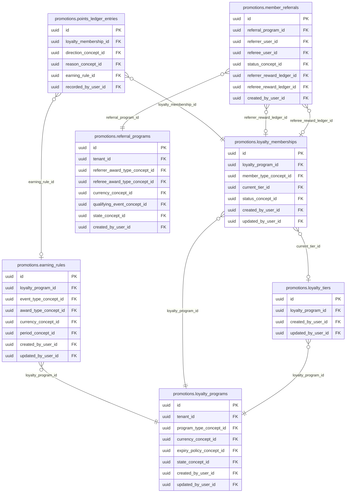
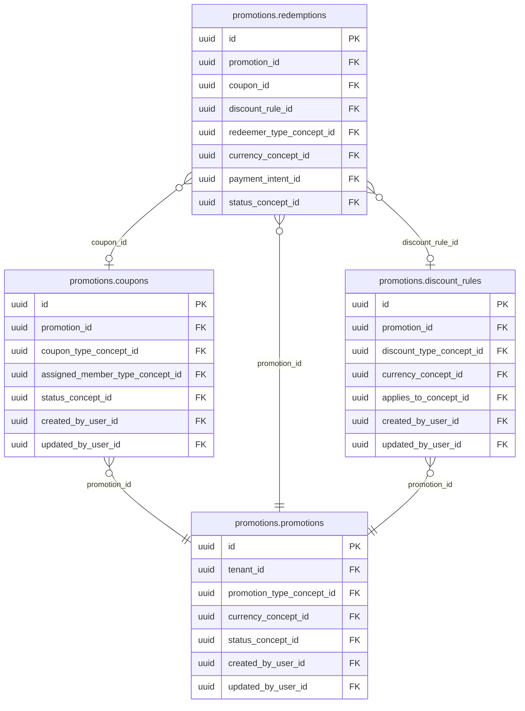

<!-- AUTOGENERADO por tools/inventario/catalogo.mjs. No editar manualmente. -->

# Catálogo del schema `promotions`

- **Tablas:** 11 · **Columnas:** 183 (41 con descripción: 22.4 %) · **Índices:** 87
- **Dominio:** Marketing y Crecimiento
- Método y límites del catálogo: [README del inventario](../README.md)

## Tablas

| Tabla | Propósito | Columnas | Índices | Operaciones | ORM |
|---|---|---|---|---|---|
| [coupons](#coupons) | Administra cupones y códigos promocionales para redimir descuentos con uso controlado. | 16 | 8 | 9 | COINCIDE |
| [discount_rules](#discount_rules) | Define condiciones y cálculos de descuentos para aplicar promociones en checkout o facturación. | 17 | 6 | 5 | COINCIDE |
| [earning_rules](#earning_rules) | Define reglas para ganar puntos o créditos por actividades elegibles del producto. | 20 | 8 | 2 | COINCIDE |
| [loyalty_memberships](#loyalty_memberships) | Relaciona personas o cuentas con programas de fidelidad para controlar nivel y vigencia de participación. | 14 | 6 | 14 | COINCIDE |
| [loyalty_programs](#loyalty_programs) | Define programas de fidelidad para premiar interacciones elegibles con la plataforma y sus prestadores. | 16 | 10 | 13 | COINCIDE |
| [loyalty_tiers](#loyalty_tiers) | Organiza niveles de beneficios dentro de programas de fidelidad según criterios de participación. | 13 | 4 | 6 | COINCIDE |
| [member_referrals](#member_referrals) | Relaciona miembros que recomiendan con personas referidas para seguir atribución y recompensas. | 15 | 9 | 4 | COINCIDE |
| [points_ledger_entries](#points_ledger_entries) | Registra acumulaciones y consumos de puntos para auditar el saldo de recompensas. | 14 | 7 | 15 | COINCIDE |
| [promotions](#promotions) | Cataloga promociones temporales que aplican descuentos o incentivos en pagos de servicios. | 21 | 9 | 8 | COINCIDE |
| [redemptions](#redemptions) | Registra redenciones de cupones o promociones para evitar duplicaciones y conservar evidencia de uso. | 18 | 9 | 7 | COINCIDE |
| [referral_programs](#referral_programs) | Define programas de recomendación para invitar nuevos participantes mediante incentivos gobernados. | 19 | 11 | 2 | COINCIDE |

## Diagrama entidad-relación

Las tablas se agrupan en familias por sus claves foráneas dentro del schema (máximo 40 por diagrama). Las FK hacia otros schemas se listan en la ficha de cada tabla.

### Familia 1 de 2 — 7 tablas

### Familia 2 de 2 — 4 tablas

## Fichas

### coupons

#### Vista general

Administra cupones y códigos promocionales para redimir descuentos con uso controlado.

- **Estado del propósito:** DOMAIN_CURATED_DRAFT · fuente: `Mantra Core Health Context/modules/diagram_51_promotions.puml: coupons`
- **Dominio:** Marketing y Crecimiento · **Diagrama:** `Mantra Core Health Context/modules/diagram_51_promotions.puml` · **DDL:** `SQL/51_promotions/02_tables.sql`
- **Entidad del ORM:** `Coupons` — `src/modules/promotions/entities/coupons.entity.ts`
- **Resumen:** 16 columnas · 8 índices · 6 FK salientes · 2 entrantes · 9 operaciones

#### Columnas

| # | Columna | Tipo | Rol estructural | Descripción | ORM |
|---|---|---|---|---|---|
| 1 | `id` | `uuid` | Clave primaria; Obligatoria | Identificador único de la instancia. _(JSDOC_ESTANDAR, `src/modules/promotions/entities/coupons.entity.ts:12`)_ | coincide |
| 2 | `promotion_id` | `uuid` | Clave foránea → promotions.promotions.id; Obligatoria | _sin dato_ | coincide |
| 3 | `code` | `varchar` | Obligatoria | _sin dato_ | coincide |
| 4 | `coupon_type_concept_id` | `uuid` | Clave foránea → terminology.catalog_concepts.id; Obligatoria | _sin dato_ | coincide |
| 5 | `assigned_member_type_concept_id` | `uuid` | Clave foránea → terminology.catalog_concepts.id; Opcional | _sin dato_ | coincide |
| 6 | `assigned_member_ref_id` | `uuid` | Opcional | _sin dato_ | coincide |
| 7 | `max_redemptions` | `integer` | Opcional | _sin dato_ | coincide |
| 8 | `redemption_count` | `integer` | Opcional | _sin dato_ | coincide |
| 9 | `valid_from` | `timestamptz` | Opcional | _sin dato_ | coincide |
| 10 | `valid_to` | `timestamptz` | Opcional | _sin dato_ | coincide |
| 11 | `status_concept_id` | `uuid` | Clave foránea → terminology.catalog_concepts.id; Obligatoria | _sin dato_ | coincide |
| 12 | `created_at` | `timestamptz` | Obligatoria | Fecha y hora en que se creó el registro. _(JSDOC_ESTANDAR, `src/modules/promotions/entities/coupons.entity.ts:98`)_ | coincide |
| 13 | `updated_at` | `timestamptz` | Obligatoria | Fecha y hora de la última actualización. _(JSDOC_ESTANDAR, `src/modules/promotions/entities/coupons.entity.ts:104`)_ | coincide |
| 14 | `created_by_user_id` | `uuid` | Clave foránea → iam.users.id; Opcional | _sin dato_ | coincide |
| 15 | `updated_by_user_id` | `uuid` | Clave foránea → iam.users.id; Opcional | _sin dato_ | coincide |
| 16 | `row_version` | `integer = 1` | Obligatoria | Versión usada para controlar actualizaciones concurrentes. _(JSDOC_ENTIDAD, `src/modules/promotions/entities/coupons.entity.ts:122`)_ | coincide |

#### Relaciones

| Sentido | Columnas | Tabla | Restricción |
|---|---|---|---|
| hacia | promotion_id | promotions.promotions (id) | fk_coupons_promotion_id |
| hacia | coupon_type_concept_id | terminology.catalog_concepts (id) | fk_coupons_coupon_type_concept_id |
| hacia | assigned_member_type_concept_id | terminology.catalog_concepts (id) | fk_coupons_assigned_member_type_concept_id |
| hacia | status_concept_id | terminology.catalog_concepts (id) | fk_coupons_status_concept_id |
| hacia | created_by_user_id | iam.users (id) | fk_coupons_created_by_user_id |
| hacia | updated_by_user_id | iam.users (id) | fk_coupons_updated_by_user_id |
| desde | id | promotions.redemptions (coupon_id) | fk_redemptions_coupon_id |
| desde | id | audit.coupons_history (coupons_id) | fk_coupons_history_coupons_id |

#### Índices

| Índice | Único | Columnas | Para qué |
|---|---|---|---|
| `uq_coupons_code` | sí | code | Garantiza que no se repita la combinación (code) _(DOCUMENTO)_; 4 consulta(s) de repositorio filtran u ordenan por «code», la primera columna del índice _(CONSULTA)_ |
| `ix_coupons_promotion_id` | no | promotion_id | Soporta la clave foránea fk_coupons_promotion_id: PostgreSQL no indexa las FK por sí mismo _(DOCUMENTO)_; 1 consulta(s) de repositorio filtran u ordenan por «promotion_id», la primera columna del índice _(CONSULTA)_ |
| `ix_coupons_coupon_type_concept_id` | no | coupon_type_concept_id | Soporta la clave foránea fk_coupons_coupon_type_concept_id: PostgreSQL no indexa las FK por sí mismo _(DOCUMENTO)_ |
| `ix_coupons_assigned_member_type_concept_id` | no | assigned_member_type_concept_id | Soporta la clave foránea fk_coupons_assigned_member_type_concept_id: PostgreSQL no indexa las FK por sí mismo _(DOCUMENTO)_; 1 consulta(s) de repositorio filtran u ordenan por «assigned_member_type_concept_id», la primera columna del índice _(CONSULTA)_ |
| `ix_coupons_status_concept_id` | no | status_concept_id | Soporta la clave foránea fk_coupons_status_concept_id: PostgreSQL no indexa las FK por sí mismo _(DOCUMENTO)_; 1 consulta(s) de repositorio filtran u ordenan por «status_concept_id», la primera columna del índice _(CONSULTA)_ |
| `ix_coupons_created_by_user_id` | no | created_by_user_id | Soporta la clave foránea fk_coupons_created_by_user_id: PostgreSQL no indexa las FK por sí mismo _(DOCUMENTO)_ |
| `ix_coupons_updated_by_user_id` | no | updated_by_user_id | Soporta la clave foránea fk_coupons_updated_by_user_id: PostgreSQL no indexa las FK por sí mismo _(DOCUMENTO)_ |
| `gin_coupons_search` | no | (to_tsvector('simple', (coalesce(code, '')))) | GIN para búsqueda textual gobernada _(DOCUMENTO)_ |

#### Restricciones

| Restricción | Tipo | Definición |
|---|---|---|
| `uq_coupons_code` | UNIQUE INDEX | UNIQUE INDEX ("code") |

#### Operaciones que la tocan

| Operación | Efecto | Confianza |
|---|---|---|
| POST /checkout/{orderId}/apply-discount | ACTUALIZA | POR_TIPO |
| POST /checkout/{orderId}/apply-discount | LEE | DIRECTA |
| POST /coupons/validate | LEE | DIRECTA |
| POST /promotions/{id}/coupons/batch | CREA | DIRECTA |
| POST /promotions/{id}/coupons/batch | LEE | DIRECTA |
| GET /promotions/me | LEE | DIRECTA |
| POST /redemptions | LEE | DIRECTA |
| POST /redemptions/{id}/reverse | ACTUALIZA | POR_TIPO |
| POST /redemptions/{id}/reverse | LEE | DIRECTA |

#### Gobierno

| Atributo | Valor | Fuente |
|---|---|---|
| Append-only | no declarado | — |
| Datos personales | sin fuente | — |
| Financiera | sin fuente | — |
| Crítica para auditoría | sin fuente | — |
| Retención | sin fuente | — |
| Responsable | sin fuente | — |
| Revisión | AUTO_DETECTADA | — |

---

### discount_rules

#### Vista general

Define condiciones y cálculos de descuentos para aplicar promociones en checkout o facturación.

- **Estado del propósito:** DOMAIN_CURATED_DRAFT · fuente: `Mantra Core Health Context/modules/diagram_51_promotions.puml: discount_rules`
- **Dominio:** Marketing y Crecimiento · **Diagrama:** `Mantra Core Health Context/modules/diagram_51_promotions.puml` · **DDL:** `SQL/51_promotions/02_tables.sql`
- **Entidad del ORM:** `DiscountRules` — `src/modules/promotions/entities/discount_rules.entity.ts`
- **Resumen:** 17 columnas · 6 índices · 6 FK salientes · 1 entrantes · 5 operaciones

#### Columnas

| # | Columna | Tipo | Rol estructural | Descripción | ORM |
|---|---|---|---|---|---|
| 1 | `id` | `uuid` | Clave primaria; Obligatoria | Identificador único de la instancia. _(JSDOC_ESTANDAR, `src/modules/promotions/entities/discount_rules.entity.ts:12`)_ | coincide |
| 2 | `promotion_id` | `uuid` | Clave foránea → promotions.promotions.id; Obligatoria | _sin dato_ | coincide |
| 3 | `discount_type_concept_id` | `uuid` | Clave foránea → terminology.catalog_concepts.id; Obligatoria | _sin dato_ | coincide |
| 4 | `percentage` | `numeric` | Opcional | _sin dato_ | coincide |
| 5 | `fixed_amount` | `numeric` | Opcional | _sin dato_ | coincide |
| 6 | `currency_concept_id` | `uuid` | Clave foránea → terminology.catalog_concepts.id; Opcional | _sin dato_ | coincide |
| 7 | `max_discount_amount` | `numeric` | Opcional | _sin dato_ | coincide |
| 8 | `min_purchase_amount` | `numeric` | Opcional | _sin dato_ | coincide |
| 9 | `applies_to_concept_id` | `uuid` | Clave foránea → terminology.catalog_concepts.id; Opcional | _sin dato_ | coincide |
| 10 | `target_filter_json` | `jsonb` | Opcional | _sin dato_ | coincide |
| 11 | `buy_quantity` | `integer` | Opcional | _sin dato_ | coincide |
| 12 | `get_quantity` | `integer` | Opcional | _sin dato_ | coincide |
| 13 | `created_at` | `timestamptz` | Obligatoria | Fecha y hora en que se creó el registro. _(JSDOC_ESTANDAR, `src/modules/promotions/entities/discount_rules.entity.ts:105`)_ | coincide |
| 14 | `updated_at` | `timestamptz` | Obligatoria | Fecha y hora de la última actualización. _(JSDOC_ESTANDAR, `src/modules/promotions/entities/discount_rules.entity.ts:111`)_ | coincide |
| 15 | `created_by_user_id` | `uuid` | Clave foránea → iam.users.id; Opcional | _sin dato_ | coincide |
| 16 | `updated_by_user_id` | `uuid` | Clave foránea → iam.users.id; Opcional | _sin dato_ | coincide |
| 17 | `row_version` | `integer = 1` | Obligatoria | Versión usada para controlar actualizaciones concurrentes. _(JSDOC_ENTIDAD, `src/modules/promotions/entities/discount_rules.entity.ts:129`)_ | coincide |

#### Relaciones

| Sentido | Columnas | Tabla | Restricción |
|---|---|---|---|
| hacia | promotion_id | promotions.promotions (id) | fk_discount_rules_promotion_id |
| hacia | discount_type_concept_id | terminology.catalog_concepts (id) | fk_discount_rules_discount_type_concept_id |
| hacia | currency_concept_id | terminology.catalog_concepts (id) | fk_discount_rules_currency_concept_id |
| hacia | applies_to_concept_id | terminology.catalog_concepts (id) | fk_discount_rules_applies_to_concept_id |
| hacia | created_by_user_id | iam.users (id) | fk_discount_rules_created_by_user_id |
| hacia | updated_by_user_id | iam.users (id) | fk_discount_rules_updated_by_user_id |
| desde | id | promotions.redemptions (discount_rule_id) | fk_redemptions_discount_rule_id |

#### Índices

| Índice | Único | Columnas | Para qué |
|---|---|---|---|
| `ix_discount_rules_promotion_id` | no | promotion_id | Soporta la clave foránea fk_discount_rules_promotion_id: PostgreSQL no indexa las FK por sí mismo _(DOCUMENTO)_; 2 consulta(s) de repositorio filtran u ordenan por «promotion_id», la primera columna del índice _(CONSULTA)_ |
| `ix_discount_rules_discount_type_concept_id` | no | discount_type_concept_id | Soporta la clave foránea fk_discount_rules_discount_type_concept_id: PostgreSQL no indexa las FK por sí mismo _(DOCUMENTO)_ |
| `ix_discount_rules_currency_concept_id` | no | currency_concept_id | Soporta la clave foránea fk_discount_rules_currency_concept_id: PostgreSQL no indexa las FK por sí mismo _(DOCUMENTO)_ |
| `ix_discount_rules_applies_to_concept_id` | no | applies_to_concept_id | Soporta la clave foránea fk_discount_rules_applies_to_concept_id: PostgreSQL no indexa las FK por sí mismo _(DOCUMENTO)_ |
| `ix_discount_rules_created_by_user_id` | no | created_by_user_id | Soporta la clave foránea fk_discount_rules_created_by_user_id: PostgreSQL no indexa las FK por sí mismo _(DOCUMENTO)_ |
| `ix_discount_rules_updated_by_user_id` | no | updated_by_user_id | Soporta la clave foránea fk_discount_rules_updated_by_user_id: PostgreSQL no indexa las FK por sí mismo _(DOCUMENTO)_ |

#### Operaciones que la tocan

| Operación | Efecto | Confianza |
|---|---|---|
| POST /checkout/{orderId}/apply-discount | LEE | DIRECTA |
| POST /coupons/validate | LEE | DIRECTA |
| POST /promotions | CREA | DIRECTA |
| GET /promotions/me | LEE | DIRECTA |
| POST /redemptions | LEE | DIRECTA |

#### Gobierno

| Atributo | Valor | Fuente |
|---|---|---|
| Append-only | no declarado | — |
| Datos personales | sin fuente | — |
| Financiera | sin fuente | — |
| Crítica para auditoría | sin fuente | — |
| Retención | sin fuente | — |
| Responsable | sin fuente | — |
| Revisión | AUTO_DETECTADA | — |

---

### earning_rules

#### Vista general

Define reglas para ganar puntos o créditos por actividades elegibles del producto.

- **Estado del propósito:** DOMAIN_CURATED_DRAFT · fuente: `Mantra Core Health Context/modules/diagram_51_promotions.puml: earning_rules`
- **Dominio:** Marketing y Crecimiento · **Diagrama:** `Mantra Core Health Context/modules/diagram_51_promotions.puml` · **DDL:** `SQL/51_promotions/02_tables.sql`
- **Entidad del ORM:** `EarningRules` — `src/modules/promotions/entities/earning_rules.entity.ts`
- **Resumen:** 20 columnas · 8 índices · 7 FK salientes · 1 entrantes · 2 operaciones

#### Columnas

| # | Columna | Tipo | Rol estructural | Descripción | ORM |
|---|---|---|---|---|---|
| 1 | `id` | `uuid` | Clave primaria; Obligatoria | Identificador único de la instancia. _(JSDOC_ESTANDAR, `src/modules/promotions/entities/earning_rules.entity.ts:12`)_ | coincide |
| 2 | `loyalty_program_id` | `uuid` | Clave foránea → promotions.loyalty_programs.id; Obligatoria | _sin dato_ | coincide |
| 3 | `code` | `varchar` | Obligatoria | _sin dato_ | coincide |
| 4 | `name` | `varchar` | Obligatoria | _sin dato_ | coincide |
| 5 | `event_type_concept_id` | `uuid` | Clave foránea → terminology.catalog_concepts.id; Obligatoria | _sin dato_ | coincide |
| 6 | `award_type_concept_id` | `uuid` | Clave foránea → terminology.catalog_concepts.id; Obligatoria | _sin dato_ | coincide |
| 7 | `points_amount` | `numeric` | Opcional | _sin dato_ | coincide |
| 8 | `credit_amount` | `numeric` | Opcional | _sin dato_ | coincide |
| 9 | `currency_concept_id` | `uuid` | Clave foránea → terminology.catalog_concepts.id; Opcional | _sin dato_ | coincide |
| 10 | `condition_json` | `jsonb` | Opcional | _sin dato_ | coincide |
| 11 | `cap_per_period` | `integer` | Opcional | _sin dato_ | coincide |
| 12 | `period_concept_id` | `uuid` | Clave foránea → terminology.catalog_concepts.id; Opcional | _sin dato_ | coincide |
| 13 | `valid_from` | `timestamptz` | Opcional | _sin dato_ | coincide |
| 14 | `valid_to` | `timestamptz` | Opcional | _sin dato_ | coincide |
| 15 | `is_active` | `boolean` | Obligatoria | _sin dato_ | coincide |
| 16 | `created_at` | `timestamptz` | Obligatoria | Fecha y hora en que se creó el registro. _(JSDOC_ESTANDAR, `src/modules/promotions/entities/earning_rules.entity.ts:123`)_ | coincide |
| 17 | `updated_at` | `timestamptz` | Obligatoria | Fecha y hora de la última actualización. _(JSDOC_ESTANDAR, `src/modules/promotions/entities/earning_rules.entity.ts:129`)_ | coincide |
| 18 | `created_by_user_id` | `uuid` | Clave foránea → iam.users.id; Opcional | _sin dato_ | coincide |
| 19 | `updated_by_user_id` | `uuid` | Clave foránea → iam.users.id; Opcional | _sin dato_ | coincide |
| 20 | `row_version` | `integer = 1` | Obligatoria | Versión usada para controlar actualizaciones concurrentes. _(JSDOC_ENTIDAD, `src/modules/promotions/entities/earning_rules.entity.ts:147`)_ | coincide |

#### Relaciones

| Sentido | Columnas | Tabla | Restricción |
|---|---|---|---|
| hacia | loyalty_program_id | promotions.loyalty_programs (id) | fk_earning_rules_loyalty_program_id |
| hacia | event_type_concept_id | terminology.catalog_concepts (id) | fk_earning_rules_event_type_concept_id |
| hacia | award_type_concept_id | terminology.catalog_concepts (id) | fk_earning_rules_award_type_concept_id |
| hacia | currency_concept_id | terminology.catalog_concepts (id) | fk_earning_rules_currency_concept_id |
| hacia | period_concept_id | terminology.catalog_concepts (id) | fk_earning_rules_period_concept_id |
| hacia | created_by_user_id | iam.users (id) | fk_earning_rules_created_by_user_id |
| hacia | updated_by_user_id | iam.users (id) | fk_earning_rules_updated_by_user_id |
| desde | id | promotions.points_ledger_entries (earning_rule_id) | fk_points_ledger_entries_earning_rule_id |

#### Índices

| Índice | Único | Columnas | Para qué |
|---|---|---|---|
| `ix_earning_rules_loyalty_program_id` | no | loyalty_program_id | Soporta la clave foránea fk_earning_rules_loyalty_program_id: PostgreSQL no indexa las FK por sí mismo _(DOCUMENTO)_ |
| `ix_earning_rules_event_type_concept_id` | no | event_type_concept_id | Soporta la clave foránea fk_earning_rules_event_type_concept_id: PostgreSQL no indexa las FK por sí mismo _(DOCUMENTO)_ |
| `ix_earning_rules_award_type_concept_id` | no | award_type_concept_id | Soporta la clave foránea fk_earning_rules_award_type_concept_id: PostgreSQL no indexa las FK por sí mismo _(DOCUMENTO)_ |
| `ix_earning_rules_currency_concept_id` | no | currency_concept_id | Soporta la clave foránea fk_earning_rules_currency_concept_id: PostgreSQL no indexa las FK por sí mismo _(DOCUMENTO)_ |
| `ix_earning_rules_period_concept_id` | no | period_concept_id | Soporta la clave foránea fk_earning_rules_period_concept_id: PostgreSQL no indexa las FK por sí mismo _(DOCUMENTO)_ |
| `ix_earning_rules_created_by_user_id` | no | created_by_user_id | Soporta la clave foránea fk_earning_rules_created_by_user_id: PostgreSQL no indexa las FK por sí mismo _(DOCUMENTO)_ |
| `ix_earning_rules_updated_by_user_id` | no | updated_by_user_id | Soporta la clave foránea fk_earning_rules_updated_by_user_id: PostgreSQL no indexa las FK por sí mismo _(DOCUMENTO)_ |
| `gin_earning_rules_search` | no | (to_tsvector('simple', (coalesce(name, '') ¦¦ ' ' ¦¦ coalesce(code, '')))) | GIN para búsqueda textual gobernada _(DOCUMENTO)_ |

#### Operaciones que la tocan

| Operación | Efecto | Confianza |
|---|---|---|
| POST /loyalty/memberships/{id}/points/earn | LEE | DIRECTA |
| POST /loyalty/programs | CREA | DIRECTA |

#### Gobierno

| Atributo | Valor | Fuente |
|---|---|---|
| Append-only | no declarado | — |
| Datos personales | sin fuente | — |
| Financiera | sin fuente | — |
| Crítica para auditoría | sin fuente | — |
| Retención | sin fuente | — |
| Responsable | sin fuente | — |
| Revisión | AUTO_DETECTADA | — |

---

### loyalty_memberships

#### Vista general

Relaciona personas o cuentas con programas de fidelidad para controlar nivel y vigencia de participación.

- **Estado del propósito:** DOMAIN_CURATED_DRAFT · fuente: `Mantra Core Health Context/modules/diagram_51_promotions.puml: loyalty_memberships`
- **Dominio:** Marketing y Crecimiento · **Diagrama:** `Mantra Core Health Context/modules/diagram_51_promotions.puml` · **DDL:** `SQL/51_promotions/02_tables.sql`
- **Entidad del ORM:** `LoyaltyMemberships` — `src/modules/promotions/entities/loyalty_memberships.entity.ts`
- **Resumen:** 14 columnas · 6 índices · 6 FK salientes · 4 entrantes · 14 operaciones

#### Columnas

| # | Columna | Tipo | Rol estructural | Descripción | ORM |
|---|---|---|---|---|---|
| 1 | `id` | `uuid` | Clave primaria; Obligatoria | Identificador único de la instancia. _(JSDOC_ESTANDAR, `src/modules/promotions/entities/loyalty_memberships.entity.ts:12`)_ | coincide |
| 2 | `loyalty_program_id` | `uuid` | Clave foránea → promotions.loyalty_programs.id; Obligatoria | _sin dato_ | coincide |
| 3 | `member_type_concept_id` | `uuid` | Clave foránea → terminology.catalog_concepts.id; Obligatoria | _sin dato_ | coincide |
| 4 | `member_ref_id` | `uuid` | Obligatoria | _sin dato_ | coincide |
| 5 | `current_tier_id` | `uuid` | Clave foránea → promotions.loyalty_tiers.id; Opcional | _sin dato_ | coincide |
| 6 | `points_balance` | `numeric` | Opcional | _sin dato_ | coincide |
| 7 | `lifetime_points` | `numeric` | Opcional | _sin dato_ | coincide |
| 8 | `enrolled_at` | `timestamptz` | Opcional | _sin dato_ | coincide |
| 9 | `status_concept_id` | `uuid` | Clave foránea → terminology.catalog_concepts.id; Obligatoria | _sin dato_ | coincide |
| 10 | `created_at` | `timestamptz` | Obligatoria | Fecha y hora en que se creó el registro. _(JSDOC_ESTANDAR, `src/modules/promotions/entities/loyalty_memberships.entity.ts:78`)_ | coincide |
| 11 | `updated_at` | `timestamptz` | Obligatoria | Fecha y hora de la última actualización. _(JSDOC_ESTANDAR, `src/modules/promotions/entities/loyalty_memberships.entity.ts:84`)_ | coincide |
| 12 | `created_by_user_id` | `uuid` | Clave foránea → iam.users.id; Opcional | _sin dato_ | coincide |
| 13 | `updated_by_user_id` | `uuid` | Clave foránea → iam.users.id; Opcional | _sin dato_ | coincide |
| 14 | `row_version` | `integer = 1` | Obligatoria | Versión usada para controlar actualizaciones concurrentes. _(JSDOC_ENTIDAD, `src/modules/promotions/entities/loyalty_memberships.entity.ts:102`)_ | coincide |

#### Relaciones

| Sentido | Columnas | Tabla | Restricción |
|---|---|---|---|
| hacia | loyalty_program_id | promotions.loyalty_programs (id) | fk_loyalty_memberships_loyalty_program_id |
| hacia | current_tier_id | promotions.loyalty_tiers (id) | fk_loyalty_memberships_current_tier_id |
| hacia | member_type_concept_id | terminology.catalog_concepts (id) | fk_loyalty_memberships_member_type_concept_id |
| hacia | status_concept_id | terminology.catalog_concepts (id) | fk_loyalty_memberships_status_concept_id |
| hacia | created_by_user_id | iam.users (id) | fk_loyalty_memberships_created_by_user_id |
| hacia | updated_by_user_id | iam.users (id) | fk_loyalty_memberships_updated_by_user_id |
| desde | id | promotions.points_ledger_entries (loyalty_membership_id) | fk_points_ledger_entries_loyalty_membership_id |
| desde | id | promotions.member_referrals (referrer_reward_ledger_id) | fk_member_referrals_referrer_reward_ledger_id |
| desde | id | promotions.member_referrals (referee_reward_ledger_id) | fk_member_referrals_referee_reward_ledger_id |
| desde | id | audit.loyalty_memberships_history (loyalty_memberships_id) | fk_loyalty_memberships_history_loyalty_memberships_id |

#### Índices

| Índice | Único | Columnas | Para qué |
|---|---|---|---|
| `ix_loyalty_memberships_loyalty_program_id` | no | loyalty_program_id | Soporta la clave foránea fk_loyalty_memberships_loyalty_program_id: PostgreSQL no indexa las FK por sí mismo _(DOCUMENTO)_; 3 consulta(s) de repositorio filtran u ordenan por «loyalty_program_id», la primera columna del índice _(CONSULTA)_ |
| `ix_loyalty_memberships_member_type_concept_id` | no | member_type_concept_id | Soporta la clave foránea fk_loyalty_memberships_member_type_concept_id: PostgreSQL no indexa las FK por sí mismo _(DOCUMENTO)_; 2 consulta(s) de repositorio filtran u ordenan por «member_type_concept_id», la primera columna del índice _(CONSULTA)_ |
| `ix_loyalty_memberships_current_tier_id` | no | current_tier_id | Soporta la clave foránea fk_loyalty_memberships_current_tier_id: PostgreSQL no indexa las FK por sí mismo _(DOCUMENTO)_ |
| `ix_loyalty_memberships_status_concept_id` | no | status_concept_id | Soporta la clave foránea fk_loyalty_memberships_status_concept_id: PostgreSQL no indexa las FK por sí mismo _(DOCUMENTO)_; 1 consulta(s) de repositorio filtran u ordenan por «status_concept_id», la primera columna del índice _(CONSULTA)_ |
| `ix_loyalty_memberships_created_by_user_id` | no | created_by_user_id | Soporta la clave foránea fk_loyalty_memberships_created_by_user_id: PostgreSQL no indexa las FK por sí mismo _(DOCUMENTO)_ |
| `ix_loyalty_memberships_updated_by_user_id` | no | updated_by_user_id | Soporta la clave foránea fk_loyalty_memberships_updated_by_user_id: PostgreSQL no indexa las FK por sí mismo _(DOCUMENTO)_ |

#### Operaciones que la tocan

| Operación | Efecto | Confianza |
|---|---|---|
| POST /loyalty/jobs/expire-points | ACTUALIZA | POR_TIPO |
| POST /loyalty/jobs/expire-points | LEE | DIRECTA |
| GET /loyalty/me | LEE | DIRECTA |
| GET /loyalty/me/points | LEE | DIRECTA |
| POST /loyalty/me/points/redeem | LEE | DIRECTA |
| POST /loyalty/memberships/{id}/points/earn | LEE | DIRECTA |
| POST /loyalty/memberships/{id}/points/redeem | LEE | DIRECTA |
| POST /loyalty/memberships/{id}/recompute | LEE | DIRECTA |
| POST /loyalty/programs/{id}/memberships | ACTUALIZA | POR_TIPO |
| POST /loyalty/programs/{id}/memberships | CREA | DIRECTA |
| POST /loyalty/programs/{id}/memberships | LEE | DIRECTA |
| POST /redemptions/{id}/reverse | ACTUALIZA | POR_TIPO |
| POST /redemptions/{id}/reverse | LEE | DIRECTA |
| POST /referrals/{id}/qualify | LEE | DIRECTA |

#### Gobierno

| Atributo | Valor | Fuente |
|---|---|---|
| Append-only | no declarado | — |
| Datos personales | sin fuente | — |
| Financiera | sin fuente | — |
| Crítica para auditoría | sin fuente | — |
| Retención | sin fuente | — |
| Responsable | sin fuente | — |
| Revisión | AUTO_DETECTADA | — |

---

### loyalty_programs

#### Vista general

Define programas de fidelidad para premiar interacciones elegibles con la plataforma y sus prestadores.

- **Estado del propósito:** DOMAIN_CURATED_DRAFT · fuente: `Mantra Core Health Context/modules/diagram_51_promotions.puml: loyalty_programs`
- **Dominio:** Marketing y Crecimiento · **Diagrama:** `Mantra Core Health Context/modules/diagram_51_promotions.puml` · **DDL:** `SQL/51_promotions/02_tables.sql`
- **Entidad del ORM:** `LoyaltyPrograms` — `src/modules/promotions/entities/loyalty_programs.entity.ts`
- **Resumen:** 16 columnas · 10 índices · 7 FK salientes · 4 entrantes · 13 operaciones

#### Columnas

| # | Columna | Tipo | Rol estructural | Descripción | ORM |
|---|---|---|---|---|---|
| 1 | `id` | `uuid` | Clave primaria; Obligatoria | Identificador único de la instancia. _(JSDOC_ESTANDAR, `src/modules/promotions/entities/loyalty_programs.entity.ts:12`)_ | coincide |
| 2 | `tenant_id` | `uuid` | Clave foránea → directory.tenants.id; Obligatoria | _sin dato_ | coincide |
| 3 | `code` | `varchar` | Obligatoria | _sin dato_ | coincide |
| 4 | `name` | `varchar` | Obligatoria | _sin dato_ | coincide |
| 5 | `program_type_concept_id` | `uuid` | Clave foránea → terminology.catalog_concepts.id; Obligatoria | _sin dato_ | coincide |
| 6 | `points_currency_name` | `varchar` | Opcional | _sin dato_ | coincide |
| 7 | `point_to_currency_rate` | `numeric` | Opcional | _sin dato_ | coincide |
| 8 | `currency_concept_id` | `uuid` | Clave foránea → terminology.catalog_concepts.id; Opcional | _sin dato_ | coincide |
| 9 | `expiry_policy_concept_id` | `uuid` | Clave foránea → terminology.catalog_concepts.id; Opcional | _sin dato_ | coincide |
| 10 | `points_expiry_days` | `integer` | Opcional | _sin dato_ | coincide |
| 11 | `state_concept_id` | `uuid` | Clave foránea → terminology.catalog_concepts.id; Obligatoria | _sin dato_ | coincide |
| 12 | `created_at` | `timestamptz` | Obligatoria | Fecha y hora en que se creó el registro. _(JSDOC_ESTANDAR, `src/modules/promotions/entities/loyalty_programs.entity.ts:94`)_ | coincide |
| 13 | `updated_at` | `timestamptz` | Obligatoria | Fecha y hora de la última actualización. _(JSDOC_ESTANDAR, `src/modules/promotions/entities/loyalty_programs.entity.ts:100`)_ | coincide |
| 14 | `created_by_user_id` | `uuid` | Clave foránea → iam.users.id; Opcional | _sin dato_ | coincide |
| 15 | `updated_by_user_id` | `uuid` | Clave foránea → iam.users.id; Opcional | _sin dato_ | coincide |
| 16 | `row_version` | `integer = 1` | Obligatoria | Versión usada para controlar actualizaciones concurrentes. _(JSDOC_ENTIDAD, `src/modules/promotions/entities/loyalty_programs.entity.ts:118`)_ | coincide |

#### Relaciones

| Sentido | Columnas | Tabla | Restricción |
|---|---|---|---|
| hacia | tenant_id | directory.tenants (id) | fk_loyalty_programs_tenant_id |
| hacia | program_type_concept_id | terminology.catalog_concepts (id) | fk_loyalty_programs_program_type_concept_id |
| hacia | currency_concept_id | terminology.catalog_concepts (id) | fk_loyalty_programs_currency_concept_id |
| hacia | expiry_policy_concept_id | terminology.catalog_concepts (id) | fk_loyalty_programs_expiry_policy_concept_id |
| hacia | state_concept_id | terminology.catalog_concepts (id) | fk_loyalty_programs_state_concept_id |
| hacia | created_by_user_id | iam.users (id) | fk_loyalty_programs_created_by_user_id |
| hacia | updated_by_user_id | iam.users (id) | fk_loyalty_programs_updated_by_user_id |
| desde | id | promotions.loyalty_tiers (loyalty_program_id) | fk_loyalty_tiers_loyalty_program_id |
| desde | id | promotions.loyalty_memberships (loyalty_program_id) | fk_loyalty_memberships_loyalty_program_id |
| desde | id | promotions.earning_rules (loyalty_program_id) | fk_earning_rules_loyalty_program_id |
| desde | id | audit.loyalty_programs_history (loyalty_programs_id) | fk_loyalty_programs_history_loyalty_programs_id |

#### Índices

| Índice | Único | Columnas | Para qué |
|---|---|---|---|
| `uq_loyalty_programs_code` | sí | code | Garantiza que no se repita la combinación (code) _(DOCUMENTO)_; 1 consulta(s) de repositorio filtran u ordenan por «code», la primera columna del índice _(CONSULTA)_ |
| `ix_loyalty_programs_tenant_id` | no | tenant_id | Soporta la clave foránea fk_loyalty_programs_tenant_id: PostgreSQL no indexa las FK por sí mismo _(DOCUMENTO)_; 1 consulta(s) de repositorio filtran u ordenan por «tenant_id», la primera columna del índice _(CONSULTA)_ |
| `ix_loyalty_programs_program_type_concept_id` | no | program_type_concept_id | Soporta la clave foránea fk_loyalty_programs_program_type_concept_id: PostgreSQL no indexa las FK por sí mismo _(DOCUMENTO)_ |
| `ix_loyalty_programs_currency_concept_id` | no | currency_concept_id | Soporta la clave foránea fk_loyalty_programs_currency_concept_id: PostgreSQL no indexa las FK por sí mismo _(DOCUMENTO)_ |
| `ix_loyalty_programs_expiry_policy_concept_id` | no | expiry_policy_concept_id | Soporta la clave foránea fk_loyalty_programs_expiry_policy_concept_id: PostgreSQL no indexa las FK por sí mismo _(DOCUMENTO)_ |
| `ix_loyalty_programs_state_concept_id` | no | state_concept_id | Soporta la clave foránea fk_loyalty_programs_state_concept_id: PostgreSQL no indexa las FK por sí mismo _(DOCUMENTO)_; 1 consulta(s) de repositorio filtran u ordenan por «state_concept_id», la primera columna del índice _(CONSULTA)_ |
| `ix_loyalty_programs_created_by_user_id` | no | created_by_user_id | Soporta la clave foránea fk_loyalty_programs_created_by_user_id: PostgreSQL no indexa las FK por sí mismo _(DOCUMENTO)_ |
| `ix_loyalty_programs_updated_by_user_id` | no | updated_by_user_id | Soporta la clave foránea fk_loyalty_programs_updated_by_user_id: PostgreSQL no indexa las FK por sí mismo _(DOCUMENTO)_ |
| `ix_loyalty_programs_tenant_id_state_concept_id` | no | tenant_id, state_concept_id, ("updated_at" DESC) | _sin uso detectado estáticamente_ |
| `gin_loyalty_programs_search` | no | (to_tsvector('simple', (coalesce(name, '') ¦¦ ' ' ¦¦ coalesce(code, '')))) | GIN para búsqueda textual gobernada _(DOCUMENTO)_ |

#### Restricciones

| Restricción | Tipo | Definición |
|---|---|---|
| `uq_loyalty_programs_code` | UNIQUE INDEX | UNIQUE INDEX ("code") |

#### Operaciones que la tocan

| Operación | Efecto | Confianza |
|---|---|---|
| POST /loyalty/jobs/expire-points | LEE | DIRECTA |
| GET /loyalty/me | LEE | DIRECTA |
| GET /loyalty/me/points | LEE | DIRECTA |
| POST /loyalty/me/points/redeem | LEE | DIRECTA |
| POST /loyalty/memberships/{id}/points/earn | LEE | DIRECTA |
| POST /loyalty/memberships/{id}/points/redeem | LEE | DIRECTA |
| POST /loyalty/memberships/{id}/recompute | LEE | DIRECTA |
| GET /loyalty/programs | LEE | DIRECTA |
| POST /loyalty/programs | CREA | DIRECTA |
| POST /loyalty/programs | LEE | DIRECTA |
| POST /loyalty/programs/{id}/memberships | LEE | DIRECTA |
| POST /redemptions/{id}/reverse | LEE | DIRECTA |
| POST /referrals/{id}/qualify | LEE | DIRECTA |

#### Gobierno

| Atributo | Valor | Fuente |
|---|---|---|
| Append-only | no declarado | — |
| Datos personales | sin fuente | — |
| Financiera | sin fuente | — |
| Crítica para auditoría | sin fuente | — |
| Retención | sin fuente | — |
| Responsable | sin fuente | — |
| Revisión | AUTO_DETECTADA | — |

---

### loyalty_tiers

#### Vista general

Organiza niveles de beneficios dentro de programas de fidelidad según criterios de participación.

- **Estado del propósito:** DOMAIN_CURATED_DRAFT · fuente: `Mantra Core Health Context/modules/diagram_51_promotions.puml: loyalty_tiers`
- **Dominio:** Marketing y Crecimiento · **Diagrama:** `Mantra Core Health Context/modules/diagram_51_promotions.puml` · **DDL:** `SQL/51_promotions/02_tables.sql`
- **Entidad del ORM:** `LoyaltyTiers` — `src/modules/promotions/entities/loyalty_tiers.entity.ts`
- **Resumen:** 13 columnas · 4 índices · 3 FK salientes · 1 entrantes · 6 operaciones

#### Columnas

| # | Columna | Tipo | Rol estructural | Descripción | ORM |
|---|---|---|---|---|---|
| 1 | `id` | `uuid` | Clave primaria; Obligatoria | Identificador único de la instancia. _(JSDOC_ESTANDAR, `src/modules/promotions/entities/loyalty_tiers.entity.ts:12`)_ | coincide |
| 2 | `loyalty_program_id` | `uuid` | Clave foránea → promotions.loyalty_programs.id; Obligatoria | _sin dato_ | coincide |
| 3 | `code` | `varchar` | Obligatoria | _sin dato_ | coincide |
| 4 | `name` | `varchar` | Obligatoria | _sin dato_ | coincide |
| 5 | `min_points` | `numeric` | Obligatoria | _sin dato_ | coincide |
| 6 | `multiplier` | `numeric` | Opcional | _sin dato_ | coincide |
| 7 | `benefits_json` | `jsonb` | Opcional | _sin dato_ | coincide |
| 8 | `ordinal` | `integer` | Opcional | _sin dato_ | coincide |
| 9 | `created_at` | `timestamptz` | Obligatoria | Fecha y hora en que se creó el registro. _(JSDOC_ESTANDAR, `src/modules/promotions/entities/loyalty_tiers.entity.ts:65`)_ | coincide |
| 10 | `updated_at` | `timestamptz` | Obligatoria | Fecha y hora de la última actualización. _(JSDOC_ESTANDAR, `src/modules/promotions/entities/loyalty_tiers.entity.ts:71`)_ | coincide |
| 11 | `created_by_user_id` | `uuid` | Clave foránea → iam.users.id; Opcional | _sin dato_ | coincide |
| 12 | `updated_by_user_id` | `uuid` | Clave foránea → iam.users.id; Opcional | _sin dato_ | coincide |
| 13 | `row_version` | `integer = 1` | Obligatoria | Versión usada para controlar actualizaciones concurrentes. _(JSDOC_ENTIDAD, `src/modules/promotions/entities/loyalty_tiers.entity.ts:89`)_ | coincide |

#### Relaciones

| Sentido | Columnas | Tabla | Restricción |
|---|---|---|---|
| hacia | loyalty_program_id | promotions.loyalty_programs (id) | fk_loyalty_tiers_loyalty_program_id |
| hacia | created_by_user_id | iam.users (id) | fk_loyalty_tiers_created_by_user_id |
| hacia | updated_by_user_id | iam.users (id) | fk_loyalty_tiers_updated_by_user_id |
| desde | id | promotions.loyalty_memberships (current_tier_id) | fk_loyalty_memberships_current_tier_id |

#### Índices

| Índice | Único | Columnas | Para qué |
|---|---|---|---|
| `ix_loyalty_tiers_loyalty_program_id` | no | loyalty_program_id | Soporta la clave foránea fk_loyalty_tiers_loyalty_program_id: PostgreSQL no indexa las FK por sí mismo _(DOCUMENTO)_; 1 consulta(s) de repositorio filtran u ordenan por «loyalty_program_id», la primera columna del índice _(CONSULTA)_ |
| `ix_loyalty_tiers_created_by_user_id` | no | created_by_user_id | Soporta la clave foránea fk_loyalty_tiers_created_by_user_id: PostgreSQL no indexa las FK por sí mismo _(DOCUMENTO)_ |
| `ix_loyalty_tiers_updated_by_user_id` | no | updated_by_user_id | Soporta la clave foránea fk_loyalty_tiers_updated_by_user_id: PostgreSQL no indexa las FK por sí mismo _(DOCUMENTO)_ |
| `gin_loyalty_tiers_search` | no | (to_tsvector('simple', (coalesce(name, '') ¦¦ ' ' ¦¦ coalesce(code, '')))) | GIN para búsqueda textual gobernada _(DOCUMENTO)_ |

#### Operaciones que la tocan

| Operación | Efecto | Confianza |
|---|---|---|
| GET /loyalty/me | LEE | DIRECTA |
| POST /loyalty/memberships/{id}/points/earn | LEE | DIRECTA |
| POST /loyalty/memberships/{id}/recompute | LEE | DIRECTA |
| POST /loyalty/programs | CREA | DIRECTA |
| POST /loyalty/programs/{id}/memberships | LEE | DIRECTA |
| POST /referrals/{id}/qualify | LEE | DIRECTA |

#### Gobierno

| Atributo | Valor | Fuente |
|---|---|---|
| Append-only | no declarado | — |
| Datos personales | sin fuente | — |
| Financiera | sin fuente | — |
| Crítica para auditoría | sin fuente | — |
| Retención | sin fuente | — |
| Responsable | sin fuente | — |
| Revisión | AUTO_DETECTADA | — |

---

### member_referrals

#### Vista general

Relaciona miembros que recomiendan con personas referidas para seguir atribución y recompensas.

- **Estado del propósito:** DOMAIN_CURATED_DRAFT · fuente: `Mantra Core Health Context/modules/diagram_51_promotions.puml: member_referrals`
- **Dominio:** Marketing y Crecimiento · **Diagrama:** `Mantra Core Health Context/modules/diagram_51_promotions.puml` · **DDL:** `SQL/51_promotions/02_tables.sql`
- **Entidad del ORM:** `MemberReferrals` — `src/modules/promotions/entities/member_referrals.entity.ts`
- **Resumen:** 15 columnas · 9 índices · 8 FK salientes · 0 entrantes · 4 operaciones

#### Columnas

| # | Columna | Tipo | Rol estructural | Descripción | ORM |
|---|---|---|---|---|---|
| 1 | `id` | `uuid` | Clave primaria; Obligatoria | Identificador único de la instancia. _(JSDOC_ESTANDAR, `src/modules/promotions/entities/member_referrals.entity.ts:12`)_ | coincide |
| 2 | `referral_program_id` | `uuid` | Clave foránea → promotions.referral_programs.id; Obligatoria | _sin dato_ | coincide |
| 3 | `referrer_user_id` | `uuid` | Clave foránea → iam.users.id; Obligatoria | _sin dato_ | coincide |
| 4 | `referral_code` | `varchar` | Obligatoria | _sin dato_ | coincide |
| 5 | `referee_user_id` | `uuid` | Clave foránea → iam.users.id; Opcional | _sin dato_ | coincide |
| 6 | `referee_contact` | `varchar` | Opcional | _sin dato_ | coincide |
| 7 | `status_concept_id` | `uuid` | Clave foránea → terminology.catalog_concepts.id; Obligatoria | _sin dato_ | coincide |
| 8 | `qualified_at` | `timestamptz` | Opcional | _sin dato_ | coincide |
| 9 | `referrer_reward_ledger_id` | `uuid` | Clave foránea → promotions.loyalty_memberships.id; Opcional | _sin dato_ | coincide |
| 10 | `referee_reward_ledger_id` | `uuid` | Clave foránea → promotions.loyalty_memberships.id; Opcional | _sin dato_ | coincide |
| 11 | `created_at` | `timestamptz` | Obligatoria | Fecha y hora en que se creó el registro. _(JSDOC_ESTANDAR, `src/modules/promotions/entities/member_referrals.entity.ts:88`)_ | coincide |
| 12 | `updated_at` | `timestamptz` | Obligatoria | Fecha y hora de la última actualización. _(JSDOC_ESTANDAR, `src/modules/promotions/entities/member_referrals.entity.ts:94`)_ | coincide |
| 13 | `created_by_user_id` | `uuid` | Clave foránea → iam.users.id; Opcional | _sin dato_ | coincide |
| 14 | `updated_by_user_id` | `uuid` | Clave foránea → iam.users.id; Opcional | _sin dato_ | coincide |
| 15 | `row_version` | `integer = 1` | Obligatoria | Versión usada para controlar actualizaciones concurrentes. _(JSDOC_ENTIDAD, `src/modules/promotions/entities/member_referrals.entity.ts:112`)_ | coincide |

#### Relaciones

| Sentido | Columnas | Tabla | Restricción |
|---|---|---|---|
| hacia | referral_program_id | promotions.referral_programs (id) | fk_member_referrals_referral_program_id |
| hacia | referrer_reward_ledger_id | promotions.loyalty_memberships (id) | fk_member_referrals_referrer_reward_ledger_id |
| hacia | referee_reward_ledger_id | promotions.loyalty_memberships (id) | fk_member_referrals_referee_reward_ledger_id |
| hacia | referrer_user_id | iam.users (id) | fk_member_referrals_referrer_user_id |
| hacia | referee_user_id | iam.users (id) | fk_member_referrals_referee_user_id |
| hacia | status_concept_id | terminology.catalog_concepts (id) | fk_member_referrals_status_concept_id |
| hacia | created_by_user_id | iam.users (id) | fk_member_referrals_created_by_user_id |
| hacia | updated_by_user_id | iam.users (id) | fk_member_referrals_updated_by_user_id |

#### Índices

| Índice | Único | Columnas | Para qué |
|---|---|---|---|
| `uq_member_referrals_referral_code` | sí | referral_code | Garantiza que no se repita la combinación (referral_code) _(DOCUMENTO)_; 1 consulta(s) de repositorio filtran u ordenan por «referral_code», la primera columna del índice _(CONSULTA)_ |
| `ix_member_referrals_referral_program_id` | no | referral_program_id | Soporta la clave foránea fk_member_referrals_referral_program_id: PostgreSQL no indexa las FK por sí mismo _(DOCUMENTO)_; 1 consulta(s) de repositorio filtran u ordenan por «referral_program_id», la primera columna del índice _(CONSULTA)_ |
| `ix_member_referrals_referrer_user_id` | no | referrer_user_id | Soporta la clave foránea fk_member_referrals_referrer_user_id: PostgreSQL no indexa las FK por sí mismo _(DOCUMENTO)_; 1 consulta(s) de repositorio filtran u ordenan por «referrer_user_id», la primera columna del índice _(CONSULTA)_ |
| `ix_member_referrals_referee_user_id` | no | referee_user_id | Soporta la clave foránea fk_member_referrals_referee_user_id: PostgreSQL no indexa las FK por sí mismo _(DOCUMENTO)_ |
| `ix_member_referrals_status_concept_id` | no | status_concept_id | Soporta la clave foránea fk_member_referrals_status_concept_id: PostgreSQL no indexa las FK por sí mismo _(DOCUMENTO)_ |
| `ix_member_referrals_referrer_reward_ledger_id` | no | referrer_reward_ledger_id | Soporta la clave foránea fk_member_referrals_referrer_reward_ledger_id: PostgreSQL no indexa las FK por sí mismo _(DOCUMENTO)_ |
| `ix_member_referrals_referee_reward_ledger_id` | no | referee_reward_ledger_id | Soporta la clave foránea fk_member_referrals_referee_reward_ledger_id: PostgreSQL no indexa las FK por sí mismo _(DOCUMENTO)_ |
| `ix_member_referrals_created_by_user_id` | no | created_by_user_id | Soporta la clave foránea fk_member_referrals_created_by_user_id: PostgreSQL no indexa las FK por sí mismo _(DOCUMENTO)_ |
| `ix_member_referrals_updated_by_user_id` | no | updated_by_user_id | Soporta la clave foránea fk_member_referrals_updated_by_user_id: PostgreSQL no indexa las FK por sí mismo _(DOCUMENTO)_ |

#### Restricciones

| Restricción | Tipo | Definición |
|---|---|---|
| `uq_member_referrals_referral_code` | UNIQUE INDEX | UNIQUE INDEX ("referral_code") |

#### Operaciones que la tocan

| Operación | Efecto | Confianza |
|---|---|---|
| POST /referral-programs/{id}/referrals | CREA | DIRECTA |
| POST /referral-programs/{id}/referrals | LEE | DIRECTA |
| POST /referrals/{id}/qualify | ACTUALIZA | POR_TIPO |
| POST /referrals/{id}/qualify | LEE | DIRECTA |

#### Gobierno

| Atributo | Valor | Fuente |
|---|---|---|
| Append-only | no declarado | — |
| Datos personales | sin fuente | — |
| Financiera | sin fuente | — |
| Crítica para auditoría | sin fuente | — |
| Retención | sin fuente | — |
| Responsable | sin fuente | — |
| Revisión | AUTO_DETECTADA | — |

---

### points_ledger_entries

#### Vista general

Registra acumulaciones y consumos de puntos para auditar el saldo de recompensas.

- **Estado del propósito:** DOMAIN_CURATED_DRAFT · fuente: `Mantra Core Health Context/modules/diagram_51_promotions.puml: points_ledger_entries`
- **Dominio:** Marketing y Crecimiento · **Diagrama:** `Mantra Core Health Context/modules/diagram_51_promotions.puml` · **DDL:** `SQL/51_promotions/02_tables.sql`
- **Entidad del ORM:** `PointsLedgerEntries` — `src/modules/promotions/entities/points_ledger_entries.entity.ts`
- **Resumen:** 14 columnas · 7 índices · 5 FK salientes · 0 entrantes · 15 operaciones

#### Columnas

| # | Columna | Tipo | Rol estructural | Descripción | ORM |
|---|---|---|---|---|---|
| 1 | `id` | `uuid` | Clave primaria; Obligatoria | Identificador único de la instancia. _(JSDOC_ESTANDAR, `src/modules/promotions/entities/points_ledger_entries.entity.ts:12`)_ | coincide |
| 2 | `loyalty_membership_id` | `uuid` | Clave foránea → promotions.loyalty_memberships.id; Obligatoria | _sin dato_ | coincide |
| 3 | `direction_concept_id` | `uuid` | Clave foránea → terminology.catalog_concepts.id; Obligatoria | _sin dato_ | coincide |
| 4 | `points` | `numeric` | Obligatoria | _sin dato_ | coincide |
| 5 | `reason_concept_id` | `uuid` | Clave foránea → terminology.catalog_concepts.id; Obligatoria | _sin dato_ | coincide |
| 6 | `balance_after` | `numeric` | Opcional | _sin dato_ | coincide |
| 7 | `source_type` | `varchar` | Opcional | _sin dato_ | coincide |
| 8 | `source_ref_id` | `uuid` | Opcional | _sin dato_ | coincide |
| 9 | `earning_rule_id` | `uuid` | Clave foránea → promotions.earning_rules.id; Opcional | _sin dato_ | coincide |
| 10 | `expires_at` | `timestamptz` | Opcional | _sin dato_ | coincide |
| 11 | `idempotency_key` | `varchar` | Obligatoria | _sin dato_ | coincide |
| 12 | `occurred_at` | `timestamptz` | Opcional | _sin dato_ | coincide |
| 13 | `recorded_at` | `timestamptz` | Obligatoria | _sin dato_ | coincide |
| 14 | `recorded_by_user_id` | `uuid` | Clave foránea → iam.users.id; Opcional | _sin dato_ | coincide |

#### Relaciones

| Sentido | Columnas | Tabla | Restricción |
|---|---|---|---|
| hacia | loyalty_membership_id | promotions.loyalty_memberships (id) | fk_points_ledger_entries_loyalty_membership_id |
| hacia | earning_rule_id | promotions.earning_rules (id) | fk_points_ledger_entries_earning_rule_id |
| hacia | direction_concept_id | terminology.catalog_concepts (id) | fk_points_ledger_entries_direction_concept_id |
| hacia | reason_concept_id | terminology.catalog_concepts (id) | fk_points_ledger_entries_reason_concept_id |
| hacia | recorded_by_user_id | iam.users (id) | fk_points_ledger_entries_recorded_by_user_id |

#### Índices

| Índice | Único | Columnas | Para qué |
|---|---|---|---|
| `uq_points_ledger_entries_idempotency_key` | sí | idempotency_key | Garantiza que no se repita la combinación (idempotency_key) _(DOCUMENTO)_; 1 consulta(s) de repositorio filtran u ordenan por «idempotency_key», la primera columna del índice _(CONSULTA)_ |
| `ix_points_ledger_entries_loyalty_membership_id` | no | loyalty_membership_id | Soporta la clave foránea fk_points_ledger_entries_loyalty_membership_id: PostgreSQL no indexa las FK por sí mismo _(DOCUMENTO)_; 4 consulta(s) de repositorio filtran u ordenan por «loyalty_membership_id», la primera columna del índice _(CONSULTA)_ |
| `ix_points_ledger_entries_direction_concept_id` | no | direction_concept_id | Soporta la clave foránea fk_points_ledger_entries_direction_concept_id: PostgreSQL no indexa las FK por sí mismo _(DOCUMENTO)_; 1 consulta(s) de repositorio filtran u ordenan por «direction_concept_id», la primera columna del índice _(CONSULTA)_ |
| `ix_points_ledger_entries_reason_concept_id` | no | reason_concept_id | Soporta la clave foránea fk_points_ledger_entries_reason_concept_id: PostgreSQL no indexa las FK por sí mismo _(DOCUMENTO)_ |
| `ix_points_ledger_entries_earning_rule_id` | no | earning_rule_id | Soporta la clave foránea fk_points_ledger_entries_earning_rule_id: PostgreSQL no indexa las FK por sí mismo _(DOCUMENTO)_; 1 consulta(s) de repositorio filtran u ordenan por «earning_rule_id», la primera columna del índice _(CONSULTA)_ |
| `ix_points_ledger_entries_recorded_by_user_id` | no | recorded_by_user_id | Soporta la clave foránea fk_points_ledger_entries_recorded_by_user_id: PostgreSQL no indexa las FK por sí mismo _(DOCUMENTO)_ |
| `brin_points_ledger_entries_recorded_at` | no | recorded_at | BRIN para logs e historiales append-only de gran volumen _(DOCUMENTO)_; 4 consulta(s) de repositorio filtran u ordenan por «recorded_at», la primera columna del índice _(CONSULTA)_ |

#### Restricciones

| Restricción | Tipo | Definición |
|---|---|---|
| `uq_points_ledger_entries_idempotency_key` | UNIQUE INDEX | UNIQUE INDEX ("idempotency_key") |

#### Operaciones que la tocan

| Operación | Efecto | Confianza |
|---|---|---|
| POST /loyalty/jobs/expire-points | CREA | DIRECTA |
| POST /loyalty/jobs/expire-points | LEE | DIRECTA |
| GET /loyalty/me/points | LEE | DIRECTA |
| POST /loyalty/me/points/redeem | CREA | DIRECTA |
| POST /loyalty/me/points/redeem | LEE | DIRECTA |
| POST /loyalty/memberships/{id}/points/earn | CREA | DIRECTA |
| POST /loyalty/memberships/{id}/points/earn | LEE | DIRECTA |
| POST /loyalty/memberships/{id}/points/redeem | CREA | DIRECTA |
| POST /loyalty/memberships/{id}/points/redeem | LEE | DIRECTA |
| POST /loyalty/memberships/{id}/recompute | LEE | DIRECTA |
| POST /loyalty/programs/{id}/memberships | CREA | DIRECTA |
| POST /redemptions/{id}/reverse | CREA | DIRECTA |
| POST /redemptions/{id}/reverse | LEE | DIRECTA |
| POST /referrals/{id}/qualify | CREA | DIRECTA |
| POST /referrals/{id}/qualify | LEE | DIRECTA |

#### Gobierno

| Atributo | Valor | Fuente |
|---|---|---|
| Append-only | no declarado | — |
| Datos personales | sin fuente | — |
| Financiera | sin fuente | — |
| Crítica para auditoría | sin fuente | — |
| Retención | sin fuente | — |
| Responsable | sin fuente | — |
| Revisión | AUTO_DETECTADA | — |

---

### promotions

#### Vista general

Cataloga promociones temporales que aplican descuentos o incentivos en pagos de servicios.

- **Estado del propósito:** DOMAIN_CURATED_DRAFT · fuente: `Mantra Core Health Context/modules/diagram_51_promotions.puml: promotions`
- **Dominio:** Marketing y Crecimiento · **Diagrama:** `Mantra Core Health Context/modules/diagram_51_promotions.puml` · **DDL:** `SQL/51_promotions/02_tables.sql`
- **Entidad del ORM:** `Promotions` — `src/modules/promotions/entities/promotions.entity.ts`
- **Resumen:** 21 columnas · 9 índices · 6 FK salientes · 5 entrantes · 8 operaciones

#### Columnas

| # | Columna | Tipo | Rol estructural | Descripción | ORM |
|---|---|---|---|---|---|
| 1 | `id` | `uuid` | Clave primaria; Obligatoria | Identificador único de la instancia. _(JSDOC_ESTANDAR, `src/modules/promotions/entities/promotions.entity.ts:12`)_ | coincide |
| 2 | `tenant_id` | `uuid` | Clave foránea → directory.tenants.id; Obligatoria | _sin dato_ | coincide |
| 3 | `code` | `varchar` | Obligatoria | _sin dato_ | coincide |
| 4 | `name` | `varchar` | Obligatoria | _sin dato_ | coincide |
| 5 | `promotion_type_concept_id` | `uuid` | Clave foránea → terminology.catalog_concepts.id; Obligatoria | _sin dato_ | coincide |
| 6 | `description` | `text` | Opcional | _sin dato_ | coincide |
| 7 | `campaign_ref_id` | `uuid` | Opcional | _sin dato_ | coincide |
| 8 | `priority` | `integer` | Obligatoria | _sin dato_ | coincide |
| 9 | `stackable` | `boolean` | Opcional | _sin dato_ | coincide |
| 10 | `budget_amount` | `numeric` | Opcional | _sin dato_ | coincide |
| 11 | `currency_concept_id` | `uuid` | Clave foránea → terminology.catalog_concepts.id; Opcional | _sin dato_ | coincide |
| 12 | `total_redemption_limit` | `integer` | Opcional | _sin dato_ | coincide |
| 13 | `per_user_limit` | `integer` | Opcional | _sin dato_ | coincide |
| 14 | `valid_from` | `timestamptz` | Opcional | _sin dato_ | coincide |
| 15 | `valid_to` | `timestamptz` | Opcional | _sin dato_ | coincide |
| 16 | `status_concept_id` | `uuid` | Clave foránea → terminology.catalog_concepts.id; Obligatoria | _sin dato_ | coincide |
| 17 | `created_at` | `timestamptz` | Obligatoria | Fecha y hora en que se creó el registro. _(JSDOC_ESTANDAR, `src/modules/promotions/entities/promotions.entity.ts:124`)_ | coincide |
| 18 | `updated_at` | `timestamptz` | Obligatoria | Fecha y hora de la última actualización. _(JSDOC_ESTANDAR, `src/modules/promotions/entities/promotions.entity.ts:130`)_ | coincide |
| 19 | `created_by_user_id` | `uuid` | Clave foránea → iam.users.id; Opcional | _sin dato_ | coincide |
| 20 | `updated_by_user_id` | `uuid` | Clave foránea → iam.users.id; Opcional | _sin dato_ | coincide |
| 21 | `row_version` | `integer = 1` | Obligatoria | Versión usada para controlar actualizaciones concurrentes. _(JSDOC_ENTIDAD, `src/modules/promotions/entities/promotions.entity.ts:148`)_ | coincide |

#### Relaciones

| Sentido | Columnas | Tabla | Restricción |
|---|---|---|---|
| hacia | tenant_id | directory.tenants (id) | fk_promotions_tenant_id |
| hacia | promotion_type_concept_id | terminology.catalog_concepts (id) | fk_promotions_promotion_type_concept_id |
| hacia | currency_concept_id | terminology.catalog_concepts (id) | fk_promotions_currency_concept_id |
| hacia | status_concept_id | terminology.catalog_concepts (id) | fk_promotions_status_concept_id |
| hacia | created_by_user_id | iam.users (id) | fk_promotions_created_by_user_id |
| hacia | updated_by_user_id | iam.users (id) | fk_promotions_updated_by_user_id |
| desde | id | promotions.discount_rules (promotion_id) | fk_discount_rules_promotion_id |
| desde | id | promotions.coupons (promotion_id) | fk_coupons_promotion_id |
| desde | id | promotions.redemptions (promotion_id) | fk_redemptions_promotion_id |
| desde | id | audit.promotions_history (promotions_id) | fk_promotions_history_promotions_id |
| desde | id | marketing.marketing_campaigns (promotion_id) | fk_marketing_campaigns_promotion_id |

#### Índices

| Índice | Único | Columnas | Para qué |
|---|---|---|---|
| `uq_promotions_code` | sí | code | Garantiza que no se repita la combinación (code) _(DOCUMENTO)_; 2 consulta(s) de repositorio filtran u ordenan por «code», la primera columna del índice _(CONSULTA)_ |
| `ix_promotions_tenant_id` | no | tenant_id | Soporta la clave foránea fk_promotions_tenant_id: PostgreSQL no indexa las FK por sí mismo _(DOCUMENTO)_; 2 consulta(s) de repositorio filtran u ordenan por «tenant_id», la primera columna del índice _(CONSULTA)_ |
| `ix_promotions_promotion_type_concept_id` | no | promotion_type_concept_id | Soporta la clave foránea fk_promotions_promotion_type_concept_id: PostgreSQL no indexa las FK por sí mismo _(DOCUMENTO)_ |
| `ix_promotions_currency_concept_id` | no | currency_concept_id | Soporta la clave foránea fk_promotions_currency_concept_id: PostgreSQL no indexa las FK por sí mismo _(DOCUMENTO)_ |
| `ix_promotions_status_concept_id` | no | status_concept_id | Soporta la clave foránea fk_promotions_status_concept_id: PostgreSQL no indexa las FK por sí mismo _(DOCUMENTO)_; 1 consulta(s) de repositorio filtran u ordenan por «status_concept_id», la primera columna del índice _(CONSULTA)_ |
| `ix_promotions_created_by_user_id` | no | created_by_user_id | Soporta la clave foránea fk_promotions_created_by_user_id: PostgreSQL no indexa las FK por sí mismo _(DOCUMENTO)_ |
| `ix_promotions_updated_by_user_id` | no | updated_by_user_id | Soporta la clave foránea fk_promotions_updated_by_user_id: PostgreSQL no indexa las FK por sí mismo _(DOCUMENTO)_ |
| `ix_promotions_tenant_id_status_concept_id` | no | tenant_id, status_concept_id, ("updated_at" DESC) | _sin uso detectado estáticamente_ |
| `gin_promotions_search` | no | (to_tsvector('simple', (coalesce(name, '') ¦¦ ' ' ¦¦ coalesce(description, '')))) | GIN para búsqueda textual gobernada _(DOCUMENTO)_ |

#### Restricciones

| Restricción | Tipo | Definición |
|---|---|---|
| `uq_promotions_code` | UNIQUE INDEX | UNIQUE INDEX ("code") |

#### Operaciones que la tocan

| Operación | Efecto | Confianza |
|---|---|---|
| POST /checkout/{orderId}/apply-discount | LEE | DIRECTA |
| POST /coupons/validate | LEE | DIRECTA |
| POST /promotions | CREA | DIRECTA |
| POST /promotions | LEE | DIRECTA |
| POST /promotions/{id}/coupons/batch | LEE | DIRECTA |
| GET /promotions/me | LEE | DIRECTA |
| POST /redemptions | LEE | DIRECTA |
| POST /redemptions/{id}/reverse | LEE | DIRECTA |

#### Gobierno

| Atributo | Valor | Fuente |
|---|---|---|
| Append-only | no declarado | — |
| Datos personales | sin fuente | — |
| Financiera | sin fuente | — |
| Crítica para auditoría | sin fuente | — |
| Retención | sin fuente | — |
| Responsable | sin fuente | — |
| Revisión | AUTO_DETECTADA | — |

---

### redemptions

#### Vista general

Registra redenciones de cupones o promociones para evitar duplicaciones y conservar evidencia de uso.

- **Estado del propósito:** DOMAIN_CURATED_DRAFT · fuente: `Mantra Core Health Context/modules/diagram_51_promotions.puml: redemptions`
- **Dominio:** Marketing y Crecimiento · **Diagrama:** `Mantra Core Health Context/modules/diagram_51_promotions.puml` · **DDL:** `SQL/51_promotions/02_tables.sql`
- **Entidad del ORM:** `Redemptions` — `src/modules/promotions/entities/redemptions.entity.ts`
- **Resumen:** 18 columnas · 9 índices · 9 FK salientes · 0 entrantes · 7 operaciones

#### Columnas

| # | Columna | Tipo | Rol estructural | Descripción | ORM |
|---|---|---|---|---|---|
| 1 | `id` | `uuid` | Clave primaria; Obligatoria | Identificador único de la instancia. _(JSDOC_ESTANDAR, `src/modules/promotions/entities/redemptions.entity.ts:12`)_ | coincide |
| 2 | `promotion_id` | `uuid` | Clave foránea → promotions.promotions.id; Obligatoria | _sin dato_ | coincide |
| 3 | `coupon_id` | `uuid` | Clave foránea → promotions.coupons.id; Opcional | _sin dato_ | coincide |
| 4 | `discount_rule_id` | `uuid` | Clave foránea → promotions.discount_rules.id; Opcional | _sin dato_ | coincide |
| 5 | `redeemer_type_concept_id` | `uuid` | Clave foránea → terminology.catalog_concepts.id; Obligatoria | _sin dato_ | coincide |
| 6 | `redeemer_ref_id` | `uuid` | Obligatoria | _sin dato_ | coincide |
| 7 | `discount_amount` | `numeric` | Obligatoria | _sin dato_ | coincide |
| 8 | `currency_concept_id` | `uuid` | Clave foránea → terminology.catalog_concepts.id; Obligatoria | _sin dato_ | coincide |
| 9 | `order_ref_type` | `varchar` | Opcional | _sin dato_ | coincide |
| 10 | `order_ref_id` | `uuid` | Opcional | _sin dato_ | coincide |
| 11 | `payment_intent_id` | `uuid` | Clave foránea → payments.payment_intents.id; Opcional | _sin dato_ | coincide |
| 12 | `status_concept_id` | `uuid` | Clave foránea → terminology.catalog_concepts.id; Obligatoria | _sin dato_ | coincide |
| 13 | `redeemed_at` | `timestamptz` | Opcional | _sin dato_ | coincide |
| 14 | `created_at` | `timestamptz` | Obligatoria | Fecha y hora en que se creó el registro. _(JSDOC_ESTANDAR, `src/modules/promotions/entities/redemptions.entity.ts:98`)_ | coincide |
| 15 | `updated_at` | `timestamptz` | Obligatoria | Fecha y hora de la última actualización. _(JSDOC_ESTANDAR, `src/modules/promotions/entities/redemptions.entity.ts:104`)_ | coincide |
| 16 | `created_by_user_id` | `uuid` | Clave foránea → iam.users.id; Opcional | _sin dato_ | coincide |
| 17 | `updated_by_user_id` | `uuid` | Clave foránea → iam.users.id; Opcional | _sin dato_ | coincide |
| 18 | `row_version` | `integer = 1` | Obligatoria | Versión usada para controlar actualizaciones concurrentes. _(JSDOC_ENTIDAD, `src/modules/promotions/entities/redemptions.entity.ts:122`)_ | coincide |

#### Relaciones

| Sentido | Columnas | Tabla | Restricción |
|---|---|---|---|
| hacia | promotion_id | promotions.promotions (id) | fk_redemptions_promotion_id |
| hacia | coupon_id | promotions.coupons (id) | fk_redemptions_coupon_id |
| hacia | discount_rule_id | promotions.discount_rules (id) | fk_redemptions_discount_rule_id |
| hacia | redeemer_type_concept_id | terminology.catalog_concepts (id) | fk_redemptions_redeemer_type_concept_id |
| hacia | currency_concept_id | terminology.catalog_concepts (id) | fk_redemptions_currency_concept_id |
| hacia | payment_intent_id | payments.payment_intents (id) | fk_redemptions_payment_intent_id |
| hacia | status_concept_id | terminology.catalog_concepts (id) | fk_redemptions_status_concept_id |
| hacia | created_by_user_id | iam.users (id) | fk_redemptions_created_by_user_id |
| hacia | updated_by_user_id | iam.users (id) | fk_redemptions_updated_by_user_id |

#### Índices

| Índice | Único | Columnas | Para qué |
|---|---|---|---|
| `ix_redemptions_promotion_id` | no | promotion_id | Soporta la clave foránea fk_redemptions_promotion_id: PostgreSQL no indexa las FK por sí mismo _(DOCUMENTO)_; 3 consulta(s) de repositorio filtran u ordenan por «promotion_id», la primera columna del índice _(CONSULTA)_ |
| `ix_redemptions_coupon_id` | no | coupon_id | Soporta la clave foránea fk_redemptions_coupon_id: PostgreSQL no indexa las FK por sí mismo _(DOCUMENTO)_ |
| `ix_redemptions_discount_rule_id` | no | discount_rule_id | Soporta la clave foránea fk_redemptions_discount_rule_id: PostgreSQL no indexa las FK por sí mismo _(DOCUMENTO)_ |
| `ix_redemptions_redeemer_type_concept_id` | no | redeemer_type_concept_id | Soporta la clave foránea fk_redemptions_redeemer_type_concept_id: PostgreSQL no indexa las FK por sí mismo _(DOCUMENTO)_ |
| `ix_redemptions_currency_concept_id` | no | currency_concept_id | Soporta la clave foránea fk_redemptions_currency_concept_id: PostgreSQL no indexa las FK por sí mismo _(DOCUMENTO)_ |
| `ix_redemptions_payment_intent_id` | no | payment_intent_id | Soporta la clave foránea fk_redemptions_payment_intent_id: PostgreSQL no indexa las FK por sí mismo _(DOCUMENTO)_; 1 consulta(s) de repositorio filtran u ordenan por «payment_intent_id», la primera columna del índice _(CONSULTA)_ |
| `ix_redemptions_status_concept_id` | no | status_concept_id | Soporta la clave foránea fk_redemptions_status_concept_id: PostgreSQL no indexa las FK por sí mismo _(DOCUMENTO)_; 2 consulta(s) de repositorio filtran u ordenan por «status_concept_id», la primera columna del índice _(CONSULTA)_ |
| `ix_redemptions_created_by_user_id` | no | created_by_user_id | Soporta la clave foránea fk_redemptions_created_by_user_id: PostgreSQL no indexa las FK por sí mismo _(DOCUMENTO)_ |
| `ix_redemptions_updated_by_user_id` | no | updated_by_user_id | Soporta la clave foránea fk_redemptions_updated_by_user_id: PostgreSQL no indexa las FK por sí mismo _(DOCUMENTO)_ |

#### Operaciones que la tocan

| Operación | Efecto | Confianza |
|---|---|---|
| POST /checkout/{orderId}/apply-discount | CREA | DIRECTA |
| POST /checkout/{orderId}/apply-discount | LEE | DIRECTA |
| POST /coupons/validate | LEE | DIRECTA |
| POST /redemptions | CREA | DIRECTA |
| POST /redemptions | LEE | DIRECTA |
| POST /redemptions/{id}/reverse | ACTUALIZA | POR_TIPO |
| POST /redemptions/{id}/reverse | LEE | DIRECTA |

#### Gobierno

| Atributo | Valor | Fuente |
|---|---|---|
| Append-only | no declarado | — |
| Datos personales | sin fuente | — |
| Financiera | sin fuente | — |
| Crítica para auditoría | sin fuente | — |
| Retención | sin fuente | — |
| Responsable | sin fuente | — |
| Revisión | AUTO_DETECTADA | — |

---

### referral_programs

#### Vista general

Define programas de recomendación para invitar nuevos participantes mediante incentivos gobernados.

- **Estado del propósito:** DOMAIN_CURATED_DRAFT · fuente: `Mantra Core Health Context/modules/diagram_51_promotions.puml: referral_programs`
- **Dominio:** Marketing y Crecimiento · **Diagrama:** `Mantra Core Health Context/modules/diagram_51_promotions.puml` · **DDL:** `SQL/51_promotions/02_tables.sql`
- **Entidad del ORM:** `ReferralPrograms` — `src/modules/promotions/entities/referral_programs.entity.ts`
- **Resumen:** 19 columnas · 11 índices · 8 FK salientes · 2 entrantes · 2 operaciones

#### Columnas

| # | Columna | Tipo | Rol estructural | Descripción | ORM |
|---|---|---|---|---|---|
| 1 | `id` | `uuid` | Clave primaria; Obligatoria | Identificador único de la instancia. _(JSDOC_ESTANDAR, `src/modules/promotions/entities/referral_programs.entity.ts:12`)_ | coincide |
| 2 | `tenant_id` | `uuid` | Clave foránea → directory.tenants.id; Obligatoria | _sin dato_ | coincide |
| 3 | `code` | `varchar` | Obligatoria | _sin dato_ | coincide |
| 4 | `name` | `varchar` | Obligatoria | _sin dato_ | coincide |
| 5 | `referrer_award_type_concept_id` | `uuid` | Clave foránea → terminology.catalog_concepts.id; Obligatoria | _sin dato_ | coincide |
| 6 | `referrer_award_amount` | `numeric` | Opcional | _sin dato_ | coincide |
| 7 | `referee_award_type_concept_id` | `uuid` | Clave foránea → terminology.catalog_concepts.id; Obligatoria | _sin dato_ | coincide |
| 8 | `referee_award_amount` | `numeric` | Opcional | _sin dato_ | coincide |
| 9 | `currency_concept_id` | `uuid` | Clave foránea → terminology.catalog_concepts.id; Opcional | _sin dato_ | coincide |
| 10 | `qualifying_event_concept_id` | `uuid` | Clave foránea → terminology.catalog_concepts.id; Opcional | _sin dato_ | coincide |
| 11 | `max_referrals_per_user` | `integer` | Opcional | _sin dato_ | coincide |
| 12 | `valid_from` | `timestamptz` | Opcional | _sin dato_ | coincide |
| 13 | `valid_to` | `timestamptz` | Opcional | _sin dato_ | coincide |
| 14 | `state_concept_id` | `uuid` | Clave foránea → terminology.catalog_concepts.id; Obligatoria | _sin dato_ | coincide |
| 15 | `created_at` | `timestamptz` | Obligatoria | Fecha y hora en que se creó el registro. _(JSDOC_ESTANDAR, `src/modules/promotions/entities/referral_programs.entity.ts:120`)_ | coincide |
| 16 | `updated_at` | `timestamptz` | Obligatoria | Fecha y hora de la última actualización. _(JSDOC_ESTANDAR, `src/modules/promotions/entities/referral_programs.entity.ts:126`)_ | coincide |
| 17 | `created_by_user_id` | `uuid` | Clave foránea → iam.users.id; Opcional | _sin dato_ | coincide |
| 18 | `updated_by_user_id` | `uuid` | Clave foránea → iam.users.id; Opcional | _sin dato_ | coincide |
| 19 | `row_version` | `integer = 1` | Obligatoria | Versión usada para controlar actualizaciones concurrentes. _(JSDOC_ENTIDAD, `src/modules/promotions/entities/referral_programs.entity.ts:144`)_ | coincide |

#### Relaciones

| Sentido | Columnas | Tabla | Restricción |
|---|---|---|---|
| hacia | tenant_id | directory.tenants (id) | fk_referral_programs_tenant_id |
| hacia | referrer_award_type_concept_id | terminology.catalog_concepts (id) | fk_referral_programs_referrer_award_type_concept_id |
| hacia | referee_award_type_concept_id | terminology.catalog_concepts (id) | fk_referral_programs_referee_award_type_concept_id |
| hacia | currency_concept_id | terminology.catalog_concepts (id) | fk_referral_programs_currency_concept_id |
| hacia | qualifying_event_concept_id | terminology.catalog_concepts (id) | fk_referral_programs_qualifying_event_concept_id |
| hacia | state_concept_id | terminology.catalog_concepts (id) | fk_referral_programs_state_concept_id |
| hacia | created_by_user_id | iam.users (id) | fk_referral_programs_created_by_user_id |
| hacia | updated_by_user_id | iam.users (id) | fk_referral_programs_updated_by_user_id |
| desde | id | promotions.member_referrals (referral_program_id) | fk_member_referrals_referral_program_id |
| desde | id | audit.referral_programs_history (referral_programs_id) | fk_referral_programs_history_referral_programs_id |

#### Índices

| Índice | Único | Columnas | Para qué |
|---|---|---|---|
| `uq_referral_programs_code` | sí | code | Garantiza que no se repita la combinación (code) _(DOCUMENTO)_ |
| `ix_referral_programs_tenant_id` | no | tenant_id | Soporta la clave foránea fk_referral_programs_tenant_id: PostgreSQL no indexa las FK por sí mismo _(DOCUMENTO)_ |
| `ix_referral_programs_referrer_award_type_concept_id` | no | referrer_award_type_concept_id | Soporta la clave foránea fk_referral_programs_referrer_award_type_concept_id: PostgreSQL no indexa las FK por sí mismo _(DOCUMENTO)_ |
| `ix_referral_programs_referee_award_type_concept_id` | no | referee_award_type_concept_id | Soporta la clave foránea fk_referral_programs_referee_award_type_concept_id: PostgreSQL no indexa las FK por sí mismo _(DOCUMENTO)_ |
| `ix_referral_programs_currency_concept_id` | no | currency_concept_id | Soporta la clave foránea fk_referral_programs_currency_concept_id: PostgreSQL no indexa las FK por sí mismo _(DOCUMENTO)_ |
| `ix_referral_programs_qualifying_event_concept_id` | no | qualifying_event_concept_id | Soporta la clave foránea fk_referral_programs_qualifying_event_concept_id: PostgreSQL no indexa las FK por sí mismo _(DOCUMENTO)_ |
| `ix_referral_programs_state_concept_id` | no | state_concept_id | Soporta la clave foránea fk_referral_programs_state_concept_id: PostgreSQL no indexa las FK por sí mismo _(DOCUMENTO)_ |
| `ix_referral_programs_created_by_user_id` | no | created_by_user_id | Soporta la clave foránea fk_referral_programs_created_by_user_id: PostgreSQL no indexa las FK por sí mismo _(DOCUMENTO)_ |
| `ix_referral_programs_updated_by_user_id` | no | updated_by_user_id | Soporta la clave foránea fk_referral_programs_updated_by_user_id: PostgreSQL no indexa las FK por sí mismo _(DOCUMENTO)_ |
| `ix_referral_programs_tenant_id_state_concept_id` | no | tenant_id, state_concept_id, ("updated_at" DESC) | _sin uso detectado estáticamente_ |
| `gin_referral_programs_search` | no | (to_tsvector('simple', (coalesce(name, '') ¦¦ ' ' ¦¦ coalesce(code, '')))) | GIN para búsqueda textual gobernada _(DOCUMENTO)_ |

#### Restricciones

| Restricción | Tipo | Definición |
|---|---|---|
| `uq_referral_programs_code` | UNIQUE INDEX | UNIQUE INDEX ("code") |

#### Operaciones que la tocan

| Operación | Efecto | Confianza |
|---|---|---|
| POST /referral-programs/{id}/referrals | LEE | DIRECTA |
| POST /referrals/{id}/qualify | LEE | DIRECTA |

#### Gobierno

| Atributo | Valor | Fuente |
|---|---|---|
| Append-only | no declarado | — |
| Datos personales | sin fuente | — |
| Financiera | sin fuente | — |
| Crítica para auditoría | sin fuente | — |
| Retención | sin fuente | — |
| Responsable | sin fuente | — |
| Revisión | AUTO_DETECTADA | — |

---

