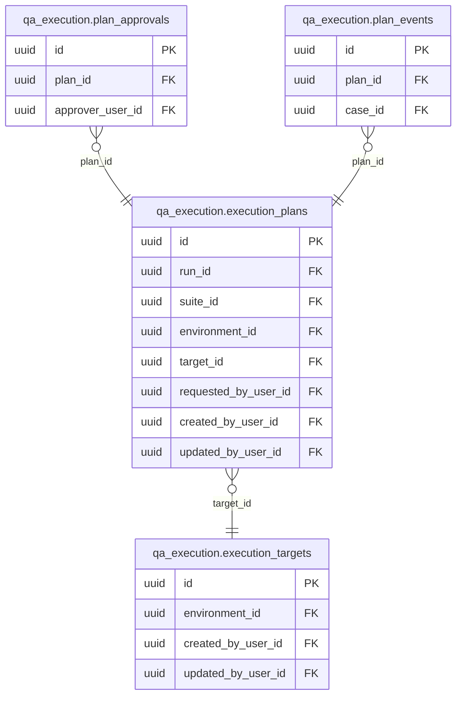

<!-- AUTOGENERADO por tools/inventario/catalogo.mjs. No editar manualmente. -->

# Catálogo del schema `qa_execution`

- **Tablas:** 4 · **Columnas:** 66 (38 con descripción: 57.6 %) · **Índices:** 6
- **Dominio:** sin dato
- Método y límites del catálogo: [README del inventario](../README.md)

## Tablas

| Tabla | Propósito | Columnas | Índices | Operaciones | ORM |
|---|---|---|---|---|---|
| [execution_plans](#execution_plans) | Agrupa objetivos de ejecución en planes de control de calidad del producto de salud y permite asociar aprobaciones y eventos del plan. | 31 | 3 | 11 | COINCIDE |
| [execution_targets](#execution_targets) | Define objetivos verificables para los planes de ejecución de calidad, vinculados a los componentes y flujos de la plataforma sanitaria. | 20 | 1 | 7 | COINCIDE |
| [plan_approvals](#plan_approvals) | Registra aprobaciones de planes de ejecución de calidad, aportando control de revisión antes de correr verificaciones de la plataforma de salud. | 8 | 1 | 6 | COINCIDE |
| [plan_events](#plan_events) | Deja una secuencia de eventos de los planes de calidad para auditar cambios y resultados durante la verificación de la plataforma sanitaria. | 7 | 1 | 9 | COINCIDE |

## Diagrama entidad-relación

Las tablas se agrupan en familias por sus claves foráneas dentro del schema (máximo 40 por diagrama). Las FK hacia otros schemas se listan en la ficha de cada tabla.

### Familia 1 de 1 — 4 tablas

## Fichas

### execution_plans

#### Vista general

Agrupa objetivos de ejecución en planes de control de calidad del producto de salud y permite asociar aprobaciones y eventos del plan.

- **Estado del propósito:** DOMAIN_CURATED_DRAFT · fuente: `Mantra Core Health Context/modules/diagram_68_qa_execution.puml:45: entity execution_plans {`
- **Dominio:** sin dato · **Diagrama:** `Mantra Core Health Context/modules/diagram_68_qa_execution.puml` · **DDL:** `SQL/68_qa_execution/02_tables.sql`
- **Entidad del ORM:** `ExecutionPlans` — `src/modules/qa_execution/entities/execution_plans.entity.ts`
- **Resumen:** 31 columnas · 3 índices · 7 FK salientes · 2 entrantes · 11 operaciones

#### Columnas

| # | Columna | Tipo | Rol estructural | Descripción | ORM |
|---|---|---|---|---|---|
| 1 | `id` | `uuid` | Clave primaria; Obligatoria | _sin dato_ | coincide |
| 2 | `run_id` | `uuid` | Clave foránea → qa_lab.test_runs.id; Obligatoria | FK → qa_lab.test_runs creada para este plan. _(JSDOC_ENTIDAD, `src/modules/qa_execution/entities/execution_plans.entity.ts:13`)_ | coincide |
| 3 | `suite_id` | `uuid` | Clave foránea → qa_lab.test_suites.id; Obligatoria | FK → qa_lab.test_suites _(JSDOC_ENTIDAD, `src/modules/qa_execution/entities/execution_plans.entity.ts:17`)_ | coincide |
| 4 | `suite_version` | `integer` | Obligatoria | Versión publicada de la suite al planificar. _(JSDOC_ENTIDAD, `src/modules/qa_execution/entities/execution_plans.entity.ts:21`)_ | coincide |
| 5 | `environment_id` | `uuid` | Clave foránea → qa_lab.test_environments.id; Obligatoria | FK → qa_lab.test_environments _(JSDOC_ENTIDAD, `src/modules/qa_execution/entities/execution_plans.entity.ts:25`)_ | coincide |
| 6 | `target_id` | `uuid` | Clave foránea → qa_execution.execution_targets.id; Obligatoria | FK → qa_execution.execution_targets _(JSDOC_ENTIDAD, `src/modules/qa_execution/entities/execution_plans.entity.ts:29`)_ | coincide |
| 7 | `plan_hash` | `varchar` | Obligatoria | Identidad de lo aprobado. _(JSDOC_ENTIDAD, `src/modules/qa_execution/entities/execution_plans.entity.ts:33`)_ | coincide |
| 8 | `plan_json` | `jsonb` | Obligatoria | Pasos (caso, método, URL, hash del cuerpo). _(JSDOC_ENTIDAD, `src/modules/qa_execution/entities/execution_plans.entity.ts:37`)_ | coincide |
| 9 | `limits_json` | `jsonb` | Obligatoria | Límites efectivos tras recorte. _(JSDOC_ENTIDAD, `src/modules/qa_execution/entities/execution_plans.entity.ts:41`)_ | coincide |
| 10 | `requires_approval` | `boolean` | Obligatoria | _sin dato_ | coincide |
| 11 | `approval_reasons` | `jsonb` | Opcional | _sin dato_ | coincide |
| 12 | `status` | `varchar` | Obligatoria | PENDING_APPROVAL ¦ QUEUED ¦ RUNNING ¦ PASSED ¦ FAILED ¦ TIMED_OUT ¦ CANCELLED ¦ INFRA_ERROR ¦ REJECTED _(JSDOC_ENTIDAD, `src/modules/qa_execution/entities/execution_plans.entity.ts:56`)_ | coincide |
| 13 | `requested_by_user_id` | `uuid` | Clave foránea → iam.users.id; Opcional | FK → iam.users _(JSDOC_ENTIDAD, `src/modules/qa_execution/entities/execution_plans.entity.ts:60`)_ | coincide |
| 14 | `idempotency_key` | `varchar` | Opcional | _sin dato_ | coincide |
| 15 | `lease_owner` | `varchar` | Opcional | Fencing del worker. _(JSDOC_ENTIDAD, `src/modules/qa_execution/entities/execution_plans.entity.ts:71`)_ | coincide |
| 16 | `lease_expires_at` | `timestamptz` | Opcional | _sin dato_ | coincide |
| 17 | `attempt` | `integer` | Obligatoria | _sin dato_ | coincide |
| 18 | `cancel_requested_at` | `timestamptz` | Opcional | Intención; la confirma el runner. _(JSDOC_ENTIDAD, `src/modules/qa_execution/entities/execution_plans.entity.ts:85`)_ | coincide |
| 19 | `started_at` | `timestamptz` | Opcional | _sin dato_ | coincide |
| 20 | `finished_at` | `timestamptz` | Opcional | _sin dato_ | coincide |
| 21 | `requests_sent` | `integer` | Obligatoria | _sin dato_ | coincide |
| 22 | `cases_passed` | `integer` | Obligatoria | _sin dato_ | coincide |
| 23 | `cases_failed` | `integer` | Obligatoria | _sin dato_ | coincide |
| 24 | `cases_not_run` | `integer` | Obligatoria | Omitidos o bloqueados: no cuentan como pasados. _(JSDOC_ENTIDAD, `src/modules/qa_execution/entities/execution_plans.entity.ts:116`)_ | coincide |
| 25 | `error_code` | `varchar` | Opcional | _sin dato_ | coincide |
| 26 | `error_message` | `text` | Opcional | _sin dato_ | coincide |
| 27 | `created_at` | `timestamptz` | Obligatoria | _sin dato_ | coincide |
| 28 | `updated_at` | `timestamptz` | Obligatoria | _sin dato_ | coincide |
| 29 | `created_by_user_id` | `uuid` | Clave foránea → iam.users.id; Opcional | FK → iam.users _(JSDOC_ENTIDAD, `src/modules/qa_execution/entities/execution_plans.entity.ts:132`)_ | coincide |
| 30 | `updated_by_user_id` | `uuid` | Clave foránea → iam.users.id; Opcional | FK → iam.users _(JSDOC_ENTIDAD, `src/modules/qa_execution/entities/execution_plans.entity.ts:136`)_ | coincide |
| 31 | `row_version` | `integer = 1` | Obligatoria | _sin dato_ | coincide |

#### Relaciones

| Sentido | Columnas | Tabla | Restricción |
|---|---|---|---|
| hacia | target_id | qa_execution.execution_targets (id) | fk_execution_plans_target_id |
| hacia | run_id | qa_lab.test_runs (id) | fk_execution_plans_run_id |
| hacia | suite_id | qa_lab.test_suites (id) | fk_execution_plans_suite_id |
| hacia | environment_id | qa_lab.test_environments (id) | fk_execution_plans_environment_id |
| hacia | requested_by_user_id | iam.users (id) | fk_execution_plans_requested_by_user_id |
| hacia | created_by_user_id | iam.users (id) | fk_execution_plans_created_by_user_id |
| hacia | updated_by_user_id | iam.users (id) | fk_execution_plans_updated_by_user_id |
| desde | id | qa_execution.plan_approvals (plan_id) | fk_plan_approvals_plan_id |
| desde | id | qa_execution.plan_events (plan_id) | fk_plan_events_plan_id |

#### Índices

| Índice | Único | Columnas | Para qué |
|---|---|---|---|
| `ix_qa_execution_plans_status_created` | no | status, created_at | _sin uso detectado estáticamente_ |
| `ix_qa_execution_plans_run_id` | no | run_id | Soporta la clave foránea fk_execution_plans_run_id: PostgreSQL no indexa las FK por sí mismo _(DOCUMENTO)_ |
| `ux_qa_execution_plans_idempotency` | sí | requested_by_user_id, idempotency_key donde WHERE idempotency_key IS NOT NULL | Garantiza que no se repita la combinación (requested_by_user_id, idempotency_key) _(DOCUMENTO)_; Soporta la clave foránea fk_execution_plans_requested_by_user_id: PostgreSQL no indexa las FK por sí mismo _(DOCUMENTO)_; Índice parcial: sólo indexa las filas donde WHERE idempotency_key IS NOT NULL _(ESTRUCTURAL)_; 1 consulta(s) de repositorio filtran u ordenan por «requested_by_user_id», la primera columna del índice _(CONSULTA)_ |

#### Restricciones

| Restricción | Tipo | Definición |
|---|---|---|
| `ux_qa_execution_plans_idempotency` | UNIQUE INDEX | UNIQUE INDEX ("requested_by_user_id", "idempotency_key") WHERE idempotency_key IS NOT NULL |

#### Operaciones que la tocan

| Operación | Efecto | Confianza |
|---|---|---|
| GET /admin/ops/readiness | LEE | POR_SQL |
| GET /admin/qa/plans | LEE | DIRECTA |
| POST /admin/qa/plans | CREA | DIRECTA |
| POST /admin/qa/plans | LEE | DIRECTA |
| GET /admin/qa/plans/{planId} | LEE | DIRECTA |
| POST /admin/qa/plans/{planId}/approvals | ACTUALIZA | POR_TIPO |
| POST /admin/qa/plans/{planId}/approvals | LEE | DIRECTA |
| POST /admin/qa/plans/{planId}/cancel | ACTUALIZA | POR_TIPO |
| POST /admin/qa/plans/{planId}/cancel | LEE | DIRECTA |
| POST /internal/qa/plans/run-next | ACTUALIZA | POR_TIPO |
| POST /internal/qa/plans/run-next | LEE | DIRECTA |

#### Gobierno

| Atributo | Valor | Fuente |
|---|---|---|
| Append-only | no declarado | — |
| Datos personales | sin fuente | — |
| Financiera | sin fuente | — |
| Crítica para auditoría | sin fuente | — |
| Retención | sin fuente | — |
| Responsable | sin fuente | — |
| Revisión | AUTO_DETECTADA | — |

---

### execution_targets

#### Vista general

Define objetivos verificables para los planes de ejecución de calidad, vinculados a los componentes y flujos de la plataforma sanitaria.

- **Estado del propósito:** DOMAIN_CURATED_DRAFT · fuente: `Mantra Core Health Context/modules/diagram_68_qa_execution.puml:16: entity execution_targets {`
- **Dominio:** sin dato · **Diagrama:** `Mantra Core Health Context/modules/diagram_68_qa_execution.puml` · **DDL:** `SQL/68_qa_execution/02_tables.sql`
- **Entidad del ORM:** `ExecutionTargets` — `src/modules/qa_execution/entities/execution_targets.entity.ts`
- **Resumen:** 20 columnas · 1 índices · 3 FK salientes · 1 entrantes · 7 operaciones

#### Columnas

| # | Columna | Tipo | Rol estructural | Descripción | ORM |
|---|---|---|---|---|---|
| 1 | `id` | `uuid` | Clave primaria; Obligatoria | _sin dato_ | coincide |
| 2 | `environment_id` | `uuid` | Clave foránea → qa_lab.test_environments.id; Obligatoria | FK → qa_lab.test_environments. Un destino por entorno. _(JSDOC_ENTIDAD, `src/modules/qa_execution/entities/execution_targets.entity.ts:13`)_ | coincide |
| 3 | `scheme` | `varchar` | Obligatoria | http ¦ https _(JSDOC_ENTIDAD, `src/modules/qa_execution/entities/execution_targets.entity.ts:17`)_ | coincide |
| 4 | `host` | `varchar` | Obligatoria | Host exacto (sin comodines). _(JSDOC_ENTIDAD, `src/modules/qa_execution/entities/execution_targets.entity.ts:21`)_ | coincide |
| 5 | `port` | `integer` | Obligatoria | Puerto exacto. _(JSDOC_ENTIDAD, `src/modules/qa_execution/entities/execution_targets.entity.ts:25`)_ | coincide |
| 6 | `allowed_path_prefixes` | `jsonb` | Obligatoria | Prefijos de ruta aprobados. _(JSDOC_ENTIDAD, `src/modules/qa_execution/entities/execution_targets.entity.ts:29`)_ | coincide |
| 7 | `allow_private_network` | `boolean` | Obligatoria | Autoriza conectar a red privada/loopback (nunca link-local ni metadata). _(JSDOC_ENTIDAD, `src/modules/qa_execution/entities/execution_targets.entity.ts:37`)_ | coincide |
| 8 | `allow_mutations` | `boolean` | Obligatoria | Admite POST/PUT/PATCH/DELETE (nunca en producción). _(JSDOC_ENTIDAD, `src/modules/qa_execution/entities/execution_targets.entity.ts:41`)_ | coincide |
| 9 | `auth_secret_ref` | `varchar` | Opcional | Nombre de variable QA_TARGET_*; el valor nunca se guarda. _(JSDOC_ENTIDAD, `src/modules/qa_execution/entities/execution_targets.entity.ts:45`)_ | coincide |
| 10 | `auth_header_name` | `varchar` | Opcional | Cabecera donde va el secreto (por defecto Authorization). _(JSDOC_ENTIDAD, `src/modules/qa_execution/entities/execution_targets.entity.ts:53`)_ | coincide |
| 11 | `max_requests` | `integer` | Obligatoria | Tope de peticiones por plan. _(JSDOC_ENTIDAD, `src/modules/qa_execution/entities/execution_targets.entity.ts:61`)_ | coincide |
| 12 | `max_duration_seconds` | `integer` | Obligatoria | Tope de duración por plan. _(JSDOC_ENTIDAD, `src/modules/qa_execution/entities/execution_targets.entity.ts:65`)_ | coincide |
| 13 | `request_timeout_ms` | `integer` | Obligatoria | Timeout por petición. _(JSDOC_ENTIDAD, `src/modules/qa_execution/entities/execution_targets.entity.ts:69`)_ | coincide |
| 14 | `min_interval_ms` | `integer` | Obligatoria | Separación mínima entre peticiones. _(JSDOC_ENTIDAD, `src/modules/qa_execution/entities/execution_targets.entity.ts:73`)_ | coincide |
| 15 | `status` | `varchar` | Obligatoria | ACTIVE ¦ DISABLED _(JSDOC_ENTIDAD, `src/modules/qa_execution/entities/execution_targets.entity.ts:77`)_ | coincide |
| 16 | `created_at` | `timestamptz` | Obligatoria | _sin dato_ | coincide |
| 17 | `updated_at` | `timestamptz` | Obligatoria | _sin dato_ | coincide |
| 18 | `created_by_user_id` | `uuid` | Clave foránea → iam.users.id; Opcional | FK → iam.users _(JSDOC_ENTIDAD, `src/modules/qa_execution/entities/execution_targets.entity.ts:87`)_ | coincide |
| 19 | `updated_by_user_id` | `uuid` | Clave foránea → iam.users.id; Opcional | FK → iam.users _(JSDOC_ENTIDAD, `src/modules/qa_execution/entities/execution_targets.entity.ts:91`)_ | coincide |
| 20 | `row_version` | `integer = 1` | Obligatoria | _sin dato_ | coincide |

#### Relaciones

| Sentido | Columnas | Tabla | Restricción |
|---|---|---|---|
| hacia | environment_id | qa_lab.test_environments (id) | fk_execution_targets_environment_id |
| hacia | created_by_user_id | iam.users (id) | fk_execution_targets_created_by_user_id |
| hacia | updated_by_user_id | iam.users (id) | fk_execution_targets_updated_by_user_id |
| desde | id | qa_execution.execution_plans (target_id) | fk_execution_plans_target_id |

#### Índices

| Índice | Único | Columnas | Para qué |
|---|---|---|---|
| `ux_qa_execution_targets_environment` | sí | environment_id | Garantiza que no se repita la combinación (environment_id) _(DOCUMENTO)_; Soporta la clave foránea fk_execution_targets_environment_id: PostgreSQL no indexa las FK por sí mismo _(DOCUMENTO)_; 2 consulta(s) de repositorio filtran u ordenan por «environment_id», la primera columna del índice _(CONSULTA)_ |

#### Restricciones

| Restricción | Tipo | Definición |
|---|---|---|
| `ux_qa_execution_targets_environment` | UNIQUE INDEX | UNIQUE INDEX ("environment_id") |

#### Operaciones que la tocan

| Operación | Efecto | Confianza |
|---|---|---|
| PUT /admin/qa/environments/{environmentId}/target | CREA | DIRECTA |
| PUT /admin/qa/environments/{environmentId}/target | ACTUALIZA | POR_TIPO |
| PUT /admin/qa/environments/{environmentId}/target | LEE | DIRECTA |
| POST /admin/qa/plans | LEE | DIRECTA |
| POST /admin/qa/plans/preflight | LEE | DIRECTA |
| GET /admin/qa/targets | LEE | DIRECTA |
| POST /internal/qa/plans/run-next | LEE | DIRECTA |

#### Gobierno

| Atributo | Valor | Fuente |
|---|---|---|
| Append-only | no declarado | — |
| Datos personales | sin fuente | — |
| Financiera | sin fuente | — |
| Crítica para auditoría | sin fuente | — |
| Retención | sin fuente | — |
| Responsable | sin fuente | — |
| Revisión | AUTO_DETECTADA | — |

---

### plan_approvals

#### Vista general

Registra aprobaciones de planes de ejecución de calidad, aportando control de revisión antes de correr verificaciones de la plataforma de salud.

- **Estado del propósito:** DOMAIN_CURATED_DRAFT · fuente: `Mantra Core Health Context/modules/diagram_68_qa_execution.puml:87: entity plan_approvals <<LOG>> {`
- **Dominio:** sin dato · **Diagrama:** `Mantra Core Health Context/modules/diagram_68_qa_execution.puml` · **DDL:** `SQL/68_qa_execution/02_tables.sql`
- **Entidad del ORM:** `PlanApprovals` — `src/modules/qa_execution/entities/plan_approvals.entity.ts`
- **Resumen:** 8 columnas · 1 índices · 2 FK salientes · 0 entrantes · 6 operaciones

#### Columnas

| # | Columna | Tipo | Rol estructural | Descripción | ORM |
|---|---|---|---|---|---|
| 1 | `id` | `uuid` | Clave primaria; Obligatoria | _sin dato_ | coincide |
| 2 | `plan_id` | `uuid` | Clave foránea → qa_execution.execution_plans.id; Obligatoria | FK → qa_execution.execution_plans _(JSDOC_ENTIDAD, `src/modules/qa_execution/entities/plan_approvals.entity.ts:13`)_ | coincide |
| 3 | `plan_hash` | `varchar` | Obligatoria | Hash aprobado; si el plan cambia, deja de valer. _(JSDOC_ENTIDAD, `src/modules/qa_execution/entities/plan_approvals.entity.ts:17`)_ | coincide |
| 4 | `decision` | `varchar` | Obligatoria | APPROVED ¦ REJECTED _(JSDOC_ENTIDAD, `src/modules/qa_execution/entities/plan_approvals.entity.ts:21`)_ | coincide |
| 5 | `reason` | `text` | Obligatoria | _sin dato_ | coincide |
| 6 | `approver_user_id` | `uuid` | Clave foránea → iam.users.id; Obligatoria | FK → iam.users _(JSDOC_ENTIDAD, `src/modules/qa_execution/entities/plan_approvals.entity.ts:28`)_ | coincide |
| 7 | `expires_at` | `timestamptz` | Obligatoria | _sin dato_ | coincide |
| 8 | `created_at` | `timestamptz` | Obligatoria | _sin dato_ | coincide |

#### Relaciones

| Sentido | Columnas | Tabla | Restricción |
|---|---|---|---|
| hacia | plan_id | qa_execution.execution_plans (id) | fk_plan_approvals_plan_id |
| hacia | approver_user_id | iam.users (id) | fk_plan_approvals_approver_user_id |

#### Índices

| Índice | Único | Columnas | Para qué |
|---|---|---|---|
| `ix_qa_execution_plan_approvals_plan` | no | plan_id, created_at | Soporta la clave foránea fk_plan_approvals_plan_id: PostgreSQL no indexa las FK por sí mismo _(DOCUMENTO)_; 2 consulta(s) de repositorio filtran u ordenan por «plan_id», la primera columna del índice _(CONSULTA)_ |

#### Operaciones que la tocan

| Operación | Efecto | Confianza |
|---|---|---|
| POST /admin/qa/plans | LEE | DIRECTA |
| GET /admin/qa/plans/{planId} | LEE | DIRECTA |
| POST /admin/qa/plans/{planId}/approvals | CREA | DIRECTA |
| POST /admin/qa/plans/{planId}/approvals | LEE | DIRECTA |
| POST /admin/qa/plans/{planId}/cancel | LEE | DIRECTA |
| POST /internal/qa/plans/run-next | LEE | DIRECTA |

#### Gobierno

| Atributo | Valor | Fuente |
|---|---|---|
| Append-only | no declarado | — |
| Datos personales | sin fuente | — |
| Financiera | sin fuente | — |
| Crítica para auditoría | sin fuente | — |
| Retención | sin fuente | — |
| Responsable | sin fuente | — |
| Revisión | AUTO_DETECTADA | — |

---

### plan_events

#### Vista general

Deja una secuencia de eventos de los planes de calidad para auditar cambios y resultados durante la verificación de la plataforma sanitaria.

- **Estado del propósito:** DOMAIN_CURATED_DRAFT · fuente: `Mantra Core Health Context/modules/diagram_68_qa_execution.puml:104: entity plan_events <<LOG>> {`
- **Dominio:** sin dato · **Diagrama:** `Mantra Core Health Context/modules/diagram_68_qa_execution.puml` · **DDL:** `SQL/68_qa_execution/02_tables.sql`
- **Entidad del ORM:** `PlanEvents` — `src/modules/qa_execution/entities/plan_events.entity.ts`
- **Resumen:** 7 columnas · 1 índices · 2 FK salientes · 0 entrantes · 9 operaciones

#### Columnas

| # | Columna | Tipo | Rol estructural | Descripción | ORM |
|---|---|---|---|---|---|
| 1 | `id` | `uuid` | Clave primaria; Obligatoria | _sin dato_ | coincide |
| 2 | `plan_id` | `uuid` | Clave foránea → qa_execution.execution_plans.id; Obligatoria | FK → qa_execution.execution_plans _(JSDOC_ENTIDAD, `src/modules/qa_execution/entities/plan_events.entity.ts:13`)_ | coincide |
| 3 | `seq` | `integer` | Obligatoria | Orden dentro del plan. _(JSDOC_ENTIDAD, `src/modules/qa_execution/entities/plan_events.entity.ts:17`)_ | coincide |
| 4 | `kind` | `varchar` | Obligatoria | _sin dato_ | coincide |
| 5 | `case_id` | `uuid` | Clave foránea → qa_lab.test_cases.id; Opcional | FK → qa_lab.test_cases _(JSDOC_ENTIDAD, `src/modules/qa_execution/entities/plan_events.entity.ts:24`)_ | coincide |
| 6 | `detail_json` | `jsonb` | Opcional | _sin dato_ | coincide |
| 7 | `created_at` | `timestamptz` | Obligatoria | _sin dato_ | coincide |

#### Relaciones

| Sentido | Columnas | Tabla | Restricción |
|---|---|---|---|
| hacia | plan_id | qa_execution.execution_plans (id) | fk_plan_events_plan_id |
| hacia | case_id | qa_lab.test_cases (id) | fk_plan_events_case_id |

#### Índices

| Índice | Único | Columnas | Para qué |
|---|---|---|---|
| `ux_qa_execution_plan_events_seq` | sí | plan_id, seq | Garantiza que no se repita la combinación (plan_id, seq) _(DOCUMENTO)_; Soporta la clave foránea fk_plan_events_plan_id: PostgreSQL no indexa las FK por sí mismo _(DOCUMENTO)_; 1 consulta(s) de repositorio filtran u ordenan por «plan_id», la primera columna del índice _(CONSULTA)_ |

#### Restricciones

| Restricción | Tipo | Definición |
|---|---|---|
| `ux_qa_execution_plan_events_seq` | UNIQUE INDEX | UNIQUE INDEX ("plan_id", "seq") |

#### Operaciones que la tocan

| Operación | Efecto | Confianza |
|---|---|---|
| POST /admin/qa/plans | CREA | DIRECTA |
| POST /admin/qa/plans | LEE | DIRECTA |
| GET /admin/qa/plans/{planId} | LEE | DIRECTA |
| POST /admin/qa/plans/{planId}/approvals | CREA | DIRECTA |
| POST /admin/qa/plans/{planId}/approvals | LEE | DIRECTA |
| POST /admin/qa/plans/{planId}/cancel | CREA | DIRECTA |
| POST /admin/qa/plans/{planId}/cancel | LEE | DIRECTA |
| POST /internal/qa/plans/run-next | CREA | DIRECTA |
| POST /internal/qa/plans/run-next | LEE | POR_SQL |

#### Gobierno

| Atributo | Valor | Fuente |
|---|---|---|
| Append-only | no declarado | — |
| Datos personales | sin fuente | — |
| Financiera | sin fuente | — |
| Crítica para auditoría | sin fuente | — |
| Retención | sin fuente | — |
| Responsable | sin fuente | — |
| Revisión | AUTO_DETECTADA | — |

---

