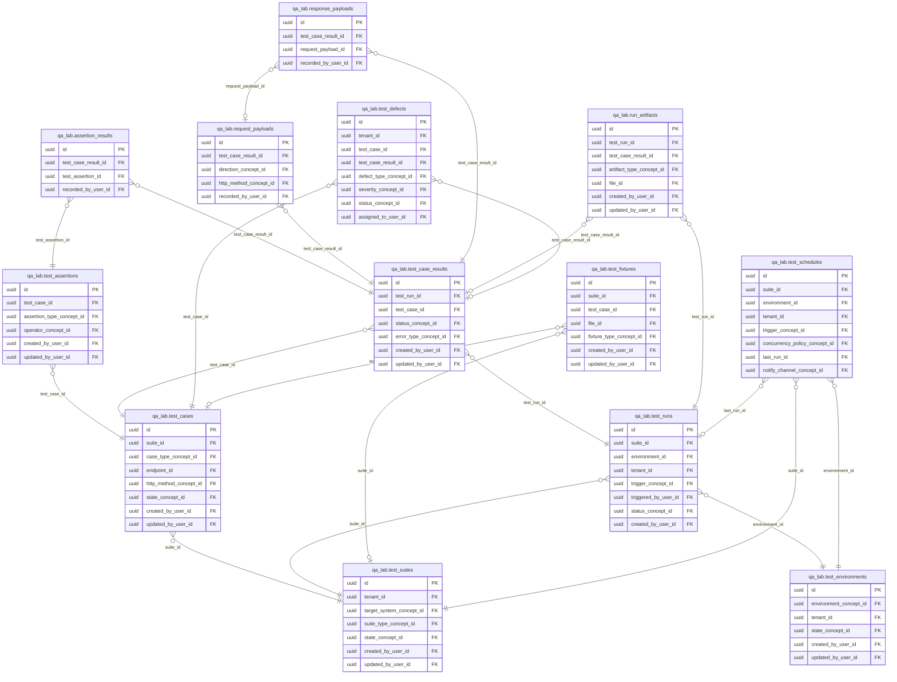

<!-- AUTOGENERADO por tools/inventario/catalogo.mjs. No editar manualmente. -->

# Catálogo del schema `qa_lab`

- **Tablas:** 13 · **Columnas:** 201 (43 con descripción: 21.4 %) · **Índices:** 92
- **Dominio:** Clínico y Diagnóstico
- Método y límites del catálogo: [README del inventario](../README.md)

## Tablas

| Tabla | Propósito | Columnas | Índices | Operaciones | ORM |
|---|---|---|---|---|---|
| [assertion_results](#assertion_results) | Conserva resultados por verificación para localizar discrepancias específicas de comportamiento. | 8 | 4 | 7 | COINCIDE |
| [request_payloads](#request_payloads) | Almacena cuerpos de solicitudes de prueba para reproducir contratos y escenarios de API. | 13 | 5 | 2 | COINCIDE |
| [response_payloads](#response_payloads) | Conserva respuestas de pruebas para inspeccionar datos devueltos por servicios. | 12 | 4 | 2 | COINCIDE |
| [run_artifacts](#run_artifacts) | Relaciona artefactos producidos por pruebas, como logs o evidencia, con su ejecución. | 11 | 6 | 2 | COINCIDE |
| [test_assertions](#test_assertions) | Especifica verificaciones esperadas dentro de casos para comprobar respuestas y efectos observables. | 13 | 5 | 4 | COINCIDE |
| [test_case_results](#test_case_results) | Guarda resultados por caso ejecutado para identificar qué escenarios pasaron o fallaron. | 18 | 6 | 13 | COINCIDE |
| [test_cases](#test_cases) | Define casos de prueba individuales y sus condiciones de ejecución. | 19 | 7 | 16 | COINCIDE |
| [test_defects](#test_defects) | Registra defectos identificados durante validaciones para seguir su análisis y resolución. | 23 | 12 | 6 | COINCIDE |
| [test_environments](#test_environments) | Cataloga entornos controlados para ejecutar verificaciones del sistema médico sin confundirlos con producción. | 14 | 7 | 11 | COINCIDE |
| [test_fixtures](#test_fixtures) | Conserva datos controlados usados para preparar escenarios repetibles de prueba. | 13 | 6 | 0 | COINCIDE |
| [test_runs](#test_runs) | Registra ejecuciones de suites o casos para mantener resultados y contexto de validación. | 21 | 10 | 18 | COINCIDE |
| [test_schedules](#test_schedules) | Programa ejecuciones recurrentes de pruebas para vigilar calidad a lo largo del tiempo. | 21 | 12 | 4 | COINCIDE |
| [test_suites](#test_suites) | Agrupa pruebas funcionales para validar flujos y contratos del sistema. | 15 | 8 | 15 | COINCIDE |

## Diagrama entidad-relación

Las tablas se agrupan en familias por sus claves foráneas dentro del schema (máximo 40 por diagrama). Las FK hacia otros schemas se listan en la ficha de cada tabla.

### Familia 1 de 1 — 13 tablas

## Fichas

### assertion_results

#### Vista general

Conserva resultados por verificación para localizar discrepancias específicas de comportamiento.

- **Estado del propósito:** DOMAIN_CURATED_DRAFT · fuente: `Mantra Core Health Context/modules/diagram_36_qa_lab.puml: assertion_results`
- **Dominio:** Clínico y Diagnóstico · **Diagrama:** `Mantra Core Health Context/modules/diagram_36_qa_lab.puml` · **DDL:** `SQL/36_qa_lab/02_tables.sql`
- **Entidad del ORM:** `AssertionResults` — `src/modules/qa_lab/entities/assertion_results.entity.ts`
- **Resumen:** 8 columnas · 4 índices · 3 FK salientes · 0 entrantes · 7 operaciones

#### Columnas

| # | Columna | Tipo | Rol estructural | Descripción | ORM |
|---|---|---|---|---|---|
| 1 | `id` | `uuid` | Clave primaria; Obligatoria | Identificador único de la instancia. _(JSDOC_ESTANDAR, `src/modules/qa_lab/entities/assertion_results.entity.ts:12`)_ | coincide |
| 2 | `test_case_result_id` | `uuid` | Clave foránea → qa_lab.test_case_results.id; Obligatoria | _sin dato_ | coincide |
| 3 | `test_assertion_id` | `uuid` | Clave foránea → qa_lab.test_assertions.id; Obligatoria | _sin dato_ | coincide |
| 4 | `passed` | `boolean` | Obligatoria | _sin dato_ | coincide |
| 5 | `actual_value` | `text` | Opcional | _sin dato_ | coincide |
| 6 | `message` | `text` | Opcional | _sin dato_ | coincide |
| 7 | `recorded_at` | `timestamptz` | Obligatoria | _sin dato_ | coincide |
| 8 | `recorded_by_user_id` | `uuid` | Clave foránea → iam.users.id; Opcional | _sin dato_ | coincide |

#### Relaciones

| Sentido | Columnas | Tabla | Restricción |
|---|---|---|---|
| hacia | test_case_result_id | qa_lab.test_case_results (id) | fk_assertion_results_test_case_result_id |
| hacia | test_assertion_id | qa_lab.test_assertions (id) | fk_assertion_results_test_assertion_id |
| hacia | recorded_by_user_id | iam.users (id) | fk_assertion_results_recorded_by_user_id |

#### Índices

| Índice | Único | Columnas | Para qué |
|---|---|---|---|
| `ix_assertion_results_test_case_result_id` | no | test_case_result_id | Soporta la clave foránea fk_assertion_results_test_case_result_id: PostgreSQL no indexa las FK por sí mismo _(DOCUMENTO)_; 3 consulta(s) de repositorio filtran u ordenan por «test_case_result_id», la primera columna del índice _(CONSULTA)_ |
| `ix_assertion_results_test_assertion_id` | no | test_assertion_id | Soporta la clave foránea fk_assertion_results_test_assertion_id: PostgreSQL no indexa las FK por sí mismo _(DOCUMENTO)_ |
| `ix_assertion_results_recorded_by_user_id` | no | recorded_by_user_id | Soporta la clave foránea fk_assertion_results_recorded_by_user_id: PostgreSQL no indexa las FK por sí mismo _(DOCUMENTO)_ |
| `brin_assertion_results_recorded_at` | no | recorded_at | BRIN para logs e historiales append-only de gran volumen _(DOCUMENTO)_ |

#### Operaciones que la tocan

| Operación | Efecto | Confianza |
|---|---|---|
| POST /internal/qa/plans/run-next | CREA | DIRECTA |
| POST /internal/qa/plans/run-next | LEE | DIRECTA |
| GET /admin/qa/flows | LEE | DIRECTA |
| GET /admin/qa/flows/{flowId} | LEE | DIRECTA |
| GET /admin/qa/runs/{runId} | LEE | DIRECTA |
| POST /qa/case-results/{resultId}/evaluate | CREA | DIRECTA |
| POST /qa/case-results/{resultId}/evaluate | LEE | DIRECTA |

#### Gobierno

| Atributo | Valor | Fuente |
|---|---|---|
| Append-only | no declarado | — |
| Datos personales | sin fuente | — |
| Financiera | sin fuente | — |
| Crítica para auditoría | sin fuente | — |
| Retención | sin fuente | — |
| Responsable | sin fuente | — |
| Revisión | AUTO_DETECTADA | — |

---

### request_payloads

#### Vista general

Almacena cuerpos de solicitudes de prueba para reproducir contratos y escenarios de API.

- **Estado del propósito:** DOMAIN_CURATED_DRAFT · fuente: `Mantra Core Health Context/modules/diagram_36_qa_lab.puml: request_payloads`
- **Dominio:** Clínico y Diagnóstico · **Diagrama:** `Mantra Core Health Context/modules/diagram_36_qa_lab.puml` · **DDL:** `SQL/36_qa_lab/02_tables.sql`
- **Entidad del ORM:** `RequestPayloads` — `src/modules/qa_lab/entities/request_payloads.entity.ts`
- **Resumen:** 13 columnas · 5 índices · 4 FK salientes · 1 entrantes · 2 operaciones

#### Columnas

| # | Columna | Tipo | Rol estructural | Descripción | ORM |
|---|---|---|---|---|---|
| 1 | `id` | `uuid` | Clave primaria; Obligatoria | Identificador único de la instancia. _(JSDOC_ESTANDAR, `src/modules/qa_lab/entities/request_payloads.entity.ts:12`)_ | coincide |
| 2 | `test_case_result_id` | `uuid` | Clave foránea → qa_lab.test_case_results.id; Obligatoria | _sin dato_ | coincide |
| 3 | `direction_concept_id` | `uuid` | Clave foránea → terminology.catalog_concepts.id; Obligatoria | _sin dato_ | coincide |
| 4 | `sequence_no` | `integer` | Opcional | _sin dato_ | coincide |
| 5 | `http_method_concept_id` | `uuid` | Clave foránea → terminology.catalog_concepts.id; Opcional | _sin dato_ | coincide |
| 6 | `target_url` | `text` | Opcional | _sin dato_ | coincide |
| 7 | `headers_json` | `jsonb` | Opcional | _sin dato_ | coincide |
| 8 | `body_json` | `jsonb` | Obligatoria | _sin dato_ | coincide |
| 9 | `body_hash` | `varchar` | Opcional | _sin dato_ | coincide |
| 10 | `size_bytes` | `integer` | Opcional | _sin dato_ | coincide |
| 11 | `sent_at` | `timestamptz` | Opcional | _sin dato_ | coincide |
| 12 | `recorded_at` | `timestamptz` | Obligatoria | _sin dato_ | coincide |
| 13 | `recorded_by_user_id` | `uuid` | Clave foránea → iam.users.id; Opcional | _sin dato_ | coincide |

#### Relaciones

| Sentido | Columnas | Tabla | Restricción |
|---|---|---|---|
| hacia | test_case_result_id | qa_lab.test_case_results (id) | fk_request_payloads_test_case_result_id |
| hacia | direction_concept_id | terminology.catalog_concepts (id) | fk_request_payloads_direction_concept_id |
| hacia | http_method_concept_id | terminology.catalog_concepts (id) | fk_request_payloads_http_method_concept_id |
| hacia | recorded_by_user_id | iam.users (id) | fk_request_payloads_recorded_by_user_id |
| desde | id | qa_lab.response_payloads (request_payload_id) | fk_response_payloads_request_payload_id |

#### Índices

| Índice | Único | Columnas | Para qué |
|---|---|---|---|
| `ix_request_payloads_test_case_result_id` | no | test_case_result_id | Soporta la clave foránea fk_request_payloads_test_case_result_id: PostgreSQL no indexa las FK por sí mismo _(DOCUMENTO)_ |
| `ix_request_payloads_direction_concept_id` | no | direction_concept_id | Soporta la clave foránea fk_request_payloads_direction_concept_id: PostgreSQL no indexa las FK por sí mismo _(DOCUMENTO)_ |
| `ix_request_payloads_http_method_concept_id` | no | http_method_concept_id | Soporta la clave foránea fk_request_payloads_http_method_concept_id: PostgreSQL no indexa las FK por sí mismo _(DOCUMENTO)_ |
| `ix_request_payloads_recorded_by_user_id` | no | recorded_by_user_id | Soporta la clave foránea fk_request_payloads_recorded_by_user_id: PostgreSQL no indexa las FK por sí mismo _(DOCUMENTO)_ |
| `brin_request_payloads_recorded_at` | no | recorded_at | BRIN para logs e historiales append-only de gran volumen _(DOCUMENTO)_ |

#### Operaciones que la tocan

| Operación | Efecto | Confianza |
|---|---|---|
| POST /internal/qa/plans/run-next | CREA | DIRECTA |
| POST /qa/runs/{runId}/cases/{caseId}/execute | CREA | DIRECTA |

#### Gobierno

| Atributo | Valor | Fuente |
|---|---|---|
| Append-only | no declarado | — |
| Datos personales | sin fuente | — |
| Financiera | sin fuente | — |
| Crítica para auditoría | sin fuente | — |
| Retención | sin fuente | — |
| Responsable | sin fuente | — |
| Revisión | AUTO_DETECTADA | — |

---

### response_payloads

#### Vista general

Conserva respuestas de pruebas para inspeccionar datos devueltos por servicios.

- **Estado del propósito:** DOMAIN_CURATED_DRAFT · fuente: `Mantra Core Health Context/modules/diagram_36_qa_lab.puml: response_payloads`
- **Dominio:** Clínico y Diagnóstico · **Diagrama:** `Mantra Core Health Context/modules/diagram_36_qa_lab.puml` · **DDL:** `SQL/36_qa_lab/02_tables.sql`
- **Entidad del ORM:** `ResponsePayloads` — `src/modules/qa_lab/entities/response_payloads.entity.ts`
- **Resumen:** 12 columnas · 4 índices · 3 FK salientes · 0 entrantes · 2 operaciones

#### Columnas

| # | Columna | Tipo | Rol estructural | Descripción | ORM |
|---|---|---|---|---|---|
| 1 | `id` | `uuid` | Clave primaria; Obligatoria | Identificador único de la instancia. _(JSDOC_ESTANDAR, `src/modules/qa_lab/entities/response_payloads.entity.ts:12`)_ | coincide |
| 2 | `test_case_result_id` | `uuid` | Clave foránea → qa_lab.test_case_results.id; Obligatoria | _sin dato_ | coincide |
| 3 | `request_payload_id` | `uuid` | Clave foránea → qa_lab.request_payloads.id; Opcional | _sin dato_ | coincide |
| 4 | `http_status` | `integer` | Opcional | _sin dato_ | coincide |
| 5 | `headers_json` | `jsonb` | Opcional | _sin dato_ | coincide |
| 6 | `body_json` | `jsonb` | Obligatoria | _sin dato_ | coincide |
| 7 | `body_hash` | `varchar` | Opcional | _sin dato_ | coincide |
| 8 | `latency_ms` | `integer` | Opcional | _sin dato_ | coincide |
| 9 | `size_bytes` | `integer` | Opcional | _sin dato_ | coincide |
| 10 | `received_at` | `timestamptz` | Opcional | _sin dato_ | coincide |
| 11 | `recorded_at` | `timestamptz` | Obligatoria | _sin dato_ | coincide |
| 12 | `recorded_by_user_id` | `uuid` | Clave foránea → iam.users.id; Opcional | _sin dato_ | coincide |

#### Relaciones

| Sentido | Columnas | Tabla | Restricción |
|---|---|---|---|
| hacia | test_case_result_id | qa_lab.test_case_results (id) | fk_response_payloads_test_case_result_id |
| hacia | request_payload_id | qa_lab.request_payloads (id) | fk_response_payloads_request_payload_id |
| hacia | recorded_by_user_id | iam.users (id) | fk_response_payloads_recorded_by_user_id |

#### Índices

| Índice | Único | Columnas | Para qué |
|---|---|---|---|
| `ix_response_payloads_test_case_result_id` | no | test_case_result_id | Soporta la clave foránea fk_response_payloads_test_case_result_id: PostgreSQL no indexa las FK por sí mismo _(DOCUMENTO)_ |
| `ix_response_payloads_request_payload_id` | no | request_payload_id | Soporta la clave foránea fk_response_payloads_request_payload_id: PostgreSQL no indexa las FK por sí mismo _(DOCUMENTO)_ |
| `ix_response_payloads_recorded_by_user_id` | no | recorded_by_user_id | Soporta la clave foránea fk_response_payloads_recorded_by_user_id: PostgreSQL no indexa las FK por sí mismo _(DOCUMENTO)_ |
| `brin_response_payloads_recorded_at` | no | recorded_at | BRIN para logs e historiales append-only de gran volumen _(DOCUMENTO)_ |

#### Operaciones que la tocan

| Operación | Efecto | Confianza |
|---|---|---|
| POST /internal/qa/plans/run-next | CREA | DIRECTA |
| POST /qa/runs/{runId}/cases/{caseId}/execute | CREA | DIRECTA |

#### Gobierno

| Atributo | Valor | Fuente |
|---|---|---|
| Append-only | no declarado | — |
| Datos personales | sin fuente | — |
| Financiera | sin fuente | — |
| Crítica para auditoría | sin fuente | — |
| Retención | sin fuente | — |
| Responsable | sin fuente | — |
| Revisión | AUTO_DETECTADA | — |

---

### run_artifacts

#### Vista general

Relaciona artefactos producidos por pruebas, como logs o evidencia, con su ejecución.

- **Estado del propósito:** DOMAIN_CURATED_DRAFT · fuente: `Mantra Core Health Context/modules/diagram_36_qa_lab.puml: run_artifacts`
- **Dominio:** Clínico y Diagnóstico · **Diagrama:** `Mantra Core Health Context/modules/diagram_36_qa_lab.puml` · **DDL:** `SQL/36_qa_lab/02_tables.sql`
- **Entidad del ORM:** `RunArtifacts` — `src/modules/qa_lab/entities/run_artifacts.entity.ts`
- **Resumen:** 11 columnas · 6 índices · 6 FK salientes · 0 entrantes · 2 operaciones

#### Columnas

| # | Columna | Tipo | Rol estructural | Descripción | ORM |
|---|---|---|---|---|---|
| 1 | `id` | `uuid` | Clave primaria; Obligatoria | Identificador único de la instancia. _(JSDOC_ESTANDAR, `src/modules/qa_lab/entities/run_artifacts.entity.ts:12`)_ | coincide |
| 2 | `test_run_id` | `uuid` | Clave foránea → qa_lab.test_runs.id; Obligatoria | _sin dato_ | coincide |
| 3 | `test_case_result_id` | `uuid` | Clave foránea → qa_lab.test_case_results.id; Opcional | _sin dato_ | coincide |
| 4 | `artifact_type_concept_id` | `uuid` | Clave foránea → terminology.catalog_concepts.id; Obligatoria | _sin dato_ | coincide |
| 5 | `file_id` | `uuid` | Clave foránea → common.files.id; Opcional | _sin dato_ | coincide |
| 6 | `label` | `varchar` | Opcional | _sin dato_ | coincide |
| 7 | `created_at` | `timestamptz` | Obligatoria | Fecha y hora en que se creó el registro. _(JSDOC_ESTANDAR, `src/modules/qa_lab/entities/run_artifacts.entity.ts:48`)_ | coincide |
| 8 | `updated_at` | `timestamptz` | Obligatoria | Fecha y hora de la última actualización. _(JSDOC_ESTANDAR, `src/modules/qa_lab/entities/run_artifacts.entity.ts:54`)_ | coincide |
| 9 | `created_by_user_id` | `uuid` | Clave foránea → iam.users.id; Opcional | _sin dato_ | coincide |
| 10 | `updated_by_user_id` | `uuid` | Clave foránea → iam.users.id; Opcional | _sin dato_ | coincide |
| 11 | `row_version` | `integer = 1` | Obligatoria | Versión usada para controlar actualizaciones concurrentes. _(JSDOC_ENTIDAD, `src/modules/qa_lab/entities/run_artifacts.entity.ts:72`)_ | coincide |

#### Relaciones

| Sentido | Columnas | Tabla | Restricción |
|---|---|---|---|
| hacia | test_run_id | qa_lab.test_runs (id) | fk_run_artifacts_test_run_id |
| hacia | test_case_result_id | qa_lab.test_case_results (id) | fk_run_artifacts_test_case_result_id |
| hacia | artifact_type_concept_id | terminology.catalog_concepts (id) | fk_run_artifacts_artifact_type_concept_id |
| hacia | file_id | common.files (id) | fk_run_artifacts_file_id |
| hacia | created_by_user_id | iam.users (id) | fk_run_artifacts_created_by_user_id |
| hacia | updated_by_user_id | iam.users (id) | fk_run_artifacts_updated_by_user_id |

#### Índices

| Índice | Único | Columnas | Para qué |
|---|---|---|---|
| `ix_run_artifacts_test_run_id` | no | test_run_id | Soporta la clave foránea fk_run_artifacts_test_run_id: PostgreSQL no indexa las FK por sí mismo _(DOCUMENTO)_; 1 consulta(s) de repositorio filtran u ordenan por «test_run_id», la primera columna del índice _(CONSULTA)_ |
| `ix_run_artifacts_test_case_result_id` | no | test_case_result_id | Soporta la clave foránea fk_run_artifacts_test_case_result_id: PostgreSQL no indexa las FK por sí mismo _(DOCUMENTO)_ |
| `ix_run_artifacts_artifact_type_concept_id` | no | artifact_type_concept_id | Soporta la clave foránea fk_run_artifacts_artifact_type_concept_id: PostgreSQL no indexa las FK por sí mismo _(DOCUMENTO)_ |
| `ix_run_artifacts_file_id` | no | file_id | Soporta la clave foránea fk_run_artifacts_file_id: PostgreSQL no indexa las FK por sí mismo _(DOCUMENTO)_ |
| `ix_run_artifacts_created_by_user_id` | no | created_by_user_id | Soporta la clave foránea fk_run_artifacts_created_by_user_id: PostgreSQL no indexa las FK por sí mismo _(DOCUMENTO)_ |
| `ix_run_artifacts_updated_by_user_id` | no | updated_by_user_id | Soporta la clave foránea fk_run_artifacts_updated_by_user_id: PostgreSQL no indexa las FK por sí mismo _(DOCUMENTO)_ |

#### Operaciones que la tocan

| Operación | Efecto | Confianza |
|---|---|---|
| POST /qa/runs/{runId}/artifacts | CREA | DIRECTA |
| POST /qa/runs/{runId}/link-release | LEE | DIRECTA |

#### Gobierno

| Atributo | Valor | Fuente |
|---|---|---|
| Append-only | no declarado | — |
| Datos personales | sin fuente | — |
| Financiera | sin fuente | — |
| Crítica para auditoría | sin fuente | — |
| Retención | sin fuente | — |
| Responsable | sin fuente | — |
| Revisión | AUTO_DETECTADA | — |

---

### test_assertions

#### Vista general

Especifica verificaciones esperadas dentro de casos para comprobar respuestas y efectos observables.

- **Estado del propósito:** DOMAIN_CURATED_DRAFT · fuente: `Mantra Core Health Context/modules/diagram_36_qa_lab.puml: test_assertions`
- **Dominio:** Clínico y Diagnóstico · **Diagrama:** `Mantra Core Health Context/modules/diagram_36_qa_lab.puml` · **DDL:** `SQL/36_qa_lab/02_tables.sql`
- **Entidad del ORM:** `TestAssertions` — `src/modules/qa_lab/entities/test_assertions.entity.ts`
- **Resumen:** 13 columnas · 5 índices · 5 FK salientes · 1 entrantes · 4 operaciones

#### Columnas

| # | Columna | Tipo | Rol estructural | Descripción | ORM |
|---|---|---|---|---|---|
| 1 | `id` | `uuid` | Clave primaria; Obligatoria | Identificador único de la instancia. _(JSDOC_ESTANDAR, `src/modules/qa_lab/entities/test_assertions.entity.ts:12`)_ | coincide |
| 2 | `test_case_id` | `uuid` | Clave foránea → qa_lab.test_cases.id; Obligatoria | _sin dato_ | coincide |
| 3 | `assertion_type_concept_id` | `uuid` | Clave foránea → terminology.catalog_concepts.id; Obligatoria | _sin dato_ | coincide |
| 4 | `json_path` | `varchar` | Opcional | _sin dato_ | coincide |
| 5 | `operator_concept_id` | `uuid` | Clave foránea → terminology.catalog_concepts.id; Opcional | _sin dato_ | coincide |
| 6 | `expected_value` | `text` | Opcional | _sin dato_ | coincide |
| 7 | `tolerance` | `numeric` | Opcional | _sin dato_ | coincide |
| 8 | `ordinal` | `integer` | Opcional | _sin dato_ | coincide |
| 9 | `created_at` | `timestamptz` | Obligatoria | Fecha y hora en que se creó el registro. _(JSDOC_ESTANDAR, `src/modules/qa_lab/entities/test_assertions.entity.ts:60`)_ | coincide |
| 10 | `updated_at` | `timestamptz` | Obligatoria | Fecha y hora de la última actualización. _(JSDOC_ESTANDAR, `src/modules/qa_lab/entities/test_assertions.entity.ts:66`)_ | coincide |
| 11 | `created_by_user_id` | `uuid` | Clave foránea → iam.users.id; Opcional | _sin dato_ | coincide |
| 12 | `updated_by_user_id` | `uuid` | Clave foránea → iam.users.id; Opcional | _sin dato_ | coincide |
| 13 | `row_version` | `integer = 1` | Obligatoria | Versión usada para controlar actualizaciones concurrentes. _(JSDOC_ENTIDAD, `src/modules/qa_lab/entities/test_assertions.entity.ts:84`)_ | coincide |

#### Relaciones

| Sentido | Columnas | Tabla | Restricción |
|---|---|---|---|
| hacia | test_case_id | qa_lab.test_cases (id) | fk_test_assertions_test_case_id |
| hacia | assertion_type_concept_id | terminology.catalog_concepts (id) | fk_test_assertions_assertion_type_concept_id |
| hacia | operator_concept_id | terminology.catalog_concepts (id) | fk_test_assertions_operator_concept_id |
| hacia | created_by_user_id | iam.users (id) | fk_test_assertions_created_by_user_id |
| hacia | updated_by_user_id | iam.users (id) | fk_test_assertions_updated_by_user_id |
| desde | id | qa_lab.assertion_results (test_assertion_id) | fk_assertion_results_test_assertion_id |

#### Índices

| Índice | Único | Columnas | Para qué |
|---|---|---|---|
| `ix_test_assertions_test_case_id` | no | test_case_id | Soporta la clave foránea fk_test_assertions_test_case_id: PostgreSQL no indexa las FK por sí mismo _(DOCUMENTO)_; 3 consulta(s) de repositorio filtran u ordenan por «test_case_id», la primera columna del índice _(CONSULTA)_ |
| `ix_test_assertions_assertion_type_concept_id` | no | assertion_type_concept_id | Soporta la clave foránea fk_test_assertions_assertion_type_concept_id: PostgreSQL no indexa las FK por sí mismo _(DOCUMENTO)_; 1 consulta(s) de repositorio filtran u ordenan por «assertion_type_concept_id», la primera columna del índice _(CONSULTA)_ |
| `ix_test_assertions_operator_concept_id` | no | operator_concept_id | Soporta la clave foránea fk_test_assertions_operator_concept_id: PostgreSQL no indexa las FK por sí mismo _(DOCUMENTO)_ |
| `ix_test_assertions_created_by_user_id` | no | created_by_user_id | Soporta la clave foránea fk_test_assertions_created_by_user_id: PostgreSQL no indexa las FK por sí mismo _(DOCUMENTO)_ |
| `ix_test_assertions_updated_by_user_id` | no | updated_by_user_id | Soporta la clave foránea fk_test_assertions_updated_by_user_id: PostgreSQL no indexa las FK por sí mismo _(DOCUMENTO)_ |

#### Operaciones que la tocan

| Operación | Efecto | Confianza |
|---|---|---|
| POST /internal/qa/plans/run-next | LEE | DIRECTA |
| GET /admin/qa/suites/{suiteId} | LEE | DIRECTA |
| POST /qa/case-results/{resultId}/evaluate | LEE | DIRECTA |
| POST /qa/suites/{suiteId}/cases | CREA | DIRECTA |

#### Gobierno

| Atributo | Valor | Fuente |
|---|---|---|
| Append-only | no declarado | — |
| Datos personales | sin fuente | — |
| Financiera | sin fuente | — |
| Crítica para auditoría | sin fuente | — |
| Retención | sin fuente | — |
| Responsable | sin fuente | — |
| Revisión | AUTO_DETECTADA | — |

---

### test_case_results

#### Vista general

Guarda resultados por caso ejecutado para identificar qué escenarios pasaron o fallaron.

- **Estado del propósito:** DOMAIN_CURATED_DRAFT · fuente: `Mantra Core Health Context/modules/diagram_36_qa_lab.puml: test_case_results`
- **Dominio:** Clínico y Diagnóstico · **Diagrama:** `Mantra Core Health Context/modules/diagram_36_qa_lab.puml` · **DDL:** `SQL/36_qa_lab/02_tables.sql`
- **Entidad del ORM:** `TestCaseResults` — `src/modules/qa_lab/entities/test_case_results.entity.ts`
- **Resumen:** 18 columnas · 6 índices · 6 FK salientes · 5 entrantes · 13 operaciones

#### Columnas

| # | Columna | Tipo | Rol estructural | Descripción | ORM |
|---|---|---|---|---|---|
| 1 | `id` | `uuid` | Clave primaria; Obligatoria | Identificador único de la instancia. _(JSDOC_ESTANDAR, `src/modules/qa_lab/entities/test_case_results.entity.ts:12`)_ | coincide |
| 2 | `test_run_id` | `uuid` | Clave foránea → qa_lab.test_runs.id; Obligatoria | _sin dato_ | coincide |
| 3 | `test_case_id` | `uuid` | Clave foránea → qa_lab.test_cases.id; Obligatoria | _sin dato_ | coincide |
| 4 | `status_concept_id` | `uuid` | Clave foránea → terminology.catalog_concepts.id; Obligatoria | _sin dato_ | coincide |
| 5 | `duration_ms` | `integer` | Opcional | _sin dato_ | coincide |
| 6 | `assertions_total` | `integer` | Opcional | _sin dato_ | coincide |
| 7 | `assertions_passed` | `integer` | Opcional | _sin dato_ | coincide |
| 8 | `assertions_failed` | `integer` | Opcional | _sin dato_ | coincide |
| 9 | `error_type_concept_id` | `uuid` | Clave foránea → terminology.catalog_concepts.id; Opcional | _sin dato_ | coincide |
| 10 | `error_text` | `text` | Opcional | _sin dato_ | coincide |
| 11 | `stack_trace` | `text` | Opcional | _sin dato_ | coincide |
| 12 | `started_at` | `timestamptz` | Opcional | _sin dato_ | coincide |
| 13 | `finished_at` | `timestamptz` | Opcional | _sin dato_ | coincide |
| 14 | `created_at` | `timestamptz` | Obligatoria | Fecha y hora en que se creó el registro. _(JSDOC_ESTANDAR, `src/modules/qa_lab/entities/test_case_results.entity.ts:114`)_ | coincide |
| 15 | `updated_at` | `timestamptz` | Obligatoria | Fecha y hora de la última actualización. _(JSDOC_ESTANDAR, `src/modules/qa_lab/entities/test_case_results.entity.ts:120`)_ | coincide |
| 16 | `created_by_user_id` | `uuid` | Clave foránea → iam.users.id; Opcional | _sin dato_ | coincide |
| 17 | `updated_by_user_id` | `uuid` | Clave foránea → iam.users.id; Opcional | _sin dato_ | coincide |
| 18 | `row_version` | `integer = 1` | Obligatoria | Versión usada para controlar actualizaciones concurrentes. _(JSDOC_ENTIDAD, `src/modules/qa_lab/entities/test_case_results.entity.ts:138`)_ | coincide |

#### Relaciones

| Sentido | Columnas | Tabla | Restricción |
|---|---|---|---|
| hacia | test_run_id | qa_lab.test_runs (id) | fk_test_case_results_test_run_id |
| hacia | test_case_id | qa_lab.test_cases (id) | fk_test_case_results_test_case_id |
| hacia | status_concept_id | terminology.catalog_concepts (id) | fk_test_case_results_status_concept_id |
| hacia | error_type_concept_id | terminology.catalog_concepts (id) | fk_test_case_results_error_type_concept_id |
| hacia | created_by_user_id | iam.users (id) | fk_test_case_results_created_by_user_id |
| hacia | updated_by_user_id | iam.users (id) | fk_test_case_results_updated_by_user_id |
| desde | id | qa_lab.assertion_results (test_case_result_id) | fk_assertion_results_test_case_result_id |
| desde | id | qa_lab.request_payloads (test_case_result_id) | fk_request_payloads_test_case_result_id |
| desde | id | qa_lab.response_payloads (test_case_result_id) | fk_response_payloads_test_case_result_id |
| desde | id | qa_lab.run_artifacts (test_case_result_id) | fk_run_artifacts_test_case_result_id |
| desde | id | qa_lab.test_defects (test_case_result_id) | fk_test_defects_test_case_result_id |

#### Índices

| Índice | Único | Columnas | Para qué |
|---|---|---|---|
| `ix_test_case_results_test_run_id` | no | test_run_id | Soporta la clave foránea fk_test_case_results_test_run_id: PostgreSQL no indexa las FK por sí mismo _(DOCUMENTO)_; 4 consulta(s) de repositorio filtran u ordenan por «test_run_id», la primera columna del índice _(CONSULTA)_ |
| `ix_test_case_results_test_case_id` | no | test_case_id | Soporta la clave foránea fk_test_case_results_test_case_id: PostgreSQL no indexa las FK por sí mismo _(DOCUMENTO)_; 1 consulta(s) de repositorio filtran u ordenan por «test_case_id», la primera columna del índice _(CONSULTA)_ |
| `ix_test_case_results_status_concept_id` | no | status_concept_id | Soporta la clave foránea fk_test_case_results_status_concept_id: PostgreSQL no indexa las FK por sí mismo _(DOCUMENTO)_ |
| `ix_test_case_results_error_type_concept_id` | no | error_type_concept_id | Soporta la clave foránea fk_test_case_results_error_type_concept_id: PostgreSQL no indexa las FK por sí mismo _(DOCUMENTO)_ |
| `ix_test_case_results_created_by_user_id` | no | created_by_user_id | Soporta la clave foránea fk_test_case_results_created_by_user_id: PostgreSQL no indexa las FK por sí mismo _(DOCUMENTO)_ |
| `ix_test_case_results_updated_by_user_id` | no | updated_by_user_id | Soporta la clave foránea fk_test_case_results_updated_by_user_id: PostgreSQL no indexa las FK por sí mismo _(DOCUMENTO)_ |

#### Operaciones que la tocan

| Operación | Efecto | Confianza |
|---|---|---|
| POST /internal/qa/plans/run-next | CREA | DIRECTA |
| POST /internal/qa/plans/run-next | ACTUALIZA | POR_TIPO |
| POST /internal/qa/plans/run-next | LEE | DIRECTA |
| GET /admin/qa/flows | LEE | DIRECTA |
| GET /admin/qa/flows/{flowId} | LEE | DIRECTA |
| GET /admin/qa/runs/{runId} | LEE | DIRECTA |
| POST /qa/case-results/{resultId}/evaluate | ACTUALIZA | POR_TIPO |
| POST /qa/case-results/{resultId}/evaluate | LEE | DIRECTA |
| POST /qa/defects | LEE | DIRECTA |
| POST /qa/runs/{runId}/artifacts | LEE | DIRECTA |
| POST /qa/runs/{runId}/cases/{caseId}/execute | CREA | DIRECTA |
| POST /qa/runs/{runId}/cases/{caseId}/execute | LEE | DIRECTA |
| POST /qa/runs/{runId}/finalize | LEE | DIRECTA |

#### Gobierno

| Atributo | Valor | Fuente |
|---|---|---|
| Append-only | no declarado | — |
| Datos personales | sin fuente | — |
| Financiera | sin fuente | — |
| Crítica para auditoría | sin fuente | — |
| Retención | sin fuente | — |
| Responsable | sin fuente | — |
| Revisión | AUTO_DETECTADA | — |

---

### test_cases

#### Vista general

Define casos de prueba individuales y sus condiciones de ejecución.

- **Estado del propósito:** DOMAIN_CURATED_DRAFT · fuente: `Mantra Core Health Context/modules/diagram_36_qa_lab.puml: test_cases`
- **Dominio:** Clínico y Diagnóstico · **Diagrama:** `Mantra Core Health Context/modules/diagram_36_qa_lab.puml` · **DDL:** `SQL/36_qa_lab/02_tables.sql`
- **Entidad del ORM:** `TestCases` — `src/modules/qa_lab/entities/test_cases.entity.ts`
- **Resumen:** 19 columnas · 7 índices · 7 FK salientes · 6 entrantes · 16 operaciones

#### Columnas

| # | Columna | Tipo | Rol estructural | Descripción | ORM |
|---|---|---|---|---|---|
| 1 | `id` | `uuid` | Clave primaria; Obligatoria | Identificador único de la instancia. _(JSDOC_ESTANDAR, `src/modules/qa_lab/entities/test_cases.entity.ts:12`)_ | coincide |
| 2 | `suite_id` | `uuid` | Clave foránea → qa_lab.test_suites.id; Obligatoria | _sin dato_ | coincide |
| 3 | `code` | `varchar` | Obligatoria | _sin dato_ | coincide |
| 4 | `name` | `varchar` | Obligatoria | _sin dato_ | coincide |
| 5 | `case_type_concept_id` | `uuid` | Clave foránea → terminology.catalog_concepts.id; Opcional | _sin dato_ | coincide |
| 6 | `endpoint_id` | `uuid` | Clave foránea → integrations.integration_endpoints.id; Opcional | _sin dato_ | coincide |
| 7 | `http_method_concept_id` | `uuid` | Clave foránea → terminology.catalog_concepts.id; Opcional | _sin dato_ | coincide |
| 8 | `request_path` | `text` | Opcional | _sin dato_ | coincide |
| 9 | `expected_http_status` | `integer` | Opcional | _sin dato_ | coincide |
| 10 | `setup_json` | `jsonb` | Opcional | _sin dato_ | coincide |
| 11 | `teardown_json` | `jsonb` | Opcional | _sin dato_ | coincide |
| 12 | `ordinal` | `integer` | Opcional | _sin dato_ | coincide |
| 13 | `is_critical` | `boolean` | Opcional | _sin dato_ | coincide |
| 14 | `state_concept_id` | `uuid` | Clave foránea → terminology.catalog_concepts.id; Obligatoria | _sin dato_ | coincide |
| 15 | `created_at` | `timestamptz` | Obligatoria | Fecha y hora en que se creó el registro. _(JSDOC_ESTANDAR, `src/modules/qa_lab/entities/test_cases.entity.ts:114`)_ | coincide |
| 16 | `updated_at` | `timestamptz` | Obligatoria | Fecha y hora de la última actualización. _(JSDOC_ESTANDAR, `src/modules/qa_lab/entities/test_cases.entity.ts:120`)_ | coincide |
| 17 | `created_by_user_id` | `uuid` | Clave foránea → iam.users.id; Opcional | _sin dato_ | coincide |
| 18 | `updated_by_user_id` | `uuid` | Clave foránea → iam.users.id; Opcional | _sin dato_ | coincide |
| 19 | `row_version` | `integer = 1` | Obligatoria | Versión usada para controlar actualizaciones concurrentes. _(JSDOC_ENTIDAD, `src/modules/qa_lab/entities/test_cases.entity.ts:138`)_ | coincide |

#### Relaciones

| Sentido | Columnas | Tabla | Restricción |
|---|---|---|---|
| hacia | suite_id | qa_lab.test_suites (id) | fk_test_cases_suite_id |
| hacia | case_type_concept_id | terminology.catalog_concepts (id) | fk_test_cases_case_type_concept_id |
| hacia | endpoint_id | integrations.integration_endpoints (id) | fk_test_cases_endpoint_id |
| hacia | http_method_concept_id | terminology.catalog_concepts (id) | fk_test_cases_http_method_concept_id |
| hacia | state_concept_id | terminology.catalog_concepts (id) | fk_test_cases_state_concept_id |
| hacia | created_by_user_id | iam.users (id) | fk_test_cases_created_by_user_id |
| hacia | updated_by_user_id | iam.users (id) | fk_test_cases_updated_by_user_id |
| desde | id | qa_lab.test_assertions (test_case_id) | fk_test_assertions_test_case_id |
| desde | id | qa_lab.test_fixtures (test_case_id) | fk_test_fixtures_test_case_id |
| desde | id | qa_lab.test_case_results (test_case_id) | fk_test_case_results_test_case_id |
| desde | id | qa_lab.test_defects (test_case_id) | fk_test_defects_test_case_id |
| desde | id | audit.test_cases_history (test_case_id) | fk_test_cases_history_test_case_id |
| desde | id | qa_execution.plan_events (case_id) | fk_plan_events_case_id |

#### Índices

| Índice | Único | Columnas | Para qué |
|---|---|---|---|
| `ix_test_cases_suite_id` | no | suite_id | Soporta la clave foránea fk_test_cases_suite_id: PostgreSQL no indexa las FK por sí mismo _(DOCUMENTO)_; 9 consulta(s) de repositorio filtran u ordenan por «suite_id», la primera columna del índice _(CONSULTA)_ |
| `ix_test_cases_case_type_concept_id` | no | case_type_concept_id | Soporta la clave foránea fk_test_cases_case_type_concept_id: PostgreSQL no indexa las FK por sí mismo _(DOCUMENTO)_ |
| `ix_test_cases_endpoint_id` | no | endpoint_id | Soporta la clave foránea fk_test_cases_endpoint_id: PostgreSQL no indexa las FK por sí mismo _(DOCUMENTO)_ |
| `ix_test_cases_http_method_concept_id` | no | http_method_concept_id | Soporta la clave foránea fk_test_cases_http_method_concept_id: PostgreSQL no indexa las FK por sí mismo _(DOCUMENTO)_ |
| `ix_test_cases_state_concept_id` | no | state_concept_id | Soporta la clave foránea fk_test_cases_state_concept_id: PostgreSQL no indexa las FK por sí mismo _(DOCUMENTO)_; 2 consulta(s) de repositorio filtran u ordenan por «state_concept_id», la primera columna del índice _(CONSULTA)_ |
| `ix_test_cases_created_by_user_id` | no | created_by_user_id | Soporta la clave foránea fk_test_cases_created_by_user_id: PostgreSQL no indexa las FK por sí mismo _(DOCUMENTO)_ |
| `ix_test_cases_updated_by_user_id` | no | updated_by_user_id | Soporta la clave foránea fk_test_cases_updated_by_user_id: PostgreSQL no indexa las FK por sí mismo _(DOCUMENTO)_ |

#### Operaciones que la tocan

| Operación | Efecto | Confianza |
|---|---|---|
| POST /admin/qa/plans | LEE | DIRECTA |
| POST /admin/qa/plans/preflight | LEE | DIRECTA |
| POST /internal/qa/plans/run-next | LEE | DIRECTA |
| GET /admin/qa/flows | LEE | DIRECTA |
| GET /admin/qa/flows/{flowId} | LEE | DIRECTA |
| GET /admin/qa/runs/{runId} | LEE | DIRECTA |
| GET /admin/qa/suites | LEE | DIRECTA |
| GET /admin/qa/suites/{suiteId} | LEE | DIRECTA |
| POST /internal/qa/schedules/run-due | LEE | DIRECTA |
| POST /qa/defects | LEE | DIRECTA |
| POST /qa/runs | LEE | DIRECTA |
| POST /qa/runs/{runId}/cases/{caseId}/execute | LEE | DIRECTA |
| POST /qa/suites/{suiteId}/cases | CREA | DIRECTA |
| POST /qa/suites/{suiteId}/cases | LEE | DIRECTA |
| POST /qa/suites/{suiteId}/publish | ACTUALIZA | POR_TIPO |
| POST /qa/suites/{suiteId}/publish | LEE | DIRECTA |

#### Gobierno

| Atributo | Valor | Fuente |
|---|---|---|
| Append-only | no declarado | — |
| Datos personales | sin fuente | — |
| Financiera | sin fuente | — |
| Crítica para auditoría | sin fuente | — |
| Retención | sin fuente | — |
| Responsable | sin fuente | — |
| Revisión | AUTO_DETECTADA | — |

---

### test_defects

#### Vista general

Registra defectos identificados durante validaciones para seguir su análisis y resolución.

- **Estado del propósito:** DOMAIN_CURATED_DRAFT · fuente: `Mantra Core Health Context/modules/diagram_36_qa_lab.puml: test_defects`
- **Dominio:** Clínico y Diagnóstico · **Diagrama:** `Mantra Core Health Context/modules/diagram_36_qa_lab.puml` · **DDL:** `SQL/36_qa_lab/02_tables.sql`
- **Entidad del ORM:** `TestDefects` — `src/modules/qa_lab/entities/test_defects.entity.ts`
- **Resumen:** 23 columnas · 12 índices · 10 FK salientes · 0 entrantes · 6 operaciones

#### Columnas

| # | Columna | Tipo | Rol estructural | Descripción | ORM |
|---|---|---|---|---|---|
| 1 | `id` | `uuid` | Clave primaria; Obligatoria | Identificador único de la instancia. _(JSDOC_ESTANDAR, `src/modules/qa_lab/entities/test_defects.entity.ts:12`)_ | coincide |
| 2 | `tenant_id` | `uuid` | Clave foránea → directory.tenants.id; Opcional | _sin dato_ | coincide |
| 3 | `test_case_id` | `uuid` | Clave foránea → qa_lab.test_cases.id; Obligatoria | _sin dato_ | coincide |
| 4 | `test_case_result_id` | `uuid` | Clave foránea → qa_lab.test_case_results.id; Opcional | _sin dato_ | coincide |
| 5 | `defect_number` | `varchar` | Obligatoria | _sin dato_ | coincide |
| 6 | `defect_type_concept_id` | `uuid` | Clave foránea → terminology.catalog_concepts.id; Obligatoria | _sin dato_ | coincide |
| 7 | `severity_concept_id` | `uuid` | Clave foránea → terminology.catalog_concepts.id; Obligatoria | _sin dato_ | coincide |
| 8 | `status_concept_id` | `uuid` | Clave foránea → terminology.catalog_concepts.id; Obligatoria | _sin dato_ | coincide |
| 9 | `is_flaky` | `boolean` | Opcional | _sin dato_ | coincide |
| 10 | `failure_signature_hash` | `varchar` | Opcional | _sin dato_ | coincide |
| 11 | `occurrences_count` | `integer` | Opcional | _sin dato_ | coincide |
| 12 | `first_seen_at` | `timestamptz` | Opcional | _sin dato_ | coincide |
| 13 | `last_seen_at` | `timestamptz` | Opcional | _sin dato_ | coincide |
| 14 | `external_issue_ref` | `varchar` | Opcional | _sin dato_ | coincide |
| 15 | `assigned_to_user_id` | `uuid` | Clave foránea → iam.users.id; Opcional | _sin dato_ | coincide |
| 16 | `title` | `varchar` | Obligatoria | _sin dato_ | coincide |
| 17 | `description` | `text` | Opcional | _sin dato_ | coincide |
| 18 | `state_concept_id` | `uuid` | Clave foránea → terminology.catalog_concepts.id; Obligatoria | _sin dato_ | coincide |
| 19 | `created_at` | `timestamptz` | Obligatoria | Fecha y hora en que se creó el registro. _(JSDOC_ESTANDAR, `src/modules/qa_lab/entities/test_defects.entity.ts:140`)_ | coincide |
| 20 | `updated_at` | `timestamptz` | Obligatoria | Fecha y hora de la última actualización. _(JSDOC_ESTANDAR, `src/modules/qa_lab/entities/test_defects.entity.ts:146`)_ | coincide |
| 21 | `created_by_user_id` | `uuid` | Clave foránea → iam.users.id; Opcional | _sin dato_ | coincide |
| 22 | `updated_by_user_id` | `uuid` | Clave foránea → iam.users.id; Opcional | _sin dato_ | coincide |
| 23 | `row_version` | `integer = 1` | Obligatoria | Versión usada para controlar actualizaciones concurrentes. _(JSDOC_ENTIDAD, `src/modules/qa_lab/entities/test_defects.entity.ts:164`)_ | coincide |

#### Relaciones

| Sentido | Columnas | Tabla | Restricción |
|---|---|---|---|
| hacia | test_case_id | qa_lab.test_cases (id) | fk_test_defects_test_case_id |
| hacia | test_case_result_id | qa_lab.test_case_results (id) | fk_test_defects_test_case_result_id |
| hacia | tenant_id | directory.tenants (id) | fk_test_defects_tenant_id |
| hacia | defect_type_concept_id | terminology.catalog_concepts (id) | fk_test_defects_defect_type_concept_id |
| hacia | severity_concept_id | terminology.catalog_concepts (id) | fk_test_defects_severity_concept_id |
| hacia | status_concept_id | terminology.catalog_concepts (id) | fk_test_defects_status_concept_id |
| hacia | assigned_to_user_id | iam.users (id) | fk_test_defects_assigned_to_user_id |
| hacia | state_concept_id | terminology.catalog_concepts (id) | fk_test_defects_state_concept_id |
| hacia | created_by_user_id | iam.users (id) | fk_test_defects_created_by_user_id |
| hacia | updated_by_user_id | iam.users (id) | fk_test_defects_updated_by_user_id |

#### Índices

| Índice | Único | Columnas | Para qué |
|---|---|---|---|
| `uq_test_defects_defect_number` | sí | defect_number | Garantiza que no se repita la combinación (defect_number) _(DOCUMENTO)_; 1 consulta(s) de repositorio filtran u ordenan por «defect_number», la primera columna del índice _(CONSULTA)_ |
| `ix_test_defects_tenant_id` | no | tenant_id | Soporta la clave foránea fk_test_defects_tenant_id: PostgreSQL no indexa las FK por sí mismo _(DOCUMENTO)_; 1 consulta(s) de repositorio filtran u ordenan por «tenant_id», la primera columna del índice _(CONSULTA)_ |
| `ix_test_defects_test_case_id` | no | test_case_id | Soporta la clave foránea fk_test_defects_test_case_id: PostgreSQL no indexa las FK por sí mismo _(DOCUMENTO)_; 1 consulta(s) de repositorio filtran u ordenan por «test_case_id», la primera columna del índice _(CONSULTA)_ |
| `ix_test_defects_test_case_result_id` | no | test_case_result_id | Soporta la clave foránea fk_test_defects_test_case_result_id: PostgreSQL no indexa las FK por sí mismo _(DOCUMENTO)_ |
| `ix_test_defects_defect_type_concept_id` | no | defect_type_concept_id | Soporta la clave foránea fk_test_defects_defect_type_concept_id: PostgreSQL no indexa las FK por sí mismo _(DOCUMENTO)_ |
| `ix_test_defects_severity_concept_id` | no | severity_concept_id | Soporta la clave foránea fk_test_defects_severity_concept_id: PostgreSQL no indexa las FK por sí mismo _(DOCUMENTO)_ |
| `ix_test_defects_status_concept_id` | no | status_concept_id | Soporta la clave foránea fk_test_defects_status_concept_id: PostgreSQL no indexa las FK por sí mismo _(DOCUMENTO)_ |
| `ix_test_defects_assigned_to_user_id` | no | assigned_to_user_id | Soporta la clave foránea fk_test_defects_assigned_to_user_id: PostgreSQL no indexa las FK por sí mismo _(DOCUMENTO)_ |
| `ix_test_defects_state_concept_id` | no | state_concept_id | Soporta la clave foránea fk_test_defects_state_concept_id: PostgreSQL no indexa las FK por sí mismo _(DOCUMENTO)_ |
| `ix_test_defects_created_by_user_id` | no | created_by_user_id | Soporta la clave foránea fk_test_defects_created_by_user_id: PostgreSQL no indexa las FK por sí mismo _(DOCUMENTO)_ |
| `ix_test_defects_updated_by_user_id` | no | updated_by_user_id | Soporta la clave foránea fk_test_defects_updated_by_user_id: PostgreSQL no indexa las FK por sí mismo _(DOCUMENTO)_ |
| `ix_test_defects_tenant_id_status_concept_id` | no | tenant_id, status_concept_id, ("updated_at" DESC) | _sin uso detectado estáticamente_ |

#### Restricciones

| Restricción | Tipo | Definición |
|---|---|---|
| `uq_test_defects_defect_number` | UNIQUE INDEX | UNIQUE INDEX ("defect_number") |

#### Operaciones que la tocan

| Operación | Efecto | Confianza |
|---|---|---|
| GET /admin/ops/readiness | LEE | POR_SQL |
| GET /admin/qa/defects | LEE | DIRECTA |
| POST /qa/defects | ACTUALIZA | POR_TIPO |
| POST /qa/defects | CREA | DIRECTA |
| POST /qa/defects | LEE | DIRECTA |
| PATCH /qa/defects/{defectId} | LEE | DIRECTA |

#### Gobierno

| Atributo | Valor | Fuente |
|---|---|---|
| Append-only | no declarado | — |
| Datos personales | sin fuente | — |
| Financiera | sin fuente | — |
| Crítica para auditoría | sin fuente | — |
| Retención | sin fuente | — |
| Responsable | sin fuente | — |
| Revisión | AUTO_DETECTADA | — |

---

### test_environments

#### Vista general

Cataloga entornos controlados para ejecutar verificaciones del sistema médico sin confundirlos con producción.

- **Estado del propósito:** DOMAIN_CURATED_DRAFT · fuente: `Mantra Core Health Context/modules/diagram_36_qa_lab.puml: test_environments`
- **Dominio:** Clínico y Diagnóstico · **Diagrama:** `Mantra Core Health Context/modules/diagram_36_qa_lab.puml` · **DDL:** `SQL/36_qa_lab/02_tables.sql`
- **Entidad del ORM:** `TestEnvironments` — `src/modules/qa_lab/entities/test_environments.entity.ts`
- **Resumen:** 14 columnas · 7 índices · 5 FK salientes · 4 entrantes · 11 operaciones

#### Columnas

| # | Columna | Tipo | Rol estructural | Descripción | ORM |
|---|---|---|---|---|---|
| 1 | `id` | `uuid` | Clave primaria; Obligatoria | Identificador único de la instancia. _(JSDOC_ESTANDAR, `src/modules/qa_lab/entities/test_environments.entity.ts:12`)_ | coincide |
| 2 | `code` | `varchar` | Obligatoria | _sin dato_ | coincide |
| 3 | `name` | `varchar` | Obligatoria | _sin dato_ | coincide |
| 4 | `environment_concept_id` | `uuid` | Clave foránea → terminology.catalog_concepts.id; Obligatoria | _sin dato_ | coincide |
| 5 | `base_url` | `text` | Opcional | _sin dato_ | coincide |
| 6 | `tenant_id` | `uuid` | Clave foránea → directory.tenants.id; Opcional | _sin dato_ | coincide |
| 7 | `config_json` | `jsonb` | Opcional | _sin dato_ | coincide |
| 8 | `is_production_safe` | `boolean` | Opcional | _sin dato_ | coincide |
| 9 | `state_concept_id` | `uuid` | Clave foránea → terminology.catalog_concepts.id; Obligatoria | _sin dato_ | coincide |
| 10 | `created_at` | `timestamptz` | Obligatoria | Fecha y hora en que se creó el registro. _(JSDOC_ESTANDAR, `src/modules/qa_lab/entities/test_environments.entity.ts:75`)_ | coincide |
| 11 | `updated_at` | `timestamptz` | Obligatoria | Fecha y hora de la última actualización. _(JSDOC_ESTANDAR, `src/modules/qa_lab/entities/test_environments.entity.ts:81`)_ | coincide |
| 12 | `created_by_user_id` | `uuid` | Clave foránea → iam.users.id; Opcional | _sin dato_ | coincide |
| 13 | `updated_by_user_id` | `uuid` | Clave foránea → iam.users.id; Opcional | _sin dato_ | coincide |
| 14 | `row_version` | `integer = 1` | Obligatoria | Versión usada para controlar actualizaciones concurrentes. _(JSDOC_ENTIDAD, `src/modules/qa_lab/entities/test_environments.entity.ts:99`)_ | coincide |

#### Relaciones

| Sentido | Columnas | Tabla | Restricción |
|---|---|---|---|
| hacia | environment_concept_id | terminology.catalog_concepts (id) | fk_test_environments_environment_concept_id |
| hacia | tenant_id | directory.tenants (id) | fk_test_environments_tenant_id |
| hacia | state_concept_id | terminology.catalog_concepts (id) | fk_test_environments_state_concept_id |
| hacia | created_by_user_id | iam.users (id) | fk_test_environments_created_by_user_id |
| hacia | updated_by_user_id | iam.users (id) | fk_test_environments_updated_by_user_id |
| desde | id | qa_lab.test_runs (environment_id) | fk_test_runs_environment_id |
| desde | id | qa_lab.test_schedules (environment_id) | fk_test_schedules_environment_id |
| desde | id | qa_execution.execution_targets (environment_id) | fk_execution_targets_environment_id |
| desde | id | qa_execution.execution_plans (environment_id) | fk_execution_plans_environment_id |

#### Índices

| Índice | Único | Columnas | Para qué |
|---|---|---|---|
| `uq_test_environments_code` | sí | code | Garantiza que no se repita la combinación (code) _(DOCUMENTO)_; 2 consulta(s) de repositorio filtran u ordenan por «code», la primera columna del índice _(CONSULTA)_ |
| `ix_test_environments_environment_concept_id` | no | environment_concept_id | Soporta la clave foránea fk_test_environments_environment_concept_id: PostgreSQL no indexa las FK por sí mismo _(DOCUMENTO)_ |
| `ix_test_environments_tenant_id` | no | tenant_id | Soporta la clave foránea fk_test_environments_tenant_id: PostgreSQL no indexa las FK por sí mismo _(DOCUMENTO)_; 1 consulta(s) de repositorio filtran u ordenan por «tenant_id», la primera columna del índice _(CONSULTA)_ |
| `ix_test_environments_state_concept_id` | no | state_concept_id | Soporta la clave foránea fk_test_environments_state_concept_id: PostgreSQL no indexa las FK por sí mismo _(DOCUMENTO)_ |
| `ix_test_environments_created_by_user_id` | no | created_by_user_id | Soporta la clave foránea fk_test_environments_created_by_user_id: PostgreSQL no indexa las FK por sí mismo _(DOCUMENTO)_ |
| `ix_test_environments_updated_by_user_id` | no | updated_by_user_id | Soporta la clave foránea fk_test_environments_updated_by_user_id: PostgreSQL no indexa las FK por sí mismo _(DOCUMENTO)_ |
| `ix_test_environments_tenant_id_state_concept_id` | no | tenant_id, state_concept_id, ("updated_at" DESC) | _sin uso detectado estáticamente_ |

#### Restricciones

| Restricción | Tipo | Definición |
|---|---|---|
| `uq_test_environments_code` | UNIQUE INDEX | UNIQUE INDEX ("code") |

#### Operaciones que la tocan

| Operación | Efecto | Confianza |
|---|---|---|
| PUT /admin/qa/environments/{environmentId}/target | LEE | DIRECTA |
| POST /admin/qa/plans | LEE | DIRECTA |
| POST /admin/qa/plans/preflight | LEE | DIRECTA |
| POST /internal/qa/plans/run-next | LEE | DIRECTA |
| GET /admin/qa/environments | LEE | DIRECTA |
| POST /internal/qa/schedules/run-due | LEE | DIRECTA |
| POST /qa/environments | CREA | DIRECTA |
| POST /qa/environments | LEE | DIRECTA |
| POST /qa/runs | LEE | DIRECTA |
| POST /qa/runs/{runId}/cases/{caseId}/execute | LEE | DIRECTA |
| POST /qa/schedules | LEE | DIRECTA |

#### Gobierno

| Atributo | Valor | Fuente |
|---|---|---|
| Append-only | no declarado | — |
| Datos personales | sin fuente | — |
| Financiera | sin fuente | — |
| Crítica para auditoría | sin fuente | — |
| Retención | sin fuente | — |
| Responsable | sin fuente | — |
| Revisión | AUTO_DETECTADA | — |

---

### test_fixtures

#### Vista general

Conserva datos controlados usados para preparar escenarios repetibles de prueba.

- **Estado del propósito:** DOMAIN_CURATED_DRAFT · fuente: `Mantra Core Health Context/modules/diagram_36_qa_lab.puml: test_fixtures`
- **Dominio:** Clínico y Diagnóstico · **Diagrama:** `Mantra Core Health Context/modules/diagram_36_qa_lab.puml` · **DDL:** `SQL/36_qa_lab/02_tables.sql`
- **Entidad del ORM:** `TestFixtures` — `src/modules/qa_lab/entities/test_fixtures.entity.ts`
- **Resumen:** 13 columnas · 6 índices · 6 FK salientes · 0 entrantes · 0 operaciones

#### Columnas

| # | Columna | Tipo | Rol estructural | Descripción | ORM |
|---|---|---|---|---|---|
| 1 | `id` | `uuid` | Clave primaria; Obligatoria | Identificador único de la instancia. _(JSDOC_ESTANDAR, `src/modules/qa_lab/entities/test_fixtures.entity.ts:12`)_ | coincide |
| 2 | `suite_id` | `uuid` | Clave foránea → qa_lab.test_suites.id; Opcional | _sin dato_ | coincide |
| 3 | `test_case_id` | `uuid` | Clave foránea → qa_lab.test_cases.id; Opcional | _sin dato_ | coincide |
| 4 | `code` | `varchar` | Obligatoria | _sin dato_ | coincide |
| 5 | `name` | `varchar` | Obligatoria | _sin dato_ | coincide |
| 6 | `payload_json` | `jsonb` | Obligatoria | _sin dato_ | coincide |
| 7 | `file_id` | `uuid` | Clave foránea → common.files.id; Opcional | _sin dato_ | coincide |
| 8 | `fixture_type_concept_id` | `uuid` | Clave foránea → terminology.catalog_concepts.id; Opcional | _sin dato_ | coincide |
| 9 | `created_at` | `timestamptz` | Obligatoria | Fecha y hora en que se creó el registro. _(JSDOC_ESTANDAR, `src/modules/qa_lab/entities/test_fixtures.entity.ts:64`)_ | coincide |
| 10 | `updated_at` | `timestamptz` | Obligatoria | Fecha y hora de la última actualización. _(JSDOC_ESTANDAR, `src/modules/qa_lab/entities/test_fixtures.entity.ts:70`)_ | coincide |
| 11 | `created_by_user_id` | `uuid` | Clave foránea → iam.users.id; Opcional | _sin dato_ | coincide |
| 12 | `updated_by_user_id` | `uuid` | Clave foránea → iam.users.id; Opcional | _sin dato_ | coincide |
| 13 | `row_version` | `integer = 1` | Obligatoria | Versión usada para controlar actualizaciones concurrentes. _(JSDOC_ENTIDAD, `src/modules/qa_lab/entities/test_fixtures.entity.ts:88`)_ | coincide |

#### Relaciones

| Sentido | Columnas | Tabla | Restricción |
|---|---|---|---|
| hacia | suite_id | qa_lab.test_suites (id) | fk_test_fixtures_suite_id |
| hacia | test_case_id | qa_lab.test_cases (id) | fk_test_fixtures_test_case_id |
| hacia | file_id | common.files (id) | fk_test_fixtures_file_id |
| hacia | fixture_type_concept_id | terminology.catalog_concepts (id) | fk_test_fixtures_fixture_type_concept_id |
| hacia | created_by_user_id | iam.users (id) | fk_test_fixtures_created_by_user_id |
| hacia | updated_by_user_id | iam.users (id) | fk_test_fixtures_updated_by_user_id |

#### Índices

| Índice | Único | Columnas | Para qué |
|---|---|---|---|
| `ix_test_fixtures_suite_id` | no | suite_id | Soporta la clave foránea fk_test_fixtures_suite_id: PostgreSQL no indexa las FK por sí mismo _(DOCUMENTO)_ |
| `ix_test_fixtures_test_case_id` | no | test_case_id | Soporta la clave foránea fk_test_fixtures_test_case_id: PostgreSQL no indexa las FK por sí mismo _(DOCUMENTO)_ |
| `ix_test_fixtures_file_id` | no | file_id | Soporta la clave foránea fk_test_fixtures_file_id: PostgreSQL no indexa las FK por sí mismo _(DOCUMENTO)_ |
| `ix_test_fixtures_fixture_type_concept_id` | no | fixture_type_concept_id | Soporta la clave foránea fk_test_fixtures_fixture_type_concept_id: PostgreSQL no indexa las FK por sí mismo _(DOCUMENTO)_ |
| `ix_test_fixtures_created_by_user_id` | no | created_by_user_id | Soporta la clave foránea fk_test_fixtures_created_by_user_id: PostgreSQL no indexa las FK por sí mismo _(DOCUMENTO)_ |
| `ix_test_fixtures_updated_by_user_id` | no | updated_by_user_id | Soporta la clave foránea fk_test_fixtures_updated_by_user_id: PostgreSQL no indexa las FK por sí mismo _(DOCUMENTO)_ |

#### Operaciones que la tocan

_Ninguna operación HTTP la toca según el análisis estático (puede usarla un worker, un trigger o una migración)._

#### Gobierno

| Atributo | Valor | Fuente |
|---|---|---|
| Append-only | no declarado | — |
| Datos personales | sin fuente | — |
| Financiera | sin fuente | — |
| Crítica para auditoría | sin fuente | — |
| Retención | sin fuente | — |
| Responsable | sin fuente | — |
| Revisión | AUTO_DETECTADA | — |

---

### test_runs

#### Vista general

Registra ejecuciones de suites o casos para mantener resultados y contexto de validación.

- **Estado del propósito:** DOMAIN_CURATED_DRAFT · fuente: `Mantra Core Health Context/modules/diagram_36_qa_lab.puml: test_runs`
- **Dominio:** Clínico y Diagnóstico · **Diagrama:** `Mantra Core Health Context/modules/diagram_36_qa_lab.puml` · **DDL:** `SQL/36_qa_lab/02_tables.sql`
- **Entidad del ORM:** `TestRuns` — `src/modules/qa_lab/entities/test_runs.entity.ts`
- **Resumen:** 21 columnas · 10 índices · 8 FK salientes · 4 entrantes · 18 operaciones

#### Columnas

| # | Columna | Tipo | Rol estructural | Descripción | ORM |
|---|---|---|---|---|---|
| 1 | `id` | `uuid` | Clave primaria; Obligatoria | Identificador único de la instancia. _(JSDOC_ESTANDAR, `src/modules/qa_lab/entities/test_runs.entity.ts:12`)_ | coincide |
| 2 | `suite_id` | `uuid` | Clave foránea → qa_lab.test_suites.id; Obligatoria | _sin dato_ | coincide |
| 3 | `environment_id` | `uuid` | Clave foránea → qa_lab.test_environments.id; Obligatoria | _sin dato_ | coincide |
| 4 | `tenant_id` | `uuid` | Clave foránea → directory.tenants.id; Opcional | _sin dato_ | coincide |
| 5 | `run_number` | `varchar` | Obligatoria | _sin dato_ | coincide |
| 6 | `trigger_concept_id` | `uuid` | Clave foránea → terminology.catalog_concepts.id; Obligatoria | _sin dato_ | coincide |
| 7 | `triggered_by_user_id` | `uuid` | Clave foránea → iam.users.id; Opcional | _sin dato_ | coincide |
| 8 | `git_ref` | `varchar` | Opcional | _sin dato_ | coincide |
| 9 | `status_concept_id` | `uuid` | Clave foránea → terminology.catalog_concepts.id; Obligatoria | _sin dato_ | coincide |
| 10 | `started_at` | `timestamptz` | Opcional | _sin dato_ | coincide |
| 11 | `finished_at` | `timestamptz` | Opcional | _sin dato_ | coincide |
| 12 | `total_cases` | `integer` | Opcional | _sin dato_ | coincide |
| 13 | `total_passed` | `integer` | Opcional | _sin dato_ | coincide |
| 14 | `total_failed` | `integer` | Opcional | _sin dato_ | coincide |
| 15 | `total_skipped` | `integer` | Opcional | _sin dato_ | coincide |
| 16 | `duration_ms` | `integer` | Opcional | _sin dato_ | coincide |
| 17 | `created_at` | `timestamptz` | Obligatoria | Fecha y hora en que se creó el registro. _(JSDOC_ESTANDAR, `src/modules/qa_lab/entities/test_runs.entity.ts:116`)_ | coincide |
| 18 | `updated_at` | `timestamptz` | Obligatoria | Fecha y hora de la última actualización. _(JSDOC_ESTANDAR, `src/modules/qa_lab/entities/test_runs.entity.ts:122`)_ | coincide |
| 19 | `created_by_user_id` | `uuid` | Clave foránea → iam.users.id; Opcional | _sin dato_ | coincide |
| 20 | `updated_by_user_id` | `uuid` | Clave foránea → iam.users.id; Opcional | _sin dato_ | coincide |
| 21 | `row_version` | `integer = 1` | Obligatoria | Versión usada para controlar actualizaciones concurrentes. _(JSDOC_ENTIDAD, `src/modules/qa_lab/entities/test_runs.entity.ts:140`)_ | coincide |

#### Relaciones

| Sentido | Columnas | Tabla | Restricción |
|---|---|---|---|
| hacia | suite_id | qa_lab.test_suites (id) | fk_test_runs_suite_id |
| hacia | environment_id | qa_lab.test_environments (id) | fk_test_runs_environment_id |
| hacia | tenant_id | directory.tenants (id) | fk_test_runs_tenant_id |
| hacia | trigger_concept_id | terminology.catalog_concepts (id) | fk_test_runs_trigger_concept_id |
| hacia | triggered_by_user_id | iam.users (id) | fk_test_runs_triggered_by_user_id |
| hacia | status_concept_id | terminology.catalog_concepts (id) | fk_test_runs_status_concept_id |
| hacia | created_by_user_id | iam.users (id) | fk_test_runs_created_by_user_id |
| hacia | updated_by_user_id | iam.users (id) | fk_test_runs_updated_by_user_id |
| desde | id | qa_lab.test_case_results (test_run_id) | fk_test_case_results_test_run_id |
| desde | id | qa_lab.run_artifacts (test_run_id) | fk_run_artifacts_test_run_id |
| desde | id | qa_lab.test_schedules (last_run_id) | fk_test_schedules_last_run_id |
| desde | id | qa_execution.execution_plans (run_id) | fk_execution_plans_run_id |

#### Índices

| Índice | Único | Columnas | Para qué |
|---|---|---|---|
| `uq_test_runs_run_number` | sí | run_number | Garantiza que no se repita la combinación (run_number) _(DOCUMENTO)_; 1 consulta(s) de repositorio filtran u ordenan por «run_number», la primera columna del índice _(CONSULTA)_ |
| `ix_test_runs_suite_id` | no | suite_id | Soporta la clave foránea fk_test_runs_suite_id: PostgreSQL no indexa las FK por sí mismo _(DOCUMENTO)_; 2 consulta(s) de repositorio filtran u ordenan por «suite_id», la primera columna del índice _(CONSULTA)_ |
| `ix_test_runs_environment_id` | no | environment_id | Soporta la clave foránea fk_test_runs_environment_id: PostgreSQL no indexa las FK por sí mismo _(DOCUMENTO)_ |
| `ix_test_runs_tenant_id` | no | tenant_id | Soporta la clave foránea fk_test_runs_tenant_id: PostgreSQL no indexa las FK por sí mismo _(DOCUMENTO)_; 1 consulta(s) de repositorio filtran u ordenan por «tenant_id», la primera columna del índice _(CONSULTA)_ |
| `ix_test_runs_trigger_concept_id` | no | trigger_concept_id | Soporta la clave foránea fk_test_runs_trigger_concept_id: PostgreSQL no indexa las FK por sí mismo _(DOCUMENTO)_ |
| `ix_test_runs_triggered_by_user_id` | no | triggered_by_user_id | Soporta la clave foránea fk_test_runs_triggered_by_user_id: PostgreSQL no indexa las FK por sí mismo _(DOCUMENTO)_ |
| `ix_test_runs_status_concept_id` | no | status_concept_id | Soporta la clave foránea fk_test_runs_status_concept_id: PostgreSQL no indexa las FK por sí mismo _(DOCUMENTO)_; 1 consulta(s) de repositorio filtran u ordenan por «status_concept_id», la primera columna del índice _(CONSULTA)_ |
| `ix_test_runs_created_by_user_id` | no | created_by_user_id | Soporta la clave foránea fk_test_runs_created_by_user_id: PostgreSQL no indexa las FK por sí mismo _(DOCUMENTO)_ |
| `ix_test_runs_updated_by_user_id` | no | updated_by_user_id | Soporta la clave foránea fk_test_runs_updated_by_user_id: PostgreSQL no indexa las FK por sí mismo _(DOCUMENTO)_ |
| `ix_test_runs_tenant_id_status_concept_id` | no | tenant_id, status_concept_id, ("updated_at" DESC) | _sin uso detectado estáticamente_ |

#### Restricciones

| Restricción | Tipo | Definición |
|---|---|---|
| `uq_test_runs_run_number` | UNIQUE INDEX | UNIQUE INDEX ("run_number") |

#### Operaciones que la tocan

| Operación | Efecto | Confianza |
|---|---|---|
| POST /admin/qa/plans | CREA | DIRECTA |
| POST /admin/qa/plans | LEE | DIRECTA |
| POST /internal/qa/plans/run-next | LEE | DIRECTA |
| GET /admin/qa/flows | LEE | POR_SQL |
| GET /admin/qa/flows/{flowId} | LEE | POR_SQL |
| GET /admin/qa/runs | LEE | DIRECTA |
| GET /admin/qa/runs/{runId} | LEE | DIRECTA |
| GET /admin/qa/suites | LEE | POR_SQL |
| POST /internal/qa/schedules/run-due | CREA | DIRECTA |
| POST /internal/qa/schedules/run-due | LEE | DIRECTA |
| POST /qa/case-results/{resultId}/evaluate | LEE | DIRECTA |
| POST /qa/defects | LEE | DIRECTA |
| POST /qa/runs | CREA | DIRECTA |
| POST /qa/runs | LEE | DIRECTA |
| POST /qa/runs/{runId}/artifacts | LEE | DIRECTA |
| POST /qa/runs/{runId}/cases/{caseId}/execute | LEE | DIRECTA |
| POST /qa/runs/{runId}/finalize | LEE | DIRECTA |
| POST /qa/runs/{runId}/link-release | LEE | DIRECTA |

#### Gobierno

| Atributo | Valor | Fuente |
|---|---|---|
| Append-only | no declarado | — |
| Datos personales | sin fuente | — |
| Financiera | sin fuente | — |
| Crítica para auditoría | sin fuente | — |
| Retención | sin fuente | — |
| Responsable | sin fuente | — |
| Revisión | AUTO_DETECTADA | — |

---

### test_schedules

#### Vista general

Programa ejecuciones recurrentes de pruebas para vigilar calidad a lo largo del tiempo.

- **Estado del propósito:** DOMAIN_CURATED_DRAFT · fuente: `Mantra Core Health Context/modules/diagram_36_qa_lab.puml: test_schedules`
- **Dominio:** Clínico y Diagnóstico · **Diagrama:** `Mantra Core Health Context/modules/diagram_36_qa_lab.puml` · **DDL:** `SQL/36_qa_lab/02_tables.sql`
- **Entidad del ORM:** `TestSchedules` — `src/modules/qa_lab/entities/test_schedules.entity.ts`
- **Resumen:** 21 columnas · 12 índices · 10 FK salientes · 0 entrantes · 4 operaciones

#### Columnas

| # | Columna | Tipo | Rol estructural | Descripción | ORM |
|---|---|---|---|---|---|
| 1 | `id` | `uuid` | Clave primaria; Obligatoria | Identificador único de la instancia. _(JSDOC_ESTANDAR, `src/modules/qa_lab/entities/test_schedules.entity.ts:12`)_ | coincide |
| 2 | `suite_id` | `uuid` | Clave foránea → qa_lab.test_suites.id; Obligatoria | _sin dato_ | coincide |
| 3 | `environment_id` | `uuid` | Clave foránea → qa_lab.test_environments.id; Obligatoria | _sin dato_ | coincide |
| 4 | `tenant_id` | `uuid` | Clave foránea → directory.tenants.id; Opcional | _sin dato_ | coincide |
| 5 | `code` | `varchar` | Obligatoria | _sin dato_ | coincide |
| 6 | `name` | `varchar` | Obligatoria | _sin dato_ | coincide |
| 7 | `cron_expression` | `varchar` | Opcional | _sin dato_ | coincide |
| 8 | `timezone` | `varchar` | Opcional | _sin dato_ | coincide |
| 9 | `trigger_concept_id` | `uuid` | Clave foránea → terminology.catalog_concepts.id; Obligatoria | _sin dato_ | coincide |
| 10 | `concurrency_policy_concept_id` | `uuid` | Clave foránea → terminology.catalog_concepts.id; Opcional | _sin dato_ | coincide |
| 11 | `is_enabled` | `boolean` | Opcional | _sin dato_ | coincide |
| 12 | `last_run_id` | `uuid` | Clave foránea → qa_lab.test_runs.id; Opcional | _sin dato_ | coincide |
| 13 | `last_run_at` | `timestamptz` | Opcional | _sin dato_ | coincide |
| 14 | `next_run_at` | `timestamptz` | Opcional | _sin dato_ | coincide |
| 15 | `notify_channel_concept_id` | `uuid` | Clave foránea → terminology.catalog_concepts.id; Opcional | _sin dato_ | coincide |
| 16 | `state_concept_id` | `uuid` | Clave foránea → terminology.catalog_concepts.id; Obligatoria | _sin dato_ | coincide |
| 17 | `created_at` | `timestamptz` | Obligatoria | Fecha y hora en que se creó el registro. _(JSDOC_ESTANDAR, `src/modules/qa_lab/entities/test_schedules.entity.ts:128`)_ | coincide |
| 18 | `updated_at` | `timestamptz` | Obligatoria | Fecha y hora de la última actualización. _(JSDOC_ESTANDAR, `src/modules/qa_lab/entities/test_schedules.entity.ts:134`)_ | coincide |
| 19 | `created_by_user_id` | `uuid` | Clave foránea → iam.users.id; Opcional | _sin dato_ | coincide |
| 20 | `updated_by_user_id` | `uuid` | Clave foránea → iam.users.id; Opcional | _sin dato_ | coincide |
| 21 | `row_version` | `integer = 1` | Obligatoria | Versión usada para controlar actualizaciones concurrentes. _(JSDOC_ENTIDAD, `src/modules/qa_lab/entities/test_schedules.entity.ts:152`)_ | coincide |

#### Relaciones

| Sentido | Columnas | Tabla | Restricción |
|---|---|---|---|
| hacia | suite_id | qa_lab.test_suites (id) | fk_test_schedules_suite_id |
| hacia | environment_id | qa_lab.test_environments (id) | fk_test_schedules_environment_id |
| hacia | last_run_id | qa_lab.test_runs (id) | fk_test_schedules_last_run_id |
| hacia | tenant_id | directory.tenants (id) | fk_test_schedules_tenant_id |
| hacia | trigger_concept_id | terminology.catalog_concepts (id) | fk_test_schedules_trigger_concept_id |
| hacia | concurrency_policy_concept_id | terminology.catalog_concepts (id) | fk_test_schedules_concurrency_policy_concept_id |
| hacia | notify_channel_concept_id | terminology.catalog_concepts (id) | fk_test_schedules_notify_channel_concept_id |
| hacia | state_concept_id | terminology.catalog_concepts (id) | fk_test_schedules_state_concept_id |
| hacia | created_by_user_id | iam.users (id) | fk_test_schedules_created_by_user_id |
| hacia | updated_by_user_id | iam.users (id) | fk_test_schedules_updated_by_user_id |

#### Índices

| Índice | Único | Columnas | Para qué |
|---|---|---|---|
| `uq_test_schedules_code` | sí | code | Garantiza que no se repita la combinación (code) _(DOCUMENTO)_; 1 consulta(s) de repositorio filtran u ordenan por «code», la primera columna del índice _(CONSULTA)_ |
| `ix_test_schedules_suite_id` | no | suite_id | Soporta la clave foránea fk_test_schedules_suite_id: PostgreSQL no indexa las FK por sí mismo _(DOCUMENTO)_; 1 consulta(s) de repositorio filtran u ordenan por «suite_id», la primera columna del índice _(CONSULTA)_ |
| `ix_test_schedules_environment_id` | no | environment_id | Soporta la clave foránea fk_test_schedules_environment_id: PostgreSQL no indexa las FK por sí mismo _(DOCUMENTO)_; 1 consulta(s) de repositorio filtran u ordenan por «environment_id», la primera columna del índice _(CONSULTA)_ |
| `ix_test_schedules_tenant_id` | no | tenant_id | Soporta la clave foránea fk_test_schedules_tenant_id: PostgreSQL no indexa las FK por sí mismo _(DOCUMENTO)_ |
| `ix_test_schedules_trigger_concept_id` | no | trigger_concept_id | Soporta la clave foránea fk_test_schedules_trigger_concept_id: PostgreSQL no indexa las FK por sí mismo _(DOCUMENTO)_ |
| `ix_test_schedules_concurrency_policy_concept_id` | no | concurrency_policy_concept_id | Soporta la clave foránea fk_test_schedules_concurrency_policy_concept_id: PostgreSQL no indexa las FK por sí mismo _(DOCUMENTO)_ |
| `ix_test_schedules_last_run_id` | no | last_run_id | Soporta la clave foránea fk_test_schedules_last_run_id: PostgreSQL no indexa las FK por sí mismo _(DOCUMENTO)_ |
| `ix_test_schedules_notify_channel_concept_id` | no | notify_channel_concept_id | Soporta la clave foránea fk_test_schedules_notify_channel_concept_id: PostgreSQL no indexa las FK por sí mismo _(DOCUMENTO)_ |
| `ix_test_schedules_state_concept_id` | no | state_concept_id | Soporta la clave foránea fk_test_schedules_state_concept_id: PostgreSQL no indexa las FK por sí mismo _(DOCUMENTO)_; 1 consulta(s) de repositorio filtran u ordenan por «state_concept_id», la primera columna del índice _(CONSULTA)_ |
| `ix_test_schedules_created_by_user_id` | no | created_by_user_id | Soporta la clave foránea fk_test_schedules_created_by_user_id: PostgreSQL no indexa las FK por sí mismo _(DOCUMENTO)_ |
| `ix_test_schedules_updated_by_user_id` | no | updated_by_user_id | Soporta la clave foránea fk_test_schedules_updated_by_user_id: PostgreSQL no indexa las FK por sí mismo _(DOCUMENTO)_ |
| `ix_test_schedules_tenant_id_state_concept_id` | no | tenant_id, state_concept_id, ("updated_at" DESC) | _sin uso detectado estáticamente_ |

#### Restricciones

| Restricción | Tipo | Definición |
|---|---|---|
| `uq_test_schedules_code` | UNIQUE INDEX | UNIQUE INDEX ("code") |

#### Operaciones que la tocan

| Operación | Efecto | Confianza |
|---|---|---|
| POST /internal/qa/schedules/run-due | ACTUALIZA | POR_TIPO |
| POST /internal/qa/schedules/run-due | LEE | DIRECTA |
| POST /qa/schedules | CREA | DIRECTA |
| POST /qa/schedules | LEE | DIRECTA |

#### Gobierno

| Atributo | Valor | Fuente |
|---|---|---|
| Append-only | no declarado | — |
| Datos personales | sin fuente | — |
| Financiera | sin fuente | — |
| Crítica para auditoría | sin fuente | — |
| Retención | sin fuente | — |
| Responsable | sin fuente | — |
| Revisión | AUTO_DETECTADA | — |

---

### test_suites

#### Vista general

Agrupa pruebas funcionales para validar flujos y contratos del sistema.

- **Estado del propósito:** DOMAIN_CURATED_DRAFT · fuente: `Mantra Core Health Context/modules/diagram_36_qa_lab.puml: test_suites`
- **Dominio:** Clínico y Diagnóstico · **Diagrama:** `Mantra Core Health Context/modules/diagram_36_qa_lab.puml` · **DDL:** `SQL/36_qa_lab/02_tables.sql`
- **Entidad del ORM:** `TestSuites` — `src/modules/qa_lab/entities/test_suites.entity.ts`
- **Resumen:** 15 columnas · 8 índices · 6 FK salientes · 6 entrantes · 15 operaciones

#### Columnas

| # | Columna | Tipo | Rol estructural | Descripción | ORM |
|---|---|---|---|---|---|
| 1 | `id` | `uuid` | Clave primaria; Obligatoria | Identificador único de la instancia. _(JSDOC_ESTANDAR, `src/modules/qa_lab/entities/test_suites.entity.ts:12`)_ | coincide |
| 2 | `tenant_id` | `uuid` | Clave foránea → directory.tenants.id; Opcional | _sin dato_ | coincide |
| 3 | `code` | `varchar` | Obligatoria | _sin dato_ | coincide |
| 4 | `name` | `varchar` | Obligatoria | _sin dato_ | coincide |
| 5 | `description` | `text` | Opcional | _sin dato_ | coincide |
| 6 | `target_system_concept_id` | `uuid` | Clave foránea → terminology.catalog_concepts.id; Opcional | _sin dato_ | coincide |
| 7 | `suite_type_concept_id` | `uuid` | Clave foránea → terminology.catalog_concepts.id; Opcional | _sin dato_ | coincide |
| 8 | `owner_team` | `varchar` | Opcional | _sin dato_ | coincide |
| 9 | `version` | `integer` | Obligatoria | _sin dato_ | coincide |
| 10 | `state_concept_id` | `uuid` | Clave foránea → terminology.catalog_concepts.id; Obligatoria | _sin dato_ | coincide |
| 11 | `created_at` | `timestamptz` | Obligatoria | Fecha y hora en que se creó el registro. _(JSDOC_ESTANDAR, `src/modules/qa_lab/entities/test_suites.entity.ts:80`)_ | coincide |
| 12 | `updated_at` | `timestamptz` | Obligatoria | Fecha y hora de la última actualización. _(JSDOC_ESTANDAR, `src/modules/qa_lab/entities/test_suites.entity.ts:86`)_ | coincide |
| 13 | `created_by_user_id` | `uuid` | Clave foránea → iam.users.id; Opcional | _sin dato_ | coincide |
| 14 | `updated_by_user_id` | `uuid` | Clave foránea → iam.users.id; Opcional | _sin dato_ | coincide |
| 15 | `row_version` | `integer = 1` | Obligatoria | Versión usada para controlar actualizaciones concurrentes. _(JSDOC_ENTIDAD, `src/modules/qa_lab/entities/test_suites.entity.ts:104`)_ | coincide |

#### Relaciones

| Sentido | Columnas | Tabla | Restricción |
|---|---|---|---|
| hacia | tenant_id | directory.tenants (id) | fk_test_suites_tenant_id |
| hacia | target_system_concept_id | terminology.catalog_concepts (id) | fk_test_suites_target_system_concept_id |
| hacia | suite_type_concept_id | terminology.catalog_concepts (id) | fk_test_suites_suite_type_concept_id |
| hacia | state_concept_id | terminology.catalog_concepts (id) | fk_test_suites_state_concept_id |
| hacia | created_by_user_id | iam.users (id) | fk_test_suites_created_by_user_id |
| hacia | updated_by_user_id | iam.users (id) | fk_test_suites_updated_by_user_id |
| desde | id | qa_lab.test_cases (suite_id) | fk_test_cases_suite_id |
| desde | id | qa_lab.test_fixtures (suite_id) | fk_test_fixtures_suite_id |
| desde | id | qa_lab.test_runs (suite_id) | fk_test_runs_suite_id |
| desde | id | qa_lab.test_schedules (suite_id) | fk_test_schedules_suite_id |
| desde | id | audit.test_suites_history (test_suite_id) | fk_test_suites_history_test_suite_id |
| desde | id | qa_execution.execution_plans (suite_id) | fk_execution_plans_suite_id |

#### Índices

| Índice | Único | Columnas | Para qué |
|---|---|---|---|
| `uq_test_suites_code` | sí | code | Garantiza que no se repita la combinación (code) _(DOCUMENTO)_; 3 consulta(s) de repositorio filtran u ordenan por «code», la primera columna del índice _(CONSULTA)_ |
| `ix_test_suites_tenant_id` | no | tenant_id | Soporta la clave foránea fk_test_suites_tenant_id: PostgreSQL no indexa las FK por sí mismo _(DOCUMENTO)_; 2 consulta(s) de repositorio filtran u ordenan por «tenant_id», la primera columna del índice _(CONSULTA)_ |
| `ix_test_suites_target_system_concept_id` | no | target_system_concept_id | Soporta la clave foránea fk_test_suites_target_system_concept_id: PostgreSQL no indexa las FK por sí mismo _(DOCUMENTO)_ |
| `ix_test_suites_suite_type_concept_id` | no | suite_type_concept_id | Soporta la clave foránea fk_test_suites_suite_type_concept_id: PostgreSQL no indexa las FK por sí mismo _(DOCUMENTO)_ |
| `ix_test_suites_state_concept_id` | no | state_concept_id | Soporta la clave foránea fk_test_suites_state_concept_id: PostgreSQL no indexa las FK por sí mismo _(DOCUMENTO)_ |
| `ix_test_suites_created_by_user_id` | no | created_by_user_id | Soporta la clave foránea fk_test_suites_created_by_user_id: PostgreSQL no indexa las FK por sí mismo _(DOCUMENTO)_ |
| `ix_test_suites_updated_by_user_id` | no | updated_by_user_id | Soporta la clave foránea fk_test_suites_updated_by_user_id: PostgreSQL no indexa las FK por sí mismo _(DOCUMENTO)_ |
| `ix_test_suites_tenant_id_state_concept_id` | no | tenant_id, state_concept_id, ("updated_at" DESC) | _sin uso detectado estáticamente_ |

#### Restricciones

| Restricción | Tipo | Definición |
|---|---|---|
| `uq_test_suites_code` | UNIQUE INDEX | UNIQUE INDEX ("code") |

#### Operaciones que la tocan

| Operación | Efecto | Confianza |
|---|---|---|
| GET /admin/ops/readiness | LEE | POR_SQL |
| POST /admin/qa/plans | LEE | DIRECTA |
| POST /admin/qa/plans/preflight | LEE | DIRECTA |
| POST /internal/qa/plans/run-next | LEE | DIRECTA |
| GET /admin/qa/flows | LEE | DIRECTA |
| GET /admin/qa/flows/{flowId} | LEE | DIRECTA |
| GET /admin/qa/suites | LEE | DIRECTA |
| GET /admin/qa/suites/{suiteId} | LEE | DIRECTA |
| POST /internal/qa/schedules/run-due | LEE | DIRECTA |
| POST /qa/defects | LEE | DIRECTA |
| POST /qa/runs | LEE | DIRECTA |
| POST /qa/runs/{runId}/cases/{caseId}/execute | LEE | DIRECTA |
| POST /qa/schedules | LEE | DIRECTA |
| POST /qa/suites/{suiteId}/cases | LEE | DIRECTA |
| POST /qa/suites/{suiteId}/publish | LEE | DIRECTA |

#### Gobierno

| Atributo | Valor | Fuente |
|---|---|---|
| Append-only | no declarado | — |
| Datos personales | sin fuente | — |
| Financiera | sin fuente | — |
| Crítica para auditoría | sin fuente | — |
| Retención | sin fuente | — |
| Responsable | sin fuente | — |
| Revisión | AUTO_DETECTADA | — |

---

