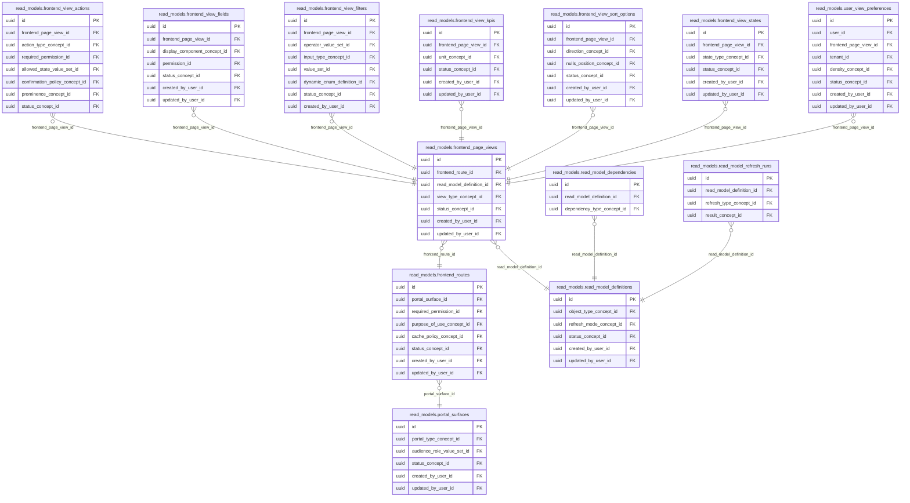

<!-- AUTOGENERADO por tools/inventario/catalogo.mjs. No editar manualmente. -->

# Catálogo del schema `read_models`

- **Tablas:** 13 · **Columnas:** 221 (48 con descripción: 21.7 %) · **Índices:** 89
- **Dominio:** Auditoría y Reporting
- Método y límites del catálogo: [README del inventario](../README.md)

## Tablas

| Tabla | Propósito | Columnas | Índices | Operaciones | ORM |
|---|---|---|---|---|---|
| [frontend_page_views](#frontend_page_views) | Cataloga vistas de página para configurar presentación y consumo de proyecciones en la interfaz. | 20 | 9 | 6 | COINCIDE |
| [frontend_routes](#frontend_routes) | Registra rutas de aplicaciones cliente para relacionarlas con pantallas, permisos y modelos de lectura. | 20 | 9 | 8 | COINCIDE |
| [frontend_view_actions](#frontend_view_actions) | Cataloga acciones habilitadas desde una vista para conectar lectura con operaciones autorizadas. | 19 | 10 | 3 | COINCIDE |
| [frontend_view_fields](#frontend_view_fields) | Define campos disponibles en vistas para controlar qué atributos pueden mostrarse. | 23 | 7 | 3 | COINCIDE |
| [frontend_view_filters](#frontend_view_filters) | Configura filtros permitidos en vistas para acotar resultados visibles según el contexto de uso. | 19 | 9 | 1 | COINCIDE |
| [frontend_view_kpis](#frontend_view_kpis) | Define indicadores resumidos que pueden presentarse en vistas de operación o gestión. | 17 | 5 | 1 | COINCIDE |
| [frontend_view_sort_options](#frontend_view_sort_options) | Define criterios de ordenamiento disponibles en vistas para organizar resultados presentados. | 15 | 7 | 2 | COINCIDE |
| [frontend_view_states](#frontend_view_states) | Configura estados visuales de vistas para representar carga, vacío, error o resultados. | 15 | 6 | 1 | COINCIDE |
| [portal_surfaces](#portal_surfaces) | Cataloga superficies del portal para asociar rutas de usuario con sus datos y capacidades de presentación. | 15 | 7 | 8 | COINCIDE |
| [read_model_definitions](#read_model_definitions) | Define proyecciones optimizadas para lectura que alimentan portales y experiencias de usuarios. | 23 | 6 | 15 | COINCIDE |
| [read_model_dependencies](#read_model_dependencies) | Relaciona modelos de lectura con sus fuentes para trazar dependencias de actualización y linaje. | 8 | 2 | 2 | COINCIDE |
| [read_model_refresh_runs](#read_model_refresh_runs) | Registra ejecuciones de actualización de proyecciones para controlar frescura y fallos de lectura. | 11 | 4 | 6 | COINCIDE |
| [user_view_preferences](#user_view_preferences) | Guarda preferencias de vista por usuario para personalizar presentación de información autorizada. | 16 | 8 | 3 | COINCIDE |

## Diagrama entidad-relación

Las tablas se agrupan en familias por sus claves foráneas dentro del schema (máximo 40 por diagrama). Las FK hacia otros schemas se listan en la ficha de cada tabla.

### Familia 1 de 1 — 13 tablas

## Fichas

### frontend_page_views

#### Vista general

Cataloga vistas de página para configurar presentación y consumo de proyecciones en la interfaz.

- **Estado del propósito:** DOMAIN_CURATED_DRAFT · fuente: `Mantra Core Health Context/modules/diagram_30_read_models.puml: frontend_page_views`
- **Dominio:** Auditoría y Reporting · **Diagrama:** `Mantra Core Health Context/modules/diagram_30_read_models.puml` · **DDL:** `SQL/30_read_models/02_tables.sql`
- **Entidad del ORM:** `FrontendPageViews` — `src/modules/read_models/entities/frontend_page_views.entity.ts`
- **Resumen:** 20 columnas · 9 índices · 6 FK salientes · 7 entrantes · 6 operaciones

#### Columnas

| # | Columna | Tipo | Rol estructural | Descripción | ORM |
|---|---|---|---|---|---|
| 1 | `id` | `uuid` | Clave primaria; Obligatoria | Identificador único de la instancia. _(JSDOC_ESTANDAR, `src/modules/read_models/entities/frontend_page_views.entity.ts:12`)_ | coincide |
| 2 | `frontend_route_id` | `uuid` | Clave foránea → read_models.frontend_routes.id; Obligatoria | _sin dato_ | coincide |
| 3 | `read_model_definition_id` | `uuid` | Clave foránea → read_models.read_model_definitions.id; Obligatoria | _sin dato_ | coincide |
| 4 | `view_code` | `varchar` | Obligatoria | _sin dato_ | coincide |
| 5 | `view_type_concept_id` | `uuid` | Clave foránea → terminology.catalog_concepts.id; Obligatoria | _sin dato_ | coincide |
| 6 | `title` | `varchar` | Opcional | _sin dato_ | coincide |
| 7 | `description` | `text` | Opcional | _sin dato_ | coincide |
| 8 | `field_mask_policy_id` | `uuid` | Opcional | _sin dato_ | coincide |
| 9 | `default_sort_code` | `varchar` | Opcional | _sin dato_ | coincide |
| 10 | `polling_interval_seconds` | `integer` | Opcional | _sin dato_ | coincide |
| 11 | `supports_cursor_pagination` | `boolean` | Opcional | _sin dato_ | coincide |
| 12 | `supports_export` | `boolean` | Opcional | _sin dato_ | coincide |
| 13 | `supports_saved_filters` | `boolean` | Opcional | _sin dato_ | coincide |
| 14 | `layout_spec_json` | `jsonb` | Opcional | _sin dato_ | coincide |
| 15 | `status_concept_id` | `uuid` | Clave foránea → terminology.catalog_concepts.id; Obligatoria | _sin dato_ | coincide |
| 16 | `created_at` | `timestamptz` | Obligatoria | Fecha y hora en que se creó el registro. _(JSDOC_ESTANDAR, `src/modules/read_models/entities/frontend_page_views.entity.ts:123`)_ | coincide |
| 17 | `updated_at` | `timestamptz` | Obligatoria | Fecha y hora de la última actualización. _(JSDOC_ESTANDAR, `src/modules/read_models/entities/frontend_page_views.entity.ts:129`)_ | coincide |
| 18 | `created_by_user_id` | `uuid` | Clave foránea → iam.users.id; Opcional | _sin dato_ | coincide |
| 19 | `updated_by_user_id` | `uuid` | Clave foránea → iam.users.id; Opcional | _sin dato_ | coincide |
| 20 | `row_version` | `integer = 1` | Obligatoria | Versión usada para controlar actualizaciones concurrentes. _(JSDOC_ENTIDAD, `src/modules/read_models/entities/frontend_page_views.entity.ts:147`)_ | coincide |

#### Relaciones

| Sentido | Columnas | Tabla | Restricción |
|---|---|---|---|
| hacia | frontend_route_id | read_models.frontend_routes (id) | fk_frontend_page_views_frontend_route_id |
| hacia | read_model_definition_id | read_models.read_model_definitions (id) | fk_frontend_page_views_read_model_definition_id |
| hacia | view_type_concept_id | terminology.catalog_concepts (id) | fk_frontend_page_views_view_type_concept_id |
| hacia | status_concept_id | terminology.catalog_concepts (id) | fk_frontend_page_views_status_concept_id |
| hacia | created_by_user_id | iam.users (id) | fk_frontend_page_views_created_by_user_id |
| hacia | updated_by_user_id | iam.users (id) | fk_frontend_page_views_updated_by_user_id |
| desde | id | read_models.frontend_view_fields (frontend_page_view_id) | fk_frontend_view_fields_frontend_page_view_id |
| desde | id | read_models.frontend_view_filters (frontend_page_view_id) | fk_frontend_view_filters_frontend_page_view_id |
| desde | id | read_models.frontend_view_sort_options (frontend_page_view_id) | fk_frontend_view_sort_options_frontend_page_view_id |
| desde | id | read_models.frontend_view_actions (frontend_page_view_id) | fk_frontend_view_actions_frontend_page_view_id |
| desde | id | read_models.frontend_view_kpis (frontend_page_view_id) | fk_frontend_view_kpis_frontend_page_view_id |
| desde | id | read_models.frontend_view_states (frontend_page_view_id) | fk_frontend_view_states_frontend_page_view_id |
| desde | id | read_models.user_view_preferences (frontend_page_view_id) | fk_user_view_preferences_frontend_page_view_id |

#### Índices

| Índice | Único | Columnas | Para qué |
|---|---|---|---|
| `ix_frontend_page_views_frontend_route_id` | no | frontend_route_id | Soporta la clave foránea fk_frontend_page_views_frontend_route_id: PostgreSQL no indexa las FK por sí mismo _(DOCUMENTO)_; 1 consulta(s) de repositorio filtran u ordenan por «frontend_route_id», la primera columna del índice _(CONSULTA)_ |
| `ix_frontend_page_views_read_model_definition_id` | no | read_model_definition_id | Soporta la clave foránea fk_frontend_page_views_read_model_definition_id: PostgreSQL no indexa las FK por sí mismo _(DOCUMENTO)_; 1 consulta(s) de repositorio filtran u ordenan por «read_model_definition_id», la primera columna del índice _(CONSULTA)_ |
| `ix_frontend_page_views_view_type_concept_id` | no | view_type_concept_id | Soporta la clave foránea fk_frontend_page_views_view_type_concept_id: PostgreSQL no indexa las FK por sí mismo _(DOCUMENTO)_ |
| `ix_frontend_page_views_field_mask_policy_id` | no | field_mask_policy_id | _sin uso detectado estáticamente_ |
| `ix_frontend_page_views_status_concept_id` | no | status_concept_id | Soporta la clave foránea fk_frontend_page_views_status_concept_id: PostgreSQL no indexa las FK por sí mismo _(DOCUMENTO)_ |
| `ix_frontend_page_views_created_by_user_id` | no | created_by_user_id | Soporta la clave foránea fk_frontend_page_views_created_by_user_id: PostgreSQL no indexa las FK por sí mismo _(DOCUMENTO)_ |
| `ix_frontend_page_views_updated_by_user_id` | no | updated_by_user_id | Soporta la clave foránea fk_frontend_page_views_updated_by_user_id: PostgreSQL no indexa las FK por sí mismo _(DOCUMENTO)_ |
| `uq_frontend_page_views_route_code` | sí | frontend_route_id, view_code | Garantiza que no se repita la combinación (frontend_route_id, view_code) _(DOCUMENTO)_; Soporta la clave foránea fk_frontend_page_views_frontend_route_id: PostgreSQL no indexa las FK por sí mismo _(DOCUMENTO)_; 1 consulta(s) de repositorio filtran u ordenan por «frontend_route_id», la primera columna del índice _(CONSULTA)_ |
| `gin_frontend_page_views_search` | no | (to_tsvector('simple', (coalesce(title, '') ¦¦ ' ' ¦¦ coalesce(description, '')))) | GIN para búsqueda textual gobernada _(DOCUMENTO)_ |

#### Restricciones

| Restricción | Tipo | Definición |
|---|---|---|
| `uq_frontend_page_views_route_code` | UNIQUE INDEX | UNIQUE INDEX ("frontend_route_id", "view_code") |

#### Operaciones que la tocan

| Operación | Efecto | Confianza |
|---|---|---|
| POST /portals/{portalCode}/routes/{routeCode}/views | CREA | DIRECTA |
| POST /portals/{portalCode}/routes/{routeCode}/views | LEE | DIRECTA |
| GET /portals/{portalCode}/routes/{routeCode}/views/{viewCode}/actions | LEE | DIRECTA |
| GET /portals/{portalCode}/routes/{routeCode}/views/{viewCode}/data | LEE | DIRECTA |
| DELETE /read-models/definitions/{id} | LEE | DIRECTA |
| PUT /views/{frontendPageViewId}/preferences | LEE | DIRECTA |

#### Gobierno

| Atributo | Valor | Fuente |
|---|---|---|
| Append-only | no declarado | — |
| Datos personales | sin fuente | — |
| Financiera | sin fuente | — |
| Crítica para auditoría | sin fuente | — |
| Retención | sin fuente | — |
| Responsable | sin fuente | — |
| Revisión | AUTO_DETECTADA | — |

---

### frontend_routes

#### Vista general

Registra rutas de aplicaciones cliente para relacionarlas con pantallas, permisos y modelos de lectura.

- **Estado del propósito:** DOMAIN_CURATED_DRAFT · fuente: `Mantra Core Health Context/modules/diagram_30_read_models.puml: frontend_routes`
- **Dominio:** Auditoría y Reporting · **Diagrama:** `Mantra Core Health Context/modules/diagram_30_read_models.puml` · **DDL:** `SQL/30_read_models/02_tables.sql`
- **Entidad del ORM:** `FrontendRoutes` — `src/modules/read_models/entities/frontend_routes.entity.ts`
- **Resumen:** 20 columnas · 9 índices · 7 FK salientes · 1 entrantes · 8 operaciones

#### Columnas

| # | Columna | Tipo | Rol estructural | Descripción | ORM |
|---|---|---|---|---|---|
| 1 | `id` | `uuid` | Clave primaria; Obligatoria | Identificador único de la instancia. _(JSDOC_ESTANDAR, `src/modules/read_models/entities/frontend_routes.entity.ts:12`)_ | coincide |
| 2 | `portal_surface_id` | `uuid` | Clave foránea → read_models.portal_surfaces.id; Obligatoria | _sin dato_ | coincide |
| 3 | `route_code` | `varchar` | Obligatoria | _sin dato_ | coincide |
| 4 | `route_pattern` | `varchar` | Obligatoria | _sin dato_ | coincide |
| 5 | `page_title` | `varchar` | Obligatoria | _sin dato_ | coincide |
| 6 | `navigation_group` | `varchar` | Opcional | _sin dato_ | coincide |
| 7 | `navigation_icon_key` | `varchar` | Opcional | _sin dato_ | coincide |
| 8 | `breadcrumb_json` | `jsonb` | Opcional | _sin dato_ | coincide |
| 9 | `required_permission_id` | `uuid` | Clave foránea → authz.permissions.id; Opcional | _sin dato_ | coincide |
| 10 | `purpose_of_use_concept_id` | `uuid` | Clave foránea → terminology.catalog_concepts.id; Opcional | _sin dato_ | coincide |
| 11 | `feature_flag_code` | `varchar` | Opcional | _sin dato_ | coincide |
| 12 | `requires_patient_context` | `boolean` | Opcional | _sin dato_ | coincide |
| 13 | `requires_tenant_context` | `boolean` | Opcional | _sin dato_ | coincide |
| 14 | `cache_policy_concept_id` | `uuid` | Clave foránea → terminology.catalog_concepts.id; Opcional | _sin dato_ | coincide |
| 15 | `status_concept_id` | `uuid` | Clave foránea → terminology.catalog_concepts.id; Obligatoria | _sin dato_ | coincide |
| 16 | `created_at` | `timestamptz` | Obligatoria | Fecha y hora en que se creó el registro. _(JSDOC_ESTANDAR, `src/modules/read_models/entities/frontend_routes.entity.ts:139`)_ | coincide |
| 17 | `updated_at` | `timestamptz` | Obligatoria | Fecha y hora de la última actualización. _(JSDOC_ESTANDAR, `src/modules/read_models/entities/frontend_routes.entity.ts:145`)_ | coincide |
| 18 | `created_by_user_id` | `uuid` | Clave foránea → iam.users.id; Opcional | _sin dato_ | coincide |
| 19 | `updated_by_user_id` | `uuid` | Clave foránea → iam.users.id; Opcional | _sin dato_ | coincide |
| 20 | `row_version` | `integer = 1` | Obligatoria | Versión usada para controlar actualizaciones concurrentes. _(JSDOC_ENTIDAD, `src/modules/read_models/entities/frontend_routes.entity.ts:163`)_ | coincide |

#### Relaciones

| Sentido | Columnas | Tabla | Restricción |
|---|---|---|---|
| hacia | portal_surface_id | read_models.portal_surfaces (id) | fk_frontend_routes_portal_surface_id |
| hacia | required_permission_id | authz.permissions (id) | fk_frontend_routes_required_permission_id |
| hacia | purpose_of_use_concept_id | terminology.catalog_concepts (id) | fk_frontend_routes_purpose_of_use_concept_id |
| hacia | cache_policy_concept_id | terminology.catalog_concepts (id) | fk_frontend_routes_cache_policy_concept_id |
| hacia | status_concept_id | terminology.catalog_concepts (id) | fk_frontend_routes_status_concept_id |
| hacia | created_by_user_id | iam.users (id) | fk_frontend_routes_created_by_user_id |
| hacia | updated_by_user_id | iam.users (id) | fk_frontend_routes_updated_by_user_id |
| desde | id | read_models.frontend_page_views (frontend_route_id) | fk_frontend_page_views_frontend_route_id |

#### Índices

| Índice | Único | Columnas | Para qué |
|---|---|---|---|
| `ix_frontend_routes_portal_surface_id` | no | portal_surface_id | Soporta la clave foránea fk_frontend_routes_portal_surface_id: PostgreSQL no indexa las FK por sí mismo _(DOCUMENTO)_; 2 consulta(s) de repositorio filtran u ordenan por «portal_surface_id», la primera columna del índice _(CONSULTA)_ |
| `ix_frontend_routes_required_permission_id` | no | required_permission_id | Soporta la clave foránea fk_frontend_routes_required_permission_id: PostgreSQL no indexa las FK por sí mismo _(DOCUMENTO)_ |
| `ix_frontend_routes_purpose_of_use_concept_id` | no | purpose_of_use_concept_id | Soporta la clave foránea fk_frontend_routes_purpose_of_use_concept_id: PostgreSQL no indexa las FK por sí mismo _(DOCUMENTO)_ |
| `ix_frontend_routes_cache_policy_concept_id` | no | cache_policy_concept_id | Soporta la clave foránea fk_frontend_routes_cache_policy_concept_id: PostgreSQL no indexa las FK por sí mismo _(DOCUMENTO)_ |
| `ix_frontend_routes_status_concept_id` | no | status_concept_id | Soporta la clave foránea fk_frontend_routes_status_concept_id: PostgreSQL no indexa las FK por sí mismo _(DOCUMENTO)_ |
| `ix_frontend_routes_created_by_user_id` | no | created_by_user_id | Soporta la clave foránea fk_frontend_routes_created_by_user_id: PostgreSQL no indexa las FK por sí mismo _(DOCUMENTO)_ |
| `ix_frontend_routes_updated_by_user_id` | no | updated_by_user_id | Soporta la clave foránea fk_frontend_routes_updated_by_user_id: PostgreSQL no indexa las FK por sí mismo _(DOCUMENTO)_ |
| `uq_frontend_routes_portal_code` | sí | portal_surface_id, route_code | Garantiza que no se repita la combinación (portal_surface_id, route_code) _(DOCUMENTO)_; Soporta la clave foránea fk_frontend_routes_portal_surface_id: PostgreSQL no indexa las FK por sí mismo _(DOCUMENTO)_; 2 consulta(s) de repositorio filtran u ordenan por «portal_surface_id», la primera columna del índice _(CONSULTA)_ |
| `uq_frontend_routes_pattern` | sí | portal_surface_id, route_pattern | Garantiza que no se repita la combinación (portal_surface_id, route_pattern) _(DOCUMENTO)_; Soporta la clave foránea fk_frontend_routes_portal_surface_id: PostgreSQL no indexa las FK por sí mismo _(DOCUMENTO)_; 2 consulta(s) de repositorio filtran u ordenan por «portal_surface_id», la primera columna del índice _(CONSULTA)_ |

#### Restricciones

| Restricción | Tipo | Definición |
|---|---|---|
| `uq_frontend_routes_portal_code` | UNIQUE INDEX | UNIQUE INDEX ("portal_surface_id", "route_code") |
| `uq_frontend_routes_pattern` | UNIQUE INDEX | UNIQUE INDEX ("portal_surface_id", "route_pattern") |

#### Operaciones que la tocan

| Operación | Efecto | Confianza |
|---|---|---|
| POST /portals/{portalCode}/routes/{routeCode}/views | CREA | DIRECTA |
| POST /portals/{portalCode}/routes/{routeCode}/views | LEE | DIRECTA |
| GET /portals/{portalCode}/routes/{routeCode}/views/{viewCode}/actions | LEE | DIRECTA |
| GET /portals/{portalCode}/routes/{routeCode}/views/{viewCode}/data | LEE | DIRECTA |
| GET /admin/analytics/errors | LEE | POR_SQL |
| GET /admin/analytics/errors/fingerprints | LEE | POR_SQL |
| GET /admin/analytics/errors/fingerprints/{fingerprint} | LEE | POR_SQL |
| GET /admin/analytics/errors/routes-not-found | LEE | POR_SQL |

#### Gobierno

| Atributo | Valor | Fuente |
|---|---|---|
| Append-only | no declarado | — |
| Datos personales | sin fuente | — |
| Financiera | sin fuente | — |
| Crítica para auditoría | sin fuente | — |
| Retención | sin fuente | — |
| Responsable | sin fuente | — |
| Revisión | AUTO_DETECTADA | — |

---

### frontend_view_actions

#### Vista general

Cataloga acciones habilitadas desde una vista para conectar lectura con operaciones autorizadas.

- **Estado del propósito:** DOMAIN_CURATED_DRAFT · fuente: `Mantra Core Health Context/modules/diagram_30_read_models.puml: frontend_view_actions`
- **Dominio:** Auditoría y Reporting · **Diagrama:** `Mantra Core Health Context/modules/diagram_30_read_models.puml` · **DDL:** `SQL/30_read_models/02_tables.sql`
- **Entidad del ORM:** `FrontendViewActions` — `src/modules/read_models/entities/frontend_view_actions.entity.ts`
- **Resumen:** 19 columnas · 10 índices · 9 FK salientes · 0 entrantes · 3 operaciones

#### Columnas

| # | Columna | Tipo | Rol estructural | Descripción | ORM |
|---|---|---|---|---|---|
| 1 | `id` | `uuid` | Clave primaria; Obligatoria | Identificador único de la instancia. _(JSDOC_ESTANDAR, `src/modules/read_models/entities/frontend_view_actions.entity.ts:12`)_ | coincide |
| 2 | `frontend_page_view_id` | `uuid` | Clave foránea → read_models.frontend_page_views.id; Obligatoria | _sin dato_ | coincide |
| 3 | `action_code` | `varchar` | Obligatoria | _sin dato_ | coincide |
| 4 | `label` | `varchar` | Obligatoria | _sin dato_ | coincide |
| 5 | `action_type_concept_id` | `uuid` | Clave foránea → terminology.catalog_concepts.id; Obligatoria | _sin dato_ | coincide |
| 6 | `route_template` | `varchar` | Opcional | _sin dato_ | coincide |
| 7 | `required_permission_id` | `uuid` | Clave foránea → authz.permissions.id; Opcional | _sin dato_ | coincide |
| 8 | `allowed_state_value_set_id` | `uuid` | Clave foránea → terminology.value_sets.id; Opcional | _sin dato_ | coincide |
| 9 | `confirmation_policy_concept_id` | `uuid` | Clave foránea → terminology.catalog_concepts.id; Opcional | _sin dato_ | coincide |
| 10 | `idempotency_required` | `boolean` | Opcional | _sin dato_ | coincide |
| 11 | `icon_key` | `varchar` | Opcional | _sin dato_ | coincide |
| 12 | `prominence_concept_id` | `uuid` | Clave foránea → terminology.catalog_concepts.id; Opcional | _sin dato_ | coincide |
| 13 | `ordinal` | `integer` | Obligatoria | _sin dato_ | coincide |
| 14 | `status_concept_id` | `uuid` | Clave foránea → terminology.catalog_concepts.id; Obligatoria | _sin dato_ | coincide |
| 15 | `created_at` | `timestamptz` | Obligatoria | Fecha y hora en que se creó el registro. _(JSDOC_ESTANDAR, `src/modules/read_models/entities/frontend_view_actions.entity.ts:120`)_ | coincide |
| 16 | `updated_at` | `timestamptz` | Obligatoria | Fecha y hora de la última actualización. _(JSDOC_ESTANDAR, `src/modules/read_models/entities/frontend_view_actions.entity.ts:126`)_ | coincide |
| 17 | `created_by_user_id` | `uuid` | Clave foránea → iam.users.id; Opcional | _sin dato_ | coincide |
| 18 | `updated_by_user_id` | `uuid` | Clave foránea → iam.users.id; Opcional | _sin dato_ | coincide |
| 19 | `row_version` | `integer = 1` | Obligatoria | Versión usada para controlar actualizaciones concurrentes. _(JSDOC_ENTIDAD, `src/modules/read_models/entities/frontend_view_actions.entity.ts:144`)_ | coincide |

#### Relaciones

| Sentido | Columnas | Tabla | Restricción |
|---|---|---|---|
| hacia | frontend_page_view_id | read_models.frontend_page_views (id) | fk_frontend_view_actions_frontend_page_view_id |
| hacia | action_type_concept_id | terminology.catalog_concepts (id) | fk_frontend_view_actions_action_type_concept_id |
| hacia | required_permission_id | authz.permissions (id) | fk_frontend_view_actions_required_permission_id |
| hacia | allowed_state_value_set_id | terminology.value_sets (id) | fk_frontend_view_actions_allowed_state_value_set_id |
| hacia | confirmation_policy_concept_id | terminology.catalog_concepts (id) | fk_frontend_view_actions_confirmation_policy_concept_id |
| hacia | prominence_concept_id | terminology.catalog_concepts (id) | fk_frontend_view_actions_prominence_concept_id |
| hacia | status_concept_id | terminology.catalog_concepts (id) | fk_frontend_view_actions_status_concept_id |
| hacia | created_by_user_id | iam.users (id) | fk_frontend_view_actions_created_by_user_id |
| hacia | updated_by_user_id | iam.users (id) | fk_frontend_view_actions_updated_by_user_id |

#### Índices

| Índice | Único | Columnas | Para qué |
|---|---|---|---|
| `ix_frontend_view_actions_frontend_page_view_id` | no | frontend_page_view_id | Soporta la clave foránea fk_frontend_view_actions_frontend_page_view_id: PostgreSQL no indexa las FK por sí mismo _(DOCUMENTO)_; 1 consulta(s) de repositorio filtran u ordenan por «frontend_page_view_id», la primera columna del índice _(CONSULTA)_ |
| `ix_frontend_view_actions_action_type_concept_id` | no | action_type_concept_id | Soporta la clave foránea fk_frontend_view_actions_action_type_concept_id: PostgreSQL no indexa las FK por sí mismo _(DOCUMENTO)_ |
| `ix_frontend_view_actions_required_permission_id` | no | required_permission_id | Soporta la clave foránea fk_frontend_view_actions_required_permission_id: PostgreSQL no indexa las FK por sí mismo _(DOCUMENTO)_ |
| `ix_frontend_view_actions_allowed_state_value_set_id` | no | allowed_state_value_set_id | Soporta la clave foránea fk_frontend_view_actions_allowed_state_value_set_id: PostgreSQL no indexa las FK por sí mismo _(DOCUMENTO)_ |
| `ix_frontend_view_actions_confirmation_policy_concept_id` | no | confirmation_policy_concept_id | Soporta la clave foránea fk_frontend_view_actions_confirmation_policy_concept_id: PostgreSQL no indexa las FK por sí mismo _(DOCUMENTO)_ |
| `ix_frontend_view_actions_prominence_concept_id` | no | prominence_concept_id | Soporta la clave foránea fk_frontend_view_actions_prominence_concept_id: PostgreSQL no indexa las FK por sí mismo _(DOCUMENTO)_ |
| `ix_frontend_view_actions_status_concept_id` | no | status_concept_id | Soporta la clave foránea fk_frontend_view_actions_status_concept_id: PostgreSQL no indexa las FK por sí mismo _(DOCUMENTO)_ |
| `ix_frontend_view_actions_created_by_user_id` | no | created_by_user_id | Soporta la clave foránea fk_frontend_view_actions_created_by_user_id: PostgreSQL no indexa las FK por sí mismo _(DOCUMENTO)_ |
| `ix_frontend_view_actions_updated_by_user_id` | no | updated_by_user_id | Soporta la clave foránea fk_frontend_view_actions_updated_by_user_id: PostgreSQL no indexa las FK por sí mismo _(DOCUMENTO)_ |
| `uq_frontend_view_actions_code` | sí | frontend_page_view_id, action_code | Garantiza que no se repita la combinación (frontend_page_view_id, action_code) _(DOCUMENTO)_; Soporta la clave foránea fk_frontend_view_actions_frontend_page_view_id: PostgreSQL no indexa las FK por sí mismo _(DOCUMENTO)_; 1 consulta(s) de repositorio filtran u ordenan por «frontend_page_view_id», la primera columna del índice _(CONSULTA)_ |

#### Restricciones

| Restricción | Tipo | Definición |
|---|---|---|
| `uq_frontend_view_actions_code` | UNIQUE INDEX | UNIQUE INDEX ("frontend_page_view_id", "action_code") |

#### Operaciones que la tocan

| Operación | Efecto | Confianza |
|---|---|---|
| POST /portals/{portalCode}/routes/{routeCode}/views | CREA | DIRECTA |
| GET /portals/{portalCode}/routes/{routeCode}/views/{viewCode}/actions | LEE | DIRECTA |
| GET /portals/{portalCode}/routes/{routeCode}/views/{viewCode}/data | LEE | DIRECTA |

#### Gobierno

| Atributo | Valor | Fuente |
|---|---|---|
| Append-only | no declarado | — |
| Datos personales | sin fuente | — |
| Financiera | sin fuente | — |
| Crítica para auditoría | sin fuente | — |
| Retención | sin fuente | — |
| Responsable | sin fuente | — |
| Revisión | AUTO_DETECTADA | — |

---

### frontend_view_fields

#### Vista general

Define campos disponibles en vistas para controlar qué atributos pueden mostrarse.

- **Estado del propósito:** DOMAIN_CURATED_DRAFT · fuente: `Mantra Core Health Context/modules/diagram_30_read_models.puml: frontend_view_fields`
- **Dominio:** Auditoría y Reporting · **Diagrama:** `Mantra Core Health Context/modules/diagram_30_read_models.puml` · **DDL:** `SQL/30_read_models/02_tables.sql`
- **Entidad del ORM:** `FrontendViewFields` — `src/modules/read_models/entities/frontend_view_fields.entity.ts`
- **Resumen:** 23 columnas · 7 índices · 6 FK salientes · 0 entrantes · 3 operaciones

#### Columnas

| # | Columna | Tipo | Rol estructural | Descripción | ORM |
|---|---|---|---|---|---|
| 1 | `id` | `uuid` | Clave primaria; Obligatoria | Identificador único de la instancia. _(JSDOC_ESTANDAR, `src/modules/read_models/entities/frontend_view_fields.entity.ts:12`)_ | coincide |
| 2 | `frontend_page_view_id` | `uuid` | Clave foránea → read_models.frontend_page_views.id; Obligatoria | _sin dato_ | coincide |
| 3 | `field_code` | `varchar` | Obligatoria | _sin dato_ | coincide |
| 4 | `source_column` | `varchar` | Obligatoria | _sin dato_ | coincide |
| 5 | `label` | `varchar` | Obligatoria | _sin dato_ | coincide |
| 6 | `data_type` | `"terminology"."technical_data_type"` | Obligatoria | _sin dato_ | coincide |
| 7 | `display_component_concept_id` | `uuid` | Clave foránea → terminology.catalog_concepts.id; Opcional | _sin dato_ | coincide |
| 8 | `format_mask` | `varchar` | Opcional | _sin dato_ | coincide |
| 9 | `responsive_priority` | `integer` | Opcional | _sin dato_ | coincide |
| 10 | `sortable` | `boolean` | Opcional | _sin dato_ | coincide |
| 11 | `filterable` | `boolean` | Opcional | _sin dato_ | coincide |
| 12 | `searchable` | `boolean` | Opcional | _sin dato_ | coincide |
| 13 | `sensitive` | `boolean` | Opcional | _sin dato_ | coincide |
| 14 | `permission_id` | `uuid` | Clave foránea → authz.permissions.id; Opcional | _sin dato_ | coincide |
| 15 | `empty_display_text` | `varchar` | Opcional | _sin dato_ | coincide |
| 16 | `metadata_json` | `jsonb` | Opcional | _sin dato_ | coincide |
| 17 | `ordinal` | `integer` | Obligatoria | _sin dato_ | coincide |
| 18 | `status_concept_id` | `uuid` | Clave foránea → terminology.catalog_concepts.id; Obligatoria | _sin dato_ | coincide |
| 19 | `created_at` | `timestamptz` | Obligatoria | Fecha y hora en que se creó el registro. _(JSDOC_ESTANDAR, `src/modules/read_models/entities/frontend_view_fields.entity.ts:140`)_ | coincide |
| 20 | `updated_at` | `timestamptz` | Obligatoria | Fecha y hora de la última actualización. _(JSDOC_ESTANDAR, `src/modules/read_models/entities/frontend_view_fields.entity.ts:146`)_ | coincide |
| 21 | `created_by_user_id` | `uuid` | Clave foránea → iam.users.id; Opcional | _sin dato_ | coincide |
| 22 | `updated_by_user_id` | `uuid` | Clave foránea → iam.users.id; Opcional | _sin dato_ | coincide |
| 23 | `row_version` | `integer = 1` | Obligatoria | Versión usada para controlar actualizaciones concurrentes. _(JSDOC_ENTIDAD, `src/modules/read_models/entities/frontend_view_fields.entity.ts:164`)_ | coincide |

#### Relaciones

| Sentido | Columnas | Tabla | Restricción |
|---|---|---|---|
| hacia | frontend_page_view_id | read_models.frontend_page_views (id) | fk_frontend_view_fields_frontend_page_view_id |
| hacia | display_component_concept_id | terminology.catalog_concepts (id) | fk_frontend_view_fields_display_component_concept_id |
| hacia | permission_id | authz.permissions (id) | fk_frontend_view_fields_permission_id |
| hacia | status_concept_id | terminology.catalog_concepts (id) | fk_frontend_view_fields_status_concept_id |
| hacia | created_by_user_id | iam.users (id) | fk_frontend_view_fields_created_by_user_id |
| hacia | updated_by_user_id | iam.users (id) | fk_frontend_view_fields_updated_by_user_id |

#### Índices

| Índice | Único | Columnas | Para qué |
|---|---|---|---|
| `ix_frontend_view_fields_frontend_page_view_id` | no | frontend_page_view_id | Soporta la clave foránea fk_frontend_view_fields_frontend_page_view_id: PostgreSQL no indexa las FK por sí mismo _(DOCUMENTO)_; 1 consulta(s) de repositorio filtran u ordenan por «frontend_page_view_id», la primera columna del índice _(CONSULTA)_ |
| `ix_frontend_view_fields_display_component_concept_id` | no | display_component_concept_id | Soporta la clave foránea fk_frontend_view_fields_display_component_concept_id: PostgreSQL no indexa las FK por sí mismo _(DOCUMENTO)_ |
| `ix_frontend_view_fields_permission_id` | no | permission_id | Soporta la clave foránea fk_frontend_view_fields_permission_id: PostgreSQL no indexa las FK por sí mismo _(DOCUMENTO)_ |
| `ix_frontend_view_fields_status_concept_id` | no | status_concept_id | Soporta la clave foránea fk_frontend_view_fields_status_concept_id: PostgreSQL no indexa las FK por sí mismo _(DOCUMENTO)_ |
| `ix_frontend_view_fields_created_by_user_id` | no | created_by_user_id | Soporta la clave foránea fk_frontend_view_fields_created_by_user_id: PostgreSQL no indexa las FK por sí mismo _(DOCUMENTO)_ |
| `ix_frontend_view_fields_updated_by_user_id` | no | updated_by_user_id | Soporta la clave foránea fk_frontend_view_fields_updated_by_user_id: PostgreSQL no indexa las FK por sí mismo _(DOCUMENTO)_ |
| `uq_frontend_view_fields_code` | sí | frontend_page_view_id, field_code | Garantiza que no se repita la combinación (frontend_page_view_id, field_code) _(DOCUMENTO)_; Soporta la clave foránea fk_frontend_view_fields_frontend_page_view_id: PostgreSQL no indexa las FK por sí mismo _(DOCUMENTO)_; 1 consulta(s) de repositorio filtran u ordenan por «frontend_page_view_id», la primera columna del índice _(CONSULTA)_ |

#### Restricciones

| Restricción | Tipo | Definición |
|---|---|---|
| `uq_frontend_view_fields_code` | UNIQUE INDEX | UNIQUE INDEX ("frontend_page_view_id", "field_code") |

#### Operaciones que la tocan

| Operación | Efecto | Confianza |
|---|---|---|
| POST /portals/{portalCode}/routes/{routeCode}/views | CREA | DIRECTA |
| GET /portals/{portalCode}/routes/{routeCode}/views/{viewCode}/data | LEE | DIRECTA |
| PUT /views/{frontendPageViewId}/preferences | LEE | DIRECTA |

#### Gobierno

| Atributo | Valor | Fuente |
|---|---|---|
| Append-only | no declarado | — |
| Datos personales | sin fuente | — |
| Financiera | sin fuente | — |
| Crítica para auditoría | sin fuente | — |
| Retención | sin fuente | — |
| Responsable | sin fuente | — |
| Revisión | AUTO_DETECTADA | — |

---

### frontend_view_filters

#### Vista general

Configura filtros permitidos en vistas para acotar resultados visibles según el contexto de uso.

- **Estado del propósito:** DOMAIN_CURATED_DRAFT · fuente: `Mantra Core Health Context/modules/diagram_30_read_models.puml: frontend_view_filters`
- **Dominio:** Auditoría y Reporting · **Diagrama:** `Mantra Core Health Context/modules/diagram_30_read_models.puml` · **DDL:** `SQL/30_read_models/02_tables.sql`
- **Entidad del ORM:** `FrontendViewFilters` — `src/modules/read_models/entities/frontend_view_filters.entity.ts`
- **Resumen:** 19 columnas · 9 índices · 8 FK salientes · 0 entrantes · 1 operaciones

#### Columnas

| # | Columna | Tipo | Rol estructural | Descripción | ORM |
|---|---|---|---|---|---|
| 1 | `id` | `uuid` | Clave primaria; Obligatoria | Identificador único de la instancia. _(JSDOC_ESTANDAR, `src/modules/read_models/entities/frontend_view_filters.entity.ts:12`)_ | coincide |
| 2 | `frontend_page_view_id` | `uuid` | Clave foránea → read_models.frontend_page_views.id; Obligatoria | _sin dato_ | coincide |
| 3 | `filter_code` | `varchar` | Obligatoria | _sin dato_ | coincide |
| 4 | `label` | `varchar` | Obligatoria | _sin dato_ | coincide |
| 5 | `operator_value_set_id` | `uuid` | Clave foránea → terminology.value_sets.id; Obligatoria | _sin dato_ | coincide |
| 6 | `input_type_concept_id` | `uuid` | Clave foránea → terminology.catalog_concepts.id; Obligatoria | _sin dato_ | coincide |
| 7 | `value_set_id` | `uuid` | Clave foránea → terminology.value_sets.id; Opcional | _sin dato_ | coincide |
| 8 | `dynamic_enum_definition_id` | `uuid` | Clave foránea → system_context.dynamic_enum_definitions.id; Opcional | _sin dato_ | coincide |
| 9 | `source_column` | `varchar` | Opcional | _sin dato_ | coincide |
| 10 | `default_value_json` | `jsonb` | Opcional | _sin dato_ | coincide |
| 11 | `required` | `boolean` | Opcional | _sin dato_ | coincide |
| 12 | `url_parameter_name` | `varchar` | Opcional | _sin dato_ | coincide |
| 13 | `ordinal` | `integer` | Obligatoria | _sin dato_ | coincide |
| 14 | `status_concept_id` | `uuid` | Clave foránea → terminology.catalog_concepts.id; Obligatoria | _sin dato_ | coincide |
| 15 | `created_at` | `timestamptz` | Obligatoria | Fecha y hora en que se creó el registro. _(JSDOC_ESTANDAR, `src/modules/read_models/entities/frontend_view_filters.entity.ts:113`)_ | coincide |
| 16 | `updated_at` | `timestamptz` | Obligatoria | Fecha y hora de la última actualización. _(JSDOC_ESTANDAR, `src/modules/read_models/entities/frontend_view_filters.entity.ts:119`)_ | coincide |
| 17 | `created_by_user_id` | `uuid` | Clave foránea → iam.users.id; Opcional | _sin dato_ | coincide |
| 18 | `updated_by_user_id` | `uuid` | Clave foránea → iam.users.id; Opcional | _sin dato_ | coincide |
| 19 | `row_version` | `integer = 1` | Obligatoria | Versión usada para controlar actualizaciones concurrentes. _(JSDOC_ENTIDAD, `src/modules/read_models/entities/frontend_view_filters.entity.ts:137`)_ | coincide |

#### Relaciones

| Sentido | Columnas | Tabla | Restricción |
|---|---|---|---|
| hacia | frontend_page_view_id | read_models.frontend_page_views (id) | fk_frontend_view_filters_frontend_page_view_id |
| hacia | operator_value_set_id | terminology.value_sets (id) | fk_frontend_view_filters_operator_value_set_id |
| hacia | input_type_concept_id | terminology.catalog_concepts (id) | fk_frontend_view_filters_input_type_concept_id |
| hacia | value_set_id | terminology.value_sets (id) | fk_frontend_view_filters_value_set_id |
| hacia | dynamic_enum_definition_id | system_context.dynamic_enum_definitions (id) | fk_frontend_view_filters_dynamic_enum_definition_id |
| hacia | status_concept_id | terminology.catalog_concepts (id) | fk_frontend_view_filters_status_concept_id |
| hacia | created_by_user_id | iam.users (id) | fk_frontend_view_filters_created_by_user_id |
| hacia | updated_by_user_id | iam.users (id) | fk_frontend_view_filters_updated_by_user_id |

#### Índices

| Índice | Único | Columnas | Para qué |
|---|---|---|---|
| `ix_frontend_view_filters_frontend_page_view_id` | no | frontend_page_view_id | Soporta la clave foránea fk_frontend_view_filters_frontend_page_view_id: PostgreSQL no indexa las FK por sí mismo _(DOCUMENTO)_; 1 consulta(s) de repositorio filtran u ordenan por «frontend_page_view_id», la primera columna del índice _(CONSULTA)_ |
| `ix_frontend_view_filters_operator_value_set_id` | no | operator_value_set_id | Soporta la clave foránea fk_frontend_view_filters_operator_value_set_id: PostgreSQL no indexa las FK por sí mismo _(DOCUMENTO)_ |
| `ix_frontend_view_filters_input_type_concept_id` | no | input_type_concept_id | Soporta la clave foránea fk_frontend_view_filters_input_type_concept_id: PostgreSQL no indexa las FK por sí mismo _(DOCUMENTO)_ |
| `ix_frontend_view_filters_value_set_id` | no | value_set_id | Soporta la clave foránea fk_frontend_view_filters_value_set_id: PostgreSQL no indexa las FK por sí mismo _(DOCUMENTO)_ |
| `ix_frontend_view_filters_dynamic_enum_definition_id` | no | dynamic_enum_definition_id | Soporta la clave foránea fk_frontend_view_filters_dynamic_enum_definition_id: PostgreSQL no indexa las FK por sí mismo _(DOCUMENTO)_ |
| `ix_frontend_view_filters_status_concept_id` | no | status_concept_id | Soporta la clave foránea fk_frontend_view_filters_status_concept_id: PostgreSQL no indexa las FK por sí mismo _(DOCUMENTO)_; 1 consulta(s) de repositorio filtran u ordenan por «status_concept_id», la primera columna del índice _(CONSULTA)_ |
| `ix_frontend_view_filters_created_by_user_id` | no | created_by_user_id | Soporta la clave foránea fk_frontend_view_filters_created_by_user_id: PostgreSQL no indexa las FK por sí mismo _(DOCUMENTO)_ |
| `ix_frontend_view_filters_updated_by_user_id` | no | updated_by_user_id | Soporta la clave foránea fk_frontend_view_filters_updated_by_user_id: PostgreSQL no indexa las FK por sí mismo _(DOCUMENTO)_ |
| `uq_frontend_view_filters_code` | sí | frontend_page_view_id, filter_code | Garantiza que no se repita la combinación (frontend_page_view_id, filter_code) _(DOCUMENTO)_; Soporta la clave foránea fk_frontend_view_filters_frontend_page_view_id: PostgreSQL no indexa las FK por sí mismo _(DOCUMENTO)_; 1 consulta(s) de repositorio filtran u ordenan por «frontend_page_view_id», la primera columna del índice _(CONSULTA)_ |

#### Restricciones

| Restricción | Tipo | Definición |
|---|---|---|
| `uq_frontend_view_filters_code` | UNIQUE INDEX | UNIQUE INDEX ("frontend_page_view_id", "filter_code") |

#### Operaciones que la tocan

| Operación | Efecto | Confianza |
|---|---|---|
| GET /portals/{portalCode}/routes/{routeCode}/views/{viewCode}/data | LEE | DIRECTA |

#### Gobierno

| Atributo | Valor | Fuente |
|---|---|---|
| Append-only | no declarado | — |
| Datos personales | sin fuente | — |
| Financiera | sin fuente | — |
| Crítica para auditoría | sin fuente | — |
| Retención | sin fuente | — |
| Responsable | sin fuente | — |
| Revisión | AUTO_DETECTADA | — |

---

### frontend_view_kpis

#### Vista general

Define indicadores resumidos que pueden presentarse en vistas de operación o gestión.

- **Estado del propósito:** DOMAIN_CURATED_DRAFT · fuente: `Mantra Core Health Context/modules/diagram_30_read_models.puml: frontend_view_kpis`
- **Dominio:** Auditoría y Reporting · **Diagrama:** `Mantra Core Health Context/modules/diagram_30_read_models.puml` · **DDL:** `SQL/30_read_models/02_tables.sql`
- **Entidad del ORM:** `FrontendViewKpis` — `src/modules/read_models/entities/frontend_view_kpis.entity.ts`
- **Resumen:** 17 columnas · 5 índices · 5 FK salientes · 0 entrantes · 1 operaciones

#### Columnas

| # | Columna | Tipo | Rol estructural | Descripción | ORM |
|---|---|---|---|---|---|
| 1 | `id` | `uuid` | Clave primaria; Obligatoria | Identificador único de la instancia. _(JSDOC_ESTANDAR, `src/modules/read_models/entities/frontend_view_kpis.entity.ts:12`)_ | coincide |
| 2 | `frontend_page_view_id` | `uuid` | Clave foránea → read_models.frontend_page_views.id; Obligatoria | _sin dato_ | coincide |
| 3 | `kpi_code` | `varchar` | Obligatoria | _sin dato_ | coincide |
| 4 | `label` | `varchar` | Obligatoria | _sin dato_ | coincide |
| 5 | `value_column` | `varchar` | Obligatoria | _sin dato_ | coincide |
| 6 | `comparison_column` | `varchar` | Obligatoria | _sin dato_ | coincide |
| 7 | `unit_concept_id` | `uuid` | Clave foránea → terminology.catalog_concepts.id; Opcional | _sin dato_ | coincide |
| 8 | `format_mask` | `varchar` | Opcional | _sin dato_ | coincide |
| 9 | `threshold_rules_json` | `jsonb` | Opcional | _sin dato_ | coincide |
| 10 | `drilldown_route_template` | `varchar` | Opcional | _sin dato_ | coincide |
| 11 | `ordinal` | `integer` | Obligatoria | _sin dato_ | coincide |
| 12 | `status_concept_id` | `uuid` | Clave foránea → terminology.catalog_concepts.id; Obligatoria | _sin dato_ | coincide |
| 13 | `created_at` | `timestamptz` | Obligatoria | Fecha y hora en que se creó el registro. _(JSDOC_ESTANDAR, `src/modules/read_models/entities/frontend_view_kpis.entity.ts:93`)_ | coincide |
| 14 | `updated_at` | `timestamptz` | Obligatoria | Fecha y hora de la última actualización. _(JSDOC_ESTANDAR, `src/modules/read_models/entities/frontend_view_kpis.entity.ts:99`)_ | coincide |
| 15 | `created_by_user_id` | `uuid` | Clave foránea → iam.users.id; Opcional | _sin dato_ | coincide |
| 16 | `updated_by_user_id` | `uuid` | Clave foránea → iam.users.id; Opcional | _sin dato_ | coincide |
| 17 | `row_version` | `integer = 1` | Obligatoria | Versión usada para controlar actualizaciones concurrentes. _(JSDOC_ENTIDAD, `src/modules/read_models/entities/frontend_view_kpis.entity.ts:117`)_ | coincide |

#### Relaciones

| Sentido | Columnas | Tabla | Restricción |
|---|---|---|---|
| hacia | frontend_page_view_id | read_models.frontend_page_views (id) | fk_frontend_view_kpis_frontend_page_view_id |
| hacia | unit_concept_id | terminology.catalog_concepts (id) | fk_frontend_view_kpis_unit_concept_id |
| hacia | status_concept_id | terminology.catalog_concepts (id) | fk_frontend_view_kpis_status_concept_id |
| hacia | created_by_user_id | iam.users (id) | fk_frontend_view_kpis_created_by_user_id |
| hacia | updated_by_user_id | iam.users (id) | fk_frontend_view_kpis_updated_by_user_id |

#### Índices

| Índice | Único | Columnas | Para qué |
|---|---|---|---|
| `ix_frontend_view_kpis_frontend_page_view_id` | no | frontend_page_view_id | Soporta la clave foránea fk_frontend_view_kpis_frontend_page_view_id: PostgreSQL no indexa las FK por sí mismo _(DOCUMENTO)_ |
| `ix_frontend_view_kpis_unit_concept_id` | no | unit_concept_id | Soporta la clave foránea fk_frontend_view_kpis_unit_concept_id: PostgreSQL no indexa las FK por sí mismo _(DOCUMENTO)_ |
| `ix_frontend_view_kpis_status_concept_id` | no | status_concept_id | Soporta la clave foránea fk_frontend_view_kpis_status_concept_id: PostgreSQL no indexa las FK por sí mismo _(DOCUMENTO)_ |
| `ix_frontend_view_kpis_created_by_user_id` | no | created_by_user_id | Soporta la clave foránea fk_frontend_view_kpis_created_by_user_id: PostgreSQL no indexa las FK por sí mismo _(DOCUMENTO)_ |
| `ix_frontend_view_kpis_updated_by_user_id` | no | updated_by_user_id | Soporta la clave foránea fk_frontend_view_kpis_updated_by_user_id: PostgreSQL no indexa las FK por sí mismo _(DOCUMENTO)_ |

#### Operaciones que la tocan

| Operación | Efecto | Confianza |
|---|---|---|
| POST /portals/{portalCode}/routes/{routeCode}/views | CREA | DIRECTA |

#### Gobierno

| Atributo | Valor | Fuente |
|---|---|---|
| Append-only | no declarado | — |
| Datos personales | sin fuente | — |
| Financiera | sin fuente | — |
| Crítica para auditoría | sin fuente | — |
| Retención | sin fuente | — |
| Responsable | sin fuente | — |
| Revisión | AUTO_DETECTADA | — |

---

### frontend_view_sort_options

#### Vista general

Define criterios de ordenamiento disponibles en vistas para organizar resultados presentados.

- **Estado del propósito:** DOMAIN_CURATED_DRAFT · fuente: `Mantra Core Health Context/modules/diagram_30_read_models.puml: frontend_view_sort_options`
- **Dominio:** Auditoría y Reporting · **Diagrama:** `Mantra Core Health Context/modules/diagram_30_read_models.puml` · **DDL:** `SQL/30_read_models/02_tables.sql`
- **Entidad del ORM:** `FrontendViewSortOptions` — `src/modules/read_models/entities/frontend_view_sort_options.entity.ts`
- **Resumen:** 15 columnas · 7 índices · 6 FK salientes · 0 entrantes · 2 operaciones

#### Columnas

| # | Columna | Tipo | Rol estructural | Descripción | ORM |
|---|---|---|---|---|---|
| 1 | `id` | `uuid` | Clave primaria; Obligatoria | Identificador único de la instancia. _(JSDOC_ESTANDAR, `src/modules/read_models/entities/frontend_view_sort_options.entity.ts:12`)_ | coincide |
| 2 | `frontend_page_view_id` | `uuid` | Clave foránea → read_models.frontend_page_views.id; Obligatoria | _sin dato_ | coincide |
| 3 | `sort_code` | `varchar` | Obligatoria | _sin dato_ | coincide |
| 4 | `label` | `varchar` | Obligatoria | _sin dato_ | coincide |
| 5 | `sort_expression` | `varchar` | Obligatoria | _sin dato_ | coincide |
| 6 | `direction_concept_id` | `uuid` | Clave foránea → terminology.catalog_concepts.id; Obligatoria | _sin dato_ | coincide |
| 7 | `nulls_position_concept_id` | `uuid` | Clave foránea → terminology.catalog_concepts.id; Obligatoria | _sin dato_ | coincide |
| 8 | `stable_tie_breaker_expression` | `varchar` | Opcional | _sin dato_ | coincide |
| 9 | `ordinal` | `integer` | Obligatoria | _sin dato_ | coincide |
| 10 | `status_concept_id` | `uuid` | Clave foránea → terminology.catalog_concepts.id; Obligatoria | _sin dato_ | coincide |
| 11 | `created_at` | `timestamptz` | Obligatoria | Fecha y hora en que se creó el registro. _(JSDOC_ESTANDAR, `src/modules/read_models/entities/frontend_view_sort_options.entity.ts:76`)_ | coincide |
| 12 | `updated_at` | `timestamptz` | Obligatoria | Fecha y hora de la última actualización. _(JSDOC_ESTANDAR, `src/modules/read_models/entities/frontend_view_sort_options.entity.ts:82`)_ | coincide |
| 13 | `created_by_user_id` | `uuid` | Clave foránea → iam.users.id; Opcional | _sin dato_ | coincide |
| 14 | `updated_by_user_id` | `uuid` | Clave foránea → iam.users.id; Opcional | _sin dato_ | coincide |
| 15 | `row_version` | `integer = 1` | Obligatoria | Versión usada para controlar actualizaciones concurrentes. _(JSDOC_ENTIDAD, `src/modules/read_models/entities/frontend_view_sort_options.entity.ts:100`)_ | coincide |

#### Relaciones

| Sentido | Columnas | Tabla | Restricción |
|---|---|---|---|
| hacia | frontend_page_view_id | read_models.frontend_page_views (id) | fk_frontend_view_sort_options_frontend_page_view_id |
| hacia | direction_concept_id | terminology.catalog_concepts (id) | fk_frontend_view_sort_options_direction_concept_id |
| hacia | nulls_position_concept_id | terminology.catalog_concepts (id) | fk_frontend_view_sort_options_nulls_position_concept_id |
| hacia | status_concept_id | terminology.catalog_concepts (id) | fk_frontend_view_sort_options_status_concept_id |
| hacia | created_by_user_id | iam.users (id) | fk_frontend_view_sort_options_created_by_user_id |
| hacia | updated_by_user_id | iam.users (id) | fk_frontend_view_sort_options_updated_by_user_id |

#### Índices

| Índice | Único | Columnas | Para qué |
|---|---|---|---|
| `ix_frontend_view_sort_options_frontend_page_view_id` | no | frontend_page_view_id | Soporta la clave foránea fk_frontend_view_sort_options_frontend_page_view_id: PostgreSQL no indexa las FK por sí mismo _(DOCUMENTO)_; 1 consulta(s) de repositorio filtran u ordenan por «frontend_page_view_id», la primera columna del índice _(CONSULTA)_ |
| `ix_frontend_view_sort_options_direction_concept_id` | no | direction_concept_id | Soporta la clave foránea fk_frontend_view_sort_options_direction_concept_id: PostgreSQL no indexa las FK por sí mismo _(DOCUMENTO)_ |
| `ix_frontend_view_sort_options_nulls_position_concept_id` | no | nulls_position_concept_id | Soporta la clave foránea fk_frontend_view_sort_options_nulls_position_concept_id: PostgreSQL no indexa las FK por sí mismo _(DOCUMENTO)_ |
| `ix_frontend_view_sort_options_status_concept_id` | no | status_concept_id | Soporta la clave foránea fk_frontend_view_sort_options_status_concept_id: PostgreSQL no indexa las FK por sí mismo _(DOCUMENTO)_; 1 consulta(s) de repositorio filtran u ordenan por «status_concept_id», la primera columna del índice _(CONSULTA)_ |
| `ix_frontend_view_sort_options_created_by_user_id` | no | created_by_user_id | Soporta la clave foránea fk_frontend_view_sort_options_created_by_user_id: PostgreSQL no indexa las FK por sí mismo _(DOCUMENTO)_ |
| `ix_frontend_view_sort_options_updated_by_user_id` | no | updated_by_user_id | Soporta la clave foránea fk_frontend_view_sort_options_updated_by_user_id: PostgreSQL no indexa las FK por sí mismo _(DOCUMENTO)_ |
| `uq_frontend_view_sort_code` | sí | frontend_page_view_id, sort_code | Garantiza que no se repita la combinación (frontend_page_view_id, sort_code) _(DOCUMENTO)_; Soporta la clave foránea fk_frontend_view_sort_options_frontend_page_view_id: PostgreSQL no indexa las FK por sí mismo _(DOCUMENTO)_; 1 consulta(s) de repositorio filtran u ordenan por «frontend_page_view_id», la primera columna del índice _(CONSULTA)_ |

#### Restricciones

| Restricción | Tipo | Definición |
|---|---|---|
| `uq_frontend_view_sort_code` | UNIQUE INDEX | UNIQUE INDEX ("frontend_page_view_id", "sort_code") |

#### Operaciones que la tocan

| Operación | Efecto | Confianza |
|---|---|---|
| POST /portals/{portalCode}/routes/{routeCode}/views | CREA | DIRECTA |
| GET /portals/{portalCode}/routes/{routeCode}/views/{viewCode}/data | LEE | DIRECTA |

#### Gobierno

| Atributo | Valor | Fuente |
|---|---|---|
| Append-only | no declarado | — |
| Datos personales | sin fuente | — |
| Financiera | sin fuente | — |
| Crítica para auditoría | sin fuente | — |
| Retención | sin fuente | — |
| Responsable | sin fuente | — |
| Revisión | AUTO_DETECTADA | — |

---

### frontend_view_states

#### Vista general

Configura estados visuales de vistas para representar carga, vacío, error o resultados.

- **Estado del propósito:** DOMAIN_CURATED_DRAFT · fuente: `Mantra Core Health Context/modules/diagram_30_read_models.puml: frontend_view_states`
- **Dominio:** Auditoría y Reporting · **Diagrama:** `Mantra Core Health Context/modules/diagram_30_read_models.puml` · **DDL:** `SQL/30_read_models/02_tables.sql`
- **Entidad del ORM:** `FrontendViewStates` — `src/modules/read_models/entities/frontend_view_states.entity.ts`
- **Resumen:** 15 columnas · 6 índices · 5 FK salientes · 0 entrantes · 1 operaciones

#### Columnas

| # | Columna | Tipo | Rol estructural | Descripción | ORM |
|---|---|---|---|---|---|
| 1 | `id` | `uuid` | Clave primaria; Obligatoria | Identificador único de la instancia. _(JSDOC_ESTANDAR, `src/modules/read_models/entities/frontend_view_states.entity.ts:12`)_ | coincide |
| 2 | `frontend_page_view_id` | `uuid` | Clave foránea → read_models.frontend_page_views.id; Obligatoria | _sin dato_ | coincide |
| 3 | `state_type_concept_id` | `uuid` | Clave foránea → terminology.catalog_concepts.id; Obligatoria | _sin dato_ | coincide |
| 4 | `title` | `varchar` | Obligatoria | _sin dato_ | coincide |
| 5 | `message` | `varchar` | Obligatoria | _sin dato_ | coincide |
| 6 | `illustration_key` | `varchar` | Opcional | _sin dato_ | coincide |
| 7 | `recovery_action_code` | `varchar` | Opcional | _sin dato_ | coincide |
| 8 | `telemetry_event_code` | `varchar` | Opcional | _sin dato_ | coincide |
| 9 | `retry_allowed` | `boolean` | Opcional | _sin dato_ | coincide |
| 10 | `status_concept_id` | `uuid` | Clave foránea → terminology.catalog_concepts.id; Obligatoria | _sin dato_ | coincide |
| 11 | `created_at` | `timestamptz` | Obligatoria | Fecha y hora en que se creó el registro. _(JSDOC_ESTANDAR, `src/modules/read_models/entities/frontend_view_states.entity.ts:84`)_ | coincide |
| 12 | `updated_at` | `timestamptz` | Obligatoria | Fecha y hora de la última actualización. _(JSDOC_ESTANDAR, `src/modules/read_models/entities/frontend_view_states.entity.ts:90`)_ | coincide |
| 13 | `created_by_user_id` | `uuid` | Clave foránea → iam.users.id; Opcional | _sin dato_ | coincide |
| 14 | `updated_by_user_id` | `uuid` | Clave foránea → iam.users.id; Opcional | _sin dato_ | coincide |
| 15 | `row_version` | `integer = 1` | Obligatoria | Versión usada para controlar actualizaciones concurrentes. _(JSDOC_ENTIDAD, `src/modules/read_models/entities/frontend_view_states.entity.ts:108`)_ | coincide |

#### Relaciones

| Sentido | Columnas | Tabla | Restricción |
|---|---|---|---|
| hacia | frontend_page_view_id | read_models.frontend_page_views (id) | fk_frontend_view_states_frontend_page_view_id |
| hacia | state_type_concept_id | terminology.catalog_concepts (id) | fk_frontend_view_states_state_type_concept_id |
| hacia | status_concept_id | terminology.catalog_concepts (id) | fk_frontend_view_states_status_concept_id |
| hacia | created_by_user_id | iam.users (id) | fk_frontend_view_states_created_by_user_id |
| hacia | updated_by_user_id | iam.users (id) | fk_frontend_view_states_updated_by_user_id |

#### Índices

| Índice | Único | Columnas | Para qué |
|---|---|---|---|
| `ix_frontend_view_states_frontend_page_view_id` | no | frontend_page_view_id | Soporta la clave foránea fk_frontend_view_states_frontend_page_view_id: PostgreSQL no indexa las FK por sí mismo _(DOCUMENTO)_ |
| `ix_frontend_view_states_state_type_concept_id` | no | state_type_concept_id | Soporta la clave foránea fk_frontend_view_states_state_type_concept_id: PostgreSQL no indexa las FK por sí mismo _(DOCUMENTO)_ |
| `ix_frontend_view_states_status_concept_id` | no | status_concept_id | Soporta la clave foránea fk_frontend_view_states_status_concept_id: PostgreSQL no indexa las FK por sí mismo _(DOCUMENTO)_ |
| `ix_frontend_view_states_created_by_user_id` | no | created_by_user_id | Soporta la clave foránea fk_frontend_view_states_created_by_user_id: PostgreSQL no indexa las FK por sí mismo _(DOCUMENTO)_ |
| `ix_frontend_view_states_updated_by_user_id` | no | updated_by_user_id | Soporta la clave foránea fk_frontend_view_states_updated_by_user_id: PostgreSQL no indexa las FK por sí mismo _(DOCUMENTO)_ |
| `gin_frontend_view_states_search` | no | (to_tsvector('simple', (coalesce(title, '')))) | GIN para búsqueda textual gobernada _(DOCUMENTO)_ |

#### Operaciones que la tocan

| Operación | Efecto | Confianza |
|---|---|---|
| POST /portals/{portalCode}/routes/{routeCode}/views | CREA | DIRECTA |

#### Gobierno

| Atributo | Valor | Fuente |
|---|---|---|
| Append-only | no declarado | — |
| Datos personales | sin fuente | — |
| Financiera | sin fuente | — |
| Crítica para auditoría | sin fuente | — |
| Retención | sin fuente | — |
| Responsable | sin fuente | — |
| Revisión | AUTO_DETECTADA | — |

---

### portal_surfaces

#### Vista general

Cataloga superficies del portal para asociar rutas de usuario con sus datos y capacidades de presentación.

- **Estado del propósito:** DOMAIN_CURATED_DRAFT · fuente: `Mantra Core Health Context/modules/diagram_30_read_models.puml: portal_surfaces`
- **Dominio:** Auditoría y Reporting · **Diagrama:** `Mantra Core Health Context/modules/diagram_30_read_models.puml` · **DDL:** `SQL/30_read_models/02_tables.sql`
- **Entidad del ORM:** `PortalSurfaces` — `src/modules/read_models/entities/portal_surfaces.entity.ts`
- **Resumen:** 15 columnas · 7 índices · 5 FK salientes · 1 entrantes · 8 operaciones

#### Columnas

| # | Columna | Tipo | Rol estructural | Descripción | ORM |
|---|---|---|---|---|---|
| 1 | `id` | `uuid` | Clave primaria; Obligatoria | Identificador único de la instancia. _(JSDOC_ESTANDAR, `src/modules/read_models/entities/portal_surfaces.entity.ts:12`)_ | coincide |
| 2 | `portal_code` | `varchar` | Obligatoria | _sin dato_ | coincide |
| 3 | `name` | `varchar` | Obligatoria | _sin dato_ | coincide |
| 4 | `portal_type_concept_id` | `uuid` | Clave foránea → terminology.catalog_concepts.id; Obligatoria | _sin dato_ | coincide |
| 5 | `audience_role_value_set_id` | `uuid` | Clave foránea → terminology.value_sets.id; Opcional | _sin dato_ | coincide |
| 6 | `tenant_scoped` | `boolean` | Opcional | _sin dato_ | coincide |
| 7 | `patient_scoped` | `boolean` | Opcional | _sin dato_ | coincide |
| 8 | `default_route` | `varchar` | Opcional | _sin dato_ | coincide |
| 9 | `description` | `text` | Opcional | _sin dato_ | coincide |
| 10 | `status_concept_id` | `uuid` | Clave foránea → terminology.catalog_concepts.id; Obligatoria | _sin dato_ | coincide |
| 11 | `created_at` | `timestamptz` | Obligatoria | Fecha y hora en que se creó el registro. _(JSDOC_ESTANDAR, `src/modules/read_models/entities/portal_surfaces.entity.ts:80`)_ | coincide |
| 12 | `updated_at` | `timestamptz` | Obligatoria | Fecha y hora de la última actualización. _(JSDOC_ESTANDAR, `src/modules/read_models/entities/portal_surfaces.entity.ts:86`)_ | coincide |
| 13 | `created_by_user_id` | `uuid` | Clave foránea → iam.users.id; Opcional | _sin dato_ | coincide |
| 14 | `updated_by_user_id` | `uuid` | Clave foránea → iam.users.id; Opcional | _sin dato_ | coincide |
| 15 | `row_version` | `integer = 1` | Obligatoria | Versión usada para controlar actualizaciones concurrentes. _(JSDOC_ENTIDAD, `src/modules/read_models/entities/portal_surfaces.entity.ts:104`)_ | coincide |

#### Relaciones

| Sentido | Columnas | Tabla | Restricción |
|---|---|---|---|
| hacia | portal_type_concept_id | terminology.catalog_concepts (id) | fk_portal_surfaces_portal_type_concept_id |
| hacia | audience_role_value_set_id | terminology.value_sets (id) | fk_portal_surfaces_audience_role_value_set_id |
| hacia | status_concept_id | terminology.catalog_concepts (id) | fk_portal_surfaces_status_concept_id |
| hacia | created_by_user_id | iam.users (id) | fk_portal_surfaces_created_by_user_id |
| hacia | updated_by_user_id | iam.users (id) | fk_portal_surfaces_updated_by_user_id |
| desde | id | read_models.frontend_routes (portal_surface_id) | fk_frontend_routes_portal_surface_id |

#### Índices

| Índice | Único | Columnas | Para qué |
|---|---|---|---|
| `uq_portal_surfaces_portal_code` | sí | portal_code | Garantiza que no se repita la combinación (portal_code) _(DOCUMENTO)_; 2 consulta(s) de repositorio filtran u ordenan por «portal_code», la primera columna del índice _(CONSULTA)_ |
| `ix_portal_surfaces_portal_type_concept_id` | no | portal_type_concept_id | Soporta la clave foránea fk_portal_surfaces_portal_type_concept_id: PostgreSQL no indexa las FK por sí mismo _(DOCUMENTO)_ |
| `ix_portal_surfaces_audience_role_value_set_id` | no | audience_role_value_set_id | Soporta la clave foránea fk_portal_surfaces_audience_role_value_set_id: PostgreSQL no indexa las FK por sí mismo _(DOCUMENTO)_ |
| `ix_portal_surfaces_status_concept_id` | no | status_concept_id | Soporta la clave foránea fk_portal_surfaces_status_concept_id: PostgreSQL no indexa las FK por sí mismo _(DOCUMENTO)_ |
| `ix_portal_surfaces_created_by_user_id` | no | created_by_user_id | Soporta la clave foránea fk_portal_surfaces_created_by_user_id: PostgreSQL no indexa las FK por sí mismo _(DOCUMENTO)_ |
| `ix_portal_surfaces_updated_by_user_id` | no | updated_by_user_id | Soporta la clave foránea fk_portal_surfaces_updated_by_user_id: PostgreSQL no indexa las FK por sí mismo _(DOCUMENTO)_ |
| `gin_portal_surfaces_search` | no | (to_tsvector('simple', (coalesce(name, '') ¦¦ ' ' ¦¦ coalesce(description, '')))) | GIN para búsqueda textual gobernada _(DOCUMENTO)_ |

#### Restricciones

| Restricción | Tipo | Definición |
|---|---|---|
| `uq_portal_surfaces_portal_code` | UNIQUE INDEX | UNIQUE INDEX ("portal_code") |

#### Operaciones que la tocan

| Operación | Efecto | Confianza |
|---|---|---|
| POST /portals/{portalCode}/routes/{routeCode}/views | CREA | DIRECTA |
| POST /portals/{portalCode}/routes/{routeCode}/views | LEE | DIRECTA |
| GET /portals/{portalCode}/routes/{routeCode}/views/{viewCode}/actions | LEE | DIRECTA |
| GET /portals/{portalCode}/routes/{routeCode}/views/{viewCode}/data | LEE | DIRECTA |
| GET /admin/analytics/errors | LEE | POR_SQL |
| GET /admin/analytics/errors/fingerprints | LEE | POR_SQL |
| GET /admin/analytics/errors/fingerprints/{fingerprint} | LEE | POR_SQL |
| GET /admin/analytics/errors/routes-not-found | LEE | POR_SQL |

#### Gobierno

| Atributo | Valor | Fuente |
|---|---|---|
| Append-only | no declarado | — |
| Datos personales | sin fuente | — |
| Financiera | sin fuente | — |
| Crítica para auditoría | sin fuente | — |
| Retención | sin fuente | — |
| Responsable | sin fuente | — |
| Revisión | AUTO_DETECTADA | — |

---

### read_model_definitions

#### Vista general

Define proyecciones optimizadas para lectura que alimentan portales y experiencias de usuarios.

- **Estado del propósito:** DOMAIN_CURATED_DRAFT · fuente: `Mantra Core Health Context/modules/diagram_30_read_models.puml: read_model_definitions`
- **Dominio:** Auditoría y Reporting · **Diagrama:** `Mantra Core Health Context/modules/diagram_30_read_models.puml` · **DDL:** `SQL/30_read_models/02_tables.sql`
- **Entidad del ORM:** `ReadModelDefinitions` — `src/modules/read_models/entities/read_model_definitions.entity.ts`
- **Resumen:** 23 columnas · 6 índices · 5 FK salientes · 6 entrantes · 15 operaciones

#### Columnas

| # | Columna | Tipo | Rol estructural | Descripción | ORM |
|---|---|---|---|---|---|
| 1 | `id` | `uuid` | Clave primaria; Obligatoria | Identificador único de la instancia. _(JSDOC_ESTANDAR, `src/modules/read_models/entities/read_model_definitions.entity.ts:12`)_ | coincide |
| 2 | `schema_name` | `varchar` | Obligatoria | _sin dato_ | coincide |
| 3 | `object_name` | `varchar` | Obligatoria | _sin dato_ | coincide |
| 4 | `object_type_concept_id` | `uuid` | Clave foránea → terminology.catalog_concepts.id; Obligatoria | _sin dato_ | coincide |
| 5 | `owning_module` | `varchar` | Opcional | _sin dato_ | coincide |
| 6 | `purpose_text` | `text` | Opcional | _sin dato_ | coincide |
| 7 | `refresh_mode_concept_id` | `uuid` | Clave foránea → terminology.catalog_concepts.id; Opcional | _sin dato_ | coincide |
| 8 | `maximum_staleness_seconds` | `integer` | Opcional | _sin dato_ | coincide |
| 9 | `default_page_size` | `integer` | Opcional | _sin dato_ | coincide |
| 10 | `maximum_page_size` | `integer` | Opcional | _sin dato_ | coincide |
| 11 | `stable_cursor_columns_json` | `jsonb` | Opcional | _sin dato_ | coincide |
| 12 | `contains_pii` | `boolean` | Opcional | _sin dato_ | coincide |
| 13 | `contains_phi` | `boolean` | Opcional | _sin dato_ | coincide |
| 14 | `security_barrier_required` | `boolean` | Opcional | _sin dato_ | coincide |
| 15 | `row_level_security_required` | `boolean` | Opcional | _sin dato_ | coincide |
| 16 | `definition_hash` | `varchar` | Opcional | _sin dato_ | coincide |
| 17 | `version_number` | `integer` | Obligatoria | _sin dato_ | coincide |
| 18 | `status_concept_id` | `uuid` | Clave foránea → terminology.catalog_concepts.id; Obligatoria | _sin dato_ | coincide |
| 19 | `created_at` | `timestamptz` | Obligatoria | Fecha y hora en que se creó el registro. _(JSDOC_ESTANDAR, `src/modules/read_models/entities/read_model_definitions.entity.ts:157`)_ | coincide |
| 20 | `updated_at` | `timestamptz` | Obligatoria | Fecha y hora de la última actualización. _(JSDOC_ESTANDAR, `src/modules/read_models/entities/read_model_definitions.entity.ts:163`)_ | coincide |
| 21 | `created_by_user_id` | `uuid` | Clave foránea → iam.users.id; Opcional | _sin dato_ | coincide |
| 22 | `updated_by_user_id` | `uuid` | Clave foránea → iam.users.id; Opcional | _sin dato_ | coincide |
| 23 | `row_version` | `integer = 1` | Obligatoria | Versión usada para controlar actualizaciones concurrentes. _(JSDOC_ENTIDAD, `src/modules/read_models/entities/read_model_definitions.entity.ts:181`)_ | coincide |

#### Relaciones

| Sentido | Columnas | Tabla | Restricción |
|---|---|---|---|
| hacia | object_type_concept_id | terminology.catalog_concepts (id) | fk_read_model_definitions_object_type_concept_id |
| hacia | refresh_mode_concept_id | terminology.catalog_concepts (id) | fk_read_model_definitions_refresh_mode_concept_id |
| hacia | status_concept_id | terminology.catalog_concepts (id) | fk_read_model_definitions_status_concept_id |
| hacia | created_by_user_id | iam.users (id) | fk_read_model_definitions_created_by_user_id |
| hacia | updated_by_user_id | iam.users (id) | fk_read_model_definitions_updated_by_user_id |
| desde | id | read_models.read_model_dependencies (read_model_definition_id) | fk_read_model_dependencies_read_model_definition_id |
| desde | id | read_models.frontend_page_views (read_model_definition_id) | fk_frontend_page_views_read_model_definition_id |
| desde | id | read_models.read_model_refresh_runs (read_model_definition_id) | fk_read_model_refresh_runs_read_model_definition_id |
| desde | id | reporting.report_data_sources (read_model_definition_id) | fk_report_data_sources_read_model_definition_id |
| desde | id | marketing.segments (source_read_model_id) | fk_segments_source_read_model_id |
| desde | id | data_catalog.catalog_certifications (read_model_definition_id) | fk_catalog_certifications_read_model_definition_id |

#### Índices

| Índice | Único | Columnas | Para qué |
|---|---|---|---|
| `ix_read_model_definitions_object_type_concept_id` | no | object_type_concept_id | Soporta la clave foránea fk_read_model_definitions_object_type_concept_id: PostgreSQL no indexa las FK por sí mismo _(DOCUMENTO)_ |
| `ix_read_model_definitions_refresh_mode_concept_id` | no | refresh_mode_concept_id | Soporta la clave foránea fk_read_model_definitions_refresh_mode_concept_id: PostgreSQL no indexa las FK por sí mismo _(DOCUMENTO)_ |
| `ix_read_model_definitions_status_concept_id` | no | status_concept_id | Soporta la clave foránea fk_read_model_definitions_status_concept_id: PostgreSQL no indexa las FK por sí mismo _(DOCUMENTO)_; 2 consulta(s) de repositorio filtran u ordenan por «status_concept_id», la primera columna del índice _(CONSULTA)_ |
| `ix_read_model_definitions_created_by_user_id` | no | created_by_user_id | Soporta la clave foránea fk_read_model_definitions_created_by_user_id: PostgreSQL no indexa las FK por sí mismo _(DOCUMENTO)_ |
| `ix_read_model_definitions_updated_by_user_id` | no | updated_by_user_id | Soporta la clave foránea fk_read_model_definitions_updated_by_user_id: PostgreSQL no indexa las FK por sí mismo _(DOCUMENTO)_ |
| `uq_read_model_definition_version` | sí | schema_name, object_name, version_number | Garantiza que no se repita la combinación (schema_name, object_name, version_number) _(DOCUMENTO)_; 3 consulta(s) de repositorio filtran u ordenan por «schema_name», la primera columna del índice _(CONSULTA)_ |

#### Restricciones

| Restricción | Tipo | Definición |
|---|---|---|
| `uq_read_model_definition_version` | UNIQUE INDEX | UNIQUE INDEX ("schema_name", "object_name", "version_number") |

#### Operaciones que la tocan

| Operación | Efecto | Confianza |
|---|---|---|
| POST /portals/{portalCode}/routes/{routeCode}/views | LEE | DIRECTA |
| GET /portals/{portalCode}/routes/{routeCode}/views/{viewCode}/data | LEE | DIRECTA |
| POST /read-models/{definitionId}/backfill | LEE | DIRECTA |
| POST /read-models/{definitionId}/invalidate | LEE | DIRECTA |
| POST /read-models/{definitionId}/reconcile | LEE | DIRECTA |
| POST /read-models/{definitionId}/refresh | LEE | DIRECTA |
| POST /read-models/definitions | CREA | DIRECTA |
| POST /read-models/definitions | LEE | DIRECTA |
| DELETE /read-models/definitions/{id} | ACTUALIZA | POR_TIPO |
| DELETE /read-models/definitions/{id} | LEE | DIRECTA |
| POST /read-models/definitions/{id}/deprecate | ACTUALIZA | POR_TIPO |
| POST /read-models/definitions/{id}/deprecate | LEE | DIRECTA |
| POST /read-models/definitions/{schema}/{object}/versions | CREA | DIRECTA |
| POST /read-models/definitions/{schema}/{object}/versions | LEE | DIRECTA |
| GET /read-models/health | LEE | DIRECTA |

#### Gobierno

| Atributo | Valor | Fuente |
|---|---|---|
| Append-only | no declarado | — |
| Datos personales | sin fuente | — |
| Financiera | sin fuente | — |
| Crítica para auditoría | sin fuente | — |
| Retención | sin fuente | — |
| Responsable | sin fuente | — |
| Revisión | AUTO_DETECTADA | — |

---

### read_model_dependencies

#### Vista general

Relaciona modelos de lectura con sus fuentes para trazar dependencias de actualización y linaje.

- **Estado del propósito:** DOMAIN_CURATED_DRAFT · fuente: `Mantra Core Health Context/modules/diagram_30_read_models.puml: read_model_dependencies`
- **Dominio:** Auditoría y Reporting · **Diagrama:** `Mantra Core Health Context/modules/diagram_30_read_models.puml` · **DDL:** `SQL/30_read_models/02_tables.sql`
- **Entidad del ORM:** `ReadModelDependencies` — `src/modules/read_models/entities/read_model_dependencies.entity.ts`
- **Resumen:** 8 columnas · 2 índices · 2 FK salientes · 0 entrantes · 2 operaciones

#### Columnas

| # | Columna | Tipo | Rol estructural | Descripción | ORM |
|---|---|---|---|---|---|
| 1 | `id` | `uuid` | Clave primaria; Obligatoria | Identificador único de la instancia. _(JSDOC_ESTANDAR, `src/modules/read_models/entities/read_model_dependencies.entity.ts:12`)_ | coincide |
| 2 | `read_model_definition_id` | `uuid` | Clave foránea → read_models.read_model_definitions.id; Obligatoria | _sin dato_ | coincide |
| 3 | `source_schema_name` | `varchar` | Obligatoria | _sin dato_ | coincide |
| 4 | `source_object_name` | `varchar` | Obligatoria | _sin dato_ | coincide |
| 5 | `dependency_type_concept_id` | `uuid` | Clave foránea → terminology.catalog_concepts.id; Obligatoria | _sin dato_ | coincide |
| 6 | `selected_columns_json` | `jsonb` | Opcional | _sin dato_ | coincide |
| 7 | `filtering_rule_summary` | `text` | Opcional | _sin dato_ | coincide |
| 8 | `created_at` | `timestamptz` | Obligatoria | Fecha y hora en que se creó el registro. _(JSDOC_ESTANDAR, `src/modules/read_models/entities/read_model_dependencies.entity.ts:63`)_ | coincide |

#### Relaciones

| Sentido | Columnas | Tabla | Restricción |
|---|---|---|---|
| hacia | read_model_definition_id | read_models.read_model_definitions (id) | fk_read_model_dependencies_read_model_definition_id |
| hacia | dependency_type_concept_id | terminology.catalog_concepts (id) | fk_read_model_dependencies_dependency_type_concept_id |

#### Índices

| Índice | Único | Columnas | Para qué |
|---|---|---|---|
| `ix_read_model_dependencies_read_model_definition_id` | no | read_model_definition_id | Soporta la clave foránea fk_read_model_dependencies_read_model_definition_id: PostgreSQL no indexa las FK por sí mismo _(DOCUMENTO)_; 1 consulta(s) de repositorio filtran u ordenan por «read_model_definition_id», la primera columna del índice _(CONSULTA)_ |
| `ix_read_model_dependencies_dependency_type_concept_id` | no | dependency_type_concept_id | Soporta la clave foránea fk_read_model_dependencies_dependency_type_concept_id: PostgreSQL no indexa las FK por sí mismo _(DOCUMENTO)_ |

#### Operaciones que la tocan

| Operación | Efecto | Confianza |
|---|---|---|
| POST /read-models/definitions | CREA | DIRECTA |
| POST /read-models/definitions/{schema}/{object}/versions | CREA | DIRECTA |

#### Gobierno

| Atributo | Valor | Fuente |
|---|---|---|
| Append-only | no declarado | — |
| Datos personales | sin fuente | — |
| Financiera | sin fuente | — |
| Crítica para auditoría | sin fuente | — |
| Retención | sin fuente | — |
| Responsable | sin fuente | — |
| Revisión | AUTO_DETECTADA | — |

---

### read_model_refresh_runs

#### Vista general

Registra ejecuciones de actualización de proyecciones para controlar frescura y fallos de lectura.

- **Estado del propósito:** DOMAIN_CURATED_DRAFT · fuente: `Mantra Core Health Context/modules/diagram_30_read_models.puml: read_model_refresh_runs`
- **Dominio:** Auditoría y Reporting · **Diagrama:** `Mantra Core Health Context/modules/diagram_30_read_models.puml` · **DDL:** `SQL/30_read_models/02_tables.sql`
- **Entidad del ORM:** `ReadModelRefreshRuns` — `src/modules/read_models/entities/read_model_refresh_runs.entity.ts`
- **Resumen:** 11 columnas · 4 índices · 3 FK salientes · 0 entrantes · 6 operaciones

#### Columnas

| # | Columna | Tipo | Rol estructural | Descripción | ORM |
|---|---|---|---|---|---|
| 1 | `id` | `uuid` | Clave primaria; Obligatoria | Identificador único de la instancia. _(JSDOC_ESTANDAR, `src/modules/read_models/entities/read_model_refresh_runs.entity.ts:12`)_ | coincide |
| 2 | `read_model_definition_id` | `uuid` | Clave foránea → read_models.read_model_definitions.id; Obligatoria | _sin dato_ | coincide |
| 3 | `refresh_type_concept_id` | `uuid` | Clave foránea → terminology.catalog_concepts.id; Obligatoria | _sin dato_ | coincide |
| 4 | `started_at` | `timestamptz` | Opcional | _sin dato_ | coincide |
| 5 | `completed_at` | `timestamptz` | Opcional | _sin dato_ | coincide |
| 6 | `rows_affected` | `bigint` | Opcional | _sin dato_ | coincide |
| 7 | `source_watermark` | `varchar` | Opcional | _sin dato_ | coincide |
| 8 | `result_concept_id` | `uuid` | Clave foránea → terminology.catalog_concepts.id; Opcional | _sin dato_ | coincide |
| 9 | `error_code` | `varchar` | Opcional | _sin dato_ | coincide |
| 10 | `correlation_id` | `uuid` | Opcional | _sin dato_ | coincide |
| 11 | `created_at` | `timestamptz` | Obligatoria | Fecha y hora en que se creó el registro. _(JSDOC_ESTANDAR, `src/modules/read_models/entities/read_model_refresh_runs.entity.ts:84`)_ | coincide |

#### Relaciones

| Sentido | Columnas | Tabla | Restricción |
|---|---|---|---|
| hacia | read_model_definition_id | read_models.read_model_definitions (id) | fk_read_model_refresh_runs_read_model_definition_id |
| hacia | refresh_type_concept_id | terminology.catalog_concepts (id) | fk_read_model_refresh_runs_refresh_type_concept_id |
| hacia | result_concept_id | terminology.catalog_concepts (id) | fk_read_model_refresh_runs_result_concept_id |

#### Índices

| Índice | Único | Columnas | Para qué |
|---|---|---|---|
| `ix_read_model_refresh_runs_read_model_definition_id` | no | read_model_definition_id | Soporta la clave foránea fk_read_model_refresh_runs_read_model_definition_id: PostgreSQL no indexa las FK por sí mismo _(DOCUMENTO)_; 1 consulta(s) de repositorio filtran u ordenan por «read_model_definition_id», la primera columna del índice _(CONSULTA)_ |
| `ix_read_model_refresh_runs_refresh_type_concept_id` | no | refresh_type_concept_id | Soporta la clave foránea fk_read_model_refresh_runs_refresh_type_concept_id: PostgreSQL no indexa las FK por sí mismo _(DOCUMENTO)_ |
| `ix_read_model_refresh_runs_result_concept_id` | no | result_concept_id | Soporta la clave foránea fk_read_model_refresh_runs_result_concept_id: PostgreSQL no indexa las FK por sí mismo _(DOCUMENTO)_ |
| `brin_read_model_refresh_runs_created_at` | no | created_at | BRIN para logs e historiales append-only de gran volumen _(DOCUMENTO)_; 1 consulta(s) de repositorio filtran u ordenan por «created_at», la primera columna del índice _(CONSULTA)_ |

#### Operaciones que la tocan

| Operación | Efecto | Confianza |
|---|---|---|
| GET /portals/{portalCode}/routes/{routeCode}/views/{viewCode}/data | LEE | DIRECTA |
| POST /read-models/{definitionId}/backfill | CREA | DIRECTA |
| POST /read-models/{definitionId}/invalidate | CREA | DIRECTA |
| POST /read-models/{definitionId}/reconcile | CREA | DIRECTA |
| POST /read-models/{definitionId}/refresh | CREA | DIRECTA |
| GET /read-models/health | LEE | DIRECTA |

#### Gobierno

| Atributo | Valor | Fuente |
|---|---|---|
| Append-only | no declarado | — |
| Datos personales | sin fuente | — |
| Financiera | sin fuente | — |
| Crítica para auditoría | sin fuente | — |
| Retención | sin fuente | — |
| Responsable | sin fuente | — |
| Revisión | AUTO_DETECTADA | — |

---

### user_view_preferences

#### Vista general

Guarda preferencias de vista por usuario para personalizar presentación de información autorizada.

- **Estado del propósito:** DOMAIN_CURATED_DRAFT · fuente: `Mantra Core Health Context/modules/diagram_30_read_models.puml: user_view_preferences`
- **Dominio:** Auditoría y Reporting · **Diagrama:** `Mantra Core Health Context/modules/diagram_30_read_models.puml` · **DDL:** `SQL/30_read_models/02_tables.sql`
- **Entidad del ORM:** `UserViewPreferences` — `src/modules/read_models/entities/user_view_preferences.entity.ts`
- **Resumen:** 16 columnas · 8 índices · 7 FK salientes · 0 entrantes · 3 operaciones

#### Columnas

| # | Columna | Tipo | Rol estructural | Descripción | ORM |
|---|---|---|---|---|---|
| 1 | `id` | `uuid` | Clave primaria; Obligatoria | Identificador único de la instancia. _(JSDOC_ESTANDAR, `src/modules/read_models/entities/user_view_preferences.entity.ts:12`)_ | coincide |
| 2 | `user_id` | `uuid` | Clave foránea → iam.users.id; Obligatoria | _sin dato_ | coincide |
| 3 | `frontend_page_view_id` | `uuid` | Clave foránea → read_models.frontend_page_views.id; Obligatoria | _sin dato_ | coincide |
| 4 | `tenant_id` | `uuid` | Clave foránea → directory.tenants.id; Opcional | _sin dato_ | coincide |
| 5 | `visible_fields_json` | `jsonb` | Opcional | _sin dato_ | coincide |
| 6 | `field_order_json` | `jsonb` | Opcional | _sin dato_ | coincide |
| 7 | `active_filter_json` | `jsonb` | Opcional | _sin dato_ | coincide |
| 8 | `sort_code` | `varchar` | Opcional | _sin dato_ | coincide |
| 9 | `density_concept_id` | `uuid` | Clave foránea → terminology.catalog_concepts.id; Opcional | _sin dato_ | coincide |
| 10 | `page_size` | `integer` | Opcional | _sin dato_ | coincide |
| 11 | `status_concept_id` | `uuid` | Clave foránea → terminology.catalog_concepts.id; Obligatoria | _sin dato_ | coincide |
| 12 | `created_at` | `timestamptz` | Obligatoria | Fecha y hora en que se creó el registro. _(JSDOC_ESTANDAR, `src/modules/read_models/entities/user_view_preferences.entity.ts:93`)_ | coincide |
| 13 | `updated_at` | `timestamptz` | Obligatoria | Fecha y hora de la última actualización. _(JSDOC_ESTANDAR, `src/modules/read_models/entities/user_view_preferences.entity.ts:99`)_ | coincide |
| 14 | `created_by_user_id` | `uuid` | Clave foránea → iam.users.id; Opcional | _sin dato_ | coincide |
| 15 | `updated_by_user_id` | `uuid` | Clave foránea → iam.users.id; Opcional | _sin dato_ | coincide |
| 16 | `row_version` | `integer = 1` | Obligatoria | Versión usada para controlar actualizaciones concurrentes. _(JSDOC_ENTIDAD, `src/modules/read_models/entities/user_view_preferences.entity.ts:117`)_ | coincide |

#### Relaciones

| Sentido | Columnas | Tabla | Restricción |
|---|---|---|---|
| hacia | frontend_page_view_id | read_models.frontend_page_views (id) | fk_user_view_preferences_frontend_page_view_id |
| hacia | user_id | iam.users (id) | fk_user_view_preferences_user_id |
| hacia | tenant_id | directory.tenants (id) | fk_user_view_preferences_tenant_id |
| hacia | density_concept_id | terminology.catalog_concepts (id) | fk_user_view_preferences_density_concept_id |
| hacia | status_concept_id | terminology.catalog_concepts (id) | fk_user_view_preferences_status_concept_id |
| hacia | created_by_user_id | iam.users (id) | fk_user_view_preferences_created_by_user_id |
| hacia | updated_by_user_id | iam.users (id) | fk_user_view_preferences_updated_by_user_id |

#### Índices

| Índice | Único | Columnas | Para qué |
|---|---|---|---|
| `ix_user_view_preferences_user_id` | no | user_id | Soporta la clave foránea fk_user_view_preferences_user_id: PostgreSQL no indexa las FK por sí mismo _(DOCUMENTO)_; 1 consulta(s) de repositorio filtran u ordenan por «user_id», la primera columna del índice _(CONSULTA)_ |
| `ix_user_view_preferences_frontend_page_view_id` | no | frontend_page_view_id | Soporta la clave foránea fk_user_view_preferences_frontend_page_view_id: PostgreSQL no indexa las FK por sí mismo _(DOCUMENTO)_; 1 consulta(s) de repositorio filtran u ordenan por «frontend_page_view_id», la primera columna del índice _(CONSULTA)_ |
| `ix_user_view_preferences_tenant_id` | no | tenant_id | Soporta la clave foránea fk_user_view_preferences_tenant_id: PostgreSQL no indexa las FK por sí mismo _(DOCUMENTO)_ |
| `ix_user_view_preferences_density_concept_id` | no | density_concept_id | Soporta la clave foránea fk_user_view_preferences_density_concept_id: PostgreSQL no indexa las FK por sí mismo _(DOCUMENTO)_ |
| `ix_user_view_preferences_status_concept_id` | no | status_concept_id | Soporta la clave foránea fk_user_view_preferences_status_concept_id: PostgreSQL no indexa las FK por sí mismo _(DOCUMENTO)_ |
| `ix_user_view_preferences_created_by_user_id` | no | created_by_user_id | Soporta la clave foránea fk_user_view_preferences_created_by_user_id: PostgreSQL no indexa las FK por sí mismo _(DOCUMENTO)_ |
| `ix_user_view_preferences_updated_by_user_id` | no | updated_by_user_id | Soporta la clave foránea fk_user_view_preferences_updated_by_user_id: PostgreSQL no indexa las FK por sí mismo _(DOCUMENTO)_ |
| `ix_user_view_preferences_tenant_id_status_concept_id` | no | tenant_id, status_concept_id, ("updated_at" DESC) | _sin uso detectado estáticamente_ |

#### Operaciones que la tocan

| Operación | Efecto | Confianza |
|---|---|---|
| PUT /views/{frontendPageViewId}/preferences | ACTUALIZA | POR_TIPO |
| PUT /views/{frontendPageViewId}/preferences | CREA | DIRECTA |
| PUT /views/{frontendPageViewId}/preferences | LEE | DIRECTA |

#### Gobierno

| Atributo | Valor | Fuente |
|---|---|---|
| Append-only | no declarado | — |
| Datos personales | sin fuente | — |
| Financiera | sin fuente | — |
| Crítica para auditoría | sin fuente | — |
| Retención | sin fuente | — |
| Responsable | sin fuente | — |
| Revisión | AUTO_DETECTADA | — |

---

