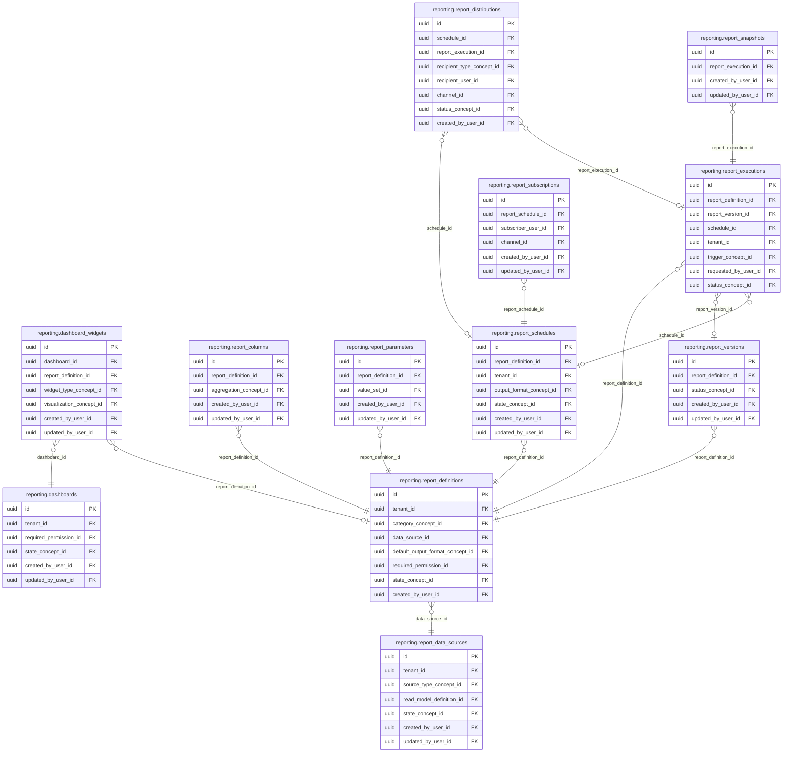

<!-- AUTOGENERADO por tools/inventario/catalogo.mjs. No editar manualmente. -->

# Catálogo del schema `reporting`

- **Tablas:** 12 · **Columnas:** 174 (48 con descripción: 27.6 %) · **Índices:** 86
- **Dominio:** Auditoría y Reporting
- Método y límites del catálogo: [README del inventario](../README.md)

## Tablas

| Tabla | Propósito | Columnas | Índices | Operaciones | ORM |
|---|---|---|---|---|---|
| [dashboard_widgets](#dashboard_widgets) | Define componentes visuales y fuentes de datos que integran cada tablero. | 14 | 7 | 1 | COINCIDE |
| [dashboards](#dashboards) | Representa tableros que reúnen visualizaciones operativas y de gestión basadas en fuentes autorizadas. | 13 | 8 | 2 | COINCIDE |
| [report_columns](#report_columns) | Describe columnas presentadas por reportes para documentar selección, orden y formato de datos. | 15 | 5 | 1 | COINCIDE |
| [report_data_sources](#report_data_sources) | Registra fuentes de datos autorizadas para construir reportes del sistema médico. | 15 | 9 | 3 | COINCIDE |
| [report_definitions](#report_definitions) | Define reportes disponibles, su propósito y configuración de ejecución. | 18 | 11 | 9 | COINCIDE |
| [report_distributions](#report_distributions) | Define destinos y reglas de distribución de reportes para compartir información autorizada. | 14 | 8 | 4 | COINCIDE |
| [report_executions](#report_executions) | Registra ejecuciones de reportes para consultar parámetros, estado y resultado producido. | 20 | 12 | 5 | COINCIDE |
| [report_parameters](#report_parameters) | Define parámetros que permiten filtrar o personalizar la ejecución de reportes. | 14 | 5 | 4 | COINCIDE |
| [report_schedules](#report_schedules) | Programa ejecuciones recurrentes de reportes para entregar información operativa o de gestión. | 17 | 8 | 6 | COINCIDE |
| [report_snapshots](#report_snapshots) | Preserva resultados de reportes en un momento determinado para comparación y reproducibilidad. | 12 | 3 | 2 | COINCIDE |
| [report_subscriptions](#report_subscriptions) | Asocia destinatarios a reportes periódicos para automatizar la recepción de información. | 10 | 5 | 4 | COINCIDE |
| [report_versions](#report_versions) | Preserva versiones de definiciones de reportes para reproducir cambios en estructura o lógica. | 12 | 5 | 4 | COINCIDE |

## Diagrama entidad-relación

Las tablas se agrupan en familias por sus claves foráneas dentro del schema (máximo 40 por diagrama). Las FK hacia otros schemas se listan en la ficha de cada tabla.

### Familia 1 de 1 — 12 tablas

## Fichas

### dashboard_widgets

#### Vista general

Define componentes visuales y fuentes de datos que integran cada tablero.

- **Estado del propósito:** DOMAIN_CURATED_DRAFT · fuente: `Mantra Core Health Context/modules/diagram_39_reporting.puml: dashboard_widgets`
- **Dominio:** Auditoría y Reporting · **Diagrama:** `Mantra Core Health Context/modules/diagram_39_reporting.puml` · **DDL:** `SQL/39_reporting/02_tables.sql`
- **Entidad del ORM:** `DashboardWidgets` — `src/modules/reporting/entities/dashboard_widgets.entity.ts`
- **Resumen:** 14 columnas · 7 índices · 6 FK salientes · 0 entrantes · 1 operaciones

#### Columnas

| # | Columna | Tipo | Rol estructural | Descripción | ORM |
|---|---|---|---|---|---|
| 1 | `id` | `uuid` | Clave primaria; Obligatoria | Identificador único de la instancia. _(JSDOC_ESTANDAR, `src/modules/reporting/entities/dashboard_widgets.entity.ts:12`)_ | coincide |
| 2 | `dashboard_id` | `uuid` | Clave foránea → reporting.dashboards.id; Obligatoria | _sin dato_ | coincide |
| 3 | `report_definition_id` | `uuid` | Clave foránea → reporting.report_definitions.id; Opcional | _sin dato_ | coincide |
| 4 | `widget_type_concept_id` | `uuid` | Clave foránea → terminology.catalog_concepts.id; Obligatoria | _sin dato_ | coincide |
| 5 | `title` | `varchar` | Obligatoria | _sin dato_ | coincide |
| 6 | `visualization_concept_id` | `uuid` | Clave foránea → terminology.catalog_concepts.id; Opcional | _sin dato_ | coincide |
| 7 | `config_json` | `jsonb` | Opcional | _sin dato_ | coincide |
| 8 | `position_json` | `jsonb` | Opcional | _sin dato_ | coincide |
| 9 | `ordinal` | `integer` | Opcional | _sin dato_ | coincide |
| 10 | `created_at` | `timestamptz` | Obligatoria | Fecha y hora en que se creó el registro. _(JSDOC_ESTANDAR, `src/modules/reporting/entities/dashboard_widgets.entity.ts:80`)_ | coincide |
| 11 | `updated_at` | `timestamptz` | Obligatoria | Fecha y hora de la última actualización. _(JSDOC_ESTANDAR, `src/modules/reporting/entities/dashboard_widgets.entity.ts:86`)_ | coincide |
| 12 | `created_by_user_id` | `uuid` | Clave foránea → iam.users.id; Opcional | _sin dato_ | coincide |
| 13 | `updated_by_user_id` | `uuid` | Clave foránea → iam.users.id; Opcional | _sin dato_ | coincide |
| 14 | `row_version` | `integer = 1` | Obligatoria | Versión usada para controlar actualizaciones concurrentes. _(JSDOC_ENTIDAD, `src/modules/reporting/entities/dashboard_widgets.entity.ts:104`)_ | coincide |

#### Relaciones

| Sentido | Columnas | Tabla | Restricción |
|---|---|---|---|
| hacia | dashboard_id | reporting.dashboards (id) | fk_dashboard_widgets_dashboard_id |
| hacia | report_definition_id | reporting.report_definitions (id) | fk_dashboard_widgets_report_definition_id |
| hacia | widget_type_concept_id | terminology.catalog_concepts (id) | fk_dashboard_widgets_widget_type_concept_id |
| hacia | visualization_concept_id | terminology.catalog_concepts (id) | fk_dashboard_widgets_visualization_concept_id |
| hacia | created_by_user_id | iam.users (id) | fk_dashboard_widgets_created_by_user_id |
| hacia | updated_by_user_id | iam.users (id) | fk_dashboard_widgets_updated_by_user_id |

#### Índices

| Índice | Único | Columnas | Para qué |
|---|---|---|---|
| `ix_dashboard_widgets_dashboard_id` | no | dashboard_id | Soporta la clave foránea fk_dashboard_widgets_dashboard_id: PostgreSQL no indexa las FK por sí mismo _(DOCUMENTO)_ |
| `ix_dashboard_widgets_report_definition_id` | no | report_definition_id | Soporta la clave foránea fk_dashboard_widgets_report_definition_id: PostgreSQL no indexa las FK por sí mismo _(DOCUMENTO)_ |
| `ix_dashboard_widgets_widget_type_concept_id` | no | widget_type_concept_id | Soporta la clave foránea fk_dashboard_widgets_widget_type_concept_id: PostgreSQL no indexa las FK por sí mismo _(DOCUMENTO)_ |
| `ix_dashboard_widgets_visualization_concept_id` | no | visualization_concept_id | Soporta la clave foránea fk_dashboard_widgets_visualization_concept_id: PostgreSQL no indexa las FK por sí mismo _(DOCUMENTO)_ |
| `ix_dashboard_widgets_created_by_user_id` | no | created_by_user_id | Soporta la clave foránea fk_dashboard_widgets_created_by_user_id: PostgreSQL no indexa las FK por sí mismo _(DOCUMENTO)_ |
| `ix_dashboard_widgets_updated_by_user_id` | no | updated_by_user_id | Soporta la clave foránea fk_dashboard_widgets_updated_by_user_id: PostgreSQL no indexa las FK por sí mismo _(DOCUMENTO)_ |
| `gin_dashboard_widgets_search` | no | (to_tsvector('simple', (coalesce(title, '')))) | GIN para búsqueda textual gobernada _(DOCUMENTO)_ |

#### Operaciones que la tocan

| Operación | Efecto | Confianza |
|---|---|---|
| POST /reporting/dashboards | CREA | DIRECTA |

#### Gobierno

| Atributo | Valor | Fuente |
|---|---|---|
| Append-only | no declarado | — |
| Datos personales | sin fuente | — |
| Financiera | sin fuente | — |
| Crítica para auditoría | sin fuente | — |
| Retención | sin fuente | — |
| Responsable | sin fuente | — |
| Revisión | AUTO_DETECTADA | — |

---

### dashboards

#### Vista general

Representa tableros que reúnen visualizaciones operativas y de gestión basadas en fuentes autorizadas.

- **Estado del propósito:** DOMAIN_CURATED_DRAFT · fuente: `Mantra Core Health Context/modules/diagram_39_reporting.puml: dashboards`
- **Dominio:** Auditoría y Reporting · **Diagrama:** `Mantra Core Health Context/modules/diagram_39_reporting.puml` · **DDL:** `SQL/39_reporting/02_tables.sql`
- **Entidad del ORM:** `Dashboards` — `src/modules/reporting/entities/dashboards.entity.ts`
- **Resumen:** 13 columnas · 8 índices · 5 FK salientes · 1 entrantes · 2 operaciones

#### Columnas

| # | Columna | Tipo | Rol estructural | Descripción | ORM |
|---|---|---|---|---|---|
| 1 | `id` | `uuid` | Clave primaria; Obligatoria | Identificador único de la instancia. _(JSDOC_ESTANDAR, `src/modules/reporting/entities/dashboards.entity.ts:12`)_ | coincide |
| 2 | `tenant_id` | `uuid` | Clave foránea → directory.tenants.id; Opcional | _sin dato_ | coincide |
| 3 | `code` | `varchar` | Obligatoria | _sin dato_ | coincide |
| 4 | `name` | `varchar` | Obligatoria | _sin dato_ | coincide |
| 5 | `description` | `text` | Opcional | _sin dato_ | coincide |
| 6 | `layout_json` | `jsonb` | Opcional | _sin dato_ | coincide |
| 7 | `required_permission_id` | `uuid` | Clave foránea → authz.permissions.id; Opcional | _sin dato_ | coincide |
| 8 | `state_concept_id` | `uuid` | Clave foránea → terminology.catalog_concepts.id; Obligatoria | _sin dato_ | coincide |
| 9 | `created_at` | `timestamptz` | Obligatoria | Fecha y hora en que se creó el registro. _(JSDOC_ESTANDAR, `src/modules/reporting/entities/dashboards.entity.ts:69`)_ | coincide |
| 10 | `updated_at` | `timestamptz` | Obligatoria | Fecha y hora de la última actualización. _(JSDOC_ESTANDAR, `src/modules/reporting/entities/dashboards.entity.ts:75`)_ | coincide |
| 11 | `created_by_user_id` | `uuid` | Clave foránea → iam.users.id; Opcional | _sin dato_ | coincide |
| 12 | `updated_by_user_id` | `uuid` | Clave foránea → iam.users.id; Opcional | _sin dato_ | coincide |
| 13 | `row_version` | `integer = 1` | Obligatoria | Versión usada para controlar actualizaciones concurrentes. _(JSDOC_ENTIDAD, `src/modules/reporting/entities/dashboards.entity.ts:93`)_ | coincide |

#### Relaciones

| Sentido | Columnas | Tabla | Restricción |
|---|---|---|---|
| hacia | tenant_id | directory.tenants (id) | fk_dashboards_tenant_id |
| hacia | required_permission_id | authz.permissions (id) | fk_dashboards_required_permission_id |
| hacia | state_concept_id | terminology.catalog_concepts (id) | fk_dashboards_state_concept_id |
| hacia | created_by_user_id | iam.users (id) | fk_dashboards_created_by_user_id |
| hacia | updated_by_user_id | iam.users (id) | fk_dashboards_updated_by_user_id |
| desde | id | reporting.dashboard_widgets (dashboard_id) | fk_dashboard_widgets_dashboard_id |

#### Índices

| Índice | Único | Columnas | Para qué |
|---|---|---|---|
| `uq_dashboards_code` | sí | code | Garantiza que no se repita la combinación (code) _(DOCUMENTO)_; 1 consulta(s) de repositorio filtran u ordenan por «code», la primera columna del índice _(CONSULTA)_ |
| `ix_dashboards_tenant_id` | no | tenant_id | Soporta la clave foránea fk_dashboards_tenant_id: PostgreSQL no indexa las FK por sí mismo _(DOCUMENTO)_ |
| `ix_dashboards_required_permission_id` | no | required_permission_id | Soporta la clave foránea fk_dashboards_required_permission_id: PostgreSQL no indexa las FK por sí mismo _(DOCUMENTO)_ |
| `ix_dashboards_state_concept_id` | no | state_concept_id | Soporta la clave foránea fk_dashboards_state_concept_id: PostgreSQL no indexa las FK por sí mismo _(DOCUMENTO)_ |
| `ix_dashboards_created_by_user_id` | no | created_by_user_id | Soporta la clave foránea fk_dashboards_created_by_user_id: PostgreSQL no indexa las FK por sí mismo _(DOCUMENTO)_ |
| `ix_dashboards_updated_by_user_id` | no | updated_by_user_id | Soporta la clave foránea fk_dashboards_updated_by_user_id: PostgreSQL no indexa las FK por sí mismo _(DOCUMENTO)_ |
| `ix_dashboards_tenant_id_state_concept_id` | no | tenant_id, state_concept_id, ("updated_at" DESC) | _sin uso detectado estáticamente_ |
| `gin_dashboards_search` | no | (to_tsvector('simple', (coalesce(name, '') ¦¦ ' ' ¦¦ coalesce(description, '')))) | GIN para búsqueda textual gobernada _(DOCUMENTO)_ |

#### Restricciones

| Restricción | Tipo | Definición |
|---|---|---|
| `uq_dashboards_code` | UNIQUE INDEX | UNIQUE INDEX ("code") |

#### Operaciones que la tocan

| Operación | Efecto | Confianza |
|---|---|---|
| POST /reporting/dashboards | CREA | DIRECTA |
| POST /reporting/dashboards | LEE | DIRECTA |

#### Gobierno

| Atributo | Valor | Fuente |
|---|---|---|
| Append-only | no declarado | — |
| Datos personales | sin fuente | — |
| Financiera | sin fuente | — |
| Crítica para auditoría | sin fuente | — |
| Retención | sin fuente | — |
| Responsable | sin fuente | — |
| Revisión | AUTO_DETECTADA | — |

---

### report_columns

#### Vista general

Describe columnas presentadas por reportes para documentar selección, orden y formato de datos.

- **Estado del propósito:** DOMAIN_CURATED_DRAFT · fuente: `Mantra Core Health Context/modules/diagram_39_reporting.puml: report_columns`
- **Dominio:** Auditoría y Reporting · **Diagrama:** `Mantra Core Health Context/modules/diagram_39_reporting.puml` · **DDL:** `SQL/39_reporting/02_tables.sql`
- **Entidad del ORM:** `ReportColumns` — `src/modules/reporting/entities/report_columns.entity.ts`
- **Resumen:** 15 columnas · 5 índices · 4 FK salientes · 0 entrantes · 1 operaciones

#### Columnas

| # | Columna | Tipo | Rol estructural | Descripción | ORM |
|---|---|---|---|---|---|
| 1 | `id` | `uuid` | Clave primaria; Obligatoria | Identificador único de la instancia. _(JSDOC_ESTANDAR, `src/modules/reporting/entities/report_columns.entity.ts:12`)_ | coincide |
| 2 | `report_definition_id` | `uuid` | Clave foránea → reporting.report_definitions.id; Obligatoria | _sin dato_ | coincide |
| 3 | `code` | `varchar` | Obligatoria | _sin dato_ | coincide |
| 4 | `label` | `varchar` | Obligatoria | _sin dato_ | coincide |
| 5 | `expression` | `text` | Opcional | _sin dato_ | coincide |
| 6 | `data_type` | `"terminology"."technical_data_type"` | Opcional | _sin dato_ | coincide |
| 7 | `aggregation_concept_id` | `uuid` | Clave foránea → terminology.catalog_concepts.id; Opcional | _sin dato_ | coincide |
| 8 | `format_mask` | `varchar` | Opcional | _sin dato_ | coincide |
| 9 | `is_visible` | `boolean` | Opcional | _sin dato_ | coincide |
| 10 | `ordinal` | `integer` | Opcional | _sin dato_ | coincide |
| 11 | `created_at` | `timestamptz` | Obligatoria | Fecha y hora en que se creó el registro. _(JSDOC_ESTANDAR, `src/modules/reporting/entities/report_columns.entity.ts:80`)_ | coincide |
| 12 | `updated_at` | `timestamptz` | Obligatoria | Fecha y hora de la última actualización. _(JSDOC_ESTANDAR, `src/modules/reporting/entities/report_columns.entity.ts:86`)_ | coincide |
| 13 | `created_by_user_id` | `uuid` | Clave foránea → iam.users.id; Opcional | _sin dato_ | coincide |
| 14 | `updated_by_user_id` | `uuid` | Clave foránea → iam.users.id; Opcional | _sin dato_ | coincide |
| 15 | `row_version` | `integer = 1` | Obligatoria | Versión usada para controlar actualizaciones concurrentes. _(JSDOC_ENTIDAD, `src/modules/reporting/entities/report_columns.entity.ts:104`)_ | coincide |

#### Relaciones

| Sentido | Columnas | Tabla | Restricción |
|---|---|---|---|
| hacia | report_definition_id | reporting.report_definitions (id) | fk_report_columns_report_definition_id |
| hacia | aggregation_concept_id | terminology.catalog_concepts (id) | fk_report_columns_aggregation_concept_id |
| hacia | created_by_user_id | iam.users (id) | fk_report_columns_created_by_user_id |
| hacia | updated_by_user_id | iam.users (id) | fk_report_columns_updated_by_user_id |

#### Índices

| Índice | Único | Columnas | Para qué |
|---|---|---|---|
| `ix_report_columns_report_definition_id` | no | report_definition_id | Soporta la clave foránea fk_report_columns_report_definition_id: PostgreSQL no indexa las FK por sí mismo _(DOCUMENTO)_ |
| `ix_report_columns_aggregation_concept_id` | no | aggregation_concept_id | Soporta la clave foránea fk_report_columns_aggregation_concept_id: PostgreSQL no indexa las FK por sí mismo _(DOCUMENTO)_ |
| `ix_report_columns_created_by_user_id` | no | created_by_user_id | Soporta la clave foránea fk_report_columns_created_by_user_id: PostgreSQL no indexa las FK por sí mismo _(DOCUMENTO)_ |
| `ix_report_columns_updated_by_user_id` | no | updated_by_user_id | Soporta la clave foránea fk_report_columns_updated_by_user_id: PostgreSQL no indexa las FK por sí mismo _(DOCUMENTO)_ |
| `gin_report_columns_search` | no | (to_tsvector('simple', (coalesce(code, '')))) | GIN para búsqueda textual gobernada _(DOCUMENTO)_ |

#### Operaciones que la tocan

| Operación | Efecto | Confianza |
|---|---|---|
| POST /reporting/definitions | CREA | DIRECTA |

#### Gobierno

| Atributo | Valor | Fuente |
|---|---|---|
| Append-only | no declarado | — |
| Datos personales | sin fuente | — |
| Financiera | sin fuente | — |
| Crítica para auditoría | sin fuente | — |
| Retención | sin fuente | — |
| Responsable | sin fuente | — |
| Revisión | AUTO_DETECTADA | — |

---

### report_data_sources

#### Vista general

Registra fuentes de datos autorizadas para construir reportes del sistema médico.

- **Estado del propósito:** DOMAIN_CURATED_DRAFT · fuente: `Mantra Core Health Context/modules/diagram_39_reporting.puml: report_data_sources`
- **Dominio:** Auditoría y Reporting · **Diagrama:** `Mantra Core Health Context/modules/diagram_39_reporting.puml` · **DDL:** `SQL/39_reporting/02_tables.sql`
- **Entidad del ORM:** `ReportDataSources` — `src/modules/reporting/entities/report_data_sources.entity.ts`
- **Resumen:** 15 columnas · 9 índices · 6 FK salientes · 1 entrantes · 3 operaciones

#### Columnas

| # | Columna | Tipo | Rol estructural | Descripción | ORM |
|---|---|---|---|---|---|
| 1 | `id` | `uuid` | Clave primaria; Obligatoria | Identificador único de la instancia. _(JSDOC_ESTANDAR, `src/modules/reporting/entities/report_data_sources.entity.ts:12`)_ | coincide |
| 2 | `tenant_id` | `uuid` | Clave foránea → directory.tenants.id; Opcional | _sin dato_ | coincide |
| 3 | `code` | `varchar` | Obligatoria | _sin dato_ | coincide |
| 4 | `name` | `varchar` | Obligatoria | _sin dato_ | coincide |
| 5 | `source_type_concept_id` | `uuid` | Clave foránea → terminology.catalog_concepts.id; Obligatoria | _sin dato_ | coincide |
| 6 | `read_model_definition_id` | `uuid` | Clave foránea → read_models.read_model_definitions.id; Opcional | _sin dato_ | coincide |
| 7 | `view_name` | `varchar` | Opcional | _sin dato_ | coincide |
| 8 | `spec_json` | `jsonb` | Opcional | _sin dato_ | coincide |
| 9 | `row_security_json` | `jsonb` | Opcional | _sin dato_ | coincide |
| 10 | `state_concept_id` | `uuid` | Clave foránea → terminology.catalog_concepts.id; Obligatoria | _sin dato_ | coincide |
| 11 | `created_at` | `timestamptz` | Obligatoria | Fecha y hora en que se creó el registro. _(JSDOC_ESTANDAR, `src/modules/reporting/entities/report_data_sources.entity.ts:86`)_ | coincide |
| 12 | `updated_at` | `timestamptz` | Obligatoria | Fecha y hora de la última actualización. _(JSDOC_ESTANDAR, `src/modules/reporting/entities/report_data_sources.entity.ts:92`)_ | coincide |
| 13 | `created_by_user_id` | `uuid` | Clave foránea → iam.users.id; Opcional | _sin dato_ | coincide |
| 14 | `updated_by_user_id` | `uuid` | Clave foránea → iam.users.id; Opcional | _sin dato_ | coincide |
| 15 | `row_version` | `integer = 1` | Obligatoria | Versión usada para controlar actualizaciones concurrentes. _(JSDOC_ENTIDAD, `src/modules/reporting/entities/report_data_sources.entity.ts:110`)_ | coincide |

#### Relaciones

| Sentido | Columnas | Tabla | Restricción |
|---|---|---|---|
| hacia | tenant_id | directory.tenants (id) | fk_report_data_sources_tenant_id |
| hacia | source_type_concept_id | terminology.catalog_concepts (id) | fk_report_data_sources_source_type_concept_id |
| hacia | read_model_definition_id | read_models.read_model_definitions (id) | fk_report_data_sources_read_model_definition_id |
| hacia | state_concept_id | terminology.catalog_concepts (id) | fk_report_data_sources_state_concept_id |
| hacia | created_by_user_id | iam.users (id) | fk_report_data_sources_created_by_user_id |
| hacia | updated_by_user_id | iam.users (id) | fk_report_data_sources_updated_by_user_id |
| desde | id | reporting.report_definitions (data_source_id) | fk_report_definitions_data_source_id |

#### Índices

| Índice | Único | Columnas | Para qué |
|---|---|---|---|
| `uq_report_data_sources_code` | sí | code | Garantiza que no se repita la combinación (code) _(DOCUMENTO)_; 1 consulta(s) de repositorio filtran u ordenan por «code», la primera columna del índice _(CONSULTA)_ |
| `ix_report_data_sources_tenant_id` | no | tenant_id | Soporta la clave foránea fk_report_data_sources_tenant_id: PostgreSQL no indexa las FK por sí mismo _(DOCUMENTO)_ |
| `ix_report_data_sources_source_type_concept_id` | no | source_type_concept_id | Soporta la clave foránea fk_report_data_sources_source_type_concept_id: PostgreSQL no indexa las FK por sí mismo _(DOCUMENTO)_ |
| `ix_report_data_sources_read_model_definition_id` | no | read_model_definition_id | Soporta la clave foránea fk_report_data_sources_read_model_definition_id: PostgreSQL no indexa las FK por sí mismo _(DOCUMENTO)_ |
| `ix_report_data_sources_state_concept_id` | no | state_concept_id | Soporta la clave foránea fk_report_data_sources_state_concept_id: PostgreSQL no indexa las FK por sí mismo _(DOCUMENTO)_ |
| `ix_report_data_sources_created_by_user_id` | no | created_by_user_id | Soporta la clave foránea fk_report_data_sources_created_by_user_id: PostgreSQL no indexa las FK por sí mismo _(DOCUMENTO)_ |
| `ix_report_data_sources_updated_by_user_id` | no | updated_by_user_id | Soporta la clave foránea fk_report_data_sources_updated_by_user_id: PostgreSQL no indexa las FK por sí mismo _(DOCUMENTO)_ |
| `ix_report_data_sources_tenant_id_state_concept_id` | no | tenant_id, state_concept_id, ("updated_at" DESC) | _sin uso detectado estáticamente_ |
| `gin_report_data_sources_search` | no | (to_tsvector('simple', (coalesce(name, '') ¦¦ ' ' ¦¦ coalesce(code, '')))) | GIN para búsqueda textual gobernada _(DOCUMENTO)_ |

#### Restricciones

| Restricción | Tipo | Definición |
|---|---|---|
| `uq_report_data_sources_code` | UNIQUE INDEX | UNIQUE INDEX ("code") |

#### Operaciones que la tocan

| Operación | Efecto | Confianza |
|---|---|---|
| POST /reporting/data-sources | CREA | DIRECTA |
| POST /reporting/data-sources | LEE | DIRECTA |
| POST /reporting/definitions | LEE | DIRECTA |

#### Gobierno

| Atributo | Valor | Fuente |
|---|---|---|
| Append-only | no declarado | — |
| Datos personales | sin fuente | — |
| Financiera | sin fuente | — |
| Crítica para auditoría | sin fuente | — |
| Retención | sin fuente | — |
| Responsable | sin fuente | — |
| Revisión | AUTO_DETECTADA | — |

---

### report_definitions

#### Vista general

Define reportes disponibles, su propósito y configuración de ejecución.

- **Estado del propósito:** DOMAIN_CURATED_DRAFT · fuente: `Mantra Core Health Context/modules/diagram_39_reporting.puml: report_definitions`
- **Dominio:** Auditoría y Reporting · **Diagrama:** `Mantra Core Health Context/modules/diagram_39_reporting.puml` · **DDL:** `SQL/39_reporting/02_tables.sql`
- **Entidad del ORM:** `ReportDefinitions` — `src/modules/reporting/entities/report_definitions.entity.ts`
- **Resumen:** 18 columnas · 11 índices · 8 FK salientes · 7 entrantes · 9 operaciones

#### Columnas

| # | Columna | Tipo | Rol estructural | Descripción | ORM |
|---|---|---|---|---|---|
| 1 | `id` | `uuid` | Clave primaria; Obligatoria | Identificador único de la instancia. _(JSDOC_ESTANDAR, `src/modules/reporting/entities/report_definitions.entity.ts:12`)_ | coincide |
| 2 | `tenant_id` | `uuid` | Clave foránea → directory.tenants.id; Opcional | _sin dato_ | coincide |
| 3 | `code` | `varchar` | Obligatoria | _sin dato_ | coincide |
| 4 | `name` | `varchar` | Obligatoria | _sin dato_ | coincide |
| 5 | `description` | `text` | Opcional | _sin dato_ | coincide |
| 6 | `category_concept_id` | `uuid` | Clave foránea → terminology.catalog_concepts.id; Opcional | _sin dato_ | coincide |
| 7 | `data_source_id` | `uuid` | Clave foránea → reporting.report_data_sources.id; Obligatoria | _sin dato_ | coincide |
| 8 | `query_spec_json` | `jsonb` | Opcional | _sin dato_ | coincide |
| 9 | `default_output_format_concept_id` | `uuid` | Clave foránea → terminology.catalog_concepts.id; Opcional | _sin dato_ | coincide |
| 10 | `required_permission_id` | `uuid` | Clave foránea → authz.permissions.id; Opcional | _sin dato_ | coincide |
| 11 | `is_public` | `boolean` | Opcional | _sin dato_ | coincide |
| 12 | `current_version` | `integer` | Obligatoria | _sin dato_ | coincide |
| 13 | `state_concept_id` | `uuid` | Clave foránea → terminology.catalog_concepts.id; Obligatoria | _sin dato_ | coincide |
| 14 | `created_at` | `timestamptz` | Obligatoria | Fecha y hora en que se creó el registro. _(JSDOC_ESTANDAR, `src/modules/reporting/entities/report_definitions.entity.ts:103`)_ | coincide |
| 15 | `updated_at` | `timestamptz` | Obligatoria | Fecha y hora de la última actualización. _(JSDOC_ESTANDAR, `src/modules/reporting/entities/report_definitions.entity.ts:109`)_ | coincide |
| 16 | `created_by_user_id` | `uuid` | Clave foránea → iam.users.id; Opcional | _sin dato_ | coincide |
| 17 | `updated_by_user_id` | `uuid` | Clave foránea → iam.users.id; Opcional | _sin dato_ | coincide |
| 18 | `row_version` | `integer = 1` | Obligatoria | Versión usada para controlar actualizaciones concurrentes. _(JSDOC_ENTIDAD, `src/modules/reporting/entities/report_definitions.entity.ts:127`)_ | coincide |

#### Relaciones

| Sentido | Columnas | Tabla | Restricción |
|---|---|---|---|
| hacia | data_source_id | reporting.report_data_sources (id) | fk_report_definitions_data_source_id |
| hacia | tenant_id | directory.tenants (id) | fk_report_definitions_tenant_id |
| hacia | category_concept_id | terminology.catalog_concepts (id) | fk_report_definitions_category_concept_id |
| hacia | default_output_format_concept_id | terminology.catalog_concepts (id) | fk_report_definitions_default_output_format_concept_id |
| hacia | required_permission_id | authz.permissions (id) | fk_report_definitions_required_permission_id |
| hacia | state_concept_id | terminology.catalog_concepts (id) | fk_report_definitions_state_concept_id |
| hacia | created_by_user_id | iam.users (id) | fk_report_definitions_created_by_user_id |
| hacia | updated_by_user_id | iam.users (id) | fk_report_definitions_updated_by_user_id |
| desde | id | reporting.report_versions (report_definition_id) | fk_report_versions_report_definition_id |
| desde | id | reporting.report_parameters (report_definition_id) | fk_report_parameters_report_definition_id |
| desde | id | reporting.report_columns (report_definition_id) | fk_report_columns_report_definition_id |
| desde | id | reporting.report_schedules (report_definition_id) | fk_report_schedules_report_definition_id |
| desde | id | reporting.report_executions (report_definition_id) | fk_report_executions_report_definition_id |
| desde | id | reporting.dashboard_widgets (report_definition_id) | fk_dashboard_widgets_report_definition_id |
| desde | id | audit.report_definitions_history (report_definition_id) | fk_report_definitions_history_report_definition_id |

#### Índices

| Índice | Único | Columnas | Para qué |
|---|---|---|---|
| `uq_report_definitions_code` | sí | code | Garantiza que no se repita la combinación (code) _(DOCUMENTO)_; 1 consulta(s) de repositorio filtran u ordenan por «code», la primera columna del índice _(CONSULTA)_ |
| `ix_report_definitions_tenant_id` | no | tenant_id | Soporta la clave foránea fk_report_definitions_tenant_id: PostgreSQL no indexa las FK por sí mismo _(DOCUMENTO)_ |
| `ix_report_definitions_category_concept_id` | no | category_concept_id | Soporta la clave foránea fk_report_definitions_category_concept_id: PostgreSQL no indexa las FK por sí mismo _(DOCUMENTO)_ |
| `ix_report_definitions_data_source_id` | no | data_source_id | Soporta la clave foránea fk_report_definitions_data_source_id: PostgreSQL no indexa las FK por sí mismo _(DOCUMENTO)_ |
| `ix_report_definitions_default_output_format_concept_id` | no | default_output_format_concept_id | Soporta la clave foránea fk_report_definitions_default_output_format_concept_id: PostgreSQL no indexa las FK por sí mismo _(DOCUMENTO)_ |
| `ix_report_definitions_required_permission_id` | no | required_permission_id | Soporta la clave foránea fk_report_definitions_required_permission_id: PostgreSQL no indexa las FK por sí mismo _(DOCUMENTO)_ |
| `ix_report_definitions_state_concept_id` | no | state_concept_id | Soporta la clave foránea fk_report_definitions_state_concept_id: PostgreSQL no indexa las FK por sí mismo _(DOCUMENTO)_ |
| `ix_report_definitions_created_by_user_id` | no | created_by_user_id | Soporta la clave foránea fk_report_definitions_created_by_user_id: PostgreSQL no indexa las FK por sí mismo _(DOCUMENTO)_ |
| `ix_report_definitions_updated_by_user_id` | no | updated_by_user_id | Soporta la clave foránea fk_report_definitions_updated_by_user_id: PostgreSQL no indexa las FK por sí mismo _(DOCUMENTO)_ |
| `ix_report_definitions_tenant_id_state_concept_id` | no | tenant_id, state_concept_id, ("updated_at" DESC) | _sin uso detectado estáticamente_ |
| `gin_report_definitions_search` | no | (to_tsvector('simple', (coalesce(name, '') ¦¦ ' ' ¦¦ coalesce(description, '')))) | GIN para búsqueda textual gobernada _(DOCUMENTO)_ |

#### Restricciones

| Restricción | Tipo | Definición |
|---|---|---|
| `uq_report_definitions_code` | UNIQUE INDEX | UNIQUE INDEX ("code") |

#### Operaciones que la tocan

| Operación | Efecto | Confianza |
|---|---|---|
| POST /reporting/dashboards | LEE | DIRECTA |
| POST /reporting/definitions | CREA | DIRECTA |
| POST /reporting/definitions | LEE | DIRECTA |
| POST /reporting/definitions/{id}/deprecate | LEE | DIRECTA |
| POST /reporting/definitions/{id}/executions | LEE | DIRECTA |
| POST /reporting/definitions/{id}/schedules | LEE | DIRECTA |
| POST /reporting/definitions/{id}/versions/publish | LEE | DIRECTA |
| POST /reporting/executions/{id}/retry | LEE | DIRECTA |
| POST /reporting/scheduler/tick | LEE | DIRECTA |

#### Gobierno

| Atributo | Valor | Fuente |
|---|---|---|
| Append-only | no declarado | — |
| Datos personales | sin fuente | — |
| Financiera | sin fuente | — |
| Crítica para auditoría | sin fuente | — |
| Retención | sin fuente | — |
| Responsable | sin fuente | — |
| Revisión | AUTO_DETECTADA | — |

---

### report_distributions

#### Vista general

Define destinos y reglas de distribución de reportes para compartir información autorizada.

- **Estado del propósito:** DOMAIN_CURATED_DRAFT · fuente: `Mantra Core Health Context/modules/diagram_39_reporting.puml: report_distributions`
- **Dominio:** Auditoría y Reporting · **Diagrama:** `Mantra Core Health Context/modules/diagram_39_reporting.puml` · **DDL:** `SQL/39_reporting/02_tables.sql`
- **Entidad del ORM:** `ReportDistributions` — `src/modules/reporting/entities/report_distributions.entity.ts`
- **Resumen:** 14 columnas · 8 índices · 8 FK salientes · 0 entrantes · 4 operaciones

#### Columnas

| # | Columna | Tipo | Rol estructural | Descripción | ORM |
|---|---|---|---|---|---|
| 1 | `id` | `uuid` | Clave primaria; Obligatoria | Identificador único de la instancia. _(JSDOC_ESTANDAR, `src/modules/reporting/entities/report_distributions.entity.ts:12`)_ | coincide |
| 2 | `schedule_id` | `uuid` | Clave foránea → reporting.report_schedules.id; Opcional | _sin dato_ | coincide |
| 3 | `report_execution_id` | `uuid` | Clave foránea → reporting.report_executions.id; Opcional | _sin dato_ | coincide |
| 4 | `recipient_type_concept_id` | `uuid` | Clave foránea → terminology.catalog_concepts.id; Obligatoria | _sin dato_ | coincide |
| 5 | `recipient_user_id` | `uuid` | Clave foránea → iam.users.id; Opcional | _sin dato_ | coincide |
| 6 | `recipient_address` | `varchar` | Opcional | _sin dato_ | coincide |
| 7 | `channel_id` | `uuid` | Clave foránea → messaging.message_channels.id; Obligatoria | _sin dato_ | coincide |
| 8 | `status_concept_id` | `uuid` | Clave foránea → terminology.catalog_concepts.id; Obligatoria | _sin dato_ | coincide |
| 9 | `sent_at` | `timestamptz` | Opcional | _sin dato_ | coincide |
| 10 | `created_at` | `timestamptz` | Obligatoria | Fecha y hora en que se creó el registro. _(JSDOC_ESTANDAR, `src/modules/reporting/entities/report_distributions.entity.ts:70`)_ | coincide |
| 11 | `updated_at` | `timestamptz` | Obligatoria | Fecha y hora de la última actualización. _(JSDOC_ESTANDAR, `src/modules/reporting/entities/report_distributions.entity.ts:76`)_ | coincide |
| 12 | `created_by_user_id` | `uuid` | Clave foránea → iam.users.id; Opcional | _sin dato_ | coincide |
| 13 | `updated_by_user_id` | `uuid` | Clave foránea → iam.users.id; Opcional | _sin dato_ | coincide |
| 14 | `row_version` | `integer = 1` | Obligatoria | Versión usada para controlar actualizaciones concurrentes. _(JSDOC_ENTIDAD, `src/modules/reporting/entities/report_distributions.entity.ts:94`)_ | coincide |

#### Relaciones

| Sentido | Columnas | Tabla | Restricción |
|---|---|---|---|
| hacia | schedule_id | reporting.report_schedules (id) | fk_report_distributions_schedule_id |
| hacia | report_execution_id | reporting.report_executions (id) | fk_report_distributions_report_execution_id |
| hacia | recipient_type_concept_id | terminology.catalog_concepts (id) | fk_report_distributions_recipient_type_concept_id |
| hacia | recipient_user_id | iam.users (id) | fk_report_distributions_recipient_user_id |
| hacia | channel_id | messaging.message_channels (id) | fk_report_distributions_channel_id |
| hacia | status_concept_id | terminology.catalog_concepts (id) | fk_report_distributions_status_concept_id |
| hacia | created_by_user_id | iam.users (id) | fk_report_distributions_created_by_user_id |
| hacia | updated_by_user_id | iam.users (id) | fk_report_distributions_updated_by_user_id |

#### Índices

| Índice | Único | Columnas | Para qué |
|---|---|---|---|
| `ix_report_distributions_schedule_id` | no | schedule_id | Soporta la clave foránea fk_report_distributions_schedule_id: PostgreSQL no indexa las FK por sí mismo _(DOCUMENTO)_ |
| `ix_report_distributions_report_execution_id` | no | report_execution_id | Soporta la clave foránea fk_report_distributions_report_execution_id: PostgreSQL no indexa las FK por sí mismo _(DOCUMENTO)_; 2 consulta(s) de repositorio filtran u ordenan por «report_execution_id», la primera columna del índice _(CONSULTA)_ |
| `ix_report_distributions_recipient_type_concept_id` | no | recipient_type_concept_id | Soporta la clave foránea fk_report_distributions_recipient_type_concept_id: PostgreSQL no indexa las FK por sí mismo _(DOCUMENTO)_ |
| `ix_report_distributions_recipient_user_id` | no | recipient_user_id | Soporta la clave foránea fk_report_distributions_recipient_user_id: PostgreSQL no indexa las FK por sí mismo _(DOCUMENTO)_ |
| `ix_report_distributions_channel_id` | no | channel_id | Soporta la clave foránea fk_report_distributions_channel_id: PostgreSQL no indexa las FK por sí mismo _(DOCUMENTO)_ |
| `ix_report_distributions_status_concept_id` | no | status_concept_id | Soporta la clave foránea fk_report_distributions_status_concept_id: PostgreSQL no indexa las FK por sí mismo _(DOCUMENTO)_ |
| `ix_report_distributions_created_by_user_id` | no | created_by_user_id | Soporta la clave foránea fk_report_distributions_created_by_user_id: PostgreSQL no indexa las FK por sí mismo _(DOCUMENTO)_ |
| `ix_report_distributions_updated_by_user_id` | no | updated_by_user_id | Soporta la clave foránea fk_report_distributions_updated_by_user_id: PostgreSQL no indexa las FK por sí mismo _(DOCUMENTO)_ |

#### Operaciones que la tocan

| Operación | Efecto | Confianza |
|---|---|---|
| POST /reporting/executions/{id}/distributions | CREA | DIRECTA |
| POST /reporting/executions/{id}/distributions | LEE | DIRECTA |
| POST /reporting/executions/{id}/retry | ACTUALIZA | POR_TIPO |
| POST /reporting/executions/{id}/retry | LEE | DIRECTA |

#### Gobierno

| Atributo | Valor | Fuente |
|---|---|---|
| Append-only | no declarado | — |
| Datos personales | sin fuente | — |
| Financiera | sin fuente | — |
| Crítica para auditoría | sin fuente | — |
| Retención | sin fuente | — |
| Responsable | sin fuente | — |
| Revisión | AUTO_DETECTADA | — |

---

### report_executions

#### Vista general

Registra ejecuciones de reportes para consultar parámetros, estado y resultado producido.

- **Estado del propósito:** DOMAIN_CURATED_DRAFT · fuente: `Mantra Core Health Context/modules/diagram_39_reporting.puml: report_executions`
- **Dominio:** Auditoría y Reporting · **Diagrama:** `Mantra Core Health Context/modules/diagram_39_reporting.puml` · **DDL:** `SQL/39_reporting/02_tables.sql`
- **Entidad del ORM:** `ReportExecutions` — `src/modules/reporting/entities/report_executions.entity.ts`
- **Resumen:** 20 columnas · 12 índices · 11 FK salientes · 2 entrantes · 5 operaciones

#### Columnas

| # | Columna | Tipo | Rol estructural | Descripción | ORM |
|---|---|---|---|---|---|
| 1 | `id` | `uuid` | Clave primaria; Obligatoria | Identificador único de la instancia. _(JSDOC_ESTANDAR, `src/modules/reporting/entities/report_executions.entity.ts:12`)_ | coincide |
| 2 | `report_definition_id` | `uuid` | Clave foránea → reporting.report_definitions.id; Obligatoria | _sin dato_ | coincide |
| 3 | `report_version_id` | `uuid` | Clave foránea → reporting.report_versions.id; Opcional | _sin dato_ | coincide |
| 4 | `schedule_id` | `uuid` | Clave foránea → reporting.report_schedules.id; Opcional | _sin dato_ | coincide |
| 5 | `tenant_id` | `uuid` | Clave foránea → directory.tenants.id; Opcional | _sin dato_ | coincide |
| 6 | `trigger_concept_id` | `uuid` | Clave foránea → terminology.catalog_concepts.id; Obligatoria | _sin dato_ | coincide |
| 7 | `requested_by_user_id` | `uuid` | Clave foránea → iam.users.id; Opcional | _sin dato_ | coincide |
| 8 | `parameters_json` | `jsonb` | Opcional | _sin dato_ | coincide |
| 9 | `status_concept_id` | `uuid` | Clave foránea → terminology.catalog_concepts.id; Obligatoria | _sin dato_ | coincide |
| 10 | `started_at` | `timestamptz` | Opcional | _sin dato_ | coincide |
| 11 | `finished_at` | `timestamptz` | Opcional | _sin dato_ | coincide |
| 12 | `row_count` | `bigint` | Opcional | _sin dato_ | coincide |
| 13 | `output_format_concept_id` | `uuid` | Clave foránea → terminology.catalog_concepts.id; Opcional | _sin dato_ | coincide |
| 14 | `output_file_id` | `uuid` | Clave foránea → common.files.id; Opcional | _sin dato_ | coincide |
| 15 | `error_text` | `text` | Opcional | _sin dato_ | coincide |
| 16 | `created_at` | `timestamptz` | Obligatoria | Fecha y hora en que se creó el registro. _(JSDOC_ESTANDAR, `src/modules/reporting/entities/report_executions.entity.ts:119`)_ | coincide |
| 17 | `updated_at` | `timestamptz` | Obligatoria | Fecha y hora de la última actualización. _(JSDOC_ESTANDAR, `src/modules/reporting/entities/report_executions.entity.ts:125`)_ | coincide |
| 18 | `created_by_user_id` | `uuid` | Clave foránea → iam.users.id; Opcional | _sin dato_ | coincide |
| 19 | `updated_by_user_id` | `uuid` | Clave foránea → iam.users.id; Opcional | _sin dato_ | coincide |
| 20 | `row_version` | `integer = 1` | Obligatoria | Versión usada para controlar actualizaciones concurrentes. _(JSDOC_ENTIDAD, `src/modules/reporting/entities/report_executions.entity.ts:143`)_ | coincide |

#### Relaciones

| Sentido | Columnas | Tabla | Restricción |
|---|---|---|---|
| hacia | report_definition_id | reporting.report_definitions (id) | fk_report_executions_report_definition_id |
| hacia | report_version_id | reporting.report_versions (id) | fk_report_executions_report_version_id |
| hacia | schedule_id | reporting.report_schedules (id) | fk_report_executions_schedule_id |
| hacia | tenant_id | directory.tenants (id) | fk_report_executions_tenant_id |
| hacia | trigger_concept_id | terminology.catalog_concepts (id) | fk_report_executions_trigger_concept_id |
| hacia | requested_by_user_id | iam.users (id) | fk_report_executions_requested_by_user_id |
| hacia | status_concept_id | terminology.catalog_concepts (id) | fk_report_executions_status_concept_id |
| hacia | output_format_concept_id | terminology.catalog_concepts (id) | fk_report_executions_output_format_concept_id |
| hacia | output_file_id | common.files (id) | fk_report_executions_output_file_id |
| hacia | created_by_user_id | iam.users (id) | fk_report_executions_created_by_user_id |
| hacia | updated_by_user_id | iam.users (id) | fk_report_executions_updated_by_user_id |
| desde | id | reporting.report_snapshots (report_execution_id) | fk_report_snapshots_report_execution_id |
| desde | id | reporting.report_distributions (report_execution_id) | fk_report_distributions_report_execution_id |

#### Índices

| Índice | Único | Columnas | Para qué |
|---|---|---|---|
| `ix_report_executions_report_definition_id` | no | report_definition_id | Soporta la clave foránea fk_report_executions_report_definition_id: PostgreSQL no indexa las FK por sí mismo _(DOCUMENTO)_ |
| `ix_report_executions_report_version_id` | no | report_version_id | Soporta la clave foránea fk_report_executions_report_version_id: PostgreSQL no indexa las FK por sí mismo _(DOCUMENTO)_ |
| `ix_report_executions_schedule_id` | no | schedule_id | Soporta la clave foránea fk_report_executions_schedule_id: PostgreSQL no indexa las FK por sí mismo _(DOCUMENTO)_ |
| `ix_report_executions_tenant_id` | no | tenant_id | Soporta la clave foránea fk_report_executions_tenant_id: PostgreSQL no indexa las FK por sí mismo _(DOCUMENTO)_ |
| `ix_report_executions_trigger_concept_id` | no | trigger_concept_id | Soporta la clave foránea fk_report_executions_trigger_concept_id: PostgreSQL no indexa las FK por sí mismo _(DOCUMENTO)_ |
| `ix_report_executions_requested_by_user_id` | no | requested_by_user_id | Soporta la clave foránea fk_report_executions_requested_by_user_id: PostgreSQL no indexa las FK por sí mismo _(DOCUMENTO)_ |
| `ix_report_executions_status_concept_id` | no | status_concept_id | Soporta la clave foránea fk_report_executions_status_concept_id: PostgreSQL no indexa las FK por sí mismo _(DOCUMENTO)_ |
| `ix_report_executions_output_format_concept_id` | no | output_format_concept_id | Soporta la clave foránea fk_report_executions_output_format_concept_id: PostgreSQL no indexa las FK por sí mismo _(DOCUMENTO)_ |
| `ix_report_executions_output_file_id` | no | output_file_id | Soporta la clave foránea fk_report_executions_output_file_id: PostgreSQL no indexa las FK por sí mismo _(DOCUMENTO)_ |
| `ix_report_executions_created_by_user_id` | no | created_by_user_id | Soporta la clave foránea fk_report_executions_created_by_user_id: PostgreSQL no indexa las FK por sí mismo _(DOCUMENTO)_ |
| `ix_report_executions_updated_by_user_id` | no | updated_by_user_id | Soporta la clave foránea fk_report_executions_updated_by_user_id: PostgreSQL no indexa las FK por sí mismo _(DOCUMENTO)_ |
| `ix_report_executions_tenant_id_status_concept_id` | no | tenant_id, status_concept_id, ("updated_at" DESC) | _sin uso detectado estáticamente_ |

#### Operaciones que la tocan

| Operación | Efecto | Confianza |
|---|---|---|
| POST /reporting/definitions/{id}/executions | CREA | DIRECTA |
| POST /reporting/executions/{id}/distributions | LEE | DIRECTA |
| POST /reporting/executions/{id}/retry | LEE | DIRECTA |
| POST /reporting/executions/{id}/snapshot | LEE | DIRECTA |
| POST /reporting/scheduler/tick | CREA | DIRECTA |

#### Gobierno

| Atributo | Valor | Fuente |
|---|---|---|
| Append-only | no declarado | — |
| Datos personales | sin fuente | — |
| Financiera | sin fuente | — |
| Crítica para auditoría | sin fuente | — |
| Retención | sin fuente | — |
| Responsable | sin fuente | — |
| Revisión | AUTO_DETECTADA | — |

---

### report_parameters

#### Vista general

Define parámetros que permiten filtrar o personalizar la ejecución de reportes.

- **Estado del propósito:** DOMAIN_CURATED_DRAFT · fuente: `Mantra Core Health Context/modules/diagram_39_reporting.puml: report_parameters`
- **Dominio:** Auditoría y Reporting · **Diagrama:** `Mantra Core Health Context/modules/diagram_39_reporting.puml` · **DDL:** `SQL/39_reporting/02_tables.sql`
- **Entidad del ORM:** `ReportParameters` — `src/modules/reporting/entities/report_parameters.entity.ts`
- **Resumen:** 14 columnas · 5 índices · 4 FK salientes · 0 entrantes · 4 operaciones

#### Columnas

| # | Columna | Tipo | Rol estructural | Descripción | ORM |
|---|---|---|---|---|---|
| 1 | `id` | `uuid` | Clave primaria; Obligatoria | Identificador único de la instancia. _(JSDOC_ESTANDAR, `src/modules/reporting/entities/report_parameters.entity.ts:12`)_ | coincide |
| 2 | `report_definition_id` | `uuid` | Clave foránea → reporting.report_definitions.id; Obligatoria | _sin dato_ | coincide |
| 3 | `code` | `varchar` | Obligatoria | _sin dato_ | coincide |
| 4 | `name` | `varchar` | Obligatoria | _sin dato_ | coincide |
| 5 | `data_type` | `"terminology"."technical_data_type"` | Obligatoria | _sin dato_ | coincide |
| 6 | `required` | `boolean` | Opcional | _sin dato_ | coincide |
| 7 | `default_value_json` | `jsonb` | Opcional | _sin dato_ | coincide |
| 8 | `value_set_id` | `uuid` | Clave foránea → terminology.value_sets.id; Opcional | _sin dato_ | coincide |
| 9 | `ordinal` | `integer` | Opcional | _sin dato_ | coincide |
| 10 | `created_at` | `timestamptz` | Obligatoria | Fecha y hora en que se creó el registro. _(JSDOC_ESTANDAR, `src/modules/reporting/entities/report_parameters.entity.ts:74`)_ | coincide |
| 11 | `updated_at` | `timestamptz` | Obligatoria | Fecha y hora de la última actualización. _(JSDOC_ESTANDAR, `src/modules/reporting/entities/report_parameters.entity.ts:80`)_ | coincide |
| 12 | `created_by_user_id` | `uuid` | Clave foránea → iam.users.id; Opcional | _sin dato_ | coincide |
| 13 | `updated_by_user_id` | `uuid` | Clave foránea → iam.users.id; Opcional | _sin dato_ | coincide |
| 14 | `row_version` | `integer = 1` | Obligatoria | Versión usada para controlar actualizaciones concurrentes. _(JSDOC_ENTIDAD, `src/modules/reporting/entities/report_parameters.entity.ts:98`)_ | coincide |

#### Relaciones

| Sentido | Columnas | Tabla | Restricción |
|---|---|---|---|
| hacia | report_definition_id | reporting.report_definitions (id) | fk_report_parameters_report_definition_id |
| hacia | value_set_id | terminology.value_sets (id) | fk_report_parameters_value_set_id |
| hacia | created_by_user_id | iam.users (id) | fk_report_parameters_created_by_user_id |
| hacia | updated_by_user_id | iam.users (id) | fk_report_parameters_updated_by_user_id |

#### Índices

| Índice | Único | Columnas | Para qué |
|---|---|---|---|
| `ix_report_parameters_report_definition_id` | no | report_definition_id | Soporta la clave foránea fk_report_parameters_report_definition_id: PostgreSQL no indexa las FK por sí mismo _(DOCUMENTO)_; 1 consulta(s) de repositorio filtran u ordenan por «report_definition_id», la primera columna del índice _(CONSULTA)_ |
| `ix_report_parameters_value_set_id` | no | value_set_id | Soporta la clave foránea fk_report_parameters_value_set_id: PostgreSQL no indexa las FK por sí mismo _(DOCUMENTO)_ |
| `ix_report_parameters_created_by_user_id` | no | created_by_user_id | Soporta la clave foránea fk_report_parameters_created_by_user_id: PostgreSQL no indexa las FK por sí mismo _(DOCUMENTO)_ |
| `ix_report_parameters_updated_by_user_id` | no | updated_by_user_id | Soporta la clave foránea fk_report_parameters_updated_by_user_id: PostgreSQL no indexa las FK por sí mismo _(DOCUMENTO)_ |
| `gin_report_parameters_search` | no | (to_tsvector('simple', (coalesce(name, '') ¦¦ ' ' ¦¦ coalesce(code, '')))) | GIN para búsqueda textual gobernada _(DOCUMENTO)_ |

#### Operaciones que la tocan

| Operación | Efecto | Confianza |
|---|---|---|
| POST /reporting/definitions | CREA | DIRECTA |
| POST /reporting/definitions/{id}/executions | LEE | DIRECTA |
| POST /reporting/definitions/{id}/schedules | LEE | DIRECTA |
| POST /reporting/definitions/{id}/versions/publish | LEE | DIRECTA |

#### Gobierno

| Atributo | Valor | Fuente |
|---|---|---|
| Append-only | no declarado | — |
| Datos personales | sin fuente | — |
| Financiera | sin fuente | — |
| Crítica para auditoría | sin fuente | — |
| Retención | sin fuente | — |
| Responsable | sin fuente | — |
| Revisión | AUTO_DETECTADA | — |

---

### report_schedules

#### Vista general

Programa ejecuciones recurrentes de reportes para entregar información operativa o de gestión.

- **Estado del propósito:** DOMAIN_CURATED_DRAFT · fuente: `Mantra Core Health Context/modules/diagram_39_reporting.puml: report_schedules`
- **Dominio:** Auditoría y Reporting · **Diagrama:** `Mantra Core Health Context/modules/diagram_39_reporting.puml` · **DDL:** `SQL/39_reporting/02_tables.sql`
- **Entidad del ORM:** `ReportSchedules` — `src/modules/reporting/entities/report_schedules.entity.ts`
- **Resumen:** 17 columnas · 8 índices · 6 FK salientes · 4 entrantes · 6 operaciones

#### Columnas

| # | Columna | Tipo | Rol estructural | Descripción | ORM |
|---|---|---|---|---|---|
| 1 | `id` | `uuid` | Clave primaria; Obligatoria | Identificador único de la instancia. _(JSDOC_ESTANDAR, `src/modules/reporting/entities/report_schedules.entity.ts:12`)_ | coincide |
| 2 | `report_definition_id` | `uuid` | Clave foránea → reporting.report_definitions.id; Obligatoria | _sin dato_ | coincide |
| 3 | `tenant_id` | `uuid` | Clave foránea → directory.tenants.id; Opcional | _sin dato_ | coincide |
| 4 | `name` | `varchar` | Obligatoria | _sin dato_ | coincide |
| 5 | `cron_expression` | `varchar` | Obligatoria | _sin dato_ | coincide |
| 6 | `time_zone` | `varchar` | Opcional | _sin dato_ | coincide |
| 7 | `parameters_json` | `jsonb` | Opcional | _sin dato_ | coincide |
| 8 | `output_format_concept_id` | `uuid` | Clave foránea → terminology.catalog_concepts.id; Obligatoria | _sin dato_ | coincide |
| 9 | `is_enabled` | `boolean` | Opcional | _sin dato_ | coincide |
| 10 | `next_run_at` | `timestamptz` | Opcional | _sin dato_ | coincide |
| 11 | `last_run_at` | `timestamptz` | Opcional | _sin dato_ | coincide |
| 12 | `state_concept_id` | `uuid` | Clave foránea → terminology.catalog_concepts.id; Obligatoria | _sin dato_ | coincide |
| 13 | `created_at` | `timestamptz` | Obligatoria | Fecha y hora en que se creó el registro. _(JSDOC_ESTANDAR, `src/modules/reporting/entities/report_schedules.entity.ts:97`)_ | coincide |
| 14 | `updated_at` | `timestamptz` | Obligatoria | Fecha y hora de la última actualización. _(JSDOC_ESTANDAR, `src/modules/reporting/entities/report_schedules.entity.ts:103`)_ | coincide |
| 15 | `created_by_user_id` | `uuid` | Clave foránea → iam.users.id; Opcional | _sin dato_ | coincide |
| 16 | `updated_by_user_id` | `uuid` | Clave foránea → iam.users.id; Opcional | _sin dato_ | coincide |
| 17 | `row_version` | `integer = 1` | Obligatoria | Versión usada para controlar actualizaciones concurrentes. _(JSDOC_ENTIDAD, `src/modules/reporting/entities/report_schedules.entity.ts:121`)_ | coincide |

#### Relaciones

| Sentido | Columnas | Tabla | Restricción |
|---|---|---|---|
| hacia | report_definition_id | reporting.report_definitions (id) | fk_report_schedules_report_definition_id |
| hacia | tenant_id | directory.tenants (id) | fk_report_schedules_tenant_id |
| hacia | output_format_concept_id | terminology.catalog_concepts (id) | fk_report_schedules_output_format_concept_id |
| hacia | state_concept_id | terminology.catalog_concepts (id) | fk_report_schedules_state_concept_id |
| hacia | created_by_user_id | iam.users (id) | fk_report_schedules_created_by_user_id |
| hacia | updated_by_user_id | iam.users (id) | fk_report_schedules_updated_by_user_id |
| desde | id | reporting.report_executions (schedule_id) | fk_report_executions_schedule_id |
| desde | id | reporting.report_distributions (schedule_id) | fk_report_distributions_schedule_id |
| desde | id | reporting.report_subscriptions (report_schedule_id) | fk_report_subscriptions_report_schedule_id |
| desde | id | audit.report_schedules_history (report_schedule_id) | fk_report_schedules_history_report_schedule_id |

#### Índices

| Índice | Único | Columnas | Para qué |
|---|---|---|---|
| `ix_report_schedules_report_definition_id` | no | report_definition_id | Soporta la clave foránea fk_report_schedules_report_definition_id: PostgreSQL no indexa las FK por sí mismo _(DOCUMENTO)_; 1 consulta(s) de repositorio filtran u ordenan por «report_definition_id», la primera columna del índice _(CONSULTA)_ |
| `ix_report_schedules_tenant_id` | no | tenant_id | Soporta la clave foránea fk_report_schedules_tenant_id: PostgreSQL no indexa las FK por sí mismo _(DOCUMENTO)_ |
| `ix_report_schedules_output_format_concept_id` | no | output_format_concept_id | Soporta la clave foránea fk_report_schedules_output_format_concept_id: PostgreSQL no indexa las FK por sí mismo _(DOCUMENTO)_ |
| `ix_report_schedules_state_concept_id` | no | state_concept_id | Soporta la clave foránea fk_report_schedules_state_concept_id: PostgreSQL no indexa las FK por sí mismo _(DOCUMENTO)_; 1 consulta(s) de repositorio filtran u ordenan por «state_concept_id», la primera columna del índice _(CONSULTA)_ |
| `ix_report_schedules_created_by_user_id` | no | created_by_user_id | Soporta la clave foránea fk_report_schedules_created_by_user_id: PostgreSQL no indexa las FK por sí mismo _(DOCUMENTO)_ |
| `ix_report_schedules_updated_by_user_id` | no | updated_by_user_id | Soporta la clave foránea fk_report_schedules_updated_by_user_id: PostgreSQL no indexa las FK por sí mismo _(DOCUMENTO)_ |
| `ix_report_schedules_tenant_id_state_concept_id` | no | tenant_id, state_concept_id, ("updated_at" DESC) | _sin uso detectado estáticamente_ |
| `gin_report_schedules_search` | no | (to_tsvector('simple', (coalesce(name, '')))) | GIN para búsqueda textual gobernada _(DOCUMENTO)_ |

#### Operaciones que la tocan

| Operación | Efecto | Confianza |
|---|---|---|
| POST /reporting/definitions/{id}/deprecate | ACTUALIZA | POR_TIPO |
| POST /reporting/definitions/{id}/deprecate | LEE | DIRECTA |
| POST /reporting/definitions/{id}/schedules | CREA | DIRECTA |
| POST /reporting/scheduler/tick | ACTUALIZA | POR_TIPO |
| POST /reporting/scheduler/tick | LEE | DIRECTA |
| POST /reporting/schedules/{id}/subscriptions | LEE | DIRECTA |

#### Gobierno

| Atributo | Valor | Fuente |
|---|---|---|
| Append-only | no declarado | — |
| Datos personales | sin fuente | — |
| Financiera | sin fuente | — |
| Crítica para auditoría | sin fuente | — |
| Retención | sin fuente | — |
| Responsable | sin fuente | — |
| Revisión | AUTO_DETECTADA | — |

---

### report_snapshots

#### Vista general

Preserva resultados de reportes en un momento determinado para comparación y reproducibilidad.

- **Estado del propósito:** DOMAIN_CURATED_DRAFT · fuente: `Mantra Core Health Context/modules/diagram_39_reporting.puml: report_snapshots`
- **Dominio:** Auditoría y Reporting · **Diagrama:** `Mantra Core Health Context/modules/diagram_39_reporting.puml` · **DDL:** `SQL/39_reporting/02_tables.sql`
- **Entidad del ORM:** `ReportSnapshots` — `src/modules/reporting/entities/report_snapshots.entity.ts`
- **Resumen:** 12 columnas · 3 índices · 3 FK salientes · 0 entrantes · 2 operaciones

#### Columnas

| # | Columna | Tipo | Rol estructural | Descripción | ORM |
|---|---|---|---|---|---|
| 1 | `id` | `uuid` | Clave primaria; Obligatoria | Identificador único de la instancia. _(JSDOC_ESTANDAR, `src/modules/reporting/entities/report_snapshots.entity.ts:12`)_ | coincide |
| 2 | `report_execution_id` | `uuid` | Clave foránea → reporting.report_executions.id; Obligatoria | _sin dato_ | coincide |
| 3 | `storage_uri` | `text` | Obligatoria | _sin dato_ | coincide |
| 4 | `content_hash` | `varchar` | Opcional | _sin dato_ | coincide |
| 5 | `row_count` | `bigint` | Opcional | _sin dato_ | coincide |
| 6 | `size_bytes` | `bigint` | Opcional | _sin dato_ | coincide |
| 7 | `expires_at` | `timestamptz` | Opcional | _sin dato_ | coincide |
| 8 | `created_at` | `timestamptz` | Obligatoria | Fecha y hora en que se creó el registro. _(JSDOC_ESTANDAR, `src/modules/reporting/entities/report_snapshots.entity.ts:62`)_ | coincide |
| 9 | `updated_at` | `timestamptz` | Obligatoria | Fecha y hora de la última actualización. _(JSDOC_ESTANDAR, `src/modules/reporting/entities/report_snapshots.entity.ts:68`)_ | coincide |
| 10 | `created_by_user_id` | `uuid` | Clave foránea → iam.users.id; Opcional | _sin dato_ | coincide |
| 11 | `updated_by_user_id` | `uuid` | Clave foránea → iam.users.id; Opcional | _sin dato_ | coincide |
| 12 | `row_version` | `integer = 1` | Obligatoria | Versión usada para controlar actualizaciones concurrentes. _(JSDOC_ENTIDAD, `src/modules/reporting/entities/report_snapshots.entity.ts:86`)_ | coincide |

#### Relaciones

| Sentido | Columnas | Tabla | Restricción |
|---|---|---|---|
| hacia | report_execution_id | reporting.report_executions (id) | fk_report_snapshots_report_execution_id |
| hacia | created_by_user_id | iam.users (id) | fk_report_snapshots_created_by_user_id |
| hacia | updated_by_user_id | iam.users (id) | fk_report_snapshots_updated_by_user_id |

#### Índices

| Índice | Único | Columnas | Para qué |
|---|---|---|---|
| `ix_report_snapshots_report_execution_id` | no | report_execution_id | Soporta la clave foránea fk_report_snapshots_report_execution_id: PostgreSQL no indexa las FK por sí mismo _(DOCUMENTO)_; 1 consulta(s) de repositorio filtran u ordenan por «report_execution_id», la primera columna del índice _(CONSULTA)_ |
| `ix_report_snapshots_created_by_user_id` | no | created_by_user_id | Soporta la clave foránea fk_report_snapshots_created_by_user_id: PostgreSQL no indexa las FK por sí mismo _(DOCUMENTO)_ |
| `ix_report_snapshots_updated_by_user_id` | no | updated_by_user_id | Soporta la clave foránea fk_report_snapshots_updated_by_user_id: PostgreSQL no indexa las FK por sí mismo _(DOCUMENTO)_ |

#### Operaciones que la tocan

| Operación | Efecto | Confianza |
|---|---|---|
| POST /reporting/executions/{id}/snapshot | CREA | DIRECTA |
| POST /reporting/executions/{id}/snapshot | LEE | DIRECTA |

#### Gobierno

| Atributo | Valor | Fuente |
|---|---|---|
| Append-only | no declarado | — |
| Datos personales | sin fuente | — |
| Financiera | sin fuente | — |
| Crítica para auditoría | sin fuente | — |
| Retención | sin fuente | — |
| Responsable | sin fuente | — |
| Revisión | AUTO_DETECTADA | — |

---

### report_subscriptions

#### Vista general

Asocia destinatarios a reportes periódicos para automatizar la recepción de información.

- **Estado del propósito:** DOMAIN_CURATED_DRAFT · fuente: `Mantra Core Health Context/modules/diagram_39_reporting.puml: report_subscriptions`
- **Dominio:** Auditoría y Reporting · **Diagrama:** `Mantra Core Health Context/modules/diagram_39_reporting.puml` · **DDL:** `SQL/39_reporting/02_tables.sql`
- **Entidad del ORM:** `ReportSubscriptions` — `src/modules/reporting/entities/report_subscriptions.entity.ts`
- **Resumen:** 10 columnas · 5 índices · 5 FK salientes · 0 entrantes · 4 operaciones

#### Columnas

| # | Columna | Tipo | Rol estructural | Descripción | ORM |
|---|---|---|---|---|---|
| 1 | `id` | `uuid` | Clave primaria; Obligatoria | Identificador único de la instancia. _(JSDOC_ESTANDAR, `src/modules/reporting/entities/report_subscriptions.entity.ts:12`)_ | coincide |
| 2 | `report_schedule_id` | `uuid` | Clave foránea → reporting.report_schedules.id; Obligatoria | _sin dato_ | coincide |
| 3 | `subscriber_user_id` | `uuid` | Clave foránea → iam.users.id; Obligatoria | _sin dato_ | coincide |
| 4 | `channel_id` | `uuid` | Clave foránea → messaging.message_channels.id; Obligatoria | _sin dato_ | coincide |
| 5 | `is_active` | `boolean` | Obligatoria | _sin dato_ | coincide |
| 6 | `created_at` | `timestamptz` | Obligatoria | Fecha y hora en que se creó el registro. _(JSDOC_ESTANDAR, `src/modules/reporting/entities/report_subscriptions.entity.ts:42`)_ | coincide |
| 7 | `updated_at` | `timestamptz` | Obligatoria | Fecha y hora de la última actualización. _(JSDOC_ESTANDAR, `src/modules/reporting/entities/report_subscriptions.entity.ts:48`)_ | coincide |
| 8 | `created_by_user_id` | `uuid` | Clave foránea → iam.users.id; Opcional | _sin dato_ | coincide |
| 9 | `updated_by_user_id` | `uuid` | Clave foránea → iam.users.id; Opcional | _sin dato_ | coincide |
| 10 | `row_version` | `integer = 1` | Obligatoria | Versión usada para controlar actualizaciones concurrentes. _(JSDOC_ENTIDAD, `src/modules/reporting/entities/report_subscriptions.entity.ts:66`)_ | coincide |

#### Relaciones

| Sentido | Columnas | Tabla | Restricción |
|---|---|---|---|
| hacia | report_schedule_id | reporting.report_schedules (id) | fk_report_subscriptions_report_schedule_id |
| hacia | subscriber_user_id | iam.users (id) | fk_report_subscriptions_subscriber_user_id |
| hacia | channel_id | messaging.message_channels (id) | fk_report_subscriptions_channel_id |
| hacia | created_by_user_id | iam.users (id) | fk_report_subscriptions_created_by_user_id |
| hacia | updated_by_user_id | iam.users (id) | fk_report_subscriptions_updated_by_user_id |

#### Índices

| Índice | Único | Columnas | Para qué |
|---|---|---|---|
| `ix_report_subscriptions_report_schedule_id` | no | report_schedule_id | Soporta la clave foránea fk_report_subscriptions_report_schedule_id: PostgreSQL no indexa las FK por sí mismo _(DOCUMENTO)_; 2 consulta(s) de repositorio filtran u ordenan por «report_schedule_id», la primera columna del índice _(CONSULTA)_ |
| `ix_report_subscriptions_subscriber_user_id` | no | subscriber_user_id | Soporta la clave foránea fk_report_subscriptions_subscriber_user_id: PostgreSQL no indexa las FK por sí mismo _(DOCUMENTO)_; 1 consulta(s) de repositorio filtran u ordenan por «subscriber_user_id», la primera columna del índice _(CONSULTA)_ |
| `ix_report_subscriptions_channel_id` | no | channel_id | Soporta la clave foránea fk_report_subscriptions_channel_id: PostgreSQL no indexa las FK por sí mismo _(DOCUMENTO)_; 1 consulta(s) de repositorio filtran u ordenan por «channel_id», la primera columna del índice _(CONSULTA)_ |
| `ix_report_subscriptions_created_by_user_id` | no | created_by_user_id | Soporta la clave foránea fk_report_subscriptions_created_by_user_id: PostgreSQL no indexa las FK por sí mismo _(DOCUMENTO)_ |
| `ix_report_subscriptions_updated_by_user_id` | no | updated_by_user_id | Soporta la clave foránea fk_report_subscriptions_updated_by_user_id: PostgreSQL no indexa las FK por sí mismo _(DOCUMENTO)_ |

#### Operaciones que la tocan

| Operación | Efecto | Confianza |
|---|---|---|
| POST /reporting/executions/{id}/distributions | LEE | DIRECTA |
| POST /reporting/schedules/{id}/subscriptions | ACTUALIZA | POR_TIPO |
| POST /reporting/schedules/{id}/subscriptions | CREA | DIRECTA |
| POST /reporting/schedules/{id}/subscriptions | LEE | DIRECTA |

#### Gobierno

| Atributo | Valor | Fuente |
|---|---|---|
| Append-only | no declarado | — |
| Datos personales | sin fuente | — |
| Financiera | sin fuente | — |
| Crítica para auditoría | sin fuente | — |
| Retención | sin fuente | — |
| Responsable | sin fuente | — |
| Revisión | AUTO_DETECTADA | — |

---

### report_versions

#### Vista general

Preserva versiones de definiciones de reportes para reproducir cambios en estructura o lógica.

- **Estado del propósito:** DOMAIN_CURATED_DRAFT · fuente: `Mantra Core Health Context/modules/diagram_39_reporting.puml: report_versions`
- **Dominio:** Auditoría y Reporting · **Diagrama:** `Mantra Core Health Context/modules/diagram_39_reporting.puml` · **DDL:** `SQL/39_reporting/02_tables.sql`
- **Entidad del ORM:** `ReportVersions` — `src/modules/reporting/entities/report_versions.entity.ts`
- **Resumen:** 12 columnas · 5 índices · 4 FK salientes · 1 entrantes · 4 operaciones

#### Columnas

| # | Columna | Tipo | Rol estructural | Descripción | ORM |
|---|---|---|---|---|---|
| 1 | `id` | `uuid` | Clave primaria; Obligatoria | Identificador único de la instancia. _(JSDOC_ESTANDAR, `src/modules/reporting/entities/report_versions.entity.ts:12`)_ | coincide |
| 2 | `report_definition_id` | `uuid` | Clave foránea → reporting.report_definitions.id; Obligatoria | _sin dato_ | coincide |
| 3 | `version` | `integer` | Obligatoria | _sin dato_ | coincide |
| 4 | `spec_json` | `jsonb` | Obligatoria | _sin dato_ | coincide |
| 5 | `change_note` | `text` | Opcional | _sin dato_ | coincide |
| 6 | `status_concept_id` | `uuid` | Clave foránea → terminology.catalog_concepts.id; Obligatoria | _sin dato_ | coincide |
| 7 | `published_at` | `timestamptz` | Opcional | _sin dato_ | coincide |
| 8 | `created_at` | `timestamptz` | Obligatoria | Fecha y hora en que se creó el registro. _(JSDOC_ESTANDAR, `src/modules/reporting/entities/report_versions.entity.ts:58`)_ | coincide |
| 9 | `updated_at` | `timestamptz` | Obligatoria | Fecha y hora de la última actualización. _(JSDOC_ESTANDAR, `src/modules/reporting/entities/report_versions.entity.ts:64`)_ | coincide |
| 10 | `created_by_user_id` | `uuid` | Clave foránea → iam.users.id; Opcional | _sin dato_ | coincide |
| 11 | `updated_by_user_id` | `uuid` | Clave foránea → iam.users.id; Opcional | _sin dato_ | coincide |
| 12 | `row_version` | `integer = 1` | Obligatoria | Versión usada para controlar actualizaciones concurrentes. _(JSDOC_ENTIDAD, `src/modules/reporting/entities/report_versions.entity.ts:82`)_ | coincide |

#### Relaciones

| Sentido | Columnas | Tabla | Restricción |
|---|---|---|---|
| hacia | report_definition_id | reporting.report_definitions (id) | fk_report_versions_report_definition_id |
| hacia | status_concept_id | terminology.catalog_concepts (id) | fk_report_versions_status_concept_id |
| hacia | created_by_user_id | iam.users (id) | fk_report_versions_created_by_user_id |
| hacia | updated_by_user_id | iam.users (id) | fk_report_versions_updated_by_user_id |
| desde | id | reporting.report_executions (report_version_id) | fk_report_executions_report_version_id |

#### Índices

| Índice | Único | Columnas | Para qué |
|---|---|---|---|
| `ix_report_versions_report_definition_id` | no | report_definition_id | Soporta la clave foránea fk_report_versions_report_definition_id: PostgreSQL no indexa las FK por sí mismo _(DOCUMENTO)_; 2 consulta(s) de repositorio filtran u ordenan por «report_definition_id», la primera columna del índice _(CONSULTA)_ |
| `ix_report_versions_status_concept_id` | no | status_concept_id | Soporta la clave foránea fk_report_versions_status_concept_id: PostgreSQL no indexa las FK por sí mismo _(DOCUMENTO)_ |
| `ix_report_versions_created_by_user_id` | no | created_by_user_id | Soporta la clave foránea fk_report_versions_created_by_user_id: PostgreSQL no indexa las FK por sí mismo _(DOCUMENTO)_ |
| `ix_report_versions_updated_by_user_id` | no | updated_by_user_id | Soporta la clave foránea fk_report_versions_updated_by_user_id: PostgreSQL no indexa las FK por sí mismo _(DOCUMENTO)_ |
| `uq_report_versions_report_definition_id_version` | sí | report_definition_id, version | Garantiza que no se repita la combinación (report_definition_id, version) _(DOCUMENTO)_; Soporta la clave foránea fk_report_versions_report_definition_id: PostgreSQL no indexa las FK por sí mismo _(DOCUMENTO)_; 2 consulta(s) de repositorio filtran u ordenan por «report_definition_id», la primera columna del índice _(CONSULTA)_ |

#### Restricciones

| Restricción | Tipo | Definición |
|---|---|---|
| `uq_report_versions_report_definition_id_version` | UNIQUE INDEX | UNIQUE INDEX ("report_definition_id", "version") |

#### Operaciones que la tocan

| Operación | Efecto | Confianza |
|---|---|---|
| POST /reporting/definitions/{id}/executions | LEE | DIRECTA |
| POST /reporting/definitions/{id}/versions/publish | CREA | DIRECTA |
| POST /reporting/definitions/{id}/versions/publish | LEE | DIRECTA |
| POST /reporting/scheduler/tick | LEE | DIRECTA |

#### Gobierno

| Atributo | Valor | Fuente |
|---|---|---|
| Append-only | no declarado | — |
| Datos personales | sin fuente | — |
| Financiera | sin fuente | — |
| Crítica para auditoría | sin fuente | — |
| Retención | sin fuente | — |
| Responsable | sin fuente | — |
| Revisión | AUTO_DETECTADA | — |

---

